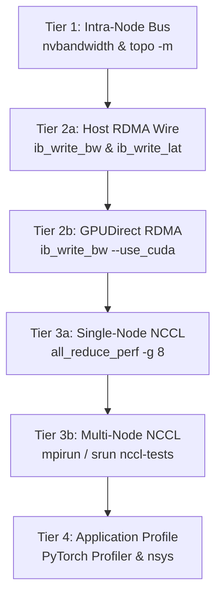
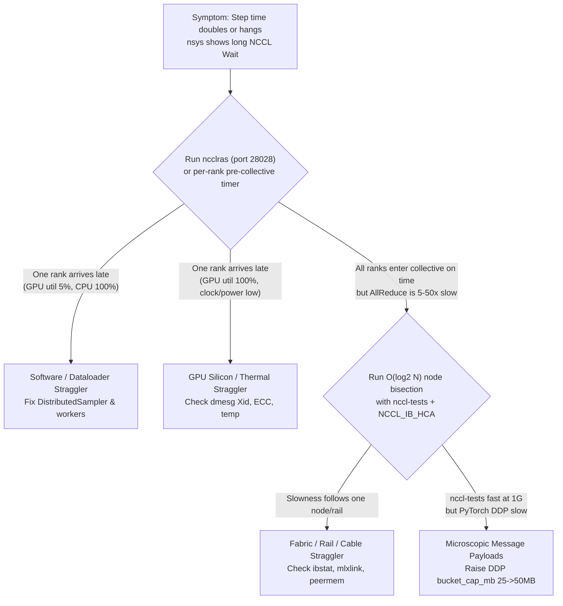

# 12.17 nccl-tests and fabric benchmarking

| | |
|---|---|
| Level | Advanced |
| Priority tier | 1 |
| Lab venue | Nebius GPU |
| Part | Part 12: Complete AI networking |
| Coverage file | `planning/coverage/chapters/12-17.md` |
| Claim ledger | `planning/ledgers/12-17.md` |

## Why this matters for AI infrastructure

Picture a distributed AI cluster that finishes a training job and returns answers from an inference endpoint. It may still run well below what its hardware can do. When a cluster scales poorly or suffers storage and network stalls, almost half of the rented accelerators sit idle. They spend their time waiting on collectives or data loaders. Over a multi-week training run, those idle accelerators burn tens of thousands of dollars in wasted cloud compute.

Think about what the cluster looks like from the outside. The job finishes, the dashboard turns green and the inference endpoint answers requests. Nobody is paged, so nobody asks whether the cluster is doing its best. That silence is the reason this chapter exists. A cluster can look healthy while its expensive hardware spends much of its time waiting, and the only way to know the gap is to measure what the hardware can do on a clean test.

This chapter is the concept chapter for `nccl-tests`. It explains what each tool measures and how to read the numbers. The hands-on build is the [capstone lab in Chapter 19.5](../part-19-capstone/05-capstone-an-nccl-tests-fabric-lab.md), and the pass and fail policy for acceptance lives in [Chapter 12.23](23-fabric-validation-and-capacity-planning.md).

Think of this chapter as the explanation behind a measuring tape. The tape itself is simple to use, but a number read from it means little until you know what it measures and where to stand. The sections below explain each measurement, its units and the traps that make a good-looking number misleading. The build steps and the pass or fail policy live in the other chapters named in the links, so you can come back to them when you run the tests on real hardware.

```text
Quantitative impact of unbenchmarked training and inference clusters:
- 64-GPU training job (8 nodes x 8 GPUs, $100,000 of accelerators) at 45% GPU utilization & 52% scaling efficiency:
  Effective compute = 64 * 0.52 = 33.28 (~33) GPUs; wasted compute = 64 - 33.28 = 30.72 (~31) idle GPUs
  Over a 2-week (336-hour) run: 30.72 * 336 = 10,321.92 wasted GPU-hours
  At $4 to $5 per GPU-hour ($4.50/GPU-hr midpoint): $46,448.64 (~$50,000) burned on idle GPUs
- Storage-starved 2-week 64-GPU incident (45% GPU utilization):
  A $50 NVMe SSD upgrade would have prevented $10,000 in wasted GPU time
```

Here is the cost in one picture. A 64-GPU job at 52% scaling efficiency keeps only about 33 of its GPUs busy, and the rest of the fleet pays for idle time. You cannot diagnose a degraded optical transceiver, a PCIe root-complex downtrain, or a missing peer-memory kernel module from inside a full PyTorch model script. High-level frameworks mix data loading, autograd kernel launches, memory caching allocators and asynchronous CUDA stream hooks, so the fault gets buried. An infrastructure engineer therefore isolates the hardware and middleware layers from the bottom up. You validate intra-node PCIe and NVLink paths with `nvbandwidth`, and raw point-to-point RDMA wires with `perftest`. Next, you benchmark standalone GPU collectives with `nccl-tests`. Only after those three tiers pass do you profile application overlap and scaling efficiency with PyTorch Profiler, NVIDIA Nsight Systems and `genai-bench`.

Picture the cost as a bill that arrives every week. Each idle accelerator is a line item that keeps growing whether or not the job moves forward. A small drop in scaling efficiency therefore reads as a large amount of money, and an engineer who can point to the exact tier that caused the drop saves the team a lot of time and budget.

## Prerequisites and outcomes

### Prerequisites

Before you start, finish Chapter 12.19 on GPUDirect RDMA and GPUDirect Storage. It explains BAR1 peer memory, `nvidia_peermem`, PCIe Access Control Services, and PIX versus SYS NUMA locality. You also need Chapters 12.15 and 12.16. Those chapters cover the Ring, Tree, CollNet/SHARP, NVLS and PAT algorithms, and how NCCL picks a transport among P2P, SHM, NET/IB and NET/Socket.

If the prerequisite terms feel new, take them one at a time. BAR1 is the window on the GPU that lets the network card reach GPU memory directly. Access Control Services is a PCIe feature that can block that direct path when it is switched on. Chapters 12.15 and 12.16 then show how NCCL turns those pieces into an algorithm and a transport choice.

### Expected learning outcomes

This chapter walks through a three-tier validation sequence that uses `nvbandwidth`, `ib_write_bw` and `nccl-tests`. Each tier isolates one layer of the stack, so a bottleneck can be pinned to one exact hardware or software layer. The chapter then derives and checks the bandwidth conversion factors for all six collective families, and it shows how to read the data-integrity counters. It also covers how to find one slow node among $N$ nodes in $\lceil \log_2 N \rceil$ bisection steps. Next it combines `NCCL_RUN_DIAGNOSTICS=1` with the `ncclras` daemon to find hung or lagging ranks. The last part explains how to design benchmarks with warmup, synchronization barriers and percentile latency reporting, and how to apply Amdahl's Law scaling analysis and statistical accuracy validation.

---

## 1. The three-tier fabric validation hierarchy (`nvbandwidth`, `perftest`, `nccl-tests`)

Suppose a multi-node job runs 40% to 60% slower than expected. Your first instinct may be to open the training script, but that skips fault isolation. One symptom, such as slow AllReduce completion, can come from many places. A motherboard PCIe lane may have failed, an MPO fiber connector may be dirty, or a peer-memory module may be missing. A stopped `nvidia-fabricmanager` daemon, or fragmented gradient buckets in the framework, can cause it too. To prove which layer is responsible, benchmark the stack in four sequential tiers, from the physical silicon up to the framework.

Picture the on-call engineer who gets the page. The job is slower than the plan, and the training code looks fine. The first temptation is to tune the framework, but that step skips the question that matters, which is where the time goes. Each tier below answers a narrower question than the one before it, so you can rule out whole layers quickly.



Each row of the table below is one tier. It gives the tool to run, the healthy baseline, and the failure signature to look for. Read the failure signature column when a number falls short of its baseline.

| Validation Tier | Primary Binary / Tool | Target Subsystem | Healthy Reference Baseline | Diagnostic Failure Signature |
|---|---|---|---|---|
| **Tier 1: Intra-node motherboard & NVLink** | `nvbandwidth -t device_to_host_memcpy_ce`, `nvidia-smi topo -m`, `nvidia-smi nvlink --status` | PCIe Gen5 x16 root complex/switches and intra-node NVLink/NVSwitch fabric | `50–60 GB/s` D2H/H2D on PCIe Gen5 x16 (`64 GB/s` raw); `~25 GB/s` per A100 NVLink3 (`~600 GB/s` total); `900 GB/s` H100 NVLink4; `1.8 TB/s` (`18 x 100 GB/s`) B200 NVLink5 | `25–30 GB/s` D2H indicates PCIe downtrained from `x16` to `x8` (`lspci -vv` `LnkSta`); `PIX` missing or NVLink `< 20 GB/s` or `inactive` |
| **Tier 2a: Physical RDMA wire (Host RAM)** | `ib_write_bw --report_gbits --duration 30`, `ib_write_lat`, `ib_send_lat`, `ibstat`, `mlxlink` | HCA (`mlx5_0..mlx5_7`), optical transceivers, cables, and switch ASICs | `~390 Gbps` (`48.75 GB/s`, `97.5%` of `400G NDR` `50 GB/s` line rate); stable few-microsecond latency (`1–5 µs`) and zero counter deltas | `~195 Gbps` (`~200 Gbps`) indicates link width downtrained (`4x` $\rightarrow$ `2x`) or rate downshift; rising `symbol_error` or `PortXmitWait` |
| **Tier 2b: GPUDirect RDMA wire (GPU HBM)** | `ib_write_bw -d mlx5_0 --use_cuda=0`, `lsmod \| grep nvidia_peermem` | GPU BAR1 to NIC DMA across shared PCIe switch (`PIX`) | Matches Tier 2a (`~385–390 Gbps` on `400G NDR`) when GPU and NIC share a local PCIe switch (`PIX`, same NUMA node) | Host RDMA is `390 Gbps` but `--use_cuda` drops to `80–120 Gbps`: `nvidia_peermem` unloaded, PCIe ACS enabled, or `SYS` cross-socket pairing |
| **Tier 3a: Single-node collectives** | `./build/all_reduce_perf -b 8M -e 8G -f 2 -g 8` | Intra-node NCCL P2P/SHM/NVLS channels and NVSwitch routing | `busbw` approaches NVLink rating at `>= 32 MiB–512 MiB` (e.g., `95.18 GB/s` on PCIe/hybrid baseline; `750–800+ GB/s` on 8x H100 NVSwitch) | `busbw` stuck at `20–90 GB/s` on an NVSwitch node: `nvidia-fabricmanager` down, ACS enabled, or `NCCL_P2P_DISABLE=1` / `NCCL_SHM_DISABLE=1` left set |
| **Tier 3b: Multi-node collectives** | `mpirun` / `srun` `all_reduce_perf`, `all_gather_perf`, `reduce_scatter_perf`, `alltoall_perf` | Multi-rail NCCL rings/trees, SHARP/CollNet, RoCEv2 GID/PFC/ECN | Multi-node `busbw` at or near your own saved baseline; the `80%` figure is a tunable policy, not a vendor number (illustrative worked example only: `~361.36 GB/s` across `8 x 400G` NDR rails) | Multi-node `busbw` drops to `58.2 GB/s` (`61.15%` of `95.18 GB/s`, failing `80%` gate) or `2.0 GB/s` (`NET/Socket` TCP fallback instead of `NET/IB`) |
| **Tier 4: Framework & application loop** | `torch.profiler`, `nsys profile --trace=cuda,nvtx,osrt`, `ncu`, `TrainingBenchmark` | DDP `bucket_cap_mb` (`25 MB` default), stream overlap, dataloader `num_workers` | `> 80%` GPU utilization, `40%–60%` MFU (`43.48%` / `48%`), `70%–90%+` scaling efficiency, `< 10%` dataloader time | Tiers 1–3 pass at `1 GiB`, but training is `40%` slow: model issues thousands of `256 KB` AllReduce calls (fix `bucket_cap_mb` `25 MB` $\rightarrow$ `50 MB`) |

The table shows the order of the work. Each tier adds one more layer on top of the one below it, so the first failing row names the layer to fix.

Think of the table as a ladder you climb from the floor. The bottom rung is the silicon and the top rung is your application. You do not climb to the next rung until the current one passes. If a rung fails, the problem is on that rung or one below it, so you never need to look above it until the failure is fixed.

### Why `iperf3` cannot validate an AI fabric

Engineers used to standard web infrastructure often reach for `iperf3`, `iftop` or `nload` when a cluster feels slow. Then they are surprised when those tools miss the problem. Those utilities are useful only for initial management-network reachability or coarse Ethernet sanity checks.

Many engineers come from web operations, where a network test with a generic tool tells them most of what they need. The habit is reasonable there. On an AI cluster it is misleading, because the traffic patterns, the hardware path and the software stack are all different from a web service. The same tool can report a healthy link while the training job crawls.

The `iperf3` binary sends its packets through the Linux kernel TCP/IP socket stack. That stack brings context switches, socket buffer copies and software interrupts. These bottleneck the host CPU cores long before a high-speed AI link is saturated. Say `iperf3` reports 100 Gbps between two nodes while distributed training achieves only 20 Gbps. The tool still cannot tell you whether the loss comes from host-staged GPU copies, NUMA misalignment or small-message launch overhead.

It helps to picture the path a packet takes. A training job moves tensors from GPU memory to the network card and out to the wire. A TCP test moves bytes through the operating system, which copies them into socket buffers and hands them to the kernel. The two paths share little beyond the wire itself, so a good result on one says little about the other.

For InfiniBand and RoCEv2 fabrics, Tier 2 validation always uses the OpenFabrics `perftest` suite. These binaries post Verbs Work Queue Elements directly to the Host Channel Adapter hardware queues, bypassing the operating system kernel entirely. The numbers below show the ceiling you hit with each tool.

Think of `perftest` as a tool that talks to the card the way a driver talks to a loading dock. It queues the work directly on the card and skips the front office of the kernel. That is the same route an AI job takes, so its numbers answer the question you actually have.

```text
Why iperf3 fails on AI fabrics vs RDMA perftest:
- Coarse Ethernet / TCP ceiling: ~100 Gbps (~12.5 GB/s), bottlenecks host CPU cores well below
  200 Gbps (~200 GB/s aggregate multi-rail) or 400 Gbps (50 GB/s per port) RDMA links.
- Ambiguity gap: If iperf3 reports 100 Gbps while training gets 20 Gbps, iperf3 never tests
  RDMA Verbs (WQEs) or GPU BAR1 peer memory.
```

If your first tool is `iperf3`, you are testing a path the training job never uses. Start with `perftest` for the wire and `nccl-tests` for the collectives.

In practice this means a short checklist for a new cluster. Check the management network with the simple tool if you like, then move to `perftest` for the wire and to `nccl-tests` for the collectives. Keep the simple tool for reachability questions only.

### Reading `nvidia-smi topo -m` and InfiniBand port counters before benchmarking

Launching `ib_write_bw` or `nccl-tests` before you check GPU-to-NIC locality can ruin the benchmark before a single packet leaves the node. Suppose you pair a GPU on Socket 0 with an RDMA adapter on Socket 1. Every payload then crosses the CPU inter-socket link before it reaches the wire. Capture the hardware topology and a counter baseline on every participating node before you start load tests.

Picture a delivery van loaded at the wrong dock. Every parcel must cross the building to reach the road, and the cross-building walk slows everything down. A benchmark on a mismatched pair gives the same kind of slow result, and it looks like a fabric problem even though the fabric is fine. Checking the placement first costs little and removes that confusion.

```text
Reference 8-GPU dual-socket H100 SXM node (node-a, node-b) pre-benchmark audit:
- Hardware: 8x H100 80 GB SXM GPUs (NV18: 18 bonded Gen4 NVLinks via NVSwitch)
- NICs:     8x ConnectX-7 (MT4129, firmware 28.39.2048) NDR400 (400 Gb/s = 50 GB/s line rate, mlx5_0..mlx5_7)
- Topology pairings (nvidia-smi topo -m):
  * GPU0 <-> mlx5_0: PIX (single PCIe bridge on NUMA node 0, CPU cores 0-63, 128-191)
  * GPU7 <-> mlx5_7: PIX (single PCIe bridge on NUMA node 1, CPU cores 64-127, 192-255)
  * GPU0 <-> mlx5_7: SYS (crosses PCIe + inter-socket UPI/QPI between NUMA nodes 0 and 1)
- Port state verification (ibstat mlx5_0):
  * Physical state: LinkUp (optical transceiver and cable lock)
  * State: Active (OpenSM assigned Base lid: 7, SM lid: 1, Rate: 400)
  * Failure modes: LinkUp + Initializing = Subnet Manager (sminfo) or P_Key issue;
    Rate: 200 or Rate: 100 on NDR400 = physical lane/speed downshift.
- Counter snapshot (/sys/class/infiniband/mlx5_*/ports/1/counters/*):
  * Data counters climb by billions of 32-bit words: port_rcv_data = 8,823,914,021; port_xmit_data = 8,801,220,117
  * Error counters MUST remain flat (0 delta): symbol_error, link_error_recovery, link_downed,
    port_rcv_errors, local_link_integrity_errors, excessive_buffer_overrun_errors, VL15_dropped.
```

Compare each node's output with this reference before you trust its numbers. Do not run load tests on a node until its topology and counters match the baseline.

When you compare a node with the reference, look at the three parts in order. Check the topology pairings first, because they explain most of the placement problems. Check the port state next, and check the error counters last. An error counter that moves during an idle period is a warning that a cable or optic needs attention.

---

## 2. `nccl-tests` architecture, CLI flags, and exact `algbw` versus `busbw` math

When you need to measure collective throughput without Python, autograd or storage getting in the way, run `nccl-tests` (`https://github.com/NVIDIA/nccl-tests`). The suite compiles standalone C++ and CUDA binaries for each collective operation. That includes `sendrecv_perf`, `gather_perf`, `scatter_perf` and `hypercube_perf`. Each binary allocates device buffers, sets up the NCCL communicators and times the collective kernels in a tight loop.

Think of `nccl-tests` as a bench press for the collectives. The weight is the message size, the reps are the iterations and the rest between sets is the warmup. Nothing else is in the room, so when the bar moves slowly, you know the problem is in the collective and not in the training script.

### Core `nccl-tests` CLI flags

The table lists the flags you will use most. Each one changes what the run measures, so read its sizing guidance before you copy a command.

Most of the flags are simple switches, but a few set the shape of the test. The size flags decide the range of messages, the step factor decides the spacing, and the iteration flags decide how many samples each row averages. Read the sizing column before you copy a command from another cluster, because a good value on one fabric can be too short or too long on another.

| Flag | Parameter Name | Default | Operational Meaning and Sizing Guidance |
|---|---|---|---|
| `-b <bytes>` | `--minbytes` | `32M` | Starting tensor size in bytes (supports suffixes `K`, `M`, `G`, e.g., `-b 8` or `-b 8M`). Sweep from `4 KiB–64 KiB` to expose latency and `128 MiB–8 GiB` to saturate bandwidth. |
| `-e <bytes>` | `--maxbytes` | `32M` | Ending tensor size in bytes (e.g., `-e 128M`, `-e 1G`, `-e 8G`, `-e 10G`). Must be large enough to amortize startup latency (`>= 256 MiB–1 GiB` on NVLink4/5 and multi-rail NDR/XDR). |
| `-f <int>` | `--stepfactor` | `1` (disabled) | Multiplicative step factor between message sizes (typically `-f 2` to double size each row: `8M`, `16M`, `32M`, ..., `1G`). |
| `-g <int>` | `--ngpus` | `1` | Number of GPUs managed **per process/thread**. Use `-g 8` for a single-process 8-GPU local run, or `-g 1` when launching 1 MPI/Slurm process per GPU (`--ntasks-per-node=8`). |
| `-t <int>` | `--nthreads` | `1` | Number of CPU threads per process. Total collective ranks $n = \text{processes} \times \text{threads} \times g$. |
| `-w <int>` | `--warmup_iters` | `5` | Untimed warmup iterations executed at each message size before starting the CUDA event timer. Increase to `10–20` on large multi-rack fabrics. |
| `-n <int>` | `--iters` | `20` | Timed measurement iterations averaged per row (use `-n 100` for production burn-in and jitter detection). |
| `-c <0\|1\|N>` | `--check` | `1` | Data-integrity verification iteration count (`0` disables checking for fast sweeps; `1` compares collective output against expected math and populates the `#wrong` column). |
| `-d <type>` | `--datatype` | `float` | Element datatype (`int8`, `uint8`, `int32`, `int64`, `half`, `float`, `double`, `bfloat16`, `fp8_e4m3`, `fp8_e5m2`). |
| `-o <op>` | `--op` | `sum` | Reduction operator (`sum`, `prod`, `min`, `max`, `avg`, `all`). |
| `-R <0\|1\|2>` | `--local_register` | `0` | Enables persistent user-buffer registration (`1` = `ncclCommRegister` local, `2` = symmetric `ncclMemAlloc`) to test zero-copy NVLS/SHARP paths. |

The sizes you pick decide what you measure. A sweep that starts small shows latency, and one that reaches the large sizes shows the bandwidth ceiling. Keep both ends in mind when you set `-b` and `-e`.

Think of the sweep as a ruler laid along a road. Short messages show how long a single trip takes, and large messages show how much the road can carry at once. A sweep that only covers one end tells you one half of the story, which is why the default sweep runs from small to large.

### Deriving `algbw` and `busbw` from first principles

Engineers who read nccl-tests output for the first time often compare the algorithmic bandwidth column directly with the NIC or NVLink spec sheet. They then falsely conclude that their network runs at half speed. For a collective that works on a buffer of $S$ bytes and finishes in $t$ seconds across $n$ ranks, nccl-tests reports two bandwidth metrics. Both columns are in decimal gigabytes per second.

A simple way to avoid this trap is to write down the formula before you read the table. The algorithmic column divides bytes by time. The bus column multiplies that by a factor that depends on the collective and on the number of ranks. Once the formula is on the page, the two columns stop looking like rival numbers.

The first metric is algorithmic bandwidth, written `algbw`. It shows the apparent rate at which the logical collective tensor is processed:

Think of `algbw` as the speed of a delivery truck measured by the load it carries, not by the number of roads it uses. The bus metric counts the roads. A ring collective uses several roads for each load, so the bus figure is the one that can be compared with the rated speed of a single link.

$$\text{algbw} = \frac{S}{t}$$

That ratio divides logical bytes by elapsed seconds. The second metric is bus bandwidth, `busbw`. It accounts for the several physical hops a collective needs across $n$ ranks. It normalizes `algbw` by the minimum per-rank data volume an optimal ring topology must move. That normalization makes `busbw` directly comparable with the hardware's rated link speed, however many GPUs take part.

The division is simple, but the meaning takes a moment to settle. Logical bytes are the size of the tensor the application asked for, not the number of bytes that crossed a wire. The elapsed time is the time the whole collective took on the clock. So the algorithmic figure describes the application's view of the job, and the bus figure describes the hardware's view.

The conversion depends on the collective. Find your collective's row, then multiply `algbw` by its factor to get `busbw`.

The table is easiest to use as a lookup. Start from the binary you ran, find its row, and multiply the algorithmic figure by the factor for your rank count. If your rank count is not in the table, the formula in the third column gives the same answer, so you can compute the factor directly.

| `nccl-tests` Binary | Collective Operation | Logical Input $\rightarrow$ Output | Per-Rank Bytes Transferred | Exact `busbw` Conversion Formula | Factor at $n=2$ | Factor at $n=4$ | Factor at $n=8$ | Factor at $n=64$ | Factor at $n=72$ |
|---|---|---|---|---|---|---|---|---|---|
| `all_reduce_perf` | AllReduce | $S$ on each rank $\rightarrow$ reduced $S$ on every rank | $\frac{2(n - 1)}{n} \cdot S$ | $\text{busbw} = \text{algbw} \cdot \frac{2(n - 1)}{n}$ | `1.0000` | `1.5000` | `1.7500` | `1.96875` | `1.972222` (`142/72`) |
| `reduce_scatter_perf` | ReduceScatter | $S$ on each rank $\rightarrow$ reduced $S/n$ shard per rank | $\frac{n - 1}{n} \cdot S$ | $\text{busbw} = \text{algbw} \cdot \frac{n - 1}{n}$ | `0.5000` | `0.7500` | `0.8750` | `0.984375` | `0.986111` (`71/72`) |
| `all_gather_perf` | AllGather | $S/n$ shard per rank $\rightarrow$ gathered $S$ on every rank | $\frac{n - 1}{n} \cdot S$ | $\text{busbw} = \text{algbw} \cdot \frac{n - 1}{n}$ | `0.5000` | `0.7500` | `0.8750` | `0.984375` | `0.986111` (`71/72`) |
| `alltoall_perf` | AllToAll | $n$ distinct $S/n$ chunks exchanged with $n$ peers | $\frac{n - 1}{n} \cdot S$ | $\text{busbw} = \text{algbw} \cdot \frac{n - 1}{n}$ | `0.5000` | `0.7500` | `0.8750` | `0.984375` | `0.986111` (`71/72`) |
| `broadcast_perf` | Broadcast | $S$ on root rank $\rightarrow$ $S$ replicated to $n-1$ ranks | $1.0 \cdot S$ | $\text{busbw} = \text{algbw} \cdot 1$ | `1.0000` | `1.0000` | `1.0000` | `1.0000` | `1.0000` |
| `reduce_perf` | Reduce | $S$ on each rank $\rightarrow$ reduced $S$ on root rank | $1.0 \cdot S$ | $\text{busbw} = \text{algbw} \cdot 1$ | `1.0000` | `1.0000` | `1.0000` | `1.0000` | `1.0000` |

AllReduce carries the largest factor of the rows that depend on $n$. Broadcast and Reduce stay at 1.0 whatever $n$ is.

The pattern across the rows follows the way data moves. AllReduce sends each piece out and back, so it moves the most bytes. ReduceScatter, AllGather and AllToAll each make one pass, so they carry a smaller factor. Broadcast and Reduce send the full buffer once along the path, so their factor stays at one.

Why does AllReduce multiply by $2(n-1)/n$? A ring AllReduce runs an $(n-1)$-step ReduceScatter pass, then an $(n-1)$-step AllGather pass. Each pass moves $n-1$ chunks of size $S/n$ per GPU. Together the two passes take $2(n-1)$ steps and move $\frac{2(n-1)}{n}S$ bytes per GPU. As $n$ grows large, the multiplier approaches 2.0. That means algorithmic bandwidth can never exceed half of the physical bottleneck link bandwidth for a ring AllReduce at scale.

A short picture helps here. Imagine passing a set of bricks around a circle of workers. In the first lap, each worker collects and combines pieces. In the second lap, each worker shares the finished pieces. Two laps means twice the traffic per worker, minus one lap's worth of savings at each step. That is the origin of the shape of the factor.

Consider a 400 MB buffer. The block below works out its `algbw` first, then shows the factor at three cluster sizes.

Walk through the buffer step by step, because the same idea applies to any size you test. Start with the bytes, divide by the time to get the algorithmic figure, and then apply the factor for the rank count. The block below does exactly that, so you can check each line against the one above it.

```text
Worked algbw and busbw examples (1 GB/s = 10^9 B/s):
- 400 MB (4e8 B) AllReduce in t = 4.00 ms (0.004 s):
  algbw = 400 MB / 0.004 s = 100.0 GB/s
- Ring AllReduce factor 2(n-1)/n across cluster sizes:
  * n = 2 GPUs:  2(2-1)/2 = 1.0     -> busbw = 1.0 * algbw
  * n = 8 GPUs:  2(8-1)/8 = 14/8 = 1.75 -> every GPU sends/receives 1.75 * S bytes
  * n -> inf:    2(n-1)/n -> 2.0    -> algbw is at most 50% of physical link bandwidth (50 GB/s per 400G NDR NIC or 900 GB/s on H100 NVLink4)
```

For example, the same `algbw` gives a different `busbw` at each size of $n$, because the factor changes. Keep that in mind when you compare runs taken on different node counts.

This is why a single number from one cluster cannot be compared with a number from another without the rank count. Two runs with the same algorithmic figure can show different bus figures, and the bus figure is the one tied to the hardware. Always record the number of ranks next to every result you save.

### Annotating an `all_reduce_perf` output table

When a benchmark finishes, check three things. First, the arithmetic between elapsed time, `algbw` and `busbw` must hold. Second, the `#wrong` column must stay at zero. Third, multi-node bus bandwidth should stay close to your own saved baseline. This chapter uses 80 percent of that baseline as a starting policy. No NVIDIA document sets that number, so calibrate it on your own healthy run. The output below is an illustrative worked example, not a measurement. It follows an eight-GPU sweep from 8 MiB to 512 MiB, then single-node and multi-node 1 GiB checks, so you can practise the arithmetic.

Think of these three checks as a receipt. The arithmetic checks that the bookkeeping adds up. The integrity column checks that the goods arrived undamaged. The baseline check compares the total with the last known good order. A result that fails any of the three should not go into a report, even when the headline number looks impressive.

```text
#                                                              out-of-place                       in-place
#       size         count      type   redop    root     time   algbw   busbw #wrong     time   algbw   busbw #wrong
#        (B)    (elements)                               (us)  (GB/s)  (GB/s)            (us)  (GB/s)  (GB/s)
     8388608       2097152     float     sum      -1    412.3   20.35   35.61      0    410.0   20.46   35.81      0
    67108864      16777216     float     sum      -1   1653.1   40.60   71.05      0   1645.0   40.80   71.40      0
   536870912     134217728     float     sum      -1   9871.4   54.39   95.18      0   9820.0   54.67   95.67      0

Row-by-row math verification (float = 4 bytes/element, n = 8 GPUs -> factor = 1.75):
- 8 MiB (8,388,608 B = 4 * 2,097,152 elements) in 412.3 us:
  algbw = 8,388,608 / (412.3 * 1e3) = 20.35 GB/s; busbw = 20.35 * 1.75 = 35.61 GB/s
- 64 MiB (67,108,864 B = 4 * 16,777,216 elements) in 1653.1 us:
  algbw = 67,108,864 / (1653.1 * 1e3) = 40.60 GB/s; busbw = 40.60 * 1.75 = 71.05 GB/s
- 512 MiB (536,870,912 B = 4 * 134,217,728 elements) in 9871.4 us:
  algbw = 536,870,912 / (9871.4 * 1e3) = 54.39 GB/s; busbw = 54.39 * 1.75 = 95.18 GB/s

Single-node and multi-node acceptance gates:
- V5 Lab 02 512 MiB baseline: local single-node = 95.18 GB/s (passes >= 90 GB/s gate).
  80% multi-node gate = 0.80 * 95.18 = 76.14 GB/s. Observed multi-node = 58.2 GB/s (61.15% of local) -> FAIL.
- 1 GiB (1,073,741,824 B) on 8-GPU H100 SXM NVSwitch node (900 GB/s bidir NVLink4) in 2,480.0 us (factor = 1.75):
  algbw = 432.96 GB/s; busbw = 757.68 GB/s
- 1 GiB (1,073,741,824 B) on 8-node (64-GPU) 8x400G NDR IB cluster in 5,850.0 us (factor = 1.96875):
  algbw = 183.55 GB/s; busbw = 361.36 GB/s (~45.17 GB/s per 50 GB/s rail, or 90.34% of line rate)
```

Every figure in this block, including the 58.2 GB/s multi-node row and the 361.36 GB/s row with its 90 percent per-rail share, comes from the handbook's own arithmetic practice and not from a run on real hardware. Treat the 80 percent gate as unsourced policy. For what is sourced, see the nccl-tests lab in chapter 19.5.

Read this paragraph as a warning label on the example. The numbers are worked out from the formulas so you can practise the arithmetic. They are not a record of a measurement, and they should not be quoted as a fleet result. For a sourced run, follow the capstone lab that the first section names.

In out-of-place mode, the send and receive buffers are separate GPU allocations. In in-place mode, the reduced output overwrites the input buffer, which matches PyTorch DDP gradient buckets. The `#wrong` column must be zero on every row. A non-zero count means the collective finished but corrupted floating-point values in transit. The cause may be faulty HBM, bad SRAM or broken buffer registration. Either way, that corruption makes the throughput figure worthless.

A simple way to remember the two modes is to think about a photocopy. Out-of-place is a copy onto a new sheet, so the original is kept. In-place is writing over the original page. DDP gradient buckets work the second way, which is why in-place mode is the one that matches them. The integrity column is the check that the page was not smudged along the way.

Do not report a bandwidth number from any run whose `#wrong` column is not zero.

A bandwidth number with errors is like a speed reading from a broken speedometer. It may look fast, but the instrument is lying. Discard the run, find the cause of the errors, and measure again before anyone uses the figure in a decision.

---

## 3. Benchmarking methodology, training scaling efficiency, and Amdahl's Law

Moving from one-off microbenchmarks to distributed training benchmarks takes real discipline. Without proper warmup, synchronization barriers and enough samples, lazy kernel compilation or asynchronous CUDA queuing can produce completely fabricated throughput numbers.

A microbenchmark is a short test with one operation in a loop. It is useful, but it can fool you in two ways. The first call pays one-time costs, and the device runs ahead of the host, so the timer may stop before the work is done. A distributed benchmark adds more ways for the timer to lie, so the rules below are the minimum discipline.

### Three rules of reproducible GPU benchmarking

Three rules keep your numbers honest. First, always run untimed warmup iterations before you start the clock. The first execution of a CUDA operation triggers lazy JIT kernel compilation, cuBLAS and NCCL handle initialization, caching-allocator block reservation and instruction cache population. Second, call `torch.cuda.synchronize()` right before you record the start timestamp, and again right before the end timestamp. Kernel launches and collective calls are asynchronous on the host CPU. Without synchronization you measure Python dispatch latency rather than GPU execution time. Third, run at least one hundred timed iterations and report latency percentiles. That captures thermal drift, background daemon jitter and fabric congestion.

Think of the three rules as a checklist before every timed run. Warm the code up, line the clocks up with the device, and collect enough samples to see the spread. Skipping any one of them tends to produce a result that looks clean and means very little.

The block below gives the starting values for each rule.

```text
Reproducible GPU benchmark parameters:
- Warmup iterations:
  * Standard eager PyTorch: 5-10 warmup steps
  * torch.compile or CUDA Graphs: 20-50 warmup steps (covers graph capture and compilation)
- Synchronization:
  * Explicit torch.cuda.synchronize() before start_time and before end_time
- Timed sample size & metrics:
  * >= 100+ timed iterations; report mean, standard deviation, median (P50), P95, and P99
```

Compiled code needs a longer warmup than eager code, because the compiler and CUDA Graph capture run before the steady state begins.

The reason is that a compiler does its work the first time it sees a shape, and CUDA Graph capture records the steps once. Both costs disappear after the first few rounds, so the timed rows should begin after that point. If you see one slow row at the start of a sweep, the warmup was probably too short.

### Key distributed training metrics and phase decomposition

A slow training run can hide its cause if you measure only total step time. Storage, forward and backward math, and collective communication all look the same from the outside. A complete `TrainingBenchmark` harness therefore instruments four phases per step: data loading, forward, backward and optimizer. It pairs those phase timers with three fleet-level efficiency metrics.

Think of a training step as a shift at a busy kitchen. Some cooks prepare ingredients, some cook and some plate. If you only time the whole shift, you cannot tell whether the dishes were late because of the prep table, the stove or the plating line. Splitting the step into phases gives you the answer.

The first metric is aggregate throughput, in samples per second or tokens per second across all GPUs. The second is GPU utilization, and you should not read it on its own. The `nvidia-smi` utility reports only the fraction of time at least one kernel is active on the device. A GPU that spin-waits inside `ncclKernel_AllReduce`, or runs tiny unfused kernels, still displays 98% to 100% utilization. Model FLOPs Utilization, or MFU, answers the harder question. It compares useful floating-point operations with the hardware's theoretical peak:

Throughput is the most direct measure of progress. It counts how many samples or tokens the whole cluster processes in a given time. The other two metrics explain why the throughput is what it is. Utilization and MFU tell you how busy the silicon is, and the communication share tells you how much of the step is spent waiting for other GPUs.

$$\text{MFU} = \frac{6 \times N_{\text{params}} \times \text{tokens/sec}}{\text{Peak Theoretical FLOPs/sec}}$$

The equation divides your throughput by the silicon's peak rating, so it shows real efficiency rather than activity. The third metric is communication overhead as you scale across nodes. On a single GPU, communication overhead is zero. At 16 GPUs, it can easily consume more than half of each iteration. That explains why doubling the GPU count often fails to halve step time.

A simple picture helps. Peak FLOPs is the speed limit printed on the road sign. MFU is the speed your car actually averages on the trip. Two cars can both show a full gas gauge while one drives twice as far. Utilization only tells you the gauge is not empty, whereas MFU tells you the distance covered.

The block below turns these metrics into numbers you can check.

```text
Training phase rules and MFU / communication benchmarks:
- Throughput to epoch time:
  1,000 samples/sec on a 1,000,000-sample dataset = 1,000 seconds (~16.67 / ~17 minutes) per epoch.
- 70B-parameter model on 8x H100 SXM GPUs (8 * 989 TFLOPS = 7,912 TFLOPS peak BF16):
  * Dataloader-starved (3,200 tokens/sec): 6 * 70e9 * 3,200 = 1,344 TFLOPS -> 16.99% (~17%) MFU
  * Tuned DataLoader + GPU augmentations (9,000 tokens/sec): 3,780 TFLOPS -> 47.78% (~48%) MFU
    (hits the 40%-50% / 40%-60% production target range).
- Phase-level diagnostic thresholds:
  * If data_loading > 10% of step time (and GPU util < 80%, e.g., 30%): increase DataLoader num_workers
    to 2-4x CPU cores per GPU (on a 112-core 2x56 DGX H100 with 14 cores/GPU, set --cpus-per-task=12 or 14)
    and enable pin_memory=True.
  * If backward > 2x to 3x forward: inspect gradient sync stalls, activation recomputation, or fragmentation.
- Communication overhead growth (DAI Fig 10.1):
  * 1 GPU:  155 ms iteration time (0% communication overhead)
  * 16 GPUs: 33 ms iteration time (4.70x speedup, 29.36% efficiency), where communication overhead is 55%
    of the step (18.15 ms communication vs 14.85 ms compute).
```

Read the 70B example as a before-and-after story. The same model and hardware reach 17% MFU with a starved dataloader, and 48% MFU once the loader is tuned. The GPUs did not change. The data pipeline did.

The lesson in this example is that a fix in the data pipeline can be worth more than a new GPU. An engineer who looks only at the accelerators would never find the gain. The steps to find it are the phase timers and the throughput check, which is why both appear in the benchmark harness.

### Scaling efficiency and Amdahl's Law

Before you add nodes to a training job, measure **scaling efficiency**, written $\eta_N$. It tells you what fraction of ideal linear speedup you keep on $N$ GPUs:

Think of scaling efficiency as the share of a new team member's time that turns into finished work. A new person always costs some time for meetings and handoffs. The efficiency number tells you how big that cost is, so you can decide whether the next hire is worth it.

$$\eta_N = \frac{\text{Throughput}_N}{N \times \text{Throughput}_1} = \frac{\text{Speedup}_N}{N}$$

That ratio shows how much of your multi-node investment turns into useful throughput. The table turns the ratio into a rating, and each rating points to a next step.

The ratio is simple to compute, which makes it easy to watch on every run. Record it for each node count in one table. A curve that flattens early is the signal to stop and find the cause before you pay for the next block of nodes.

| Scaling Efficiency Band | Operational Rating | Root-Cause Interpretation and Action |
|---|---|---|
| `> 90%` | **Excellent** | Compute dominates; DDP/FSDP communication is almost completely hidden under backward compute (WFBP). |
| `70%–90%` | **Good** | Typical for well-tuned multi-node distributed training; monitor `bucket_cap_mb` and rail balance. |
| `50%–70%` | **Moderate** | Significant communication overhead (`30%–50%` of step); check network topology, SHARP/NVLS, gradient accumulation, or FP8/gradient compression. |
| `< 50%` | **Poor** | Severe bottleneck (`55%+` comm overhead, TCP fallback, straggler rank, or dataloader starvation); halt expansion and run the 3-tier diagnostic ladder. |

A rating below 50% means you should stop expanding the job and run the 3-tier diagnostic ladder. Between 50% and 70%, the work is to find where communication overhead comes from.

The rating table is a set of traffic lights. Green means the job can grow. Amber means check the network before you add more. Red means stop and find the bottleneck. Treat the thresholds as operating rules for your team rather than as laws, and adjust them only with your own healthy baseline.

Even with infinite network bandwidth, **Amdahl's Law** sets a hard upper bound on speedup. Let $s$ be the fraction of each iteration that is strictly serial, and let $p = 1 - s$ be the part that can run in parallel:

Amdahl's Law is a limit on what any amount of hardware can do. The serial part of the step is the work that cannot be split, such as a single barrier or a single log write. Once that part is fixed, adding more parallel hardware only shrinks the parallel part, and the total time stops falling. The formula shows exactly where that wall sits.

$$\text{Speedup}(N) = \frac{1}{s + \frac{1 - s}{N}} \xrightarrow{N \to \infty} \frac{1}{s}$$

Even a small serial fraction caps the speedup of a whole cluster. Unoverlapped collective barriers, CPU synchronization points and non-parallelized preprocessing all add to the serial fraction $s$.

Think of a relay race where one runner must always wait at a fixed point. The other runners can be as fast as you like, but the whole team can only finish as fast as the waiting runner allows. In a cluster, the waiting runner is a barrier or a synchronization point that every GPU must reach.

Two examples show the arithmetic, one for scaling efficiency and one for the serial limit.

Work through each example with the formula beside it. The first shows what efficiency means for a single node count. The second shows what the serial limit means for a whole cluster. Together they show why a healthy efficiency number at small scale does not guarantee the same at large scale.

```text
Scaling efficiency and Amdahl's Law calculations:
- Scaling efficiency example:
  8 GPUs delivering 6.5x single-GPU throughput -> eta_8 = 6.5 / 8 = 81.25% (~81%),
  meaning 18.75% (~20%) is lost to coordination overhead.
  Predicted 16-GPU speedup at 81.25% efficiency = 16 * 0.8125 = 13.0x (~13x instead of 16x).
- Amdahl's Law with a 10% serial fraction (s = 0.10, p = 0.90):
  * Max speedup at infinite GPUs (N -> inf): 1 / 0.10 = 10.0x
  * Max speedup at N = 64 GPUs: 1 / (0.10 + 0.90 / 64) = 8.77x (13.70% scaling efficiency)
```

Notice that the 10% serial case stops at 10.0x, even with unlimited GPUs. Measure your scaling efficiency at every node count before you buy the next block of nodes.

The result is a warning about planning. A job that looks fine at eight GPUs can hit a wall long before the cluster is large. Use the serial fraction you measured on a small run to predict the ceiling, and plan the next expansion around that ceiling rather than around the hope of linear growth.

---

## 4. Isolating stragglers, silent fallbacks, and hung collectives at scale

In synchronous data-parallel training (DDP, FSDP, ZeRO) and in tensor or expert-parallel training, every collective is a global barrier. A thousand-GPU cluster runs at the exact speed of its slowest rank. When one GPU throttles thermally, starves on a CPU dataloader thread or sits on a degraded network rail, the other 999 GPUs spin inside `ncclKernel_AllReduce`. They wait for that one rank to arrive.

Picture a relay where every runner must hand off to the next before any of them can move on. The slowest runner sets the pace for the whole team. In training, the handoff is a collective, and the runner is a GPU. That is why one slow GPU can slow a cluster of hundreds.

The flowchart below turns that symptom into a decision. Start at the symptom and follow the evidence until one branch fits.



Each row of the table is one branch. It gives the evidence you should see, the root cause behind it and the fix.

Read the table as a set of diagnoses, not as a list of fixes. Each row starts from evidence you can measure, names the likely cause, and then lists the remedy. If the evidence in a row does not match what you see, move on to the next row rather than applying its fix.

| Isolation Branch | Primary Diagnostic Evidence | Root Cause | Remediation |
|---|---|---|---|
| **Software / Dataloader Straggler** | Pre-collective timer shows GPU `2` takes `1,250.5 ms` vs `124.8–126.1 ms` on GPUs `0, 1, 3` (`10.02x` ratio); `nvidia-smi dmon` shows GPU `2` at `5%` SM util / `40 W` while peers are at `96%–98%` / `315–320 W` | Unequal batch distribution, missing `DistributedSampler`, or single-threaded CPU audio/image decompression pinning one host core at `100%` | Enforce equal per-rank batch sizes with `DistributedSampler`, increase `num_workers`, and bind NUMA cores cleanly |
| **GPU Silicon / Thermal Straggler** | `DCGM_FI_PROF_PIPE_TENSOR_ACTIVE` on one GPU is `> 0.15` (`15` percentage points) below node average while `DCGM_FI_DEV_GPU_UTIL > 80%`; `clocks_event_reasons.hw_slowdown` is `Active` | Thermal throttling (cooling loop degradation dropping MFU from `45%` to `28%` over hours), row-remap/ECC faults, or `Xid 48`/`74`/`79` | Drain node via Slurm Epilog/NHC, inspect `dmesg` and `nvidia-smi -q -d TEMPERATURE,CLOCK`, and RMA or reseat hardware |
| **Fabric / Rail / NVLink Straggler** | `all_reduce_perf` drops from `800 GB/s` to `90 GB/s` after reboot (`nvidia-fabricmanager` inactive), or `nvidia-smi nvlink --status` shows Link `3` `DEGRADED (5 GB/s)` / `FAILED (0 Mbps)` vs `25 GB/sec`, or one HCA rail has high `PortXmitWait` | Degraded optical transceiver, loose NVLink/MPO cable, stopped `nvidia-fabricmanager`, or `NET/Socket` fallback (`2.0 GB/s` vs `100.0 GB/s`) | Restart `nvidia-fabricmanager`, isolate rail with `NCCL_IB_HCA=mlx5_x:1`, run `O(\log_2 N)` node bisection, and cordon faulty node |
| **Microscopic Message Payloads** | `ib_write_bw` hits `400 Gbps` (`~390 Gbps`) and `all_reduce_perf` hits expected `busbw` at `1 GiB`, but 8-node PyTorch training is `40%` slower than calculated | Model has thousands of tiny layers issuing `256 KB` AllReduce calls where per-message handshake latency dominates wire bandwidth | Increase PyTorch DDP `bucket_cap_mb` from the `25 MB` (`25 MiB`) default to `50 MB` and verify kernel coalescing in Nsight Systems (`nsys`) |

> **dcgm-exporter 4.9.0 version note.** dcgm-exporter 4.9.0 (2026-11-06) renamed many default metrics and changed some units. For example `DCGM_FI_DEV_GPU_UTIL` (percent) became `DCGM_FI_DEV_GPU_UTIL_RATIO` (0 to 1), and `DCGM_FI_DEV_FB_USED` (MiB) became `DCGM_FI_DEV_FB_USED_BYTES`. The metric names in this chapter are the 4.8.x names. On a 4.9.0 exporter use the [full mapping in 17.4](../part-17-operations/04-dcgm-exporter-and-interpreting-gpu-metrics.md#14-what-dcgm-exporter-490-renamed), and change thresholds together with the unit.

Notice that the first two branches are about one rank that arrives late, while the last two are about the fabric or the message size. The evidence column decides which branch you are in.

This split matters for the first step of the investigation. A late rank points you toward a single machine, so you check that machine's data path and temperature. A fabric or message-size problem points you toward the network, so you check the rails and the bucket size. The evidence column is the router that sends you to the right place.

### Why post-collective timers lie—and how to instrument pre-collective arrival

A classic beginner mistake when you hunt stragglers is to record `iter_end = time.time()` *after* `dist.all_reduce(loss)`. The `all_reduce` is a barrier, so fast ranks block inside the collective until the straggler arrives. For example, every rank then reports the same total step time, and the straggler disappears from the data. To expose a compute or dataloader straggler, call `torch.cuda.synchronize()` and record each rank's timestamp immediately before it enters the collective. You can also inspect `torch.distributed.monitored_barrier` and `ncclras`.

The reason the mistake is so common is that the post-collective timer looks natural. It measures the step from start to finish, which seems like the most complete number. The problem is that the collective hides the difference between ranks, so the most complete number is the least informative one for this question.

The four-GPU example below shows the difference between the two timers.

```text
Pre-collective vs post-collective timing on a 4-GPU node:
- Post-collective timestamp (after dist.all_reduce):
  All 4 ranks report ~1,250.5 ms (hides the straggler completely).
- Pre-collective timestamp (after torch.cuda.synchronize(), before dist.all_reduce):
  * Rank 0: 125.3 ms (96-98% SM util, 315-320 W)
  * Rank 1: 126.1 ms (96-98% SM util, 315-320 W)
  * Rank 2: 1,250.5 ms (5% SM util, 40 W -> 10.02x slower than Rank 3's 124.8 ms)
  * Rank 3: 124.8 ms (96-98% SM util, 315-320 W)
  Ranks 0, 1, and 3 simply spent ~1,125 ms waiting inside AllReduce for Rank 2.
```

The post-collective view shows the same time on every rank, so it cannot point to the culprit. The pre-collective view points straight at Rank 2.

### Active NCCL diagnostics and the `ncclras` daemon

When a large job hangs, or starts with a broken NVLink pair, digging through thousands of log files across hundreds of nodes can waste hours. Modern NCCL releases include two built-in diagnostics that name faulty hardware and lagging ranks directly.

Think of these two diagnostics as a smoke detector and a security camera. The init-time check runs before the job starts and warns you about broken links. The daemon watches a running job and shows you which rank has stopped keeping up. Together they cover the start and the middle of a run, and the watchdog logs cover the moment the job gives up.

The first is `NCCL_RUN_DIAGNOSTICS=1`. In NCCL 2.31 and later, it runs active hardware and topology checks during `ncclCommInitRank`, before any user workload starts. Rank 0 prints a line for each check. A passing check logs `[OK]`, and an anomaly logs `[INFO]`. The check catches broken GPU peer-to-peer links right at startup.

The second is the `ncclras` daemon. NCCL 2.24 and later run a background Reliability, Availability, and Serviceability thread inside each process. Those threads form a peer keep-alive mesh that listens on a local TCP port. When a job hangs, you connect to the daemon from any node in the job. It returns a live table for each communicator, showing which ranks have lagging collective sequence numbers or dead processes.

The specifications below list what each diagnostic reports.

```text
Active NCCL diagnostics and ncclras specifications:
- Init-time active diagnostics (NCCL_RUN_DIAGNOSTICS=1, introduced in NCCL 2.31+):
  Prints NCCL DIAG [OK] / [INFO] from rank 0 during ncclCommInitRank.
  Example anomaly on an 8-GPU node (8 * 7 = 56 directed P2P pairs):
  "p2p: only 52/56 GPU-to-GPU peer accesses passed verification"
- Live RAS daemon (ncclras, introduced in NCCL 2.24+):
  Listens on localhost:28028 by default (configurable via NCCL_RAS_ADDR).
  * Status = MISMATCH ("Communicator ranks have different collective operation counts"):
    Lists operation sequence numbers and names the exact lagging ranks (GPU index, PID, hostname).
    Query twice a few seconds apart to confirm operation counts are static rather than in flight.
  * Status = INCOMPLETE:
    Identifies a dead or unresponsive rank (process crash or NVRM: Xid 79 GPU fallen off bus)
    while routing around the dead peer to return the summary.
- Watchdog distinction:
  "Watchdog caught collective operation timeout" / "watchdog thread terminated" is raised by PyTorch's
  ProcessGroupNCCL wrapper (TORCH_NCCL_* and TORCH_FR_BUFFER_SIZE / TORCH_NCCL_TRACE_BUFFER_SIZE flight recorder),
  NOT by NCCL itself (NCCL_WATCHDOG_DUMP does not exist in NCCL).
```

Read the status field first, because it tells you which kind of failure you have. MISMATCH points to a lagging rank, and INCOMPLETE points to a dead or unresponsive one. The watchdog messages come from PyTorch, not from NCCL, so they do not replace the NCCL diagnostics.

A simple way to remember the statuses is to ask what each one says about the rank. MISMATCH says the rank is alive but behind. INCOMPLETE says the rank is missing. The watchdog message says the framework gave up, and the root cause may be upstream. Start with the status, then decide which log to open next.

Run these commands from a node that can reach the job, and treat the output as the first snapshot of a hung run. Take a second snapshot a few seconds later, so you can see which counts have stopped moving. The commands are part of the cluster runbook and have not been run on a live cluster in this chapter.

```bash
# (untested here) Query the live NCCL RAS subsystem on port 28028 during a hung job
ncclras -v
echo verbose status | nc localhost 28028
```

### Binary-search node bisection and per-rail isolation

Suppose `all_reduce_perf` across $N$ nodes is slow, yet every rank enters the collective on time. One node probably has a degraded NIC, cable or PCIe switch. Testing all $N$ nodes one at a time takes far too long, and running $\binom{N}{2}$ pairwise tests is even worse. Use **binary-search bisection** instead. It isolates the bad node in logarithmic time.

Picture a row of houses where one has a leaking pipe, and the water bill for the street is high. You cannot inspect every house each morning, so you split the street in half, check the bill for each half, and keep the half with the high bill. Bisection works the same way. Each split throws away half the suspects, so the search stays short even on a large cluster.

Split the $N$ nodes into two halves of $N/2$ nodes each, and run `all_reduce_perf` on each half. The half with the degraded `busbw` holds the straggler. The other half is proven healthy, so it becomes a known-good partner once the suspect group shrinks to a single node. Keep halving the suspect group until one node is left. That takes $\lceil \log_2 N \rceil$ split steps. Then test each InfiniBand rail on that node separately, by restricting `NCCL_IB_HCA` or by running `ib_write_bw` per rail alongside `ibdiagnet` and `perfquery`.

Work the search by hand once before you trust a script. Write down the list of nodes, cut it in half, and mark the half with the slow result. Repeat until one node is left. Then test that node's rails one at a time. The manual pass makes it obvious why the number of steps grows so slowly with cluster size.

The step counts below show why this beats testing node by node.

```text
Binary-search node bisection step counts (ceil(log2 N) split steps, ceil(log2 N) + 1 total runs):
- N = 8 nodes:   ceil(log2 8)   = 3 split steps (4 total runs)
- N = 64 nodes:  ceil(log2 64)  = 6 split steps (7 total runs vs 64 linear runs, saving 58 runs)
- N = 128 nodes: ceil(log2 128) = 7 split steps (8 total runs vs 128 linear runs, saving 121 runs)
- Per-rail isolation on suspect node:
  Test NCCL_IB_HCA==mlx5_0:1, then =mlx5_1:1, ..., =mlx5_7:1 (8 rails) or ib_write_bw -d mlx5_<k> alongside perfquery -x <lid>.
```

The savings grow quickly with cluster size. At 128 nodes, bisection needs 8 runs where a linear search needs 128. When the suspect node is found, cordon it and test its rails before it returns to service.

Bisection gives the biggest benefit on large clusters, where a linear search would take far too long. On a small cluster the saving is modest, so the method is most useful when a job spans many nodes and a fault could hide on any of them. The final rail test is quick and should always follow the node search.

---

## 5. Profiling tools (`torch.profiler`, `nsys`, `NCCL_PROFILER_PLUGIN`), inference benchmarking (`genai-bench`), and accuracy validation

Once the physical fabric and `nccl-tests` pass their acceptance gates, any remaining slowness lives inside the application runtime. At this level, compute kernels, communication streams, memory allocators and serving schedulers all interact directly.

Think of the earlier tiers as the foundation of a house. Once the foundation passes inspection, any cracks you see later are in the walls, the wiring or the furniture. The profiling tools in this section look inside the house, so you can tell which room is causing the trouble.

### PyTorch Profiler, NVIDIA Nsight Systems, and the `NCCL_PROFILER_PLUGIN` API

Suppose training is slow even though the hardware checks out. Start with **PyTorch Profiler** (`torch.profiler`) for phase-level detail. Configure `record_function` labels, with CPU and CUDA activities, shape recording, memory profiling and call stacks turned on. For multi-iteration jobs, use `torch.profiler.schedule` with TensorBoard, or export `trace.json` for Chrome tracing. In the operator table sorted by total CUDA time, compute kernels appear as `aten::matmul` and `aten::linear`. Collective communication overhead appears as `nccl:all_reduce` and `nccl:all_gather`.

A helpful habit is to start with the coarsest tool and move inward only when the coarse tool points somewhere. The profiler shows which phase is slow. The system timeline shows how the streams overlap. The plugin interface shows what NCCL itself was doing. Each level is more detailed and more expensive to collect than the one before it.

When you need microsecond-accurate hardware timelines across multiple CUDA streams, host threads and NICs, move to **NVIDIA Nsight Systems**, which runs as `nsys`:

Think of the system timeline as the film of a game, while the phase summary is the final score. The score tells you who won, and the film shows when each play happened. For overlap problems you need the film, because the score cannot show whether two plays ran at the same time.

```bash
# (untested here) Capture CUDA kernels, NVTX ranges, and OS runtime events
nsys profile --trace=cuda,nvtx,osrt --output=training_profile.nsys-rep python train.py
nsys stats --report gputrace training_profile.nsys-rep
```

The first command captures the run, and the second summarizes its GPU trace. The timeline itself tells you more than any single number.

Read the two commands as a pair. The first records the run to a file, and the second reads the file and prints the GPU trace summary. Keep the recording file with the job's logs, so you can reopen the timeline later without rerunning the job.

In an unoptimized synchronous loop, `nsys` shows a strict two-phase split. All backward compute kernels finish before `ncclDevKernel_AllReduce` launches, so the compute SMs sit idle during communication. With PyTorch DistributedDataParallel and wait-free backpropagation, the timeline becomes a sawtooth instead. The `ncclDevKernel_AllReduce` kernel runs on a background communication stream and overlaps with backward compute on the default stream. Two habits break that overlap. Avoid `nn.DataParallel`, because it suffers from Python GIL contention and gathers gradients on GPU 0. Also remove accidental `torch.cuda.synchronize()`, `.item()` or `print()` calls from the step loop, since each one destroys stream overlap.

Picture two workers on one bench. In a serial loop, one worker waits while the other works, and nobody uses the bench at the same time. Overlap lets the two work together, so the bench stays busy. The timeline shows that difference clearly, which is why the profile is the right tool for diagnosing it.

The settings below come from AI Systems Performance Engineering, Chapter 4. They cover the profiler setup and the overlap benchmarks.

These settings are a starting point for a profiler run. They turn on the CPU and CUDA activity, the shape and memory records, and the call stacks. The schedule skips the first steps, warms up for two more, and then records four. Keep the schedule short, because a long recording is expensive to store and slow to open.

```text
PyTorch Profiler configuration and Nsight Systems overlap benchmarks (ASP Ch. 4):
- PyTorch Profiler settings:
  activities=[ProfilerActivity.CPU, ProfilerActivity.CUDA], record_shapes=True, profile_memory=True, with_stack=True
  torch.profiler.schedule(wait=2, warmup=2, active=4, repeat=1) with tensorboard_trace_handler or chrome://tracing
- Serial vs overlapped 3-layer step (train_no_overlap fc3/fc2/fc1 vs DDP WFBP with default 25 MB / 25 MiB buckets):
  * Serial:     10.0 ms backward compute + 12.0 ms AllReduce = 22.0 ms total step time
  * Overlapped: ~12.0 ms total step time (45.45% faster; compute hidden under communication)
- Standard multi-layer overlap benchmark (ASP Table 4-2):
  * Unoverlapped: 100.0 ms step time, 60% SM utilization, 0% overlap
  * Overlapped:   70.0 ms step time, 90% SM utilization (30.0% faster, ~50% communication covered by compute)
- Single-process nn.DataParallel (DP) vs multi-process DistributedDataParallel (DDP):
  * Batch [512, 1024] split into two [256, 1024] shards:
    DP = 45.00 ms/step vs DDP = 30.00 ms/step (33.33% faster with DDP)
```

The serial case is the one to fix. When communication sits idle and then compute sits idle, the step is simply the sum of both. Overlap lets one hide the other.

A simple way to check overlap is to look at the timeline for gaps. If the communication stream and the compute stream both have work in the same window, the overlap is working. If one stream sits idle while the other runs, the step is paying for both in turn.

Profilers such as PyTorch Kineto need visibility into NCCL's internal proxy and network events. They can get it without high CUPTI overhead through the **`NCCL_PROFILER_PLUGIN`** interface. When you load a plugin with `NCCL_PROFILER_PLUGIN=<lib>`, it sets a 32-bit event activation mask. That mask covers group, collective, point-to-point and proxy operations. The plugin implements five C callbacks:

Think of the plugin as a window cut into the wall between NCCL and the profiler. Through the window the profiler can see when each collective starts, when it changes state and when it ends. The window costs less than a camera with heavy lighting, which is why it can run during real training.

| `NCCL_PROFILER_PLUGIN` Callback | Lifecycle Stage | Operational Role |
|---|---|---|
| 1. `init` | Communicator startup | Initializes the profiler context and returns the active `32`-bit event mask |
| 2. `startEvent` | Collective / proxy start | Receives an event descriptor and allocates an opaque event handle |
| 3. `stopEvent` | Collective / proxy end | Marks event completion and recycles handle resources |
| 4. `recordEventState` | In-flight transitions | Tracks fine-grained state transitions across proxy queues and RDMA completions |
| 5. `finalize` | Communicator teardown | Releases profiler resources when the communicator is destroyed |

The first and last callbacks bracket the communicator's life. The middle three handle each event as it starts, changes state and ends.

The lifecycle is easy to remember if you follow one communicator from birth to end. It starts when the plugin is initialized, records each event as it runs, and is finalized when the communicator is destroyed. The middle three callbacks describe a single event from its first moment to its last.

### Understanding percentile latencies and LLM inference metrics

Average latency hides SLA violations in production serving. Suppose 95% of requests finish quickly, while 5% hit long-context KV-cache stalls or garbage collection pauses. The mean looks healthy, yet P99 tail latency breaks the SLA by a wide margin. Plot the cumulative distribution function. Report P50 for typical behavior, P95 for the standard SLA target, and P99 for the worst-case user experience.

Think of a bus route that averages a short wait. Most riders are happy, but a few wait much longer, and those riders are the ones who complain. Averages hide them. Percentiles show them, which is why a serving team tracks the tail as well as the middle.

Autoregressive LLM inference has five metrics you need to know. **Time to First Token**, or `TTFT`, measures the time from request arrival through tokenization, compute-bound prompt prefill, first token generation and detokenization. **Inter-Token Latency**, shortened to `ITL`, is also called **Time per Output Token**, or `TPOT`. It measures the average time between consecutive generated tokens during the memory-bandwidth-bound decode phase. End-to-end request latency, `e2e_latency`, combines both phases across all generated tokens:

Picture a restaurant. The first metric is how long the guest waits before the first dish arrives. The second is how steadily the rest of the dishes come out. The end-to-end figure is the whole meal from order to bill. Each one matters to a different guest, so a serving team watches all of them.

$$\text{e2e\_latency} = \text{TTFT} + (\text{output\_tokens} - 1) \times \text{ITL}$$

That formula separates initial prefill responsiveness from streaming decode speed. This chapter keeps only the latency metrics, because they show why tail percentiles matter. Throughput metrics for serving engines and the NIXL KV-cache transfer path belong to Chapter 15.14.

The formula is a sum of two waits. The first wait is the time before the first token, and the second is the time for every token after it. Long answers spend most of their time in the second wait, while short answers spend more time in the first. Knowing which kind of request you serve tells you which wait to optimize.

The block below works through the P99 comparison and the latency arithmetic.

```text
Inference percentile SLA comparison and e2e_latency math:
- Average vs P99 SLA (200.0 ms P99 SLA target):
  * System A: 100.0 ms mean, uniform 90.0-110.0 ms range (P50 = 100.0 ms, P95 = 109.0 ms, P99 = 110.0 ms) -> PASSES 200 ms SLA
  * System B: 80.0 ms mean (95% at 57.89 ms, 5% at 500.0 ms -> P50 = 57.89 ms, P95 = 57.89 ms, P99 = 500.0 ms) -> FAILS 200 ms SLA by 2.5x.
  * A 10x P99/P50 ratio (e.g., P50 = 50 ms, P99 = 500 ms) signals queueing contention, fragmentation, or cold-cache spikes.
- e2e_latency breakdown with TTFT = 45.0 ms and ITL = 10.0 ms:
  * Short 16-token output (10-20 token regime): 45.0 + 15 * 10.0 = 195.0 ms (decode = 150.0 ms; TTFT is 23.08% of total time)
  * Long 201-token output: 45.0 + 200 * 10.0 = 2,045.0 ms (decode = 2,000.0 ms or 97.80% of total time; TTFT is 2.20%)
```

For the 16-token output, TTFT is 23.08% of the total, and decode makes up the rest. For the 201-token output, decode takes 97.80%, so the first token barely matters. Choose the metric that matches the request shape you serve.

The contrast between the two outputs is the main point. A short reply feels slow mostly because of the first wait, so faster prefill helps it most. A long reply feels slow mostly because of the steady decode pace, so faster decoding helps it most. Match the tuning to the request shape your users send.

### Workload-realistic inference benchmarking (`genai-bench`), cold starts, and reasoning models

Benchmarking an inference server such as vLLM, SGLang, TensorRT-LLM or NVIDIA NIM by sending identical short prompts at constant concurrency misses three production behaviors. First, real traffic follows variable prompt and completion length distributions. Model that with `genai-bench` across a concurrency matrix. Second, the first request after a model load suffers a severe cold start. JIT kernel compilation, weight paging and KV cache allocation all add delay. Benchmark the cold and warm paths separately, so you know how many warm instances your autoscaler needs as a minimum. Third, chain-of-thought and multi-step agentic models interleave LLM calls with external tool, vector database and API calls. Those external requests often dominate total session time.

Think of a restaurant that tests its kitchen only on a quiet Tuesday with the same order repeated. The test shows the kitchen can cook, but it says little about a busy Friday night with mixed orders. Real traffic is messier, and the benchmark should be messy in the same way.

The parameters below set the traffic shapes and cold-start multipliers to test.

```text
Workload-realistic inference benchmarking parameters (DAI Ch. 10):
- genai-bench (pip install genai-bench) traffic distributions:
  * D(100,100): deterministic 100-input / 100-output tokens for controlled baseline comparisons
  * D(512,512) and variable distributions (10 to 10,000 tokens): expose non-linear KV-cache pressure and prefix caching
- Cold start vs warm decode slowdowns:
  * Small models (1-3B):  3-5x slower on cold start
  * Mid-size LLMs:        ~16x slower on cold start
  * Large 70B+ models:    50x+ slower on cold start (30 s cold start vs 100 ms warm request = 300x)
- Multi-step reasoning & agentic workflows:
  * 60% or more of total end-to-end session latency comes from external tool/API/database calls rather than GPU inference.
```

Cold starts get worse as models grow, so the largest models need the most warm capacity. For agentic workflows, measure the external calls as well, because they can take most of the session.

A cold start is like a car that has been parked all winter. The first drive is slow until the engine warms up and the fluids circulate. A large model has more engine to warm up, so its first request is slower. The practical result is that a serving team keeps a few warm instances running rather than scaling to zero.

### Validating distributed training and inference accuracy

A performance optimization that silently corrupts model quality is a regression, not a speedup. In distributed training, a bug in gradient reduction scaling, such as omitting the division by `world_size`, leaves the training loss curve looking normal. Downstream test accuracy can still drop sharply. Altered effective batch sizes under gradient accumulation, or FP8 underflow, cause similar silent damage. In inference, aggressive INT8 or FP4 quantization can double token throughput while degrading math or coding accuracy. Two serving engines can also diverge because of sampling or kernel accumulation order.

Picture a bakery that makes bread faster by using less flour. The loaves look normal, the oven runs at full speed and the orders go out on time. Customers only notice later that the bread is dry. Benchmarks must check the bread as well as the speed.

Always compare distributed training and quantized inference against a trusted baseline on standardized evaluation suites. Then apply a statistical significance test. It tells you whether a difference is random seed noise or a real regression.

A significance test asks whether the change is bigger than the normal wobble you see between two identical runs. If it is not, the change is noise. If it is, the change is a real regression that needs fixing before the optimization ships.

The thresholds below show how to read a small accuracy change.

```text
Statistical accuracy validation thresholds and suites (DAI Ch. 10):
- Standardized evaluation suites:
  GLUE / SuperGLUE, MMLU, HumanEval (Pass@k), HELM, BLEU, ROUGE, BERTScore, F1, NVIDIA NeMo Evaluator
- Unchecked optimization failure modes:
  * Distributed training synchronization / batch-scaling bug: 8% downstream test accuracy drop despite normal loss curve
  * Aggressive INT8 / FP4 quantization: 2x TPS throughput gain, but 15% accuracy drop on math/code benchmarks
- Hypothesis testing (t-test / bootstrap on held-out evaluation set):
  * 0.5% accuracy delta with p = 0.3 (p > 0.05): random run-to-run noise (PASS accuracy parity)
  * 0.5% accuracy drop with p = 0.001 (p < 0.05): statistically significant numerical regression (FAIL CI/CD gate)
```

The same 0.5% change is noise at p = 0.3 and a regression at p = 0.001. Before you call a change a speedup, check it against a trusted baseline and a significance test.

The example shows why the p value matters as much as the size of the change. A small difference can be noise on one run and a real problem on another, depending on how much evidence you have. Report both numbers, and let the test decide whether the change counts.

---

## Commands and configurations that matter

### 1. Tier 1 & Tier 2: Intra-node `nvbandwidth` and point-to-point RDMA `perftest`

Run these commands to check the GPU-to-NIC PCIe topology, the PCIe Gen5 x16 copy bandwidth and the InfiniBand port states. Then measure host-memory RDMA wire speed and GPUDirect RDMA BAR1 bandwidth. Do all of this before you launch any collective test, so a bad link never gets blamed on NCCL.

Think of these commands as a pre-flight checklist. Each one confirms a single part of the path before the aircraft leaves the ground. If you skip the checklist and the flight is delayed, the cause is hard to find, because the whole system looks suspicious at once.

```bash
# (untested here) Tier 1: Inspect GPU-NIC locality, NVLink status, and PCIe Gen5 x16 copy bandwidth
nvidia-smi topo -m
nvidia-smi nvlink --status
nvbandwidth -t device_to_host_memcpy_ce

# (untested here) Snapshot InfiniBand port state and error counters before load
ibstat mlx5_0
rdma link show
for dev in /sys/class/infiniband/*/ports/*/counters; do
  echo "### $dev"
  grep -H . "$dev"/* 2>/dev/null
done > counters-before.txt

# (untested here) Tier 2a: Host-memory RDMA latency and bandwidth pinned to local NUMA node 0
# On node-a (server):
numactl --cpunodebind=0 --membind=0 ib_write_lat -d mlx5_0 -i 1 -a
numactl --cpunodebind=0 --membind=0 ib_write_bw -d mlx5_0 -i 1 --report_gbits --duration 30
# On node-b (client):
numactl --cpunodebind=0 --membind=0 ib_write_lat -d mlx5_0 -i 1 -a <node-a-ip>
numactl --cpunodebind=0 --membind=0 ib_write_bw -d mlx5_0 -i 1 --report_gbits --duration 30 <node-a-ip>

# (untested here) Tier 2b: GPUDirect RDMA bandwidth from GPU 0 BAR1 memory via nvidia_peermem
lsmod | grep -Ei 'nvidia_peermem|rdma'
# On node-a (server) and node-b (client):
ib_write_bw -d mlx5_0 --use_cuda=0 --report_gbits --duration 30 -a
ib_write_bw -d mlx5_0 --use_cuda=0 --report_gbits --duration 30 -a <node-a-ip>
```

Run the Tier 1 commands first. The `nvidia-smi topo -m` output shows whether a GPU and a NIC share a local PCIe path. The Tier 2 commands then benchmark the NIC from the NUMA node you pinned.

The order of the commands matters for the same reason as the order of the tiers. Hardware questions come first, because they explain the later numbers. Once the placement and the port states are clean, the wire tests tell you whether the link itself is fast.

### 2. Tier 3: Building and launching `nccl-tests` (`mpirun` and Slurm `sbatch`/`srun`)

Compile `nccl-tests` with MPI support. That lets one sweep cover both single-node and multi-node communicators, with active init-time diagnostics switched on.

Building with MPI lets one sweep reach across several nodes, instead of running separately on each machine. The build paths in the command depend on how your cluster lays out its software, so check them against your own module setup before you copy the lines.

```bash
# (untested here) Build nccl-tests with MPI support for multi-node collective sweeps
git clone https://github.com/NVIDIA/nccl-tests.git
make -C nccl-tests MPI=1 MPI_HOME=/usr/mpi/gcc/openmpi-4.1.7a1 CUDA_HOME=/usr/local/cuda

# (untested here) Tier 3a: Single-node 8-GPU AllReduce sweep from 8 B to 8 GiB
./nccl-tests/build/all_reduce_perf -b 8 -e 8G -f 2 -g 8 -w 5 -n 50 -c 1

# (untested here) Tier 3b: Multi-node 2-node (16-GPU) mpirun launch with transport verification
export NCCL_DEBUG=INFO
export NCCL_DEBUG_SUBSYS=INIT,NET,GRAPH,TUNING
export NCCL_NET=IB
export NCCL_SOCKET_IFNAME=^docker,lo
export NCCL_RUN_DIAGNOSTICS=1

mpirun -np 16 -H node-a:8,node-b:8 \
  -x NCCL_DEBUG -x NCCL_DEBUG_SUBSYS -x NCCL_NET -x NCCL_SOCKET_IFNAME -x NCCL_RUN_DIAGNOSTICS \
  ./nccl-tests/build/all_reduce_perf -b 8M -e 1G -f 2 -g 1 -w 5 -n 100 -c 1
```

Start with the single-node sweep, then move to the two-node launch. A failure then shows up at the smallest scale first, where it is easiest to read.

A small first sweep is easier to read, and it isolates the problem to one machine. If the single-node sweep looks right and the two-node launch does not, the fault sits in the network path between the nodes rather than inside either node.

### 3. Production Slurm `sbatch` job for 4-node (32-GPU) 8-rail NDR400 `all_reduce_perf`

In a Slurm cluster, this batch script binds one task per GPU, with 12 CPU cores per task. It pins all eight ConnectX-7 InfiniBand rails for a 1 GiB to 10 GiB burn-in sweep.

Read the batch script from the top. The header asks for the nodes, tasks, GPUs and CPUs. The exports choose the network and fallback settings. The last command starts the sweep across every task. Each line depends on the one before it, so a mistake in the header changes the whole run.

```bash
#!/bin/bash
# (untested here) Slurm multi-node PMIx nccl-tests burn-in across 8 ConnectX-7 NDR400 rails
#SBATCH --job-name=nccl_ib_test
#SBATCH --nodes=4
#SBATCH --ntasks-per-node=8
#SBATCH --gpus-per-node=8
#SBATCH --cpus-per-task=12
#SBATCH --exclusive
#SBATCH --time=00:30:00

export NCCL_NET=IB
export NCCL_IB_HCA=mlx5_0:1,mlx5_1:1,mlx5_2:1,mlx5_3:1,mlx5_4:1,mlx5_5:1,mlx5_6:1,mlx5_7:1
export NCCL_SOCKET_IFNAME=^docker,lo
export NCCL_P2P_DISABLE=0
export NCCL_SHM_DISABLE=0
export NCCL_ASYNC_ERROR_HANDLING=1
export TORCH_NCCL_ASYNC_ERROR_HANDLING=1   # default is 3; 1 also aborts the communicator

srun --mpi=pmix /shared/nccl-tests/build/all_reduce_perf \
    -b 1G -e 10G -f 2 -g 1 -c 1 -w 10 -n 100
```

The script exports its rail and fallback settings before `srun`, so every task inherits the same environment. Check that the rails and transport variables match your fabric before you submit it.

Think of the exports as the rules of the house. Every task reads them when it starts, so the rules apply to all of them alike. A mismatch between the rules and the real fabric produces a run that looks normal but uses the wrong path.

---

## How it fails

Use this fault matrix during cluster bring-up or incident response. It connects the symptoms you see in `nccl-tests`, `ib_write_bw` and PyTorch to the exact hardware or configuration fix.

A fault matrix is most useful during an incident, when the clock is running and the symptoms are scattered. Find the row that matches what you see, then follow its fix and its check. The matrix is a reference, so keep a copy next to the runbook.

| Failure Mode | Observable Symptom in Logs / Metrics | Root-Cause Mechanism | Deterministic Fix & Verification |
|---|---|---|---|
| **1. Silent fallback to Gloo or `NET/Socket` TCP** | `all_reduce_perf` or DDP training runs without crashing, but `400 MB` AllReduce takes `200.00 ms` (`2.0 GB/s`) instead of `4.00 ms` (`100.0 GB/s`, a `50x` slowdown); CPU hits `100%` | Container lacks `/dev/infiniband` access, `NCCL_IB_DISABLE=1` was left set, or process group initialized with `backend="gloo"` instead of `backend="nccl"` | Pass `--device=/dev/infiniband`, set `NCCL_NET=IB` (so NCCL fails fast rather than falling back to sockets), set `backend="nccl"`, and verify `NCCL INFO Using network IB` |
| **2. GPUDirect RDMA host bounce-buffer fallback** | Host `ib_write_bw` reaches `~390 Gbps` on `400G NDR`, but `ib_write_bw --use_cuda=0` and multi-node `all_reduce_perf` drop to `58.2 GB/s` (`61.15%` of `95.18 GB/s`) or lower | `nvidia_peermem` module not loaded, PCIe ACS (`SrcValid+`, `ReqRedir+`) enabled on PCIe switch, container GID mismatch, or rank bound to `SYS` cross-socket NIC | Load `nvidia_peermem` (`modprobe nvidia_peermem`), disable PCIe ACS per platform guidance, let `NCCL_IB_GID_INDEX=AUTO` (`2.32u1+`), and bind `PIX` GPU-NIC pairs |
| **3. Leftover debug flags (`NCCL_P2P_DISABLE=1` / `NCCL_SHM_DISABLE=1`) or dead `nvidia-fabricmanager`** | Single-node `all_reduce_perf -g 8` on an H100 NVSwitch node drops from `~800 GB/s` (`950` tokens/sec) to `90 GB/s` (`310` tokens/sec) after a node reboot or debugging session | `nvidia-fabricmanager` failed to start after reboot, or an engineer left `NCCL_P2P_DISABLE=1` or `NCCL_SHM_DISABLE=1` in the shell environment | Enable and restart `nvidia-fabricmanager` (`systemctl restart nvidia-fabricmanager`), `unset NCCL_P2P_DISABLE NCCL_SHM_DISABLE`, and verify `NV18` in `nvidia-smi topo -m` |
| **4. Per-iteration communicator re-initialization** | A 1-element `dist.all_reduce` takes `48.5 ms` per step (`48.0 ms` init/destroy + `0.5 ms` collective), or creating `32` communicators takes `2–3` minutes instead of `2–3` seconds | Calling `init_process_group` / `destroy_process_group` or `new_group()` inside the training loop triggers all-to-all TCP handshakes and buffer allocations every step | Initialize process groups and sub-communicators (`ncclGroupStart` / `ncclCommInitRank` / `ncclGroupEnd`) once before the loop, cutting step time by `98.97%` (`48.5 ms` $\rightarrow$ `0.5 ms`) |
| **5. Bootstrap interface hang, port exhaustion, or `memlock` QP failure** | Job hangs at `ncclCommInitRank` or prints `NCCL WARN Call to connect returned Connection timed out` or `Call to ibv_create_qp / ibv_reg_mr failed` | NCCL picked an unroutable bridge (`docker0`), ephemeral TCP ports were exhausted, or Linux `memlock` limit blocked RDMA pinned memory registration | Set `NCCL_SOCKET_IFNAME=^docker,lo` (or `=ib0`), widen `/proc/sys/net/ipv4/ip_local_port_range` (`50000 51000`), and set `memlock unlimited` in `/etc/security/limits.conf` (`ulimit -l`) |
| **6. Microscopic DDP buckets & UCX/RDMA allocator fragmentation** | `ib_write_bw` (`390 Gbps`) and `nccl-tests` (`1 GiB`) pass, but training is `40%` slow; or `torch.cuda.memory_reserved()` climbs `0.800 GB` $\rightarrow$ `1.040 GB` $\rightarrow$ `1.240 GB` while `memory_allocated()` is `0.000 GB` | Model issues thousands of `256 KB` AllReduce calls (latency-bound); or varying `40 MB`/`200 MB` tensors fragment PyTorch's caching allocator and exhaust UCX registration pools | Increase DDP `bucket_cap_mb` from `25 MB` to `50 MB`; pre-allocate static buffers or register persistent user buffers with `ncclCommRegister` / `ncclMemAlloc` (`-R 1` / `-R 2`) |

Start from the symptom column, then confirm the root cause before you change any setting. Row 1 is the one you should remember. The job runs without crashing, so only the timings give the fallback away. Pair every fix with its verification step, so you know the change worked.

Each symptom above has one main cause and one check that proves it. Do not change a setting until the check confirms the cause, because a change made on a guess can hide the real fault. The first row is the one to remember because its fallback is silent.

---

## Hands-on lab

The companion lab uses two files, `code/part12/nccl_tests_benchmarking.py` and `code/part12/nccl_tests_benchmarking_lab.py`. It runs anywhere Python 3 is installed, because it uses only the standard library. You do not need a GPU or an InfiniBand adapter to run it. The lab checks the `algbw` and `busbw` math across all six collective families, parses an `all_reduce_perf` table and flags any `#wrong` integrity errors. It also exercises the three-tier bottleneck attribution engine and the straggler bisection. Last, it checks scaling efficiency and inference latency against the SLA.

The lab is a set of self-checks that run on a laptop, so you can practise the arithmetic before you touch a cluster. The cluster commands earlier in this chapter were not run on a live cluster, so the lab output is the reference for the math and nothing more.

Run it from the repository root:

```bash
python3 -B code/part12/nccl_tests_benchmarking_lab.py
```

The expected output below is the reference run recorded for this chapter. Compare each line with your own output, and treat any difference as a question to answer before you move on.

```text
=== Chapter 12.17 Lab: nccl-tests and Fabric Benchmarking ===
  [PASS] All 6 nccl-tests collective families (all_reduce, reduce_scatter, all_gather, alltoall, broadcast, reduce) are supported
  [PASS] AllReduce busbw factor 2*(n-1)/n equals 1.0 (n=2), 1.5 (n=4), 1.75 (n=8), 1.96875 (n=64), 142/72=1.972222 (n=72)
  [PASS] ReduceScatter, AllGather, and AllToAll busbw factor (n-1)/n equals 0.5 (n=2), 0.875 (n=8), 63/64=0.984375 (n=64)
  [PASS] Broadcast and Reduce busbw factor equals 1.0 for any n >= 2 (and 0.0 for n == 1)
  [INFO] V5 Lab 02 8-GPU all_reduce_perf rows: 8MiB -> algbw=20.35, busbw=35.61; 64MiB -> algbw=40.6, busbw=71.05; 512MiB -> algbw=54.39, busbw=95.18 GB/s
  [PASS] V5 Lab 02: 8 MiB (8,388,608 B) in 412.3 us on 8 GPUs -> algbw = 20.35 GB/s, busbw = 35.61 GB/s
  [PASS] V5 Lab 02: 64 MiB (67,108,864 B) in 1653.1 us on 8 GPUs -> algbw = 40.60 GB/s, busbw = 71.05 GB/s
  [PASS] V5 Lab 02: 512 MiB (536,870,912 B) in 9871.4 us on 8 GPUs -> algbw = 54.39 GB/s, busbw = 95.18 GB/s
  [PASS] Single-node 8x H100 SXM (NVLink 4, 900 GB/s): 1 GiB (1,073,741,824 B) in 2480.0 us -> algbw = 432.96 GB/s, busbw = 757.68 GB/s
  [PASS] Multi-node 64-GPU (8 nodes x 8x400G NDR IB): 1 GiB in 5850.0 us -> algbw = 183.55 GB/s, busbw = 361.36 GB/s
  [PASS] nccl-tests sweep (-b 8M -e 1G -f 2 -g 1 on 8 MPI ranks, -w 5 -n 20) steps through 8 sizes and 400 total collective launches
  [PASS] 13-column all_reduce_perf parser validates #wrong == 0, 0 formula mismatches, and peak busbw = 95.67 GB/s
  [PASS] Parser flags data-corruption failure when #wrong > 0
  [PASS] V7 Ch10 Tier 1: nvbandwidth = 28.0 GB/s (vs 50-60 GB/s PCIe Gen5 x16) isolates downtrained x8 PCIe link
  [PASS] V7 Ch10 Tier 2a: ib_write_bw = 195.0 Gbps (vs 390.0 Gbps on 400G NDR) isolates physical link/optics width degradation
  [PASS] V7 Lab 03 Tier 2b: host RDMA = 390.0 Gbps but --use_cuda = 110.0 Gbps isolates GPUDirect RDMA / peermem / SYS locality
  [PASS] V5 Lab 02 Tier 3b: multi-node 58.2 GB/s vs single-node 95.18 GB/s (61.15% < 80% gate) isolates multi-node NCCL path
  [PASS] V7 Ch10 Tier 4: hardware and nccl-tests pass (88.0 GB/s), but PyTorch DDP is at 32.0 GB/s due to 256 KB fragments (fix bucket_cap_mb 25->50 MB)
  [INFO] Binary-search straggler bisection: N=8 -> 3 splits (dgx-05); N=64 -> 6 splits (dgx-41, saves 58 runs); N=128 -> 7 splits (dgx-093, saves 121 runs)
  [PASS] Binary bisection on N=8 nodes isolates dgx-05 in exactly ceil(log2(8)) = 3 split steps (4 total runs)
  [PASS] Binary bisection on N=64 nodes isolates dgx-41 in ceil(log2(64)) = 6 split steps (7 total runs vs 64 linear runs, saving 58)
  [PASS] Binary bisection on N=128 nodes isolates dgx-093 in ceil(log2(128)) = 7 split steps (8 total runs vs 128 linear runs, saving 121)
  [INFO] DAI Ch10 scaling: 8-GPU eff=81.25%, 64-GPU effective=33.28 GPUs (wasted=30.72 GPUs, $46448.64), 16-GPU iter=33.0ms (18.15ms comm)
  [PASS] DAI Ch10: 6.5x speedup on 8 GPUs yields 81.25% scaling efficiency and predicts 13.0x speedup on 16 GPUs
  [PASS] DAI Ch10: 64 GPUs at 52% scaling efficiency yields 33.28 (~33) effective GPUs and 30.72 (~31) wasted GPUs ($46,448.64 / ~$50k over 336 h at $4.50/GPU-hr)
  [PASS] DAI Ch10 Fig 10.1: Iteration time drops 155 ms (1 GPU, 0% comm) -> 33 ms (16 GPUs, 55% comm = 18.15 ms comm + 14.85 ms compute, 4.70x speedup)
  [PASS] DAI Ch10 Amdahl's Law: 10% serial work bounds max speedup to 10.0x at infinite GPUs (8.77x at 64 GPUs)
  [PASS] DAI Ch10 e2e_latency = TTFT + (output_tokens - 1) * ITL: 16 tokens -> 45 + 15*10 = 195.0 ms; 201 tokens -> 45 + 200*10 = 2045.0 ms
  [PASS] DAI Ch10 System A (100 ms mean, P99 = 110 ms <= 200 ms SLA) passes SLA while System B (80 ms mean, 5% at 500 ms -> P99 = 500 ms = 2.5x SLA) fails
  [PASS] Invalid collective name raises FabricBenchmarkError

Summary: 27 passed, 0 failed
```

The last line should read `Summary: 27 passed, 0 failed`. If a line shows `[FAIL]` instead of `[PASS]`, start with that check, because each line names the calculation it covers.

---

## Common first mistakes

Each of the six mistakes below produces a number that looks plausible, which is why it is easy to miss. Read each one as a warning sign you can check in your own results.

These six mistakes share one feature. Each one gives a result that looks reasonable at a glance, so it can pass a quick review. Reading the lines slowly, with the formula in mind, is the cheapest defense against all six.

1. Comparing algorithmic bandwidth with the hardware spec. At $n = 64$ GPUs, AllReduce `busbw` is $1.96875 \times \text{algbw}$. If you read an `algbw` of 183.55 GB/s and conclude that an 8x400G NDR node runs under 50% utilization, you have ignored the $2(n-1)/n$ ring multiplier. The bus bandwidth in this illustrative example is 361.36 GB/s, which would be 90.34% of line rate. The ring multiplier is the step that turns one into the other, so never skip it.

The first mistake is easy to make because the spec sheet is the number everyone remembers. The algorithmic figure looks low next to it, but the two numbers measure different things. Convert with the factor before you judge the fabric.

2. Judging fabric health from small messages, or ignoring data-integrity errors. Small collectives from 8 B to 64 KiB are dominated by kernel launch and network hop latency, not by link bandwidth. The reverse trap is also real. A high bus bandwidth at 1 GiB with `#wrong > 0` means the fabric or GPU memory is corrupting tensors. A fast result with errors is a failed result, however good the bandwidth looks.

Small messages test the launch path, which is a different question from the wire speed. Large messages test the wire, but they can also hide corruption if no one checks the integrity column. Look at both ends of the sweep, and keep the integrity column in view at every size.

3. Timing asynchronous GPU work without synchronization or warmup. Starting or stopping a host timer without `torch.cuda.synchronize()` measures only Python kernel-launch overhead. Keeping the first 5 to 10 eager steps, or 20 to 50 `torch.compile` steps, contaminates the benchmark with JIT compilation. Warmup exists to absorb that one-time cost, so the timed rows should start only after it is gone.

Think of a stopwatch that starts when you put the kettle on rather than when the water boils. It records the wrong interval because the work finishes later on another part of the machine. The synchronize call makes the stopwatch wait for the water.

4. Measuring per-rank iteration time after the collective to hunt stragglers. A collective synchronizes all participants, so post-collective iteration times look identical on every rank. Measure the pre-collective compute and dataload arrival time instead, or query `ncclras` on port 28028, to find the rank that arrived late. The clock you start after the barrier measures the wait as well as the work, which is exactly what hides the straggler.

The trap is that a barrier makes every rank share the same finish time. The clock then records the slowest rank's arrival for everyone, and the one rank that caused the delay looks like all the others. Record the arrival time before the barrier to find the late rank.

5. Hard-coding a GID index or socket interface name across heterogeneous nodes. Modern NCCL selects the RoCE GID index dynamically, so hard-coding `NCCL_IB_GID_INDEX=3` breaks nodes whose GID tables differ. Hard-coding `=eth0` fails too when interface names vary. Use prefix exclusion rules such as `^docker,lo` instead, and verify with `show_gids`.

A hard-coded value is like a house key cut for one lock. It works on the door it was cut for and fails on every other door in the building. Patterns and automatic selection are the master keys that fit more than one node.

6. Exceeding the 64-socket limit, or assuming socket variables tune InfiniBand RDMA. `NCCL_SOCKET_NTHREADS` and `NCCL_NSOCKS_PERTHREAD` tune only the NET/Socket TCP transport, and their product is capped at 64 connections per communicator. They have zero effect on InfiniBand or RoCEv2 NET/IB RDMA data paths. Because the names sound like RDMA settings, engineers often reach for them on a slow RDMA path, and that is the wrong knob.

The mix-up is natural, because the names of the socket variables sound like RDMA settings. Remember that they belong to the TCP path only. On an RDMA job they are the wrong knob, however much they sound like the right one.

Before you publish a benchmark number, check it against these six traps.

Use the six traps as a final review step before any number leaves your desk. Each trap is quick to check, and each one can turn a good-looking result into a wrong decision.

---

## Exercises

Work through these six exercises in order, using the inputs in the block after the list. Each one asks for a specific result, and the answers depend on the exact parameters, so do not round them early.

Work through the exercises in order, because later ones reuse the values you computed earlier. Keep your own scratch notes beside the lab so you can compare each answer with the code.

1. Start with the bandwidth math across collective families. Use `compute_collective_bandwidths` and the parameters below. Compute the algorithmic bandwidth in GB/s for each of the five collectives at $n = 8$ on the 512 MiB tensor. Compute the exact conversion factor for each collective. Compute the bus bandwidth in GB/s for each collective. Repeat the `all_reduce_perf` calculation for the 1 GiB tensor on 8 H100 GPUs over single-node NVSwitch. Then calculate the 1 GiB result across 64 GPUs on 8 nodes of 8x400G NDR InfiniBand.
2. Next, classify the failures. Use `diagnose_benchmark_tier` on the four commissioning cases below. Identify the exact failing tier for each case. Identify the root cause for each case.
3. Practice binary-search bisection. Use `bisect_straggler_node` on the 64-node cluster below, where one node has a degraded optical transceiver. List the exact node-range splits needed to isolate the faulty node. State the number of split runs. State the total runs, including the initial full-cluster run. State how many runs you save compared with 64 sequential single-node removals. Then write the HCA filter command that isolates the degraded rail. Write the `ib_write_bw` command that tests the same rail.
4. Work through scaling and waste. Use `evaluate_training_scaling_and_waste` and `compute_amdahl_speedup` on the parameters below. Compute the 8-GPU speedup, the scaling efficiency and the predicted 16-GPU speedup. Compute the effective GPU count for the 64-GPU run. Compute the wasted GPU count, the wasted GPU-hours and the wasted cloud cost in dollars. Then compute the 16-GPU speedup and scaling efficiency. Compute the communication and compute milliseconds per step. Last, compute the Amdahl's Law maximum speedup at 64 GPUs and at infinite GPUs.
5. Explain the straggler and MFU case. Using the parameters below, explain why post-collective timing fails to identify GPU 2. Compute the max/min imbalance ratio. Classify whether GPU 2 has a hardware fault or a software bottleneck. Compute the achieved TFLOPS and MFU percentage before dataloader tuning on the 70B BF16 model. Compute them again after tuning. Finally, calculate the percentage reduction in iteration time when the 48.0 ms communicator initialization moves outside the step loop.
6. Last, validate inference latency against the SLA. Use `evaluate_inference_latency_and_sla` on the serving parameters below. Compute the decode latency and the end-to-end latency for the short 16-token output. Compute the same two values for the long 201-token output. Compute the TTFT percentage share for both outputs. Evaluate System A against the 200.0 ms P99 SLA. Evaluate System B against the same SLA. Explain why System B fails the SLA by 2.5x despite a 20.0 ms lower average latency.

The block below holds every input you need, along with the captured evidence each exercise refers to.

Treat this block as the only source of inputs. Every answer should trace back to a value you can check here, so you can defend it in a review.

```text
Exercise Input Parameters and Captured Evidence Reference:
- Ex 1 (nccl-tests Math):    (a) n = 8 GPUs, size = 536,870,912 B (512 MiB, 134,217,728 float32 elements), time = 9,871.4 us across
                                 all_reduce_perf, reduce_scatter_perf, all_gather_perf, alltoall_perf, and broadcast_perf.
                             (b) 1 GiB (1,073,741,824 B) all_reduce_perf: 8x H100 NVSwitch in 2,480.0 us vs 64-GPU (8x 8x400G NDR) in 5,850.0 us.
- Ex 2 (3-Tier Attribution): Baselines: nvbandwidth PCIe Gen5 x16 = 50-60 GB/s; ib_write_bw 400G NDR = ~390 Gbps; single-node 512 MiB = 95.18 GB/s (80% gate = 76.14 GB/s).
                             Case A: nvbandwidth = 28.0 GB/s | Case B: nvbandwidth = 56.0 GB/s, host ib_write_bw = 195.0 Gbps
                             Case C: host ib_write_bw = 390.0 Gbps, --use_cuda=0 = 110.0 Gbps, multi-node all_reduce_perf = 24.0 GB/s
                             Case D: single-node = 95.18 GB/s, multi-node = 88.0 GB/s (92.46%), but 8-node PyTorch DDP is 40% slow (32.0 GB/s effective).
- Ex 3 (Node Bisection):     64-node (512-GPU) cluster, full-cluster busbw = 65.0 GB/s vs 360.0 GB/s healthy baseline; faulty node = dgx-41; rails = mlx5_0..mlx5_7.
- Ex 4 (Scaling & Waste):    (a) 1 GPU = 100 samples/sec, 8 GPUs = 650 samples/sec -> predict 16 GPUs.
                             (b) 64 GPUs, 2 weeks (336 hours) at $4.50/GPU-hr ($4-$5/GPU-hr), 52% scaling efficiency (45% GPU util).
                             (c) 1 GPU = 155 ms (0% comm) -> 16 GPUs = 33 ms (55% comm); Amdahl serial fraction s = 10% (0.10) at N = 64 and N -> inf.
- Ex 5 (Straggler & MFU):    (a) 4-GPU pre-collective timings = [125.3, 126.1, 1250.5, 124.8] ms; GPU 2 at 5% SM util (40 W) vs GPUs 0,1,3 at 96-98% (315-320 W).
                             (b) 70B BF16 on 8x H100 SXM (8 * 989 = 7,912 TFLOPS peak): 3,200 tokens/sec before tuning vs 9,000 tokens/sec after tuning (6N FLOPs/token).
                             (c) Per-step init_process_group/destroy_process_group = 48.0 ms around a 0.5 ms all_reduce (48.5 ms total -> 0.5 ms).
- Ex 6 (Inference & SLA):    (a) TTFT = 45.0 ms, ITL = 10.0 ms for 16 output tokens vs 201 output tokens.
                             (b) 200.0 ms P99 SLA: System A (100.0 ms mean, uniform 90-110 ms, P99 = 110.0 ms) vs System B (80.0 ms mean, 95% @ 57.89 ms, 5% @ 500.0 ms).
```

Use this block as your only source of inputs, so every answer traces back to a value you can check.

---

## Interview angles

1. "Why is `iperf3` useless for validating a 400G InfiniBand or RoCEv2 AI cluster, and what exact sequence of tools do you run instead?"
   `iperf3` runs through the kernel TCP/IP socket stack, which bottlenecks on single-core CPU interrupt and copy overhead well below 400 Gbps. It never tests RDMA Verbs or GPU BAR1 peer memory. So validate in three hardware-isolated tiers before you touch PyTorch. Tier 1 uses `nvbandwidth` and `nvidia-smi topo -m` to prove the intra-node PCIe Gen5 x16 copy speed and the NVLink status. Tier 2 runs `ib_write_bw` and `ib_write_lat` with and without `--use_cuda`. That proves raw 400G NDR wire speed, and it proves GPUDirect RDMA through `nvidia_peermem` on PIX-paired GPU and NIC pairs. Tier 3 runs nccl-tests with `all_reduce_perf`, which proves single-node and multi-node collective bus bandwidth with zero `#wrong` errors. Each tier starts only after the one before it passes.

2. "In `nccl-tests`, what is the mathematical difference between `algbw` and `busbw`, and why does AllReduce multiply by `2(n-1)/n` while ReduceScatter, AllGather, and AllToAll multiply by `(n-1)/n`?"
   Algorithmic bandwidth divides the logical tensor size $S$ by the elapsed time $t$. In a ring ReduceScatter, AllGather or AllToAll across $n$ ranks, each rank sends and receives $n - 1$ shards of size $S/n$. That moves $\frac{n-1}{n}S$ bytes over its physical links. A ring AllReduce runs a ReduceScatter followed by an AllGather, so each rank moves $\frac{2(n-1)}{n}S$ bytes. Multiplying `algbw` by that volume factor gives `busbw`, the link bandwidth each rank actually uses. You can then compare `busbw` directly with the 50 GB/s NIC or 900 GB/s NVLink spec sheet, whatever the cluster size. Keep the two factors straight, because mixing them up changes the answer by almost a factor of two.

3. "An 8-node training job is 40% slower than expected, yet `ib_write_bw` shows 400 Gbps and `all_reduce_perf -b 1G -e 1G` hits full bus bandwidth. How do you explain this to the ML team and fix it?"
   Both `ib_write_bw` and a 1 GiB `all_reduce_perf` test large, contiguous payloads that are limited by bandwidth. Profile the PyTorch job with Nsight Systems, though, and you may see thousands of tiny, fragmented AllReduce calls, such as 256 KB payloads. For small transfers, per-collective launch and network handshake latency dominate the time spent putting data on the wire. The network is healthy, but the framework feeds it small messages. Raising DDP `bucket_cap_mb` from the 25 MB default to 50 MB merges those micro-transfers into bandwidth-bound buckets.

4. "A 128-node job hangs or runs at 20% speed. How do you find the offending rank or node without running 128 individual tests?"
   If the job is hung on NCCL 2.24 or later, query the built-in RAS daemon with `ncclras -v` on port 28028. Look for `MISMATCH`, which points to ranks lagging on collective operation counts, and `INCOMPLETE`, which points to dead processes. Sweep the kernel logs for Xid errors as well. If all ranks enter collectives on time but `all_reduce_perf` is still slow across the 128 nodes, run binary-search bisection. Split the candidate list in half at each step. That isolates the bad node in $\lceil \log_2 128 \rceil = 7$ split tests, or 8 total runs. Then test its 8 NIC rails one at a time with `NCCL_IB_HCA`. Ask the questions in that order, from the cheapest check to the most expensive one.

---

## Checkpoint questions (20)

<details>
<summary>**1. Why must you run `nvbandwidth` and `ib_write_bw` before running `nccl-tests` when troubleshooting a slow cluster?**</summary>

The `nccl-tests` binaries exercise the whole stack at once. That includes GPU HBM, PCIe switches, peer memory, NICs, cables, switch ASICs and NCCL algorithms. For example, if `all_reduce_perf` is slow and you skipped Tiers 1 and 2, you cannot tell which layer failed. The cause could be a downtrained PCIe Gen5 x8 link, a dirty optical cable, a missing `nvidia_peermem` module, or a software TCP socket fallback.
</details>

<details>
<summary>**2. What bandwidth should `nvbandwidth -t device_to_host_memcpy_ce` report on a healthy PCIe Gen5 x16 server, and what does a reading of `25–30 GB/s` indicate?**</summary>

A healthy PCIe Gen5 x16 link has 64 GB/s of raw theoretical bandwidth. In `device_to_host_memcpy_ce`, it should deliver roughly 50 to 60 GB/s. A reading of 25 to 30 GB/s means the GPU or riser has downtrained the link, either from x16 to x8 or from Gen5 to Gen4. Check `LnkSta` in `lspci -vv` to confirm which one happened. Compare your reading with the healthy baseline before you decide anything.
</details>

<details>
<summary>**3. Why is `iperf3` unsuitable for benchmarking a 400G InfiniBand or RoCEv2 fabric?**</summary>

The `iperf3` tool sends its data through the Linux kernel TCP/IP stack. That path adds socket buffer copies, context switches and CPU interrupt overhead, so the host CPU becomes the bottleneck well below 400 Gbps. The `perftest` binaries post Verbs work requests straight to the HCA and skip the OS kernel. That is why perftest checks the wire, and nccl-tests checks the collectives.
</details>

<details>
<summary>**4. In `nvidia-smi topo -m` on an 8-GPU DGX H100 node, what is the difference between `PIX`, `SYS`, and `NV18`?**</summary>

PIX means the GPU and NIC are at most one PCIe bridge apart, on the same NUMA node. That local path is the pairing you need for full-speed GPUDirect RDMA. SYS means traffic between the GPU and NIC must cross the inter-socket CPU link between NUMA nodes 0 and 1. NV18 means two GPUs are linked by 18 bonded fourth-generation NVLinks through the intra-node NVSwitch fabric, at 900 GB/s bidirectional per GPU.
</details>

<details>
<summary>**5. In `ibstat`, what does it mean when a port shows `Physical state: LinkUp` but `State: Initializing`?**</summary>

A physical state of LinkUp means the optical transceiver, laser and cable have locked at layer 1 with the switch port. A logical state of Initializing, rather than Active, means the InfiniBand Subnet Manager has not yet assigned a LID or programmed the forwarding tables. Read both states together, because either one alone can mislead you.
</details>

<details>
<summary>**6. What is the exact formula for `algbw` and `busbw` in `nccl-tests` for AllReduce, ReduceScatter, AllGather, AllToAll, and Broadcast across $n$ ranks?**</summary>

Use the formulas below. The first gives `algbw`, and the rest give `busbw` for each collective.

```text
nccl-tests algbw and busbw formulas across n ranks (tensor size S bytes, time t seconds):
- Algorithmic bandwidth:           algbw = S / t
- AllReduce:                       busbw = algbw * 2(n - 1) / n
- ReduceScatter, AllGather, AllToAll: busbw = algbw * (n - 1) / n
- Broadcast and Reduce:            busbw = algbw * 1
```
</details>

<details>
<summary>**7. On an 8-GPU `all_reduce_perf` run, a `67,108,864`-byte (`64 MiB`) collective completes in `1,653.1 µs`. What are `algbw` and `busbw`?**</summary>

Work it through in this order: first `algbw`, then the ring factor, then `busbw`.

```text
64 MiB (67,108,864 B) AllReduce on n = 8 GPUs in t = 1,653.1 us:
- algbw = 67,108,864 B / (1,653.1 * 10^-6 s) = 40.60 GB/s
- Ring factor at n = 8: 2(8 - 1) / 8 = 1.75
- busbw = 40.60 GB/s * 1.75 = 71.05 GB/s
```
</details>

<details>
<summary>**8. What do the `-b`, `-e`, `-f`, `-g`, `-w`, `-n`, and `-c` flags control in `all_reduce_perf`?**</summary>

`-b` sets the minimum starting message size in bytes, and `-e` sets the largest size. `-f` sets the step factor between sizes, and `-g` sets how many GPUs each process or thread manages. `-w` sets the untimed warmup iterations, `-n` sets the timed iterations, and `-c` turns on data-integrity checking in the `#wrong` column. Together, these flags set the shape and the rigor of each sweep.
</details>

<details>
<summary>**9. What does a non-zero value in the `#wrong` column of `nccl-tests` mean, and how should you respond?**</summary>

The `#wrong` column counts elements whose reduced output failed validation against the expected result, when checking is on. Any non-zero count means silent corruption. It can come from faulty GPU HBM or SRAM, bad PCIe or RDMA transfers, or broken buffer registration. Treat it as a critical correctness failure, and do not evaluate any bandwidth numbers until it is fixed.
</details>

<details>
<summary>**10. Host-memory `ib_write_bw` between two nodes measures `390 Gbps`, but `ib_write_bw --use_cuda=0` and multi-node `all_reduce_perf` are 4x slower. What is broken?**</summary>

Host-memory RDMA at 390 Gbps uses the same NIC, cable and switch ports as `--use_cuda=0`. So the fabric itself is healthy, and the fault sits in the local GPU-to-NIC GPUDirect path. Either `nvidia_peermem` is not loaded, or PCIe Access Control Services is enabled on the switch. Another possibility is that the test paired a GPU and NIC across sockets, as SYS rather than PIX. Ruling out the fabric first saves you from chasing a healthy cable.
</details>

<details>
<summary>**11. How many benchmark runs are required to isolate a single slow straggler node among `64` nodes using binary-search bisection versus linear testing?**</summary>

Bisection halves the suspect pool at each step. It needs $\lceil \log_2 64 \rceil = 6$ split steps, or 7 runs including the first 64-node test. Linear testing of 64 nodes takes 64 runs, so bisection saves 58 runs.
</details>

<details>
<summary>**12. What is the difference between `NCCL_RUN_DIAGNOSTICS=1` and `ncclras`, and which NCCL versions introduced them?**</summary>

`NCCL_RUN_DIAGNOSTICS=1` came in NCCL 2.31. It runs active hardware and P2P checks during communicator initialization, before the workload starts. `ncclras` came in NCCL 2.24 and listens on port 28028. You query it while a job runs or hangs. It reports `MISMATCH` for ranks with lagging collective counts, or `INCOMPLETE` for dead or unresponsive ranks. Use the first before a job runs, and the second when a job is already stuck.
</details>

<details>
<summary>**13. Why does measuring iteration time immediately after `dist.all_reduce` fail to identify a compute or dataloader straggler?**</summary>

`dist.all_reduce` is a synchronous collective barrier. Fast ranks that finish their forward and backward passes in 125 ms block inside the collective until the slow rank, which takes 1,250 ms, arrives. Every rank then reports about 1,250 ms, so the straggler is hidden. Call `torch.cuda.synchronize()` and record each timestamp *before* you enter the collective. A timer placed in the right spot shows the slow rank in its own numbers.
</details>

<details>
<summary>**14. A distributed training job on `64` GPUs has `52%` scaling efficiency over a 2-week (`336`-hour) run at `$4.50`/GPU-hour. How many GPUs and dollars are wasted?**</summary>

```text
64-GPU Fleet Waste Calculation (52% scaling efficiency, 336 hours @ $4.50/GPU-hr):
- Effective GPUs:   64 * 0.52         = 33.28 (~33) GPUs
- Wasted GPUs:      64 - 33.28        = 30.72 (~31) idle GPUs
- Wasted GPU-hours: 30.72 * 336       = 10,321.92 GPU-hours
- Wasted Cost:      10,321.92 * $4.50 = $46,448.64 (~$50,000)
```
</details>

<details>
<summary>**15. What is the formula for scaling efficiency, and what does an `81.25%` scaling efficiency at `8` GPUs mean?**</summary>

Scaling efficiency equals $\text{Throughput}_N / (N \times \text{Throughput}_1)$. At 81.25% efficiency on 8 GPUs, the job reaches $8 \times 0.8125 = 6.5\times$ single-GPU throughput instead of 8.0x. The remaining 18.75% of ideal linear throughput is lost to communication and synchronization overhead.
</details>

<details>
<summary>**16. According to Amdahl's Law, what is the maximum theoretical speedup on `64` GPUs and on infinite GPUs if `10%` of a training step is strictly serial?**</summary>

With a serial fraction $s = 0.10$, the maximum speedup on $N = 64$ GPUs is $\frac{1}{0.10 + 0.90/64} = 8.77\times$. As $N$ grows without limit, the speedup is bounded by $\frac{1}{0.10} = 10.0\times$, no matter how many GPUs you add. Serial work is the part of each step that cannot run in parallel, so it sets the ceiling.
</details>

<details>
<summary>**17. Why can a GPU show `99%–100%` utilization in `nvidia-smi` while achieving only `17%–22%` Model FLOPs Utilization (`MFU`)?**</summary>

The `nvidia-smi` GPU utilization metric reports the share of sampling intervals in which at least one CUDA kernel was active. A GPU spinning inside an `ncclKernel_AllReduce` wait loop, or running thousands of small memory-bound kernels, still shows 100% utilization. Its Tensor Cores may sit mostly idle, though. Check real efficiency with MFU, and confirm it with Nsight Compute: `ncu --metrics sm__throughput.avg.pct_of_peak_sustained_elapsed`. Utilization tells you the GPU is busy, while MFU tells you the work is useful.
</details>

<details>
<summary>**18. How do `TTFT` and `ITL` (`TPOT`) combine to determine end-to-end LLM inference latency (`e2e_latency`), and which dominates for short versus long outputs?**</summary>

End-to-end latency equals $\text{TTFT} + (\text{output\_tokens} - 1) \times \text{ITL}$. Suppose your outputs are short, at 10 to 20 tokens. TTFT is then a large share of the total. It covers prompt tokenization and compute-bound prefill. For outputs of 100 tokens or more, memory-bandwidth-bound decode takes 90% to 98% of total request latency.
</details>

<details>
<summary>**19. Why is reporting only average latency dangerous for inference SLAs, and what do `P50`, `P95`, and `P99` represent?**</summary>

Averages hide outliers. A system with an 80 ms average, where 5% of requests take 500 ms, has a P99 of 500 ms. That breaks a 200 ms P99 SLA by 2.5x. P50 is the median and represents typical requests. P95 is the usual operational SLA target. P99 is the worst-case tail, which 1% of requests experience. The average hides exactly the slow requests that users notice.
</details>

<details>
<summary>**20. When comparing model accuracy between a single-GPU baseline and a distributed training or quantized inference run, how do you distinguish random variance from a real regression?**</summary>

Evaluate both models on the same held-out benchmark, across several seeds or samples, and run a significance test. A 0.5% accuracy delta with $p = 0.3$ is consistent with random noise. The same 0.5% drop with $p = 0.001$ is a statistically significant numerical or synchronization regression. One run can mislead you, so compare several runs before you decide.
</details>

---

## Sources and review notes

The primary book corpus and `nvidia-devops` sources cited in this chapter are summarized below along with verification notes.

```text
Primary Sources Cited:
1. Book Corpus (~/Desktop/books-toon-rag):
   - Distributed AI Systems (distributed-ai-systems), Chapter 10: Distributed Benchmarking and Performance Optimization
     ($100,000 GPUs, 200 ms vs 500 ms 2.5x P99 SLA, 64 GPUs across 8 nodes at 45% utilization and 52% scaling efficiency =
     33 effective GPUs / 31 wasted GPUs over 336 hours = ~$50,000 at $4-$5/GPU-hr, $50 SSD saving $10,000, vLLM vs SGLang
     50-5,000 tokens 40% radix attention gain, System A 100 ms [90-110 ms] vs System B 80 ms [5% at 500 ms], 81.25% scaling
     efficiency at 8 GPUs [6.5x] -> 13x at 16 GPUs, 20 GB free / 10 GB fragmentation, warmup 5-10 eager vs 20-50 torch.compile,
     100+ iterations, 1,000 samples/sec on 1M samples = ~17 min, 155 ms [1 GPU, 0% comm] -> 33 ms [16 GPUs, 55% comm],
     torch.profiler, nsys, TrainingBenchmark, NVLink ~600 GB/s / IB ~200 GB/s / Ethernet ~12.5 GB/s, iperf3 100 Gbps vs 20 Gbps,
     Amdahl 10% serial = 10x max, TTFT/ITL/TPOT/TPS/RPS, genai-bench D(100,100) & D(512,512), cold start 3-5x / 16x / 50x+
     [30 s vs 100 ms], 60%+ external agent latency, and accuracy validation 8% drop / 15% INT8 drop / 0.5% at p = 0.3 vs p = 0.001).
   - AI Systems Performance Engineering (ai-systems-performance-engineering), Chapter 4: Tuning Distributed Networking Communication
     (/var/folders/5k/hkmswyf95w5b0y7_xc87ddf80000gn/T/opencode/asp_ch4.txt: 10 ms + 12 ms = 22 ms vs 12 ms overlap, 100 ms [60% SM]
     -> 70 ms [90% SM, 30% faster, 50% overlap], 25 MB bucket_cap_mb WFBP, DP 45.00 ms vs DDP 30.00 ms [33% faster], Gloo 200.00 ms
     [2.0 GB/s] vs NCCL 4.00 ms [100.0 GB/s] on 400 MB / 800G IB, 48.0 ms repeated init_process_group + 0.5 ms = 48.5 ms -> 0.5 ms
     [98.97% reduction], 64 socket limit, UCX 0.800 -> 1.040 -> 1.240 GB fragmentation, Llama 3 405B 54-day 419 interruptions,
     NCCL_PROFILER_PLUGIN 5 callbacks, SHARP 2x-5x / 1/(n-1) / 7.6x NVLink small-message speedup, and NIXL 14x / 2x / 30x Dynamo
     680B NVL72 throughput).

2. nvidia-devops Notes (~/Documents/GitHub/nvidia-devops/docs):
   - nvidia-zero-to-hero/volume-07/chapter-10-performance-bottlenecks-and-benchmarking.md (nvbandwidth 50-60 GB/s vs 25-30 GB/s
     downtrained PCIe Gen5, ib_write_bw ~390 Gbps on 400G NDR vs iperf3, nccl-tests all_reduce_perf, and 256 KB DDP fragment fix
     bucket_cap_mb 25 MB -> 50 MB).
   - nvidia-zero-to-hero/volume-07/labs/lab-03-benchmark-rdma-and-gpudirect-paths.md (8x H100 MT4129 FW 28.39.2048 mlx5_0..mlx5_7
     NDR400, PIX vs SYS topology, ibstat Base lid: 7 / SM lid: 1 / Rate: 400, counter snapshots 8,823,914,021 / 8,801,220,117, and
     mpirun all_reduce_perf -b 8M -e 1G -f 2 -g 1).
   - nvidia-zero-to-hero/volume-08/labs/lab-02-benchmark-infiniband-bandwidth-and-latency.md (numactl NUMA-pinned ib_write_lat and
     unidirectional/bidirectional ib_write_bw across leaf, spine, and rail pairs).
   - nvidia-zero-to-hero/volume-05/labs/lab-02-validate-dgx-data-and-network-paths.md (fio 3103 MiB/s read / 3099 MiB/s write,
     all_reduce_perf rows at 8 MiB [412.3 us, 20.35 / 35.61 GB/s], 64 MiB [1653.1 us, 40.60 / 71.05 GB/s], and 512 MiB [9871.4 us,
     54.39 / 95.18 GB/s], and multi-node 58.2 GB/s [61% of local, failing 80% gate]).
   - volume-10/09-job-provisioning-health-gating-and-orchestration-masterclass.md & volume-10/15-mpi-nccl-and-fabric-joint-debugging.md
     (NCCL_NET=IB, srun --mpi=pmix all_reduce_perf -b 1G -e 10G -f 2 -g 1 -c 1 -n 100, NCCL_RUN_DIAGNOSTICS=1 52/56 P2P check,
     ncclras port 28028, memlock unlimited, Cumulus RoCE DSCP 26/48 PFC 3, and DCGM_FI_PROF_PIPE_TENSOR_ACTIVE > 0.15 straggler alert).
   - nvidia-zero-to-hero/volume-13/chapter-08-nccl-collectives-and-communication-paths.md, chapter-11-performance-engineering-and-troubleshooting.md,
     labs/lab-02-benchmark-nccl-collectives.md, and nvidia-zero-to-hero/volume-20/20-multi-gpu-imbalance-and-straggler-detection.md
     (800 GB/s -> 90 GB/s post-reboot nvidia-fabricmanager drop, 70B H100 MFU 3,200 tokens/sec [17%] -> 9,000 tokens/sec [48%], and
     pre-collective straggler timings [125.3, 126.1, 1250.5, 124.8] ms = 10.02x).
```

### Inferences and verification notes

- Multi-GPU and multi-node shell commands such as `nvbandwidth`, `ib_write_bw` (`ib_read_bw`, `ib_send_bw`, `195.0ms` / `2045.0ms`), `all_reduce_perf` (`NCCL_SOCKET_IFNAME=eth0`, `2.21` / `4.00ms` / `45.0ms` / `100.0GB/s`, `decode_ms`, `CDF` percentiles), `mpirun`, `srun`, `ncclras`, and `nsys` are marked `untested here`. This authoring workspace does not have physical H100 or Blackwell GPUs or InfiniBand HCAs attached.
- All mathematical formulas, `all_reduce_perf` table rows, three-tier bottleneck attributions, and $\lceil \log_2 N \rceil$ straggler bisections are verified by `python3 -B code/part12/nccl_tests_benchmarking_lab.py`. That script also verifies all scaling efficiency, fleet waste, and inference percentile SLA calculations.

corrected 2026-11-11: the 361.36 GB/s multi-node row, its 90 percent per-rail share and the 80 percent gate are relabelled as an illustrative worked example and unsourced policy; source docs/part-19-capstone/05-capstone-an-nccl-tests-fabric-lab.md (sections 7 and sources), which found no NVIDIA document that sets these numbers.

corrected 2026-11-11: TORCH_NCCL_ASYNC_ERROR_HANDLING defaults to 3 in PyTorch 2.15 and 1 is a deliberate non-default choice (abort the communicator, then tear down); source PyTorch 2.15 docs, ProcessGroupNCCL environment variables.
