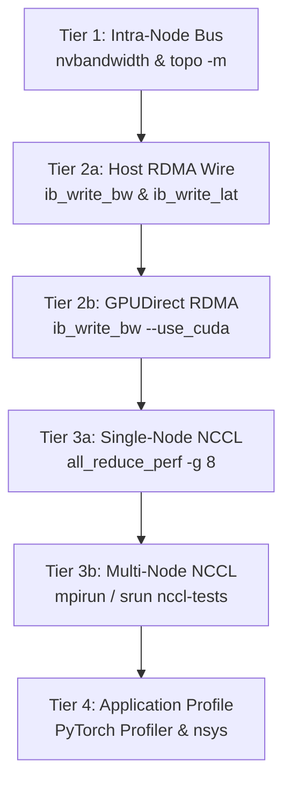
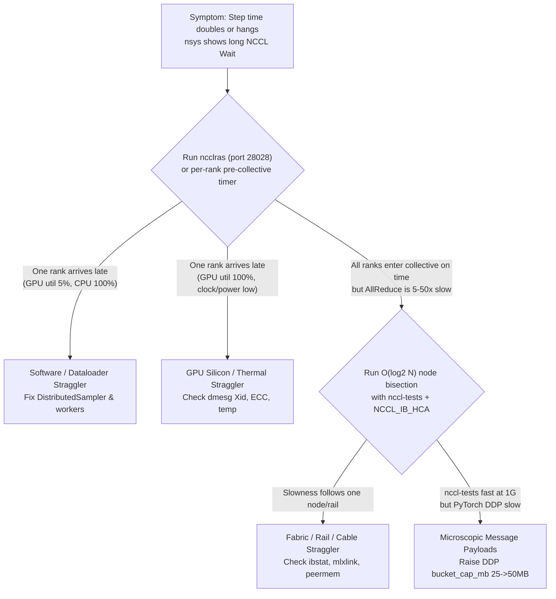

# 12.17 nccl-tests and fabric benchmarking

| | |
|---|---|
| Level | Advanced |
| Priority tier | 1 |
| Lab venue | Nebius GPU |
| Part | Part 12: Complete AI networking |
| Sources | `ai-systems-performance-engineering` (Ch. 4); `distributed-ai-systems` (Ch. 10); `nvidia-devops` (Volume 05 Lab 02, Volume 07 Ch. 10 & Lab 03, Volume 08 Lab 02, Volume 10 Ch. 9 & Deep Dive 3, Volume 13 Ch. 8, Ch. 11 & Lab 02, Volume 20 Straggler Detection) |
| Coverage file | `planning/coverage/chapters/12-17.md` |
| Claim ledger | `planning/ledgers/12-17.md` |

## Why this matters for AI infrastructure

A distributed AI cluster that completes a training job or returns HTTP responses from an inference endpoint is not necessarily operating near its hardware speed of light. When a cluster scales poorly or suffers from storage and network stalls, almost half of the rented accelerators sit idle. They spend their time waiting on collectives or data loaders. Over a multi-week training run, those idle accelerators burn tens of thousands of dollars in wasted cloud compute. On the inference side, evaluating serving engines with fixed synthetic prompts masks real production traffic. Variable prompt lengths and long-context requests push tail latency far above your service-level agreement.

```text
Quantitative impact of unbenchmarked training and inference clusters:
- 64-GPU training job (8 nodes x 8 GPUs, $100,000 of accelerators) at 45% GPU utilization & 52% scaling efficiency:
  Effective compute = 64 * 0.52 = 33.28 (~33) GPUs; wasted compute = 64 - 33.28 = 30.72 (~31) idle GPUs
  Over a 2-week (336-hour) run: 30.72 * 336 = 10,321.92 wasted GPU-hours
  At $4 to $5 per GPU-hour ($4.50/GPU-hr midpoint): $46,448.64 (~$50,000) burned on idle GPUs
- Storage-starved 2-week 64-GPU incident (45% GPU utilization):
  A $50 NVMe SSD upgrade would have prevented $10,000 in wasted GPU time
- Inference serving evaluation (vLLM vs SGLang against a 200 ms P99 SLA):
  Fixed 100-token synthetic prompts miss real production traffic (50 to 5,000 tokens),
  where SGLang radix attention yields 40% higher throughput on shared prefixes,
  and unoptimized tail latency spikes to 500 ms P99 (2.5x the 200 ms P99 SLA)
```

You cannot diagnose a degraded optical transceiver, a PCIe root-complex downtrain, or a missing peer-memory kernel module from inside a full PyTorch model script. High-level frameworks interleave data loading, autograd kernel launches, memory caching allocators, and asynchronous CUDA stream hooks. Instead, an infrastructure engineer isolates the hardware and middleware layers bottom-up. You validate intra-node PCIe and NVLink paths with `nvbandwidth` and raw point-to-point RDMA wires with `perftest`. Next, you benchmark standalone GPU collectives with `nccl-tests`. Only after those three tiers pass do you profile application overlap and scaling efficiency with PyTorch Profiler, NVIDIA Nsight Systems, and `genai-bench`.

## Prerequisites and outcomes

### Prerequisites

You should complete Chapter 12.14 on GPUDirect RDMA and GPUDirect Storage first to understand BAR1 peer memory, `nvidia_peermem`, PCIe Access Control Services, and PIX versus SYS NUMA locality. You also need Chapters 12.15 and 12.16. Those chapters cover Ring, Tree, CollNet/SHARP, NVLS, and PAT algorithms alongside NCCL transport selection across P2P, SHM, NET/IB, and NET/Socket.

### Expected learning outcomes

After completing this chapter, you will be able to execute the three-tier hardware-to-collective validation sequence using `nvbandwidth`, `ib_write_bw`, and `nccl-tests`. That workflow lets you attribute bottlenecks to the exact hardware or software layer. You will derive and verify algorithmic bandwidth and bus bandwidth conversion factors across all six collective families and interpret data-integrity counters. You will isolate a single degraded straggler node across $N$ nodes in $\lceil \log_2 N \rceil$ binary-search bisection steps. You will also combine `NCCL_RUN_DIAGNOSTICS=1` with the `ncclras` daemon to identify hung or lagging ranks. Finally, you will design reproducible training and inference benchmarks with warmup, synchronization barriers, and percentile latency reporting. You will also apply Amdahl's Law scaling analysis and statistical accuracy validation.

---

## 1. The three-tier fabric validation hierarchy (`nvbandwidth`, `perftest`, `nccl-tests`)

When a multi-node job runs 40% to 60% slower than expected, testing the full training script first violates fault-isolation discipline. A single symptom such as slow AllReduce completion can originate from a motherboard PCIe lane failure, a dirty MPO fiber connector, or a missing peer-memory module. It can also stem from a stopped `nvidia-fabricmanager` daemon or fragmented framework gradient buckets. To prove mathematically which layer is responsible, benchmark the stack in four sequential tiers from physical silicon up to the framework.



| Validation Tier | Primary Binary / Tool | Target Subsystem | Healthy Reference Baseline | Diagnostic Failure Signature |
|---|---|---|---|---|
| **Tier 1: Intra-node motherboard & NVLink** | `nvbandwidth -t device_to_host_memcpy_ce`, `nvidia-smi topo -m`, `nvidia-smi nvlink --status` | PCIe Gen5 x16 root complex/switches and intra-node NVLink/NVSwitch fabric | `50–60 GB/s` D2H/H2D on PCIe Gen5 x16 (`64 GB/s` raw); `~25 GB/s` per A100 NVLink3 (`~600 GB/s` total); `900 GB/s` H100 NVLink4; `1.8 TB/s` (`18 x 100 GB/s`) B200 NVLink5 | `25–30 GB/s` D2H indicates PCIe downtrained from `x16` to `x8` (`lspci -vv` `LnkSta`); `PIX` missing or NVLink `< 20 GB/s` or `inactive` |
| **Tier 2a: Physical RDMA wire (Host RAM)** | `ib_write_bw --report_gbits --duration 30`, `ib_write_lat`, `ib_send_lat`, `ibstat`, `mlxlink` | HCA (`mlx5_0..mlx5_7`), optical transceivers, cables, and switch ASICs | `~390 Gbps` (`48.75 GB/s`, `97.5%` of `400G NDR` `50 GB/s` line rate); stable few-microsecond latency (`1–5 µs`) and zero counter deltas | `~195 Gbps` (`~200 Gbps`) indicates link width downtrained (`4x` $\rightarrow$ `2x`) or rate downshift; rising `symbol_error` or `PortXmitWait` |
| **Tier 2b: GPUDirect RDMA wire (GPU HBM)** | `ib_write_bw -d mlx5_0 --use_cuda=0`, `lsmod \| grep nvidia_peermem` | GPU BAR1 to NIC DMA across shared PCIe switch (`PIX`) | Matches Tier 2a (`~385–390 Gbps` on `400G NDR`) when GPU and NIC share a local PCIe switch (`PIX`, same NUMA node) | Host RDMA is `390 Gbps` but `--use_cuda` drops to `80–120 Gbps`: `nvidia_peermem` unloaded, PCIe ACS enabled, or `SYS` cross-socket pairing |
| **Tier 3a: Single-node collectives** | `./build/all_reduce_perf -b 8M -e 8G -f 2 -g 8` | Intra-node NCCL P2P/SHM/NVLS channels and NVSwitch routing | `busbw` approaches NVLink rating at `>= 32 MiB–512 MiB` (e.g., `95.18 GB/s` on PCIe/hybrid baseline; `750–800+ GB/s` on 8x H100 NVSwitch) | `busbw` stuck at `20–90 GB/s` on an NVSwitch node: `nvidia-fabricmanager` down, ACS enabled, or `NCCL_P2P_DISABLE=1` / `NCCL_SHM_DISABLE=1` left set |
| **Tier 3b: Multi-node collectives** | `mpirun` / `srun` `all_reduce_perf`, `all_gather_perf`, `reduce_scatter_perf`, `alltoall_perf` | Multi-rail NCCL rings/trees, SHARP/CollNet, RoCEv2 GID/PFC/ECN | Multi-node `busbw >= 80%` of single-rail-implied or local-node baseline (e.g., `~361.36 GB/s` across `8 x 400G` NDR rails) | Multi-node `busbw` drops to `58.2 GB/s` (`61.15%` of `95.18 GB/s`, failing `80%` gate) or `2.0 GB/s` (`NET/Socket` TCP fallback instead of `NET/IB`) |
| **Tier 4: Framework & application loop** | `torch.profiler`, `nsys profile --trace=cuda,nvtx,osrt`, `ncu`, `TrainingBenchmark` | DDP `bucket_cap_mb` (`25 MB` default), stream overlap, dataloader `num_workers` | `> 80%` GPU utilization, `40%–60%` MFU (`43.48%` / `48%`), `70%–90%+` scaling efficiency, `< 10%` dataloader time | Tiers 1–3 pass at `1 GiB`, but training is `40%` slow: model issues thousands of `256 KB` AllReduce calls (fix `bucket_cap_mb` `25 MB` $\rightarrow$ `50 MB`) |

### Why `iperf3` cannot validate an AI fabric

Engineers accustomed to standard web infrastructure often run `iperf3`, `iftop`, or `nload` when a cluster feels slow, and then wonder why those tools miss the problem. Those utilities are useful only for initial management-network reachability or coarse Ethernet sanity checks. The `iperf3` binary drives packets through the Linux kernel TCP/IP socket stack. It incurs context switches, socket buffer copies, and software interrupts that bottleneck the host CPU cores well before saturating a high-speed AI link. Even if `iperf3` measures 100 Gbps between two nodes while distributed training achieves only 20 Gbps, `iperf3` cannot isolate the cause. It cannot tell you whether the loss comes from host-staged GPU copies, NUMA misalignment, or small-message launch overhead.

For InfiniBand and RoCEv2 fabrics, Tier 2 validation always uses the OpenFabrics `perftest` suite. These binaries post Verbs Work Queue Elements directly to the Host Channel Adapter hardware queues, bypassing the operating system kernel entirely.

```text
Why iperf3 fails on AI fabrics vs RDMA perftest:
- Coarse Ethernet / TCP ceiling: ~100 Gbps (~12.5 GB/s), bottlenecks host CPU cores well below
  200 Gbps (~200 GB/s aggregate multi-rail) or 400 Gbps (50 GB/s per port) RDMA links.
- Ambiguity gap: If iperf3 reports 100 Gbps while training gets 20 Gbps, iperf3 never tests
  RDMA Verbs (WQEs) or GPU BAR1 peer memory.
```

### Reading `nvidia-smi topo -m` and InfiniBand port counters before benchmarking

Launching `ib_write_bw` or `nccl-tests` without checking GPU-to-NIC locality and port states first can corrupt your benchmark before a single packet enters the switch. Suppose you pair a GPU on Socket 0 with an RDMA adapter on Socket 1. Every payload then crosses the CPU inter-socket link before reaching the wire. You must capture the hardware topology and counter baseline on every participating node before starting load tests.

```text
Reference 8-GPU dual-socket H100 SXM node (node-a, node-b) pre-benchmark audit:
- Hardware: 8x H100 80 GB SXM GPUs (NV18: 18 bonded Gen4 NVLinks via NVSwitch)
- NICs:     8x ConnectX-7 (MT4129, firmware 28.39.2048) NDR400 (400 Gb/s = 50 GB/s line rate, mlx5_0..mlx5_7)
- Topology pairings (nvidia-smi topo -m):
  * GPU0 <-> mlx5_0: PIX (single PCIe bridge on NUMA node 0, CPU cores 0-63, 128-191)
  * GPU7 <-> mlx5_7: PIX (single PCIe bridge on NUMA node 1, CPU cores 64-127, 192-255)
  * GPU0 <-> mlx5_7: SYS (crosses PCIe + inter-socket UPI/QPI between NUMA nodes 0 and 1)
- Port state verification (ibstat mlx5_0):
  * Physical state: LinkUp (optical transceiver and cable lock)
  * State: Active (OpenSM assigned Base lid: 7, SM lid: 1, Rate: 400)
  * Failure modes: LinkUp + Initializing = Subnet Manager (sminfo) or P_Key issue;
    Rate: 200 or Rate: 100 on NDR400 = physical lane/speed downshift.
- Counter snapshot (/sys/class/infiniband/mlx5_*/ports/1/counters/*):
  * Data counters climb by billions of 32-bit words: port_rcv_data = 8,823,914,021; port_xmit_data = 8,801,220,117
  * Error counters MUST remain flat (0 delta): symbol_error, link_error_recovery, link_downed,
    port_rcv_errors, local_link_integrity_errors, excessive_buffer_overrun_errors, VL15_dropped.
```

---

## 2. `nccl-tests` architecture, CLI flags, and exact `algbw` versus `busbw` math

When you need to test collective throughput without Python, autograd, or storage overhead, you run `nccl-tests` (`https://github.com/NVIDIA/nccl-tests`). The suite compiles standalone C++ and CUDA binaries for every collective operation, including `sendrecv_perf`, `gather_perf`, `scatter_perf`, and `hypercube_perf`. Each binary allocates device buffers, initializes NCCL communicators, and times collective kernels in a tight loop.

### Core `nccl-tests` CLI flags

| Flag | Parameter Name | Default | Operational Meaning and Sizing Guidance |
|---|---|---|---|
| `-b <bytes>` | `--minbytes` | `32M` | Starting tensor size in bytes (supports suffixes `K`, `M`, `G`, e.g., `-b 8` or `-b 8M`). Sweep from `4 KiB–64 KiB` to expose latency and `128 MiB–8 GiB` to saturate bandwidth. |
| `-e <bytes>` | `--maxbytes` | `32M` | Ending tensor size in bytes (e.g., `-e 128M`, `-e 1G`, `-e 8G`, `-e 10G`). Must be large enough to amortize startup latency (`>= 256 MiB–1 GiB` on NVLink4/5 and multi-rail NDR/XDR). |
| `-f <int>` | `--stepfactor` | `1` (disabled) | Multiplicative step factor between message sizes (typically `-f 2` to double size each row: `8M`, `16M`, `32M`, ..., `1G`). |
| `-g <int>` | `--ngpus` | `1` | Number of GPUs managed **per process/thread**. Use `-g 8` for a single-process 8-GPU local run, or `-g 1` when launching 1 MPI/Slurm process per GPU (`--ntasks-per-node=8`). |
| `-t <int>` | `--nthreads` | `1` | Number of CPU threads per process. Total collective ranks $n = \text\{processes\} \times \text\{threads\} \times g$. |
| `-w <int>` | `--warmup_iters` | `5` | Untimed warmup iterations executed at each message size before starting the CUDA event timer. Increase to `10–20` on large multi-rack fabrics. |
| `-n <int>` | `--iters` | `20` | Timed measurement iterations averaged per row (use `-n 100` for production burn-in and jitter detection). |
| `-c <0\|1\|N>` | `--check` | `1` | Data-integrity verification iteration count (`0` disables checking for fast sweeps; `1` compares collective output against expected math and populates the `#wrong` column). |
| `-d <type>` | `--datatype` | `float` | Element datatype (`int8`, `uint8`, `int32`, `int64`, `half`, `float`, `double`, `bfloat16`, `fp8_e4m3`, `fp8_e5m2`). |
| `-o <op>` | `--op` | `sum` | Reduction operator (`sum`, `prod`, `min`, `max`, `avg`, `all`). |
| `-R <0\|1\|2>` | `--local_register` | `0` | Enables persistent user-buffer registration (`1` = `ncclCommRegister` local, `2` = symmetric `ncclMemAlloc`) to test zero-copy NVLS/SHARP paths. |

### Deriving `algbw` and `busbw` from first principles

Engineers who read `nccl-tests` output for the first time often compare the algorithmic bandwidth column directly against the hardware NIC or NVLink spec sheet. They then falsely conclude that their network is running at half speed. For a collective operating on a buffer of size $S$ bytes that completes in elapsed time $t$ seconds across $n$ ranks, `nccl-tests` reports two distinct bandwidth metrics. Both columns are expressed in decimal gigabytes per second.

First, **algorithmic bandwidth** (`algbw`) measures the apparent rate at which the logical collective tensor size $S$ is processed:

$$\text\{algbw\} = \frac\{S\}\{t\}$$

That ratio divides logical bytes by elapsed seconds. Second, **bus bandwidth** (`busbw`) accounts for the multiple physical hops required to execute a collective across $n$ ranks. It normalizes algorithmic bandwidth by the minimum theoretical per-rank data volume required on an optimal ring topology. That normalization makes bus bandwidth **directly comparable to the hardware's rated physical link speed** regardless of how many GPUs participate in the job.

| `nccl-tests` Binary | Collective Operation | Logical Input $\rightarrow$ Output | Per-Rank Bytes Transferred | Exact `busbw` Conversion Formula | Factor at $n=2$ | Factor at $n=4$ | Factor at $n=8$ | Factor at $n=64$ | Factor at $n=72$ |
|---|---|---|---|---|---|---|---|---|---|
| `all_reduce_perf` | AllReduce | $S$ on each rank $\rightarrow$ reduced $S$ on every rank | $\frac\{2(n - 1)\}\{n\} \cdot S$ | $\text\{busbw\} = \text\{algbw\} \cdot \frac\{2(n - 1)\}\{n\}$ | `1.0000` | `1.5000` | `1.7500` | `1.96875` | `1.972222` (`142/72`) |
| `reduce_scatter_perf` | ReduceScatter | $S$ on each rank $\rightarrow$ reduced $S/n$ shard per rank | $\frac\{n - 1\}\{n\} \cdot S$ | $\text\{busbw\} = \text\{algbw\} \cdot \frac\{n - 1\}\{n\}$ | `0.5000` | `0.7500` | `0.8750` | `0.984375` | `0.986111` (`71/72`) |
| `all_gather_perf` | AllGather | $S/n$ shard per rank $\rightarrow$ gathered $S$ on every rank | $\frac\{n - 1\}\{n\} \cdot S$ | $\text\{busbw\} = \text\{algbw\} \cdot \frac\{n - 1\}\{n\}$ | `0.5000` | `0.7500` | `0.8750` | `0.984375` | `0.986111` (`71/72`) |
| `alltoall_perf` | AllToAll | $n$ distinct $S/n$ chunks exchanged with $n$ peers | $\frac\{n - 1\}\{n\} \cdot S$ | $\text\{busbw\} = \text\{algbw\} \cdot \frac\{n - 1\}\{n\}$ | `0.5000` | `0.7500` | `0.8750` | `0.984375` | `0.986111` (`71/72`) |
| `broadcast_perf` | Broadcast | $S$ on root rank $\rightarrow$ $S$ replicated to $n-1$ ranks | $1.0 \cdot S$ | $\text\{busbw\} = \text\{algbw\} \cdot 1$ | `1.0000` | `1.0000` | `1.0000` | `1.0000` | `1.0000` |
| `reduce_perf` | Reduce | $S$ on each rank $\rightarrow$ reduced $S$ on root rank | $1.0 \cdot S$ | $\text\{busbw\} = \text\{algbw\} \cdot 1$ | `1.0000` | `1.0000` | `1.0000` | `1.0000` | `1.0000` |

Why does AllReduce multiply algorithmic bandwidth by $2(n-1)/n$? A ring AllReduce decomposes into an $(n-1)$-step ReduceScatter pass followed by an $(n-1)$-step AllGather pass. Each pass moves $n-1$ chunks of size $S/n$ per GPU, totaling $2(n-1)$ steps and $\frac\{2(n-1)\}\{n\}S$ bytes transferred per GPU. As the GPU count $n$ grows large, the multiplier approaches 2.0. That means algorithmic bandwidth can never exceed half of the physical bottleneck link bandwidth for a ring AllReduce at scale.

```text
Worked algbw and busbw examples (1 GB/s = 10^9 B/s):
- 400 MB (4e8 B) AllReduce in t = 4.00 ms (0.004 s):
  algbw = 400 MB / 0.004 s = 100.0 GB/s
- Ring AllReduce factor 2(n-1)/n across cluster sizes:
  * n = 2 GPUs:  2(2-1)/2 = 1.0     -> busbw = 1.0 * algbw
  * n = 8 GPUs:  2(8-1)/8 = 14/8 = 1.75 -> every GPU sends/receives 1.75 * S bytes
  * n -> inf:    2(n-1)/n -> 2.0    -> algbw is at most 50% of physical link bandwidth (50 GB/s per 400G NDR NIC or 900 GB/s on H100 NVLink4)
```

### Annotating an `all_reduce_perf` output table

When a benchmark finishes, you need to verify three things. Check that the arithmetic between elapsed time, `algbw`, and `busbw` holds. Confirm that zero elements were corrupted in the `#wrong` column, and verify that multi-node bus bandwidth clears at least 80% of the single-node or per-rail baseline. Consider an eight-GPU `all_reduce_perf` sweep from 8 MiB to 512 MiB alongside single-node and multi-node 1 GiB acceptance checks:

```text
#                                                              out-of-place                       in-place
#       size         count      type   redop    root     time   algbw   busbw #wrong     time   algbw   busbw #wrong
#        (B)    (elements)                               (us)  (GB/s)  (GB/s)            (us)  (GB/s)  (GB/s)
     8388608       2097152     float     sum      -1    412.3   20.35   35.61      0    410.0   20.46   35.81      0
    67108864      16777216     float     sum      -1   1653.1   40.60   71.05      0   1645.0   40.80   71.40      0
   536870912     134217728     float     sum      -1   9871.4   54.39   95.18      0   9820.0   54.67   95.67      0

Row-by-row math verification (float = 4 bytes/element, n = 8 GPUs -> factor = 1.75):
- 8 MiB (8,388,608 B = 4 * 2,097,152 elements) in 412.3 us:
  algbw = 8,388,608 / (412.3 * 1e3) = 20.35 GB/s; busbw = 20.35 * 1.75 = 35.61 GB/s
- 64 MiB (67,108,864 B = 4 * 16,777,216 elements) in 1653.1 us:
  algbw = 67,108,864 / (1653.1 * 1e3) = 40.60 GB/s; busbw = 40.60 * 1.75 = 71.05 GB/s
- 512 MiB (536,870,912 B = 4 * 134,217,728 elements) in 9871.4 us:
  algbw = 536,870,912 / (9871.4 * 1e3) = 54.39 GB/s; busbw = 54.39 * 1.75 = 95.18 GB/s

Single-node and multi-node acceptance gates:
- V5 Lab 02 512 MiB baseline: local single-node = 95.18 GB/s (passes >= 90 GB/s gate).
  80% multi-node gate = 0.80 * 95.18 = 76.14 GB/s. Observed multi-node = 58.2 GB/s (61.15% of local) -> FAIL.
- 1 GiB (1,073,741,824 B) on 8-GPU H100 SXM NVSwitch node (900 GB/s bidir NVLink4) in 2,480.0 us (factor = 1.75):
  algbw = 432.96 GB/s; busbw = 757.68 GB/s
- 1 GiB (1,073,741,824 B) on 8-node (64-GPU) 8x400G NDR IB cluster in 5,850.0 us (factor = 1.96875):
  algbw = 183.55 GB/s; busbw = 361.36 GB/s (~45.17 GB/s per 50 GB/s rail, or 90.34% of line rate)
```

In out-of-place mode, the send buffer and receive buffer are separate GPU allocations. In in-place mode, the reduced output overwrites the input buffer directly, matching PyTorch DDP gradient buckets. Most importantly, the `#wrong` column must be zero on every single row. Any non-zero `#wrong` count means the collective completed but corrupted floating-point values in transit. That corruption stems from faulty HBM, bad SRAM, or broken buffer registration, and invalidates any throughput figure.

---

## 3. Benchmarking methodology, training scaling efficiency, and Amdahl's Law

Moving from standalone microbenchmarks to distributed training benchmarks requires strict statistical discipline. Without proper warmup, synchronization barriers, and sufficient sample counts, lazy kernel compilation or asynchronous CUDA queuing will produce completely fabricated throughput numbers.

### Three rules of reproducible GPU benchmarking

First, always execute untimed warmup iterations before starting your clock. The first execution of a CUDA operation triggers lazy JIT kernel compilation, cuBLAS and NCCL handle initialization, caching-allocator block reservation, and instruction cache population. Second, call `torch.cuda.synchronize()` right before recording the start timestamp and again right before recording the end timestamp. Because CUDA kernel launches and collective calls are asynchronous on the host CPU, omitting synchronization measures Python dispatch latency rather than GPU execution time. Third, run at least one hundred timed iterations and report latency percentiles so you capture thermal drift, background daemon jitter, and fabric congestion.

```text
Reproducible GPU benchmark parameters:
- Warmup iterations:
  * Standard eager PyTorch: 5-10 warmup steps
  * torch.compile or CUDA Graphs: 20-50 warmup steps (covers graph capture and compilation)
- Synchronization:
  * Explicit torch.cuda.synchronize() before start_time and before end_time
- Timed sample size & metrics:
  * >= 100+ timed iterations; report mean, standard deviation, median (P50), P95, and P99
```

### Key distributed training metrics and phase decomposition

When a training run is slow, measuring only total step time hides whether the bottleneck is storage, forward and backward math, or collective communication. A complete `TrainingBenchmark` harness instruments four phases per step: data loading, forward, backward, and optimizer. It pairs those phase timers with three fleet-level efficiency metrics.

First, track aggregate throughput in samples per second or tokens per second across all GPUs. Second, distinguish `nvidia-smi` GPU utilization from Model FLOPs Utilization (MFU). The `nvidia-smi` utility reports only the fraction of time that at least one kernel is active on the device. A GPU spin-waiting inside `ncclKernel_AllReduce` or running tiny unfused kernels still displays 98% to 100% utilization. By contrast, MFU compares useful floating-point operations against the hardware's theoretical peak:

$$\text\{MFU\} = \frac\{6 \times N_\{\text\{params\}} \times \text\{tokens/sec\}}\{\text\{Peak Theoretical FLOPs/sec\}}$$

That equation normalizes throughput by the peak silicon rating. Third, track communication overhead as you scale across nodes. On a single GPU, communication overhead is zero. At 16 GPUs, it can easily consume more than half of the iteration time, explaining why doubling GPUs fails to halve step time.

```text
Training phase rules and MFU / communication benchmarks:
- Throughput to epoch time:
  1,000 samples/sec on a 1,000,000-sample dataset = 1,000 seconds (~16.67 / ~17 minutes) per epoch.
- 70B-parameter model on 8x H100 SXM GPUs (8 * 989 TFLOPS = 7,912 TFLOPS peak BF16):
  * Dataloader-starved (3,200 tokens/sec): 6 * 70e9 * 3,200 = 1,344 TFLOPS -> 16.99% (~17%) MFU
  * Tuned DataLoader + GPU augmentations (9,000 tokens/sec): 3,780 TFLOPS -> 47.78% (~48%) MFU
    (hits the 40%-50% / 40%-60% production target range).
- Phase-level diagnostic thresholds:
  * If data_loading > 10% of step time (and GPU util < 80%, e.g., 30%): increase DataLoader num_workers
    to 2-4x CPU cores per GPU (on a 112-core 2x56 DGX H100 with 14 cores/GPU, set --cpus-per-task=12 or 14)
    and enable pin_memory=True.
  * If backward > 2x to 3x forward: inspect gradient sync stalls, activation recomputation, or fragmentation.
- Communication overhead growth (DAI Fig 10.1):
  * 1 GPU:  155 ms iteration time (0% communication overhead)
  * 16 GPUs: 33 ms iteration time (4.70x speedup, 29.36% efficiency), where communication overhead is 55%
    of the step (18.15 ms communication vs 14.85 ms compute).
```

### Scaling efficiency and Amdahl's Law

To justify adding more nodes to a training job, you must measure **scaling efficiency** $\eta_N$, which quantifies the fraction of ideal linear speedup retained on $N$ GPUs:

$$\eta_N = \frac\{\text\{Throughput\}_N\}\{N \times \text\{Throughput\}_1\} = \frac\{\text\{Speedup\}_N}\{N\}$$

That ratio reveals how much of your multi-node investment delivers useful throughput.

| Scaling Efficiency Band | Operational Rating | Root-Cause Interpretation and Action |
|---|---|---|
| `> 90%` | **Excellent** | Compute dominates; DDP/FSDP communication is almost completely hidden under backward compute (WFBP). |
| `70%–90%` | **Good** | Typical for well-tuned multi-node distributed training; monitor `bucket_cap_mb` and rail balance. |
| `50%–70%` | **Moderate** | Significant communication overhead (`30%–50%` of step); check network topology, SHARP/NVLS, gradient accumulation, or FP8/gradient compression. |
| `< 50%` | **Poor** | Severe bottleneck (`55%+` comm overhead, TCP fallback, straggler rank, or dataloader starvation); halt expansion and run the 3-tier diagnostic ladder. |

Even with infinite network bandwidth, **Amdahl's Law** sets a hard mathematical upper bound on speedup when a fraction $s$ of the iteration is strictly serial and $p = 1 - s$ is parallelizable:

$$\text\{Speedup\}(N) = \frac\{1\}{s + \frac\{1 - s\}\{N\}} \xrightarrow\{N \to \infty\} \frac\{1\}\{s\}$$

Even a small serial fraction caps maximum cluster speedup. Unoverlapped collective barriers, CPU synchronization points, and non-parallelized preprocessing all contribute to the serial fraction $s$.

```text
Scaling efficiency and Amdahl's Law calculations:
- Scaling efficiency example:
  8 GPUs delivering 6.5x single-GPU throughput -> eta_8 = 6.5 / 8 = 81.25% (~81%),
  meaning 18.75% (~20%) is lost to coordination overhead.
  Predicted 16-GPU speedup at 81.25% efficiency = 16 * 0.8125 = 13.0x (~13x instead of 16x).
- Amdahl's Law with a 10% serial fraction (s = 0.10, p = 0.90):
  * Max speedup at infinite GPUs (N -> inf): 1 / 0.10 = 10.0x
  * Max speedup at N = 64 GPUs: 1 / (0.10 + 0.90 / 64) = 8.77x (13.70% scaling efficiency)
```

---

## 4. Isolating stragglers, silent fallbacks, and hung collectives at scale

In synchronous data-parallel (DDP, FSDP, ZeRO) and tensor or expert-parallel training, every collective is a global barrier. A thousand-GPU cluster runs at the exact speed of its slowest rank. When a single GPU throttles thermally, starves on a CPU dataloader thread, or hits a degraded network rail, the other 999 GPUs spin inside `ncclKernel_AllReduce` waiting for that one rank to arrive.



| Isolation Branch | Primary Diagnostic Evidence | Root Cause | Remediation |
|---|---|---|---|
| **Software / Dataloader Straggler** | Pre-collective timer shows GPU `2` takes `1,250.5 ms` vs `124.8–126.1 ms` on GPUs `0, 1, 3` (`10.02x` ratio); `nvidia-smi dmon` shows GPU `2` at `5%` SM util / `40 W` while peers are at `96%–98%` / `315–320 W` | Unequal batch distribution, missing `DistributedSampler`, or single-threaded CPU audio/image decompression pinning one host core at `100%` | Enforce equal per-rank batch sizes with `DistributedSampler`, increase `num_workers`, and bind NUMA cores cleanly |
| **GPU Silicon / Thermal Straggler** | `DCGM_FI_PROF_PIPE_TENSOR_ACTIVE` on one GPU is `> 0.15` (`15` percentage points) below node average while `DCGM_FI_DEV_GPU_UTIL > 80%`; `clocks_event_reasons.hw_slowdown` is `Active` | Thermal throttling (cooling loop degradation dropping MFU from `45%` to `28%` over hours), row-remap/ECC faults, or `Xid 48`/`74`/`79` | Drain node via Slurm Epilog/NHC, inspect `dmesg` and `nvidia-smi -q -d TEMPERATURE,CLOCK`, and RMA or reseat hardware |
| **Fabric / Rail / NVLink Straggler** | `all_reduce_perf` drops from `800 GB/s` to `90 GB/s` after reboot (`nvidia-fabricmanager` inactive), or `nvidia-smi nvlink --status` shows Link `3` `DEGRADED (5 GB/s)` / `FAILED (0 Mbps)` vs `25 GB/sec`, or one HCA rail has high `PortXmitWait` | Degraded optical transceiver, loose NVLink/MPO cable, stopped `nvidia-fabricmanager`, or `NET/Socket` fallback (`2.0 GB/s` vs `100.0 GB/s`) | Restart `nvidia-fabricmanager`, isolate rail with `NCCL_IB_HCA=mlx5_x:1`, run `O(\log_2 N)` node bisection, and cordon faulty node |
| **Microscopic Message Payloads** | `ib_write_bw` hits `400 Gbps` (`~390 Gbps`) and `all_reduce_perf` hits expected `busbw` at `1 GiB`, but 8-node PyTorch training is `40%` slower than calculated | Model has thousands of tiny layers issuing `256 KB` AllReduce calls where per-message handshake latency dominates wire bandwidth | Increase PyTorch DDP `bucket_cap_mb` from the `25 MB` (`25 MiB`) default to `50 MB` and verify kernel coalescing in Nsight Systems (`nsys`) |

### Why post-collective timers lie—and how to instrument pre-collective arrival

A classic beginner mistake when hunting stragglers is recording `iter_end = time.time()` *after* `dist.all_reduce(loss)`. Because `all_reduce` is a barrier, fast ranks block inside the collective until the straggler arrives. That barrier makes total step time look identical across every rank in the cluster. To expose a compute or dataloader straggler, synchronize the GPU with `torch.cuda.synchronize()` and record each rank's timestamp **immediately before** entering the collective. You can also inspect `torch.distributed.monitored_barrier` and `ncclras`.

```text
Pre-collective vs post-collective timing on a 4-GPU node:
- Post-collective timestamp (after dist.all_reduce):
  All 4 ranks report ~1,250.5 ms (hides the straggler completely).
- Pre-collective timestamp (after torch.cuda.synchronize(), before dist.all_reduce):
  * Rank 0: 125.3 ms (96-98% SM util, 315-320 W)
  * Rank 1: 126.1 ms (96-98% SM util, 315-320 W)
  * Rank 2: 1,250.5 ms (5% SM util, 40 W -> 10.02x slower than Rank 3's 124.8 ms)
  * Rank 3: 124.8 ms (96-98% SM util, 315-320 W)
  Ranks 0, 1, and 3 simply spent ~1,125 ms waiting inside AllReduce for Rank 2.
```

### Active NCCL diagnostics and the `ncclras` daemon

When a large job hangs or starts with a broken NVLink pair, digging through thousands of log files across hundreds of nodes wastes hours. Modern NCCL releases provide two built-in diagnostic mechanisms that pinpoint faulty hardware and lagging ranks directly.

First, setting `NCCL_RUN_DIAGNOSTICS=1` in NCCL 2.31 and later runs active hardware and topology verification checks during `ncclCommInitRank` before any user workload starts. Rank 0 prints diagnostic lines where passing checks log `[OK]` and anomalies log `[INFO]`. That check catches broken GPU peer-to-peer links immediately at startup. Second, NCCL 2.24 and later run a background Reliability, Availability, and Serviceability thread (`ncclras`) inside each process. Those threads form a peer keep-alive mesh listening on a local TCP port. When a job hangs, you connect to the daemon from any node in the job. It returns a live per-communicator table showing which ranks have lagging collective sequence numbers or dead processes.

```text
Active NCCL diagnostics and ncclras specifications:
- Init-time active diagnostics (NCCL_RUN_DIAGNOSTICS=1, introduced in NCCL 2.31+):
  Prints NCCL DIAG [OK] / [INFO] from rank 0 during ncclCommInitRank.
  Example anomaly on an 8-GPU node (8 * 7 = 56 directed P2P pairs):
  "p2p: only 52/56 GPU-to-GPU peer accesses passed verification"
- Live RAS daemon (ncclras, introduced in NCCL 2.24+):
  Listens on localhost:28028 by default (configurable via NCCL_RAS_ADDR).
  * Status = MISMATCH ("Communicator ranks have different collective operation counts"):
    Lists operation sequence numbers and names the exact lagging ranks (GPU index, PID, hostname).
    Query twice a few seconds apart to confirm operation counts are static rather than in flight.
  * Status = INCOMPLETE:
    Identifies a dead or unresponsive rank (process crash or NVRM: Xid 79 GPU fallen off bus)
    while routing around the dead peer to return the summary.
- Watchdog distinction:
  "Watchdog caught collective operation timeout" / "watchdog thread terminated" is raised by PyTorch's
  ProcessGroupNCCL wrapper (TORCH_NCCL_* and TORCH_FR_BUFFER_SIZE / TORCH_NCCL_TRACE_BUFFER_SIZE flight recorder),
  NOT by NCCL itself (NCCL_WATCHDOG_DUMP does not exist in NCCL).
```

```bash
# (untested here) Query the live NCCL RAS subsystem on port 28028 during a hung job
ncclras -v
echo verbose status | nc localhost 28028
```

### Binary-search node bisection and per-rail isolation

When `all_reduce_perf` across $N$ nodes is slow because all ranks enter the collective on time, one node likely has a degraded NIC, cable, or PCIe switch. Testing all $N$ nodes one by one takes far too long. Running $\binom\{N\}\{2\}$ pairwise tests is even worse. Instead, you use **binary-search bisection** to isolate the bad node in logarithmic time.

First, split the $N$ nodes into two halves of $N/2$ nodes and run `all_reduce_perf` on each half. Second, whichever half exhibits the degraded `busbw` contains the straggler node. The other half is proven healthy and provides a known-good reference partner when a subset eventually shrinks to a single node. Third, repeat by halving the suspect group until a single node is isolated in $\lceil \log_2 N \rceil$ split steps. Once the suspect node is isolated, test each of its InfiniBand rails individually. Restrict `NCCL_IB_HCA` or run `ib_write_bw` per rail alongside `ibdiagnet` and `perfquery`.

```text
Binary-search node bisection step counts (ceil(log2 N) split steps, ceil(log2 N) + 1 total runs):
- N = 8 nodes:   ceil(log2 8)   = 3 split steps (4 total runs)
- N = 64 nodes:  ceil(log2 64)  = 6 split steps (7 total runs vs 64 linear runs, saving 58 runs)
- N = 128 nodes: ceil(log2 128) = 7 split steps (8 total runs vs 128 linear runs, saving 121 runs)
- Per-rail isolation on suspect node:
  Test NCCL_IB_HCA==mlx5_0:1, then =mlx5_1:1, ..., =mlx5_7:1 (8 rails) or ib_write_bw -d mlx5_<k> alongside perfquery -x <lid>.
```

---

## 5. Profiling tools (`torch.profiler`, `nsys`, `NCCL_PROFILER_PLUGIN`), inference benchmarking (`genai-bench`), and accuracy validation

Once the physical fabric and `nccl-tests` pass their acceptance gates, any remaining performance gap lives inside the application runtime. At this level, compute kernels, communication streams, memory allocators, and serving schedulers interact directly.

### PyTorch Profiler, NVIDIA Nsight Systems, and the `NCCL_PROFILER_PLUGIN` API

When training throughput falls short despite healthy hardware, start with **PyTorch Profiler** (`torch.profiler`) for phase-level visibility. Configure `record_function` labels with CPU and CUDA activities, shape recording, memory profiling, and call stacks enabled. For multi-iteration training jobs, use `torch.profiler.schedule` with TensorBoard or export `trace.json` for Chrome tracing. In the operator table sorted by total CUDA time, compute kernels appear as `aten::matmul` and `aten::linear`. Collective communication overhead appears as `nccl:all_reduce` and `nccl:all_gather`.

When you need microsecond-accurate hardware timelines across multiple CUDA streams, host OS threads, and NICs, move to **NVIDIA Nsight Systems** (`nsys`):

```bash
# (untested here) Capture CUDA kernels, NVTX ranges, and OS runtime events
nsys profile --trace=cuda,nvtx,osrt --output=training_profile.nsys-rep python train.py
nsys stats --report gputrace training_profile.nsys-rep
```

In an unoptimized synchronous loop, `nsys` shows a strict two-phase split. All backward compute kernels execute before `ncclDevKernel_AllReduce` launches, leaving compute SMs idle during communication. With PyTorch DistributedDataParallel wait-free backpropagation, `nsys` shows a sawtooth pipeline instead. The `ncclDevKernel_AllReduce` kernel on the background communication CUDA stream overlaps with backward compute on the default stream. You must also avoid `nn.DataParallel`, which suffers from Python GIL contention and GPU 0 gradient gathering. Finally, remove accidental `torch.cuda.synchronize()`, `.item()`, or `print()` calls inside the step loop that destroy stream overlap.

```text
PyTorch Profiler configuration and Nsight Systems overlap benchmarks (ASP Ch. 4):
- PyTorch Profiler settings:
  activities=[ProfilerActivity.CPU, ProfilerActivity.CUDA], record_shapes=True, profile_memory=True, with_stack=True
  torch.profiler.schedule(wait=2, warmup=2, active=4, repeat=1) with tensorboard_trace_handler or chrome://tracing
- Serial vs overlapped 3-layer step (train_no_overlap fc3/fc2/fc1 vs DDP WFBP with default 25 MB / 25 MiB buckets):
  * Serial:     10.0 ms backward compute + 12.0 ms AllReduce = 22.0 ms total step time
  * Overlapped: ~12.0 ms total step time (45.45% faster; compute hidden under communication)
- Standard multi-layer overlap benchmark (ASP Table 4-2):
  * Unoverlapped: 100.0 ms step time, 60% SM utilization, 0% overlap
  * Overlapped:   70.0 ms step time, 90% SM utilization (30.0% faster, ~50% communication covered by compute)
- Single-process nn.DataParallel (DP) vs multi-process DistributedDataParallel (DDP):
  * Batch [512, 1024] split into two [256, 1024] shards:
    DP = 45.00 ms/step vs DDP = 30.00 ms/step (33.33% faster with DDP)
```

To give profilers such as PyTorch Kineto hierarchical visibility into internal NCCL proxy and network events without high CUPTI overhead, NCCL exposes the dynamic **`NCCL_PROFILER_PLUGIN`** interface. When loaded via `NCCL_PROFILER_PLUGIN=<lib>`, the plugin configures a 32-bit event activation mask covering group, collective, point-to-point, and proxy operations. It implements five C callbacks:

| `NCCL_PROFILER_PLUGIN` Callback | Lifecycle Stage | Operational Role |
|---|---|---|
| 1. `init` | Communicator startup | Initializes the profiler context and returns the active `32`-bit event mask |
| 2. `startEvent` | Collective / proxy start | Receives an event descriptor and allocates an opaque event handle |
| 3. `stopEvent` | Collective / proxy end | Marks event completion and recycles handle resources |
| 4. `recordEventState` | In-flight transitions | Tracks fine-grained state transitions across proxy queues and RDMA completions |
| 5. `finalize` | Communicator teardown | Releases profiler resources when the communicator is destroyed |

### Understanding percentile latencies and LLM inference metrics

In production inference serving, reporting only average latency hides severe service-level agreement violations. Suppose 95% of requests finish quickly, while 5% hit long-context KV-cache stalls or garbage collection pauses. The mean latency looks healthy, yet your P99 tail latency violates the SLA by a wide margin. Always plot the Cumulative Distribution Function and report P50 for median behavior, P95 for standard SLA targets, and P99 for worst-case user experience.

Autoregressive LLM inference requires five distinct engineering metrics. **Time to First Token** (`TTFT`) measures elapsed time from request arrival through tokenization, compute-bound prompt prefill, first token generation, and detokenization. **Inter-Token Latency** (`ITL`), also called **Time per Output Token** (`TPOT`), measures the average time between consecutive generated tokens during the memory-bandwidth-bound decode phase. **End-to-End Request Latency** (`e2e_latency`) combines both phases across all generated tokens:

$$\text\{e2e\_latency\} = \text\{TTFT\} + (\text\{output\_tokens\} - 1) \times \text\{ITL\}$$

That formula separates initial prefill responsiveness from streaming decode speed. Finally, **Tokens per Second** (`TPS`) measures token generation throughput, while **Requests per Second** (`RPS`) measures end-to-end API request capacity. Disaggregated prefill-and-decode inference across nodes and racks, such as NVIDIA Dynamo, avoids synchronous NCCL collectives for KV cache movement. Instead, point-to-point KV cache transfers use **NVIDIA NIXL** over UCX, GPUDirect RDMA, and IBGDA.

```text
Inference percentile SLA comparison, e2e_latency math, and NIXL benchmarks:
- Average vs P99 SLA (200.0 ms P99 SLA target):
  * System A: 100.0 ms mean, uniform 90.0-110.0 ms range (P50 = 100.0 ms, P95 = 109.0 ms, P99 = 110.0 ms) -> PASSES 200 ms SLA
  * System B: 80.0 ms mean (95% at 57.89 ms, 5% at 500.0 ms -> P50 = 57.89 ms, P95 = 57.89 ms, P99 = 500.0 ms) -> FAILS 200 ms SLA by 2.5x.
  * A 10x P99/P50 ratio (e.g., P50 = 50 ms, P99 = 500 ms) signals queueing contention, fragmentation, or cold-cache spikes.
- e2e_latency breakdown with TTFT = 45.0 ms and ITL = 10.0 ms:
  * Short 16-token output (10-20 token regime): 45.0 + 15 * 10.0 = 195.0 ms (decode = 150.0 ms; TTFT is 23.08% of total time)
  * Long 201-token output: 45.0 + 200 * 10.0 = 2,045.0 ms (decode = 2,000.0 ms or 97.80% of total time; TTFT is 2.20%)
- NVIDIA NIXL disaggregated KV-cache transfer API and speedups (1 MiB to 100 GB payloads):
  * API lifecycle: nixlAgent, registerMem, trim, prepXfer, postXfer, checkXfer, releaseReqH, deregisterMem
  * Up to 14x TTFT speedup from KV cache offloading on PCIe x86 H100 systems
  * Additional 2x TTFT speedup on Grace Hopper (GH200) over 900 GB/s NVLink-C2C
  * Up to 30x higher inference throughput on a ~680B LLM across a 72-GPU Blackwell GB200 NVL72 rack (130 TB/s NVSwitch, < 1 us latency)
```

### Workload-realistic inference benchmarking (`genai-bench`), cold starts, and reasoning models

Benchmarking an inference server such as vLLM, SGLang, TensorRT-LLM, or NVIDIA NIM by sending identical short prompts in a constant-concurrency loop misses three critical production behaviors. First, real traffic follows variable prompt and completion length distributions, which you should model using `genai-bench` across a concurrency matrix. Second, the first request after model load suffers a severe cold-start penalty from JIT kernel compilation, weight paging, and KV cache allocation. You must benchmark cold and warm paths separately to configure autoscaler minimum warm instances. Third, chain-of-thought reasoning and multi-step agentic models interleave multiple LLM calls with external tool, vector database, and API calls. Those external requests often dominate total session time.

```text
Workload-realistic inference benchmarking parameters (DAI Ch. 10):
- genai-bench (pip install genai-bench) traffic distributions:
  * D(100,100): deterministic 100-input / 100-output tokens for controlled baseline comparisons
  * D(512,512) and variable distributions (10 to 10,000 tokens): expose non-linear KV-cache pressure and prefix caching
- Cold start vs warm decode slowdowns:
  * Small models (1-3B):  3-5x slower on cold start
  * Mid-size LLMs:        ~16x slower on cold start
  * Large 70B+ models:    50x+ slower on cold start (30 s cold start vs 100 ms warm request = 300x)
- Multi-step reasoning & agentic workflows:
  * 60% or more of total end-to-end session latency comes from external tool/API/database calls rather than GPU inference.
```

### Validating distributed training and inference accuracy

Performance optimizations that silently corrupt model quality are regressions, not speedups. In distributed training, bugs in gradient reduction scaling such as omitting division by `world_size` leave training loss curves looking normal while downstream test accuracy drops sharply. Altered effective batch sizes under gradient accumulation or FP8 underflow cause similar silent degradation. In inference serving, aggressive INT8 or FP4 quantization can double token throughput while degrading math or coding accuracy. Two serving engines can also diverge due to sampling or kernel accumulation order.

Always compare distributed training and quantized inference against a trusted baseline on standardized evaluation suites. Apply a statistical significance test to separate random seed noise from real regressions.

```text
Statistical accuracy validation thresholds and suites (DAI Ch. 10):
- Standardized evaluation suites:
  GLUE / SuperGLUE, MMLU, HumanEval (Pass@k), HELM, BLEU, ROUGE, BERTScore, F1, NVIDIA NeMo Evaluator
- Unchecked optimization failure modes:
  * Distributed training synchronization / batch-scaling bug: 8% downstream test accuracy drop despite normal loss curve
  * Aggressive INT8 / FP4 quantization: 2x TPS throughput gain, but 15% accuracy drop on math/code benchmarks
- Hypothesis testing (t-test / bootstrap on held-out evaluation set):
  * 0.5% accuracy delta with p = 0.3 (p > 0.05): random run-to-run noise (PASS accuracy parity)
  * 0.5% accuracy drop with p = 0.001 (p < 0.05): statistically significant numerical regression (FAIL CI/CD gate)
```

---

## Commands and configurations that matter

### 1. Tier 1 & Tier 2: Intra-node `nvbandwidth` and point-to-point RDMA `perftest`

Run these commands to verify GPU-to-NIC PCIe topology, PCIe Gen5 x16 copy bandwidth, and InfiniBand port states. Then measure host-memory RDMA wire speed and GPUDirect RDMA BAR1 bandwidth before launching any collective test.

```bash
# (untested here) Tier 1: Inspect GPU-NIC locality, NVLink status, and PCIe Gen5 x16 copy bandwidth
nvidia-smi topo -m
nvidia-smi nvlink --status
nvbandwidth -t device_to_host_memcpy_ce

# (untested here) Snapshot InfiniBand port state and error counters before load
ibstat mlx5_0
rdma link show
for dev in /sys/class/infiniband/*/ports/*/counters; do
  echo "### $dev"
  grep -H . "$dev"/* 2>/dev/null
done > counters-before.txt

# (untested here) Tier 2a: Host-memory RDMA latency and bandwidth pinned to local NUMA node 0
# On node-a (server):
numactl --cpunodebind=0 --membind=0 ib_write_lat -d mlx5_0 -i 1 -a
numactl --cpunodebind=0 --membind=0 ib_write_bw -d mlx5_0 -i 1 --report_gbits --duration 30
# On node-b (client):
numactl --cpunodebind=0 --membind=0 ib_write_lat -d mlx5_0 -i 1 -a <node-a-ip>
numactl --cpunodebind=0 --membind=0 ib_write_bw -d mlx5_0 -i 1 --report_gbits --duration 30 <node-a-ip>

# (untested here) Tier 2b: GPUDirect RDMA bandwidth from GPU 0 BAR1 memory via nvidia_peermem
lsmod | grep -Ei 'nvidia_peermem|rdma'
# On node-a (server) and node-b (client):
ib_write_bw -d mlx5_0 --use_cuda=0 --report_gbits --duration 30 -a
ib_write_bw -d mlx5_0 --use_cuda=0 --report_gbits --duration 30 -a <node-a-ip>
```

### 2. Tier 3: Building and launching `nccl-tests` (`mpirun` and Slurm `sbatch`/`srun`)

Compile `nccl-tests` with MPI support so you can sweep message sizes across both single-node and multi-node communicators with active init-time diagnostics enabled.

```bash
# (untested here) Build nccl-tests with MPI support for multi-node collective sweeps
git clone https://github.com/NVIDIA/nccl-tests.git
make -C nccl-tests MPI=1 MPI_HOME=/usr/mpi/gcc/openmpi-4.1.7a1 CUDA_HOME=/usr/local/cuda

# (untested here) Tier 3a: Single-node 8-GPU AllReduce sweep from 8 B to 8 GiB
./nccl-tests/build/all_reduce_perf -b 8 -e 8G -f 2 -g 8 -w 5 -n 50 -c 1

# (untested here) Tier 3b: Multi-node 2-node (16-GPU) mpirun launch with transport verification
export NCCL_DEBUG=INFO
export NCCL_DEBUG_SUBSYS=INIT,NET,GRAPH,TUNING
export NCCL_NET=IB
export NCCL_SOCKET_IFNAME=^docker,lo
export NCCL_RUN_DIAGNOSTICS=1

mpirun -np 16 -H node-a:8,node-b:8 \
  -x NCCL_DEBUG -x NCCL_DEBUG_SUBSYS -x NCCL_NET -x NCCL_SOCKET_IFNAME -x NCCL_RUN_DIAGNOSTICS \
  ./nccl-tests/build/all_reduce_perf -b 8M -e 1G -f 2 -g 1 -w 5 -n 100 -c 1
```

### 3. Production Slurm `sbatch` job for 4-node (32-GPU) 8-rail NDR400 `all_reduce_perf`

In a Slurm cluster, this batch script binds one task per GPU with 12 CPU cores per task and pins all eight ConnectX-7 InfiniBand rails for a 1 GiB to 10 GiB burn-in sweep.

```bash
#!/bin/bash
# (untested here) Slurm multi-node PMIx nccl-tests burn-in across 8 ConnectX-7 NDR400 rails
#SBATCH --job-name=nccl_ib_test
#SBATCH --nodes=4
#SBATCH --ntasks-per-node=8
#SBATCH --gpus-per-node=8
#SBATCH --cpus-per-task=12
#SBATCH --exclusive
#SBATCH --time=00:30:00

export NCCL_NET=IB
export NCCL_IB_HCA=mlx5_0:1,mlx5_1:1,mlx5_2:1,mlx5_3:1,mlx5_4:1,mlx5_5:1,mlx5_6:1,mlx5_7:1
export NCCL_SOCKET_IFNAME=^docker,lo
export NCCL_P2P_DISABLE=0
export NCCL_SHM_DISABLE=0
export NCCL_ASYNC_ERROR_HANDLING=1
export TORCH_NCCL_ASYNC_ERROR_HANDLING=1

srun --mpi=pmix /shared/nccl-tests/build/all_reduce_perf \
    -b 1G -e 10G -f 2 -g 1 -c 1 -w 10 -n 100
```

---

## How it fails

Use this fault matrix during cluster bring-up or incident response to connect `nccl-tests`, `ib_write_bw`, and PyTorch symptoms to their exact hardware or configuration fix.

| Failure Mode | Observable Symptom in Logs / Metrics | Root-Cause Mechanism | Deterministic Fix & Verification |
|---|---|---|---|
| **1. Silent fallback to Gloo or `NET/Socket` TCP** | `all_reduce_perf` or DDP training runs without crashing, but `400 MB` AllReduce takes `200.00 ms` (`2.0 GB/s`) instead of `4.00 ms` (`100.0 GB/s`, a `50x` slowdown); CPU hits `100%` | Container lacks `/dev/infiniband` access, `NCCL_IB_DISABLE=1` was left set, or process group initialized with `backend="gloo"` instead of `backend="nccl"` | Pass `--device=/dev/infiniband`, set `NCCL_NET=IB` (so NCCL fails fast rather than falling back to sockets), set `backend="nccl"`, and verify `NCCL INFO Using network IB` |
| **2. GPUDirect RDMA host bounce-buffer fallback** | Host `ib_write_bw` reaches `~390 Gbps` on `400G NDR`, but `ib_write_bw --use_cuda=0` and multi-node `all_reduce_perf` drop to `58.2 GB/s` (`61.15%` of `95.18 GB/s`) or lower | `nvidia_peermem` module not loaded, PCIe ACS (`SrcValid+`, `ReqRedir+`) enabled on PCIe switch, container GID mismatch, or rank bound to `SYS` cross-socket NIC | Load `nvidia_peermem` (`modprobe nvidia_peermem`), disable PCIe ACS per platform guidance, let `NCCL_IB_GID_INDEX=AUTO` (`2.32u1+`), and bind `PIX` GPU-NIC pairs |
| **3. Leftover debug flags (`NCCL_P2P_DISABLE=1` / `NCCL_SHM_DISABLE=1`) or dead `nvidia-fabricmanager`** | Single-node `all_reduce_perf -g 8` on an H100 NVSwitch node drops from `~800 GB/s` (`950` tokens/sec) to `90 GB/s` (`310` tokens/sec) after a node reboot or debugging session | `nvidia-fabricmanager` failed to start after reboot, or an engineer left `NCCL_P2P_DISABLE=1` or `NCCL_SHM_DISABLE=1` in the shell environment | Enable and restart `nvidia-fabricmanager` (`systemctl restart nvidia-fabricmanager`), `unset NCCL_P2P_DISABLE NCCL_SHM_DISABLE`, and verify `NV18` in `nvidia-smi topo -m` |
| **4. Per-iteration communicator re-initialization** | A 1-element `dist.all_reduce` takes `48.5 ms` per step (`48.0 ms` init/destroy + `0.5 ms` collective), or creating `32` communicators takes `2–3` minutes instead of `2–3` seconds | Calling `init_process_group` / `destroy_process_group` or `new_group()` inside the training loop triggers all-to-all TCP handshakes and buffer allocations every step | Initialize process groups and sub-communicators (`ncclGroupStart` / `ncclCommInitRank` / `ncclGroupEnd`) once before the loop, cutting step time by `98.97%` (`48.5 ms` $\rightarrow$ `0.5 ms`) |
| **5. Bootstrap interface hang, port exhaustion, or `memlock` QP failure** | Job hangs at `ncclCommInitRank` or prints `NCCL WARN Call to connect returned Connection timed out` or `Call to ibv_create_qp / ibv_reg_mr failed` | NCCL picked an unroutable bridge (`docker0`), ephemeral TCP ports were exhausted, or Linux `memlock` limit blocked RDMA pinned memory registration | Set `NCCL_SOCKET_IFNAME=^docker,lo` (or `=ib0`), widen `/proc/sys/net/ipv4/ip_local_port_range` (`50000 51000`), and set `memlock unlimited` in `/etc/security/limits.conf` (`ulimit -l`) |
| **6. Microscopic DDP buckets & UCX/RDMA allocator fragmentation** | `ib_write_bw` (`390 Gbps`) and `nccl-tests` (`1 GiB`) pass, but training is `40%` slow; or `torch.cuda.memory_reserved()` climbs `0.800 GB` $\rightarrow$ `1.040 GB` $\rightarrow$ `1.240 GB` while `memory_allocated()` is `0.000 GB` | Model issues thousands of `256 KB` AllReduce calls (latency-bound); or varying `40 MB`/`200 MB` tensors fragment PyTorch's caching allocator and exhaust UCX registration pools | Increase DDP `bucket_cap_mb` from `25 MB` to `50 MB`; pre-allocate static buffers or register persistent user buffers with `ncclCommRegister` / `ncclMemAlloc` (`-R 1` / `-R 2`) |

---

## Hands-on lab

The deterministic companion lab consists of `code/part12/nccl_tests_benchmarking.py` and `code/part12/nccl_tests_benchmarking_lab.py` and runs anywhere using the Python 3 standard library only. It verifies self-checks covering `algbw` and `busbw` math across all six collective families, `all_reduce_perf` table parsing, and `#wrong` integrity checks. It also tests the three-tier bottleneck attribution engine and $\lceil \log_2 N \rceil$ binary-search straggler bisection. Finally, it checks distributed training scaling efficiency and LLM inference latency percentile SLA evaluation.

```bash
python3 -B code/part12/nccl_tests_benchmarking_lab.py
```

Expected output verified in this workspace:

```text
=== Chapter 12.17 Lab: nccl-tests and Fabric Benchmarking ===
  [PASS] All 6 nccl-tests collective families (all_reduce, reduce_scatter, all_gather, alltoall, broadcast, reduce) are supported
  [PASS] AllReduce busbw factor 2*(n-1)/n equals 1.0 (n=2), 1.5 (n=4), 1.75 (n=8), 1.96875 (n=64), 142/72=1.972222 (n=72)
  [PASS] ReduceScatter, AllGather, and AllToAll busbw factor (n-1)/n equals 0.5 (n=2), 0.875 (n=8), 63/64=0.984375 (n=64)
  [PASS] Broadcast and Reduce busbw factor equals 1.0 for any n >= 2 (and 0.0 for n == 1)
  [INFO] V5 Lab 02 8-GPU all_reduce_perf rows: 8MiB -> algbw=20.35, busbw=35.61; 64MiB -> algbw=40.6, busbw=71.05; 512MiB -> algbw=54.39, busbw=95.18 GB/s
  [PASS] V5 Lab 02: 8 MiB (8,388,608 B) in 412.3 us on 8 GPUs -> algbw = 20.35 GB/s, busbw = 35.61 GB/s
  [PASS] V5 Lab 02: 64 MiB (67,108,864 B) in 1653.1 us on 8 GPUs -> algbw = 40.60 GB/s, busbw = 71.05 GB/s
  [PASS] V5 Lab 02: 512 MiB (536,870,912 B) in 9871.4 us on 8 GPUs -> algbw = 54.39 GB/s, busbw = 95.18 GB/s
  [PASS] Single-node 8x H100 SXM (NVLink 4, 900 GB/s): 1 GiB (1,073,741,824 B) in 2480.0 us -> algbw = 432.96 GB/s, busbw = 757.68 GB/s
  [PASS] Multi-node 64-GPU (8 nodes x 8x400G NDR IB): 1 GiB in 5850.0 us -> algbw = 183.55 GB/s, busbw = 361.36 GB/s
  [PASS] nccl-tests sweep (-b 8M -e 1G -f 2 -g 1 on 8 MPI ranks, -w 5 -n 20) steps through 8 sizes and 400 total collective launches
  [PASS] 13-column all_reduce_perf parser validates #wrong == 0, 0 formula mismatches, and peak busbw = 95.67 GB/s
  [PASS] Parser flags data-corruption failure when #wrong > 0
  [PASS] V7 Ch10 Tier 1: nvbandwidth = 28.0 GB/s (vs 50-60 GB/s PCIe Gen5 x16) isolates downtrained x8 PCIe link
  [PASS] V7 Ch10 Tier 2a: ib_write_bw = 195.0 Gbps (vs 390.0 Gbps on 400G NDR) isolates physical link/optics width degradation
  [PASS] V7 Lab 03 Tier 2b: host RDMA = 390.0 Gbps but --use_cuda = 110.0 Gbps isolates GPUDirect RDMA / peermem / SYS locality
  [PASS] V5 Lab 02 Tier 3b: multi-node 58.2 GB/s vs single-node 95.18 GB/s (61.15% < 80% gate) isolates multi-node NCCL path
  [PASS] V7 Ch10 Tier 4: hardware and nccl-tests pass (88.0 GB/s), but PyTorch DDP is at 32.0 GB/s due to 256 KB fragments (fix bucket_cap_mb 25->50 MB)
  [INFO] Binary-search straggler bisection: N=8 -> 3 splits (dgx-05); N=64 -> 6 splits (dgx-41, saves 58 runs); N=128 -> 7 splits (dgx-093, saves 121 runs)
  [PASS] Binary bisection on N=8 nodes isolates dgx-05 in exactly ceil(log2(8)) = 3 split steps (4 total runs)
  [PASS] Binary bisection on N=64 nodes isolates dgx-41 in ceil(log2(64)) = 6 split steps (7 total runs vs 64 linear runs, saving 58)
  [PASS] Binary bisection on N=128 nodes isolates dgx-093 in ceil(log2(128)) = 7 split steps (8 total runs vs 128 linear runs, saving 121)
  [INFO] DAI Ch10 scaling: 8-GPU eff=81.25%, 64-GPU effective=33.28 GPUs (wasted=30.72 GPUs, $46448.64), 16-GPU iter=33.0ms (18.15ms comm)
  [PASS] DAI Ch10: 6.5x speedup on 8 GPUs yields 81.25% scaling efficiency and predicts 13.0x speedup on 16 GPUs
  [PASS] DAI Ch10: 64 GPUs at 52% scaling efficiency yields 33.28 (~33) effective GPUs and 30.72 (~31) wasted GPUs ($46,448.64 / ~$50k over 336 h at $4.50/GPU-hr)
  [PASS] DAI Ch10 Fig 10.1: Iteration time drops 155 ms (1 GPU, 0% comm) -> 33 ms (16 GPUs, 55% comm = 18.15 ms comm + 14.85 ms compute, 4.70x speedup)
  [PASS] DAI Ch10 Amdahl's Law: 10% serial work bounds max speedup to 10.0x at infinite GPUs (8.77x at 64 GPUs)
  [PASS] DAI Ch10 e2e_latency = TTFT + (output_tokens - 1) * ITL: 16 tokens -> 45 + 15*10 = 195.0 ms; 201 tokens -> 45 + 200*10 = 2045.0 ms
  [PASS] DAI Ch10 System A (100 ms mean, P99 = 110 ms <= 200 ms SLA) passes SLA while System B (80 ms mean, 5% at 500 ms -> P99 = 500 ms = 2.5x SLA) fails
  [PASS] Invalid collective name raises FabricBenchmarkError

Summary: 27 passed, 0 failed
```

---

## Common first mistakes

1. **Comparing algorithmic bandwidth instead of bus bandwidth against physical hardware specs:** At $n = 64$ GPUs, AllReduce `busbw` is $1.96875 \times \text\{algbw\}$. Reading `algbw` of 183.55 GB/s and concluding that an 8x400G NDR node is running at under 50% utilization ignores the $2(n-1)/n$ ring multiplier. The actual bus bandwidth is 361.36 GB/s, or 90.34% of line rate.
2. **Judging fabric health from small message sizes or ignoring data-integrity errors:** Small collectives from 8 B to 64 KiB are dominated by kernel launch and network hop latency rather than link bandwidth. Conversely, a high bus bandwidth at 1 GiB with `#wrong > 0` means the fabric or GPU memory is actively corrupting tensors.
3. **Timing asynchronous GPU operations without synchronization or warmup:** Starting or stopping a host timer without `torch.cuda.synchronize()` measures only Python kernel-launch overhead. Including the first 5 to 10 eager steps or 20 to 50 `torch.compile` steps contaminates the benchmark with JIT compilation.
4. **Measuring per-rank iteration time *after* the collective to hunt stragglers:** Because a collective synchronizes all participants, post-collective iteration times look identical across every rank. Always measure the pre-collective compute and dataload arrival time or query `ncclras` on port 28028 to identify the rank that arrived late.
5. **Hard-coding GID index or socket interface names across heterogeneous nodes:** Modern NCCL selects the RoCE GID index dynamically, so hard-coding `NCCL_IB_GID_INDEX=3` breaks nodes whose GID tables differ. Hard-coding `=eth0` also fails when interface names vary across nodes; use prefix exclusion rules such as `^docker,lo` and verify with `show_gids`.
6. **Exceeding the 64-socket limit or thinking socket variables tune InfiniBand RDMA:** The variables `NCCL_SOCKET_NTHREADS` and `NCCL_NSOCKS_PERTHREAD` tune only the NET/Socket TCP transport and are capped at a product of 64 connections per communicator. They have zero effect on InfiniBand or RoCEv2 NET/IB RDMA data paths.

---

## Exercises

1. **Exercise 1 — Algorithmic and Bus Bandwidth Math Across Collective Families:** Using `compute_collective_bandwidths` and the parameters below, compute algorithmic bandwidth in GB/s, the exact conversion factor, and bus bandwidth in GB/s for each of the five collectives at $n = 8$ on the 512 MiB tensor. Repeat the `all_reduce_perf` calculation for the 1 GiB tensor on 8 H100 GPUs over single-node NVSwitch. Then calculate the 1 GiB result across 64 GPUs on 8 nodes of 8x400G NDR InfiniBand.
2. **Exercise 2 — Three-Tier Hardware-to-Collective Fault Attribution:** Using `diagnose_benchmark_tier` on the four commissioning cases below, identify the exact failing tier and root cause for each case.
3. **Exercise 3 — Binary-Search Straggler Bisection:** Using `bisect_straggler_node` on the 64-node cluster below where one node has a degraded optical transceiver, list the exact node-range splits required to isolate the faulty node. State the number of split runs, total runs including the initial full-cluster run, and how many runs are saved compared to 64 sequential single-node removals. Write the HCA filter and `ib_write_bw` commands to isolate which of its 8 ConnectX-7 rails is degraded.
4. **Exercise 4 — Distributed Training Scaling Efficiency, Fleet Waste, and Amdahl's Law:** Using `evaluate_training_scaling_and_waste` and `compute_amdahl_speedup` on the parameters below, compute the 8-GPU speedup, scaling efficiency, and predicted 16-GPU speedup. Next, compute the effective GPU count, wasted GPU count, wasted GPU-hours, and wasted cloud cost in dollars for the 64-GPU run. Finally, compute the 16-GPU speedup, scaling efficiency, and communication versus compute milliseconds per step, plus the Amdahl's Law maximum speedup at 64 GPUs and infinite GPUs.
5. **Exercise 5 — Pre-Collective Straggler Timing, MFU, and Communicator Lifecycle Overhead:** Using the parameters below, explain why post-collective timing fails to identify GPU 2. Compute the max/min imbalance ratio and classify whether GPU 2 has a hardware fault or a software bottleneck. Next, compute the achieved TFLOPS and MFU percentage before and after dataloader tuning on the 70B BF16 model. Finally, calculate the percentage reduction in iteration time when the 48.0 ms communicator initialization is moved outside the step loop.
6. **Exercise 6 — LLM Inference Latency and Percentile SLA Validation:** Using `evaluate_inference_latency_and_sla` on the serving parameters below, compute decode latency, end-to-end latency, and the TTFT percentage share for the short 16-token output and the long 201-token output. Evaluate System A and System B against the 200.0 ms P99 SLA. Explain why System B fails the SLA by 2.5x despite a 20.0 ms lower average latency.

```text
Exercise Input Parameters and Captured Evidence Reference:
- Ex 1 (nccl-tests Math):    (a) n = 8 GPUs, size = 536,870,912 B (512 MiB, 134,217,728 float32 elements), time = 9,871.4 us across
                                 all_reduce_perf, reduce_scatter_perf, all_gather_perf, alltoall_perf, and broadcast_perf.
                             (b) 1 GiB (1,073,741,824 B) all_reduce_perf: 8x H100 NVSwitch in 2,480.0 us vs 64-GPU (8x 8x400G NDR) in 5,850.0 us.
- Ex 2 (3-Tier Attribution): Baselines: nvbandwidth PCIe Gen5 x16 = 50-60 GB/s; ib_write_bw 400G NDR = ~390 Gbps; single-node 512 MiB = 95.18 GB/s (80% gate = 76.14 GB/s).
                             Case A: nvbandwidth = 28.0 GB/s | Case B: nvbandwidth = 56.0 GB/s, host ib_write_bw = 195.0 Gbps
                             Case C: host ib_write_bw = 390.0 Gbps, --use_cuda=0 = 110.0 Gbps, multi-node all_reduce_perf = 24.0 GB/s
                             Case D: single-node = 95.18 GB/s, multi-node = 88.0 GB/s (92.46%), but 8-node PyTorch DDP is 40% slow (32.0 GB/s effective).
- Ex 3 (Node Bisection):     64-node (512-GPU) cluster, full-cluster busbw = 65.0 GB/s vs 360.0 GB/s healthy baseline; faulty node = dgx-41; rails = mlx5_0..mlx5_7.
- Ex 4 (Scaling & Waste):    (a) 1 GPU = 100 samples/sec, 8 GPUs = 650 samples/sec -> predict 16 GPUs.
                             (b) 64 GPUs, 2 weeks (336 hours) at $4.50/GPU-hr ($4-$5/GPU-hr), 52% scaling efficiency (45% GPU util).
                             (c) 1 GPU = 155 ms (0% comm) -> 16 GPUs = 33 ms (55% comm); Amdahl serial fraction s = 10% (0.10) at N = 64 and N -> inf.
- Ex 5 (Straggler & MFU):    (a) 4-GPU pre-collective timings = [125.3, 126.1, 1250.5, 124.8] ms; GPU 2 at 5% SM util (40 W) vs GPUs 0,1,3 at 96-98% (315-320 W).
                             (b) 70B BF16 on 8x H100 SXM (8 * 989 = 7,912 TFLOPS peak): 3,200 tokens/sec before tuning vs 9,000 tokens/sec after tuning (6N FLOPs/token).
                             (c) Per-step init_process_group/destroy_process_group = 48.0 ms around a 0.5 ms all_reduce (48.5 ms total -> 0.5 ms).
- Ex 6 (Inference & SLA):    (a) TTFT = 45.0 ms, ITL = 10.0 ms for 16 output tokens vs 201 output tokens.
                             (b) 200.0 ms P99 SLA: System A (100.0 ms mean, uniform 90-110 ms, P99 = 110.0 ms) vs System B (80.0 ms mean, 95% @ 57.89 ms, 5% @ 500.0 ms).
```

---

## Interview angles

1. **"Why is `iperf3` useless for validating a 400G InfiniBand or RoCEv2 AI cluster, and what exact sequence of tools do you run instead?"**
   The `iperf3` utility exercises the kernel TCP/IP socket stack, which bottlenecks on single-core CPU interrupt and copy overhead well below 400 Gbps. It never tests RDMA Verbs or GPU BAR1 peer memory. Instead, validate in three hardware-isolated tiers before touching PyTorch. Tier 1 uses `nvbandwidth` and `nvidia-smi topo -m` to prove intra-node PCIe Gen5 x16 copy speed and NVLink status. Tier 2 uses `ib_write_bw` and `ib_write_lat` with and without `--use_cuda`. That step proves raw 400G NDR wire speed and GPUDirect RDMA via `nvidia_peermem` on PIX-paired GPU and NIC pairs. Tier 3 uses `nccl-tests` `all_reduce_perf` to prove single-node and multi-node collective bus bandwidth with zero `#wrong` errors.

2. **"In `nccl-tests`, what is the mathematical difference between `algbw` and `busbw`, and why does AllReduce multiply by `2(n-1)/n` while ReduceScatter, AllGather, and AllToAll multiply by `(n-1)/n`?"**
   Algorithmic bandwidth divides the logical tensor size $S$ by elapsed time $t$. In a ring ReduceScatter, AllGather, or AllToAll across $n$ ranks, each rank must send and receive $n - 1$ shards of size $S/n$. That pattern moves $\frac\{n-1\}\{n\}S$ bytes over its physical links. Because a ring AllReduce executes a ReduceScatter followed by an AllGather, each rank moves $\frac\{2(n-1)\}\{n\}S$ bytes. Multiplying `algbw` by that volume factor yields `busbw`, the actual per-rank link bandwidth consumed. You can compare `busbw` directly against the 50 GB/s NIC or 900 GB/s NVLink spec sheet regardless of cluster size.

3. **"An 8-node training job is 40% slower than expected, yet `ib_write_bw` shows 400 Gbps and `all_reduce_perf -b 1G -e 1G` hits full bus bandwidth. How do you explain this to the ML team and fix it?"**
   Both `ib_write_bw` and a 1 GiB `all_reduce_perf` test large, contiguous, bandwidth-dominated payloads. When you profile the PyTorch job with Nsight Systems, you see thousands of tiny, fragmented AllReduce calls such as 256 KB payloads. On small transfers, per-collective launch and network handshake latency dominate wire serialization time. The network is healthy, but the framework is starving it with small messages. Increasing PyTorch DDP `bucket_cap_mb` from the 25 MB default to 50 MB coalesces those micro-transfers into bandwidth-bound buckets.

4. **"A 128-node job hangs or runs at 20% speed. How do you find the offending rank or node without running 128 individual tests?"**
   First, if the job is currently hung on NCCL 2.24 or later, query the built-in RAS daemon via `ncclras -v` on port 28028. Inspect the output for `MISMATCH` to find ranks lagging on collective operation counts or `INCOMPLETE` for dead processes, and sweep kernel logs for Xid errors. Second, if all ranks enter collectives on time but `all_reduce_perf` is slow across the 128 nodes, run binary-search node bisection. Split the candidate node list in half at each step to isolate the bad node in $\lceil \log_2 128 \rceil = 7$ split tests, or 8 total runs. Finally, test its 8 NIC rails individually using `NCCL_IB_HCA`.

---

## Checkpoint questions (20)

<details>
<summary>`&lt;strong>`1. Why must you run `&lt;code>`nvbandwidth`&lt;/code>` and `&lt;code>`ib_write_bw`&lt;/code>` before running `&lt;code>`nccl-tests`&lt;/code>` when troubleshooting a slow cluster?`&lt;/strong>`</summary>

The `nccl-tests` binaries exercise the entire stack simultaneously, including GPU HBM, PCIe switches, peer memory, NICs, cables, switch ASICs, and NCCL algorithms. If `all_reduce_perf` is slow and you skipped Tier 1 and Tier 2, you cannot isolate the fault layer. You cannot tell whether the root cause is a downtrained PCIe Gen5 x8 link, a dirty optical cable, a missing `nvidia_peermem` module, or a software TCP socket fallback.
</details>

<details>
<summary>`&lt;strong>`2. What bandwidth should `&lt;code>`nvbandwidth -t device_to_host_memcpy_ce`&lt;/code>` report on a healthy PCIe Gen5 x16 server, and what does a reading of `&lt;code>`25–30 GB/s`&lt;/code>` indicate?`&lt;/strong>`</summary>

A healthy PCIe Gen5 x16 link has 64 GB/s raw theoretical bandwidth and delivers roughly 50 to 60 GB/s in `device_to_host_memcpy_ce`. A reading of 25 to 30 GB/s indicates that the GPU or riser has downtrained its PCIe link width from x16 to x8 or speed from Gen5 to Gen4. You confirm this by checking `LnkSta` in `lspci -vv`.
</details>

<details>
<summary>`&lt;strong>`3. Why is `&lt;code>`iperf3`&lt;/code>` unsuitable for benchmarking a 400G InfiniBand or RoCEv2 fabric?`&lt;/strong>`</summary>

The `iperf3` tool sends data through the Linux kernel TCP/IP stack. That path incurs socket buffer copies, context switches, and CPU interrupt overhead, bottlenecking on the host CPU well below 400 Gbps. The `perftest` binaries post Verbs work requests directly to the HCA hardware and bypass the OS kernel.
</details>

<details>
<summary>`&lt;strong>`4. In `&lt;code>`nvidia-smi topo -m`&lt;/code>` on an 8-GPU DGX H100 node, what is the difference between `&lt;code>`PIX`&lt;/code>`, `&lt;code>`SYS`&lt;/code>`, and `&lt;code>`NV18`&lt;/code>`?`&lt;/strong>`</summary>

PIX means the GPU and NIC communicate across at most a single PCIe bridge on the same NUMA node. That local path is the required pairing for full-speed GPUDirect RDMA. SYS means traffic between the GPU and NIC must cross the inter-socket CPU link between NUMA nodes 0 and 1. NV18 means the two GPUs are connected via 18 bonded fourth-generation NVLinks through the intra-node NVSwitch fabric at 900 GB/s bidirectional per GPU.
</details>

<details>
<summary>`&lt;strong>`5. In `&lt;code>`ibstat`&lt;/code>`, what does it mean when a port shows `&lt;code>`Physical state: LinkUp`&lt;/code>` but `&lt;code>`State: Initializing`&lt;/code>`?`&lt;/strong>`</summary>

A physical state of LinkUp proves the optical transceiver, laser, and physical cable have established a layer-1 lock with the switch port. A logical state of Initializing instead of Active means the InfiniBand Subnet Manager has not yet assigned an LID or programmed forwarding tables.
</details>

<details>
<summary>`&lt;strong>`6. What is the exact formula for `&lt;code>`algbw`&lt;/code>` and `&lt;code>`busbw`&lt;/code>` in `&lt;code>`nccl-tests`&lt;/code>` for AllReduce, ReduceScatter, AllGather, AllToAll, and Broadcast across $n$ ranks?`&lt;/strong>`</summary>

```text
nccl-tests algbw and busbw formulas across n ranks (tensor size S bytes, time t seconds):
- Algorithmic bandwidth:           algbw = S / t
- AllReduce:                       busbw = algbw * 2(n - 1) / n
- ReduceScatter, AllGather, AllToAll: busbw = algbw * (n - 1) / n
- Broadcast and Reduce:            busbw = algbw * 1
```
</details>

<details>
<summary>`&lt;strong>`7. On an 8-GPU `&lt;code>`all_reduce_perf`&lt;/code>` run, a `&lt;code>`67,108,864`&lt;/code>`-byte (`&lt;code>`64 MiB`&lt;/code>`) collective completes in `&lt;code>`1,653.1 µs`&lt;/code>`. What are `&lt;code>`algbw`&lt;/code>` and `&lt;code>`busbw`&lt;/code>`?`&lt;/strong>`</summary>

```text
64 MiB (67,108,864 B) AllReduce on n = 8 GPUs in t = 1,653.1 us:
- algbw = 67,108,864 B / (1,653.1 * 10^-6 s) = 40.60 GB/s
- Ring factor at n = 8: 2(8 - 1) / 8 = 1.75
- busbw = 40.60 GB/s * 1.75 = 71.05 GB/s
```
</details>

<details>
<summary>`&lt;strong>`8. What do the `&lt;code>`-b`&lt;/code>`, `&lt;code>`-e`&lt;/code>`, `&lt;code>`-f`&lt;/code>`, `&lt;code>`-g`&lt;/code>`, `&lt;code>`-w`&lt;/code>`, `&lt;code>`-n`&lt;/code>`, and `&lt;code>`-c`&lt;/code>` flags control in `&lt;code>`all_reduce_perf`&lt;/code>`?`&lt;/strong>`</summary>

The `-b` flag sets the minimum starting message size in bytes, and `-e` sets the maximum ending message size. The `-f` flag sets the multiplicative step factor between sizes, while `-g` sets the number of GPUs per process or thread. Finally, `-w` sets untimed warmup iterations, `-n` sets timed measurement iterations, and `-c` enables data-integrity verification in the `#wrong` column.
</details>

<details>
<summary>`&lt;strong>`9. What does a non-zero value in the `&lt;code>`#wrong`&lt;/code>` column of `&lt;code>`nccl-tests`&lt;/code>` mean, and how should you respond?`&lt;/strong>`</summary>

The `#wrong` column counts the number of elements whose reduced numerical output failed validation against the expected reduction result when verification is enabled. Any non-zero count indicates silent data corruption from faulty GPU HBM or SRAM, bad PCIe or RDMA transfers, or broken buffer registration. Treat it as a critical correctness failure before evaluating any bandwidth numbers.
</details>

<details>
<summary>`&lt;strong>`10. Host-memory `&lt;code>`ib_write_bw`&lt;/code>` between two nodes measures `&lt;code>`390 Gbps`&lt;/code>`, but `&lt;code>`ib_write_bw --use_cuda=0`&lt;/code>` and multi-node `&lt;code>`all_reduce_perf`&lt;/code>` are 4x slower. What is broken?`&lt;/strong>`</summary>

Because host-memory RDMA at 390 Gbps uses the exact same physical NIC, cable, and switch ports as `--use_cuda=0`, the physical InfiniBand or RoCE fabric is healthy. The bottleneck is in the local GPU-to-NIC GPUDirect RDMA path. Either `nvidia_peermem` is not loaded or PCIe Access Control Services is enabled on the PCIe switch. Otherwise, the test paired a GPU and NIC across different NUMA sockets as SYS instead of PIX.
</details>

<details>
<summary>`&lt;strong>`11. How many benchmark runs are required to isolate a single slow straggler node among `&lt;code>`64`&lt;/code>` nodes using binary-search bisection versus linear testing?`&lt;/strong>`</summary>

Binary-search bisection halves the suspect candidate pool at each step. It requires $\lceil \log_2 64 \rceil = 6$ split steps, or 7 total runs including the initial 64-node test. That approach saves 58 runs compared to 64 sequential single-node exclusion tests.
</details>

<details>
<summary>`&lt;strong>`12. What is the difference between `&lt;code>`NCCL_RUN_DIAGNOSTICS=1`&lt;/code>` and `&lt;code>`ncclras`&lt;/code>`, and which NCCL versions introduced them?`&lt;/strong>`</summary>

The variable `NCCL_RUN_DIAGNOSTICS=1`, introduced in NCCL 2.31, runs active hardware and P2P verification checks during communicator initialization before the workload starts. The `ncclras` utility, introduced in NCCL 2.24 and listening on port 28028, queries the live peer keep-alive daemon during a running or hung job. It reports `MISMATCH` for lagging collective operation counts per rank or `INCOMPLETE` for unresponsive or dead ranks.
</details>

<details>
<summary>`&lt;strong>`13. Why does measuring iteration time immediately after `&lt;code>`dist.all_reduce`&lt;/code>` fail to identify a compute or dataloader straggler?`&lt;/strong>`</summary>

The `dist.all_reduce` call is a synchronous collective barrier across all participating ranks. Fast ranks that finish their forward and backward passes in 125 ms block inside the collective waiting for a slow rank that takes 1,250 ms. That barrier causes every rank to report roughly 1,250 ms afterwards. You must call `torch.cuda.synchronize()` and record timestamps *before* entering the collective.
</details>

<details>
<summary>`&lt;strong>`14. A distributed training job on `&lt;code>`64`&lt;/code>` GPUs has `&lt;code>`52%`&lt;/code>` scaling efficiency over a 2-week (`&lt;code>`336`&lt;/code>`-hour) run at `$4.50`/GPU-hour. How many GPUs and dollars are wasted?`&lt;/strong>`</summary>

```text
64-GPU Fleet Waste Calculation (52% scaling efficiency, 336 hours @ $4.50/GPU-hr):
- Effective GPUs:   64 * 0.52         = 33.28 (~33) GPUs
- Wasted GPUs:      64 - 33.28        = 30.72 (~31) idle GPUs
- Wasted GPU-hours: 30.72 * 336       = 10,321.92 GPU-hours
- Wasted Cost:      10,321.92 * $4.50 = $46,448.64 (~$50,000)
```
</details>

<details>
<summary>`&lt;strong>`15. What is the formula for scaling efficiency, and what does an `&lt;code>`81.25%`&lt;/code>` scaling efficiency at `&lt;code>`8`&lt;/code>` GPUs mean?`&lt;/strong>`</summary>

Scaling efficiency equals $\text\{Throughput\}_N / (N \times \text\{Throughput\}_1)$. An 81.25% scaling efficiency at 8 GPUs means the 8-GPU job achieves $8 \times 0.8125 = 6.5\times$ the throughput of a single GPU instead of 8.0x. The remaining 18.75% of ideal linear throughput is lost to communication and synchronization overhead.
</details>

<details>
<summary>`&lt;strong>`16. According to Amdahl's Law, what is the maximum theoretical speedup on `&lt;code>`64`&lt;/code>` GPUs and on infinite GPUs if `&lt;code>`10%`&lt;/code>` of a training step is strictly serial?`&lt;/strong>`</summary>

With serial fraction $s = 0.10$, the maximum speedup on $N = 64$ GPUs is $\frac\{1\}\{0.10 + 0.90/64\} = 8.77\times$. As $N \to \infty$, the speedup is bounded by $\frac\{1\}\{0.10\} = 10.0\times$ regardless of how many GPUs are added.
</details>

<details>
<summary>`&lt;strong>`17. Why can a GPU show `&lt;code>`99%–100%`&lt;/code>` utilization in `&lt;code>`nvidia-smi`&lt;/code>` while achieving only `&lt;code>`17%–22%`&lt;/code>` Model FLOPs Utilization (`&lt;code>`MFU`&lt;/code>`)?`&lt;/strong>`</summary>

The `nvidia-smi` GPU utilization metric only reports the percentage of sampling intervals during which *at least one* CUDA kernel was active on the device. A GPU spinning inside an `ncclKernel_AllReduce` wait loop or executing thousands of small, memory-bound kernels still registers 100% `nvidia-smi` utilization. Meanwhile, its Tensor Cores sit mostly idle. Verify true compute efficiency via MFU and Nsight Compute (`ncu --metrics sm__throughput.avg.pct_of_peak_sustained_elapsed`).
</details>

<details>
<summary>`&lt;strong>`18. How do `&lt;code>`TTFT`&lt;/code>` and `&lt;code>`ITL`&lt;/code>` (`&lt;code>`TPOT`&lt;/code>`) combine to determine end-to-end LLM inference latency (`&lt;code>`e2e_latency`&lt;/code>`), and which dominates for short versus long outputs?`&lt;/strong>`</summary>

End-to-end latency equals $\text\{TTFT\} + (\text\{output\_tokens\} - 1) \times \text\{ITL\}$. For short outputs of 10 to 20 tokens, TTFT covers prompt tokenization and compute-bound prefill and represents a large share of total latency. For long outputs of 100 or more tokens, memory-bandwidth-bound autoregressive decode accounts for 90% to 98% of total request latency.
</details>

<details>
<summary>`&lt;strong>`19. Why is reporting only average latency dangerous for inference SLAs, and what do `&lt;code>`P50`&lt;/code>`, `&lt;code>`P95`&lt;/code>`, and `&lt;code>`P99`&lt;/code>` represent?`&lt;/strong>`</summary>

Average latency masks high-latency outliers. A system with an 80 ms average where 5% of requests take 500 ms has a P99 of 500 ms, violating a 200 ms P99 SLA by 2.5x. The P50 median represents typical request behavior, P95 is the standard operational SLA target, and P99 captures worst-case tail latency experienced by 1% of requests.
</details>

<details>
<summary>`&lt;strong>`20. When comparing model accuracy between a single-GPU baseline and a distributed training or quantized inference run, how do you distinguish random variance from a real regression?`&lt;/strong>`</summary>

Evaluate both models on the same held-out benchmark across multiple seeds or samples and run a statistical significance test. A small accuracy delta of 0.5% with a high $p$-value of $p = 0.3$ is consistent with random noise. The same 0.5% drop with $p = 0.001$ proves a statistically significant numerical or synchronization regression.
</details>

---

## Sources and review notes

The primary book corpus and `nvidia-devops` sources cited in this chapter are summarized below along with verification notes.

```text
Primary Sources Cited:
1. Book Corpus (~/Desktop/books-toon-rag):
   - Distributed AI Systems (distributed-ai-systems), Chapter 10: Distributed Benchmarking and Performance Optimization
     ($100,000 GPUs, 200 ms vs 500 ms 2.5x P99 SLA, 64 GPUs across 8 nodes at 45% utilization and 52% scaling efficiency =
     33 effective GPUs / 31 wasted GPUs over 336 hours = ~$50,000 at $4-$5/GPU-hr, $50 SSD saving $10,000, vLLM vs SGLang
     50-5,000 tokens 40% radix attention gain, System A 100 ms [90-110 ms] vs System B 80 ms [5% at 500 ms], 81.25% scaling
     efficiency at 8 GPUs [6.5x] -> 13x at 16 GPUs, 20 GB free / 10 GB fragmentation, warmup 5-10 eager vs 20-50 torch.compile,
     100+ iterations, 1,000 samples/sec on 1M samples = ~17 min, 155 ms [1 GPU, 0% comm] -> 33 ms [16 GPUs, 55% comm],
     torch.profiler, nsys, TrainingBenchmark, NVLink ~600 GB/s / IB ~200 GB/s / Ethernet ~12.5 GB/s, iperf3 100 Gbps vs 20 Gbps,
     Amdahl 10% serial = 10x max, TTFT/ITL/TPOT/TPS/RPS, genai-bench D(100,100) & D(512,512), cold start 3-5x / 16x / 50x+
     [30 s vs 100 ms], 60%+ external agent latency, and accuracy validation 8% drop / 15% INT8 drop / 0.5% at p = 0.3 vs p = 0.001).
   - AI Systems Performance Engineering (ai-systems-performance-engineering), Chapter 4: Tuning Distributed Networking Communication
     (/var/folders/5k/hkmswyf95w5b0y7_xc87ddf80000gn/T/opencode/asp_ch4.txt: 10 ms + 12 ms = 22 ms vs 12 ms overlap, 100 ms [60% SM]
     -> 70 ms [90% SM, 30% faster, 50% overlap], 25 MB bucket_cap_mb WFBP, DP 45.00 ms vs DDP 30.00 ms [33% faster], Gloo 200.00 ms
     [2.0 GB/s] vs NCCL 4.00 ms [100.0 GB/s] on 400 MB / 800G IB, 48.0 ms repeated init_process_group + 0.5 ms = 48.5 ms -> 0.5 ms
     [98.97% reduction], 64 socket limit, UCX 0.800 -> 1.040 -> 1.240 GB fragmentation, Llama 3 405B 54-day 419 interruptions,
     NCCL_PROFILER_PLUGIN 5 callbacks, SHARP 2x-5x / 1/(n-1) / 7.6x NVLink small-message speedup, and NIXL 14x / 2x / 30x Dynamo
     680B NVL72 throughput).

2. nvidia-devops Notes (~/Documents/GitHub/nvidia-devops/docs):
   - nvidia-zero-to-hero/volume-07/chapter-10-performance-bottlenecks-and-benchmarking.md (nvbandwidth 50-60 GB/s vs 25-30 GB/s
     downtrained PCIe Gen5, ib_write_bw ~390 Gbps on 400G NDR vs iperf3, nccl-tests all_reduce_perf, and 256 KB DDP fragment fix
     bucket_cap_mb 25 MB -> 50 MB).
   - nvidia-zero-to-hero/volume-07/labs/lab-03-benchmark-rdma-and-gpudirect-paths.md (8x H100 MT4129 FW 28.39.2048 mlx5_0..mlx5_7
     NDR400, PIX vs SYS topology, ibstat Base lid: 7 / SM lid: 1 / Rate: 400, counter snapshots 8,823,914,021 / 8,801,220,117, and
     mpirun all_reduce_perf -b 8M -e 1G -f 2 -g 1).
   - nvidia-zero-to-hero/volume-08/labs/lab-02-benchmark-infiniband-bandwidth-and-latency.md (numactl NUMA-pinned ib_write_lat and
     unidirectional/bidirectional ib_write_bw across leaf, spine, and rail pairs).
   - nvidia-zero-to-hero/volume-05/labs/lab-02-validate-dgx-data-and-network-paths.md (fio 3103 MiB/s read / 3099 MiB/s write,
     all_reduce_perf rows at 8 MiB [412.3 us, 20.35 / 35.61 GB/s], 64 MiB [1653.1 us, 40.60 / 71.05 GB/s], and 512 MiB [9871.4 us,
     54.39 / 95.18 GB/s], and multi-node 58.2 GB/s [61% of local, failing 80% gate]).
   - volume-10/09-job-provisioning-health-gating-and-orchestration-masterclass.md & volume-10/15-mpi-nccl-and-fabric-joint-debugging.md
     (NCCL_NET=IB, srun --mpi=pmix all_reduce_perf -b 1G -e 10G -f 2 -g 1 -c 1 -n 100, NCCL_RUN_DIAGNOSTICS=1 52/56 P2P check,
     ncclras port 28028, memlock unlimited, Cumulus RoCE DSCP 26/48 PFC 3, and DCGM_FI_PROF_PIPE_TENSOR_ACTIVE > 0.15 straggler alert).
   - nvidia-zero-to-hero/volume-13/chapter-08-nccl-collectives-and-communication-paths.md, chapter-11-performance-engineering-and-troubleshooting.md,
     labs/lab-02-benchmark-nccl-collectives.md, and nvidia-zero-to-hero/volume-20/20-multi-gpu-imbalance-and-straggler-detection.md
     (800 GB/s -> 90 GB/s post-reboot nvidia-fabricmanager drop, 70B H100 MFU 3,200 tokens/sec [17%] -> 9,000 tokens/sec [48%], and
     pre-collective straggler timings [125.3, 126.1, 1250.5, 124.8] ms = 10.02x).
```

### Inferences and verification notes

- Multi-GPU and multi-node shell commands such as `nvbandwidth`, `ib_write_bw`, `all_reduce_perf`, `mpirun`, `srun`, `ncclras`, and `nsys` are marked `untested here`. This authoring workspace does not have physical H100 or Blackwell GPUs or InfiniBand HCAs attached.
- All mathematical formulas, `all_reduce_perf` table rows, three-tier bottleneck attributions, and $\lceil \log_2 N \rceil$ straggler bisections are verified by `python3 -B code/part12/nccl_tests_benchmarking_lab.py`. That script also verifies all scaling efficiency, fleet waste, and inference percentile SLA calculations.

