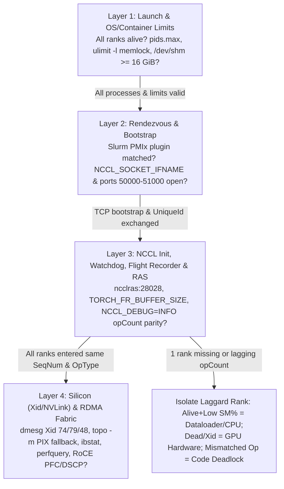
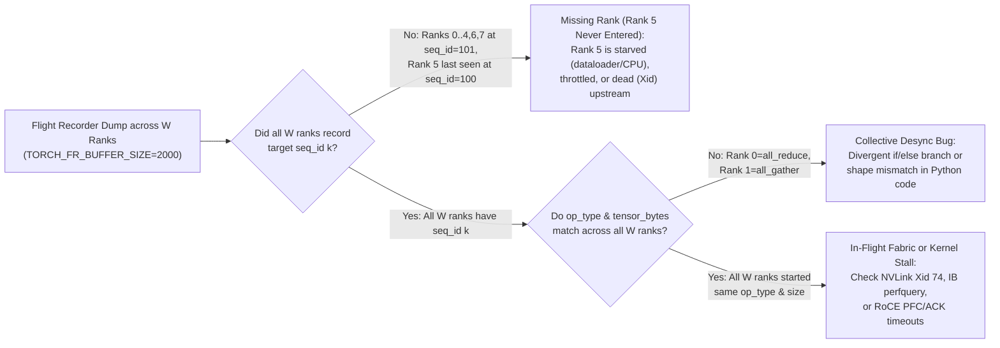

# 12.18 NCCL debugging: hangs, timeouts and errors

| | |
|---|---|
| Level | Advanced |
| Priority tier | 1 |
| Lab venue | Nebius GPU |
| Part | Part 12: Complete AI networking |
| Sources to use | V20; ASP 4; VL10 ch15 |
| Coverage file | `planning/coverage/chapters/12-18.md` |
| Companion code | `code/part12/nccl_debugging_hangs.py` · `code/part12/nccl_debugging_hangs_lab.py` |

## Why this matters for AI infrastructure

A collective timeout exception is the most frequently misdiagnosed error in distributed AI infrastructure. Synchronous collectives such as AllReduce, ReduceScatter, AllGather, and Broadcast enforce barrier semantics across all participating GPUs. Consequently, the ranks that print the timeout exception are almost always the healthy ranks. They arrived at the collective on time and waited until the process-group watchdog timer expired. The actual fault lies on the single rank that never entered the collective, died with a hardware Xid error, or stalled behind a degraded physical link.

```text
Typical PyTorch ProcessGroupNCCL watchdog timeout exception:
[Rank 0] Watchdog caught collective operation timeout: WorkNCCL(SeqNum=4821, OpType=ALLREDUCE, NumelIn=268435456, NumelOut=268435456, Timeout(ms)=600000) ran for 600082.45 milliseconds before timing out.
```

Large-scale production pretraining runs demonstrate why fast root-cause isolation is critical. During the 54-day pretraining run of Llama 3 405B across 16,384 H100 GPUs, the cluster experienced 419 unexpected interruptions. Nearly every single-device fault or single-link failure surfaced to the training framework as a cluster-wide NCCL collective hang or abort.

| Metric or Failure Scenario | Observed Value or Breakdown | Operational Impact |
|---|---|---|
| Llama 3 405B 54-day run on 16,384 H100 GPUs | 419 unexpected interruptions over 1,296 hours | Mean time between interruptions `MTBI` of 3.09 hours (`54 * 24 / 419`) |
| GPU hardware fault share | 268 interruptions (`64.0%` of 419 total) | Faulty GPUs (`148`, `30.1%`), HBM3 (`72`, `17.2%`), SRAM (`19`, `4.5%`), GSP (`17`, `4.1%`), SDC (`6`, `1.4%`), thermal (`6`, `1.4%`) |
| Software, network, and host share | Software bugs `54` (`12.9%`), switches/cables `35` (`8.4%`), host maintenance `32` (`7.6%`), NICs `7` (`1.7%`), watchdog `7` (`1.7%`) | 49 interruptions (`11.7%`) across switches/cables, NICs, and unclassified watchdog timeouts combined (`42` or `10.0%` switch+NIC) |
| CPU-staged Gloo vs NCCL on 800 Gb/s (`100 GB/s`) InfiniBand | 400.0 MB (`100M` floats) AllReduce: `4.00 ms` (`100.0 GB/s`) on NCCL vs `200.00 ms` (`2.0 GB/s`) on Gloo | 50x slowdown with near-100% host CPU utilization when Gloo is used by mistake |
| Repeated `dist.init_process_group` and `dist.destroy_process_group` in loop | `48.0 ms` handshake/buffer overhead added to a `0.5 ms` 1-element AllReduce (`48.5 ms` vs `0.5 ms` initialized once) | `98.97%` iteration-time reduction when communicator initialization is moved outside the training loop |
| Single degraded NVLink lane or storage straggler | `184,213` CRC and `92,104` replay errors (`Xid 74`, PIX PCIe fallback on GPU 2 to GPU 3) or `47.31 s` batch fetch on a `96%`-full (`480G / 500G`) volume with `4.56x` shard imbalance (`187G` vs `41G`) | Inflates one GPU step time from `124.8 ms` to `1,250.5 ms` (`10.02x` straggler ratio) or triggers a cluster-wide timeout |

Even when a training job does not crash, silent communication fallbacks and lifecycle mistakes can destroy cluster throughput. Initializing a CPU-staged Gloo backend instead of NCCL or recreating communicators inside the training step wastes almost all available accelerator capacity. A single degraded NVLink lane or an imbalanced storage shard can similarly stall an entire multi-node job. This chapter builds a deterministic, four-layer debugging methodology that spans process launch limits, bootstrap rendezvous, runtime Flight Recorder and RAS telemetry, and hardware Xid and fabric correlation.

---

## Prerequisites and outcomes

### Prerequisites
- Understanding of NCCL collective primitives, algorithms, and protocols from Chapter 12.15.
- Familiarity with NCCL topology detection, channel allocation, transports, and environment variables from Chapter 12.16.
- Working knowledge of RDMA RoCEv2 and InfiniBand fabrics, congestion control, and switch telemetry from earlier chapters in Part 12.

```text
Prerequisite technical baseline:
- Collectives: AllReduce, ReduceScatter, AllGather, Broadcast, Reduce, AllToAll
- Algorithms and protocols: Ring, Tree, NVLS, CollNet, PAT; LL, LL128, Simple
- Topology and transports: nvidia-smi topo -m (PIX, PHB, SYS, NV#); P2P, SHM, NET/IB, NET/Socket
- Fabric telemetry: RoCEv2 UDP 4791, PFC/ECN/DCQCN, DSCP 26 and DSCP 48; InfiniBand ibstat, perfquery, ibdiagnet, SHARP (Chapters 12.2-12.14)
```

### Outcomes
After completing this chapter, you will be able to:
1. Execute the four-layer joint debugging ladder across OS launch limits, bootstrap rendezvous, watchdog telemetry, and hardware Xid and RDMA fabric counters.
2. Decode `ncclResult_t` error codes from zero to six and calculate container `/dev/shm` memory requirements to prevent `ncclSystemError` under default container limits.
3. Configure and analyze PyTorch ProcessGroupNCCL watchdog and Flight Recorder ring buffers, RAS on port 28028, active diagnostics, and the five-callback profiler plugin API.
4. Diagnose all six multinode communication pitfalls and all six NCCL communicator lifecycle and environment gotchas, including Gloo fallbacks and UCX memory fragmentation.
5. Correlate NCCL hangs and stragglers across the hardware stack using the three-tier Xid classification, asymmetric NVLink error counters, and layer-by-layer timing.

---

## 1. The Four-Layer Debugging Ladder and the Llama 3 405B Reliability Baseline

### 1.1 Why Multi-Node Hangs Mislead Engineers—and the Empirical Reality at 16,384-GPU Scale

When a distributed training job stalls, every GPU in the cluster exhibits the same outward symptom. Utilization either drops to zero or stays pinned at full capacity inside a spin-wait kernel until a timeout kills the job. Operators who immediately blame the network switches waste hours chasing healthy links. Four distinct subsystems can produce this exact same cluster-wide stall:

1. **Slurm or Kubernetes Launch and OS Limits:** A rank failed to spawn due to cgroup process limits, could not pin RDMA memory under a restrictive memlock limit, or ran out of POSIX shared memory.
2. **Process-Management and TCP Bootstrap Rendezvous:** Ranks started on all nodes, but NCCL selected an unreachable local bridge interface or exhausted ephemeral TCP ports during communicator initialization.
3. **Application, Framework, or Collective Execution:** Ranks initialized cleanly, but one rank is starved upstream by a slow dataloader, took a divergent conditional branch in Python, or left a parameter unused in DistributedDataParallel.
4. **GPU Silicon, NVLink, or RDMA Fabric Hardware:** One rank suffered an unrecoverable GPU Xid fault, an NVLink lane degraded and fell back to PCIe, or an InfiniBand or RoCEv2 switch port dropped packets.

Meta's 54-day pretraining run of Llama 3 405B on 16,384 H100 GPUs quantifies why systematic triage is mandatory at scale. Across that entire run, the job experienced 419 unexpected interruptions, corresponding to one interruption every 3.09 hours on average.

| Component | Category | Interruption Count | % of Interruptions (`419` Total) | Operational Signature in `NCCL` & System Logs |
|---|---|---|---|---|
| **Faulty GPU** | GPU | `148` | `30.1%` | `Xid 79` (fallen off bus), `Xid 61`/`62` (microcontroller halt), `ncclUnhandledCudaError=1` or peer `ncclRemoteError=6` |
| **GPU HBM3 memory** | GPU | `72` | `17.2%` | `Xid 48` (double-bit UEC), `Xid 94`/`95` (contained/uncontained ECC), `Xid 63`/`64` (row remap event/failure) |
| **Software bug** | Dependency | `54` | `12.9%` | Rank collective desync, OOM, or `ncclInvalidUsage=5` / `ncclInvalidArgument=4` |
| **Network switch/cable** | Network | `35` | `8.4%` | `SymbolErrorCounter` / `LinkDownedCounter` rising, `local_ack_timeout_err`, all ranks stuck on identical `SeqNum` |
| **Host maintenance** | Unplanned Maintenance | `32` | `7.6%` | Node reboot/drain; `INCOMPLETE` row in `ncclras` and `ncclRemoteError=6` on surviving peers |
| **GPU SRAM memory** | GPU | `19` | `4.5%` | L1/L2/register file uncorrectable parity/ECC fault (`nvidia-smi -q -d ECC`) |
| **GPU system processor** | GPU | `17` | `4.1%` | GSP firmware timeout (`Xid 119`/`120`); `nvidia-smi` hangs on affected host |
| **NIC** | Host | `7` | `1.7%` | ConnectX HCA PCIe/firmware fault (`mlx5_core` error in `dmesg`, `ibstat` `Down`) |
| **NCCL watchdog timeouts** | Unknown | `7` | `1.7%` | `ProcessGroupNCCL` watchdog fired (`WorkNCCL` timeout) without an obvious single hardware counter |
| **Silent data corruption** | GPU | `6` | `1.4%` | NaN/loss spike without Xid; caught by deterministic replay or per-GPU validation checks |
| **GPU thermal interface and sensor** | GPU | `6` | `1.4%` | `HW Thermal Slowdown` (`1,980 MHz` $\rightarrow$ `1,833 MHz` or lower at `>= 85°C`), creating a `10x` straggler |
| **SSD** | Host | `3` | `0.7%` | Local NVMe read stall starving dataloader on one rank (`SM util = 2%`, `opCount` lagging) |
| **Power supply** | Host | `3` | `0.7%` | PSU brownout / `HW Power Brake Slowdown` (`300 W` $\rightarrow$ `200 W` cap) |
| **Server chassis** | Host | `2` | `0.5%` | Chassis fan/management fault (`ipmitool sdr type Fan`) |
| **IO expansion board** | Host | `2` | `0.5%` | PCIe switch (`PIX`/`PXB`) link width/speed downgrade (`Gen5 x16` $\rightarrow$ `Gen3 x8`) |
| **Dependency** | Dependency | `2` | `0.5%` | External service / storage mount hang |
| **CPU** | Host | `2` | `0.5%` | Host CPU machine check exception (MCE) or lockup |
| **System memory** | Host | `2` | `0.5%` | Host DDR5 EDAC error or kernel panic |

Two operational lessons stand out from those 419 interruptions. First, GPU silicon and memory faults caused 268 interruptions, which is 64.0% of the total. That outnumbers network switch, cable, and NIC failures by more than 6.3x. Second, because collectives are synchronous barriers, a hardware fault on a single GPU blocks the other 16,383 GPUs inside `ncclAllReduce` until the watchdog aborts the job.

```text
Fleet barrier amplification in Llama 3 405B:
- GPU silicon + memory faults: 148 + 72 + 19 + 17 + 6 + 6 = 268 interruptions (64.0%)
- Network switch/cable + NIC faults: 35 + 7 = 42 interruptions (10.0%), ratio = 6.38x (more than 6.3x)
- Single-GPU blast radius: 1 / 16,384 GPUs = 0.0061% of the fleet stalls the remaining 16,383 GPUs
```

### 1.2 The Four-Layer Joint Debugging Ladder

Walking a strict bottom-up diagnostic ladder prevents teams from inspecting spine switches when a container bridge or a starved dataloader is actually to blame. You verify each layer in order and advance only after confirming the current layer is clean.



| Layer | Core Diagnostic Question | Fast Verification Command (`(untested here)`) | Signature of Failure at This Layer |
|---|---|---|---|
| **Layer 1: Launch & Limits** | Did every rank start with required OS/container limits? | `srun --jobid=<id> --ntasks-per-node=1 bash -c 'echo "$(hostname): procs=$(pgrep -fc python3) memlock=$(ulimit -l) shm=$(df -h /dev/shm \| tail -1)"'` | Missing rank process (`pids.max`), `ibv_reg_mr`/`ibv_create_qp failed` (`memlock`), or `Error 28: No space left on device` on `/dev/shm/nccl-*` (`ncclSystemError=2`) |
| **Layer 2: Rendezvous** | Did all ranks exchange bootstrap addresses? | `srun --mpi=list`; check `NCCL_SOCKET_IFNAME=^docker,lo` and `/proc/sys/net/ipv4/ip_local_port_range` (`50000 51000`) | Hang inside `init_process_group` / `ncclCommInitRank` before any collective runs; `connect() timed out` on unreachable `docker0`/`virbr0` subnet |
| **Layer 3: `NCCL` & Framework** | Which transport was chosen, and which rank is behind on `opCount` / `seq_id`? | `ncclras -v` (`localhost:28028`), `TORCH_FR_BUFFER_SIZE=2000`, `NCCL_DEBUG=INFO NCCL_DEBUG_SUBSYS=INIT,COLL,GRAPH,ENV`, `NCCL_RUN_DIAGNOSTICS=1` | `MISMATCH` (`opCount 4820` vs `4821`) or `INCOMPLETE` in `ncclras`; Flight Recorder shows rank $k$ never entered `seq_id`; fallback to `NET/Socket` or `Gloo` |
| **Layer 4: Silicon & Fabric** | Did a GPU throw an `Xid`, drop an `NVLink`, or suffer RDMA packet loss/PFC pause? | `dmesg -T \| grep -i xid`; `nvidia-smi topo -m`; `dcgmi nvlink -e`; `ibstat`; `perfquery -x`; `rdma statistic`; `ethtool -S <nic>`; `nv show qos roce` | `Xid 79`/`48`/`95` in `dmesg`; `PIX` where `NV12`/`NV18` expected (`Xid 74`); `SymbolErrorCounter`, `local_ack_timeout_err`, or `rnr_nak_retry_err` rising |

---

## 2. `ncclResult_t` Error Codes (`0..6`), `/dev/shm` Exhaustion, and Layer 1–2 Bootstrap Failures

### 2.1 Complete `ncclResult_t` Error Taxonomy (`0..6`)

When an unrecoverable fault occurs and NCCL aborts rather than hanging silently, the runtime returns an explicit status code. Misreading this code causes engineers to route application bugs to the network team or hardware failures to software developers.

NCCL defines seven standard `ncclResult_t` completion codes from 0 to 6, plus `ncclInProgress=7` for non-blocking operations still in flight. Each code maps to a specific C enum name, a human-readable string from `ncclGetErrorString()`, and a distinct originating subsystem.

| `ncclResult_t` Code | Enum Name | `ncclGetErrorString()` Log String | Originating Subsystem | Concrete Root Causes | Immediate Triage Action |
|---|---|---|---|---|---|
| **`0`** | `ncclSuccess` | `"no error"` | None | Operation succeeded | None |
| **`1`** | `ncclUnhandledCudaError` | `"unhandled cuda error"` | CUDA Runtime / GPU Driver | Asynchronous CUDA kernel fault on the same stream/device (`Xid 13` illegal instruction, `Xid 31` MMU page fault, `Xid 43` command processor hang, `Xid 48`/`94`/`95` uncorrectable ECC, `Xid 79` GPU fell off bus) or `CUDA_ERROR_OUT_OF_MEMORY` prior to `NCCL` launch | Sweep `dmesg -T \| grep -i xid` on all nodes; rerun with `CUDA_LAUNCH_BLOCKING=1` to attribute the exact failing kernel before `NCCL` |
| **`2`** | `ncclSystemError` | `"unhandled system error"` | Linux OS / Container / Verbs / NVML | `/dev/shm` exhaustion (`Error 28: No space left on device` when `NCCL` allocates `/dev/shm/nccl-*` under Docker/K8s `64 MiB` default), `ulimit -l` `memlock` ceiling (`Call to ibv_create_qp failed` / `ibv_reg_mr failed`), socket port exhaustion, or fatal `NVLink`/`PCIe` link error | Check `df -h /dev/shm` (mount `>= 16 GiB`), verify `ulimit -l` is `unlimited`, inspect `NCCL WARN` lines immediately above the abort |
| **`3`** | `ncclInternalError` | `"internal error"` | `NCCL` Internal State / P2P / Version Mismatch | Running PyTorch's bundled `NCCL` against a mismatched system `libnccl.so`, corrupted internal proxy ring state, broken P2P BAR1 mapping, or passing an invalid algorithm token to `NCCL_ALGO` on `NCCL 2.24+` | Verify `torch.cuda.nccl.version()` matches `libnccl` across all nodes; check `nvidia-smi topo -m` and unset custom `NCCL_ALGO` overrides |
| **`4`** | `ncclInvalidArgument` | `"invalid argument"` | Application / Framework API Call | Passing a `NULL` `sendbuff`/`recvbuff` pointer, negative element count, out-of-range rank (`< 0` or `>= nranks`), or unsupported `ncclDataType_t` / `ncclRedOp_t` | Enable `TORCH_DISTRIBUTED_DEBUG=DETAIL` and validate tensor device, dtype, and pointer allocation before the collective |
| **`5`** | `ncclInvalidUsage` | `"invalid usage"` | Application Collective Ordering / Registration | Two ranks on the same node assigned the same GPU device (`torch.cuda.set_device(local_rank)` omitted), asymmetric `ncclCommRegister()` buffer registration across ranks, or mismatched `ncclGroupStart()`/`ncclGroupEnd()` calls | Ensure `local_rank = int(os.environ["LOCAL_RANK"]); torch.cuda.set_device(local_rank)` before `init_process_group`; audit group and buffer registration symmetry |
| **`6`** | `ncclRemoteError` | `"remote process exited or there was a network error"` | Remote Peer Process / RDMA Network | A remote rank died (`OOM-killer`, `SIGSEGV`, `Xid 79`/`48`) and closed its socket/QP, or an InfiniBand/RoCEv2 QP exceeded its retry limit (`local_ack_timeout_err`, `rnr_nak_retry_err`) due to a downed link or `PFC` storm | Do **not** debug the rank that printed `ncclRemoteError` first—find the rank that exited earliest (or check `ncclras -v` and `rdma statistic`) |

### 2.2 Container `/dev/shm` `64 MiB` Exhaustion $\rightarrow$ `ncclSystemError` (`Code 2`, `Errno 28`)

A frequent Layer 1 failure occurs when an 8-GPU training job launches inside a Docker container or Kubernetes Pod and crashes immediately during communicator setup. Both Docker and Kubernetes mount the POSIX shared-memory filesystem `/dev/shm` at 64 MiB by default. That tiny default ceiling is exhausted as soon as NCCL allocates its intra-node shared-memory buffers and proxy control rings.

$$\text\{SHM\}_\{\text\{req\}} = M \times R_\{\text\{local\}} \times \left(C \times \text\{NCCL\_BUFFSIZE\} + \text\{Control\}_\{\text\{rank\}}\right)$$

| Parameter | Symbol | Example Value | Notes |
|---|---|---|---|
| Default container `/dev/shm` ceiling | — | `64.0 MiB` (`67,108,864 B`) | Standard default in Docker and Kubernetes PodSpecs |
| Local GPUs per node | $R_\{\text\{local\}}$ | `8` | Standard 8-GPU training node |
| Active channels per rank | $C$ | `16` | Typical channel count for intra-node transport |
| Buffer size per channel | `NCCL_BUFFSIZE` | `4 MiB` (`4,194,304 B`) | Default buffer size per channel |
| Per-rank control metadata | $\text\{Control\}_\{\text\{rank\}}$ | `2 MiB` | Proxy and ring control structures per rank |
| Active communicators | $M$ | `2` | For example, 1 data-parallel + 1 tensor-parallel group |
| Total required `/dev/shm` | $\text\{SHM\}_\{\text\{req\}}$ | `1,056.0 MiB` (`1,024 MiB` + `32 MiB`) | Exceeds the `64.0 MiB` default by `16.5x`, raising `errno 28` (`ENOSPC`) |

When the required 1,056.0 MiB allocation hits the 64.0 MiB container limit, `posix_fallocate` fails on `/dev/shm/nccl-*` with Linux errno 28. That error means no space left on device, and NCCL immediately aborts with `ncclSystemError`, which is return code 2.

```text
NCCL WARN Error 28 : No space left on device
NCCL INFO include/shm.h:48 -> 2
NCCL INFO init.cc:904 -> 2
RuntimeError: NCCL error in: .../ProcessGroupNCCL.cpp, unhandled system error, NCCL version 2.21.5
ncclSystemError: System call (e.g. socket, malloc) or external library call failed or device error.
```

To fix this in production, pass `--shm-size=16g` or `--ipc=host` to `docker run`. In Kubernetes, mount an in-memory `emptyDir` volume with a 16Gi size limit at `/dev/shm`. Never work around shared-memory exhaustion by setting `NCCL_SHM_DISABLE=1` in production. Disabling shared memory forces fallback copies that add context switches and throttle intra-node bandwidth.

### 2.3 `memlock` Limits, Slurm `PMIx`, `NCCL_SOCKET_IFNAME`, and Ephemeral Ports (`50000 51000`)

Even when `/dev/shm` is sized properly, jobs can still fail at Layer 1 or hang indefinitely at Layer 2 before a single collective kernel runs. Host memory-pinning ceilings block RDMA verb registration, while mismatched Slurm PMI plugins, unreachable container bridges, or narrow ephemeral port ranges stall the TCP bootstrap handshake.

1. **Pinned Memory Limits for RDMA Queue Pairs and Memory Regions:** GPUDirect RDMA and libibverbs pin pages in physical memory. If cgroup or PAM limits leave `ulimit -l` at the Linux default of 64 KB, NCCL fails to create Queue Pairs or register Memory Regions. It then either aborts with `ncclSystemError=2` or falls back to TCP sockets. Set soft and hard memlock to unlimited in `/etc/security/limits.conf` and `LimitMEMLOCK=infinity` in `slurmd.service`. Confirm `ulimit -l` prints unlimited inside a job step.
2. **Slurm PMI Plugin Alignment:** In Slurm clusters, `MpiDefault` in `slurm.conf` and the `srun --mpi=<type>` flag or `SLURM_MPI_TYPE` variable must match the MPI and PMIx library inside the container. Check supported plugins with `srun --mpi=list` and invoke `srun --mpi=pmix` explicitly. On RPM-based hosts, verify that `slurm-libpmi` and `pmix-libpmi` packages do not conflict after OS upgrades.
3. **Bootstrap Interface Selection:** Before using NVLink or GPUDirect RDMA, ranks open out-of-band TCP sockets to exchange `ncclUniqueId` and ring metadata. If a node has an active local bridge such as docker0, virbr0, cni0, or lo, NCCL may pick that unreachable subnet during `ncclCommInitRank` and hang indefinitely. Use `NCCL_SOCKET_IFNAME` to restrict interface discovery.
4. **TCP Ephemeral Port Exhaustion:** Large multi-node jobs open hundreds of out-of-band TCP bootstrap sockets simultaneously. If `/proc/sys/net/ipv4/ip_local_port_range` is too narrow or blocked by host firewall rules, handshakes stall during bootstrap. Configure a dedicated, firewall-permitted ephemeral range across all compute nodes.

```text
Layer 1 memlock warning signature:
NCCL WARN Call to ibv_create_qp failed
NCCL WARN Call to ibv_reg_mr failed

Layer 2 NCCL_SOCKET_IFNAME matching rules (avoiding docker0 172.17.0.1/16, virbr0, cni0, lo) and ephemeral port range:
- NCCL_SOCKET_IFNAME=eth             : Prefix match (eth0, eth1, ...)
- NCCL_SOCKET_IFNAME==eth0 or =ib0   : Exact match (only eth0 or ib0)
- NCCL_SOCKET_IFNAME==eth0,eth1      : Exact match list (only eth0 and eth1)
- NCCL_SOCKET_IFNAME=^docker,lo,virbr: Exclusion prefix (safe across eth0, ens3f0, bond0)
- echo 50000 51000 > /proc/sys/net/ipv4/ip_local_port_range
```

---

## 3. Layer 3 Triage: Watchdog Timeouts, PyTorch Flight Recorder, NCCL RAS (`28028`), and Active Diagnostics

### 3.1 Understanding the `ProcessGroupNCCL` Watchdog and Heartbeat Monitor

Engineers often search in vain for an `NCCL_TIMEOUT` or `NCCL_WATCHDOG_DUMP` environment variable when a job hangs. Neither variable exists inside NCCL itself. Collective timeouts and watchdog threads belong to the calling framework, specifically `c10d::ProcessGroupNCCL` in PyTorch.

When `dist.init_process_group` initializes the NCCL backend, ProcessGroupNCCL records a CUDA event for every enqueued WorkNCCL collective. A background C++ watchdog thread polls those CUDA events continuously. If a collective completion event does not fire within the configured timeout window, the watchdog raises an exception and aborts the communicator.

| Setting or Variable | Default or Recommended Value | Mechanism and Purpose |
|---|---|---|
| `timeout` in `dist.init_process_group` | `datetime.timedelta(seconds=600)` (`600,000 ms` / 10 min default; displays `timeout=None` in PyTorch 2.14+ signature) | Maximum elapsed time for an enqueued `WorkNCCL` CUDA event before the watchdog fires |
| `TORCH_NCCL_ASYNC_ERROR_HANDLING=1` | `1` (preferred over legacy `NCCL_ASYNC_ERROR_HANDLING=1`; set both in runbooks) | Enables asynchronous abort of the NCCL communicator when a timeout or error occurs |
| `TORCH_NCCL_ENABLE_MONITORING=1` | `1` | Spawns an independent monitoring thread that watches the watchdog heartbeat and terminates the OS process cleanly if `ncclCommAbort` wedges inside the CUDA driver |
| `TORCH_NCCL_HEARTBEAT_TIMEOUT_SEC` | `180` or `300` seconds | Maximum seconds between heartbeats before the monitoring thread dumps traces and forces process exit |

### 3.2 PyTorch Flight Recorder (`TORCH_FR_BUFFER_SIZE`) Ring Buffer Analysis

When a 1,024-GPU job times out on collective sequence 4821, searching 1,024 standard output logs by hand is slow and error-prone. Without structured per-rank state, operators cannot tell whether one rank never called the collective or all 1,024 ranks stalled mid-transfer on the network.

PyTorch solves this with the Flight Recorder, an always-on, low-overhead in-memory ring buffer inside ProcessGroupNCCL. It records the lifecycle state—scheduled, started, or completed—along with operation type, tensor sizes, and timestamps for the last $N$ collectives on every rank. When a timeout occurs or an operator sends `SIGUSR1`, each rank dumps its ring buffer to disk for cross-rank comparison.

```bash
# Enable the Flight Recorder ring buffer and automatic dump on timeout (untested here)
export TORCH_FR_BUFFER_SIZE=2000                  # Store last 2,000 collective entries per rank (modern name)
export TORCH_NCCL_TRACE_BUFFER_SIZE=2000           # Legacy alias supported across PyTorch 2.x releases
export TORCH_NCCL_DUMP_ON_TIMEOUT=1                # Dump ring buffer to disk when watchdog fires
export TORCH_NCCL_DEBUG_INFO_TEMP_FILE=/tmp/nccl_trace_rank_
```

Comparing the dumped ring-buffer entries across all $W$ ranks yields one of three deterministic root-cause signatures.



| Flight Recorder Cross-Rank Pattern | `present_ranks` at Target `seq_id` $k$ | `missing_ranks` at Target `seq_id` $k$ | `op_type` / `tensor_bytes` Parity | Exact Root-Cause Classification |
|---|---|---|---|---|
| **Pattern 1: Missing Rank Never Entered** | `W - 1` ranks (`[0, 1, 2, 3, 4, 6, 7]` in `started` state at `seq_id=101`) | **`[5]`** (last entry on Rank `5` is `seq_id=100` `completed`) | Matching (`all_reduce`, `104,857,600 B`) | **Rank `5` never called the collective.** Investigate Rank `5` for upstream CPU/dataloader starvation, GPU thermal throttle, or process/Xid crash. |
| **Pattern 2: Collective Desync Mismatch** | All ranks (or subset) at `seq_id=102` | `[]` | **Mismatched** (Rank `0` has `all_reduce`, Rank `1` has `all_gather` or different byte count) | **Application code bug.** Divergent conditional (`if rank == 0:`) or dynamic shape mismatch across ranks. |
| **Pattern 3: In-Flight Fabric / Kernel Hang** | All `W` ranks (`[0..W-1]` in `started` state at `seq_id=103`, `0` `completed`) | `[]` | Matching (`all_reduce`, `104,857,600 B`) | **True in-flight hang.** Every rank entered the collective; a link dropped mid-transfer (`Xid 74`, IB `SymbolErrorCounter`, RoCE `local_ack_timeout_err` / `PFC` pause storm). |

### 3.3 `NCCL 2.24+` RAS (`ncclras` on Port `28028`), `NCCL 2.31+` Active Diagnostics, and `NCCL_DEBUG`

If a job hangs in production and neither `NCCL_DEBUG=INFO` nor the Flight Recorder was enabled prior to launch, killing the job destroys the live state. Modern NCCL provides built-in live inspection, startup self-tests, subsystem logging, and a low-overhead profiler plugin interface to close this visibility gap.

1. **NCCL 2.24+ Reliability, Availability, and Serviceability Subsystem:** The RAS subsystem runs a background thread inside every NCCL process that forms an out-of-band peer keep-alive mesh. It listens on port 28028 by default and is configurable via `NCCL_RAS_ADDR`. While a job is hung, an operator can SSH to any node and run `ncclras -v` or query port 28028 with netcat. A MISMATCH row reports that communicator ranks have different collective operation counts and lists the lagging rank IDs, GPU indices, PIDs, and hostnames. Always query RAS twice a few seconds apart. Advancing counts indicate normal execution, whereas frozen counts prove a true hang. An INCOMPLETE row identifies dead or unresponsive processes and routes queries around them.
2. **NCCL 2.31+ Built-In Active Diagnostics:** Setting `NCCL_RUN_DIAGNOSTICS=1` runs active hardware and fabric self-tests during communicator initialization before user code executes. It prints diagnostic lines from rank 0, where OK confirms the check passed and INFO flags partial degradation. Because active diagnostics run prior to model code, any INFO warning immediately isolates the fault to hardware, drivers, or system configuration.
3. **Targeted `NCCL_DEBUG` and `NCCL_DEBUG_SUBSYS` Tracing:** Set `NCCL_DEBUG=WARN` in normal production and switch to `NCCL_DEBUG=INFO` when reproducing a hang. Filter log output using `NCCL_DEBUG_SUBSYS` tokens so collective sequence numbers are easy to compare across ranks.
4. **The NCCL Profiler Plugin API:** Dynamically loaded via `NCCL_PROFILER_PLUGIN` by tools such as PyTorch Kineto, this C interface uses a 32-bit integer event activation mask. It traces group, collective, P2P, proxy, and kernel-channel events through five callbacks.

```text
Live RAS query commands on localhost:28028 (untested here):
$ ncclras -v
$ echo "verbose status" | nc localhost 28028
- MISMATCH message: "Communicator ranks have different collective operation counts"
- INCOMPLETE message: unresponsive process / node down

NCCL 2.31+ active diagnostic example output (NCCL_RUN_DIAGNOSTICS=1):
NCCL DIAG [OK] ...
NCCL DIAG [INFO] p2p: only 52/56 GPU-to-GPU peer accesses passed verification

Flight Recorder entry schema and NCCL_DEBUG_SUBSYS valid tokens (default: INIT,BOOTSTRAP,ENV):
- Flight Recorder entry fields: {pg_name, seq_id, op_type, tensor_sizes, state, timestamp_scheduled, timestamp_started, duration_ms}
- NCCL_DEBUG_SUBSYS tokens: INIT, COLL, P2P, SHM, NET, GRAPH, TUNING, ENV, ALLOC, CALL, PROXY, NVLS, REG, PROFILE, RAS, ALL

NCCL_DEBUG=INFO collective opCount trace (268,435,456 elements = 1 GiB FP32 / 512 MiB BF16):
[rank0] NCCL INFO AllReduce: opCount 4821, sendbuff 0x7f1200000000, recvbuff 0x7f1200000000, count 268435456, datatype 7, op 0, root 0
[rank1] NCCL INFO AllReduce: opCount 4821, sendbuff 0x7f1200000000, recvbuff 0x7f1200000000, count 268435456, datatype 7, op 0, root 0
[rank2] NCCL INFO AllReduce: opCount 4821, sendbuff 0x7f1200000000, recvbuff 0x7f1200000000, count 268435456, datatype 7, op 0, root 0
[rank3] NCCL INFO AllReduce: opCount 4820, sendbuff 0x7f1200000000, recvbuff 0x7f1200000000, count 268435456, datatype 7, op 0, root 0

NCCL_PROFILER_PLUGIN 32-bit mask hierarchy and 5 callbacks:
- Hierarchy: Group -> Collective / P2P -> ProxyOp / ProxyStep / ProxyCtrl / KernelCh / NetPlugin
- Callbacks: 1. init, 2. startEvent, 3. stopEvent, 4. recordEventState, 5. finalize
```

---

## 4. The Six Multinode Pitfalls and Six Communicator Lifecycle & Environment Gotchas

### 4.1 The Six Multinode Communication Pitfalls

Scaling distributed training across multiple nodes introduces six recurring infrastructure pitfalls. These misconfigurations either stall bootstrap handshakes or silently cut cluster throughput by an order of magnitude while leaving GPUs idle.

1. **Multinode Pitfall 1 — Using a CPU-Bound Gloo Backend Instead of NCCL:** Initializing the Gloo backend stages all collectives through host DRAM and kernel TCP sockets. Always pass the NCCL backend to `dist.init_process_group` and verify it with `torch.distributed.get_backend()`. Set `NCCL_SOCKET_IFNAME=ib0`, and confirm in containers that `/dev/infiniband` is mounted, `nvidia_peermem` is loaded, and GID tables match the host.
2. **Multinode Pitfall 2 — Mismatched NCCL Versions Across PyTorch and System Libraries:** Running PyTorch's bundled NCCL against a different system `libnccl.so` across nodes or container images causes `ncclInternalError=3`, protocol fallbacks, or ring setup hangs. Check `torch.cuda.nccl.version()` and pin identical NCCL and PyTorch versions across all nodes.
3. **Multinode Pitfall 3 — TCP Ephemeral Port Exhaustion During Bootstrap:** Narrow `/proc/sys/net/ipv4/ip_local_port_range` settings stall out-of-band TCP handshakes on large clusters. Pin a wide, firewall-permitted ephemeral port range such as 50000 to 51000.
4. **Multinode Pitfall 4 — Insufficient Network Bandwidth, Misconfigured NICs, and the 64-Socket Limit:** Single 400 Gb/s links saturate easily on Hopper and Blackwell nodes, so production clusters pair multiple 800 Gb/s NICs in multirail topologies. On RDMA fabrics, tune `NCCL_IB_HCA`, `NCCL_IB_TC`, and `NCCL_IB_QPS_PER_CONNECTION` while leaving `NCCL_IB_GID_INDEX` at AUTO. On Socket or TCP transports, step `NCCL_SOCKET_NTHREADS` and `NCCL_NSOCKS_PERTHREAD` up gradually without ever exceeding the 64-socket per-communicator ceiling.
5. **Multinode Pitfall 5 — Straggler Nodes or Processes:** Because synchronous collectives move at the speed of the slowest rank, a flapping NIC, bad VM placement, or thermal throttle slows the entire cluster. Combine `torch.distributed.monitored_barrier`, `TORCH_NCCL_ASYNC_ERROR_HANDLING=1`, and pre-collective `torch.cuda.synchronize()` timing to isolate the slow rank.
6. **Multinode Pitfall 6 — GPU Memory Fragmentation Under UCX and RDMA:** PyTorch's caching allocator retains freed GPU memory blocks across iterations without returning them to the OS or the UCX and RDMA registration pool. Allocating and freeing temporary tensors alongside a registered buffer causes reserved memory to climb. That growth exhausts `ibv_reg_mr` pins or causes sudden latency cliffs, so pre-allocate persistent buffers and avoid dynamic per-step tensor shapes.

```text
Quantitative signatures of the six multinode pitfalls:
- Pitfall 1 (400.0 MB / 100M floats AllReduce on 2-node 800 Gb/s = 100 GB/s IB; verify lsmod | grep nvidia_peermem):
  backend="gloo" : 200.00 ms ->   2.0 GB/s (~100% CPU util)
  backend="nccl" :   4.00 ms -> 100.0 GB/s (50x / 2 orders of magnitude speedup)
- Pitfall 4 (Multirail bandwidth & TCP socket ceiling):
  2x 800 Gb/s NICs = 1.6 Tb/s; 4x 800 Gb/s links (2 dual-port NICs) = 3.2 Tb/s
  Socket transport (2 NICs): NCCL_SOCKET_NTHREADS=2 * NCCL_NSOCKS_PERTHREAD=2 = 4 sockets (step 2->4->8; enforce NCCL_SOCKET_NTHREADS * NCCL_NSOCKS_PERTHREAD <= 64)
  NCCL_IB_GID_INDEX: leave at AUTO on NCCL 2.21+ / 2.32u1+
- Pitfall 6 (UCX / PyTorch caching allocator fragmentation with 0.800 GB = 2e8 floats buffer + ~40 MB = 1e7 floats and ~200 MB = 5e7 floats temporaries; torch.cuda.memory_reserved() vs torch.cuda.memory_allocated()):
  [Iter 00] Reserved: 0.800 GB, Allocated: 0.800 GB
  [Iter 01] Reserved: 1.040 GB, Allocated: 0.000 GB (+240 MB reserved after del small, medium)
  [Iter 02] Reserved: 1.240 GB, Allocated: 0.000 GB (+440 MB reserved)
  [Iter 10] Reserved: 1.240 GB, Allocated: 0.000 GB
```

### 4.2 The Six `NCCL` Communicator Lifecycle and Environment Gotchas

Even on a healthy RDMA fabric, how application code manages NCCL communicators and environment variables can introduce over 98% iteration overhead or severe bandwidth regressions.

| Lifecycle / Environment Gotcha | Bad Configuration / Anti-Pattern | Measured Impact | Production Best Practice |
|---|---|---|---|
| **Gotcha #1: Creating `NCCL` Communicators Too Often** | Calling `dist.init_process_group` + `dist.destroy_process_group` inside the training loop (`5` iterations on `2` GPUs, `1`-element `AllReduce`) | `init + destroy` costs **`48.0 ms`/iter** vs **`0.5 ms`** for `AllReduce` (**`48.5 ms` total** vs **`0.5 ms`** when initialized once = **`98.97%` reduction**; `32` communicators on `32` GPUs can take **`2–3 minutes`** vs `2–3 seconds`) | Initialize `init_process_group` **once** before the training loop and destroy **once** at shutdown |
| **Gotcha #2: Creating Subgroup Communicators per Step** | Calling `dist.new_group()` or `ncclCommInitRank` dynamically inside `forward()`/`backward()` for `TP`/`PP` subgroups | Worse-than-linear all-to-all handshake overhead and rank lockstep deadlocks if called conditionally | Create all `TP`/`PP`/`EP`/`DP` subgroups once at startup via `dist.new_group()`; in C++, batch multi-communicator init inside `ncclGroupStart()` / `ncclGroupEnd()` |
| **Gotcha #3: Leaving Debugging Overrides Enabled in Production** | Forgetting `NCCL_P2P_DISABLE=1`, `NCCL_SHM_DISABLE=1`, `NCCL_DEBUG=DEBUG`, or oversized `NCCL_BUFFSIZE` in launch scripts | `NCCL_P2P_DISABLE=1` forces intra-node NVLink (`hundreds of GB/s`, `few µs`) onto CPU host bounce buffers (`tens of GB/s`, `tens of µs`); oversized `NCCL_BUFFSIZE` evicts model working sets | Leave `NCCL_P2P_DISABLE=0` and `NCCL_SHM_DISABLE=0`; start `NCCL_BUFFSIZE` at **`4 MiB` (`4,194,304 B`)** and step up only while monitoring VRAM; use `NCCL_DEBUG=WARN` in production |
| **Gotcha #4: Narrow CPU Affinity Mask Collapsing `NCCL` Threads** | Pinning a rank process with `taskset` to `1` core without letting `NCCL` spread its proxy/polling threads across the local NUMA node | All `NCCL` background proxy and network polling threads collapse onto a single core, starving kernel dispatch and RDMA polling | Bind ranks `0–3` to `NUMA 0` cores and ranks `4–7` to `NUMA 1` cores (`numactl` / `--cpu-bind`), then set **`NCCL_IGNORE_CPU_AFFINITY=1`** so `NCCL` spreads its threads freely within the local NUMA domain |
| **Gotcha #5: Ignoring `NCCL WARN` and `INFO` Fallback Logs** | Ignoring `"unable to enable P2P, falling back to copy"` or `NCCL INFO NET/Socket: using Ethernet interface eth0` | Silent `10x–50x` throughput drop over cross-root-complex PCIe (`SYS`) or a `10 GbE` management NIC instead of `400G`/`800G` RDMA | Alert on any `falling back to copy` or `NET/Socket` log line; remap GPU pairs onto the same NUMA/NVSwitch domain and pin `NCCL_SOCKET_IFNAME=ib0` |
| **Gotcha #6: Relying on Implicit Version-Dependent Defaults** | Omitting `TORCH_NCCL_ASYNC_ERROR_HANDLING=1` or hard-coding legacy `NCCL_ALGO=CollNet` / `NCCL_IB_GID_INDEX=3` across upgrades | From `NCCL 2.14+`, CollNet algorithms are `CollnetDirect` and `CollnetChain`; from `NCCL 2.24+`, invalid `NCCL_ALGO` tokens warn and fail with no implicit fallback to `ring` | Pin `TORCH_NCCL_ASYNC_ERROR_HANDLING=1` explicitly; let `NCCL_IB_GID_INDEX` default to `AUTO` (`NCCL 2.21+`/`2.32u1+`); re-benchmark on every `NCCL` upgrade |

Framework execution choices also govern how well NCCL communication overlaps with GPU compute. Calling `.item()`, `print(tensor)`, or manual `torch.cuda.synchronize()` mid-step flushes CUDA streams and destroys DistributedDataParallel overlap.

| Optimization Technique | Baseline Behaviour | Optimized Behaviour | Measured Improvement |
|---|---|---|---|
| Background CUDA stream overlap vs serial `loss.backward()` + `dist.all_reduce(p.grad)` | `10.0 ms` compute + `12.0 ms` AllReduce = `22.0 ms` serial | Overlapped on background stream: $\max(10.0, 12.0) = 12.0\text\{ ms\}$ | `45.45%` step-time savings |
| Topology-aware NCCL + compute-communication overlap | `100.0 ms` step time at `60%` SM busy utilization | `70.0 ms` step time at `90%` SM busy utilization | `30.0%` faster step (`~50%` of communication hidden) |
| Multi-process `DistributedDataParallel` (`DDP`, `25 MiB` `bucket_cap_mb`) vs single-process `nn.DataParallel` (`DP`) | `45.00 ms` on `[512, 1024]` batch split into two `[256, 1024]` shards (Python GIL + GPU 0 bottleneck) | `30.00 ms` with Wait-Free Backpropagation across independent processes | `33.33%` faster step time |

---

## 5. Layer 4 Cross-Layer Hardware, Xid, NVLink, Straggler, and Fabric Triage

### 5.1 The Three-Tier Xid Classification and Precursor Chains (`92` $\rightarrow$ `45` $\rightarrow$ `79`)

When a rank stops progressing or NCCL aborts with `ncclUnhandledCudaError=1` or `ncclRemoteError=6`, a GPU hardware or driver fault is the prime suspect. Operators who treat every kernel Xid log as an immediate hardware replacement either drain healthy nodes unnecessarily or leave broken GPUs in the pool.

Immediately sweep kernel logs across every node in the job using `dmesg -T` or `journalctl -k`. Always triage by the numeric Xid code across three operational severity tiers, plus link-specific Xid 74.

```text
Kernel Xid log sweep commands and message format:
$ dmesg -T | grep -B5 -A5 "Xid"
$ journalctl -k --since "-6 hours" | grep "NVRM: Xid"
Format: NVRM: Xid (PCI:<bus>): <code>, pid=<pid>, name=<proc>, <message>
```

| Xid Tier | Xid Codes | Driver Meaning & Subsystem | Operational Action for Distributed `NCCL` Jobs |
|---|---|---|---|
| **Tier 1: Informational / Self-Healing** | **`45`**, **`63`**, **`92`** | `45`: Preemptive context cleanup due to previous errors (always inspect the Xid immediately preceding `45`); `63`: ECC page retirement / row-remapping recording event; `92`: High single-bit (correctable) ECC error rate | GPU keeps running. Do not page at 3 AM for a single event, **but track the 7–30 day rate trend**: rising `Xid 92`/`63` counts are often early precursors to a fatal Tier 3 fault (`Xid 92` at `14:21:52` $\rightarrow$ `Xid 45` at `14:21:58` $\rightarrow$ `Xid 79` at `14:22:03`). |
| **Tier 2: Process / Application Recoverable** | **`13`**, **`31`**, **`32`**, **`43`**, **`94`** | `13`: Graphics/Compute Engine exception (illegal instruction/address); `31`: GPU MMU memory page fault (out-of-bounds access or DMA target fault); `32`: Corrupted pushbuffer stream; `43`: GPU stopped processing; `94`: **Contained** uncorrectable ECC error (isolated to one application; do **not** confuse with PCIe bus fall-off) | Restart the affected job/process (`Xid 94` requires restarting the affected application and resetting the GPU when convenient). Escalate to Tier 3 hardware drain **only** if the same GPU repeats the same code across different, unrelated workloads. |
| **Tier 3: Unrecoverable GPU-Level Failure** | **`48`**, **`61`**, **`62`**, **`64`**, **`79`**, **`95`** | `48`: Double-bit uncorrectable ECC error (`UEC`); `61`/`62`: Internal microcontroller breakpoint/halt; `64`: ECC page retirement or row-remapping failure (self-healing failed); `79`: **GPU has fallen off the PCIe bus** (`lspci` missing, `RmInitAdapter failed`); `95`: **Uncontained** ECC error | **Cordon and drain the node immediately.** Flag any model checkpoints written during a `48`/`95` window as suspect, run `dcgmi diag -r 3`, and route to hardware RMA/field service. |
| **Link-Level NVLink Fault** | **`74`** | `74`: `NVLink: fatal error detected on link N` (`NVLink link N disabled due to error`) | Distinct from internal GPU tiers. Run `nvidia-smi topo -m` and `dcgmi nvlink -e -g <gpu>` on both endpoints of the shared link to isolate the faulty transceiver or baseboard trace. |

Another common hardware false alarm occurs when a GPU reports 0 MiB of total memory while peer GPUs on the same A100-SXM4-80GB node report 81,920 MiB. Before suspecting a broken HBM stack, inspect `nvidia-smi -i 0 -q` and `nvidia-smi mig -lgi`. When MIG Mode is Enabled with zero GPU instances created, CUDA applications cannot allocate memory from the parent device and see 0 MiB by design. Disable MIG with `sudo nvidia-smi -i 0 -mig 0` or create the required MIG instances via `nvidia-smi mig -cgi`.

### 5.2 Silent `NVLink` Degradation (`Xid 74`), Asymmetric Error Isolation, and `PIX` PCIe Fallback

When an NVLink lane degrades physically, the training job often does not crash. Instead, the NVIDIA driver disables the failed link with Xid 74 and silently reroutes peer traffic over the PCIe switch, host bridge, or cross-NUMA interconnect. That silent fallback causes a 2x to 10x slowdown in AllReduce.

1. **Step 1 — Compare Actual vs Expected Topology:** Run `nvidia-smi topo -m`. On an A100 baseboard with 12 NVLink3 links or an H100 baseboard with 18 NVLink4 links, every intra-node GPU pair should display NV12 or NV18. If GPU 2 to GPU 3 shows PIX while all other pairs show NV12, that specific pair has fallen back to PCIe.
2. **Step 2 — Rule Out MIG Mode P2P Isolation:** NVLink peer-to-peer access is intentionally disabled between separate MIG instances as a hardware isolation boundary. Verify that MIG Mode is Disabled via `nvidia-smi -i 2 -q` before opening a hardware ticket.
3. **Step 3 — Asymmetric Per-Link Error Counter Isolation:** Query both endpoints of the degraded link using `dcgmi nvlink -e -g 2` and `dcgmi nvlink -e -g 3`. The GPU that accumulated CRC, replay, and recovery errors before the link went down is the faulty transceiver. The peer with zero errors is a passive victim. If `sudo nvidia-smi -i 2 --gpu-reset` does not restore NV12, cordon and drain the node and escalate with the asymmetric counter evidence.

```text
Expected intra-node NVLink topology vs degraded PIX fallback:
- A100 SXM4: NV12 (12 NVLink3 links at ~25 GB/s each = 600 GB/s bidirectional)
- H100 SXM5: NV18 (18 NVLink4 links = 900 GB/s bidirectional)
- Degraded pair (GPU 2 <-> GPU 3): PIX (PCIe switch fallback) with Xid 74 on PCI:0000:65:00 in dmesg

Asymmetric dcgmi nvlink -e isolation between GPU 2 and GPU 3 (Link 2):
- GPU 2 (dcgmi nvlink -e -g 2): Link 2 Status: Down | 184,213 CRC errors | 92,104 Replay errors | 12 Recovery errors (Links 0 & 1 = 0 errors) -> Faulty transceiver
- GPU 3 (dcgmi nvlink -e -g 3): Link 2 Status: Down |       0 CRC errors |      0 Replay errors |  0 Recovery errors                         -> Passive victim
```

### 5.3 Hunting Stragglers (`10.02x` Ratio): Dataloaders, Thermals, Power Caps, DVFS, and When Metrics Lie

When collectives run 40% to 60% slower than baseline or time out without any Xid or NVLink errors, a single straggler rank is holding back the collective barrier. Because `dist.all_reduce()` synchronizes all ranks, measuring total step time after the collective makes every GPU appear equally slow.

1. **Measuring Pre-Collective Arrival Time:** Call `torch.cuda.synchronize()` immediately before the collective to measure each rank's true arrival time. Alert in production whenever the max-to-min arrival ratio exceeds 1.2 for more than 5 minutes. Also alert when collective operation counts diverge by more than 2 for 3 minutes.
2. **Case A — Starved Upstream Rank with Low SM Utilization:** If the lagging rank is alive with zero Xids but shows 2% to 5% SM utilization while peers run at 96% to 98%, the GPU is waiting on its CPU dataloader or storage volume. Fix dataset sharding with DistributedSampler and clean full storage volumes rather than tuning NCCL.
3. **Case B — Thermal Throttling, Fan Failure, Power Brake, or DVFS Oscillation:** When a GPU clock drops from 1,980 MHz to 1,833 MHz or 800 MHz while power falls from 300 W to 250 W, raw clock and power numbers alone cannot separate thermal slowdown from power capping. Query the throttle-reason bitmask via `nvidia-smi -i <gpu> -q -d PERFORMANCE`. Check airflow, liquid loops, or BMC fan sensors via `ipmitool sdr type Fan` for thermal slowdowns. Check PSU or `/etc/` scripts for power caps, and lock clocks via `sudo nvidia-smi -lgc 1980` with `nvidia-smi -pm 1` to stop DVFS oscillation.
4. **Cross-Layer Diagnosis When Metrics Lie and Profiler Heisenbugs:** Single-layer metrics frequently mislead operators. High GPU utilization in `nvidia-smi` can reflect spin-wait kernels or slow CPU kernel launches rather than true SM occupancy, which CUDA Graphs can fix. High `nvidia-smi` memory usage often reflects cached blocks in PyTorch. Always time each phase with lightweight `time.perf_counter()` calls first. Heavy profilers introduce 10% to 50% overhead that can alter collective arrival timing and mask or induce a Heisenbug.

$$\text\{Ratio\} = \frac\{1250.5\text\{ ms\}}\{124.8\text\{ ms\}} = \mathbf\{10.02\times\}$$

| Diagnostic Scenario | Observed Telemetry & Numbers | Root Cause & Action |
|---|---|---|
| **Pre-collective arrival timing (`GPUs 0..3`)** | `[125.3, 126.1, 1250.5, 124.8] ms` (`min = 124.8 ms`, `max = 1,250.5 ms` on GPU 2) | `10.02x` straggler ratio (alert threshold `> 1.2` / `20%` imbalance for `5 min`; `max(nccl_op_count) - min(nccl_op_count) > 2` for `3 min`) |
| **Case A: Starved Rank 3 (`opCount 4820` vs `4821`)** | `2%` SM util (`61°C`, `78.3 W`; or `5%` SM / `40 W` vs `96%–98%` / `315–320 W` on peers); `next(iter(train_loader))` = `47.31 s`; `/data` (`storage-pv-3`) `96%` full (`480G / 500G`); `/data/shard-3` `187G` vs `/data/shard-0` `41G` (`4.56x` imbalance) | CPU dataloader stalled on full storage volume and uneven sharding (`DistributedSampler`) |
| **Case B: Thermal / Power / DVFS (`DCGM_FI_DEV_CLOCK_THROTTLE_REASONS`)** | H100 boost `1,980 MHz` $\rightarrow$ `1,833 MHz` (`~7.4%` drop at `80°C–85°C`, `300 W` $\rightarrow$ `245–250 W`); PCIe fan `0 RPM` / `0%` (or SXM `fan.speed = N/A`, Redfish `ThermalSubsystem`); PSU `Power Draw` `198 W` pinned at `Enforced Power Limit` `200 W` vs `Default Power Limit` `300 W`; DVFS `1,980` $\rightarrow$ `1,200` $\rightarrow$ `800 MHz` (`P0` $\leftrightarrow$ `P2`/`P8` across `5 ms` idle gaps) | Inspect `HW/SW Thermal Slowdown` vs `SW Power Cap` / `HW Power Brake Slowdown`; lock clocks with `nvidia-smi -lgc 1980` (reset `-rgc`) |
| **The Utilization & Memory Lies** | `100%` `utilization.gpu` with only `50` kernels/sec launched instead of `1,000+` kernels/sec; `nvidia-smi` shows `35 GB / 40 GB` or `80 GB` used while live tensors are `10 GB` | Use `SM_ACTIVE` (`DCGM_FI_PROF_SM_ACTIVE`), CUDA Graphs, and `memory_reserved()` vs `memory_allocated()` |
| **Layer-by-Layer `750.00 ms` Step Breakdown** | `data_load_cpu`: `450.00 ms` (`60.0%`); `allreduce_network`: `150.00 ms` (`20.0%`); `backward_gpu`: `60.00 ms` (`8.0%`); `forward_gpu`: `30.00 ms` (`4.0%`); `data_transfer_pcie`: `10.00 ms` (`1.3%`); `optimizer_gpu`: `10.00 ms` (`1.3%`); `loss_gpu`: `8.00 ms` (`1.1%`) | Synchronize around each phase to expose the `60.0%` CPU data-loading bottleneck |
| **Profiler Heisenbugs (`10%` to `50%` overhead)** | Uninstrumented baseline: `500 samples/sec`; `nvidia-smi` polling loop: `450 samples/sec` (`10.0%` overhead); full `nsys` tracing: `250 samples/sec` (`50.0%` overhead) | Start with `time.perf_counter()` (`< 1%` overhead) and verify fixes with profilers off |

### 5.4 Layer 4 Fabric Verification: InfiniBand, RoCEv2 Lossless QoS, and SHARP

When `ncclras`, the Flight Recorder, and `dmesg` confirm that every rank entered the exact same collective with healthy GPUs, the stall lies inside the inter-node RDMA fabric. Chasing random NCCL algorithm knobs without first checking physical link counters, RoCEv2 lossless QoS mappings, or SHARP daemon status only obscures the underlying network drop.

1. **InfiniBand Fabric Sequence:** Verify port state Active, physical state LinkUp, and full link Rate via `ibstatus` and `ibstat`. Check Subnet Manager liveness with `sudo sminfo`. Note that secure-host MLNX_OFED fabrics with the SMP firewall enabled block `sminfo` from compute nodes by design. Read port counters twice, minutes apart, using `sudo perfquery -x <lid>` before any reset to catch rising symbol, recovery, or link-downed counters. Compare host-memory `ib_write_bw` against GPU-memory `ib_write_bw --use_cuda=<gpu_id>` and `ib_write_lat` to isolate GPUDirect RDMA or PCIe ACS faults. Inspect `rdma statistic` for retry errors and `mlxlink` for BER. When a job works on 2 nodes but hangs on 8 nodes, test individual rails with `NCCL_IB_HCA==mlx5_5:1` and `sudo ibdiagnet`.
2. **RoCEv2 Lossless QoS Verification:** Do not hard-code `NCCL_IB_GID_INDEX=3` on modern NCCL; leave it at the AUTO default so nodes with differing GID tables do not break. Verify that host NIC QoS and switch QoS via `nv show qos roce` on Cumulus Linux 5.12 match the lossless RoCEv2 contract. Check `ethtool -S <nic>` for PFC pause storms or buffer drops alongside `rdma statistic`.
3. **Verifying SHARP vs NVLink SHARP:** InfiniBand SHARP requires `NCCL_COLLNET_ENABLE=1` and a running SHARP Aggregation Manager. Under UFM Enterprise 6.19.1, manage SHARP via `/etc/init.d/ufmd sharp_stop` and `sharp_start`. Use valid algorithm names and distinguish fabric SHARP from intra-node NVLink SHARP, which is controlled by `NCCL_NVLS_ENABLE`.

```text
Layer 4 InfiniBand, RoCEv2, and SHARP reference specifications:
- InfiniBand checks: Active, LinkUp, Rate (400G NDR / 800G XDR); perfquery -x counters SymbolErrorCounter, LinkErrorRecoveryCounter, LinkDownedCounter; ib_write_bw -d mlx5_0 <server> -a vs --use_cuda=<gpu_id>; mlxlink -d <mst_device>
- rdma statistic counters: rnr_nak_retry_err, packet_seq_err, implied_nak_seq_err, local_ack_timeout_err
- NCCL_IB_GID_INDEX: dynamic selection in NCCL 2.21+; defaults to AUTO in NCCL 2.32u1+ (verify via show_gids)
- Cumulus Linux 5.12 lossless RoCEv2 QoS defaults (nv show qos roce, UDP port 4791):
  * PFC: enabled on switch priority 3 (lossless mode)
  * RoCEv2 Data Traffic: DSCP 26 -> switch priority 3 -> traffic class 3 (ECN enabled on TC 0 and TC 3)
  * Congestion Notification Packets (CNP): DSCP 48 -> switch priority 6 -> traffic class 6 (strict priority)
- SHARP / CollNet & NVLS version rules:
  * InfiniBand SHARP: NCCL_COLLNET_ENABLE=1 (since NCCL 2.6); UFM 6.19.1 /etc/init.d/ufmd sharp_stop / sharp_start
  * NCCL_ALGO tokens: Collnet valid only in NCCL 2.5-2.13; CollnetDirect and CollnetChain in NCCL 2.14+; strict parser in NCCL 2.24+ rejects unknown tokens without ring fallback
  * NVLink SHARP (NVLS): NCCL_NVLS_ENABLE (since NCCL 2.17, default 2; algorithms NVLS and NVLSTree)
```

---

## Commands and configurations that matter

```bash
# ==============================================================================
# 1. Production Launch Environment: Explicit NCCL, Watchdog & Flight Recorder
# (untested here — run inside your multi-node Slurm or Kubernetes job template)
# ==============================================================================
export NCCL_DEBUG=WARN                                   # Use INFO only when diagnosing; WARN in prod
export NCCL_DEBUG_SUBSYS=INIT,GRAPH,ENV,COLL             # Subsystem filter when NCCL_DEBUG=INFO
export NCCL_SOCKET_IFNAME=^docker,lo,virbr               # Exclude unreachable local bridges
export TORCH_NCCL_ASYNC_ERROR_HANDLING=1                 # Explicit PyTorch watchdog abort on error
export NCCL_ASYNC_ERROR_HANDLING=1                       # Explicit NCCL-level fallback variable
export TORCH_NCCL_ENABLE_MONITORING=1                    # Enable heartbeat monitor thread
export TORCH_NCCL_HEARTBEAT_TIMEOUT_SEC=180              # Kill wedged process after 180s heartbeat loss
export TORCH_FR_BUFFER_SIZE=2000                         # Keep 2,000 collectives in Flight Recorder
export TORCH_NCCL_TRACE_BUFFER_SIZE=2000                 # Compatible alias for Flight Recorder size
export TORCH_NCCL_DUMP_ON_TIMEOUT=1                      # Dump Flight Recorder JSON/pickle on timeout
export TORCH_NCCL_DEBUG_INFO_TEMP_FILE=/tmp/nccl_fr_     # Prefix for per-rank Flight Recorder dumps
export NCCL_IGNORE_CPU_AFFINITY=1                        # Spread NCCL proxy threads across local NUMA

# ==============================================================================
# 2. Layer 1 & Layer 2 Pre-Flight Verification Across All Allocated Slurm Nodes
# (untested here)
# ==============================================================================
srun --jobid=<jobid> --ntasks-per-node=1 bash -c '
  echo "=== $(hostname) ==="
  echo "procs=$(pgrep -fc python3) memlock=$(ulimit -l)"
  df -h /dev/shm | tail -1
  cat /proc/sys/net/ipv4/ip_local_port_range
  lsmod | grep nvidia_peermem || echo "WARN: nvidia_peermem not loaded"
'

# ==============================================================================
# 3. Layer 3 Live Hang Triage: NCCL 2.24+ RAS & NCCL 2.31+ Active Diagnostics
# (untested here)
# ==============================================================================
ncclras -v                                               # Query local RAS daemon on localhost:28028
echo "verbose status" | nc localhost 28028               # Netcat equivalent without ncclras binary
NCCL_RUN_DIAGNOSTICS=1 /opt/nccl-tests/build/all_reduce_perf -b 8M -e 128M -f 2 -g 8

# ==============================================================================
# 4. Layer 4 Silicon (Xid / NVLink / MIG / Thermal / Power) & Fabric Sweep
# (untested here)
# ==============================================================================
dmesg -T | grep -B3 -A3 -i "xid\|nvlink\|pcie\|dmar" | tail -40
nvidia-smi topo -m
nvidia-smi -i 0 -q -d MIG,ECC,PAGE_RETIREMENT,ROW_REMAPPER,TEMPERATURE,POWER,PERFORMANCE
dcgmi nvlink -e -g 2
dcgmi nvlink -e -g 3
ibstat
sudo perfquery -x <lid>
rdma statistic
ethtool -S <roce_nic> | grep -iE "pfc|pause|drop|ecn|cnp"
```

---

## How it fails

| Failure Mode | Outward Symptom | Diagnostic Evidence | Root Cause | Exact Remediation |
|---|---|---|---|---|
| **1. Upstream Dataloader / Storage Straggler Masquerading as `NCCL` Timeout** | Job crashes after `10 min` with `Watchdog caught collective operation timeout` on `SeqNum=4821` | `NCCL_DEBUG=INFO` / `ncclras` / Flight Recorder shows ranks `0–2` at `opCount 4821` and `rank 3` stuck at `opCount 4820`; `rank 3` has `0` Xids, `2%` SM util (`61°C`, `78.3 W`), `47.31 s` batch fetch, `/data` `96%` full (`480G/500G`), and `187G` vs `41G` shard size (`4.56x`) | `Rank 3` never reached `ncclAllReduce` because its CPU dataloader stalled on a nearly full storage volume and uneven dataset sharding | Rebalance shards (`DistributedSampler`), clean `/data/tmp`, and alert when `max(op_count) - min(op_count) > 2` or shard size exceeds `2x` median; do **not** disable the watchdog timeout |
| **2. Container `/dev/shm` `64 MiB` Exhaustion (`ncclSystemError=2`)** | Multi-GPU container aborts during communicator init or collective start with `unhandled system error` (`ncclSystemError`, code `2`) | Log prints `NCCL WARN Error 28 : No space left on device` at `include/shm.h`; `df -h /dev/shm` inside container shows `64M` (`100%` used vs `1,056.0 MiB` needed for `8` ranks $\times$ `16` channels $\times$ `4 MiB` $\times$ `2` comms + control) | Docker and Kubernetes mount `/dev/shm` at `64 MiB` by default, starving `NCCL` intra-node shared-memory channel allocation | Mount `--shm-size=16g` in Docker or an in-memory `emptyDir` (`medium: Memory`, `sizeLimit: 16Gi`) at `/dev/shm` in Kubernetes; never leave `NCCL_SHM_DISABLE=1` in production |
| **3. Silent `NVLink` Link Failure (`Xid 74`) and `PIX` PCIe Fallback** | Training throughput drops `2x–10x` mid-run without crashing; `AllReduce` latency spikes on collectives involving `GPU 2` | `nvidia-smi topo -m` shows `PIX` between `GPU 2` and `GPU 3` where `NV12` was expected (`MIG Mode: Disabled`); `dcgmi nvlink -e -g 2` shows `184,213` CRC, `92,104` replay, and `12` recovery errors on Link `2` (`Down`), while `GPU 3` Link `2` shows `0` errors; `dmesg` logs `Xid 74` | Progressive physical transceiver/bridge degradation on `GPU 2` Link `2` caused the driver to disable the NVLink lane (`Xid 74`) and silently route `GPU 2` $\leftrightarrow$ `GPU 3` traffic over PCIe (`PIX`) | Attempt `sudo nvidia-smi -i 2 --gpu-reset` after draining; if `PIX` persists, cordon node and escalate to hardware repair targeting `GPU 2`'s transceiver using the asymmetric `dcgmi nvlink -e` counters |
| **4. GPU Hardware Fault (`Xid 79` / `48` / `95`) Causing Cluster-Wide Hang** | `16,384`-GPU or `64`-GPU job freezes; surviving ranks log `ncclRemoteError=6` or watchdog timeout | `ncclras -v` reports `INCOMPLETE` on `node-042`; `dmesg -T` on `node-042` shows precursor `Xid 92` (`14:21:52`) $\rightarrow$ `Xid 45` (`14:21:58`) $\rightarrow$ `Xid 79` (`14:22:03`, `GPU has fallen off the bus`) and `lspci` omits GPU `0a:00.0` | Physical PCIe link drop (`Xid 79`) or uncorrectable HBM3 ECC fault (`Xid 48`/`95`, accounting for `148 + 72 = 220` of `419` interruptions in `Llama 3 405B`) killed one rank while peers waited at the collective barrier | Enable `TORCH_NCCL_ASYNC_ERROR_HANDLING=1` and `TORCH_NCCL_ENABLE_MONITORING=1` for fast abort; cordon/drain the Tier 3 Xid node immediately, run `dcgmi diag -r 3`, and resume training from the last verified checkpoint |
| **5. Application Rank Desynchronization (Divergent Conditional Collective)** | All ranks hang permanently at the exact same training step; raising `init_process_group(timeout=...)` to `1800s` only delays the crash | Flight Recorder (`TORCH_FR_BUFFER_SIZE=2000`) and `NCCL_DEBUG=INFO` show `rank 0` waiting inside a second `all_reduce(tensor_b)` (`opCount 4822`) while non-zero ranks moved on or called `broadcast` (`opCount 4821`, static non-converging gap) | Python conditional (`if rank == 0:`) or an unused model branch in `DDP` (without `find_unused_parameters=True`) caused ranks to invoke different collective sequences | Remove rank-gated collectives so every rank executes the identical collective sequence unconditionally (or enable `find_unused_parameters=True` in `DDP` when branches are dynamically skipped) |
| **6. Silent `Gloo` / `NET/Socket` Fallback and Repeated `init_process_group`** | Multi-node training works without errors but achieves `2.0 GB/s` instead of `100.0 GB/s`, or spends `98.97%` of each step in initialization | `400 MB` `AllReduce` on `800G` IB takes `200.00 ms` (`2.0 GB/s`, `100%` CPU util) vs `4.00 ms` (`100.0 GB/s`); or per-iteration `init_process_group` + `destroy_process_group` adds `48.0 ms` to a `0.5 ms` `AllReduce` (`48.5 ms` total) | Process group initialized with `backend="gloo"` (or container missing `/dev/infiniband` / `nvidia_peermem`), or `init_process_group` placed inside the training loop | Enforce `backend="nccl"`, verify `Using network IB` in `NCCL_DEBUG=INFO` and `lsmod \| grep nvidia_peermem`, and call `init_process_group` **once** outside the iteration loop |

---

## Hands-on lab

### Lab Venue and Objective
- **Venue:** Local Python 3 environment for the deterministic 27-check simulator, and Nebius GPU 8x H100 or H200 nodes for live verification.
- **Objective:** Run and verify `code/part12/nccl_debugging_hangs.py` and `code/part12/nccl_debugging_hangs_lab.py` across watchdog timeout parsing, Flight Recorder analysis, `/dev/shm` math, and communicator lifecycle overhead.

### Step 1: Run the Self-Checking Diagnostic Lab (Verified Here)

```bash
python3 -B code/part12/nccl_debugging_hangs_lab.py
```

Expected output:

```text
=== Chapter 12.18 Lab: NCCL Debugging: Hangs, Timeouts and Errors ===
  [PASS] ncclResult_t error codes 0..6 (ncclSuccess..ncclRemoteError) are completely specified
  [PASS] ncclUnhandledCudaError=1 and ncclRemoteError=6 map to exact log strings
  [INFO] Watchdog straggler parse: seq=4821, op=ALLREDUCE, timeout=600000 ms, lagging=[3] -> upstream_straggler_starvation
  [PASS] Watchdog parser extracts Rank 0, SeqNum 4821, ALLREDUCE, 600000 ms (600.082 s)
  [PASS] Volume 20 Ch 3: Rank 3 at opCount 4820 (2% SM util) vs Ranks 0..2 at 4821 classifies as upstream_straggler_starvation
  [PASS] Dead rank or GPU Tier 3 Xid (e.g. Xid 79 on Rank 2) classifies as dead_rank_or_gpu_xid
  [PASS] Divergent conditional collective across ranks classifies as rank_desync_divergent_collective
  [PASS] All ranks at SeqNum 4821 with RDMA retries classifies as fabric_transport_drop
  [INFO] Flight Recorder analysis: target_seq_id=101, missing_ranks=[5], diagnosis=missing_rank_never_entered
  [PASS] Flight Recorder ring buffer pinpoints missing Rank 5 that never entered AllReduce seq_id 101
  [PASS] Flight Recorder detects op_type mismatch (all_reduce vs all_gather) as collective_desync_mismatch
  [PASS] Flight Recorder detects all ranks started seq_id 103 without completion as in_flight_fabric_or_kernel_stall
  [INFO] /dev/shm check: 8 GPUs x 16 channels x 4 MiB x 2 comms + control = 1056.0 MiB (64 MiB default -> ncclSystemError, errno 28)
  [PASS] Default 64 MiB container /dev/shm exhausts under 8 ranks (requires 1056.0 MiB) -> ncclSystemError (code 2, errno 28)
  [PASS] Mounting 16 GiB (16384 MiB) /dev/shm in Docker/K8s resolves ncclSystemError -> ncclSuccess (code 0)
  [PASS] ASP Ch 4 Table 4-3: moving 48.0 ms init_process_group out of 0.5 ms AllReduce loop cuts step time 48.5 -> 0.5 ms (98.97%)
  [PASS] ASP Ch 4 Multinode Pitfall #1: Gloo 400 MB AllReduce (200.0 ms, 2.0 GB/s) vs NCCL (4.0 ms, 100.0 GB/s) = 50x speedup
  [PASS] ASP Ch 4 Tables 4-1 & 4-2 & DDP: 22.0->12.0 ms (45.45%), 100.0->70.0 ms (30.0%, SM 60%->90%), DP 45.0->DDP 30.0 ms (33.33%, 25 MiB bucket)
  [PASS] ASP Ch 4 Multinode Pitfalls #3, #4, #6: ephemeral ports 50000..51000, 64 socket cap (2x2=4), UCX reserved 0.800->1.040->1.240 GB
  [PASS] ASP Ch 4 Table 4-4: Meta Llama 3 405B 54-day run on 16,384 H100s had 419 interruptions (MTBI = 3.09 h)
  [PASS] ASP Ch 4 Table 4-4 GPU breakdown: Faulty GPU 148 (30.1%), HBM3 72 (17.2%), SRAM 19 (4.5%), GSP 17 (4.1%), SDC 6 (1.4%), Thermal 6 (1.4%) = 268 (64.0%)
  [PASS] ASP Ch 4 Table 4-4 Network/Software/Watchdog breakdown: SW bug 54 (12.9%), Switch/cable 35 (8.4%), Host maint 32 (7.6%), NIC 7 (1.7%), NCCL watchdog 7 (1.7%)
  [PASS] ASP Ch 4 NCCL Profiler Plugin API defines 5 callbacks and 32-bit event activation mask
  [PASS] Volume 20 Ch 2, 4, 5, 7: Xid 3-tier classification (Tier 1: 45,63,92; Tier 2: 13,31,32,43,94; Tier 3: 48,61,62,64,79,95; NVLink: 74)
  [PASS] Volume 20 Ch 4: Asymmetric NVLink fault on GPU 2 Link 2 (184,213 CRC, 92,104 replay, 12 recovery errors -> Xid 74 & PIX fallback)
  [PASS] Volume 20 Ch 3: Starved Rank 3 (opCount 4820 vs 4821, 2% SM, 61C, 78.3W, 47.31s batch fetch, 96% disk, 187G/41G = 4.56x shard imbalance)
  [PASS] Volume 20 Ch 11: Straggler timing [125.3, 126.1, 1250.5, 124.8] ms yields min=124.8 ms, max=1250.5 ms, ratio=10.02x
  [PASS] Volume 20 Ch 12: Cross-layer 750 ms breakdown (data_load 60.0%, allreduce 20.0%, backward 8.0%) and Heisenbug overhead (10.0% smi, 50.0% nsys)
  [PASS] Volume 10 Ch 15: NCCL 2.24+ RAS port 28028 and Cumulus 5.12 RoCE defaults (PFC prio 3, DSCP 26->TC3, CNP DSCP 48->TC6, UDP 4791)
  [PASS] Invalid watchdog log line raises NCCLDebugModelError

Summary: 27 passed, 0 failed
```

### Step 2: Reproduce and Triage a Rank-Starvation Hang on Nebius GPU (`(untested here)`)

On a multi-GPU Nebius node, run a synthetic straggler and Flight Recorder test with a 10-second process-group timeout and inspect `ncclras` while rank 1 sleeps before `all_reduce`:

```bash
# Terminal 1: Launch a 2-GPU job where Rank 1 delays 15s before seq_id 2 (untested here)
TORCH_FR_BUFFER_SIZE=2000 \
TORCH_NCCL_ASYNC_ERROR_HANDLING=1 \
TORCH_NCCL_ENABLE_MONITORING=1 \
NCCL_DEBUG=INFO NCCL_DEBUG_SUBSYS=COLL \
torchrun --standalone --nproc_per_node=2 -m python -c '
import datetime, os, time, torch, torch.distributed as dist
rank = int(os.environ["LOCAL_RANK"])
torch.cuda.set_device(rank)
dist.init_process_group("nccl", timeout=datetime.timedelta(seconds=10))
x = torch.ones(1024, device=rank)
dist.all_reduce(x)  # seq_id 1 succeeds on both ranks
if rank == 1:
    time.sleep(15)  # simulate upstream dataloader stall on rank 1
dist.all_reduce(x)  # rank 0 enters seq_id 2 and times out waiting for rank 1
'

# Terminal 2: While Terminal 1 is waiting inside the 10s window, query RAS (untested here)
ncclras -v
```

---

## Common first mistakes

1. **Debugging the Rank That Printed the Watchdog Timeout or `ncclRemoteError`:** The first rank to time out is the fastest rank that arrived at the barrier earliest and waited the full timeout duration. Always inspect `ncclras -v`, the Flight Recorder ring buffer, or debug logs to find the rank with the lowest collective operation count or missing sequence ID.
2. **Setting a Multi-Hour Timeout or Inventing Non-Existent Variables:** NCCL has no timeout or watchdog dump variable because timeouts belong to ProcessGroupNCCL. Setting a 12-hour timeout never fixes a code deadlock or a dead GPU on Xid 79; it merely burns thousands of idle GPU-hours before the job aborts.
3. **Leaving `NCCL_P2P_DISABLE=1`, `NCCL_SHM_DISABLE=1`, or `NCCL_DEBUG=DEBUG` in Production Scripts:** Disabling P2P or SHM during troubleshooting forces intra-node NVLink traffic onto host CPU bounce buffers or kernel sockets. That cuts bandwidth from hundreds of GB/s to tens of GB/s and raises latency from a few microseconds to tens of microseconds.
4. **Hard-Coding `NCCL_IB_GID_INDEX=3` or Legacy `NCCL_ALGO=CollNet`:** Modern NCCL defaults the RoCEv2 GID index to AUTO, and hard-coding index 3 breaks nodes whose GID tables differ. Similarly, CollNet algorithms are named CollnetDirect and CollnetChain from NCCL 2.14 onward, and NCCL 2.24+ fails if an invalid algorithm token is supplied.
5. **Measuring Per-GPU Iteration Time After `dist.all_reduce()`:** Because AllReduce is a barrier, post-collective timestamps are nearly identical across all ranks. Always call `torch.cuda.synchronize()` before the collective to measure true per-rank compute and data-loading arrival time.
6. **Confusing Xid 94 or Xid 63 with PCIe Bus Failures or MIG Mode with Hardware Defects:** Xid 79 means the GPU fell off the PCIe bus and Xid 31 is a GPU MMU or DMA page fault, whereas Xid 94 and Xid 63 are memory ECC signals. Likewise, 0 MiB total memory on a MIG-enabled GPU with zero instances created, or PIX topology between MIG slices, is expected hardware isolation rather than a broken GPU.

---

## Exercises

1. **Watchdog Log Parsing and Four-Way Hang Classification:**
   - **(a)** Extract the reporting rank, sequence number, operation type, timeout in milliseconds, and elapsed runtime in seconds from the watchdog log below.
   - **(b)** Classify the root cause and state the remediation for each of the four scenarios below, including the shard imbalance ratio for Scenario 1.
2. **PyTorch Flight Recorder Ring Buffer Audit:**
   - **(a)** Using the 8-rank Flight Recorder dump below, identify `present_ranks` and `missing_ranks` at sequence ID 101. State each rank's highest completed sequence ID and explain why the waiting ranks timed out.
   - **(b)** State how the diagnosis changes if Rank 5 also recorded sequence ID 101 as started, first with AllGather and second with a 104,857,600 B AllReduce.
3. **Container `/dev/shm` Sizing and `ncclResult_t` Mapping:**
   - **(a)** Calculate the shared-memory requirement in MiB for the 8-GPU container configuration below and compare it against the 64.0 MiB default. State the resulting `ncclResult_t` integer code, enum name, and Linux errno.
   - **(b)** Map each of the seven `ncclResult_t` codes from 0 to 6 to its C enum name, error string, and primary diagnostic command.
4. **Communicator Lifecycle, Gloo vs NCCL, and UCX Fragmentation Math:**
   - **(a)** Calculate the total iteration time before and after moving communicator initialization outside the loop and the percentage reduction using the timings below.
   - **(b)** Calculate the achieved bandwidth and speedup factor for Gloo versus NCCL and the percentage step-time reductions for the three optimizations below. Explain why reserved memory grows while allocated memory returns to zero.
5. **Llama 3 405B Interruption Breakdown and Profiler Plugin API:**
   - **(a)** From the 54-day Llama 3 405B dataset below, compute the total interruptions across all 18 rows and the MTBI in hours. Compute the combined count and percentage of GPU-category interruptions, and of switch/cable, NIC, and watchdog interruptions.
   - **(b)** List the five C callbacks and activation-mask width of the profiler plugin API, plus the port and query commands for `ncclras`.
6. **Cross-Layer Hardware Triage:**
   - **(a)** Classify the 15 Xid codes below into Tiers 1, 2, 3, and link-level faults. Explain how the asymmetric NVLink counters between GPU 2 and GPU 3 prove which transceiver is faulty.
   - **(b)** Compute the straggler ratio, the seven layer time percentages, and the two profiler overhead percentages from the measurements below.

```text
Exercise problem parameters and datasets:
- Exercise 1 watchdog log:
  [Rank 0] Watchdog caught collective operation timeout: WorkNCCL(SeqNum=4821, OpType=ALLREDUCE, NumelIn=268435456, NumelOut=268435456, Timeout(ms)=600000) ran for 600082.45 milliseconds
  * Scenario 1: Ranks 0, 1, 2 at opCount 4821 (SM util = 0%); Rank 3 at opCount 4820 (SM util = 2%, 61°C, 78.3 W, 0 Xids, batch fetch 47.31 s, /data 480G/500G = 96%, /data/shard-3 = 187G vs /data/shard-0 = 41G)
  * Scenario 2: Rank 2 at opCount 4820; dmesg shows Xid 92 -> Xid 45 -> Xid 79
  * Scenario 3: Rank 0 at opCount 4822 (ALLREDUCE) while Ranks 1, 2, 3 at opCount 4821 (BROADCAST)
  * Scenario 4: All 4 ranks at opCount 4821 (ALLREDUCE), healthy GPUs, rdma statistic shows 14 new local_ack_timeout_err events
- Exercise 2 Flight Recorder dump (Ranks 0..7, TORCH_FR_BUFFER_SIZE=2000):
  * All 8 ranks (0..7): seq_id=100 (all_reduce, 104,857,600 B) state=completed (4.1 ms)
  * Ranks 0, 1, 2, 3, 4, 6, 7: seq_id=101 (all_reduce, 104,857,600 B) state=started (600,000.0 ms)
  * Part (b) variants at target_seq_id=101: op_type="all_gather" vs op_type="all_reduce" (104,857,600 B)
- Exercise 3 /dev/shm parameters:
  * R_local = 8 GPUs, M = 2 communicators, C = 16 channels, NCCL_BUFFSIZE = 4 MiB (4,194,304 B), control overhead = 2.0 MiB/rank, default container /dev/shm = 64.0 MiB
- Exercise 4 lifecycle, backend, overlap, and UCX parameters:
  * Lifecycle: init_process_group + destroy = 48.0 ms/iter, 1-element dist.all_reduce = 0.5 ms
  * Backends (400.0 MB AllReduce on 800 Gb/s IB): backend="gloo" = 200.00 ms vs backend="nccl" = 4.00 ms
  * Step reductions: 22.0 ms -> 12.0 ms (overlap), 100.0 ms -> 70.0 ms (topology + overlap, 60% -> 90% SM busy), 45.0 ms -> 30.0 ms (DP -> DDP)
  * UCX torch.cuda.memory_reserved(): 0.800 GB (Iter 00) -> 1.040 GB (Iter 01) -> 1.240 GB (Iter 02..10) vs memory_allocated() = 0.000 GB
- Exercise 5 Llama 3 405B 54-day (16,384 H100 GPUs) breakdown:
  * GPU category: Faulty GPU 148, HBM3 72, SRAM 19, GSP 17, SDC 6, Thermal 6
  * Network & watchdog subset: Network switch/cable 35, NIC 7, NCCL watchdog timeouts 7
- Exercise 6 hardware & timing parameters:
  * Xid codes: 13, 31, 32, 43, 45, 48, 61, 62, 63, 64, 74, 79, 92, 94, 95
  * NVLink counters (PIX on GPU 2 <-> GPU 3): GPU 2 Link 2 = 184,213 CRC / 92,104 replay / 12 recovery errors; GPU 3 Link 2 = 0 errors
  * Pre-collective arrival times: [125.3, 126.1, 1250.5, 124.8] ms
  * 750.00 ms step breakdown: data_load_cpu=450 ms, allreduce_network=150 ms, backward_gpu=60 ms, forward_gpu=30 ms, data_transfer_pcie=10 ms, optimizer_gpu=10 ms, loss_gpu=8 ms
  * Profiler throughput: 500 samples/sec (no profiler), 450 samples/sec (nvidia-smi loop), 250 samples/sec (nsys)
```

---

## Interview angles

1. **"A 1,024-GPU training job crashes every 8–12 hours with a PyTorch ProcessGroupNCCL watchdog timeout. The ML team blames the network. Walk through your exact first 10 minutes."**
   First, clarify that the watchdog belongs to PyTorch's ProcessGroupNCCL, not NCCL itself. A timeout simply means at least one rank failed to complete a synchronous collective in time. Second, inspect the Flight Recorder dump or live `ncclras -v` output on port 28028. Check whether one rank is lagging on operation count or dead, or whether all 1,024 ranks entered the exact same collective sequence. Third, sweep all nodes for kernel Xid events such as Xid 79, Xid 48, Xid 95, or Xid 74. Remember that GPU hardware caused 64.0% of interruptions in Llama 3 405B versus 8.4% for switches and cables. Fourth, if the lagging rank is alive with zero Xids and 2% SM utilization, inspect its CPU dataloader and storage volume. Only if all 1,024 ranks entered the collective together do we indict the RDMA fabric via `perfquery -x`, `rdma statistic`, and `ethtool -S`.
2. **"Why is increasing the `init_process_group` timeout to several hours an operational anti-pattern?"**
   The collective watchdog is a safety net designed to fail fast when a rank dies with Xid 79 or hits a code deadlock. Setting a multi-hour timeout does not allow NCCL to self-heal a dead process or a divergent conditional branch in Python. Instead, it turns a 10-minute detection latency into hours of silent cluster-wide GPU idling. Raise the timeout only by a bounded, calculated amount when a legitimately massive checkpoint or collective exceeds the default window on a known topology.
3. **"How do you distinguish an NVLink hardware fault from MIG isolation or a CPU dataloader bottleneck when AllReduce looks slow?"**
   Run `nvidia-smi topo -m`. If all intra-node pairs show the expected NV12 or NV18 and `dcgmi nvlink -e` shows zero CRC and replay errors, NVLink hardware is healthy. The slowdown is then upstream in the dataloader or CPU kernel launch path. If the topology matrix shows PIX where NV12 is expected, check `nvidia-smi -i <gpu> -q` first because MIG intentionally disables P2P NVLink between instances. If MIG is disabled, query `dcgmi nvlink -e` on both GPUs sharing the link. The GPU with accumulated CRC and replay errors and Xid 74 in `dmesg` is the faulty transceiver, while the peer with zero errors is the passive victim.
4. **"Explain why a job works on bare metal but crashes immediately with `ncclSystemError` inside a Kubernetes Pod or Docker container."**
   Docker and Kubernetes default `/dev/shm` to 64 MiB. For an 8-GPU node with 16 channels and a 4 MiB buffer size across 2 communicators, NCCL needs 1,056.0 MiB of `/dev/shm` space. When `posix_fallocate` hits the 64 MiB ceiling, Linux returns ENOSPC Error 28 and NCCL returns `ncclSystemError` code 2. Fix it by mounting an in-memory `emptyDir` with a 16Gi limit at `/dev/shm` or passing `--shm-size=16g`, never by disabling shared memory in production.

---

## Checkpoint questions (20)

<details><summary>`&lt;strong>`1. Why does an NCCL collective timeout almost always get logged first by a healthy rank rather than the broken rank?`&lt;/strong>`</summary>

Synchronous collectives such as AllReduce, ReduceScatter, AllGather, and Broadcast act as barriers. Healthy ranks finish their local compute on schedule, enter the collective call first, and start their ProcessGroupNCCL watchdog timers first. While the broken, starved, or dead rank lags behind or never arrives, the healthy ranks' timers expire first and raise the watchdog timeout exception.
</details>

<details><summary>`&lt;strong>`2. What are the four layers of the MPI, NCCL, and fabric joint debugging ladder, and why must you traverse them in order?`&lt;/strong>`</summary>

1. **Layer 1 — Launch and OS/Container Limits:** Verify every rank process started under `pids.max` with `ulimit -l` set to unlimited and `/dev/shm` at least 16 GiB.
2. **Layer 2 — Rendezvous and Bootstrap:** Verify Slurm's PMI plugin via `srun --mpi=pmix`, `NCCL_SOCKET_IFNAME=^docker,lo`, and ephemeral ports 50000 to 51000.
3. **Layer 3 — NCCL Init, Watchdog, Flight Recorder, and RAS:** Confirm NCCL selected InfiniBand rather than TCP sockets or Gloo, and check collective sequence parity via `ncclras` and `TORCH_FR_BUFFER_SIZE`.
4. **Layer 4 — Silicon Xid and RDMA Fabric:** Inspect `dmesg` for Xids, `nvidia-smi topo -m`, `dcgmi nvlink -e`, `ibstat`, `perfquery -x`, `rdma statistic`, and `nv show qos roce`.
Traversing in order prevents wasting hours debugging switches when a missing process, container bridge, or starved dataloader at Layers 1 through 3 caused the hang.
</details>

<details><summary>`&lt;strong>`3. List all seven `ncclResult_t` error codes from 0 to 6, their C enum names, and the exact subsystem each indicates.`&lt;/strong>`</summary>

```text
0: ncclSuccess            ("no error")                                         -> Operation succeeded
1: ncclUnhandledCudaError ("unhandled cuda error")                             -> CUDA runtime / GPU driver fault (Xid 13, 31, 43, 48, 79, 94, 95 or OOM)
2: ncclSystemError        ("unhandled system error")                           -> OS / container / Verbs / NVML (/dev/shm Error 28, memlock ibv_reg_mr/ibv_create_qp)
3: ncclInternalError      ("internal error")                                   -> Internal state, P2P mapping, bundled-vs-system libnccl mismatch, invalid NCCL_ALGO (2.24+)
4: ncclInvalidArgument    ("invalid argument")                                 -> Invalid API pointer (NULL), negative count, invalid rank, unsupported dtype/op
5: ncclInvalidUsage       ("invalid usage")                                    -> Duplicate GPU assignment, asymmetric ncclCommRegister, mismatched group calls
6: ncclRemoteError        ("remote process exited or there was a network error") -> Peer rank crashed (OOM, Xid 79/48) or RDMA retry/timeout (local_ack_timeout_err)
```
</details>

<details><summary>`&lt;strong>`4. Why does the Docker and Kubernetes default `/dev/shm` size of 64 MiB trigger `ncclSystemError` Error 28, and how much `/dev/shm` does an 8-GPU node require?`&lt;/strong>`</summary>

For 8 local GPUs, 16 channels, a 4 MiB buffer size, 2 MiB control overhead per rank, and 2 communicators, NCCL allocates 1,056.0 MiB in `/dev/shm/nccl-*`. That exceeds the 64.0 MiB default by 16.5x, causing ENOSPC Error 28 and `ncclSystemError` code 2. Mount `--shm-size=16g` in Docker or an in-memory `emptyDir` with a 16Gi limit in Kubernetes.
</details>

<details><summary>`&lt;strong>`5. What log message appears when Linux `memlock` (`ulimit -l`) is too low on an InfiniBand or RoCEv2 node, and how do you fix it?`&lt;/strong>`</summary>

NCCL logs `NCCL WARN Call to ibv_create_qp failed` or `Call to ibv_reg_mr failed` because the RDMA driver cannot pin enough physical pages. Set soft and hard memlock to unlimited in `/etc/security/limits.conf` and `LimitMEMLOCK=infinity` in `slurmd.service` and container specs, then verify with `ulimit -l` inside a running job step.
</details>

<details><summary>`&lt;strong>`6. Explain the prefix, exact-match, and exclusion syntax of `NCCL_SOCKET_IFNAME`.`&lt;/strong>`</summary>

```text
NCCL_SOCKET_IFNAME matching rules:
- eth       : Prefix match—selects any interface starting with eth (eth0, eth1)
- =eth0     : Exact match—selects only eth0 (or =eth0,eth1 for both)
- ^docker,lo: Exclusion prefix—ignores any interface starting with docker or lo
```
</details>

<details><summary>`&lt;strong>`7. Does NCCL have an `NCCL_TIMEOUT` or `NCCL_WATCHDOG_DUMP` variable? How do `TORCH_NCCL_ASYNC_ERROR_HANDLING=1`, `TORCH_NCCL_ENABLE_MONITORING=1`, and `TORCH_NCCL_HEARTBEAT_TIMEOUT_SEC` work?`&lt;/strong>`</summary>

No, NCCL has neither variable because collective timeouts belong to the framework via `dist.init_process_group`. In PyTorch's ProcessGroupNCCL, `TORCH_NCCL_ASYNC_ERROR_HANDLING=1` aborts the communicator asynchronously on error. Meanwhile, `TORCH_NCCL_ENABLE_MONITORING=1` and `TORCH_NCCL_HEARTBEAT_TIMEOUT_SEC` run an independent heartbeat thread that kills wedged processes if the CUDA driver hangs during abort.
</details>

<details><summary>`&lt;strong>`8. How does PyTorch's Flight Recorder (`TORCH_FR_BUFFER_SIZE`) distinguish a missing or starved rank from a code-level collective desynchronization and a true fabric stall?`&lt;/strong>`</summary>

```text
Comparing {seq_id, op_type, tensor_bytes, state} across all W ranks at target seq_id k:
- Missing Rank (missing_rank_never_entered)      : W - 1 ranks show seq_id k as started; 1 rank last seen at seq_id k - 1 (completed)
- Code Desync (collective_desync_mismatch)       : Ranks entered seq_id k with different op_type (all_reduce vs all_gather) or tensor_bytes
- In-Flight Stall (in_flight_fabric_or_kernel_stall): All W ranks entered seq_id k with matching op_type and tensor_bytes (started), 0 completed
```
</details>

<details><summary>`&lt;strong>`9. How does NCCL 2.24+ RAS (`ncclras`) work on a live hung job, and why should you query port 28028 twice?`&lt;/strong>`</summary>

NCCL 2.24+ runs an internal RAS keep-alive mesh listening on port 28028, queried via `ncclras -v` or netcat. A MISMATCH row lists how many ranks have launched up to each operation count and names the lagging ranks, while an INCOMPLETE row names dead or unresponsive ranks. Query twice a few seconds apart because fast collectives in a running job can briefly outpace a single snapshot; frozen counts confirm a true hang.
</details>

<details><summary>`&lt;strong>`10. What does `NCCL_RUN_DIAGNOSTICS=1` in NCCL 2.31+ do, and what does `NCCL DIAG [INFO] p2p: only 52/56 GPU-to-GPU peer accesses passed verification` tell you?`&lt;/strong>`</summary>

`NCCL_RUN_DIAGNOSTICS=1` runs built-in hardware and P2P or fabric verification tests during communicator initialization before any user workload executes, printing OK or INFO lines from rank 0. A 52/56 P2P verification INFO line proves that 4 intra-node peer paths are degraded at the hardware, driver, or topology level before model training even begins.
</details>

<details><summary>`&lt;strong>`11. What are the five function callbacks and the activation-mask structure of the `NCCL_PROFILER_PLUGIN` API?`&lt;/strong>`</summary>

```text
NCCL_PROFILER_PLUGIN C interface:
- Activation mask: 32-bit integer event activation mask (Group, Collective, P2P, ProxyOp, ProxyStep, ProxyCtrl, KernelCh, NetPlugin)
- 5 callbacks    : 1. init, 2. startEvent, 3. stopEvent, 4. recordEventState, 5. finalize
```
</details>

<details><summary>`&lt;strong>`12. How many unexpected interruptions occurred during the 54-day Llama 3 405B run on 16,384 H100 GPUs, and what were the top five root-cause categories?`&lt;/strong>`</summary>

```text
Total interruptions over 54 days (1,296 hours): 419 (MTBI = 3.09 hours)
Top 5 categories:
1. Faulty GPU                : 148 (30.1%)
2. GPU HBM3 memory           :  72 (17.2%)
3. Software bug              :  54 (12.9%)
4. Network switch/cable      :  35 ( 8.4%)
5. Unplanned host maintenance:  32 ( 7.6%)
Combined GPU-category faults (148+72+19+17+6+6): 268 (64.0%)
Combined switch/cable (35) + NIC (7) + NCCL watchdog (7): 49 (11.7%)
```
</details>

<details><summary>`&lt;strong>`13. Quantify the cost of calling `init_process_group` and `destroy_process_group` on every training iteration.`&lt;/strong>`</summary>

Calling `init_process_group` and `destroy_process_group` inside the loop costs 48.0 ms per iteration while a 1-element AllReduce costs 0.5 ms, totaling 48.5 ms per step. Initializing the communicator once outside the loop eliminates the 48.0 ms penalty and cuts iteration time from 48.5 ms to 0.5 ms, a 98.97% reduction.
</details>

<details><summary>`&lt;strong>`14. Summarize the six multinode communication pitfalls and their quantitative signatures.`&lt;/strong>`</summary>

```text
1. CPU-bound Gloo vs NCCL (400.0 MB AllReduce on 800G IB): Gloo = 200.00 ms (2.0 GB/s) vs NCCL = 4.00 ms (100.0 GB/s), 50x slower.
2. Mismatched NCCL versions: Bundled PyTorch NCCL vs system libnccl causes hangs or ncclInternalError=3.
3. TCP ephemeral port exhaustion: Narrow ip_local_port_range stalls bootstrap; widen to 50000 51000.
4. Insufficient bandwidth / NIC misconfiguration: Enforce NCCL_SOCKET_NTHREADS * NCCL_NSOCKS_PERTHREAD <= 64 (2 * 2 = 4 for 2 NICs); multirail 2x 800G = 1.6 Tbps, 4x 800G = 3.2 Tbps.
5. Straggler nodes/processes: Slowest rank dictates collective pace; detect with monitored_barrier and pre-collective sync timing.
6. UCX/RDMA GPU memory fragmentation: Caching allocator keeps freed blocks (0.800 GB -> 1.040 GB -> 1.240 GB reserved vs 0.000 GB allocated).
```
</details>

<details><summary>`&lt;strong>`15. How does the three-tier Xid classification group GPU error codes, and why must Tier 1 codes still be tracked over time?`&lt;/strong>`</summary>

```text
- Tier 1 (Informational / Self-Healing): 45, 63, 92 -> Job continues; monitor 7-30 day rate trend.
- Tier 2 (Process / App Recoverable)   : 13, 31, 32, 43, 94 -> Restart process/job; escalate only if repeating across unrelated apps.
- Tier 3 (Unrecoverable GPU Failure)   : 48, 61, 62, 64, 79, 95 -> Cordon and drain GPU immediately.
```

Tier 1 codes must be tracked because an accelerating single-bit ECC rate on Xid 92 followed by context cleanup on Xid 45 often precedes a catastrophic PCIe bus drop on Xid 79 by seconds or hours.
</details>

<details><summary>`&lt;strong>`16. On a node where `nvidia-smi topo -m` shows `PIX` between GPU 2 and GPU 3 instead of `NV12`, how do you prove whether MIG or hardware is the cause, and which GPU is physically broken?`&lt;/strong>`</summary>

First check `nvidia-smi -i 2 -q`, because MIG disables P2P NVLink by design. If MIG is disabled, run `dcgmi nvlink -e` on both GPU 2 and GPU 3 and check `dmesg` for Xid 74. When GPU 2 Link 2 shows 184,213 CRC errors, 92,104 replay errors, and 12 recovery errors while GPU 3 Link 2 shows 0 errors, GPU 2's transceiver is the physical fault and GPU 3 is healthy.
</details>

<details><summary>`&lt;strong>`17. Why can `nvidia-smi` clock and power readings not distinguish thermal throttling from power capping by themselves, and what command decides it?`&lt;/strong>`</summary>

Any clock reduction from 1,980 MHz to 1,833 MHz lowers dynamic power draw ($P \propto C V^2 f$), so falling wattage from 300 W to 250 W accompanies both thermal throttling and power capping. The deciding evidence is the clock throttle reason bitmask from `nvidia-smi -i 0 -q -d PERFORMANCE` paired with `nvidia-smi -i 0 --query-gpu=power.limit,power.default_limit --format=csv,noheader`.
</details>

<details><summary>`&lt;strong>`18. When Rank 3 lags at `opCount 4820` while Ranks 0 through 2 wait at `opCount 4821`, what four checks prove that uneven data sharding—not NCCL—caused the timeout?`&lt;/strong>`</summary>

```text
1. Host process & kernel check: ps aux | grep python and dmesg | grep -i xid (alive, 0 Xids)
2. GPU telemetry check        : nvidia-smi -i 0 --query-gpu=utilization.gpu,temperature.gpu,power.draw (2% SM util, 61°C, 78.3 W)
3. Dataloader timing check    : next(iter(train_loader)) = 47.31 s on rank 3 vs sub-second on peers
4. Storage & shard check      : df -h /data (480G / 500G = 96% used) and du -sh /data/shard-3 /data/shard-0 (187G vs 41G = 4.56x imbalance)
```
</details>

<details><summary>`&lt;strong>`19. What are the documented Cumulus Linux 5.12 lossless RoCEv2 QoS defaults, and why should you leave `NCCL_IB_GID_INDEX` unset (`AUTO`) on modern NCCL?`&lt;/strong>`</summary>

```text
Cumulus Linux 5.12 lossless RoCEv2 defaults (nv show qos roce, UDP port 4791):
- PFC        : Enabled on switch priority 3 (lossless mode)
- RoCEv2 Data: DSCP 26 -> switch priority 3 -> traffic class 3 (ECN enabled on TC 0 and 3)
- CNP        : DSCP 48 -> switch priority 6 -> traffic class 6 (strict priority)
```

Since NCCL 2.21+ and the AUTO default in 2.32u1+, NCCL selects the RoCEv2 GID dynamically. Hard-coding `NCCL_IB_GID_INDEX=3` breaks multi-node jobs whenever GID table numbering differs across hosts or containers.
</details>

<details><summary>`&lt;strong>`20. How can `nvidia-smi` report 100% GPU utilization while true throughput is only 20% of baseline, and how do you avoid a profiler Heisenbug when diagnosing it?`&lt;/strong>`</summary>

The GPU utilization metric in `nvidia-smi` only measures the percentage of time at least one kernel was resident on the GPU. It reads 100% during spin-wait kernels or when the CPU launches tiny kernels slowly at 50 kernels/sec instead of 1,000+ kernels/sec. Use layer-by-layer synchronized `time.perf_counter()` timing or DCGM `SM_ACTIVE` counters first. Full `nsys profile` tracing adds 50% overhead and `nvidia-smi` polling loops add 10% overhead, which can mask or induce a Heisenbug.
</details>

---

## Sources and review notes

Primary book sources, mapped `nvidia-devops` source chapters, and verification scope (`ncclSuccess=0`, `1056.0MiB` / `32Gi` `/dev/shm` with `securityContext`, `nvidia-peermem`, `nvlink-degraded=gpu2-gpu3`, `max/min` straggler ratios) for this chapter are summarized below.

```text
1. Primary book sources read in full from the local corpus:
   - AI Systems Performance Engineering (ai-systems-performance-engineering):
     * Chapter 4 (Tuning Distributed Networking Communication, /var/folders/5k/hkmswyf95w5b0y7_xc87ddf80000gn/T/opencode/asp_ch4.txt):
       Read in full and incorporated (DONE for 12.18 scope in planning/gem_books/DEFERRED.md).
       Compute-communication overlap (10.0 ms compute + 12.0 ms AllReduce = 22.0 ms serial vs 12.0 ms overlapped = 45.45% savings; Table 4-1 & Table 4-2 100.0 ms 60% SM busy -> 70.0 ms 90% SM busy = 30.0% faster with ~50% overlap; nn.DataParallel 45.00 ms on [512, 1024] -> [256, 1024] vs DistributedDataParallel 30.00 ms = 33.33% faster with 25 MiB default bucket_cap_mb; avoiding .item() / print() / torch.cuda.synchronize() mid-step).
       All 6 Multinode Communication Pitfalls: Pitfall #1 Gloo 400.0 MB AllReduce in 200.00 ms at 2.0 GB/s vs NCCL 4.00 ms at 100.0 GB/s on 800 Gb/s IB = 50x speedup, /dev/infiniband, lsmod | grep nvidia_peermem, NCCL_SOCKET_IFNAME=ib0; Pitfall #2 mismatched bundled vs system libnccl versions; Pitfall #3 /proc/sys/net/ipv4/ip_local_port_range 50000 51000; Pitfall #4 2x 800G = 1.6 Tbps, 4x 800G = 3.2 Tbps, and NCCL_SOCKET_NTHREADS * NCCL_NSOCKS_PERTHREAD <= 64 socket limit; Pitfall #5 stragglers and torch.distributed.monitored_barrier; Pitfall #6 UCX/RDMA caching allocator fragmentation 0.800 GB -> 1.040 GB -> 1.240 GB memory_reserved() vs 0.000 GB memory_allocated() after freeing 40 MB and 200 MB tensors.
       All 6 NCCL Communicator Lifecycle and Environment Gotchas: Gotcha #1 Table 4-3 48.0 ms repeated init_process_group + 0.5 ms AllReduce = 48.5 ms -> 0.5 ms 98.97% reduction, and 32 communicators taking 2-3 minutes vs 2-3 seconds; Gotcha #2 dist.new_group() and ncclGroupStart()/ncclGroupEnd(); Gotcha #3 NCCL_BUFFSIZE 4 MB (4,194,304 B), NCCL_P2P_DISABLE=1, NCCL_SHM_DISABLE=1, NCCL_DEBUG=WARN; Gotcha #4 NCCL_IGNORE_CPU_AFFINITY=1; Gotcha #5 NCCL WARN fallbacks; Gotcha #6 Table 4-4 Meta Llama 3 405B 54-day 419 interruptions across 16,384 H100 GPUs and NCCL_PROFILER_PLUGIN (32-bit mask, 5 callbacks).
   - Distributed AI Systems (distributed-ai-systems):
     * Chapter 3 (Distributed Training with PyTorch DDP) and Chapter 8 (Running Distributed Training with SLURM):
       DDP _sync_module_states, broadcast_buffers=True, reverse-parameter-order 25 MB bucket_cap_mb autograd hooks, find_unused_parameters=True, and Slurm slurmctld/slurmd/slurmdbd, gres.conf, and SLURM_PROCID/SLURM_LOCALID/SLURM_NTASKS.

2. All 18 mapped nvidia-devops files read in full and migrated (planning/MIGRATION_MAP.md & check_coverage.py 12.18):
   - nvidia-zero-to-hero/volume-20/index.md (7-step operational troubleshooting framework across Chapters 1-12 and Labs 01-04)
   - nvidia-zero-to-hero/volume-20/chapter-01-gpu-memory-not-detected.md (0 MiB memory.total on A100-SXM4-80GB vs 81,920 MiB on peer GPU due to MIG Mode: Enabled with zero MIG instances created)
   - nvidia-zero-to-hero/volume-20/chapter-02-gpu-driver-crash-and-xid-errors.md (3-tier Xid table: Tier 1 45, 63, 92; Tier 2 13, 31, 32, 43, 94; Tier 3 48, 61, 62, 64, 79, 95; link-level 74; precursor Xid 92 at 14:21:52 -> Xid 45 at 14:21:58 -> Xid 79 at 14:22:03 on PCI:0000:0a:00)
   - nvidia-zero-to-hero/volume-20/chapter-03-nccl-timeout-and-collective-communication-failures.md (opCount 4821 on ranks 0-2 vs opCount 4820 on rank 3, count 268435456, 2% SM util, 61°C, 78.3 W, 47.31 s batch fetch, /data 96% full 480G/500G, /data/shard-3 187G vs /data/shard-0 41G = 4.56x imbalance, timeout=datetime.timedelta(seconds=1800))
   - nvidia-zero-to-hero/volume-20/chapter-04-nvlink-errors-and-topology-issues.md (PIX fallback vs NV12 between GPU 2 and GPU 3, 184,213 CRC, 92,104 replay, 12 recovery errors on GPU 2 Link 2 vs 0 on GPU 3 Link 2, Xid 74 on PCI:0000:65:00, nvidia-smi -i 2 --gpu-reset, sha256sum topology alerting)
   - nvidia-zero-to-hero/volume-20/chapter-05-ecc-errors-and-memory-bit-flips.md (nvidia-smi -i 0 -q -d ECC volatile 42 device + 3 L2 = 45 and aggregate 891 single-bit vs 0 double-bit errors; Xids 63, 92, 94, 48, 64, 95; dcgmi diag -r 3)
   - nvidia-zero-to-hero/volume-20/chapter-06-thermal-throttling-and-cooling-degradation.md (H100 1,980 MHz boost dropping to 1,833 MHz at 85°C and 245-250 W in nvidia-smi dmon -s puctem)
   - nvidia-zero-to-hero/volume-20/chapter-07-dma-engine-failures-and-pcie-issues.md (Xid 79 vs Xid 31 vs Xid 94/63; DMAR: DRHD fault on 0000:08:00.0; Gen4 x16 -> Gen3 x8; 127 DCGM_FI_DEV_PCIE_REPLAY_COUNTER replays)
   - nvidia-zero-to-hero/volume-20/chapter-08-fan-failure-and-cooling-system-degradation.md (0% / 0 RPM fan speed vs BMC ipmitool sdr type Fan and Redfish ThermalSubsystem on SXM/HGX)
   - nvidia-zero-to-hero/volume-20/chapter-09-power-supply-issues-and-brownout-scenarios.md (Power Draw 198 W pinned at Enforced Power Limit 200 W vs Default Power Limit 300 W; HW Power Brake Slowdown vs SW Power Cap)
   - nvidia-zero-to-hero/volume-20/chapter-10-clock-instability-and-frequency-scaling-problems.md (DVFS P-state oscillation 1,980 -> 1,200 -> 800 MHz in P2/P8; nvidia-smi -lgc / -rgc)
   - nvidia-zero-to-hero/volume-20/chapter-11-multi-gpu-imbalance-and-straggler-detection.md (pre-collective arrival timing [125.3, 126.1, 1250.5, 124.8] ms = 10.02x ratio; GPU 2 at 5% SM util / 40 W vs 96%-98% / 315-320 W; 25 GB/s per-link A100 NVLink3; > 1.2x alert)
   - nvidia-zero-to-hero/volume-20/chapter-12-cross-layer-diagnosis-when-metrics-lie.md (Utilization Lie, Memory Lie, Network Lie; 750.00 ms breakdown with 450.00 ms 60.0% CPU data load and 150.00 ms 20.0% AllReduce; 50 vs 1,000+ kernels/sec; profiler Heisenbug 500 -> 450 (10%) -> 250 samples/sec (50%))
   - nvidia-zero-to-hero/volume-20/labs/lab-01-symptom-to-evidence-mapping.md
   - nvidia-zero-to-hero/volume-20/labs/lab-02-root-cause-analysis.md (12 ms vs 125 ms pairwise NVLink isolation; num_workers=8, prefetch_factor=4, pin_memory=True)
   - nvidia-zero-to-hero/volume-20/labs/lab-03-production-incident-simulation.md (09:15-10:00 NCCL hang timeline with ncclras and GPU 2 85°C / 1,200 MHz thermal throttle)
   - nvidia-zero-to-hero/volume-20/labs/lab-04-postmortem-analysis.md (2h 15m detection latency postmortem and 10:00-10:16 12 ms -> 30 ms -> 100 ms -> 300 s progression)
   - volume-10/15-senior-deep-dive-3-mpi-and-nccl-joint-debugging.md (and 15-nccl-and-distributed-training-failures.md legacy alias: 4-layer ladder, pids.max, memlock unlimited, srun --mpi=pmix, NCCL_SOCKET_IFNAME, 50000 51000, NCCL_RUN_DIAGNOSTICS=1 52/56 P2P check, ncclras -v on localhost:28028, TORCH_FR_BUFFER_SIZE, Xid 79, ibstat/sminfo/perfquery/ibdiagnet/ib_write_bw/rdma statistic/mlxlink, Cumulus Linux 5.12 RoCE PFC 3, DSCP 26 -> TC 3, CNP DSCP 48 -> TC 6, UDP 4791, NCCL_IB_GID_INDEX=AUTO, CollnetDirect/CollnetChain + UFM 6.19.1)
   - Verification note: Companion model and 27 self-checks in code/part12/nccl_debugging_hangs.py and code/part12/nccl_debugging_hangs_lab.py verified locally (Summary: 27 passed, 0 failed). Multi-node Slurm/Kubernetes, ncclras, nccl-tests, ibstat, perfquery, and nv show qos roce commands require live cluster hardware and are marked (untested here) where not run on live hardware.
```

