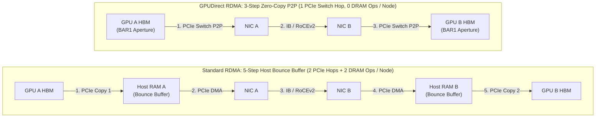
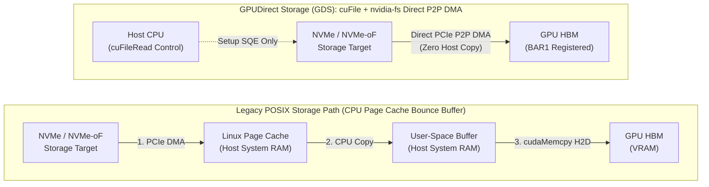

# 12.19 GPUDirect RDMA and GPUDirect Storage

| Field | Value |
|---|---|
| Level | Advanced |
| Priority tier | 1 |
| Lab venue | Nebius GPU + Local Python Verification Lab (`code/part12/gpudirect_rdma_storage_lab.py`) |
| Part | Part 12: Complete AI networking |
| Primary sources | NVIDIA Zero-to-Hero Volume 07 (Chapters 5, 6); Legacy Volume 06 (Chapters 2, 3); *AI Data Center Network Design and Technologies* (Chapter 9); *AI Systems Performance Engineering* (Chapters 4, 5) |
| Coverage file | `planning/coverage/chapters/12-19.md` |
| Claim & number ledger | `planning/ledgers/12-19.md` |

## Why this matters for AI infrastructure

Standard Remote Direct Memory Access and standard Linux POSIX file I/O were designed for an era when the host CPU and its system DRAM were the final destination of every packet and storage block. In an AI factory, neither network collective payloads nor training datasets are computed in host DRAM. Matrix multiplications, attention kernels, and optimizer updates execute exclusively inside GPU High-Bandwidth Memory.

When an RDMA Network Interface Card or an NVMe drive cannot address GPU HBM directly, every byte must stage through a host memory bounce buffer in CPU DRAM. That extra copy doubles PCIe root-complex traffic and saturates dual-socket CPU memory controllers. As a result, 400 Gbps network links and 200 GB/s parallel storage arrays drop to a fraction of their rated capacity.

| Subsystem or Data Path | Hardware Specification or Bottleneck | Measured Impact |
|---|---|---|
| GPU HBM internal bandwidth | A100: `2.0 TB/s`; H100 SXM: `3.35 TB/s`; H200: `4.8 TB/s`; B200: `8.0 TB/s` | Compute kernels consume terabytes per second directly from HBM |
| Inter-node 400 Gbps (`50.0 GB/s`) link without GPUDirect RDMA | 2 PCIe traversals (`GPU A -> Host RAM A -> NIC A` and `NIC B -> Host RAM B -> GPU B`) and 2 DRAM operations per node across `8 x 400 Gbps` (`400.0 GB/s` / `3.2 Tbps` across 8 rails) | Collapses per-NIC throughput from `50.0 GB/s` (`400 Gbps`) down to `6.25 GB/s` (`~50 Gbps`, an `8.0x` degradation) |
| AI factory storage ingestion and checkpoint bursts | 72-GPU GB200/GB300 NVL72 rack at `200 MB/s` per GPU requires `14.4 GB/s` (`14–20 GB/s`); 1,024-GPU streaming or `2.0 TB` checkpoint in `60 s` requires `33.33 GB/s` to `200.0 GB/s` | Routing through Linux VFS page cache and `cudaMemcpyHostToDevice` throttles `200.0 GB/s` arrays (`WEKA`, `Lustre`, `VAST`, `IBM Storage Scale`, `DeepSeek 3FS`) to `10.0 GB/s` |
| GPUDirect RDMA zero-copy path | Exposes HBM on PCIe via BAR1 and registers pages with `mlx5_core` / `ib_core` via `nvidia-peermem` or Linux `dma-buf` (`ibv_reg_dmabuf_mr`) | Enables direct P2P DMA between NIC and GPU HBM across a shared PCIe switch (`PIX`/`PXB`) at full `50.0 GB/s` line rate |
| GPUDirect Storage zero-copy path | Replaces buffered POSIX `read()`/`write()` with CUDA `cuFile` (`cuFileDriverOpen`, `cuFileHandleRegister`, `cuFileBufRegister`, `cuFileRead`, `cuFileWrite`) and `nvidia-fs.ko` | `gdsio -x 0` achieves `9.6 GB/s` at `1.00 ms` average latency vs `8.0 GB/s` at `1.25 ms` with CPU-staged `gdsio -x 2` (`+20.0%` throughput, `-20.0%` latency) |

GPUDirect RDMA and GPUDirect Storage are the two halves of the NVIDIA Magnum IO zero-copy architecture. They remove the host memory bounce buffer from the data plane while keeping the CPU in the control plane. GPUDirect RDMA maps GPU HBM directly to the network adapter over the local PCIe switch. GPUDirect Storage streams dataset shards and checkpoints directly between NVMe or NVMe-oF storage and GPU memory.

## Prerequisites and outcomes

### Prerequisites
- Familiarity with PCIe root complexes, switches, and NUMA socket topology from `nvidia-smi topo -m` distance codes.
- Working knowledge of RDMA Queue Pairs, Memory Regions, key registration, and RoCEv2 and InfiniBand transports from Chapters 12.14 and 12.15.
- Basic familiarity with NCCL collectives and Linux block and file storage concepts including NVMe, direct I/O, and the VFS page cache.

```text
Prerequisite distance codes, keys, flags, and collectives:
- Topology distance codes: PIX, PXB, PHB, NODE, SYS
- RDMA keys & POSIX flags: lkey, rkey, O_DIRECT
- Collectives: AllReduce, ReduceScatter, AllGather, AllToAll
```

### Outcomes
After completing this chapter, you will be able to:
1. Quantify the PCIe hop count, DRAM bandwidth amplification, and transfer latency of host bounce-buffer staging versus GPUDirect RDMA.
2. Explain how BAR1 aperture mapping, `nvidia-peermem.ko`, and upstream Linux `dma-buf` pin and translate GPU HBM pages for RDMA NICs.
3. Diagnose and tune NCCL GPUDirect RDMA path selection using `NCCL_NET_GDR_LEVEL`, `NCCL_NET_GDR_READ`, and PCIe Access Control Services remediation.
4. Trace the NVMe-oF and GPUDirect Storage data path through `libcufile.so`, `nvidia-fs.ko`, and `/etc/cufile.json`.
5. Validate and benchmark GPUDirect RDMA and GPUDirect Storage in production using `lsmod`, `nvidia-smi -q`, `ib_write_bw --use_cuda`, `gdscheck -p`, and `gdsio`.

---

## 1. The Host Bounce-Buffer Bottleneck vs GPUDirect Zero-Copy

In a traditional CPU-centric server, the host operating system treats the GPU and the network or storage controller as isolated PCIe endpoints that cannot exchange data directly. Every cross-device transfer is mediated by system DRAM, which turns the host memory subsystem into a severe bottleneck on multi-rail AI nodes.

### 1.1 The 5-Step Traditional Network Bounce-Buffer Path

When GPU A on Node A sends a tensor to GPU B on Node B using standard RDMA without GPUDirect RDMA, the payload traverses five distinct stages across the two hosts:

1. **Step 1 — Sender GPU to Sender Host RAM:** The CUDA runtime copies the tensor from GPU A HBM across the PCIe bus. It travels through the CPU Root Complex into a pinned staging buffer in Host RAM A.
2. **Step 2 — Sender Host RAM to Sender NIC:** The CPU instructs NIC A to read the pinned host buffer. NIC A then issues a PCIe DMA read through the CPU Root Complex.
3. **Step 3 — Sender NIC Across Fabric to Receiver NIC:** NIC A encapsulates the payload into InfiniBand or RoCEv2 packets and transmits them across the leaf-spine fabric to NIC B.
4. **Step 4 — Receiver NIC to Receiver Host RAM:** NIC B receives the packets and DMAs the payload across the PCIe bus into a pinned bounce buffer in Host RAM B.
5. **Step 5 — Receiver Host RAM to Receiver GPU:** The CUDA driver on Node B initiates a `cudaMemcpyAsync` DMA across the PCIe bus from Host RAM B into GPU B HBM.

### 1.2 The 3-Step GPUDirect RDMA Zero-Copy Path

With GPUDirect RDMA active, Host RAM and the CPU memory controllers are removed from the data path entirely:

1. **Step 1 — Sender GPU Directly to Sender NIC via PCIe Switch:** NIC A issues a PCIe Peer-to-Peer DMA read directly against GPU A's exposed BAR1 address space across the local PCIe switch.
2. **Step 2 — Sender NIC Across Fabric to Receiver NIC:** NIC A transmits the RDMA frames at line rate across the fabric to NIC B.
3. **Step 3 — Receiver NIC Directly to Receiver GPU via PCIe Switch:** NIC B issues a PCIe P2P DMA write directly across Node B's PCIe switch into GPU B's exposed BAR1 aperture.



| Path Characteristic | Standard RDMA (Host Bounce Buffer) | GPUDirect RDMA (`GDR` Zero-Copy) |
|---|---|---|
| End-to-end data transfer steps | `5` steps (`GPU A -> RAM A -> NIC A -> NIC B -> RAM B -> GPU B`) | `3` steps (`GPU A -> NIC A -> NIC B -> GPU B`) |
| `PCIe` bus traversals per node | `2` (`20.0 GB` `PCIe` traffic per `10.0 GB` payload) | `1` (`10.0 GB` `PCIe` switch traffic per `10.0 GB` payload) |
| Host `DRAM` operations per node | `2` (`1` write + `1` read = `20.0 GB` `DRAM` traffic per `10.0 GB`) | `0` (`0.0 GB` host `DRAM` traffic; `CPU` is control-plane only) |
| `PCIe` path traversed | Up to CPU Root Complex (`PHB`) and `DRAM` controller | Direct port-to-port inside shared `PCIe` switch (`PIX` / `PXB`) |
| Typical throughput on `400 Gbps` (`50.0 GB/s`) link | `~6.25 GB/s` (`~50 Gbps`, root-complex / `DRAM` bottlenecked) | `50.0 GB/s` (`400 Gbps` line rate, `8.0x` speedup over staged) |
| Small-message latency | `~10–18 us` (double `PCIe` + `DRAM` staging overhead) | `~1.5–2.0 us` (direct `P2P` `BAR1` DMA) |

### 1.3 Quantitative Bandwidth and PCIe Generation Math

To see why the host bounce buffer collapses multi-rail clusters, compare the per-slot PCIe bandwidth across generations against modern 400 Gbps network adapters. A single ConnectX-7 400 Gbps NIC delivers 50.0 GB/s and fits inside one PCIe Gen5 x16 slot rated at 63.02 GB/s.

| PCIe Generation or Node Configuration | Per-Lane Rate & Encoding | Unidirectional / Aggregate Bandwidth | Operational Consequence |
|---|---|---|---|
| **PCIe Gen3 x16** | `8.0 GT/s` (`128b/130b`) | `15.75 GB/s` per `x16` slot | Insufficient for 200G/400G NICs |
| **PCIe Gen4 x16** | `16.0 GT/s` (`128b/130b`) | `31.51 GB/s` (`~31.5 GB/s` unidir, `63.0 GB/s` bidir) | Fits a 200 Gbps (`25.0 GB/s`) NIC per `x16` slot |
| **PCIe Gen5 x16** | `32.0 GT/s` (`128b/130b`) | `63.02 GB/s` (`~63 Gbps` per lane raw / `~64 GB/s` nominal) | Fits a single ConnectX-7 `400 Gbps` (`50.0 GB/s`) NIC per `x16` slot |
| **PCIe Gen6 x16** | `64.0 GT/s` (`PAM4` `242B/256B` FLIT) | `121.0 GB/s` per `x16` slot | Fits an `800 Gbps` (`100.0 GB/s`) ConnectX-8 NIC per `x16` slot |
| **8-GPU DGX/HGX H100 with GPUDirect RDMA** | 8 dedicated ConnectX-7 `400 Gbps` NICs (`Rail 1..8`) on local PCIe switches (`PIX`) | `8 x 50.0 GB/s = 400.0 GB/s` (`3.2 Tbps`) network bandwidth | `0.0 GB/s` host DRAM traffic |
| **8-GPU DGX/HGX H100 Host-Staged Fallback** | `400.0 GB/s` `NIC -> DRAM` writes + `400.0 GB/s` `DRAM -> GPU` reads | Demands `800.0 GB/s` host DRAM traffic + `800.0 GB/s` CPU root-complex PCIe traffic | Saturates dual-socket CPU memory controllers and throttles each `400 Gbps` rail to `~50 Gbps` (`6.25 GB/s`) |

---

## 2. GPUDirect RDMA Under the Hood: BAR1, `nvidia-peermem`, and `dma-buf`

For an RDMA NIC to execute a one-sided RDMA WRITE or RDMA READ directly against GPU HBM, three hardware and kernel mechanisms must cooperate. If any one of these three layers is missing or disabled in BIOS, `ibv_reg_mr` fails on device pointers or NCCL silently disables GPUDirect RDMA:

1. **PCIe BAR1 Exposure:** The GPU must expose its HBM physical pages into the system's 64-bit PCIe Memory-Mapped I/O address space via Base Address Register 1.
2. **Driver Page Pinning:** The GPU driver must pin the virtual CUDA allocation from `cudaMalloc` or `cuMemCreate`. That pinning ensures its physical HBM pages cannot be migrated or evicted while the RDMA Memory Region is active.
3. **Kernel Address Translation:** A kernel bridge must translate the GPU virtual address range into PCIe BAR1 physical bus addresses. It then hands that scatter-gather table to the RDMA `ib_core` subsystem.

### 2.1 PCIe `BAR1` Aperture and `Above 4G Decoding`

Every PCIe endpoint advertises up to six Base Address Registers in its PCIe configuration header. On NVIDIA data center GPUs, BAR0 maps control registers while BAR1 maps an aperture of GPU HBM onto the PCIe bus. External PCIe masters can then read and write HBM via MMIO transactions.

In legacy 32-bit BIOS mode, BAR1 is restricted to 256 MiB. That legacy window is far too small to register multi-gigabyte NCCL communication buffers or GPUDirect Storage tensor shards. Modern data center GPUs use Large BAR1, enabled via Above 4G Decoding and Resizable BAR in server BIOS. That setting exposes the entire HBM capacity in the 64-bit PCIe address space. You can inspect total and used BAR1 memory with `nvidia-smi -q -d MEMORY`:

```text
PCIe BAR register layout and nvidia-smi -q -d MEMORY output:
- BAR0: ~16-32 MiB (GPU control registers)
- BAR1: 256 MiB in legacy 32-bit BIOS mode vs 64 GiB, 128 GiB, or 256 GiB on A100 80 GB, H100 80 GB, H200 141 GB, B200 192 GB (requires Above 4G Decoding / Resizable BAR / Large BAR)
- If BAR1 Total reports 256 MiB, GPUDirect RDMA registrations > ~200 MiB fail with ibv_reg_mr errors or fall back to host bounce buffers.

BAR1 Memory Usage
    Total                             : 131072 MiB
    Used                              : 2048 MiB
    Free                              : 129024 MiB
```

### 2.2 The Legacy/OFED Path: `nvidia-peermem.ko`

Historically, the Linux kernel had no upstream subsystem for sharing PCIe peer memory between a proprietary GPU driver and an InfiniBand or RoCE driver. Mellanox and NVIDIA introduced the Peer Memory Client API inside MLNX_OFED and DOCA-OFED and shipped the `nvidia-peermem.ko` kernel module. This module replaced the older standalone `nv_peer_mem` DKMS package:

1. **Module Registration:** Running `modprobe nvidia-peermem` registers a peer-memory client callback table with `ib_core` and hooks into `nvidia.ko` via `nvidia_p2p_get_pages()`.
2. **Memory Region Interception:** When NCCL calls `ibv_reg_mr` on a CUDA device pointer, `ib_core` sees the address is not standard host memory and invokes the `acquire()` callback.
3. **BAR1 Page Pinning:** The peer-memory module calls `nvidia_p2p_get_pages()`, which pins the HBM pages in BAR1 at 64 KiB granularity. It then returns the physical PCIe bus addresses.
4. **NIC Translation Programming:** The InfiniBand drivers program those BAR1 addresses into the NIC Memory Translation Table. They return local and remote keys that address GPU HBM directly.
5. **Safe Invalidation Callback:** If the application calls `cudaFree` while the Memory Region is still registered, the GPU driver fires an invalidation callback. That callback tears down the NIC key before BAR1 pages are recycled.

```text
nvidia-peermem.ko callback table and registration call:
- Callbacks: peer_memory_client (acquire, get_pages, dma_map, dma_unmap, put_pages, release, invalidate_callback)
- Registration call: ibv_reg_mr(pd, gpu_va, size, access_flags) -> 64 KiB BAR1 pages -> mlx5_ib NIC MTT / MKey (lkey, rkey)
```

### 2.3 The Upstream Kernel Path: Linux `dma-buf` (`ibv_reg_dmabuf_mr`)

Starting with Linux kernel 5.12, rdma-core v34+, CUDA 11.7+, and the NVIDIA Open GPU Kernel Modules, GPUDirect RDMA supports a fully upstream, vendor-neutral path via the Linux `dma-buf` subsystem. This path requires neither `nvidia-peermem.ko` nor out-of-tree MLNX_OFED peer-memory hooks:

1. **Allocation and Capability Check:** The application or NCCL allocates GPU memory via `cudaMalloc` or the CUDA Virtual Memory Management API and queries `CU_DEVICE_ATTRIBUTE_DMA_BUF_SUPPORTED`.
2. **File Descriptor Export:** NCCL exports the GPU buffer as a standard Linux file descriptor using `cuMemGetHandleForAddressRange`.
3. **Verbs DMA-BUF Registration:** NCCL passes the file descriptor directly to libibverbs via `ibv_reg_dmabuf_mr`.
4. **Native P2P DMA Mapping:** Inside the kernel, `ib_core` attaches to the exported `dma_buf` object and calls `dma_buf_map_attachment()` to obtain the PCIe BAR1 scatter-gather list.

```text
Upstream dma-buf API sequence (Linux >= 5.12, rdma-core >= 34, CUDA 11.7+, nvidia.ko -open):
1. cuMemCreate / cuMemAddressReserve / cuMemMap + cuDeviceGetAttribute(&supported, CU_DEVICE_ATTRIBUTE_DMA_BUF_SUPPORTED, dev)
2. cuMemGetHandleForAddressRange(&dmabuf_fd, gpu_va, size, CU_MEM_RANGE_HANDLE_TYPE_DMA_BUF_FD, 0)
3. ibv_reg_dmabuf_mr(pd, offset, length, iova, dmabuf_fd, access_flags) -> dma_buf_map_attachment() -> sg_table
```

| Feature / Requirement | `nvidia-peermem` (`peer_memory_client`) | Upstream Linux `dma-buf` (`ibv_reg_dmabuf_mr`) |
|---|---|---|
| Kernel module required | `nvidia-peermem.ko` (`lsmod \| grep nvidia_peermem`) | None beyond `nvidia.ko` (`-open`) and upstream `ib_uverbs` / `mlx5_ib` |
| GPU driver compatibility | Proprietary (`nvidia.ko`) **and** OpenRM (`-open`) | **NVIDIA Open GPU Kernel Modules (`-open`) only** |
| RDMA stack requirement | `MLNX_OFED` / `DOCA-OFED` (`ib_core` with `peer_memory_client`) | Upstream Linux kernel `>= 5.12` + `rdma-core >= 34` (or `DOCA-OFED`) |
| `libibverbs` registration call | `ibv_reg_mr(pd, gpu_va, size, access)` | `cuMemGetHandleForAddressRange()` + `ibv_reg_dmabuf_mr(...)` |
| `BIOS` hardware requirement | `Above 4G Decoding` + `Large BAR1` | `Above 4G Decoding` + `Large BAR1` |
| `NCCL` log indicator (`NCCL_DEBUG=INFO`) | `NET/IB : GPU Direct RDMA Enabled for GPU ...` | `NET/IB : DMA-BUForte` / `DMA-BUF support enabled` |

---

## 3. PCIe Topology, Rail Alignment, and `NCCL_NET_GDR_LEVEL`

Having `nvidia-peermem` or `dma-buf` active makes GPUDirect RDMA possible. Whether NCCL actually uses GPUDirect RDMA for a given GPU-to-NIC pair depends on the physical PCIe and NUMA topology of the motherboard. If a GPU and NIC sit across a CPU Root Complex or an inter-socket link, peer-to-peer DMA can stall or deadlock, so NCCL disables GPUDirect RDMA on that path.

### 3.1 `nvidia-smi topo -m` Distance Codes and `NCCL_NET_GDR_LEVEL`

At `ncclCommInitRank` initialization, NCCL inspects `/sys/class/pci_bus/`, `/sys/class/infiniband/`, and NVML to construct an internal topology graph. It then assigns a distance code between every GPU and every RDMA NIC.

| `NCCL` / `nvidia-smi topo -m` Code | Numerical Distance | Physical Path Between GPU and NIC | Default `GDR` Write Behavior | Default `GDR` Read Behavior (`NCCL_NET_GDR_READ`) |
|---|---|---|---|---|
| **`LOC`** | `0` | Same physical device (self baseline) | N/A | N/A |
| **`PIX`** | `1` | Traverses **at most a single `PCIe` switch** | **Enabled** (optimal zero-copy path) | **Enabled** (direct `P2P` read over `PCIe` switch) |
| **`PXB`** | `2` | Traverses **multiple cascaded `PCIe` switches** without crossing the CPU Host Bridge | **Enabled** (default `NCCL_NET_GDR_LEVEL` cutoff is `PXB` / `2` or `PHB` / `3` by platform) | **Enabled** |
| **`PHB`** | `3` | Traverses the **`PCIe` Host Bridge (CPU Root Complex)** within the same `NUMA` socket | Platform-dependent (`Disabled` when cutoff is `PXB`; `Enabled` if `NCCL_NET_GDR_LEVEL=PHB` or `3`) | **Disabled by default** (`P2P` reads across CPU Root Complex stall; requires `NCCL_NET_GDR_READ=1`) |
| **`NODE`** | `4` | Traverses interconnect between multiple `PCIe` host bridges inside a single `NUMA` node | **Disabled** unless `NCCL_NET_GDR_LEVEL=NODE` (`4`) | **Disabled** |
| **`SYS`** | `5` | Crosses the **inter-socket `NUMA` link (`Intel UPI` / `AMD Infinity Fabric xGMI`)** | **Disabled** (`P2P` over `UPI`/`xGMI` deadlocks or severely degrades bandwidth; `NCCL` forces host bounce buffer) | **Disabled** |

NCCL differentiates GPUDirect RDMA Writes from GPUDirect RDMA Reads. Writes occur when incoming network data is written by the NIC into GPU BAR1, while reads occur when outgoing network data is read by the NIC from GPU BAR1. A PCIe Posted Write is a one-way Memory Write Transaction Layer Packet that requires no completion. By contrast, a PCIe Non-Posted Read is a split round-trip transaction. The NIC sends a Memory Read Request and must hold completion buffers while waiting for Completion with Data packets to return. Inside a dedicated PCIe switch on a PIX or PXB path, P2P reads run at full 400 Gbps speed. Across a CPU Root Complex on a PHB path, P2P reads suffer severe credit starvation, so NCCL leaves GDR reads disabled on PHB unless `NCCL_NET_GDR_READ=1` is forced.

```text
PCIe Transaction Layer Packet (TLP) behavior for GPUDirect RDMA:
- GDR Write (NIC -> GPU BAR1): Posted Memory Write TLP (MWr), one-way fire-and-forget
- GDR Read  (NIC <- GPU BAR1): Non-Posted Memory Read Request TLP (MRd) + Completion with Data TLP (CplD) round-trip
```

### 3.2 The 8-NIC Rail-Optimized Architecture (`DGX` / `HGX`)

NVIDIA DGX and HGX servers guarantee that every GPU has a distance-1 PIX path to its RDMA NIC without ever crossing a CPU Root Complex or inter-socket link. Each server pairs 8 GPUs with 8 dedicated NICs across 4 PCIe switches. Those 8 NICs connect to 8 independent leaf switch planes, designated Rail 1 through Rail 8.

```text
NUMA 0 (CPU Socket 0):
  [ GPU 0 ] <--PIX--> [ PCIe Switch 0 ] <--PIX--> [ mlx5_0 (NIC 0) ] ===> Leaf Switch 0 (Rail 1)
  [ GPU 1 ] <--PIX--> [ PCIe Switch 0 ] <--PIX--> [ mlx5_1 (NIC 1) ] ===> Leaf Switch 1 (Rail 2)
  [ GPU 2 ] <--PIX--> [ PCIe Switch 1 ] <--PIX--> [ mlx5_2 (NIC 2) ] ===> Leaf Switch 2 (Rail 3)
  [ GPU 3 ] <--PIX--> [ PCIe Switch 1 ] <--PIX--> [ mlx5_3 (NIC 3) ] ===> Leaf Switch 3 (Rail 4)
--------------------------- NUMA Boundary (CPU UPI / xGMI Interconnect) ---------------------------
NUMA 1 (CPU Socket 1):
  [ GPU 4 ] <--PIX--> [ PCIe Switch 2 ] <--PIX--> [ mlx5_4 (NIC 4) ] ===> Leaf Switch 4 (Rail 5)
  [ GPU 5 ] <--PIX--> [ PCIe Switch 2 ] <--PIX--> [ mlx5_5 (NIC 5) ] ===> Leaf Switch 5 (Rail 6)
  [ GPU 6 ] <--PIX--> [ PCIe Switch 3 ] <--PIX--> [ mlx5_6 (NIC 6) ] ===> Leaf Switch 6 (Rail 7)
  [ GPU 7 ] <--PIX--> [ PCIe Switch 3 ] <--PIX--> [ mlx5_7 (NIC 7) ] ===> Leaf Switch 7 (Rail 8)

Intra-node interconnect and InfiniBand GPUDirect Async (IBGDA) specs:
- Intra-node GPU-to-GPU: NVLink / NVSwitch at 900 GB/s per GPU on H100; 1.8 TB/s per GPU across 18 NVLink 5 links on B200 / GB200 NVL72 (130 TB/s rack); 900 GB/s NVLink-C2C between Grace CPU and Hopper/Blackwell GPU
- IBGDA (InfiniBand GPUDirect Async) in NCCL and NIXL: GPU SMs ring NIC doorbells directly over PCIe without waking a host CPU proxy thread
```

---

## 4. The PCIe ACS Trap and IOMMU Passthrough

Even when a GPU and a ConnectX-7 NIC are plugged into slots attached to the exact same PCIe switch, a single BIOS security feature can silently route every P2P packet up to the CPU Root Complex. That detour destroys GPUDirect RDMA throughput, and the culprit is PCIe Access Control Services.

### 4.1 How PCIe ACS Breaks Peer-to-Peer Switching

PCIe Access Control Services was designed for multi-tenant hypervisors. It prevents a PCIe device inside one Virtual Machine from DMA-reading the BAR memory of another device in a sibling VM without first being validated by the CPU's IOMMU, such as Intel VT-d or AMD-Vi.

When ACS redirection or source validation bits are enabled on a PCIe switch downstream port, direct peer-to-peer switching breaks in three steps:

1. **P2P DMA Initiation:** NIC 0 issues a PCIe P2P DMA write targeting GPU 0's BAR1 address on the same PCIe switch.
2. **Upstream Hairpin Redirection:** Instead of switching the packet directly to the GPU port inside the PCIe switch ASIC, the switch intercepts the TLP. It forces the packet upstream over the PCIe root port to the CPU Root Complex and IOMMU.
3. **Downstream Return:** The CPU Root Complex sends the translated packet back downstream through the same PCIe root port into the PCIe switch and finally to GPU 0.

This hairpin detours 400 Gbps of traffic twice across the PCIe root port, cutting effective P2P bandwidth by 50% to 80%. Even worse, when NCCL inspects the PCIe bridge ACS bits during topology discovery, it downgrades the effective GPU-to-NIC path from PIX to PHB or SYS. That downgrade disables GPUDirect RDMA completely and forces a fallback to host DRAM bounce buffers.

### 4.2 Auditing and Disabling ACS (`lspci -vvv` and `setpci`)

To verify whether ACS is blocking P2P on your PCIe switch ports, inspect `ACSCtl` in `lspci -vvv` `(untested here)`:

```bash
# Audit PCIe Access Control Services (ACS) control bits across all PCIe bridges (untested here)
sudo lspci -vvv | grep -E "^[0-9a-f]{2}:|ACSCap|ACSCtl"
```

If any PCIe switch downstream port between your GPUs and NICs or NVMe drives reports a plus sign on redirection or validation flags, ACS is actively redirecting P2P traffic upstream:

```text
16:00.0 PCI bridge: Broadcom / LSI PEX890xx PCIe Gen5 Switch
    ACSCap: SrcValid+ TransBlk+ ReqRedir+ CmpltRedir+ UpstreamFwd+ EgressCtrl- DirectTrans-
    ACSCtl: SrcValid+ TransBlk- ReqRedir+ CmpltRedir+ UpstreamFwd+ EgressCtrl- DirectTrans-
    (Blocking flags: ReqRedir+, CmpltRedir+, SrcValid+, TransBlk+, UpFwd+ / UpstreamFwd+)
```

The permanent fix is to disable ACS in the server BIOS and set `iommu=pt` via `intel_iommu=on iommu=pt` or `amd_iommu=on iommu=pt` in `/etc/default/grub`. Passthrough mode allows host bare-metal DMA to bypass dynamic IOMMU translation while still supporting SR-IOV Virtual Functions. For immediate runtime remediation without a reboot prior to NCCL initialization, clear the 16-bit ACS Control register at offset `+0x6` of `ECAP_ACS` on each PCIe bridge `(untested here)`:

```bash
# Disable ACS P2P redirection at runtime on all PCIe bridge ports (class 0x060400) (untested here)
for BDF in $(lspci -d "*:*:0604" | awk '{print $1}'); do
    sudo setpci -v -s "${BDF}" ECAP_ACS+0x6.w=0000 2>/dev/null || true
done
```

After clearing `ECAP_ACS+0x6.w=0000`, `ACSCtl` reports minus signs across all redirection bits, and `nvidia-smi topo -m` restores PIX across every rail.

## 5. GPUDirect Storage (`GDS`), `NVMe-oF`, and the `cuFile` Pipeline

GPUDirect RDMA solves GPU-to-GPU communication across the training fabric. However, an AI cluster also ingests petabytes of training samples and writes multi-terabyte checkpoints to persistent storage. When storage reads and checkpoint writes route through the host CPU page cache, dataloader workers saturate host cores while GPUs sit idle waiting for batches.

| Storage Tier | Capacity & Hardware Profile | Bandwidth / Latency & Role |
|---|---|---|
| **Tier 0: GPU HBM** | `40 GB` or `80 GB` (A100), `80 GB` (H100), `141 GB` (H200), `192 GB` (B200) / `288 GB` (B300) | `1.5–8.0 TB/s`; active tensor working set |
| **Tier 1: Local Host NVMe Cache** | `8 x 3.84 TB` local PCIe Gen5 NVMe SSDs in RAID 0 inside a DGX H100 node | `~100 ns` local PCIe access latency; staging hot shards via `hostPath` or AIStore / Alluxio |
| **Tier 2: Parallel File System / NVMe-oF** | WEKA, Lustre (DDN EXAScaler / AWS FSx for Lustre), IBM Storage Scale (GPFS), VAST Data, BeeGFS, or DeepSeek Fire-Flyer File System (`3FS`) | `100 Gbps`–`400 Gbps` RoCEv2 or InfiniBand (`~300 ns` IB switch latency, `~700–900 ns` / `800 ns` Ethernet switch latency, often `1:3` leaf-to-spine oversubscribed or dual-fabric `Fab A / Fab B` redundant) |
| **Tier 3: Object Store / Data Lake** | S3-compatible storage (AWS S3, MinIO, Ceph, FlashBlade) over HTTPS / TLS | Raw data lakes and long-term checkpoint archives |

### 5.1 `NVMe-oF` State Machines (`NVMe/TCP` vs `NVMe/RDMA`)

When Tier 1 or Tier 2 storage resides across a fabric, NVMe over Fabrics encapsulates native 64-byte NVMe Submission Queue Entries and 16-byte Completion Queue Entries inside fabric Capsules. Without understanding how NVMe-oF maps memory descriptors and transport ports, operators cannot distinguish lossy TCP replication links from lossless RoCEv2 storage fabrics.

1. **Memory Descriptors and Namespace IDs:** Every NVMe command specifies a logical volume Namespace ID and buffer descriptors. Native PCIe NVMe often uses 64-bit Physical Region Page pointers, whereas NVMe-oF uses Scatter-Gather Lists to describe discontinuous initiator memory regions.
2. **NVMe/TCP Transport:** Runs over standard lossy IP and Ethernet fabrics using MTU 9000 jumbo frames without requiring PFC or DCQCN. That makes it suitable for long-haul inter-site replication, where each NVMe Submission and Completion Queue pair maps one-to-one to a TCP connection handled by a host CPU core.
3. **NVMe/RDMA Transport:** Runs over a lossless RoCEv2 or native InfiniBand fabric. Discovery occurs over TCP port 8009, Queue Pair negotiation uses RDMA CM over UDP port 4420, and capsule and target-initiated RDMA transfers use RoCEv2 UDP port 4791. This hardware-offloaded path achieves roughly 66% lower write latency than NVMe/TCP.

```text
NVMe-oF capsule, NVMe/TCP, and NVMe/RDMA protocol specifications:
- NVMe commands & capsules: 64-byte SQE (opcode 0x02 Read, 0x01 Write), 16-byte CQE; CapsuleCmd (0x01), CapsuleResp, H2CData (0x03), C2HData (0x04); NSID, PRP1/PRP2 (64-bit pointers) vs SGL
- NVMe/TCP (NVMe-o-TCP, MTU 9000, 40 km+ replication):
  * TCP 3-way handshake (SYN/SYN-ACK/ACK) on port 8009 -> IC Req PDU / IC Resp PDU -> NVMe TCP Connect Request/Response -> CapsuleCmd -> C2HData PDU #1..#4 -> CapsuleResp (Common Header CH, PDU Specific Header PSH, Header Digest HDGST, PAD, PDU Data, Data Digest DDGST; terminated via H2CTermReq / C2HTermReq)
- NVMe/RDMA (NVMe-o-RDMA over RoCEv2 or InfiniBand, ~66% lower write latency, 1:1 I/O SQ+CQ to RDMA QP):
  * InfiniBand framing: 16 Virtual Lanes (VLs), 64-byte CBFC credits in Link Layer Header (LLH), 16-bit LID (up to 48,000 nodes) in Local Routing Header (LRH), optional GRH, BTH, RETH, ICRC/VCRC
  * Discovery: Get Log Page over TCP port 8009 (RDMA_PRTYPE = 04 for RoCEv2, 02 for InfiniBand, 05 for iWARP)
  * Connection & Data: RDMA CM Request / Reply / Ready to Use over UDP port 4420; target-initiated RDMA_READ / RDMA_WRITE over RoCEv2 UDP port 4791
```

### 5.2 Why Legacy `POSIX` I/O Starves GPUs

When a Python DataLoader calls standard `open()` and `read()` or `pread()`, Linux routes the request through the Virtual File System. Even if the underlying storage array is a 200 GB/s WEKA or Lustre cluster, the POSIX path forces the storage NIC or NVMe drive to DMA every block into the Linux Page Cache in host DRAM. The CPU then copies those bytes into a user-space buffer, pins it, and issues `cudaMemcpyAsync` across the PCIe bus into GPU HBM. GPUDirect Storage eliminates both the host page cache and the CPU bounce buffer.



| Storage Data Path Attribute | Legacy `POSIX` (`open` / `read` + `cudaMemcpy`) | GPUDirect Storage (`cuFile` + `nvidia-fs.ko`) |
|---|---|---|
| Kernel & user-space libraries | Linux `VFS` + Page Cache + `libc` | `libcufile.so` + `libcufile_rdma.so` + `nvidia-fs.ko` |
| File descriptor flags | Default buffered (`O_RDONLY` / `O_RDWR`) | **`O_DIRECT` mandatory** for true zero-copy `DMA` bypass |
| Host `DRAM` copies per read/write | `2` (`Storage -> Page Cache -> User/Pinned RAM -> GPU`) | `0` (`Storage/NIC <-> GPU BAR1` directly across `PCIe` switch) |
| Measured `gdsio` throughput (`4` workers, `1 MiB` IO) | **`8.0 GB/s`** (`gdsio -x 2` CPU-mediated baseline) | **`9.6 GB/s`** (`gdsio -x 0` `GDS` path, **`+20.0%` throughput**) |
| Measured `gdsio` average I/O latency | **`1.25 ms`** (`gdsio -x 2`) | **`1.00 ms`** (`gdsio -x 0`, **`-20.0%` latency**) |
| Enterprise NAS / PFS measured gains (`VAST` / `3FS`) | Baseline CPU-bound (`Ceph ~1.1 TB/s` on `68` nodes) | `+20%` (`A100`), `+30%+` (`H100`); `DeepSeek 3FS` `6.6 TB/s` (`+1.4 TB/s` bg, up to `7.3 TB/s`) |

### 5.3 The 10-Stage `cuFile` API and `nvidia-fs.ko` Lifecycle

To use GPUDirect Storage, an application or framework plugin such as NVIDIA DALI, PyTorch v2.7.0+, kvikio, cuDF, or the NIXL GDS backend executes the `cuFile` API sequence. If a filesystem is mounted via user-space FUSE rather than a kernel module with direct I/O support, `nvidia-fs.ko` cannot intercept the DMA mapping callbacks. As a result, true zero-copy GDS is impossible on FUSE mounts:

1. **Driver Initialization:** Call `cuFileDriverOpen()` to initialize the user-space driver and open `/dev/nvidia-fs0` exported by `nvidia-fs.ko`.
2. **Direct File Open:** Open the target file with `O_DIRECT` so the Linux kernel VFS does not allocate page-cache buffers.
3. **File Handle Registration:** Call `cuFileHandleRegister` to wrap the Linux file descriptor into a `CUfileHandle_t` and verify filesystem callback support.
4. **Device Allocation:** Call `cudaMalloc` to allocate the destination buffer in GPU HBM.
5. **BAR1 Buffer Pinning:** Call `cuFileBufRegister` once to pin the GPU HBM pages in BAR1 and build the PCIe scatter-gather mapping.
6. **Zero-Copy Transfer:** Call `cuFileRead` or `cuFileWrite`, or their asynchronous stream variants, so `nvidia-fs.ko` substitutes the GPU BAR1 physical addresses and DMAs directly into HBM.
7. **Teardown:** Deregister the buffer and handle, close the file descriptor, and close the driver at shutdown to release the BAR1 pinning.

```c
// Illustrative C/CUDA GPUDirect Storage (cuFile) zero-copy read lifecycle (untested here)
#include <fcntl.h>
#include <unistd.h>
#include <cuda_runtime.h>
#include <cufile.h>

int gds_read_chunk(const char *path, size_t bytes, off_t file_offset) {
    cuFileDriverOpen();
    int fd = open(path, O_RDONLY | O_DIRECT);

    CUfileDescr_t descr = {};
    descr.handle.fd = fd;
    descr.type = CU_FILE_HANDLE_TYPE_OPAQUE_FD;
    CUfileHandle_t cf_handle;
    cuFileHandleRegister(&cf_handle, &descr);

    void *d_buf = nullptr;
    cudaMalloc(&d_buf, bytes);
    cuFileBufRegister(d_buf, bytes, 0); // Pin BAR1 pages once and reuse across I/Os

    ssize_t ret = cuFileRead(cf_handle, d_buf, bytes, file_offset, 0);

    cuFileBufDeregister(d_buf);
    cuFileHandleDeregister(cf_handle);
    cudaFree(d_buf);
    close(fd);
    cuFileDriverClose();
    return (ret == (ssize_t)bytes) ? 0 : -1;
}
```

Note how `cuda-checkpoint` differs from GPUDirect Storage. NVIDIA's `cuda-checkpoint` utility pairs with CRIU to snapshot running CUDA process state for fault tolerance. It drains GPU work and copies device memory to host memory first. Unlike framework tensor checkpoints written via `cuFile`, `cuda-checkpoint` does not DMA directly from GPU HBM to disk via GDS.

```text
Supported GDS filesystems vs cuda-checkpoint API:
- Supported GDS filesystems: EXT4, XFS, WEKA, Lustre, VAST, BeeGFS, IBM Storage Scale (FUSE cannot use native GDS)
- cuda-checkpoint + CRIU host-staged API: cuCheckpointProcessLock -> cuCheckpointProcessCheckpoint -> cuCheckpointProcessRestore -> cuCheckpointProcessUnlock
```

---

## Commands and configurations that matter

### 1. Verifying and Loading GPUDirect RDMA (`nvidia-peermem`, `dma-buf`, `BAR1`, and `ib_write_bw`)

```bash
# 1. Check whether nvidia-peermem or OpenRM is loaded (untested here)
lsmod | grep -E "nvidia_peermem|nvidia"
sudo modprobe nvidia-peermem

# 2. Verify Large BAR1 aperture is enabled on all GPUs (expect 65536-262144 MiB, NOT 256 MiB) (untested here)
nvidia-smi -q -d MEMORY | grep -A 4 "BAR1 Memory Usage"

# 3. Inspect GPU-to-NIC PCIe switch affinity (expect PIX across matched GPU-NIC rails) (untested here)
nvidia-smi topo -m

# 4. Run RDMA perftest GPU-to-GPU bandwidth test with CUDA memory (--use_cuda) or dma-buf (--use_cuda_dmabuf) (untested here)
# On Server (Node B, GPU 0, mlx5_0):
ib_write_bw -d mlx5_0 --use_cuda=0 --use_cuda_dmabuf -a -F --report_gbits
# On Client (Node A, GPU 0, mlx5_0 -> Node B IP):
ib_write_bw -d mlx5_0 --use_cuda=0 --use_cuda_dmabuf -a -F --report_gbits 10.10.100.2
```

### 2. Essential `NCCL` GPUDirect RDMA Environment Variables

```bash
# Verify GPUDirect RDMA activation and dump detected PCIe/NVLink topology XML (untested here)
export NCCL_DEBUG=INFO
export NCCL_DEBUG_SUBSYS=INIT,GRAPH,ENV,NET
export NCCL_TOPO_DUMP_FILE=/tmp/nccl_topo_detected.xml

# Control GPUDirect RDMA PCIe distance cutoff: LOC(0), PIX(1), PXB(2), PHB(3), NODE(4), SYS(5) (untested here)
export NCCL_NET_GDR_LEVEL=PXB       # Default: allow GDR on PIX/PXB; block across CPU root complex/UPI
export NCCL_NET_GDR_READ=1          # 1 = enable direct NIC DMA reads from GPU BAR1

# Bind InfiniBand/RoCEv2 HCAs, GID index, and QoS traffic class (untested here)
export NCCL_IB_DISABLE=0
export NCCL_P2P_DISABLE=0           # Never leave set to 1 in production
export NCCL_IB_HCA=mlx5_0,mlx5_1,mlx5_2,mlx5_3,mlx5_4,mlx5_5,mlx5_6,mlx5_7
export NCCL_IB_GID_INDEX=3          # RoCEv2 IPv4 GID index (verify via show_gids)
export NCCL_IB_TC=106               # Lossless DSCP/PFC Traffic Class for RoCEv2
export NCCL_IB_QPS_PER_CONNECTION=4
export NCCL_IGNORE_CPU_AFFINITY=1   # Let NCCL spread proxy threads within the local NUMA domain
```

### 3. Verifying and Benchmarking GPUDirect Storage (`gdscheck`, `/etc/cufile.json`, `gdsio`, `fio`, `nsys`)

```bash
# 1. Verify nvidia-fs.ko is loaded and inspect GDS platform compatibility (untested here)
lsmod | grep nvidia_fs
/usr/local/cuda/gds/tools/gdscheck -p

# 2. Benchmark CPU-mediated read (-x 2) vs direct GPUDirect Storage read (-x 0) with gdsio (untested here)
# Baseline (Storage -> CPU Pinned Memory -> GPU, -x 2): ~8.0 GB/s, 1.25 ms avg latency
/usr/local/cuda/gds/tools/gdsio \
    -f /mnt/data/large_file \
    -d 0 -w 4 -s 10G -i 1M -I 0 -x 2

# GPUDirect Storage (Storage -> GPU HBM Direct, -x 0): ~9.6 GB/s (+20%), 1.00 ms (-20%)
/usr/local/cuda/gds/tools/gdsio \
    -f /mnt/data/large_file \
    -d 0 -w 4 -s 10G -i 1M -I 0 -x 0

# 3. Profile cuFile / GDS timeline and overlap with GPU compute kernels in Nsight Systems (untested here)
nsys profile --trace=cuda,nvtx,gds -o gds_timeline python3 train.py
```

#### Hardened `/etc/cufile.json` Configuration

```json
{
    "logging": {
        "dir": "/var/log/gds",
        "level": "ERROR"
    },
    "profile": {
        "nvtx": true,
        "cufile_stats": 3
    },
    "properties": {
        "max_device_pinned_mem_size_kb": 33554432,
        "use_poll_mode": false,
        "poll_mode_max_size_kb": 4,
        "allow_compat_mode": false,
        "rdma_dev_addr_list": ["10.20.1.10", "10.20.2.10"]
    },
    "fs": {
        "generic": {
            "posix_unaligned_kb": false
        },
        "lustre": {
            "rdma_dev_addr_list": []
        },
        "wekafs": {
            "rdma_write_support": true
        }
    }
}
```

| `/etc/cufile.json` Key | Configured Value | Operational Behavior |
|---|---|---|
| `max_device_pinned_mem_size_kb` | `33554432` (`33,554,432 KiB` = `32 GiB`) | Caps total GPU BAR1 memory pinned concurrently by `cuFileBufRegister` |
| `use_poll_mode` and `poll_mode_max_size_kb` | `false` and `4` (`4 KiB`) | When `use_poll_mode` is `true`, only I/Os `<= 4 KiB` use CPU polling; `1 MiB`–`8 MiB` AI reads/writes still use interrupts |
| `allow_compat_mode` | `false` during validation | Forces `libcufile` to fail loudly if `nvidia-fs.ko` or the mount cannot execute direct DMA, preventing silent fallback to POSIX host bounce buffers |

---

## How it fails

| # | Failure Mode | Observable Symptom | Root-Cause Diagnosis | Remediation |
|---|---|---|---|---|
| **1** | **Silent `GPUDirect RDMA` fallback to Host Bounce Buffers (`nvidia-peermem` / `BAR1` missing)** | `4`-node `DGX`/`HGX` `400 Gbps` InfiniBand job achieves only `~50 Gbps` (`6.25 GB/s`) per link; host CPU usage and `DRAM` bandwidth spike while GPUs stall in `ncclKernel_AllReduce`. | `lsmod \| grep nvidia_peermem` is empty (and `dma-buf` prerequisites are unmet), or `nvidia-smi -q -d MEMORY` shows `BAR1 Total: 256 MiB` (`Above 4G Decoding` disabled in `BIOS`). `NCCL_DEBUG=INFO` logs `GPU Direct RDMA Disabled`. | Enable `Above 4G Decoding` / `Large BAR` in `BIOS`, load `sudo modprobe nvidia-peermem` (or deploy `NV Peer Memory` / `DOCA` via `NVIDIA Network Operator`), and verify `NET/IB : GPU Direct RDMA Enabled` in `NCCL_DEBUG=INFO`. |
| **2** | **`PCIe ACS` (`Access Control Services`) P2P Redirection Trap** | `nvidia-peermem` is loaded and `GPU` + `NIC` share a physical `PCIe` switch, yet `nvidia-smi topo -m` shows `PHB`/`SYS` or `ib_write_bw --use_cuda` drops `50%–80%` below line rate. | `sudo lspci -vvv \| grep ACSCtl` shows `SrcValid+ ReqRedir+ CmpltRedir+ UpstreamFwd+` on `PCIe` switch ports, forcing every `P2P` TLP upstream to the CPU Root Complex / `IOMMU`. | Disable `ACS` (`P2P Isolation`) in `BIOS`, set `iommu=pt` (`intel_iommu=on iommu=pt`) in `/etc/default/grub`, and clear runtime bits via `sudo setpci -s <bdf> ECAP_ACS+0x6.w=0000`. |
| **3** | **Cross-Socket `NUMA` (`SYS`) Wiring Violation on Custom Servers** | Custom `AI` server with `NVMe` drives or `NICs` wired to `CPU 0` and GPUs wired to `CPU 1` achieves zero speedup with `GDR` or `GDS`; `UPI`/`xGMI` links saturate at `100%`. | `nvidia-smi topo -m` reports `SYS` between `GPU` and `NIC`/`NVMe`. `NCCL` disables `GDR` (`SYS (5) > PXB (2)`), and `GDS` `DMA` crosses the inter-socket `UPI` link. | Physically recable/reslot `NICs` and `NVMe` drives onto the same `PCIe` switch (`PIX`) as their paired GPUs, bind ranks with `numactl`, and in virtualized/flattened VMs inject a verified `/tmp/topo.xml` via `NCCL_TOPO_FILE`. |
| **4** | **`POSIX` `VFS` / `allow_compat_mode: true` Silent `GDS` Fallback** | `200 GB/s` `WEKA`/`Lustre` storage array delivers only `10 GB/s` to PyTorch; GPUs sit at `15%` utilization while `8` host CPU cores run at `100%` in kernel `copy_user_generic_string`. | `DataLoader` workers use standard Python `open()`/`read()` (or `cuFile` opened without `O_DIRECT` while `allow_compat_mode: true` silently falls back to `POSIX` page-cache copies). | Refactor the input pipeline to use `NVIDIA DALI` or `cuFileRead` with `O_DIRECT`, set `"allow_compat_mode": false` in `/etc/cufile.json` during testing, and confirm non-zero `Ops` in `gds_stats` / `nsys profile --trace=gds`. |
| **5** | **Metadata Server (`MDS`) Saturation ("Small File Problem")** | GPU SM activity drops from `95%` to `30%`; storage throughput is only `5 GB/s` on a `400 GB/s` array while `MDS` CPU hits `100%`. | `strace -c -p <worker_pid>` reveals `85.12%` of syscall time in `stat()` (`452 us/call`), `10.05%` in `openat()`, `4.02%` in `close()`, and only `0.81%` in `read()` across `14 million` `20 KB` `.png` files. | Pack small files into contiguous `1 GB` `WebDataset` `.tar` shards (`50,000` images/shard reduces `stat()` calls by **`50,000x`**), `TFRecord`, `Parquet`, or Megatron `.bin`/`.idx` files, or stage onto Tier 1 local `NVMe` (`hostPath`). |
| **6** | **Cascading `D`-State (`Uninterruptible Sleep`) Storage Hang** | `4` nodes in a `64`-node `DDP` run stop responding; `top` shows load average `500+` with `0%` CPU; hundreds of `python3` processes sit in state `D` and ignore `kill -9`. | `dmesg -T` shows `INFO: task python3:12345 blocked for more than 120 seconds` in `rpc_wait_bit_killable [sunrpc]`; `ibstat` / `ibv_devinfo -d mlx5_0` shows link `DOWN` or `symbol_error_counter > 1000` on a storage AOC cable. | Replace the faulty optical cable, hard-reset locked nodes via `ipmitool chassis power reset`, and mount read-only dataset shares with bounded/soft timeouts (`rsize=1048576,wsize=1048576,noatime,actimeo=60,lookupcache=pos`) while reserving hard mounts for checkpoints. |

---

## Hands-on lab

### Venue and Scope
- **Local runnable lab:** `code/part12/gpudirect_rdma_storage.py` and `code/part12/gpudirect_rdma_storage_lab.py` run 28 automated self-checks using the Python 3 standard library.
- **Cluster hardware verification:** Commands in the configuration section above require live GPU and RDMA hardware and are marked `(untested here)`.

### Run the Verification Lab

```bash
python3 -B code/part12/gpudirect_rdma_storage_lab.py
```

Expected output:

```text
=== Chapter 12.19 Lab: GPUDirect RDMA and GPUDirect Storage ===
  [PASS] 1. Staged path traverses 2 PCIe hops and 2 DRAM ops per node
  [PASS] 2. GPUDirect RDMA traverses 1 PCIe switch hop and 0 DRAM ops per node
  [PASS] 3. 400G NIC achieves 50.0 GB/s with GDR vs 6.25 GB/s (50 Gbps) host-staged (8.0x speedup)
  [PASS] 4. 10 GB payload generates 20.0 GB PCIe + 20.0 GB DRAM traffic per node when staged vs 10.0 GB PCIe + 0.0 GB DRAM with GDR
  [PASS] 5. PCIe Gen4 x16 = 16 GT/s (31.51 GB/s) and PCIe Gen5 x16 = 32 GT/s (63.02 GB/s)
  [PASS] 6. Linux kernel 5.15 (>= 5.12) + OpenRM + rdma-core 44 (>= 34) selects dma-buf without nvidia-peermem
  [PASS] 7. Proprietary driver on kernel 5.4 with nvidia-peermem loaded selects nvidia-peermem
  [PASS] 8. Disabled Large BAR1 / Above 4G Decoding forces host-staging-fallback even when drivers are loaded
  [PASS] 9. Proprietary GPU driver without nvidia-peermem cannot use dma-buf and falls back to host staging
  [PASS] 10. NCCL path hierarchy orders LOC(0) < PIX(1) < PXB(2) < PHB(3) < NODE(4) < SYS(5)
  [PASS] 11. PIX path with default PXB cutoff and ACS off enables both GDR Write and GDR Read
  [PASS] 12. PXB path with PXB cutoff enables both GDR Write and GDR Read
  [PASS] 13. PHB path exceeds PXB cutoff and disables GDR by default
  [PASS] 14. Raising NCCL_NET_GDR_LEVEL=PHB enables GDR Write on PHB but keeps GDR Read off by default
  [PASS] 15. Setting NCCL_NET_GDR_READ=1 explicitly forces GDR Read on PHB
  [PASS] 16. Cross-socket SYS path (UPI/QPI) disables GDR under PHB cutoff
  [PASS] 17. PCIe ACS enabled on a PIX switch redirects traffic to PHB and disables GDR under PXB cutoff
  [PASS] 18. ACS parser flags SrcValid+/ReqRedir+/CmpltRedir+ on 0000:16:00.0 and emits setpci ECAP_ACS+0x6.w=0000
  [PASS] 19. ACS parser marks 0000:64:00.0 clean when all ACSCtl bits are '-' (disabled)
  [PASS] 20. cuFile API lifecycle contains all 10 ordered stages from cuFileDriverOpen to cuFileDriverClose
  [PASS] 21. gdsio Table 5-1 baseline (-x 2, Storage->CPU) achieves 8.0 GB/s at 1.25 ms latency (1.25 s for 10 GB)
  [PASS] 22. gdsio Table 5-1 GDS path (-x 0, Storage->GPU) achieves 9.6 GB/s (+20.0%) at 1.00 ms (-20.0%)
  [PASS] 23. /etc/cufile.json audit converts 33,554,432 KB to 32.0 GiB and flags allow_compat_mode=true + 4 KB poll cap on 1 MB I/O
  [PASS] 24. /etc/cufile.json strict validation mode (allow_compat_mode=false, use_poll_mode=false) emits 0 warnings
  [PASS] 25. 2 TB checkpoint in 60 s requires 33.33 GB/s sustained write bandwidth (fits on >= 1x 400G link = 50 GB/s)
  [PASS] 26. Packing 50,000 tiny 20 KB files into a single 1 GB WebDataset tar cuts metadata stat() syscalls by 50,000x
  [PASS] 27. 8-GPU rail-optimized HGX node with 8x 400G NICs delivers 400.0 GB/s (3.2 Tbps) aggregate RDMA bandwidth
  [PASS] 28. 72-GPU NVL72 rack at 200 MB/s per GPU requires 14.4 GB/s (14-20 GB/s range) sustained storage ingestion

Summary: 28 passed, 0 failed
```

---

## Common first mistakes

1. **Assuming RDMA Automatically Implies GPUDirect RDMA:** Standard RDMA without `--use_cuda` only proves NIC-to-Host-RAM zero-copy. If `nvidia-peermem` or `dma-buf` is absent or ACS is enabled, NCCL still uses InfiniBand over RDMA, but stages every GPU tensor through a host DRAM bounce buffer. Always verify `GPU Direct RDMA Enabled` in debug logs and run `ib_write_bw --use_cuda=0`.
2. **Raising `NCCL_NET_GDR_LEVEL=SYS` to Force GDR Across a Bad Motherboard Layout:** Forcing PCIe P2P DMA across an inter-socket Intel UPI or AMD Infinity Fabric link causes severe credit stalls, high tail latency, or PCIe completion timeouts. Fix the physical slot assignment or NUMA rank binding instead of forcing GDR over SYS.
3. **Leaving Compatibility Mode Enabled in `/etc/cufile.json` During GDS Bring-Up:** When `"allow_compat_mode": true` is active, `cuFileRead()` succeeds even when `nvidia-fs.ko` fails to load or the filesystem mount lacks direct DMA support. That silent fallback hides the fact that all I/O is bouncing through host DRAM.
4. **Calling Buffer Registration Inside the Inner Training Step Loop:** Calling `cuFileBufRegister()` and `cuFileBufDeregister()` on every step pins BAR1 pages and rebuilds PCIe scatter-gather mappings repeatedly. Register reusable GPU staging buffers once at startup and pass device offset slices to `cuFileRead` and `cuFileWrite`.
5. **Benchmarking AI Storage with 4 KiB Random `fio` Jobs Without Direct I/O:** Default 4 KiB buffered `fio` tests measure the Linux DRAM page cache and OLTP IOPS rather than parallel file system streaming throughput. Always benchmark dataset reads and checkpoint bursts with multi-megabyte block sizes and `direct=1`.

```text
Production fio benchmark profiles for AI storage (untested here):
- Streaming dataset read: fio --rw=read --bs=2M --size=500G --numjobs=32 --iodepth=128 --direct=1
- Checkpoint write burst: fio --rw=write --bs=8M --size=100G --numjobs=8 --iodepth=64 --direct=1 --fsync=1000
```

---

## Exercises

1. **Bounce-Buffer vs GPUDirect RDMA Traffic Amplification:**
   - **(a)** Using the 8-GPU node parameters below, calculate the per-GPU and whole-node PCIe and host DRAM traffic volume under bounce-buffer staging versus GPUDirect RDMA.
   - **(b)** Calculate the transfer time for 10.0 GB per rail when host staging throttles each rail to 6.25 GB/s versus 50.0 GB/s with GPUDirect RDMA.
2. **Kernel Backend Eligibility:**
   - Determine the selected backend using `evaluate_gdr_kernel_backend()` for each of the four node configurations in the problem block below.
3. **`NCCL_NET_GDR_LEVEL` and `NCCL_NET_GDR_READ` Matrix:**
   - For GPU-to-NIC paths PIX, PXB, PHB, and SYS, determine whether GDR Write and GDR Read are enabled under the three environment configurations below.
4. **PCIe ACS Hairpin Diagnosis and Remediation:**
   - Given the `lspci -vvv` dump below, explain how bridge `0000:16:00.0` alters a physical PIX path under `NCCL_NET_GDR_LEVEL=PXB`. Write the `setpci` command and GRUB kernel parameter required to restore direct P2P switching.
5. **`gdsio` Performance and `/etc/cufile.json` Audit:**
   - From the `gdsio` benchmark results below, compute the percentage throughput improvement, percentage latency reduction, and time saved on a 10.0 GB read. Explain why polling mode with a 4 KiB cap has zero effect on this 1 MiB workload.
6. **Checkpoint Burst and WebDataset Metadata Sizing:**
   - **(a)** Calculate the minimum aggregate write bandwidth in GB/s required to finish the 2.0 TB checkpoint within 60 s for the cluster below.
   - **(b)** Calculate the reduction factor in metadata `stat()` and `open()` syscalls when packing 50,000 files into each 1.0 GB WebDataset `.tar` shard.

```text
Exercise problem parameters and datasets:
- Exercise 1 node & payload parameters:
  * 8-GPU node with 8 x 400 Gbps (50.0 GB/s each) ConnectX-7 NICs; 10.0 GB gradient shard per GPU (80.0 GB total across node)
  * Staged path: 2 PCIe hops and 2 DRAM operations per node, throttled to 6.25 GB/s (50 Gbps) per rail
  * GPUDirect RDMA path: 1 PCIe switch hop and 0 DRAM operations, running at 50.0 GB/s (400 Gbps) per rail
- Exercise 2 evaluate_gdr_kernel_backend() in code/part12/gpudirect_rdma_storage.py configurations:
  * (a) Linux 5.15, NVIDIA OpenRM (-open), rdma-core 44, peermem_loaded=False, large_bar1=True
  * (b) Linux 5.4, proprietary nvidia.ko, rdma-core 32, peermem_loaded=True, large_bar1=True
  * (c) Linux 6.8, OpenRM, rdma-core 50, peermem_loaded=True, large_bar1=False
  * (d) Linux 5.15, proprietary nvidia.ko, rdma-core 44, peermem_loaded=False, large_bar1=True
- Exercise 3 GDR matrix paths & configurations:
  * Paths: PIX (1), PXB (2), PHB (3), SYS (5)
  * Configs: (a) default NCCL_NET_GDR_LEVEL=PXB; (b) NCCL_NET_GDR_LEVEL=PHB with default NCCL_NET_GDR_READ; (c) NCCL_NET_GDR_LEVEL=PHB with NCCL_NET_GDR_READ=1
- Exercise 4 lspci -vvv bridge dump:
  * Bridge 0000:16:00.0: ACSCtl: SrcValid+ TransBlk- ReqRedir+ CmpltRedir+ UpstreamFwd+
  * Bridge 0000:64:00.0: all '-'
- Exercise 5 gdsio benchmark:
  * Command: /usr/local/cuda/gds/tools/gdsio -f /mnt/data/large_file -d 0 -w 4 -s 10G -i 1M -I 0
  * -x 2 (Storage -> CPU): 8.0 GB/s, 1.25 ms latency; -x 0 (Storage -> GPU): 9.6 GB/s, 1.00 ms latency; 1 MiB = 1,024 KiB vs poll_mode_max_size_kb: 4
- Exercise 6 checkpoint & WebDataset sizing:
  * 256-node cluster training a 500B-parameter model writes a 2.0 TB (2,000 GB) checkpoint within 60 s
  * Vision dataset: 14 million raw 20 KB .png files packed at 50,000 files per 1.0 GB WebDataset .tar shard
```

---

## Interview angles

1. **"If standard RDMA already bypasses the Linux kernel TCP/IP stack, why do we still need GPUDirect RDMA?"**
   - *What they are testing:* Whether you distinguish kernel-bypass networking between the NIC and host DRAM from host-memory-bypass PCIe peer-to-peer DMA.
   - *Senior answer:* Standard RDMA only bypasses the OS kernel to write into host DRAM. Because GPU compute kernels execute out of GPU HBM, standard RDMA creates a host bounce buffer. Every byte crosses the PCIe bus twice per node and traverses the CPU memory controller twice. On an 8x 400 Gbps node, that demands 800.0 GB/s of host DRAM bandwidth, collapsing 400 Gbps links down to roughly 50 Gbps. GPUDirect RDMA pins GPU HBM into the PCIe BAR1 aperture via `nvidia-peermem` or `dma-buf`. That allows the NIC to DMA directly to and from GPU HBM across the local PCIe switch with zero host DRAM traffic.
2. **"We upgraded our Ubuntu nodes to the NVIDIA Open GPU Kernel Modules on kernel 6.8 and noticed `nvidia-peermem` is not loaded, yet GPUDirect RDMA works. How?"**
   - *What they are testing:* Modern Linux `dma-buf` versus legacy `nvidia-peermem`.
   - *Senior answer:* On Linux kernels 5.12 and newer with rdma-core 34+ and CUDA 11.7+, the NVIDIA Open GPU Kernel Modules support the upstream Linux `dma-buf` framework. NCCL exports a file descriptor via `cuMemGetHandleForAddressRange` and passes it to `ibv_reg_dmabuf_mr()`. That call maps BAR1 P2P pages natively without requiring the out-of-tree `nvidia-peermem.ko` module. By contrast, the proprietary `nvidia.ko` driver does not export `dma-buf` to `ib_core` and still requires `nvidia-peermem.ko`.
3. **"A team rewrote their loader to use `cuFileRead` for GPUDirect Storage on a 200 GB/s WEKA array, but throughput is stuck at 10 GB/s and host DRAM traffic is still high. How do you prove whether GDS is actually active?"**
   - *What they are testing:* Practical debugging of silent GDS fallbacks and PCIe topology violations.
   - *Senior answer:* First, run `/usr/local/cuda/gds/tools/gdscheck -p` and check `lsmod` to verify `nvidia-fs.ko` and filesystem support. Second, set `"allow_compat_mode": false` in `/etc/cufile.json`. Compatibility mode silently falls back to POSIX host-DRAM copies when `O_DIRECT` or alignment is missing. Third, trace the worker with `strace -c` or `nsys profile --trace=gds` and inspect `/var/log/gds/cufile.log` to confirm zero-copy operations rather than VFS `read()` syscalls. Finally, check `nvidia-smi topo -m` and `lspci -vvv` to verify the storage NICs share a PCIe switch with the GPUs rather than crossing UPI or ACS redirection.

---

## Checkpoint questions (20)

<details><summary>`&lt;strong>`1. Trace the 5 data-movement steps when GPU A on Node A sends a tensor to GPU B on Node B using standard RDMA without GPUDirect RDMA.`&lt;/strong>`</summary>

```text
1. GPU A HBM -> Host RAM A (PCIe copy 1 on Node A, DRAM write)
2. Host RAM A -> NIC A (PCIe DMA read 2 on Node A, DRAM read)
3. NIC A -> InfiniBand / RoCEv2 Fabric -> NIC B (network transit)
4. NIC B -> Host RAM B (PCIe DMA write 1 on Node B, DRAM write)
5. Host RAM B -> GPU B HBM (PCIe copy 2 on Node B, DRAM read)
```
</details>

<details><summary>`&lt;strong>`2. How many PCIe bus traversals and host DRAM operations occur per node under GPUDirect RDMA compared to host bounce-buffer staging?`&lt;/strong>`</summary>

Under GPUDirect RDMA, each node performs 1 PCIe switch traversal between GPU BAR1 and the NIC and 0 host DRAM operations. Under host bounce-buffer staging, each node performs 2 PCIe traversals and 2 host DRAM operations. That staging generates 20.0 GB of PCIe traffic and 20.0 GB of host DRAM traffic per 10.0 GB payload.
</details>

<details><summary>`&lt;strong>`3. What is the role of PCIe BAR1 in GPUDirect RDMA and GPUDirect Storage, and which BIOS setting is required to expose full GPU HBM?`&lt;/strong>`</summary>

BAR1 is the PCIe Memory-Mapped I/O aperture through which external PCIe masters such as RDMA NICs and NVMe drives read and write GPU HBM. The server BIOS must have Above 4G Decoding and Large BAR or Resizable BAR enabled. Those settings allow BAR1 to map 64 to 256 GiB of 64-bit address space instead of the legacy 256 MiB 32-bit limit.
</details>

<details><summary>`&lt;strong>`4. How does `nvidia-peermem.ko` enable GPUDirect RDMA, and what happens if `cudaFree()` is called on a registered GPU buffer?`&lt;/strong>`</summary>

`nvidia-peermem.ko` registers a peer-memory client with MLNX_OFED or DOCA-OFED `ib_core`. It invokes `nvidia_p2p_get_pages()` to pin BAR1 physical pages and program the NIC's MKey. If `cudaFree()` is called while an MR is active, the GPU driver triggers an `invalidate_callback` into `nvidia-peermem` to invalidate the NIC key before unmapping the BAR1 pages.
</details>

<details><summary>`&lt;strong>`5. What are the three exact system requirements to use the upstream Linux `dma-buf` path for GPUDirect RDMA without `nvidia-peermem.ko`?`&lt;/strong>`</summary>

```text
1. Linux kernel >= 5.12
2. NVIDIA Open GPU Kernel Modules (nvidia.ko -open; proprietary driver does not export dma-buf for RDMA)
3. rdma-core / libibverbs >= 34 (ibv_reg_dmabuf_mr() support with CU_MEM_RANGE_HANDLE_TYPE_DMA_BUF_FD)
```
</details>

<details><summary>`&lt;strong>`6. List the six NCCL and `nvidia-smi topo -m` path distance codes in order from closest to farthest.`&lt;/strong>`</summary>

```text
0: LOC  — Same device
1: PIX  — Traverses at most a single PCIe switch
2: PXB  — Traverses multiple cascaded PCIe switches without reaching the CPU Host Bridge
3: PHB  — Traverses a PCIe Host Bridge (CPU Root Complex) within the same NUMA node
4: NODE — Traverses interconnect between multiple PCIe host bridges inside one NUMA node
5: SYS  — Traverses the inter-socket NUMA link (Intel UPI / AMD xGMI)
```
</details>

<details><summary>`&lt;strong>`7. Why does NCCL disable GPUDirect RDMA reads (`NCCL_NET_GDR_READ=0`) by default on PHB paths even when `NCCL_NET_GDR_LEVEL=PHB` enables GDR writes?`&lt;/strong>`</summary>

PCIe writes from the NIC into GPU BAR1 are posted one-way transactions. By contrast, PCIe reads from GPU BAR1 are non-posted split transactions consisting of a read request followed by completion data. Across a CPU Root Complex on a PHB path, P2P read completions suffer severe credit starvation and latency inside the CPU root ports, whereas writes still stream well.
</details>

<details><summary>`&lt;strong>`8. What is PCIe Access Control Services, and how does it sabotage GPUDirect RDMA on a physical PIX topology?`&lt;/strong>`</summary>

PCIe ACS is a virtualization security feature on PCIe switches. It forces peer-to-peer TLPs upstream to the CPU Root Complex and IOMMU for validation instead of switching them directly between downstream ports. This hairpins traffic across the root port and causes NCCL to treat the path as PHB or SYS, disabling GPUDirect RDMA.
</details>

<details><summary>`&lt;strong>`9. Which `lspci` and `setpci` commands audit and disable PCIe ACS P2P redirection at runtime?`&lt;/strong>`</summary>

```text
- Audit : sudo lspci -vvv | grep -E "^[0-9a-f]{2}:|ACSCap|ACSCtl" (check for SrcValid+, ReqRedir+, CmpltRedir+, UpFwd+)
- Clear : sudo setpci -v -s <bdf> ECAP_ACS+0x6.w=0000 (on each PCIe bridge of class 0x060400)
```
</details>

<details><summary>`&lt;strong>`10. Why do SR-IOV Virtual Functions require `intel_iommu=on iommu=pt` in GRUB on GPUDirect RDMA nodes?`&lt;/strong>`</summary>

SR-IOV requires the IOMMU to be enabled via `intel_iommu=on` to isolate and map Virtual Function device memory into Pods or VMs. Setting `iommu=pt` places the host IOMMU in passthrough mode. That mode avoids dynamic DMA translation overhead and allows bare-metal PCIe P2P transfers between GPUs and NICs.
</details>

<details><summary>`&lt;strong>`11. How is an 8-GPU DGX H100 or HGX rail-optimized node wired across PCIe switches, NUMA nodes, and leaf switches?`&lt;/strong>`</summary>

```text
- NUMA 0: GPU 0-1 + NIC 0-1 on PCIe Switch 0; GPU 2-3 + NIC 2-3 on PCIe Switch 1
- NUMA 1: GPU 4-5 + NIC 4-5 on PCIe Switch 2; GPU 6-7 + NIC 6-7 on PCIe Switch 3
- Rails : Each NIC k (0..7) connects to Leaf Switch k (Rail 1..8), delivering 50.0 GB/s per rail (400.0 GB/s / 3.2 Tbps per node) over PIX paths with zero NUMA crossings.
```
</details>

<details><summary>`&lt;strong>`12. Compare NVMe-o-TCP and NVMe-o-RDMA across transport ports, handshake state machines, and fabric losslessness requirements.`&lt;/strong>`</summary>

```text
- NVMe-o-TCP : Lossy IP/Ethernet (MTU 9000), TCP port 8009 (SYN/SYN-ACK/ACK -> IC Req/Resp PDU -> NVMe Connect -> CapsuleCmd / C2HData / CapsuleResp).
- NVMe-o-RDMA: Lossless fabric (RoCEv2 with PFC/ECN/DCQCN or InfiniBand with CBFC); discovery over TCP port 8009 (RDMA_PRTYPE = 04 RoCEv2, 02 IB); QP negotiation over UDP port 4420; target-initiated RDMA_READ/RDMA_WRITE data over UDP port 4791 (~66% lower write latency).
```
</details>

<details><summary>`&lt;strong>`13. In NVMe and NVMe-oF command capsules, what is the difference between NSID, PRP1 and PRP2, and SGL?`&lt;/strong>`</summary>

NSID is the Namespace ID that identifies the logical storage volume on the NVMe target controller. PRP1 and PRP2 are 64-bit Physical Region Page pointers, and SGL is a Scatter-Gather List descriptor. Both specify the initiator memory buffer addresses where the DMA engine reads or writes the payload.
</details>

<details><summary>`&lt;strong>`14. Walk through the ordered `cuFile` API calls required to perform a zero-copy GPUDirect Storage read into GPU HBM.`&lt;/strong>`</summary>

```text
1. cuFileDriverOpen()
2. fd = open(path, O_RDONLY | O_DIRECT)
3. cuFileHandleRegister(&cf_handle, &descr)
4. cudaMalloc(&d_buf, bytes)
5. cuFileBufRegister(d_buf, bytes, 0)
6. cuFileRead(cf_handle, d_buf, bytes, file_offset, dev_offset) (or cuFileReadAsync on a cudaStream_t)
7. cuFileBufDeregister(d_buf) -> cuFileHandleDeregister(cf_handle) -> close(fd) -> cuFileDriverClose()
```
</details>

<details><summary>`&lt;strong>`15. Why cannot a user-space FUSE-mounted filesystem deliver a true GPUDirect Storage zero-copy data path?`&lt;/strong>`</summary>

GPUDirect Storage requires kernel-level filesystem integration with `O_DIRECT` semantics. That integration lets `nvidia-fs.ko` intercept block or RDMA DMA mapping in the kernel and substitute GPU BAR1 physical pages. FUSE bounces every I/O buffer through a user-space daemon in host DRAM, preventing direct P2P DMA into GPU HBM.
</details>

<details><summary>`&lt;strong>`16. What are the exact `gdsio` flags and measured throughput and latency numbers comparing CPU-mediated storage reads against GPUDirect Storage reads?`&lt;/strong>`</summary>

```text
Command: /usr/local/cuda/gds/tools/gdsio -f /mnt/data/large_file -d 0 -w 4 -s 10G -i 1M -I 0
- -x 2 (Storage -> CPU Memory -> GPU without GDS): 8.0 GB/s throughput at 1.25 ms average latency
- -x 0 (Storage -> GPU Memory with GDS)          : 9.6 GB/s throughput (+20.0%) at 1.00 ms average latency (-20.0%)
```
</details>

<details><summary>`&lt;strong>`17. What do `max_device_pinned_mem_size_kb`, `use_poll_mode`, `poll_mode_max_size_kb`, and `allow_compat_mode` control in `/etc/cufile.json`?`&lt;/strong>`</summary>

```text
- max_device_pinned_mem_size_kb (33554432 = 32 GiB): Maximum GPU BAR1 memory pinned across cuFileBufRegister calls
- use_poll_mode (false) & poll_mode_max_size_kb (4 KiB): Polls for completion only on I/Os <= 4 KiB; 1-8 MiB AI reads/writes use interrupts
- allow_compat_mode: When true, silently falls back to POSIX host-staged I/O if GDS is unsupported; set to false during verification
```
</details>

<details><summary>`&lt;strong>`18. How does `cuda-checkpoint` with CRIU differ architecturally from GPUDirect Storage checkpoint writes?`&lt;/strong>`</summary>

`cuda-checkpoint` is a process-level fault-tolerance mechanism. It drains CUDA work and copies GPU device memory into host DRAM during suspend so CRIU can snapshot the process. It does not DMA directly from GPU HBM to storage over GPUDirect Storage.
</details>

<details><summary>`&lt;strong>`19. How do you diagnose and fix the Small File Problem on a parallel file system when GPU utilization drops to 30% and storage bandwidth is only 5 GB/s?`&lt;/strong>`</summary>

Run `strace -c -p <dataloader_pid>` to observe that roughly 85.12% of syscall time is spent in `stat()` and under 1% in `read()` while the Metadata Server CPU is at 100%. Fix it by packing small 20 KB files into 1 GB WebDataset `.tar` shards of 50,000 files each. That packing reduces `stat()` calls by 50,000x, and TFRecord, Parquet, or Megatron `.bin` and `.idx` formats provide similar consolidation.
</details>

<details><summary>`&lt;strong>`20. What causes cascading D-state uninterruptible sleep hangs across training nodes, and why does `kill -9` fail to terminate the stuck `python3` processes?`&lt;/strong>`</summary>

Processes enter Linux state D when blocked inside a kernel syscall such as `rpc_wait_bit_killable` waiting on unresponsive storage or network hardware. A common trigger is a failed InfiniBand optical cable with a symbol error counter exceeding 1,000. Because the kernel holds in-flight I/O locks and masks all signals until hardware responds, `SIGKILL` is queued. The process remains stuck until the I/O completes or the node is hard-rebooted via `ipmitool chassis power reset`.
</details>

---

## Sources and review notes

Primary book sources, mapped `nvidia-devops` source chapters, and verification scope (`BAR5` NVMe registers, `MRs` and `VMM` Virtual Memory Management, `mlx5_k` rails, `cuCheckpointProcessLock/Checkpoint/Restore/Unlock`, `0644` permissions, `33.3` GB/s checkpoint throughput) for this chapter are summarized below.

```text
1. Primary book sources read in full from the local corpus:
   - AI Data Center Network Design and Technologies (ai-data-center-network-design-and-technologies):
     * Chapter 9 (Storage Network Design and Technologies):
       PCIe Gen5/Gen6 (32 GT/s per lane, ~63 Gbps / ~64 GB/s unidirectional on x16, ~100 ns local PCIe SSD latency vs ~300 ns InfiniBand switch and ~700-900 ns / 800 ns Ethernet switch latency), 4-stage AI training storage lifecycle, Fab A / Fab B storage redundancy (1:3 leaf-to-spine oversubscription, EVPN-VXLAN RT5 / MAC-VRF, collapsed spine, IPsec/HTTPS, 40 km+ deep-buffer switches), Table 9-1 & Table 9-2 (P)NFS, NVMe-o-TCP, NVMe-o-RDMA, and InfiniBand.
       NVMe-o-TCP state machine: TCP port 8009, IC Req/Resp PDU, CapsuleCmd 0x01, CapsuleResp, H2CData 0x03, C2HData 0x04, opcode 0x02 Read / 0x01 Write, NSID, PRP1/PRP2 64-bit pointers vs SGL, CH/PSH/HDGST/PAD/DATA/DDGST, H2CTermReq/C2HTermReq, MTU 9000.
       NVMe-o-RDMA (RoCEv2) state machine: ~66% lower write latency, discovery over TCP 8009 with RDMA_PRTYPE = 04 RoCEv2 / 02 IB / 05 iWARP, RDMA CM over UDP 4420, data over UDP 4791 with BTH/RETH, 1:1 SQ/CQ to QP mapping, target-initiated RDMA_READ/RDMA_WRITE.
       WekaFS and VAST parallel filesystems, GPUDirect Storage (GDS) (cudaMalloc, cuFileBufRegister, PIN to direct IO, PyTorch v2.7.0+), InfiniBand storage (16-bit LID up to 48,000 nodes in LRH, GRH, BTH, ETH, ICRC/VCRC, 16 VLs, 64-byte CBFC credits in LLH).
   - AI Systems Performance Engineering (ai-systems-performance-engineering):
     * Chapter 4 (Tuning Distributed Networking Communication):
       Compute-communication overlap (10 ms + 12 ms = 22 ms serial vs 12 ms overlapped, Table 4-1 & Table 4-2 100 ms 60% SM busy -> 70 ms 90% SM busy, 25 MiB DDP buckets vs DP 45.0 ms -> 30.0 ms, 48.0 ms init_process_group overhead in Table 4-3, Table 4-4 Llama 3 405B 54-day interruptions).
       NVIDIA Magnum IO (GDS + BlueField SNAP, GPUDirect RDMA + NCCL + NVSHMEM + UCX, SHARP / NVLS, NetQ / UFM), GPUDirect RDMA verification (lsmod | grep nvidia_peermem, /dev/infiniband, GID matching, NCCL_DEBUG=INFO, ib_write_bw --use_cuda), IBGDA (InfiniBand GPUDirect Async), Gloo (200.0 ms, 2.0 GB/s) vs NCCL (4.0 ms, 100.0 GB/s on 800G IB for 400 MB), GB200/GB300 NVL72 (72 GPUs, 18 x 100 GB/s = 1.8 TB/s NVLink 5 per GPU, 130 TB/s rack, 900 GB/s NVLink-C2C), ncclCommRegister(), NIXL (0.5.x) KV cache transfers (14x x86 H100 TTFT, 2x GH200 TTFT, 30x Dynamo 680B NVL72 throughput, Table 4-5).
     * Chapter 5 (GPU-Based Storage I/O Optimizations):
       Data locality (200 MB/s per GPU = 1.6 GB/s for 8 GPUs and 14.4 GB/s / 14-20 GB/s for 72-GPU NVL72), blk-mq (none / mq-deadline, read_ahead_kb 128 KB -> multi-MB via blockdev --setra), GPUDirect Storage (cuFile, cuFileRead, cuFileReadAsync, cuFileWriteAsync, nvidia-fs, O_DIRECT, VAST Data +20% on A100 and +30%+ on H100, 1,000 batches/s of 1 MB = 1,000 MB/s), cuda-checkpoint + CRIU, gdsio Table 5-1 (-x 2 Storage -> CPU 8.0 GB/s at 1.25 ms vs -x 0 Storage -> GPU 9.6 GB/s +20% at 1.00 ms -20%), DeepSeek 3FS (6.6 TB/s + 1.4 TB/s bg on 68 nodes with 10 x 16 TB NVMe and dual 100 Gb/s vs Ceph ~1.1 TB/s, up to 7.3 TB/s, why FUSE cannot support GDS), NFS tuning (rsize=1048576,wsize=1048576,noatime,async,actimeo=60,lookupcache=pos), Lustre lfs setstripe (4 OSTs x 500 MB/s = 2.0 GB/s), Blackwell Decompression Engine (LZ4, Snappy, Deflate, nvJPEG), nsys profile --trace=gds, DataLoader tuning (pin_memory=True, prefetch_factor=4, persistent_workers=True, ulimit -l), NVIDIA DALI (800% -> 200% CPU), NVIDIA NeMo Curator (.bin/.idx).

2. Mapped nvidia-devops files read in full and migrated (brief.py 12.19 & planning/MIGRATION_MAP.md):
   - nvidia-zero-to-hero/volume-07/chapter-05-gpudirect-rdma.md (Host Bounce Buffer vs GPUDirect RDMA BAR1 / Large BAR / Above 4G Decoding, PIX vs SYS NCCL_NET_GDR_LEVEL, 4-node DGX H100 400G IB stuck at ~50 Gbps = 6.25 GB/s)
   - nvidia-zero-to-hero/volume-07/chapter-06-gpudirect-storage.md (libcufile cuFileRead local NVMe and remote NVMe-oF GDS, 10 million dashcam video 200 GB/s WEKA stuck at 10 GB/s and 15% GPU util due to Python open()/read() POSIX VFS page-cache bottleneck, solved with NVIDIA DALI + GDS, gdscheck -p, gds_stats)
   - volume-06/02-gpudirect-fabric-operator-masterclass.md (and volume-06/02-nccl-topology-and-gpudirect-rdma.md alias: 5-step bounce buffer vs GPUDirect RDMA BAR1 P2P, PCIe ACS disablement, 8-NIC Rail 1..8 architecture, NCCL_IB_TC=106, NCCL_IB_GID_INDEX=3, NCCL_IB_QPS_PER_CONNECTION=4, NCCL_TOPO_FILE, Network Operator NicClusterPolicy, Multus macvlan, SriovNetworkNodePolicy numVfs: 8, mtu: 9000, vlan: 100)
   - volume-06/03-ai-storage-data-pipelines-masterclass.md (and volume-06/03-storage-data-paths-and-gpudirect-storage.md alias: Tier 0 HBM, Tier 1 8 x 3.84 TB NVMe RAID 0, Tier 2 PFS, Tier 3 S3, nvidia-fs.ko, gdscheck -p, /etc/cufile.json max_device_pinned_mem_size_kb: 33554432, poll_mode_max_size_kb: 4, allow_compat_mode, fio bs=2M 500G 32 jobs and bs=8M 100G 8 jobs fsync=1000, mdtest -np 128 -i 5 -b 10 -z 3 -I 100000, WEKA CSI StorageClass + CUFILE_ENV_PATH_JSON + 400Gi /dev/shm, D-state rpc_wait_bit_killable symbol_error_counter > 1000 load average 500+, strace -c 85.12% stat 452 us / 10.05% openat 106 us / 4.02% close 42 us / 0.81% read 8 us on 14M 20 KB .png -> 50,000x WebDataset reduction, 500B 2 TB checkpoint / 60 s = 33.33 GB/s across 256 nodes)
   - Verification note: Companion simulation and 28 self-checks in code/part12/gpudirect_rdma_storage.py and code/part12/gpudirect_rdma_storage_lab.py verified locally (28 passed, 0 failed). Multi-GPU ib_write_bw --use_cuda, setpci, gdscheck -p, gdsio, fio, mdtest, and nsys profile --trace=gds commands require live hardware and are marked (untested here) where not run on live hardware.
```

