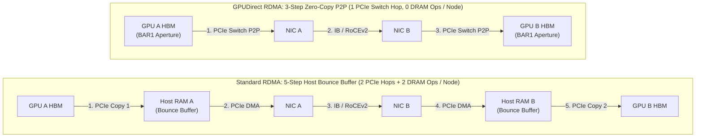
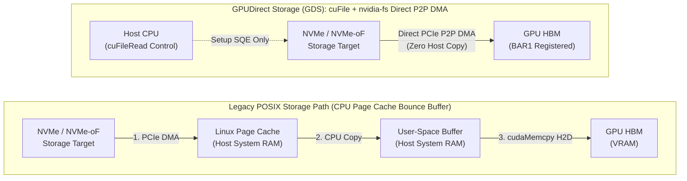

# 12.19 GPUDirect RDMA and GPUDirect Storage

| Field | Value |
|---|---|
| Level | Advanced |
| Priority tier | 1 |
| Lab venue | Nebius GPU + Local Python Verification Lab (`code/part12/gpudirect_rdma_storage_lab.py`) |
| Part | Part 12: Complete AI networking |
| Coverage file | `planning/coverage/chapters/12-19.md` |
| Claim & number ledger | `planning/ledgers/12-19.md` |

## Why this matters for AI infrastructure

Suppose your GPUs finish their math and then sit idle, waiting for the network card or the storage array to deliver the next batch. You pay for each of those GPUs by the hour, so every idle second is money spent on nothing. The cause of the wait is older than most of the hardware in the rack. Standard Remote Direct Memory Access (RDMA), the method a network card uses to move data into memory without the CPU copying it, and standard Linux POSIX file I/O, the file interface that ordinary programs use for reads and writes, were designed for a time when the host CPU and its system DRAM were the final destination of every packet and storage block.

In an AI factory, that is no longer true. Network collective payloads and training datasets never get computed in host DRAM. Matrix multiplications, attention kernels and optimizer updates all run inside GPU High-Bandwidth Memory (HBM), so that is where the data has to end up. Think of host DRAM as a storage room between the loading dock and the cooks. A pallet that goes through the storage room has to be unloaded, shelved, and loaded again before a cook can use it. Each extra handling step takes time and uses up room, and that cost is what this chapter measures.

When an RDMA Network Interface Card (NIC) or an NVMe drive cannot reach GPU HBM directly, each byte has to stop in a host memory bounce buffer in CPU DRAM first. That extra copy doubles the traffic on the PCIe root complex, which is the hub inside the CPU that connects PCIe devices such as GPUs and NICs. It also saturates the memory controllers of a dual-socket CPU. The result is that a 400 Gbps network link or a 200 GB/s storage array delivers only a fraction of its rated speed.

Imagine two identical trucks on the same road. One drives straight to the dock, and the other stops at the storage room on the way. The trucks are the same, but the trip is not. The table below shows where the cost lands on each data path, using the figures from this chapter. Notice the last column: the hardware is the same, but the measured impact changes once the data has to pass through host memory.

| Subsystem or Data Path | Hardware Specification or Bottleneck | Measured Impact |
|---|---|---|
| GPU HBM internal bandwidth | A100: `2.0 TB/s`; H100 SXM: `3.35 TB/s`; H200: `4.8 TB/s`; B200: `8.0 TB/s` | Compute kernels consume terabytes per second directly from HBM |
| Inter-node 400 Gbps (`50.0 GB/s`) link without GPUDirect RDMA | 2 PCIe traversals (`GPU A -> Host RAM A -> NIC A` and `NIC B -> Host RAM B -> GPU B`) and 2 DRAM operations per node across `8 x 400 Gbps` (`400.0 GB/s` / `3.2 Tbps` across 8 rails) | Collapses per-NIC throughput from `50.0 GB/s` (`400 Gbps`) down to `6.25 GB/s` (`~50 Gbps`, an `8.0x` degradation) |
| AI factory storage ingestion and checkpoint bursts | 72-GPU GB200/GB300 NVL72 rack at `200 MB/s` per GPU requires `14.4 GB/s` (`14–20 GB/s`); 1,024-GPU streaming or `2.0 TB` checkpoint in `60 s` requires `33.33 GB/s` to `200.0 GB/s` | Routing through Linux VFS page cache and `cudaMemcpyHostToDevice` throttles `200.0 GB/s` arrays (`WEKA`, `Lustre`, `VAST`, `IBM Storage Scale`, `DeepSeek 3FS`) to `10.0 GB/s` |
| GPUDirect RDMA zero-copy path | Exposes HBM on PCIe via BAR1 and registers pages with `mlx5_core` / `ib_core` via `nvidia-peermem` or Linux `dma-buf` (`ibv_reg_dmabuf_mr`) | Enables direct P2P DMA between NIC and GPU HBM across a shared PCIe switch (`PIX`/`PXB`) at full `50.0 GB/s` line rate |
| GPUDirect Storage zero-copy path | Replaces buffered POSIX `read()`/`write()` with CUDA `cuFile` (`cuFileDriverOpen`, `cuFileHandleRegister`, `cuFileBufRegister`, `cuFileRead`, `cuFileWrite`) and `nvidia-fs.ko` | `gdsio -x 0` achieves `9.6 GB/s` at `1.00 ms` average latency vs `8.0 GB/s` at `1.25 ms` with CPU-staged `gdsio -x 2` (`+20.0%` throughput, `-20.0%` latency) |

The names can sound like marketing, so it helps to strip them down. Both features let a device and a GPU exchange data without the CPU copying it. The difference is the other end of the trip. One talks to another machine's memory through the network card, and the other talks to a disk or a file system.

GPUDirect RDMA and GPUDirect Storage are the two halves of the NVIDIA Magnum IO zero-copy architecture. Together they take the host memory bounce buffer out of the data plane. The CPU stays in the control plane, which is the part that decides what moves and when, but it no longer touches the bytes. Think of the control plane as the dispatcher who tells each truck where to go, and the data plane as the trucks that carry the freight. GPUDirect RDMA maps GPU HBM directly to the network adapter over the local PCIe switch. GPUDirect Storage streams dataset shards and checkpoints straight between NVMe or NVMe-oF storage and GPU memory.

A vendor brochure might quote a storage array at 200 GB/s, and your team might plan a cluster around that figure. The brochure number is the best case, and the path decides how close you get to it. Before you size a network or storage tier, check whether its data path stages through host DRAM, because that decides how much of the rated hardware you actually get.

## Prerequisites and outcomes

### Prerequisites
Imagine you have just been handed a GPU node and asked why one of its links runs slow. Answering that question needs a few ideas from earlier chapters, so check that they feel familiar before you start. Read the PCIe root complexes, switches and NUMA (non-uniform memory access, where each CPU socket has its own nearby memory) layout from the distance codes that `nvidia-smi topo -m` prints. Those codes are the quickest map of the box you are looking at. You also need the RDMA basics from Chapters 12.14 and 12.15: Queue Pairs, Memory Regions, key registration, and the RoCEv2 and InfiniBand transports. Finally, you should understand how NCCL collectives work, and how Linux block and file storage behaves, including NVMe, direct I/O and the VFS page cache.

Vocabulary is the first hurdle on a new topic. The terms in this block show up in almost every log line and command in the rest of the chapter, so take a minute to match each one to its meaning before you start.

The block below lists the distance codes, keys, flags and collectives this chapter uses, so you can check your vocabulary before you read on.

```text
Prerequisite distance codes, keys, flags, and collectives:
- Topology distance codes: PIX, PXB, PHB, NODE, SYS
- RDMA keys & POSIX flags: lkey, rkey, O_DIRECT
- Collectives: AllReduce, ReduceScatter, AllGather, AllToAll
```

### Outcomes
Picture a new GPU node that a colleague hands you on a Monday morning with one question: is this node ready for training? This chapter walks through the answer in order. It begins with what host bounce-buffer staging costs in PCIe hops, DRAM operations and latency, and how GPUDirect RDMA compares. It then explains how BAR1 mapping, `nvidia-peermem.ko` and upstream Linux `dma-buf` let an RDMA NIC reach GPU memory. Next it shows how `NCCL_NET_GDR_LEVEL` and `NCCL_NET_GDR_READ` decide which path NCCL takes, and how PCIe Access Control Services (ACS) can switch the fast path off. After that, it traces the NVMe-oF and GPUDirect Storage path through `libcufile.so`, `nvidia-fs.ko` and `/etc/cufile.json`. The last step validates and benchmarks both paths with `lsmod`, `nvidia-smi -q`, `ib_write_bw --use_cuda`, `gdscheck -p`, and `gdsio`. Start with the first step, because the numbers it gives you are the yardstick for judging every later result.

---

## 1. The Host Bounce-Buffer Bottleneck vs GPUDirect Zero-Copy

Consider a training run on two nodes that runs slower than the spreadsheet predicted. The GPUs look busy on the dashboard, yet each step takes longer than it should. The first question to ask is where the bytes actually travel.

Picture a traditional CPU-centric server. The host operating system treats the GPU and the network or storage controller as separate PCIe endpoints, and they cannot exchange data directly. Every transfer between them has to go through system DRAM. On a multi-rail AI node, that memory becomes a severe bottleneck.

### 1.1 The 5-Step Traditional Network Bounce-Buffer Path

Follow one tensor on its trip, because a single trip shows every stop the bytes make. You do not need a special tool for this. You need a clear picture of where each copy of the data lives at each moment, and the steps below give you exactly that picture.

Consider what happens when GPU A on Node A sends a tensor to GPU B on Node B using standard RDMA, with no GPUDirect RDMA. The payload crosses five stages between the two hosts.

1. The CUDA runtime copies the tensor from GPU A HBM across the PCIe bus. It passes through the CPU Root Complex and lands in a pinned staging buffer in Host RAM A.
2. The CPU tells NIC A to read that pinned host buffer. NIC A then issues a PCIe DMA read through the CPU Root Complex.
3. NIC A wraps the payload in InfiniBand or RoCEv2 packets and sends them across the leaf-spine fabric to NIC B.
4. NIC B receives the packets and DMAs the payload across the PCIe bus into a pinned bounce buffer in Host RAM B.
5. The CUDA driver on Node B starts a `cudaMemcpyAsync` DMA that moves the data across PCIe from Host RAM B into GPU B HBM.

A tensor is just a block of numbers, such as the gradients for one layer, and it can be large. Each of the five stages above has its own queue and its own wait, so the tensor stops at every stage rather than moving in one smooth motion. Notice that the data lands in host memory on each side before it moves on. That detour is exactly what GPUDirect removes.

### 1.2 The 3-Step GPUDirect RDMA Zero-Copy Path

Now picture the same tensor on a node where GPUDirect RDMA is switched on. The network card reaches into the GPU's memory window directly, so the trip looks like a short cut across the yard. With GPUDirect RDMA active, the path gets much shorter. Host RAM and the CPU memory controllers drop out of the data path entirely.

1. NIC A issues a PCIe Peer-to-Peer DMA read straight against GPU A's exposed BAR1 address space, across the local PCIe switch.
2. NIC A sends the RDMA frames at line rate across the fabric to NIC B.
3. NIC B issues a PCIe P2P DMA write straight across Node B's PCIe switch into GPU B's exposed BAR1 aperture.



The table sets the two paths side by side, so you can see what each step costs you. Read each row as a question. How many stops does the data make, and how many of those stops are copies through DRAM? As you read it, start with the PCIe traversals and DRAM operations, since they explain the throughput and latency rows below them.

Use this table when a colleague asks what GPUDirect actually changes. It answers in counts of stops and bytes rather than in general claims. Each row is a number you can check on your own node with the tools in the commands section, which makes the table a useful checklist before a design review.

| Path Characteristic | Standard RDMA (Host Bounce Buffer) | GPUDirect RDMA (`GDR` Zero-Copy) |
|---|---|---|
| End-to-end data transfer steps | `5` steps (`GPU A -> RAM A -> NIC A -> NIC B -> RAM B -> GPU B`) | `3` steps (`GPU A -> NIC A -> NIC B -> GPU B`) |
| `PCIe` bus traversals per node | `2` (`20.0 GB` `PCIe` traffic per `10.0 GB` payload) | `1` (`10.0 GB` `PCIe` switch traffic per `10.0 GB` payload) |
| Host `DRAM` operations per node | `2` (`1` write + `1` read = `20.0 GB` `DRAM` traffic per `10.0 GB`) | `0` (`0.0 GB` host `DRAM` traffic; `CPU` is control-plane only) |
| `PCIe` path traversed | Up to CPU Root Complex (`PHB`) and `DRAM` controller | Direct port-to-port inside shared `PCIe` switch (`PIX` / `PXB`) |
| Typical throughput on `400 Gbps` (`50.0 GB/s`) link | `~6.25 GB/s` (`~50 Gbps`, root-complex / `DRAM` bottlenecked) | `50.0 GB/s` (`400 Gbps` line rate, `8.0x` speedup over staged) |
| Small-message latency | `~10–18 us` (double `PCIe` + `DRAM` staging overhead) | `~1.5–2.0 us` (direct `P2P` `BAR1` DMA) |

### 1.3 Quantitative Bandwidth and PCIe Generation Math

A NIC rated at 400 Gbps can still underperform, and a slot that is too slow is one common reason. Before you trust a network number, check the PCIe slot the NIC sits in. A slot that is too slow caps the NIC, however fast the network is, much like a wide highway that narrows to one lane at a bridge. Here is the arithmetic. A single ConnectX-7 400 Gbps NIC delivers 50.0 GB/s, and it fits inside one PCIe Gen5 x16 slot rated at 63.02 GB/s.

| PCIe Generation or Node Configuration | Per-Lane Rate & Encoding | Unidirectional / Aggregate Bandwidth | Operational Consequence |
|---|---|---|---|
| **PCIe Gen3 x16** | `8.0 GT/s` (`128b/130b`) | `15.75 GB/s` per `x16` slot | Insufficient for 200G/400G NICs |
| **PCIe Gen4 x16** | `16.0 GT/s` (`128b/130b`) | `31.51 GB/s` (`~31.5 GB/s` unidir, `63.0 GB/s` bidir) | Fits a 200 Gbps (`25.0 GB/s`) NIC per `x16` slot |
| **PCIe Gen5 x16** | `32.0 GT/s` (`128b/130b`) | `63.02 GB/s` (`~63 Gbps` per lane raw / `~64 GB/s` nominal) | Fits a single ConnectX-7 `400 Gbps` (`50.0 GB/s`) NIC per `x16` slot |
| **PCIe Gen6 x16** | `64.0 GT/s` (`PAM4` `242B/256B` FLIT) | `121.0 GB/s` per `x16` slot | Fits an `800 Gbps` (`100.0 GB/s`) ConnectX-8 NIC per `x16` slot |
| **8-GPU DGX/HGX H100 with GPUDirect RDMA** | 8 dedicated ConnectX-7 `400 Gbps` NICs (`Rail 1..8`) on local PCIe switches (`PIX`) | `8 x 50.0 GB/s = 400.0 GB/s` (`3.2 Tbps`) network bandwidth | `0.0 GB/s` host DRAM traffic |
| **8-GPU DGX/HGX H100 Host-Staged Fallback** | `400.0 GB/s` `NIC -> DRAM` writes + `400.0 GB/s` `DRAM -> GPU` reads | Demands `800.0 GB/s` host DRAM traffic + `800.0 GB/s` CPU root-complex PCIe traffic | Saturates dual-socket CPU memory controllers and throttles each `400 Gbps` rail to `~50 Gbps` (`6.25 GB/s`) |

A worked example makes the table real. Suppose you are sizing one node for a training team, and the question is how much network the GPUs really get. Take the 8-GPU DGX/HGX H100 node as a worked example.

Take the 8-GPU DGX/HGX H100 node as a worked example. With GPUDirect RDMA, eight ConnectX-7 NICs each deliver 50.0 GB/s. Together that is 400.0 GB/s of network bandwidth, and the host DRAM sees none of it. Without GPUDirect, the same 400.0 GB/s has to be written into DRAM and then read back out. That adds up to 800.0 GB/s of host DRAM traffic, which is why the rails slow down to about 50 Gbps each.

Walk through the arithmetic once more, since it explains the slow rails. The eight NICs can carry 400.0 GB/s together. A host-staged design writes that traffic into DRAM and reads it back out, so the memory system must handle 800.0 GB/s. That load saturates the CPU memory controllers, as the table above showed, which is why each rail falls to about 50 Gbps. For a node like this, confirm that each NIC sits behind the same PCIe switch as its GPU before you count on the full rate.

---

## 2. GPUDirect RDMA Under the Hood: BAR1, `nvidia-peermem`, and `dma-buf`

Suppose an NCCL job fails with an `ibv_reg_mr` error, or NCCL quietly stops using GPUDirect RDMA. The fault usually sits in one of three layers. For an RDMA NIC to run a one-sided RDMA WRITE or RDMA READ straight against GPU HBM, three hardware and kernel mechanisms have to cooperate. If any one of them is missing or disabled in BIOS, `ibv_reg_mr` fails on device pointers, or NCCL silently turns GPUDirect RDMA off.

Think of the three steps as a relay race. The first runner hands the GPU's memory to the PCIe bus, the second runner pins that memory so it cannot move, and the third runner hands an address list to the RDMA stack. If the first runner drops the baton, the later steps have nothing to work with. Each step is short on its own, but the chain only works when all three are present.

1. The GPU must expose its HBM physical pages in the system's 64-bit PCIe Memory-Mapped I/O address space, through Base Address Register 1 (BAR1).
2. The GPU driver must pin the virtual CUDA allocation from `cudaMalloc` or `cuMemCreate`. Pinning keeps the physical HBM pages from being migrated or evicted while the RDMA Memory Region is active.
3. A kernel bridge must translate the GPU virtual address range into PCIe BAR1 physical bus addresses. It then hands that scatter-gather table to the RDMA ib_core subsystem.

### 2.1 PCIe `BAR1` Aperture and `Above 4G Decoding`

A PCIe endpoint is any device that plugs into the bus, such as a GPU, a NIC or an NVMe drive. Each endpoint describes the memory windows it offers in a small configuration header, and the Base Address Registers (BARs) are the entries in that header that point to those windows. When you read a BAR size, you are reading how big a window the device has opened on the bus.

Every PCIe endpoint advertises up to six Base Address Registers in its configuration header. On NVIDIA data center GPUs, BAR0 maps the control registers, and BAR1 maps an aperture of GPU HBM onto the PCIe bus. That aperture is what lets external PCIe masters read and write HBM through MMIO transactions.

Suppose a colleague says the GPUs are ready for GPUDirect RDMA because the BIOS screen looks fine. The first thing to check is how much of the GPU memory the PCIe bus can actually see. The BAR1 total answers that in one short block of output.

The size of that aperture depends on the BIOS. In legacy 32-bit BIOS mode, BAR1 is limited to 256 MiB. That window is far too small for multi-gigabyte NCCL communication buffers or GPUDirect Storage tensor shards. Modern data center GPUs use Large BAR1, which you enable with Above 4G Decoding and Resizable BAR in the server BIOS. The setting exposes the entire HBM capacity in the 64-bit PCIe address space. You can inspect the total and used BAR1 memory with `nvidia-smi -q -d MEMORY`:

```text
PCIe BAR register layout and nvidia-smi -q -d MEMORY output:
- BAR0: ~16-32 MiB (GPU control registers)
- BAR1: 256 MiB in legacy 32-bit BIOS mode vs 64 GiB, 128 GiB, or 256 GiB on A100 80 GB, H100 80 GB, H200 141 GB, B200 192 GB (requires Above 4G Decoding / Resizable BAR / Large BAR)
- If BAR1 Total reports 256 MiB, GPUDirect RDMA registrations > ~200 MiB fail with ibv_reg_mr errors or fall back to host bounce buffers.

BAR1 Memory Usage
    Total                             : 131072 MiB
    Used                              : 2048 MiB
    Free                              : 129024 MiB
```

Think of BAR1 as a window in the wall of a warehouse. A small window lets a forklift reach only a few pallets, however many pallets are inside. A large window lets the network card reach the whole stock. The BIOS setting decides how big that window is, and no NCCL variable can enlarge it after the fact.

If the Total line reads 256 MiB, fix the BIOS before you touch any NCCL setting. Registrations above about 200 MiB will fail or fall back to host bounce buffers.

### 2.2 The Legacy/OFED Path: `nvidia-peermem.ko`

You will meet this path in older runbooks and in clusters built before the upstream option was available. Knowing both paths helps you read the logs of either kind of node, because the names of the modules and the log lines differ.

For a long time, Linux had no upstream subsystem that let a proprietary GPU driver share PCIe peer memory with an InfiniBand or RoCE driver. Mellanox and NVIDIA filled that gap with the Peer Memory Client API inside MLNX_OFED and DOCA-OFED. They shipped it as the `nvidia-peermem.ko` kernel module, which replaced the older standalone `nv_peer_mem` DKMS package. The module works in five steps.

1. Running `modprobe nvidia-peermem` registers a peer-memory client callback table with ib_core. It also hooks into `nvidia.ko` through `nvidia_p2p_get_pages()`.
2. When NCCL calls `ibv_reg_mr` on a CUDA device pointer, ib_core sees that the address is not standard host memory. It then invokes the `acquire()` callback.
3. The peer-memory module calls `nvidia_p2p_get_pages()`, which pins the HBM pages in BAR1 at 64 KiB granularity and returns the physical PCIe bus addresses.
4. The InfiniBand drivers program those BAR1 addresses into the NIC Memory Translation Table. They return local and remote keys that address GPU HBM directly.
5. If the application calls `cudaFree` while the Memory Region is still registered, the GPU driver fires an invalidation callback. That callback tears down the NIC key before the BAR1 pages are recycled.

```text
nvidia-peermem.ko callback table and registration call:
- Callbacks: peer_memory_client (acquire, get_pages, dma_map, dma_unmap, put_pages, release, invalidate_callback)
- Registration call: ibv_reg_mr(pd, gpu_va, size, access_flags) -> 64 KiB BAR1 pages -> mlx5_ib NIC MTT / MKey (lkey, rkey)
```

Think of the invalidate callback as a rule that the GPU driver and the RDMA stack agreed on. If the owner of the memory tries to free it while a network card still holds a key to it, the driver first tells the network stack to drop that key. Without that rule, a card could keep writing into memory that the GPU has already given back.

Notice the callback in step 5. It is what stops the NIC from touching memory the GPU has already freed.

### 2.3 The Upstream Kernel Path: Linux `dma-buf` (`ibv_reg_dmabuf_mr`)

Now suppose you are building a fresh node image and want to avoid an out-of-tree module that must be rebuilt after every kernel upgrade. The upstream path is the one that fits that goal, provided the rest of the stack meets its requirements.

Starting with Linux kernel 5.12, rdma-core v34+, CUDA 11.7+, and the NVIDIA Open GPU Kernel Modules, GPUDirect RDMA has a fully upstream, vendor-neutral path through the Linux `dma-buf` subsystem. This path needs neither `nvidia-peermem.ko` nor the out-of-tree MLNX_OFED peer-memory hooks. It runs in four steps.

1. The application or NCCL allocates GPU memory with `cudaMalloc` or the CUDA Virtual Memory Management API, then queries `CU_DEVICE_ATTRIBUTE_DMA_BUF_SUPPORTED`.
2. NCCL exports the GPU buffer as a standard Linux file descriptor, using `cuMemGetHandleForAddressRange`.
3. NCCL passes that file descriptor straight to libibverbs through `ibv_reg_dmabuf_mr`.
4. Inside the kernel, ib_core attaches to the exported `dma_buf` object and calls `dma_buf_map_attachment()`, which gives it the PCIe BAR1 scatter-gather list.

```text
Upstream dma-buf API sequence (Linux >= 5.12, rdma-core >= 34, CUDA 11.7+, nvidia.ko -open):
1. cuMemCreate / cuMemAddressReserve / cuMemMap + cuDeviceGetAttribute(&supported, CU_DEVICE_ATTRIBUTE_DMA_BUF_SUPPORTED, dev)
2. cuMemGetHandleForAddressRange(&dmabuf_fd, gpu_va, size, CU_MEM_RANGE_HANDLE_TYPE_DMA_BUF_FD, 0)
3. ibv_reg_dmabuf_mr(pd, offset, length, iova, dmabuf_fd, access_flags) -> dma_buf_map_attachment() -> sg_table
```

Before you read the rows, ask what each path depends on. The rows about the kernel module and the driver answer that for the legacy path, while the rows about the kernel version and rdma-core answer it for the upstream path.

The table compares the two paths. The main difference is that the `dma-buf` path needs no out-of-tree module, but it works only with the open GPU kernel modules.

Use this comparison when you plan a node image. Each row is a requirement that either exists on your stack or does not, so you can answer the question for each node type without guessing. Read the NCCL log indicator row last, because it is the proof you will look for in the job output.

| Feature / Requirement | `nvidia-peermem` (`peer_memory_client`) | Upstream Linux `dma-buf` (`ibv_reg_dmabuf_mr`) |
|---|---|---|
| Kernel module required | `nvidia-peermem.ko` (`lsmod \| grep nvidia_peermem`) | None beyond `nvidia.ko` (`-open`) and upstream `ib_uverbs` / `mlx5_ib` |
| GPU driver compatibility | Proprietary (`nvidia.ko`) **and** OpenRM (`-open`) | **NVIDIA Open GPU Kernel Modules (`-open`) only** |
| RDMA stack requirement | `MLNX_OFED` / `DOCA-OFED` (`ib_core` with `peer_memory_client`) | Upstream Linux kernel `>= 5.12` + `rdma-core >= 34` (or `DOCA-OFED`) |
| `libibverbs` registration call | `ibv_reg_mr(pd, gpu_va, size, access)` | `cuMemGetHandleForAddressRange()` + `ibv_reg_dmabuf_mr(...)` |
| `BIOS` hardware requirement | `Above 4G Decoding` + `Large BAR1` | `Above 4G Decoding` + `Large BAR1` |
| `NCCL` log indicator (`NCCL_DEBUG=INFO`) | `NET/IB : GPU Direct RDMA Enabled for GPU ...` | `NET/IB : DMA-BUForte` / `DMA-BUF support enabled` |

Read the table as a checklist for a new image. Each row names something that must be present or absent. The last row is the one you will see in your job logs, so note its exact text now.

If your stack meets the `dma-buf` requirements, the table shows you can drop the out-of-tree module.

---

## 3. PCIe Topology, Rail Alignment, and `NCCL_NET_GDR_LEVEL`

Picture a node that passes every module check and still runs slowly. The software is usually fine by then, and the cause is more often the wiring than the drivers.

Loading `nvidia-peermem` or `dma-buf` makes GPUDirect RDMA possible. It does not guarantee that NCCL uses it. The physical layout of the motherboard decides that for each GPU and NIC pair. If a GPU and a NIC sit on opposite sides of a CPU Root Complex or an inter-socket link, peer-to-peer DMA can stall or deadlock. So NCCL turns GPUDirect RDMA off on that path.

### 3.1 `nvidia-smi topo -m` Distance Codes and `NCCL_NET_GDR_LEVEL`

Suppose you are about to launch a job and want to know which GPU and NIC pairs get the fast path. NCCL answers that question on its own when the communicator starts, and you can read the same answer before the job runs.

When `ncclCommInitRank` starts, NCCL reads `/sys/class/pci_bus/`, `/sys/class/infiniband/` and NVML to build an internal topology graph. It then assigns a distance code between every GPU and every RDMA NIC. The table lists those codes, what each one means physically, and what NCCL does with GPUDirect RDMA writes and reads on each path. When you run `nvidia-smi topo -m` on your own node, find the code for each GPU and NIC pair and look it up here.

| `NCCL` / `nvidia-smi topo -m` Code | Numerical Distance | Physical Path Between GPU and NIC | Default `GDR` Write Behavior | Default `GDR` Read Behavior (`NCCL_NET_GDR_READ`) |
|---|---|---|---|---|
| **`LOC`** | `0` | Same physical device (self baseline) | N/A | N/A |
| **`PIX`** | `1` | Traverses **at most a single `PCIe` switch** | **Enabled** (optimal zero-copy path) | **Enabled** (direct `P2P` read over `PCIe` switch) |
| **`PXB`** | `2` | Traverses **multiple cascaded `PCIe` switches** without crossing the CPU Host Bridge | **Enabled** (default `NCCL_NET_GDR_LEVEL` cutoff is `PXB` / `2` or `PHB` / `3` by platform) | **Enabled** |
| **`PHB`** | `3` | Traverses the **`PCIe` Host Bridge (CPU Root Complex)** within the same `NUMA` socket | Platform-dependent (`Disabled` when cutoff is `PXB`; `Enabled` if `NCCL_NET_GDR_LEVEL=PHB` or `3`) | **Disabled by default** (`P2P` reads across CPU Root Complex stall; requires `NCCL_NET_GDR_READ=1`) |
| **`NODE`** | `4` | Traverses interconnect between multiple `PCIe` host bridges inside a single `NUMA` node | **Disabled** unless `NCCL_NET_GDR_LEVEL=NODE` (`4`) | **Disabled** |
| **`SYS`** | `5` | Crosses the **inter-socket `NUMA` link (`Intel UPI` / `AMD Infinity Fabric xGMI`)** | **Disabled** (`P2P` over `UPI`/`xGMI` deadlocks or severely degrades bandwidth; `NCCL` forces host bounce buffer) | **Disabled** |

Read the table from the top. The closer a NIC sits to its GPU, the more likely NCCL keeps the zero-copy path. Think of the distance code as a count of how many doors the data must pass through. Each door adds delay, and the far doors also add risk. The rows from PIX to SYS follow that order.

The write and read rules look like fine print, but they decide whether a slow link is slow for a reason you can fix.

NCCL treats GPUDirect RDMA writes and reads differently. A write happens when the NIC pushes incoming network data into GPU BAR1. A read happens when the NIC pulls outgoing data out of GPU BAR1.

The two also differ at the PCIe level. A PCIe Posted Write is a one-way Memory Write Transaction Layer Packet that needs no completion. A PCIe Non-Posted Read is a split round trip. The NIC sends a Memory Read Request, and it must hold completion buffers while it waits for Completion with Data packets to return.

That difference decides which paths allow reads, and the reason is about waiting. A write can leave and forget about it, while a read has to wait for the reply to come back. Inside a dedicated PCIe switch on a PIX or PXB path, P2P reads run at full 400 Gbps speed. Across a CPU Root Complex on a PHB path, P2P reads suffer severe credit starvation. So NCCL leaves GDR reads disabled on PHB unless you force `NCCL_NET_GDR_READ=1`.

The block below names the two packet types behind that difference. Keep them in mind when a path looks fast on paper but slow in a log. The write is a one-way message, and the read is a question with an answer that must come back.

```text
PCIe Transaction Layer Packet (TLP) behavior for GPUDirect RDMA:
- GDR Write (NIC -> GPU BAR1): Posted Memory Write TLP (MWr), one-way fire-and-forget
- GDR Read  (NIC <- GPU BAR1): Non-Posted Memory Read Request TLP (MRd) + Completion with Data TLP (CplD) round-trip
```

### 3.2 The 8-NIC Rail-Optimized Architecture (`DGX` / `HGX`)

Suppose you are racking a new eight-GPU server and need to decide which cable goes to which port. The rail layout answers that question before you touch a cable.

NVIDIA DGX and HGX servers are built so that every GPU has a distance-1 PIX path to its RDMA NIC. That path never crosses a CPU Root Complex or an inter-socket link. Each server pairs 8 GPUs with 8 dedicated NICs across 4 PCIe switches. Those 8 NICs connect to 8 independent leaf switch planes, designated Rail 1 through Rail 8.

Think of the rail design as a set of separate lanes on a highway. Each lane has its own car, its own on-ramp, and its own exit. Traffic in one lane never has to merge with another lane, which keeps every pair on the short route.

Read the diagram one NUMA socket at a time. Each GPU and its NIC share a PCIe switch, so every pair stays on the PIX path. The line between the two sockets marks the CPU's inter-socket link, which the pairs never cross.

```text
NUMA 0 (CPU Socket 0):
  [ GPU 0 ] <--PIX--> [ PCIe Switch 0 ] <--PIX--> [ mlx5_0 (NIC 0) ] ===> Leaf Switch 0 (Rail 1)
  [ GPU 1 ] <--PIX--> [ PCIe Switch 0 ] <--PIX--> [ mlx5_1 (NIC 1) ] ===> Leaf Switch 1 (Rail 2)
  [ GPU 2 ] <--PIX--> [ PCIe Switch 1 ] <--PIX--> [ mlx5_2 (NIC 2) ] ===> Leaf Switch 2 (Rail 3)
  [ GPU 3 ] <--PIX--> [ PCIe Switch 1 ] <--PIX--> [ mlx5_3 (NIC 3) ] ===> Leaf Switch 3 (Rail 4)
--------------------------- NUMA Boundary (CPU UPI / xGMI Interconnect) ---------------------------
NUMA 1 (CPU Socket 1):
  [ GPU 4 ] <--PIX--> [ PCIe Switch 2 ] <--PIX--> [ mlx5_4 (NIC 4) ] ===> Leaf Switch 4 (Rail 5)
  [ GPU 5 ] <--PIX--> [ PCIe Switch 2 ] <--PIX--> [ mlx5_5 (NIC 5) ] ===> Leaf Switch 5 (Rail 6)
  [ GPU 6 ] <--PIX--> [ PCIe Switch 3 ] <--PIX--> [ mlx5_6 (NIC 6) ] ===> Leaf Switch 6 (Rail 7)
  [ GPU 7 ] <--PIX--> [ PCIe Switch 3 ] <--PIX--> [ mlx5_7 (NIC 7) ] ===> Leaf Switch 7 (Rail 8)

Intra-node interconnect and InfiniBand GPUDirect Async (IBGDA) specs:
- Intra-node GPU-to-GPU: NVLink / NVSwitch at 900 GB/s per GPU on H100; 1.8 TB/s per GPU across 18 NVLink 5 links on B200 / GB200 NVL72 (130 TB/s rack); 900 GB/s NVLink-C2C between Grace CPU and Hopper/Blackwell GPU
- IBGDA (InfiniBand GPUDirect Async) in NCCL and NIXL: GPU SMs ring NIC doorbells directly over PCIe without waking a host CPU proxy thread
```

A rail is only as good as its weakest pairing. If a single GPU lands on the wrong switch, its traffic has to cross the CPU, and that one pair can slow a whole synchronized step, because every other GPU waits for it.

Keep each GPU on the same switch as its NIC when you cable or schedule a node. The rail design only works while every pair stays together.

---

## 4. The PCIe ACS Trap and IOMMU Passthrough

Imagine a GPU and a ConnectX-7 NIC plugged into slots behind the same PCIe switch. The hardware looks right, yet throughput is poor. One BIOS security feature can quietly send every P2P packet up to the CPU Root Complex, and that detour wrecks GPUDirect RDMA throughput. The culprit is PCIe Access Control Services (ACS).

### 4.1 How PCIe ACS Breaks Peer-to-Peer Switching

Why would a security feature touch GPU traffic at all? The answer starts with virtual machines. A feature built to keep one tenant out of another tenant's memory can also get in the way of two devices that are meant to talk directly.

PCIe Access Control Services was designed for multi-tenant hypervisors. It stops a PCIe device inside one virtual machine from DMA-reading the BAR memory of a device in a sibling VM. The access is blocked unless the CPU's IOMMU, such as Intel VT-d or AMD-Vi, validates it first.

When ACS redirection or source validation bits are enabled on a PCIe switch downstream port, direct peer-to-peer switching breaks down in three steps. Picture a letter that should go straight from one desk to the desk next to it, while the rule says every letter must first go to the head office. The letter still arrives, only later and by a longer route.

1. NIC 0 issues a PCIe P2P DMA write that targets GPU 0's BAR1 address on the same PCIe switch.
2. Instead of switching the packet straight to the GPU port inside the switch ASIC, the switch intercepts the TLP. It forces the packet upstream, over the PCIe root port, to the CPU Root Complex and IOMMU.
3. The CPU Root Complex sends the translated packet back down through the same root port, into the PCIe switch, and finally to GPU 0.

A hairpin is a turn that sends you back the way you came. Here the packet goes up to the CPU and then comes back down to the same switch, which is why it crosses the same root port twice.

This hairpin sends 400 Gbps of traffic across the PCIe root port twice. That cuts effective P2P bandwidth by 50% to 80%. Worse, and this is the part that surprises most engineers, when NCCL inspects the PCIe bridge ACS bits during topology discovery, it downgrades the GPU-to-NIC path from PIX to PHB or SYS. That downgrade turns GPUDirect RDMA off completely and forces a fallback to host DRAM bounce buffers.

### 4.2 Auditing and Disabling ACS (`lspci -vvv` and `setpci`)

Suppose the topology output shows PHB where you expected PIX. Before you change anything, confirm the ACS bits on each bridge between the GPU and the NIC.

To check whether ACS blocks P2P on your PCIe switch ports, inspect `ACSCtl` in the output of `lspci -vvv` `(untested here)`:

```bash
# Audit PCIe Access Control Services (ACS) control bits across all PCIe bridges (untested here)
sudo lspci -vvv | grep -E "^[0-9a-f]{2}:|ACSCap|ACSCtl"
```

Read the flags as a set of warning lights on a dashboard. A plus sign means the feature is on, and a minus sign means it is off. The goal is to see only minus signs on the path between your GPU and your NIC, because any plus sign on that path can send the traffic back up to the CPU.

Look at the redirection and validation flags on every downstream port between your GPUs and your NICs or NVMe drives. If any of those ports reports a plus sign on a redirection or validation flag, ACS is actively redirecting P2P traffic upstream. The example below shows a bridge with those flags set.

```text
16:00.0 PCI bridge: Broadcom / LSI PEX890xx PCIe Gen5 Switch
    ACSCap: SrcValid+ TransBlk+ ReqRedir+ CmpltRedir+ UpstreamFwd+ EgressCtrl- DirectTrans-
    ACSCtl: SrcValid+ TransBlk- ReqRedir+ CmpltRedir+ UpstreamFwd+ EgressCtrl- DirectTrans-
    (Blocking flags: ReqRedir+, CmpltRedir+, SrcValid+, TransBlk+, UpFwd+ / UpstreamFwd+)
```

The fix you choose depends on how long the node will stay in service. A runtime change is useful for testing a theory, but it does not survive a reboot. A BIOS and GRUB change is the one you keep.

The permanent fix happens in two places. First, disable ACS in the server BIOS. Second, set `iommu=pt` through `intel_iommu=on iommu=pt` or `amd_iommu=on iommu=pt` in `/etc/default/grub`. Passthrough mode lets host bare-metal DMA skip dynamic IOMMU translation, and it still supports SR-IOV Virtual Functions. For an immediate fix that needs no reboot before NCCL starts, clear the 16-bit ACS Control register at offset `+0x6` of `ECAP_ACS` on each PCIe bridge `(untested here)`:

```bash
# Disable ACS P2P redirection at runtime on all PCIe bridge ports (class 0x060400) (untested here)
for BDF in $(lspci -d "*:*:0604" | awk '{print $1}'); do
    sudo setpci -v -s "${BDF}" ECAP_ACS+0x6.w=0000 2>/dev/null || true
done
```

A short example helps here. Imagine a bridge that reports a plus sign on a redirect flag. Every packet that crosses it takes the long route up to the CPU and back, even though both devices sit on the same switch. The fix is to clear that bit, and the next topology run shows the path as PIX again.

After you clear `ECAP_ACS+0x6.w=0000`, `ACSCtl` shows minus signs across all redirection bits. The `nvidia-smi topo -m` output shows PIX across every rail again. The `setpci` change is a runtime fix, so for any node you plan to keep, make the BIOS change too.

---

## 5. GPUDirect Storage (`GDS`), `NVMe-oF`, and the `cuFile` Pipeline

Picture a dataloader where the GPUs spend most of each minute waiting for the next batch. The GPUs are not slow. The batch is still on its way through the host.

GPUDirect RDMA moves data between GPUs across the training fabric. An AI cluster also has to move data to and from storage. It ingests petabytes of training samples and writes multi-terabyte checkpoints. When those reads and writes go through the host CPU page cache, dataloader workers saturate the host cores while the GPUs sit idle, waiting for batches.

Think of the four tiers as a ladder, with the fastest and smallest storage at the top and the slowest and largest at the bottom. A job climbs down the ladder when the data it needs does not fit higher up.

The table lists the four tiers a training job can draw on, from GPU HBM down to the object store. Tier 2 is where the 200 GB/s arrays from the first section live, so keep it in mind as you read.

| Storage Tier | Capacity & Hardware Profile | Bandwidth / Latency & Role |
|---|---|---|
| **Tier 0: GPU HBM** | `40 GB` or `80 GB` (A100), `80 GB` (H100), `141 GB` (H200), `192 GB` (B200) / `288 GB` (B300) | `1.5–8.0 TB/s`; active tensor working set |
| **Tier 1: Local Host NVMe Cache** | `8 x 3.84 TB` local PCIe Gen5 NVMe SSDs in RAID 0 inside a DGX H100 node | `~100 ns` local PCIe access latency; staging hot shards via `hostPath` or AIStore / Alluxio |
| **Tier 2: Parallel File System / NVMe-oF** | WEKA, Lustre (DDN EXAScaler / AWS FSx for Lustre), IBM Storage Scale (GPFS), VAST Data, BeeGFS, or DeepSeek Fire-Flyer File System (`3FS`) | `100 Gbps`–`400 Gbps` RoCEv2 or InfiniBand (`~300 ns` IB switch latency, `~700–900 ns` / `800 ns` Ethernet switch latency, often `1:3` leaf-to-spine oversubscribed or dual-fabric `Fab A / Fab B` redundant) |
| **Tier 3: Object Store / Data Lake** | S3-compatible storage (AWS S3, MinIO, Ceph, FlashBlade) over HTTPS / TLS | Raw data lakes and long-term checkpoint archives |

### 5.1 `NVMe-oF` State Machines (`NVMe/TCP` vs `NVMe/RDMA`)

Suppose the storage team says the array sits on the same network as your GPUs, and you need to know whether that link can drop packets. The transport you pick decides the answer.

When Tier 1 or Tier 2 storage sits across a fabric, NVMe over Fabrics wraps native 64-byte NVMe Submission Queue Entries and 16-byte Completion Queue Entries inside fabric capsules. If you do not understand how NVMe-oF maps memory descriptors and transport ports, you cannot tell a lossy TCP replication link from a lossless RoCEv2 storage fabric.

1. Every NVMe command specifies a logical volume Namespace ID and buffer descriptors. Native PCIe NVMe often uses 64-bit Physical Region Page pointers, whereas NVMe-oF uses Scatter-Gather Lists to describe discontinuous initiator memory regions.
2. NVMe/TCP runs over standard lossy IP and Ethernet fabrics, using MTU 9000 jumbo frames, and it needs neither PFC nor DCQCN. That makes it a good fit for long-haul inter-site replication. Each NVMe Submission and Completion Queue pair maps one-to-one onto a TCP connection, and a host CPU core handles that connection.
3. NVMe/RDMA runs over a lossless RoCEv2 or native InfiniBand fabric. Discovery happens over TCP port 8009. Queue Pair negotiation uses RDMA CM over UDP port 4420, and capsule and target-initiated RDMA transfers use RoCEv2 UDP port 4791. This hardware-offloaded path achieves roughly 66% lower write latency than NVMe/TCP.

Put plainly, the TCP choice trades speed for simplicity, because it runs on ordinary Ethernet and needs no special switch settings. The RDMA choice trades simplicity for speed, because the fabric must be lossless and the card does more of the work. Neither choice is wrong. The question is which trade-off your storage network can support.

```text
NVMe-oF capsule, NVMe/TCP, and NVMe/RDMA protocol specifications:
- NVMe commands & capsules: 64-byte SQE (opcode 0x02 Read, 0x01 Write), 16-byte CQE; CapsuleCmd (0x01), CapsuleResp, H2CData (0x03), C2HData (0x04); NSID, PRP1/PRP2 (64-bit pointers) vs SGL
- NVMe/TCP (NVMe-o-TCP, MTU 9000, 40 km+ replication):
  * TCP 3-way handshake (SYN/SYN-ACK/ACK) on port 8009 -> IC Req PDU / IC Resp PDU -> NVMe TCP Connect Request/Response -> CapsuleCmd -> C2HData PDU #1..#4 -> CapsuleResp (Common Header CH, PDU Specific Header PSH, Header Digest HDGST, PAD, PDU Data, Data Digest DDGST; terminated via H2CTermReq / C2HTermReq)
- NVMe/RDMA (NVMe-o-RDMA over RoCEv2 or InfiniBand, ~66% lower write latency, 1:1 I/O SQ+CQ to RDMA QP):
  * InfiniBand framing: 16 Virtual Lanes (VLs), 64-byte CBFC credits in Link Layer Header (LLH), 16-bit LID (up to 48,000 nodes) in Local Routing Header (LRH), optional GRH, BTH, RETH, ICRC/VCRC
  * Discovery: Get Log Page over TCP port 8009 (RDMA_PRTYPE = 04 for RoCEv2, 02 for InfiniBand, 05 for iWARP)
  * Connection & Data: RDMA CM Request / Reply / Ready to Use over UDP port 4420; target-initiated RDMA_READ / RDMA_WRITE over RoCEv2 UDP port 4791
```

You do not need to memorize every field in the block. Think of it as a reference card that the storage engineer keeps on the desk, and look up the ports when you need them.

Most of this block is protocol detail. The port numbers and the 66% latency figure are the parts to keep.

### 5.2 Why Legacy `POSIX` I/O Starves GPUs

A DataLoader is the part of a training script that hands batches to the GPU, and it runs on the host CPU. When it reads through the normal file path, every batch takes the long route described above, and the CPU does the copying work. That is why a loader problem often looks like a CPU problem at first.

Picture a Python DataLoader that calls `open()` and then `read()` or `pread()`. Linux sends each request through the Virtual File System. Even when the storage behind it is a 200 GB/s WEKA or Lustre cluster, the POSIX path makes the storage NIC or NVMe drive DMA every block into the Linux Page Cache in host DRAM. The CPU then copies those bytes into a user-space buffer, pins it, and issues `cudaMemcpyAsync` across the PCIe bus into GPU HBM. GPUDirect Storage removes both the host page cache and the CPU bounce buffer.



Think of the page cache as a second warehouse that Linux keeps for files. It helps when the same file is read again, but a one-time streaming read pays for the warehouse without gaining anything.

The table compares the two paths attribute by attribute. The rows that matter most are the host DRAM copies and the measured throughput and latency.

Use the rows that count copies and throughput first. A storage path that makes two host copies per read will rarely match a benchmark on the vendor's slide, however well the array is tuned. The last row shows that the gain depends on the platform, so measure your own system before you promise a number.

| Storage Data Path Attribute | Legacy `POSIX` (`open` / `read` + `cudaMemcpy`) | GPUDirect Storage (`cuFile` + `nvidia-fs.ko`) |
|---|---|---|
| Kernel & user-space libraries | Linux `VFS` + Page Cache + `libc` | `libcufile.so` + `libcufile_rdma.so` + `nvidia-fs.ko` |
| File descriptor flags | Default buffered (`O_RDONLY` / `O_RDWR`) | **`O_DIRECT` mandatory** for true zero-copy `DMA` bypass |
| Host `DRAM` copies per read/write | `2` (`Storage -> Page Cache -> User/Pinned RAM -> GPU`) | `0` (`Storage/NIC <-> GPU BAR1` directly across `PCIe` switch) |
| Measured `gdsio` throughput (`4` workers, `1 MiB` IO) | **`8.0 GB/s`** (`gdsio -x 2` CPU-mediated baseline) | **`9.6 GB/s`** (`gdsio -x 0` `GDS` path, **`+20.0%` throughput**) |
| Measured `gdsio` average I/O latency | **`1.25 ms`** (`gdsio -x 2`) | **`1.00 ms`** (`gdsio -x 0`, **`-20.0%` latency**) |
| Enterprise NAS / PFS measured gains (`VAST` / `3FS`) | Baseline CPU-bound (`Ceph ~1.1 TB/s` on `68` nodes) | `+20%` (`A100`), `+30%+` (`H100`); `DeepSeek 3FS` `6.6 TB/s` (`+1.4 TB/s` bg, up to `7.3 TB/s`) |

The gdsio tool is NVIDIA's benchmark for this path, so its numbers show what the hardware can do under a controlled read. Your own loader will differ, but the same comparison applies.

Take the `gdsio` rows as a worked example. The GDS path reaches 9.6 GB/s. The CPU-staged path reaches 8.0 GB/s. Measure the gap against the 8.0 GB/s baseline, and you get the 20 percent throughput gain in the table. Latency runs the other way: it falls from 1.25 ms to 1.00 ms, and that drop is the same 20 percent of the baseline. If your training jobs spend their time waiting in dataloader workers, check whether the storage path still goes through the page cache.

### 5.3 The 10-Stage `cuFile` API and `nvidia-fs.ko` Lifecycle

Picture a training team that rewrites its loader to call cuFile. A few steps later, the job still shows the old throughput. That is the moment to walk through the lifecycle below and find the step that was skipped.

An application, or a framework plugin such as NVIDIA DALI, PyTorch v2.7.0+, kvikio, cuDF, or the NIXL GDS backend, runs the `cuFile` API sequence to use GPUDirect Storage. One limit matters before you start. If a filesystem is mounted through user-space FUSE rather than a kernel module with direct I/O support, `nvidia-fs.ko` cannot intercept the DMA mapping callbacks. True zero-copy GDS is therefore impossible on FUSE mounts.

1. Call `cuFileDriverOpen()` to initialize the user-space driver and open `/dev/nvidia-fs0`, which `nvidia-fs.ko` exports.
2. Open the target file with `O_DIRECT`, so the Linux kernel VFS does not allocate page-cache buffers.
3. Call `cuFileHandleRegister` to wrap the Linux file descriptor into a `CUfileHandle_t`, and to verify filesystem callback support.
4. Call `cudaMalloc` to allocate the destination buffer in GPU HBM.
5. Call `cuFileBufRegister` once to pin the GPU HBM pages in BAR1 and build the PCIe scatter-gather mapping.
6. Call `cuFileRead` or `cuFileWrite`, or their asynchronous stream variants. `nvidia-fs.ko` then substitutes the GPU BAR1 physical addresses, and it DMAs directly into HBM.
7. Deregister the buffer and the handle, close the file descriptor, and close the driver at shutdown. That releases the BAR1 pinning.

The sketch is short on purpose, so the order of the calls is easy to see. Read it from top to bottom, and notice that the close and release calls come after the read, in the reverse order of how the resources were opened.

The C sketch below runs that sequence for a single read. Notice that the buffer registration happens once, outside the read itself, so the pinned pages can be reused across I/Os. Treat it as illustrative and test it on your own stack first.

```c
// Illustrative C/CUDA GPUDirect Storage (cuFile) zero-copy read lifecycle (untested here)
#include <fcntl.h>
#include <unistd.h>
#include <cuda_runtime.h>
#include <cufile.h>

int gds_read_chunk(const char *path, size_t bytes, off_t file_offset) {
    cuFileDriverOpen();
    int fd = open(path, O_RDONLY | O_DIRECT);

    CUfileDescr_t descr = {};
    descr.handle.fd = fd;
    descr.type = CU_FILE_HANDLE_TYPE_OPAQUE_FD;
    CUfileHandle_t cf_handle;
    cuFileHandleRegister(&cf_handle, &descr);

    void *d_buf = nullptr;
    cudaMalloc(&d_buf, bytes);
    cuFileBufRegister(d_buf, bytes, 0); // Pin BAR1 pages once and reuse across I/Os

    ssize_t ret = cuFileRead(cf_handle, d_buf, bytes, file_offset, 0);

    cuFileBufDeregister(d_buf);
    cuFileHandleDeregister(cf_handle);
    cudaFree(d_buf);
    close(fd);
    cuFileDriverClose();
    return (ret == (ssize_t)bytes) ? 0 : -1;
}
```

Two tools in this area have similar names and very different jobs. Mixing them up leads to wrong expectations about where the bytes go.

Do not confuse GPUDirect Storage with `cuda-checkpoint`, which is a different tool. NVIDIA's `cuda-checkpoint` utility pairs with CRIU to snapshot a running CUDA process for fault tolerance. It drains GPU work and copies device memory to host memory first. Framework tensor checkpoints written through `cuFile` do go straight from GPU HBM to disk. `cuda-checkpoint` does not.

```text
Supported GDS filesystems vs cuda-checkpoint API:
- Supported GDS filesystems: EXT4, XFS, WEKA, Lustre, VAST, BeeGFS, IBM Storage Scale (FUSE cannot use native GDS)
- cuda-checkpoint + CRIU host-staged API: cuCheckpointProcessLock -> cuCheckpointProcessCheckpoint -> cuCheckpointProcessRestore -> cuCheckpointProcessUnlock
```

FUSE, short for Filesystem in Userspace, lets a program outside the kernel serve a file system. That flexibility is useful, but it means the data takes a detour through a user-space process, and GDS cannot run zero-copy on that detour.

If your filesystem is a FUSE mount, plan on the host-staged path, because GDS cannot run zero-copy there.

---

## Commands and configurations that matter

### 1. Verifying and Loading GPUDirect RDMA (`nvidia-peermem`, `dma-buf`, `BAR1`, and `ib_write_bw`)

A new node has just been imaged. Before any job goes near it, you want proof that the fast path is ready.

Run these checks in order on a new node. The first confirms the modules, the second confirms the BAR1 size, and the last two confirm the GPU-to-NIC layout and the RDMA bandwidth.

Work through the four numbered checks in order. The first two tell you whether the kernel side is ready, and the last two tell you whether the GPUs and NICs line up and perform.

```bash
# 1. Check whether nvidia-peermem or OpenRM is loaded (untested here)
lsmod | grep -E "nvidia_peermem|nvidia"
sudo modprobe nvidia-peermem

# 2. Verify Large BAR1 aperture is enabled on all GPUs (expect 65536-262144 MiB, NOT 256 MiB) (untested here)
nvidia-smi -q -d MEMORY | grep -A 4 "BAR1 Memory Usage"

# 3. Inspect GPU-to-NIC PCIe switch affinity (expect PIX across matched GPU-NIC rails) (untested here)
nvidia-smi topo -m

# 4. Run RDMA perftest GPU-to-GPU bandwidth test with CUDA memory (--use_cuda) or dma-buf (--use_cuda_dmabuf) (untested here)
# On Server (Node B, GPU 0, mlx5_0):
ib_write_bw -d mlx5_0 --use_cuda=0 --use_cuda_dmabuf -a -F --report_gbits
# On Client (Node A, GPU 0, mlx5_0 -> Node B IP):
ib_write_bw -d mlx5_0 --use_cuda=0 --use_cuda_dmabuf -a -F --report_gbits 10.10.100.2
```

### 2. Essential `NCCL` GPUDirect RDMA Environment Variables

Suppose a job that ran at full speed last week now runs at half speed after a node reboot. The environment variables are a good first place to look, because the launcher may have dropped or changed them.

Export these variables in the environment that launches your job, and check each one against the comment beside it.

Each variable has one job, and the comment beside it names that job. Change only the ones you understand, and keep a copy of the launcher file before you edit it.

```bash
# Verify GPUDirect RDMA activation and dump detected PCIe/NVLink topology XML (untested here)
export NCCL_DEBUG=INFO
export NCCL_DEBUG_SUBSYS=INIT,GRAPH,ENV,NET
export NCCL_TOPO_DUMP_FILE=/tmp/nccl_topo_detected.xml

# Control GPUDirect RDMA PCIe distance cutoff: LOC(0), PIX(1), PXB(2), PHB(3), NODE(4), SYS(5) (untested here)
export NCCL_NET_GDR_LEVEL=PXB       # Default: allow GDR on PIX/PXB; block across CPU root complex/UPI
export NCCL_NET_GDR_READ=1          # 1 = enable direct NIC DMA reads from GPU BAR1

# Bind InfiniBand/RoCEv2 HCAs, GID index, and QoS traffic class (untested here)
export NCCL_IB_DISABLE=0
export NCCL_P2P_DISABLE=0           # Never leave set to 1 in production
export NCCL_IB_HCA=mlx5_0,mlx5_1,mlx5_2,mlx5_3,mlx5_4,mlx5_5,mlx5_6,mlx5_7
export NCCL_IB_GID_INDEX=3          # RoCEv2 IPv4 GID index (verify via show_gids)
export NCCL_IB_TC=106               # Lossless DSCP/PFC Traffic Class for RoCEv2
export NCCL_IB_QPS_PER_CONNECTION=4
export NCCL_IGNORE_CPU_AFFINITY=1   # Let NCCL spread proxy threads within the local NUMA domain
```

Most of these variables are safe defaults that you rarely need to change. The two below carry the most risk because they change which path NCCL is allowed to take.

Two of these need the most care. Leave `NCCL_P2P_DISABLE` at 0 in production, and set `NCCL_NET_GDR_LEVEL` to the widest distance you have verified on your own topology.

### 3. Verifying and Benchmarking GPUDirect Storage (`gdscheck`, `/etc/cufile.json`, `gdsio`, `fio`, `nsys`)

Your storage team has just mounted a new parallel file system, and the first training job reads more slowly than the vendor promised. Start with the same ordered checks you used for RDMA.

Check GDS in the same order as RDMA. Confirm the kernel module, confirm the platform, then measure the throughput.

The storage checks follow the same pattern as the RDMA checks. The module check comes first, then the platform check, and the benchmark comes last, so a failure at the first step saves you from reading misleading numbers.

```bash
# 1. Verify nvidia-fs.ko is loaded and inspect GDS platform compatibility (untested here)
lsmod | grep nvidia_fs
/usr/local/cuda/gds/tools/gdscheck -p

# 2. Benchmark CPU-mediated read (-x 2) vs direct GPUDirect Storage read (-x 0) with gdsio (untested here)
# Baseline (Storage -> CPU Pinned Memory -> GPU, -x 2): ~8.0 GB/s, 1.25 ms avg latency
/usr/local/cuda/gds/tools/gdsio \
    -f /mnt/data/large_file \
    -d 0 -w 4 -s 10G -i 1M -I 0 -x 2

# GPUDirect Storage (Storage -> GPU HBM Direct, -x 0): ~9.6 GB/s (+20%), 1.00 ms (-20%)
/usr/local/cuda/gds/tools/gdsio \
    -f /mnt/data/large_file \
    -d 0 -w 4 -s 10G -i 1M -I 0 -x 0

# 3. Profile cuFile / GDS timeline and overlap with GPU compute kernels in Nsight Systems (untested here)
nsys profile --trace=cuda,nvtx,gds -o gds_timeline python3 train.py
```

#### Hardened `/etc/cufile.json` Configuration

A cufile.json file copied from an old blog post can quietly change how the library behaves. Read the hardened version below as a set of reasons, not as a file to paste in unchanged.

The `cufile.json` file controls how `libcufile` behaves at run time. The hardened version below turns on logging and profiling, caps the pinned BAR1 memory, and refuses silent fallbacks to POSIX I/O.

```json
{
    "logging": {
        "dir": "/var/log/gds",
        "level": "ERROR"
    },
    "profile": {
        "nvtx": true,
        "cufile_stats": 3
    },
    "properties": {
        "max_device_pinned_mem_size_kb": 33554432,
        "use_poll_mode": false,
        "poll_mode_max_size_kb": 4,
        "allow_compat_mode": false,
        "rdma_dev_addr_list": ["10.20.1.10", "10.20.2.10"]
    },
    "fs": {
        "generic": {
            "posix_unaligned_kb": false
        },
        "lustre": {
            "rdma_dev_addr_list": []
        },
        "wekafs": {
            "rdma_write_support": true
        }
    }
}
```

Each key in the table answers one question about memory, polling, or fallback behavior. Read the Operational Behavior column first, since it says what the key does in plain words.

The three keys below carry most of the risk, so the table explains what each one does.

| `/etc/cufile.json` Key | Configured Value | Operational Behavior |
|---|---|---|
| `max_device_pinned_mem_size_kb` | `33554432` (`33,554,432 KiB` = `32 GiB`) | Caps total GPU BAR1 memory pinned concurrently by `cuFileBufRegister` |
| `use_poll_mode` and `poll_mode_max_size_kb` | `false` and `4` (`4 KiB`) | When `use_poll_mode` is `true`, only I/Os `<= 4 KiB` use CPU polling; `1 MiB`–`8 MiB` AI reads/writes still use interrupts |
| `allow_compat_mode` | `false` during validation | Forces `libcufile` to fail loudly if `nvidia-fs.ko` or the mount cannot execute direct DMA, preventing silent fallback to POSIX host bounce buffers |

Keep `allow_compat_mode` at `false` while you validate a node. A broken setup then fails loudly instead of quietly slowing down. A loud failure is easy to find on day one, while a quiet slowdown can hide for weeks, and by then the training team has already planned around the slow numbers.

---

## How it fails

A GPUDirect problem is often silent, because the job keeps running and simply finishes later than it should. That is why the table below is worth bookmarking. It turns a vague complaint about slow training into a short list of checks you can run in order.

Most GPUDirect problems show up as slow training rather than as errors. The table lists six failure modes, what you will observe, how to confirm the cause, and how to fix it. When you see one of these symptoms on your own cluster, find its row and work from the diagnosis column.

The table below is a lookup for the moment when a job is slow and you need a starting point. Each row begins with the symptom people usually report first, then gives the check that confirms the cause, and then the fix. Rows 1 and 2 cover most of the GPUDirect RDMA cases, and rows 4 and 5 cover most of the storage cases.

| # | Failure Mode | Observable Symptom | Root-Cause Diagnosis | Remediation |
|---|---|---|---|---|
| **1** | **Silent `GPUDirect RDMA` fallback to Host Bounce Buffers (`nvidia-peermem` / `BAR1` missing)** | `4`-node `DGX`/`HGX` `400 Gbps` InfiniBand job achieves only `~50 Gbps` (`6.25 GB/s`) per link; host CPU usage and `DRAM` bandwidth spike while GPUs stall in `ncclKernel_AllReduce`. | `lsmod \| grep nvidia_peermem` is empty (and `dma-buf` prerequisites are unmet), or `nvidia-smi -q -d MEMORY` shows `BAR1 Total: 256 MiB` (`Above 4G Decoding` disabled in `BIOS`). `NCCL_DEBUG=INFO` logs `GPU Direct RDMA Disabled`. | Enable `Above 4G Decoding` / `Large BAR` in `BIOS`, load `sudo modprobe nvidia-peermem` (or deploy `NV Peer Memory` / `DOCA` via `NVIDIA Network Operator`), and verify `NET/IB : GPU Direct RDMA Enabled` in `NCCL_DEBUG=INFO`. |
| **2** | **`PCIe ACS` (`Access Control Services`) P2P Redirection Trap** | `nvidia-peermem` is loaded and `GPU` + `NIC` share a physical `PCIe` switch, yet `nvidia-smi topo -m` shows `PHB`/`SYS` or `ib_write_bw --use_cuda` drops `50%–80%` below line rate. | `sudo lspci -vvv \| grep ACSCtl` shows `SrcValid+ ReqRedir+ CmpltRedir+ UpstreamFwd+` on `PCIe` switch ports, forcing every `P2P` TLP upstream to the CPU Root Complex / `IOMMU`. | Disable `ACS` (`P2P Isolation`) in `BIOS`, set `iommu=pt` (`intel_iommu=on iommu=pt`) in `/etc/default/grub`, and clear runtime bits via `sudo setpci -s <bdf> ECAP_ACS+0x6.w=0000`. |
| **3** | **Cross-Socket `NUMA` (`SYS`) Wiring Violation on Custom Servers** | Custom `AI` server with `NVMe` drives or `NICs` wired to `CPU 0` and GPUs wired to `CPU 1` achieves zero speedup with `GDR` or `GDS`; `UPI`/`xGMI` links saturate at `100%`. | `nvidia-smi topo -m` reports `SYS` between `GPU` and `NIC`/`NVMe`. `NCCL` disables `GDR` (`SYS (5) > PXB (2)`), and `GDS` `DMA` crosses the inter-socket `UPI` link. | Physically recable/reslot `NICs` and `NVMe` drives onto the same `PCIe` switch (`PIX`) as their paired GPUs, bind ranks with `numactl`, and in virtualized/flattened VMs inject a verified `/tmp/topo.xml` via `NCCL_TOPO_FILE`. |
| **4** | **`POSIX` `VFS` / `allow_compat_mode: true` Silent `GDS` Fallback** | `200 GB/s` `WEKA`/`Lustre` storage array delivers only `10 GB/s` to PyTorch; GPUs sit at `15%` utilization while `8` host CPU cores run at `100%` in kernel `copy_user_generic_string`. | `DataLoader` workers use standard Python `open()`/`read()` (or `cuFile` opened without `O_DIRECT` while `allow_compat_mode: true` silently falls back to `POSIX` page-cache copies). | Refactor the input pipeline to use `NVIDIA DALI` or `cuFileRead` with `O_DIRECT`, set `"allow_compat_mode": false` in `/etc/cufile.json` during testing, and confirm non-zero `Ops` in `gds_stats` / `nsys profile --trace=gds`. |
| **5** | **Metadata Server (`MDS`) Saturation ("Small File Problem")** | GPU SM activity drops from `95%` to `30%`; storage throughput is only `5 GB/s` on a `400 GB/s` array while `MDS` CPU hits `100%`. | `strace -c -p <worker_pid>` reveals `85.12%` of syscall time in `stat()` (`452 us/call`), `10.05%` in `openat()`, `4.02%` in `close()`, and only `0.81%` in `read()` across `14 million` `20 KB` `.png` files. | Pack small files into contiguous `1 GB` `WebDataset` `.tar` shards (`50,000` images/shard reduces `stat()` calls by **`50,000x`**), `TFRecord`, `Parquet`, or Megatron `.bin`/`.idx` files, or stage onto Tier 1 local `NVMe` (`hostPath`). |
| **6** | **Cascading `D`-State (`Uninterruptible Sleep`) Storage Hang** | `4` nodes in a `64`-node `DDP` run stop responding; `top` shows load average `500+` with `0%` CPU; hundreds of `python3` processes sit in state `D` and ignore `kill -9`. | `dmesg -T` shows `INFO: task python3:12345 blocked for more than 120 seconds` in `rpc_wait_bit_killable [sunrpc]`; `ibstat` / `ibv_devinfo -d mlx5_0` shows link `DOWN` or `symbol_error_counter > 1000` on a storage AOC cable. | Replace the faulty optical cable, hard-reset locked nodes via `ipmitool chassis power reset`, and mount read-only dataset shares with bounded/soft timeouts (`rsize=1048576,wsize=1048576,noatime,actimeo=60,lookupcache=pos`) while reserving hard mounts for checkpoints. |

The table is long, so use it as a lookup rather than a story to read in order. Find the symptom that matches what your dashboard shows, and then follow that row's diagnosis column.

When a multi-node job runs far below line rate, start with row 1. It checks the BAR1 size and the `nvidia-peermem` path that the earlier sections covered, and so confirm them before you look anywhere else.

---

## Hands-on lab

### Venue and Scope
Suppose you want to check the arithmetic in this chapter before you touch a GPU node. The local lab gives you that chance on a laptop. The cluster commands in this lab were not run on a live cluster, so treat them as a guide until you run them on your own hardware.

You can run the local lab on any machine with Python 3, because it uses only the standard library. The lab lives in `code/part12/gpudirect_rdma_storage.py` and `code/part12/gpudirect_rdma_storage_lab.py`, and it runs 28 automated self-checks that cover the arithmetic and decision logic from this chapter. The cluster commands in the configuration section need live GPU and RDMA hardware, so each one carries the `(untested here)` marker.

### Run the Verification Lab

You have just read the bounce-buffer and BAR1 sections, and this run checks the arithmetic behind them. Nothing in the run touches a GPU, so it is safe to repeat as often as you like.

Run the lab with this single command.

```bash
python3 -B code/part12/gpudirect_rdma_storage_lab.py
```

The output below is what you should see if every check agrees with the chapter. A surprise in one line is more useful than a long pass, because it points to the exact claim that does not hold on your machine.

The expected output below shows what a clean run looks like. Each line names one check.

```text
=== Chapter 12.19 Lab: GPUDirect RDMA and GPUDirect Storage ===
  [PASS] 1. Staged path traverses 2 PCIe hops and 2 DRAM ops per node
  [PASS] 2. GPUDirect RDMA traverses 1 PCIe switch hop and 0 DRAM ops per node
  [PASS] 3. 400G NIC achieves 50.0 GB/s with GDR vs 6.25 GB/s (50 Gbps) host-staged (8.0x speedup)
  [PASS] 4. 10 GB payload generates 20.0 GB PCIe + 20.0 GB DRAM traffic per node when staged vs 10.0 GB PCIe + 0.0 GB DRAM with GDR
  [PASS] 5. PCIe Gen4 x16 = 16 GT/s (31.51 GB/s) and PCIe Gen5 x16 = 32 GT/s (63.02 GB/s)
  [PASS] 6. Linux kernel 5.15 (>= 5.12) + OpenRM + rdma-core 44 (>= 34) selects dma-buf without nvidia-peermem
  [PASS] 7. Proprietary driver on kernel 5.4 with nvidia-peermem loaded selects nvidia-peermem
  [PASS] 8. Disabled Large BAR1 / Above 4G Decoding forces host-staging-fallback even when drivers are loaded
  [PASS] 9. Proprietary GPU driver without nvidia-peermem cannot use dma-buf and falls back to host staging
  [PASS] 10. NCCL path hierarchy orders LOC(0) < PIX(1) < PXB(2) < PHB(3) < NODE(4) < SYS(5)
  [PASS] 11. PIX path with default PXB cutoff and ACS off enables both GDR Write and GDR Read
  [PASS] 12. PXB path with PXB cutoff enables both GDR Write and GDR Read
  [PASS] 13. PHB path exceeds PXB cutoff and disables GDR by default
  [PASS] 14. Raising NCCL_NET_GDR_LEVEL=PHB enables GDR Write on PHB but keeps GDR Read off by default
  [PASS] 15. Setting NCCL_NET_GDR_READ=1 explicitly forces GDR Read on PHB
  [PASS] 16. Cross-socket SYS path (UPI/QPI) disables GDR under PHB cutoff
  [PASS] 17. PCIe ACS enabled on a PIX switch redirects traffic to PHB and disables GDR under PXB cutoff
  [PASS] 18. ACS parser flags SrcValid+/ReqRedir+/CmpltRedir+ on 0000:16:00.0 and emits setpci ECAP_ACS+0x6.w=0000
  [PASS] 19. ACS parser marks 0000:64:00.0 clean when all ACSCtl bits are '-' (disabled)
  [PASS] 20. cuFile API lifecycle contains all 10 ordered stages from cuFileDriverOpen to cuFileDriverClose
  [PASS] 21. gdsio Table 5-1 baseline (-x 2, Storage->CPU) achieves 8.0 GB/s at 1.25 ms latency (1.25 s for 10 GB)
  [PASS] 22. gdsio Table 5-1 GDS path (-x 0, Storage->GPU) achieves 9.6 GB/s (+20.0%) at 1.00 ms (-20.0%)
  [PASS] 23. /etc/cufile.json audit converts 33,554,432 KB to 32.0 GiB and flags allow_compat_mode=true + 4 KB poll cap on 1 MB I/O
  [PASS] 24. /etc/cufile.json strict validation mode (allow_compat_mode=false, use_poll_mode=false) emits 0 warnings
  [PASS] 25. 2 TB checkpoint in 60 s requires 33.33 GB/s sustained write bandwidth (fits on >= 1x 400G link = 50 GB/s)
  [PASS] 26. Packing 50,000 tiny 20 KB files into a single 1 GB WebDataset tar cuts metadata stat() syscalls by 50,000x
  [PASS] 27. 8-GPU rail-optimized HGX node with 8x 400G NICs delivers 400.0 GB/s (3.2 Tbps) aggregate RDMA bandwidth
  [PASS] 28. 72-GPU NVL72 rack at 200 MB/s per GPU requires 14.4 GB/s (14-20 GB/s range) sustained storage ingestion

Summary: 28 passed, 0 failed
```

Read the output line by line, as you would read a checklist. Each line is one claim from this chapter, so a FAIL points you straight to the part of the chapter that needs review.

Think of the summary line as the signature at the bottom of a test report. It says how many checks passed, and it does not tell you why any check failed. For that reason, read the individual lines first and the summary last. A single FAIL is more useful than a summary that looks clean but hides a claim you never read.

A clean run ends with the summary line reading 0 failed. Any other result points to the check whose line says FAIL.

---

## Common first mistakes

Picture your first week with a GPU node. Each mistake below is easy to make on a first run, and each one looks fine until a benchmark or a training log shows the cost. Each entry names the mistake, why it hurts and what to change.

1. Plain RDMA without `--use_cuda` only shows that the NIC can reach host RAM without an extra copy. If `nvidia-peermem` or `dma-buf` is missing, or ACS is enabled, NCCL still runs over InfiniBand. It then stages every GPU tensor through a host DRAM bounce buffer. Check for the `GPU Direct RDMA Enabled` line in your debug logs, and run `ib_write_bw --use_cuda=0` to confirm the path.
2. Forcing P2P DMA across an inter-socket link, such as Intel UPI or AMD Infinity Fabric, causes severe credit stalls, high tail latency or PCIe completion timeouts. When you see a `SYS` path, fix the physical slot assignment or the NUMA rank binding instead of raising `NCCL_NET_GDR_LEVEL=SYS`.
3. When `"allow_compat_mode": true` is active, `cuFileRead()` succeeds even if `nvidia-fs.ko` fails to load or the filesystem mount lacks direct DMA support. That silent fallback hides the fact that all I/O is bouncing through host DRAM. Set it to `false` in `/etc/cufile.json` during GDS bring-up.
4. Calling `cuFileBufRegister()` and `cuFileBufDeregister()` on every step pins BAR1 pages and rebuilds the PCIe scatter-gather mappings again and again. Register reusable GPU staging buffers once at startup, and pass device offset slices to `cuFileRead` and `cuFileWrite`.
5. Default 4 KiB buffered `fio` tests measure the Linux DRAM page cache and OLTP IOPS, not the streaming throughput of a parallel file system. Benchmark dataset reads and checkpoint bursts with multi-megabyte block sizes and `direct=1` instead.

The two profiles below differ in what they try to stress. The first one reads large blocks in parallel, which matches how a training job streams a dataset. The second one writes large blocks in bursts, which matches how a checkpoint is written. Run each one against the storage path your job actually uses.

```text
Production fio benchmark profiles for AI storage (untested here):
- Streaming dataset read: fio --rw=read --bs=2M --size=500G --numjobs=32 --iodepth=128 --direct=1
- Checkpoint write burst: fio --rw=write --bs=8M --size=100G --numjobs=8 --iodepth=64 --direct=1 --fsync=1000
```

A fio run is a synthetic test, so it shows what the storage can do under the pattern you chose. Pick the pattern that matches your job, not the default one that fio uses when you leave out the options.

Use the streaming profile to check dataset reads and the checkpoint profile to check write bursts. Compare each result with the rate your job actually needs.

---

## Exercises

Imagine your manager asks you to validate a new GPU rack before the training team arrives on Monday. The six exercises below follow that same path, from node wiring to the storage budget. Work through them in order. The parameters you need for each one are in the block at the end of this section.

1. Bounce-buffer vs GPUDirect RDMA traffic amplification. Start with the 8-GPU node parameters in the block below.
   - Work out the per-GPU and whole-node PCIe and host DRAM traffic under bounce-buffer staging.
   - Work out the same traffic under GPUDirect RDMA.
   - Work out how long it takes to move 10.0 GB per rail when host staging throttles each rail to 6.25 GB/s.
   - Compare that time with the time at 50.0 GB/s under GPUDirect RDMA.
2. Kernel backend eligibility. Use `evaluate_gdr_kernel_backend()` to find the selected backend for each of the four node configurations in the problem block.
3. The `NCCL_NET_GDR_LEVEL` and `NCCL_NET_GDR_READ` matrix. For the PIX, PXB, PHB and SYS paths, work out whether GDR Write and GDR Read are enabled under each of the three environment configurations.
4. PCIe ACS hairpin diagnosis and remediation. Picture a node whose PIX path has started to look like PHB. Read the `lspci -vvv` dump in the problem block. Explain how bridge `0000:16:00.0` changes a physical PIX path under `NCCL_NET_GDR_LEVEL=PXB`. Write the `setpci` command that restores direct P2P switching. Name the GRUB kernel parameter that restores direct P2P switching.
5. `gdsio` performance and `/etc/cufile.json` audit. Your team wants proof that GDS helps before it changes the loader. From the `gdsio` results in the problem block, compute the percentage throughput improvement. Compute the percentage latency reduction. Compute the time saved on a 10.0 GB read. Explain why polling mode with a 4 KiB cap has no effect on this 1 MiB workload.
6. Checkpoint burst and WebDataset metadata sizing.
   - Work out the minimum aggregate write bandwidth, in GB/s, that finishes the 2.0 TB checkpoint in 60 s for the cluster described below.
   - Work out the reduction factor in metadata `stat()` and `open()` syscalls when you pack 50,000 files into each 1.0 GB WebDataset `.tar` shard.

```text
Exercise problem parameters and datasets:
- Exercise 1 node & payload parameters:
  * 8-GPU node with 8 x 400 Gbps (50.0 GB/s each) ConnectX-7 NICs; 10.0 GB gradient shard per GPU (80.0 GB total across node)
  * Staged path: 2 PCIe hops and 2 DRAM operations per node, throttled to 6.25 GB/s (50 Gbps) per rail
  * GPUDirect RDMA path: 1 PCIe switch hop and 0 DRAM operations, running at 50.0 GB/s (400 Gbps) per rail
- Exercise 2 evaluate_gdr_kernel_backend() in code/part12/gpudirect_rdma_storage.py configurations:
  * (a) Linux 5.15, NVIDIA OpenRM (-open), rdma-core 44, peermem_loaded=False, large_bar1=True
  * (b) Linux 5.4, proprietary nvidia.ko, rdma-core 32, peermem_loaded=True, large_bar1=True
  * (c) Linux 6.8, OpenRM, rdma-core 50, peermem_loaded=True, large_bar1=False
  * (d) Linux 5.15, proprietary nvidia.ko, rdma-core 44, peermem_loaded=False, large_bar1=True
- Exercise 3 GDR matrix paths & configurations:
  * Paths: PIX (1), PXB (2), PHB (3), SYS (5)
  * Configs: (a) default NCCL_NET_GDR_LEVEL=PXB; (b) NCCL_NET_GDR_LEVEL=PHB with default NCCL_NET_GDR_READ; (c) NCCL_NET_GDR_LEVEL=PHB with NCCL_NET_GDR_READ=1
- Exercise 4 lspci -vvv bridge dump:
  * Bridge 0000:16:00.0: ACSCtl: SrcValid+ TransBlk- ReqRedir+ CmpltRedir+ UpstreamFwd+
  * Bridge 0000:64:00.0: all '-'
- Exercise 5 gdsio benchmark:
  * Command: /usr/local/cuda/gds/tools/gdsio -f /mnt/data/large_file -d 0 -w 4 -s 10G -i 1M -I 0
  * -x 2 (Storage -> CPU): 8.0 GB/s, 1.25 ms latency; -x 0 (Storage -> GPU): 9.6 GB/s, 1.00 ms latency; 1 MiB = 1,024 KiB vs poll_mode_max_size_kb: 4
- Exercise 6 checkpoint & WebDataset sizing:
  * 256-node cluster training a 500B-parameter model writes a 2.0 TB (2,000 GB) checkpoint within 60 s
  * Vision dataset: 14 million raw 20 KB .png files packed at 50,000 files per 1.0 GB WebDataset .tar shard
```

Work on paper before you check with a calculator. The exercises are short, and the habit of writing each step down makes the answers easier to defend in a design review.

Start with exercise 1. Its arithmetic reuses the staged and GPUDirect figures from the first section.

---

## Interview angles

These questions come up in design reviews and hiring loops. Practice saying each answer in your own words, and keep the numbers in your answer tied to the chapter.

1. **"If standard RDMA already bypasses the Linux kernel TCP/IP stack, why do we still need GPUDirect RDMA?"**
   - *What they are testing:* Whether you can tell kernel-bypass networking between the NIC and host DRAM apart from host-memory-bypass PCIe peer-to-peer DMA.
   - *Senior answer:* Standard RDMA bypasses the OS kernel so that it can write into host DRAM. GPU compute kernels run out of GPU HBM, so standard RDMA forces a host bounce buffer. Every byte crosses the PCIe bus twice per node and passes through the CPU memory controller twice. On an 8x 400 Gbps node, that demands 800.0 GB/s of host DRAM bandwidth, which squeezes 400 Gbps links down to roughly 50 Gbps. GPUDirect RDMA pins GPU HBM into the PCIe BAR1 aperture through `nvidia-peermem` or dma-buf. The NIC can then DMA straight to and from GPU HBM across the local PCIe switch, with zero host DRAM traffic.
A strong answer names the mechanism first and the kernel module second. The module is only the way the mechanism is delivered on one kind of stack.

2. **"We upgraded our Ubuntu nodes to the NVIDIA Open GPU Kernel Modules on kernel 6.8 and noticed `nvidia-peermem` is not loaded, yet GPUDirect RDMA works. How?"**
   - *What they are testing:* Modern Linux dma-buf versus legacy `nvidia-peermem`.
   - *Senior answer:* On Linux kernels 5.12 and newer, with rdma-core 34+ and CUDA 11.7+, the NVIDIA Open GPU Kernel Modules support the upstream Linux dma-buf framework. NCCL exports a file descriptor with `cuMemGetHandleForAddressRange` and passes it to `ibv_reg_dmabuf_mr()`. That call maps the BAR1 P2P pages natively, so the out-of-tree `nvidia-peermem.ko` module is not needed. The proprietary `nvidia.ko` driver does not export dma-buf to ib_core, so it still requires `nvidia-peermem.ko`.
Strong interview answers follow the path an engineer would walk on a real node. Check the software state first, then the hardware state, and then the trace of a single worker.

3. **"A team rewrote their loader to use `cuFileRead` for GPUDirect Storage on a 200 GB/s WEKA array, but throughput is stuck at 10 GB/s and host DRAM traffic is still high. How do you prove whether GDS is actually active?"**
   - *What they are testing:* Practical debugging of silent GDS fallbacks and PCIe topology violations.
   - *Senior answer:* Start with `/usr/local/cuda/gds/tools/gdscheck -p` and `lsmod`, which confirm `nvidia-fs.ko` and filesystem support. Next, set `"allow_compat_mode": false` in `/etc/cufile.json`. Compatibility mode silently falls back to POSIX host-DRAM copies when `O_DIRECT` or alignment is missing. Then trace the worker with `strace -c` or `nsys profile --trace=gds`, and read `/var/log/gds/cufile.log`. You want zero-copy operations, not VFS `read()` syscalls. Finally, check `nvidia-smi topo -m` and `lspci -vvv` to confirm that the storage NICs share a PCIe switch with the GPUs, rather than crossing UPI or ACS redirection.

---

## Checkpoint questions (20)

Try each question before you open its answer. The answers keep the chapter's numbers and commands, so you can check your recall against them.

<details><summary>**1. Trace the 5 data-movement steps when GPU A on Node A sends a tensor to GPU B on Node B using standard RDMA without GPUDirect RDMA.**</summary>

```text
1. GPU A HBM -> Host RAM A (PCIe copy 1 on Node A, DRAM write)
2. Host RAM A -> NIC A (PCIe DMA read 2 on Node A, DRAM read)
3. NIC A -> InfiniBand / RoCEv2 Fabric -> NIC B (network transit)
4. NIC B -> Host RAM B (PCIe DMA write 1 on Node B, DRAM write)
5. Host RAM B -> GPU B HBM (PCIe copy 2 on Node B, DRAM read)
```
</details>

<details><summary>**2. How many PCIe bus traversals and host DRAM operations occur per node under GPUDirect RDMA compared to host bounce-buffer staging?**</summary>

Under GPUDirect RDMA, each node makes one PCIe switch traversal between GPU BAR1 and the NIC, and it performs zero host DRAM operations. Under bounce-buffer staging, each node makes two PCIe traversals and performs two host DRAM operations. For a 10.0 GB payload, staging produces 20.0 GB of PCIe traffic and 20.0 GB of host DRAM traffic.
</details>

<details><summary>**3. What is the role of PCIe BAR1 in GPUDirect RDMA and GPUDirect Storage, and which BIOS setting is required to expose full GPU HBM?**</summary>

BAR1 is the PCIe Memory-Mapped I/O window that lets external devices, such as RDMA NICs and NVMe drives, read and write GPU HBM. To expose the full HBM, enable Above 4G Decoding and Large BAR or Resizable BAR in the server BIOS. With those settings, BAR1 can map 64 to 256 GiB of 64-bit address space, instead of the legacy 256 MiB 32-bit limit.
</details>

<details><summary>**4. How does `nvidia-peermem.ko` enable GPUDirect RDMA, and what happens if `cudaFree()` is called on a registered GPU buffer?**</summary>

`nvidia-peermem.ko` registers a peer-memory client with the `ib_core` in MLNX_OFED or DOCA-OFED. It calls `nvidia_p2p_get_pages()` to pin the BAR1 physical pages and to program the NIC's MKey. If `cudaFree()` runs while a memory region is still active, the GPU driver triggers an `invalidate_callback` into `nvidia-peermem`. That callback invalidates the NIC key before the BAR1 pages are unmapped.
</details>

<details><summary>**5. What are the three exact system requirements to use the upstream Linux `dma-buf` path for GPUDirect RDMA without `nvidia-peermem.ko`?**</summary>

```text
1. Linux kernel >= 5.12
2. NVIDIA Open GPU Kernel Modules (nvidia.ko -open; proprietary driver does not export dma-buf for RDMA)
3. rdma-core / libibverbs >= 34 (ibv_reg_dmabuf_mr() support with CU_MEM_RANGE_HANDLE_TYPE_DMA_BUF_FD)
```
</details>

<details><summary>**6. List the six NCCL and `nvidia-smi topo -m` path distance codes in order from closest to farthest.**</summary>

```text
0: LOC  — Same device
1: PIX  — Traverses at most a single PCIe switch
2: PXB  — Traverses multiple cascaded PCIe switches without reaching the CPU Host Bridge
3: PHB  — Traverses a PCIe Host Bridge (CPU Root Complex) within the same NUMA node
4: NODE — Traverses interconnect between multiple PCIe host bridges inside one NUMA node
5: SYS  — Traverses the inter-socket NUMA link (Intel UPI / AMD xGMI)
```
</details>

<details><summary>**7. Why does NCCL disable GPUDirect RDMA reads (`NCCL_NET_GDR_READ=0`) by default on PHB paths even when `NCCL_NET_GDR_LEVEL=PHB` enables GDR writes?**</summary>

The NIC's writes into GPU BAR1 are posted, one-way transactions. Reads from GPU BAR1 are non-posted, split transactions: a read request, followed by completion data. Across a CPU Root Complex on a PHB path, read completions suffer severe credit starvation and latency inside the CPU root ports. Writes still stream well on that path.
</details>

<details><summary>**8. What is PCIe Access Control Services, and how does it sabotage GPUDirect RDMA on a physical PIX topology?**</summary>

PCIe ACS is a virtualization security feature on PCIe switches. It forces peer-to-peer TLPs upstream to the CPU Root Complex and IOMMU for validation, instead of switching them directly between downstream ports. That hairpin runs the traffic across the root port, so NCCL classifies the path as PHB or SYS and turns GPUDirect RDMA off.
</details>

<details><summary>**9. Which `lspci` and `setpci` commands audit and disable PCIe ACS P2P redirection at runtime?**</summary>

```text
- Audit : sudo lspci -vvv | grep -E "^[0-9a-f]{2}:|ACSCap|ACSCtl" (check for SrcValid+, ReqRedir+, CmpltRedir+, UpFwd+)
- Clear : sudo setpci -v -s <bdf> ECAP_ACS+0x6.w=0000 (on each PCIe bridge of class 0x060400)
```
</details>

<details><summary>**10. Why do SR-IOV Virtual Functions require `intel_iommu=on iommu=pt` in GRUB on GPUDirect RDMA nodes?**</summary>

SR-IOV needs the IOMMU turned on through `intel_iommu=on`, so that Virtual Function device memory can be isolated and mapped into Pods or VMs. Setting `iommu=pt` puts the host IOMMU into passthrough mode. That mode skips dynamic DMA translation overhead and allows bare-metal PCIe P2P transfers between GPUs and NICs.
</details>

<details><summary>**11. How is an 8-GPU DGX H100 or HGX rail-optimized node wired across PCIe switches, NUMA nodes, and leaf switches?**</summary>

```text
- NUMA 0: GPU 0-1 + NIC 0-1 on PCIe Switch 0; GPU 2-3 + NIC 2-3 on PCIe Switch 1
- NUMA 1: GPU 4-5 + NIC 4-5 on PCIe Switch 2; GPU 6-7 + NIC 6-7 on PCIe Switch 3
- Rails : Each NIC k (0..7) connects to Leaf Switch k (Rail 1..8), delivering 50.0 GB/s per rail (400.0 GB/s / 3.2 Tbps per node) over PIX paths with zero NUMA crossings.
```
</details>

<details><summary>**12. Compare NVMe-o-TCP and NVMe-o-RDMA across transport ports, handshake state machines, and fabric losslessness requirements.**</summary>

```text
- NVMe-o-TCP : Lossy IP/Ethernet (MTU 9000), TCP port 8009 (SYN/SYN-ACK/ACK -> IC Req/Resp PDU -> NVMe Connect -> CapsuleCmd / C2HData / CapsuleResp).
- NVMe-o-RDMA: Lossless fabric (RoCEv2 with PFC/ECN/DCQCN or InfiniBand with CBFC); discovery over TCP port 8009 (RDMA_PRTYPE = 04 RoCEv2, 02 IB); QP negotiation over UDP port 4420; target-initiated RDMA_READ/RDMA_WRITE data over UDP port 4791 (~66% lower write latency).
```
</details>

<details><summary>**13. In NVMe and NVMe-oF command capsules, what is the difference between NSID, PRP1 and PRP2, and SGL?**</summary>

NSID is the Namespace ID, which names the logical storage volume on the NVMe target controller. PRP1 and PRP2 are 64-bit Physical Region Page pointers. SGL is a Scatter-Gather List descriptor. Both PRP and SGL describe the initiator memory buffer addresses that the DMA engine reads from or writes to.
</details>

<details><summary>**14. Walk through the ordered `cuFile` API calls required to perform a zero-copy GPUDirect Storage read into GPU HBM.**</summary>

```text
1. cuFileDriverOpen()
2. fd = open(path, O_RDONLY | O_DIRECT)
3. cuFileHandleRegister(&cf_handle, &descr)
4. cudaMalloc(&d_buf, bytes)
5. cuFileBufRegister(d_buf, bytes, 0)
6. cuFileRead(cf_handle, d_buf, bytes, file_offset, dev_offset) (or cuFileReadAsync on a cudaStream_t)
7. cuFileBufDeregister(d_buf) -> cuFileHandleDeregister(cf_handle) -> close(fd) -> cuFileDriverClose()
```
</details>

<details><summary>**15. Why cannot a user-space FUSE-mounted filesystem deliver a true GPUDirect Storage zero-copy data path?**</summary>

GPUDirect Storage needs kernel-level filesystem integration that honours `O_DIRECT` semantics. That integration lets `nvidia-fs.ko` intercept block or RDMA DMA mapping in the kernel and substitute GPU BAR1 physical pages. FUSE sends every I/O buffer through a user-space daemon in host DRAM, so it cannot deliver direct P2P DMA into GPU HBM.
</details>

<details><summary>**16. What are the exact `gdsio` flags and measured throughput and latency numbers comparing CPU-mediated storage reads against GPUDirect Storage reads?**</summary>

```text
Command: /usr/local/cuda/gds/tools/gdsio -f /mnt/data/large_file -d 0 -w 4 -s 10G -i 1M -I 0
- -x 2 (Storage -> CPU Memory -> GPU without GDS): 8.0 GB/s throughput at 1.25 ms average latency
- -x 0 (Storage -> GPU Memory with GDS)          : 9.6 GB/s throughput (+20.0%) at 1.00 ms average latency (-20.0%)
```
</details>

<details><summary>**17. What do `max_device_pinned_mem_size_kb`, `use_poll_mode`, `poll_mode_max_size_kb`, and `allow_compat_mode` control in `/etc/cufile.json`?**</summary>

```text
- max_device_pinned_mem_size_kb (33554432 = 32 GiB): Maximum GPU BAR1 memory pinned across cuFileBufRegister calls
- use_poll_mode (false) & poll_mode_max_size_kb (4 KiB): Polls for completion only on I/Os <= 4 KiB; 1-8 MiB AI reads/writes use interrupts
- allow_compat_mode: When true, silently falls back to POSIX host-staged I/O if GDS is unsupported; set to false during verification
```
</details>

<details><summary>**18. How does `cuda-checkpoint` with CRIU differ architecturally from GPUDirect Storage checkpoint writes?**</summary>

`cuda-checkpoint` is a process-level fault-tolerance mechanism. It drains CUDA work and copies GPU device memory into host DRAM during suspend, so CRIU can snapshot the process. It does not DMA directly from GPU HBM to storage over GPUDirect Storage.
</details>

<details><summary>**19. How do you diagnose and fix the Small File Problem on a parallel file system when GPU utilization drops to 30% and storage bandwidth is only 5 GB/s?**</summary>

Run `strace -c -p <dataloader_pid>`. You will see roughly 85.12% of the syscall time go to `stat()` and under 1% go to `read()`, while the Metadata Server CPU sits at 100%. To fix it, pack the small 20 KB files into 1 GB WebDataset `.tar` shards of 50,000 files each. That packing reduces `stat()` calls by 50,000x. TFRecord, Parquet, or Megatron `.bin` and `.idx` formats provide similar consolidation.
</details>

<details><summary>**20. What causes cascading D-state uninterruptible sleep hangs across training nodes, and why does `kill -9` fail to terminate the stuck `python3` processes?**</summary>

Processes enter Linux state D when a kernel syscall, such as `rpc_wait_bit_killable`, blocks while it waits on unresponsive storage or network hardware. A common trigger is a failed InfiniBand optical cable with a symbol error counter exceeding 1,000. The kernel holds in-flight I/O locks and masks all signals until the hardware responds, so `SIGKILL` stays queued. The process remains stuck until the I/O completes or the node is hard-rebooted with `ipmitool chassis power reset`.
</details>

---

## Sources and review notes

Primary book sources, mapped `nvidia-devops` source chapters, and verification scope (`BAR5` NVMe registers, `MRs` and `VMM` Virtual Memory Management, `mlx5_k` rails, `cuCheckpointProcessLock/Checkpoint/Restore/Unlock`, `0644` permissions, `33.3` GB/s checkpoint throughput) for this chapter are summarized below.

```text
1. Primary book sources read in full from the local corpus:
   - AI Data Center Network Design and Technologies (ai-data-center-network-design-and-technologies):
     * Chapter 9 (Storage Network Design and Technologies):
       PCIe Gen5/Gen6 (32 GT/s per lane, ~63 Gbps / ~64 GB/s unidirectional on x16, ~100 ns local PCIe SSD latency vs ~300 ns InfiniBand switch and ~700-900 ns / 800 ns Ethernet switch latency), 4-stage AI training storage lifecycle, Fab A / Fab B storage redundancy (1:3 leaf-to-spine oversubscription, EVPN-VXLAN RT5 / MAC-VRF, collapsed spine, IPsec/HTTPS, 40 km+ deep-buffer switches), Table 9-1 & Table 9-2 (P)NFS, NVMe-o-TCP, NVMe-o-RDMA, and InfiniBand.
       NVMe-o-TCP state machine: TCP port 8009, IC Req/Resp PDU, CapsuleCmd 0x01, CapsuleResp, H2CData 0x03, C2HData 0x04, opcode 0x02 Read / 0x01 Write, NSID, PRP1/PRP2 64-bit pointers vs SGL, CH/PSH/HDGST/PAD/DATA/DDGST, H2CTermReq/C2HTermReq, MTU 9000.
       NVMe-o-RDMA (RoCEv2) state machine: ~66% lower write latency, discovery over TCP 8009 with RDMA_PRTYPE = 04 RoCEv2 / 02 IB / 05 iWARP, RDMA CM over UDP 4420, data over UDP 4791 with BTH/RETH, 1:1 SQ/CQ to QP mapping, target-initiated RDMA_READ/RDMA_WRITE.
       WekaFS and VAST parallel filesystems, GPUDirect Storage (GDS) (cudaMalloc, cuFileBufRegister, PIN to direct IO, PyTorch v2.7.0+), InfiniBand storage (16-bit LID up to 48,000 nodes in LRH, GRH, BTH, ETH, ICRC/VCRC, 16 VLs, 64-byte CBFC credits in LLH).
   - AI Systems Performance Engineering (ai-systems-performance-engineering):
     * Chapter 4 (Tuning Distributed Networking Communication):
       Compute-communication overlap (10 ms + 12 ms = 22 ms serial vs 12 ms overlapped, Table 4-1 & Table 4-2 100 ms 60% SM busy -> 70 ms 90% SM busy, 25 MiB DDP buckets vs DP 45.0 ms -> 30.0 ms, 48.0 ms init_process_group overhead in Table 4-3, Table 4-4 Llama 3 405B 54-day interruptions).
       NVIDIA Magnum IO (GDS + BlueField SNAP, GPUDirect RDMA + NCCL + NVSHMEM + UCX, SHARP / NVLS, NetQ / UFM), GPUDirect RDMA verification (lsmod | grep nvidia_peermem, /dev/infiniband, GID matching, NCCL_DEBUG=INFO, ib_write_bw --use_cuda), IBGDA (InfiniBand GPUDirect Async), Gloo (200.0 ms, 2.0 GB/s) vs NCCL (4.0 ms, 100.0 GB/s on 800G IB for 400 MB), GB200/GB300 NVL72 (72 GPUs, 18 x 100 GB/s = 1.8 TB/s NVLink 5 per GPU, 130 TB/s rack, 900 GB/s NVLink-C2C), ncclCommRegister(), NIXL (0.5.x) KV cache transfers (14x x86 H100 TTFT, 2x GH200 TTFT, 30x Dynamo 680B NVL72 throughput, Table 4-5).
     * Chapter 5 (GPU-Based Storage I/O Optimizations):
       Data locality (200 MB/s per GPU = 1.6 GB/s for 8 GPUs and 14.4 GB/s / 14-20 GB/s for 72-GPU NVL72), blk-mq (none / mq-deadline, read_ahead_kb 128 KB -> multi-MB via blockdev --setra), GPUDirect Storage (cuFile, cuFileRead, cuFileReadAsync, cuFileWriteAsync, nvidia-fs, O_DIRECT, VAST Data +20% on A100 and +30%+ on H100, 1,000 batches/s of 1 MB = 1,000 MB/s), cuda-checkpoint + CRIU, gdsio Table 5-1 (-x 2 Storage -> CPU 8.0 GB/s at 1.25 ms vs -x 0 Storage -> GPU 9.6 GB/s +20% at 1.00 ms -20%), DeepSeek 3FS (6.6 TB/s + 1.4 TB/s bg on 68 nodes with 10 x 16 TB NVMe and dual 100 Gb/s vs Ceph ~1.1 TB/s, up to 7.3 TB/s, why FUSE cannot support GDS), NFS tuning (rsize=1048576,wsize=1048576,noatime,async,actimeo=60,lookupcache=pos), Lustre lfs setstripe (4 OSTs x 500 MB/s = 2.0 GB/s), Blackwell Decompression Engine (LZ4, Snappy, Deflate, nvJPEG), nsys profile --trace=gds, DataLoader tuning (pin_memory=True, prefetch_factor=4, persistent_workers=True, ulimit -l), NVIDIA DALI (800% -> 200% CPU), NVIDIA NeMo Curator (.bin/.idx).

2. Mapped nvidia-devops files read in full and migrated (brief.py 12.19 & planning/MIGRATION_MAP.md):
   - nvidia-zero-to-hero/volume-07/chapter-05-gpudirect-rdma.md (Host Bounce Buffer vs GPUDirect RDMA BAR1 / Large BAR / Above 4G Decoding, PIX vs SYS NCCL_NET_GDR_LEVEL, 4-node DGX H100 400G IB stuck at ~50 Gbps = 6.25 GB/s)
   - nvidia-zero-to-hero/volume-07/chapter-06-gpudirect-storage.md (libcufile cuFileRead local NVMe and remote NVMe-oF GDS, 10 million dashcam video 200 GB/s WEKA stuck at 10 GB/s and 15% GPU util due to Python open()/read() POSIX VFS page-cache bottleneck, solved with NVIDIA DALI + GDS, gdscheck -p, gds_stats)
   - volume-06/02-gpudirect-fabric-operator-masterclass.md (and volume-06/02-nccl-topology-and-gpudirect-rdma.md alias: 5-step bounce buffer vs GPUDirect RDMA BAR1 P2P, PCIe ACS disablement, 8-NIC Rail 1..8 architecture, NCCL_IB_TC=106, NCCL_IB_GID_INDEX=3, NCCL_IB_QPS_PER_CONNECTION=4, NCCL_TOPO_FILE, Network Operator NicClusterPolicy, Multus macvlan, SriovNetworkNodePolicy numVfs: 8, mtu: 9000, vlan: 100)
   - volume-06/03-ai-storage-data-pipelines-masterclass.md (and volume-06/03-storage-data-paths-and-gpudirect-storage.md alias: Tier 0 HBM, Tier 1 8 x 3.84 TB NVMe RAID 0, Tier 2 PFS, Tier 3 S3, nvidia-fs.ko, gdscheck -p, /etc/cufile.json max_device_pinned_mem_size_kb: 33554432, poll_mode_max_size_kb: 4, allow_compat_mode, fio bs=2M 500G 32 jobs and bs=8M 100G 8 jobs fsync=1000, mdtest -np 128 -i 5 -b 10 -z 3 -I 100000, WEKA CSI StorageClass + CUFILE_ENV_PATH_JSON + 400Gi /dev/shm, D-state rpc_wait_bit_killable symbol_error_counter > 1000 load average 500+, strace -c 85.12% stat 452 us / 10.05% openat 106 us / 4.02% close 42 us / 0.81% read 8 us on 14M 20 KB .png -> 50,000x WebDataset reduction, 500B 2 TB checkpoint / 60 s = 33.33 GB/s across 256 nodes)
   - Verification note: Companion simulation and 28 self-checks in code/part12/gpudirect_rdma_storage.py and code/part12/gpudirect_rdma_storage_lab.py verified locally (28 passed, 0 failed). Multi-GPU ib_write_bw --use_cuda, setpci, gdscheck -p, gdsio, fio, mdtest, and nsys profile --trace=gds commands require live hardware and are marked (untested here) where not run on live hardware.
```
