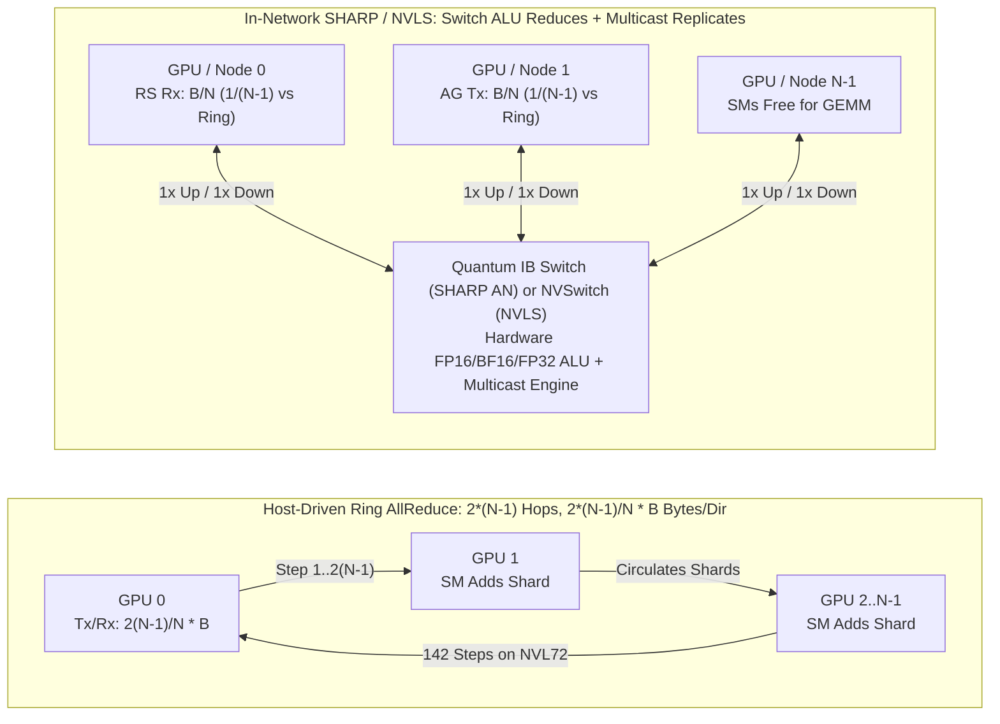
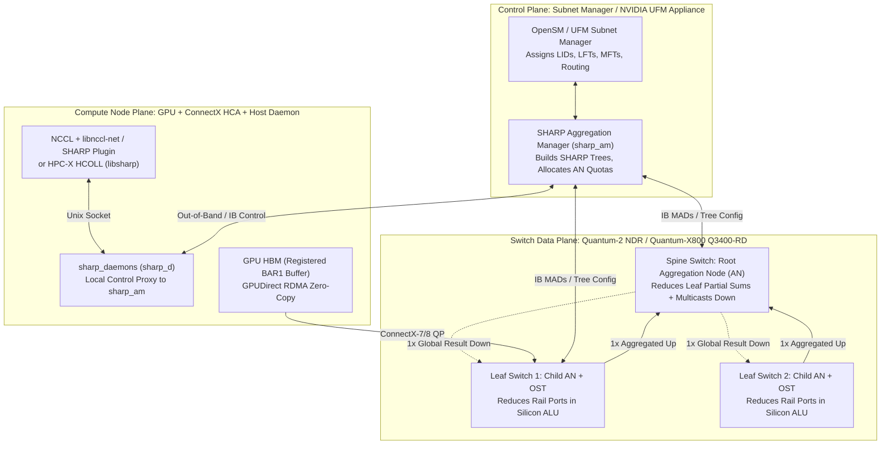

# 12.20 SHARP and in-network computing

| Field | Value |
|---|---|
| Level | Advanced |
| Priority tier | 2 |
| Lab venue | Nebius GPU + Local Python Verification Lab (`code/part12/sharp_in_network_computing_lab.py`) |
| Part | Part 12: Complete AI networking |
| Primary sources | *AI Systems Performance Engineering* (Chapters 2, 4); *AI Data Center Network Design and Technologies* (Chapter 12); *Supercomputers for Linux SysAdmins* (Chapters 5, 21); *NVIDIA DGX SuperPOD GB300 Reference Architecture* |
| Coverage file | `planning/coverage/chapters/12-20.md` |
| Claim & number ledger | `planning/ledgers/12-20.md` |

## Why this matters for AI infrastructure

In a classical distributed training cluster, the network switch acts as a passive byte pipe. GPUs compute partial gradients in High-Bandwidth Memory and pass intermediate shards around a logical Ring or Tree. They also execute every floating-point addition inside GPU Streaming Multiprocessors. This endpoint-driven approach wastes network bandwidth and steals compute cores from matrix multiplication as clusters grow to thousands of GPUs.

1. **Redundant Data Movement Across Endpoints:** In a standard Ring ReduceScatter across $N$ GPUs, each rank receives $N - 1$ chunks over $N - 1$ sequential steps. In a full Ring AllReduce, each rank transmits and receives almost twice the full tensor size across $2(N - 1)$ steps. When the switch fabric contains arithmetic reduction units and hardware multicast engines, the switch sums incoming shards in silicon. It returns only the final shard to each GPU, collapsing per-endpoint receive traffic to a fraction of the ring volume.
2. **SM Occupancy and Collective Latency at Scale:** When GPUs execute Ring or host-driven Tree reductions, 16 to 32 GPU Streaming Multiprocessor thread blocks stay busy copying and summing network buffers. Offloading the reduction into switch silicon frees those GPU cores and drops communication channels down to 4 when paired with `ncclCommRegister`. It also collapses multi-node hop complexity from linear to logarithmic. Overlapped shard exchange time drops in half, and large-scale AllReduce operations run 2x to 5x faster.

```text
Endpoint Ring vs In-Network SHARP and NVLS Reference Numbers:
- Ring ReduceScatter per-rank receive volume: B * (N - 1) / N bytes over (N - 1) hops
- SHARP / NVLS ReduceScatter per-rank receive volume: B / N bytes (1 / (N - 1) of Ring)
- 8-GPU node (800 MB tensor): Ring RS receives 700.0 MB (7 hops) vs NVLS 100.0 MB (7.0x / 1/7 reduction); Ring AR transfers 1,400.0 MB in 14 steps (vs 6 tree steps)
- 32-node IB cluster (1,024 MB / 1.024 GB tensor): Ring RS receives 992.0 MB vs SHARP 32.0 MB (31.0x / 1/31 reduction); Ring AR transfers 1,984.0 MB in 62 steps vs SHARP 1,024.0 MB per direction in 10 tree steps (~1.94x / 1.9375x speedup)
- 72-GPU GB200/GB300 NVL72 rack (720 MB tensor): Ring RS receives 710.0 MB vs NVLS 10.0 MB (71.0x / 1/71 reduction); Ring AR transfers 1,420.0 MB in 142 steps vs 14 tree steps
- Overlapped NVLS multicast AllGather + ReduceScatter wall time: cuts phase time by ~1/2 (50.0%, 16.0 ms -> 8.0 ms)
- Large-scale (32+-node) InfiniBand SHARP AllReduce speedup: 2x to 5x
- NVSwitch Gen 3 (HGX H100/H200): 900 GB/s bidirectional per GPU
- NVSwitch Gen 4 (DGX GB200/GB300 NVL72): 18 NVLink 5 links x 100 GB/s = 1.8 TB/s bidirectional per GPU, 130 TB/s rack bisection across 72 GPUs and 18 NVSwitch chips in 9 switch trays
- Quantum InfiniBand SHARP generations: SHARPv2 on 200 Gbps HDR, SHARPv3 on 400 Gbps NDR, SHARPv4 on 800 Gbps XDR Quantum-X800 Q3400-RD 144-port switches
- Chapter prerequisite references: Chapters 12.2, 12.6, 12.7, 12.9, 12.15, 12.16, and 12.19
```

NVIDIA implements in-network computing across two switch domains within the Magnum IO stack:
- **NVLink SHARP:** Switch-resident reduction and hardware multicast engines are built into NVSwitch Gen 3 and NVSwitch Gen 4 fabrics. This path is enabled via `NCCL_NVLS_ENABLE=1`.
- **InfiniBand SHARP:** Switch-resident Scalable Hierarchical Aggregation and Reduction Protocol engines run inside Quantum InfiniBand switches. This path is enabled via `NCCL_COLLNET_ENABLE=1` and managed by `sharp_am`, OpenSM or UFM, and host `sharp_daemons`.

## Prerequisites and outcomes

### Prerequisites
- Working mastery of RDMA Queue Pairs, Memory Regions, and GPUDirect RDMA with `nvidia-peermem` and `dma-buf` from earlier chapters in this part.
- Familiarity with the InfiniBand Subnet Manager OpenSM, UFM, LIDs and GIDs, and 64-byte Credit-Based Flow Control from earlier chapters.
- Understanding of NCCL collective operations, Ring, Tree, and PAT algorithms, and LL, LL128, and Simple wire protocols from earlier chapters.

### Outcomes
After completing this chapter, you will be able to:
1. Derive the exact byte volume and step complexity of Ring collectives versus InfiniBand SHARP and NVSwitch NVLS. You will also calculate the wall-time savings from overlapping multicast AllGather with in-network ReduceScatter.
2. Architect two-level hierarchical collectives that combine intra-node or intra-rack NVSwitch NVLS with inter-rack CollNetDirect and CollNetChain.
3. Trace the SHARP control plane and data plane across UFM, OpenSM, `sharp_am`, `sharp_daemons`, switch Aggregation Nodes, and Operand State Tables.
4. Distinguish SHARPv1, SHARPv2, SHARPv3, SHARPv4, and NVLS hardware capabilities, supported floating-point precisions, and IEEE-754 floating-point determinism.
5. Configure and troubleshoot NCCL with `NCCL_COLLNET_ENABLE=1`, `NCCL_NVLS_ENABLE=1`, `NCCL_SHARP_DISABLE=0`, and `ncclCommRegister`. You will also configure OpenMPI HCOLL with `HCOLL_ENABLE_SHARP=1` and compare InfiniBand SHARP against Spectrum-X Ethernet and UEC INC.

---

## 1. Mathematical Foundations: Endpoint Ring/Tree Collectives vs In-Network Reduction

### 1.1 Why Host-Driven Ring Collectives Multiply Traffic by (N - 1)

When training a large model across $N$ GPUs or $N$ compute nodes, every rank holds a local gradient tensor of $B$ bytes. That tensor must be globally summed across all ranks before the optimizer step can proceed. If the network switches only forward packets from port to port, the GPUs must circulate slices of that tensor among themselves. Every extra hop adds serialization latency and consumes link bandwidth that could otherwise serve other collectives.

In a standard Ring ReduceScatter, the tensor of size $B$ is divided into $N$ equal chunks of size $\frac\{B\}\{N\}$. Over $N - 1$ pipelined steps, every rank sends one chunk to its downstream neighbor and receives one chunk from its upstream neighbor. Each rank adds the incoming data into its local accumulator. During ReduceScatter alone, every GPU sends and receives the following byte volume:

$$V_\{\text\{Ring, RS\}} = (N - 1) \times \frac\{B\}\{N\} = B\frac\{N - 1\}\{N\}\text\{ bytes\}$$

In a standard Ring AllGather, each GPU starts with its reduced $\frac\{B\}\{N\}$ shard. It then circulates shards around the ring for another $N - 1$ steps without arithmetic addition. Combining both phases into a Ring AllReduce requires $2(N - 1)$ sequential steps. It forces every rank to transmit and receive almost $2B$ bytes per direction:

$$V_\{\text\{Ring, AR (unidirectional per rank)\}} = 2\frac\{N - 1\}\{N\}B\text\{ bytes\}, \qquad \text\{Steps\}_\{\text\{Ring, AR\}} = 2(N - 1)$$

As the cluster size $N$ grows from 8 to 1,024 ranks, the factor $\frac\{N - 1\}\{N\}$ approaches 1. Every GPU transmits nearly $2B$ bytes and receives nearly $2B$ bytes for $4B$ total bidirectional traffic. At the same time, every rank waits through $2(N - 1)$ serial hop latencies.

### 1.2 In-Network Reduction (NVLS and SHARP) and the 1 / (N - 1) Traffic Collapse

When the switch ASIC contains arithmetic reduction units called Aggregation Nodes and hardware multicast engines, partial sums no longer circulate from GPU to GPU. The switch performs the additions as packets pass through the fabric. It delivers only the final result to each endpoint. This shift eliminates redundant endpoint traffic across four key collective patterns:

1. **In-Network ReduceScatter:** With NVLink SHARP or InfiniBand SHARP, the switch aggregates incoming contributions from all $N$ endpoints inside switch silicon. It writes only the final reduced $\frac\{B\}\{N\}$ shard back to each target GPU. Instead of receiving $B\frac\{N - 1\}\{N\}$ bytes across $N - 1$ hops, each GPU receives only $\frac\{B\}\{N\}$ bytes:

$$\frac\{V_\{\text\{SHARP/NVLS, RS (rx)\}}\}\{V_\{\text\{Ring, RS (rx)\}}\} = \frac\{B / N\}\{B(N - 1) / N\} = \frac\{1\}\{N - 1\}$$

2. **Hardware Multicast AllGather:** AllGather performs no arithmetic reduction, so NVLS accelerates it via hardware multicast inside the NVSwitch fabric. Each GPU sends its $\frac\{B\}\{N\}$ shard once into the switch. The switch replicates that shard to all $N - 1$ peers in one hop. Each sender transmits only $\frac\{B\}\{N\}$ bytes, cutting sender volume to $\frac\{1\}\{N - 1\}$ of the ring volume.
3. **Inter-Node SHARP AllReduce:** In an inter-node InfiniBand SHARP AllReduce on tensor size $B$, each node streams $1 \times B$ bytes up into its leaf switch. The switch hierarchy reduces all nodes' tensors in flight as packets climb to the root switch. The root switch then multicasts the $1 \times B$ reduced result back down. Each node experiences only 2 fabric traversals instead of $2\frac\{N - 1\}\{N\}B$ bytes per direction in a Ring AllReduce.
4. **Overlapping Multicast AllGather with In-Network ReduceScatter:** In Fully Sharded Data Parallelism or ZeRO-3 training, parameter AllGather and gradient ReduceScatter contend for endpoint bandwidth when run serially in a ring. With NVLS, hardware multicast replication and in-network arithmetic reduction run concurrently inside the switch fabric. Overlapping a multicast AllGather of duration $T_\{\text\{AG\}}$ with an in-network ReduceScatter of duration $T_\{\text\{RS\}}$ cuts the combined phase wall time:

$$T_\{\text\{overlapped, NVLS\}} = \max(T_\{\text\{AG\}}, T_\{\text\{RS\}})$$

```text
Quantitative Breakdown of Ring vs NVLS and SHARP Traffic Collapse:
- 8-GPU HGX H100 node (B = 800 MB):
  Ring ReduceScatter Rx = 700.0 MB (7 hops) vs NVLS ReduceScatter Rx = 100.0 MB -> 7.0x (1 / 7) volume reduction
  Ring AllReduce = 1,400.0 MB unidirectional across 14 steps (vs 6 tree steps)
- 32-node InfiniBand cluster (B = 1,024 MB / 1.024 GB):
  Ring ReduceScatter Rx = 992.0 MB vs SHARP ReduceScatter Rx = 32.0 MB -> 31.0x (1 / 31) volume ratio
  Ring AllReduce = 1,984.0 MB unidirectional across 62 steps vs SHARP AllReduce = 1,024.0 MB per direction (2,048.0 MB total tx+rx) across 10 tree steps -> 1.9375x (~1.94x) wire reduction and 2x to 5x end-to-end speedup at 50.0 GB/s (400 Gbps NDR) or 100.0 GB/s (800 Gbps XDR)
- 72-GPU GB200/GB300 NVL72 rack (B = 720 MB):
  Ring ReduceScatter Rx = 710.0 MB vs NVLS ReduceScatter Rx = 10.0 MB -> 71.0x (1 / 71) volume reduction
  Ring AllReduce = 1,420.0 MB unidirectional across 142 steps vs 14 tree steps
- Overlapped NVLS AllGather (T_AG = 8.0 ms) + ReduceScatter (T_RS = 8.0 ms):
  Serial Ring time = 8.0 ms + 8.0 ms = 16.0 ms vs Overlapped NVLS time = max(8.0, 8.0) = 8.0 ms -> 50.0% (~1/2) wall-time reduction
```



| Collective Metric | Host-Driven Ring (`NCCL_ALGO=Ring`) | Host-Driven Tree (`NCCL_ALGO=Tree`) | In-Network NVLS / CollNet (SHARP) |
|---|---|---|---|
| ReduceScatter per-rank receive volume | $B\frac\{N - 1\}\{N\}$ (700 MB on 8 GPUs; 710 MB on 72 GPUs) | N/A; Tree executes Reduce + Broadcast | **$B / N$** (100 MB on 8 GPUs; 10 MB on 72 GPUs = **1 / (N - 1)** of Ring) |
| AllGather per-rank send volume | $B\frac\{N - 1\}\{N\}$ (700 MB on 8 GPUs; 710 MB on 72 GPUs) | N/A | **$B / N$** via NVLS hardware multicast (**1 / (N - 1)** of Ring) |
| AllReduce unidirectional bytes per rank | $2\frac\{N - 1\}\{N\}B$ (1,984 MB for 1,024 MB on 32 nodes) | $\approx 2B$ split 50/50 across dual complementary trees | **1.0 * B** up + **1.0 * B** down (2 * B total tx+rx; **~2x less wire traffic**) |
| Step / latency complexity | $2(N - 1)$ steps (62 on 32 nodes; 142 on 72 GPUs) | $2\lceil\log_2 N\rceil$ steps (10 on 32 nodes; 14 on 72 GPUs) | **1–2 switch hops (NVLS)** or **$2\lceil\log_k N_\{\text\{nodes\}}\rceil$ (SHARP)** |
| Where arithmetic reduction executes | GPU SMs (16–32 CUDA channel blocks) | GPU SMs on interior tree nodes | **Switch ASIC silicon** (NVSwitch NVLS ALU or Quantum SHARP AN) |
| Overlapped AllGather + ReduceScatter time | $T_\{\text\{AG\}} + T_\{\text\{RS\}}$ (16.0 ms serial bandwidth contention) | $T_\{\text\{AG\}} + T_\{\text\{RS\}}$ | **$\max(T_\{\text\{AG\}}, T_\{\text\{RS\}})$** (8.0 ms, **~1/2 wall time**) |

---

## 2. Two Domains of In-Network Computing: NVLink SHARP (NVLS) vs InfiniBand SHARP (CollNet)

During cluster bring-up and production debugging, engineers frequently confuse NVLink SHARP with InfiniBand SHARP. When a multi-node job runs slower than expected, enabling the wrong environment variable leaves inter-node traffic on a host-driven ring while appearing to succeed. Both technologies belong to the NVIDIA Magnum IO in-network compute pillar and use switch-resident reduction units. However, they operate on different physical fabrics and use separate control planes.

### 2.1 Intra-Node and Intra-Rack NVLink SHARP (NVLS and NVLSTree)

NVLink SHARP offloads reductions and multicast replication inside an NVSwitch domain, either within an 8-GPU server or across a 72-GPU rack. Every GPU connects directly to the NVSwitch crossbar at terabyte-per-second speeds. Moving reductions into the NVSwitch ASIC eliminates peer-to-peer GPU relay hops and frees GPU memory bandwidth for compute kernels.

```text
NVSwitch Gen 3 and Gen 4 Hardware Specifications:
- HGX H100 / H200 (NVSwitch Gen 3):
  8 GPUs per server node, 18 NVLink 4 links per GPU, 900 GB/s bidirectional (450 GB/s unidirectional) per GPU, 3.6 TB/s aggregate bisection across 4 NVSwitch chips
- DGX GB200 / GB300 NVL72 (NVSwitch Gen 4):
  72 Blackwell GPUs (18 compute trays x 2 Grace-Blackwell Superchips x 2 dual-die Blackwell GPUs) + 36 Grace CPUs over 900 GB/s cache-coherent NVLink-C2C
  9 NVLink switch trays x 2 NVSwitch chips per tray = 18 NVSwitch chips total (144 NVLink ports at 100 GB/s per switch tray)
  18 NVLink 5 links per GPU x 100 GB/s bidirectional = 1.8 TB/s bidirectional (7,200 Gbps unidirectional) per GPU
  1-hop full crossbar with 130 TB/s aggregate rack bisection bandwidth and < 1 us per-hop latency (1-2 us small-message latency)
  Up to 7.6x latency reduction on small and medium NVLink messages with symmetric memory
  Enabled by default on Hopper/Blackwell NVSwitch systems + CUDA 12.1+
```

1. **Enabling NVLS in NCCL:** NVLS is controlled by `NCCL_NVLS_ENABLE=1` and is enabled by default on Hopper and Blackwell NVSwitch systems. You can also select it explicitly via `NCCL_ALGO=NVLS,NVLSTree`.
2. **Fabric Multicast Memory Handles:** NCCL allocates shared NVSwitch fabric addresses using CUDA multicast driver APIs such as `cuMemCreate` and `cuMulticastCreate`. When a GPU issues a multicast store or reduction instruction to that fabric address, the NVSwitch ASICs execute the arithmetic reduction or 1-hop broadcast replication in switch hardware.
3. **Rack-Level NVSwitch Management:** On DGX GB200 and GB300 NVL72 racks, the NVLink switch trays run NVOS on their COMe processors. They are managed by NVIDIA Network Manager eXperience rather than InfiniBand OpenSM.

### 2.2 Inter-Node and Inter-Rack InfiniBand SHARP (CollNetDirect and CollNetChain)

When a training job spans multiple 8-GPU HGX servers or multiple 72-GPU NVL72 racks, gradients must leave the NVSwitch domain and cross the scale-out InfiniBand fabric. Without switch offload on the scale-out fabric, inter-node reductions still suffer from multi-hop ring latency across the fat-tree.

```text
Scale-Out HCA Injection and SuperPOD Sizing:
- DGX GB200 / GB300 NVL72 compute tray scale-out NICs: 4 ConnectX-8 800 Gbps HCAs (3.2 Tbps per compute tray, 57.6 Tbps per NVL72 rack)
- HGX H100 / H200 node scale-out NICs: 8 ConnectX-7 400 Gbps HCAs
- DGX GB300 SuperPOD scale: up to 8 racks = 576 GPUs per Scalable Unit (SU), or 16 SUs = 128 racks = 9,216 GPUs
```

InfiniBand SHARP performs in-network reductions inside the Quantum switch silicon via the NCCL CollNet collective path:
1. **CollNetDirect:** This mode is optimized for dense intra-node connectivity such as NVSwitch systems. All local GPUs communicate directly in parallel with the designated rail leader GPUs that inject into the InfiniBand SHARP switch tree.
2. **CollNetChain:** This mode organizes local GPUs into an ordered sequence. It performs a forward local reduction along the chain toward the NIC leader and distributes the globally reduced SHARP result back in the reverse direction.

### 2.3 Two-Level Hierarchical NVLS + InfiniBand SHARP Execution Pipeline

On a multi-node HGX cluster or multi-rack NVL72 SuperPOD with both `NCCL_NVLS_ENABLE=1` and `NCCL_COLLNET_ENABLE=1`, a flat collective across all GPUs would overwhelm the scale-out NICs. Instead, NCCL coordinates a three-stage hierarchical collective across $D$ domains. Each domain contains $G$ GPUs for $N = D \times G$ total GPUs:

1. **Stage 1 — Intra-Domain NVLS ReduceScatter:** Inside each node or rack, the NVSwitch ASICs aggregate the $G$ GPUs' local tensors of size $S$. Each rail-aligned GPU leader receives a reduced $\frac\{S\}\{G\}$ shard over NVLink.
2. **Stage 2 — Inter-Domain InfiniBand SHARP AllReduce:** Each rail-aligned GPU leader injects its $\frac\{S\}\{G\}$ shard via GPUDirect RDMA into its rail's Quantum leaf switch. Across all rails, each domain transmits a total of $1.0 \times S$ bytes up into the InfiniBand SHARP tree. A hierarchical Ring would instead send $2\frac\{D - 1\}\{D\}S$ bytes. The Quantum leaf and spine switches sum the shards across all $D$ domains in switch silicon. They then multicast the globally reduced $\frac\{S\}\{G\}$ shard back down each rail.
3. **Stage 3 — Intra-Domain NVLS Hardware Multicast AllGather:** Each rail leader writes its globally reduced $\frac\{S\}\{G\}$ shard into the local NVSwitch multicast address. The NVSwitch fabric replicates the full reduced tensor $S$ across all $G$ GPUs in a single hop.

```text
Hierarchical NVLS + InfiniBand SHARP Traffic Examples:
- 32-node x 8-GPU (256-GPU) HGX cluster (S = 1,024 MB tensor):
  Stage 1 intra-node NVLS ReduceScatter receives 128.0 MB per GPU (900 GB/s NVSwitch)
  Stage 2 inter-node InfiniBand SHARP injects 1,024.0 MB per node up the tree vs 1,984.0 MB per node in a hierarchical inter-node Ring -> 1.9375x less inter-node unidirectional traffic (10 tree steps vs 62 ring steps)
- 16-rack x 72-GPU (1,152-GPU, 2 SU) DGX GB300 SuperPOD (S = 720 MB tensor):
  Stage 1 intra-rack NVLS ReduceScatter receives 10.0 MB per GPU at 1.8 TB/s/GPU (1 / 71 of an intra-rack ring's 710.0 MB)
  Stage 2 inter-rack InfiniBand SHARP sends 720.0 MB per rack across the Quantum-X800 fabric vs 1,350.0 MB per rack in an inter-rack Ring -> 1.875x inter-rack bandwidth savings
```

---

## 3. InfiniBand SHARP Architecture: sharp_am, sharp_daemons, Aggregation Nodes, and Trees

Unlike standard RDMA Reliable Connected Queue Pairs that two host NICs negotiate directly with each other, InfiniBand SHARP requires active state inside the switch silicon, the fabric control plane, and every compute host. If any one of those three planes loses synchronization, SHARP tree allocation fails. The job then silently drops back to host-driven Ring or Tree algorithms.

### 3.1 The Four Architectural Components of InfiniBand SHARP



| Component | Binary / Process / Silicon Block | Where It Runs | Exact Operational Role |
|---|---|---|---|
| **Subnet Manager & UFM** | `opensm` / `ufm-enterprise` | Dedicated Management Node or BlueField DPU | Discovers physical topology, assigns 16-bit LIDs (1..49,151), computes deadlock-free LFT/MFT tables, and exports topology graph to `sharp_am` |
| **SHARP Aggregation Manager** | `sharp_am` | Co-located with OpenSM / UFM or DPU | Parses fabric topology, computes physical SHARP spanning trees across Quantum switches, programs switch AN tables via InfiniBand MADs, and enforces per-job tree quotas |
| **Host SHARP Daemon** | `sharp_daemons` (`sharp_d`) | Every GPU compute node or local DPU | Persistent system daemon that authenticates local job ranks, requests tree allocations and OST resources from `sharp_am`, and sets up switch-facing QPs |
| **Switch Aggregation Node** | AN + OST (Operand State Table) | Inside Quantum / Quantum-2 / Quantum-X800 ASIC | Tracks expected child/host operands per collective transaction in the OST, sums arriving FP16/BF16/FP32/FP64/INT packets in silicon ALU as soon as all children arrive, and forwards 1 packet up or broadcasts down |
| **Application Plugin** | `libnccl-net.so` (`nccl-rdma-sharp-plugins`), `libsharp.so`, HCOLL | User-space training process (`torchrun` / `srun`) | Exposes CollNet collective hooks to NCCL (`NCCL_COLLNET_ENABLE=1`) or MPI (`HCOLL_ENABLE_SHARP=1`) and posts GPUDirect RDMA sends/receives to the leaf switch AN |

### 3.2 Step-by-Step Lifecycle of a SHARP Collective

1. **Fabric Discovery and Physical Tree Construction:** OpenSM or NVIDIA UFM sweeps the InfiniBand subnet using `ibnetdiscover` and directed-route packets. It writes the fabric topology file `opensm-subnet.lst`. The `sharp_am` daemon reads this topology and identifies every Quantum switch whose firmware supports SHARP. It then builds up to 64 physical SHARP spanning trees with leaf switches as Child ANs and spine switches as Root ANs.
2. **Job Initialization and Communicator Reservation:** When PyTorch initializes `ProcessGroupNCCL` with `NCCL_COLLNET_ENABLE=1`, the SHARP plugin connects over a local Unix socket to the host `sharp_d` daemon. The leader rank's `sharp_d` contacts `sharp_am` to request a SHARP Job context and a logical Aggregation Group. If `sharp_am` has free tree quota and switch buffer space, it programs the participating Leaf and Spine ANs. It allocates Operand State Table entries and returns the AN Queue Pair parameters to the hosts.
3. **In-Flight Switch Reduction and Streaming Aggregation:** During `ncclAllReduce`, each node's rail-aligned GPU leader posts a GPUDirect RDMA send directly to its Leaf Switch AN Queue Pair. As packets arrive from the $k$ child ports attached to that Leaf AN, the switch Operand State Table tracks which ports have contributed. It accumulates the running sum in on-switch SRAM using the switch's IEEE-754 floating-point ALU. A switch AN never forwards $k$ separate packets upstream. It waits until all $k$ expected child operands arrive in the OST, emits one combined packet upstream to the Spine AN, and clears the OST slot for the next chunk under the Streaming Aggregation Protocol. Once the Root Spine AN sums the partial results from all Leaf ANs, it multicasts the final reduced packet back down the tree into GPU HBM.
4. **Teardown and Quota Reclamation:** When the job finishes and calls `ncclCommDestroy`, `sharp_am` tears down the logical Aggregation Group. The same cleanup runs if a rank crashes and `sharp_d` detects process termination. It flushes any in-flight OST entries on the switches and returns the SHARP tree quota to the cluster pool.

---

## 4. Hardware Generations (SHARPv1–SHARPv4, NVLS), Data Types, and Floating-Point Determinism

### 4.1 Evolution from SHARPv1 (EDR) to SHARPv4 (Quantum-X800) and NVLS Gen 4

Early InfiniBand SHARP on 100 Gbps EDR Switch-IB 2 switches was built for CPU-based HPC workloads such as barriers and small 64-bit reductions. It lacked 16-bit AI floating-point formats and could not stream multi-hundred-megabyte gradient tensors at line rate. Modern AI factories rely on SHARPv2, SHARPv3, SHARPv4, and NVSwitch NVLS to process deep learning precisions at full wire speed.

| Hardware Generation | Switch Platform & ASIC | Port Speed & Radix | Supported Reduction Data Types | Key Architectural Capabilities |
|---|---|---|---|---|
| **SHARPv1** | Switch-IB 2 (EDR InfiniBand) | 100 Gbps (4x25G), 36 ports | INT32, INT64, FP32, FP64 | First-gen small-message Low-Latency Tree (LLT); no FP16/BF16; single active tree |
| **SHARPv2** | Quantum-1 QM8700 (HDR InfiniBand) | 200 Gbps (4x50G PAM4), 40 ports | FP16, BF16, FP32, FP64, INT32, INT64 | Added **Streaming Aggregation (SAT)** at line rate + native **FP16 and BF16** for deep learning gradients (NCCL CollNet) |
| **SHARPv3** | Quantum-2 QM9700 (NDR InfiniBand) | 400 Gbps (4x100G PAM4), 64 ports | FP16, BF16, FP32, FP64, INT32, INT64 | Multi-tenant concurrent job trees (up to **64 trees/groups**), multi-rail parallel aggregation across rails |
| **SHARPv4** | Quantum-X800 Q3400-RD (XDR InfiniBand) | 800 Gbps (4x200G PAM4), **144 ports** | FP8, FP16, BF16, FP32, FP64, INT32, INT64 | 144-port 800G radix (115.2 Tbps switch capacity), FP8 support, scales 2-layer fat-tree to **16 SUs (9,216 GPUs)** |
| **NVLS Gen 3** | NVSwitch 3.0 (HGX H100 / H200) | 900 GB/s bidir (3,600 Gbps unidir) / GPU, 64 ports | FP8, FP16, BF16, FP32, INT32, INT64 | Intra-node (8 GPUs) & NVL256 in-switch reduction + hardware multicast (`NCCL_NVLS_ENABLE=1`) |
| **NVLS Gen 4** | NVSwitch 4.0 (DGX GB200 / GB300 NVL72) | 1.8 TB/s bidir (7,200 Gbps unidir) / GPU, **144 ports/tray** | FP4 (NVFP4), FP8, FP16, BF16, FP32, INT32, INT64 | **72-GPU** single-rack NVLink domain (18 compute trays, 9 switch trays / 18 NVSwitch chips, **130 TB/s** bisection) |

### 4.2 DGX GB300 SuperPOD Scale-Out with Quantum-X800 Q3400-RD (144-Port) Switches

On older 64-port NDR switches, scaling past a couple thousand GPUs required a three-tier fat-tree with super-spine switches. Adding a third switch tier introduces an extra SHARP Aggregation Node hop and doubles the optical transceivers required across the cluster. Because the Quantum-X800 Q3400-RD switch provides 144 ports at 800 Gbps, a DGX GB300 SuperPOD scales up to 16 Scalable Units or 9,216 B300 GPUs in a non-blocking 2-layer leaf-spine compute fabric.

```text
DGX GB300 SuperPOD Scalable Unit (SU) Architecture Breakdown:
- Quantum-X800 Q3400-RD switch radix: 144 ports at 800 Gbps (2.25x the 64-port radix of NDR QM9700)
- 1 Scalable Unit (1 SU): 8 DGX GB300 NVL72 racks (8 x 72 = 576 GPUs, 8 x 18 = 144 compute trays, 1.2 MW TDP, 130 kW per rack)
- InfiniBand leaf switches per SU: 8 Q3400-RD leaf switches distributed across 4 rails (2 leaf switches per rail)
- Compute tray network interfaces: 4 ConnectX-8 800 Gbps InfiniBand NICs (1 per rail) + 1 BlueField-3 (BF3240) dual-port 2x400 Gbps DPU
- Storage and management switches: Spectrum-4 SN5600D (64-port 800 Gbps) Ethernet switches (400 Gbps dedicated to RoCEv2 High-Performance Storage at 90 GB/s read / 45 GB/s write Standard or 280 GB/s read / 140 GB/s write Enhanced per SU, and >= 200 Gbps dedicated to In-Band Management) + SN2201 (48 x 1 Gbps) Out-of-Band switches
```

| DGX GB300 SuperPOD Scale (# SUs) | # Compute Racks (NVL72) | # GPUs (B300) | IB Leaf Switches per SU (Q3400-RD) | Total IB Leaf Switches (Q3400-RD) | Total IB Spine Switches (Q3400-RD) | Storage & In-Band SN5600D Spines / Compute Leaves / Storage Leaves |
|---|---|---|---|---|---|---|
| **2 SUs** | 16 racks | **1,152 GPUs** | 8 (4 rails $\times$ 2) | **16** | **8** | 4 spines / 8 compute leaves / 2 storage leaves (64x400GbE) |
| **4 SUs** | 32 racks | **2,304 GPUs** | 8 (4 rails $\times$ 2) | **32** | **18** | 8 spines / 16 compute leaves / 2 storage leaves (128x400GbE) |
| **8 SUs** | 64 racks | **4,608 GPUs** | 8 (4 rails $\times$ 2) | **64** | **36** | 12 spines / 32 compute leaves / 4 storage leaves (256x400GbE) |
| **16 SUs** | 128 racks | **9,216 GPUs** | 8 (4 rails $\times$ 2) | **128** | **72** | 24 spines / 64 compute leaves / 8 storage leaves (1024x400GbE) |

### 4.3 IEEE-754 Floating-Point Non-Associativity and Deterministic SHARP Tree Reductions

When engineers turn on SHARP for the first time, they often notice tiny numerical differences in training loss compared to a baseline Ring run. In exact real arithmetic, addition is associative: $(a + b) + c = a + (b + c)$. In IEEE-754 floating-point arithmetic, addition is not associative because every intermediate sum rounds to a finite mantissa.

Consider summing 8 FP32 values across 8 ranks whose exact mathematical sum is 1.875:

```text
IEEE-754 Mantissa Precision and FP32 Ring vs SHARP Summation Breakdown:
- Input vector across 8 ranks: [10^7, -10^7, 1.0, 0.25, 10^6, -10^6, 0.5, 0.125] (exact mathematical sum = 1.875)
- Explicit fraction (mantissa) bits: 23 bits in FP32, 10 bits in FP16, 7 bits in BF16
- Rank-Rotated Ring Reduction ((((v[k] + v[k+1]) + v[k+2]) + ...)):
  Starting at Rank 0: 10^7 + (-10^7) = 0.0 cancels first, remaining terms sum to exact 1.875
  Starting at Rank 2 (1.0): running sum reaches 1.25 + 10^6 = 1000001.25, adds -10^6 -> 1.25, adds 0.5 + 0.125 = 1.875, then adds 10^7 (10,000,000.0, where ULP = 2^(23-23) = 1.0) -> rounds to 10,000,002.0, and subtracting 10,000,000.0 yields 2.0 (a 0.125 error, with 6 distinct FP32 values across the 8 rank rotations)
- Fixed-Topology Binary SHARP Tree Reduction:
  Pair (0, 1): 10^7 + (-10^7) = 0.0
  Pair (2, 3): 1.0 + 0.25 = 1.25
  Pair (4, 5): 10^6 + (-10^6) = 0.0
  Pair (6, 7): 0.5 + 0.125 = 0.625
  Level 2 & Root: (0.0 + 1.25) + (0.0 + 0.625) = 1.875 (sharp_tree_repeatable = True)
```

Inside a SHARP Aggregation Node, operands are not summed in random packet arrival order unless unordered reductions are requested. Instead, the switch Operand State Table waits for the fixed set of child port operands. It reduces them according to a deterministic binary tree parenthesization indexed by switch port. Because Ring and SHARP use different summation trees, switching from `NCCL_SHARP_DISABLE=1` to `NCCL_COLLNET_ENABLE=1` changes the least-significant mantissa bits. Within a fixed SHARP tree topology and rank placement, repeated runs are 100% bit-repeatable. Every rank receives the exact same bit-identical tensor from the Root AN broadcast.

---

## 5. Software Stack Integration: NCCL (CollNet, NVLS, ncclCommRegister), HPC-X OpenMPI (HCOLL), and UEC INC

### 5.1 Enabling InfiniBand SHARP (CollNet) and NVSwitch NVLS in NCCL

Setting an environment variable alone will not activate InfiniBand SHARP if the host plugin or fabric daemons are missing. When any prerequisite is absent, NCCL quietly falls back to standard RDMA Ring or Tree collectives without failing the job. You must verify five prerequisites and two buffer registration rules to get zero-copy in-network reductions:

1. **Quantum Switch Firmware:** Quantum, Quantum-2 QM9700, or Quantum-X800 Q3400-RD switches must run SHARP-enabled firmware for SHARPv2, SHARPv3, or SHARPv4.
2. **Active `sharp_am` and Subnet Manager:** OpenSM or NVIDIA UFM (`ufm-enterprise`) must run with an active `sharp_am` process. That process discovers the fabric and builds SHARP trees.
3. **Compute Host `sharp_daemons` and GPUDirect RDMA:** Each GPU host must run the `sharp_daemons` (`sharp_d`) service. It must also load the GPUDirect RDMA kernel module `nvidia_peermem` or `dma-buf`.
4. **NCCL RDMA SHARP Plugin:** The external network plugin `libnccl-net.so` from `nccl-rdma-sharp-plugins` or HPC-X must be on `LD_LIBRARY_PATH`. That allows NCCL to initialize `NET/IB` with SHARP CollNet support.
5. **NCCL Environment Variables:** Export `NCCL_COLLNET_ENABLE=1` for InfiniBand SHARP, `NCCL_NVLS_ENABLE=1` for NVLink SHARP, and `NCCL_SHARP_DISABLE=0`. You can also override `NCCL_ALGO=NVLS,NVLSTree,CollNetDirect,CollNetChain,Tree,Ring,PAT` before calling `ncclCommInitRank()`.
6. **Persistent Zero-Copy User Buffers:** Registering persistent buffers with `ncclCommRegister` and `ncclCommDeregister` cuts GPU SM channel blocks from 16 down to 4. If any rank passes a registered buffer, every rank in that communicator must pass a registered buffer. The byte offset `tensor_ptr - base_registered_ptr` must also match across all ranks, or NCCL falls back to `NCCL_BUFFSIZE` staging copies.

### 5.2 Enabling SHARP in OpenMPI and HPC-X via HCOLL (`HCOLL_ENABLE_SHARP=1`)

In traditional HPC and hybrid MPI plus PyTorch clusters launched with Slurm PMIx and OpenMPI, MPI collectives bypass NCCL. They use the OpenMPI Modular Component Architecture instead. Without explicit configuration, `MPI_Allreduce` runs on host CPUs over standard point-to-point RDMA. NVIDIA accelerates MPI collectives through the Hierarchical Collectives library (`coll_hcoll`).

```text
OpenMPI MCA Parameter Precedence (Lowest to Highest Priority, Inspect via ompi_info -a) and Kernel Requirements:
- GPUDirect RDMA dma-buf requirement: Linux >= 5.12 with OpenRM -open and rdma-core >= 34; default NCCL_BUFFSIZE = 4 MiB
- OpenMPI MCA Precedence:
  1. Global config file: /etc/openmpi-mca-params.conf (key=value)
  2. User config file: $HOME/.openmpi/mca-params.conf
  3. Tuned option files: mpiexec --tune file1,file2
  4. Environment variables: export OMPI_MCA_<param>=<value>
  5. Command-line flags: mpiexec -mca <param> <value>
```

- **Enabling HCOLL and SHARP in OpenMPI:** Pass `-mca coll_hcoll_enable 1` or `export OMPI_MCA_coll_hcoll_enable=1` when launching via `srun --mpi=pmix`. Bind the primary HCA with `-x HCOLL_MAIN_IB=mlx5_0:1`, enable non-blocking collectives with `-x HCOLL_ENABLE_NBC=1`, and activate in-switch SHARP reductions with `-x HCOLL_ENABLE_SHARP=1`.
- **Disabling HCOLL for Triage:** If HCOLL misbehaves on a legacy transport, disable it cleanly with `mpiexec -mca coll_hcoll_enable 0` or `export OMPI_MCA_coll_hcoll_enable=0`.

### 5.3 Ethernet Fabrics: Spectrum-X vs UEC In-Network Collectives (INC and xCCL)

Many teams deploying RoCEv2 or Ultra Ethernet clusters ask whether they can turn on `NCCL_COLLNET_ENABLE=1` to get switch-resident reductions over Ethernet. Understanding what current Ethernet switches do today versus what the Ultra Ethernet Consortium specifies prevents wasted tuning cycles.

1. **NVIDIA Spectrum-X Ethernet:** Spectrum-X switches such as the Spectrum-4 SN5600 and Spectrum-X800 accelerate NCCL AllReduce and AllToAll over RoCEv2. They use adaptive packet spraying, hardware congestion telemetry, and BlueField-3 SuperNIC packet reordering. However, production Spectrum-X Ethernet switches do not expose switch-resident arithmetic reduction engines analogous to InfiniBand SHARP. Setting `NCCL_COLLNET_ENABLE=1` on a Spectrum-X RoCEv2 cluster will not offload floating-point additions into the SN5600 switch ASIC. NCCL will use NVSwitch NVLS inside the rack and standard RDMA Ring, Tree, or PAT across racks.
2. **Ultra Ethernet Consortium In-Network Collectives:** Released on June 11, 2025, the Ultra Ethernet Specification v1.0 standardizes the Ethernet link and transport layers. It also defines an architectural framework for In-Network Collectives bridging Libfabric (`fi_collective` and `fi_mr` APIs) and xCCL libraries.

```text
UEC Specification v1.0 Transport and In-Network Collectives (INC) Parameters:
- Release date: June 11, 2025
- Link & transport layer parameters: LLR, PRI, CBFC with 32 Virtual Channels and CtlOS messages, UET over UDP port 49150 or native IP protocol 253, PDS, SES, JobID, PIDonFEP, Resource Index, ROD/RUD/RUDI/UUD delivery modes, NSCC/RCCC in 256-byte credits
- Three core UEC INC components:
  1. INC-Capable Switches (sFEPs - Switch Fabric Endpoints) running an INC silicon/microkernel engine and local INC switch agent
  2. INC Manager (IM) communicating over the out-of-band (OOB) network via gRPC to organize collective groups (Collectives-gr1, Collectives-gr2) and elect Spine switches as tree roots (Root of tree1 spine1, Root of tree2 spine2) above Leaf INC agents (INC agent leaf1, INC agent leaf2)
  3. Libfabric (fi_collective and fi_mr APIs) connecting PyTorch -> OpenMPI (xMPI) / NCCL / RCCL -> Libfabric -> SES/PDS and the INC Manager
```

| Feature Dimension | INC (In-Network Collectives) | xCCLs (NCCL, RCCL, MPI Collectives) |
|---|---|---|
| **Architectural Layer** | Fabric level (switch hardware / silicon) | Software library (user space on endpoints) |
| **Primary Execution** | Inside network switches (**sFEPs** — Switch Fabric Endpoints) | On host CPUs and GPUs using standard transport protocols |
| **Software Integration** | Requires **Libfabric (`fi_collective`)** and INC-capable switches | Integrates directly with MPI or AI frameworks (PyTorch); switch is transparent |
| **Offload Capabilities** | **Yes** (offloads aggregation, filtering, and replication to switches) | Only when paired with INC or InfiniBand SHARP |
| **Performance Impact** | Lower latency, higher effective throughput, and freed GPU SMs | Optimizes GPU link scheduling, but endpoints still move and sum shards |
| **Scalability** | Very high in supported fabrics (hierarchical switch spine/leaf trees) | Bounded by endpoint hop count and server library serialization |
| **Required Infrastructure** | INC-capable switches (sFEPs), **INC Manager (IM via gRPC OOB)**, and Libfabric | Standard RDMA NICs and the MPI / xCCL software stack |
| **Target Implementations** | UEC fabrics with INC switches + IM (and InfiniBand SHARP + `sharp_am`) | PyTorch DDP/FSDP, TensorFlow, and OpenMPI / MPICH collectives |

---

## Commands and configurations that matter

### 1. Verifying InfiniBand Fabric, UFM / OpenSM, sharp_am, and sharp_daemons (untested here)

```bash
# (untested here) 1. Check HCA port state (State: Active, Physical state: LinkUp) and SM LID
ibstat
ibstatus
ibv_devinfo -v -d mlx5_0

# (untested here) 2. Verify Subnet Manager / UFM and SHARP Aggregation Manager (sharp_am) status
sminfo
systemctl status opensm ufm-enterprise sharp_am

# (untested here) 3. Verify compute-node SHARP daemon (sharp_d) and GPUDirect RDMA module
systemctl status sharp_daemons
ps -ef | grep -E "sharp_am|sharp_d"
lsmod | grep nvidia_peermem

# (untested here) 4. Run fabric-wide audit including SHARP AN / tree and FDB verification
sudo ibdiagnet -o /var/tmp/ibdiagnet2 --ber_test --pm_pause_time 30
grep -i "sharp" /var/tmp/ibdiagnet2/ibdiagnet2.log
```

### 2. Launching NCCL (nccl-tests / PyTorch) with CollNet (SHARP) and NVLS (untested here)

```bash
# (untested here) Production NCCL environment for hierarchical NVLS (intra-node/rack) + IB SHARP (inter-rack)
export NCCL_DEBUG=INFO
export NCCL_DEBUG_SUBSYS=INIT,COLL,NET,ENV
export NCCL_SOCKET_IFNAME=ib0
export NCCL_IB_HCA=mlx5

# (untested here) Enable InfiniBand SHARP (CollNet) and NVSwitch NVLink SHARP (NVLS)
export NCCL_COLLNET_ENABLE=1
export NCCL_NVLS_ENABLE=1
export NCCL_SHARP_DISABLE=0
export NCCL_MNNVL_ENABLE=1
export TORCH_NCCL_ASYNC_ERROR_HANDLING=1

# (untested here) Benchmark AllReduce WITH SHARP vs WITHOUT SHARP (A/B test on 32 nodes x 8 GPUs = 256 GPUs)
mpirun -np 256 -N 8 \
  -x NCCL_DEBUG=INFO \
  -x NCCL_COLLNET_ENABLE=1 \
  -x NCCL_NVLS_ENABLE=1 \
  -x NCCL_SHARP_DISABLE=0 \
  ./build/all_reduce_perf -b 8M -e 1G -f 2 -g 1

# (untested here) A/B baseline: disable InfiniBand SHARP while keeping everything else identical
mpirun -np 256 -N 8 \
  -x NCCL_DEBUG=INFO \
  -x NCCL_COLLNET_ENABLE=0 \
  -x NCCL_SHARP_DISABLE=1 \
  ./build/all_reduce_perf -b 8M -e 1G -f 2 -g 1
```

### 3. Launching OpenMPI (HPC-X) with HCOLL and SHARP (untested here)

```bash
# (untested here) Enable HCOLL non-blocking collectives and SHARP in OpenMPI / Slurm PMIx
mpirun -np 64 \
  -mca pml ucx \
  -mca coll_hcoll_enable 1 \
  -x UCX_NET_DEVICES=mlx5_0:1 \
  -x HCOLL_MAIN_IB=mlx5_0:1 \
  -x HCOLL_ENABLE_NBC=1 \
  -x HCOLL_ENABLE_SHARP=1 \
  ./mpi_allreduce_bench

# (untested here) Disable HCOLL if troubleshooting a broken SHARP tree or legacy MPI transport
export OMPI_MCA_coll_hcoll_enable=0
srun --mpi=pmix -N 8 --ntasks-per-node=8 ./mpi_allreduce_bench
```

---

## How it fails

In production AI clusters, SHARP and NVLS failures rarely crash the job outright with a clean stack trace. Instead, they either silently fall back to slower host-based Ring or Tree algorithms with a 2x to 5x collective slowdown, or stall during communicator initialization when switch AN quotas leak.

| # | Failure Mode | Production Symptom (`NCCL_DEBUG=INFO` / Switch Telemetry) | Root Cause | Exact Diagnosis & Remediation |
|---|---|---|---|---|
| **1** | **Switch SHARP Tree Quota / Buffer Exhaustion & Silent Fallback** | First 2–4 training jobs achieve 2x–5x faster AllReduce (SHARP active in `NCCL_DEBUG=INFO`), but subsequent concurrent jobs or multi-communicator (TP/DP/PP) jobs log `SHARP: group allocation failed` / `resource busy` and drop to standard Ring/Tree speed, or very large (512 MB+) collectives fall back mid-run. | Quantum switches have finite hardware SHARP trees (64 concurrent trees on SHARPv3/SHARPv4) and finite on-switch SRAM reduction buffers (OSTs). Creating multiple NCCL communicators per job or zombie `sharp_d` sessions from crashed jobs exhausts the tree pool. | 1. Inspect `sharp_am` logs on the UFM / SM host for tree quota exhaustion.<br/>2. Only enable `NCCL_COLLNET_ENABLE=1` on the inter-node Data Parallel (DP/FSDP) communicator, not on intra-node Tensor Parallel (TP) groups.<br/>3. Restart `sharp_daemons` on nodes with leaked sessions or let `sharp_am` reclaim orphaned job IDs; alert on SHARP fallback log lines. |
| **2** | **`NCCL_COLLNET_ENABLE=1` Set Without `nccl-rdma-sharp-plugins` or `sharp_daemons`** | Engineer exports `NCCL_COLLNET_ENABLE=1`, sees no errors, assumes SHARP is active, but `all_reduce_perf` shows identical bus bandwidth to Ring/Tree and `NCCL_DEBUG=INFO` prints `Channel 00 : ... [Ring]` with no SHARP plugin initialization line. | NCCL does not bundle the proprietary InfiniBand SHARP wire protocol inside `libnccl.so.2` by default; it requires `libnccl-net.so` (`nccl-rdma-sharp-plugins` / HPC-X), a running `sharp_d` on every node, and `sharp_am` on the UFM/SM node. | 1. Grep `NCCL_DEBUG=INFO` output for `NET/IB` and SHARP plugin load.<br/>2. Verify `ldconfig -p \| grep nccl-net` or HPC-X module paths in `LD_LIBRARY_PATH`.<br/>3. Verify `systemctl status sharp_daemons` on compute nodes and `sharp_am` on the UFM appliance. |
| **3** | **GPUDirect RDMA (`nvidia-peermem` / `dma-buf`) Missing Inside Container** | SHARP plugin loads, but CollNet initialization fails or drops to host-staged RDMA (~6.25 GB/s instead of 50–100 GB/s), and CPU utilization spikes to 100% during AllReduce. | Container lacks `/dev/infiniband` access, has mismatched `rdma-shared` GID tables, PCIe ACS is enabled, or `nvidia-peermem` / `dma-buf` is not loaded on the host kernel, preventing the HCA from registering GPU HBM for SHARP QPs. | 1. Run `lsmod \| grep nvidia_peermem` on the host.<br/>2. Expose `/dev/infiniband` into the container and verify `NCCL_DEBUG=INFO` logs `GDRDMA` on `NET/IB`.<br/>3. Validate GPU-to-GPU RDMA with `ib_write_bw --use_cuda`. |
| **4** | **Subnet Manager Sweep Stall (Trap 128 Flapping Cable) Invalidates SHARP Trees** | Mid-training NCCL watchdog timeout (`ProcessGroupNCCL` abort) accompanied by SHARP tree error / `IBV_WC_RETRY_EXC_ERR` on switch AN Queue Pairs. | A flapping optical transceiver (`LinkDownedCounter > 0`) triggers continuous OpenSM / UFM heavy sweeps (Trap 128). When a switch link inside an active SHARP spanning tree goes down, `sharp_am` must tear down and rebuild the affected SHARP tree. | 1. Run `ibqueryerrors` and `perfquery` from the management node to locate the port with `LinkDownedCounter > 0` or `SymbolErrorCounter` spikes.<br/>2. Inspect optical power (`Rx Power Current [dBm]`) and per-lane BER with `mlxlink -d mlx5_X -c -m`.<br/>3. Fence the flapping port (`ibportstate <lid> <port> disable`) so OpenSM and `sharp_am` converge on a stable tree. |
| **5** | **Asymmetric `ncclCommRegister` User Buffers Disable Zero-Copy NVLS / SHARP** | Developer registers user buffers via `ncclCommRegister` to cut SM channels from 16 to 4, but Nsight Systems still shows 16 SM channel blocks and internal `NCCL_BUFFSIZE` staging copies. | Either one rank in the communicator passed an unregistered tensor buffer, or ranks passed slices at different byte offsets from the head of their registered allocation. | Enforce the two `ncclCommRegister` invariants across all ranks: every rank must register its buffer, and `(uintptr_t)user_ptr - (uintptr_t)reg_base_ptr` must be identical across all ranks. |
| **6** | **Bitwise Loss Divergence When Comparing Ring vs SHARP Checkpoints** | Regression test comparing Ring (`NCCL_SHARP_DISABLE=1`) against SHARP (`NCCL_COLLNET_ENABLE=1`) shows 1e-6 to 1e-5 gradient differences on step 1, growing over 1,000 steps. | IEEE-754 floating-point addition (FP16/BF16/FP32) is non-associative: Ring reduces sequentially, whereas SHARP ANs reduce pairwise in a hardware switch tree. | Do not require bitwise identity between Ring and SHARP. Validate that repeated runs within SHARP on the same tree topology are bitwise identical, and verify that SHARP uses FP32 internal accumulation. |

---

## Hands-on lab

### Venue and Scope
- **Local Verification Lab:** Run `code/part12/sharp_in_network_computing_lab.py` anywhere using the Python 3 standard library. It is backed by `code/part12/sharp_in_network_computing.py`.
- **Cluster Target Venue:** Nebius GPU or a multi-node InfiniBand plus NVSwitch cluster for live `NCCL_COLLNET_ENABLE=1` and `NCCL_NVLS_ENABLE=1` `nccl-tests` profiling.

### Part 1: Run the Self-Checking Python Verification Lab (26/26 Checks)

Run the standalone verification lab to verify all Ring versus SHARP and NVLS volume ratios and overlapped AllGather and ReduceScatter wall-time savings. The script also checks hierarchical NVLS plus InfiniBand SHARP byte reductions, SHARPv1 through SHARPv4 and DGX GB300 SuperPOD scale-out tables, and `sharp_am` tree quota fallbacks. Finally, it validates IEEE-754 FP32 tree determinism and NCCL, HCOLL, and UEC INC configurations:

```bash
python3 -B code/part12/sharp_in_network_computing_lab.py
```

Expected output:

```text
=== Chapter 12.20 Lab: SHARP and In-Network Computing ===
  [PASS] 1. 8-GPU ReduceScatter: Ring receives 700 MB (B*(N-1)/N) vs SHARP/NVLS 100 MB (B/N)
  [PASS] 2. 8-GPU ReduceScatter and AllGather volume reduction factor is (N - 1) = 7.0x
  [PASS] 3. 8-GPU Ring AllReduce transfers 2*(N-1)/N * B = 1,400 MB unidirectional (14 steps vs 6 tree steps)
  [PASS] 4. 72-GPU NVL72 ReduceScatter: Ring receives 710 MB vs NVLS 10 MB (71.0x volume reduction)
  [PASS] 5. 72-GPU NVL72 Ring requires 142 steps vs 14 tree steps and 1,420 MB Ring unidirectional bytes
  [PASS] 6. 32-node IB ReduceScatter: Ring receives 992 MB vs SHARP 32 MB (31.0x volume reduction)
  [PASS] 7. 32-node IB AllReduce: Ring transfers 1,984 MB across 62 steps vs SHARP 1,024 MB per direction across 10 steps (~1.94x bandwidth + latency speedup)
  [PASS] 8. Overlapping NVLS multicast AllGather (8 ms) with in-network ReduceScatter (8 ms) cuts wall time from 16.0 ms to 8.0 ms (50.0% / ~1/2 reduction)
  [PASS] 9. Hierarchical 32x8 (256-GPU) NVLS+SHARP: intra-node NVLS RS receives 128 MB/GPU and inter-node IB SHARP injects 1,024 MB/node vs 1,984 MB/node in hierarchical Ring
  [PASS] 10. Hierarchical 16x72 NVL72 (1,152 GPUs): intra-rack NVLS RS receives 10 MB/GPU and inter-rack IB SHARP sends 720 MB/rack vs 1,350 MB/rack in inter-rack Ring (1.875x ratio)
  [PASS] 11. SHARPv1 (100G EDR, 36p, no FP16/BF16) vs SHARPv2 (200G HDR, 40p, adds FP16/BF16) vs SHARPv3 (400G NDR, 64p) vs SHARPv4 (800G XDR Q3400-RD, 144p, adds FP8)
  [PASS] 12. NVSwitch Gen 4 (NVL72) delivers 7,200 Gbps (1.8 TB/s bidir) per GPU across 144-port switch trays with FP4/FP8/FP16/BF16/FP32 NVLS support
  [PASS] 13. DGX GB300 SuperPOD Quantum-X800 Q3400-RD 2-layer fabric scales from 2 SUs (1,152 GPUs, 16 leaves, 8 spines) to 16 SUs (9,216 GPUs, 128 leaves, 72 spines)
  [PASS] 14. sharp_am allocates 32 + 32 = 64 SHARP trees across Jobs 101 and 102 (0 remaining)
  [PASS] 15. Job 103 requesting 4 trees when 64/64 trees are in use triggers HOST_RING_TREE_FALLBACK
  [PASS] 16. Collective size 512.0 MB > 256.0 MB switch AN buffer limit falls back to non-SHARP host aggregation
  [PASS] 17. Releasing Job 101 frees 32 trees and allows Job 105 (16 trees) to allocate cleanly (16 remaining)
  [PASS] 18. Inactive UFM/SM sharp_am or dead compute-node sharp_daemons triggers immediate fallback
  [PASS] 19. IEEE-754 FP32 Ring reduction across 8 rank start offsets produces multiple distinct results (non-associativity)
  [PASS] 20. Fixed-topology binary SHARP Aggregation Node (AN) tree reduction is bit-repeatable and preserves exact sum 1.875
  [PASS] 21. Production IB + NVSwitch config enables CollNet_IB_SHARP, NVSwitch_NVLS, zero-copy user buffers, and MPI HCOLL SHARP with 0 warnings
  [PASS] 22. Setting NCCL_SHARP_DISABLE=1 disables IB SHARP (RDMA_Ring_Tree) while keeping intra-node NVSwitch_NVLS active
  [PASS] 23. Spectrum-X Ethernet with NCCL_COLLNET_ENABLE=1 warns that Ethernet switches lack SHARP reduction engines and selects RDMA_Ring_Tree
  [PASS] 24. Missing GPUDirect RDMA (nvidia-peermem / dma-buf) blocks InfiniBand SHARP offload
  [PASS] 25. Asymmetric user-buffer head offsets disable zero-copy ncclCommRegister fast path
  [PASS] 26. UEC INC executes inside network switches (sFEPs) coordinated by INC Manager (gRPC OOB) + Libfabric fi_collective

Summary: 26 passed, 0 failed
```

---

## Common first mistakes

1. **Confusing NVLS with InfiniBand SHARP:** Engineers often assume `NCCL_NVLS_ENABLE=1` offloads reductions into Quantum InfiniBand switches across nodes. Others assume `NCCL_COLLNET_ENABLE=1` is needed for intra-node NVSwitch reductions. Keep the boundary clear: `NCCL_NVLS_ENABLE=1` controls NVSwitch in-network reduction. By contrast, `NCCL_COLLNET_ENABLE=1` plus the SHARP plugin, `sharp_am`, and `sharp_daemons` controls inter-node Quantum InfiniBand SHARP.
2. **Expecting Spectrum-X Ethernet Switches to Execute SHARP Reductions Today:** Setting `NCCL_COLLNET_ENABLE=1` on a Spectrum-X SN5600 RoCEv2 fabric will not trigger switch-resident floating-point reduction. Spectrum-X optimizes AllReduce via adaptive packet spraying and congestion telemetry. Switch-resident reduction units remain an InfiniBand Quantum, NVSwitch, and future UEC INC sFEP capability.
3. **Leaving `NCCL_COLLNET_ENABLE=1` Global Across Every Sub-Communicator:** Allowing Tensor Parallel, Pipeline Parallel, and Data Parallel process groups to all request hardware SHARP trees quickly exhausts switch resources. Because a Quantum switch fabric supports a bounded pool of 64 concurrent SHARP trees, reserve InfiniBand SHARP for the cross-node Data Parallel or FSDP communicator.
4. **Assuming AllGather Uses Arithmetic Reduction in SHARP or NVLS:** AllGather performs zero arithmetic additions. NVLS accelerates AllGather using hardware multicast where each GPU sends its $\frac\{B\}\{N\}$ shard once and the NVSwitch replicates it to all $N - 1$ peers. This yields a smaller standalone speedup than AllReduce unless overlapped with an in-network ReduceScatter to cut phase wall time in half.
5. **Forgetting to Re-Enable SHARP or P2P After Debugging:** Temporarily setting `NCCL_SHARP_DISABLE=1` or `NCCL_P2P_DISABLE=1` during a triage session and baking that override into the production container image is a common mistake. It silently sacrifices 2x to 5x inter-node collective speedups or forces intra-node NVLink traffic through host CPU memory.

---

## Exercises

```text
Exercise Input Parameters Reference:
- Exercise 1: (a) 800 MB tensor across 8 GPUs (HGX H100); (b) 720 MB tensor across 72 GPUs (DGX GB200/GB300 NVL72); (c) 1,024 MB tensor across 32 InfiniBand nodes
- Exercise 2: FSDP shard AllGather T_AG = 8.0 ms, gradient ReduceScatter T_RS = 8.0 ms inside an NVL72 rack
- Exercise 3: (a) 32-node x 8-GPU (256-GPU) HGX cluster, 1,024 MB tensor; (b) 2-SU (16-rack x 72-GPU = 1,152-GPU) and 16-SU (9,216-GPU) DGX GB300 SuperPOD, 720 MB tensor
- Exercise 4: Quantum-2 NDR (SHARPv3) with max_concurrent_trees = 64 and switch AN buffer ceiling = 256.0 MB; Job 101 = 32 trees (64.0 MB), Job 102 = 32 trees (128.0 MB), Job 103 = 4 trees (64.0 MB), Job 104 = 8 trees (512.0 MB), Job 105 = 16 trees (64.0 MB)
- Exercise 5: 8 ranks holding FP32 values [1e7, -1e7, 1.0, 0.25, 1e6, -1e6, 0.5, 0.125] (exact sum = 1.875; Rank 2 Ring sum = 2.0)
- Exercise 6: (d) Rank 0 user buffer at offset 0 vs Rank 1 user buffer at offset 4096 without nvidia-peermem
```

1. **Exact ReduceScatter, AllGather, and AllReduce Volume Math:** Using the tensor sizes and GPU counts in the table above, calculate the per-GPU received byte volume in a Ring ReduceScatter versus an NVLS or SHARP ReduceScatter. Then compute the volume reduction factor and the unidirectional bytes transferred per rank in a Ring AllReduce versus SHARP.
2. **Overlapped NVLS Multicast AllGather + In-Network ReduceScatter Timing:** Compute the total communication phase wall time when an FSDP shard AllGather and gradient ReduceScatter run serially in a Ring. Compare that against overlapping them via NVLS hardware multicast AllGather and in-network ReduceScatter, and state the percentage wall-time reduction.
3. **Two-Level Hierarchical NVLS + InfiniBand SHARP Sizing:** For the 256-GPU HGX cluster and the 1,152-GPU DGX GB300 SuperPOD, compute the Stage 1 intra-domain NVLS ReduceScatter receive volume per GPU. Compare the Stage 2 inter-domain unidirectional bytes under InfiniBand SHARP versus a hierarchical Ring, and list the Q3400-RD switches at 2 SUs and 16 SUs.
4. **sharp_am Tree Quota & Switch Buffer Fallback Triage:** Trace the `sharp_am` tree allocator across Jobs 101 through 105. Determine which jobs receive `SHARP_COLLNET`, which jobs fall back to `HOST_RING_TREE_FALLBACK`, and how many free trees remain after Job 105 allocates.
5. **IEEE-754 FP32 Non-Associativity:** Explain why a rank-rotated Ring reduction starting at Rank 2 rounds the 8-element FP32 sum to 2.0 instead of the exact 1.875. Then explain why a binary SHARP Aggregation Node tree produces the exact 1.875 repeatably on every run.
6. **Production NCCL, OpenMPI HCOLL, and UEC INC Configuration Audit:** Determine the active intra-node path, active inter-node path, and configuration warnings for each scenario in the reference block. Cover the properly configured InfiniBand cluster, the A/B test with `NCCL_SHARP_DISABLE=1`, the Spectrum-X Ethernet cluster, and the asymmetric user-buffer job.

---

## Interview angles

1. **"Walk me through the exact math of why SHARP and NVLS reduce endpoint traffic by (N - 1) in ReduceScatter and AllGather, and by ~2x in inter-node AllReduce."**
   - *Target answer:* In a Ring ReduceScatter on $B$ bytes across $N$ ranks, each rank receives $N - 1$ chunks of size $\frac\{B\}\{N\}$, totaling $B\frac\{N - 1\}\{N\}$ bytes. With NVLS or InfiniBand SHARP, the switch silicon sums the incoming operands and writes only the final reduced $\frac\{B\}\{N\}$ shard to each GPU, cutting receive volume by $\frac\{1\}\{N - 1\}$. For AllGather, NVLS uses hardware multicast so each GPU sends its $\frac\{B\}\{N\}$ shard once. Overlapping multicast AllGather with in-network ReduceScatter cuts phase wall time from $T_\{\text\{AG\}} + T_\{\text\{RS\}}$ to $\max(T_\{\text\{AG\}}, T_\{\text\{RS\}})$. For inter-node AllReduce of size $S$, a host-driven Ring sends $2\frac\{N - 1\}\{N\}S$ bytes per direction across $2(N - 1)$ steps. An InfiniBand SHARP tree sends $1.0 \times S$ bytes up and receives $1.0 \times S$ bytes down in $O(\log N)$ switch hops, yielding 2x to 5x speedups on large clusters.

2. **"What is the difference between NVLS and InfiniBand SHARP, and how do they work together on a DGX GB200 / GB300 SuperPOD?"**
   - *Target answer:* NVLS (`NCCL_NVLS_ENABLE=1`) runs inside the 18 NVSwitch ASICs across 9 switch trays in a 72-GPU NVL72 rack. It provides 1.8 TB/s bidirectional NVLink 5 per GPU and 130 TB/s rack bisection managed by NMX-M. InfiniBand SHARP (`NCCL_COLLNET_ENABLE=1`) runs inside Quantum-X800 Q3400-RD 144-port 800 Gbps switches scaling up to 16 SUs or 9,216 GPUs in a 2-layer fat-tree. It is orchestrated by `sharp_am` on UFM or OpenSM plus `sharp_daemons` on compute trays. In a multi-rack AllReduce, NCCL runs a 3-stage hierarchy: Stage 1 intra-rack NVLS ReduceScatter across the 72 GPUs, Stage 2 inter-rack InfiniBand SHARP AllReduce across the 4 ConnectX-8 rails, and Stage 3 intra-rack NVLS hardware multicast AllGather.

3. **"A user sets `NCCL_COLLNET_ENABLE=1` on a 64-node InfiniBand cluster, or their job suddenly slows down by 3x mid-week without code changes. How do you triage whether SHARP is actually running?"**
   - *Target answer:* Check the dependencies in order. First, inspect `NCCL_DEBUG=INFO` logs to confirm `NET/IB` loaded the SHARP plugin (`libnccl-net.so`) and selected CollNetDirect or CollNetChain without a fallback warning. Second, check `systemctl status sharp_daemons` on the compute nodes and `lsmod | grep nvidia_peermem` for GPUDirect RDMA. Third, check `sharp_am` and UFM or OpenSM on the fabric management node for exhausted switch SHARP tree quotas or collectives exceeding the switch AN buffer limit. Fourth, run `ibdiagnet` and `ibqueryerrors` to verify no flapping link (`LinkDownedCounter > 0`) is forcing OpenSM heavy sweeps and tearing down active SHARP spanning trees.

---

## Checkpoint questions (20)

<details>
<summary>`&lt;strong>`1. What does SHARP stand for, and what fundamental shift does it introduce in distributed collective communication?`&lt;/strong>`</summary>

Scalable Hierarchical Aggregation and Reduction Protocol. Instead of treating network switches as passive packet forwarders while GPUs circulate and sum intermediate tensor shards, SHARP moves collective reduction arithmetic and broadcast replication directly into the switch ASIC Aggregation Nodes.
</details>

<details>
<summary>`&lt;strong>`2. In a Ring ReduceScatter of a tensor of size B across N GPUs, how many bytes does each GPU receive, and how does in-network reduction (NVLS or SHARP) change that volume?`&lt;/strong>`</summary>

In a Ring ReduceScatter, each GPU receives $B\frac\{N - 1\}\{N\}$ bytes across $N - 1$ sequential hops. With in-network reduction via NVLS or SHARP, the switch aggregates all $N$ contributions in hardware and returns only $\frac\{B\}\{N\}$ bytes to each GPU. This reduces per-endpoint receive traffic to $\frac\{1\}\{N - 1\}$ of the ring volume.
</details>

<details>
<summary>`&lt;strong>`3. Since AllGather performs no arithmetic addition, how does NVLink SHARP (NVLS) accelerate AllGather, and what happens when you overlap an NVLS AllGather with an NVLS ReduceScatter?`&lt;/strong>`</summary>

NVLS accelerates AllGather using hardware multicast inside the NVSwitch ASIC. Each GPU sends its $\frac\{B\}\{N\}$ shard once into the switch, and the switch replicates it to all $N - 1$ peers in one hop, cutting sender volume by $\frac\{1\}\{N - 1\}$. When you overlap a multicast AllGather of duration $T_\{\text\{AG\}}$ with an in-network ReduceScatter of duration $T_\{\text\{RS\}}$, the network performs both concurrently. This reduces phase wall time from $T_\{\text\{AG\}} + T_\{\text\{RS\}}$ to $\max(T_\{\text\{AG\}}, T_\{\text\{RS\}})$ and cuts phase time in half.
</details>

<details>
<summary>`&lt;strong>`4. Compare the unidirectional per-node network traffic and step count of a host-driven Ring AllReduce versus an InfiniBand SHARP AllReduce across N = 32 nodes for a 1,024 MB tensor.`&lt;/strong>`</summary>

- **Host-driven Ring AllReduce:** Each node sends and receives $1,984.0\text\{ MB\}$ per direction across 62 sequential steps.
- **InfiniBand SHARP AllReduce:** Each node sends $1,024.0\text\{ MB\}$ up into its leaf switch once and receives $1,024.0\text\{ MB\}$ of globally reduced data back down once across 10 tree steps.
</details>

<details>
<summary>`&lt;strong>`5. What is the architectural difference between InfiniBand SHARP (CollNet) and NVLink SHARP (NVLS)?`&lt;/strong>`</summary>

- **InfiniBand SHARP (`NCCL_COLLNET_ENABLE=1`):** Executes inter-node and inter-rack reductions inside Quantum-series InfiniBand switches. It requires the external NCCL RDMA SHARP plugin, compute-node `sharp_daemons`, and the fabric-wide `sharp_am` running with OpenSM or UFM.
- **NVLink SHARP (`NCCL_NVLS_ENABLE=1`):** Executes intra-node or intra-rack reductions and hardware multicasts inside NVSwitch Gen 3 and Gen 4 ASICs over NVLink memory-mapped multicast addresses. On NVL72 racks, it is managed by NMX-M.
</details>

<details>
<summary>`&lt;strong>`6. What is the difference between NCCL's CollNetDirect and CollNetChain algorithms?`&lt;/strong>`</summary>

Both are hierarchical CollNet algorithms that combine intra-node aggregation with inter-node InfiniBand SHARP tree reduction:
- **CollNetDirect:** Designed for dense all-to-all local topologies such as NVSwitch nodes. All intra-node GPUs communicate directly with the designated rail leader GPUs in parallel.
- **CollNetChain:** Organizes intra-node GPUs into a linear chain. It performs the local reduction in the forward direction toward the NIC leader and distributes the SHARP-reduced result in the reverse direction.
</details>

<details>
<summary>`&lt;strong>`7. What are the roles of OpenSM/UFM, sharp_am, sharp_daemons (sharp_d), and switch Aggregation Nodes (ANs) in an InfiniBand SHARP fabric?`&lt;/strong>`</summary>

1. **OpenSM / UFM:** Discovers the physical InfiniBand topology, assigns LIDs, programs switch LFT and MFT routing tables, and exports the topology to `sharp_am`.
2. **sharp_am:** Computes physical SHARP spanning trees across Quantum switches, configures switch ANs via InfiniBand MADs, and manages per-job tree and buffer quotas.
3. **sharp_daemons:** Runs on each compute node to broker tree allocation requests between local NCCL or MPI ranks and `sharp_am`.
4. **Switch AN + OST:** Hardware unit in the Quantum switch ASIC that synchronizes arriving child operands in the Operand State Table. It sums them in the switch ALU and forwards a single reduced packet upstream or broadcasts downstream.
</details>

<details>
<summary>`&lt;strong>`8. How did floating-point data type support evolve across SHARPv1, SHARPv2, SHARPv3, SHARPv4, and NVSwitch NVLS Gen 4?`&lt;/strong>`</summary>

- **SHARPv1:** Supported only INT32, INT64, FP32, and FP64 on 100G EDR Switch-IB 2 switches.
- **SHARPv2:** Added FP16 and BF16 plus line-rate Streaming Aggregation on 200G HDR Quantum-1 switches.
- **SHARPv3:** Kept FP16, BF16, FP32, FP64, and INT on 400G NDR Quantum-2 switches while scaling to 64 concurrent SHARP trees.
- **SHARPv4:** Added FP8 support across a 144-port 800G switch radix on XDR Quantum-X800 Q3400-RD switches.
- **NVLS Gen 4:** Supports FP4, FP8, FP16, BF16, FP32, INT32, and INT64 at 1.8 TB/s bidirectional per GPU on NVSwitch 4.0.
</details>

<details>
<summary>`&lt;strong>`9. Why can a DGX GB300 SuperPOD scale up to 16 Scalable Units (9,216 GPUs) in a 2-layer InfiniBand fabric, and how many Q3400-RD leaf and spine switches does it use?`&lt;/strong>`</summary>

Because the Quantum-X800 Q3400-RD switch provides 144 ports at 800 Gbps. Each SU of 8 DGX GB300 NVL72 racks uses 8 leaf switches across 4 rails:
- **2 SUs:** 16 leaf switches and 8 spine switches for 1,152 GPUs.
- **4 SUs:** 32 leaf switches and 18 spine switches for 2,304 GPUs.
- **8 SUs:** 64 leaf switches and 36 spine switches for 4,608 GPUs.
- **16 SUs:** 128 leaf switches and 72 spine switches for 9,216 GPUs.
</details>

<details>
<summary>`&lt;strong>`10. Why does switching from Ring AllReduce to SHARP CollNet slightly change floating-point gradient values, yet SHARP remains deterministic across repeated runs?`&lt;/strong>`</summary>

IEEE-754 floating-point addition is non-associative due to rounding after each addition. Ring accumulates sequentially rotated by rank, whereas a SHARP Aggregation Node reduces operands in a fixed binary tree parenthesization indexed by switch port. Because the SHARP tree topology is fixed and the Root AN multicasts a single reduced tensor down to all ranks, every rank receives a bit-identical tensor. Repeated runs on the same tree are therefore bit-repeatable.
</details>

<details>
<summary>`&lt;strong>`11. Which NCCL environment variables enable InfiniBand SHARP, enable NVLink SHARP (NVLS), and disable SHARP for A/B testing?`&lt;/strong>`</summary>

- `NCCL_COLLNET_ENABLE=1`: Enables InfiniBand SHARP via CollNet (CollNetDirect and CollNetChain).
- `NCCL_NVLS_ENABLE=1`: Enables NVSwitch NVLink SHARP (NVLS and NVLSTree).
- `NCCL_SHARP_DISABLE=1`: Explicitly disables InfiniBand SHARP offload for A/B benchmarking or troubleshooting, while `NCCL_SHARP_DISABLE=0` keeps it enabled.
</details>

<details>
<summary>`&lt;strong>`12. How do persistent user buffers (ncclCommRegister) improve SHARP and NVLS performance, and what two invariants must hold across all ranks?`&lt;/strong>`</summary>

Registering user buffers via `ncclCommRegister()` allows NCCL to perform zero-copy SHARP and NVLS collectives directly on the application's tensor memory. It avoids copying through internal `NCCL_BUFFSIZE` channel staging buffers and reduces GPU SM channel blocks from 16 down to 4. The two mandatory invariants are:
1. If any rank in a communicator uses a registered buffer for a collective, all ranks must use registered buffers.
2. The byte offset from the registered buffer head must match across all ranks.
</details>

<details>
<summary>`&lt;strong>`13. How do you enable or disable SHARP in OpenMPI / HPC-X when running MPI collectives via HCOLL?`&lt;/strong>`</summary>

Enable HCOLL and SHARP with:
`mpiexec -mca coll_hcoll_enable 1 -x HCOLL_MAIN_IB=mlx5_0:1 -x HCOLL_ENABLE_NBC=1 -x HCOLL_ENABLE_SHARP=1 ./myprog`
To disable HCOLL when troubleshooting, pass `mpiexec -mca coll_hcoll_enable 0` or `export OMPI_MCA_coll_hcoll_enable=0` before `srun --mpi=pmix`.
</details>

<details>
<summary>`&lt;strong>`14. Does NVIDIA Spectrum-X Ethernet support switch-resident SHARP reduction engines today?`&lt;/strong>`</summary>

No. In current production hardware such as the Spectrum-4 SN5600 and Spectrum-X800, Spectrum-X accelerates NCCL AllReduce via adaptive packet spraying, hardware telemetry, and congestion control over RoCEv2. It does not expose switch-resident arithmetic reduction engines analogous to InfiniBand SHARP.
</details>

<details>
<summary>`&lt;strong>`15. In the Ultra Ethernet Consortium (UEC) architecture, what are sFEPs, the INC Manager (IM), and Libfabric's fi_collective API?`&lt;/strong>`</summary>

- **sFEPs:** UEC-capable Ethernet switches equipped with an In-Network Collectives silicon or microkernel engine and a local INC switch agent.
- **INC Manager:** Centralized control plane that communicates with switch INC agents over the Out-of-Band network via gRPC to construct collective trees and elect Spine switches as tree roots.
- **Libfabric (`fi_collective`):** User-space API layer that translates collective requests from PyTorch, OpenMPI, NCCL, or RCCL into UET SES and PDS semantics and coordinates with the INC Manager.
</details>

<details>
<summary>`&lt;strong>`16. Why can very large collectives (hundreds of MBs or multiple GBs) or multi-job clusters silently fall back from SHARP to standard Ring/Tree?`&lt;/strong>`</summary>

Quantum switches have a finite pool of 64 hardware SHARP trees on SHARPv3 and SHARPv4 and finite on-switch SRAM reduction buffer memory. If concurrent jobs or multiple per-job communicators exhaust the 64 trees, NCCL logs a warning and falls back to non-SHARP host-driven Ring or Tree aggregation. The same fallback occurs if an unbucketed collective exceeds the switch SHARP buffer allocation.
</details>

<details>
<summary>`&lt;strong>`17. On what cluster sizes does InfiniBand SHARP provide the largest speedup, and what speedup range does NVIDIA report?`&lt;/strong>`</summary>

On a small 2-node to 4-node cluster, inter-node latency is tiny and SHARP gains are modest. On large-scale clusters of 32 or more nodes where network hops and bisection bandwidth dominate collective time, InfiniBand SHARP cuts collective latency and traffic to deliver 2x to 5x AllReduce speedups.
</details>

<details>
<summary>`&lt;strong>`18. Why is GPUDirect RDMA (nvidia-peermem or dma-buf) a mandatory prerequisite for InfiniBand SHARP in NCCL?`&lt;/strong>`</summary>

Because the NCCL RDMA SHARP plugin streams tensor shards directly from GPU HBM through the ConnectX HCA into the Leaf Switch AN Queue Pair. It also receives reduced shards directly back into GPU HBM. Without GPUDirect RDMA via `nvidia-peermem` or `dma-buf`, SHARP cannot register GPU BAR1 memory regions on the CollNet Queue Pairs.
</details>

<details>
<summary>`&lt;strong>`19. Inside a single DGX GB200 / GB300 NVL72 rack, how many compute trays, NVSwitch trays, NVSwitch chips, and NVLink 5 links per GPU form the NVLS domain?`&lt;/strong>`</summary>

An NVL72 rack contains 18 compute trays and 9 NVLink switch trays, with 2 NVSwitch chips per switch tray for 18 NVSwitch chips total. Each GPU uses its 18 NVLink 5 links at 100 GB/s bidirectional each (1.8 TB/s per GPU) to connect 1 link to each of the 18 NVSwitch chips. This forms a 1-hop crossbar with 130 TB/s aggregate rack bisection bandwidth.
</details>

<details>
<summary>`&lt;strong>`20. Which diagnostic commands verify that the InfiniBand subnet, UFM / OpenSM, and SHARP trees are healthy across the fabric?`&lt;/strong>`</summary>

1. Run `ibstat`, `ibstatus`, and `ibv_devinfo -v` on compute nodes to verify `State: Active`, `Physical state: LinkUp`, and `SM lid`.
2. Run `sminfo` and `systemctl status opensm ufm-enterprise sharp_am` on the management or UFM node.
3. Run `systemctl status sharp_daemons` and `lsmod | grep nvidia_peermem` on compute nodes.
4. Run `ibdiagnet -o /var/tmp/ibdiagnet2 --ber_test --pm_pause_time 30` and inspect `ibdiagnet2.log`, `ibdiagnet2.sm`, `ibdiagnet2.fdbs`, and `ibdiagnet2.pm` for SHARP AN errors, duplicate GUIDs, or flapping links.
</details>

---

## Sources and review notes

### Primary Sources Read in Full and Cited

```text
Primary Corpus Books, Reference Architectures, and Notes Cited in Chapter 12.20:
1. AI Systems Performance Engineering (ai-systems-performance-engineering, Chapters 2 & 4 - required input from planning/gem_books/DEFERRED.md):
   - Four-pillar Magnum IO stack (Storage I/O, Network I/O, In-network compute with SHARP, I/O management with NetQ/UFM)
   - In-Network SHARP Aggregation, Ring ReduceScatter B(N-1)/N vs NVLS/SHARP B/N (1 / (N - 1) volume reduction), NVLS hardware multicast AllGather (1 / (N - 1) sender volume)
   - Overlapped multicast AllGather + in-network ReduceScatter (~1/2 wall time: max(T_AG, T_RS))
   - CollNet (CollNetDirect, CollNetChain), PAT (Parallel Aggregated Tree), 2x to 5x AllReduce speedup at 32+-node scale, ~7.6x NVLink small/medium message latency reduction
   - NCCL_COLLNET_ENABLE=1, NCCL_NVLS_ENABLE=1, NCCL_SHARP_DISABLE=1, NCCL_MNNVL_ENABLE=1, persistent user buffer registration (ncclCommRegister / ncclCommDeregister all-rank & symmetric-offset rules)
   - Spectrum-X Ethernet vs InfiniBand SHARP switch reduction engines, switch SHARP buffer pressure fallback monitoring
   - GB200/GB300 NVL72 (72 GPUs, 36 Grace CPUs, 18 compute trays, 9 switch trays / 18 NVSwitch chips, 144 ports/tray at 100 GB/s, 18 NVLink 5 links = 1.8 TB/s per GPU, 130 TB/s rack bisection, 4 x 800 Gbps ConnectX-8 = 3.2 Tbps/node and 57.6 Tbps/rack, 130 kW liquid-cooled rack)
2. AI Data Center Network Design and Technologies (ai-data-center-network-design-and-technologies, Chapters 12 & 14):
   - Ultra Ethernet Specification v1.0 (June 11, 2025), In-Network Collectives (INC) and xCCL (Table 12-3 & Figure 12-17)
   - Switch Fabric Endpoints (sFEPs), INC Manager (IM over gRPC OOB), Spine root election (Root of tree1 spine1, Root of tree2 spine2), Leaf INC agents (INC agent leaf1, INC agent leaf2)
   - Libfabric (fi_collective and fi_mr APIs), UET over UDP port 49150 vs raw IP protocol 253, PDS/SES (JobID, PIDonFEP, Resource Index), ROD/RUD/RUDI/UUD (Table 12-2), NSCC, RCCC (256-byte credits), CBFC (32 Virtual Channels, CtlOS), and Table 12-4 (InfiniBand vs RoCEv2 vs UET)
3. Supercomputers for Linux SysAdmins (supercomputers-for-linux-sysadmins-managing-modern-hpc-clusters-and-supercomputers-from-software-to, Chapters 5 & 21):
   - InfiniBand SDR-GDR link speeds and encoding (Table 5-1), 16-bit LID (49,151 subnet cap), GUID/GID, Subnet Manager (OpenSM) & NVIDIA Unified Fabric Manager (UFM) requirement for SHARP
   - ibstat, ibstatus, perfquery, mlxlink, smpquery, saquery, ibdiagnet
   - OpenMPI Modular Component Architecture (MCA) HCOLL configuration (-mca coll_hcoll_enable 0/1, OMPI_MCA_coll_hcoll_enable, -x HCOLL_MAIN_IB=mlx5_0:1, -x HCOLL_ENABLE_NBC=1, -x HCOLL_ENABLE_SHARP=1)
4. NVIDIA DGX SuperPOD: Next Generation Scalable Infrastructure for AI Factories Reference Architecture Featuring NVIDIA DGX GB300 Systems (superpod-gb300-ra):
   - DGX GB300 NVL72 compute trays (2 GB300 Superchips = 4 B300 GPUs + 2 Grace CPUs over 900 GB/s NVLink-C2C, 4 x ConnectX-8 800 Gbps IB + 1 x BlueField-3 BF3240 2x400 Gbps), 9 NVLink switch trays (COMe NVOS + NMX-M)
   - Quantum-X800 Q3400-RD (800 Gbps, 144-port radix, SHARPv3/SHARPv4), UFM Enterprise appliance
   - Table 3 / Table 4 / Table 5 scale-out architecture (2 to 16 SUs, 1,152 to 9,216 GPUs, 16 to 128 Q3400-RD leaves and 8 to 72 Q3400-RD spines)
5. Author's nvidia-devops notes and other corpus books evaluated (check_coverage.py 12.20):
   - nvidia-zero-to-hero/volume-07/chapter-09-multi-node-collectives-and-nccl.md (Ring vs Tree vs SHARP switch ASIC reduction overview)
   - computer-networking-problems-and-solutions, hands-on-llm-serving-and-optimization, learning-python-6th-edition, llmops, ai-factory, fluent-python-2nd-edition (recorded as read, nothing new in planning/ledgers/12-20.md)
```

