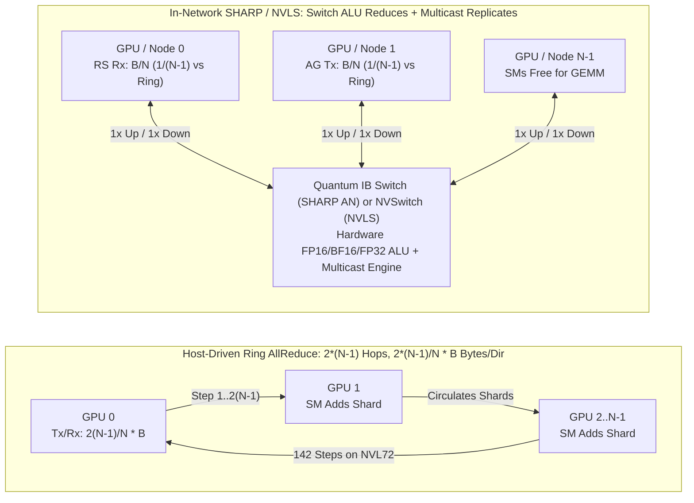
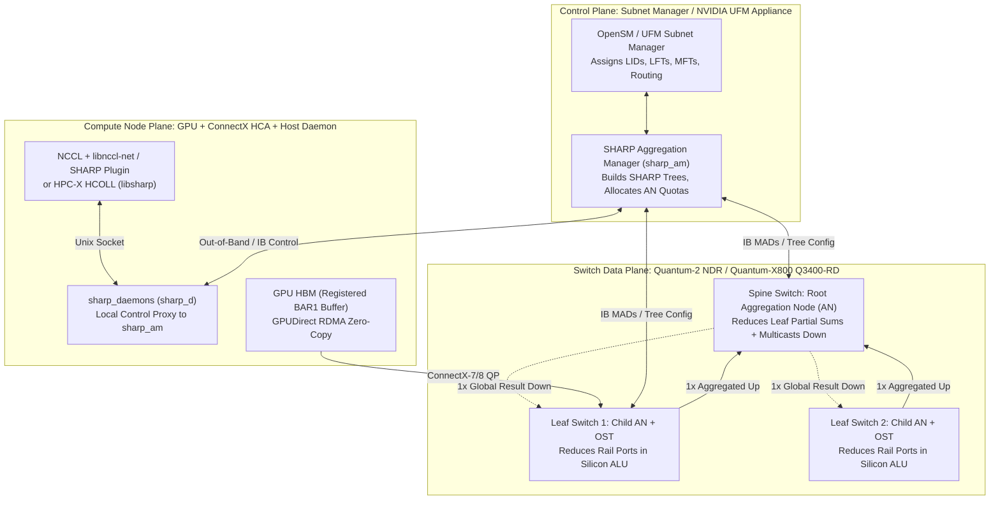

# 12.20 SHARP and in-network computing

| Field | Value |
|---|---|
| Level | Advanced |
| Priority tier | 2 |
| Lab venue | Nebius GPU + Local Python Verification Lab (`code/part12/sharp_in_network_computing_lab.py`) |
| Part | Part 12: Complete AI networking |
| Primary sources | *AI Systems Performance Engineering* (Chapters 2, 4); *AI Data Center Network Design and Technologies* (Chapter 12); *Supercomputers for Linux SysAdmins* (Chapters 5, 21); *NVIDIA DGX SuperPOD GB300 Reference Architecture* |
| Coverage file | `planning/coverage/chapters/12-20.md` |
| Claim & number ledger | `planning/ledgers/12-20.md` |

## Why this matters for AI infrastructure

When a training job grows from one server to thousands of GPUs, the network stops being a detail. In a classical distributed training cluster, the network switch acts as a passive byte pipe. The GPUs compute partial gradients in High-Bandwidth Memory and pass intermediate shards around a logical Ring or Tree. They also run every floating-point addition inside the GPU Streaming Multiprocessors. As clusters grow, this endpoint-driven approach wastes network bandwidth and takes compute cores away from matrix multiplication.

1. **Redundant Data Movement Across Endpoints:** In a standard Ring ReduceScatter across $N$ GPUs, each rank receives $N - 1$ chunks over $N - 1$ sequential steps. A full Ring AllReduce makes each rank transmit and receive almost twice the full tensor size, over $2(N - 1)$ steps. When the switch fabric has arithmetic reduction units and hardware multicast engines, the switch can sum the incoming shards in silicon. It returns only the final shard to each GPU, so per-endpoint receive traffic drops to a fraction of the ring volume.
2. **SM Occupancy and Collective Latency at Scale:** During Ring or host-driven Tree reductions, 16 to 32 GPU Streaming Multiprocessor thread blocks stay busy copying and summing network buffers. Offloading the reduction frees those GPU cores. When it is paired with `ncclCommRegister`, communication channels drop to 4. The switch also collapses multi-node hop complexity from linear to logarithmic. Overlapped shard exchange time drops in half, and large-scale AllReduce operations run 2x to 5x faster.

The reference block below puts the Ring numbers and the switch numbers side by side.

```text
Endpoint Ring vs In-Network SHARP and NVLS Reference Numbers:
- Ring ReduceScatter per-rank receive volume: B * (N - 1) / N bytes over (N - 1) hops
- SHARP / NVLS ReduceScatter per-rank receive volume: B / N bytes (1 / (N - 1) of Ring)
- 8-GPU node (800 MB tensor): Ring RS receives 700.0 MB (7 hops) vs NVLS 100.0 MB (7.0x / 1/7 reduction); Ring AR transfers 1,400.0 MB in 14 steps (vs 6 tree steps)
- 32-node IB cluster (1,024 MB / 1.024 GB tensor): Ring RS receives 992.0 MB vs SHARP 32.0 MB (31.0x / 1/31 reduction); Ring AR transfers 1,984.0 MB in 62 steps vs SHARP 1,024.0 MB per direction in 10 tree steps (~1.94x / 1.9375x speedup)
- 72-GPU GB200/GB300 NVL72 rack (720 MB tensor): Ring RS receives 710.0 MB vs NVLS 10.0 MB (71.0x / 1/71 reduction); Ring AR transfers 1,420.0 MB in 142 steps vs 14 tree steps
- Overlapped NVLS multicast AllGather + ReduceScatter wall time: cuts phase time by ~1/2 (50.0%, 16.0 ms -> 8.0 ms)
- Large-scale (32+-node) InfiniBand SHARP AllReduce speedup: 2x to 5x
- NVSwitch Gen 3 (HGX H100/H200): 900 GB/s bidirectional per GPU
- NVSwitch Gen 4 (DGX GB200/GB300 NVL72): 18 NVLink 5 links x 100 GB/s = 1.8 TB/s bidirectional per GPU, 130 TB/s rack bisection across 72 GPUs and 18 NVSwitch chips in 9 switch trays
- Quantum InfiniBand SHARP generations: SHARPv2 on 200 Gbps HDR, SHARPv3 on 400 Gbps NDR, SHARPv4 on 800 Gbps XDR Quantum-X800 Q3400-RD 144-port switches
- Chapter prerequisite references: Chapters 12.2, 12.6, 12.7, 12.9, 12.15, 12.16, and 12.19
```

Read each ratio in the block as the saving. The ratios grow with the GPU count, because the Ring cost keeps climbing while the switch cost per rank shrinks.

Within the Magnum IO stack, NVIDIA runs in-network computing in two switch domains. They are easy to mix up, so keep them apart:
- **NVLink SHARP:** Switch-resident reduction and hardware multicast engines are built into NVSwitch Gen 3 and NVSwitch Gen 4 fabrics. You turn this path on with `NCCL_NVLS_ENABLE=1`.
- **InfiniBand SHARP:** Scalable Hierarchical Aggregation and Reduction Protocol engines run inside Quantum InfiniBand switches. You turn this path on with `NCCL_COLLNET_ENABLE=1`. It also depends on `sharp_am`, OpenSM or UFM, and host `sharp_daemons`.

Decide which domain your job needs before you change any environment variable.

---

## Prerequisites and outcomes

### Prerequisites
Before you start, you should already know the following from earlier chapters in this part.
- RDMA Queue Pairs, Memory Regions, and GPUDirect RDMA with `nvidia-peermem` and `dma-buf`.
- The InfiniBand Subnet Manager OpenSM and UFM, LIDs and GIDs, and 64-byte Credit-Based Flow Control.
- NCCL collective operations, the Ring, Tree, and PAT algorithms, and the LL, LL128, and Simple wire protocols.

### Outcomes
The outcomes below build on each other, so read them in order. After completing this chapter, you will be able to:
1. Derive the exact byte volume and step complexity of Ring collectives, and compare them with InfiniBand SHARP and NVSwitch NVLS. You will also calculate the wall-time savings from overlapping multicast AllGather with in-network ReduceScatter.
2. Architect two-level hierarchical collectives that combine intra-node or intra-rack NVSwitch NVLS with inter-rack CollNetDirect and CollNetChain.
3. Trace the SHARP control plane and data plane across UFM, OpenSM, `sharp_am`, `sharp_daemons`, switch Aggregation Nodes, and Operand State Tables.
4. Tell apart the hardware capabilities of SHARPv1, SHARPv2, SHARPv3, SHARPv4, and NVLS. You will also know which floating-point precisions each one supports, and what IEEE-754 floating-point determinism means for your results.
5. Configure and troubleshoot NCCL with `NCCL_COLLNET_ENABLE=1`, `NCCL_NVLS_ENABLE=1`, `NCCL_SHARP_DISABLE=0`, and `ncclCommRegister`. You will also configure OpenMPI HCOLL with `HCOLL_ENABLE_SHARP=1`, and compare InfiniBand SHARP with Spectrum-X Ethernet and UEC INC.

---

## 1. Mathematical Foundations: Endpoint Ring/Tree Collectives vs In-Network Reduction

### 1.1 Why Host-Driven Ring Collectives Multiply Traffic by (N - 1)

Picture training a large model across $N$ GPUs or $N$ compute nodes. Every rank holds a local gradient tensor of $B$ bytes. Those tensors must be summed across all ranks before the optimizer step can proceed. If the network switches only forward packets from port to port, the GPUs have to pass slices of that tensor among themselves. Each extra hop adds serialization latency, and it uses link bandwidth that other collectives could have used.

In a standard Ring ReduceScatter, the tensor of size $B$ is cut into $N$ equal chunks of size $\frac{B}{N}$. Over $N - 1$ pipelined steps, every rank sends one chunk to its downstream neighbor and receives one chunk from its upstream neighbor. Each rank adds the incoming data into its local accumulator. For ReduceScatter alone, every GPU sends and receives this byte volume:

$$V_{\text{Ring, RS}} = (N - 1) \times \frac{B}{N} = B\frac{N - 1}{N}\text{ bytes}$$

Ring AllGather starts from a different place. Each GPU begins with its reduced $\frac{B}{N}$ shard, and the shards circulate around the ring for another $N - 1$ steps. No arithmetic happens in this phase. Put the two phases together and you get a Ring AllReduce. It needs $2(N - 1)$ sequential steps, and it forces every rank to transmit and receive almost $2B$ bytes per direction:

$$V_{\text{Ring, AR (unidirectional per rank)}} = 2\frac{N - 1}{N}B\text{ bytes}, \qquad \text{Steps}_{\text{Ring, AR}} = 2(N - 1)$$

Watch what happens as the cluster grows from 8 to 1,024 ranks. The factor $\frac{N - 1}{N}$ climbs toward 1. Each GPU then transmits nearly $2B$ bytes and receives nearly $2B$ bytes, which is $4B$ bytes of bidirectional traffic. Meanwhile, every rank waits through $2(N - 1)$ serial hop latencies.

### 1.2 In-Network Reduction (NVLS and SHARP) and the 1 / (N - 1) Traffic Collapse

Now move the arithmetic into the switch. When the switch ASIC has arithmetic reduction units, called Aggregation Nodes, and hardware multicast engines, partial sums stop bouncing from GPU to GPU. The switch does the additions as packets pass through the fabric, and it delivers only the final result to each endpoint. That removes redundant endpoint traffic in four collective patterns:

1. **In-Network ReduceScatter:** With NVLink SHARP or InfiniBand SHARP, the switch adds the contributions from all $N$ endpoints inside switch silicon. It writes only the final reduced $\frac{B}{N}$ shard to each target GPU. A GPU no longer has to receive $B\frac{N - 1}{N}$ bytes over $N - 1$ hops. It receives only $\frac{B}{N}$ bytes:

$$\frac{V_{\text{SHARP/NVLS, RS (rx)}}}{V_{\text{Ring, RS (rx)}}} = \frac{B / N}{B(N - 1) / N} = \frac{1}{N - 1}$$

2. **Hardware Multicast AllGather:** AllGather does no arithmetic, so NVLS speeds it up in another way, with hardware multicast inside the NVSwitch fabric. Each GPU sends its $\frac{B}{N}$ shard into the switch once. The switch copies that shard to all $N - 1$ peers in one hop. Each sender transmits only $\frac{B}{N}$ bytes, so its volume falls to $\frac{1}{N - 1}$ of the ring volume.
3. **Inter-Node SHARP AllReduce:** Take an inter-node InfiniBand SHARP AllReduce on a tensor of size $B$. Each node streams $1 \times B$ bytes up into its leaf switch. The switch hierarchy reduces all the tensors in flight as packets climb toward the root switch. The root switch then multicasts the $1 \times B$ reduced result back down. Each node sees only 2 fabric traversals, instead of the $2\frac{N - 1}{N}B$ bytes per direction that a Ring AllReduce needs.
4. **Overlapping Multicast AllGather with In-Network ReduceScatter:** Consider Fully Sharded Data Parallelism or ZeRO-3 training. The parameter AllGather and the gradient ReduceScatter compete for endpoint bandwidth when they run one after the other in a ring. With NVLS, hardware multicast replication and in-network arithmetic reduction run at the same time inside the switch fabric. Overlap a multicast AllGather of duration $T_{\text{AG}}$ with an in-network ReduceScatter of duration $T_{\text{RS}}$, and the combined phase wall time shrinks:

$$T_{\text{overlapped, NVLS}} = \max(T_{\text{AG}}, T_{\text{RS}})$$

The breakdown below applies these formulas to three systems. Each line gives the Ring figure first and the switch figure second, and the ratio after the arrow is the saving.

```text
Quantitative Breakdown of Ring vs NVLS and SHARP Traffic Collapse:
- 8-GPU HGX H100 node (B = 800 MB):
  Ring ReduceScatter Rx = 700.0 MB (7 hops) vs NVLS ReduceScatter Rx = 100.0 MB -> 7.0x (1 / 7) volume reduction
  Ring AllReduce = 1,400.0 MB unidirectional across 14 steps (vs 6 tree steps)
- 32-node InfiniBand cluster (B = 1,024 MB / 1.024 GB):
  Ring ReduceScatter Rx = 992.0 MB vs SHARP ReduceScatter Rx = 32.0 MB -> 31.0x (1 / 31) volume ratio
  Ring AllReduce = 1,984.0 MB unidirectional across 62 steps vs SHARP AllReduce = 1,024.0 MB per direction (2,048.0 MB total tx+rx) across 10 tree steps -> 1.9375x (~1.94x) wire reduction and 2x to 5x end-to-end speedup at 50.0 GB/s (400 Gbps NDR) or 100.0 GB/s (800 Gbps XDR)
- 72-GPU GB200/GB300 NVL72 rack (B = 720 MB):
  Ring ReduceScatter Rx = 710.0 MB vs NVLS ReduceScatter Rx = 10.0 MB -> 71.0x (1 / 71) volume reduction
  Ring AllReduce = 1,420.0 MB unidirectional across 142 steps vs 14 tree steps
- Overlapped NVLS AllGather (T_AG = 8.0 ms) + ReduceScatter (T_RS = 8.0 ms):
  Serial Ring time = 8.0 ms + 8.0 ms = 16.0 ms vs Overlapped NVLS time = max(8.0, 8.0) = 8.0 ms -> 50.0% (~1/2) wall-time reduction
```

The savings grow with the GPU count, from 7x at 8 GPUs to 71x at 72 GPUs. You can check each line yourself by plugging in the tensor size. The overlap case halves the phase time you see on the clock.

The diagram puts the two paths side by side. On the left, each GPU passes partial sums to its neighbors. On the right, every endpoint exchanges data with the switch.



The table compares the three paths on the metrics that matter for planning. Use it as a lookup when you need one number.

| Collective Metric | Host-Driven Ring (`NCCL_ALGO=Ring`) | Host-Driven Tree (`NCCL_ALGO=Tree`) | In-Network NVLS / CollNet (SHARP) |
|---|---|---|---|
| ReduceScatter per-rank receive volume | $B\frac{N - 1}{N}$ (700 MB on 8 GPUs; 710 MB on 72 GPUs) | N/A; Tree executes Reduce + Broadcast | **$B / N$** (100 MB on 8 GPUs; 10 MB on 72 GPUs = **1 / (N - 1)** of Ring) |
| AllGather per-rank send volume | $B\frac{N - 1}{N}$ (700 MB on 8 GPUs; 710 MB on 72 GPUs) | N/A | **$B / N$** via NVLS hardware multicast (**1 / (N - 1)** of Ring) |
| AllReduce unidirectional bytes per rank | $2\frac{N - 1}{N}B$ (1,984 MB for 1,024 MB on 32 nodes) | $\approx 2B$ split 50/50 across dual complementary trees | **1.0 * B** up + **1.0 * B** down (2 * B total tx+rx; **~2x less wire traffic**) |
| Step / latency complexity | $2(N - 1)$ steps (62 on 32 nodes; 142 on 72 GPUs) | $2\lceil\log_2 N\rceil$ steps (10 on 32 nodes; 14 on 72 GPUs) | **1–2 switch hops (NVLS)** or **$2\lceil\log_k N_{\text{nodes}}\rceil$ (SHARP)** |
| Where arithmetic reduction executes | GPU SMs (16–32 CUDA channel blocks) | GPU SMs on interior tree nodes | **Switch ASIC silicon** (NVSwitch NVLS ALU or Quantum SHARP AN) |
| Overlapped AllGather + ReduceScatter time | $T_{\text{AG}} + T_{\text{RS}}$ (16.0 ms serial bandwidth contention) | $T_{\text{AG}} + T_{\text{RS}}$ | **$\max(T_{\text{AG}}, T_{\text{RS}})$** (8.0 ms, **~1/2 wall time**) |

Notice the last row, because it is the one you will feel in your job. The wall-time saving comes from overlapping the two phases, so the volume figures alone do not show it. When you estimate collective traffic, first decide which path it takes, because the two paths differ by roughly a factor of $N - 1$.

---

## 2. Two Domains of In-Network Computing: NVLink SHARP (NVLS) vs InfiniBand SHARP (CollNet)

Say a multi-node job runs slower than you expected, yet it appears to succeed. The cause may be an environment variable you enabled for the wrong path. That leaves inter-node traffic on a host-driven ring. During cluster bring-up and production debugging, engineers mix up NVLink SHARP and InfiniBand SHARP all the time. Both belong to the NVIDIA Magnum IO in-network compute pillar, and both use switch-resident reduction units. They still run on different physical fabrics, and they use separate control planes.

### 2.1 Intra-Node and Intra-Rack NVLink SHARP (NVLS and NVLSTree)

NVLink SHARP runs reductions and multicast replication inside one NVSwitch domain. That domain is either an 8-GPU server or a 72-GPU rack. Every GPU connects directly to the NVSwitch crossbar at terabyte-per-second speeds. Once the NVSwitch ASIC does the reduction, GPUs stop relaying data peer to peer. More GPU memory bandwidth stays free for compute kernels.

Check the hardware you have before you enable this path. The two generations differ, as the block below shows.

```text
NVSwitch Gen 3 and Gen 4 Hardware Specifications:
- HGX H100 / H200 (NVSwitch Gen 3):
  8 GPUs per server node, 18 NVLink 4 links per GPU, 900 GB/s bidirectional (450 GB/s unidirectional) per GPU, 3.6 TB/s aggregate bisection across 4 NVSwitch chips
- DGX GB200 / GB300 NVL72 (NVSwitch Gen 4):
  72 Blackwell GPUs (18 compute trays x 2 Grace-Blackwell Superchips x 2 dual-die Blackwell GPUs) + 36 Grace CPUs over 900 GB/s cache-coherent NVLink-C2C
  9 NVLink switch trays x 2 NVSwitch chips per tray = 18 NVSwitch chips total (144 NVLink ports at 100 GB/s per switch tray)
  18 NVLink 5 links per GPU x 100 GB/s bidirectional = 1.8 TB/s bidirectional (7,200 Gbps unidirectional) per GPU
  1-hop full crossbar with 130 TB/s aggregate rack bisection bandwidth and < 1 us per-hop latency (1-2 us small-message latency)
  Up to 7.6x latency reduction on small and medium NVLink messages with symmetric memory
  Enabled by default on Hopper/Blackwell NVSwitch systems + CUDA 12.1+
```

Gen 4 keeps 18 links per GPU, but those links are NVLink 5 instead of NVLink 4.

1. **Enabling NVLS in NCCL:** You control NVLS with `NCCL_NVLS_ENABLE=1`. It is on by default on Hopper and Blackwell NVSwitch systems. If you want to choose it by name, use `NCCL_ALGO=NVLS,NVLSTree`.
2. **Fabric Multicast Memory Handles:** NCCL gets shared NVSwitch fabric addresses through CUDA multicast driver APIs, such as `cuMemCreate` and `cuMulticastCreate`. A GPU then issues a multicast store or reduction to that fabric address. The NVSwitch ASICs carry out the arithmetic reduction or the one-hop broadcast in hardware.
3. **Rack-Level NVSwitch Management:** On DGX GB200 and GB300 NVL72 racks, the NVLink switch trays run NVOS on their COMe processors. NVIDIA Network Manager eXperience manages them, not InfiniBand OpenSM.

### 2.2 Inter-Node and Inter-Rack InfiniBand SHARP (CollNetDirect and CollNetChain)

Once a job spans several 8-GPU HGX servers or several 72-GPU NVL72 racks, gradients must leave the NVSwitch domain. They then cross the scale-out InfiniBand fabric. Without switch offload on that fabric, inter-node reductions still pay multi-hop ring latency across the fat-tree.

The scale-out NIC counts below set how much bandwidth each node can inject into the fabric.

```text
Scale-Out HCA Injection and SuperPOD Sizing:
- DGX GB200 / GB300 NVL72 compute tray scale-out NICs: 4 ConnectX-8 800 Gbps HCAs (3.2 Tbps per compute tray, 57.6 Tbps per NVL72 rack)
- HGX H100 / H200 node scale-out NICs: 8 ConnectX-7 400 Gbps HCAs
- DGX GB300 SuperPOD scale: up to 8 racks = 576 GPUs per Scalable Unit (SU), or 16 SUs = 128 racks = 9,216 GPUs
```

The last line shows how far one SuperPOD can scale. InfiniBand SHARP performs the in-network reductions inside the Quantum switch silicon, and NCCL reaches it through the CollNet collective path. Two modes do this work:

- **CollNetDirect:** This mode suits dense intra-node connectivity, such as NVSwitch systems. Every local GPU talks in parallel to the designated rail leader GPUs that inject traffic into the InfiniBand SHARP switch tree.
- **CollNetChain:** This mode lines the local GPUs up in an ordered sequence. The reduction moves forward along the chain toward the NIC leader. The globally reduced SHARP result then travels back along the chain in the reverse direction.

Know which of the two your topology matches before you read the NCCL logs.

### 2.3 Two-Level Hierarchical NVLS + InfiniBand SHARP Execution Pipeline

Turn on both `NCCL_NVLS_ENABLE=1` and `NCCL_COLLNET_ENABLE=1` on a multi-node HGX cluster or multi-rack NVL72 SuperPOD, and NCCL builds a hierarchy. A flat collective across all GPUs would overwhelm the scale-out NICs. So NCCL runs three stages across $D$ domains. Each domain holds $G$ GPUs, so the job has $N = D \times G$ GPUs in total:

1. **Stage 1 — Intra-Domain NVLS ReduceScatter:** Inside each node or rack, the NVSwitch ASICs add up the local tensors of size $S$ from all $G$ GPUs. Each rail-aligned GPU leader receives a reduced $\frac{S}{G}$ shard over NVLink.
2. **Stage 2 — Inter-Domain InfiniBand SHARP AllReduce:** Each rail leader sends its $\frac{S}{G}$ shard through GPUDirect RDMA into its rail's Quantum leaf switch. Across all rails, each domain pushes a total of $1.0 \times S$ bytes up the InfiniBand SHARP tree. A hierarchical Ring would send $2\frac{D - 1}{D}S$ bytes instead. The Quantum leaf and spine switches add the shards from all $D$ domains in silicon, then multicast the reduced $\frac{S}{G}$ shard back down each rail.
3. **Stage 3 — Intra-Domain NVLS Hardware Multicast AllGather:** Each rail leader writes its globally reduced $\frac{S}{G}$ shard into the local NVSwitch multicast address. The fabric then copies the full reduced tensor $S$ to all $G$ GPUs in a single hop.

Two worked examples show the arithmetic. The first is a 256-GPU HGX cluster, and the second is a 1,152-GPU SuperPOD.

```text
Hierarchical NVLS + InfiniBand SHARP Traffic Examples:
- 32-node x 8-GPU (256-GPU) HGX cluster (S = 1,024 MB tensor):
  Stage 1 intra-node NVLS ReduceScatter receives 128.0 MB per GPU (900 GB/s NVSwitch)
  Stage 2 inter-node InfiniBand SHARP injects 1,024.0 MB per node up the tree vs 1,984.0 MB per node in a hierarchical inter-node Ring -> 1.9375x less inter-node unidirectional traffic (10 tree steps vs 62 ring steps)
- 16-rack x 72-GPU (1,152-GPU, 2 SU) DGX GB300 SuperPOD (S = 720 MB tensor):
  Stage 1 intra-rack NVLS ReduceScatter receives 10.0 MB per GPU at 1.8 TB/s/GPU (1 / 71 of an intra-rack ring's 710.0 MB)
  Stage 2 inter-rack InfiniBand SHARP sends 720.0 MB per rack across the Quantum-X800 fabric vs 1,350.0 MB per rack in an inter-rack Ring -> 1.875x inter-rack bandwidth savings
```

In both examples, the inter-domain stage is the one that crosses the scale-out fabric, so that is the number to watch. Before you enable both variables, decide which layer each communicator spans, because the two paths serve different layers.

---

## 3. InfiniBand SHARP Architecture: sharp_am, sharp_daemons, Aggregation Nodes, and Trees

With standard RDMA, two host NICs negotiate a Reliable Connected Queue Pair directly with each other. InfiniBand SHARP needs more. It keeps live state in three places: the switch silicon, the fabric control plane, and every compute host. If one of those planes loses synchronization, SHARP tree allocation fails. The job then drops back to host-driven Ring or Tree algorithms without telling you.

### 3.1 The Four Architectural Components of InfiniBand SHARP

The diagram splits the system into three planes. Read it from top to bottom: the control plane builds the trees, the switch plane does the arithmetic, and the host plane feeds the GPUs.



The table gives you each component's binary or silicon block, where it runs, and what it does. When a SHARP job falls back, you can check each row in turn, because each one is a process or a silicon block you can inspect.

| Component | Binary / Process / Silicon Block | Where It Runs | Exact Operational Role |
|---|---|---|---|
| **Subnet Manager & UFM** | `opensm` / `ufm-enterprise` | Dedicated Management Node or BlueField DPU | Discovers physical topology, assigns 16-bit LIDs (1..49,151), computes deadlock-free LFT/MFT tables, and exports topology graph to `sharp_am` |
| **SHARP Aggregation Manager** | `sharp_am` | Co-located with OpenSM / UFM or DPU | Parses fabric topology, computes physical SHARP spanning trees across Quantum switches, programs switch AN tables via InfiniBand MADs, and enforces per-job tree quotas |
| **Host SHARP Daemon** | `sharp_daemons` (`sharp_d`) | Every GPU compute node or local DPU | Persistent system daemon that authenticates local job ranks, requests tree allocations and OST resources from `sharp_am`, and sets up switch-facing QPs |
| **Switch Aggregation Node** | AN + OST (Operand State Table) | Inside Quantum / Quantum-2 / Quantum-X800 ASIC | Tracks expected child/host operands per collective transaction in the OST, sums arriving FP16/BF16/FP32/FP64/INT packets in silicon ALU as soon as all children arrive, and forwards 1 packet up or broadcasts down |
| **Application Plugin** | `libnccl-net.so` (`nccl-rdma-sharp-plugins`), `libsharp.so`, HCOLL | User-space training process (`torchrun` / `srun`) | Exposes CollNet collective hooks to NCCL (`NCCL_COLLNET_ENABLE=1`) or MPI (`HCOLL_ENABLE_SHARP=1`) and posts GPUDirect RDMA sends/receives to the leaf switch AN |

### 3.2 Step-by-Step Lifecycle of a SHARP Collective

Follow one collective through its four stages. Each stage depends on the one before it.

1. **Fabric Discovery and Physical Tree Construction:** First, OpenSM or NVIDIA UFM sweeps the InfiniBand subnet with `ibnetdiscover` and directed-route packets. It writes the topology to `opensm-subnet.lst`. Then `sharp_am` reads that file and finds every Quantum switch whose firmware supports SHARP. It builds up to 64 physical SHARP spanning trees, with leaf switches acting as Child ANs and spine switches as Root ANs.
2. **Job Initialization and Communicator Reservation:** When PyTorch initializes `ProcessGroupNCCL` with `NCCL_COLLNET_ENABLE=1`, the SHARP plugin connects to the host `sharp_d` daemon over a local Unix socket. The leader rank's `sharp_d` then asks `sharp_am` for a SHARP Job context and a logical Aggregation Group. If `sharp_am` has free tree quota and switch buffer space, it programs the participating Leaf and Spine ANs. It allocates Operand State Table entries and returns the AN Queue Pair parameters to the hosts.
3. **In-Flight Switch Reduction and Streaming Aggregation:** During `ncclAllReduce`, each node's rail-aligned GPU leader posts a GPUDirect RDMA send straight to its Leaf Switch AN Queue Pair. As packets arrive from the $k$ child ports attached to that Leaf AN, the Operand State Table tracks which ports have contributed. The switch keeps the running sum in on-switch SRAM, using its IEEE-754 floating-point ALU. A switch AN never sends $k$ separate packets upstream. It waits until all $k$ expected operands arrive, then sends one combined packet to the Spine AN, and it clears the OST slot for the next chunk under the Streaming Aggregation Protocol. Once the Root Spine AN has the partial results from all Leaf ANs, it multicasts the final packet back down the tree into GPU HBM.
4. **Teardown and Quota Reclamation:** When the job finishes and calls `ncclCommDestroy`, `sharp_am` tears down the logical Aggregation Group. A crashed rank triggers the same cleanup once `sharp_d` detects that the process has ended. The switches flush any in-flight OST entries, and the SHARP tree quota goes back to the cluster pool.

When a SHARP job hangs, you should find out which of these four stages it reached before you change any variable.

---

## 4. Hardware Generations (SHARPv1–SHARPv4, NVLS), Data Types, and Floating-Point Determinism

The first InfiniBand SHARP ran on 100 Gbps EDR Switch-IB 2 switches. Those switches served CPU-based HPC work, such as barriers and small 64-bit reductions. They had no 16-bit AI floating-point formats, and they could not stream gradient tensors of several hundred megabytes at line rate. Modern AI factories rely on SHARPv2, SHARPv3, SHARPv4, and NVSwitch NVLS to handle deep learning precisions at full wire speed.

### 4.1 Evolution from SHARPv1 (EDR) to SHARPv4 (Quantum-X800) and NVLS Gen 4

Use the table as a lookup. Each row gives one generation's ports, the reduction data types it supports, and its key capability.

| Hardware Generation | Switch Platform & ASIC | Port Speed & Radix | Supported Reduction Data Types | Key Architectural Capabilities |
|---|---|---|---|---|
| **SHARPv1** | Switch-IB 2 (EDR InfiniBand) | 100 Gbps (4x25G), 36 ports | INT32, INT64, FP32, FP64 | First-gen small-message Low-Latency Tree (LLT); no FP16/BF16; single active tree |
| **SHARPv2** | Quantum-1 QM8700 (HDR InfiniBand) | 200 Gbps (4x50G PAM4), 40 ports | FP16, BF16, FP32, FP64, INT32, INT64 | Added **Streaming Aggregation (SAT)** at line rate + native **FP16 and BF16** for deep learning gradients (NCCL CollNet) |
| **SHARPv3** | Quantum-2 QM9700 (NDR InfiniBand) | 400 Gbps (4x100G PAM4), 64 ports | FP16, BF16, FP32, FP64, INT32, INT64 | Multi-tenant concurrent job trees (up to **64 trees/groups**), multi-rail parallel aggregation across rails |
| **SHARPv4** | Quantum-X800 Q3400-RD (XDR InfiniBand) | 800 Gbps (4x200G PAM4), **144 ports** | FP8, FP16, BF16, FP32, FP64, INT32, INT64 | 144-port 800G radix (115.2 Tbps switch capacity), FP8 support, scales 2-layer fat-tree to **16 SUs (9,216 GPUs)** |
| **NVLS Gen 3** | NVSwitch 3.0 (HGX H100 / H200) | 900 GB/s bidir (3,600 Gbps unidir) / GPU, 64 ports | FP8, FP16, BF16, FP32, INT32, INT64 | Intra-node (8 GPUs) & NVL256 in-switch reduction + hardware multicast (`NCCL_NVLS_ENABLE=1`) |
| **NVLS Gen 4** | NVSwitch 4.0 (DGX GB200 / GB300 NVL72) | 1.8 TB/s bidir (7,200 Gbps unidir) / GPU, **144 ports/tray** | FP4 (NVFP4), FP8, FP16, BF16, FP32, INT32, INT64 | **72-GPU** single-rack NVLink domain (18 compute trays, 9 switch trays / 18 NVSwitch chips, **130 TB/s** bisection) |

If you plan a new cluster, the newest rows matter most. They add lower-precision formats, such as FP8 and FP4, along with a larger rack domain.

### 4.2 DGX GB300 SuperPOD Scale-Out with Quantum-X800 Q3400-RD (144-Port) Switches

On older 64-port NDR switches, growing past a couple thousand GPUs meant a three-tier fat-tree with super-spine switches. A third tier adds an extra SHARP Aggregation Node hop. It also doubles the optical transceivers across the cluster. The Quantum-X800 Q3400-RD switch has 144 ports at 800 Gbps, so a DGX GB300 SuperPOD reaches 16 Scalable Units, or 9,216 B300 GPUs, on a non-blocking 2-layer leaf-spine compute fabric.

The breakdown below shows how one Scalable Unit is built.

```text
DGX GB300 SuperPOD Scalable Unit (SU) Architecture Breakdown:
- Quantum-X800 Q3400-RD switch radix: 144 ports at 800 Gbps (2.25x the 64-port radix of NDR QM9700)
- 1 Scalable Unit (1 SU): 8 DGX GB300 NVL72 racks (8 x 72 = 576 GPUs, 8 x 18 = 144 compute trays, 1.2 MW TDP, 130 kW per rack)
- InfiniBand leaf switches per SU: 8 Q3400-RD leaf switches distributed across 4 rails (2 leaf switches per rail)
- Compute tray network interfaces: 4 ConnectX-8 800 Gbps InfiniBand NICs (1 per rail) + 1 BlueField-3 (BF3240) dual-port 2x400 Gbps DPU
- Storage and management switches: Spectrum-4 SN5600D (64-port 800 Gbps) Ethernet switches (400 Gbps dedicated to RoCEv2 High-Performance Storage at 90 GB/s read / 45 GB/s write Standard or 280 GB/s read / 140 GB/s write Enhanced per SU, and >= 200 Gbps dedicated to In-Band Management) + SN2201 (48 x 1 Gbps) Out-of-Band switches
```

Each SU holds 8 racks, which is 576 GPUs. Scale the fabric with the table. The leaf count per SU stays fixed at 8, and the spine count grows with the number of SUs.

| DGX GB300 SuperPOD Scale (# SUs) | # Compute Racks (NVL72) | # GPUs (B300) | IB Leaf Switches per SU (Q3400-RD) | Total IB Leaf Switches (Q3400-RD) | Total IB Spine Switches (Q3400-RD) | Storage & In-Band SN5600D Spines / Compute Leaves / Storage Leaves |
|---|---|---|---|---|---|---|
| **2 SUs** | 16 racks | **1,152 GPUs** | 8 (4 rails × 2) | **16** | **8** | 4 spines / 8 compute leaves / 2 storage leaves (64x400GbE) |
| **4 SUs** | 32 racks | **2,304 GPUs** | 8 (4 rails × 2) | **32** | **18** | 8 spines / 16 compute leaves / 2 storage leaves (128x400GbE) |
| **8 SUs** | 64 racks | **4,608 GPUs** | 8 (4 rails × 2) | **64** | **36** | 12 spines / 32 compute leaves / 4 storage leaves (256x400GbE) |
| **16 SUs** | 128 racks | **9,216 GPUs** | 8 (4 rails × 2) | **128** | **72** | 24 spines / 64 compute leaves / 8 storage leaves (1024x400GbE) |

Pick the row that matches your planned SU count before you order switches. You will save yourself a re-order that way.

### 4.3 IEEE-754 Floating-Point Non-Associativity and Deterministic SHARP Tree Reductions

In exact real arithmetic, addition is associative: $(a + b) + c = a + (b + c)$. Floating-point arithmetic does not share that property. Every intermediate sum rounds to a finite mantissa, so the order of the additions can change the result.

Take 8 FP32 values, one on each of 8 ranks. Their exact sum is 1.875. Watch how the answer depends on the order of the additions:

```text
IEEE-754 Mantissa Precision and FP32 Ring vs SHARP Summation Breakdown:
- Input vector across 8 ranks: [10^7, -10^7, 1.0, 0.25, 10^6, -10^6, 0.5, 0.125] (exact mathematical sum = 1.875)
- Explicit fraction (mantissa) bits: 23 bits in FP32, 10 bits in FP16, 7 bits in BF16
- Rank-Rotated Ring Reduction ((((v[k] + v[k+1]) + v[k+2]) + ...)):
  Starting at Rank 0: 10^7 + (-10^7) = 0.0 cancels first, remaining terms sum to exact 1.875
  Starting at Rank 2 (1.0): running sum reaches 1.25 + 10^6 = 1000001.25, adds -10^6 -> 1.25, adds 0.5 + 0.125 = 1.875, then adds 10^7 (10,000,000.0, where ULP = 2^(23-23) = 1.0) -> rounds to 10,000,002.0, and subtracting 10,000,000.0 yields 2.0 (a 0.125 error, with 6 distinct FP32 values across the 8 rank rotations)
- Fixed-Topology Binary SHARP Tree Reduction:
  Pair (0, 1): 10^7 + (-10^7) = 0.0
  Pair (2, 3): 1.0 + 0.25 = 1.25
  Pair (4, 5): 10^6 + (-10^6) = 0.0
  Pair (6, 7): 0.5 + 0.125 = 0.625
  Level 2 & Root: (0.0 + 1.25) + (0.0 + 0.625) = 1.875 (sharp_tree_repeatable = True)
```

Ring gives several different answers depending on its starting rank. The fixed binary tree gives 1.875 every time.

A SHARP Aggregation Node does not add packets in whatever order they arrive, unless you ask for unordered reductions. The Operand State Table waits for the fixed set of child port operands. Then it reduces them in a deterministic binary tree, shaped by switch port. Ring and SHARP use different summation trees, so switching from `NCCL_SHARP_DISABLE=1` to `NCCL_COLLNET_ENABLE=1` changes the least-significant mantissa bits.

With a fixed SHARP tree topology and rank placement, repeated runs are 100% bit-repeatable. Every rank also receives the exact same bit-identical tensor from the Root AN broadcast. When you compare a SHARP run with a Ring run, compare run-to-run variation within each path, not bit identity across the two.

---

## 5. Software Stack Integration: NCCL (CollNet, NVLS, ncclCommRegister), HPC-X OpenMPI (HCOLL), and UEC INC

### 5.1 Enabling InfiniBand SHARP (CollNet) and NVSwitch NVLS in NCCL

An environment variable on its own will not turn on InfiniBand SHARP. If the host plugin or the fabric daemons are missing, NCCL quietly falls back to standard RDMA Ring or Tree collectives, and the job keeps running. To get zero-copy in-network reductions, you need to verify five prerequisites and two buffer registration rules. The list below covers them.

1. **Quantum Switch Firmware:** Your Quantum, Quantum-2 QM9700, or Quantum-X800 Q3400-RD switches must run SHARP-enabled firmware. That means SHARPv2, SHARPv3, or SHARPv4.
2. **Active `sharp_am` and Subnet Manager:** OpenSM or NVIDIA UFM (`ufm-enterprise`) must run alongside an active `sharp_am` process. That process discovers the fabric and builds the SHARP trees.
3. **Compute Host `sharp_daemons` and GPUDirect RDMA:** Each GPU host must run the `sharp_daemons` service, also called `sharp_d`. It must also load the GPUDirect RDMA kernel module `nvidia_peermem`, or use `dma-buf`.
4. **NCCL RDMA SHARP Plugin:** The external network plugin `libnccl-net.so` must be on `LD_LIBRARY_PATH`. It comes from `nccl-rdma-sharp-plugins` or HPC-X. With it, NCCL can initialize `NET/IB` with SHARP CollNet support.
5. **NCCL Environment Variables:** Export `NCCL_COLLNET_ENABLE=1` for InfiniBand SHARP and `NCCL_NVLS_ENABLE=1` for NVLink SHARP. Also set `NCCL_SHARP_DISABLE=0`. If you want to pick the algorithm yourself, override `NCCL_ALGO=NVLS,NVLSTree,CollNetDirect,CollNetChain,Tree,Ring,PAT` before calling `ncclCommInitRank()`.
6. **Persistent Zero-Copy User Buffers:** Register persistent buffers with `ncclCommRegister` and `ncclCommDeregister`, and the GPU SM channel blocks drop from 16 to 4. The rule is all or nothing. If one rank passes a registered buffer, every rank in that communicator must do the same. The byte offset `tensor_ptr - base_registered_ptr` must also match on every rank. Otherwise NCCL falls back to `NCCL_BUFFSIZE` staging copies.

Verify the list in order before you blame the switches. A missing plugin or daemon can look just like a healthy Ring run.

### 5.2 Enabling SHARP in OpenMPI and HPC-X via HCOLL (`HCOLL_ENABLE_SHARP=1`)

On a traditional HPC cluster, or a hybrid MPI plus PyTorch cluster launched with Slurm PMIx and OpenMPI, MPI collectives skip NCCL. They go through the OpenMPI Modular Component Architecture instead. Without explicit configuration, `MPI_Allreduce` runs on host CPUs over standard point-to-point RDMA. NVIDIA speeds up MPI collectives with the Hierarchical Collectives library, `coll_hcoll`.

Read the precedence list in the block below before you change any MCA setting. Later items override earlier ones.

```text
OpenMPI MCA Parameter Precedence (Lowest to Highest Priority, Inspect via ompi_info -a) and Kernel Requirements:
- GPUDirect RDMA dma-buf requirement: Linux >= 5.12 with OpenRM -open and rdma-core >= 34; default NCCL_BUFFSIZE = 4 MiB
- OpenMPI MCA Precedence:
  1. Global config file: /etc/openmpi-mca-params.conf (key=value)
  2. User config file: $HOME/.openmpi/mca-params.conf
  3. Tuned option files: mpiexec --tune file1,file2
  4. Environment variables: export OMPI_MCA_<param>=<value>
  5. Command-line flags: mpiexec -mca <param> <value>
```

Check the kernel and rdma-core versions at the top of the block before you rely on the dma-buf path.

- **Enabling HCOLL and SHARP in OpenMPI:** Turn on HCOLL with `-mca coll_hcoll_enable 1`, or with `export OMPI_MCA_coll_hcoll_enable=1` when launching via `srun --mpi=pmix`. Next, bind the primary HCA with `-x HCOLL_MAIN_IB=mlx5_0:1`. Enable non-blocking collectives with `-x HCOLL_ENABLE_NBC=1`, and turn on in-switch SHARP reductions with `-x HCOLL_ENABLE_SHARP=1`.
- **Disabling HCOLL for Triage:** If HCOLL misbehaves on a legacy transport, turn it off with `mpiexec -mca coll_hcoll_enable 0`. You can also use `export OMPI_MCA_coll_hcoll_enable=0`.

### 5.3 Ethernet Fabrics: Spectrum-X vs UEC In-Network Collectives (INC and xCCL)

Many teams running RoCEv2 or Ultra Ethernet ask the same question: can `NCCL_COLLNET_ENABLE=1` give them switch-resident reductions over Ethernet? The answer depends on two things. One is what Ethernet switches do today. The other is what the Ultra Ethernet Consortium specifies. Knowing both saves you from wasted tuning cycles.

1. **NVIDIA Spectrum-X Ethernet:** Switches such as the Spectrum-4 SN5600 and Spectrum-X800 speed up NCCL AllReduce and AllToAll over RoCEv2. They do this with adaptive packet spraying, hardware congestion telemetry, and BlueField-3 SuperNIC packet reordering. Production Spectrum-X switches, however, do not have switch-resident arithmetic reduction engines like InfiniBand SHARP. So setting `NCCL_COLLNET_ENABLE=1` on a Spectrum-X RoCEv2 cluster does not move floating-point additions into the SN5600 switch ASIC. NCCL uses NVSwitch NVLS inside the rack, and standard RDMA Ring, Tree, or PAT across racks.
2. **Ultra Ethernet Consortium In-Network Collectives:** The Ultra Ethernet Specification v1.0 was released on June 11, 2025. It standardizes the Ethernet link and transport layers. It also defines an architecture for In-Network Collectives that bridges Libfabric, through its `fi_collective` and `fi_mr` APIs, and the xCCL libraries.

The block below lists the specification details. The three core INC components are the part to remember.

```text
UEC Specification v1.0 Transport and In-Network Collectives (INC) Parameters:
- Release date: June 11, 2025
- Link & transport layer parameters: LLR, PRI, CBFC with 32 Virtual Channels and CtlOS messages, UET over UDP port 49150 or native IP protocol 253, PDS, SES, JobID, PIDonFEP, Resource Index, ROD/RUD/RUDI/UUD delivery modes, NSCC/RCCC in 256-byte credits
- Three core UEC INC components:
  1. INC-Capable Switches (sFEPs - Switch Fabric Endpoints) running an INC silicon/microkernel engine and local INC switch agent
  2. INC Manager (IM) communicating over the out-of-band (OOB) network via gRPC to organize collective groups (Collectives-gr1, Collectives-gr2) and elect Spine switches as tree roots (Root of tree1 spine1, Root of tree2 spine2) above Leaf INC agents (INC agent leaf1, INC agent leaf2)
  3. Libfabric (fi_collective and fi_mr APIs) connecting PyTorch -> OpenMPI (xMPI) / NCCL / RCCL -> Libfabric -> SES/PDS and the INC Manager
```

The table sets INC against the xCCL libraries, which is the comparison most teams need. Notice that INC runs inside the switches, while the xCCL libraries run on the hosts.

| Feature Dimension | INC (In-Network Collectives) | xCCLs (NCCL, RCCL, MPI Collectives) |
|---|---|---|
| **Architectural Layer** | Fabric level (switch hardware / silicon) | Software library (user space on endpoints) |
| **Primary Execution** | Inside network switches (**sFEPs** — Switch Fabric Endpoints) | On host CPUs and GPUs using standard transport protocols |
| **Software Integration** | Requires **Libfabric (`fi_collective`)** and INC-capable switches | Integrates directly with MPI or AI frameworks (PyTorch); switch is transparent |
| **Offload Capabilities** | **Yes** (offloads aggregation, filtering, and replication to switches) | Only when paired with INC or InfiniBand SHARP |
| **Performance Impact** | Lower latency, higher effective throughput, and freed GPU SMs | Optimizes GPU link scheduling, but endpoints still move and sum shards |
| **Scalability** | Very high in supported fabrics (hierarchical switch spine/leaf trees) | Bounded by endpoint hop count and server library serialization |
| **Required Infrastructure** | INC-capable switches (sFEPs), **INC Manager (IM via gRPC OOB)**, and Libfabric | Standard RDMA NICs and the MPI / xCCL software stack |
| **Target Implementations** | UEC fabrics with INC switches + IM (and InfiniBand SHARP + `sharp_am`) | PyTorch DDP/FSDP, TensorFlow, and OpenMPI / MPICH collectives |

On a RoCEv2 cluster today, expect host-driven collectives unless your switches expose INC, which current Spectrum-X hardware does not. Before you rely on any in-network path over Ethernet, confirm that your switches expose INC, since setting a variable will not add it.

---

## Commands and configurations that matter

Work through these checks from the bottom of the stack up. Each group covers one layer: the HCA, the subnet manager, the host daemon, and then the whole fabric.

### 1. Verifying InfiniBand Fabric, UFM / OpenSM, sharp_am, and sharp_daemons (untested here)

```bash
# (untested here) 1. Check HCA port state (State: Active, Physical state: LinkUp) and SM LID
ibstat
ibstatus
ibv_devinfo -v -d mlx5_0

# (untested here) 2. Verify Subnet Manager / UFM and SHARP Aggregation Manager (sharp_am) status
sminfo
systemctl status opensm ufm-enterprise sharp_am

# (untested here) 3. Verify compute-node SHARP daemon (sharp_d) and GPUDirect RDMA module
systemctl status sharp_daemons
ps -ef | grep -E "sharp_am|sharp_d"
lsmod | grep nvidia_peermem

# (untested here) 4. Run fabric-wide audit including SHARP AN / tree and FDB verification
sudo ibdiagnet -o /var/tmp/ibdiagnet2 --ber_test --pm_pause_time 30
grep -i "sharp" /var/tmp/ibdiagnet2/ibdiagnet2.log
```

### 2. Launching NCCL (nccl-tests / PyTorch) with CollNet (SHARP) and NVLS (untested here)

The first block exports the production environment. The next two run the same AllReduce sweep twice, once with InfiniBand SHARP on and once with it off, so you can compare the results side by side.

```bash
# (untested here) Production NCCL environment for hierarchical NVLS (intra-node/rack) + IB SHARP (inter-rack)
export NCCL_DEBUG=INFO
export NCCL_DEBUG_SUBSYS=INIT,COLL,NET,ENV
export NCCL_SOCKET_IFNAME=ib0
export NCCL_IB_HCA=mlx5

# (untested here) Enable InfiniBand SHARP (CollNet) and NVSwitch NVLink SHARP (NVLS)
export NCCL_COLLNET_ENABLE=1
export NCCL_NVLS_ENABLE=1
export NCCL_SHARP_DISABLE=0
export NCCL_MNNVL_ENABLE=1
export TORCH_NCCL_ASYNC_ERROR_HANDLING=1

# (untested here) Benchmark AllReduce WITH SHARP vs WITHOUT SHARP (A/B test on 32 nodes x 8 GPUs = 256 GPUs)
mpirun -np 256 -N 8 \
  -x NCCL_DEBUG=INFO \
  -x NCCL_COLLNET_ENABLE=1 \
  -x NCCL_NVLS_ENABLE=1 \
  -x NCCL_SHARP_DISABLE=0 \
  ./build/all_reduce_perf -b 8M -e 1G -f 2 -g 1

# (untested here) A/B baseline: disable InfiniBand SHARP while keeping everything else identical
mpirun -np 256 -N 8 \
  -x NCCL_DEBUG=INFO \
  -x NCCL_COLLNET_ENABLE=0 \
  -x NCCL_SHARP_DISABLE=1 \
  ./build/all_reduce_perf -b 8M -e 1G -f 2 -g 1
```

### 3. Launching OpenMPI (HPC-X) with HCOLL and SHARP (untested here)

Use the first block to turn HCOLL and SHARP on. Use the second block to turn HCOLL off when a broken SHARP tree or legacy transport is the suspect.

```bash
# (untested here) Enable HCOLL non-blocking collectives and SHARP in OpenMPI / Slurm PMIx
mpirun -np 64 \
  -mca pml ucx \
  -mca coll_hcoll_enable 1 \
  -x UCX_NET_DEVICES=mlx5_0:1 \
  -x HCOLL_MAIN_IB=mlx5_0:1 \
  -x HCOLL_ENABLE_NBC=1 \
  -x HCOLL_ENABLE_SHARP=1 \
  ./mpi_allreduce_bench

# (untested here) Disable HCOLL if troubleshooting a broken SHARP tree or legacy MPI transport
export OMPI_MCA_coll_hcoll_enable=0
srun --mpi=pmix -N 8 --ntasks-per-node=8 ./mpi_allreduce_bench
```

Run the A/B pair on the same nodes. The difference between those two runs is your evidence that SHARP is doing any work.

---

## How it fails

SHARP and NVLS failures seldom crash a job with a clean stack trace. Instead, the job slows down, falling back to host-based Ring or Tree algorithms with a 2x to 5x collective slowdown. Or it stalls during communicator initialization, when switch AN quotas leak. The table is a symptom-to-fix lookup. Each row names what you see, the cause behind it, and the fix.

| # | Failure Mode | Production Symptom (`NCCL_DEBUG=INFO` / Switch Telemetry) | Root Cause | Exact Diagnosis & Remediation |
|---|---|---|---|---|
| **1** | **Switch SHARP Tree Quota / Buffer Exhaustion & Silent Fallback** | First 2–4 training jobs achieve 2x–5x faster AllReduce (SHARP active in `NCCL_DEBUG=INFO`), but subsequent concurrent jobs or multi-communicator (TP/DP/PP) jobs log `SHARP: group allocation failed` / `resource busy` and drop to standard Ring/Tree speed, or very large (512 MB+) collectives fall back mid-run. | Quantum switches have finite hardware SHARP trees (64 concurrent trees on SHARPv3/SHARPv4) and finite on-switch SRAM reduction buffers (OSTs). Creating multiple NCCL communicators per job or zombie `sharp_d` sessions from crashed jobs exhausts the tree pool. | 1. Inspect `sharp_am` logs on the UFM / SM host for tree quota exhaustion.<br/>2. Only enable `NCCL_COLLNET_ENABLE=1` on the inter-node Data Parallel (DP/FSDP) communicator, not on intra-node Tensor Parallel (TP) groups.<br/>3. Restart `sharp_daemons` on nodes with leaked sessions or let `sharp_am` reclaim orphaned job IDs; alert on SHARP fallback log lines. |
| **2** | **`NCCL_COLLNET_ENABLE=1` Set Without `nccl-rdma-sharp-plugins` or `sharp_daemons`** | Engineer exports `NCCL_COLLNET_ENABLE=1`, sees no errors, assumes SHARP is active, but `all_reduce_perf` shows identical bus bandwidth to Ring/Tree and `NCCL_DEBUG=INFO` prints `Channel 00 : ... [Ring]` with no SHARP plugin initialization line. | NCCL does not bundle the proprietary InfiniBand SHARP wire protocol inside `libnccl.so.2` by default; it requires `libnccl-net.so` (`nccl-rdma-sharp-plugins` / HPC-X), a running `sharp_d` on every node, and `sharp_am` on the UFM/SM node. | 1. Grep `NCCL_DEBUG=INFO` output for `NET/IB` and SHARP plugin load.<br/>2. Verify `ldconfig -p \| grep nccl-net` or HPC-X module paths in `LD_LIBRARY_PATH`.<br/>3. Verify `systemctl status sharp_daemons` on compute nodes and `sharp_am` on the UFM appliance. |
| **3** | **GPUDirect RDMA (`nvidia-peermem` / `dma-buf`) Missing Inside Container** | SHARP plugin loads, but CollNet initialization fails or drops to host-staged RDMA (~6.25 GB/s instead of 50–100 GB/s), and CPU utilization spikes to 100% during AllReduce. | Container lacks `/dev/infiniband` access, has mismatched `rdma-shared` GID tables, PCIe ACS is enabled, or `nvidia-peermem` / `dma-buf` is not loaded on the host kernel, preventing the HCA from registering GPU HBM for SHARP QPs. | 1. Run `lsmod \| grep nvidia_peermem` on the host.<br/>2. Expose `/dev/infiniband` into the container and verify `NCCL_DEBUG=INFO` logs `GDRDMA` on `NET/IB`.<br/>3. Validate GPU-to-GPU RDMA with `ib_write_bw --use_cuda`. |
| **4** | **Subnet Manager Sweep Stall (Trap 128 Flapping Cable) Invalidates SHARP Trees** | Mid-training NCCL watchdog timeout (`ProcessGroupNCCL` abort) accompanied by SHARP tree error / `IBV_WC_RETRY_EXC_ERR` on switch AN Queue Pairs. | A flapping optical transceiver (`LinkDownedCounter > 0`) triggers continuous OpenSM / UFM heavy sweeps (Trap 128). When a switch link inside an active SHARP spanning tree goes down, `sharp_am` must tear down and rebuild the affected SHARP tree. | 1. Run `ibqueryerrors` and `perfquery` from the management node to locate the port with `LinkDownedCounter > 0` or `SymbolErrorCounter` spikes.<br/>2. Inspect optical power (`Rx Power Current [dBm]`) and per-lane BER with `mlxlink -d mlx5_X -c -m`.<br/>3. Fence the flapping port (`ibportstate <lid> <port> disable`) so OpenSM and `sharp_am` converge on a stable tree. |
| **5** | **Asymmetric `ncclCommRegister` User Buffers Disable Zero-Copy NVLS / SHARP** | Developer registers user buffers via `ncclCommRegister` to cut SM channels from 16 to 4, but Nsight Systems still shows 16 SM channel blocks and internal `NCCL_BUFFSIZE` staging copies. | Either one rank in the communicator passed an unregistered tensor buffer, or ranks passed slices at different byte offsets from the head of their registered allocation. | Enforce the two `ncclCommRegister` invariants across all ranks: every rank must register its buffer, and `(uintptr_t)user_ptr - (uintptr_t)reg_base_ptr` must be identical across all ranks. |
| **6** | **Bitwise Loss Divergence When Comparing Ring vs SHARP Checkpoints** | Regression test comparing Ring (`NCCL_SHARP_DISABLE=1`) against SHARP (`NCCL_COLLNET_ENABLE=1`) shows 1e-6 to 1e-5 gradient differences on step 1, growing over 1,000 steps. | IEEE-754 floating-point addition (FP16/BF16/FP32) is non-associative: Ring reduces sequentially, whereas SHARP ANs reduce pairwise in a hardware switch tree. | Do not require bitwise identity between Ring and SHARP. Validate that repeated runs within SHARP on the same tree topology are bitwise identical, and verify that SHARP uses FP32 internal accumulation. |

Several rows begin with a log line, so search the `NCCL_DEBUG=INFO` output first. Only then should you touch the fabric or the switch telemetry. When you see one of these symptoms, start with the row that matches your logs, and work down its remediation steps in order. Keep the table open while you read the logs, because you will move between rows quickly.

---

## Hands-on lab

### Venue and Scope
- **Local Verification Lab:** You can run `code/part12/sharp_in_network_computing_lab.py` on any machine with Python 3. It needs only the standard library, and it is backed by `code/part12/sharp_in_network_computing.py`.
- **Cluster Target Venue:** For live profiling, use a Nebius GPU or a multi-node InfiniBand plus NVSwitch cluster. There you can run `nccl-tests` with `NCCL_COLLNET_ENABLE=1` and `NCCL_NVLS_ENABLE=1`.

### Part 1: Run the Self-Checking Python Verification Lab (26/26 Checks)

Run the standalone verification lab first. The script checks every Ring versus SHARP and NVLS volume ratio in this chapter, plus the wall-time saving from overlapping AllGather with ReduceScatter. It also covers the hierarchical NVLS plus InfiniBand SHARP byte counts, the SHARPv1 through SHARPv4 and DGX GB300 SuperPOD scale tables, and the `sharp_am` tree quota fallbacks. Last, it tests IEEE-754 FP32 tree determinism and the NCCL, HCOLL, and UEC INC configurations. Run it like this:

```bash
python3 -B code/part12/sharp_in_network_computing_lab.py
```

Expected output:

```text
=== Chapter 12.20 Lab: SHARP and In-Network Computing ===
  [PASS] 1. 8-GPU ReduceScatter: Ring receives 700 MB (B*(N-1)/N) vs SHARP/NVLS 100 MB (B/N)
  [PASS] 2. 8-GPU ReduceScatter and AllGather volume reduction factor is (N - 1) = 7.0x
  [PASS] 3. 8-GPU Ring AllReduce transfers 2*(N-1)/N * B = 1,400 MB unidirectional (14 steps vs 6 tree steps)
  [PASS] 4. 72-GPU NVL72 ReduceScatter: Ring receives 710 MB vs NVLS 10 MB (71.0x volume reduction)
  [PASS] 5. 72-GPU NVL72 Ring requires 142 steps vs 14 tree steps and 1,420 MB Ring unidirectional bytes
  [PASS] 6. 32-node IB ReduceScatter: Ring receives 992 MB vs SHARP 32 MB (31.0x volume reduction)
  [PASS] 7. 32-node IB AllReduce: Ring transfers 1,984 MB across 62 steps vs SHARP 1,024 MB per direction across 10 steps (~1.94x bandwidth + latency speedup)
  [PASS] 8. Overlapping NVLS multicast AllGather (8 ms) with in-network ReduceScatter (8 ms) cuts wall time from 16.0 ms to 8.0 ms (50.0% / ~1/2 reduction)
  [PASS] 9. Hierarchical 32x8 (256-GPU) NVLS+SHARP: intra-node NVLS RS receives 128 MB/GPU and inter-node IB SHARP injects 1,024 MB/node vs 1,984 MB/node in hierarchical Ring
  [PASS] 10. Hierarchical 16x72 NVL72 (1,152 GPUs): intra-rack NVLS RS receives 10 MB/GPU and inter-rack IB SHARP sends 720 MB/rack vs 1,350 MB/rack in inter-rack Ring (1.875x ratio)
  [PASS] 11. SHARPv1 (100G EDR, 36p, no FP16/BF16) vs SHARPv2 (200G HDR, 40p, adds FP16/BF16) vs SHARPv3 (400G NDR, 64p) vs SHARPv4 (800G XDR Q3400-RD, 144p, adds FP8)
  [PASS] 12. NVSwitch Gen 4 (NVL72) delivers 7,200 Gbps (1.8 TB/s bidir) per GPU across 144-port switch trays with FP4/FP8/FP16/BF16/FP32 NVLS support
  [PASS] 13. DGX GB300 SuperPOD Quantum-X800 Q3400-RD 2-layer fabric scales from 2 SUs (1,152 GPUs, 16 leaves, 8 spines) to 16 SUs (9,216 GPUs, 128 leaves, 72 spines)
  [PASS] 14. sharp_am allocates 32 + 32 = 64 SHARP trees across Jobs 101 and 102 (0 remaining)
  [PASS] 15. Job 103 requesting 4 trees when 64/64 trees are in use triggers HOST_RING_TREE_FALLBACK
  [PASS] 16. Collective size 512.0 MB > 256.0 MB switch AN buffer limit falls back to non-SHARP host aggregation
  [PASS] 17. Releasing Job 101 frees 32 trees and allows Job 105 (16 trees) to allocate cleanly (16 remaining)
  [PASS] 18. Inactive UFM/SM sharp_am or dead compute-node sharp_daemons triggers immediate fallback
  [PASS] 19. IEEE-754 FP32 Ring reduction across 8 rank start offsets produces multiple distinct results (non-associativity)
  [PASS] 20. Fixed-topology binary SHARP Aggregation Node (AN) tree reduction is bit-repeatable and preserves exact sum 1.875
  [PASS] 21. Production IB + NVSwitch config enables CollNet_IB_SHARP, NVSwitch_NVLS, zero-copy user buffers, and MPI HCOLL SHARP with 0 warnings
  [PASS] 22. Setting NCCL_SHARP_DISABLE=1 disables IB SHARP (RDMA_Ring_Tree) while keeping intra-node NVSwitch_NVLS active
  [PASS] 23. Spectrum-X Ethernet with NCCL_COLLNET_ENABLE=1 warns that Ethernet switches lack SHARP reduction engines and selects RDMA_Ring_Tree
  [PASS] 24. Missing GPUDirect RDMA (nvidia-peermem / dma-buf) blocks InfiniBand SHARP offload
  [PASS] 25. Asymmetric user-buffer head offsets disable zero-copy ncclCommRegister fast path
  [PASS] 26. UEC INC executes inside network switches (sFEPs) coordinated by INC Manager (gRPC OOB) + Libfabric fi_collective

Summary: 26 passed, 0 failed
```

A clean run ends with `Summary: 26 passed, 0 failed`. If any line shows `[FAIL]`, compare that check with the matching section of this chapter before you change the configuration.

---

## Common first mistakes

1. **Confusing NVLS with InfiniBand SHARP:** Many engineers think `NCCL_NVLS_ENABLE=1` pushes reductions into Quantum InfiniBand switches across nodes. Others think `NCCL_COLLNET_ENABLE=1` is needed for reductions inside one NVSwitch node. Both are wrong. `NCCL_NVLS_ENABLE=1` controls the in-network reduction inside NVSwitch. `NCCL_COLLNET_ENABLE=1`, together with the SHARP plugin, `sharp_am`, and `sharp_daemons`, controls inter-node Quantum InfiniBand SHARP.
2. **Expecting Spectrum-X Ethernet Switches to Execute SHARP Reductions Today:** Setting `NCCL_COLLNET_ENABLE=1` on a Spectrum-X SN5600 RoCEv2 fabric will not trigger switch-resident floating-point reduction. Spectrum-X speeds up AllReduce with adaptive packet spraying and congestion telemetry instead. Switch-resident reduction units are still a capability of InfiniBand Quantum, NVSwitch, and future UEC INC sFEP hardware.
3. **Leaving `NCCL_COLLNET_ENABLE=1` Global Across Every Sub-Communicator:** If every process group can request a hardware SHARP tree, switch resources run out quickly. That includes the Tensor Parallel, Pipeline Parallel, and Data Parallel groups. A Quantum switch fabric supports a bounded pool of 64 concurrent SHARP trees. So reserve InfiniBand SHARP for the cross-node Data Parallel or FSDP communicator.
4. **Assuming AllGather Uses Arithmetic Reduction in SHARP or NVLS:** AllGather performs zero arithmetic additions. NVLS speeds it up with hardware multicast. Each GPU sends its $\frac{B}{N}$ shard once, and the NVSwitch copies it to all $N - 1$ peers. On its own, that gives a smaller speedup than AllReduce. The bigger win comes when you overlap the AllGather with an in-network ReduceScatter, which cuts phase wall time in half.
5. **Forgetting to Re-Enable SHARP or P2P After Debugging:** Engineers often set `NCCL_SHARP_DISABLE=1` or `NCCL_P2P_DISABLE=1` during a triage session. The override then gets baked into the production container image. That quietly gives up the 2x to 5x inter-node collective speedups, and it forces intra-node NVLink traffic through host CPU memory.

Before you ship a container, remove every override you set while debugging.

---

## Exercises

Treat these exercises as a rehearsal for the decisions you will make on a real cluster. Each exercise below uses the inputs in this block. Read the block first. Then work through the six exercises, and write down your arithmetic as you go, so you can check it against the answer.

```text
Exercise Input Parameters Reference:
- Exercise 1: (a) 800 MB tensor across 8 GPUs (HGX H100); (b) 720 MB tensor across 72 GPUs (DGX GB200/GB300 NVL72); (c) 1,024 MB tensor across 32 InfiniBand nodes
- Exercise 2: FSDP shard AllGather T_AG = 8.0 ms, gradient ReduceScatter T_RS = 8.0 ms inside an NVL72 rack
- Exercise 3: (a) 32-node x 8-GPU (256-GPU) HGX cluster, 1,024 MB tensor; (b) 2-SU (16-rack x 72-GPU = 1,152-GPU) and 16-SU (9,216-GPU) DGX GB300 SuperPOD, 720 MB tensor
- Exercise 4: Quantum-2 NDR (SHARPv3) with max_concurrent_trees = 64 and switch AN buffer ceiling = 256.0 MB; Job 101 = 32 trees (64.0 MB), Job 102 = 32 trees (128.0 MB), Job 103 = 4 trees (64.0 MB), Job 104 = 8 trees (512.0 MB), Job 105 = 16 trees (64.0 MB)
- Exercise 5: 8 ranks holding FP32 values [1e7, -1e7, 1.0, 0.25, 1e6, -1e6, 0.5, 0.125] (exact sum = 1.875; Rank 2 Ring sum = 2.0)
- Exercise 6: (d) Rank 0 user buffer at offset 0 vs Rank 1 user buffer at offset 4096 without nvidia-peermem
```

1. Work out the volume math for each case in the reference block. Using the tensor sizes and GPU counts above, calculate the per-GPU received byte volume in a Ring ReduceScatter and in an NVLS or SHARP ReduceScatter. Then compute the volume reduction factor, and the unidirectional bytes each rank transfers in a Ring AllReduce versus SHARP.
2. Time the overlap. An FSDP shard AllGather and a gradient ReduceScatter run serially in a Ring. Compute the total communication phase wall time for that serial case. Then compare it with overlapping the two through NVLS hardware multicast AllGather and in-network ReduceScatter, and state the percentage wall-time reduction.
3. Size the hierarchy. For the 256-GPU HGX cluster and the 1,152-GPU DGX GB300 SuperPOD, compute the Stage 1 intra-domain NVLS ReduceScatter receive volume per GPU. Compare the Stage 2 inter-domain unidirectional bytes under InfiniBand SHARP with a hierarchical Ring, and list the Q3400-RD switches at 2 SUs and 16 SUs.
4. Triage the tree quota. Trace the `sharp_am` tree allocator across Jobs 101 through 105. Work out which jobs receive `SHARP_COLLNET`, which fall back to `HOST_RING_TREE_FALLBACK`, and how many trees stay free after Job 105 allocates.
5. Explain the IEEE-754 rounding. Explain why a rank-rotated Ring reduction that starts at Rank 2 rounds the 8-element FP32 sum to 2.0, not the exact 1.875. Then explain why a binary SHARP Aggregation Node tree gives the exact 1.875 on every run.
6. Audit the configurations. For each scenario in the reference block, determine the active intra-node path, the active inter-node path, and any configuration warnings. Cover the properly configured InfiniBand cluster, the A/B test with `NCCL_SHARP_DISABLE=1`, the Spectrum-X Ethernet cluster, and the asymmetric user-buffer job.

Work each exercise on paper first, then check the arithmetic a second time before you move on. Write one sentence of conclusion under each answer, so the result has a meaning for your cluster.

---

## Interview angles

Interviewers listen for two things: the mechanism, and the trade-off you can name. Each answer below gives both. Say your answer in your own words first, then check it against the target answer. Keep it short and direct, and name the trade-off before you stop talking.

1. **"Walk me through the exact math of why SHARP and NVLS reduce endpoint traffic by (N - 1) in ReduceScatter and AllGather, and by ~2x in inter-node AllReduce."**
   - *Target answer:* Start with the Ring. In a ReduceScatter of $B$ bytes across $N$ ranks, each rank receives $N - 1$ chunks of size $\frac{B}{N}$, which totals $B\frac{N - 1}{N}$ bytes. With NVLS or InfiniBand SHARP, the switch silicon adds the incoming operands and writes only the final reduced $\frac{B}{N}$ shard to each GPU. That cuts the receive volume by $\frac{1}{N - 1}$. AllGather works differently. NVLS uses hardware multicast, so each GPU sends its $\frac{B}{N}$ shard once. Overlapping a multicast AllGather with an in-network ReduceScatter cuts the phase wall time from $T_{\text{AG}} + T_{\text{RS}}$ to $\max(T_{\text{AG}}, T_{\text{RS}})$. For an inter-node AllReduce of size $S$, a host-driven Ring sends $2\frac{N - 1}{N}S$ bytes per direction across $2(N - 1)$ steps. An InfiniBand SHARP tree sends $1.0 \times S$ bytes up and receives $1.0 \times S$ bytes down in $O(\log N)$ switch hops. That yields 2x to 5x speedups on large clusters.
2. **"What is the difference between NVLS and InfiniBand SHARP, and how do they work together on a DGX GB200 / GB300 SuperPOD?"**
   - *Target answer:* NVLS (`NCCL_NVLS_ENABLE=1`) runs inside the 18 NVSwitch ASICs across 9 switch trays in a 72-GPU NVL72 rack. It provides 1.8 TB/s bidirectional NVLink 5 per GPU and 130 TB/s of rack bisection, managed by NMX-M. InfiniBand SHARP (`NCCL_COLLNET_ENABLE=1`) runs inside Quantum-X800 Q3400-RD 144-port 800 Gbps switches. It scales to 16 SUs, or 9,216 GPUs, in a 2-layer fat-tree. `sharp_am` on UFM or OpenSM, plus `sharp_daemons` on the compute trays, orchestrates it. In a multi-rack AllReduce, NCCL runs a three-stage hierarchy. Stage 1 is an intra-rack NVLS ReduceScatter across the 72 GPUs. Stage 2 is an inter-rack InfiniBand SHARP AllReduce across the 4 ConnectX-8 rails. Stage 3 is an intra-rack NVLS hardware multicast AllGather.
3. **"A user sets `NCCL_COLLNET_ENABLE=1` on a 64-node InfiniBand cluster, or their job suddenly slows down by 3x mid-week without code changes. How do you triage whether SHARP is actually running?"**
   - *Target answer:* Work through the dependencies in order. Start with the `NCCL_DEBUG=INFO` logs. Confirm that `NET/IB` loaded the SHARP plugin, `libnccl-net.so`, and selected CollNetDirect or CollNetChain, with no fallback warning. Next, check `systemctl status sharp_daemons` on the compute nodes and `lsmod | grep nvidia_peermem` for GPUDirect RDMA. Then check `sharp_am` and UFM or OpenSM on the fabric management node. Look for exhausted switch SHARP tree quotas, or collectives larger than the switch AN buffer limit. Last, run `ibdiagnet` and `ibqueryerrors` to rule out a flapping link. A link with `LinkDownedCounter > 0` forces OpenSM into heavy sweeps, and those sweeps tear down active SHARP spanning trees.

If your answer runs long, cut the figures that do not change the decision, and keep the path and the failure mode. A listener can follow the reasoning far better than a list of values.

---

## Checkpoint questions (20)

Suppose a job runs slower after someone changes an environment variable. You should be able to explain what changed and where to look. Picture an on-call engineer whose job slowed down mid-week. Use these questions to check yourself. Answer each one in your own words, then compare it with the answer under it. If you can answer them without looking, you are ready for the lab.

<details>
<summary>**1. What does SHARP stand for, and what fundamental shift does it introduce in distributed collective communication?**</summary>

SHARP stands for Scalable Hierarchical Aggregation and Reduction Protocol. Normally a switch only forwards packets, while the GPUs circulate and sum the intermediate tensor shards. SHARP moves that reduction arithmetic, and the broadcast replication, into the switch ASIC Aggregation Nodes.
</details>

<details>
<summary>**2. In a Ring ReduceScatter of a tensor of size B across N GPUs, how many bytes does each GPU receive, and how does in-network reduction (NVLS or SHARP) change that volume?**</summary>

In a Ring ReduceScatter, each GPU receives $B\frac{N - 1}{N}$ bytes over $N - 1$ sequential hops. With in-network reduction through NVLS or SHARP, the switch adds all $N$ contributions in hardware and sends back only $\frac{B}{N}$ bytes to each GPU. That cuts the per-GPU receive traffic to $\frac{1}{N - 1}$ of the ring volume.
</details>

<details>
<summary>**3. Since AllGather performs no arithmetic addition, how does NVLink SHARP (NVLS) accelerate AllGather, and what happens when you overlap an NVLS AllGather with an NVLS ReduceScatter?**</summary>

AllGather has no addition step, so NVLS speeds it up with hardware multicast inside the NVSwitch ASIC. Each GPU sends its $\frac{B}{N}$ shard into the switch once. The switch copies it to all $N - 1$ peers in one hop, which cuts the sender volume by $\frac{1}{N - 1}$. When you overlap a multicast AllGather of duration $T_{\text{AG}}$ with an in-network ReduceScatter of duration $T_{\text{RS}}$, both run at the same time. The phase wall time falls from $T_{\text{AG}} + T_{\text{RS}}$ to $\max(T_{\text{AG}}, T_{\text{RS}})$, which cuts the phase time in half in the chapter's example.
</details>

<details>
<summary>**4. Compare the unidirectional per-node network traffic and step count of a host-driven Ring AllReduce versus an InfiniBand SHARP AllReduce across N = 32 nodes for a 1,024 MB tensor.**</summary>

- **Host-driven Ring AllReduce:** Each node sends and receives $1,984.0\text{ MB}$ per direction across 62 sequential steps.
- **InfiniBand SHARP AllReduce:** Each node sends $1,024.0\text{ MB}$ up into its leaf switch once, and receives $1,024.0\text{ MB}$ of globally reduced data back down once, across 10 tree steps.
</details>

<details>
<summary>**5. What is the architectural difference between InfiniBand SHARP (CollNet) and NVLink SHARP (NVLS)?**</summary>

- **InfiniBand SHARP (`NCCL_COLLNET_ENABLE=1`):** It runs inter-node and inter-rack reductions inside Quantum-series InfiniBand switches. You need the external NCCL RDMA SHARP plugin, `sharp_daemons` on the compute nodes, and `sharp_am` running with OpenSM or UFM.
- **NVLink SHARP (`NCCL_NVLS_ENABLE=1`):** It runs intra-node or intra-rack reductions and multicasts inside NVSwitch Gen 3 and Gen 4 ASICs, over NVLink memory-mapped multicast addresses. On NVL72 racks, NMX-M manages it.
</details>

<details>
<summary>**6. What is the difference between NCCL's CollNetDirect and CollNetChain algorithms?**</summary>

Both combine intra-node aggregation with inter-node InfiniBand SHARP tree reduction. They differ in how the local GPUs are arranged.
- **CollNetDirect:** It fits dense, all-to-all local topologies such as NVSwitch nodes. Every intra-node GPU talks to the designated rail leader GPUs in parallel.
- **CollNetChain:** It arranges the intra-node GPUs in a linear chain. The local reduction runs forward toward the NIC leader, and the SHARP-reduced result comes back in the reverse direction.
</details>

<details>
<summary>**7. What are the roles of OpenSM/UFM, sharp_am, sharp_daemons (sharp_d), and switch Aggregation Nodes (ANs) in an InfiniBand SHARP fabric?**</summary>

1. **OpenSM / UFM:** It discovers the physical InfiniBand topology, assigns LIDs, and programs the switch LFT and MFT routing tables. It also exports the topology to `sharp_am`.
2. **sharp_am:** It computes the physical SHARP spanning trees across Quantum switches and configures the switch ANs through InfiniBand MADs. It also manages the per-job tree and buffer quotas.
3. **sharp_daemons:** It runs on each compute node and brokers tree allocation requests between the local NCCL or MPI ranks and `sharp_am`.
4. **Switch AN + OST:** This hardware unit in the Quantum switch ASIC tracks arriving child operands in the Operand State Table. It sums them in the switch ALU, then forwards one reduced packet upstream or broadcasts downstream.
</details>

<details>
<summary>**8. How did floating-point data type support evolve across SHARPv1, SHARPv2, SHARPv3, SHARPv4, and NVSwitch NVLS Gen 4?**</summary>

- **SHARPv1:** It supported only INT32, INT64, FP32, and FP64, on 100G EDR Switch-IB 2 switches.
- **SHARPv2:** It added FP16 and BF16, plus line-rate Streaming Aggregation, on 200G HDR Quantum-1 switches.
- **SHARPv3:** It kept FP16, BF16, FP32, FP64, and INT on 400G NDR Quantum-2 switches, and scaled to 64 concurrent SHARP trees.
- **SHARPv4:** It added FP8 support on the 144-port 800G radix of XDR Quantum-X800 Q3400-RD switches.
- **NVLS Gen 4:** It supports FP4, FP8, FP16, BF16, FP32, INT32, and INT64, at 1.8 TB/s bidirectional per GPU on NVSwitch 4.0.
</details>

<details>
<summary>**9. Why can a DGX GB300 SuperPOD scale up to 16 Scalable Units (9,216 GPUs) in a 2-layer InfiniBand fabric, and how many Q3400-RD leaf and spine switches does it use?**</summary>

The Quantum-X800 Q3400-RD switch provides 144 ports at 800 Gbps, and that is what makes a 2-layer fabric enough. Each SU of 8 DGX GB300 NVL72 racks uses 8 leaf switches across 4 rails. The totals are:
- **2 SUs:** 16 leaf switches and 8 spine switches for 1,152 GPUs.
- **4 SUs:** 32 leaf switches and 18 spine switches for 2,304 GPUs.
- **8 SUs:** 64 leaf switches and 36 spine switches for 4,608 GPUs.
- **16 SUs:** 128 leaf switches and 72 spine switches for 9,216 GPUs.
</details>

<details>
<summary>**10. Why does switching from Ring AllReduce to SHARP CollNet slightly change floating-point gradient values, yet SHARP remains deterministic across repeated runs?**</summary>

IEEE-754 addition is non-associative, because each addition rounds its result. Ring accumulates sequentially, with the starting point rotated by rank. A SHARP Aggregation Node reduces operands in a fixed binary tree, indexed by switch port. The SHARP tree topology is fixed, and the Root AN multicasts one reduced tensor down to every rank. So every rank receives a bit-identical tensor, and repeated runs on the same tree are bit-repeatable.
</details>

<details>
<summary>**11. Which NCCL environment variables enable InfiniBand SHARP, enable NVLink SHARP (NVLS), and disable SHARP for A/B testing?**</summary>

- `NCCL_COLLNET_ENABLE=1`: Turns on InfiniBand SHARP through CollNet, which covers CollNetDirect and CollNetChain.
- `NCCL_NVLS_ENABLE=1`: Turns on NVSwitch NVLink SHARP, which covers NVLS and NVLSTree.
- `NCCL_SHARP_DISABLE=1`: Turns off InfiniBand SHARP offload for A/B benchmarking or troubleshooting. `NCCL_SHARP_DISABLE=0` keeps it enabled.
</details>

<details>
<summary>**12. How do persistent user buffers (ncclCommRegister) improve SHARP and NVLS performance, and what two invariants must hold across all ranks?**</summary>

Registering user buffers with `ncclCommRegister()` lets NCCL run zero-copy SHARP and NVLS collectives directly on your tensor memory. It skips the copies through internal `NCCL_BUFFSIZE` channel staging buffers, and it drops the GPU SM channel blocks from 16 to 4. Two invariants must hold. First, if any rank in a communicator uses a registered buffer for a collective, all ranks must. Second, the byte offset from the registered buffer head must match across all ranks.
</details>

<details>
<summary>**13. How do you enable or disable SHARP in OpenMPI / HPC-X when running MPI collectives via HCOLL?**</summary>

Enable HCOLL and SHARP with:
`mpiexec -mca coll_hcoll_enable 1 -x HCOLL_MAIN_IB=mlx5_0:1 -x HCOLL_ENABLE_NBC=1 -x HCOLL_ENABLE_SHARP=1 ./myprog`
To disable HCOLL while you troubleshoot, pass `mpiexec -mca coll_hcoll_enable 0`, or run `export OMPI_MCA_coll_hcoll_enable=0` before `srun --mpi=pmix`.
</details>

<details>
<summary>**14. Does NVIDIA Spectrum-X Ethernet support switch-resident SHARP reduction engines today?**</summary>

No. Current production hardware, such as the Spectrum-4 SN5600 and Spectrum-X800, speeds up NCCL AllReduce over RoCEv2 with adaptive packet spraying, hardware telemetry, and congestion control. It does not expose switch-resident arithmetic reduction engines like InfiniBand SHARP.
</details>

<details>
<summary>**15. In the Ultra Ethernet Consortium (UEC) architecture, what are sFEPs, the INC Manager (IM), and Libfabric's fi_collective API?**</summary>

- **sFEPs:** These are the UEC-capable Ethernet switches. Each one has an In-Network Collectives silicon or microkernel engine, plus a local INC switch agent.
- **INC Manager:** This is the central control plane. It talks to the switch INC agents over the out-of-band network using gRPC, builds the collective trees, and elects Spine switches as tree roots.
- **Libfabric (`fi_collective`):** This is the user-space API. It turns collective requests from PyTorch, OpenMPI, NCCL, or RCCL into UET SES and PDS semantics, and it coordinates with the INC Manager.
</details>

<details>
<summary>**16. Why can very large collectives (hundreds of MBs or multiple GBs) or multi-job clusters silently fall back from SHARP to standard Ring/Tree?**</summary>

Quantum switches have a finite pool of 64 hardware SHARP trees on SHARPv3 and SHARPv4, and finite on-switch SRAM for reduction buffers. When concurrent jobs, or several communicators per job, use up the 64 trees, NCCL logs a warning and falls back to non-SHARP host-driven Ring or Tree aggregation. An unbucketed collective that is larger than the switch SHARP buffer allocation triggers the same fallback.
</details>

<details>
<summary>**17. On what cluster sizes does InfiniBand SHARP provide the largest speedup, and what speedup range does NVIDIA report?**</summary>

On a small 2-node to 4-node cluster, inter-node latency is tiny, so SHARP gains are modest. The gains grow on clusters of 32 or more nodes, where network hops and bisection bandwidth dominate collective time. There, InfiniBand SHARP cuts both the latency and the traffic, and NVIDIA reports 2x to 5x AllReduce speedups.
</details>

<details>
<summary>**18. Why is GPUDirect RDMA (nvidia-peermem or dma-buf) a mandatory prerequisite for InfiniBand SHARP in NCCL?**</summary>

The NCCL RDMA SHARP plugin streams tensor shards straight from GPU HBM, through the ConnectX HCA, into the Leaf Switch AN Queue Pair. Reduced shards come back straight into GPU HBM too. Without GPUDirect RDMA through `nvidia-peermem` or `dma-buf`, SHARP cannot register GPU BAR1 memory regions on the CollNet Queue Pairs.
</details>

<details>
<summary>**19. Inside a single DGX GB200 / GB300 NVL72 rack, how many compute trays, NVSwitch trays, NVSwitch chips, and NVLink 5 links per GPU form the NVLS domain?**</summary>

An NVL72 rack has 18 compute trays and 9 NVLink switch trays, with 2 NVSwitch chips per switch tray, for 18 NVSwitch chips in total. Each GPU has 18 NVLink 5 links, at 100 GB/s bidirectional each, which gives 1.8 TB/s per GPU. Each GPU connects one link to each of the 18 NVSwitch chips. Together, these form a 1-hop crossbar with 130 TB/s of aggregate rack bisection bandwidth.
</details>

<details>
<summary>**20. Which diagnostic commands verify that the InfiniBand subnet, UFM / OpenSM, and SHARP trees are healthy across the fabric?**</summary>

1. On the compute nodes, run `ibstat`, `ibstatus`, and `ibv_devinfo -v`. Look for `State: Active`, `Physical state: LinkUp`, and `SM lid`.
2. On the management or UFM node, run `sminfo` and `systemctl status opensm ufm-enterprise sharp_am`.
3. On the compute nodes, run `systemctl status sharp_daemons` and `lsmod | grep nvidia_peermem`.
4. Run `ibdiagnet -o /var/tmp/ibdiagnet2 --ber_test --pm_pause_time 30`, then read `ibdiagnet2.log`, `ibdiagnet2.sm`, `ibdiagnet2.fdbs`, and `ibdiagnet2.pm`. Look for SHARP AN errors, duplicate GUIDs, or flapping links.
</details>

---

## Sources and review notes

### Primary Sources Read in Full and Cited

The primary corpus books, reference architectures, and notes (`ncclMemAlloc`, `NCCL_P2P_DISABLE=0`, `MPI_Barrier`, `DeepSpeed`, `DCQCN` and `sDLB` on Spectrum-X, `63` GB/s PCIe, `6.2` / `8.0ms` RS/AG) cited in Chapter 12.20 are listed below.

```text
Primary Corpus Books, Reference Architectures, and Notes Cited in Chapter 12.20:
1. AI Systems Performance Engineering (ai-systems-performance-engineering, Chapters 2 & 4 - required input from planning/gem_books/DEFERRED.md):
   - Four-pillar Magnum IO stack (Storage I/O, Network I/O, In-network compute with SHARP, I/O management with NetQ/UFM)
   - In-Network SHARP Aggregation, Ring ReduceScatter B(N-1)/N vs NVLS/SHARP B/N (1 / (N - 1) volume reduction), NVLS hardware multicast AllGather (1 / (N - 1) sender volume)
   - Overlapped multicast AllGather + in-network ReduceScatter (~1/2 wall time: max(T_AG, T_RS))
   - CollNet (CollNetDirect, CollNetChain), PAT (Parallel Aggregated Tree), 2x to 5x AllReduce speedup at 32+-node scale, ~7.6x NVLink small/medium message latency reduction
   - NCCL_COLLNET_ENABLE=1, NCCL_NVLS_ENABLE=1, NCCL_SHARP_DISABLE=1, NCCL_MNNVL_ENABLE=1, persistent user buffer registration (ncclCommRegister / ncclCommDeregister all-rank & symmetric-offset rules)
   - Spectrum-X Ethernet vs InfiniBand SHARP switch reduction engines, switch SHARP buffer pressure fallback monitoring
   - GB200/GB300 NVL72 (72 GPUs, 36 Grace CPUs, 18 compute trays, 9 switch trays / 18 NVSwitch chips, 144 ports/tray at 100 GB/s, 18 NVLink 5 links = 1.8 TB/s per GPU, 130 TB/s rack bisection, 4 x 800 Gbps ConnectX-8 = 3.2 Tbps/node and 57.6 Tbps/rack, 130 kW liquid-cooled rack)
2. AI Data Center Network Design and Technologies (ai-data-center-network-design-and-technologies, Chapters 12 & 14):
   - Ultra Ethernet Specification v1.0 (June 11, 2025), In-Network Collectives (INC) and xCCL (Table 12-3 & Figure 12-17)
   - Switch Fabric Endpoints (sFEPs), INC Manager (IM over gRPC OOB), Spine root election (Root of tree1 spine1, Root of tree2 spine2), Leaf INC agents (INC agent leaf1, INC agent leaf2)
   - Libfabric (fi_collective and fi_mr APIs), UET over UDP port 49150 vs raw IP protocol 253, PDS/SES (JobID, PIDonFEP, Resource Index), ROD/RUD/RUDI/UUD (Table 12-2), NSCC, RCCC (256-byte credits), CBFC (32 Virtual Channels, CtlOS), and Table 12-4 (InfiniBand vs RoCEv2 vs UET)
3. Supercomputers for Linux SysAdmins (supercomputers-for-linux-sysadmins-managing-modern-hpc-clusters-and-supercomputers-from-software-to, Chapters 5 & 21):
   - InfiniBand SDR-GDR link speeds and encoding (Table 5-1), 16-bit LID (49,151 subnet cap), GUID/GID, Subnet Manager (OpenSM) & NVIDIA Unified Fabric Manager (UFM) requirement for SHARP
   - ibstat, ibstatus, perfquery, mlxlink, smpquery, saquery, ibdiagnet
   - OpenMPI Modular Component Architecture (MCA) HCOLL configuration (-mca coll_hcoll_enable 0/1, OMPI_MCA_coll_hcoll_enable, -x HCOLL_MAIN_IB=mlx5_0:1, -x HCOLL_ENABLE_NBC=1, -x HCOLL_ENABLE_SHARP=1)
4. NVIDIA DGX SuperPOD: Next Generation Scalable Infrastructure for AI Factories Reference Architecture Featuring NVIDIA DGX GB300 Systems (superpod-gb300-ra):
   - DGX GB300 NVL72 compute trays (2 GB300 Superchips = 4 B300 GPUs + 2 Grace CPUs over 900 GB/s NVLink-C2C, 4 x ConnectX-8 800 Gbps IB + 1 x BlueField-3 BF3240 2x400 Gbps), 9 NVLink switch trays (COMe NVOS + NMX-M)
   - Quantum-X800 Q3400-RD (800 Gbps, 144-port radix, SHARPv3/SHARPv4), UFM Enterprise appliance
   - Table 3 / Table 4 / Table 5 scale-out architecture (2 to 16 SUs, 1,152 to 9,216 GPUs, 16 to 128 Q3400-RD leaves and 8 to 72 Q3400-RD spines)
5. Author's nvidia-devops notes and other corpus books evaluated (check_coverage.py 12.20):
   - nvidia-zero-to-hero/volume-07/chapter-09-multi-node-collectives-and-nccl.md (Ring vs Tree vs SHARP switch ASIC reduction overview)
   - computer-networking-problems-and-solutions, hands-on-llm-serving-and-optimization, learning-python-6th-edition, llmops, ai-factory, fluent-python-2nd-edition (recorded as read, nothing new in planning/ledgers/12-20.md)
```
