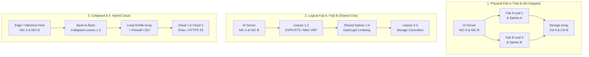
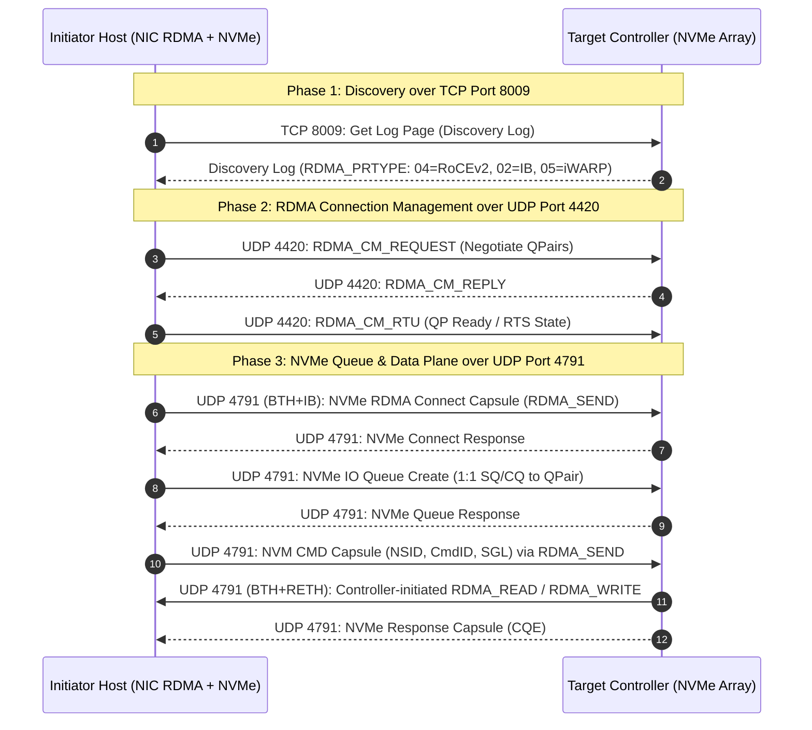
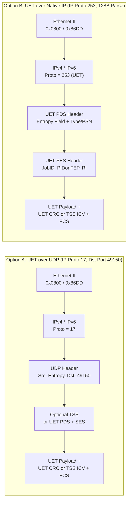
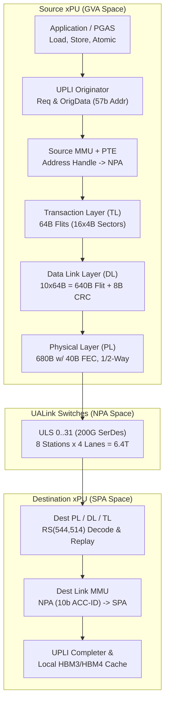

# 12.21 Storage networks, Ultra Ethernet and scale-up fabrics

| Field | Value |
|---|---|
| Level | Advanced |
| Priority tier | 2 |
| Lab venue | Nebius GPU + Local Python Verification Lab (`code/part12/storage_uec_scaleup_lab.py`) |
| Part | Part 12: Complete AI networking |
| Primary sources | *AI Data Center Network Design and Technologies* (Chapters 9, 12, 13) |
| Coverage file | `planning/coverage/chapters/12-21.md` |
| Claim & number ledger | `planning/ledgers/12-21.md` |

## Why this matters for AI infrastructure

An AI factory relies on three distinct network fabrics that operate at very different latency targets, bandwidth scales, and failure boundaries. Treating storage networks, scale-out collective fabrics, and intra-rack scale-up interconnects as interchangeable byte pipes causes checkpoint stalls. It also triggers packet-retransmission storms or sub-microsecond tensor starvation.

1. **AI Storage Networks:** Curated training datasets must stream continuously into GPU memory. Multi-terabyte model checkpoints must also flush to flash without pausing training steps. While local PCIe drives respond in roughly a hundred nanoseconds, drives inside individual servers cannot hold petabyte-scale corpora. They also cannot provide a shared namespace across thousands of nodes. Dedicated storage fabrics bridge compute servers to shared flash arrays using NVMe-o-TCP, NVMe-o-RDMA over RoCEv2, and parallel file systems with GPUDirect Storage.
2. **Ultra Ethernet Consortium Scale-Out Fabrics:** Production RoCEv2 clusters have scaled past 100,000 GPUs, yet RoCEv2 inherits legacy InfiniBand Queue Pair semantics and static flow hashing. It also suffers from Go-Back-N retransmission amplification and fragile PFC pause tuning. UEC Specification v1.0 replaces the RoCEv2 transport stack with Ultra Ethernet Transport over UDP or native IP. It splits duties between a Packet Delivery Sublayer and a Semantic Sublayer driven by Libfabric. UEC adds four packet delivery modes, built-in AES-GCM security, and sender and receiver congestion control. It also provides link-level Credit-Based Flow Control, DSCP packet trimming, Link Layer Reliability, and In-Network Collectives.
3. **Scale-Up Super-Accelerator Fabrics:** Tensor parallelism, Mixture-of-Experts token routing, multi-step reasoning, and diffusion micro-batching exchange activations at sub-microsecond cadence. That cadence overwhelms PCIe and scale-out NICs. To break single-vendor lock-in around proprietary scale-up fabrics such as NVIDIA NVLink 5, two open standards have emerged. These are the Open Compute Project Scale-Up Ethernet Transport under ESUN and the Ultra Accelerator Link.

```text
Three AI Fabric Domains - Reference Latency, Bandwidth, and Protocol Numbers:
1. AI Storage Networks (100 Gbps-800 Gbps per server, 1:3 leaf-to-spine oversubscription):
   - Local PCIe Gen5/Gen6 SSD: ~100 ns device latency (32 GT/s per lane, ~63 Gbps / 64 GB/s unidirectional across x16 lanes, 3.94 GB/s per lane)
   - Network storage switch latency: ~300 ns on InfiniBand switches vs 700-900 ns (~800 ns) port-to-port on Ethernet switches
   - Storage protocols: NVMe-o-TCP (TCP port 8009), NVMe-o-RDMA over RoCEv2 (TCP 8009 discovery, UDP 4420 RDMA CM, UDP 4791 BTH/RETH data plane with up to 66% lower write latency), parallel file systems (WekaFS, VAST, Lustre, GPFS, BeeGFS) with GPUDirect Storage (GDS)
2. Ultra Ethernet Consortium (UEC Specification v1.0, released June 11, 2025, 400 Gbps-1.6 Tbps scale-out up to 1 million endpoints):
   - Transport encapsulations: UET over UDP port 49150 (IP protocol 17) or native IP protocol 253
   - Sublayers & APIs: Packet Delivery Sublayer (PDS) + Semantic Sublayer (SES: JobID, PIDonFEP, Resource Index) via Libfabric (fi_mr, fi_collective)
   - Delivery modes & security: ROD, RUD, RUDI, UUD + Transport Security Sublayer (TSS with AES-GCM + ICV)
   - Congestion & reliability: NSCC (window/RTT/ECN), RCCC (256-byte receiver credits in a 24-bit ACK field), link-level CBFC (32 Virtual Channels with PCS CtlOS CP_Update), DSCP packet trimming, Link Layer Reliability (LLR), and In-Network Collectives (INC)
3. Scale-Up Fabrics (100-300 ns latency, up to 6.4 Tbps per xPU, 72 to 1,000 accelerators across 1-4 racks):
   - Baseline comparison: PCIe 5.0 (500 ns-1 us latency) vs NVLink 5 (1.8 Tbps / 1,800 Gbps bidirectional per GPU across 18 NVLink switches in 72-GPU NVL72)
   - OCP SUE-T / ESUN: 6-byte compressed and 12-byte non-compressed AI Fabric Header (AFH Gen 2), Reliability Header (RH), LLR, CBFC, and on-die FIFO or ARM AXI 4.0 5-channel interfaces
   - UALink 1.0: 8 stations x 4 x 200 Gbps lanes = 32 lanes = 6.4 Tbps per xPU, 64-byte Transaction Layer (TL) flits packed 10:1 into 640-byte Data Link (DL) flits + 40-byte FEC = 680-byte wire units aligned 1:1 to RS(544, 514) PCS codewords, 1-way/2-way interleaving, GVA -> NPA -> SPA MMU address handles, and software PGAS coherence
```

## Prerequisites and outcomes

### Prerequisites
- Working familiarity with RoCEv2 over UDP port 4791, Base Transport Headers, PFC, ECN, and DCQCN from earlier chapters in this part.
- Understanding of InfiniBand addressing including LID, GUID, GID, and Virtual Lanes from earlier chapters in this part.
- Familiarity with GPUDirect RDMA and GPUDirect Storage using `cuFile` and BAR1 apertures from earlier chapters in this part.

### Outcomes
After completing this chapter, you will be able to:
1. Design AI storage network topologies including physical Fab A and Fab B, logical EVPN-VXLAN Fab A and Fab B, collapsed spine, and hybrid cloud S3 replication.
2. Trace and compare the protocol state machines, packet headers, and queue mappings of NVMe-o-TCP, NVMe-o-RDMA over RoCEv2, and native InfiniBand storage.
3. Architect Ultra Ethernet scale-out fabrics. You will decode UET-over-UDP and UET-over-IP encapsulations, SES addressing, delivery modes, and congestion and reliability mechanisms.
4. Evaluate and size scale-up super-accelerator fabrics up to 4 racks and 1,000 xPUs. You will contrast SUE-T under ESUN, UALink 1.0, and NVLink 5.

---

## 1. AI Storage Network Lifecycle, Topologies, and Access Models

### 1.1 The Four-Stage AI Data Lifecycle and Storage Access Tiers

If a storage network is engineered only for sequential dataset reads, synchronous model checkpointing will saturate write buffers and leave thousands of GPUs idle. Every large language model or multimodal pipeline moves through four distinct data-lifecycle phases with different I/O sizes, concurrency patterns, and latency budgets:

1. **Data ingestion:** Raw structured and unstructured datasets are pulled from external repositories, web crawls, or enterprise lakes into high-capacity staging pools.
2. **Data processing and curation:** Tokenization, deduplication, quality filtering, and format conversion transform raw assets into training shards. This phase demands high sequential and random read/write throughput across distributed workers.
3. **AI model training and checkpointing:** Training servers stream curated batches into GPU HBM over dedicated 100 Gbps to 200 Gbps storage NICs. Converged pods instead use 400 Gbps to 800 Gbps NICs. Servers periodically pause compute to flush multi-terabyte checkpoints of weights and optimizer states to flash arrays.
4. **Post-training data warehouse, archival, and RAG inference:** Trained checkpoints, evaluation artifacts, and vector corpora move into long-term repositories and feeds for Retrieval-Augmented Generation. These workloads require low-latency random reads and continuous live updates.

To serve these four phases, operators combine three logical storage architectures: Object, Block, and File. Their protocol and fabric characteristics are summarized below.

| Characteristic | Object Storage (S3) | Block Storage (NVMe-oF / SAN) | File Storage ((P)NFS / Parallel FS / NAS) |
|---|---|---|---|
| **Data organization** | Flat objects with rich metadata and object IDs | Fixed-size logical blocks addressed by NSID + LBA | Hierarchical files and directories (POSIX namespace) |
| **Access method** | HTTP/HTTPS REST API calls (`GET`, `PUT`) | Block-level commands (NVMe SQE/CQE capsules) | File-level POSIX syscalls (`open`, `read`, `write`, `stat`, `unlink`) |
| **Transport protocols** | TCP/HTTPS over lossy Ethernet/IP | NVMe-o-TCP, NVMe-o-RDMA (RoCEv2/IB), NVMe-o-FC, FCoIP | Ethernet/IP (TCP or RDMA over RoCEv2) or InfiniBand |
| **OS page-cache usage** | Not used on compute host (application buffers) | Bypassed (raw block device / direct DMA) | Supported by OS page cache or bypassed via `O_DIRECT` / GDS |
| **Scalability & cost** | Highest scale (exabytes); lowest cost per TB | High performance per array; higher cost per TB | High parallel scale (WekaFS, VAST, Lustre, GPFS); moderate cost |
| **Primary AI domain** | Post-training cloud replication, cold archives, RAG / agentic RAG | High-IOPS local/on-prem datasets, raw block volumes, fast checkpoint targets | Shared multi-node training datasets, synchronous checkpointing, hybrid cloud tiering |

### 1.2 Four Storage Fabric Topologies: Physical Fab A/B, Logical Fab A/B, Collapsed Spine, and Hybrid Cloud

A single top-of-rack switch failure or maintenance window on a non-redundant storage network drops active mounts and crashes training jobs. Storage availability is therefore governed by Fabric A and Fabric B path diversity. If Fabric A fails or undergoes maintenance, Fabric B must carry 100% of the storage workload without IOPS, bandwidth, or latency degradation. Unlike backend GPU training fabrics that require strict 1:1 non-blocking bandwidth, dedicated storage leaf-spine fabrics use a 1:3 oversubscription ratio. Storage flows are shorter and less synchronized than AllReduce collectives.



| Topology Pattern | Physical & Control-Plane Architecture | Oversubscription & Distance Rules | Best-Fit AI Use Case |
|---|---|---|---|
| **1. Physical Fab A / Fab B Separation** | Two completely independent physical leaf-spine fabrics (Fabric A and Fabric B). NIC A connects only to Fab A ToR (Leaf 1), and NIC B connects only to Fab B ToR (Leaf 3). Storage array controllers mirror this physical split. | Identical leaf-to-spine link counts and speeds on both fabrics (typically 1:3 oversubscribed) so failover preserves 100% capacity. | Mission-critical enterprise and large-scale training clusters requiring blast-radius demarcation and hitless single-fabric upgrades. |
| **2. Logical Fab A / Fab B Separation** | A single physical 3-stage IP Clos (Leaves 1–4 full-mesh to Spines 1–4, at least 2 links per leaf-spine pair for ASIC local repair). L2 stays confined to each ToR; Fab A and Fab B are isolated via two EVPN-VXLAN Route Type 5 (RT5) IP-VRF instances or two MAC-VRF instances pinned to disjoint underlay paths. | 1:3 leaf-to-spine oversubscription is standard; multi-tenant managed training services isolate tenants via EVPN RT5 VXLAN tunnels across the shared storage underlay. | Medium-scale or multi-tenant AI clusters seeking dual-path resilience without paying for two physical spine planes. |
| **3. Collapsed Fab A / Fab B Spine** | Just two switches (Leaf 1 and Leaf 2) connected back-to-back, with both AI servers (NIC A/NIC B) and storage targets dual-homed directly to the collapsed pair. | No spine tier; when replicating across sites over **40 km+** WAN/DCI links, use **deep-buffer Ethernet switches** and **NVMe-o-TCP**, avoiding long-haul lossless DCQCN/PFC. | Geographically distributed inference POPs, regional RAG caches, and compact edge pods. |
| **4. Hybrid On-Prem + Multi-Cloud Fabric** | Local Fab A / Fab B IP Clos (Leaves 1–4, Spines 1–4) extended via border leaves (Leaves 5–6), a firewall cluster, and dual DCI gateways to two public clouds (Cloud 1, Cloud 2). | On-premises hot data runs over NVMe-o-RDMA / parallel FS (Tier 1); cold checkpoints and multi-cloud backups traverse IPsec or TLS/HTTPS (S3 REST API, Tier 2). | Disaster recovery of expensive LLM training checkpoints and unified on-prem/cloud namespace tiering. |

---

## 2. NVMe-oF State Machines (NVMe-o-TCP vs NVMe-o-RDMA), Parallel File Systems, and InfiniBand Storage

### 2.1 NVMe-oF Architecture: Queues, Capsules, NSID, and PRP vs SGL

Local PCIe NVMe SSDs achieve low latency by exposing circular Submission Queues and Completion Queues directly over the server PCIe bus. However, those local queues cannot cross an Ethernet or InfiniBand switch. NVMe over Fabrics preserves the NVMe base specification, I/O command sets, management interface, and queue semantics. It replaces the local PCIe bus with a network transport binding such as NVMe-o-TCP, NVMe-o-RDMA, or NVMe-o-FC.

In NVMe-oF, Submission Queue Entries, Completion Queue Entries, and optional inline payloads are wrapped inside network units called Capsules:
- **Command Capsule:** Sent from the host initiator to the target controller. It encapsulates a 64-byte Submission Queue Entry plus optional in-capsule write data.
- **Response Capsule:** Sent from the target controller to the host initiator. It encapsulates a 16-byte Completion Queue Entry that reports status for the matching Command ID.

Every NVMe-oF read (`opcode 0x02`) or write (`opcode 0x01`) command carries two distinct addressing constructs that must never be confused:
1. **NSID:** The Namespace Identifier selects the logical storage volume or partition exposed by the remote NVMe target controller. A single flash array controller can expose multiple NSIDs with distinct capacities, block sizes, or tenant permissions.
2. **PRP1 and PRP2 vs SGL:** These descriptors specify the initiator host or GPU BAR1 memory buffer addresses where DMA places read data or fetches write data. PRP1 and PRP2 are two 64-bit Physical Region Page pointers. PRP1 points to the first memory page, and PRP2 points to the second page or a PRP list. A Scatter-Gather List describes multiple non-contiguous memory segments in one 64-byte NVMe command header. SGL is preferred for network fabrics.

### 2.2 NVMe-o-TCP State Machine, PDUs, and Jumbo-Frame Packing

When operators need shared NVMe block storage over a lossy IP network or a 40 km+ link without tuning PFC, they deploy NVMe-o-TCP. Each multi-core host CPU establishes a 1:1 mapping between a TCP connection per CPU core and a target queue pair. All connections run over destination TCP port 8009.

```text
NVMe-o-TCP Protocol Data Unit (PDU) Types, Opcodes, and MTU 9000 Packing Math:
- Destination transport port: TCP port 8009
- Capsule / Data PDU Type Codes:
  0x01 = CapsuleCmd (Host-to-controller command capsule carrying 64B SQE: Command ID, opcode, NSID, length, PRP1/PRP2 or SGL)
  0x02 = CapsuleResp (Controller-to-host response capsule carrying 16B CQE)
  0x03 = H2CData (Host-to-controller off-capsule write data PDU)
  0x04 = C2HData (Controller-to-host read data PDU)
- NVMe I/O Opcodes:
  opcode 0x01 = Write (supports in-capsule write with SQE + Data + LAST-PDU flag, or off-capsule write with H2CData 0x03 PDUs)
  opcode 0x02 = Read (CapsuleCmd 0x01 -> sequential C2HData 0x04 PDUs #1..#N -> CapsuleResp 0x02)
- Ordered NVMe-o-TCP PDU Framing Fields:
  Common Header (CH) -> PDU-Specific Header (PSH) -> Header Digest (HDGST) -> Padding (PAD) -> PDU Data (Capsule/Payload) -> Data Digest (DDGST)
- Jumbo-Frame MTU 9000 Multi-PDU Packing:
  Single 4 KiB (4,096B) in-capsule write PDU = 24B (CH+PSH) + 4B (HDGST) + 64B (SQE) + 4,096B (Data) + 4B (DDGST) = 4,192 bytes
  At MTU 9000 (TCP MSS = 8,960 bytes), 2 PDUs = 2 x 4,192B = 8,384 bytes fit inside 1 TCP segment with 576 bytes remaining
```

1. **TCP and Optional TLS Handshake:** The host initiator completes a standard `TCP SYN -> SYN-ACK -> ACK` handshake to target port 8009. An optional TLS handshake follows when encrypted storage is required.
2. **ICReq and ICResp PDUs:** The host sends an `NVMe/TCP ICReq PDU` advertising its NVMe version and digest flags `HDGST` and `DDGST`. It also sends PDU data alignment and host identifier fields, and the controller replies with `ICResp PDU`.
3. **NVMe/TCP Connect Request and Response:** The host binds the TCP connection to a specific Controller ID. It negotiates Admin or I/O queue IDs (`QID`) and queue depth.
4. **Data Transfer and Jumbo-Frame Packing:** The session exchanges `CapsuleCmd`, `H2CData`, `C2HData`, and `CapsuleResp` PDUs. On a storage IP fabric configured with jumbo frames at `MTU 9000`, one TCP segment encapsulates two or more NVMe-o-TCP PDUs back-to-back.
5. **Session Termination:** Either endpoint sends `H2CTermReq` or `C2HTermReq` followed by a final `CapsuleResp` CQE status. This releases the NSID, Command IDs, and queue bindings before closing the TCP socket.

### 2.3 NVMe-o-RDMA (RoCEv2) State Machine: TCP 8009 -> UDP 4420 -> UDP 4791

In high-throughput training clusters where TCP host processing burns too much CPU and adds tail latency, NVMe-o-RDMA offloads storage transport into the NIC RDMA engine. It delivers up to 66% lower write latency and enables GPUDirect Storage direct DMA into GPU HBM. Over a lossless RoCEv2 fabric, NVMe-o-RDMA traverses a three-port, two-protocol state machine. If a firewall blocks any one of the three ports, session bring-up stalls midway.



| Phase | Protocol & Destination Port | Key Header Fields & State Transitions | Architectural Rules |
|---|---|---|---|
| **1. Discovery Phase** | **TCP Port 8009** | Host issues `Get Log Page – Discovery Log Pages`. Target returns `RDMA_PRTYPE`: **04** (0x04 RoCEv2), **02** (0x02 InfiniBand), or **05** (0x05 iWARP). | Standard NVMe-oF Discovery Controller runs over TCP 8009 before any UDP/RDMA packet is sent. |
| **2. RDMA CM Handshake** | **UDP Port 4420** | `RDMA_CM_REQUEST` -> `RDMA_CM_REPLY` -> `RDMA_CM_RTU` (Ready to Use), transitioning the RDMA QPair into RTS (Ready to Send). | No NVMe capsules can be exchanged until both endpoints' RDMA QPs reach RTS. |
| **3. NVMe Connect & I/O Data Plane** | **UDP Port 4791** (RoCEv2) | Outer `Ethernet -> IP -> UDP (4791) -> BTH (Opcode, Dest QPair) -> RETH (VA, RKey, DMA Length) -> NVM CMD QID + NVM CMD (NSID, CmdID, SGL)`. | Strict **1:1 mapping** between one I/O SQ/CQ pair and one RDMA QPair. Host sends command capsules via `RDMA_SEND`; **all `RDMA_READ` and `RDMA_WRITE` bulk transfers are initiated by the target controller**. |

### 2.4 High-Performance Parallel File Systems and GPUDirect Storage Integration

Raw NVMe-oF block volumes bind 1:1 sessions between a host initiator and a target namespace without coordinating file metadata across concurrent GPU clients. To provide a shared POSIX namespace at high speeds, training clusters layer parallel file systems on top of NVMe-o-RDMA. Common choices include WekaFS, VAST, Lustre, GPFS, and BeeGFS over RoCEv2 or InfiniBand:

```text
Parallel File System Striping and GPUDirect Storage (GDS) Parameters:
- Parallel file systems: WekaFS, VAST, Lustre, GPFS (IBM Storage Scale), BeeGFS
- WekaFS striping: distributes file data and metadata across all on-premises NVMe storage servers (Servers 1..8)
- Standard AI file extensions & POSIX syscalls: .pt, .npy, .ckpt, .h5, .bin via open(), read(), write(), stat(), unlink()
- Two-tier storage hierarchy: Tier 1 hot flash over RDMA (RoCEv2 / InfiniBand) + Tier 2 cold snapshots over HTTPS/TLS S3 REST APIs; VAST runs multipath NFS over RDMA
- GPUDirect Storage (GDS) zero-copy pipeline (PyTorch v2.7.0+):
  cudaMalloc -> cuFileBufRegister -> PIN to direct IO -> PCIe DMA directly between external RoCEv2/IB arrays and GPU 1..8 HBM via NIC A and NIC B (100G/200G or 400G/800G) bypassing host CPU and system DRAM
```

- **Parallel Data and Metadata Striping:** Rather than funneling clients through a single NFS gateway, WekaFS distributes both file data and metadata in small chunks across all on-premises NVMe storage servers. When PyTorch or TensorFlow accesses checkpoint files via POSIX syscalls, the local client translates the call into parallel RDMA requests across Tier 1 hot flash storage. It also tiers cold snapshots over HTTPS S3 REST APIs to Tier 2 cloud object storage.
- **GPUDirect Storage Zero-Copy DMA:** When PyTorch or the CUDA runtime allocates GPU memory via `cudaMalloc` and registers it via `cuFileBufRegister`, the GPU memory pages are pinned for direct I/O. The GDS library programs the storage NIC driver directly over PCIe. It transfers blocks between external arrays and GPU HBM via dedicated storage NICs without bouncing through host CPU cores or system DRAM.

### 2.5 InfiniBand for Storage: 16-Bit LID (48,000 Nodes), Frame Format, and 64B CBFC Credits

When native InfiniBand is used as the storage fabric for NVMe-o-RDMA and GPUDirect Storage, the RDMA connection handshake and NVMe capsule payload remain identical to RoCEv2. However, the outer Ethernet, IP, and UDP headers are replaced by the native InfiniBand frame. This eliminates L3/L4 header overhead and cuts switch latency to roughly 300 ns.

```text
Native InfiniBand Storage Frame Header Pipeline:
LRH (S-LID, D-LID, VL) -> GRH (Optional Inter-Subnet) -> BTH (Opcode, Dest QP) -> ETH (Src QP / RDMA) -> NVMe-o-RDMA Capsule + Data -> ICRC + VCRC
```

```text
Native InfiniBand Storage Addressing, Integrity, and Flow Control Specs:
- Local Routing Header (LRH) addressing: 16-bit Local Identifier (LID, 65,536 total values) assigned by the Subnet Manager (SM) via per-switch Subnet Manager Agents (SMAs)
- Single-subnet node limit: up to 48,000 end nodes per InfiniBand subnet (e.g., 32,000 nodes fit in one subnet; 60,000 nodes require inter-subnet routing via the Global Routing Header GRH)
- Frame CRCs: Invariant CRC (ICRC, end-to-end immutable fields) + Variant CRC (VCRC, hop-by-hop link fields)
- Virtual Lanes (VLs) and Credit-Based Flow Control (CBFC): up to 16 VLs per physical link (typically 8-12 active data VLs); 1 CBFC credit in the Link Layer Header (LLH) = 64 bytes of buffer space (64 credits required for a 4,096-byte storage block); 10 km optical spec reach
```

| Storage Option | (P)NFS / Parallel FS | NVMe-o-TCP | NVMe-o-RDMA (RoCEv2) | Native InfiniBand Storage |
|---|---|---|---|---|
| **Training & Inference Fit** | Training + Inference | Inference + Cold/Tier-2 Training | Training + Inference | Training (legacy/HPC + NVIDIA pods) |
| **Parallel Shared File Access** | Yes (POSIX / NFS) | Yes (when layered with FS) | Block-level (1:1 QP, needs PFS for shared files) | Block or File (Lustre/GPFS/Weka over IB) |
| **Switch Port-to-Port Latency** | ~700–900 ns (Ethernet) | ~700–900 ns (Ethernet) | ~700–900 ns (Ethernet) | **~300 ns** (InfiniBand switch) |
| **Requires Lossless Fabric** | No (unless over RDMA) | **No** (runs on lossy IP) | **Yes** (PFC + ECN + DCQCN) | **Yes** (native 16 VLs + 64B CBFC) |
| **Built-in Transport Reliability** | Via TCP or RDMA | **Yes** (standard TCP) | Via NIC RDMA QP state machine | **Yes** (hardware HCA + CBFC) |
| **Port Speeds & Multi-Vendor Scale** | 400G/800G/1.6T; High multi-vendor | 400G/800G/1.6T; High multi-vendor | 400G/800G/1.6T; High multi-vendor | 400G/800G/1.6T; Single-vendor (&lt;48,000 nodes/subnet) |

---

## 3. Ultra Ethernet Consortium (UEC Specification v1.0): Architecture, PDS/SES, Encapsulations, and Delivery Modes

### 3.1 UEC Working Groups, Service Profiles (AI Base, AI Full, HPC), and Core Terminology

As Ethernet AI clusters scale toward a million endpoints, legacy RoCEv2 hits three walls. Static ECMP flow hashing creates tail-latency collisions, and a single dropped packet triggers a Go-Back-N retransmission of the entire window. Hop-by-hop PFC pause frames also risk spreading congestion across unrelated jobs. Released on June 11, 2025 by more than 70 member companies under the Linux Foundation, UEC Specification v1.0 replaces the InfiniBand Base Transport Header with a multipath-native Ethernet transport stack.

```text
UEC Specification v1.0 Structure and Three Service Profiles:
- Eight Working Groups:
  1. Physical Layer (FEC statistics, link fault signaling, modified 64B/66B PCS encoding with out-of-band Control Ordered Sets CtlOS)
  2. Link Layer (Link Layer Reliability LLR, Packet Rate Improvement PRI, Credit-Based Flow Control CBFC)
  3. Transport Layer (Ultra Ethernet Transport UET, PDS, SES, TSS, NSCC, RCCC, DSCP packet trimming)
  4. Software (Libfabric APIs fi_mr and fi_collective, In-Network Collectives INC)
  5. Storage, 6. Management, 7. Performance & Debug, 8. Compliance
- Three Negotiated Service Profiles:
  - AI Base Profile: mandatory ROD and RUD delivery modes + mandatory NSCC congestion control over lossy or lossless 400G/800G Ethernet
  - AI Full Profile: adds RUDI (idempotent unordered writes for gradient aggregation) as mandatory; UUD optional
  - HPC Profile: strictest latency and feature rules; supports ROD, RUD, RUDI, and optional UUD
- Seven Core UET Constructs:
  1. Fabric Endpoint (FEP; sFEP for INC-capable switches)
  2. Fabric Address (FA; IPv4 or IPv6 via SLAAC)
  3. Packet Delivery Context (PDC; SPDCID, DPDCID, bound to 1 Congestion Control Context CCC_ID)
  4. Packet Delivery Sublayer (PDS; SYN, PSNs, Clear PSN Offset, ACK/NACK/SACK, req_cc_state, ACK_CC)
  5. Semantic Sublayer (SES; Libfabric fi_mr RKEY validation & fi_collective, Opcode RMA WRITE 0x01, TAGGED_SEND 0x80, DEFERRABLE SEND, Message ID, Buffer Offset, Match Bits, Request Length)
  6. JobID, PIDonFEP, and Resource Index (RI)
  7. Transport Security Sublayer (TSS; AES-GCM encryption header + trailing Integrity Check Value ICV)
```

To read a UEC packet capture or configure a UET NIC, you must understand seven core architectural constructs:
1. **Fabric Endpoint:** Any server NIC or switch port participating in the UEC fabric. Switch endpoints capable of In-Network Collectives are called `sFEPs`.
2. **Fabric Address:** The IPv4 or IPv6 address identifying an FEP, often provisioned automatically via IPv6 SLAAC.
3. **Packet Delivery Context:** A logical point-to-point transport channel between an initiator FEP and a target FEP. It is identified by `SPDCID` and `DPDCID` and bound to one Congestion Control Context (`CCC_ID`).
4. **Packet Delivery Sublayer:** The lower UET sublayer responsible for PDC session setup, Packet Sequence Numbers, `Clear PSN Offset`, `ACK`/`NACK`/`SACK` processing, and congestion control state.
5. **Semantic Sublayer:** The upper UET sublayer that translates Libfabric calls (`fi_mr` and `fi_collective`) into wire semantics. It encodes opcodes, message IDs, buffer offsets, match bits, and request lengths.
6. **JobID, PIDonFEP, and Resource Index:** These three fields replace the legacy RoCEv2 BTH Queue Pair number. `JobID` identifies the distributed job across the cluster, `PIDonFEP` identifies the target OS process context, and `Resource Index` identifies the completion or receive queue.
7. **Transport Security Sublayer:** Built-in UET encryption and authentication header using AES-GCM with a trailing Integrity Check Value. It provides end-to-end confidentiality, integrity, and anti-replay protection without external MACsec overhead.

### 3.2 PDC Session Handshake, UDP-Based Encapsulation for UET (UDP Port 49150), and UET over IP (IP Protocol 253)

Before data transfers begin on a Packet Delivery Context, initiator FEP A and target FEP B execute a lightweight three-step PDS handshake. This avoids slow out-of-band queue-pair exchanges. When Reliable Ordered Delivery is selected, all messages sharing `{JobID, source PIDonFEP, destination PIDonFEP, RI, Traffic Class}` are pinned to a single PDC.

```text
PDC Session Establishment Handshake Sequence:
1. Initiator FEP A -> Target FEP B: sends PDS packet with pds.flags.syn = 1, initial PSN = 101, Source PDC ID (SPDCID = 201), Clear PSN Offset, and requested delivery mode (ROD_REQ 0x03 or RUD_REQ)
2. Target FEP B -> Initiator FEP A: allocates local PDC (301) and replies with ACK = 101, SPDCID = 301, DPDCID = 201
3. Initiator FEP A -> Target FEP B: records DPDCID = 301, clears SYN bit (pds.flags.syn = 0), and transmits subsequent data packets (PSN = 102, SPDCID = 201, DPDCID = 301)
```

UEC Specification v1.0 defines two wire encapsulations for UET packets, which must be configured identically on both endpoints before PDC creation:



| Encapsulation Property | Option A: UET-over-UDP | Option B: UET-over-IP (Native / Raw IP) |
|---|---|---|
| **Outer L3/L4 Headers** | `Ethernet -> IPv4/IPv6 (Protocol = 17) -> UDP (Dst Port = 49150)` | `Ethernet -> IPv4/IPv6 (Protocol = 253)` with no UDP header |
| **Multipath Entropy Carrier** | **UDP Source Port** dynamically rotated by the sender NIC mid-session whenever an NSCC NACK signals path congestion. | Dedicated **Entropy field at the start of the PDS header** updated by the sender NIC upon NSCC feedback. |
| **Switch ASIC Parsing & Compatibility** | Works transparently across all existing 400G/800G Ethernet switches using standard UDP ECMP/packet-spraying hashes. | Removes 8-byte UDP overhead so PDS + SES (`JobID`, `RI`) fit inside the **128-byte switch packet-parsing window**, but requires switches to permit **IP Protocol 253**. |
| **Integrity (UET CRC) vs Security (TSS)** | Supports optional UET CRC (`0xfcfdfeff`) **or** optional TSS (AES-GCM header after UDP + trailing ICV). **Never enable both UET CRC and TSS simultaneously.** | Supports optional UET CRC **or** optional TSS immediately after the PDS Entropy field. When TSS encrypts PDS/SES, switches must hash on outer UDP Src Port or PDS Entropy. |

### 3.3 The Four UEC Packet Delivery Modes (ROD, RUD, RUDI, UUD)

In RoCEv2, spraying packets across multiple spine switches causes out-of-order arrivals at the target NIC. RoCEv2 misinterprets those out-of-order arrivals as packet loss and flushes the entire 64-packet window. Through Libfabric, UET lets applications pick one of four delivery modes per PDC. It uses selective retransmission so only the single missing PSN is resent:

```text
Selective Retransmission vs RoCEv2 Go-Back-N Penalty:
- In-flight window size: 64 packets (PSN 1..64)
- Single packet loss at packet #1:
  RoCEv2 Go-Back-N flushes and retransmits all 64 packets
  UET (RUD / RUDI + packet trimming) selectively retransmits only 1 packet (saving 63 packets, a 64.0x retransmission reduction)
```

| Delivery Mode | Reliability & Ordering Semantics | Pros & Cons | Mandatory / Optional Profiles & Target Workloads |
|---|---|---|---|
| **ROD (Reliable Ordered Delivery)** | PSN-tracked (`ACK`/`NACK`/`SACK`), delivered **in strict order** to the upper layer. Receiver NIC uses its **reordering buffer** to absorb fabric packet spraying. | **Pros:** Preserves strict MPI/control ordering even over packet-sprayed fabrics.<br/>**Cons:** Higher tail latency and NIC reorder buffer memory footprint. | Mandatory in **AI Base**, **AI Full**, and **HPC**. Used for HPC, MPI, and serialized control flows. |
| **RUD (Reliable Unordered Delivery)** | PSN-tracked (`ACK`/`NACK`/`SACK`), **out-of-order Direct Data Placement (DDP)** straight into GPU HBM without waiting for earlier PSNs. | **Pros:** Eliminates reorder-buffer head-of-line blocking; lower latency under per-packet spraying.<br/>**Cons:** Application/collective must tolerate out-of-order completion. | Mandatory in **AI Base**, **AI Full**, and **HPC**. Used for AI tensor/pipeline parallelism and bulk data transfers. |
| **RUDI (Reliable Unordered Delivery Idempotent)** | Reliable unordered delivery for **idempotent** operations that can be safely retried or written multiple times to the same memory offset by one or multiple sources. | **Pros:** Allows proactive application-level retries without waiting for NACK round-trips; supports multi-writer updates.<br/>**Cons:** Requires idempotent memory semantics. | Mandatory in **AI Full** and **HPC** (HPC profile required for full semantic support). Used for RMA writes and **AI gradient updates**. |
| **UUD (Unreliable Unordered Delivery)** | Best-effort fire-and-forget: **omits PSNs (`Clear PSN Offset`), ACKs, SACKs, NACKs, and retransmissions**. | **Pros:** Fastest session ramp time and lowest latency.<br/>**Cons:** No loss recovery, no integrity checking, **incompatible with TSS security**. | Optional in **AI Full** and **HPC**. Used for real-time telemetry and inference logging. |

---

## 4. UEC Congestion Management (NSCC, RCCC, CBFC), Packet Trimming, LLR, and In-Network Collectives (INC)

### 4.1 Two-Tier Congestion Management: NSCC, RCCC (256B Credits), and Link-Level CBFC (32 VCs)

In a traditional RoCEv2 cluster, a sudden many-to-one receiver incast fills top-of-rack switch buffers. That triggers Priority Flow Control pause frames that freeze innocent victim flows sharing the same link. To eliminate PFC pause storms and head-of-line blocking, UEC decouples end-to-end congestion control between endpoint NICs from optional link-level lossless flow control:

```text
UEC End-to-End (NSCC / RCCC) and Link-Level (CBFC) Quantitative Parameters:
- Network Signal Congestion Control (NSCC): sender-driven congestion window (cwnd) adjusted via RTT, ECN flag in NACKs, and ACK_CC telemetry (received byte count, service time, out-of-order packet count)
- Receiver Credit Congestion Control (RCCC): target-driven Credit Pool requested via Credit Target (req_cc_state) and granted via 24-bit ACK congestion control field in units of 256 bytes:
  256 credits x 256 bytes = 65,536 bytes (64 KiB) authorized transmission
  Maximum 24-bit RCCC credit window = (2^24 - 1) x 256 = 4,294,967,040 bytes (~4.0 GiB)
- Link-Level Credit-Based Flow Control (CBFC):
  32 Virtual Channels (VCs) per port (2x InfiniBand's 16 VLs, 4x IEEE PFC's 8 priorities)
  Discovered via LLDP; tracks Consumed Credit (CC) and Freed Credit (CF) counters per VC
  Uses modified 64B/66B PCS physical sublayer out-of-band Control Ordered Set (CtlOS) CP_Update messages at line rate
```

1. **Network Signal Congestion Control:** Mandatory across all three UEC profiles on lossy fabrics. The sender PDS maintains an explicit congestion window of in-flight unacknowledged bytes. The receiver returns `ACK_CC` packets carrying received byte count, service time, and out-of-order packet count. It can also return NACK packets with the ECN flag. The sender adjusts `cwnd` using RTT and ECN feedback and rotates its UDP source port or PDS Entropy field.
2. **Receiver Credit Congestion Control:** An optional target-driven scheme built to prevent many-to-one receiver incast. Senders request credit via the `Credit Target` (`req_cc_state`) field in data packets. The target FEP arbitrates its local Credit Pool across active incoming sessions. It grants credits back in units of 256 bytes inside a 24-bit ACK field. If the receiver buffer pool is full, it withholds credits before packets ever enter the fabric.
3. **Link-Level Credit-Based Flow Control:** Inspired by InfiniBand CBFC, UEC CBFC doubles capacity to 32 Virtual Channels per port. Lossless and best-effort channels can then coexist on one link. Neighboring switches and NICs discover CBFC support via LLDP and maintain Consumed Credit and Freed Credit counters per VC. Instead of consuming Layer-2 frame bandwidth for credit updates, the sender PCS sublayer sends out-of-band `CtlOS` `CP_Update` messages at line rate.

### 4.2 Fast Retransmission via DSCP Packet Trimming and Hop-by-Hop Link Layer Reliability (LLR)

When microbursts overflow a switch buffer despite NSCC and RCCC, waiting milliseconds for a sender retransmission timeout stalls the collective. UEC eliminates retransmission timeouts by catching packet drops at the switch buffer and the physical link:

- **DSCP Packet Trimming:** Packets in trim-eligible DSCP classes are never silently dropped when an intermediate switch buffer fills. Instead, the congested switch slices off the data payload and preserves the packet header and original ECN-capable state. It forwards the lightweight trimmed header over a high-priority queue to the destination FEP. Upon receiving a trimmed packet, the destination NIC skips writing the payload into GPU HBM. It immediately sends a targeted NACK or SACK to the sender for that exact PSN.
- **Link Layer Reliability:** Negotiated per link segment between adjacent switches or between a NIC and a switch. Each LLR-eligible Ethernet frame receives a link-layer sequence number (`SEQ`) embedded in the MAC preamble. A copy is saved in an on-ASIC replay buffer guarded by a short link timer:

```text
Hop-by-Hop Link Layer Reliability (LLR) Replay Sequence (Switch 1 <-> Switch 2):
- Clean arrival (SEQ = 1): Switch 2 receives SEQ = 1 cleanly and returns link-level ACK -> Switch 1 flushes SEQ = 1 from its replay buffer
- Wire corruption or loss (SEQ = 2 or SEQ = 3): if SEQ = 2 times out, or if SEQ = 3 is lost and SEQ = 4 arrives out of order, Switch 2 immediately returns NACK SEQ = 3 -> Switch 1 retransmits the missing frame from its local ASIC replay buffer in hundreds of nanoseconds, hiding the optical bit error from end-to-end UET PDS
```

### 4.3 In-Network Collectives (INC) vs User-Space xCCL, Management, Interoperability, and Compliance

Under the UEC Software Working Group, the Libfabric `fi_collective` API bridges PyTorch, OpenMPI, MPICH (`MPI_Allreduce`, `MPI_Alltoall`), and vendor xCCLs to switch-assisted In-Network Collectives:

- **Switch-Assisted INC Execution:** An out-of-band INC Manager communicates via gRPC with INC Agents running inside `sFEPs`. For collective groups (`Collectives-gr1`, `Collectives-gr2`), leaf INC agents forward vectors to an elected root-of-tree spine switch (`Spine 1` or `Spine 2`). That root spine switch aggregates or replicates the collective flow once in hardware and distributes the result downstream.
- **Management, Interoperability, and Certification:** UET exports per-flow telemetry tracking CBFC and RCCC credits, latency, jitter, and drops across Libfabric, MPI, NCCL, RCCL, and the INC Manager. For backward compatibility, UEC Specification v1.0 supports dual-mode link negotiation so brownfield IP fabrics can run lossless RoCEv2 alongside end-to-end UET. Link-level CBFC and LLR are reserved for greenfield deployments. The UEC compliance suite validates multi-vendor interoperability, line-rate performance, and TSS security across the AI Base, AI Full, and HPC profiles.

| Dimension | InfiniBand (IBTA) | RoCEv2 (DCQCN) | Ultra Ethernet (UET / UEC v1.0) |
|---|---|---|---|
| **Target Cluster Scale** | < 100,000 endpoints (48,000 per 16-bit LID subnet) | > 100,000 endpoints | **~1 million endpoints** |
| **Wire Encapsulation** | Native InfiniBand (LRH/GRH/BTH) | `Ethernet / IP / UDP (4791) / BTH` | **`UDP (49150) + PDS/SES`** or **`Native IP (253) + PDS/SES`** |
| **Delivery & Loss Recovery** | Reliable Connected (RC) in-order; Go-Back-N / IB retry | RC in-order (Go-Back-N window flush on single loss) | Flexible **ROD / RUD / RUDI / UUD** with selective retry |
| **Congestion & Flow Control** | Link-level 16 VLs + 64B CBFC credits | PFC (8 priorities) + ECN + DCQCN manual tuning | **NSCC (RTT/ECN), RCCC (256B credits), CBFC (32 VCs), Packet Trimming, LLR** |
| **Security & In-Network Collectives** | Partition keys (`P_Key`); optional SHARP | External MACsec / IPsec; no native Ethernet INC | Built-in **TSS (AES-GCM)**; optional **INC (sFEP + IM + `fi_collective`)** |

---

## 5. Scale-Up Systems: Architecture, OCP SUE-T (ESUN), UALink 1.0, and Memory Coherence

### 5.1 Why Scale-Up Pods Exist: Latency, Bandwidth, and the 4-Rack / 1,000-xPU Boundary

Scale-out networks connect independent servers across multi-tier leaf-spine fabrics via external 400G or 800G NICs over PCIe. However, seven latency-critical AI workloads exchange activations at sub-microsecond cadence. These include foundational LLM training, multimodal text-to-video diffusion, Mixture-of-Experts token routing, and multi-step reasoning. They also include digital-twin physics simulation, Graph Neural Networks with sparse neighbor reads, nanosecond financial risk modeling, and edge federated inference. External NICs and PCIe buses cannot feed these workloads without stalling the accelerators:

```text
Scale-Up Interconnect vs PCIe / CXL Latency, Bandwidth, and Pod Geometry Specs:
- PCIe 5.0: 500 ns to 1 us latency, 32 GT/s per lane, 3.94 GB/s per lane (64 Gbps / 63.02 GB/s unidirectional on x16)
- PCIe 6.0: 8 GB/s per lane (~128 GB/s / ~128 Gbps bidirectional on x16)
- CXL 3.0: ~100 ns cache-coherent shared memory latency, tied to PCIe 6.0 (32 GT/s) per-lane bandwidth
- NVIDIA NVLink 5 (NVL72): 100-300 ns latency, 1.8 Tbps (1,800 Gbps) bidirectional per GPU across 18 NVLink switches connecting 72 GPUs (B300 compute tray packs 4 GPUs with 1,152 GB aggregate HBM3)
- Scale-up workload examples: text-to-video diffusion spreading 1,024 images across 512 xPUs at 2 images per micro-batch; GNN irregular sparse reads at ~300 ns
- Physical scale-up pod geometry: 72 to 1,000 xPUs across 1 to 4 pre-engineered racks (pods), < 4 m in-rack copper/optical cables, 200 Gbps SerDes lanes from on-die interconnect points (IP) into single-hop scale-up switches (ESUN/SUE-T, UALink Switches ULS, or NVSwitch) at 200-300 ns port-to-port latency (< 1 us end-to-end RTT)
- Horizontal pod-to-pod scale-out: separate 400G/800G scale-out NICs over PCIe Gen5/Gen6 across multi-plane Fabric Plane 1 | Plane 2 Clos networks
```

### 5.2 Open Compute Project (OCP) Scale-Up Ethernet Transport (SUE-T / ESUN)

Standard Ethernet frames carry tens of bytes of IP, UDP, and RDMA headers that waste wire bandwidth on small 64-byte or 256-byte memory loads and stores inside a rack. Announced in October 2025 under the OCP Ethernet Scale-Up Networking initiative, Scale-Up Ethernet Transport adapts standard 100 Gbps and 200 Gbps PAM-4 Ethernet PHY and MAC silicon for single-hop scale-up pods. It replaces IP, UDP, and BTH with two compact Layer-2 headers:

```text
OCP SUE-T (ESUN) Framing, Header Efficiency, and On-Die Interface Specifications:
- Physical interface scaling: 100G/200G PAM-4 SerDes (800G, 1.6T, or 3.2T per SUE interface; e.g., 12 SUE instances x 12 lanes per xPU connected 1:1 to 12 ESUN switches, ~250 ns switch hop latency)
- Base frame and PDU sizes: converts a 256-byte frame into a scale-up flit carrying up to a 4,096-byte SUE PDU over a Virtual Channel (VC)
- AI Fabric Header (AFH Generation 2):
  1. Compressed AFH (6 bytes): for single-hop scale-up pods; encodes Destination xPU, Traffic Class, Source xPU, Opaque bits, and control flags (V version 0, W compressed vs non-compressed format/hop count, Z administratively assigned local MAC identifier, X/Y/R reserved, M multicast) inside Ethernet DMAC/SMAC positions
     -> 256B payload + 6B AFH Gen 2 + 2B EtherType + 8B RH + 8B R-CRC/FCS = 280 bytes total (91.43% payload efficiency)
  2. Non-Compressed AFH (12 bytes): for two-hop scale-up topologies
     -> 256B payload + 12B AFH Gen 2 + 2B EtherType + 8B RH + 8B R-CRC/FCS = 286 bytes total (89.51% payload efficiency)
- Reliability Header (RH, 8 bytes after EtherType, before SUE Payload + R-CRC + PAD + FCS):
  Row 1: VER, OP (opcode), RSV, 10-bit xPU ID (up to 1,024 xPUs), 16-bit NPSN (Next/Packet Sequence Number)
  Row 2: VC (4 or more virtual channels), RSV, Partition (multi-tenant virtual pod isolation), 16-bit APSN (Acknowledge Sequence Number)
- Two On-Die xPU-to-SUE Interfaces:
  1. FIFO Interface: 1 raw PDU stream using a 10-bit xPU identifier + 2-bit VC identifier
  2. ARM AXI 4.0 Interface: 5 independent memory transaction channels mapped across 2 VCs:
     - Requests on VC0: AR (Read Address), AW (Write Address), W (Write Data)
     - Responses on VC1: B (Write Response), R (Read Data)
```

1. **AI Fabric Header Generation 2:** Replaces standard MAC addressing with a 6-byte compressed header for single-hop pods or a 12-byte non-compressed header for two-hop topologies. Both formats preserve IEEE Ethernet frame compatibility.
2. **Reliability Header and Dual-Layer Loss Recovery:** Placed immediately after the EtherType, the 8-byte Reliability Header tracks end-to-end sequence numbers (`NPSN` and `APSN`) across up to 1,024 xPUs. Hop-by-hop Link Layer Reliability retransmits lost frames from the ESUN switch replay buffer, and link-level CBFC prevents buffer overflow.
3. **On-Die FIFO and ARM AXI 4.0 Interfaces:** Between the xPU compute core and the on-die SUE transport block, designers choose either a raw streaming FIFO interface or a 5-channel ARM AXI 4.0 memory interface. The AXI 4.0 interface isolates Read and Write Requests (`AR`, `AW`, `W`) on `VC0` from Read and Write Responses (`B`, `R`) on `VC1`.

### 5.3 Ultra Accelerator Link (UALink 1.0): 6.4 Tbps Stations, 64B/640B Flits, UPLI, and GVA -> NPA -> SPA

Variable-length Ethernet frames and standard 4-way Reed-Solomon FEC codeword interleaving add hundreds of nanoseconds of delay at every switch hop. The Ultra Accelerator Link Specification 1.0 eliminates variable-length Ethernet framing altogether. It connects up to 1,000 accelerators across single-hop UALink Switches (`ULS 0..31`) or direct full-mesh `UALink Direct` links. All transfers use fixed-size flits aligned 1:1 with physical PCS codewords:



| UALink 1.0 Layer / Mechanism | Quantitative Specification & Framing | Architectural Function |
|---|---|---|
| **Stations & Per-xPU Bandwidth** | **8 Stations per xPU x 4 lanes per Station x 200 Gbps (200 GT/s) SerDes = 32 lanes = 6,400 Gbps (6.4 Tbps)** aggregate bandwidth per accelerator. | Delivers 8x–16x the bandwidth of a single 400G/800G scale-out NIC over < 4 m in-rack cables. |
| **UPLI (Protocol Level Interface)** | **Four channelized links** between UPLI Originator and UPLI Completer: **Req** (Request), **OrigData** (Write Request Data), **RD Res** (Read Response + Data), and **WR Res** (Write Response). | Carries a **57-bit `ReqAddr`**, `ReqCmd`, credit return/release counts, and **10-bit `ReqSrcPhysAccID` / `DSTACCID`** (up to 1,000 accelerators per pod). |
| **Transaction Layer (TL) Flits** | Fixed **64-byte TL flits**, organized into **16 x 4-byte sectors** and split into an **Upper 32-byte Half-Flit** and **Lower 32-byte Half-Flit** (`Req0..Req3` control in lower half; `Req0.Data` across halves). | Encodes semantic operations (`read`, `write`, `atomic`, `RMA_SYNC`, `NOTIFY`, `RMA_FENCE`, `RMA_COMPLETION`, `ATOMIC_ACK`). |
| **Data Link (DL) Flits & Replay** | Packs **10 x 64-byte TL flits** from multiple sources/destinations into one **640-byte DL flit** plus **8-byte CRC** for link-level replay (`CRD`/`RREQ`/`ACK`/`NACK`), and **40-byte FEC** = **680-byte fixed wire unit**. | Eliminates variable-length Ethernet fragmentation and handles hop-by-hop link training, credit updates (`CRD`), and CRC replay (`RREQ`). |
| **Physical Layer (PL) & PCS Alignment** | One **640-byte DL flit maps 1:1 into one RS(544, 514) PCS codeword** (544/514 10-bit symbols; first several 257-bit blocks overwritten with 802.3 alignment markers). Uses **1-way or 2-way codeword interleaving** instead of standard 4-way Ethernet interleaving. | Waiting for only 1 or 2 codewords instead of 4 cuts FEC decoding latency by 4.0x or 2.0x (200–300 ns switch hop latency), requiring purpose-built ULS switches. |
| **Address Translation (GVA -> NPA -> SPA)** | **Guest Virtual Address (GVA)** -> Source MMU Page Table Entry (PTE) + **Address Handle ID** -> **Network Physical Address (NPA + 10-bit ACC-ID + key bits)** -> ULS switch forwarding -> Destination **Link MMU** -> **System Physical Address (SPA)**. | Replaces Ethernet MAC switching with hardware memory-address routing and **virtual pod partitioning** where 10-bit ACC-IDs remain constant across partition changes. |

### 5.4 Hardware Directory Coherence vs Software PGAS Coherence and Scale-Up Comparison

When an engineer ports a multi-GPU kernel from an NVIDIA NVL72 rack to an open UALink or SUE-T pod, assuming hardware cache coherence causes silent stale-memory bugs. A fundamental architectural divide separates proprietary hardware-coherent pods from open software-coherent scale-up pods:

1. **Hardware Cache Coherence:** On NVLink and NVSwitch, AMD Infinity Fabric, and CXL 3.0, the fabric silicon enforces cache consistency automatically without software intervention. A directory-based home agent tracks which xPU caches hold copies of each cache line. When GPU 1 writes to memory address X, the NVSwitch dispatches hardware invalidate snoop messages to all peer GPUs caching line X. It collects acknowledgments and grants exclusive ownership to GPU 1. Hardware coherence allows transparent pointer dereferencing across 72 GPUs in NVL72, but snoop directory traffic scales poorly toward 1,000 accelerators and locks the pod to one vendor.
2. **Software-Managed PGAS Coherence:** To scale cleanly to 1,000 multi-vendor accelerators, UALink 1.0 and SUE-T omit hardware cache snoops. They adopt a Partitioned Global Address Space memory model above the Transaction Layer. Runtime libraries such as NCCL, RCCL, SHMEM, CUDA, and ROCm explicitly coordinate cache flushes and memory visibility at collective boundaries. They do this using lightweight TL control verbs (`RMA_FENCE`, `RMA_SYNC`, `NOTIFY`, `RMA_COMPLETION`, and `ATOMIC_ACK`).

| Capability | OCP SUE-T (ESUN) | UALink 1.0 | NVIDIA NVLink 5 (NVL72) |
|---|---|---|---|
| **Wire / PHY Layer** | Standard Ethernet PHY (100G–800G PAM-4) | Custom 802.3dj-aligned 200G PAM-4 (1-way/2-way FEC) | Proprietary NVIDIA NVLink 5 high-speed SerDes |
| **On-Wire Unit** | Ethernet frame (256B base flit, up to 4,096B PDU) + 6B/12B AFH Gen 2 + RH | **64B TL flits** packed 10:1 into **640B DL flits** (680B with 40B FEC) | Proprietary NVLink flits over 18 NVSwitch crossbars |
| **Memory & Coherence Model** | One-sided PGAS (`put`/`get`/`atomic`) via FIFO or AXI 4.0; **software-managed** fences | PGAS (`load`/`store`/`atomic`/`fence`/`notify`) via GVA->NPA->SPA; **software-managed** | **Hardware-coherent** shared memory (directory + snoop invalidations via NVSwitch) |
| **Reliability & Flow Control** | RH (16-bit NPSN/APSN) + hop-by-hop LLR + CBFC | DL-level credits (`CRD`) + 8B CRC + replay (`RREQ`/`ACK`/`NACK`) | Hardware retry and internal credit scheduler inside NVSwitch |
| **Topology Scope & Scale** | 1-hop or 2-hop pod; up to 1,024 (10-bit xPU ID) | In-rack / 4-rack pod up to **1,000 xPUs** (10-bit ACC-ID) | **72 GPUs** fully connected (NVL72) |
| **1-Hop Latency & Per-xPU BW** | ~250 ns switch hop (< 1 us E2E); 0.8–3.2 Tbps typical | 200–300 ns switch hop (< 1 us RTT); **up to 6.4 Tbps (8x4x200G)** | Tens of ns switch hop (100–300 ns system); **1.8 Tbps (1,800 Gbps)** per GPU |

---

## Commands and configurations that matter

### 1. NVMe-o-TCP (Port 8009) and NVMe-o-RDMA (RoCEv2 Ports 8009 -> 4420 -> 4791) Host Operations

```bash
# 1. Verify storage NIC jumbo frame MTU (9000 bytes) for multi-PDU NVMe-o-TCP / RoCEv2 packing (untested here)
ip -d link show dev eth2

# 2. Discover NVMe-oF targets over the standard Discovery Controller TCP port 8009 (untested here)
# Returns RDMA_PRTYPE (04=RoCEv2, 02=InfiniBand, 05=iWARP) or TCP transport descriptors
sudo nvme discover -t tcp  -a 10.40.1.100 -s 8009
sudo nvme discover -t rdma -a 10.40.2.100 -s 8009

# 3. Connect an NVMe-o-TCP namespace (lossy IP fabric, 1:1 SQ/CQ per core over TCP 8009) (untested here)
sudo nvme connect -t tcp  -n nqn.2026-10.io.ai-storage:subsys01 -a 10.40.1.100 -s 8009 --nr-io-queues=16

# 4. Connect an NVMe-o-RDMA namespace over RoCEv2 (UDP 4420 CM -> UDP 4791 BTH/RETH) (untested here)
sudo nvme connect -t rdma -n nqn.2026-10.io.ai-storage:subsys01 -a 10.40.2.100 -s 4420 --nr-io-queues=16

# 5. Inspect active NVMe-oF subsystems, namespaces (NSIDs), and Fab A / Fab B multipath state (untested here)
sudo nvme list-subsys
```

### 2. Inspecting NVMe-o-RDMA, UET-over-UDP (49150), and UET-over-IP (Proto 253) on the Wire

```bash
# 1. Capture NVMe-oF Discovery (TCP 8009), RDMA CM (UDP 4420), and RoCEv2 data (UDP 4791) (untested here)
sudo tcpdump -ni eth2 'tcp port 8009 or udp port 4420 or udp port 4791' -c 50

# 2. Capture Ultra Ethernet Transport (UET) over UDP (port 49150) or Native IP (protocol 253) (untested here)
sudo tcpdump -ni eth0 'udp port 49150 or ip proto 253 or ip6 proto 253' -vvv -c 50

# 3. Query Libfabric UET provider capabilities, delivery modes (ROD/RUD/RUDI/UUD), and domain (untested here)
fi_info -v -p uet
```

### 3. InfiniBand Storage Subnet (LID & 16 VLs) and GPUDirect Storage Verification

```bash
# 1. Inspect InfiniBand HCA 16-bit LID assignment, active Virtual Lanes (VLs), and port state (untested here)
ibstat
ibv_devinfo -v

# 2. Verify GPUDirect Storage (GDS) registration with NVMe-oF / WekaFS / VAST mounts (untested here)
/usr/local/cuda/gds/tools/gdscheck -p
```

---

## How it fails

When storage fabrics, Ultra Ethernet scale-out links, or scale-up pods are misconfigured, jobs rarely print an obvious protocol error. Use the table below to map symptoms to root causes and fixes.

| # | Failure Mode | Observable Symptom | Root-Cause Diagnosis | Remediation |
|---|---|---|---|---|
| **1** | **Long-Haul (40 km+) Lossless RoCEv2 Storage Replication Collapse** | Inter-site checkpoint replication over a 40 km+ DCI link suffers periodic throughput collapses and PFC pause backpressure into the local storage leaf switches. | DCQCN reaction loops and PFC pause quanta cannot maintain lossless headroom across long propagation delays (40 km+), starving local ToR buffers. | Keep NVMe-o-RDMA (RoCEv2) strictly intra-site; switch inter-site (40 km+) replication to **NVMe-o-TCP** (port 8009) or HTTPS S3 over **deep-buffer Ethernet switches**. |
| **2** | **NVMe-o-RDMA Session Hang at Discovery vs CM (TCP 8009 vs UDP 4420/4791)** | `nvme discover -t rdma -s 8009` succeeds and prints target NQN and `RDMA_PRTYPE = 04`, but `nvme connect -t rdma` times out before creating I/O queues. | Security ACLs or EVPN VRF policies permit TCP 8009 (Discovery Log) and UDP 4791 (RoCEv2), but block **UDP 4420** (RDMA CM QPair negotiation), preventing QPs from reaching RTS. | Permit all three NVMe-o-RDMA ports end-to-end across Fab A and Fab B: **TCP 8009** (Discovery), **UDP 4420** (RDMA CM), and **UDP 4791** (RoCEv2 data). |
| **3** | **UET-over-IP (Protocol 253) Silent Blackholing on Brownfield Switches** | UET-over-UDP (port 49150) works at line rate, but switching endpoints to lightweight UET-over-IP drops 100% of PDS SYN packets across the spine. | Brownfield Ethernet switch ACLs or L3 forwarding pipelines restrict IP protocol numbers to standard TCP (6), UDP (17), and ICMP (1) or fail to parse the PDS Entropy field under **IP Protocol 253**. | Use **UET-over-UDP (Dst Port 49150)** on brownfield fabrics, or explicitly allow **IP Protocol 253** and verify 128-byte PDS/SES deep-header parsing on UEC-compliant switches. |
| **4** | **UET TSS Security Enabled Alongside UET CRC or UUD Delivery Mode** | PDC initialization fails with protocol configuration errors, or switch SES-field load balancing collapses to a single link when TSS encryption is turned on. | UEC Specification v1.0 forbids enabling UET CRC and TSS (AES-GCM + ICV) simultaneously, marks **UUD incompatible with TSS**, and encrypts SES (`JobID`/`RI`) under TSS so switches cannot read inner SES fields. | Disable UET CRC when enabling TSS, use ROD, RUD, or RUDI (never UUD) for TSS-protected flows, and configure switches to hash on outer **UDP Source Port** or **PDS Entropy**. |
| **5** | **Mixing Legacy PFC and UEC CBFC/LLR on the Same Shared Queue** | Brownfield ToR hosting both RoCEv2 and UET servers experiences erratic buffer stalls, false link retries, and tail-latency spikes. | Running PFC pause thresholds and UEC CBFC (`CtlOS` `CP_Update`) / LLR simultaneously on overlapping buffer pools causes conflicting backpressure loops. | On mixed brownfield ToRs, keep the lossless PFC/DCQCN queue dedicated to legacy RoCEv2 and run UET over a separate best-effort queue using end-to-end **NSCC** or **RCCC**, reserving link-level CBFC/LLR for greenfield links. |
| **6** | **Stale Tensor Reads in Software-Coherent Scale-Up Pods (UALink / SUE-T)** | Porting a multi-GPU kernel that relies on direct shared-memory pointers from NVLink (NVL72) to UALink 1.0 or SUE-T produces silent numerical divergence during training. | Unlike NVLink/NVSwitch, which dispatches hardware directory **snoop invalidations** on every cache-line write, UALink 1.0 and SUE-T use **software-managed PGAS coherence** without hardware cache snooping. | Insert explicit PGAS / TL synchronization barriers (`RMA_FENCE`, `RMA_SYNC`, `NOTIFY`, `RMA_COMPLETION`) via the collective/runtime library (NCCL/RCCL/SHMEM) before peer xPUs read updated HBM regions. |

---

## Hands-on lab

### Venue and Scope
- **Local Runnable Lab:** Run `code/part12/storage_uec_scaleup.py` and `code/part12/storage_uec_scaleup_lab.py` using the Python 3 standard library. It executes 25 automated self-checks covering NVMe-o-TCP, NVMe-o-RDMA, InfiniBand storage, UEC v1.0 UET, OCP SUE-T, and UALink 1.0.
- **Cluster Verification:** Run the `nvme`, `tcpdump`, `fi_info`, `ibstat`, and `gdscheck` commands in the commands section on a Nebius GPU cluster.

### Run the Verification Lab

```bash
python3 -B code/part12/storage_uec_scaleup_lab.py
```

Expected output:

```text
=== Chapter 12.21 Lab: Storage Networks, Ultra Ethernet and Scale-Up Fabrics ===
  [PASS] 1. NVMe-o-TCP session uses TCP port 8009, ICReq/ICResp PDUs, and runs on lossy IP fabrics
  [PASS] 2. NVMe-o-TCP capsule IDs map 0x01=CapsuleCmd, 0x02=CapsuleResp, 0x03=H2CData, 0x04=C2HData and opcodes 0x01=Write, 0x02=Read
  [PASS] 3. Jumbo-frame MTU 9000 (MSS 8960B) packs 2 NVMe-o-TCP 4 KB in-capsule PDUs (4192B each) into one TCP segment
  [PASS] 4. NVMe-o-RDMA over RoCEv2 discovers over TCP 8009 (RDMA_PRTYPE=0x04), negotiates QPs over UDP 4420, and transfers data over UDP 4791
  [PASS] 5. NVMe-o-RDMA RDMA_PRTYPE codes map 0x02=InfiniBand, 0x04=RoCEv2, and 0x05=iWARP
  [PASS] 6. InfiniBand storage fabric uses 16-bit LID (up to 48,000 nodes per subnet), 16 VLs, and 64-byte CBFC credits (64 credits for 4096B)
  [PASS] 7. InfiniBand deployment exceeding 48,000 nodes requires inter-subnet routing with the Global Routing Header (GRH)
  [PASS] 8. UET over UDP uses IP protocol 17, destination UDP port 49150, and UDP source port for dynamic path-spraying entropy
  [PASS] 9. UET over native IP uses IP protocol 253, omits the UDP header, and places Entropy directly in the PDS header within the 128B switch parse depth
  [PASS] 10. UET enforces mutual exclusion between UET CRC and TSS (AES-GCM + ICV) security on the same packet
  [PASS] 11. UEC delivery modes ROD and RUD are supported across AI Base, AI Full, and HPC profiles
  [PASS] 12. UEC RUDI supports idempotent multi-writer gradient retries, while UUD omits PSNs/ACKs and is incompatible with TSS security
  [PASS] 13. UEC RCCC allocates receiver credits in 256-byte units inside a 24-bit ACK field (256 credits for a 64 KB transfer)
  [PASS] 14. UEC link-level CBFC doubles virtual channels from 16 (InfiniBand VLs) to 32 VCs per port using PCS CtlOS CP_Update messages
  [PASS] 15. Dropping packet 1 of a 64-packet window triggers 64 retransmissions under RoCEv2 Go-Back-N vs 1 selective retry under UET (64.0x reduction)
  [PASS] 16. SUE-T AFH Generation 2 uses a 6-byte compressed header for single-hop scale-up pods and a 12-byte non-compressed header for two-hop topologies
  [PASS] 17. SUE-T Reliability Header (RH) encodes a 10-bit xPU ID (up to 1,024 endpoints) and 16-bit NPSN/APSN sequence numbers with up to 4096B SUE PDUs
  [PASS] 18. SUE-T on-die ARM AXI 4.0 interface maps 5 channels (AR, AW, W requests on VC0; B, R responses on VC1) vs 1 raw stream on FIFO
  [PASS] 19. UALink 1.0 supports 8 stations x 4 lanes x 200 Gbps = 32 lanes = 6.4 Tbps aggregate bandwidth per xPU accelerator
  [PASS] 20. UALink Transaction Layer (TL) flits are 64 bytes (16 x 4B sectors, split into upper and lower 32B half-flits)
  [PASS] 21. UALink Data Link (DL) packs 10 x 64B TL flits into one 640B DL flit (+ 40B FEC = 680B wire unit) aligned 1:1 with an RS(544,514)x10b PCS codeword
  [PASS] 22. UALink 1-way and 2-way PCS codeword interleaving cut FEC serialization latency by 4.0x and 2.0x compared to standard 4-way Ethernet interleaving
  [PASS] 23. UALink UPLI exposes 4 channels (Req, OrigData, RD Res, WR Res) with 57-bit ReqAddr and 10-bit ACC-ID (up to 1,000 accelerators per pod)
  [PASS] 24. UALink MMU address handle pipeline translates GVA -> NPA -> SPA across UALink Switches (ULS) using software PGAS coherence
  [PASS] 25. Scale-up technology comparison verifies NVLink 5 (18 switches, 72 GPUs, 1.8 Tbps, 100-300 ns hardware coherence) vs PCIe 5.0 (500-1000 ns, 32 GT/s, 64 Gbps x16)

Summary: 25 passed, 0 failed
```

---

## Common first mistakes

1. **Confusing NSID with PRP1/PRP2 and SGL in NVMe-oF Packet Captures:** NSID identifies the target logical volume on the storage array controller. By contrast, PRP1 and PRP2 pointers and SGL descriptors specify the initiator host or GPU BAR1 memory buffer addresses for DMA placement.
2. **Sizing Storage Fabrics at 1:1 Non-Blocking Capacity or Stretching RoCEv2 Across 40 km+ Links:** Dedicated storage fabrics operate efficiently at 1:3 leaf-to-spine oversubscription using 100G or 200G storage NICs, provided Fab A and Fab B have symmetric failover capacity. Across 40 km+ inter-site links, never stretch lossless RoCEv2 and PFC. Use NVMe-o-TCP with deep-buffer switches or HTTPS S3 tiering instead.
3. **Configuring Switches to Hash UET Packets on RoCEv2 BTH Queue Pair Offsets:** UET removes the InfiniBand Base Transport Header completely. Switches forwarding UET traffic must hash on the UDP Source Port for UET-over-UDP port 49150, the PDS Entropy field for UET-over-IP protocol 253, or unencrypted SES fields.
4. **Assuming Standard Ethernet Switches Can Transparently Switch UALink 1.0 Traffic:** Although UALink 1.0 reuses 200G IEEE 802.3 PHY signaling, it aligns 640-byte DL flits directly to RS(544, 514) PCS codewords with 1-way or 2-way interleaving. It also switches on 10-bit ACC-ID and NPA memory addresses rather than Ethernet MAC headers, requiring purpose-built UALink Switches. By contrast, OCP SUE-T under ESUN preserves IEEE-compliant DMAC and SMAC positions via its 6-byte or 12-byte AFH Gen 2 header.

---

## Exercises

```text
Exercise Input Parameters Reference:
- Exercise 1: NVMe-o-TCP 4 KiB (4,096B) in-capsule write PDU (24B CH+PSH + 4B HDGST + 64B SQE + 4,096B data + 4B DDGST = 4,192B) inside MTU 9000 (MSS = 8,960B); NVMe-o-RDMA ports TCP 8009, UDP 4420, UDP 4791 and RDMA_PRTYPE 0x04 (RoCEv2), 0x02 (InfiniBand), 0x05 (iWARP)
- Exercise 2: 32,000-node vs 60,000-node InfiniBand storage cluster (16-bit LID = 65,536 values, 48,000 max nodes/subnet; GRH required for 60,000); 4,096B block across 12 active VLs (16 max VLs, 64B per LLH CBFC credit = 64 credits)
- Exercise 3: UET-over-UDP (IP Proto 17, UDP Dst Port 49150, UDP Src Port entropy) vs UET-over-IP (IP Proto 253, PDS Entropy field, 128-byte switch parse depth); packet #1 lost in 64-packet window (64 Go-Back-N retries vs 1 UET selective retry)
- Exercise 4: 64 KiB (65,536B) RCCC transfer in 256-byte credit units (256 credits in 24-bit ACK field); 32 UEC CBFC VCs vs 16 IB VLs using PCS CtlOS CP_Update
- Exercise 5: 256B SUE-T payload with 6B compressed AFH Gen 2 (280B, 91.43%) vs 12B non-compressed AFH Gen 2 (286B, 89.51%); 5 ARM AXI 4.0 channels (AR, AW, W on VC0; B, R on VC1) vs FIFO
- Exercise 6: UALink 1.0 8 stations x 4 lanes x 200 Gbps = 32 lanes = 6,400 Gbps (6.4 Tbps); 4B TL sector, 32B half-flit, 64B TL flit, 640B DL flit (10 TL flits + 8B CRC), 680B wire unit (+ 40B FEC) in RS(544, 514) 10-bit PCS codeword; GVA -> NPA (10-bit ACC-ID) -> SPA
```

1. **NVMe-o-TCP Jumbo-Frame Multi-PDU Packing vs NVMe-o-RDMA Handshake:** Using `calculate_nvme_tcp_pdu_packing()` and `trace_nvme_of_session()` in `code/part12/storage_uec_scaleup.py`, calculate the byte size of one NVMe-o-TCP in-capsule write PDU. Determine how many such PDUs fit inside one MTU 9000 TCP segment. Then list the three ordered L4 ports and `RDMA_PRTYPE` values traversed during an NVMe-o-RDMA session bring-up.
2. **InfiniBand Storage LID Scale and 64B CBFC Credit Math:** Evaluate native InfiniBand for the 32,000-node and 60,000-node storage clusters in the table above. Determine the bit width of an LRH LID and which cluster requires inter-subnet routing via the GRH. Also calculate the exact number of 64-byte LLH CBFC credits required per 4,096-byte block and the maximum VLs per port.
3. **UET-over-UDP vs UET-over-IP and Go-Back-N vs Selective Retry:** Compare UET-over-UDP and UET-over-IP across outer IP protocol numbers, UDP destination ports, entropy carrier fields, and switch packet-parse depth. Then compute how many packets are retransmitted when packet 1 of a 64-packet window is lost under RoCEv2 Go-Back-N versus UET selective retry.
4. **UEC RCCC Receiver Credit and CBFC Virtual Channel Sizing:** For the 64 KiB RCCC payload in the table above, calculate how many 256-byte RCCC credits the receiver grants in its 24-bit ACK field. Compute the maximum window bytes representable by 24 bits. Then state the number of Virtual Channels supported per UEC CBFC port compared to InfiniBand VLs and the PCS message used for credit updates.
5. **OCP SUE-T (ESUN) Header Efficiency and ARM AXI 4.0 Channel Mapping:** Using `evaluate_suet_scaleup_fabric()`, compute the total frame size and payload efficiency percentage of a 256-byte payload carried in a single-hop versus two-hop SUE-T frame. Then state how SUE-T maps the 5 ARM AXI 4.0 channels onto `VC0` and `VC1` compared to the FIFO interface.
6. **UALink 1.0 Bandwidth, TL/DL/PCS Flit Alignment, and MMU Address Translation:** For an accelerator with 8 UALink 1.0 stations, calculate the total lanes and aggregate bandwidth per xPU. State the exact byte sizes of a TL sector, a TL half-flit, a TL flit, a DL flit, and the on-wire unit including FEC. Finally, trace the address translation pipeline from GVA to NPA to SPA.

---

## Interview angles

1. **"Walk me through the exact wire-level difference between establishing an NVMe-o-TCP session and an NVMe-o-RDMA (RoCEv2) session."**
   - *What they are testing:* Depth of storage protocol state machines beyond high-level TCP versus RDMA summaries.
   - *Senior answer:* NVMe-o-TCP runs entirely over TCP port 8009 on a lossy IP fabric. After the TCP handshake and optional TLS, the host exchanges `ICReq` and `ICResp` PDUs and `NVMe Connect` requests to bind a 1:1 SQ and CQ pair. It then transfers `CapsuleCmd`, `H2CData` or `C2HData`, and `CapsuleResp` PDUs while packing multiple PDUs per MTU 9000 TCP segment. By contrast, NVMe-o-RDMA over RoCEv2 requires a lossless fabric at 1:3 oversubscription and spans three ports. First, TCP port 8009 serves the Discovery Controller `Get Log Page` returning `RDMA_PRTYPE = 04` for RoCEv2. Second, UDP port 4420 handles the RDMA CM handshake to bring the QPair to RTS. Third, UDP port 4791 handles 1:1 queue creation, `RDMA_SEND` command capsules, and controller-initiated `RDMA_READ` and `RDMA_WRITE` bulk DMA.
2. **"How does Ultra Ethernet (UEC v1.0) eliminate RoCEv2's PFC storms and Go-Back-N retransmission penalties?"**
   - *What they are testing:* Understanding of UET PDS and SES, delivery modes, NSCC and RCCC, packet trimming, and LLR.
   - *Senior answer:* RoCEv2 pins flows to static BTH QPairs and flushes an entire window via Go-Back-N if a single packet drops. That forces operators to rely on hop-by-hop PFC pause frames. UEC v1.0 replaces BTH with UET over UDP port 49150 or IP protocol 253 split into PDS and SES. First, RUD and RUDI allow out-of-order Direct Data Placement into GPU HBM with selective retransmission of only the missing PSN. Second, sender-driven NSCC and target-driven RCCC with 256-byte receiver credits in a 24-bit ACK field prevent congestion and receiver incast end-to-end without PFC. Third, DSCP packet trimming slices off payloads on congested switches and forwards trimmed headers on a high-priority queue to trigger immediate targeted NACKs. Optional link-level LLR and 32-VC CBFC handle hop-by-hop loss and flow control cleanly.
3. **"Compare NVIDIA NVLink, OCP SUE-T (ESUN), and UALink 1.0 for building a scale-up super-accelerator pod."**
   - *What they are testing:* Architectural trade-offs across wire framing, switch silicon, bandwidth, and hardware versus software memory coherence.
   - *Senior answer:* NVLink 5 in NVL72 connects 72 GPUs across 18 proprietary NVSwitches at 1.8 Tbps per GPU and 100 to 300 ns latency. It uses hardware directory and snoop cache coherence. To build open multi-vendor pods scaling up to 1,000 xPUs across 1 to 4 racks, OCP SUE-T under ESUN keeps standard Ethernet DMAC and SMAC switching. It uses a 6-byte compressed or 12-byte non-compressed AFH Gen 2 header plus an 8-byte Reliability Header, LLR, CBFC, and on-die FIFO or AXI 4.0 interfaces. UALink 1.0 exposes 8 stations by 4 lanes of 200G per xPU for 6.4 Tbps and translates GVA to NPA to SPA via MMU address handles. It packs ten 64B TL flits into one 640B DL flit aligned 1:1 to an RS(544, 514) PCS codeword with 1-way or 2-way interleaving across ULS switches. Both SUE-T and UALink use software-managed PGAS coherence (`RMA_FENCE`, `RMA_SYNC`, `NOTIFY`) so coherence scales to 1,000 xPUs.

---

## Checkpoint questions (20)

<details><summary>`&lt;strong>`1. How do local PCIe Gen5 SSD latency, InfiniBand storage switch latency, and Ethernet storage switch latency compare?`&lt;/strong>`</summary>

Local PCIe Gen5 SSD access is roughly 100 ns, native InfiniBand storage switch latency is roughly 300 ns, and Ethernet storage switch port-to-port latency is roughly 700 to 900 ns.
</details>

<details><summary>`&lt;strong>`2. What are the four AI storage network topology designs, and what leaf-to-spine oversubscription ratio is typical for dedicated storage fabrics?`&lt;/strong>`</summary>

The four topologies are Physical Fab A / Fab B separation, Logical Fab A / Fab B separation using EVPN-VXLAN RT5 or MAC-VRF, Collapsed Fab A / Fab B spine, and Hybrid on-prem plus multi-cloud fabric. A 1:3 leaf-to-spine oversubscription ratio is standard for dedicated storage fabrics.
</details>

<details><summary>`&lt;strong>`3. Why is NVMe-o-TCP preferred over NVMe-o-RDMA (RoCEv2) for inter-site storage replication across 40 km+ links?`&lt;/strong>`</summary>

Maintaining a strictly lossless RoCEv2 fabric with DCQCN and PFC pause frames over 40 km+ long-distance links is operationally fragile due to long round-trip delay and buffer-headroom exhaustion. NVMe-o-TCP runs reliably over lossy IP core networks using standard TCP congestion and flow control paired with deep-buffer switches.
</details>

<details><summary>`&lt;strong>`4. Trace the complete NVMe-o-TCP session establishment, data transfer, and teardown sequence on TCP port 8009.`&lt;/strong>`</summary>

1. Complete `TCP SYN -> SYN-ACK -> ACK` on port 8009 plus optional TLS handshake.
2. Exchange `NVMe/TCP ICReq PDU -> ICResp PDU` for host and controller capabilities, digests, and data offset.
3. Exchange `NVMe/TCP Connect Request -> Connect Response` for 1:1 controller and SQ/CQ binding.
4. Transfer data using `CapsuleCmd` (`0x01`), `H2CData` (`0x03`) or `C2HData` (`0x04`), and `CapsuleResp` (`0x02`) with `opcode 0x02` for Read and `0x01` for Write.
5. Execute graceful teardown via `H2CTermReq` or `C2HTermReq`.
</details>

<details><summary>`&lt;strong>`5. What are the six ordered fields of an NVMe-o-TCP PDU, and how does MTU 9000 improve PDU transport efficiency?`&lt;/strong>`</summary>

An NVMe-o-TCP PDU consists of `Common Header -> PDU-Specific Header -> Header Digest -> PDU Padding -> PDU Data -> Data Digest`. Configuring `MTU 9000` end-to-end across the storage fabric allows two or more NVMe-o-TCP PDUs to be packed into a single TCP segment.
</details>

<details><summary>`&lt;strong>`6. Trace the three-phase NVMe-o-RDMA (RoCEv2) session state machine and list the three RDMA_PRTYPE provider codes.`&lt;/strong>`</summary>

1. **Discovery:** Over TCP port 8009, the host sends `Get Log Page – Discovery Log Pages` and the target returns `RDMA_PRTYPE` 04 for RoCEv2, 02 for InfiniBand, or 05 for iWARP.
2. **RDMA CM:** Over UDP port 4420, the endpoints exchange `RDMA_CM_REQUEST` -> `RDMA_CM_REPLY` -> `RDMA_CM_RTU` as the QPair enters RTS.
3. **NVMe Connect & Data:** Over UDP port 4791, the session executes `NVMe RDMA Connect Capsule` and `NVMe IO Queue Create`. The controller then initiates `RDMA_READ` and `RDMA_WRITE` transfers over BTH and RETH.
</details>

<details><summary>`&lt;strong>`7. How does native InfiniBand storage handle addressing, inter-subnet routing, frame integrity, and per-hop lossless QoS?`&lt;/strong>`</summary>

The InfiniBand Subnet Manager assigns each node a 16-bit LID in the Local Routing Header, supporting up to 48,000 nodes per subnet. Larger or multi-subnet fabrics route via the optional Global Routing Header. Frames carry `LRH -> GRH -> BTH -> ETH -> Payload -> ICRC + VCRC`, and lossless QoS is enforced across up to 16 Virtual Lanes using 64-byte CBFC credits in the LLH.
</details>

<details><summary>`&lt;strong>`8. What are the three UEC Specification v1.0 service profiles, and how does Libfabric map application requests into PDS and SES?`&lt;/strong>`</summary>

The three profiles are AI Base, AI Full, and HPC. Applications invoke Libfabric (`fi_mr` and `fi_collective`), which translates semantic operations (`JobID`, `PIDonFEP`, `Resource Index`, `Buffer Offset`, `Message ID`) into the Semantic Sublayer. It maps packet delivery and reliability rules (`SPDCID`/`DPDCID`, `PSN`, delivery mode, `NSCC`/`RCCC`) into the Packet Delivery Sublayer.
</details>

<details><summary>`&lt;strong>`9. Compare UET-over-UDP and UET-over-IP encapsulations across protocol numbers, ports, entropy fields, and switch parsing limits.`&lt;/strong>`</summary>

UET-over-UDP encapsulates UET inside IP Protocol 17 and UDP Dst Port 49150 and carries path-spraying entropy in the UDP Source Port. UET-over-IP omits UDP, uses IP Protocol 253, and places a dedicated Entropy field at the start of the PDS header. This keeps PDS and SES within the 128-byte switch ASIC parsing window.
</details>

<details><summary>`&lt;strong>`10. What is the rule governing UET CRC and the Transport Security Sublayer (TSS) on a UET packet?`&lt;/strong>`</summary>

According to UEC Specification v1.0, a packet may use either the UET CRC or TSS, never both simultaneously. Furthermore, TSS is not compatible with UUD.
</details>

<details><summary>`&lt;strong>`11. Contrast the four UEC packet delivery modes (ROD, RUD, RUDI, UUD) and their primary AI/HPC workloads.`&lt;/strong>`</summary>

- **ROD:** In-order delivery via receiver NIC reorder buffer for HPC, MPI, and serialized control.
- **RUD:** Out-of-order Direct Data Placement with selective retry for AI model parallelism and bulk transfers.
- **RUDI:** Unordered delivery supporting safe multi-retry and multi-writer updates for RMA writes and AI gradient updates.
- **UUD:** Best-effort with no PSNs, no ACKs/NACKs, and no TSS for telemetry and inference logs.
</details>

<details><summary>`&lt;strong>`12. How do NSCC and RCCC differ in UEC end-to-end congestion management, and what is the exact RCCC credit unit size?`&lt;/strong>`</summary>

NSCC is sender-driven, adjusting a congestion window (`cwnd`) and packet-spraying entropy based on RTT, ECN flags in NACKs, and `ACK_CC` telemetry. RCCC is target-driven: senders request credit via `Credit Target` (`req_cc_state`), and the receiver grants credits from its local Credit Pool via a 24-bit ACK field in units of 256 bytes.
</details>

<details><summary>`&lt;strong>`13. How does UEC link-level CBFC improve upon both IEEE PFC and InfiniBand CBFC?`&lt;/strong>`</summary>

UEC CBFC expands capacity from 8 PFC priorities and 16 InfiniBand VLs to 32 Virtual Channels per port and negotiates capability via LLDP. It tracks Consumed and Freed credits per VC and transmits credit consumption updates out-of-band in the physical sublayer using PCS `CtlOS` `CP_Update` messages at line rate.
</details>

<details><summary>`&lt;strong>`14. How do UEC DSCP Packet Trimming and Link Layer Reliability (LLR) accelerate loss recovery?`&lt;/strong>`</summary>

With DSCP Packet Trimming, a congested switch cuts off the data payload of trim-eligible packets and forwards the header on a high-priority queue to the target FEP. The target immediately sends a targeted fast-retransmission request (`NACK`) without placing the trimmed header into GPU memory. With LLR, neighboring link partners assign each frame a `SEQ` number in the MAC preamble and store a copy in an ASIC replay buffer, retransmitting lost frames locally upon timeout or `NACK SEQ`.
</details>

<details><summary>`&lt;strong>`15. What are the components of UEC In-Network Collectives (INC), and how do they interact with xCCLs?`&lt;/strong>`</summary>

UEC INC comprises INC-capable switches (`sFEPs`) running switch INC agents, an out-of-band INC Manager communicating via gRPC, and the Libfabric `fi_collective` API. While user-space xCCLs coordinate GPU collectives on hosts, INC elects a root-of-tree spine switch to aggregate and distribute collective vectors inside the switch silicon.
</details>

<details><summary>`&lt;strong>`16. Why do scale-up pods replace PCIe with NVLink, SUE-T, or UALink, and what is the physical scale limit of a scale-up pod?`&lt;/strong>`</summary>

PCIe 5.0 and PCIe 6.0 cannot match the 100 to 300 ns latency and multi-Tbps per-xPU bandwidth needed for tightly coupled tensor parallelism and MoE all-to-all routing. Physical cabling under 4 meters and power constraints bound scale-up pods to 1 to 4 racks and up to 1,000 xPUs.
</details>

<details><summary>`&lt;strong>`17. In OCP SUE-T (ESUN), what is the difference between the 6-byte and 12-byte AFH Gen 2 headers, and what fields reside in the Reliability Header (RH)?`&lt;/strong>`</summary>

The 6-byte compressed AFH Gen 2 header is used for single-hop scale-up pods, encoding Destination xPU, Traffic Class, and Source xPU inside the DMAC and SMAC. The 12-byte non-compressed AFH Gen 2 header is used for two-hop topologies. The RH carries `VER`, `OP`, 10-bit xPU ID, 16-bit `NPSN`, `VC`, `Partition` for tenant isolation, and 16-bit `APSN`.
</details>

<details><summary>`&lt;strong>`18. How do the FIFO and ARM AXI 4.0 on-die interfaces differ in SUE-T accelerators?`&lt;/strong>`</summary>

The FIFO interface streams raw PDUs using a 10-bit xPU ID and 2-bit VC ID without memory-transaction semantics. The ARM AXI 4.0 interface exposes five independent transaction channels mapped onto two virtual channels: `AR`, `AW`, and `W` requests on `VC0`, and `B` and `R` responses on `VC1`.
</details>

<details><summary>`&lt;strong>`19. Explain the UALink 1.0 station/lane hierarchy (6.4 Tbps) and how 64B TL flits pack into 640B DL flits and RS(544, 514) PCS codewords.`&lt;/strong>`</summary>

Each UALink 1.0 xPU supports up to 8 stations by 4 lanes of 200 Gbps SerDes for 32 lanes and 6.4 Tbps. The Transaction Layer encodes commands and data into 64-byte TL flits. The Data Link layer packs 10 TL flits into one 640-byte DL flit (680-byte wire unit with 40B FEC), which aligns 1:1 into a single RS(544, 514) PCS codeword transmitted with 1-way or 2-way interleaving.
</details>

<details><summary>`&lt;strong>`20. Trace the UALink 1.0 GVA -> NPA -> SPA address translation pipeline and explain why UALink uses software PGAS coherence instead of hardware snoops.`&lt;/strong>`</summary>

A compute unit issues a request in Guest Virtual Address space. The source MMU and Address Handle translate GVA into a globally unique Network Physical Address carrying a 10-bit `DSTACCID` and `SRCACCID`. UALink Switches route the DL flit using the 10-bit ACC-ID, and the destination Link MMU translates the NPA into a local System Physical Address in HBM. UALink 1.0 uses software-managed PGAS coherence (`RMA_FENCE`, `RMA_SYNC`, `NOTIFY`) instead of hardware directory snoops so coherence can scale across 1,000 multi-vendor accelerators.
</details>

---

## Sources and review notes

The primary book sources (`SQs`/`SQEs`, `CQs`/`CQEs`, `SQ/CQ-to-QPair` 1:1 mapping, `RKEYs`, `16-VL` InfiniBand, `JCT` Job Completion Time, `Key-Value` stores) and verification notes for Chapter 12.21 are cataloged below.

```text
Primary Book Sources and Verification Notes for Chapter 12.21:
1. AI Data Center Network Design and Technologies (ai-data-center-network-design-and-technologies, Chapters 9, 12, and 13):
   - Chapter 9 (Storage Network Design and Technologies):
     Local PCIe Gen5/Gen6 (32 GT/s per lane, ~63 Gbps unidirectional on x16, ~100 ns latency) vs network-connected storage (~300 ns InfiniBand switch latency, 700-900 ns / 800 ns Ethernet switch latency)
     4-stage AI training storage lifecycle (ingestion, processing/curation, model training/checkpointing, data warehouse), 100 Gbps/200 Gbps (400G/800G) storage NICs
     4 storage network topologies: Physical Fab A / Fab B, Logical Fab A / Fab B with EVPN-VXLAN RT5 / MAC-VRF and 1:3 leaf-to-spine oversubscription, Collapsed Fab A / Fab B spine with deep-buffer switches for 40 km+ links, and Hybrid Cloud with firewall IPsec/HTTPS S3 replication across Cloud 1 and Cloud 2
     Table 9-1 (Object vs Block vs File storage), NVMe-oF architecture, NVMe-o-TCP state machine (TCP port 8009, ICReq/ICResp PDUs, Connect Req/Resp, CapsuleCmd 0x01, CapsuleResp 0x02, H2CData 0x03, C2HData 0x04, opcode 0x02 Read / 0x01 Write, NSID vs 64-bit PRP1/PRP2 vs SGL descriptors, in-capsule vs off-capsule writes with LAST-PDU, CH/PSH/HDGST/PAD/DATA/DDGST PDU format, MTU 9000 multi-PDU packing, H2CTermReq/C2HTermReq)
     NVMe-o-RDMA (RoCEv2) state machine (66% lower write latency, TCP 8009 Discovery Log with RDMA_PRTYPE = 04 RoCEv2 / 02 IB / 05 iWARP, UDP 4420 RDMA CM Request/Reply/RTU, UDP 4791 BTH + RETH + NVM CMD QID/CMD, strict 1:1 SQ/CQ to QPair mapping, controller-initiated RDMA_READ/RDMA_WRITE)
     Parallel file systems (WekaFS, VAST, Lustre, GPFS, BeeGFS, POSIX .pt/.npy/.ckpt/.h5/.bin Tier-1 RDMA + Tier-2 S3), GPUDirect Storage (GDS: cudaMalloc, cuFileBufRegister, PIN to direct IO, PyTorch v2.7.0+)
     InfiniBand for storage (16-bit LID up to 48,000 nodes in LRH, GRH, BTH, ETH, ICRC/VCRC, 16 VLs, 64-byte CBFC credits in LLH, 10 km spec optics), Table 9-2
   - Chapter 12 (Ultra Ethernet Consortium - UEC):
     UEC Specification v1.0 (June 11, 2025, 70+ vendors, 1 million+ endpoint target), Table 12-1 motivations, 8 UEC working groups (Physical Layer FEC stats + 64B/66B PCS CtlOS, Link Layer LLR + PRI + CBFC, Transport UET + PDS/SES + TSS + NSCC/RCCC + packet trimming, Software Libfabric fi_mr/fi_collective + INC, Storage, Management, Performance & Debug, Compliance), 3 profiles (AI Base, AI Full, HPC)
     UEC terminology (FEP, FA with IPv6 SLAAC, PDC with SPDCID/DPDCID and CCC_ID, PDS, SES, JobID, PIDonFEP, Resource Index), PDC SYN handshake (PSN 101, SPDCID 201, DPDCID 301, Clear PSN Offset)
     UET-over-UDP (IP Protocol 17, UDP Dst Port 49150, dynamic UDP Src Port entropy) vs UET-over-IP (IP Protocol 253, PDS Entropy field within 128-byte switch parse depth), UET CRC vs TSS (AES-GCM + ICV) mutual exclusion
     4 packet delivery modes (ROD, RUD, RUDI, UUD in Table 12-2 and selective retry vs RoCEv2 Go-Back-N), NSCC (cwnd, RTT, ECN, ACK_CC received bytes/service time/out-of-order count), RCCC (Credit Target req_cc_state, 24-bit ACK credits in 256-byte units), CBFC (32 VCs vs 16 IB VLs, CC/CF counters, PCS CtlOS CP_Update, LLDP negotiation), DSCP packet trimming, LLR (SEQ in MAC preamble + ASIC replay buffer + ACK/NACK), INC vs xCCL (Table 12-3, sFEPs, INC Manager over gRPC, root-of-tree spine aggregation), and Table 12-4 (InfiniBand vs RoCEv2 vs UET)
   - Chapter 13 (Scale-Up Systems):
     Scale-up vs scale-out (100-300 ns NVLink vs 500 ns-1 us PCIe 5.0 at 32 GT/s / 3.94 GB/s per lane / 64 Gbps x16, PCIe 6.0 8 GB/s per lane / ~128 Gbps bidir x16, CXL 3.0 100 ns at 32 GT/s, NVLink 5 1.8 Tbps / 1,800 Gbps per GPU across 18 NVLink switches in NVL72, B300 4 GPUs with 1,152 GB HBM3, 1-4 racks / 72 to 1,000 xPUs)
     7 scale-up AI use cases (foundational LLMs, diffusion 1,024 images on 512 xPUs, MoE / reasoning, digital-twin physics, GNNs ~300 ns, financial modeling, edge AI), multi-plane Fabric Plane 1 | Plane 2 scale-out integration
     OCP SUE-T (ESUN: 100G/200G SerDes, 12 SUE instances x 12 lanes, 256B flit / 4,096B SUE PDU, 6-byte compressed vs 12-byte non-compressed AFH Gen 2, RH with 10-bit xPU ID + 16-bit NPSN/APSN + VC + Partition, LLR + CBFC, on-die FIFO 10-bit xPU + 2-bit VC vs ARM AXI 4.0 5 channels AR/AW/W on VC0 and B/R on VC1)
     UALink 1.0 (8 stations x 4 x 200 Gbps lanes = 32 lanes = 6.4 Tbps per xPU, < 4 m cables, < 1 us RTT, ULS 0..31 switches vs UALink Direct, UPLI 4 channels Req/OrigData/RD Res/WR Res, 57-bit ReqAddr, 10-bit ACC-ID for up to 1,000 accelerators, 64-byte TL flits with 16 x 4B sectors and upper/lower 32B half-flits, 640-byte DL flits packing 10 TL flits + 8B CRC + 40B FEC = 680-byte wire unit aligned 1:1 to RS(544, 514) 10-bit PCS codewords, 1-way/2-way vs 4-way codeword interleaving, GVA -> NPA -> SPA MMU + Address Handle translation, virtual pod partitioning)
     Hardware Directory/Snoop Coherence vs Software PGAS Coherence (RMA_SYNC, NOTIFY, RMA_FENCE, RMA_COMPLETION, ATOMIC_ACK), and Table 13-1 (SUE-T vs UALink 1.0 vs NVLink)
2. Verification and honest-scope note:
   - Companion simulation and 25 self-checks (code/part12/storage_uec_scaleup.py and code/part12/storage_uec_scaleup_lab.py) verified locally (25 passed, 0 failed)
   - Cluster nvme, tcpdump, fi_info, ibstat, and gdscheck commands marked (untested here)
```

