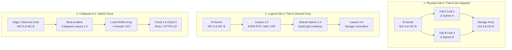
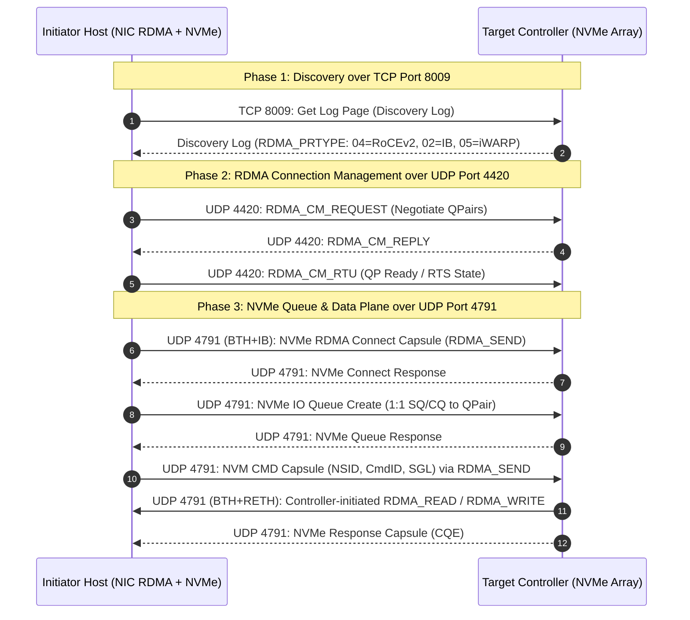
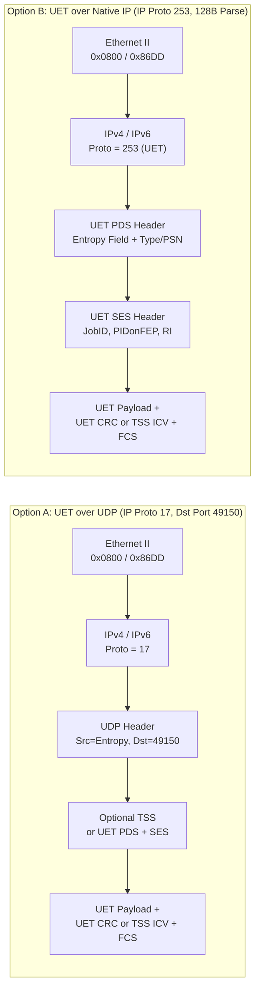
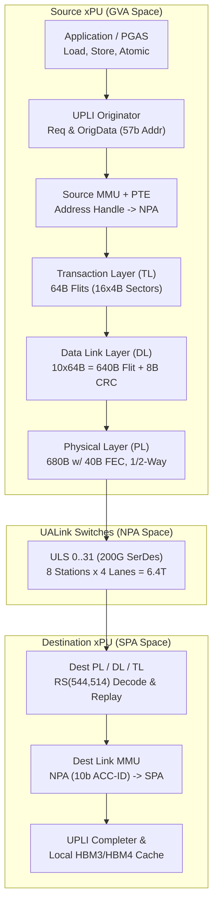

# 12.21 Storage networks, Ultra Ethernet and scale-up fabrics

| Field | Value |
|---|---|
| Level | Advanced |
| Priority tier | 2 |
| Lab venue | Nebius GPU + Local Python Verification Lab (`code/part12/storage_uec_scaleup_lab.py`) |
| Part | Part 12: Complete AI networking |
| Primary sources | *AI Data Center Network Design and Technologies* (Chapters 9, 12, 13) |
| Coverage file | `planning/coverage/chapters/12-21.md` |
| Claim & number ledger | `planning/ledgers/12-21.md` |

## Why this matters for AI infrastructure

Picture a training job that was fast last week and now crawls. The GPUs sit idle for long stretches, the compute dashboards look normal, and nobody sees an error. The cause is often the network, but "the network" is not one thing. An AI factory runs three distinct fabrics. Each one has its own latency target, bandwidth scale, and failure boundary. Treat them as interchangeable byte pipes and you will see checkpoint stalls, packet-retransmission storms, or sub-microsecond tensor starvation, and you will not know which fabric to blame.

1. **AI storage networks.** Curated training datasets must stream continuously into GPU memory. Multi-terabyte checkpoints must also flush to flash without pausing the training steps. A local PCIe drive responds in roughly a hundred nanoseconds. But a drive inside one server cannot hold a petabyte-scale corpus, and it cannot give thousands of nodes a shared namespace. Dedicated storage fabrics bridge that gap. They connect compute servers to shared flash arrays using NVMe-o-TCP, NVMe-o-RDMA over RoCEv2, and parallel file systems with GPUDirect Storage.

2. **Ultra Ethernet Consortium scale-out fabrics.** Production RoCEv2 clusters have grown past 100,000 GPUs. Even so, RoCEv2 still inherits legacy InfiniBand Queue Pair semantics and static flow hashing. It also suffers from Go-Back-N retransmission amplification and fragile PFC pause tuning.

   UEC Specification v1.0 replaces the RoCEv2 transport stack with Ultra Ethernet Transport over UDP or native IP. The work is split between a Packet Delivery Sublayer and a Semantic Sublayer that is driven by Libfabric. UEC adds four packet delivery modes, built-in AES-GCM security, and both sender and receiver congestion control. It also brings link-level Credit-Based Flow Control, DSCP packet trimming, Link Layer Reliability, and In-Network Collectives.

3. **Scale-up super-accelerator fabrics.** Tensor parallelism, Mixture-of-Experts token routing, multi-step reasoning, and diffusion micro-batching exchange activations at a sub-microsecond cadence. That cadence overwhelms PCIe and scale-out NICs. Proprietary scale-up fabrics such as NVIDIA NVLink 5 tie the buyer to one vendor. Two open standards have emerged to break that lock-in: the Open Compute Project Scale-Up Ethernet Transport under ESUN, and the Ultra Accelerator Link.

```text
Three AI Fabric Domains - Reference Latency, Bandwidth, and Protocol Numbers:
1. AI Storage Networks (100 Gbps-800 Gbps per server, 1:3 leaf-to-spine oversubscription):
   - Local PCIe Gen5/Gen6 SSD: ~100 ns device latency (32 GT/s per lane, ~63 Gbps / 64 GB/s unidirectional across x16 lanes, 3.94 GB/s per lane)
   - Network storage switch latency: ~300 ns on InfiniBand switches vs 700-900 ns (~800 ns) port-to-port on Ethernet switches
   - Storage protocols: NVMe-o-TCP (TCP port 8009), NVMe-o-RDMA over RoCEv2 (TCP 8009 discovery, UDP 4420 RDMA CM, UDP 4791 BTH/RETH data plane with up to 66% lower write latency), parallel file systems (WekaFS, VAST, Lustre, GPFS, BeeGFS) with GPUDirect Storage (GDS)
2. Ultra Ethernet Consortium (UEC Specification v1.0, released June 11, 2025, 400 Gbps-1.6 Tbps scale-out up to 1 million endpoints):
   - Transport encapsulations: UET over UDP port 49150 (IP protocol 17) or native IP protocol 253
   - Sublayers & APIs: Packet Delivery Sublayer (PDS) + Semantic Sublayer (SES: JobID, PIDonFEP, Resource Index) via Libfabric (fi_mr, fi_collective)
   - Delivery modes & security: ROD, RUD, RUDI, UUD + Transport Security Sublayer (TSS with AES-GCM + ICV)
   - Congestion & reliability: NSCC (window/RTT/ECN), RCCC (256-byte receiver credits in a 24-bit ACK field), link-level CBFC (32 Virtual Channels with PCS CtlOS CP_Update), DSCP packet trimming, Link Layer Reliability (LLR), and In-Network Collectives (INC)
3. Scale-Up Fabrics (100-300 ns latency, up to 6.4 Tbps per xPU, 72 to 1,000 accelerators across 1-4 racks):
   - Baseline comparison: PCIe 5.0 (500 ns-1 us latency) vs NVLink 5 (1.8 Tbps / 1,800 Gbps bidirectional per GPU across 18 NVLink switches in 72-GPU NVL72)
   - OCP SUE-T / ESUN: 6-byte compressed and 12-byte non-compressed AI Fabric Header (AFH Gen 2), Reliability Header (RH), LLR, CBFC, and on-die FIFO or ARM AXI 4.0 5-channel interfaces
   - UALink 1.0: 8 stations x 4 x 200 Gbps lanes = 32 lanes = 6.4 Tbps per xPU, 64-byte Transaction Layer (TL) flits packed 10:1 into 640-byte Data Link (DL) flits + 40-byte FEC = 680-byte wire units aligned 1:1 to RS(544, 514) PCS codewords, 1-way/2-way interleaving, GVA -> NPA -> SPA MMU address handles, and software PGAS coherence
```

Each of the three domains answers a different question, so a single design rule will not fit all of them. Decide which domain a new cluster needs first, because each one has its own latency, bandwidth, and failure rules.

## Prerequisites and outcomes

This chapter builds on the RoCEv2 and InfiniBand material earlier in this part. Read it first if any of the terms below feel unfamiliar, because the storage and scale-up designs reuse them directly.

### Prerequisites
- You should know RoCEv2 over UDP port 4791, including Base Transport Headers, PFC, ECN, and DCQCN, from earlier chapters in this part.
- You should understand InfiniBand addressing, including LID, GUID, GID, and Virtual Lanes, from earlier chapters in this part.
- You should be familiar with GPUDirect RDMA and GPUDirect Storage, including `cuFile` and BAR1 apertures, from earlier chapters in this part.

### Outcomes
After completing this chapter, you will be able to:
1. Design AI storage network topologies, including physical Fab A and Fab B, logical EVPN-VXLAN Fab A and Fab B, collapsed spine, and hybrid cloud S3 replication.
2. Trace and compare the protocol state machines, packet headers, and queue mappings of NVMe-o-TCP, NVMe-o-RDMA over RoCEv2, and native InfiniBand storage.
3. Architect Ultra Ethernet scale-out fabrics. You will decode UET-over-UDP and UET-over-IP encapsulations, SES addressing, delivery modes, and congestion and reliability mechanisms.
4. Evaluate and size scale-up super-accelerator fabrics up to 4 racks and 1,000 xPUs. You will contrast SUE-T under ESUN, UALink 1.0, and NVLink 5.

---

## 1. AI Storage Network Lifecycle, Topologies, and Access Models

### 1.1 The Four-Stage AI Data Lifecycle and Storage Access Tiers

Think about a run that streams data well for days and then stalls every time it saves a checkpoint. A storage network built only for sequential dataset reads has no room for that write burst. Synchronous checkpoints fill the write buffers, and thousands of GPUs sit idle while they wait. Every large language model or multimodal pipeline passes through four data-lifecycle phases. Each phase has its own I/O sizes, concurrency patterns, and latency budgets. As you read the phases, notice that each one stresses storage in a different way.

1. **Data ingestion:** Raw structured and unstructured datasets are pulled from external repositories, web crawls, or enterprise lakes into high-capacity staging pools.
2. **Data processing and curation:** Tokenization, deduplication, quality filtering, and format conversion turn raw assets into training shards. This phase needs high sequential and random read and write throughput across distributed workers.
3. **AI model training and checkpointing:** Training servers stream curated batches into GPU HBM over dedicated 100 Gbps to 200 Gbps storage NICs. Converged pods use 400 Gbps to 800 Gbps NICs instead. Servers also pause compute from time to time to flush multi-terabyte checkpoints of weights and optimizer states to flash arrays.
4. **Post-training data warehouse, archival, and RAG inference:** Trained checkpoints, evaluation artifacts, and vector corpora move into long-term repositories and feeds for Retrieval-Augmented Generation. These workloads need low-latency random reads and continuous live updates.

To serve these four phases, operators combine three logical storage architectures: Object, Block, and File. Their protocol and fabric characteristics are summarized below.

| Characteristic | Object Storage (S3) | Block Storage (NVMe-oF / SAN) | File Storage ((P)NFS / Parallel FS / NAS) |
|---|---|---|---|
| **Data organization** | Flat objects with rich metadata and object IDs | Fixed-size logical blocks addressed by NSID + LBA | Hierarchical files and directories (POSIX namespace) |
| **Access method** | HTTP/HTTPS REST API calls (`GET`, `PUT`) | Block-level commands (NVMe SQE/CQE capsules) | File-level POSIX syscalls (`open`, `read`, `write`, `stat`, `unlink`) |
| **Transport protocols** | TCP/HTTPS over lossy Ethernet/IP | NVMe-o-TCP, NVMe-o-RDMA (RoCEv2/IB), NVMe-o-FC, FCoIP | Ethernet/IP (TCP or RDMA over RoCEv2) or InfiniBand |
| **OS page-cache usage** | Not used on compute host (application buffers) | Bypassed (raw block device / direct DMA) | Supported by OS page cache or bypassed via `O_DIRECT` / GDS |
| **Scalability & cost** | Highest scale (exabytes); lowest cost per TB | High performance per array; higher cost per TB | High parallel scale (WekaFS, VAST, Lustre, GPFS); moderate cost |
| **Primary AI domain** | Post-training cloud replication, cold archives, RAG / agentic RAG | High-IOPS local/on-prem datasets, raw block volumes, fast checkpoint targets | Shared multi-node training datasets, synchronous checkpointing, hybrid cloud tiering |

Read the table as a set of trade-offs, not a ranking. Object storage reaches the largest scale at the lowest cost per terabyte. Block storage gives the most performance per array, and it costs more per terabyte. File storage sits in the middle, and it is the one that lets many training nodes share the same files. Consider the column that matches your access pattern before you pick a tier.

### 1.2 Four Storage Fabric Topologies: Physical Fab A/B, Logical Fab A/B, Collapsed Spine, and Hybrid Cloud

A single top-of-rack switch failure on a non-redundant storage network drops every active mount, and the training jobs on it crash. Storage availability therefore depends on path diversity across Fabric A and Fabric B. If Fabric A fails or goes down for maintenance, Fabric B must carry 100% of the storage workload. It cannot lose IOPS, bandwidth, or latency while it does that. Backend GPU training fabrics need strict 1:1 non-blocking bandwidth. You can see why a storage design differs from a training design. Dedicated storage leaf-spine fabrics can run at 1:3 oversubscription instead, because storage flows are shorter and less synchronized than AllReduce collectives.



| Topology Pattern | Physical & Control-Plane Architecture | Oversubscription & Distance Rules | Best-Fit AI Use Case |
|---|---|---|---|
| **1. Physical Fab A / Fab B Separation** | Two completely independent physical leaf-spine fabrics (Fabric A and Fabric B). NIC A connects only to Fab A ToR (Leaf 1), and NIC B connects only to Fab B ToR (Leaf 3). Storage array controllers mirror this physical split. | Identical leaf-to-spine link counts and speeds on both fabrics (typically 1:3 oversubscribed) so failover preserves 100% capacity. | Mission-critical enterprise and large-scale training clusters requiring blast-radius demarcation and hitless single-fabric upgrades. |
| **2. Logical Fab A / Fab B Separation** | A single physical 3-stage IP Clos (Leaves 1–4 full-mesh to Spines 1–4, at least 2 links per leaf-spine pair for ASIC local repair). L2 stays confined to each ToR; Fab A and Fab B are isolated via two EVPN-VXLAN Route Type 5 (RT5) IP-VRF instances or two MAC-VRF instances pinned to disjoint underlay paths. | 1:3 leaf-to-spine oversubscription is standard; multi-tenant managed training services isolate tenants via EVPN RT5 VXLAN tunnels across the shared storage underlay. | Medium-scale or multi-tenant AI clusters seeking dual-path resilience without paying for two physical spine planes. |
| **3. Collapsed Fab A / Fab B Spine** | Just two switches (Leaf 1 and Leaf 2) connected back-to-back, with both AI servers (NIC A/NIC B) and storage targets dual-homed directly to the collapsed pair. | No spine tier; when replicating across sites over **40 km+** WAN/DCI links, use **deep-buffer Ethernet switches** and **NVMe-o-TCP**, avoiding long-haul lossless DCQCN/PFC. | Geographically distributed inference POPs, regional RAG caches, and compact edge pods. |
| **4. Hybrid On-Prem + Multi-Cloud Fabric** | Local Fab A / Fab B IP Clos (Leaves 1–4, Spines 1–4) extended via border leaves (Leaves 5–6), a firewall cluster, and dual DCI gateways to two public clouds (Cloud 1, Cloud 2). | On-premises hot data runs over NVMe-o-RDMA / parallel FS (Tier 1); cold checkpoints and multi-cloud backups traverse IPsec or TLS/HTTPS (S3 REST API, Tier 2). | Disaster recovery of expensive LLM training checkpoints and unified on-prem/cloud namespace tiering. |

Each row describes a different answer to the same question: how do you keep storage alive when one path fails? Physical separation gives the clearest blast-radius boundary, and the book says its cost is high. Logical separation keeps one physical fabric and isolates the two paths with EVPN-VXLAN overlays. Pick the topology that matches your scale and your tolerance for cost before you draw the first cable.

### 1.3 PCIe-Attached Drives vs Network-Attached Storage: Latency and When Each Fits

Every GPU server already has drives, so you might ask why a separate storage network is needed at all. The answer starts inside the server. Local drives sit on the PCIe bus, the same internal bus that carries the CPU and the network card. That layout works well for one machine. It cannot share one dataset across many servers at the same time.

Figure 9-1, labeled PCIe-connected SSD/HDD, shows this first design. A horizontal bar stands for the PCIe bus, which is peripheral component interconnect express. The central processing unit sits above the bus, and a network interface card sits below it. A line runs from that NIC to the data center local area network. On the right side of the bus, four cylindrical storage devices are labeled local hard disk drive or solid state drive. Every component connects to the bus, which shows that networking and storage share one internal connection inside the server.

Figure 9-2, labeled network-connected SSD/HDD storage, shows the second design. A dedicated storage network interface card plugs into the PCIe bus and reaches a separate storage network. That network connects to disk arrays. In both designs, the server keeps a central processing unit and a LAN data center NIC as standard parts. That LAN is the frontend part of an AI data center.

From the application's point of view, reads and writes work the same way in both designs. The difference is distance. A PCIe-attached SSD reaches its local array in about 100 nanoseconds on generation 5. A network-attached array adds about 300 nanoseconds through an InfiniBand switch, or about 800 nanoseconds through an Ethernet switch. When you compare the two, the application sees the same reads and writes, so only the timing changes.

Those few hundred nanoseconds matter less than they seem. When the network is only one to three hops away, and each switch adds only nanoseconds, IOPS can come close to PCIe-attached storage. A port-to-port switch latency of 700 to 900 nanoseconds still delivers high bus bandwidth for reads and writes.

In AI training, both types are often used together. Local storage can run a file system that is backed by an NVMe-oF system. Parallel file systems let many nodes share the same files, and they keep extra metadata. That metadata helps during training and when regular snapshots of a training job are taken. If you run both, you need to know where each file lives.

Putting the front-end LAN to work for storage would cut infrastructure cost. *AI Data Center Network Design and Technologies* notes that AI data centers rarely do this. They deploy dedicated front-end and backend storage systems and storage networks instead. Keep the LAN for users, and give training data its own network.

### 1.4 Checkpoints and Fast Writes During Training

Training is the phase where storage most often becomes the bottleneck. It follows the data preparation phase, and it is the stage where you must save and restore model checkpoints. Those saves and restores have to be designed on purpose. A good checkpoint system protects the training investment already made, and it keeps GPUs free for new jobs.

Storage work should not steal time from the GPUs. As you plan a cluster, keep the storage path off the GPU's critical path. A dedicated data storage system keeps those storage tasks off the GPU path. An efficient storage system in the backend network offers quicker access, so it shortens the time needed to save checkpoint data. Shorter saves reduce how often training pauses and how long each pause lasts. Pauses hold back progress, so keep their frequency and duration low. Fast-write storage is therefore a core part of cluster efficiency, not an extra.

### 1.5 Redundancy, Path Diversity, and Inter-Site Replication

Storage needs the same care as the compute network. Each storage network must offer node and link redundancy. Active storage A and backup storage B should form two paths to the same data. If path A fails, path B must carry the full load without losing IOPS, bandwidth, or latency. This is called path diversity. When you audit a design, check each path on its own.

Replication across sites follows the same rule. Both storage domains need local site-level redundancy, plus inter-site replication after each read or write. Inter-site traffic often uses a different transport. When Fibre Channel storage runs inside a site, Fibre Channel over IP, or FCoIP, is a common choice for replication. Dedicated site-to-site replication gateways still play a role.

When a design uses NFS instead of a SAN, one disaster recovery design can cover both the application and the storage. Inter-site data redundancy can then ride on the same data center interconnect link as the applications. If the site already runs RoCEv2 for storage, inter-site RDMA is the usual replication method. Lossless inter-site RDMA is rare, though. If you plan that link, budget time for the extra care it needs. Keeping DCQCN working over a link of 40 km or more is hard.

NVMe over TCP takes a different path for long-distance replication. It can run on a lossy IP core network. It does not engage DCQCN pushback mechanisms such as Priority Flow Control, or PFC. Instead, it adapts to network conditions. It uses reliable transport, and its maximum segment size, or MSS, requirements are more adaptable and less restrictive than those of the training cluster storage. That is why many teams choose it for distant copies.

### 1.6 Logical Fab A/B With EVPN-VXLAN Overlays

Physical separation uses two independent sets of switches, and the cost is high. Logical separation keeps one physical fabric and splits it into two paths. In a physical design, each ToR switch connects to only NIC A or only NIC B. In a logical design, leaves 1 and 2 carry separate dark and light gray fabric connections. The storage SSD controllers follow the same split, either physically or logically. When you draw the design, show both versions on one page so the difference is visible.

Logical separation usually runs an EVPN-VXLAN overlay. Fabric A and fabric B control traffic can use two separate RT5 EVPN instances. The same bridging domain can also carry two separate MAC-VRF instances. Each instance gets its own IP address at the VXLAN tunnel termination point, and a separate underlay path carries each one. Replication between sites can use the same idea, with a Path A and a Path B through controlled overlay-to-underlay paths.

### 1.7 Hot and Cold Data Across On-Premises Storage and Object Storage

Not all data is accessed the same way, so the source book splits it into hot data and cold data. In a hybrid design, hot data stays on on-premises backend servers. Those servers connect to a storage IP fabric or an InfiniBand fabric. Cold data sits off-premises in object storage. You decide which tier a dataset belongs in by how often you read it.

Applications reach both tiers with S3 calls over an HTTPS API. In hybrid deployments, that means TLS over HTTP using the S3 REST API. A framework such as TensorFlow or PyTorch still uses plain POSIX file calls. The parallel file system understands those calls. It moves files between the fast local SSD flash tier, which uses NVMe-o-PCIe, and a scale-optimized tier in the cloud. The ML developer does not need to change the code. For example, a training script keeps the same POSIX calls whichever tier holds the file.

Figure 9-8 shows a hybrid layout. Each AI server has two storage network interface cards. Card A connects to leaf1 and card B connects to leaf2, so a failed leaf does not cut the server off from storage. Both connections carry reads and writes.

On the on-premises side, Fabric A holds leaves 1 and 2 and connects to spines 1 and 2. Fabric B holds spines 3 and 4, with leaves 3 and 4 leading to the storage arrays. Leaves 5 and 6 reach a firewall cluster, and two data center gateways connect on to cloud1 and cloud2 storage. Replication to the cloud keeps snapshots of the local training cluster from being lost.

The cloud path is not the same as the local path. Access goes through the firewall cluster, so an extra security tunnel is needed. *AI Data Center Network Design and Technologies* names IPsec or HTTPS for that tunnel. Plan for that extra layer before you rely on the cloud copy.

---

## 2. NVMe-oF State Machines (NVMe-o-TCP vs NVMe-o-RDMA), Parallel File Systems, and InfiniBand Storage

### 2.1 NVMe-oF Architecture: Queues, Capsules, NSID, and PRP vs SGL

Local NVMe SSDs are fast because the host talks to them directly over PCIe, using circular Submission Queues and Completion Queues. The catch is that those local queues cannot cross an Ethernet or InfiniBand switch. NVMe over Fabrics keeps the NVMe base specification, the I/O command sets, the management interface, and the queue semantics. Only the transport changes. The PCIe bus gives way to a network binding such as NVMe-o-TCP, NVMe-o-RDMA, or NVMe-o-FC.

NVMe-oF wraps each command and response in a network unit called a capsule. Two kinds of capsule carry most of the traffic.

- **Command Capsule:** Sent from the host initiator to the target controller. It carries a 64-byte Submission Queue Entry plus optional in-capsule write data.
- **Response Capsule:** Sent from the target controller back to the host initiator. It carries a 16-byte Completion Queue Entry that reports the status for the matching Command ID.

Every NVMe-oF read (`opcode 0x02`) or write (`opcode 0x01`) command carries two addressing constructs. They do different jobs, and mixing them up is a common source of confusion. When you read a capture, check which one you are looking at before you draw a conclusion.

1. **NSID:** The Namespace Identifier selects the logical storage volume or partition that the remote NVMe target exposes. One flash array controller can expose several NSIDs, each with its own capacity, block size, or tenant permissions.
2. **PRP1 and PRP2 vs SGL:** These descriptors tell the controller where the data lives in host or GPU BAR1 memory. DMA places read data there, or fetches write data from there. PRP1 and PRP2 are two 64-bit Physical Region Page pointers. PRP1 points to the first memory page, and PRP2 points to the second page or to a PRP list. A Scatter-Gather List, or SGL, describes several non-contiguous memory segments inside one 64-byte NVMe command header. SGL is the preferred choice for network fabrics.

### 2.2 NVMe-o-TCP State Machine, PDUs, and Jumbo-Frame Packing

Operators choose NVMe-o-TCP when they need shared NVMe block storage over a lossy IP network, or over a link of 40 km or more, without tuning PFC. Each CPU core on the host opens its own TCP connection, and each connection maps 1:1 to a target queue pair. All of these connections use destination TCP port 8009. If you tune a host, count those connections per core.

```text
NVMe-o-TCP Protocol Data Unit (PDU) Types, Opcodes, and MTU 9000 Packing Math:
- Destination transport port: TCP port 8009
- Capsule / Data PDU Type Codes:
  0x01 = CapsuleCmd (Host-to-controller command capsule carrying 64B SQE: Command ID, opcode, NSID, length, PRP1/PRP2 or SGL)
  0x02 = CapsuleResp (Controller-to-host response capsule carrying 16B CQE)
  0x03 = H2CData (Host-to-controller off-capsule write data PDU)
  0x04 = C2HData (Controller-to-host read data PDU)
- NVMe I/O Opcodes:
  opcode 0x01 = Write (supports in-capsule write with SQE + Data + LAST-PDU flag, or off-capsule write with H2CData 0x03 PDUs)
  opcode 0x02 = Read (CapsuleCmd 0x01 -> sequential C2HData 0x04 PDUs #1..#N -> CapsuleResp 0x02)
- Ordered NVMe-o-TCP PDU Framing Fields:
  Common Header (CH) -> PDU-Specific Header (PSH) -> Header Digest (HDGST) -> Padding (PAD) -> PDU Data (Capsule/Payload) -> Data Digest (DDGST)
- Jumbo-Frame MTU 9000 Multi-PDU Packing:
  Single 4 KiB (4,096B) in-capsule write PDU = 24B (CH+PSH) + 4B (HDGST) + 64B (SQE) + 4,096B (Data) + 4B (DDGST) = 4,192 bytes
  At MTU 9000 (TCP MSS = 8,960 bytes), 2 PDUs = 2 x 4,192B = 8,384 bytes fit inside 1 TCP segment with 576 bytes remaining
```

The packing math is easier to follow as a worked example. One 4 KiB in-capsule write PDU is 4,192 bytes. That total comes from 24 bytes of common and PDU-specific headers, 4 bytes of header digest, the 64-byte SQE, 4,096 bytes of data, and 4 bytes of data digest. At MTU 9000, the TCP MSS is 8,960 bytes. Two of those PDUs take 8,384 bytes, which leaves 576 bytes of the segment unused. Consider working the arithmetic once yourself, so the packing rules make sense.

The session then moves through five stages, and each stage must finish before the next one starts. If your session stops, you can tell which stage you reached.

1. **TCP and optional TLS handshake:** The host initiator completes a standard `TCP SYN -> SYN-ACK -> ACK` handshake to target port 8009. An optional TLS handshake follows when the storage must be encrypted.
2. **ICReq and ICResp PDUs:** The host sends an `NVMe/TCP ICReq PDU` that advertises its NVMe version and the digest flags `HDGST` and `DDGST`. It also sends the PDU data alignment and host identifier fields. The controller answers with an `ICResp PDU`.
3. **NVMe/TCP Connect request and response:** The host binds the TCP connection to a specific Controller ID. It then negotiates the Admin or I/O queue IDs (`QID`) and the queue depth.
4. **Data transfer and jumbo-frame packing:** The session exchanges `CapsuleCmd`, `H2CData`, `C2HData`, and `CapsuleResp` PDUs. On a storage IP fabric with jumbo frames at `MTU 9000`, one TCP segment can carry two or more NVMe-o-TCP PDUs back to back.
5. **Session termination:** Either endpoint sends `H2CTermReq` or `C2HTermReq`, followed by a final `CapsuleResp` CQE status. This releases the NSID, the Command IDs, and the queue bindings before the TCP socket closes.

If you plan to rely on the packing, verify MTU 9000 on every hop of the storage path first.

### 2.3 NVMe-o-RDMA (RoCEv2) State Machine: TCP 8009 -> UDP 4420 -> UDP 4791

Training clusters can reach a point where TCP processing burns too much CPU and adds tail latency. NVMe-o-RDMA moves the storage transport into the NIC's RDMA engine instead. It delivers up to 66% lower write latency, and it lets GPUDirect Storage DMA straight into GPU HBM. Over a lossless RoCEv2 fabric, the session passes through three ports and two protocols. If a firewall blocks any one of those three ports, session bring-up stalls partway through. If you see a stall, check the three ports before you blame the storage array.



Read the table phase by phase. Each phase depends on the one before it, so a blocked port at any step stops the session at that step. You can use the phases as a checklist while you debug the session.

| Phase | Protocol & Destination Port | Key Header Fields & State Transitions | Architectural Rules |
|---|---|---|---|
| **1. Discovery Phase** | **TCP Port 8009** | Host issues `Get Log Page – Discovery Log Pages`. Target returns `RDMA_PRTYPE`: **04** (0x04 RoCEv2), **02** (0x02 InfiniBand), or **05** (0x05 iWARP). | Standard NVMe-oF Discovery Controller runs over TCP 8009 before any UDP/RDMA packet is sent. |
| **2. RDMA CM Handshake** | **UDP Port 4420** | `RDMA_CM_REQUEST` -> `RDMA_CM_REPLY` -> `RDMA_CM_RTU` (Ready to Use), transitioning the RDMA QPair into RTS (Ready to Send). | No NVMe capsules can be exchanged until both endpoints' RDMA QPs reach RTS. |
| **3. NVMe Connect & I/O Data Plane** | **UDP Port 4791** (RoCEv2) | Outer `Ethernet -> IP -> UDP (4791) -> BTH (Opcode, Dest QPair) -> RETH (VA, RKey, DMA Length) -> NVM CMD QID + NVM CMD (NSID, CmdID, SGL)`. | Strict **1:1 mapping** between one I/O SQ/CQ pair and one RDMA QPair. Host sends command capsules via `RDMA_SEND`; **all `RDMA_READ` and `RDMA_WRITE` bulk transfers are initiated by the target controller**. |

### 2.4 High-Performance Parallel File Systems and GPUDirect Storage Integration

Raw NVMe-oF block volumes give each host a 1:1 session to a target namespace. They do not coordinate file metadata across many GPU clients at once. A shared POSIX namespace at high speed therefore needs a parallel file system layered on top of NVMe-o-RDMA. Common choices include WekaFS, VAST, Lustre, GPFS, and BeeGFS, running over RoCEv2 or InfiniBand.

```text
Parallel File System Striping and GPUDirect Storage (GDS) Parameters:
- Parallel file systems: WekaFS, VAST, Lustre, GPFS (IBM Storage Scale), BeeGFS
- WekaFS striping: distributes file data and metadata across all on-premises NVMe storage servers (Servers 1..8)
- Standard AI file extensions & POSIX syscalls: .pt, .npy, .ckpt, .h5, .bin via open(), read(), write(), stat(), unlink()
- Two-tier storage hierarchy: Tier 1 hot flash over RDMA (RoCEv2 / InfiniBand) + Tier 2 cold snapshots over HTTPS/TLS S3 REST APIs; VAST runs multipath NFS over RDMA
- GPUDirect Storage (GDS) zero-copy pipeline (PyTorch v2.7.0+):
  cudaMalloc -> cuFileBufRegister -> PIN to direct IO -> PCIe DMA directly between external RoCEv2/IB arrays and GPU 1..8 HBM via NIC A and NIC B (100G/200G or 400G/800G) bypassing host CPU and system DRAM
```

Two parts of this stack are worth understanding before you tune anything. The first is how the file system spreads data out. For example, a shared training dataset is a case for the file layer.

- **Parallel data and metadata striping:** Rather than funnel every client through one NFS gateway, WekaFS spreads both file data and metadata in small chunks across all on-premises NVMe storage servers. When PyTorch or TensorFlow reads checkpoint files through POSIX syscalls, the local client turns each call into parallel RDMA requests against Tier 1 hot flash. Cold snapshots move to Tier 2 cloud object storage over HTTPS S3 REST APIs.
- **GPUDirect Storage zero-copy DMA:** When PyTorch or the CUDA runtime allocates GPU memory with `cudaMalloc` and registers it with `cuFileBufRegister`, the GPU memory pages are pinned for direct I/O. The GDS library then programs the storage NIC driver directly over PCIe. Blocks move between the external arrays and GPU HBM through the dedicated storage NICs, without bouncing through host CPU cores or system DRAM.

Use a parallel file system when many GPU clients need the same files. Use raw NVMe-oF volumes when each session needs its own namespace.

### 2.5 InfiniBand for Storage: 16-Bit LID (48,000 Nodes), Frame Format, and 64B CBFC Credits

When native InfiniBand carries NVMe-o-RDMA and GPUDirect Storage, the RDMA handshake and the NVMe capsule payload look the same as they do on RoCEv2. The difference is the frame. The outer Ethernet, IP, and UDP headers give way to the native InfiniBand frame. That removes the L3 and L4 header overhead, and it cuts switch latency to roughly 300 ns.

```text
Native InfiniBand Storage Frame Header Pipeline:
LRH (S-LID, D-LID, VL) -> GRH (Optional Inter-Subnet) -> BTH (Opcode, Dest QP) -> ETH (Src QP / RDMA) -> NVMe-o-RDMA Capsule + Data -> ICRC + VCRC
```

```text
Native InfiniBand Storage Addressing, Integrity, and Flow Control Specs:
- Local Routing Header (LRH) addressing: 16-bit Local Identifier (LID, 65,536 total values) assigned by the Subnet Manager (SM) via per-switch Subnet Manager Agents (SMAs)
- Single-subnet node limit: up to 48,000 end nodes per InfiniBand subnet (e.g., 32,000 nodes fit in one subnet; 60,000 nodes require inter-subnet routing via the Global Routing Header GRH)
- Frame CRCs: Invariant CRC (ICRC, end-to-end immutable fields) + Variant CRC (VCRC, hop-by-hop link fields)
- Virtual Lanes (VLs) and Credit-Based Flow Control (CBFC): up to 16 VLs per physical link (typically 8-12 active data VLs); 1 CBFC credit in the Link Layer Header (LLH) = 64 bytes of buffer space (64 credits required for a 4,096-byte storage block); 10 km optical spec reach
```

The numbers in that block make two checks easy. A 32,000-node cluster fits inside one subnet. A 60,000-node cluster is above the 48,000-node limit, so it needs inter-subnet routing through the GRH. For the flow control side, one credit covers 64 bytes of buffer space. A 4,096-byte block therefore needs 4,096 divided by 64, or 64 credits. You can repeat that division for any block size you plan to store.

| Storage Option | (P)NFS / Parallel FS | NVMe-o-TCP | NVMe-o-RDMA (RoCEv2) | Native InfiniBand Storage |
|---|---|---|---|---|
| **Training & Inference Fit** | Training + Inference | Inference + Cold/Tier-2 Training | Training + Inference | Training (legacy/HPC + NVIDIA pods) |
| **Parallel Shared File Access** | Yes (POSIX / NFS) | Yes (when layered with FS) | Block-level (1:1 QP, needs PFS for shared files) | Block or File (Lustre/GPFS/Weka over IB) |
| **Switch Port-to-Port Latency** | ~700–900 ns (Ethernet) | ~700–900 ns (Ethernet) | ~700–900 ns (Ethernet) | **~300 ns** (InfiniBand switch) |
| **Requires Lossless Fabric** | No (unless over RDMA) | **No** (runs on lossy IP) | **Yes** (PFC + ECN + DCQCN) | **Yes** (native 16 VLs + 64B CBFC) |
| **Built-in Transport Reliability** | Via TCP or RDMA | **Yes** (standard TCP) | Via NIC RDMA QP state machine | **Yes** (hardware HCA + CBFC) |
| **Port Speeds & Multi-Vendor Scale** | 400G/800G/1.6T; High multi-vendor | 400G/800G/1.6T; High multi-vendor | 400G/800G/1.6T; High multi-vendor | 400G/800G/1.6T; Single-vendor (&lt;48,000 nodes/subnet) |

The table makes the trade-off visible. Native InfiniBand has the lowest switch latency, but it stays single-vendor and needs a lossless fabric. NVMe-o-TCP is the only option that does not need a lossless fabric. Before you pick InfiniBand for a storage fabric, check the planned subnet size against the 48,000-node limit.

### 2.6 GPUDirect Storage: Logical View and CUDA API Orchestration

GPUDirect Storage lets a GPU place data straight onto storage arrays. The usual path makes the CPU copy every byte. GDS skips that copy. The book describes the result as less jitter, much better bus bandwidth, and much lower CPU load. It also means fewer competing connections on each server. For you as an operator, that means a quieter host.

Figure 9-19 gives the logical view. The top section shows a server chassis labeled PCIe. Inside it, a central processing unit and system memory connect over the PCIe bus. Below them sit eight graphics processing units, GPU1 through GPU8, so the chassis holds a CPU, system memory, and eight GPUs. Each GPU has its own NIC, and each NIC connects to its own leaf switch. Eight spine switches form a full mesh with those leaves, and each leaf links to every spine in both directions. Two more dedicated NICs, NICA and NICB, connect the server to a ROCEv2 Storage cloud and to external storage arrays. Their arrows show two-way traffic, while each GPU NIC sends over a unidirectional link to its leaf. The GPUs place their outputs over the RoCEv2 NICs without interrupting the CPU core. Trace the figure from the GPU NICs to the leaves, and you will see every hop.

That design relaxes the demand on system memory. After the direct placement, the GPU can start its next task. The server does not need a large multi-core CPU or costly local memory to do it. The book notes that this matters little in a small cluster. At 100,000 GPUs or more, the saving can have a large cost impact.

GDS is also built into the CUDA API. CUDA is NVIDIA's parallel computing platform and programming interface. In Figure 9-20, a block labeled CUDA API sits at the top. An arrow labeled `cudaMalloc` and `cuFileBufRegister` leads to a block called GPU Memory, which shows that buffers are allocated and registered. From GPU Memory, an arrow labeled `PIN to direct IO` leads to GDS. The GDS block then hands off to a storage NIC. A traditional path from GPU memory through PCIe also reaches that NIC. From the storage NIC, RoCEv2 carries traffic to the storage arrays. A feedback loop curves from the storage NIC back up to the CUDA API, which shows control or signaling. A second arrow curves back down to GDS, which shows return control or data flow.

The CUDA layer sets up the NIC driver for the RoCEv2 or InfiniBand transfer. It does that without using a CPU core or any other system memory. When you read a GDS trace, expect the CPU to stay out of the data path. The book adds that PyTorch v2.7.0 and later also support GDS API calls directly. It also says that RDMA access over InfiniBand or RoCEv2 is the one storage form where a GPU places data directly onto a remote SSD.

Confirm GDS registration on a real node, using the check in the commands section, before you plan a design around it.

---

## 3. Ultra Ethernet Consortium (UEC Specification v1.0): Architecture, PDS/SES, Encapsulations, and Delivery Modes

The Ultra Ethernet Specification v1.0 is a major step for Ethernet. The Ultra Ethernet Consortium (UEC) released it on June 11, 2025, under the Linux Foundation. It was built for HPC, AI, cloud infrastructure, and data-intensive enterprise environments. Its goal is simple to state: make Ethernet fit the demands of modern GPU clusters.

Ethernet and IP fabrics have already proven themselves in AI data centers. Production deployments have reached 100,000-GPU server clusters, and thousands of 400 Gbps and 800 Gbps ports connect those servers together.

InfiniBand used to be the usual choice for this kind of cluster. Once Ethernet was tuned for lossless operation, 800 Gbps Ethernet became a more cost-competitive option. It offered the same performance, better scalability, and an open standard. Many vendors support both the switch side and the NIC side.

Fine-tuned Ethernet with RoCEv2 and DCQCN still had drawbacks. The biggest one is that operators had to retune it as AI workloads changed. The way server NICs announce end-to-end reordering can change. So can the handling of reordered packets, or the number of sessions that run in parallel based on buffer size.

The network needs to understand what end hosts can do, and it needs to adapt to them. It can set buffers or pick a load-balancing method for one workload. Then it should keep that choice steady for the whole job. If you change that choice mid-job, you break the steady state the job depends on.

AI models keep growing in parameters and tokens. Data center networks will need ports of 400 Gbps or more to synchronize GPU servers. For a training domain, the IP fabric should be ready for more than a million GPU nodes. Reaching that scale takes more optimization, such as faster ramp time, delivery mode detection, and both link-level and end-to-end congestion control. UEC wants to standardize these at the industry level.

Standards cannot stop at the switch. End-host NIC drivers need them too, which makes this a full-stack solution. The switch understands what the end host needs, and the end host understands real-time network conditions. For example, a UEC NIC can react to congestion by changing its source UDP port. When you size a fabric, you need the switch and the NIC to agree on that behavior.

The UEC decided to define a new transport, link, and software stack. The aim is more performance and a fabric that is easier to deploy in a plug-and-play way. The table below lists the main motivations for that redesign. It puts a strong focus on end-host NIC optimization.

| Area | Motivation |
|---|---|
| Lossless fabric fine-tuning | If zero-touch DCQCN is missing, UEC offers a plug-and-play approach for lossless Ethernet. |
| Ultra-large scale and performance | AI data center infrastructure is growing and already has 100,000+ GPUs. UEC wants fabrics and communication libraries that support more than a million nodes. Faster workloads mean shorter session negotiation. |
| Full-stack AI fabric | Fabrics are not yet connected to upper-layer collective communication managers. In-Network Collectives (INC), defined in the UEC Software working group, bring collective communication into the specification. Transport and upper software layers stay synchronized. |

Better LLM training also depends on the rest of the stack. Storage networks, management, benchmarking standards, and KPIs all need the same care. HPC is part of the target too, not only training.

UEC's motivation comes down to three goals.

- **Performance:** Traditional Ethernet can add unpredictable delay from packet collisions and non-deterministic routing. UEC includes features that bound latency for critical workloads.
- **Scalability:** Modern AI training clusters and supercomputers can have tens of thousands of nodes. Legacy protocols often struggle to keep performance at that size.
- **Reliability and congestion control:** Congestion must be managed well when several high-bandwidth applications run at the same time.

Keep these three goals in mind. Each feature in the rest of this chapter answers at least one of them. You can use them as a checklist when you read a feature list.

### 3.1 UEC Working Groups, Service Profiles (AI Base, AI Full, HPC), and Core Terminology

As Ethernet AI clusters scale toward a million endpoints, legacy RoCEv2 hits three walls. Static ECMP flow hashing creates tail-latency collisions. A single dropped packet triggers a Go-Back-N retransmission of the entire window. Hop-by-hop PFC pause frames also risk spreading congestion across unrelated jobs. UEC Specification v1.0 answers these walls. Released on June 11, 2025 by more than 70 member companies under the Linux Foundation, it replaces the InfiniBand Base Transport Header with a multipath-native Ethernet transport stack.

```text
UEC Specification v1.0 Structure and Three Service Profiles:
- Eight Working Groups:
  1. Physical Layer (FEC statistics, link fault signaling, modified 64B/66B PCS encoding with out-of-band Control Ordered Sets CtlOS)
  2. Link Layer (Link Layer Reliability LLR, Packet Rate Improvement PRI, Credit-Based Flow Control CBFC)
  3. Transport Layer (Ultra Ethernet Transport UET, PDS, SES, TSS, NSCC, RCCC, DSCP packet trimming)
  4. Software (Libfabric APIs fi_mr and fi_collective, In-Network Collectives INC)
  5. Storage, 6. Management, 7. Performance & Debug, 8. Compliance
- Three Negotiated Service Profiles:
  - AI Base Profile: mandatory ROD and RUD delivery modes + mandatory NSCC congestion control over lossy or lossless 400G/800G Ethernet
  - AI Full Profile: adds RUDI (idempotent unordered writes for gradient aggregation) as mandatory; UUD optional
  - HPC Profile: strictest latency and feature rules; supports ROD, RUD, RUDI, and optional UUD
- Seven Core UET Constructs:
  1. Fabric Endpoint (FEP; sFEP for INC-capable switches)
  2. Fabric Address (FA; IPv4 or IPv6 via SLAAC)
  3. Packet Delivery Context (PDC; SPDCID, DPDCID, bound to 1 Congestion Control Context CCC_ID)
  4. Packet Delivery Sublayer (PDS; SYN, PSNs, Clear PSN Offset, ACK/NACK/SACK, req_cc_state, ACK_CC)
  5. Semantic Sublayer (SES; Libfabric fi_mr RKEY validation & fi_collective, Opcode RMA WRITE 0x01, TAGGED_SEND 0x80, DEFERRABLE SEND, Message ID, Buffer Offset, Match Bits, Request Length)
  6. JobID, PIDonFEP, and Resource Index (RI)
  7. Transport Security Sublayer (TSS; AES-GCM encryption header + trailing Integrity Check Value ICV)
```

Reading a UEC packet capture or configuring a UET NIC requires seven core architectural constructs. Each one has a clear job, so learn them in order.

1. **Fabric Endpoint:** Any server NIC or switch port that takes part in the UEC fabric. Switch endpoints that can run In-Network Collectives are called `sFEPs`.
2. **Fabric Address:** The IPv4 or IPv6 address that identifies an FEP. Plug-and-play provisioning through IPv6 SLAAC often assigns it automatically.
3. **Packet Delivery Context:** A logical point-to-point transport channel between an initiator FEP and a target FEP. It is identified by `SPDCID` and `DPDCID`, and it is bound to one Congestion Control Context (`CCC_ID`).
4. **Packet Delivery Sublayer:** The lower UET sublayer. It handles PDC session setup, Packet Sequence Numbers, `Clear PSN Offset`, `ACK`/`NACK`/`SACK` processing, and congestion control state.
5. **Semantic Sublayer:** The upper UET sublayer. It translates Libfabric calls (`fi_mr` and `fi_collective`) into wire semantics, and it encodes opcodes, message IDs, buffer offsets, match bits, and request lengths.
6. **JobID, PIDonFEP, and Resource Index:** These three fields replace the legacy RoCEv2 BTH Queue Pair number. `JobID` identifies the distributed job across the cluster. `PIDonFEP` identifies the target OS process context, and `Resource Index` identifies the completion or receive queue.
7. **Transport Security Sublayer:** A built-in UET encryption and authentication header that uses AES-GCM with a trailing Integrity Check Value. It provides end-to-end confidentiality, integrity, and anti-replay protection without external MACsec overhead.

More than 70 vendors and institutions formed working groups, and each one focused on a single area of improvement. Their work was merged into one document for the first specification, released in June 2025 as a standard reference. You do not need every group's role to follow the technologies. Knowing which groups exist still helps, because it shows which features may appear in a later version. This chapter focuses on the Transport and Link Layer working groups and how they connect to the Software working group. Start with those two groups, and the rest of the chapter will read more easily.

The Link Layer working group looks at the connection between two end nodes. That can be two UEC switches, or a UEC switch and a server. The group studies how to improve congestion control and reliable transport on each link. The goal is faster job completion and less tail latency. Three functions stand out, and you will meet each one again later in this chapter.

- **Link Layer Reliability (LLR):** LLR reduces the latency cost of packet loss. Recovery happens on the link, so the end host does not have to handle every retry.
- **Packet Rate Improvement (PRI):** PRI aims to raise the frame rate. It cuts per-frame overhead and keeps only the header fields that AI transmissions need.
- **Credit-Based Flow Control (CBFC):** CBFC aims to replace the RoCEv2 PFC with a more efficient credit system on each link. InfiniBand already uses credit-based flow control for storage transport, and UEC applies the same credit idea to Ethernet.

The Transport working group develops Ultra Ethernet Transport (UET), which is one of the most important pieces for end-to-end integration. UET uses a new data packet format. Instead of carrying an InfiniBand BTH inside a RoCEv2 UDP frame, it defines a new set of headers after the UDP header. The group also proposes packet trimming, Receiver Credit Congestion Control (RCCC), and Network Signal Congestion Control (NSCC). NSCC and RCCC both influence the entropy used for multipathing.

UEC uses two levels of congestion control and signaling. One level runs end to end between servers. The other runs on the link, and some of its functions are optional. UET also brings authentication, encryption, and a UET security header into the packet itself. That replaces the separate MACsec functions used with encrypted RoCEv2.

The Semantic Sublayer (SES) keeps the two endpoints in sync. It lets the software layer, Libfabric, track the state of each transaction. The Transport group also defines the basic packet delivery modes. Those modes set how two end hosts agree to communicate and whether packets must arrive in order.

The Software working group defines In-Network Collectives (INC). It also defines how collective communication libraries (CCLs) use fabric resources efficiently. The group proposes an INC manager and an INC switch agent as new AI data center components. InfiniBand deployments already use similar components, and UEC took inspiration from them.

UET borrows the strongest ideas from both worlds. From InfiniBand it takes credit mechanisms, CCL and INC support, and plug-and-play behavior. From Ethernet it takes a distributed model, where entries do not depend on a central state. IPv6 is a good example of that approach at massive scale. Plug-and-play address assignment with SLAAC, native to IPv6, is planned for UET fabrics too. You can think of UET as a design that takes the best parts of each parent.

The API is a major focus for the Software group. It is looking at Libfabric, an open-source API that lets applications state their needs for message and packet ordering. UET then picks the transport service that matches those needs. The group also defines the AI Base, AI Full, and HPC profiles.

Other groups matter as well. The Compliance working group defines the tests that show a device meets UEC standards. Companies such as Spirent and Keysight help define how performance is measured and how KPIs are checked. The Management working group makes the new UET standard deployable in production networks.

The Physical Layer working group is the most disruptive. It changes the lowest levels of the stack, so existing Ethernet gear may not be fully compatible. That work will likely take the longest to reach scale-out products. The Storage working group stays somewhat separate, and it becomes relevant once the Transport and Link Layer work reaches switches and NICs.

Here is what each working group covers in the first specification.

- **Physical Layer working group:** Creates specifications that improve the performance, latency, and management of the Ethernet physical layer, including the medium and the clients on that layer.
- **Link Layer working group:** Improves the performance, latency, and management of the Ethernet link layer.
- **Transport Layer working group:** Creates an AI and HPC transport with better throughput, latency, scalability, and management over Ethernet.
- **Software working group:** Creates specifications and an open-source software API for AI and HPC use cases.
- **Storage working group:** Works on compatibility with standard physical connections, link-level features, and packet encoding. It also covers transport services, security, and RDMA API compatibility with the Software group.
- **Compliance working group:** Makes sure devices and services follow UEC standards, and defines the tests that validate them.
- **Management working group:** Focuses on fabric manageability, including topology discovery, monitoring, and interoperability across vendors.
- **Performance and Debug working group:** Defines performance benchmarks and adds debugging capabilities.

### 3.2 PDC Session Handshake, UDP-Based Encapsulation for UET (UDP Port 49150), and UET over IP (IP Protocol 253)

Before data moves on a Packet Delivery Context, initiator FEP A and target FEP B run a lightweight three-step PDS handshake. The handshake avoids slow out-of-band queue-pair exchanges. When Reliable Ordered Delivery is selected, every message that shares `{JobID, source PIDonFEP, destination PIDonFEP, RI, Traffic Class}` is pinned to a single PDC. That pinning is why you should set the delivery mode before the first message leaves the host.

```text
PDC Session Establishment Handshake Sequence:
1. Initiator FEP A -> Target FEP B: sends PDS packet with pds.flags.syn = 1, initial PSN = 101, Source PDC ID (SPDCID = 201), Clear PSN Offset, and requested delivery mode (ROD_REQ 0x03 or RUD_REQ)
2. Target FEP B -> Initiator FEP A: allocates local PDC (301) and replies with ACK = 101, SPDCID = 301, DPDCID = 201
3. Initiator FEP A -> Target FEP B: records DPDCID = 301, clears SYN bit (pds.flags.syn = 0), and transmits subsequent data packets (PSN = 102, SPDCID = 201, DPDCID = 301)
```

Two servers form a one-to-one relationship during session setup. The initiator and target start that relationship at the API and Libfabric levels. Libfabric turns the requirements into network and target memory parameters, and SES and PDS then use those parameters. Each server's stack runs from the application down through Libfabric, SES, PDC, PDS, UDP, IP, and MAC.

Session setup begins with endpoint discovery. Each FEP gets a fabric address, which is typically IPv4 or IPv6. Each FEP also gets relative addressing based on JobID and PIDonFEP for the PDC. The next phase exchanges supported profiles, such as AI Base or AI Full, along with transport capabilities and reordering support. The congestion management method for the PDC is negotiated in that same phase. When you debug a stuck session, check which of these phases never completed.

A real capture makes the PDS fields concrete. A sample PDS packet was captured and decoded with the Spirent implementation of the UEC emulator, then opened in Wireshark. In this capture, `SYN` is set in the PDS, and the ROD request is advertised. The delivery mode was set indirectly, through the Libfabric settings at the software level.

The frame reads from top to bottom. It starts with Ethernet II, then IPv4, then the UET transport. Inside the PDS, the Flags field shows CRC, RETX, ACK Request, and `SYN` set. The PSN is 13, and both PDC IDs are 0. The ACK arrives in frame 3253, and the payload closes with a CRC of fcfdfeff.

The SES part of a second capture decodes the JobID, PIDonFEP, and Resource Index. That request is a `TAGGED_SEND`, an operation that uses match bits to choose a buffer. The Job ID is 1, and the index is 15. The match bits are 0x0000000000000001, and the request length is 4096 bytes.

A UDP-based capture shows the same ideas. Its PDS is a `RUD_REQ` with flags 0x48 and PSN 2607. Both source and destination PDC IDs are 2. Its SES is a `DEFERRABLE SEND` with Message ID 23. The PDC source and destination and the delivery mode stay the same for the whole transfer. Only the PSNs and ACKs change.

The Message ID stays constant across a set of writes or sends, which helps track, match, and complete each operation. An ACK for an RUD request is shorter, and it refers only to the Message ID and Job ID.

The IP-only capture shows the lighter format. Its PDS carries an `Entropy` value, and there is no UDP layer. The flags are 0x48 with CRC set, and `SYN` is not set. The SES is a WRITE RMA opcode 0x01 with Message ID 1, Job ID 1, and Index 15. Even without UDP, Job ID, PIDonFEP, and Resource Index still map to the GPU memory region that Libfabric defines.

UEC Specification v1.0 defines two wire encapsulations for UET packets. Both endpoints must be configured identically before the PDC is created.



| Encapsulation Property | Option A: UET-over-UDP | Option B: UET-over-IP (Native / Raw IP) |
|---|---|---|
| **Outer L3/L4 Headers** | `Ethernet -> IPv4/IPv6 (Protocol = 17) -> UDP (Dst Port = 49150)` | `Ethernet -> IPv4/IPv6 (Protocol = 253)` with no UDP header |
| **Multipath Entropy Carrier** | **UDP Source Port** dynamically rotated by the sender NIC mid-session whenever an NSCC NACK signals path congestion. | Dedicated **Entropy field at the start of the PDS header** updated by the sender NIC upon NSCC feedback. |
| **Switch ASIC Parsing & Compatibility** | Works transparently across all existing 400G/800G Ethernet switches using standard UDP ECMP/packet-spraying hashes. | Removes 8-byte UDP overhead so PDS + SES (`JobID`, `RI`) fit inside the **128-byte switch packet-parsing window**, but requires switches to permit **IP Protocol 253**. |
| **Integrity (UET CRC) vs Security (TSS)** | Supports optional UET CRC (`0xfcfdfeff`) **or** optional TSS (AES-GCM header after UDP + trailing ICV). **Never enable both UET CRC and TSS simultaneously.** | Supports optional UET CRC **or** optional TSS immediately after the PDS Entropy field. When TSS encrypts PDS/SES, switches must hash on outer UDP Src Port or PDS Entropy. |

UDP-based encapsulation can also add security. A Transport Security Sublayer (TSS) header sits right after UDP, and the AES-GCM ICV is placed after the UET payload. Together they give end-to-end confidentiality, integrity, and anti-replay protection for AI workloads. A UET CRC is optional and can be used instead of TSS, but never both at once. If you enable TSS, you turn the UET CRC off.

Encryption changes how switches can balance traffic. Once TSS hides the SES fields, switches cannot read the Resource Index or JobID, so packet spraying or UDP source port load balancing must be used instead. The SES opcode says what kind of write or send is happening. In RoCEv2 that information sat in the BTH. Here, the Resource Index, JobID, PIDonFEP, and buffer offset tell the target where the data goes in memory. Consider this when you plan the switch hashing for an encrypted job.

CRC means cyclic redundancy checking at the UET layer. It protects data integrity across the transport path, and NICs can use it. It helps most on lossy transport, where corruption can slip past hop-by-hop Ethernet checks. Whether it applies depends on the packet delivery mode of the PDC. For ROD, it can still check end-to-end integrity when packets arrive in order.

IP-only encapsulation also allows a CRC or TSS, but the specification says not to use both. TSS sits immediately after the `Entropy` field in this format. Like UDP-based encapsulation, the PDS carries PSNs and ACK or NACK messages. If NSCC is used, the NACK carries entropy so the sender can adapt it. In this format the sender changes the `Entropy` field instead of the UDP source port. You will see that field in the capture, so know where to look.

### 3.3 The Four UEC Packet Delivery Modes (ROD, RUD, RUDI, UUD)

In RoCEv2, spraying packets across multiple spine switches causes out-of-order arrivals at the target NIC. RoCEv2 reads those out-of-order arrivals as packet loss, and it flushes the entire 64-packet window. Through Libfabric, UET lets an application pick one of four delivery modes per PDC. It uses selective retransmission, so only the single missing PSN is resent.

```text
Selective Retransmission vs RoCEv2 Go-Back-N Penalty:
- In-flight window size: 64 packets (PSN 1..64)
- Single packet loss at packet #1:
  RoCEv2 Go-Back-N flushes and retransmits all 64 packets
  UET (RUD / RUDI + packet trimming) selectively retransmits only 1 packet (saving 63 packets, a 64.0x retransmission reduction)
```

Put the penalty in plain numbers. With a 64-packet window and packet 1 lost, Go-Back-N resends all 64 packets. Selective retry resends one. That is 63 packets that never have to cross the fabric twice.

| Delivery Mode | Reliability & Ordering Semantics | Pros & Cons | Mandatory / Optional Profiles & Target Workloads |
|---|---|---|---|
| **ROD (Reliable Ordered Delivery)** | PSN-tracked (`ACK`/`NACK`/`SACK`), delivered **in strict order** to the upper layer. Receiver NIC uses its **reordering buffer** to absorb fabric packet spraying. | **Pros:** Preserves strict MPI/control ordering even over packet-sprayed fabrics.<br/>**Cons:** Higher tail latency and NIC reorder buffer memory footprint. | Mandatory in **AI Base**, **AI Full**, and **HPC**. Used for HPC, MPI, and serialized control flows. |
| **RUD (Reliable Unordered Delivery)** | PSN-tracked (`ACK`/`NACK`/`SACK`), **out-of-order Direct Data Placement (DDP)** straight into GPU HBM without waiting for earlier PSNs. | **Pros:** Eliminates reorder-buffer head-of-line blocking; lower latency under per-packet spraying.<br/>**Cons:** Application/collective must tolerate out-of-order completion. | Mandatory in **AI Base**, **AI Full**, and **HPC**. Used for AI tensor/pipeline parallelism and bulk data transfers. |
| **RUDI (Reliable Unordered Delivery Idempotent)** | Reliable unordered delivery for **idempotent** operations that can be safely retried or written multiple times to the same memory offset by one or multiple sources. | **Pros:** Allows proactive application-level retries without waiting for NACK round-trips; supports multi-writer updates.<br/>**Cons:** Requires idempotent memory semantics. | Mandatory in **AI Full** and **HPC** (HPC profile required for full semantic support). Used for RMA writes and **AI gradient updates**. |
| **UUD (Unreliable Unordered Delivery)** | Best-effort fire-and-forget: **omits PSNs (`Clear PSN Offset`), ACKs, SACKs, NACKs, and retransmissions**. | **Pros:** Fastest session ramp time and lowest latency.<br/>**Cons:** No loss recovery, no integrity checking, **incompatible with TSS security**. | Optional in **AI Full** and **HPC**. Used for real-time telemetry and inference logging. |

Why does the delivery mode matter for AI? RoCEv2 has many limits on which traffic can run in order and which can run unordered. The usable mode often depends on the NIC vendor and the operation type. Writing into the same memory space differs from writing into different spaces. Writing once also differs from writing the same sector many times. UEC lets an AI developer set these needs through Libfabric API calls. You set them once, and the stack carries them down to the wire.

PyTorch has an interface to Open MPI, and Open MPI connects to Libfabric. Some settings can be made directly through the API. Libfabric turns them into PDS and SES settings, and UET carries them across the fabric. The packet delivery mode settings follow the same path, from the AI application down to the transport. If you configure a job, you will touch that path at the top, not the bottom.

MPI is a widely adopted API standard for parallel computing. It began in HPC, and it now plays a key role as a high-level interface for UEC. MPI connects to Libfabric and to AI frameworks such as PyTorch. Open MPI, when connected to Libfabric, also gives an interface to NCCL or RCCL for collective communication. Open MPI itself handles process coordination and CPU-side messaging.

The NCCL or RCCL connection is not needed when native MPI collectives or Libfabric-managed collectives are used. MPICH, an MPI alternative to Open MPI, supports `MPI_Allreduce` and `MPI_Alltoall` as documented collective types. In most cases, reliable delivery is the right choice. Its ACK step costs some speed, but it confirms every packet. A NACK can be used when lower PSNs are still missing and higher PSNs arrived fine.

RUD, ROD, and RUDI are all reliable modes, and only the ordering choice changes between them. UUD is the unreliable and unordered option. Each profile has a delivery mode for each operation type, such as read, write, or send. One passage of the book says all profiles support RUD and ROD, and that only HPC supports RUDI. The profile table, however, lists RUDI as mandatory in AI Full. Check the exact profile rules in the UEC specification before you rely on either statement.

### 3.4 Protocol Stack, Network Architectures, and Existing Ethernet

The biggest early worry was that Ethernet and the physical layer would stop being compatible with IEEE standards. That would slow adoption of UEC and its transport and congestion features. UEC avoids the problem. It keeps standard Ethernet and changes only the layers after UDP, along with the end-to-end semantics. The first focus is the new UET packet format. You should look at that header first when you read a capture.

From top to bottom, the stack holds applications, software APIs such as CCL, MPI, and OpenSHMEM, and the transport layer over UDP and IP. Below that sit a security layer, the IP layer, the Ethernet link layer, and the Ethernet PHY. The transport layer includes SES message semantics, PDS packet delivery with RUD and ROD options, and congestion management. The link layer adds LLDP negotiation, packet rate improvements, LLR, and CBFC.

The UEC Ethernet physical layer is a longer-term option. Its main jobs are FEC statistics for predicting link quality and link fault signaling. It also uses modified 64B/66B PCS encoding to run out-of-band signaling inside the physical layer. The optional control ordered set message, `CtlOS`, supports CBFC and LLR on each segment.

UET does not require a new network design. The IP Clos three-stage and five-stage designs keep their place, even for UEC scale-out clusters. The right design depends on the target scale and the expected performance. For about 100,000 or 1 million GPUs, a five-stage or seven-stage architecture is needed, along with load-balancing mechanisms on the Ethernet and IP switches. If your fabric is already a three-stage Clos, you do not need to start over.

The lossless fabric stays optional for UEC. NIC-level reliable delivery and end-to-end congestion control are meant to deliver good performance even when not every segment is lossless. That is why the first specification keeps link-layer optimization optional. Those optimizations can still raise scale and performance a lot.

For latency-sensitive inference, the five-stage topology may not be used. A collapsed spine design or a three-stage IP fabric takes its place. Some UEC networks add INC and CCL features on leaf-spine topologies to save bandwidth and latency. That needs stronger spine devices and better management platforms, and the fabric may also need a controller such as an INC manager.

Most UEC IP fabrics keep a high port radix from leaf to spine. Those switches must balance traffic based on the semantics negotiated at the SES layer. Early on, some feared the Ethernet header would change to reduce segment latency. Compression or field removal remains an option, but it is optional, like the link-layer features.

Existing 400 Gbps and 800 Gbps switches with enough Ethernet and IP ports can therefore carry UEC, at least for the AI Base profile. UEC-ready switches are mostly Ethernet switches that parse deep enough to read some UEC fields for load balancing. With JobID or Resource Index in the packet, the source UDP port must join the load-balancing hash. RoCEv2's QPair-based balancing no longer works, because the BTH is gone. So when you move a RoCEv2 fabric to UET, you must change the hash configuration too.

Most networks will keep leaf-spine-super spine designs with more 800 Gbps, 1.6 Tbps, and 3.2 Tbps ports. *AI Data Center Network Design and Technologies* expects architectures to move toward DragonFly, DragonFly+, and Torus. It also expects a shift toward scale-up systems rather than scale-out. The change is mostly in switch software features, not in the design itself.

The first UEC networks will likely share the fabric with existing RoCEv2 servers. The same ToR may serve UEC-ready servers and RoCEv2 GPU servers. RoCEv2 servers keep the lossless approach. UEC-ready servers can use best-effort delivery and rely on end-to-end control through RCCC or NSCC. You can run both kinds of server on one ToR, but you must plan the queues.

Lossless mechanisms such as PFC-DSCP, LLR, and CBFC need careful planning, and one of the link-level options must be chosen for a shared link. For a native UEC fabric, link-layer control, reliable transport, and end-to-end control work well together. When two workload types must share a fabric, the lossless queue still uses RoCEv2, and the rest of the congestion control happens at the server NIC.

Path isolation can also help. The multi-tenancy options from the earlier IP routing discussion can carry new UEC workloads as a separate overlay, which keeps them isolated from existing AI and ML workloads. That keeps them away from the existing jobs, so you can add them without moving those jobs.

---

## 4. UEC Congestion Management (NSCC, RCCC, CBFC), Packet Trimming, LLR, and In-Network Collectives (INC)

Flexible delivery modes still need congestion management. You want the initiator and the target to react to congestion quickly, because that cuts retransmissions. The response must not slow an AI workload for longer than necessary, and it must not slow workloads that caused none of the congestion. RoCEv2 AI workloads suffered on this point, because PFC backpressure also hit servers that were not part of the congestion. You can see why that matters for any shared rack.

UEC has two main types of congestion management. The first is end-to-end, using either NSCC, which is managed at the originator, or RCCC, which is managed at the target. The second is segment or link-level control, which uses CBFC. Each PDC gets a congestion control context, `CCC_ID`, that stays in place for the life of that PDC. When you read a trace, you can match each flow to its context by that ID. The three UEC profiles must support NSCC on lossy networks. As of mid-2025, RCCC is optional for lossy IP fabrics.

### 4.1 Two-Tier Congestion Management: NSCC, RCCC (256B Credits), and Link-Level CBFC (32 VCs)

In a traditional RoCEv2 cluster, a sudden many-to-one incast at a receiver fills the top-of-rack switch buffers. That triggers Priority Flow Control pause frames, and those pauses freeze innocent victim flows that share the same link. If you run RoCEv2 today, this is the failure to watch for. UEC removes the PFC pause storms and head-of-line blocking by separating the two jobs. End-to-end congestion control runs between endpoint NICs, and the lossless link-level control becomes optional.

```text
UEC End-to-End (NSCC / RCCC) and Link-Level (CBFC) Quantitative Parameters:
- Network Signal Congestion Control (NSCC): sender-driven congestion window (cwnd) adjusted via RTT, ECN flag in NACKs, and ACK_CC telemetry (received byte count, service time, out-of-order packet count)
- Receiver Credit Congestion Control (RCCC): target-driven Credit Pool requested via Credit Target (req_cc_state) and granted via 24-bit ACK congestion control field in units of 256 bytes:
  256 credits x 256 bytes = 65,536 bytes (64 KiB) authorized transmission
  Maximum 24-bit RCCC credit window = (2^24 - 1) x 256 = 4,294,967,040 bytes (~4.0 GiB)
- Link-Level Credit-Based Flow Control (CBFC):
  32 Virtual Channels (VCs) per port (2x InfiniBand's 16 VLs, 4x IEEE PFC's 8 priorities)
  Discovered via LLDP; tracks Consumed Credit (CC) and Freed Credit (CF) counters per VC
  Uses modified 64B/66B PCS physical sublayer out-of-band Control Ordered Set (CtlOS) CP_Update messages at line rate
```

The three mechanisms act at different points on the path, and each one has a separate job. Keep the three apart in your head, because they fail in different ways.

1. **Network Signal Congestion Control:** This is mandatory across all three UEC profiles on lossy fabrics. The sender PDS keeps an explicit congestion window of in-flight, unacknowledged bytes. The receiver returns `ACK_CC` packets that carry the received byte count, the service time, and the out-of-order packet count. It can also return NACK packets with the ECN flag. The sender adjusts `cwnd` using RTT and ECN feedback, and it rotates its UDP source port or PDS Entropy field.
2. **Receiver Credit Congestion Control:** This is an optional, target-driven scheme built to prevent many-to-one receiver incast. Senders request credit through the `Credit Target` (`req_cc_state`) field in their data packets. The target FEP arbitrates its local Credit Pool across the active incoming sessions. It grants credits back in units of 256 bytes inside a 24-bit ACK field. If the receiver buffer pool is full, it withholds credits before packets ever enter the fabric.
3. **Link-Level Credit-Based Flow Control:** Inspired by InfiniBand CBFC, UEC CBFC doubles the capacity to 32 Virtual Channels per port. Lossless and best-effort channels can then share one link. Neighboring switches and NICs discover CBFC support through LLDP, and they track Consumed Credit and Freed Credit counters per VC. Instead of spending Layer 2 frame bandwidth on credit updates, the sender PCS sublayer sends out-of-band `CtlOS` `CP_Update` messages at line rate.

NSCC keeps an explicit congestion window. The sender uses window-based control to estimate its packets in flight, meaning the packets the target has not yet acknowledged. It may send while the window is larger than the bytes in flight. A packet counts as having left the network once an ACK or SACK confirms it. NACKs may carry the ECN flag. When a flow runs slowly, start by checking whether the window is shrinking.

The feedback path runs in reverse. The receiver sends NACKs, or sets and clears the ECN bit, and that feedback crosses the fabric back to the sender. The sender measures round-trip time (RTT) and uses it, together with the feedback, to resize the window. Whenever NSCC is used, the ACK or SACK must carry congestion control flags. The `ACK_CC` reports the bytes received, the service time, and the out-of-order packet count.

RCCC works from the receiver side, and it uses credit attribution instead of window math. A sender asks for more credit through the `Credit Target` field in its data packets. It may transmit whenever its local credit pool at the receiver still has credit left. The receiver returns credit through credit control packets. Because the receiver shares credit information across all senders, their combined rate cannot congest it.

Picture two sender servers and one receiver server. Each sender sends credit requests through its intermediate switches. The receiver's credit pool answers with credit control messages, and those messages travel back to each sender to set its rate. The advantage is simple. The target knows exactly how many credits remain across its active sessions, and when none are left, none are handed out.

In RCCC, the `req_cc_state` field tells the target how much data the sender wants to send. The 24-bit ACK congestion control field carries the credits, in units of 256 bytes.

Here is the arithmetic for one credit grant. Each credit covers 256 bytes, so 256 credits cover 65,536 bytes, which is 64 KiB of authorized transmission. The largest window a 24-bit field can express is 2^24 minus 1, multiplied by 256. That comes to 4,294,967,040 bytes, or about 4.0 GiB.

CBFC is an optional link-layer function. It gives lossless delivery by priority on a full-duplex Ethernet link. Like RCCC, it uses credits to track free buffer space at the receiver. The difference is scope. CBFC works on one segment, such as the link between two switches in the same IP fabric. InfiniBand's CBFC inspired the UEC version, which doubles the virtual channels from 16 to 32 per port. Keep the two designs side by side when you read the comparison table.

CBFC has real advantages over standard PFC. It supports more lossless classes, allows better scheduling and load balancing, and is less sensitive to cable length and frame size. Explicit credit exchange reduces head-of-line blocking and PFC storms, and it allows more granular congestion management. The receiver creates credits from its available buffer, and the sender transmits only while it holds enough of them. You can think of the credits as a balance that the sender spends.

Both sides track consumed credits. The receiver reports freed credits once traffic leaves its input buffer. Between two UEC switches, the sending side holds per-VC queues and a credit consumer, while the receiving side has its buffer and a credit generator. Packets flow hop by hop, and credits flow back the other way. The receiving switch returns credits based on its port buffer state, using dedicated buffers, a shared pool, or both.

CBFC tracks consumed credits (`CC`) and freed credits (`CF`) with counters. The UEC specification lists them as the counters to watch at each segment. Compared with end-to-end control, CBFC needs small link-layer changes so that credit updates can run out of band. The sender's PCS sublayer sends `CtlOS` `CP_Update` messages at line rate. Switch1 does not send an explicit credit request. Instead, it reports consumed credits through the `CP_Update` message.

In theory, PFC and CBFC can run on different VCs of the same link. Running two threshold systems at once gets very complicated, so CBFC is the more effective approach compared with PFC and DSCP-driven control on lossless fabrics. Before any credit exchange, LLDP confirms that both ends of the segment support CBFC. Check that LLDP result first when a link misbehaves.

### 4.2 Fast Retransmission via DSCP Packet Trimming and Hop-by-Hop Link Layer Reliability (LLR)

When microbursts overflow a switch buffer despite NSCC and RCCC, waiting for a sender retransmission timeout stalls the whole collective. UEC avoids that wait by catching packet drops at the switch buffer and on the physical link. Two mechanisms do the work. You will see both in the failure modes later in the chapter.

- **DSCP packet trimming:** Packets in trim-eligible DSCP classes are never silently dropped when an intermediate switch buffer fills. The congested switch slices off the data payload and keeps the packet header and the original ECN-capable state. It forwards the lightweight trimmed header over a high-priority queue to the destination FEP. When the destination NIC gets a trimmed packet, it skips writing the payload into GPU HBM. It immediately sends a targeted NACK or SACK to the sender for that exact PSN. You get that fast repair without waiting for a timeout.
- **Link Layer Reliability:** This is negotiated per link segment, between adjacent switches or between a NIC and a switch. Each LLR-eligible Ethernet frame receives a link-layer sequence number, `SEQ`, embedded in the MAC preamble. A copy goes into an on-ASIC replay buffer guarded by a short link timer.

```text
Hop-by-Hop Link Layer Reliability (LLR) Replay Sequence (Switch 1 <-> Switch 2):
- Clean arrival (SEQ = 1): Switch 2 receives SEQ = 1 cleanly and returns link-level ACK -> Switch 1 flushes SEQ = 1 from its replay buffer
- Wire corruption or loss (SEQ = 2 or SEQ = 3): if SEQ = 2 times out, or if SEQ = 3 is lost and SEQ = 4 arrives out of order, Switch 2 immediately returns NACK SEQ = 3 -> Switch 1 retransmits the missing frame from its local ASIC replay buffer in hundreds of nanoseconds, hiding the optical bit error from end-to-end UET PDS
```

The PSN sequence numbers already guarantee reliable transport end to end. The trouble is that, in a large fabric, every drop forces the original sender to retransmit, and that delay can hold up the whole AI job. LLR helps by managing retransmission between neighboring nodes instead of between end hosts.

The LLR capability is advertised between two switches, or between a host NIC and a switch. The LLR state machine runs only when both nodes agree. If only one side supports it, LLR is ignored, and normal end-to-end PSN and ACK, NACK, and SACK reliability takes over. When LLR is active, the two levels of reliability work together, which gives double-level control. The result should be a better job completion time, especially where congestion risk is high.

LLR has to live in the ASIC so that it does not slow end-to-end traffic. If the MAC client does not want LLR, or the frame is not eligible, the frame goes out as a standard Ethernet frame. An eligible frame gets a sequence number and a copy in a replay buffer, in case the link partner does not receive it. Here is how a lossy link recovers. Switch1 sends `SEQ` 1 and stores a copy with a timer running. Switch2 receives it and returns an ACK, so Switch1 clears its copy.

Next, `SEQ` 2 is lost in transit. The timer expires, and Switch1 resends it. Then `SEQ` 3 is lost while `SEQ` 4 arrives first. Switch2 sees the gap and sends `NACK SEQ 3`, so Switch1 resends the missing frame. The sender never has to involve the end hosts for that repair. That is the part to remember: the repair stays between two neighbors.

LLR is still optional. It complements RUD, ROD, and RUDI retransmissions with PSN-based recovery. Retransmission happens at the link level instead of at the server level, so for the PDC the LLR step can stay transparent. LLR suits latency-sensitive AI work, such as inference on GPU servers, where segment-level control may give a positive outcome. You decide whether to enable it per link, so plan the links one at a time.

### 4.3 In-Network Collectives (INC) vs User-Space xCCL, Management, Interoperability, and Compliance

Under the UEC Software Working Group, the Libfabric `fi_collective` API bridges PyTorch, Open MPI, MPICH (`MPI_Allreduce`, `MPI_Alltoall`), and vendor xCCLs to switch-assisted In-Network Collectives:

- **Switch-assisted INC execution:** An out-of-band INC Manager talks to INC Agents running inside `sFEPs` over gRPC. For collective groups (`Collectives-gr1`, `Collectives-gr2`), leaf INC agents forward vectors to an elected root-of-tree spine switch (`Spine 1` or `Spine 2`). That root spine switch aggregates or replicates the collective flow once in hardware, then distributes the result downstream.
- **Management, interoperability, and certification:** UET exports per-flow telemetry that tracks CBFC and RCCC credits, latency, jitter, and drops across Libfabric, MPI, NCCL, RCCL, and the INC Manager. For backward compatibility, UEC Specification v1.0 supports dual-mode link negotiation, so brownfield IP fabrics can run lossless RoCEv2 alongside end-to-end UET. Link-level CBFC and LLR are reserved for greenfield deployments. The UEC compliance suite validates multi-vendor interoperability, line-rate performance, and TSS security across the AI Base, AI Full, and HPC profiles.

INC refers to compute work done inside the network. A common example is aggregation for AllReduce, an idea first introduced in NVIDIA's SHARP framework. INC supports an xCCL with network-level optimizations, such as data transformation, filtering, and in-network routing decisions tuned to each collective. Grouping a collective's flows onto specific switches and servers improves GPU use and latency.

Hierarchical aggregation at a switch, such as a spine, cuts data copies and data movement. Here is the practical view. PyTorch calls down into MPI, and MPI calls Libfabric. Libfabric sends the collective request both to the INC manager and to the network fabric. The INC manager reaches the switch agents over an out-of-band control path using gRPC. If you debug INC, start with the manager and work down to the agents.

Two collective groups, `Collectives-gr1` and `Collectives-gr2`, each hold their own leaf agents and root-of-tree spine agents. The sFEP, an Ethernet switch that runs UEC and INC, has the INC engine built into the silicon's microkernel. The INC manager (IM) handles control and coordination for these agents.

Take one simple case. GPU-server1 needs to send the result of its local computation to GPU-server2 and GPU-server3. Instead of sending two copies, it sends one copy to the spine elected as the INC tree root. That root distributes the result to the rest of the switches in the group. Bandwidth is saved between leaf and spine, and latency is more even across the servers. Consider the same case with your own server names.

The table compares INC with xCCLs.

| Feature | INC | xCCLs |
|---|---|---|
| Layer | Fabric level (hardware) | Software library (user space) |
| Primary execution | Inside network switches (sFEPs) | On host CPUs using standard protocols |
| Integration | Needs Libfabric and INC switches | Integrates with MPI or AI frameworks, and the switch is transparent |
| Offload capabilities | Yes (to the switches) | When paired with INC |
| Performance | Lower latency, higher throughput, and optimized GPU utilization | Optimized GPU utilization |
| Scalability | Very high in supported fabrics, depending on the type of collective set | Limited by server library software optimization |
| Required infrastructure | INC-capable switches, INC manager, and Libfabric | Standard NICs and the MPI/CCL stack |
| Implementation | UEC fabrics with INC switches and an INC manager | PyTorch DDP, TensorFlow, and MPI collectives |

An INC deployment usually has three parts. It needs INC-capable switches with sFEPs and agents, an INC manager for control and coordination, and Libfabric software integration.

Compliance requires observability APIs, formal test methods, and procedures that validate interoperability. Before the specification becomes a production standard, all the related tooling must exist. That includes telemetry for UEC-specific features, such as CBFC credits and RCCC credits. The AI Base, AI Full, and HPC profiles let teams fit deployments to different scales and uses. Before you buy, ask which profile your vendor supports.

The compliance suite covers three areas.

- Interoperability testing across multiple vendors and device types.
- Line-rate performance benchmarks for latency, jitter, and throughput.
- Security validation, including encryption and authentication methods.

| Dimension | InfiniBand (IBTA) | RoCEv2 (DCQCN) | Ultra Ethernet (UET / UEC v1.0) |
|---|---|---|---|
| **Target Cluster Scale** | < 100,000 endpoints (48,000 per 16-bit LID subnet) | > 100,000 endpoints | **~1 million endpoints** |
| **Wire Encapsulation** | Native InfiniBand (LRH/GRH/BTH) | `Ethernet / IP / UDP (4791) / BTH` | **`UDP (49150) + PDS/SES`** or **`Native IP (253) + PDS/SES`** |
| **Delivery & Loss Recovery** | Reliable Connected (RC) in-order; Go-Back-N / IB retry | RC in-order (Go-Back-N window flush on single loss) | Flexible **ROD / RUD / RUDI / UUD** with selective retry |
| **Congestion & Flow Control** | Link-level 16 VLs + 64B CBFC credits | PFC (8 priorities) + ECN + DCQCN manual tuning | **NSCC (RTT/ECN), RCCC (256B credits), CBFC (32 VCs), Packet Trimming, LLR** |
| **Security & In-Network Collectives** | Partition keys (`P_Key`); optional SHARP | External MACsec / IPsec; no native Ethernet INC | Built-in **TSS (AES-GCM)**; optional **INC (sFEP + IM + `fi_collective`)** |

### 4.4 Comparing UEC to InfiniBand and RoCEv2

Ultra Ethernet v1.0 sets a new standard for scale-out data center and high-performance networking. It offers flexible reordering, high scalability, high bandwidth, deterministic communication, stronger security, and simpler management. Adoption depends on the cost and complexity of upgrading infrastructure. Interoperability with the wide range of existing Ethernet equipment matters just as much. You should weigh that as heavily as the raw performance numbers.

The table compares InfiniBand, RoCEv2, and UET on the main requirements. UET aims for lower latency, higher throughput, and better scalability than earlier options. It adds determinism for time-sensitive flows through specified delivery intervals, which standard Ethernet does not offer. Libfabric adds open, standards-based programmability, so teams can shape network behavior with open APIs and programmable hardware. Ask yourself which of these you need before you read the table row by row.

| Requirement | InfiniBand | RoCEv2 | UET |
|---|---|---|---|
| Scale | under 100,000 | over 100,000 | about 1 million (target) |
| Performances (JCT, BUS BW) | High | High; comparable to InfiniBand | High; same as or better than InfiniBand |
| Multipathing | Yes | Yes | Yes |
| Congestion control | Yes; credit/credit | DCQCN (ECN, PFC-DSCP), controller-based auto-tuning | NSCC (RTT/ECN), RCCC, packet trimming, CSIG, CBFC, auto-tunning built-in protocol |
| Delivery modes | Reliable connect (RC); in-order, unreliable connect | RC; in-order, unreliable connect | Flexible delivery; RUD/RUDI/UUD |
| Security | N/A | External security stack (for example, MAC-Sec) | Built-in the UEC protocol stack – using the TSS |
| Encapsulation options | InfiniBand | UDP/BTH in IPv4 or IPv6 | UDP/SES and PDS in IPv4/IPv6 or IP and SES/PDS without UDP |
| Network deployment readiness | Deployed in production networks | Deployed in production networks | Expected first pilot deployments in late 2026 |
| NIC diversity | Low | High | Low |
| UET-compatible fabric transport | No | Yes | Yes |
| Interoperability | Bad | Good | Good |
| Transport | InfiniBand | Ethernet/IP/UDP | Ethernet/IP/UDP |
| INC/CCL | Yes (optional) | No | Yes (optional) |

You do not have to switch on every UEC feature at once. Teams can enable a subset of features and still move past the go-back-to-N limits of RoCEv2. Keep the table in mind when you choose a transport for a new cluster. It shows where each option is strong and where it is still early.

---

## 5. Scale-Up Systems: Architecture, OCP SUE-T (ESUN), UALink 1.0, and Memory Coherence

### 5.1 Why Scale-Up Pods Exist: Latency, Bandwidth, and the 4-Rack / 1,000-xPU Boundary

Scale-out networks connect independent servers across multi-tier leaf-spine fabrics, using external 400G or 800G NICs over PCIe. Seven latency-critical AI workloads, however, exchange activations at a sub-microsecond cadence. They include foundational LLM training, multimodal text-to-video diffusion, Mixture-of-Experts token routing, and multi-step reasoning. They also include digital-twin physics simulation, Graph Neural Networks with sparse neighbor reads, nanosecond financial risk modeling, and edge federated inference. External NICs and PCIe buses cannot feed these workloads without stalling the accelerators. Consider one of these workloads, and you can see why the interconnect matters for it.

```text
Scale-Up Interconnect vs PCIe / CXL Latency, Bandwidth, and Pod Geometry Specs:
- PCIe 5.0: 500 ns to 1 us latency, 32 GT/s per lane, 3.94 GB/s per lane (64 Gbps / 63.02 GB/s unidirectional on x16)
- PCIe 6.0: 8 GB/s per lane (~128 GB/s / ~128 Gbps bidirectional on x16)
- CXL 3.0: ~100 ns cache-coherent shared memory latency, tied to PCIe 6.0 (32 GT/s) per-lane bandwidth
- NVIDIA NVLink 5 (NVL72): 100-300 ns latency, 1.8 Tbps (1,800 Gbps) bidirectional per GPU across 18 NVLink switches connecting 72 GPUs (B300 compute tray packs 4 GPUs with 1,152 GB aggregate HBM3)
- Scale-up workload examples: text-to-video diffusion spreading 1,024 images across 512 xPUs at 2 images per micro-batch; GNN irregular sparse reads at ~300 ns
- Physical scale-up pod geometry: 72 to 1,000 xPUs across 1 to 4 pre-engineered racks (pods), < 4 m in-rack copper/optical cables, 200 Gbps SerDes lanes from on-die interconnect points (IP) into single-hop scale-up switches (ESUN/SUE-T, UALink Switches ULS, or NVSwitch) at 200-300 ns port-to-port latency (< 1 us end-to-end RTT)
- Horizontal pod-to-pod scale-out: separate 400G/800G scale-out NICs over PCIe Gen5/Gen6 across multi-plane Fabric Plane 1 | Plane 2 Clos networks
```

Across dense accelerator scale-up systems, the main goal is simpler and faster memory access. Engineers want a large model to look like one memory space that every accelerator can reach directly. That keeps the software stack smaller. The high-bandwidth memory (HBM) on many accelerators then reads as one coherent pool. Moving data from one accelerator to another also carries less overhead. There is no IP or UDP header to add, and no multi-stage network to cross. The path becomes an optimized Ethernet switch system with one hop. For a large language model, the aim is a more direct memory load semantic, and a faster one. Each xPU sees a more coherent multi-xPU high-bandwidth memory view. Less fabric interconnect setup is needed, and the software stack stays simple. For you as a designer, that means fewer moving parts to configure.

Multimodal models form another use case. Text-to-video, audio, and 3D generators rely on diffusion models. These models move large tensors between GPUs, and they must sync often. That exchange can repeat thousands of times for each batch. Here is a concrete case. A batch of 1,024 images spreads across 512 xPUs. Each xPU handles two images as a micro-batch. After that, the xPUs sync their gradients across the interconnect point for one step. The sync runs over the whole shared memory, so the model behaves as if it trained on a single xPU. You can picture the whole pod as one large accelerator from the software side.

Work the numbers yourself. Each xPU holds 2 images, and 512 xPUs hold 1,024 images in total, so one step covers the full batch. Every xPU then syncs its gradients once across the shared memory.

Financial risk analysis is another case. Traders and analysts need to see market volatility and their exposure quickly. Real-time market models keep updating with fresh financial data. High-frequency algorithms use that data to predict trends, tune trading strategies, and manage risk as the economy changes. What ties these cases together is the need for many accelerators to share one fast memory view. Whatever your workload, that is the question to ask first.

### 5.2 Open Compute Project (OCP) Scale-Up Ethernet Transport (SUE-T / ESUN)

Standard Ethernet frames carry tens of bytes of IP, UDP, and RDMA headers. On the small 64-byte or 256-byte memory loads and stores inside a rack, those headers waste wire bandwidth. Announced in October 2025 under the OCP Ethernet Scale-Up Networking initiative, Scale-Up Ethernet Transport adapts standard 100 Gbps and 200 Gbps PAM-4 Ethernet PHY and MAC silicon for single-hop scale-up pods. It replaces IP, UDP, and BTH with two compact Layer 2 headers.

```text
OCP SUE-T (ESUN) Framing, Header Efficiency, and On-Die Interface Specifications:
- Physical interface scaling: 100G/200G PAM-4 SerDes (800G, 1.6T, or 3.2T per SUE interface; e.g., 12 SUE instances x 12 lanes per xPU connected 1:1 to 12 ESUN switches, ~250 ns switch hop latency)
- Base frame and PDU sizes: converts a 256-byte frame into a scale-up flit carrying up to a 4,096-byte SUE PDU over a Virtual Channel (VC)
- AI Fabric Header (AFH Generation 2):
  1. Compressed AFH (6 bytes): for single-hop scale-up pods; encodes Destination xPU, Traffic Class, Source xPU, Opaque bits, and control flags (V version 0, W compressed vs non-compressed format/hop count, Z administratively assigned local MAC identifier, X/Y/R reserved, M multicast) inside Ethernet DMAC/SMAC positions
     -> 256B payload + 6B AFH Gen 2 + 2B EtherType + 8B RH + 8B R-CRC/FCS = 280 bytes total (91.43% payload efficiency)
  2. Non-Compressed AFH (12 bytes): for two-hop scale-up topologies
     -> 256B payload + 12B AFH Gen 2 + 2B EtherType + 8B RH + 8B R-CRC/FCS = 286 bytes total (89.51% payload efficiency)
- Reliability Header (RH, 8 bytes after EtherType, before SUE Payload + R-CRC + PAD + FCS):
  Row 1: VER, OP (opcode), RSV, 10-bit xPU ID (up to 1,024 xPUs), 16-bit NPSN (Next/Packet Sequence Number)
  Row 2: VC (4 or more virtual channels), RSV, Partition (multi-tenant virtual pod isolation), 16-bit APSN (Acknowledge Sequence Number)
- Two On-Die xPU-to-SUE Interfaces:
  1. FIFO Interface: 1 raw PDU stream using a 10-bit xPU identifier + 2-bit VC identifier
  2. ARM AXI 4.0 Interface: 5 independent memory transaction channels mapped across 2 VCs:
     - Requests on VC0: AR (Read Address), AW (Write Address), W (Write Data)
     - Responses on VC1: B (Write Response), R (Read Data)
```

The header choice comes down to two cases, and the efficiency numbers make the difference concrete. Take a 256-byte payload. With the 6-byte compressed header, the frame is 280 bytes, and the payload is 91.43% of it. With the 12-byte non-compressed header for two-hop topologies, the frame is 286 bytes, and the payload is 89.51%. The compressed form is 6 bytes shorter, and the chapter pairs it with single-hop pods. If your pod has two hops, you need the 12-byte header instead.

The SUE-T design rests on three pieces, and each one is worth a closer look.

1. **AI Fabric Header Generation 2:** It replaces standard MAC addressing with a 6-byte compressed header for single-hop pods, or a 12-byte non-compressed header for two-hop topologies. Both formats keep IEEE Ethernet frame compatibility.
2. **Reliability Header and dual-layer loss recovery:** The 8-byte Reliability Header sits right after the EtherType. It tracks end-to-end sequence numbers, `NPSN` and `APSN`, across up to 1,024 xPUs. Hop-by-hop Link Layer Reliability retransmits lost frames from the ESUN switch replay buffer, and link-level CBFC prevents buffer overflow.
3. **On-die FIFO and ARM AXI 4.0 interfaces:** Between the xPU compute core and the on-die SUE transport block, designers choose either a raw streaming FIFO interface or a 5-channel ARM AXI 4.0 memory interface. The AXI 4.0 interface keeps read and write requests (`AR`, `AW`, `W`) on `VC0`, separate from read and write responses (`B`, `R`) on `VC1`. You should keep that split in mind when you read a trace.

Figure 13-7 walks the whole SUE stack from Accelerator 1 on the left, through a Scale up Switch in the center, to Accelerator 2 on the right. The SUE stack sits on the left of each column, and Ethernet is labeled on the right. The accelerator's transaction layer sends data down through the interface layer and the packing or mapping layer. The packing layer and the transport layer together form the SUE transport. The transport layers on both ends exchange ordering and reliability information. Next comes the network header layer, which carries the AFH on both ends. Below it sit the Ethernet MAC layer, the reconciliation layer, RS FEC, the PMA or PMD layer, and the PHY. The MAC layers on each end exchange LLR and CBFC information with the switch. Read the figure from left to right, and you will follow one write from the accelerator to the far side.

Figure 13-8 shows the links that come up when the system boots. Accelerator 1, labeled ACC1 xPU 1, has an on-die interconnect point that can be FIFO or AXI 4. Each accelerator has twelve SUE segments, and each segment has twelve lanes, labeled E 1 through E 12. Every SUE segment fans out to all twelve ESUN switches. On the far accelerator, each switch reaches its matching segment, so ESUN 1 pairs with SUE 1 and ESUN 12 pairs with SUE 12. Each link runs as 200 Gbps or 100 Gbps SerDes Ethernet with AFH. When you bring up a new pod, check each link against this pattern.

### 5.3 Ultra Accelerator Link (UALink 1.0): 6.4 Tbps Stations, 64B/640B Flits, UPLI, and GVA -> NPA -> SPA

Variable-length Ethernet frames and standard 4-way Reed-Solomon FEC codeword interleaving add hundreds of nanoseconds of delay at every switch hop. The Ultra Accelerator Link Specification 1.0 removes variable-length Ethernet framing altogether. It connects up to 1,000 accelerators across single-hop UALink Switches (`ULS 0..31`) or direct full-mesh `UALink Direct` links. Every transfer uses fixed-size flits that align 1:1 with physical PCS codewords. If you come from Ethernet, this is the biggest change you will notice.



The table below lays out each layer and its job, from the stations down to the address translation. Use it as a lookup when a capture confuses you.

| UALink 1.0 Layer / Mechanism | Quantitative Specification & Framing | Architectural Function |
|---|---|---|
| **Stations & Per-xPU Bandwidth** | **8 Stations per xPU x 4 lanes per Station x 200 Gbps (200 GT/s) SerDes = 32 lanes = 6,400 Gbps (6.4 Tbps)** aggregate bandwidth per accelerator. | Delivers 8x–16x the bandwidth of a single 400G/800G scale-out NIC over < 4 m in-rack cables. |
| **UPLI (Protocol Level Interface)** | **Four channelized links** between UPLI Originator and UPLI Completer: **Req** (Request), **OrigData** (Write Request Data), **RD Res** (Read Response + Data), and **WR Res** (Write Response). | Carries a **57-bit `ReqAddr`**, `ReqCmd`, credit return/release counts, and **10-bit `ReqSrcPhysAccID` / `DSTACCID`** (up to 1,000 accelerators per pod). |
| **Transaction Layer (TL) Flits** | Fixed **64-byte TL flits**, organized into **16 x 4-byte sectors** and split into an **Upper 32-byte Half-Flit** and **Lower 32-byte Half-Flit** (`Req0..Req3` control in lower half; `Req0.Data` across halves). | Encodes semantic operations (`read`, `write`, `atomic`, `RMA_SYNC`, `NOTIFY`, `RMA_FENCE`, `RMA_COMPLETION`, `ATOMIC_ACK`). |
| **Data Link (DL) Flits & Replay** | Packs **10 x 64-byte TL flits** from multiple sources/destinations into one **640-byte DL flit** plus **8-byte CRC** for link-level replay (`CRD`/`RREQ`/`ACK`/`NACK`), and **40-byte FEC** = **680-byte fixed wire unit**. | Eliminates variable-length Ethernet fragmentation and handles hop-by-hop link training, credit updates (`CRD`), and CRC replay (`RREQ`). |
| **Physical Layer (PL) & PCS Alignment** | One **640-byte DL flit maps 1:1 into one RS(544, 514) PCS codeword** (544/514 10-bit symbols; first several 257-bit blocks overwritten with 802.3 alignment markers). Uses **1-way or 2-way codeword interleaving** instead of standard 4-way Ethernet interleaving. | Waiting for only 1 or 2 codewords instead of 4 cuts FEC decoding latency by 4.0x or 2.0x (200–300 ns switch hop latency), requiring purpose-built ULS switches. |
| **Address Translation (GVA -> NPA -> SPA)** | **Guest Virtual Address (GVA)** -> Source MMU Page Table Entry (PTE) + **Address Handle ID** -> **Network Physical Address (NPA + 10-bit ACC-ID + key bits)** -> ULS switch forwarding -> Destination **Link MMU** -> **System Physical Address (SPA)**. | Replaces Ethernet MAC switching with hardware memory-address routing and **virtual pod partitioning** where 10-bit ACC-IDs remain constant across partition changes. |

The flit sizes form a simple chain, and the chain is what matters on the wire. A 64-byte TL flit holds 16 sectors of 4 bytes. Ten of those flits pack into one 640-byte DL flit, and the DL flit adds an 8-byte CRC. Forty bytes of FEC bring the total to a 680-byte wire unit. That wire unit lines up one-for-one with a single RS(544, 514) PCS codeword. If you follow the chain, you can check each size yourself.

### 5.4 Hardware Directory Coherence vs Software PGAS Coherence and Scale-Up Comparison

Assume that a multi-GPU kernel will behave the same on an open pod as it does on NVIDIA's NVL72 rack, and you can ship silent stale-memory bugs. When an engineer ports such a kernel from NVL72 to an open UALink or SUE-T pod, that assumption is the first thing to check. A fundamental architectural divide separates proprietary hardware-coherent pods from open software-coherent scale-up pods. You need to know which kind of pod you run before you port any code.

1. **Hardware cache coherence:** On NVLink and NVSwitch, AMD Infinity Fabric, and CXL 3.0, the fabric silicon enforces cache consistency automatically, without software intervention. A directory-based home agent tracks which xPU caches hold copies of each cache line. When GPU 1 writes to memory address X, the NVSwitch sends hardware invalidate snoop messages to all peer GPUs that cache line X. It collects the acknowledgments and then grants exclusive ownership to GPU 1. Hardware coherence allows transparent pointer dereferencing across 72 GPUs in NVL72. But snoop directory traffic scales poorly toward 1,000 accelerators, and it locks the pod to one vendor. You get transparent pointers, but you pay for it in scale and lock-in.
2. **Software-managed PGAS coherence:** To scale cleanly to 1,000 multi-vendor accelerators, UALink 1.0 and SUE-T leave out hardware cache snoops. They adopt a Partitioned Global Address Space memory model above the Transaction Layer. Runtime libraries such as NCCL, RCCL, SHMEM, CUDA, and ROCm explicitly coordinate cache flushes and memory visibility at collective boundaries. They do this with lightweight TL control verbs, `RMA_FENCE`, `RMA_SYNC`, `NOTIFY`, `RMA_COMPLETION`, and `ATOMIC_ACK`. So when you port code to these pods, you add those barriers yourself.

| Capability | OCP SUE-T (ESUN) | UALink 1.0 | NVIDIA NVLink 5 (NVL72) |
|---|---|---|---|
| **Wire / PHY Layer** | Standard Ethernet PHY (100G–800G PAM-4) | Custom 802.3dj-aligned 200G PAM-4 (1-way/2-way FEC) | Proprietary NVIDIA NVLink 5 high-speed SerDes |
| **On-Wire Unit** | Ethernet frame (256B base flit, up to 4,096B PDU) + 6B/12B AFH Gen 2 + RH | **64B TL flits** packed 10:1 into **640B DL flits** (680B with 40B FEC) | Proprietary NVLink flits over 18 NVSwitch crossbars |
| **Memory & Coherence Model** | One-sided PGAS (`put`/`get`/`atomic`) via FIFO or AXI 4.0; **software-managed** fences | PGAS (`load`/`store`/`atomic`/`fence`/`notify`) via GVA->NPA->SPA; **software-managed** | **Hardware-coherent** shared memory (directory + snoop invalidations via NVSwitch) |
| **Reliability & Flow Control** | RH (16-bit NPSN/APSN) + hop-by-hop LLR + CBFC | DL-level credits (`CRD`) + 8B CRC + replay (`RREQ`/`ACK`/`NACK`) | Hardware retry and internal credit scheduler inside NVSwitch |
| **Topology Scope & Scale** | 1-hop or 2-hop pod; up to 1,024 (10-bit xPU ID) | In-rack / 4-rack pod up to **1,000 xPUs** (10-bit ACC-ID) | **72 GPUs** fully connected (NVL72) |
| **1-Hop Latency & Per-xPU BW** | ~250 ns switch hop (< 1 us E2E); 0.8–3.2 Tbps typical | 200–300 ns switch hop (< 1 us RTT); **up to 6.4 Tbps (8x4x200G)** | Tens of ns switch hop (100–300 ns system); **1.8 Tbps (1,800 Gbps)** per GPU |

### 5.5 Pod Building Blocks, HBM Placement, and Vendor Scope

A scale-up pod is not assembled part by part on the data center floor. Vendors build the compute system with its parts already fitted into the rack. The chassis, its intra-chassis cabling, the optics, the management switches, and the storage units all arrive prebuilt. The buyer gets one management interface that covers the accelerators, the compute, and the storage. The options a buyer can change are limited. You should ask the vendor early which of those options you need.

Interoperability between two vendors' scale-up chassis is not typically addressed. A common deployment uses one to four pods from the same vendor. Those pods then connect to the existing scale-out systems. If you plan a mixed-vendor design, check this yourself. Figure 13-1 shows four identical pods joined by a rack-to-rack link, which can use scale-out or scale-up extenders. The top bar is labeled Rack to Rack Interconnection, with Scale out or Scale up Extenders. From top to bottom, each pod holds out-of-band (OOB) management switches, power shelves, compute, and accelerators. Below them sits a boundary of interconnect switches, such as ESUN, UALink, or NVLink switches. Under that boundary come another accelerator block, compute, NVMe-oF storage, and power shelves. A three-tier IP Clos scale-out fabric can connect even more racks.

A four-pod or four-rack scale-up system can hold from 72 to hundreds of xPUs. Those xPUs can be GPUs, TPUs, or other accelerators. Each accelerator has its own HBM, placed physically next to it. The HBM is still exposed as part of one coherent shared memory to every other xPU. Each HBM module holds hundreds of gigabytes. Memory software manages the HBM, usually at the compute level. The compute host connects over PCIe, much like a multi-core CPU or ARM chip. When SUE or UALink switches carry the AI training traffic, that PCIe link is not used for it. So you do not need to route training traffic over the host bus.

Figure 13-2 zooms into one compute node. A DDR CPU and a NIC sit stacked on the left, joined to a vertical PCIe bar. Two accelerators, ACC1 and ACC2, sit on the right, with HBM blocks inside dashed outlines above ACC1 and below ACC2. The middle section, labeled SUE switches, holds several switch blocks with bidirectional arrows. Each accelerator links to every SUE switch in a mesh. The next compute node, Compute n, follows the same layout with its own pair of accelerators.

### 5.6 Single-Hop Mesh Wiring and Attaching Pods to Fabric Planes

Inside the rack, the wiring forms a full mesh that is only one hop wide. Figure 13-3 shows 64 accelerators, ACC1 through ACC64. A rounded box labeled Accelerators sits at the top, with a dashed range standing in for ACC2 through ACC63. Twelve scale-up switches are enabled in that rack. Each accelerator has twelve connections, labeled SUE T 1 through SUE T 12, one to each switch, so every accelerator reaches every switch in a crisscross full mesh. Each lane runs at 100 Gbps or 200 Gbps into the SUE-T switch. Any two accelerators are one hop apart, which keeps latency low for AI workloads. You get that property from the wiring alone, not from software.

The physical Ethernet connection stays the same. SUE-T adds the new AFH transport and an optimized Ethernet header to carry remote memory access from one accelerator to another. The RoCEv2 and UET frame formats are not used here, because they add overhead. A single-hop design needs less entropy handling, so the RoCEv2 and BTH fields are not needed. The memory access rules are also simpler, which shortens the time needed to write results into a remote HBM.

A scale-up rack still has to reach the rest of the AI data center. Each compute system uses a dedicated scale-out NIC for that link. Figure 13-4 shows two fabric planes, and production deployments use more planes for better availability. Scale-up System 1 has two NICs. The left NIC receives 800 Gbps from Plane 1, and the right NIC receives 800 Gbps from Plane 2. Each accelerator has an 800 Gbps link that splits into two 400 Gbps links, one to each of two SUE switches. When you cable a rack, count those links on both sides.

A multi-plane design offers faster convergence and a controlled minimum of compute capacity across several scale-up systems. If one plane goes offline, the capacity between scale-up systems still equals one plane plus the compute capacity of each system. The number of 800 Gbps NIC ports per compute node may vary from two to four with 800 Gbps cards. With 400 Gbps cards, the count runs from four to eight. Those ports connect to ToR Ethernet switches on different fabric planes. A single-plane fabric with inter-pod links also works. Pick the plane count that matches the availability you need. It supports the path diversity options from Chapter 8, IP Routing for AI/ML Fabrics.

### 5.7 Full Scale-Up Comparison and Why Open Standards Matter

Comparing NVLink with the open fabrics takes care. Public NVLink documentation gives fewer detailed specifications than the open standards do. SUE-T was announced as a framework, so its details may change over time. UALink is the best-defined of the three. Its transaction and data link flits over the Ethernet PHY, its request semantics, and its address translation are all specified. UALink may take longer to implement than SUE-T, which keeps standard DMAC and SMAC addressing. When you compare them, weigh the level of detail each one publishes.

The table below extends the comparison from Section 5.4 with the remaining capabilities.

| Capability | SUE-T/SUE | UALink 1.0 | NVLink |
|---|---|---|---|
| **Ordering** | Per-flow; strict or unordered per virtual channel; single-hop focus | Per-stream in-order TL delivery | In-order per flow; global fabric ordering via switches |
| **Congestion control** | In-band credits (AFH) and endpoint rate control | Credit-based | Fabric-internal; scheduler and backpressure in NVSwitch |
| **Programming model** | AXI or FIFO into SUE-T; one-sided verbs; libraries map collectives to SUE-T | PGAS API (load/store/atomic/fence), collectives over TL | CUDA, NCCL, NVSHMEM with coherent pointers; hardware collectives |
| **Openness/ecosystem** | Open (OCP), leverages Ethernet optics and switches | Open consortium spec (new switches and ASICs) | Proprietary Nvidia stack and hardware |
| **Cost** | Medium | Medium | High |

Open standards matter to buyers, not only to engineers. When accelerators and switches from different vendors work together, a data center can mix hardware from several suppliers. That can lower cost, add flexibility, and speed up innovation. NVLink offers strong performance, but it ties a buyer to one vendor's stack. UALink and SUE-T are meant to be open standards from industry groups. They define interoperable protocols, hardware interfaces, and memory models, so multi-vendor super-accelerators become possible. As a buyer, you gain room to choose suppliers.

### 5.8 UALink Flit Layout, Station Wiring, and Address Handles

UALink moves data in small fixed units, and its addresses are not plain MAC addresses. Readers who expect Ethernet behavior often get confused here. The next pieces show how one write request is packed, wired, and addressed. Keep the Ethernet picture aside while you read them.

Figure 13-13 shows how one uncompressed write request fits into a 64-byte TL flit. The flit has an upper half and a lower half, each 32 bytes. In the upper half, the data pieces `Req0.Data.0`, `Req0.Data.2`, and `Req0.Data.4` stack on top of each other. The lower half starts with four request-control slots, `Req3`, `Req2`, `Req1`, and `Req0`. The pieces `Req0.Data.1` and `Req0.Data.3` sit on the right side of the lower half. So the data for one request spreads across both halves of the flit.

Figure 13-10 shows how accelerators wire into the UALink switches in one rack. Each accelerator has eight connection points, Station 0 through Station 7. Each station holds four 200 Gbps lanes. So each accelerator has 32 lanes and 6.4 Tbps of bandwidth. Station 0 connects to ULS 0 and ULS 1. Station 7 connects to ULS 30 and ULS 31. Each station fans out to several switches, and the same pattern repeats for every accelerator.

The software layer registers memory regions on each accelerator. It defines local SPA ranges and exports them as an address handle table. The handle value goes into the UPLI request, next to the target accelerator identifier. The UALink switch reads the 10-bit accelerator ID and picks the outgoing interface. Ethernet MAC addresses play no role in that step. The PHY is still Ethernet, but the switch routes on a memory-mapped scheme instead. You will see this when you trace a request through the switch.

The address handle is a reference object. It holds everything needed to reach a remote memory region over UALink, including the hardware context and the access control for remote memory access. The originator uses the handle ID in its UPLI requests. The UALink hardware swaps that ID for the NPA plus key bits before anything goes on the wire. A page table entry in the accelerator's MMU links the handle to the accelerator identifier.

On the request side, a 10-bit `DSTACCID` field maps into the NPA address. The `SRCACCID` field lets the responder build the return NPA address. At the destination, the TL decoder takes the delivered flit from UPLI and the MMU. It queues the flit and creates the right receive memory cache entry.

Figure 13-15 shows the three address spaces from end to end. On the source side, three CU blocks send requests to one accelerator MMU, all in the guest virtual address space. The middle section holds the UALink switches, which work in the network physical address space. On the destination side, the second accelerator's MMU translates the address to a system physical address, which reaches two HBM blocks. Follow the arrows from source to destination, and you have the whole translation.

---

## Commands and configurations that matter

The commands below let you check each layer this chapter described, from the NVMe-oF discovery step to the UET capture and the GPUDirect Storage registration. Run them on the storage node, or on a GPU host attached to the fabric. Each block is marked untested here, so treat its output as the first thing to check on your own cluster.

### 1. NVMe-o-TCP (Port 8009) and NVMe-o-RDMA (RoCEv2 Ports 8009 -> 4420 -> 4791) Host Operations

Start with the MTU, because multi-PDU packing depends on jumbo frames being set on the storage NIC. Then discover the targets, connect, and list the subsystems and their multipath state.

```bash
# 1. Verify storage NIC jumbo frame MTU (9000 bytes) for multi-PDU NVMe-o-TCP / RoCEv2 packing (untested here)
ip -d link show dev eth2

# 2. Discover NVMe-oF targets over the standard Discovery Controller TCP port 8009 (untested here)
# Returns RDMA_PRTYPE (04=RoCEv2, 02=InfiniBand, 05=iWARP) or TCP transport descriptors
sudo nvme discover -t tcp  -a 10.40.1.100 -s 8009
sudo nvme discover -t rdma -a 10.40.2.100 -s 8009

# 3. Connect an NVMe-o-TCP namespace (lossy IP fabric, 1:1 SQ/CQ per core over TCP 8009) (untested here)
sudo nvme connect -t tcp  -n nqn.2026-10.io.ai-storage:subsys01 -a 10.40.1.100 -s 8009 --nr-io-queues=16

# 4. Connect an NVMe-o-RDMA namespace over RoCEv2 (UDP 4420 CM -> UDP 4791 BTH/RETH) (untested here)
sudo nvme connect -t rdma -n nqn.2026-10.io.ai-storage:subsys01 -a 10.40.2.100 -s 4420 --nr-io-queues=16

# 5. Inspect active NVMe-oF subsystems, namespaces (NSIDs), and Fab A / Fab B multipath state (untested here)
sudo nvme list-subsys
```

### 2. Inspecting NVMe-o-RDMA, UET-over-UDP (49150), and UET-over-IP (Proto 253) on the Wire

Packet captures are the fastest way to confirm which encapsulation a link is really carrying. Capture the storage ports first, then the UET ports, and then ask Libfabric which delivery modes the provider offers.

```bash
# 1. Capture NVMe-oF Discovery (TCP 8009), RDMA CM (UDP 4420), and RoCEv2 data (UDP 4791) (untested here)
sudo tcpdump -ni eth2 'tcp port 8009 or udp port 4420 or udp port 4791' -c 50

# 2. Capture Ultra Ethernet Transport (UET) over UDP (port 49150) or Native IP (protocol 253) (untested here)
sudo tcpdump -ni eth0 'udp port 49150 or ip proto 253 or ip6 proto 253' -vvv -c 50

# 3. Query Libfabric UET provider capabilities, delivery modes (ROD/RUD/RUDI/UUD), and domain (untested here)
fi_info -v -p uet
```

### 3. InfiniBand Storage Subnet (LID & 16 VLs) and GPUDirect Storage Verification

The last two checks confirm the InfiniBand addressing and the GDS registration. Run them on the node that will carry the storage traffic, because the answers depend on that node's own HCA and mounts.

```bash
# 1. Inspect InfiniBand HCA 16-bit LID assignment, active Virtual Lanes (VLs), and port state (untested here)
ibstat
ibv_devinfo -v

# 2. Verify GPUDirect Storage (GDS) registration with NVMe-oF / WekaFS / VAST mounts (untested here)
/usr/local/cuda/gds/tools/gdscheck -p
```

---

## How it fails

A misconfigured storage fabric, UEC link, or scale-up pod rarely prints an obvious protocol error. The job just runs slowly, stalls, or produces wrong numbers. The table maps each of the common symptoms to its likely cause and to the fix. Start from the symptom you can see, then work back to the layer that caused it. When a job fails, match the symptom against this list first.

| # | Failure Mode | Observable Symptom | Root-Cause Diagnosis | Remediation |
|---|---|---|---|---|
| **1** | **Long-Haul (40 km+) Lossless RoCEv2 Storage Replication Collapse** | Inter-site checkpoint replication over a 40 km+ DCI link suffers periodic throughput collapses and PFC pause backpressure into the local storage leaf switches. | DCQCN reaction loops and PFC pause quanta cannot maintain lossless headroom across long propagation delays (40 km+), starving local ToR buffers. | Keep NVMe-o-RDMA (RoCEv2) strictly intra-site; switch inter-site (40 km+) replication to **NVMe-o-TCP** (port 8009) or HTTPS S3 over **deep-buffer Ethernet switches**. |
| **2** | **NVMe-o-RDMA Session Hang at Discovery vs CM (TCP 8009 vs UDP 4420/4791)** | `nvme discover -t rdma -s 8009` succeeds and prints target NQN and `RDMA_PRTYPE = 04`, but `nvme connect -t rdma` times out before creating I/O queues. | Security ACLs or EVPN VRF policies permit TCP 8009 (Discovery Log) and UDP 4791 (RoCEv2), but block **UDP 4420** (RDMA CM QPair negotiation), preventing QPs from reaching RTS. | Permit all three NVMe-o-RDMA ports end-to-end across Fab A and Fab B: **TCP 8009** (Discovery), **UDP 4420** (RDMA CM), and **UDP 4791** (RoCEv2 data). |
| **3** | **UET-over-IP (Protocol 253) Silent Blackholing on Brownfield Switches** | UET-over-UDP (port 49150) works at line rate, but switching endpoints to lightweight UET-over-IP drops 100% of PDS SYN packets across the spine. | Brownfield Ethernet switch ACLs or L3 forwarding pipelines restrict IP protocol numbers to standard TCP (6), UDP (17), and ICMP (1) or fail to parse the PDS Entropy field under **IP Protocol 253**. | Use **UET-over-UDP (Dst Port 49150)** on brownfield fabrics, or explicitly allow **IP Protocol 253** and verify 128-byte PDS/SES deep-header parsing on UEC-compliant switches. |
| **4** | **UET TSS Security Enabled Alongside UET CRC or UUD Delivery Mode** | PDC initialization fails with protocol configuration errors, or switch SES-field load balancing collapses to a single link when TSS encryption is turned on. | UEC Specification v1.0 forbids enabling UET CRC and TSS (AES-GCM + ICV) simultaneously, marks **UUD incompatible with TSS**, and encrypts SES (`JobID`/`RI`) under TSS so switches cannot read inner SES fields. | Disable UET CRC when enabling TSS, use ROD, RUD, or RUDI (never UUD) for TSS-protected flows, and configure switches to hash on outer **UDP Source Port** or **PDS Entropy**. |
| **5** | **Mixing Legacy PFC and UEC CBFC/LLR on the Same Shared Queue** | Brownfield ToR hosting both RoCEv2 and UET servers experiences erratic buffer stalls, false link retries, and tail-latency spikes. | Running PFC pause thresholds and UEC CBFC (`CtlOS` `CP_Update`) / LLR simultaneously on overlapping buffer pools causes conflicting backpressure loops. | On mixed brownfield ToRs, keep the lossless PFC/DCQCN queue dedicated to legacy RoCEv2 and run UET over a separate best-effort queue using end-to-end **NSCC** or **RCCC**, reserving link-level CBFC/LLR for greenfield links. |
| **6** | **Stale Tensor Reads in Software-Coherent Scale-Up Pods (UALink / SUE-T)** | Porting a multi-GPU kernel that relies on direct shared-memory pointers from NVLink (NVL72) to UALink 1.0 or SUE-T produces silent numerical divergence during training. | Unlike NVLink/NVSwitch, which dispatches hardware directory **snoop invalidations** on every cache-line write, UALink 1.0 and SUE-T use **software-managed PGAS coherence** without hardware cache snooping. | Insert explicit PGAS / TL synchronization barriers (`RMA_FENCE`, `RMA_SYNC`, `NOTIFY`, `RMA_COMPLETION`) via the collective/runtime library (NCCL/RCCL/SHMEM) before peer xPUs read updated HBM regions. |

Failures 1 and 2 are both about ports and distance, while failures 3 and 4 are about encapsulation and security settings. Failure 5 comes from mixing two lossless mechanisms on one queue, and failure 6 comes from assuming hardware coherence that the platform does not provide. If you see one of these symptoms, jump straight to the matching row. You will save time if you trust the table over your first guess. You can use the table as a quick check during an incident, row by row. Port and encapsulation problems usually show up at session setup, while coherence problems show up later as wrong numbers during training. Look for those symptoms first when you bring up a new fabric.

---

## Hands-on lab

The lab has two halves. The first runs on your laptop and checks the protocol arithmetic from this chapter. The second runs on a Nebius GPU cluster and checks the live fabric with the commands from the commands section.

### Venue and Scope
- **Local runnable lab:** Run `code/part12/storage_uec_scaleup.py` and `code/part12/storage_uec_scaleup_lab.py` with the Python 3 standard library. The lab runs 25 automated self-checks. They cover NVMe-o-TCP, NVMe-o-RDMA, InfiniBand storage, UEC v1.0 UET, OCP SUE-T, and UALink 1.0.
- **Cluster verification:** Run the `nvme`, `tcpdump`, `fi_info`, `ibstat`, and `gdscheck` commands from the commands section on a Nebius GPU cluster.

### Run the Verification Lab

Start the self-check script with the command below. Each line of its output is one check, and a PASS means the chapter's numbers hold in the code.

```bash
python3 -B code/part12/storage_uec_scaleup_lab.py
```

If every check passes, the output should match the block below. A FAIL on any line means that check no longer matches the figures in this chapter.

```text
=== Chapter 12.21 Lab: Storage Networks, Ultra Ethernet and Scale-Up Fabrics ===
  [PASS] 1. NVMe-o-TCP session uses TCP port 8009, ICReq/ICResp PDUs, and runs on lossy IP fabrics
  [PASS] 2. NVMe-o-TCP capsule IDs map 0x01=CapsuleCmd, 0x02=CapsuleResp, 0x03=H2CData, 0x04=C2HData and opcodes 0x01=Write, 0x02=Read
  [PASS] 3. Jumbo-frame MTU 9000 (MSS 8960B) packs 2 NVMe-o-TCP 4 KB in-capsule PDUs (4192B each) into one TCP segment
  [PASS] 4. NVMe-o-RDMA over RoCEv2 discovers over TCP 8009 (RDMA_PRTYPE=0x04), negotiates QPs over UDP 4420, and transfers data over UDP 4791
  [PASS] 5. NVMe-o-RDMA RDMA_PRTYPE codes map 0x02=InfiniBand, 0x04=RoCEv2, and 0x05=iWARP
  [PASS] 6. InfiniBand storage fabric uses 16-bit LID (up to 48,000 nodes per subnet), 16 VLs, and 64-byte CBFC credits (64 credits for 4096B)
  [PASS] 7. InfiniBand deployment exceeding 48,000 nodes requires inter-subnet routing with the Global Routing Header (GRH)
  [PASS] 8. UET over UDP uses IP protocol 17, destination UDP port 49150, and UDP source port for dynamic path-spraying entropy
  [PASS] 9. UET over native IP uses IP protocol 253, omits the UDP header, and places Entropy directly in the PDS header within the 128B switch parse depth
  [PASS] 10. UET enforces mutual exclusion between UET CRC and TSS (AES-GCM + ICV) security on the same packet
  [PASS] 11. UEC delivery modes ROD and RUD are supported across AI Base, AI Full, and HPC profiles
  [PASS] 12. UEC RUDI supports idempotent multi-writer gradient retries, while UUD omits PSNs/ACKs and is incompatible with TSS security
  [PASS] 13. UEC RCCC allocates receiver credits in 256-byte units inside a 24-bit ACK field (256 credits for a 64 KB transfer)
  [PASS] 14. UEC link-level CBFC doubles virtual channels from 16 (InfiniBand VLs) to 32 VCs per port using PCS CtlOS CP_Update messages
  [PASS] 15. Dropping packet 1 of a 64-packet window triggers 64 retransmissions under RoCEv2 Go-Back-N vs 1 selective retry under UET (64.0x reduction)
  [PASS] 16. SUE-T AFH Generation 2 uses a 6-byte compressed header for single-hop scale-up pods and a 12-byte non-compressed header for two-hop topologies
  [PASS] 17. SUE-T Reliability Header (RH) encodes a 10-bit xPU ID (up to 1,024 endpoints) and 16-bit NPSN/APSN sequence numbers with up to 4096B SUE PDUs
  [PASS] 18. SUE-T on-die ARM AXI 4.0 interface maps 5 channels (AR, AW, W requests on VC0; B, R responses on VC1) vs 1 raw stream on FIFO
  [PASS] 19. UALink 1.0 supports 8 stations x 4 lanes x 200 Gbps = 32 lanes = 6.4 Tbps aggregate bandwidth per xPU accelerator
  [PASS] 20. UALink Transaction Layer (TL) flits are 64 bytes (16 x 4B sectors, split into upper and lower 32B half-flits)
  [PASS] 21. UALink Data Link (DL) packs 10 x 64B TL flits into one 640B DL flit (+ 40B FEC = 680B wire unit) aligned 1:1 with an RS(544,514)x10b PCS codeword
  [PASS] 22. UALink 1-way and 2-way PCS codeword interleaving cut FEC serialization latency by 4.0x and 2.0x compared to standard 4-way Ethernet interleaving
  [PASS] 23. UALink UPLI exposes 4 channels (Req, OrigData, RD Res, WR Res) with 57-bit ReqAddr and 10-bit ACC-ID (up to 1,000 accelerators per pod)
  [PASS] 24. UALink MMU address handle pipeline translates GVA -> NPA -> SPA across UALink Switches (ULS) using software PGAS coherence
  [PASS] 25. Scale-up technology comparison verifies NVLink 5 (18 switches, 72 GPUs, 1.8 Tbps, 100-300 ns hardware coherence) vs PCIe 5.0 (500-1000 ns, 32 GT/s, 64 Gbps x16)

Summary: 25 passed, 0 failed
```

---

## Common first mistakes

These four mistakes come up again and again in storage and UEC reviews. Each one looks reasonable on a slide, and each one breaks a real fabric. Read them before you draw the first diagram, and you will avoid the most common traps.

1. **Confusing NSID with PRP1, PRP2, and SGL in NVMe-oF packet captures.** The NSID picks the target logical volume on the storage array controller. PRP1 and PRP2 pointers, and SGL descriptors, do a different job. They name the initiator host or GPU BAR1 buffer addresses where DMA places the data. If you read one as the other, the capture will not make sense.
2. **Sizing storage fabrics at 1:1 non-blocking capacity, or stretching RoCEv2 across 40 km+ links.** Dedicated storage fabrics run efficiently at 1:3 leaf-to-spine oversubscription, provided that the 100G or 200G storage NICs sit on Fab A and Fab B with symmetric failover capacity. Across inter-site links of 40 km+, never stretch lossless RoCEv2 and PFC. Use NVMe-o-TCP with deep-buffer switches, or HTTPS S3 tiering, instead. If you plan a link like that, expect a different transport from the one you use inside the site.
3. **Configuring switches to hash UET packets on RoCEv2 BTH Queue Pair offsets.** UET removes the InfiniBand Base Transport Header completely, so a BTH-based hash has nothing to read. Switches that forward UET traffic must hash on the UDP Source Port for UET-over-UDP port 49150. For UET-over-IP protocol 253, they hash on the PDS Entropy field. With unencrypted SES fields, they can also hash on those.
4. **Assuming standard Ethernet switches can transparently switch UALink 1.0 traffic.** UALink 1.0 reuses 200G IEEE 802.3 PHY signaling, but it aligns 640-byte DL flits directly to RS(544, 514) PCS codewords with 1-way or 2-way interleaving. It also switches on the 10-bit ACC-ID and NPA memory addresses, not on Ethernet MAC headers. That requires purpose-built UALink Switches. OCP SUE-T under ESUN is different, because it keeps IEEE-compliant DMAC and SMAC positions through its 6-byte or 12-byte AFH Gen 2 header.

---

## Exercises

Work the six exercises below with the parameter block in front of you. Each one asks for a specific number or a comparison, so write your answer down with its unit before you check the chapter.

```text
Exercise Input Parameters Reference:
- Exercise 1: NVMe-o-TCP 4 KiB (4,096B) in-capsule write PDU (24B CH+PSH + 4B HDGST + 64B SQE + 4,096B data + 4B DDGST = 4,192B) inside MTU 9000 (MSS = 8,960B); NVMe-o-RDMA ports TCP 8009, UDP 4420, UDP 4791 and RDMA_PRTYPE 0x04 (RoCEv2), 0x02 (InfiniBand), 0x05 (iWARP)
- Exercise 2: 32,000-node vs 60,000-node InfiniBand storage cluster (16-bit LID = 65,536 values, 48,000 max nodes/subnet; GRH required for 60,000); 4,096B block across 12 active VLs (16 max VLs, 64B per LLH CBFC credit = 64 credits)
- Exercise 3: UET-over-UDP (IP Proto 17, UDP Dst Port 49150, UDP Src Port entropy) vs UET-over-IP (IP Proto 253, PDS Entropy field, 128-byte switch parse depth); packet #1 lost in 64-packet window (64 Go-Back-N retries vs 1 UET selective retry)
- Exercise 4: 64 KiB (65,536B) RCCC transfer in 256-byte credit units (256 credits in 24-bit ACK field); 32 UEC CBFC VCs vs 16 IB VLs using PCS CtlOS CP_Update
- Exercise 5: 256B SUE-T payload with 6B compressed AFH Gen 2 (280B, 91.43%) vs 12B non-compressed AFH Gen 2 (286B, 89.51%); 5 ARM AXI 4.0 channels (AR, AW, W on VC0; B, R on VC1) vs FIFO
- Exercise 6: UALink 1.0 8 stations x 4 lanes x 200 Gbps = 32 lanes = 6,400 Gbps (6.4 Tbps); 4B TL sector, 32B half-flit, 64B TL flit, 640B DL flit (10 TL flits + 8B CRC), 680B wire unit (+ 40B FEC) in RS(544, 514) 10-bit PCS codeword; GVA -> NPA (10-bit ACC-ID) -> SPA
```

1. Jumbo-frame packing, then session bring-up. Use `calculate_nvme_tcp_pdu_packing()` and `trace_nvme_of_session()` in `code/part12/storage_uec_scaleup.py`. Work out the byte size of one NVMe-o-TCP in-capsule write PDU. Count how many of them fit in one MTU 9000 TCP segment. Then list the three L4 ports, in order, that an NVMe-o-RDMA session passes through during bring-up.
2. InfiniBand storage at 32,000 and 60,000 nodes. Take the two clusters from the parameter block and judge native InfiniBand for each. Find the bit width of an LRH LID, and decide which cluster needs routing between subnets through the GRH. Then calculate how many 64-byte LLH CBFC credits one 4,096-byte block needs, and state the maximum number of VLs per port.
3. UET over UDP against UET over IP. Compare the two encapsulations by their outer IP protocol number, UDP destination port, entropy field, and switch parse depth. Then count the packets retransmitted when packet 1 of a 64-packet window is lost. Do it once under RoCEv2 Go-Back-N and once under UET selective retry.
4. Credits and virtual channels. For the 64 KiB RCCC payload, calculate how many 256-byte credits the receiver grants in its 24-bit ACK field. Then compute the largest window those 24 bits can represent. Finally, state how many Virtual Channels a UEC CBFC port supports compared with InfiniBand VLs, and name the PCS message that carries the credit updates.
5. SUE-T header cost. Use `evaluate_suet_scaleup_fabric()` on a 256-byte payload. Give the total frame size and the payload efficiency for a single-hop frame. Repeat for a two-hop frame. Then explain how SUE-T maps the 5 ARM AXI 4.0 channels onto `VC0` and `VC1`, and how that differs from the FIFO interface.
6. One UALink 1.0 transfer. An accelerator has 8 UALink 1.0 stations. Calculate its total lanes and its bandwidth per xPU. Give the byte size of a TL sector, a TL half-flit, a TL flit, a DL flit, and the wire unit with FEC. Then trace the address translation from GVA to NPA to SPA.

---

## Interview angles

These questions come up when an interviewer wants to know whether you understand the wire, not just the marketing summary. Each answer below names the protocol steps, the ports, and the fields an experienced engineer would mention. If you can say the steps in order, you can answer the question well.

1. **"Walk me through the exact wire-level difference between establishing an NVMe-o-TCP session and an NVMe-o-RDMA (RoCEv2) session."**
   - *What they are testing:* Depth of storage protocol state machines beyond high-level TCP versus RDMA summaries. Your answer should show that you know the steps, not only the names.
   - *Senior answer:* NVMe-o-TCP runs entirely over TCP port 8009 on a lossy IP fabric. After the TCP handshake and optional TLS, the host exchanges `ICReq` and `ICResp` PDUs and `NVMe Connect` requests to bind a 1:1 SQ and CQ pair. It then transfers `CapsuleCmd`, `H2CData` or `C2HData`, and `CapsuleResp` PDUs, and it packs multiple PDUs into each MTU 9000 TCP segment. The steps are the same whether you read a capture or answer on a whiteboard. NVMe-o-RDMA over RoCEv2 is different. It needs a lossless fabric at 1:3 oversubscription, and it spans three ports. First, TCP port 8009 serves the Discovery Controller `Get Log Page`, which returns `RDMA_PRTYPE = 04` for RoCEv2. Second, UDP port 4420 handles the RDMA CM handshake that brings the QPair to RTS. Third, UDP port 4791 handles the 1:1 queue creation, the `RDMA_SEND` command capsules, and the controller-initiated `RDMA_READ` and `RDMA_WRITE` bulk DMA.
2. **"How does Ultra Ethernet (UEC v1.0) eliminate RoCEv2's PFC storms and Go-Back-N retransmission penalties?"**
   - *What they are testing:* Understanding of UET PDS and SES, delivery modes, NSCC and RCCC, packet trimming, and LLR.
   - *Senior answer:* RoCEv2 pins flows to static BTH QPairs, and it flushes an entire window through Go-Back-N when a single packet drops. That forces operators to rely on hop-by-hop PFC pause frames. UEC v1.0 replaces the BTH with UET over UDP port 49150 or IP protocol 253, split into PDS and SES. First, RUD and RUDI allow out-of-order Direct Data Placement into GPU HBM, with selective retransmission of only the missing PSN. Second, sender-driven NSCC and target-driven RCCC, which uses 256-byte receiver credits in a 24-bit ACK field, prevent congestion and receiver incast end to end, without PFC. Third, DSCP packet trimming slices off payloads on congested switches. It forwards the trimmed headers on a high-priority queue, which triggers immediate targeted NACKs. Optional link-level LLR and 32-VC CBFC handle hop-by-hop loss and flow control cleanly. Name the three mechanisms in order, and the answer will sound complete.
3. **"Compare NVIDIA NVLink, OCP SUE-T (ESUN), and UALink 1.0 for building a scale-up super-accelerator pod."**
   - *What they are testing:* Architectural trade-offs across wire framing, switch silicon, bandwidth, and hardware versus software memory coherence.
   - *Senior answer:* NVLink 5 in NVL72 connects 72 GPUs across 18 proprietary NVSwitches, at 1.8 Tbps per GPU and 100 to 300 ns latency. It uses hardware directory and snoop cache coherence. The coherence model is the biggest difference you will explain in this answer. To build open multi-vendor pods that scale up to 1,000 xPUs across 1 to 4 racks, OCP SUE-T under ESUN keeps standard Ethernet DMAC and SMAC switching. It uses a 6-byte compressed or 12-byte non-compressed AFH Gen 2 header, plus an 8-byte Reliability Header, LLR, CBFC, and on-die FIFO or AXI 4.0 interfaces. UALink 1.0 exposes 8 stations of 4 lanes of 200G per xPU, for 6.4 Tbps. It translates GVA to NPA to SPA through MMU address handles. It packs ten 64B TL flits into one 640B DL flit, which aligns 1:1 to an RS(544, 514) PCS codeword, with 1-way or 2-way interleaving across ULS switches. Both SUE-T and UALink use software-managed PGAS coherence (`RMA_FENCE`, `RMA_SYNC`, `NOTIFY`), so coherence can scale to 1,000 xPUs. If you explain that trade-off clearly, the interviewer can follow your reasoning.

---

## Checkpoint questions (20)

<details><summary>**1. How do local PCIe Gen5 SSD latency, InfiniBand storage switch latency, and Ethernet storage switch latency compare?**</summary>

You can read the three latencies as a ladder. A local PCIe Gen5 SSD answers in roughly 100 ns. A native InfiniBand storage switch adds roughly 300 ns. An Ethernet storage switch adds roughly 700 to 900 ns of port-to-port latency.
</details>

<details><summary>**2. What are the four AI storage network topology designs, and what leaf-to-spine oversubscription ratio is typical for dedicated storage fabrics?**</summary>

You can choose among four designs: physical Fab A and Fab B separation, logical Fab A and Fab B separation with EVPN-VXLAN RT5 or MAC-VRF, a collapsed Fab A and Fab B spine, and a hybrid on-prem plus multi-cloud fabric. Dedicated storage fabrics typically run at 1:3 leaf-to-spine oversubscription.
</details>

<details><summary>**3. Why is NVMe-o-TCP preferred over NVMe-o-RDMA (RoCEv2) for inter-site storage replication across 40 km+ links?**</summary>

Keeping RoCEv2 lossless with DCQCN and PFC over a 40 km+ link is fragile. The long round-trip delay exhausts the buffer headroom. NVMe-o-TCP runs reliably over a lossy IP core, using standard TCP congestion and flow control together with deep-buffer switches. You can use that reasoning in any design review.
</details>

<details><summary>**4. Trace the complete NVMe-o-TCP session establishment, data transfer, and teardown sequence on TCP port 8009.**</summary>

Consider the handshake first, because every later step depends on it. Each step must finish before the next one can start. 1. Complete the `TCP SYN -> SYN-ACK -> ACK` handshake on port 8009, plus the optional TLS handshake.
2. Exchange an `NVMe/TCP ICReq PDU` and an `ICResp PDU`, which set the host and controller capabilities, the digests, and the data offset.
3. Exchange a `NVMe/TCP Connect Request` and a `Connect Response`, which bind the controller to the SQ and CQ 1:1.
4. Move the data with `CapsuleCmd` (`0x01`), `H2CData` (`0x03`) or `C2HData` (`0x04`), and `CapsuleResp` (`0x02`). Reads use `opcode 0x02`, and writes use `0x01`.
5. Tear the session down gracefully with `H2CTermReq` or `C2HTermReq`.
</details>

<details><summary>**5. What are the six ordered fields of an NVMe-o-TCP PDU, and how does MTU 9000 improve PDU transport efficiency?**</summary>

In a capture, you can check that the fields arrive in this order. Each NVMe-o-TCP PDU is built in this order: Common Header, then PDU-Specific Header, then Header Digest, then PDU Padding, then PDU Data, and finally Data Digest. If you configure `MTU 9000` end to end across the storage fabric, two or more NVMe-o-TCP PDUs can share one TCP segment.
</details>

<details><summary>**6. Trace the three-phase NVMe-o-RDMA (RoCEv2) session state machine and list the three RDMA_PRTYPE provider codes.**</summary>

1. **Discovery:** Over TCP port 8009, the host sends Get Log Page – Discovery Log Pages. The target returns `RDMA_PRTYPE` 04 for RoCEv2, 02 for InfiniBand, or 05 for iWARP.
2. **RDMA CM:** Over UDP port 4420, the endpoints exchange `RDMA_CM_REQUEST`, then `RDMA_CM_REPLY`, then `RDMA_CM_RTU`. The QPair enters RTS at that point.
3. **NVMe connect and data:** Over UDP port 4791, the session runs the NVMe RDMA Connect Capsule and the NVMe IO Queue Create. The controller then starts the `RDMA_READ` and `RDMA_WRITE` transfers, which ride on BTH and RETH.
</details>

<details><summary>**7. How does native InfiniBand storage handle addressing, inter-subnet routing, frame integrity, and per-hop lossless QoS?**</summary>

You will find that the Subnet Manager gives each node a 16-bit LID, which sits in the Local Routing Header, and a subnet can hold up to 48,000 nodes. Larger or multi-subnet fabrics route through the optional Global Routing Header. Each frame runs `LRH -> GRH -> BTH -> ETH -> Payload -> ICRC + VCRC`. Lossless QoS works across up to 16 Virtual Lanes, and each 64-byte CBFC credit in the LLH paces the traffic.
</details>

<details><summary>**8. What are the three UEC Specification v1.0 service profiles, and how does Libfabric map application requests into PDS and SES?**</summary>

The three profiles are AI Base, AI Full, and HPC. An application calls Libfabric through `fi_mr` and `fi_collective`. Libfabric turns semantic operations such as `JobID`, `PIDonFEP`, Resource Index, Buffer Offset, and Message ID into the Semantic Sublayer. The Packet Delivery Sublayer then receives the delivery and reliability rules, which cover `SPDCID` and `DPDCID`, `PSN`, the delivery mode, and `NSCC` and `RCCC`.
</details>

<details><summary>**9. Compare UET-over-UDP and UET-over-IP encapsulations across protocol numbers, ports, entropy fields, and switch parsing limits.**</summary>

If you compare them, Read the two encapsulations as two ways to carry the same UET packet. UET-over-UDP rides inside IP Protocol 17 with UDP destination port 49150, and it carries its path-spraying entropy in the UDP source port. UET-over-IP drops the UDP header, uses IP Protocol 253, and puts a dedicated Entropy field at the start of the PDS header. That keeps PDS and SES inside the 128-byte switch ASIC parsing window.
</details>

<details><summary>**10. What is the rule governing UET CRC and the Transport Security Sublayer (TSS) on a UET packet?**</summary>

The UEC Specification v1.0 lets a packet use either the UET CRC or TSS, but never both at once. TSS also does not work with UUD. Keep that rule in mind when you configure a link.
</details>

<details><summary>**11. Contrast the four UEC packet delivery modes (ROD, RUD, RUDI, UUD) and their primary AI/HPC workloads.**</summary>

- **ROD:** Delivers in order, using the receiver NIC reorder buffer. It suits HPC, MPI, and serialized control traffic.
- **RUD:** Places data out of order with Direct Data Placement and selective retry. It suits AI model parallelism and bulk transfers.
- **RUDI:** Delivers unordered, and it is safe to retry or write several times. It suits RMA writes and AI gradient updates.
- **UUD:** Best-effort, with no PSNs, no ACKs or NACKs, and no TSS. It suits telemetry and inference logs.
</details>

<details><summary>**12. How do NSCC and RCCC differ in UEC end-to-end congestion management, and what is the exact RCCC credit unit size?**</summary>

NSCC is sender-driven. It adjusts the congestion window (`cwnd`) and the packet-spraying entropy, based on RTT, the ECN flags in NACKs, and `ACK_CC` telemetry. RCCC is target-driven. Senders request credit through Credit Target (`req_cc_state`), and the receiver grants credit from its local Credit Pool through a 24-bit ACK field. Each credit is 256 bytes. You can think of a credit as a fixed unit of permission to send.
</details>

<details><summary>**13. How does UEC link-level CBFC improve upon both IEEE PFC and InfiniBand CBFC?**</summary>

Credits are the reason the link can run lossless without pause storms. In practice, UEC CBFC raises the capacity from 8 PFC priorities and 16 InfiniBand VLs to 32 Virtual Channels per port. Its capability is negotiated over LLDP. It tracks Consumed and Freed credits per VC, and it sends credit updates out of band, in the physical sublayer, as PCS `CtlOS` `CP_Update` messages at line rate.
</details>

<details><summary>**14. How do UEC DSCP Packet Trimming and Link Layer Reliability (LLR) accelerate loss recovery?**</summary>

With DSCP Packet Trimming, you see a congested switch cut the data payload off trim-eligible packets. It forwards the header on a high-priority queue to the target FEP. The target then sends a targeted fast-retransmission request, a `NACK`, and it never writes the trimmed header into GPU memory. With LLR, neighboring link partners give each frame a `SEQ` number in the MAC preamble and keep a copy in an ASIC replay buffer. They retransmit the frame locally when a timeout or a `NACK SEQ` shows it was lost.
</details>

<details><summary>**15. What are the components of UEC In-Network Collectives (INC), and how do they interact with xCCLs?**</summary>

You will find three parts in UEC INC. Put simply, the switches do the adding, and the hosts send only one copy. There are INC-capable switches (`sFEPs`) that run switch INC agents, an out-of-band INC Manager that talks over gRPC, and the Libfabric `fi_collective` API. User-space xCCLs coordinate GPU collectives on the hosts. INC instead elects a root-of-tree spine switch, which aggregates and distributes the collective vectors inside the switch silicon.
</details>

<details><summary>**16. Why do scale-up pods replace PCIe with NVLink, SUE-T, or UALink, and what is the physical scale limit of a scale-up pod?**</summary>

Read this answer as a case for scale-up fabrics. PCIe 5.0 and PCIe 6.0 cannot match the 100 to 300 ns latency and the multi-Tbps per-xPU bandwidth that tightly coupled tensor parallelism and MoE all-to-all routing need. For you as a designer, cables shorter than 4 meters and power limits keep a scale-up pod to 1 to 4 racks and up to 1,000 xPUs.
</details>

<details><summary>**17. In OCP SUE-T (ESUN), what is the difference between the 6-byte and 12-byte AFH Gen 2 headers, and what fields reside in the Reliability Header (RH)?**</summary>

When you read a trace, the header tells you which format you are looking at. If your pod is single-hop, the 6-byte compressed AFH Gen 2 header serves it. It encodes the Destination xPU, Traffic Class, and Source xPU inside the DMAC and SMAC positions. The 12-byte non-compressed header serves two-hop topologies. The RH carries `VER`, `OP`, a 10-bit xPU ID, a 16-bit `NPSN`, `VC`, a `Partition` field for tenant isolation, and a 16-bit `APSN`.
</details>

<details><summary>**18. How do the FIFO and ARM AXI 4.0 on-die interfaces differ in SUE-T accelerators?**</summary>

Picture the two interfaces side by side. The FIFO interface streams raw PDUs, using a 10-bit xPU ID and a 2-bit VC ID, and it has no memory-transaction semantics. The ARM AXI 4.0 interface exposes five independent transaction channels on two virtual channels. Its `AR`, `AW`, and `W` requests travel on `VC0`, and its `B` and `R` responses travel on `VC1`.
</details>

<details><summary>**19. Explain the UALink 1.0 station/lane hierarchy (6.4 Tbps) and how 64B TL flits pack into 640B DL flits and RS(544, 514) PCS codewords.**</summary>

Work the arithmetic from the bottom up. If you build a UALink 1.0 xPU, it has up to 8 stations of 4 lanes of 200 Gbps SerDes, which makes 32 lanes and 6.4 Tbps. The Transaction Layer encodes commands and data into 64-byte TL flits. The Data Link layer packs 10 TL flits into one 640-byte DL flit, and adding 40 bytes of FEC makes a 680-byte wire unit. That unit aligns 1:1 into a single RS(544, 514) PCS codeword, which travels with 1-way or 2-way interleaving.
</details>

<details><summary>**20. Trace the UALink 1.0 GVA -> NPA -> SPA address translation pipeline and explain why UALink uses software PGAS coherence instead of hardware snoops.**</summary>

You can trace it this way: a compute unit issues a request in the Guest Virtual Address space. The source MMU and the Address Handle translate that GVA into a globally unique Network Physical Address, which carries a 10-bit `DSTACCID` and `SRCACCID`. UALink Switches route the DL flit using the 10-bit ACC-ID. The destination Link MMU then translates the NPA into a local System Physical Address in HBM. UALink 1.0 uses software-managed PGAS coherence (`RMA_FENCE`, `RMA_SYNC`, `NOTIFY`) instead of hardware directory snoops. That lets coherence scale across 1,000 multi-vendor accelerators.
</details>

---

## Sources and review notes

The primary book sources (`SQs`/`SQEs`, `CQs`/`CQEs`, `SQ/CQ-to-QPair` 1:1 mapping, `RKEYs`, `16-VL` InfiniBand, `JCT` Job Completion Time, `Key-Value` stores) and verification notes for Chapter 12.21 are cataloged below.

```text
Primary Book Sources and Verification Notes for Chapter 12.21:
1. AI Data Center Network Design and Technologies (ai-data-center-network-design-and-technologies, Chapters 9, 12, and 13):
   - Chapter 9 (Storage Network Design and Technologies):
     Local PCIe Gen5/Gen6 (32 GT/s per lane, ~63 Gbps unidirectional on x16, ~100 ns latency) vs network-connected storage (~300 ns InfiniBand switch latency, 700-900 ns / 800 ns Ethernet switch latency)
     4-stage AI training storage lifecycle (ingestion, processing/curation, model training/checkpointing, data warehouse), 100 Gbps/200 Gbps (400G/800G) storage NICs
     4 storage network topologies: Physical Fab A / Fab B, Logical Fab A / Fab B with EVPN-VXLAN RT5 / MAC-VRF and 1:3 leaf-to-spine oversubscription, Collapsed Fab A / Fab B spine with deep-buffer switches for 40 km+ links, and Hybrid Cloud with firewall IPsec/HTTPS S3 replication across Cloud 1 and Cloud 2
     Table 9-1 (Object vs Block vs File storage), NVMe-oF architecture, NVMe-o-TCP state machine (TCP port 8009, ICReq/ICResp PDUs, Connect Req/Resp, CapsuleCmd 0x01, CapsuleResp 0x02, H2CData 0x03, C2HData 0x04, opcode 0x02 Read / 0x01 Write, NSID vs 64-bit PRP1/PRP2 vs SGL descriptors, in-capsule vs off-capsule writes with LAST-PDU, CH/PSH/HDGST/PAD/DATA/DDGST PDU format, MTU 9000 multi-PDU packing, H2CTermReq/C2HTermReq)
     NVMe-o-RDMA (RoCEv2) state machine (66% lower write latency, TCP 8009 Discovery Log with RDMA_PRTYPE = 04 RoCEv2 / 02 IB / 05 iWARP, UDP 4420 RDMA CM Request/Reply/RTU, UDP 4791 BTH + RETH + NVM CMD QID/CMD, strict 1:1 SQ/CQ to QPair mapping, controller-initiated RDMA_READ/RDMA_WRITE)
     Parallel file systems (WekaFS, VAST, Lustre, GPFS, BeeGFS, POSIX .pt/.npy/.ckpt/.h5/.bin Tier-1 RDMA + Tier-2 S3), GPUDirect Storage (GDS: cudaMalloc, cuFileBufRegister, PIN to direct IO, PyTorch v2.7.0+)
     InfiniBand for storage (16-bit LID up to 48,000 nodes in LRH, GRH, BTH, ETH, ICRC/VCRC, 16 VLs, 64-byte CBFC credits in LLH, 10 km spec optics), Table 9-2
   - Chapter 12 (Ultra Ethernet Consortium - UEC):
     UEC Specification v1.0 (June 11, 2025, 70+ vendors, 1 million+ endpoint target), Table 12-1 motivations, 8 UEC working groups (Physical Layer FEC stats + 64B/66B PCS CtlOS, Link Layer LLR + PRI + CBFC, Transport UET + PDS/SES + TSS + NSCC/RCCC + packet trimming, Software Libfabric fi_mr/fi_collective + INC, Storage, Management, Performance & Debug, Compliance), 3 profiles (AI Base, AI Full, HPC)
     UEC terminology (FEP, FA with IPv6 SLAAC, PDC with SPDCID/DPDCID and CCC_ID, PDS, SES, JobID, PIDonFEP, Resource Index), PDC SYN handshake (PSN 101, SPDCID 201, DPDCID 301, Clear PSN Offset)
     UET-over-UDP (IP Protocol 17, UDP Dst Port 49150, dynamic UDP Src Port entropy) vs UET-over-IP (IP Protocol 253, PDS Entropy field within 128-byte switch parse depth), UET CRC vs TSS (AES-GCM + ICV) mutual exclusion
     4 packet delivery modes (ROD, RUD, RUDI, UUD in Table 12-2 and selective retry vs RoCEv2 Go-Back-N), NSCC (cwnd, RTT, ECN, ACK_CC received bytes/service time/out-of-order count), RCCC (Credit Target req_cc_state, 24-bit ACK credits in 256-byte units), CBFC (32 VCs vs 16 IB VLs, CC/CF counters, PCS CtlOS CP_Update, LLDP negotiation), DSCP packet trimming, LLR (SEQ in MAC preamble + ASIC replay buffer + ACK/NACK), INC vs xCCL (Table 12-3, sFEPs, INC Manager over gRPC, root-of-tree spine aggregation), and Table 12-4 (InfiniBand vs RoCEv2 vs UET)
   - Chapter 13 (Scale-Up Systems):
     Scale-up vs scale-out (100-300 ns NVLink vs 500 ns-1 us PCIe 5.0 at 32 GT/s / 3.94 GB/s per lane / 64 Gbps x16, PCIe 6.0 8 GB/s per lane / ~128 Gbps bidir x16, CXL 3.0 100 ns at 32 GT/s, NVLink 5 1.8 Tbps / 1,800 Gbps per GPU across 18 NVLink switches in NVL72, B300 4 GPUs with 1,152 GB HBM3, 1-4 racks / 72 to 1,000 xPUs)
     7 scale-up AI use cases (foundational LLMs, diffusion 1,024 images on 512 xPUs, MoE / reasoning, digital-twin physics, GNNs ~300 ns, financial modeling, edge AI), multi-plane Fabric Plane 1 | Plane 2 scale-out integration
     OCP SUE-T (ESUN: 100G/200G SerDes, 12 SUE instances x 12 lanes, 256B flit / 4,096B SUE PDU, 6-byte compressed vs 12-byte non-compressed AFH Gen 2, RH with 10-bit xPU ID + 16-bit NPSN/APSN + VC + Partition, LLR + CBFC, on-die FIFO 10-bit xPU + 2-bit VC vs ARM AXI 4.0 5 channels AR/AW/W on VC0 and B/R on VC1)
     UALink 1.0 (8 stations x 4 x 200 Gbps lanes = 32 lanes = 6.4 Tbps per xPU, < 4 m cables, < 1 us RTT, ULS 0..31 switches vs UALink Direct, UPLI 4 channels Req/OrigData/RD Res/WR Res, 57-bit ReqAddr, 10-bit ACC-ID for up to 1,000 accelerators, 64-byte TL flits with 16 x 4B sectors and upper/lower 32B half-flits, 640-byte DL flits packing 10 TL flits + 8B CRC + 40B FEC = 680-byte wire unit aligned 1:1 to RS(544, 514) 10-bit PCS codewords, 1-way/2-way vs 4-way codeword interleaving, GVA -> NPA -> SPA MMU + Address Handle translation, virtual pod partitioning)
     Hardware Directory/Snoop Coherence vs Software PGAS Coherence (RMA_SYNC, NOTIFY, RMA_FENCE, RMA_COMPLETION, ATOMIC_ACK), and Table 13-1 (SUE-T vs UALink 1.0 vs NVLink)
     Chapter 13 reference list: Arm.com, "AMBA AXI and ACE Protocol Specification," 2025, developer.arm.com/documentation/ihi0022/e; "Scale-Up Ethernet Framework Specification," 2025, docs.broadcom.com/doc/scale-up-ethernet-framework; Open Compute Project, "Introducing ESUN: Advancing Ethernet for Scale-Up AI Infrastructure at OCP," opencompute.org blog; Ultra Accelerator Link, "UALink 200G 1.0 Specification Overview and Applications," 2025 video; Nvidia, "Nvidia GB200 NVL72," nvidia.com/en-us/data-center/gb200-nvl72/; Nathan Kalyanasundharam, "Introducing UALink 200G 1.0 Specification," 2025, UALink 1.0 white paper
2. Verification and honest-scope note:
   - Companion simulation and 25 self-checks (code/part12/storage_uec_scaleup.py and code/part12/storage_uec_scaleup_lab.py) verified locally (25 passed, 0 failed)
   - Cluster nvme, tcpdump, fi_info, ibstat, and gdscheck commands marked (untested here)
   - Naming note: the source book calls the middle UEC profile AI Advanced in its working-group discussion and AI Full elsewhere. This chapter uses AI Full.
```
