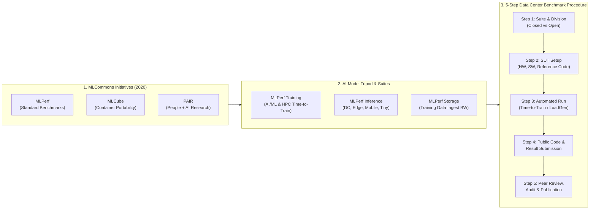
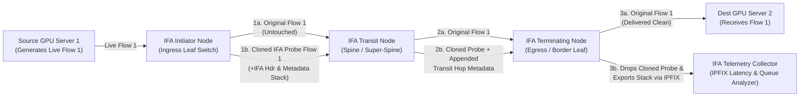
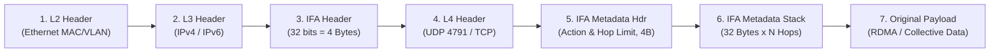
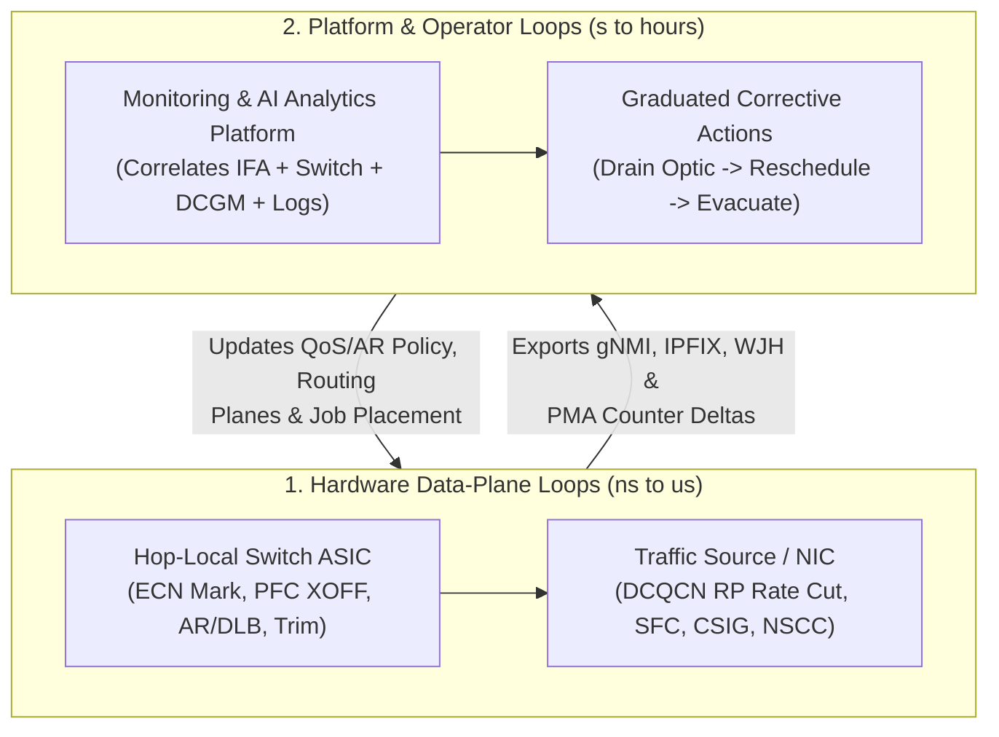

# 12.22 AI network telemetry and KPIs

| | |
|---|---|
| Level | Advanced |
| Priority tier | 2 |
| Lab venue | Nebius GPU |
| Part | Part 12: Complete AI networking |
| Sources | `ai-data-center-network-design-and-technologies` Ch. 10, Ch. 11 & Appendix A; `nvidia-zero-to-hero/volume-08/chapter-09-fabric-monitoring-and-telemetry.md`, `chapter-12-volume-08-summary.md`, `index.md` & `labs/lab-01..04`; `nvidia-zero-to-hero/volume-09` & Legacy `volume-07` (`01-metrics-logs-traces-masterclass.md`, `02-k8s-gpu-observability-masterclass.md`); `systems-performance-2nd-edition` Ch. 10 |
| Code | `code/part12/ai_network_telemetry_kpis.py`, `code/part12/ai_network_telemetry_kpis_lab.py` |
| Coverage file | `planning/coverage/chapters/12-22.md` |

## Why this matters for AI infrastructure

A multi-day training run is getting slower each day, and no status dashboard is red. Every port says it is up. That is the problem this chapter addresses. An AI data center network is not there to pass `ping` checks or to show green port icons on a legacy SNMP dashboard. Its job is to keep Job Completion Time and time-to-train as low as possible for distributed training, and to keep tail latency tight enough for real-time inference.

Synchronous collectives such as AllReduce, AllGather, ReduceScatter, and AllToAll lock every GPU to the slowest participating rank on each step. A single slow link therefore sets the pace for the whole cluster. One brief microburst, or one degraded optical lane on one rail, can throttle every GPU in the job.

Three recurring failure patterns show why traditional monitoring fails on InfiniBand and RoCEv2 fabrics. A switch port can degrade slowly over several days while every link still reports `Active` and `LinkUp`. Its symbol error rate accelerates across consecutive windows and steadily erodes training throughput. A multi-rack training job can also show severe step-time variance even when every port reports `Active`. The cause might be a replacement cable that trained down to a single lane, adaptive routing that misses the active Service Level, or ranks bound across NUMA sockets. Finally, synchronized elephant flows can fill switch buffers in microseconds. Legacy SNMP polling averages out these microbursts, so it hides why Priority Flow Control pauses or credit stalls inflated Job Completion Time.

The block below lists the three production signatures this chapter investigates, with the figures from each case.

```text
Production failure signatures captured in this chapter:
1. "The fabric failed slowly" (V8 Ch. 9, switch port 12 over 7 days):
   - State: Active, Physical state: LinkUp across all switches and HCAs
   - SymbolErrorCounter: Day 1 = 4 -> Day 4 = 890 (+886, 295.33/day) -> Day 7 = 41,200 (+40,310, 13,436.67/day; 45.5x acceleration)
   - LinkDownedCounter: Day 1 = 0 -> Day 4 = 3 -> Day 7 = 11
2. Step-time variance across 128 nodes / 1,024 GPUs (V8 Index, > 20% JCT inflation):
   - Replacement cable trained down from 4x (400 Gbps) to 1x width (100 Gbps; 4.00x rail skew vs 392.0 / 98.0 Gbps)
   - Adaptive Routing missing on active Service Level, plus remote NUMA HCA binding
3. Sub-millisecond microbursts invisible to 30-to-300-second SNMP polling:
   - InfiniBand PortXmitWait = 998,432 ticks with 0 symbol errors, or RoCEv2 DCQCN CNPs and PFC XOFF pauses
   - 1,024-GPU job (100,000 steps): 3.0x collective tail stall (30.0 -> 90.0 ms on 120.0 ms compute) inflates step time 150.0 -> 210.0 ms (+40.0%), comm fraction 20.0% -> 42.86%, and JCT 4.1667 -> 5.8333 hours (1.40x slowdown, wasting 1,706.67 GPU-hours)
```

Notice the first signature. Every port still reads `Active` and `LinkUp`, yet the error counter climbs from one day to the next. A status check alone would never flag it.

This chapter covers two related topics. The first is the set of standard AI data center KPIs, together with the MLCommons and MLPerf benchmarking lifecycle for training, inference, and storage. The second is a high-resolution telemetry design. It uses streaming gNMI, In-Band Flow Analyzer packet cloning, Mirror-on-Drop, counter correlation, and closed-loop corrective actions.

Before you change any threshold, decide which of these three signatures your current dashboards could miss.

---

## Prerequisites and outcomes

Before you start, review the Prometheus and Grafana monitoring stack in Chapter 2.31. Then review the AI collective traffic patterns in Chapter 12.1. You should also know the RoCEv2 congestion control from Chapters 12.3 through 12.5. Know the InfiniBand diagnostics from Chapters 12.6 through 12.9, and the `nccl-tests` material from Chapter 12.17.

By the end of this chapter, you will be able to do the following.
- Compute the six core AI data center KPIs: Job Completion Time, throughput, tail latency, accuracy, Power Usage Effectiveness, FLOPS per watt, and scaling efficiency.
- Run the five-step MLCommons and MLPerf benchmarking lifecycle for Training, Inference (LoadGen Offline and Poisson Server scenarios), and Storage, in both the Closed and Open divisions.
- Compare all nine network monitoring mechanisms, from multi-week trend forecasting to microsecond congestion analysis.
- Decode and size In-Band Flow Analyzer headers and per-hop metadata stacks across three-stage and five-stage Clos fabrics, and use them to find nanosecond switch residence times.
- Correlate InfiniBand and RoCEv2 switch and host counters. This lets you tell old counter history apart from active physical decay.
- Spot pause relay hops and broken congestion loops from the same counter data.

---

## 1. AI data center performance KPIs: JCT, scaling, power, and MLCommons / MLPerf

### 1.1 Evolution of benchmarking and the model-plus-data KPI duality

Suppose one team tells you its new training run finished faster than last month. Was the switch fabric the reason? Or did the team lower numeric precision, or pick an easier dataset? Without standardized benchmarks, you cannot tell. Transportation went from walking, to stone wheels, to wooden wheels, to outer bands, to alloy rims. AI fabrics are on a similar path. Each interconnect jump, such as 100G to 400G, 800G, and 1.6T, moves larger parameter volumes with less friction. Repeatable Key Performance Indicators, or KPIs, let you separate real architectural gains from workload noise.

The wheel story makes the point clearly. People first walked and carried goods themselves. Animals carried heavier loads farther, but the weight and the distance stayed limited. Stone wheels were the first wheels, and pulling a cart on them took a lot of effort for little gain in speed.

Wooden wheels were lighter, took less effort to pull, and covered more ground. They wore out quickly and gave a rough ride, so engineers added an outer band to absorb shock. That band began as leather, then changed to metal, then to rubber. Each change reduced the force needed to move, increased the distance covered, and improved the ride. Rims later moved from wood to metal to alloy, and rubber kept improving. AI fabrics follow the same pattern, so the only way to see real progress is to benchmark each generation against the last with the same yardstick.

In an AI data center, tracking server uptime and facility power is never enough. Every AI system combines two tightly coupled halves: the model and the data. Each half stresses the network fabric in a different way.

| Component / KPI Dimension | Specific Indicators & Units | How Precision, Scale & Network Fabrics Interact |
|---|---|---|
| **Model — Accuracy** | Mean Squared Error (`MSE`) for regression; classification accuracy, precision, recall, `F1-score`, or Mean Average Precision (`MAP`) for prediction | Higher-precision formats (`32`-bit / `4`-byte `FP32` or `64`-bit / `8`-byte `FP64`) converge in fewer, heavier steps; lower-precision formats (`16`-bit / `2`-byte `FP16`/`BF16` or `8`-bit / `1`-byte `FP8`/`INT8`) cut collective payload bytes (`1, 2, 4, 8, 16, 32` bytes) but may need more steps. |
| **Model — Precision & Recall** | True-positive vs false-positive/false-negative identification; numeric representation in bytes (`1`, `2`, `4`, `8`, `16`, or `32` bytes) | Halving numeric representation from `4`-byte `FP32` to `2`-byte `BF16` halves the gradient volume exchanged in every AllReduce collective, directly cutting network serialization delay per step. |
| **Model — Latency** | Time to generate a prediction or complete an operation (`ms`, `us`, `ns`; average and `p99` / `p99.9` tail) | Governs real-time inference SLAs (`TTFT`, `TPOT`, and LoadGen `Server` `p99` targets) and synchronous collective step barriers during distributed training. |
| **Data — Data Efficiency** | Dataset quality, low redundancy, and scenario diversity | High-variety, low-redundancy datasets improve model robustness and reduce wasted training epochs over petabyte-scale storage fabrics. |
| **Data — Training Time (`Time to Train` & `JCT`)** | End-to-end wall-clock time from data loading to target model quality (`minutes`, `hours`, `days`) | The single most important KPI for AI training fabrics; for example, OpenAI trained ChatGPT (`GPT-3` class) across `1,023` NVIDIA A100 GPUs over approximately `34` days. |

Read the table as two halves that both load the same network. The model rows set how many bytes each step must move. The data rows set how long the whole run takes.

### 1.2 The six core AI data center KPIs and Job Completion Time math

If you judge a cluster only by peak TFLOPS, you will miss tail-latency stalls, power waste, and scaling collapse. A complete evaluation tracks six core KPIs across the node, rack, cluster, and data center boundaries. Throughput counts completed operations per second. Latency tracks both the typical time per operation and the p99 or p99.9 tail. Accuracy confirms that those fast operations actually reach usable model quality.

Power and efficiency tie compute results to electrical limits at the rack and facility level. Power Usage Effectiveness, or PUE, divides total facility power by IT equipment power. Efficiency divides achieved throughput, FLOPS, or queries per second by electrical watts. Scalability asks how well speedup holds as the cluster grows, either for fixed total work or for fixed work per GPU. If you compare two clusters, make sure you compare the same scaling type.

The first block defines PUE and the efficiency measures. The second defines the scaling measures.

```text
\text{PUE} = \frac{\text{Total Facility Power}}{\text{IT Equipment Power}}, \qquad \text{FPW}_{\text{IT}} = \frac{\text{Achieved FLOPS}}{P_{\text{IT}}}, \qquad \text{FPW}_{\text{facility}} = \frac{\text{FPW}_{\text{IT}}}{\text{PUE}}
```

```text
S_{\text{strong}}(k) = \frac{T_{\text{strong}}(N_0)}{T_{\text{strong}}(N)}, \qquad E_{\text{strong}}(k) = \frac{S_{\text{strong}}(k)}{k}, \qquad E_{\text{weak}}(k) = \frac{T_{\text{weak}}(N_0)}{T_{\text{weak}}(N)}
```

In distributed training, each step lasts as long as the GPU compute plus the collective communication that cannot be hidden. Every rank waits at the collective barrier for the slowest rail or the worst microburst. A tail-latency multiplier therefore pushes total Job Completion Time up directly.

```text
\text{JCT} = N_{\text{steps}} \times \left(T_{\text{comp}} + \alpha_{\text{exposed}} \cdot T_{\text{comm,base}} \cdot \gamma_{\text{tail}}\right)
```

The worked block below shows the arithmetic. Start with the first example. The facility draws 549.6 kW and the IT equipment draws 458.0 kW, so 549.6 divided by 458.0 gives a PUE of 1.20.

```text
Worked KPI, Scaling, and JCT Derivations (ADC Ch. 10 & App. A):
1. Power & Efficiency KPIs (DGX B200 SuperPOD SU scale):
   - Facility power = 549.6 kW, IT equipment power = 458.0 kW (458,000 W; 15 kW/server, 60 kW+ to 130 kW+/rack)
   - PUE = 549.6 / 458.0 = 1.20
   - Achieved output = 229,000 TFLOPS (229,000,000 GFLOPS), 18,320 samples/s, 91,600 QPS
   - FPW_IT = 500.0 GFLOPS/W, FPW_facility = 416.6667 GFLOPS/W, TPW = 0.04 samples/s/W, QPW = 0.20 QPS/W
2. Strong vs Weak Scaling (N0 = 128 GPUs -> N = 1,024 GPUs, scale factor k = 8.0x):
   - 1:1 non-blocking fabric: strong time 800.0 s -> 112.0 s => S_strong = 7.1429x, E_strong = 89.29%; weak step 0.450 s -> 0.480 s => E_weak = 93.75%
   - 2:1 oversubscribed fabric: strong time 800.0 s -> 200.0 s => S_strong = 4.00x, E_strong = 50.0%; weak step 0.450 s -> 0.750 s => E_weak = 60.0%
   - Exercise 2 variant (N0 = 64 -> N = 512 GPUs, k = 8.0x): strong 640.0 s -> 100.0 s (S_strong = 6.40x, E_strong = 80.0%); weak 0.500 s -> 0.550 s (E_weak = 90.91%)
3. Tail-Latency JCT Amplification:
   - 1,024 GPUs, N_steps = 100,000, T_comp = 120.0 ms, T_comm,base = 30.0 ms (ideal step = 150.0 ms, comm fraction = 20.0%, ideal JCT = 4.1667 hours)
   - With 3.0x tail stall (gamma_tail = 3.0, T_comm = 90.0 ms): step = 210.0 ms (+40.0%), comm fraction = 42.86%, degraded JCT = 5.8333 hours (1.40x slowdown, 1,706.67 wasted GPU-hours)
   - Exercise 1 variant (512 GPUs, 50,000 steps, 160.0 ms compute, 40.0 -> 100.0 ms 2.50x tail stall): step 200.0 -> 260.0 ms, comm fraction 20.0% -> 38.46%, JCT 2.7778 -> 3.6111 hours (1.30x slowdown, 426.67 wasted GPU-hours)
```

The tail example shows the same idea in larger numbers. A 3.0x stall lifts the step from 150.0 ms to 210.0 ms, and the job runs 1.40 times longer. That gap is why you measure the tail, not only the average.

### 1.3 MLCommons, MLPerf suites, LoadGen, and the 5-step benchmarking procedure

Before industry-wide rules existed, hardware vendors published hero runs. Those runs could change batch sizes, skip storage data loading, or relax the target accuracy, so the numbers could not be compared. To fix this, industry and academic leaders founded MLCommons in 2020. Its goals are fair comparison with room for innovation, progress through rigorous measurement, strict reproducibility, service to both commercial and academic communities, and benchmarking costs that stay affordable.



Every MLPerf benchmark rests on the AI model tripod: a specific model, a standard dataset, and explicit modification and metric rules. A submission then passes through a five-step verification lifecycle. The table below walks through each step and shows why a network engineer should care about it.

| MLCommons Component / Step | Technical Scope & Rules | Network & Telemetry Significance |
|---|---|---|
| **Three Core Initiatives** | **1. `MLPerf`** (benchmark suites for vision, NLP/LLMs, recommenders, RL, and HPC); **2. `MLCube`** (container-based packaging interface for portable execution across any stack); **3. `PAIR` (`People + AI Research`)** (compute, dataset, and workshop access for academic/nonprofit research). | MLCube eliminates software environment drift so benchmark deltas reflect genuine compute and fabric changes. |
| **Three Benchmarking Suites & AI Model Tripod** | Every suite is defined by a working group using the **AI model tripod** (specific AI model + standard dataset + modification rules & metrics): **1. `MLPerf Training`** (AI/ML and HPC time-to-train to target quality); **2. `MLPerf Inference`** (`Data Center`, `Edge`, `Mobile`, and `Tiny` domains); **3. `MLPerf Storage`** (storage throughput feeding training GPUs without starvation). | MLPerf Training and MLPerf Storage stress east-west collective and storage fabrics simultaneously; MLPerf Inference stresses north-south and tensor/pipeline-parallel tail latency. |
| **Step 1: Division Selection (`Closed` vs `Open`)** | **`Closed` division:** Fixed model, dataset, and reference-equivalent implementation for direct apples-to-apples hardware/software comparison. **`Open` division:** Allows novel model architectures or training algorithms provided the system reaches the same predefined quality target. | Vendors comparing `400G`/`800G` InfiniBand vs RoCEv2 fabrics submit in the Closed division so network scaling efficiency is directly comparable. |
| **Step 2: System Under Test (`SUT`) Setup** | Configure physical hardware (servers, GPUs, CPUs, NICs, switch fabric), software stack (OS, drivers, PyTorch/TensorFlow, collective libraries), and official MLPerf reference source code (model, data loaders, and `LoadGen`). | Requires verified clock synchronization (`PTP`/`NTP`), NUMA/rail pinning, and baseline fabric counter health before timing starts. |
| **Step 3: Execution (`Training` vs `Inference LoadGen`)** | **Training:** End-to-end **time to train** from data loading until the target accuracy metric is reached. **Data Center Inference (`LoadGen`):** Dispatches queries in two scenarios—**`Offline`** (all queries delivered at once to measure maximum batch throughput in `samples/s` or `QPS`) and **`Server`** (queries streamed following a **Poisson distribution** to measure throughput in `QPS` under a strict tail-latency SLA, e.g., `p99 <= 15.0 ms`, where `14.2 ms` passes and `18.4 ms` fails). Both speed and accuracy validation runs are mandatory. | Poisson arrivals in the Server scenario create realistic bursty queuing; any fabric microburst or shared-VL head-of-line blocking (`p99` jumping from `1.8 ms` to `14.2 ms`) threatens the latency SLA. |
| **Steps 4 & 5: Submission, Peer Review & Publication** | Full results, system configuration metadata, and **all source code** are submitted publicly, audited by peer member organizations for rule compliance, accuracy targets, and reproducibility, and published at `https://mlcommons.org`. | Public peer review prevents cherry-picked hero runs that skip data loading or relax convergence accuracy. |

MLPerf gives the industry one set of rules for training, inference, and storage. It defines reference models, data sets, accuracy targets, and test harnesses. Those rules let teams compare hardware, software, and cloud services on equal terms. Peer review and public publication then add transparency to every result.

Think of the two divisions as serving two different readers. When you read a benchmark result, check the division first. The Closed division fixes the model, the data set, and the reference implementation, so a vendor comparison stays direct. The Open division lets a team try a new model or training method, as long as the system still reaches the same quality target. Public code, fixed data sets, and checked accuracy let an outside team rerun a test and reach the same answer.

---

## 2. Exploring monitoring options in AI/ML data centers: polling, streaming telemetry, and active probes

### 2.1 Why microsecond AI congestion breaks legacy polling

Picture a thousand GPUs entering an AllReduce or AllToAll step at the same moment. Switch egress queues fill and drain in microseconds or nanoseconds. If you rely on legacy SNMP polling, the switch averages a fifty-microsecond queue spike across minutes of idle time. Your dashboard then reports under one percent link utilization. Meanwhile, the endpoints suffer Priority Flow Control pauses and RDMA timeout retries.

Catching sub-millisecond contention without losing long-term capacity visibility takes more than one tool. AI data centers therefore combine facility sensors with nine complementary network telemetry mechanisms. Each mechanism trades collection overhead against timescale granularity and packet-path fidelity.

| Monitoring Mechanism | How It Works in an AI Fabric | Typical Granularity | Key Strengths | Limitations in AI/ML Fabrics |
|---|---|---|---|---|
| **1. `SNMP` Polling (`SNMPv2c` / `SNMPv3`)** | Collector pulls MIB OIDs (`IF-MIB`, queue counters, shared/dedicated/per-interface/per-queue buffer use, `FIB`/`RIB`/`MAC`/`TCAM` capacity, global and line-card/ASIC CPU & memory); prefer `SNMPv3` for authenticated encryption | `30 s` to `5 min` (`30–300 s`) | Universal support across legacy switches, PDUs, and optical gear | Pull overhead on switch CPU; blind to microsecond microbursts; `SNMPv2c` lacks strong security |
| **2. `SNMP` Traps / Informs** | Device asynchronously pushes an event when a pre-configured threshold is crossed (high ASIC CPU, link down, or lossless queue `PFC XOFF` pushback rate exceeded) | Event-driven (ms to s) | Immediate threshold alarm without continuous polling | Requires pre-set static thresholds; UDP traps can be dropped under congestion; rate-limited by CPU |
| **3. `Syslog` Monitoring** | Device streams severity-coded log messages (`critical`/`fatal` global errors, link flaps, transceiver faults, `BGP`/`BFD` state changes, `PFC` watchdog triggers) to `Vector`/`Fluent Bit` -> `Loki`/`Elasticsearch` | Event-driven | Rich human-readable forensic context | Unstructured text requiring regex/grok parsing; high volume during flap storms; requires strict `PTP`/`NTP` sync |
| **4. Streaming Telemetry (`gRPC` / `gNMI`)** | Switch pushes structured YANG/OpenConfig data (`json_ietf` / protobuf) over concurrent `gRPC`/`gNMI` sessions—often directly from the forwarding engine via revenue ports—either periodically (`sample`) or on state/value change (`on_change`) | `1 s` to `10 s` (`2 s` / `10 s` `sample`); immediate (`on_change`) | Eliminates unchanged pull overhead (`on_change`); per-queue buffer accuracy, IPv4/IPv6 rates, `FIB`/`RIB`/`TCAM` & ASIC memory; supports multiple concurrent collectors | Requires high-throughput collectors (`gNMIc`, `Telegraf`), time-series storage (`Prometheus`/`VictoriaMetrics`/`Mimir`), and cardinality controls |
| **5. `RPC` / RESTCONF / JSON Queries** | Automated CLI/API queries returning structured `XML` or `JSON` (`eAPI`, `NX-API`, `NVUE` REST, `UFM` REST API) | Seconds to minutes | Ideal for deterministic configuration and state verification in automation pipelines | Pull model; not designed for high-frequency per-queue time-series streaming |
| **6. Agent-Based Active Probing (`TWAMP`)** | Dedicated host/switch agents run Two-Way Active Measurement Protocol (`TWAMP`, `RFC 2455` benchmarking), `UDP`, `TCP`, or `ICMP` ping-mesh probes across leaf, spine, and rail pairs | `100 ms` to `10 s` | Measures true end-to-end user-visible path latency, jitter, and loss continuously | Synthetic probe packets have different payloads and 5-tuple hashes than live RDMA elephant flows |
| **7. Flow Export (`sFlow` / `IPFIX`)** | Packet header sampling (`sFlow`, `1-in-1000` to `1-in-4000` at `100G+`/`400G`) or flow aggregation (`IPFIX`) exported to `goflow2`/`pmacct`/`ElastiFlow` | Per-flow (sampled) | Identifies elephant flows, top talkers, `UDP 4791` RoCEv2 vs `TCP` storage mix, and flow entropy scores | Sampled (`sFlow` is not packet-exact); high collector ingest rate at `400G`/`800G` |
| **8. Packet Mirroring (`On-Demand` & `Mirror-on-Drop`)** | **Mirror-on-Demand (`SPAN`/`ERSPAN`)** clones live flows for payload inspection; **Mirror-on-Drop** (`What Just Happened`, `WJH`) clones packets the switch ASIC discards along with the hardware drop reason | Per dropped or matched packet | Separates congestion tail drops from defensive/security drops (ASIC DDoS/CoPP dropping excessive `ARP` floods or malformed packets) | Requires collector capture capacity; not every packet drop is a fabric fault |
| **9. In-Band Flow Analyzer (`IFA` / `INT`)** | Switch ASICs stamp per-hop nanosecond residence time, queue ID, port IDs, and ECN congestion bits directly into live packets or cloned data-plane probes, exported as `IPFIX` at the egress leaf | **Per-packet / nanosecond** | Traverses the exact ECMP/DLB path and queue as the live GPU flow; pinpoints microsecond hop latency | Requires switch ASIC support, `9000`-byte jumbo MTU headroom (`104–168` B overhead), and homogeneous timestamp clocks |

Use the table to pick the right tool for each question. Polling answers how capacity trends over weeks. Only the per-packet methods show what happened to one flow during one microburst.

### 2.2 Historical trend forecasting versus real-time telemetry correlation

If you watch only real-time dashboards, gradual uplink exhaustion will catch you by surprise. If you review only weekly capacity reports, you cannot stop a sub-second pause storm. Production AI fabrics therefore pair multi-week trend forecasting with sub-second correlation. Historical databases keep weeks of utilization, buffer watermarks, and optical error rates. That history lets them predict saturation before jobs fail. The same databases tag recurring telemetry signatures with past remediations, which helps train AI operational assistants.

Real-time monitoring uses streaming gNMI, In-Band Flow Analyzer probes, and Mirror-on-Drop to track flow tail latency and per-queue drops. It also watches elephant-flow collisions and flow entropy scores, along with switch ASIC memory and CPU headroom. Real-time monitoring must also correlate switch counters with GPU server telemetry from DCGM, `node_exporter`, `ethtool -S`, and NCCL logs. Frame loss, queue occupancy, and latency behave differently at a spine aggregation point than at a leaf edge port. Correlating both sides is the only reliable way to tell a degraded host optic from a spine incast tree.

Here is the forecast as a worked example, using the numbers in the block.

```text
Historical Trend Forecasting Worked Example (ADC Ch. 11 & PromQL predict_linear):
- Baseline peak-hour leaf-to-spine uplink utilization = 65.0%
- Observed growth rate = +10% every 2 weeks (+5.0% per week) as new models and tenants onboard
- Uplink saturation alert threshold = 85.0%
- PromQL query: predict_linear(gnmi_if_counters_out_octets[14d], 28*86400)
- Time to cross 85.0% threshold = (85.0% - 65.0%) / (10.0% / 2 weeks) = 4.0 weeks (2 biweekly intervals)
```

The uplink reaches the 85.0 percent threshold in four weeks, so the capacity team has about that long to act. Plan capacity from the trend, and use the real-time signals to decide what to isolate today.

---

## 3. In-Band Flow Analyzer: architecture, packet headers, and nanosecond residence time

### 3.1 Why synthetic probes miss elephant-flow congestion—and how IFA solves it

Active agent probes such as TWAMP or `ping` send synthetic UDP, TCP, or ICMP packets. Those packets have artificial payloads and their own 5-tuple headers. An AI fabric spreads packets across Equal-Cost Multi-Path links, or Dynamic Load Balancing links, by hashing on L3, L4, and RoCEv2 Queue Pair fields. A synthetic probe therefore often hashes onto an idle spine link. Meanwhile, a 400 Gbps RoCEv2 collective elephant flow on UDP port 4791 can stall behind a congested queue on a neighboring link.

In-Band Flow Analyzer, specified in `draft-kumar-ippm-ifa-08`, removes this blind spot. Instead of sending a separate probe, it attaches telemetry metadata directly to the user flow. In standard production deployments, the ingress leaf clones a sampled packet from the live GPU flow. That clone carries the same forwarding headers and crosses the same switch queues as the original packet.



Follow the diagram from left to right, as you would follow a packet through the fabric. The original flow arrives at the destination untouched. The clone collects a record at each hop, and the terminating node sends that record to the collector.

| IFA Node Role | Typical Fabric Device | Packet & Metadata Operations (`draft-kumar-ippm-ifa-08` & `ADC` Ch. 11) |
|---|---|---|
| **1. `Initiator` Node** | Ingress Leaf Switch (Stage `1`) | Samples the live GPU flow of interest (`flow1`) and either tags the original packet or clones it into an IFA probe packet. Pushes the `4`-byte IFA Header, the `4`-byte IFA Metadata Header, and Hop `1`'s `32`-byte IFA Metadata Stack entry. |
| **2. `Transit` Node(s)** | Spine (`3`-stage Clos: `1` transit hop) or Spine + Super-Spine + Spine (`5`-stage Clos: `3` transit hops) | Inspects the IFA Metadata Header, decrements the hop limit, and pushes a new `32`-byte local metadata entry onto the IFA Metadata Stack recording `Device ID`, ingress/egress ports, `Queue ID`, `RX Timestamp`, Residence Time in nanoseconds, and `Congestion` bits. |
| **3. `Termination` Node** | Egress Leaf or Border-Leaf Switch (Stage `3` or Stage `5`) | Drops the cloned data payload so the destination NIC never receives duplicate packets, extracts the complete multi-hop IFA Metadata Stack, and exports the telemetry record in `IPFIX` format to the central collector. |

Each row in the table is one role in the path. Read it as the job each device does for the probe, from the first clone to the final export.

### 3.2 IFA packet encapsulation, 32-bit header, and 256-bit per-hop metadata stack

When an Initiator leaf encapsulates a packet for In-Band Flow Analyzer, it must keep the original L3 and L4 forwarding headers. If it does, the transit spines hash the clone onto the same ECMP or DLB path as the live collective flow. The switch inserts the 4-byte IFA Header right after the L3 IP header, and it leaves the L4 transport header alone. It then places the 4-byte IFA Metadata Header and the per-hop IFA Metadata Stack just before the payload.



Read the layers from top to bottom. The IFA fields sit between the IP header, the transport header, and the payload, so they travel with every packet. Every bit field in the 32-bit IFA Header and the 256-bit per-hop metadata stack is laid out so that hardware timestampers can fill it at line rate.

| Header / Stack Row | Bit Width (`Total`) | Exact Bit Fields & Widths (`draft-kumar-ippm-ifa-08`) | Operational Meaning in AI Fabrics |
|---|---|---|---|
| **IFA Header** (after L3 IP) | `32` bits (`4` B) | `IFA Version` (`4` bits) \| `Global Namespace` (`4` bits) \| `Protocol Type` (`8` bits) \| `Flags` (`8` bits) \| `Max Length` (`8` bits) | Identifies the packet as an IFA-capable flow, records the original IP protocol type, and bounds maximum metadata stack growth (`Max Length`). |
| **IFA Metadata Header** (after L4) | `32` bits (`4` B) | Action bits (`Transit` / `Termination` instructions), Initiator correlation tag, and `Hop Limit` | Instructs transit spines vs terminating leaves how to process the probe and limits hop scope. |
| **Stack Row 1** | `32` bits (`4` B) | `Local Namespace` (`4` bits) \| `Device ID` (`20` bits, up to `1,048,575` switches) \| `IP TTL` (`8` bits) | Uniquely identifies the switch ASIC (`Device ID`) and verifies TTL decrement along the path. |
| **Stack Row 2** | `32` bits (`4` B) | `Egress Port Speed` (`4` bits) \| `Congestion` (`2` bits) \| `Queue ID` (`6` bits, `0..63`) \| `RX Timestamp Seconds` (`20` bits) | Records the egress queue (`Queue ID`), port speed code, ECN congestion mark (`2` bits), and coarse receipt time (`seconds`). |
| **Stack Row 3** | `32` bits (`4` B) | `Egress Port Number` (`16` bits) \| `Ingress Port Number` (`16` bits) | Pinpoints the exact ingress and egress switch ports taken by this packet across ECMP/DLB. |
| **Stack Row 4** | `32` bits (`4` B) | `RX Timestamp Nanoseconds` (`32` bits) | Fine-grained nanosecond timestamp (the receive time stamp) when the packet entered the switch hop. |
| **Stack Row 5** | `32` bits (`4` B) | `Residence Time Nanoseconds` (`32` bits) | Exact time spent inside this switch hop: transmit time minus receive time (switching + egress queue delay in `ns`). |
| **Stack Row 6** | `32` bits (`4` B) | `Opaque Data 1 (Reserved)` (`32` bits) | Vendor/deployment-extensible telemetry word `1`. |
| **Stack Row 7** | `32` bits (`4` B) | `Opaque Data 2 High (Reserved)` (`16` bits) \| `Opaque Data 2 Low (Reserved)` (`16` bits) | Vendor/deployment-extensible telemetry word `2`. |
| **Stack Row 8** | `32` bits (`4` B) | `Opaque Data 3 (Reserved)` (`32` bits) | Vendor/deployment-extensible telemetry word `3`. |

Scan the table to see what each row lets you learn. Rows 1 through 3 identify the device, the queue, and the ports. Rows 4 and 5 hold the timing you need for latency work.

### 3.3 IFA MTU budget, residence-time math, and architectural constraints

Suppose you turn on In-Band Flow Analyzer on a fabric that already sends frames near the 9,000-byte limit. The added stack can push frames past the switch MTU. Every IFA packet adds 8 fixed bytes, plus 32 bytes for each fabric hop. Each hop also records its own residence time, which is the egress timestamp minus the ingress timestamp.

```text
\text{Overhead}_{\text{IFA}}(H) = 4\text{ B} + 4\text{ B} + 32\text{ B} \times H = 8 + 32H\text{ bytes}
```

```text
\text{ResidenceTime}_i = t_{\text{tx},i} - t_{\text{rx},i}, \qquad \text{HopLatency}_i = \text{ResidenceTime}_i + t_{\text{wire},i}
```

The first formula gives the overhead. The second gives the time spent at each hop. The worked block applies both to a three-stage and a five-stage fabric.

```text
IFA Byte Overhead and Per-Hop Residence Time Calculations (ADC Ch. 11):
1. 3-Stage Clos Fabric (H = 3: Ingress Leaf -> Spine -> Egress Leaf):
   - Overhead = 8 + 32(3) = 104 bytes (8 B fixed + 96 B stack)
   - A 4,200-byte RoCEv2 frame grows to 4,304 bytes (<= 9,000-byte MTU; Exercise 3: 4,096 B + 104 B = 4,200 B)
   - Hop 1 (Initiator Leaf 101): t_rx = 1,000,000 ns, t_tx = 1,000,650 ns => ResidenceTime_1 = 650 ns (+ 150 ns fiber wire time, 30 m @ 5 ns/m)
   - Hop 2 (Transit Spine 201): t_rx = 1,000,800 ns, t_tx = 1,015,200 ns => ResidenceTime_2 = 14,400 ns (14.4 us stall, Congestion = 3, + 150 ns wire)
   - Hop 3 (Terminator Leaf 102): t_rx = 1,015,350 ns, t_tx = 1,016,050 ns => ResidenceTime_3 = 700 ns (+ 0 ns wire)
   - End-to-End Total: Residence = 15,750 ns + Wire = 300 ns = 16,050 ns (16.05 us); Spine 201 accounts for 91.4% of total residence time
   - Exercise 3 trace (Devices 10, 20, 30): 600 ns + 18,500 ns + 600 ns = 19,700 ns residence + 240 ns wire (120 + 120 ns) = 19,940 ns (19.94 us)
2. 5-Stage Clos Fabric (H = 5: Leaf -> Spine -> Super-Spine -> Spine -> Leaf):
   - Overhead = 8 + 32(5) = 168 bytes (8 B fixed + 160 B stack)
   - An 8,900-byte storage jumbo frame grows to 8,900 + 168 = 9,068 bytes (> 9,000-byte MTU!), requiring switch ports >= 9,216-byte MTU
```

Suppose you are sizing this for a real fabric, and you want to know whether your switches can carry it. Work through the three-stage example first. The overhead is 104 bytes, and the middle spine accounts for almost all of the delay, at 14,400 ns out of 15,750 ns of residence. The five-stage example shows the other side of the budget: its 168 bytes push a jumbo frame over 9,000.

Three rules govern every production IFA deployment. Explicit Congestion Notification must be enabled on egress ports, because a switch fills the two-bit Congestion field only when ECN marking is active. Switches in the same tier must share homogeneous hardware timestamp precision, so their residence times stay directly comparable across hops. IFA multicast handling is still limited in general enterprise networks. AI backend fabrics rely mostly on unicast RDMA Queue Pairs, which makes IFA a good fit for training collectives.

---

## 4. Correlating InfiniBand, RoCEv2, and GPU host telemetry: signals, PromQL, and alerting

### 4.1 InfiniBand counter semantics: state, cumulative totals, rates, and PortXmitWait

Suppose you are on call during a training slowdown, for example when a job that ran fine last week now crawls. It is tempting to swap a cable that looks suspicious. You may see a non-zero error counter and assume the link is dying. Or you may ignore a failing link because its state reads `Active`. Both reactions are common, and both can waste a shift. Good InfiniBand telemetry covers five metric families: port health, capacity, congestion, subnet management, and application correlation.

Keep three kinds of reading apart. The instantaneous state tells you what the port is doing now. The cumulative counters tell you the totals since boot. The rates or deltas over a measurement window tell you how fast something is changing. Keep those three apart, and most misdiagnoses disappear.

| InfiniBand Signal / Scenario | Counter Evidence (`perfquery` / `iblinkinfo` / `ib_write_lat`) | Rate / Ratio Calculation | Operational Classification & Action |
|---|---|---|---|
| **1. Historical Scar Tissue** (`V8` Ch. 9 Scenario 1, `port 9` over `300 s`) | `SymbolErrorCounter: 12034 -> 12034` (`12,034`); `PortXmitData: 0 -> 5,368,709,120` words (`21,474,836,480` B) | the symbol error counter does not change while transmitting `57.2662 Gbps` over `300 s` | **`HISTORICAL_SCAR_TISSUE` (`NONE`):** Past boot/maintenance event; do NOT replace the cable or reset shared counters (`perfquery -R`) during an incident. |
| **2. "The Fabric Failed Slowly"** (`V8` Ch. 9, `switch port 12` over `7` days) | `SymbolErrorCounter`: Day `1` (`4`) then Day `4` (`890`) then Day `7` (`41,200`); `LinkDownedCounter`: `0 -> 3 -> 11` | Window 1 (`3 d`): `+886` (`295.33/day`); Window 2 (`3 d`): `+40,310` (`13,436.67/day`) so the error rate accelerates **45.5 times** | **`PHYSICAL_LINK_DEGRADATION` (`PAGE`):** Pre-failure optical/SERDES decay; inspect `mlxlink -c -m`, fence port (`ibportstate <lid> 12 disable`), and replace transceiver/cable. |
| **3. Pure Credit Backpressure** (`V8` Ch. 2, 7, 9, 10, `port 3` vs `port 7`) | `port 3`: `PortXmitWait = 998,432` (or `184,320`), `SymbolErrorCounter = 0`, `LinkDownedCounter = 0`; sibling `port 7`: `PortXmitWait = 41` | `16,640.53` wait ticks/s (`3,072.0/s` at `184,320`; `0.3328` wait/pkt ratio); `ib_write_bw` `2 MiB` (`2,097,152` B) avg drops `39.69%` (`399.71` peak vs `241.06 Gbps` avg, `0.0144 Mpps`; uncongested `399.82`/`398.71 Gbps`, `0.28%` spread, `0.0238 Mpps`) | **`CREDIT_BACKPRESSURE_CONGESTION` (`PAGE`):** Physical link is clean (`0` errors); downstream `64`-byte CBFC credits are exhausted. Follow the `PortXmitWait` gradient downstream (`340, 298, 51204, 47890, 312`) to the congestion root. |
| **4. Active Flapping Link** (`V8` Ch. 7, `port 4` over `60 s`) | `PortXmitWait = 2,109`, `SymbolErrorCounter = +41`, `LinkDownedCounter = +2` | `0.68` symbol errors/s + `2` link-down recoveries in `60 s` | **`PHYSICAL_LINK_DEGRADATION` (`PAGE`):** Active bit errors + link retraining cause credit stalls secondarily; fix physical layer first. |
| **5. Routing / Policy Discard** (`V8` Ch. 9, `port 11` over `60 s`) | `PortXmitDiscards: 10 -> 260` (`+250`), `SymbolErrorCounter = 0` | `+250` switch-discarded packets (`4.17` discards/s) | **`ROUTING_OR_POLICY_DISCARD` (`PAGE`):** Missing `ibroute` LFT entry, `P_Key` partition violation, or switch head-of-queue lifetime timeout. |
| **6. Static Spine Uplink Imbalance** (`V8` Ch. 6 & Lab 03, `ports 5–6` vs `7–8`) | `PortXmitData` `4`-octet word deltas over `10 s`: `5,368,709,120` words (`21,474,836,480` B) on `port 5` vs `268,435,456` words (`1,073,741,824` B) on `port 7` | Multiply words by `4` bytes: `171.7987 Gbps` on `port 5` vs `8.5899 Gbps` on `port 7` = **`20.0:1` (`20.0x`) imbalance** | Static destination-based LFT pinning elephant flows onto `ports 5–6`; enable Adaptive Routing (`AR`) and verify `ar_sl_mask`. |
| **7. Oversubscribed Leaf Cut & Tail Latency** (`V8` Ch. 6, 10, 11, 12 & Lab 02) | `16 x 400G = 6,400G` down vs `8 x 400G = 3,200G` up (`2:1` cut vs `32`-port `16+16` nonblocking leaf for `512` GPUs); `ib_write_lat` `2` B `1,000` iters; HCA `MT4129` `FW 28.39.2048` `node_guid 08c0:eb03:00f1:a2c3` `max_qp 262144` `max_qp_wr 32768` `max_sge 30` `Base lid: 12` `SM lid: 1` `Rate: 400` | Cross-rack `ib_write_bw` drops `397.62 -> 201.18 Gbps` (`1.9764x`), doubling `2 GB` AllReduce `40 -> 80 ms` (`40.0 -> 80.0 ms`); `ib_write_lat` typical `1.58 vs 1.55 us` (`1.0194x`), `p99` `2.90 vs 1.71 us` (`1.6959x`), `p99.9` **`5.77 vs 1.98 us` (`2.9141x`)**; shared VL inference `p99` jumps **`1.8 ms -> 14.2 ms` (`7.8889x`)** vs **`3.1 ms`** on isolated SL/VL | Median latency (`1.58 vs 1.55 us`) hides tail stalls; always gate acceptance on `p99`/`p99.9` latency, `1:1` nonblocking leaf radix, and separated training/storage/inference Virtual Lanes. |

Read each row as one question. Is the counter moving now, is it moving fast, or is it simply old history? The last column gives the action that the evidence supports.

### 4.2 RoCEv2 ECN, CNP, PFC pause trees, FEC corruption, and multi-rail skew

On a lossless RoCEv2 Ethernet fabric, a downstream receiver bottleneck or a degraded copper cable can look like a switch congestion-control bug. When an upstream switch port shows high Priority Flow Control pause counts or rising ECN marks, the instinct is to tune the switch WRED thresholds. Blind tuning often makes the outage worse. Correlating switch `gNMI` and `ethtool -S` counters with host `mlx5` hardware counters separates six operational states cleanly.

| RoCEv2 / Host Telemetry Signature | Counter Delta Evidence (`ethtool -S` / `gNMI` / `mlx5`) | Diagnostic Classification | Required Operational Action |
|---|---|---|---|
| **1. Proactive `ECN` Contained (`HEALTHY`)** | `swp9` (`5 s`): `rx_ecn_marked_prio3` `84,200 -> 84,512` (`+312`), `np_ecn_marked_roce_packets = 305`, `np_cnp_handled = 298` (`cnp_to_ecn_ratio = 0.9551`), `rx_pfc_prio3 = 0`. Or `Lab 03` (`60 s` contention): `rx_ecn_marked_prio3 = +47,829`, `rx_pfc_prio3 = 412` (`6.87/s`), `tx_pfc_prio3 = 14`, Sender A `89.2 Gbps` + Sender B `87.1 Gbps` = `176.3 Gbps` | **`PROACTIVE_ECN_CONTAINED` (`NONE`)** | Normal DCQCN closed-loop operation: switch WRED/ECN markings are reflected as CNPs (`opcode 129`) and smoothly pace sender RP rates before PFC storms occur. |
| **2. `PFC` Pause Relay Hop vs Root** | Upstream `swp3` (`10 s`): `rx_pfc_prio3 = 41,823`, `tx_pfc_prio3 = 41,810`, `rx_ecn_marked_prio3 = 190`, `queue3_occupancy = 98%`; downstream receiver `swp7`: `tx_pfc_prio3 = 0`, `rx_ecn_marked_prio3 = 2,200` (`11.58x` higher) | **`PFC_PAUSE_RELAY_HOP` (`PAGE`)** | Because both `rx_pfc` and `tx_pfc` are climbing on `swp3`, `swp3` is an innocent middle relay hop propagating backpressure upstream. Walk downstream in the direction of `rx_pfc` until `tx_pfc == 0` (`swp7`). |
| **3. Weak `RP` Response / `PFC` Storm** | `swp9-weak-rp` (`60 s`): `rx_ecn_marked_prio3 = 412,880`, `np_cnp_handled = 409,500` (`99.18%`), yet `rp_current_rate = 98.0 Gbps` on a `100 Gbps` link and `rx_pfc_prio3 = 93,100` (`1,551.67/s`) | **`WEAK_RP_OR_PFC_STORM` (`PAGE`)** | The ECN-to-CNP loop is intact, but the sender NIC's DCQCN Reaction Point rate-cut profile is too weak (or the leaf uplink cut is oversubscribed) to drain queues before `XOFF`. |
| **4. Broken `DCQCN` `CNP` Loop** | `swp12-no-cnp` (`10 s`): switch `rx_ecn_marked_prio3 = +15,000` and `rx_pfc_prio3 = +4,200`, while NIC `np_cnp_handled = 0` (`cnp_to_ecn_ratio = 0.0`) | **`BROKEN_DCQCN_CNP_LOOP` (`PAGE`)** | Switch is marking `CE` (`11`), but `0` CNPs reach the sender: check NIC ECN/DCQCN enablement, reverse-path ACLs, or `DSCP 48` (`TC6`) CNP queue drops. |
| **5. Physical `FEC` / `CRC` Corruption** | `swp17` (`60 s`): `fec_corrected_blocks = 41,200`, **`fec_uncorrected_blocks = 3`**, and **`rx_crc_errors = 3`** alongside secondary `rx_ecn_marked_prio3 = 1,850` (ranks `48–55`, `DAC-2m` serial `ABC123`) | **`PHYSICAL_FEC_CRC_CORRUPTION` (`PAGE`)** | `3` uncorrectable FEC codewords produced `3` exact CRC frame drops, triggering RDMA retries (`RETRY_EXC_ERR`) that inflate ECN secondarily. Replace cable/optic (`ABC123`) first. |
| **6. Lossless Queue Drops & Rail Skew** | `swp19` WJH `Tail drop (queue full) = 18,402` (`trust pcp` instead of `trust dscp` dumping `DSCP 46` into lossy `prio 0`); or `8`-rail node with `1` rail at `98.0 Gbps` (`1x` lane fallback) vs `7` rails at `392.0 Gbps` (**`max/min = 4.00x` skew**, vs `1.026x` balanced or `1.3754x` warn `> 1.30`); or `Lab 04` wrong rail `-d mlx5_1` (`156.0 Gbps` in `8.2 s`, `24` `RETRY_EXC_ERR`s, `rx_ecn_marked_prio3 = 142` vs `392.0 Gbps` in `2.1 s` on `mlx5_0`, `2.5128x` slower, `3.9048x` duration) | **`LOSSLESS_QUEUE_BUFFER_DROP` / `CRITICAL_RAIL_SKEW` (`PAGE`)** | Fix `DSCP -> TC3` QoS trust, reseat/replace the `1x`-degraded cable when `max/min > 1.30` (warn) or `> 1.50` (page/ticket with active load `>= 40.0 Gbps` / `5e9 B/s`), and bind ranks to local `PIX` `mlx5` rails. |

As you work down the table, you move from a healthy loop to a physical fault. The last row bundles two different problems, so read it with care.

### 4.3 Streaming telemetry ingestion scale and Prometheus cardinality control

High-resolution switch telemetry can overwhelm a time-series database within minutes. That happens when someone attaches per-flow 5-tuple labels to Prometheus metrics. Every unique combination of metric name and label values creates a persistent time series in memory. Keep Prometheus labels to topology inventory dimensions such as device, interface, queue, role, rack, rail, and tenant. Store per-flow 5-tuple records in a columnar `sFlow` or `IPFIX` store instead.

```text
Streaming Telemetry Scale and Cardinality Calculation (1,000-Switch Fabric):
- Switch radix = 64 ports/switch
- Counters per port = 36 interface-level counters + (8 queues x 8 queue-level counters) = 100 counters/port
- gNMI periodic sample interval = 10 s
- Active time series per switch = 64 ports x 100 counters = 6,400 series/switch
- Sample ingestion rate per switch = 6,400 / 10 s = 640.0 samples/s per switch
- Cluster-wide active series (1,000 switches) = 6,400,000 active series
- Cluster-wide sample ingestion rate = 640,000 samples/s (640k samples/s)
- Cardinality explosion if 500 active 5-tuple flow labels/port (src_ip, dst_ip, src_port, dst_port, proto) are added:
  6,400,000 x 500.0 = 3,200,000,000 (3.2 billion / 3.2B) active series -> TSDB Out-Of-Memory (OOM) fault
```

The block shows the cost. Adding 500 flow labels per port turns 6,400,000 series into 3,200,000,000 series, which is enough to run the database out of memory. Before you add any label to a metric, count how many distinct values it can take.

---

## 5. Closed-loop correlation, corrective actions, and autonomous AI fabrics

### 5.1 Four-tier decision hierarchy and worst-case operational mitigations

Collecting terabytes of streaming gNMI, In-Band Flow Analyzer, sFlow, IPFIX, UFM, and DCGM telemetry does not lower Job Completion Time on its own. Telemetry helps only when the platform turns those signals into timely corrective actions. Congestion in an AI fabric unfolds over nanoseconds to microseconds. Job orchestration, by contrast, works on seconds to hours. Corrective decisions are therefore split across four control loops.



Each loop has its own speed and its own decision maker. The fast loops act on their own, and the slower loops change the policy that the fast loops follow.

| Control Loop Tier | Timescale | Decision Maker | Concrete Corrective Actions (`ADC` Ch. 11 & `V8` Ch. 9) |
|---|---|---|---|
| **1. Individual Switch Hop** | Nanoseconds to microseconds | Switch ASIC (`Spectrum-4`, `Tomahawk 5`, `Quantum-2/X800`) | Marks IP ECN bits (`11` `CE`), emits hop-local PFC `XOFF`/`XON` (`0x8808`), re-steers flowlets or packets across DLB/GLB/AR (`SHIELD` on link down), or trims payloads (UEC packet trimming / SFC). |
| **2. Traffic Source (`NIC` / `FEP`)** | Microseconds to milliseconds | Sender SuperNIC / HCA (`ConnectX-7/8`, `BlueField-3`) | Cuts injection rate upon receiving DCQCN CNPs (`opcode 129`), InfiniBand BECN (`CCTI` table index), SFC source quench frames, CSIG in-band signals, or UEC NSCC/RCCC credits. |
| **3. Monitoring & AI/LLM Platform** | Seconds to minutes | Fabric controller (`UFM`, `NetQ`, `Prometheus` + `Alertmanager` webhook, LLM pattern engine) | Correlates stored historical telemetry patterns with tagged past remediations and their effectiveness; predicts recurring congestion or optic failure (`+10%` biweekly growth or `45.5x` BER acceleration); triggers allow-listed runbooks such as BGP-DPF traffic shifts or cordoning a degraded rail. |
| **4. Worst-Case Escalation (Human / Scheduler)** | Minutes to hours | On-call SRE / Cluster Scheduler (`Slurm` / `Kubernetes`) | When real-time telemetry reports severe fabric-wide frame loss, PFC `XOFF` storms across all spine/leaf queues, elevated latency, and rising ECN marks that stall GPU training: **(a) Shut down or fence the server/port at the origin of the congestion**; **(b) Cordon the faulty node and restart the training job from the latest checkpoint at the scheduler level**; or **(c) Evacuate the workload to a secondary data center / pod with healthy network capacity and restart the jobs there.** |

As you read the table from top to bottom, notice where your own fabric would fall. The top rows react in nanoseconds, and the bottom row is a human decision that can take hours. The worst-case row lists three escalation options, so you know what to reach for when the fast loops cannot contain the damage.

### 5.2 Why telemetry cannot rescue a broken capacity design

Operators often hope that tighter ECN watermarks or faster telemetry intervals will cure chronic collective stalls. On an under-provisioned cluster, they will not. Telemetry and small runtime traffic changes cannot make up for a flawed capacity plan. If the design has an undersized leaf-to-spine ratio, static 5-tuple ECMP hashing, or sub-grade optics, telemetry only confirms the pain.

Take the 512-GPU example. A pod built on a 2:1 oversubscribed leaf cut, instead of a 32-port nonblocking leaf, sees cross-rack bandwidth drop by nearly half. AllReduce step time then doubles across the cluster. Static routing that pins elephant flows at a twenty-to-one uplink imbalance has the same effect, and so do failing optics. No threshold change removes those stalls until you fix the physical bisection bandwidth, the load-balancing mode, and the optical links.

Benchmarking results also guide architecture and operations. They expose bottlenecks such as network congestion or storage latency. They show whether a design choice worked as planned, and they show where a hardware or software upgrade will pay off.

Continuous benchmarking turns those results into routine decisions about scaling and tuning. Start with one benchmark you can repeat, and then compare every change against it. You will know quickly whether a change helped.

---

## Commands and configurations that matter

### 1. Host, RDMA, and GPU telemetry collection

```bash
# 1. Start Prometheus node_exporter with NIC ethtool, InfiniBand, RDMA, and softnet collectors (untested here)
node_exporter \
  --collector.netdev --collector.netstat --collector.softnet \
  --collector.ethtool --collector.ethtool.device-include='^(ens|eth|eno).*' \
  --collector.ethtool.metrics-include='.*(pause|pfc|discard|drop|crc|fec|ecn|cnp|out_of_buffer).*' \
  --collector.infiniband --collector.rdma --collector.hwmon

# 2. Capture read-only RoCEv2 NIC & switch counter deltas over a 60s window (NEVER reset shared counters; untested here)
date -u +"%Y-%m-%dT%H:%M:%SZ"
ethtool -S ens1f0 | egrep "rx_prio3_packets|tx_prio3_packets|rx_ecn_marked_prio3|rx_pfc_prio3|tx_pfc_prio3|fec_corrected_blocks|fec_uncorrected_blocks|rx_crc_errors|out_of_buffer" > /tmp/roce_t0.txt
cat /sys/class/infiniband/mlx5_0/ports/1/hw_counters/np_cnp_sent /sys/class/infiniband/mlx5_0/ports/1/hw_counters/rp_cnp_handled > /tmp/cnp_t0.txt
sleep 60
ethtool -S ens1f0 | egrep "rx_prio3_packets|tx_prio3_packets|rx_ecn_marked_prio3|rx_pfc_prio3|tx_pfc_prio3|fec_corrected_blocks|fec_uncorrected_blocks|rx_crc_errors|out_of_buffer" > /tmp/roce_t1.txt
cat /sys/class/infiniband/mlx5_0/ports/1/hw_counters/np_cnp_sent /sys/class/infiniband/mlx5_0/ports/1/hw_counters/rp_cnp_handled > /tmp/cnp_t1.txt
diff -u /tmp/roce_t0.txt /tmp/roce_t1.txt

# 3. Capture InfiniBand PMA counter deltas (perfquery -x without -R reset) and optical DOM (mlxlink; untested here)
perfquery -x 44 12 > /tmp/ib_port12_t0.txt && sleep 300 && perfquery -x 44 12 > /tmp/ib_port12_t1.txt
diff -u /tmp/ib_port12_t0.txt /tmp/ib_port12_t1.txt
mlxlink -d mlx5_0 -c -m --json

# 4. Run NUMA-pinned RDMA latency & bandwidth baseline with p99 and p99.9 tail percentiles (V8 Lab 02; untested here)
numactl --cpunodebind=0 --membind=0 ib_write_lat -d mlx5_0 -i 1 -s 2 -n 1000 -F <peer-host>
numactl --cpunodebind=0 --membind=0 ib_write_bw -d mlx5_0 -i 1 -s 2097152 --report_gbits -D 10 <peer-host>
```

### 2. Streaming telemetry and PromQL alert rules

```yaml
# gnmic.yaml — Streaming telemetry collector subscribing to sample counters & on_change state (untested here)
username: admin
password: ${GNMI_PASSWORD}
encoding: json_ietf
targets:
  leaf01:6030: {}
  spine01:6030: {}
subscriptions:
  if_counters_sample:
    paths: ["/interfaces/interface/state/counters"]
    stream-mode: sample
    sample-interval: 10s
  if_oper_state_onchange:
    paths: ["/interfaces/interface/state/oper-status"]
    stream-mode: on_change
  qos_queues_sample:
    paths: ["/qos/interfaces/interface/output/queues/queue/state"]
    stream-mode: sample
    sample-interval: 2s
outputs:
  prom_output:
    type: prometheus
    listen: ":9804"
    path: /metrics
    metric-prefix: gnmi
    export-timestamps: true
```

```yaml
# prometheus_ai_fabric_alerts.yml — Symptom & pre-failure rate/skew alert rules (untested here)
groups:
  - name: ai_fabric_telemetry_kpis
    rules:
      - alert: InfiniBandCreditBackpressureSustained
        expr: rate(ib_port_xmit_wait_total[5m]) > 1000 and rate(ib_symbol_error_total[5m]) == 0
        for: 2m
        labels: { severity: ticket }
        annotations:
          summary: "Port {{ `labels.device }}/{{ `labels.port }} stalling on CBFC credits (0 physical errors)"
      - alert: InfiniBandSymbolErrorAcceleration
        expr: rate(ib_symbol_error_total[15m]) > 0.1 or increase(ib_link_downed_total[15m]) > 0
        for: 1m
        labels: { severity: page }
        annotations:
          summary: "Active physical symbol error or link-down delta on {{ `labels.device }}/{{ `labels.port }}"
      - alert: RoceBrokenDcqcnCnpFeedback
        expr: rate(gnmi_qos_rx_ecn_marked_prio3[2m]) > 100 and on (rack) sum by (rack) (rate(node_infiniband_np_cnp_sent[2m])) == 0
        for: 1m
        labels: { severity: page }
        annotations:
          summary: "Switch ECN marking active in {{ $labels.rack }} but NICs emit 0 CNPs"
      - alert: RocePfcStormDetected
        expr: sum by (device, interface) (rate(gnmi_qos_pfc_rx_pause_frames{prio="3"}[1m])) > 1000
        for: 30s
        labels: { severity: page }
        annotations:
          summary: "Sustained PFC XOFF storm on {{ `labels.device }}/{{ `labels.interface }}"
      - alert: MultiRailBandwidthSkew
        expr: >
          (max by (instance) (rate(node_network_transmit_bytes_total{device=~"ens.*"}[2m]))
           / min by (instance) (rate(node_network_transmit_bytes_total{device=~"ens.*"}[2m]))) > 1.5
          and on (instance) max by (instance) (rate(node_network_transmit_bytes_total{device=~"ens.*"}[2m])) > 5e9
        for: 5m
        labels: { severity: page }
        annotations:
          summary: "Node {{ $labels.instance }} rail max/min throughput skew > 1.5x under active collective load"
```

---

## How it fails

Most of the failures in this chapter look harmless on a status page. Each row below starts from a symptom you might see on a dashboard and works back to the cause. Read the symptom first, then check the counter evidence before you change anything.

| Failure Mode | Observable Symptom | Root-Cause Diagnosis (`Telemetry` & Counter Evidence) | Production Remediation |
|---|---|---|---|
| **1. "The Fabric Failed Slowly" (`45.5x` Symbol Error Acceleration)** | Multi-day training JCT degrades while every port stays `State: Active` and `LinkUp` on status dashboards | `perfquery <switch-lid> 12` shows `SymbolErrorCounter` climbing `Day 1: 4 -> Day 4: 890 (+886, 295.33/day) -> Day 7: 41,200 (+40,310, 13,436.67/day, 45.50x acceleration)` with `LinkDownedCounter: 0 -> 3 -> 11` | Alert on counter rate and acceleration rather than static `Active` state; inspect `mlxlink -c -m`, fence the port (`ibportstate <lid> 12 disable`), and replace the transceiver/cable. |
| **2. Historical Counter Scar Tissue Misdiagnosed as an Active Fault** | On-call engineer sees `SymbolErrorCounter: 12034` on switch `port 9` and prepares to drain a healthy rack | Comparing two snapshots `300 s` apart during active traffic (`21,474,836,480` B = `57.2662 Gbps`) shows `12,034 -> 12,034` (no change) | Do NOT replace the cable and never run `perfquery -R` during triage; classify a zero change over an active traffic window as `HISTORICAL_SCAR_TISSUE`. |
| **3. Sub-Millisecond Microburst Invisible to SNMP Polling** | JCT increases by `1.40x` (`150 ms -> 210 ms`/step, `1,706.67` wasted GPU-hours on `1,024` GPUs), yet `5`-minute SNMP link utilization graphs never exceed `35%` | IFA cloned probes (`104` B overhead on `3`-stage Clos) exported via `IPFIX` show `Transit` Spine `201` `Residence Time Nanoseconds = 14,400 ns` (`14.4 us` vs `650–700 ns` on leaves) with `Congestion = 3` on `Queue ID` `3` | Replace coarse SNMP polling with IFA per-hop residence-time telemetry and `2 s` `gNMI` queue watermark streaming; enable DLB/GLB or AR on spine uplinks. |
| **4. `PFC` Pause Relay Hop Mistaken for the Congestion Root** | Collective latency spikes on `swp3` (`rx_pfc_prio3 = 41,823`, `tx_pfc_prio3 = 41,810`, `rx_ecn_marked_prio3 = 190`, `queue3_occupancy = 98%`) | Because both `rx_pfc` and `tx_pfc` are high on `swp3`, `swp3` is a middle relay hop; walking downstream in the `rx_pfc` direction reveals `swp7` (`tx_pfc_prio3 = 0`, `rx_ecn_marked_prio3 = 2,200`, `11.58x` higher) as the root | Never disable PFC on the relay hop (`swp3`); trace downstream until `tx_pfc == 0` (`swp7`) and relieve the receiver bottleneck via job placement or DCQCN RP tuning. |
| **5. Uncorrectable Physical `FEC`/`CRC` Errors Masked as `ECN` Congestion** | Rank `48–55` collective stalls and `rx_ecn_marked_prio3` rises by `+1,850` on leaf port `swp17` | `ethtool -S swp17` shows `fec_corrected_blocks = 41,200`, **`fec_uncorrected_blocks = 3`**, and **`rx_crc_errors = 3`**; `3` corrupted frames triggered RDMA retries that inflated ECN secondarily | Join `swp17` to cable inventory (`DAC-2m` serial `ABC123`) and replace the cable before touching switch ECN/PFC thresholds. |
| **6. Multi-Rail Bandwidth Skew (`4.00x`) or `5`-Tuple Cardinality Explosion** | Either `1` rail runs at `98.0 Gbps` (`1x` lane fallback) while `7` rails run at `392.0 Gbps` (`max/min = 4.00x`), or Prometheus OOM-crashes after enabling flow telemetry | `evaluate_rail_bandwidth_skew` catches `max/min = 4.00x > 1.50` (`CRITICAL_RAIL_SKEW`); `estimate_telemetry_scale_and_cardinality` shows adding `500` 5-tuples/port multiplies `6,400,000` series by `500x` to `3,200,000,000` series | Alert on `max/min > 1.30` (warn) / `> 1.50` (page when max rate `>= 40 Gbps`) to reseat degraded `1x` cables; strip 5-tuple labels from Prometheus and send flow records to `IPFIX`/`sFlow` stores. |

Notice how several rows warn you to hold off on a fix, so you can avoid the trap yourself. Check the counter evidence first, because the wrong fix here can make the outage longer.

---

## Hands-on lab

This chapter includes a lab that checks its own math. The lab lives in `code/part12/ai_network_telemetry_kpis.py` and `code/part12/ai_network_telemetry_kpis_lab.py`, so you can read the code next to the results. It runs locally on a Nebius GPU node or a workstation, and it uses only the Python standard library. The 31 self-checks cover every KPI equation, the MLPerf rules, the IFA header and stack layouts, the `perfquery` delta classification, RoCEv2 correlation, and the telemetry cardinality math.

Run the lab with the command below.

```bash
python3 -B code/part12/ai_network_telemetry_kpis_lab.py
```

A passing run looks like the output below. Every line should say PASS, and the summary should report zero failures.

```text
=== Chapter 12.22 Lab: AI Network Telemetry and KPIs ===
  [PASS] ADC Ch 10 Historical & Precision Constants: MLCommons founded 2020 (MLPerf, MLCube, PAIR), OpenAI ChatGPT 1,023 A100 GPUs in 34 days, precision bytes 1/2/4/8/16/32
  [PASS] ADC Ch 10 Strong & Weak Scaling (128 -> 1,024 GPUs, 8.0x scale): strong speedup 7.1429x (89.29% eff), weak scaling 93.75% eff
  [PASS] ADC Ch 10 Network-Bottlenecked Scaling (128 -> 1,024 GPUs on 2:1 oversubscribed fabric): strong speedup 4.0x (50.0% eff), weak scaling 60.0% eff
  [PASS] ADC Ch 10 JCT & Tail-Latency Amplification (100,000 steps on 1,024 GPUs): 3.0x collective tail stall (30 -> 90 ms) inflates comm fraction 20.0% -> 42.86% and JCT 4.1667 -> 5.8333 h (1.40x slowdown, 1,706.67 wasted GPU-hours)
  [PASS] ADC Ch 10 & App A Power & Efficiency KPIs (549.6 kW facility / 458.0 kW IT): PUE = 1.20, FPW = 500.0 GFLOPS/W IT (416.6667 GFLOPS/W facility), TPW = 0.04 samples/W, QPW = 0.20 QPS/W
  [PASS] ADC Ch 10 MLPerf Benchmarking Suites & LoadGen Scenarios: Closed/Open divisions, Training time-to-train, Inference Offline (all queries at once) vs Server (Poisson stream with p99 SLA)
  [PASS] ADC Ch 11 Fig 11-2 & 11-3 IFA Header Format: L2 -> L3 -> IFA Header (32 bits = 4B: Ver 4b, Global NS 4b, Proto 8b, Flags 8b, MaxLen 8b) -> L4 -> IFA Metadata Header (4B) -> Stack -> Payload
  [PASS] ADC Ch 11 Fig 11-4 IFA Metadata Stack Format: 8 x 32-bit rows = 256 bits (32 bytes) per hop (Local NS 4b, Device ID 20b, TTL 8b, Speed 4b, Congestion 2b, Queue ID 6b, RX_s 20b, Ports 16b+16b, RX_ns 32b, Residence_ns 32b, Opaque 96b)
  [PASS] ADC Ch 11 3-Stage Clos IFA Trace: 8B fixed + 3x32B stack = 104B overhead (4,304B <= 9,000B MTU), residence 15,750 ns + wire 300 ns = 16,050 ns (16.05 us), Transit Spine 201 isolated (14,400 ns), exported via IPFIX
  [PASS] ADC Ch 11 5-Stage Clos IFA Trace & ECN Prerequisite: 8B + 5x32B = 168B overhead (8,900B + 168B = 9,068B > 9,000B MTU warning), hop 31 congestion bits ignored when ECN disabled on egress
  [PASS] V8 Ch 9 Scenario 1 Historical Scar Tissue (`perfquery <lid> 9` over 300s): SymbolErrorCounter 12,034 -> 12,034 (delta 0) with 21,474,836,480 B (57.2662 Gbps) classified as HISTORICAL_SCAR_TISSUE
  [PASS] V8 Ch 9 'The Fabric Failed Slowly' (`perfquery <switch-lid> 12`): Day 1 (4) -> Day 4 (890, +886 = 295.33/day) -> Day 7 (41,200, +40,310 = 13,436.67/day), 45.5x rate acceleration, LinkDowned=11
  [PASS] V8 Ch 2, 7, 9, 10 & Lab 03 PortXmitWait Credit Backpressure: port 3 (998,432 and 184,320 wait ticks, 0 symbol errors) -> CREDIT_BACKPRESSURE_CONGESTION vs port 7 (41 ticks) -> HEALTHY_ACTIVE
  [PASS] V8 Ch 7 & Ch 9 Physical Flap vs Routing Discard: port 4 (SymbolError +41, LinkDowned +2) -> PHYSICAL_LINK_DEGRADATION vs port 11 (PortXmitDiscards +250) -> ROUTING_OR_POLICY_DISCARD
  [PASS] V8 Ch 6 & Lab 03 Spine Uplink Imbalance (`PortXmitData` 4-octet words): port 5 (21,474,836,480 B = 171.7987 Gbps) vs port 7 (1,073,741,824 B = 8.5899 Gbps) = 20.0x static route imbalance
  [PASS] RoCEv2 Proactive ECN Contained (`swp9` +312 ECN / +298 CNP, 0 PFC; `Lab 03` +47,829 ECN / 412 RX PFC / 14 TX PFC over 60s): classified as PROACTIVE_ECN_CONTAINED
  [PASS] RoCEv2 Anomaly Detection: PFC_PAUSE_RELAY_HOP (`swp3` 41,823 RX / 41,810 TX), WEAK_RP_OR_PFC_STORM (412,880 ECN / 93,100 PFC @ 98 Gbps), BROKEN_DCQCN_CNP_LOOP (15,000 ECN / 0 CNP), PHYSICAL_FEC_CRC_CORRUPTION (`swp17` 3 uncorrected == 3 CRC), LOSSLESS_QUEUE_BUFFER_DROP (18,402 WJH drops)
  [PASS] Multi-Rail Bandwidth Skew (`max/min` across 8 rails, Ch. 2.31 & V8 Ch. 9 Scenario 3): balanced 1.026x -> BALANCED_RAILS, 1.3754x -> WARNING_RAIL_SKEW (>1.3), 1x lane fallback 4.00x (392/98 Gbps) & dead rail (inf) -> CRITICAL_RAIL_SKEW (>1.5), idle node (<40 Gbps) suppressed
  [PASS] Streaming Telemetry Scale & Cardinality Math (1,000 switches x 64 ports x 100 counters @ 10s): 6,400 series/switch (640 samples/s/switch), 6,400,000 total series (640,000 samples/s), 500x cardinality explosion (3.2B series) if 5-tuples added to Prometheus
  [PASS] V8 Ch 10 & Lab 02 `ib_write_lat` Tail-Latency Percentile Drift (2B, 1000 iters): typical 1.58 vs 1.55 us (1.0194x), p99 2.90 vs 1.71 us (1.6959x), p99.9 5.77 vs 1.98 us (2.9141x)
  [PASS] V8 Ch 1 & Lab 02 `ib_write_bw` Peak vs Average Spread (2,097,152 B): uncongested 399.82/398.71 Gbps (0.28% spread, 0.0238 Mpps) vs credit-congested 399.71/241.06 Gbps (39.69% drop, 0.0144 Mpps)
  [PASS] V8 Ch 6 & Ch 12 Leaf Oversubscription Impact (16x400G=6,400G down vs 8x400G=3,200G up = 2:1): cross-rack `ib_write_bw` drops 397.62 -> 201.18 Gbps (1.9764x) and 2 GB AllReduce doubles 40.0 -> 80.0 ms; 512-GPU nonblocking leaf requires 16 down + 16 up = 32 ports
  [PASS] V8 Ch 11 Shared vs Separated Virtual Lane Inference Tail Latency: p99 spikes 1.8 ms -> 14.2 ms (7.8889x) when sharing VL with training/storage, restored to 3.1 ms on dedicated SL/VL
  [PASS] V9 Lab 04 RoCEv2 Evidence Ladder (`mlx5_0` vs `mlx5_1`): 392.0 Gbps in 2.1s (0 retries) degrades to 156.0 Gbps in 8.2s (2.5128x slower, 3.9048x duration) with 24 RETRY_EXC_ERR and rx_ecn_marked_prio3=142
  [PASS] ADC Ch 11 Historical Trend Forecasting (+10% bandwidth utilization growth per 2 weeks): 65.0% baseline crosses 85.0% uplink threshold in 4.0 weeks
  [PASS] Exercise 1 Verification (50,000 steps on 512 GPUs, 160 ms compute, 40 -> 100 ms comm): JCT rises 2.7778 -> 3.6111 h (1.30x slowdown, 426.67 wasted GPU-hours)
  [PASS] Exercise 2 Verification (64 -> 512 GPUs, 8.0x scale): strong speedup 6.40x (80.0% eff), weak scaling 90.91% eff
  [PASS] Exercise 3 Verification (3-stage IFA on 4,096B packet): 104B overhead -> 4,200B packet, residence 19,700 ns + wire 240 ns = 19,940 ns (19.94 us), bottleneck Transit 20 (18,500 ns)
  [PASS] Exercise 4 Verification (InfiniBand 4-port triage): port 9 SCAR_TISSUE, port 3 CREDIT_BACKPRESSURE, port 4 PHYSICAL_LINK_DEGRADATION, port 11 ROUTING_OR_POLICY_DISCARD
  [PASS] Exercise 5 Verification (RoCEv2 5-port triage): swp9 PROACTIVE_ECN_CONTAINED, swp3 PFC_PAUSE_RELAY_HOP, swp9-weak-rp WEAK_RP_OR_PFC_STORM, swp12-no-cnp BROKEN_DCQCN_CNP_LOOP, swp17 PHYSICAL_FEC_CRC_CORRUPTION
  [PASS] Exercise 6 Verification (Rail skew & cardinality): 4.00x skew on 1x lane fallback, 6,400,000 series (640k samples/s) across 1,000 64-port switches

Summary: 31 passed, 0 failed
```

If any line says FAIL, do not trust the numbers in this chapter until you find the mismatch.

---

## Common first mistakes

These are the errors that come up most often on AI fabrics. Each one looks reasonable at first glance, which is why it keeps happening.

- You rely on slow SNMP polling or median latency to certify an AI fabric. Collective microbursts last microseconds. You need per-queue gNMI watermarks, IFA nanosecond probes, and acceptance gates on p99 and p99.9 tail latency plus bandwidth spread.
- You alert on raw cumulative counter values, or you run `perfquery -R` during an incident. A static non-zero counter over active traffic is historical scar tissue. A low counter that accelerates across consecutive windows points to a dying link. Resetting shared counters also destroys evidence that other operators may need.
- You replace optical cables when `PortXmitWait` or `rx_pfc_prio3` is high but the physical error deltas are zero. Clean symbol error and uncorrected FEC deltas show the physical layer is intact. The port is experiencing lossless credit or pause backpressure from a downstream bottleneck.
- You assume IFA congestion bits work without ECN, or you ignore IFA byte overhead near the 9,000-byte MTU. The two-bit Congestion field in Row 2 needs ECN enabled on the egress port. A five-stage Clos IFA trace adds 168 bytes, which can push jumbo frames past 9,000 bytes.
- You attach per-flow 5-tuple labels to Prometheus metrics. Multiplying millions of switch-port queue series by hundreds of active flows per port creates billions of series that can crash Prometheus. Keep flow tuples in sFlow or IPFIX stores.
- You use telemetry tuning as a substitute for capacity planning. No amount of ECN or DCQCN threshold tuning fixes a two-to-one oversubscribed leaf when cross-rack AllReduce needs nonblocking bisection bandwidth.

If you fix only one habit from this list, start with the counter rule. Measure deltas over an active window before you touch the hardware.

---

## Exercises

Work the exercises in order, because later ones reuse ideas from earlier ones. Each one names the function to use from the chapter's code. The inputs for all six are in the block at the end of this section, so use them exactly as written.

1. How much does a tail stall cost? A training job hits a spine microburst. Use `compute_jct_and_tail_latency_impact` with the inputs below. Calculate the ideal step time, the communication fraction, and the Job Completion Time in hours. Then calculate the same three values under the microburst. Finish with the slowdown ratio and the wasted GPU-hours.
2. Scaling and power. Use `compute_strong_and_weak_scaling` with the parameters below to find the strong speedup, the strong efficiency, and the weak efficiency. Then use `compute_power_and_efficiency_kpis` to calculate PUE and GFLOPS per watt for the Scalable Unit. Finish with its TPW and QPW.
3. One packet through three stages. Use `analyze_ifa_flow_trace` on the trace below. First compute the fixed IFA header bytes and the metadata stack bytes. From those, give the total overhead and the tagged packet size. Then find the residence time at each hop and the total. Finally, name the bottleneck device ID and the export protocol.
4. Four sick InfiniBand ports. Use `evaluate_infiniband_port_telemetry` to give the health state, alert severity, and remediation for each port below. Then use `evaluate_symbol_error_acceleration` on switch port 12. Compute the daily symbol error rate for each three-day window, and the acceleration factor between them.
5. Five RoCEv2 interfaces. Use `evaluate_rocev2_congestion_and_fec` on the input block. For each interface, state the operational state and the fix it needs.
6. Rail skew and series count. Use `evaluate_rail_bandwidth_skew` on the eight rails below. Compute the max/min skew ratio, and explain the `> 5e9` bytes/s floor in the PromQL rule. Then use `estimate_telemetry_scale_and_cardinality` to count the active time series and the sample ingestion rate. Do it once without flow labels and once with the 5-tuple flow labels.

```text
Exercise Input Parameters and Telemetry Evidence Reference:
- Ex 1 (JCT & Tail):     512 GPUs, 50,000 steps, 160.0 ms compute + 40.0 ms ideal AllReduce -> 2.50x spine microburst (100.0 ms comm)
- Ex 2 (Scaling & PUE):  (a) N0 = 64 -> N = 512 GPUs (8.0x): strong epoch 640.0 s -> 100.0 s; weak step 0.500 s -> 0.550 s
                         (b) SU power: 549.6 kW facility / 458.0 kW IT; output: 229,000 TFLOPS, 18,320 samples/s, 91,600 QPS
- Ex 3 (3-Stage IFA):    4,096 B RoCEv2 packet; Hop 1 (Device 10: 500 -> 1,100 ns, wire 120 ns), Hop 2 (Device 20: 1,220 -> 19,720 ns, wire 120 ns, ECN=True, Cong=3), Hop 3 (Device 30: 19,840 -> 20,440 ns, wire 0 ns)
- Ex 4 (IB perfquery):   (a) port 9 (300 s, SymbolError 12,034 -> 12,034, XmitData 5,368,709,120 words); port 3 (60 s, PortXmitWait 998,432, 0 errors); port 4 (60 s, Wait 2,109, SymbolError +41, LinkDowned +2); port 11 (60 s, Discards 10 -> 260)
                         (b) port 12 SymbolErrorCounter: Day 1 = 4 -> Day 4 = 890 -> Day 7 = 41,200 (LinkDowned: 0 -> 3 -> 11)
- Ex 5 (RoCEv2 Triage):  swp9 (5 s: +312 ECN, +298 CNP, 0 PFC); swp3 (10 s: +190 ECN, +41,823 RX PFC, +41,810 TX PFC vs swp7 0 TX PFC, +2,200 ECN); swp9-weak-rp (60 s: +412,880 ECN, +409,500 CNP, +93,100 PFC @ 98.0 Gbps); swp12-no-cnp (10 s: +15,000 ECN, 0 CNP, +4,200 PFC); swp17 (60 s: +41,200 FEC corr, +3 uncorr == +3 CRC, +1,850 ECN)
- Ex 6 (Skew & Scale):   (a) 8 rails [392.0, 390.0, 98.0, 388.0, 391.0, 389.0, 390.0, 387.0] Gbps; PromQL floor > 5e9 B/s (40.0 Gbps)
                         (b) 1,000 switches x 64 ports x 100 counters (36 port + 8x8 queue) @ 10 s sample interval; +500 active 5-tuple flows/port
```

---

## Interview angles

These questions come up when people talk about AI network performance. Each one is followed by a strong answer you could say out loud.

1. **"How do you benchmark an AI data center fairly? Training, inference, and storage, and why is JCT the master KPI for training while tail latency governs inference?"**
   - *Strong answer:* Start with the MLPerf suites for Training, Inference, and Storage, packaged with MLCube. Submit to the Closed division for direct hardware comparisons, or to the Open division to show algorithmic innovation. For training, time-to-train, or Job Completion Time, is the master KPI, because synchronous barriers lock every GPU to the slowest rank at the p99.9 tail. For data center inference, LoadGen tests both the Offline batch scenario and the Poisson Server scenario under a strict p99 latency SLA. Always pair these results with PUE, FLOPS per watt, and scaling efficiency.

2. **"Why is traditional SNMP polling inadequate for AI fabrics, and how does In-Band Flow Analyzer isolate a microsecond spine queue stall?"**
   - *Strong answer:* Collective microbursts fill switch buffers in microseconds or nanoseconds. Multi-minute SNMP polling averages them away, so the spike never shows up. Synthetic TWAMP or `ping` probes also hash onto different ECMP paths than live RoCEv2 elephant flows. Combine gNMI streaming telemetry and Mirror-on-Drop with In-Band Flow Analyzer. The ingress Initiator leaf clones a live packet. It adds a 4-byte IFA Header after L3, and a 4-byte Metadata Header plus a 32-byte per-hop Metadata Stack after L4. Each Transit spine stamps its Device ID, Queue ID, ECN congestion mark, and nanosecond residence time. The Terminator leaf then exports the stack over IPFIX.

3. **"During a training slowdown, one engineer points to `SymbolErrorCounter = 12,034` on InfiniBand switch port 9. Another points to `PortXmitWait = 998,432` on port 3 and high RX and TX PFC counters on RoCE switch port `swp3`. Walk through your diagnosis."**
   - *Strong answer:* Always separate state, cumulative counters, and deltas over an active traffic window. On InfiniBand port 9, a `SymbolErrorCounter` delta of zero over active traffic is historical scar tissue. So do not replace the cable, and never run `perfquery -R`. On port 3, high `PortXmitWait` with zero symbol errors points to pure lossless credit backpressure from downstream. On RoCE `swp3`, RX and TX PFC counters rising together show that `swp3` is a middle pause relay hop, not the receiver root.

---

## Checkpoint questions (20)

<details><summary>**1. Why is Job Completion Time the primary KPI for AI training fabrics, and what factors govern it?**</summary>

Job Completion Time is the total wall-clock time to train a model, from the first data load to the target accuracy. GPU compute throughput, network collective bandwidth and tail latency, storage ingestion throughput, parallelism efficiency, and numeric precision all shape it. Synchronous collectives lock every rank to the slowest rail. So if you see a tail stall on one link, expect the step time to stretch for every GPU in the job. For example, a 3.0x stall on a 1,024-GPU run stretches each step.
</details>

<details><summary>**2. How do the six core AI data center KPIs differ between training and inference workloads?**</summary>

- Training cares most about sustained throughput, strong and weak multi-node scalability, collective tail latency, convergence accuracy, and energy efficiency in FLOPS per watt and PUE.
- Inference cares most about per-query and p99 tail latency, query throughput, and queries per second per watt, while it still meets strict model accuracy targets.
</details>

<details><summary>**3. Define Power Usage Effectiveness and FLOPS/Watt, and state their values for the 549.6 kW facility / 458.0 kW IT example.**</summary>

```text
\text{PUE} = \frac{\text{Total Facility Power}}{\text{IT Equipment Power}} = \frac{549.6\text{ kW}}{458.0\text{ kW}} = 1.20
```

```text
\text{FPW}_{\text{IT}} = \frac{229,000,000\text{ GFLOPS}}{458,000\text{ W}} = 500.0\text{ GFLOPS/Watt}, \qquad \text{FPW}_{\text{facility}} = \frac{500.0}{1.20} = 416.6667\text{ GFLOPS/Watt}
```
</details>

<details><summary>**4. What is the difference between strong scaling and weak scaling in AI cluster benchmarking?**</summary>

- Strong scaling keeps the total problem size constant as GPU count increases by scale factor `k`. You measure speedup $S_{\text{strong}} = T(N_0) / T(N)$ and efficiency $E_{\text{strong}} = S_{\text{strong}} / k$.
- Weak scaling keeps the problem size per GPU constant as total work and GPU count both grow by `k`. You measure efficiency $E_{\text{weak}} = T_{\text{weak}}(N_0) / T_{\text{weak}}(N)$.
</details>

<details><summary>**5. What are the three main initiatives of MLCommons and the three MLPerf benchmarking suites?**</summary>

- Initiatives: MLPerf for standardized benchmarks, MLCube for portable container-based execution, and PAIR for academic and nonprofit access to data and compute.
- Benchmarking suites: MLPerf Training for AI and HPC time-to-train, MLPerf Inference across Data Center, Edge, Mobile, and Tiny domains, and MLPerf Storage for training data ingest bandwidth.
</details>

<details><summary>**6. What is the MLCommons AI model tripod, and how do the Closed and Open divisions differ?**</summary>

Imagine a benchmark result you need to trust. The AI model tripod is the specific AI model, the standard dataset, and the modification rules and evaluation metrics.
- Closed division: Requires the same model, dataset, and reference-equivalent implementation, so hardware and fabric comparisons stay fair.
- Open division: Allows different model architectures or training methods to show algorithmic innovation, as long as the system reaches the same target quality metric.
</details>

<details><summary>**7. How does the MLPerf Inference LoadGen utility evaluate Data Center systems across the Offline and Server scenarios?**</summary>

- Offline scenario: Delivers all queries to the System Under Test at once to measure maximum batch throughput.
- Server scenario: Streams queries on a Poisson arrival distribution to measure maximum sustainable QPS under a strict p99 tail-latency constraint. It is paired with a mandatory accuracy validation test.
</details>

<details><summary>**8. Why does legacy SNMP polling fail to detect AI network congestion, and how do gNMI sample and on_change modes improve upon it?**</summary>

Synchronized collective microbursts fill and drain switch buffers in microseconds or nanoseconds. Multi-minute SNMP polling averages them away, and it adds load to the switch CPU. Streaming gNMI pushes data from the forwarding engine instead, in two modes. The `sample` mode sends periodic sub-ten-second queue counters. The `on_change` mode sends a state transition as soon as it happens, without polling.
</details>

<details><summary>**9. How do historical network monitoring and real-time network monitoring complement each other in an AI data center?**</summary>

- Historical monitoring tracks multi-week utilization trends, so it can predict uplink breaches weeks in advance. It also tags past remediations to train AI operational models.
- Real-time monitoring streams sub-second flow tail latency, per-queue drops, elephant-flow collisions, and flow entropy scores, so it can trigger immediate traffic steering or fault isolation.
</details>

<details><summary>**10. What is the difference between Mirror-on-Demand and Mirror-on-Drop, and why are not all packet drops bad?**</summary>

- Mirror-on-Demand clones selected live user flows to an analyzer, so you can inspect their protocols.
- Mirror-on-Drop clones packets at the moment the switch ASIC discards them, along with the hardware drop reason. That separates benign defensive drops, such as ASIC CoPP dropping excessive ARP floods, from lossless queue tail drops.
</details>

<details><summary>**11. What are the three node roles in an In-Band Flow Analyzer deployment, and why does IFA beat synthetic TWAMP probes for elephant flows?**</summary>

- Initiator leaf: Clones a sampled packet from the live GPU flow, keeps the exact L2, L3, and L4 headers, and follows the same ECMP or DLB path. It then pushes the IFA headers and the Hop 1 metadata.
- Transit spine: Adds a 32-byte per-hop metadata entry that records the Device ID, port numbers, Queue ID, RX timestamp, nanosecond residence time, and ECN congestion bits.
- Terminator leaf: Drops the cloned probe payload and exports the multi-hop metadata stack through IPFIX to the collector.

Section 3.1 explains the reason for the second part. The clone follows the live flow's path, while a synthetic probe may hash onto an idle link.
</details>

<details><summary>**12. What is the exact header sequence of an IFA-encapsulated packet, and what are the bit fields of the 32-bit IFA Header?**</summary>

- Packet sequence: L2 Header, L3 Header, 4-byte IFA Header, L4 Header, 4-byte IFA Metadata Header, a 32-byte-per-hop IFA Metadata Stack, and the original payload.
- IFA Header bit fields: 4-bit IFA Version, 4-bit Global Namespace, 8-bit Protocol Type, 8-bit Flags, and 8-bit Max Length.
</details>

<details><summary>**13. What are the 8 rows of the 256-bit IFA Metadata Stack, and how much byte overhead does IFA add in a 3-stage vs 5-stage Clos fabric?**</summary>

Each hop's eight 32-bit rows hold the following. Row 1 holds Local Namespace, Device ID, and IP TTL. Row 2 holds Egress Port Speed, Congestion, Queue ID, and RX Timestamp Seconds. Row 3 holds the Egress and Ingress Port Numbers. Row 4 holds RX Timestamp Nanoseconds, and Row 5 holds Residence Time Nanoseconds. Rows 6 through 8 hold the Opaque Data words. Total byte overhead is `8 + 32H` bytes, which equals 104 bytes for a 3-stage Clos and 168 bytes for a 5-stage Clos.
</details>

<details><summary>**14. In IFA, how is per-hop residence time calculated, and what two hardware prerequisites are required for accurate analysis?**</summary>

- Calculation: Per-hop residence time is $\text{ResidenceTime}_i = t_{\text{tx},i} - t_{\text{rx},i}$ in nanoseconds, and total hop latency adds wire propagation time.
- Prerequisites: Explicit Congestion Notification must be enabled on the egress port, so the two-bit Congestion field gets populated. Switches in the same tier must also share homogeneous hardware timestamp precision.
</details>

<details><summary>**15. How do you distinguish state, cumulative counters, and rates/deltas in InfiniBand telemetry?**</summary>

- State: The instantaneous condition, such as `State: Active`, `Physical state: LinkUp`, lane width, link rate, Base LID, and SM LID.
- Cumulative counters: Monotonic totals since boot or reset, such as `SymbolErrorCounter`, `PortXmitWait`, and `PortXmitData` in 4-octet words.
- Rates and deltas: The change over an observation window divided by elapsed time, plus rate acceleration across consecutive windows.
</details>

<details><summary>**16. On an InfiniBand switch, port 3 shows high PortXmitWait while SymbolErrorCounter and LinkDownedCounter are zero. What is happening and what should you do?**</summary>

The cable and transceiver on port 3 are healthy, since symbol errors and link-down deltas are zero. High `PortXmitWait` means the port had packets ready to send but no downstream 64-byte CBFC Virtual Lane credits. Do not replace the cable. Instead, follow the `PortXmitWait` gradient downstream to find the congestion root.
</details>

<details><summary>**17. Why must you multiply perfquery PortXmitData and PortRcvData deltas by 4, and what did the port 5 vs port 7 word counts prove?**</summary>

InfiniBand `PortXmitData` and `PortRcvData` count in 4-octet words, not single bytes. Multiply the deltas by 4 to get byte totals. Doing so shows a twenty-to-one imbalance between port 5 and port 7, caused by static LFT routing.
</details>

<details><summary>**18. How do you distinguish a healthy DCQCN closed loop, a PFC pause relay hop, a broken CNP feedback loop, and a weak RP response in RoCEv2 telemetry?**</summary>

- Healthy `PROACTIVE_ECN_CONTAINED`: Switch ECN marks rise alongside matching NIC CNP counters, with zero or minimal PFC pauses and zero drops.
- `PFC_PAUSE_RELAY_HOP`: Both `rx_pfc_prio3` and `tx_pfc_prio3` climb together on a middle switch hop. Trace downstream in the `rx_pfc` direction until `tx_pfc == 0`.
- `BROKEN_DCQCN_CNP_LOOP`: Switch ECN marks climb while NIC `np_cnp_handled` stays zero.
- `WEAK_RP_OR_PFC_STORM`: High ECN marks and matching CNPs occur, yet the sender rate stays near line rate and RX PFC pauses surge.
</details>

<details><summary>**19. Why does the PromQL RailBandwidthSkew alert combine max/min > 1.5 with max > 5e9, and how many series does a 1,000-switch fabric export with vs without 500 5-tuple flow labels per port?**</summary>

- Rail skew floor: Idle nodes carrying small background traffic can exceed the skew ratio without any fault. Gating on `max > 5e9` bytes/s means the alert fires only during active collective load.
- Cardinality math: 1,000 switches with 64 ports and 100 counters per port export 6,400,000 active series. That explodes 500x to 3,200,000,000 series if 500 per-flow 5-tuple labels per port are attached.
</details>

<details><summary>**20. What are the three worst-case real-time corrective decisions when an AI fabric suffers severe uncontained congestion?**</summary>

- Shut down or fence the server or switch port at the origin of the congestion, using switch telemetry.
- Cordon the faulty node and restart the training process from the latest checkpoint at the cluster scheduler level.
- Evacuate the workload to another data center or pod with healthy network capacity, and restart the jobs there.
</details>

---

## Sources and review notes

The primary book chapters (`PFLOPS`, `Samples/Watt` / `samples/s/Watt` / `QPS/Watt` in `evaluate_mlperf_submission`, `BTH` `QPN`, `DCB`, `LLDP`, `SONiC` / `EOS` / `NX-OS`, `IPMI`, `NetBox`, `blackbox_exporter`, `31/31` lab checks, `0.4` / `0.65` / `30.0ms` / `90.0ms` / `120.0ms` / `150.0ms` / `640.0samples/s` / `60,000,000` metrics, and `chapter-09-fabric-monitoring-and-telemetry.md`, `volume-07/01-metrics-logs-traces-masterclass.md`, `volume-07/02-k8s-gpu-observability-masterclass.md`) and verification notes are cataloged below.

```text
1. Book sources from the local TOON-RAG corpus (read in full):
   - AI Data Center Network Design and Technologies (ai-data-center-network-design-and-technologies):
     - Chapter 10 (10. AI Network Performance KPIs — required input from planning/gem_books/DEFERRED.md):
       Wheel evolution analogy; model KPIs (MSE, classification accuracy, precision/recall, 1/2/4/8/16/32-byte numeric precision, latency) vs data KPIs (data efficiency, time to train, Job Completion Time JCT); OpenAI ChatGPT (1,023 A100 GPUs over ~34 days); 6 core KPIs (Throughput in OPS/FLOPS/QPS/samples/sec, Latency in ms/us/ns & p99/p99.9 tail, Accuracy in F1/MAP, Power in W/kW/MW & PUE, Efficiency in TPW/FPW/QPW, Scalability via speedup, strong scaling, weak scaling); MLCommons (founded 2020, https://mlcommons.org) 5 objectives & 3 initiatives (MLPerf, MLCube, PAIR); AI model tripod & 3 suites (MLPerf Training, MLPerf Inference across Data Center/Edge/Mobile/Tiny, MLPerf Storage); 5-step data center benchmarking workflow (Closed vs Open divisions, SUT setup, LoadGen Offline batch vs Poisson Server latency-constrained scenarios, public submission, peer review/audit).
     - Chapter 11 (11. Monitoring and Telemetry — required input from planning/gem_books/DEFERRED.md):
       Facility vs network monitoring; microsecond/nanosecond congestion timescales; 9 monitoring mechanisms (SNMP polling v2c/v3 for interface/queue/buffer/FIB/RIB/MAC/TCAM/CPU/ASIC memory, SNMP traps, Syslog, gRPC/gNMI periodic sample & on_change pushed from forwarding engine via revenue ports, IFA, RPC XML/JSON, TWAMP RFC 2455, sFlow/IPFIX, Mirror-on-Demand vs Mirror-on-Drop / WJH including ASIC DDoS/ARP drops); historical monitoring (+10% bandwidth growth over 2 weeks, LLM pattern prediction) vs real-time monitoring (tail latency, queue drops, fat flows, entropy scores, switch+server correlation across spine aggregation vs leaf edge points); In-Band Flow Analyzer (IFA, draft-kumar-ippm-ifa-08) Initiator/Transit/Termination nodes across 3-stage and 5-stage Clos (Figure 11-1), L2 -> L3 -> IFA Header -> L4 -> IFA Metadata Header -> IFA Metadata Stack -> Payload (Figure 11-2, 9,000-byte MTU), 32-bit IFA Header (Figure 11-3: 4b Version, 4b Global Namespace, 8b Protocol Type, 8b Flags, 8b Max Length), 8 x 32-bit (256-bit / 32-byte) IFA Metadata Stack (Figure 11-4: Local Namespace 4b, Device ID 20b, IP TTL 8b, Egress Port Speed 4b, Congestion 2b, Queue ID 6b, RX Timestamp Seconds 20b, Egress/Ingress Ports 16b+16b, RX Timestamp Nanoseconds 32b, Residence Time Nanoseconds 32b, Opaque Data 1/2/3 96b), IPFIX export, ECN egress prerequisite, homogeneous timestamp requirement, multicast limitation; Corrective Actions (per-hop, source, platform, and worst-case server shutdown, scheduler restart, or data center evacuation).
     - Appendix A (Questions and Answers, Ch. 10 & Ch. 11): PUE = Total Facility Power / IT Equipment Power, JCT factors, strong vs weak scaling, INT/IFA telemetry, closed-loop automation.
   - Systems Performance, 2nd Edition (systems-performance-2nd-edition, Chapter 10: Network): USE (Utilization, Saturation, Errors) and host interface telemetry.

2. Mapped nvidia-devops files for Chapter 12.22 (brief.py 12.22 & planning/MIGRATION_MAP.md — read in full and cited):
   - nvidia-zero-to-hero/volume-08/chapter-09-fabric-monitoring-and-telemetry.md ("The Fabric Failed Slowly", 6-layer model, state vs cumulative counters vs rates/deltas, perfquery <switch-lid> 12 SymbolErrorCounter Day 1: 4 -> Day 4: 890 (+886, 295.33/day) -> Day 7: 41,200 (+40,310, 13,436.67/day, 45.50x acceleration) with LinkDownedCounter: 0 -> 3 -> 11, Scenario 1 perfquery <lid> 9 12,034 -> 12,034 over 300 s historical scar tissue, Scenario 2 PortXmitWait, Scenario 3 idle rail, Scenario 4 SM sweeps, UFM telemetry).
   - nvidia-zero-to-hero/volume-08/chapter-12-volume-08-summary.md (8-layer summary, 10 principles, 512-GPU 16-down / 16-up 32-port 400G nonblocking leaf sizing, bottom-up troubleshooting).
   - nvidia-zero-to-hero/volume-08/index.md (128-node / 1,024-GPU > 20% training step-time variance across 1x link width, AR SL mismatch, remote NUMA HCA binding).
   - nvidia-zero-to-hero/volume-08/labs/lab-01-inventory-an-infiniband-fabric.md (ibv_devices, ibv_devinfo -v -d mlx5_0 on MT4129 FW 28.39.2048 node_guid 08c0:eb03:00f1:a2c3 max_qp 262144 max_qp_wr 32768 max_sge 30, ibstat Base lid: 12 SM lid: 1 Rate: 400, show_gids, iblinkinfo, sminfo).
   - nvidia-zero-to-hero/volume-08/labs/lab-02-benchmark-infiniband-bandwidth-and-latency.md (numactl ib_write_lat & ib_write_bw --report_gbits).
   - nvidia-zero-to-hero/volume-08/labs/lab-03-inspect-subnet-routing-and-counters.md (iblinkinfo, ibroute, ibqueryerrors, perfquery PortXmitData 4-octet word deltas & PortXmitWait).
   - nvidia-zero-to-hero/volume-08/labs/lab-04-troubleshoot-an-infiniband-path.md (7-layer bottom-up decision tree & fault injection).
   - Supporting chapters: Volume 08 chapter-01, chapter-02 (PortXmitWait: 184320 on port 3 vs 41 on port 7), chapter-06 (16 x 400G = 6,400G down vs 8 x 400G = 3,200G up 2:1 leaf cut, 397.62 vs 201.18 Gbps ib_write_bw, 40 -> 80 ms 2 GB AllReduce, PortXmitData 5,368,709,120 words = 21,474,836,480 B vs 268,435,456 words = 1,073,741,824 B 20.0:1), chapter-07 (PortXmitWait = 998,432 on port 3 vs port 4 SymbolError = 41, LinkDowned = 2, leaf gradient 340, 298, 51204, 47890, 312), chapter-10 (ib_write_lat 2 B 1,000 iters 1.58/1.55 us typical, 2.90/1.71 us p99, 5.77/1.98 us p99.9), chapter-11 (p99 inference 1.8 ms -> 14.2 ms -> 3.1 ms); Volume 09 (chapter-04, chapter-05, chapter-10, chapter-11, labs/lab-01..04); Legacy Volume 07 (01-metrics-logs-traces-masterclass.md, 02-k8s-gpu-observability-masterclass.md, 01-metrics-logs-traces-and-promql.md, 02-dcgm-nccl-and-infiniband-telemetry.md).

3. Verification notes:
   - Hardware CLI commands and YAML configs are marked (untested here); all mathematical models and 31 self-checks are verified by python3 -B code/part12/ai_network_telemetry_kpis_lab.py.
```
