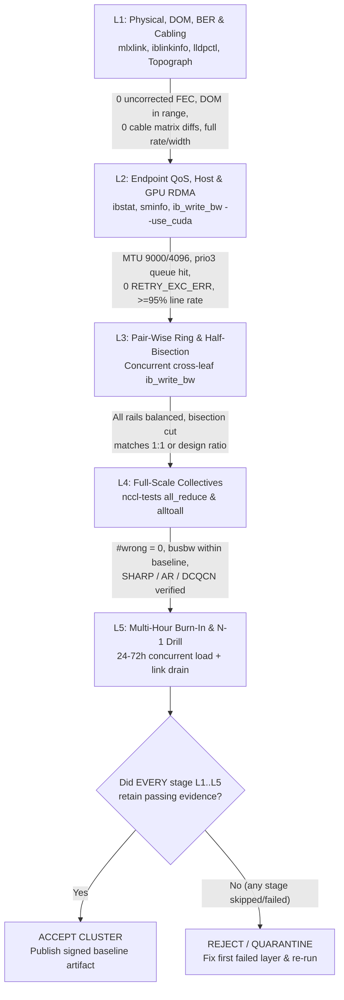
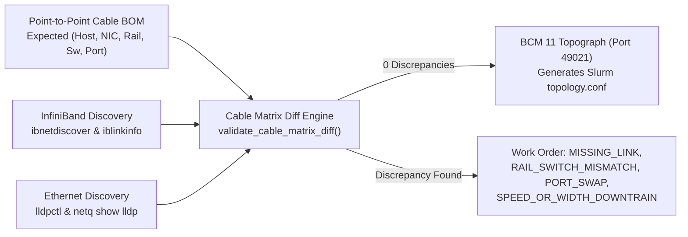

# 12.23 Fabric validation and capacity planning

| | |
|---|---|
| Level | Advanced |
| Priority tier | 2 |
| Lab venue | Nebius GPU |
| Part | Part 12: Complete AI networking |
| Sources | `nvidia-devops` (Volume 09 Ch. 10 & Labs 01–04; Volume 08 Ch. 11, Ch. 12, Index & Labs 01–04); `superpod-b200-dc`; `superpod-gb300-ra`; `bcm11-admin` (§7.5); `ai-data-center-network-design-and-technologies` (Ch. 3, Ch. 4) |
| Coverage file | `planning/coverage/chapters/12-23.md` |
| Claim ledger | `planning/ledgers/12-23.md` |

## Why this matters for AI infrastructure

Acceptance means proving, with saved evidence, that a new cluster does what its design says before real jobs run on it. Two mistakes make acceptance fail. The first is calling a cluster ready because every port reports `LinkUp` and `ping` gets a reply. The second is sizing capacity by adding up port speeds on a datasheet. That sum ignores the bottleneck cut, which is the set of links that separates the senders from their receivers.

Picture a multi-rack InfiniBand cluster that passes commissioning. Every host is reachable, every port shows `State: Active`, and isolated point-to-point RDMA tests succeed. Once distributed training starts, step time varies by more than twenty percent across racks. Three defects were stacked on top of each other. A replacement cable had trained at half lane width. Adaptive routing was not balancing flows across spines. Several GPU ranks were paired with network cards on the far side of a NUMA boundary.

The same trap appears on RoCEv2 Ethernet. A new GPU rack passes the optical checks, an ICMP `ping` and a two-node bandwidth test. A week after it joins shared production, multi-rank AllReduce and AllToAll jobs stall. The switches show heavy ECN marking, which signals that queues are filling. They also show Priority Flow Control pauses and hardware tail drops.

The isolated test never loaded the oversubscribed leaf-to-spine uplinks, and it never ran with one link down for maintenance. Acceptance therefore needs a ladder of evidence gates that starts at physical optics and ends in multi-hour burn-in. Pair the ladder with a deterministic bill of materials and a capacity model built on the bottleneck cut.

The numbers from the RoCEv2 case are worth working through once. Sixteen nodes each connect with two 400 Gb/s links, so the downlink demand is 12,800 Gb/s. The leaf has eight 400 Gb/s uplinks, which is 3,200 Gb/s. The oversubscription is 4 to 1. With one uplink drained for maintenance it becomes 4.57 to 1. A single pair of nodes reached 392 Gb/s on a 400 Gb/s link with no drops, because it never filled the uplinks. Under shared load, the switch counters showed 288,400 ECN marks, 61,200 pause frames and 38,210 tail drops.

Decide up front what evidence a cluster must produce before anyone signs for it.

## Prerequisites and outcomes

**Prerequisites:**
- Review PFC, ECN, and DCQCN congestion control in Chapter 12.4, InfiniBand Subnet Manager routing in Chapter 12.7, and optics and cabling in Chapter 12.10.
- Review fabric topology and oversubscription design in Chapter 12.13, plus `nccl-tests` and fabric benchmarking in Chapter 12.17.

**Expected learning outcomes:**
- Run a five-stage acceptance ladder, from L1 physical optics and BER through L5 multi-hour burn-in and N-1 link drains.
- Check physical cabling against the Point-to-Point BOM with `ibnetdiscover`, `iblinkinfo`, `lldpctl`, `netq`, and NVIDIA Base Command Manager Topograph.
- Calculate switch, transceiver, and cable BOMs with field spares and cable-reach derating for two-tier and three-tier Clos fabrics and SuperPODs.
- Model bottleneck cuts in normal and N-1 degraded states, measure their effect on collective step time and inference tail latency, and apply the seven-input architecture decision framework.

Start with the acceptance ladder, because the capacity model assumes its evidence is already sound. If you skip the ladder, every later number inherits the gap.

---

## 1. The multi-stage cluster acceptance gating ladder

On a typical enterprise network, a passing `ping` or a green switch LED is good enough to call a link ready. An AI fabric needs more. A `ping` only shows that the host CPU can send one small ICMP packet over the default kernel route. It says nothing about RDMA Verbs Queue Pairs, RoCEv2 encapsulation, the lossless Priority 3 queues, GPUDirect RDMA locality, or whether a thousand GPUs can synchronize across the spine cuts.

Commissioning has to climb the ladder from the bottom: Stage L1 first, then L2, all the way to L5. A later stage cannot make up for an earlier one. If you skip ahead, you have no proof for the lower layers. Suppose `all_reduce_perf` passes at Stage L4, but a transceiver shows rising uncorrected FEC blocks at Stage L1. Forward error correction (FEC) is the error correction built into the link. The cluster must still be rejected and quarantined. Each lower gate has to keep its raw passing evidence before anyone signs. Keep the output of every gate, because you will need it at sign-off.



The table lists each gate with its tools, its pass criteria, and the action to take when it fails.

| Stage | What it proves | Main tools | Pass criteria | Typical failure and fix |
|---|---|---|---|---|
| L1 Physical | Optics, lanes, cables and wiring match the design | `mlxlink`, `ibdiagnet`, `iblinkinfo`, `ethtool -m`, `lldpctl` | Full width and speed, optical power inside the datasheet range for the optic type, zero uncorrected FEC blocks, zero cable diffs | A port trains at half width or receives low light. Replace the optic or cable, or re-patch, before L2 |
| L2 Endpoint | Addressing, MTU, queue mapping and one-pair RDMA are right | `ibstat`, `sminfo`, `show_gids`, `mlnx_qos`, `ib_write_bw` | One master Subnet Manager, MTU as designed, at least 95 percent of line rate, no retry errors | One device collapses from 392 to 156 Gb/s with retry errors. Fix GID, NIC or NUMA selection |
| L3 Pairs and bisection | Many pairs together fill every rail and spine cut | Concurrent `ib_write_bw` in a ring and in half-bisection | Every rail near line rate, bisection matches the design ratio, spine port skew under 5 percent | Same-leaf pairs reach 397 Gb/s but cross-rack pairs reach 201 Gb/s. Fix uplinks or routing |
| L4 Collectives | Real collectives run clean at full scale | `nccl-tests` through `mpirun` or `srun` | No wrong results, bus bandwidth inside your own baseline, no pause storms or tail drops | A 2-node run passes but a 64-node run stalls. Check adaptive routing, congestion control and rails |
| L5 Burn-in | The fabric stays healthy for hours and survives one failure | Canary harness, UFM or NetQ, `perfquery`, `ethtool -S` | No link flaps, drops or Xid events over 12 to 72 hours, p99 step time within 5 percent, N-1 drain matches the model | Idle had no drops, but burn-in shows tail drops. Adjust admission, QoS or cut capacity |

Each failure signature points to one layer to fix first. That is why the ladder runs from the bottom up.

### Stage L1: Physical layer, DOM optical budgets, FEC/BER, and inventory truth

Picture a cable plugged into the wrong leaf switch, or a dirty optical ferrule that drops codewords. Collective benchmarks on that cluster waste days of triage before anyone finds the fault. Stage L1 checks that every physical link exists, matches the cable matrix, and has enough optical and Forward Error Correction margin. Inventory needs care too. An InfiniBand `Base lid` can change whenever OpenSM re-sweeps the subnet. Inventory records should therefore key on the immutable `Port GUID` rather than the LID.

On RoCEv2 nodes, the same stage checks the Ethernet side. Each interface must map to its expected RDMA device at full line rate with a jumbo MTU. Stage L1 also confirms PCIe switch locality, meaning the path between each GPU and its paired rail NIC. Corrected FEC codewords are normal on high-speed PAM4 links with RS-FEC, which use a four-level signal. A non-zero corrected count alone is not a failure. An uncorrected FEC block delta or low optical receive power is, and you must fix it before Stage L2.

```text
Stage L1 baseline inventory and optical/FEC reference values :
1. InfiniBand HCA Inventory (ibv_devices, ibv_devinfo -v -d mlx5_0, ibstat):
   - HCA: ConnectX-7 (MT4129, vendor_id: 0x02c9, vendor_part_id: 4129, fw_ver: 28.39.2048)
   - Transport: InfiniBand (0), node_guid: 08c0:eb03:00f1:a2c3, Port GUID: 0x08c0eb0300f1a2c3
   - Capability mask: 0x2651e848, max_qp: 262144, max_qp_wr: 32768, max_sge: 30
   - Port state: Physical state: LinkUp, State: Active, Rate: 400 (400 Gb/s NDR), Base lid: 12, LMC: 0, SM lid: 1
2. RoCEv2 Ethernet & Topology Inventory (rdma link show, ethtool ens1f0, nvidia-smi topo -m):
   - Link: mlx5_0/1 state ACTIVE physical_state LINK_UP netdev ens1f0, mtu 9000, Speed: 400000Mb/s, Duplex: Full, Link detected: yes
   - Topology: GPU0-NIC0 (NUMA 0, CPU 0-31) = PIX, GPU1-NIC1 (NUMA 1, CPU 32-63) = PIX, cross-socket GPU0-NIC1 = SYS, intra-node GPUs = NV18
3. Optical DOM & FEC Baseline (2026-08-07T14:32:15Z, mlxlink -d mlx5_0 -m -c -e / ethtool -S ens1f0):
   - rx_packets: 1024567, rx_bytes: 892481382400, tx_bytes: 481029120384
   - rx_errors: 0, rx_crc_errors: 0, fec_corrected_blocks: 412 (normal RS-FEC 544,514 baseline), fec_uncorrected_blocks: 0
   - Example limits used in this chapter (illustrative: take optical power limits from the datasheet of each optic type):
     Rx >= -6.0 dBm, Tx >= -4.0 dBm, lane skew < 2.0 dB, temp <= 70.0 C, pre-FEC BER <= 1e-5, post-FEC <= 1e-15
   - Fail example: Rx -8.4 dBm with 12 uncorrected FEC blocks
```

Record these baseline values while the links are known to be good, so you can spot later drift.

### Stage L2: Subnet/IP routing, QoS queue verification, and point-to-point RDMA

A link can pass every Stage L1 optical check and still fail in use. An RDMA process might select the wrong GID index, cross NUMA sockets, or land in a lossy queue. Stage L2 checks the addressing and queue mapping first. Then it tests one pair of nodes for bandwidth and latency across host DRAM and GPU HBM. On InfiniBand, `sminfo` must show a single master Subnet Manager, and `smpquery pkeys` must match the partition policy. On RoCEv2, `ip route get` must resolve to the intended rail interface and source IP.

Next, operators run NUMA-pinned `ib_write_lat` and `ib_write_bw`, first without and then with `--use_cuda`. Those two runs check the host path and the GPUDirect RDMA path. Here is the failure to watch for. A benchmark bound to a misaligned RoCE device or secondary GID can collapse in throughput while Layers 1 and 2 still look clean, and RDMA retries surge. The last test is a bounded two-sender contention run. It shows that RoCEv2 packets enter the lossless Priority 3 queue and slow down smoothly through DCQCN, with zero drops.

```text
Stage L2 Routing, Process-Scoped Fault Isolation, and 60s QoS Contention Evidence :
1. Route & MTU Resolution:
   - ip route get 10.20.8.5 -> 10.20.8.5 via 10.20.0.1 dev ens1f0 src 10.20.4.15 cache users 1 mtu 9000
   - Single-pair NUMA-pinned baseline (numactl --cpunodebind=0 --membind=0): ib_write_lat ~1.5–2.0 µs, ib_write_bw 392.0 to 397.62 Gb/s on 400G
2. Process-Scoped RoCE Device/GID Misalignment :
   - Primary rail (ib_write_bw -d mlx5_0 -i 1 <peer-ip>, ens1f0, GID[3] fe80::0c42:a1ff:fec8:d79b/64): 392 Gb/s in 2.1 s, 0 retries
   - Misaligned device (ib_write_bw -d mlx5_1 -i 1 <peer-ip>, ens1f1, src 10.20.4.24, GID[3] fe80::0c42:a1ff:fec8:d79d/64):
     drops 2.51x to 156 Gb/s, stretches duration 3.90x to 8.2 s, logs 24 IBV_WC_RETRY_EXC_ERR completions and rx_ecn_marked_prio3: 142
3. Controlled 60s Two-Sender Priority 3 Contention Test (14:35:22Z -> 14:36:30Z, DSCP 26 -> prio3):
   - Idle baseline (14:35:22Z): rx_ecn_marked_prio3: 0, rx_pfc_prio3: 0, tx_pfc_prio3: 0, rx_prio3_packets: 102,314, tx_prio3_packets: 89,621
   - Post-load (14:36:30Z): rx_prio3_packets = 51,234,892 (delta 51,132,578), tx_prio3_packets = 48,901,234 (delta 48,811,613)
   - Congestion feedback: rx_ecn_marked_prio3 = +47,829, rx_pfc_prio3 = +412, tx_pfc_prio3 = +14
   - Result: Sender A (89.2 Gb/s) + Sender B (87.1 Gb/s) = 176.3 Gb/s combined throughput with 0 packet drops
```

Compare the two single-pair runs. The switches are the same and only the device differs. The fix belongs in device, NUMA, and route selection, not in switch PFC or ECN settings.

### Stages L3, L4, and L5: From pairwise rings and bisection cuts to full-scale burn-in

A single-pair `ib_write_bw` test at Stage L2 exercises one link at a time. It cannot reveal spine oversubscription or static routing polarization, which only appear when many pairs talk at once. Stage L3 runs an all-node ring sweep for each rail, so every host NIC and cable gets tested. Then it runs a half-bisection test, where half the cluster sends across the spine to the other half. When you compare same-leaf bandwidth with cross-rack bandwidth, check the switch uplink `PortXmitData` counters. Undersized leaf uplinks or static route pinning show up quickly in that comparison.

Stage L4 runs full-scale `nccl-tests` collectives across every rank and rail. The pass condition is zero data corruption errors and full bus bandwidth parity. Stage L5 is the long test. It runs a multi-hour burn-in that combines distributed training with concurrent storage checkpoint I/O. During that burn-in, operators deliberately drain one uplink or one spine switch, which shows how the cluster behaves in the N-1 state.

```text
Stages L3, L4, and L5 Quantitative Gate Benchmarks :
- Stage L3 Half-Bisection & Spine Polarization:
  - 1:1 non-blocking fabric: cross-spine pairs sustain ~385–392 Gb/s (pass gate >= 370–390 Gb/s, < 5% spine skew)
  - 2:1 oversubscribed leaf: same-leaf pairs hit 397.62 Gb/s (at 2,097,152 B = 2 MiB), but cross-rack pairs drop to 201.18 Gb/s
  - Static routing polarization on leaf uplinks (PortXmitData 4-octet words):
    ports 5–6 carry 21,474,836,480 and 21,489,234,432 words (~21.48 GB) vs ports 7–8 at 1,073,741,824 and 1,081,654,272 words (~1.08 GB) -> 19.9:1 imbalance
- Stage L4 Full-Scale Collectives (all_reduce_perf, reduce_scatter_perf, all_gather_perf, alltoall_perf, -b 8M -e 8G -f 2 -g 1 -c 1 -n 100):
  - Requires #wrong = 0 (fail example: #wrong = 3 silent data corruption) and 1 GiB+ busbw >= 340–361.36 GB/s on 8 x 400G NDR (85%–90%+ of 8 x 50 = 400 GB/s; illustrative policy, not a vendor figure, calibrate on your own baseline)
- Stage L5 Burn-In & N-1 Drain (24–72 h HPL/NeMo + fio/gdsio):
  - 0 link flaps, 0 WJH tail drops (vs 38,210 drops on unvalidated 4:1 rack), 0 Xid/SXid/CQE timeouts over 12–72 h, p99 step within <= 5%, N-1 drain verified (4.00:1 -> 4.57:1)
```

Treat each number above as a gate, not a goal. When you miss one, you go back to the layer it names. A run that misses one of them goes back to the layer named in the table.

Do not sign a cluster until you have raw evidence for every stage on file.

---

## 2. Automated cable matrix validation

Picture a thousand-GPU cluster with thousands of point-to-point cables. Manual visual inspection misses human wiring errors. During installation, a technician can cross-patch a cable between rails, swap two ports on the same leaf switch, or leave a connector partly unlatched. In a Rail-Optimized Design, a Rail 0 NIC plugged into a Rail 1 leaf pushes traffic that should stay one hop inside the rail across two spine hops. It can also blackhole the subnet.



The table lists the discovery tools and what each one checks against the BOM.

| Discovery / Validation Tool | Fabric Type | Primary CLI / API Interface | What It Verifies Against the Point-to-Point Cable BOM |
|---|---|---|---|
| `ibnetdiscover` & `iblinkinfo` | InfiniBand (`HDR`/`NDR`/`XDR`) | `ibnetdiscover -p`, `iblinkinfo -l` | Extracts `(CA GUID, Port) <-> (Switch GUID, Port, Rate, Width)` (`4x 400 Gbps Active/LinkUp`) |
| `ibdiagnet` | InfiniBand (`HDR`/`NDR`/`XDR`) | `ibdiagnet -r --pm_pause_time 30` | Audits duplicate GUIDs/LIDs, credit loops, LFT balance, BER/FEC, and cable EEPROMs |
| `lldpctl` / `show lldp` / `cmsh showport` | RoCEv2 & OOB Ethernet | `lldpctl -f json`, `cmsh -c "device; finddevicebyswitchport switch01:1"` | Maps host MAC and interface to peer switch port (`switch01:1`, or breakout `switch01:1s1`) |
| **NVIDIA NetQ** & **NVIDIA Air** | Spectrum-X / Cumulus Ethernet | `netq check clag`, `netq check bgp`, `netq check mtu`, `netq check lldp` | Fleet-wide validation of BGP/ECMP, MTU, QoS drift, and digital-twin simulation (`Air`) |
| **BCM 11 Topograph** | Slurm IB, Ethernet & Cloud (`AWS`/`OCI`/`GCP`) | `https://localhost:49021/metrics` (`cmsh -> wlm[slurm] -> topologysettings`) | Synthesizes live topology into `/cm/shared/apps/slurm/etc/<cluster>/topology.conf` (`topology/tree` or `topology/block`) |

### Reconciling discovered links against the Point-to-Point BOM

Automated commissioning compares the expected Point-to-Point Cable BOM with live output from `ibnetdiscover`, `iblinkinfo`, or `lldpctl`. Every wiring error lands in one of four work-order categories, and each one has its own fix.

- `MISSING_LINK`: the expected host port is absent or down. Technicians check dust caps, MPO polarity, latches, and optics.
- `RAIL_SWITCH_MISMATCH`: a host NIC sits on a leaf switch from the wrong rail, so it must be re-patched.
- `PORT_SWAP`: the cable reaches the right leaf switch but the wrong port number, which breaks static LFTs and runbook labels.
- `SPEED_OR_WIDTH_DOWNTRAIN`: the cable is on the right switch and port but trained at half width, because of a dirty ferrule or a damaged lane.

The worked example below runs the diff engine on four links. Each line of its output maps to one of the four categories above.

```text
Cable Matrix Diff Worked Example (validate_cable_matrix_diff):
- Expected 400G x4 BOM:
  dgx-01:mlx5_0 -> leaf-r0-01:Port1 | dgx-01:mlx5_1 -> leaf-r1-01:Port1
  dgx-02:mlx5_0 -> leaf-r0-01:Port2 | dgx-02:mlx5_1 -> leaf-r1-01:Port2
- Discovered Live Links & Automated Classification:
  1. dgx-01:mlx5_0 on leaf-r1-01:Port1 (400G x4) -> RAIL_SWITCH_MISMATCH (Rail 0 NIC on Rail 1 switch)
  2. dgx-01:mlx5_1 on leaf-r1-01:Port9 (400G x4) -> PORT_SWAP (expected Port1 on leaf-r1-01)
  3. dgx-02:mlx5_0 on leaf-r0-01:Port2 (200G x2) -> SPEED_OR_WIDTH_DOWNTRAIN (trained at 200G x2 vs 400G x4)
  4. dgx-02:mlx5_1 absent (NO-CARRIER / Down)    -> MISSING_LINK (expected leaf-r1-01:Port2)
```

### NVIDIA Base Command Manager switch discovery and Topograph integration

Good cabling is not enough by itself. If Slurm's static `topology.conf` file drifts out of sync, Slurm places jobs across switches that are far apart. In NVIDIA Base Command Manager clusters, `cmsh` can discover MAC addresses and map them to switch ports. It also works with Topograph to generate Slurm tree and block topologies automatically. From `cmsh`, operators can look up host MAC locations, map breakout ports, preview switch MAC assignments, and rotate factory default switch passwords.

For automatic Slurm topology, BCM runs `topograph` or `topograph4` on the head node. The service listens on HTTPS and exports Prometheus metrics. When it is triggered, Topograph queries the InfiniBand, Ethernet, or cloud topology APIs and writes a new `topology.conf`. Then it runs `scontrol reconfigure`, so running jobs are not restarted.

```text
BCM 11 Switch Discovery & Topograph Service Reference :
1. cmsh Switch Port Mapping & Security Commands:
   - showport <mac>: maps host MAC to switch port (00:26:6C:F2:AD:54 node001: switch01:1, 00:30:49.00:73:92 basecm11: switch01:12)
   - finddevicebyswitchport switch01:1 switch01:2 (supports breakout <switch>:<port>s<breakout> e.g. switch01:1s1) -> switch01:1 node001, switch01:2 node002
   - setmacviaswitchport --dry-run -t switch (previews discovered MACs); switchoverview; checkfactorydefaultpassword --update switch01..switch04
2. Topograph / Topograph 4 Upgrade & Service Parameters (cmsh -> wlm[slurm] -> topologysettings -> topographsettings):
   - Upgrade (BCM 11.34+): apt remove topograph && apt install topograph4 (or yum install --allowerasing topograph4), systemctl daemon-reload, and set -e version4 true
   - Listener: HTTPS port 49021 (HttpSSL: true, https://localhost:49021/metrics exporting 26 Prometheus measurables)
   - Config path: /etc/topograph/topograph-config.yaml
   - Timing & batching: Fetch timeout: 20 s, Fetch attempts: 12, Fetch wait time: 15 s, RequestAggregationDelay: 15s, PageSize: 100
   - Cloud & bare-metal sources: AWS ec2:DescribeInstanceTopology (p5.48xlarge), OCI compute-hpc-islands / compute-network-blocks / compute-local-blocks, GCP compact placement
3. Generated /cm/shared/apps/slurm/etc/<slurmcluster>/topology.conf (topology update / topology print, blocks 10–15 s):
   - Tree plugin (set topologyplugin tree, set topologysource topograph):
     SwitchName=switch03 Switches=switch03-switch[01,02]   (or Switches=switch03-switch01,switch03-switch02)
     SwitchName=switch03-switch01 Nodes=node[001-003]      (or Nodes=node001,node002,node003)
     SwitchName=switch03-switch02 Nodes=node[004-006]      (or Nodes=node004,node005,node006)
   - Block plugin (blocksettings: Block entity = NodeGroup or twin rack, Block sizes = 2 4):
     BlockName=ng1 Nodes=node[001,002]
     BlockName=ng2 Nodes=node[003,004]
   - Reconfiguration vs restart: topology.conf or cgroups.conf changes trigger scontrol reconfigure; SelectType, GresTypes, gres.conf, oci.conf, or node changes restart slurmctld/slurmd
   - Healthcheck retention: set drainreasonpolicy APPEND (or drain --reason="+...") preserves historical failure reasons during Stage L5 burn-in
```

Check the generated file against the cable matrix before you trust it. A topology file that disagrees with the wiring sends jobs to the wrong switches.

---

## 3. Switch, transceiver, and cable BOM sizing

Order too few optical transceivers, or miss the jump from two-tier to three-tier Clos cabling, and the build can stall on the data center floor for weeks. Capacity planning turns a target GPU count and oversubscription ratio into an exact Bill of Materials. That BOM covers switches, point-to-point cables, standalone optical transceivers, rack power budgets, and field spares.

### General 2-tier and 3-tier Clos BOM equations

Start with the notation, because you will need it for every formula below. `G` is the total number of GPUs, `g` is the number of GPUs per node, and `R` is the switch radix, meaning the number of ports on each switch. A two-tier folded Clos fabric reaches at most R squared divided by 2 endpoints. At a leaf oversubscription of k to 1, each leaf gets R times k divided by (k plus 1) ports for hosts, rounded, and the rest are uplinks.

```text
Two-tier counts:
  leaf switches   = ceil(G / host ports per leaf)
  host-leaf cables = G
  leaf-spine cables = leaf switches x uplinks per leaf
  spine switches  = ceil(leaf-spine cables / R)
```

These steps give the leaf, spine and cable counts for a two-tier fabric, and you can work them through by hand.

Once the cluster grows past R squared divided by 2 GPUs, a two-tier fabric is no longer enough. Pods of leaves and spines then connect through a third tier of super-spines. Each spine gives R/2 ports to leaves, and the rest go up, set by the spine oversubscription ratio.

```text
Three-tier counts:
  spine switches       = ceil(leaf-spine cables / (R / 2))
  spine-superspine cables = spine switches x uplinks per spine
  super-spine switches = ceil(spine-superspine cables / R)
```

Take the non-blocking case first. A two-tier fabric needs `2G` cables and `4G` discrete optical transceivers. A three-tier fabric needs `3G` cables and `6G` transceivers. Now change the spine-to-super-spine ratio to two to one. That halves the Super-Spine switches and the upper-tier cables, which brings the count to `2.5G` cables and `5G` optics. Bonded Active Optical Cables and Direct Attach Copper cables need no standalone transceivers at all. Real builds also order field spares and pre-pull spare cables into the overhead trays. Build in power supply redundancy on DGX nodes, and keep every cable run under ninety percent of its maximum reach.

The table compares five cluster designs on 64-port switches, with and without a 5% spare allowance.

| Cluster Design (`R = 64` ports, `g = 8` GPUs/node, `5%` Spares) | Active Leaves | Active Spines | Active Super-Spines | Total Switches (Active / w/ `5%` Spares) | Host-Leaf + ISL Cables (Active / w/ `5%` Spares) | Standalone Optics (`2`/cable: Active / w/ `5%` Spares) |
|---|---|---|---|---|---|---|
| **2-Tier `1:1` (`1,024` GPUs, `128` nodes)** | `32` | `16` | `0` | `48` / **`51`** | `1,024 + 1,024 = 2,048` / **`2,151`** | `4,096` / **`4,301`** (`0` if bonded `AOC`) |
| **2-Tier `1:1` (`2,048` GPUs, `256` nodes, max 2-tier)** | `64` | `32` | `0` | `96` / **`101`** | `2,048 + 2,048 = 4,096` / **`4,301`** | `8,192` / **`8,602`** |
| **3-Tier `1:1` (`4,096` GPUs, `512` nodes)** | `128` | `128` | `64` | `320` / **`336`** | `4,096 + 4,096 + 4,096 = 12,288` / **`12,903`** | `24,576` / **`25,805`** |
| **3-Tier `2:1` Super-Spine (`4,096` GPUs, `512` nodes)** | `128` | `128` | `32` | `288` / **`303`** | `4,096 + 4,096 + 2,048 = 10,240` / **`10,752`** | `20,480` / **`21,504`** |
| **3-Tier `1:1` (`8,192` GPUs, `1,024` nodes)** | `256` | `256` | `128` | `640` / **`672`** | `8,192 + 8,192 + 8,192 = 24,576` / **`25,805`** | `49,152` / **`51,610`** |

When you read the table, treat the bold columns as order quantities and the plain columns as the working count.

### Reference BOMs: NVIDIA DGX B200 and DGX GB300 SuperPODs

Real SuperPOD builds must size several parallel fabrics: compute InfiniBand, storage and in-band management Ethernet, and out-of-band management. They must also respect strict rack power and cable distance rules. Each Scalable Unit in a DGX B200 SuperPOD holds 31 nodes. The unit uses 8 rail leaves with 4 UFM links, and all of its cables stay under ninety percent of rated reach.

In a DGX GB300 SuperPOD, eight NVL72 liquid-cooled racks form one Scalable Unit. The compute fabric uses high-radix Quantum-X800 `Q3400-RD` switches. Because of that radix, the fabric scales to 16 Scalable Units in a two-tier topology, with no super-spines. The storage and management fabric is separate. It uses `SN5600D` Ethernet switches to meet either the Standard or the Enhanced storage throughput targets.

```text
SuperPOD DGX B200 and DGX GB300 Hardware, Power, Distance & Storage Specifications:
1. DGX B200 SuperPOD Cabling BOM (superpod-b200-dc pp. 15, 19–21):
   - Power & cable rules: 6 PSUs/node (5 of 6 required); Passive DAC <= 5 m (100G) and <= 3 m (400G); AOC <= 30 m; 90% max distance rule (<= 27.0 m for 30 m AOC); 5% (3%–5%) spares
   - 1 SU (31 nodes, 248 GPUs): 8 leaves, 4 spines, 252 Compute+UFM cables (8N + 4), 256 ISL cables (508 total)
   - 2 SUs (63 nodes, 504 GPUs): 16 leaves, 8 spines, 508 Compute+UFM cables, 512 ISL cables (1,020 total)
   - 3 SUs (95 nodes, 760 GPUs): 24 leaves, 16 spines, 764 Compute+UFM cables, 768 ISL cables (1,532 total)
   - 4 SUs (127 nodes, 1,016 GPUs): 32 leaves, 16 spines, 1,020 Compute+UFM cables, 1,024 ISL cables (2,044 total)
2. DGX GB300 NVL72 Rack & SU Architecture (superpod-gb300-ra pp. 5, 8–25, 31, Tables 1–5):
   - Per NVL72 rack: 72 B300 GPUs across 18 compute trays (2 GB300 Superchips = 4 B300 GPUs + 2 Grace CPUs/tray at 900 GB/s NVLink-C2C, 4 x 3.84 TB E1.S RAID0 NVMe + 1 x 1.92 TB M.2 OS NVMe)
   - NVLink & Power: 9 NVLink switch trays (2 chips/tray = 18 chips, 18 x 100 GB/s = 1.8 TB/s NVLink 5/GPU, managed by NMX-M); 8 power shelves (6 x 5.5 kW = 33 kW/shelf)
   - Per SU: 8 racks = 576 GPUs, 1.2 MW TDP, Tier 3 / TIA942-B Rated 3 / EN50600 Class 3
   - Per-tray NICs: 4 x ConnectX-8 (800 Gbps Quantum-X800 IB) + 1 x BlueField-3 (BF3240 2 x 400 Gbps: 1 x 400 Gbps RoCEv2 storage port + 1 x >= 200 Gbps In-Band mgmt port)
   - Switches: 144-port 800 Gbps Q3400-RD IB (8 IB leaves/SU across 4 rails); 64-port 800 Gbps SN5600D Ethernet (4 compute leaves/SU with 24 x 400 Gbps uplinks at 1:3 blocking ratio, non-blocking 72 x 400 Gbps storage leaves, 24 x 400 Gbps mgmt leaves); 48 x 1 Gbps SN2201 OOB switches (2+2 mgmt/OOB, >= 2 x 100GbE DR1 eBGP edge uplinks, >= 100GbE DR1 NFS user storage)
3. DGX GB300 Storage Acceptance Targets (Table 5, Standard vs Enhanced):
   - 1 SU (576 GPUs): 90 GB/s Read / 45 GB/s Write (Standard) vs 280 GB/s Read / 140 GB/s Write (Enhanced)
   - 4 SUs (2,304 GPUs): 360 GB/s Read / 180 GB/s Write (Standard) vs 1,120 GB/s Read / 560 GB/s Write (Enhanced)
```

The GB300 table below scales the design from 2 to 16 Scalable Units. Find your unit count in the first column, then read across for the switch and storage counts to order.

| Scale (`# SUs`) | Total `# GPUs` (`Racks`) | IB Leaves (`Q3400-RD`: Per SU / Total) | IB Spines (`Q3400-RD` Total) | Ethernet Spines (`SN5600D`) | Ethernet Compute Leaves (`1:3`) | Ethernet Storage Leaves (`1:1`) | Max Storage BW (`400GbE` Links) | Mgmt Leaves + OOB Spines |
|---|---|---|---|---|---|---|---|---|
| **`2` SUs** | **`1,152`** (`16` racks) | `8` / **`16`** | **`8`** | **`4`** | **`8`** | **`2`** | **`64 x 400GbE`** | **`2 + 2`** |
| **`4` SUs** | **`2,304`** (`32` racks) | `8` / **`32`** | **`18`** | **`8`** | **`16`** | **`2`** | **`128 x 400GbE`** | **`2 + 2`** |
| **`8` SUs** | **`4,608`** (`64` racks) | `8` / **`64`** | **`36`** | **`12`** | **`32`** | **`4`** | **`256 x 400GbE`** | **`2 + 2`** |
| **`16` SUs** | **`9,216`** (`128` racks) | `8` / **`128`** | **`72`** | **`24`** | **`64`** | **`8`** | **`1,024 x 400GbE`** | **`2 + 2`** |

Decide the oversubscription ratio before you order, because that single choice sets the transceiver count.

---

## 4. Capacity modeling at the bottleneck cut and N-1 failure analysis

Size a fabric by summing switch port speeds and you will build bottlenecks that stall the synchronous collective jobs running on it. A rigorous capacity model starts by finding the bottleneck cut. That is the exact set of links separating the active senders from their receivers. It then divides the demand crossing that cut by the usable link capacity. Production clusters must survive planned maintenance and single hardware faults. So you evaluate every cut twice: in its normal state and in its N-1 state, where one link or spine is out of service.

### Worked cut-capacity and collective step-time calculations

Picture a RoCEv2 rack where every GPU node injects two high-speed rails into one leaf switch. That leaf has limited spine uplinks. In the worst case, cross-rack demand exceeds the uplink capacity by four to one. Draining one uplink for maintenance makes the ratio worse. Topology-aware job placement works the other way. If half the traffic stays inside the rack, cross-spine demand is cut in half.

```text
Oversubscription in the normal state = downlink demand / normal uplink capacity
Oversubscription in the N-1 state    = downlink demand / degraded uplink capacity
```

Only the denominator changes between the normal and degraded states. Keep both ratios in your capacity review, not just the healthy one.

The same cut math also decides InfiniBand leaf radix and AllReduce step time. Take a constrained leaf with half as many uplinks as downlinks, instead of a non-blocking leaf. Cross-rack bandwidth per node drops in half, so a large AllReduce transfer takes twice as long. Now suppose that two-spine fabric loses one spine during a job. Per-node bandwidth falls to a quarter of line rate, and the AllReduce takes four times as long.

```text
Worked Bottleneck Cut and N-1 Failure Derivations :
1. RoCEv2 Rack Leaf-to-Spine Cut (N_rack = 16 nodes, 2 x 400 Gb/s = 800 Gb/s per node):
   - Worst-case downlink demand = 16 x 800 Gb/s = 12,800 Gb/s
   - Normal uplink capacity (8 x 400 Gb/s links) = 3,200 Gb/s => Oversubscription_normal = 12,800 / 3,200 = 4.00:1
   - N-1 degraded capacity (7 x 400 Gb/s links) = 2,800 Gb/s => Oversubscription_N-1 = 12,800 / 2,800 = 4.57:1
   - With 50% intra-rack locality (f_cross = 0.50, cross-cut demand = 6,400 Gb/s):
     normal oversubscription improves to 2.00:1 (400 Gb/s per node) and N-1 improves to 2.29:1
2. InfiniBand 256-GPU Leaf Radix and 2 GB (2,000 MB) AllReduce Step Time (16 racks x 16 x 400 Gb/s = 6,400 Gb/s per rack):
   - True 1:1 Non-Blocking (32-port leaf radix: 16 downlinks = 6,400 Gb/s + 16 uplinks = 6,400 Gb/s):
     per-node BW = 400 Gb/s (50.0 GB/s) => t_1:1 = 2.0 GB / 50.0 GB/s = 40.0 ms
   - Constrained 24-Port Leaf (2.00:1 oversubscribed: 16 downlinks + 8 uplinks = 3,200 Gb/s):
     per-node BW = 200 Gb/s (25.0 GB/s) => t_2:1 = 2.0 GB / 25.0 GB/s = 80.0 ms
   - N-1 Spine Failure on 2-Spine 2:1 Fabric (4.00:1 degraded: losing 1 of 2 spines leaves 4 uplinks = 1,600 Gb/s):
     per-node BW = 100 Gb/s (12.5 GB/s) => t_4:1 = 2.0 GB / 12.5 GB/s = 160.0 ms
   - True N-1 spine resilience rule: size surviving N-1 spines to carry 100% of required workload bandwidth X
```

The failure case is the one to size for. Size the surviving spines to carry 100% of the required workload bandwidth.

---

## 5. Production architecture decision framework and 10 enterprise design scenarios

Design an AI fabric from marketing slides or guesswork, and you will pay for it later. The usual costs are recabling in the middle of the project, tail-latency SLA breaches, or spine failures you cannot recover from. Before any hardware is ordered, each architecture decision should rest on seven evidence inputs.

- Start with the business and service objectives: the availability SLAs in your contracts, the time-to-market target, and the funded multi-year expansion horizon.
- Next comes the workload communication pattern: how much of each step goes to AllReduce, AllToAll, or point-to-point stages, and how often checkpoints burst.
- Scale and growth compares the initial GPU count with the funded expansion steps across nodes, racks, or Scalable Units.
- The performance target sets the scaling efficiency goal for multi-node collectives and the p99 tail-latency limit for real-time inference.
- Reliability and failure domains define the blast radius you can tolerate from a failed cable, NIC, leaf switch, spine switch under N-1, or Subnet Manager.
- Operations and skills ask what engineering headcount and expertise you have, in InfiniBand OpenSM and UFM versus Ethernet BGP, EVPN, and NetQ.
- Cost and constraints cover the capital trade-offs between non-blocking and oversubscribed tiers, the rack power limits, and the overhead cable tray capacity.

If any of these seven inputs is still a guess, run discovery or a proof-of-concept benchmark before you lock in switch radix or cabling.

The ten scenarios below show how the seven inputs play out in real designs. Scan the risk column first, since it names what goes wrong when a design skips a check.

| Enterprise Design Scenario | Customer Constraint & Goal | Primary Architectural Risk | Recommended Design & Validation Control |
|---|---|---|---|
| **Scenario 1: `8` DGX Systems Growing to `32`** | Private LLM platform (`8` nodes / `64` GPUs an arrow `32` nodes / `256` GPUs) | Flat starter network requires full recabling at `32` nodes | Build Phase 1 as a rail-aligned pod with spine ports pre-allocated for `32` nodes, dual SMs, OOB, and telemetry |
| **Scenario 2: `256`-GPU Training Cluster (`16` Racks)** | Synchronous `AllReduce`/`AllToAll` (`16 x 400G`/rack = `6,400G`) | `24`-port leaf forces `16:8` (`2:1`, `3,200G` up), doubling `2 GB` `AllReduce` (`40 -> 80 ms`) | Use `32`-port minimum leaf radix (`16` down + `16` up) for `1:1` (`64`-port `QM9700`/`SN5600`) and validate `L1`–`L5` |
| **Scenario 3: Shared Training and Inference Fabric** | Training bursts and inference share one physical fabric | Shared default `SL`/`VL` spikes inference `p99` **`7.89x`** (`1.8 -> 14.2 ms`) | Combine rail/scheduler separation and `SL`/`VL` isolation (recovers `p99` to **`3.1 ms`**; `1.3 ms` gap from shared wire) |
| **Scenario 4: Converged Compute & Storage IB** | One fabric carries GPU collectives and `GDS` checkpoints | `100 GB+` checkpoints collide with `AllReduce` | Model peak combined demand; enforce distinct `SL`/`VL` classes or dedicated `BlueField-3` storage ports (`GB300`) |
| **Scenario 5: Multi-Tenant Research Cluster** | Untrusted teams, mixed jobs, chargeback | `P_Key` (`0x8021` vs `0x8035`) isolates membership, **not bandwidth** | Layer `P_Key`s + topology-aware scheduling + host isolation + per-tenant `SL` QoS + negative-path denial tests |
| **Scenario 6: Expansion from `128` to `512` GPUs** | `4x` growth (`16 -> 64` nodes) without replacing switches | Initial build exhausted spine ports, rack power, or SM budget | Reserve spine ports, cable trays, management IPs, and `HDR`/`NDR`/`XDR` firmware compatibility upfront |
| **Scenario 7: Strict `N-1` Availability SLA** | Workloads continue at SLA after `1` link/switch/SM failure | Losing `1` spine cuts bandwidth `50%` (`2:1 -> 4:1`) | Size `N-1` spines for `100%` of workload bandwidth `X`; place standby SM in separate power/rack domain and test failover |
| **Scenario 8: Cloud or Hosted GPU Environment** | Customer rents `DGX Cloud` / CSP instances (`p5.48xlarge`, OCI, GCP) | No bare-metal switch access (`OpenSM`, switch `ethtool`) | Anchor on SLAs, cloud topology APIs (`ec2:DescribeInstanceTopology` via `Topograph`), placement groups, and `L2`–`L4` tests |
| **Scenario 9: Security-Sensitive Enterprise** | Audited firmware, least privilege, evidence retention | Changing IOMMU settings blindly for benchmarks, for example setting `iommu=pt`, which is passthrough mode and not the same as disabling it | Enforce signed firmware (`nvfw_..._prod-signed.fwpkg`), segmented OOB (`SN2201`), versioned `P_Key`/ACL policy, and audit logs |
| **Scenario 10: Budget-Constrained AI Factory** | Cannot fund `1:1` bisection across all nodes | Undocumented oversubscription causes tail jitter | Use explicit oversubscription (`2:1` or `4:1`), confine jobs to `1:1` blocks via `topology/tree`, and schedule large jobs in windows |

### Production release management and canary promotion gates

If you treat acceptance as a one-time event, the fabric is exposed each time something changes. That includes a new node batch, a NIC firmware update, a switch OS upgrade, or a DPU image rollout. Keep the acceptance baseline as a versioned release artifact with five required fields. They are design identity, release identity, workload specification, baseline measurements, and the signed acceptance decision with rollback artifacts.

Before you promote any change, such as ConnectX firmware `28.39.2048`, a Cumulus Linux or NVOS update, or BlueField image `dpu-image-24.10-prod-3`, run the five-step canary workflow. First, diff inventory and configuration against the design. Then run Stages L1 through L4. Next, run Stage L5 concurrent load with an N-1 link drain. Compare step times and QoS counters against the baseline, and promote only after the owner signs off.

Treat the baseline file as a release gate, not a record you file away.

---

## Commands and configurations that matter

The commands below were not run on live hardware, because this workspace has no physical switches or HCAs attached. Only the deterministic Python lab, `code/part12/fabric_validation_capacity_lab.py`, was run and checked locally.

### 1. Stage L1 & L2 InfiniBand inventory, routing, and counter baseline

Start by building the evidence folder, so you always know where each output went. Then check the HCAs, the Subnet Manager, and the counters.

```bash
# (untested here) Create timestamped acceptance evidence bundle
mkdir -p acceptance-ib/{host,fabric,routes,counters,versions,benchmarks}
date --iso-8601=seconds | tee acceptance-ib/timestamp.txt
uname -a | tee acceptance-ib/versions/kernel.txt

# 1. Enumerate local RDMA HCAs, firmware (28.39.2048), GUIDs, and QP limits (262,144)
ibv_devices | tee acceptance-ib/host/ibv-devices.txt
ibv_devinfo -v -d mlx5_0 | tee acceptance-ib/host/ibv-devinfo-mlx5_0.txt
ibstat | tee acceptance-ib/host/ibstat.txt
show_gids 2>/dev/null | tee acceptance-ib/host/gids.txt || true
lspci -nn | grep -i -E 'infiniband|network' | tee acceptance-ib/host/pci-devices.txt
numactl --hardware | tee acceptance-ib/host/numa.txt
nvidia-smi topo -m | tee acceptance-ib/host/gpu-topo.txt

# 2. Verify Subnet Manager master state (SMINFO_MASTER), link speed/width (4x 400G), and routes
sminfo | tee acceptance-ib/fabric/sminfo.txt
iblinkinfo | tee acceptance-ib/fabric/iblinkinfo.txt
ibnetdiscover -p | tee acceptance-ib/fabric/ibnetdiscover-ports.txt
ibroute 1 | tee acceptance-ib/routes/switch-lid1-route.txt

# 3. Capture pre-benchmark error counters (never clear shared counters in production)
ibqueryerrors | tee acceptance-ib/counters/before.txt

# 4. NUMA-pinned host-memory & GPUDirect RDMA latency and bandwidth (Server -> Client)
# On Server (node001, NUMA 0 local to mlx5_0):
numactl --cpunodebind=0 --membind=0 ib_write_lat -d mlx5_0 -i 1 -a
numactl --cpunodebind=0 --membind=0 ib_write_bw -d mlx5_0 -i 1 --report_gbits --duration 30

# On Client (node002 -> node001):
numactl --cpunodebind=0 --membind=0 ib_write_lat -d mlx5_0 -i 1 -a <node001-ip> | tee acceptance-ib/benchmarks/lat-mlx5_0.txt
numactl --cpunodebind=0 --membind=0 ib_write_bw -d mlx5_0 -i 1 --report_gbits --duration 30 <node001-ip> | tee acceptance-ib/benchmarks/bw-host-mlx5_0.txt
numactl --cpunodebind=0 --membind=0 ib_write_bw -d mlx5_0 -i 1 --use_cuda=0 --report_gbits --duration 30 <node001-ip> | tee acceptance-ib/benchmarks/bw-gdr-mlx5_0.txt

# 5. Capture post-benchmark counter deltas and package evidence archive
ibqueryerrors | tee acceptance-ib/counters/after.txt
tar -czf acceptance-ib-evidence.tar.gz acceptance-ib
```

### 2. Stage L1–L4 RoCEv2 Ethernet path inventory, QoS under load, and collectives

These checks confirm the RoCEv2 endpoint identity, and then capture the counters before and after load so you can compare them. The last two commands run the full-scale collectives.

```bash
# (untested here) RoCEv2 endpoint identity, MTU 9000, DOM/FEC, and prio3 ECN/PFC deltas
ip -br link show dev ens1f0
ip -br addr show dev ens1f0
ip route get 10.20.8.5
rdma link show
ethtool ens1f0 | egrep "Speed|Duplex|Link"

# Capture UTC timestamp + pre-load byte, FEC, ECN, and PFC prio3 counters
date -u && ethtool -S ens1f0 | egrep "rx_bytes|tx_bytes|fec_corrected|fec_uncorrected|ecn_marked|pfc_prio|rx_prio3_packets|tx_prio3_packets"

# Switch-side validation on NVIDIA Spectrum / Cumulus Linux (untested here):
# Verify What Just Happened (WJH) tail drops and port prio3 ECN/PFC counters during 16-rank collective
ethtool -S swp9 | egrep "rx_ecn_marked_prio3|rx_pfc_prio3|tx_pfc_prio3"
nv show platform what-just-happened drop-reason all | grep -i tail
netq check mtu
netq check bgp
netq check clag

# Stage L4 (in srun, -x means --exclude, so environment goes through --export): Multi-node full-scale AllReduce and AllToAll acceptance gate (16 nodes x 8 GPUs = 128 ranks)
srun --nodes=16 --ntasks-per-node=8 --mpi=pmix \
  --export=ALL,NCCL_DEBUG=WARN,NCCL_IB_TC=106,NCCL_IB_GID_INDEX=3 \
  ./build/all_reduce_perf -b 8M -e 8G -f 2 -g 1 -c 1 -w 10 -n 100

srun --nodes=16 --ntasks-per-node=8 --mpi=pmix \
  --export=ALL,NCCL_DEBUG=WARN,NCCL_IB_TC=106,NCCL_IB_GID_INDEX=3 \
  ./build/alltoall_perf -b 8M -e 1G -f 2 -g 1 -c 1 -w 10 -n 100
```

### 3. NVIDIA Base Command Manager switch port mapping and Topograph configuration

This block maps node MACs to switch ports, then upgrades Topograph and turns on Prometheus scraping. Run it in order, because each step depends on the one before.

```bash
# (untested here) 1. Map all node MACs to switch ports via cmsh showport & finddevicebyswitchport
for nodename in $(cmsh -c "device; foreach * (get hostname)"); do
  macad=`(cmsh -c "device use `nodename; get mac")
  printf "%s %s " "`macad" "`nodename"
  cmsh -c "device showport $macad"
done

cmsh -c "device; finddevicebyswitchport switch01:1 switch01:2"
cmsh -c "device; setmacviaswitchport --dry-run -t switch"
cmsh -c "device; checkfactorydefaultpassword switch01..switch04"

# (untested here) 2. Upgrade to Topograph 4 (BCM 11.34+), enable Prometheus scraping on port 49021, and generate topology.conf
apt remove -y topograph && apt install -y topograph4
systemctl daemon-reload

cmsh << 'EOF'
device use basecm11
services
add topograph
set autograph yes
set monitored yes
set managed yes
commit
wlm use slurm
set drainreasonpolicy APPEND
topologysettings
set topologyplugin tree
set topologysource topograph
topographsettings
set -e version4 true
show
commit
topology update
topology print
monitoring setup
add prometheus topograph
set urls https://localhost:49021/metrics
set -e NoPostAllowed yes
set https yes
set cacertificatepath /etc/topograph/ssl/ca-cert.pem
set privatekeypath /etc/topograph/ssl/server-key.pem
set certificatepath /etc/topograph/ssl/server-cert.pem
nodeexecutionfilters
active
commit
EOF
```

---

## How it fails

Six failure modes come up again and again. The table pairs each symptom with its root cause and the gate that catches it. If you have seen one of these before, the table tells you where to look.

| Failure Mode | Observable Symptom | Root-Cause Diagnosis | Remediation & Verification Gate |
|---|---|---|---|
| **1. Pairwise `ib_write_bw` passes (`392.11 Gb/s`), `16`-rank collectives stall** | Two-node `ib_write_bw` hits line rate; collectives show tail skew & `rx_pfc_prio3: 61,200` | Single-pair tests never load a shared leaf-to-spine cut (`4:1` or `2:1`) or trigger ECMP/static-route collisions | Check `ethtool -S swp9` (`rx_ecn_marked_prio3: 288,400`, `rx_pfc_prio3: 61,200`) and `PortXmitData`; enable AR/dynamic load balancing and run `L3` half-bisection |
| **2. Idle rack passes (`0` drops), degrades shared production (`38,210` drops)** | `WJH` shows `0` tail drops when idle, then `38,210` drops (`10.20.6.40 -> 10.20.9.12`) in production | Isolated test missed multi-job contention on the `4:1` (`12,800G / 3,200G`) spine cut | Re-run `L5` burn-in with concurrent jobs; enforce Slurm `Topograph` block/tree placement or add uplinks |
| **3. Misaligned RoCE device/GID or remote NUMA drops BW `2.51x` (`392 -> 156 Gb/s`)** | `ib_write_bw` drops from `392 Gb/s` (`2.1 s`) to `156 Gb/s` (`8.2 s`), `24` `RETRY_EXC_ERR`, `142` ECN marks | Process bound to wrong HCA (`mlx5_1` `GID[3] ...d79d` vs `mlx5_0` `...d79b`) or remote NUMA (`SYS` vs `PIX`), with clean L1/L2 | Do NOT tune switch PFC/ECN; fix `numactl --cpunodebind` / `NCCL_IB_HCA` / `ip route` selection and verify `392 Gb/s` at Layer 3 |
| **4. Cross-wired rail cable or `2x` lane downtrain causes `> 20%` step variance on `128` nodes** | All `1,024` ports `Active`, but jobs spanning specific racks run `> 20%` slower | Replacement cable trained at `2x` width (`200G` vs `4x 400G`) or Rail `0` NIC plugged into Rail `1` leaf | Run `validate_cable_matrix_diff()` on `iblinkinfo`/`lldpctl`; fix `RAIL_SWITCH_MISMATCH` and `SPEED_OR_WIDTH_DOWNTRAIN` in `L1` |
| **5. Shared Training and Inference `SL`/`VL` head-of-line blocking** | Inference `p99` jumps **`7.89x`** (`1.8 -> 14.2 ms`) when training starts | Training elephant flows saturate shared switch buffer credits (`VL0`/`prio3`) | Map training and inference to dedicated SLs/VLs (recovering `p99` to `3.1 ms`) or isolate onto separate physical planes |
| **6. Unverified `N-1` spine resilience or `topograph4` package conflict** | Losing `1` of `2` spines halves BW (`2:1 -> 4:1`, `AllReduce` `80 -> 160 ms`); or `topograph` fails | Spines sized for `N` instead of `N-1`; or `topograph4` installed without `version4 = true` / removing `topograph` | Size each spine for full load under `N-1` and test by draining a link in `L5`; remove `topograph` before `topograph4` and set `version4 = true` |

The pattern is the same across all six. The symptom shows up in the application, but the fix usually lives in a lower layer. You will save time if you check that lower layer first.

---

## Hands-on lab

You can run the lab on your own workstation or on a Nebius GPU node. It needs only the Python standard library, and it uses two files, `code/part12/fabric_validation_capacity.py` and `code/part12/fabric_validation_capacity_lab.py`. The run performs 26 self-checks. They cover acceptance gating, Clos and SuperPOD BOMs, bottleneck cut models, and Topograph cable-matrix diff validation.

```bash
python3 -B code/part12/fabric_validation_capacity_lab.py
```

Expected output verified locally.

```text
=== Chapter 12.23 Lab: Fabric Validation and Capacity Planning ===
  [PASS] L1-L5 acceptance ladder: healthy 1024-link 400G cluster passes all 5 gates
  [PASS] V9 Ch 10 Fig 9.10.1 acceptance trap: passing L4 collective rejected when L1 FEC/DOM fails
  ...
  [PASS] AOC vs MPO/LC fiber BOM: bonded AOC assembly requires 0 standalone transceivers vs 4,096 active (4,301 w/ spares) for patch fiber

Summary: 26 passed, 0 failed
```

If your summary line matches the one above, the lab agrees with the numbers in this chapter.

---

## Common first mistakes

- **Trusting `ping`, `State: Active`, or a passing `all_reduce_perf` run.** An empty collective can pass even with a marginal optical transceiver, a cross-patched rail cable, or unverified PFC and ECN counters. Gate acceptance on all five stages every time.
- **Summing port speeds instead of modeling the bottleneck traffic cut and its N-1 state.** Aggregate switch bandwidth hides an oversubscribed leaf-to-spine uplink cut. Calculate both the normal and the N-1 degraded cut ratios, because you need both to see the risk.
- **Keying inventory on mutable InfiniBand LIDs, and assuming uniform numeric RoCE GID indices.** OpenSM can reassign a port's Base lid on any sweep, and rdma-core assigns GID indices dynamically. Anchor inventory on the Port GUID, and verify RoCE GIDs with `show_gids` and `ip route get`.
- **Resetting shared hardware counters with `perfquery -R` during live troubleshooting.** Clearing cumulative counters blinds UFM, NetQ, and Prometheus collectors. Capture snapshots and compute deltas instead.
- **Forgetting optical transceiver fan-out, spare factors, and cable reach derating.** Moving from a two-tier to a three-tier non-blocking Clos raises the cables per GPU from two to three. Include two standalone optics per patch fiber cable, add field spares, and keep cable runs within ninety percent of rated distance.

Keep these five mistakes in mind during every acceptance review.

---

## Exercises

Work through these exercises with the lab functions open, so you can check each answer against code.

1. **Exercise 1 — Bottleneck Cut and N-1 Oversubscription Math:** Use `model_bottleneck_cut` with the rack and cluster parameters below. Compute the worst-case downlink demand, the normal uplink capacity and oversubscription, and the N-1 capacity and oversubscription. Then repeat the ratios with rack-local placement, and work out the AllReduce transfer times across the three leaf and spine states.
2. **Exercise 2 — 2-Tier vs. 3-Tier Clos Switch, Cable, and Transceiver BOM:** Use `calculate_clos_bom` to do the arithmetic. For the cluster sizes below, compute the active and spare-inclusive leaves, spines, super-spines, cables, and optics for the two-tier fabrics. Then compute the same BOM for the three-tier fabrics at non-blocking and two-to-one super-spine oversubscription.
3. **Exercise 3 — SuperPOD DGX B200 and DGX GB300 Reference Architecture Sizing:** Use the reference tables above. For the DGX B200 SuperPOD, state the node, GPU, leaf, spine, and cable counts for one to four Scalable Units. For the DGX GB300 SuperPOD, state the InfiniBand and Ethernet switch counts, along with the Standard and Enhanced storage targets.
4. **Exercise 4 — Multi-Stage Acceptance Gate Diagnosis:** Run `evaluate_acceptance_ladder` against the five commissioning failure signatures below. For each one, find the first stage that fails and the fix, even when the full-scale collective benchmark looks like it passed.
5. **Exercise 5 — Cable Matrix Diff & BCM 11 Topograph Validation:** Feed the expected and discovered links below into `validate_cable_matrix_diff`, and classify all four wiring discrepancies. Then write the three-line Slurm `topology.conf` that BCM Topograph generates for `switch03` and its six child nodes.
6. **Exercise 6 — Shared Training, Inference, and Storage Contention:** Use the contention parameters below. Work out the Priority 3 packet deltas and the combined throughput from the two-sender RoCEv2 test. Then measure the inference tail-latency spike on a shared Virtual Lane, compare it with separated Virtual Lanes, and explain why `P_Key` partitions do not isolate bandwidth.

```text
Exercise Input Parameters and Reference Evidence:
- Ex 1 (Cut & N-1):    (a) 16 GPU nodes x (2 x 400 Gb/s = 800 Gb/s) into leaf with 8 x 400 Gb/s uplinks (7 uplinks under N-1; 50% rack-local placement)
                       (b) 16 racks x 16 x 400 Gb/s = 6,400 Gb/s/rack (256 GPUs): 32-port 1:1 leaf (50 GB/s) vs 24-port 2:1 leaf (8 uplinks, 25 GB/s) vs 1-of-2 spine loss (4:1, 12.5 GB/s) for 2 GB AllReduce
- Ex 2 (Clos BOM):     R = 64-port 400G switches, 8 GPUs/node, 2 optics/cable, 5% spares:
                       (a) 2-tier 1:1 for 1,024 GPUs (128 nodes) and 2,048 GPUs (256 nodes)
                       (b) 3-tier for 4,096 GPUs (512 nodes) at 1:1 vs 2:1 super-spine, and 8,192 GPUs (1,024 nodes) at 1:1
- Ex 3 (SuperPOD BOM): (a) DGX B200: 1, 2, 3, and 4 SUs (8N + 4 Compute+UFM cables + ISL cables)
                       (b) DGX GB300: Q3400-RD (144x800G) & SN5600D (64x800G) across 2, 4, 8, 16 SUs (1,152–9,216 GPUs) + Table 5 storage targets (1 SU & 4 SUs)
- Ex 4 (Gate Triage):  L4 busbw = 361.36 GB/s passes on (a)–(c) and (e): (a) uncorrected_fec_delta = 12, min_dom_rx_dbm = -8.4 dBm; (b) ib_write_bw -d mlx5_1 drops 392 Gb/s (2.1 s) -> 156 Gb/s (8.2 s), 24 RETRY_EXC_ERR, 142 rx_ecn_marked_prio3; (c) pairwise 392.11 Gb/s (397.62 Gb/s same-leaf) drops to 201.18 Gb/s cross-rack; (d) #wrong = 3; (e) 24 h burn-in logs 38,210 WJH tail drops, n_minus_1_verified = False
- Ex 5 (Cable & Topo): Expected 400G x4: dgx-01:mlx5_0 -> leaf-r0-01:Port1, dgx-01:mlx5_1 -> leaf-r1-01:Port1, dgx-02:mlx5_0 -> leaf-r0-01:Port2, dgx-02:mlx5_1 -> leaf-r1-01:Port2
                       Discovered: dgx-01:mlx5_0 on leaf-r1-01:Port1, dgx-01:mlx5_1 on leaf-r1-01:Port9, dgx-02:mlx5_0 at 200G x2 on leaf-r0-01:Port2, dgx-02:mlx5_1 absent
                       Topograph (port 49021): switch03 -> switch03-switch01 (node001..003) and switch03-switch02 (node004..006)
- Ex 6 (Contention):   (a) 60 s RoCEv2 contention: rx_prio3_packets 102,314 -> 51,234,892; tx_prio3_packets 89,621 -> 48,901,234; Sender A 89.2 + Sender B 87.1 Gb/s; ECN 47,829, RX PFC 412, TX PFC 14
                       (b) Shared VL inference p99: 1.8 ms -> 14.2 ms (7.89x) vs separated VL: 3.1 ms (1.3 ms wire gap); P_Key 0x8021 vs 0x8035
```

Check your answers against the lab before you trust a capacity number in a design review.

---

## Interview angles

1. **"Why does a port-speed inventory or a clean pairwise `ib_write_bw` test not constitute fabric acceptance or a capacity model?"**.
   - *Model answer:* Pairwise `ib_write_bw` tests one source, one destination, and one path in isolation. It ignores concurrent demand on a shared leaf-to-spine cut and static route collisions. Sixteen nodes that each inject two rails generate four times more downlink demand than an eight-uplink leaf can carry. Draining one uplink makes that ratio worse. A pairwise test can pass at line rate while a multi-rank collective triggers hundreds of thousands of ECN marks, PFC pauses, and hardware tail drops. So acceptance requires the full five-stage ladder, with retained evidence at every stage.

2. **"How do you design and verify a multi-rack fabric for one-switch N-1 failure tolerance without endangering production?"**.
   - *Model answer:* Size the spine uplinks so the required bisection bandwidth still fits on the N-1 surviving spines, not on all N spines. Otherwise, losing one of two spines halves bandwidth and doubles AllReduce transfer time. Put the standby Subnet Manager in its own power and out-of-band management domain. Validate resilience during a maintenance window at Stage L5 by draining a real uplink or spine. Then rerun the collective matrix, and confirm that tail latency and queue counters match the degraded baseline.

3. **"Walk through how you size the switch and optics BOM when scaling from 1,024 GPUs to 4,096 or 9,216 GPUs."**.
   - *Model answer:* On 64-port switches, a two-tier non-blocking Clos supports 1,024 GPUs with 48 active switches. It maxes out at 2,048 GPUs with 96 active switches. To reach 4,096 GPUs on 64-port switches, you need a three-tier Clos with super-spines. That raises cables per GPU from two to three. Alternatively, 144-port `Q3400-RD` switches in a DGX GB300 SuperPOD scale to 9,216 GPUs across 16 Scalable Units in just two tiers, with no super-spines.

Use the model answers as a checklist, and make sure you can derive each number yourself.

---

## Checkpoint questions (20)

Use these questions to check the chapter. Each answer repeats the key number or term, so you can test yourself.

<details>
<summary>**1. Why is `ping` insufficient for AI fabric acceptance, and what five properties of GPU communication does it fail to test?**</summary>

`ping` only shows that the host CPU can send a small ICMP packet over the default kernel IP route. It does not test RDMA Verbs hardware offload, which bypasses the CPU. It does not test RoCEv2 UDP encapsulation, or lossless QoS queue classification with ECN or PFC feedback. It also misses GPUDirect RDMA BAR1 DMA locality, and multi-node collective concurrency across shared leaf-to-spine cuts.
</details>

<details>
<summary>**2. In the five-stage acceptance ladder, why must a cluster be rejected if Stage L4 passes but Stage L1 or Stage L2 was skipped or failed?**</summary>

Suppose you run a short collective on an empty cluster. It can hide a marginal optical transceiver, a cross-wired rail port, or bad QoS queues. Those defects often surface only under sustained thermal drift or multi-job contention. Each stage from L1 through L5 tests a different failure boundary, so each one needs its own raw evidence.
</details>

<details>
<summary>**3. What quantitative optical DOM, BER, and FEC thresholds gate Stage L1 physical link acceptance on 400G and 800G links?**</summary>

Every port must negotiate the full design rate and lane width. Optical power must sit inside the datasheet range for that optic type, because receiver sensitivity differs between module types. The chapter's example limits are an Rx of at least `-6.0 dBm` and a Tx of at least `-4.0 dBm`, with lane skew under `2.0 dB` and module temperature at most `70.0 °C`. Pre-FEC BER must be at most `1e-5`, and post-FEC BER at most `1e-15`. Both the `fec_uncorrected_blocks` and `SymbolErrorCounter` deltas must be zero.
</details>

<details>
<summary>**4. What do `ibv_devinfo -v -d mlx5_0` and `ibstat` report for a healthy ConnectX-7 NDR400 port, and why must inventory anchor on GUID rather than LID?**</summary>

`ibv_devinfo` reports part ID `MT4129`, firmware `28.39.2048`, node GUID, and Queue Pair limits. `ibstat` reports `State: Active`, `Physical state: LinkUp`, `Rate: 400`, `Base lid: 12`, `SM lid: 1`, and the immutable `Port GUID`. Inventory must key on `Port GUID`, because `Base lid` can change whenever OpenSM re-sweeps the subnet.
</details>

<details>
<summary>**5. What host commands verify RoCEv2 interface-to-RDMA mapping, path MTU, and GPU-NIC locality before running `ib_write_bw`?**</summary>

Operators run `ip -br link show`, `ip -br addr show`, `rdma link show`, `ip route get`, `ethtool`, `nvidia-smi topo -m`, and `ethtool -S`. Together these confirm the `ACTIVE` and `LINK_UP` state. They also check for a jumbo MTU, full link speed, and local `PIX` PCIe switch affinity between each GPU and its rail NIC, along with zero uncorrected FEC errors.
</details>

<details>
<summary>**6. What counter deltas occur during a 60-second bounded two-sender RoCEv2 contention test, and what do they prove?**</summary>

Across the bounded two-sender window, `rx_prio3_packets` and `tx_prio3_packets` rise by tens of millions of packets. At the same time, `rx_ecn_marked_prio3` and `rx_pfc_prio3` rise cleanly. Both senders throttle smoothly with zero packet drops. That proves two things: the DSCP to Priority 3 mapping works, and the DCQCN and PFC congestion control loop works.

```text
60s Two-Sender RoCEv2 Priority 3 Contention Deltas (V9 Lab 03):
- rx_prio3_packets: 102,314 -> 51,234,892 (delta = 51,132,578)
- tx_prio3_packets:  89,621 -> 48,901,234 (delta = 48,811,613)
- Congestion marks: rx_ecn_marked_prio3 = +47,829 | rx_pfc_prio3 = +412 | tx_pfc_prio3 = +14
- Throughput:       Sender A (89.2 Gb/s) + Sender B (87.1 Gb/s) = 176.3 Gb/s combined with 0 drops
```
</details>

<details>
<summary>**7. Why does switching `ib_write_bw` from `mlx5_0` to a misaligned `mlx5_1` port drop bandwidth from 392 Gb/s to 156 Gb/s with 24 `RETRY_EXC_ERR` completions?**</summary>

Picture the benchmark bound to the wrong device. Both interfaces are healthy at Layers 1 and 2, so the fault lies at Layer 3, in endpoint and NUMA selection. Binding to `mlx5_1` sends traffic out the secondary rail interface and GID, across sockets. That misalignment triggers ECN marks and RDMA transport retries. Both disappear once the process binds back to `mlx5_0`.
</details>

<details>
<summary>**8. How does Stage L3 catch fabric defects that Stage L2 single-pair testing misses?**</summary>

A single-pair Stage L2 test loads only one link at a time. Stage L3 runs an all-node ring sweep across every rail, then a simultaneous cross-spine half-bisection test. That concurrent load saturates the leaf-to-spine cut, and it exposes uplink oversubscription or static routing polarization.
</details>

<details>
<summary>**9. What four categories of cabling discrepancies does `validate_cable_matrix_diff()` detect when comparing live discovery output against the Point-to-Point BOM?**</summary>

- `MISSING_LINK`: The expected host port is absent or down.
- `RAIL_SWITCH_MISMATCH`: A Rail `k` NIC is plugged into a leaf switch that belongs to a different rail.
- `PORT_SWAP`: The cable lands on the right leaf switch, but on the wrong port number.
- `SPEED_OR_WIDTH_DOWNTRAIN`: The link sits on the right switch and port, but trained below design speed or lane width.
</details>

<details>
<summary>**10. A new cluster shows every port Active and a clean two-node `ib_write_bw`, but a 64-node `all_reduce_perf` stalls and the leaf switches log thousands of PFC pauses. Which acceptance stage would have caught it, and what would it have measured?**</summary>

Stage L3 and Stage L4 would have caught it. L3 loads every rail and the half-bisection at once, so it shows the oversubscribed leaf-to-spine cut that a single pair never fills. L4 runs the real collective at full scale and shows the pause storm. Both stages need their raw evidence saved before sign-off.
</details>

<details>
<summary>**11. During commissioning, a technician swaps two cables on the same leaf switch and re-patches a NIC from rail 0 into a rail 1 leaf. Which stage catches each mistake, and what does the work order call them?**</summary>

Stage L1 catches both through the cable matrix diff. The swap on one leaf is a `PORT_SWAP`, and the NIC on the wrong rail's leaf is a `RAIL_SWITCH_MISMATCH`. Fix both by re-patching, then regenerate the Slurm topology file from the corrected wiring so placement follows the real cabling.
</details>

<details>
<summary>**12. How many switches, cables, and standalone optical transceivers are required for a 1,024-GPU and a 2,048-GPU 2-tier 1:1 Clos fabric using 64-port switches?**</summary>

Both sizes use 64-port switches and the 5% spare allowance. The counts are in the block below.

```text
2-Tier 1:1 Clos BOM (R = 64 ports, 5% Spares):
- 1,024 GPUs (128 nodes): 32 leaves + 16 spines = 48 active switches (51 w/ spares), 2,048 cables (2,151 w/ spares), 4,096 optics (4,301 w/ spares; 0 for AOC)
- 2,048 GPUs (256 nodes): 64 leaves + 32 spines = 96 active switches (101 w/ spares), 4,096 cables (4,301 w/ spares), 8,192 optics (8,602 w/ spares)
```
</details>

<details>
<summary>**13. How does the BOM change when scaling to 4,096 GPUs on 64-port switches in a 3-tier Clos at 1:1 versus 2:1 spine-to-super-spine oversubscription?**</summary>

The two options share the same leaves and spines, and the super-spine count is what changes. The block shows both.

```text
3-Tier Clos BOM for 4,096 GPUs (512 nodes, R = 64 ports, 5% Spares):
- 3-Tier 1:1 Non-Blocking: 128 leaves + 128 spines + 64 super-spines = 320 active switches (336 w/ spares), 12,288 cables (12,903 w/ spares), 24,576 optics (25,805 w/ spares)
- 3-Tier 2:1 Super-Spine:  128 leaves + 128 spines + 32 super-spines = 288 active switches (303 w/ spares), 10,240 cables (10,752 w/ spares), 20,480 optics (21,504 w/ spares)
```
</details>

<details>
<summary>**14. For a DGX B200 SuperPOD, what are the switch and cable counts for 1 to 4 SUs, and what are the distance limits for Passive DAC and AOC cables?**</summary>

Passive DAC reaches 5 m at 100G and 3 m at 400G. AOC reaches 30 m. All cable runs must stay under ninety percent of maximum media distance. The switch and cable counts for 1 to 4 Scalable Units follow.

```text
DGX B200 SuperPOD BOM (superpod-b200-dc):
- 1 SU (31 nodes, 248 GPUs):   8 leaves,  4 spines,   252 Compute+UFM cables,   256 ISL cables (  508 total)
- 2 SUs (63 nodes, 504 GPUs): 16 leaves,  8 spines,   508 Compute+UFM cables,   512 ISL cables (1,020 total)
- 3 SUs (95 nodes, 760 GPUs): 24 leaves, 16 spines,   764 Compute+UFM cables,   768 ISL cables (1,532 total)
- 4 SUs (127 nodes, 1,016 GPUs): 32 leaves, 16 spines, 1,020 Compute+UFM cables, 1,024 ISL cables (2,044 total)
```
</details>

<details>
<summary>**15. How does the DGX GB300 SuperPOD scale to 9,216 GPUs in a 2-layer compute fabric, and what are its switch counts across 2, 4, 8, and 16 SUs?**</summary>

Each Scalable Unit holds 576 GPUs and uses 144-port 800G `Q3400-RD` InfiniBand switches with 64-port 800G `SN5600D` Ethernet switches. The counts for each size follow.

```text
DGX GB300 SuperPOD Multi-Fabric Switch Counts (superpod-gb300-ra Tables 3 & 4):
- 2 SUs (1,152 GPUs):  16 IB leaves,  8 IB spines |  4 Eth spines,  8 compute leaves (1:3), 2 storage leaves (64x400GbE),    2+2 mgmt/OOB
- 4 SUs (2,304 GPUs):  32 IB leaves, 18 IB spines |  8 Eth spines, 16 compute leaves (1:3), 2 storage leaves (128x400GbE),   2+2 mgmt/OOB
- 8 SUs (4,608 GPUs):  64 IB leaves, 36 IB spines | 12 Eth spines, 32 compute leaves (1:3), 4 storage leaves (256x400GbE),   2+2 mgmt/OOB
- 16 SUs (9,216 GPUs): 128 IB leaves, 72 IB spines | 24 Eth spines, 64 compute leaves (1:3), 8 storage leaves (1,024x400GbE), 2+2 mgmt/OOB
```
</details>

<details>
<summary>**16. What are the Standard and Enhanced aggregate storage read/write throughput requirements for a 1-SU and a 4-SU DGX GB300 SuperPOD?**</summary>

The block lists both tiers, Standard and Enhanced, for each size.

```text
DGX GB300 Storage Throughput Requirements (superpod-gb300-ra Table 5):
- 1 SU (576 GPUs):   Standard =  90 GB/s Read /  45 GB/s Write | Enhanced =   280 GB/s Read / 140 GB/s Write
- 4 SUs (2,304 GPUs): Standard = 360 GB/s Read / 180 GB/s Write | Enhanced = 1,120 GB/s Read / 560 GB/s Write
```
</details>

<details>
<summary>**17. A 16-node rack with 2 x 400G rails per node connects to a leaf with 8 x 400G uplinks. What are the normal and N-1 oversubscription ratios?**</summary>

Worst-case downlink demand is 12,800 Gb/s. Normal uplink capacity is 3,200 Gb/s, which gives 4.00:1. When one uplink is drained for N-1 maintenance, uplink capacity falls to 2,800 Gb/s, and the ratio rises to 4.57:1.
</details>

<details>
<summary>**18. What happens to inference p99 latency when training shares the same default Virtual Lane, and how much does SL/VL separation recover?**</summary>

Isolated inference p99 latency is 1.8 ms. It spikes to 14.2 ms when training bursts share the default Virtual Lane. Mapping training and inference to separate Service Levels and Virtual Lanes brings inference p99 back to 3.1 ms. The remaining 1.3 ms gap comes from shared physical wire contention.
</details>

<details>
<summary>**19. Why do InfiniBand P_Key partitions fail to provide tenant performance isolation on their own?**</summary>

InfiniBand `P_Key` partitions enforce logical membership boundaries, not bandwidth guarantees. Two tenants in separate partitions still contend for the same physical spine uplinks and switch buffer credits. Pair partitions with topology-aware scheduling, per-tenant Service Level QoS, or physical plane separation. If you rely on partitions alone, the tenants still compete for bandwidth.
</details>

<details>
<summary>**20. What five fields belong in a production cluster acceptance record, and what are the five steps of the canary release promotion process?**</summary>

An acceptance record captures design identity, release identity, workload specification, baseline measurements, and the signed acceptance decision with rollback artifacts. The five-step canary workflow diffs inventory and configuration against the design. It then runs Stages L1 through L4, followed by Stage L5 concurrent load with an N-1 drain. Finally, it compares tail latency and counter deltas against the baseline, and promotes after owner sign-off.
</details>

---

## Sources and review notes

The primary sources (`GPU0/mlx5_0` to `Leaf-Rail0` and `Leaf-Rail1`, `P2P`, `QPs`, `...d79b/64` GIDs, `192.168` subnets, UDP `4791`, RS(`544`, `514`) FEC, `0.05` / `1.05` / `1.10` / `2.0GB` / `25.0GB/s` / `40.0ms` / `50.0GB/s` / `80.0ms` thresholds) and verification notes for Chapter 12.23 are cataloged below.

```text
Primary sources cited:
1. Mapped nvidia-devops Volume 09 & Volume 08 files (all 11 files read in full and cited by filename):
   - nvidia-zero-to-hero/volume-09/chapter-10-fabric-validation-and-capacity-planning.md (V9 Ch 10: validation ladder, 16 x 800 Gb/s = 12,800 Gb/s vs 8 x 400 Gb/s = 3,200 Gb/s 4:1 & 7 x 400 Gb/s = 2,800 Gb/s 4.57:1, 392.11 Gb/s vs 16-rank rx_ecn_marked_prio3: 288,400 & rx_pfc_prio3: 61,200, WJH 0 vs 38,210 drops, NetQ, NVIDIA Air, Acceptance Record).
   - nvidia-zero-to-hero/volume-09/labs/lab-01-inventory-an-ai-ethernet-path.md (V9 Lab 01: 10.20.8.5 via 10.20.0.1 dev ens1f0 src 10.20.4.15 mtu 9000, 400000Mb/s, PIX/SYS/NV18, rx_packets: 1,024,567, rx_bytes: 892,481,382,400, fec_corrected_blocks: 412).
   - nvidia-zero-to-hero/volume-09/labs/lab-02-validate-roce-addressing-and-mtu.md (V9 Lab 02: rdma link show, tx_bytes: 481,029,120,384, fec_uncorrected_blocks: 0).
   - nvidia-zero-to-hero/volume-09/labs/lab-03-observe-pfc-and-ecn-under-load.md (V9 Lab 03: 60 s contention 102,314 -> 51,234,892 rx, 89,621 -> 48,901,234 tx, rx_ecn_marked_prio3: 47,829, rx_pfc_prio3: 412, tx_pfc_prio3: 14, 89.2 + 87.1 = 176.3 Gb/s).
   - nvidia-zero-to-hero/volume-09/labs/lab-04-troubleshoot-a-roce-path.md (V9 Lab 04: mlx5_0 392 Gb/s 2.1 s vs mlx5_1 156 Gb/s 8.2 s, 24 RETRY_EXC_ERR, rx_ecn_marked_prio3: 142).
   - nvidia-zero-to-hero/volume-08/chapter-11-production-design-scenarios.md (V8 Ch 11: 7-input framework, Scenarios 1–10, 256-GPU 32-port vs 24-port leaf, 1.8 -> 14.2 -> 3.1 ms VL isolation; with nvidia-zero-to-hero/volume-08/chapter-06-routing-topologies-and-oversubscription.md for 40 -> 80 -> 160 ms AllReduce, PortXmitData 20:1, 397.62 vs 201.18 Gb/s).
   - nvidia-zero-to-hero/volume-08/chapter-12-volume-08-summary.md (V8 Ch 12: 8-layer summary, 10 principles, 9-step troubleshooting).
   - nvidia-zero-to-hero/volume-08/index.md (V8 Index: 128-node > 20% step-time variation).
   - nvidia-zero-to-hero/volume-08/labs/lab-01-inventory-an-infiniband-fabric.md (V8 Lab 01: MT4129 4129 0x02c9 fw_ver: 28.39.2048 08c0:eb03:00f1:a2c3 max_qp: 262144 max_qp_wr: 32768 max_sge: 30 Base lid: 12 SM lid: 1 Rate: 400 0x2651e848).
   - nvidia-zero-to-hero/volume-08/labs/lab-02-benchmark-infiniband-bandwidth-and-latency.md (numactl ib_write_lat & ib_write_bw).
   - nvidia-zero-to-hero/volume-08/labs/lab-03-inspect-subnet-routing-and-counters.md (V8 Lab 03: sminfo, iblinkinfo, ibroute, ibqueryerrors).
   - nvidia-zero-to-hero/volume-08/labs/lab-04-troubleshoot-an-infiniband-path.md (V8 Lab 04: 7-step diagnosis tree and fault injection).
2. Book & Reference Architecture sources:
   - superpod-b200-dc (pp. 15, 19–21: 5-of-6 PSUs, 1–4 SU BOM, DAC <= 5 m / <= 3 m, AOC <= 30 m, 90% distance rule).
   - superpod-gb300-ra (pp. 5, 8–25, 31, Tables 1–5: 1.2 MW/SU, Q3400-RD 144 x 800G Table 3, SN5600D 64 x 800G Table 4, SN2201 OOB, Table 5 storage targets).
   - bcm11-admin (§3.9 & §7.5: showport, finddevicebyswitchport, Topograph / Topograph 4 on port 49021, 26 measurables, topology.conf).
   - ai-data-center-network-design-and-technologies (Chapters 3 & 4: Clos scaling and optics).
3. Inferences and verification notes:
   - Hardware CLI commands (ibstat, sminfo, iblinkinfo, ibnetdiscover, ibroute, ibqueryerrors, ib_write_lat, ib_write_bw, ethtool, nv, netq, srun, cmsh) are marked (untested here) because no physical switches or GPUs are attached here.
   - All L1–L5 gates, 2-tier/3-tier BOMs, DGX B200/GB300 tables, normal/N-1 cut models, and Topograph/cable-matrix diffs are verified by python3 -B code/part12/fabric_validation_capacity_lab.py (26 passed, 0 failed).
```

corrected 2026-11-11: the 340 to 361.36 GB/s busbw gate is labelled an illustrative policy and not a vendor figure; source docs/part-19-capstone/05-capstone-an-nccl-tests-fabric-lab.md.
