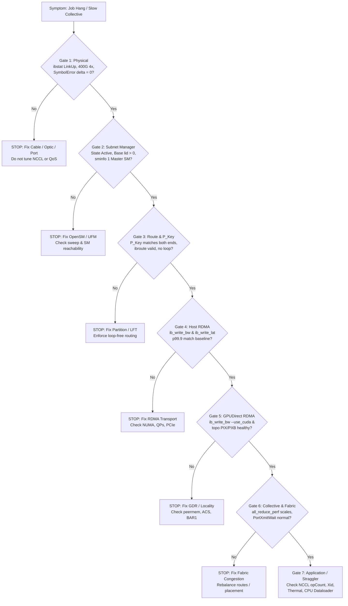
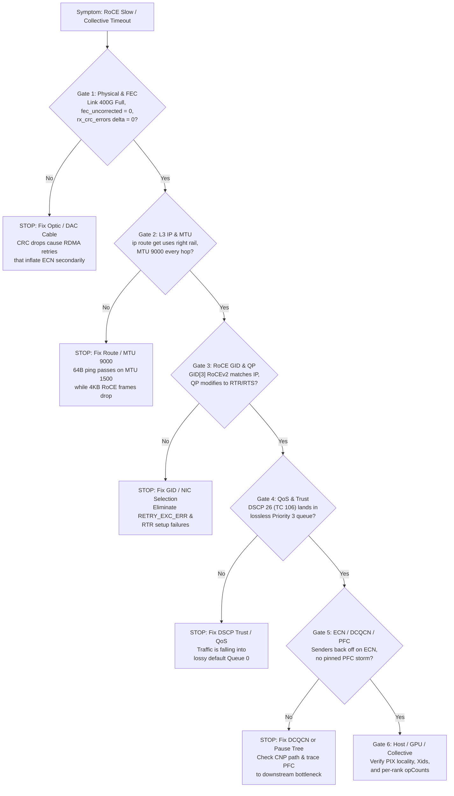
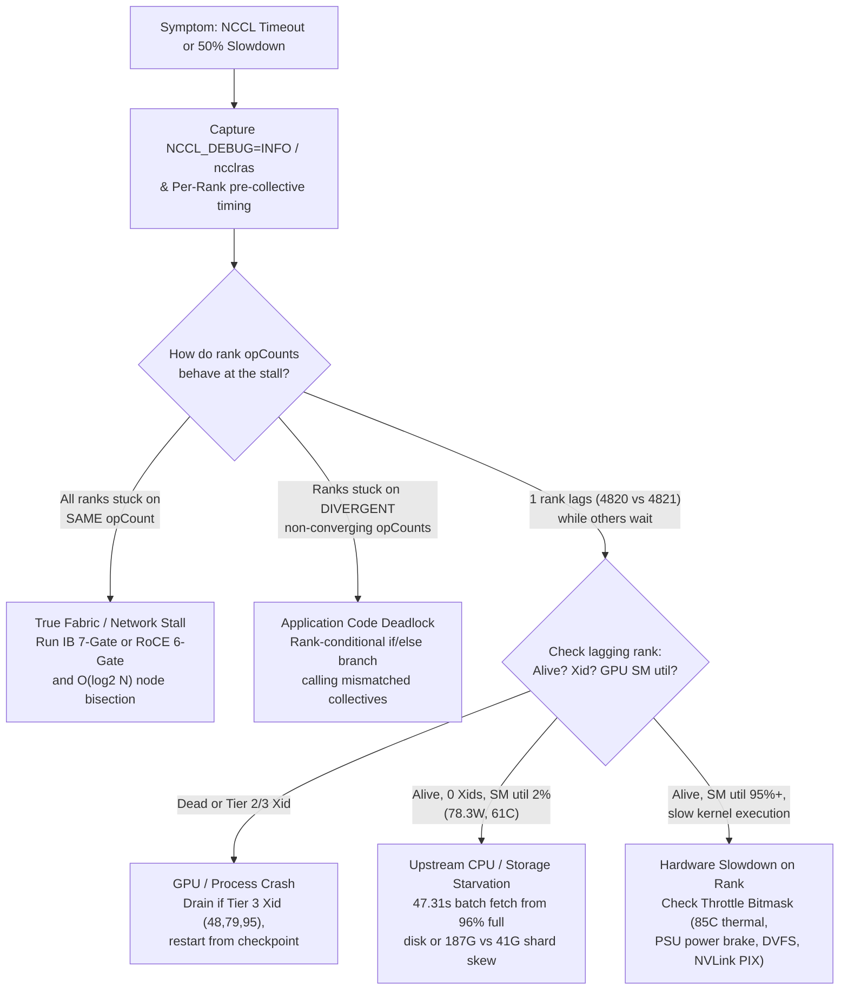

# 12.24 AI networking troubleshooting playbook

| Field | Value |
|---|---|
| Level | Advanced |
| Priority tier | 1 |
| Lab venue | Nebius GPU + Local Python Verification Lab (`code/part12/ai_networking_troubleshooting_lab.py`) |
| Part | Part 12: Complete AI networking |
| Coverage file | `planning/coverage/chapters/12-24.md` |
| Claim & number ledger | `planning/ledgers/12-24.md` |
## Why this matters for AI infrastructure

Picture a thousand-GPU training run that stalls in the middle of a step. The job prints a collective timeout, and half of its bandwidth disappears. Each team looks at the same incident and blames a different layer. The application team sees an NCCL timeout and suspects a broken network switch. The network team sees active link states on every port and points at PyTorch. The platform team sees full GPU utilization in `nvidia-smi` and assumes the server hardware is completely healthy. All three teams are looking at real evidence, and all three are looking at the wrong layer.

A synchronous collective, such as AllReduce, ReduceScatter, AllGather or AllToAll, works like a meeting that cannot start until everyone arrives. Every rank must reach the barrier before any rank can move on. If 999 GPUs arrive on time and one rank lags behind, the other 999 sit idle until the watchdog timer expires. That lagging GPU might have a degraded cable, an unprogrammed InfiniBand port, a jumbo frame mismatch or a pause storm. Just as often, the culprit is a down-trained PCIe slot, a failed NVLink lane, thermal throttling, a bus drop or a full storage shard. The waiting ranks show the symptom, but the cause sits somewhere else, and the timeout message does not say where.

The table below lists the kinds of faults that can stall the same collective. Read the rows as a list of suspects, not as a diagnosis.

```text
Representative Fault Signatures Behind a 1,000-GPU Collective Stall
-----------------------------------------------------------------------------------------------
Symptom / Layer              Representative Telemetry & Numbers
-----------------------------------------------------------------------------------------------
Cluster scale & drop         1,000 GPUs (999 waiting on GPU #842 or rank 3); 8-rail 400 Gbps
                             AllReduce busbw drops by 35% to 80%
Lagging rank delay           10 to 47.31 s delay before init_process_group 1800 s timeout
RoCEv2 & IB fabric faults    DAC cable CRC errors; missing SM sweep (Base lid: 0);
                             MTU mismatch (1500 vs 9000); Priority 3 PFC pause storm
Host PCIe & NVLink faults    PCIe Gen4 x16 (16 GT/s, 20-26 GB/s) down-trained to Gen3 x8
                             (8 GT/s, 2.3 GB/s); NVLink fallback NV12 -> PIX (Xid 74);
                             GPU fallen off bus (Xid 79)
Thermal & storage faults     Thermal throttling (1980 MHz -> 1200 MHz at 85 C);
                             96%-full /data storage shard (480G / 500G; 187G vs 41G skew)
-----------------------------------------------------------------------------------------------
```

Each row in that table can stall the same collective. The symptom alone never tells you which layer failed, so you have to check the layers in order.

A practical way to use the table is to keep a running list while the job is still stuck. Write down every row that could explain what you see, then cross off the rows that the evidence rules out. Most incidents narrow to two or three candidates within the first hour, and that short list is what the gates below are designed to test. A useful analogy is a car that will not start. The dashboard light, the battery, the starter, and the fuel line can all produce the same silence, and a good mechanic tests them one at a time rather than replacing the starter first because it is the part that made the noise.

Guessing makes the outage longer. Tuning NCCL environment variables at random, raising process-group timeouts or disabling flow control on live switches only prolongs the outage.

The pull to guess is strongest at the start of an outage, when everyone wants to look busy and the job owner is asking for an update. Resist it by writing down the next evidence step before anyone touches a setting. A short, boring checklist feels slow for ten minutes, and it usually ends the outage sooner than a fast guess that sends the team in the wrong direction. Clearing port counters or rebooting nodes before you capture evidence destroys the trail you need to prove the root cause. A reliable response follows a deterministic, bottom-up playbook with three rules:

1. Save time-windowed counter deltas and stable hardware identities before you reset any switch port, NIC or training process.
2. Check each layer from the physical wire up to the distributed application, and stop at the first gate that fails.
3. Compare hardware counters, kernel logs and collective progress together, so that one misleading metric cannot send you down the wrong path.

Hold off on every change until the evidence is saved. The rest of the chapter applies those three rules to the InfiniBand fabric, the RoCEv2 fabric, the server hardware, and the collective layer, in that order.

These three rules sound obvious on a quiet afternoon, and they are hard to follow at night when a job is burning money. Print them, or pin them at the top of the incident channel, so the person who joins the call at midnight sees them before anything else.

---

## Prerequisites and outcomes

### Prerequisites

Before you start, make sure these topics from earlier chapters feel familiar. You will meet every one of them in the gates below, and a term that is unclear at that point slows the whole investigation.

- The InfiniBand terms LID, GUID, GID, P_Key, OpenSM, UFM and virtual lane credits.
- The RoCEv2 QoS pieces: DSCP, the Priority 3 lossless queue, ECN, DCQCN, CNP and PFC.
- PCIe and NVLink topologies as `nvidia-smi topo -m` shows them, along with the GPUDirect RDMA mechanisms from Chapter 12.19.
- The standard Linux, RDMA and GPU tools `ibstat`, `perfquery`, `ethtool`, `lspci`, `nvidia-smi` and `dcgmi`.

### Outcomes

This chapter follows an incident from the first ten minutes to the root cause. It starts with the first-ten-minute protocol, which collects a complete and non-destructive evidence bundle across all five infrastructure layers. It then runs the seven-gate InfiniBand decision tree, which isolates down-trained links, unprogrammed ports, physical symbol errors, routing loops and tail-latency spikes. After that comes the six-gate RoCEv2 Ethernet decision tree, which separates physical FEC and CRC losses from MTU drops, GID mismatches and pause storms. Host hardware faults that look like network faults come next, using the three-tier Xid matrix, asymmetric NVLink counters and PCIe link state checks. The last part classifies NCCL collective timeouts by rank operation counts, isolates straggler nodes with a binary search, and sees through the cases where one metric misleads you across layers.

---

## 1. The Layered Troubleshooting Mindset and First-10-Minute Protocol

A distributed training job fails with an error printed by PyTorch. It is tempting to start where the error was printed, but that habit can waste hours of cluster time. The error is the place where the failure became visible, not where it started. Troubleshooting an AI fabric goes faster when you follow the packet and DMA path from the lowest layer you have not yet proven, and then work upward.

### 1.1 Core Axioms of AI Fabric Incident Response

Imagine an on-call engineer who is handed a fresh alert at two in the morning. Five ideas guide almost every production incident on a multi-rail GPU cluster, and they keep that engineer from making the first three bad moves. Keep them in mind before you touch anything.

1. Find the first broken layer, not the last layer that complained. An NCCL timeout is usually the final domino to fall after a lower-layer fault. If a cable is throwing CRC errors, raising the PyTorch process-group timeout only forces a thousand GPUs to burn idle electricity.
2. A basic reachability check is not a performance or RDMA test. On InfiniBand, an active port state does not prove four-lane width, full signaling rate or clean symbol error counters. On RoCEv2 Ethernet, a standard `ping` never creates a Queue Pair, never registers memory and never tests jumbo frames.
3. Host-memory RDMA and GPU-memory RDMA test different hardware paths inside the server. A clean host-to-host `ib_write_bw` run proves that the NICs, cables and switches work. It says nothing about GPUDirect RDMA or PCIe locality. If host-memory RDMA fails, the fault lies below GPUDirect RDMA and NCCL.
4. A pairwise test checks a single path, but a collective loads the whole switching topology at once. Two nodes can pass pairwise GPU RDMA tests at line rate while a multi-node AllReduce degrades by half. Synchronized collective traffic exposes spine oversubscription, hash polarization, adaptive-routing misconfiguration and single-rank stragglers.
5. Save counter deltas before you reset any port, NIC or server. Clearing switch counters with `perfquery -R` or rebooting a node erases accumulated symbol errors, pause counts and kernel Xid precursor chains. Capture a baseline and a follow-up snapshot, so you can compute the exact change over a known time window.

Think of the counters as a diary kept by the hardware. Each entry is a running total, and the story lives in the difference between entries. A reset tears out every page at once, and the next reader sees only blank paper. Keeping the earlier snapshot is what lets you say, with evidence, that the errors began at a particular time and rose at a particular rate.

### 1.2 The First-10-Minute Incident Protocol and Evidence Bundle

In the first ten minutes of an outage, rushed engineers often destroy the evidence they need. Ad-hoc changes to congestion thresholds, or automated job-restart loops, overwrite logs and reset hardware counters before anyone reads them. Without a structured intake, teams trade vague complaints while the faulty cable or degraded GPU stays hidden. Think of it as a crime scene. Everyone wants to tidy up, and the tidying destroys the clues.

A short, disciplined intake turns a chaotic outage into a deterministic investigation.

The intake works because it gives the team one shared picture before anyone starts changing things. Assign one person to keep the notes, one to collect the evidence bundle, and one to talk to the job owner. Splitting the roles keeps the investigation calm, and it keeps the evidence from being lost in the chatter. Work through these four steps in order:

1. Freeze destructive retries. Pause automated job-resubmission loops, and forbid ad-hoc edits to PFC, ECN or NCCL timeout settings.
2. Define the symptom so precisely that someone could prove it wrong. Record the exact rail, rack scope, bandwidth drop percentage and maintenance timestamp.
3. Tie every counter observation to a stable hardware identity: the host name, NIC device, rail index, cable serial and job ranks. An InfiniBand GUID is a permanent hardware identity. A LID is a mutable address that the Subnet Manager reassigns.

Anchor every observation to the identity that will not move. When a LID changes after a fabric sweep, a note that says port 12 had errors becomes wrong, while a note that says the port with this GUID had errors stays correct. The same rule applies on RoCEv2, where the host name, the NIC device name, and the rail index together identify the path.
4. Capture the read-only evidence bundle on both the affected path and an equivalent known-good peer path, so you can compare them side by side.

```text
Example Incident Scope & Hardware Identity Anchor
-----------------------------------------------------------------------------------------------
Vague statement     "InfiniBand / RoCE is slow after maintenance."
Precise statement   "Cross-rack AllReduce busbw on rail 1 fell by 35% after switch maintenance
                     at 14:32:15 UTC, while same-rack traffic and rail 0 remain at baseline."
Hardware anchor     Peer: rack14-node07, NIC mlx5_1, rail 1, switch port swp17,
                    cable: DAC-2m, serial ABC123, Job: training-run-4471, ranks 48-55
Identity rule       Port GUID (0x08c0eb0300f1a2c3) = stable hardware identity
                    Base lid (12) = mutable runtime forwarding address assigned by SM
-----------------------------------------------------------------------------------------------
```

Compare the vague statement with the precise one. Only the precise version tells the next engineer where to look.

The precise version also protects the team from arguing about what happened. When everyone can see the same rail, the same time window, and the same drop, the conversation moves from opinions to checks. A timestamp in UTC is especially useful, because the switch logs, the host logs, and the job logs can then be lined up without guesswork. A note that says the job is slow on rail 1 is hard to act on, while a note that names the rack, the rail, the drop, and the time of the change gives the next engineer a place to start.

| Evidence Layer | InfiniBand Artifacts to Preserve | RoCEv2 / AI Ethernet Artifacts to Preserve | Host / GPU / Collective Artifacts to Preserve |
|---|---|---|---|
| **1. Physical & Link** | `ibstat`, `iblinkinfo`, `perfquery` (`SymbolErrorCounter`, `LinkDownedCounter`, `PortRcvErrors`) | `ethtool <netdev>`, `ethtool -S` (`fec_corrected_blocks`, `fec_uncorrected_blocks`, `rx_crc_errors`), optic temp/DOM | `lspci -vvv` (`LnkCap` vs `LnkSta` speed/width), `dcgmi dmon` (`PCIE_REPLAY_COUNTER`), `dcgmi nvlink -e` |
| **2. Control Plane & L3** | `sminfo` (master SM LID, priority, `activity count`), OpenSM/UFM sweep logs | `ip -br link`, `ip -br addr`, `ip route get <peer-ip>`, end-to-end MTU (`9000`) | `dmesg -T` (Xid codes, DMAR/IOMMU faults, PCIe link down-training) |
| **3. Routing, QoS & Isolation** | `ibroute` switch LFT tables, P_Key tables, SL-to-VL mapping, `PortXmitWait` deltas | `mlnx_qos`, DSCP trust (`26` / ToS `106` -> Prio `3`), `rx_ecn_marked_prio3`, `rx_pfc_prio3`, `tx_pfc_prio3` | `nvidia-smi topo -m` (`NV#`, `PIX`, `PXB`, `PHB`, `SYS`), `MIG Mode` status, `setpci` ACS state |
| **4. Transport & Endpoint** | `ibv_devices`, `ibv_devinfo -v` (`fw_ver`, `max_qp: 262144`, `max_qp_wr: 32768`), `ib_write_bw`, `ib_write_lat` | `rdma link show`, `show_gids` (GID index `3` RoCEv2), `ib_write_bw -d mlx5_X` completion status (`RTR`/`RTS`) | `lsmod` (`nvidia_peermem` / `dma-buf`), `nvidia-smi -q` (BAR1 memory usage, clocks, power, throttle reasons) |
| **5. Collective & App** | `all_reduce_perf` per-rail and cross-rack scaling matrix | `all_reduce_perf` with `NCCL_IB_GID_INDEX`, `NCCL_IB_TC` | `NCCL_DEBUG=INFO` (`NCCL_DEBUG_SUBSYS=COLL,GRAPH`), `ncclras`, per-rank iteration & dataloader timings |

Use the table as a checklist. Each row is one layer, and each cell lists what to save before you change that layer. Collect the whole bundle first, and only then decide what to change. The bundle is cheap to collect and expensive to rebuild once the evidence is gone.

---

## 2. InfiniBand Production Troubleshooting Playbook (7-Gate Decision Tree)

Suppose an InfiniBand training job hangs halfway through a collective, or one that starts slowly and never recovers. Guessing at software flags wastes hours in that moment. A better approach is a strict bottom-up sequence. Check the physical signal, the Subnet Manager, routing, host RDMA, GPUDirect RDMA, fabric congestion and rank health, in that order. Do not move to the next gate until the current one passes with concrete counter evidence. The order matters because each gate assumes the gates below it already passed.



Read the flowchart from the top. Each diamond is a gate, and each stop box names the one thing to fix before you go on.

Think of the flowchart as a series of checkpoints on a road. You do not reach the second checkpoint until the first one stamps your card. A stop box is a place where the road is closed, and the sign tells you what to repair before you can keep driving. The sequence feels slow the first time you use it, but it saves the much longer detour of fixing the wrong layer. The table below gives the same gates in more detail. You can follow the flowchart with a pen, and it will take you to the same place the table does.

| Gate | Primary Diagnostic Tool | Pass Condition (Baseline) | Divergence Signature | Immediate Action |
|---|---|---|---|---|
| **Gate 1: Physical** | `ibstat`, `iblinkinfo`, `perfquery` | `Physical state: LinkUp`, `Rate: 400` (`4x`), `SymbolErrorCounter` & `LinkDownedCounter` delta `= 0` | `Polling`/`Disabled`, `Rate: 200`/`100` (`1x`/`2x`), or rising symbol/CRC errors | Replace/re-seat damaged cable or transceiver; never mask with higher timeouts |
| **Gate 2: Subnet Manager** | `ibstat`, `sminfo` | `State: Active`, `Base lid > 0` (`12`), `SM lid: 1`, `1` `SMINFO_MASTER` with climbing `activity count` | `Physical state: LinkUp` + `State: Initializing` + `Base lid: 0`; `sminfo` timeout or `2` masters | Restore single authoritative OpenSM/UFM master and verify sweep completion |
| **Gate 3: Route & P_Key** | `smpquery pkeys`, `ibroute`, `ibtracert` | Compatible P_Key (`0xffff`) on both ports, valid LFT egress port, acyclic credit graph | QP fails to transition or hangs; incompatible P_Key or cyclic credit loop | Align P_Key partition policy and switch routing engine (`updn`, `ftree`, `dfp`) |
| **Gate 4: Host RDMA** | `ib_write_bw`, `ib_write_lat` | Line-rate host bandwidth (`~392 Gbps` on `400G`), `2B` `p99.9` latency `~1.98 us` | Low host BW or `p99.9` tail spike (`5.77 us`, `~3x` baseline) despite normal `1.58 us` typical | Fix `numactl` CPU/memory binding, check `max_qp` (`262144`), inspect switch hop waits |
| **Gate 5: GPUDirect** | `ib_write_bw --use_cuda`, `nvidia-smi topo -m` | GPU RDMA matches host RDMA (`~390+ Gbps`); GPU-NIC pair is `PIX`/`PXB` | Host RDMA `392 Gbps` but GPU RDMA drops to `~50 Gbps` (`6.25 GB/s`); `SYS`/`PHB` path | Load `nvidia-peermem`/`dma-buf`, disable PCIe ACS (`ECAP_ACS+0x6.w=0000`), enable Large BAR1 |
| **Gate 6: Collective** | `all_reduce_perf`, `perfquery` | Multi-node `busbw` matches baseline across all rails; balanced spine utilization | Pairwise tests pass, but AllReduce drops `35%+`; `PortXmitWait` high with `0` `SymbolErrorCounter` | Trace `PortXmitWait` gradient toward congested cut/receiver; enable adaptive routing / fix placement |
| **Gate 7: App / Rank** | `NCCL_DEBUG=INFO`, `ncclras`, `dmesg`, `dcgmi` | All ranks advance `opCount` in lockstep; SM utilization `>= 90%`; `0` Xid errors | Rank `3` stuck at `opCount 4820` while ranks `0–2` wait at `4821`; or divergent collective calls | Inspect lagging rank for Xid, thermal slowdown, or slow CPU dataloader (`47.31 s` batch fetch) |

Use the table as a lookup during a live incident. The first column names the gate, and the last column gives the first action to take when that gate fails. Keep it open next to the terminal, so you do not have to remember the order under pressure.

### 2.1 Gate 1 vs Gate 2: Port Down, State Initializing, and Reduced Width

Engineers often waste time swapping clean fiber cables when an InfiniBand port is actually waiting on the Subnet Manager. The reverse mistake is just as common. Simple up-or-down monitoring stays green when a damaged optical lane forces a port to negotiate at half or quarter width. Separating physical negotiation from Subnet Manager admission prevents both mistakes. Physical negotiation is the link coming up at the electrical level. Subnet Manager admission is the fabric's own permission for the port to take part in traffic.

In `ibstat`, the physical port state and the logical port state report two separate checkpoints. On a healthy NDR port, `Physical state: LinkUp` and `State: Active` show up together, at full rate and four-lane width.

When you read this output for the first time, look at the rate and the width along with the two state lines. A port can say Active and still be running at reduced speed, and the rate and width are the fields that reveal it. Make it a habit to read all four values, not just the one that says Active. NDR is the 400 Gb/s InfiniBand generation used in this chapter. Read the two lines as two questions. Did the cable and optics come up, and did the fabric admit the port?

A Gate 1 width problem is easy to miss. A damaged lane forces the port to negotiate `State: Active` at `Rate: 200` or `Rate: 100`. If you watch only the state, the monitor stays green, while every collective on that rail runs throttled. The fix is to read the rate and width alongside the state, every time.

If you see a Gate 2 failure, `ibstat` shows `Physical state: LinkUp` next to `State: Initializing` and `Base lid: 0`. Layer 1 signaling has already succeeded, so touching cables or transceivers is wasted effort. Run `sminfo` to confirm that exactly one authoritative `SMINFO_MASTER` exists and that its `activity count` climbs on each sweep. Also verify that the partition policy allows the port. A port that is stuck in Initializing is waiting on the fabric's bookkeeping, not on a dirty connector.

```text
Reference InfiniBand HCA & Port Inventory (ConnectX-7 NDR 400G)
-----------------------------------------------------------------------------------------------
Tool / Check           Verified Baseline Attributes
-----------------------------------------------------------------------------------------------
ibv_devinfo -v         hca_id: mlx5_0, board_id / CA type: MT4129 (ConnectX-7),
                       fw_ver: 28.39.2048, vendor_id: 0x02c9, node_guid: 08c0:eb03:00f1:a2c3,
                       max_qp: 262144, max_qp_wr: 32768, max_sge: 30
ibstat (Healthy)       State: Active, Physical state: LinkUp, Rate: 400 (4x NDR),
                       Base lid: 12, LMC: 0, SM lid: 1, Capability mask: 0x2651e848,
                       Port GUID: 0x08c0eb0300f1a2c3
ibstat (Gate 1 Fault)  Physical state: Polling / Disabled, OR State: Active with Rate: 200 / 100
                       (down-trained to 2x or 1x width due to bad lane)
ibstat (Gate 2 Fault)  Physical state: LinkUp, State: Initializing, Base lid: 0
                       (Layer 1 up, but OpenSM / UFM has not swept and admitted the port)
-----------------------------------------------------------------------------------------------
```

Compare the healthy row with the two fault rows. The physical and logical fields tell you which gate failed. Physical trouble shows up in the first field, and admission trouble shows up in the second, so the two rows point to two different people and two different fixes.

If you are new to InfiniBand, it helps to picture a port as a door with two locks. The physical lock is the cable and the optics. The logical lock is the fabric's permission to let traffic through. A port can have its physical lock open and still be waiting for the logical lock, and that is the situation the Gate 2 row describes.

### 2.2 Gate 4: Reading `ib_write_lat` Tail Percentiles vs Averages

A path can pass a bandwidth check and still stall a large training run. Averages are the trap here. Synchronous collectives across hundreds of GPUs run at the speed of the slowest completion, so tail latency sets the step time. If you look only at typical or average latency in `ib_write_lat`, you miss these intermittent micro-stalls. For example, the degraded path below reports a typical latency of 1.58 us, which looks healthy on its own. A typical value tells you what most messages experience, but a collective waits for the unlucky message, not the typical one.

The comparison below sets the qualification baseline against the degraded incident capture. Both runs send a two-byte RDMA Write over one thousand iterations. An RDMA Write is one machine writing directly into another machine's memory, with no receiver code running in the middle.

```text
# Baseline captured during qualification (2 bytes, 1000 iterations):
 #bytes #iterations    t_min[usec]    t_max[usec]  t_typical[usec]    t_avg[usec]    99% percentile[usec]   99.9% percentile[usec]
 2       1000           1.41           2.03         1.55              1.56            1.71                    1.98

# Degraded path during incident:
 2       1000           1.42           6.81         1.58              1.61            2.90                    5.77
```

The typical and average latency on the degraded path look almost the same as the baseline.

This is why a single latency number can give a false sense of safety. Imagine a bus route where most buses arrive on time, but one in a hundred arrives twenty minutes late. The average wait looks fine, yet a commuter who needs to catch a connecting train has a bad morning. A collective behaves like that commuter. It moves at the pace of the late bus, not the average one, so the tail is the number that predicts the stall. The 99th and 99.9th percentiles tell a different story. They climb to nearly three times the baseline tail, which points to severe micro-stalls. When the tail spikes while the median stays flat, check NUMA CPU pinning, PCIe replay counters and switch hop wait counters. Read the tail percentiles first, and let them point you to the counters to check. A tail that spikes alone usually means something is intermittently blocking a few messages, and the counters will show what.

### 2.3 Gate 1 vs Gate 6: Distinguishing a Bad Cable from Fabric Congestion

You will hear the same complaint whether the cable is marginal or the fabric is congested. Throughput drops under load. Replacing optics on a congested spine wastes hardware, and tuning routing tables on a dirty fiber never fixes bit errors. Comparing the physical error deltas with the wait-counter deltas in `perfquery` separates the two cases quickly. A delta is the change in a counter over a fixed window, so you compare two snapshots taken a known time apart.

| Counter Family (`perfquery` Delta) | Case A: Physical Link Fault (Gate 1) | Case B: Congestion Without Errors (Gate 6) | Case C: Credit Loop / Deadlock (Gate 3/6) |
|---|---|---|---|
| `SymbolErrorCounter` / `PortRcvErrors` | **Rising (`> 0`)** | **Flat (`0`)** | **Flat (`0`)** |
| `LinkDownedCounter` / `LinkRecovers` | **Rising (`> 0`)** or intermittent | **Flat (`0`)** | **Flat (`0`)** |
| `PortXmitWait` | Low or secondary to link recovery | **Elevated (`>> 0`)** along path to hot cut/receiver | **Pinned maximal** in a closed cycle of switch hops |
| `PortXmitDiscards` | May rise during link down events | `0` (unless head-of-line timeout expires) | Rises when switch stall-timeout discards stuck packets |
| **Root Cause & Correct Fix** | Defective optic, dirty fiber, or loose DAC -> **Clean or replace physical media** | Incast, route polarization, or oversubscribed cut -> **Rebalance routes, enable adaptive routing, or adjust placement** | Cyclic buffer dependency across VL buffers -> **Switch to loop-free routing engine (`updn`/`ftree`/`dfp`)** |

Read the table column by column. Case A rises on the error counters, Case B rises only on the wait counters, and Case C pins the wait counter inside a closed loop.

A short walkthrough helps here. Take the two snapshots, subtract the earlier from the later, and write the change next to each counter. Then ask which family moved. If the error family moved, the cable or optic is the suspect and the job should be drained from that link. If only the wait family moved, the traffic is crowding a path that is physically fine. Either way, the decision comes from the deltas, not from the total since boot. Each case has its own fix. If the error counters rise, clean or replace the media first. If only the wait counters rise, rebalance the routes or the placement. Case C is the one that surprises people, because the wait counter keeps climbing even though the physical link is clean. That pattern means the fabric is holding traffic in a loop, and changing the optics would change nothing.

---

## 3. RoCEv2 and AI Ethernet Production Troubleshooting Playbook (6-Gate Decision Tree)

An AI Ethernet fabric runs RoCEv2 over UDP port 4791. The RDMA transport runs directly inside the ConnectX NIC hardware. Standard Linux tools like `tcpdump`, `ping` and `traceroute` see only kernel control packets, so they miss the hardware Queue Pair completions. Operators therefore follow a six-gate decision tree. It inspects NIC and switch counters, starting from the physical FEC blocks and ending at the collective ranks. The tree is built this way because a fault low in the stack, such as a bad cable, can look like a fault high in the stack, such as a slow job.



The flowchart runs the gates in order, and each stop box names the layer to fix first. The table gives the commands and the healthy evidence for every gate. Follow the arrows from the top, and do not skip a gate because it looks clean at first glance.

| RoCEv2 Gate | Key Commands (Read-Only) | Healthy Evidence | Failure Signature |
|---|---|---|---|
| **Gate 1: Physical & FEC** | `ethtool ens1f0`, `ethtool -S ens1f0` | `Speed: 400000Mb/s`, `fec_uncorrected_blocks: 0`, `rx_crc_errors: 0` (`fec_corrected_blocks: 412` or `41200` is normal noise correction) | `fec_uncorrected_blocks: 3` matching `rx_crc_errors: 3` exactly |
| **Gate 2: L3 IP & MTU** | `ip route get <peer>`, `ip link show`, `ping -M do -s 8972 <peer>` | Egress uses intended rail (`ens1f0`), `mtu 9000` on both hosts and all switch ports | `ping -c 3` (`64B`) passes with `0%` loss, but `9000B` jumbo frames silently drop at a `1500` MTU hop |
| **Gate 3: GID & QP State** | `rdma link show`, `show_gids`, `ibv_devinfo`, `ib_write_bw` | `state ACTIVE physical_state LINK_UP`, `GID[3]` (RoCEv2), `ib_write_bw` achieves `392 Gbps` in `2.1 s` with `0` retries | `Failed to modify QP to RTR`, or wrong device (`mlx5_1` vs `mlx5_0`) drops BW from `392 Gbps` to `156 Gbps` with `24` `RETRY_EXC_ERR` completions (`8.2 s`) |
| **Gate 4: QoS & Trust** | `mlnx_qos -i ens1f0`, `ethtool -S` (`rx_prio3_packets`, `tx_prio3_packets`) | `NCCL_IB_TC=106` (DSCP `26`) maps to lossless Priority `3`; `rx_prio3_packets` / `tx_prio3_packets` climb with load | `prio3_packets` delta `= 0` under load; switch ingress port rewrites DSCP to `0` (lossy queue `0`) |
| **Gate 5: ECN / DCQCN / PFC** | `ethtool -S` (`rx_ecn_marked_prio3`, `rx_pfc_prio3`, `tx_pfc_prio3`) | Bounded contention (`2` senders on `400G`): `rx_ecn_marked_prio3: 47829`, `rx_pfc_prio3: 412`, `tx_pfc_prio3: 14`, senders smoothly pace to `89.2 Gbps` and `87.1 Gbps` | ECN marks rise while senders stay at `100%` rate (DCQCN/CNP broken), or PFC pause duration pins queue at `100%` |
| **Gate 6: Host / GPU / App** | `nvidia-smi topo -m`, `ib_write_bw --use_cuda`, `all_reduce_perf` | `GPU0`-`NIC0` = `PIX`, `GPU1`-`NIC1` = `PIX`; per-rail AllReduce balanced | `GPU0`-`NIC1` = `SYS` cross-NUMA hop, or single straggler rank stalls collective |

Keep the healthy-evidence column beside the live output. A gate passes only when the live counters match it. If a counter is missing from the output, treat that gate as not yet proven, not as passed.

A common mistake is to read a gate as passed because the output looks busy. A long screen of numbers can hide a single missing line, and the missing line is often the one that matters. Check each gate against its own row, and write the result down before you move on.

### 3.1 Gate 1 Trap: How Physical CRC Errors Masquerade as an ECN Congestion Problem

If you jump straight to QoS counters when cross-rack RoCEv2 throughput fluctuates and you see rising ECN marks on a switch port, you may miss the real cause. Skip Gate 1 and tune ECN thresholds, and you can spend hours chasing a phantom congestion problem. Uncorrectable bit errors on a degraded cable often trigger those ECN marks indirectly, through RDMA transport retries. The ECN marks are real, but they are a symptom, and the cable is the cause.

Examine the counter snapshot from switch port `swp17`, connected to `rack14-node07` on rail 1:

```text
$ ethtool -S swp17 | egrep "fec_corrected|fec_uncorrected|rx_crc_errors"
     fec_corrected_blocks:    41200        <- normal at 400G; RS-FEC correcting routine signal noise
     fec_uncorrected_blocks:  3            <- nonzero: 3 codewords exceeded FEC correction capability
     rx_crc_errors:           3            <- matches fec_uncorrected_blocks (3 corrupted frames dropped)
```

The second and third lines tell the story. The three uncorrectable blocks match the three CRC errors, so the cable is dropping frames. The 41200 corrected blocks are routine noise at 400G, and they are not the problem. Corrected blocks mean the error correction did its job. Uncorrected blocks mean it could not, and those are the ones that reach the NIC as damage.

When those three corrupted frames fail the receiver CRC check and get dropped, the ConnectX RDMA transport detects sequence gaps. The NIC immediately retransmits the affected RDMA bursts across the same link, which spikes the instantaneous offered load on the switch queue. That burst pushes queue occupancy above the ECN marking threshold and raises `rx_ecn_marked_prio3`. Replacing the faulty two-meter DAC cable fixes both the CRC drops and the secondary ECN marks. A DAC is a direct-attach copper cable, a short fixed cable with the transceivers built in, so the whole cable is the part to replace.

### 3.2 Gate 2 and Gate 3: Why `ping` Works while RoCEv2 Fails (`RTR` and `RETRY_EXC_ERR`)

You may hit a common frustration during cluster bring-up. `ping` succeeds with zero packet loss, yet every RoCEv2 benchmark fails. Standard ICMP echo requests test only small kernel packets. They never exercise RDMA Queue Pair setup, GID tables or jumbo frames. A Queue Pair is the RDMA connection object, and RTR is the state it must reach before it can send. The ping is passing a different test from the one your job needs.

Two distinct failure signatures appear at Gate 2 and Gate 3, even when Layer 1 and `ping` look clean.

The two signatures usually arrive together with a clue about the device. A loud failure at the first burst suggests a configuration mismatch, such as the wrong MTU or the wrong GID. A quiet slowdown suggests a path choice, such as the wrong NIC. Keep that distinction in mind, because it tells you which half of the stack to inspect first. The first is loud. `ib_write_bw` fails at once with `Failed to modify QP to RTR`, or it hangs on the first burst. That happens when a routed hop still uses a 1500-byte MTU and drops 4096-byte RDMA frames, or when the GID index selection does not match. A loud failure is good news in one sense, because it tells you something is wrong right away.

The second is quieter. Binding a process to the wrong NIC on a multi-rail host pushes traffic onto a misaligned subnet path.

A simple way to spot this pattern is to compare two runs that differ in one setting, the NIC they bind to. If the fast run and the slow run match on everything else, the binding is the difference, and the next step is to check which device each rank actually uses. The test does not fail outright. Throughput collapses by more than half, while the NIC logs dozens of `RETRY_EXC_ERR` completions. Quiet failures are the harder ones, because the job keeps running and the numbers simply look bad.

```text
Gate 2 & Gate 3 Failure Signatures (Volume 09 Labs 01-04)
-----------------------------------------------------------------------------------------------
Scenario 1: ping passes (0% loss), QP fails to reach RTR
  $ ping -c3 10.20.8.5 -> 3 packets transmitted, 3 received, 0% packet loss (64B ICMP)
  $ ib_write_bw -d mlx5_0 10.20.8.5
  Local address:  ... GID: 0000:0000:0000:0000:0000:ffff:0a14:040f (10.20.4.15)
  Remote address: ... GID: 0000:0000:0000:0000:0000:ffff:0a14:0805 (10.20.8.5)
  Failed to modify QP to RTR (Caused by MTU 1500 hop vs MTU 9000, GID[0] vs GID[3], or UDP 4791 block)

Scenario 2: Wrong rail / device selection on multi-rail host (Lab 04)
  Healthy baseline (mlx5_0 on ens1f0, 10.20.4.15, GID[3] fe80::0c42:a1ff:fec8:d79b/64):
    392 Gbps in 2.1 s, 0 RETRY_EXC_ERR, rx_packets: 1024567, rx_bytes: 892481382400,
    tx_bytes: 481029120384, fec_corrected_blocks: 412, fec_uncorrected_blocks: 0
  Fault injected (mlx5_1 on ens1f1, 10.20.4.24, GID[3] fe80::0c42:a1ff:fec8:d79d/64):
    156 Gbps in 8.2 s, 24 RETRY_EXC_ERR completions, rx_ecn_marked_prio3 delta = +142
-----------------------------------------------------------------------------------------------
```

Consider Scenario 1, a clean ping with a failed QP transition.

Scenario 1 is worth reading slowly, because it teaches a habit. The ping was clean, and it still told you nothing about the transport. The lesson is to name the test that matches the failure, not the test that happens to be easy to run. Then consider Scenario 2, which compares the healthy device with the wrong one on a multi-rail host, and the bandwidth falls from 392 Gbps to 156 Gbps. Put the two side by side, and the lesson is plain. The loud case tells you the transport never started, and the quiet case tells you the transport started on the wrong path.

### 3.3 Gate 5: ECN and DCQCN Feedback Validation vs Persistent PFC Pause Storms

When lossless RoCEv2 queues congest, you need to tell healthy DCQCN rate pacing apart from a broken feedback loop or a pause storm. Disabling PFC on a live switch during a pause storm is a serious mistake. It instantly turns lossless pauses into massive packet drops. The pause is doing its job, and removing it removes the protection.

In a properly tuned lossless Priority 3 queue, the ECN marking thresholds sit well below the PFC pause threshold. That ordering gives you three patterns to recognize. The ECN marks come first and gently slow the senders. The PFC pause comes later, as a last resort. If the order is reversed, the pauses do all the work and the senders never slow smoothly.

Under healthy, bounded contention, switches mark packets with ECN early. Receivers return CNP frames on Priority 6, and senders cut their rate smoothly, with only brief transient PFC pauses and zero packet drops. If ECN marks climb quickly while senders stay pinned at full line rate, DCQCN is disabled on the NIC or the CNP packets are being dropped. In that case the marks are being sent, but nobody acts on them.

If a persistent PFC pause storm pins upstream ports at full pause duration, keep PFC enabled and trace the pause tree downstream. Follow the chain of paused ports in the direction of data flow until you reach the root congested egress port. That root port sends pauses upstream while receiving zero pauses from its downstream peer. Pauses only travel upstream, so the port that receives none is the one that started the chain.

You can use this rule as a quick test on any chain. Look for the port with the most pauses sent and the fewest pauses received. That port is the candidate root, and you confirm it by checking that its downstream peer is not sending pauses back. A chain can have only one root at the moment you measure it, so a second candidate usually means the measurement window was too short.

```text
Gate 5 Telemetry Signatures: Healthy DCQCN Contention vs Persistent PFC Pause Tree
-----------------------------------------------------------------------------------------------
1. Idle Baseline vs 60-Second Bounded Contention (2 x 400G senders -> 1 receiver, Lab 03)
   Idle baseline:   rx_prio3_packets: 102314,   tx_prio3_packets: 89621
   60s load delta:  rx_prio3_packets: 51234892, tx_prio3_packets: 48901234
                    rx_ecn_marked_prio3: 47829, rx_pfc_prio3: 412, tx_pfc_prio3: 14
   Paced rates:     Sender A = 89.2 Gbps, Sender B = 87.1 Gbps (~176.3 Gbps combined, 0 drops)

2. Downstream PFC Pause-Tree Backtrace (Follow data flow to the root bottleneck port)
   Hop 1 (leafA-swp1, ingress from sender): queue occupancy 95%, tx_pfc: 9000, rx_pfc: 9200
   Hop 2 (spine1-swp8, fabric transit):     queue occupancy 96%, tx_pfc: 9200, rx_pfc: 9500
   Hop 3 (leafB-swp17, egress to receiver): queue occupancy 98% (or 99.0%), tx_pfc: 9500, rx_pfc: 0
   Root cause port: leafB-swp17 (transmitting 9500 pauses upstream while receiving 0 from peer)
-----------------------------------------------------------------------------------------------
```

Read the three blocks as one story. The idle baseline comes first, then the 60-second load delta, then the pause tree.

Notice how the three blocks answer three different questions. The baseline tells you what normal looks like on an idle link. The load delta tells you whether the link stays calm when the traffic is heavy. The pause tree tells you where the pressure starts. You need all three answers before you decide whether DCQCN is working or whether a downstream receiver is the real bottleneck. In the bounded contention run, the two paced senders add up to 176.3 Gbps combined, with zero drops. In the pause tree, `leafB-swp17` is the root cause, because it sends pauses while receiving none from its peer. Each block answers one question. Is the link idle, is it healthy under load, and where does the pause start?

When a pause storm appears, trace the chain to its root port before you change any setting.

Tracing the chain is slower than turning off a feature, but it is the only path that leaves the fabric in a state you understand. A root port can be a receiver that is too slow, a link that has lost a lane, or a sender that is pushing more than its share. Each cause has a different fix, and only the trace tells you which one applies. Write the chain down port by port, so the next engineer can follow your reasoning.

---

## 4. Host, PCIe, DMA Engine, NVLink, and Xid Hardware Triage

After every network gate has passed, a training run can still crash or stall. The fault now most likely lives inside the server hardware. A GPU that falls off the PCIe bus, an NVLink lane that silently degrades to PCIe, or a down-trained PCIe slot will halt every rank in the collective. You need a fast hardware triage workflow. It has to separate recoverable application faults from hardware failures that call for an immediate node drain and an RMA.

Hardware faults are harder to spot than network faults because the server keeps answering. The GPU still responds to a query, the process still holds its memory, and the logs fill with messages that look routine. The triage workflow in this section is designed for that quiet kind of failure, where the first clue is often a number that is slightly wrong. An RMA is a return merchandise authorization, the vendor process for replacing faulty hardware.

### 4.1 The Master 3-Tier Xid Triage Matrix and Precursor Chains

When a GPU crashes, it often prints several Xid messages in the kernel log. An Xid is the numbered error code that the NVIDIA driver writes when the GPU reports a fault. Operators tend to react to the last line and miss the real cause. Free-text error strings also vary across driver releases, so triaging by text can lead to unnecessary RMAs or missed memory corruption. Classify each fault by its numeric Xid code instead. Every code falls into one of three severity tiers, or into the dedicated NVLink triage path. A number is the same on every driver release, which is why it is the safer thing to match.

| Xid Code | Operational Tier | Official Meaning | Typical Root Cause | Immediate Operator Action |
|---|---|---|---|---|
| **`45`** | **Tier 1** (Informational / Self-Healing) | Preemptive cleanup, due to previous errors | Driver cleaned up a context after an earlier fault; **never a root cause by itself** | Inspect `dmesg -T` for the Xid code that fired **immediately before Xid `45`** |
| **`63`** | **Tier 1** (Informational / Self-Healing) | ECC page retirement or row remapping recording event | GPU recorded an HBM address for retirement/remap after a correctable ECC event | Keep running; log and track trailing `7`-day frequency |
| **`92`** | **Tier 1** (Precursor Warning) | High single-bit ECC error rate | Elevated correctable (`SBE`) bit-flip rate in HBM (precursor to uncorrectable fault) | Keep running for now; chart `DCGM_FI_DEV_ECC_SBE_AGG_TOTAL` slope and schedule preventive RMA if accelerating |
| **`13`** | **Tier 2** (Process / App Recoverable) | Graphics Engine Exception | Illegal instruction or out-of-bounds address in a user CUDA kernel | Restart job/process; escalate to hardware only if the **same GPU** repeats Xid `13` across **unrelated applications** |
| **`31`** | **Tier 2** (Process / App Recoverable) | GPU memory page fault | Invalid GPU virtual address access by app, or DMA engine/power glitch if paired with PCIe errors | Check app code first; if recurring alongside DCGM DMA/PCIe errors (`> 10/sec`), reset GPU (`--gpu-reset`) and rescan PCIe |
| **`32`** | **Tier 2** (Process / App Recoverable) | Invalid or corrupted push buffer stream | Command stream corruption between host and GPU over PCIe | Restart process; if paired with PCIe replay counter growth, audit PCIe slot/link |
| **`43`** | **Tier 2** (Process / App Recoverable) | GPU stopped processing | GPU command processor hung, often downstream of a prior Xid | Reset GPU and inspect `dmesg` for preceding Xid |
| **`94`** | **Tier 2** (Process / App Recoverable) | Contained ECC error | Uncorrectable HBM ECC error **contained to a single process**; GPU remains on PCIe bus | Restart the affected application, reset GPU at next maintenance window, and monitor ECC/row-remap counters |
| **`48`** | **Tier 3** (Unrecoverable GPU Fault) | Double Bit ECC Error (uncorrectable) | Uncorrectable double-bit HBM memory error | **Cordon and drain node immediately**; flag job output from window as suspect; retire/RMA GPU |
| **`61`** | **Tier 3** (Unrecoverable GPU Fault) | Internal micro-controller breakpoint/warning | GPU Falcon/GSP firmware-level breakpoint fault | **Cordon and drain node immediately**; escalate to hardware RMA |
| **`62`** | **Tier 3** (Unrecoverable GPU Fault) | Internal micro-controller halt | GPU embedded controller halted | **Cordon and drain node immediately**; escalate to hardware RMA |
| **`64`** | **Tier 3** (Unrecoverable GPU Fault) | ECC page retirement or row remapping failure | Hardware self-healing row-remapper exhausted or failed to commit remap | **Cordon and drain node immediately**; escalate to hardware RMA |
| **`79`** | **Tier 3** (Unrecoverable Bus Fault) | GPU has fallen off the bus | Electrical PCIe link loss or power brownout; GPU disappears from `lspci` | **Cordon and drain node**; attempt soft PCIe `remove`/`rescan` or power-cable reseat; RMA if persistent |
| **`95`** | **Tier 3** (Unrecoverable GPU Fault) | Uncontained ECC error | Uncorrectable ECC error that hardware **could not contain**; memory corruption risk | **Cordon and drain node immediately**; invalidate training checkpoints written during the fault window |
| **`74`** | **Link Triage (NVLink)** | NVLink Error (`fatal error detected on link N`) | Physical NVLink transceiver, baseboard trace, or NVSwitch lane failure | Run `nvidia-smi topo -m` and `dcgmi nvlink -e` on both peer GPUs; reset GPU or RMA faulty transceiver side |

Read the table by tier. Tier 1 codes are mostly informational, Tier 2 codes can usually be recovered by restarting the process, and Tier 3 codes call for draining the node.

Think of the tiers as a traffic light for the node.

Keep the tier list visible on the team wiki or the runbook page, so the on-call engineer does not have to recall it at night. A single misread tier can turn a recoverable event into a lost week of work, so the lookup is cheap insurance. Tier 1 is a yellow light that asks you to watch. Tier 2 is a red light that asks you to restart the process and see whether the problem clears. Tier 3 is a red light that asks you to take the node out of service. The matrix is only useful if you apply the tier honestly, because a restart on a Tier 3 node can make the damage spread to the next job. The NVLink row is its own path, and it starts with a link check rather than a restart. Keep the tier in mind as you read the log, because the tier tells you how much disruption the fix will cause.

If you read only the final Xid line in `dmesg -T`, you miss the cause. The kernel logs the oldest events first, so the chronological sequence shows what set off the crash:

```text
[Tue Aug  4 14:21:52 2026] NVRM: Xid (PCI:0000:0a:00): 92, pid=48213, name=python, High single-bit ECC error rate
[Tue Aug  4 14:21:58 2026] NVRM: Xid (PCI:0000:0a:00): 45, pid=48213, name=python, Preemptive cleanup, due to previous errors
[Tue Aug  4 14:22:03 2026] NVRM: Xid (PCI:0000:0a:00): 79, pid=48213, name=python, GPU has fallen off the bus.

Historical DCGM_FI_DEV_ECC_SBE_AGG_TOTAL slope (2-hour windows over 6 hours prior to crash):
  Window 1: 12 SBE -> Window 2: 31 SBE -> Window 3: 58 SBE -> Window 4: 94 SBE
  Operational threshold: > 10 to 100 SBE errors/hour triggers proactive node drain before Xid 79
```

Xid 92 fired first, as an early warning of accelerating single-bit HBM errors. Six seconds later, the driver logged Xid 45 while it cleaned up the broken context. Five seconds after that, the GPU fell off the bus with Xid 79. Alerting on the accelerating single-bit ECC slope gives you the chance to drain the node before the job crashes.

A single-bit error is one that the memory hardware corrects on the spot. A few are normal. A growing pile of them is a sign that the memory is wearing out, and the rate of growth matters more than the total. That is why the trend, not the count, is the signal to watch. The first line was the warning, and the last line was the crash. Reading the whole chain is what turns a late crash into an early drain.

### 4.2 Silent NVLink Degradation, MIG Verification, and Asymmetric Transceiver Isolation

Suppose a multi-GPU training job runs two to ten times slower than it should, yet every GPU still shows as online. That is a silent NVLink fallback. When an NVLink lane between two GPUs fails, the NVIDIA driver can reroute peer-to-peer traffic over the PCIe bus. The job does not crash, so nothing alarms. The bigger risk comes when an operator opens a hardware RMA without checking both ends of the link, because technicians then often replace the healthy victim GPU. The GPU that reports the fallback is often the one that did nothing wrong.

Follow these three steps to isolate a silent NVLink fallback:

Work through the steps in order, because each one rules out a cause that would make the next step misleading. The first step finds the suspicious pair. The second step rules out a setting that is deliberately on. The third step decides which of the two GPUs owns the fault.

1. Check `nvidia-smi topo -m` across all GPUs on the node. If one GPU pair reports `PIX` while every other pair reports `NV12` or `NV18`, that pair has fallen back to PCIe. Read the matrix as a grid, and look for the one pair that breaks the pattern.
2. Rule out Multi-Instance GPU mode before you open a hardware ticket. MIG mode intentionally disables NVLink peer-to-peer transfers between instances for memory isolation, so check `MIG Mode` in `nvidia-smi -q` first. A setting that is on by design should never reach the RMA queue.
3. Query the per-link NVLink error counters on both peer GPUs with `dcgmi nvlink -e`. The GPU that shows massive CRC, replay and recovery errors owns the failed transceiver. The peer that shows zero errors is a healthy passive victim.

```text
Asymmetric NVLink Transceiver Isolation (4-GPU A100 Node, GPU2 <-> GPU3 Fallback to PIX)
-----------------------------------------------------------------------------------------------
Step 1: Topology check (nvidia-smi topo -m)
  All other pairs = NV12 (12 NVLink 3 links at ~25 GB/s per link = ~600 GB/s bidirectional;
  degraded link = 5 GB/s; failed link = 0 Mbps). GPU2 <-> GPU3 reports PIX (PCIe fallback).

Step 2: Configuration check (nvidia-smi -i 2 -q | grep -A3 "MIG Mode")
  Current: Disabled (confirms PIX is a genuine link failure, not intentional MIG isolation).

Step 3: Per-GPU NVLink counter comparison & kernel log (dcgmi nvlink -e / dmesg -T)
  dmesg -T: NVRM: Xid (PCI:0000:65:00): 74 ... NVLink: fatal error detected on link 2
  GPU 2 (dcgmi nvlink -e -g 2, Link 2 Status: Down):
    184,213 CRC Errors | 92,104 Replay Errors | 12 Recovery Errors -> FAULTY TRANSCEIVER (RMA GPU2)
  GPU 3 (dcgmi nvlink -e -g 3, Link 2 Status: Down):
    0 CRC Errors       | 0 Replay Errors      | 0 Recovery Errors  -> HEALTHY PASSIVE VICTIM
-----------------------------------------------------------------------------------------------
```

When you look at the two GPU readings in step 3 of the block, GPU 2 holds the faulty transceiver, and GPU 3 shows zero errors on the same link.

A useful habit is to take both readings on the same link at the same moment, because the counters keep moving. Keep both readings in the same ticket, and note the time. A vendor technician who sees the two readings side by side can confirm the decision in a few minutes, instead of repeating the whole investigation. Open the RMA for the GPU whose counters are bad, not for the one that only reports the fallback. Writing down both readings in the ticket makes the decision easy for the vendor to verify.

### 4.3 PCIe Link Down-Training, DMA Page Faults, and Non-Disruptive Bus Rescan

A PCIe slot can lose signal quality from dust, thermal expansion, riser wear or auxiliary power ripple. The GPU rarely crashes at once. Instead, the PCIe link state machine down-trains to an older generation and a narrower lane width. The link state machine is the part of the PCIe hardware that negotiates speed and width at startup and can renegotiate later. Host-to-device loading and GPUDirect RDMA throughput can then collapse by up to ninety percent, and the GPU stays online the whole time. A slow GPU that still answers every query is the hardest kind to notice.

Because the slowdown is quiet, the first clue usually comes from a benchmark or from a job that takes longer than last week. When that happens, run the PCIe check before you blame the code, since the code did not change and the slot did.

To confirm a down-trained link, compare `LnkCap` with `LnkSta` in `lspci -vvv`. Then check the replay counters in DCGM and read `dmesg` for IOMMU faults. LnkCap is what the slot can do, and LnkSta is what it is doing now. An IOMMU is the hardware that maps device memory addresses for the CPU and the GPU, and its faults show up as DMAR messages in the log.

- When a slot rated for PCIe Gen4 x16 down-trains to Gen3 x8 alongside rising PCIe replay counts, measured CUDA `bandwidthTest` throughput collapses.
- If `dmesg` logs DMAR faults where the root entry present bit is clear, audit the kernel `iommu=pt` pass-through flags and the PCIe ACS settings.
- Before you reboot an eight-GPU server, drain the node and trigger a non-disruptive Linux sysfs PCIe device remove and bus rescan.

```text
PCIe Down-Training & DMA Triage Reference (Slot 0000:08:00.0)
-----------------------------------------------------------------------------------------------
Metric / Check            Healthy Baseline vs Down-Trained Incident Signature
-----------------------------------------------------------------------------------------------
PCIe Gen4 x16 baseline    Speed 16GT/s, Width x16 (31.5 GB/s / 31.51 GB/s raw unidirectional);
                          CUDA bandwidthTest (33554432 bytes): 20-26 GB/s (22.0 GB/s reference,
                          80% alert threshold = 17.6 GB/s)
PCIe Gen3 x16 baseline    Speed 8GT/s, Width x16; CUDA bandwidthTest: ~10-12 GB/s (12.0 GB/s ref)
Down-trained incident     lspci -s 08:00.0 -vvv -> LnkCap: Speed 16GT/s, Width x16 vs
                          LnkSta: Speed 8GT/s (Gen3), Width x8 (Down-trained)
Replay & BW collapse      DCGM_FI_DEV_PCIE_REPLAY_COUNTER = 127; bandwidthTest = 2.3 GB/s
                          (89.55% / ~90% drop vs 22.0 GB/s Gen4 x16; 80.83% / ~80% drop vs Gen3 x16)
DMAR / IOMMU fault log    DMAR: DRHD: processing fault logged [DMA Read] Request-ID [0000:08:00.0]
                          (PASID 0x0000) Address [0xdeadbeef]
                          (Fault Reason: 02 Present bit in root entry is clear)
-----------------------------------------------------------------------------------------------
```

> **dcgm-exporter 4.9.0 version note.** dcgm-exporter 4.9.0 (2026-11-06) renamed many default metrics and changed some units. For example `DCGM_FI_DEV_GPU_UTIL` (percent) became `DCGM_FI_DEV_GPU_UTIL_RATIO` (0 to 1), and `DCGM_FI_DEV_FB_USED` (MiB) became `DCGM_FI_DEV_FB_USED_BYTES`. The metric names in this chapter are the 4.8.x names. On a 4.9.0 exporter use the [full mapping in 17.4](../part-17-operations/04-dcgm-exporter-and-interpreting-gpu-metrics.md#14-what-dcgm-exporter-490-renamed), and change thresholds together with the unit.

When you read the numbers, start with the Gen4 baseline, then move to the down-trained incident line. The measured 2.3 GB/s sits far below the 22.0 GB/s Gen4 reference.

Compare the two numbers with a simple ratio in your head. The measured throughput is a small fraction of the reference, which tells you the slot is no longer doing what it was built to do. That is a hardware question, and the answer is either a reseat, a riser replacement, or a physical look at the slot, depending on what the rescan shows. Rescan the device, then check whether the link returns to full speed and width. If it does not come back, the slot or the riser needs physical attention, and the node stays drained.

---

## 5. Collective Timeouts, Straggler Bisection, and Cross-Layer Diagnosis

When every lower gate looks clean, or when a thousand-GPU job crashes with an NCCL timeout, you have to look above the switch ports. An NCCL timeout proves only one thing. At least one rank failed to finish a collective before the timer expired. Finding the true cause means checking per-rank operation counts, bisecting the cluster and seeing past metrics that mislead at a single layer. Think of a timeout as a smoke alarm. It tells you a fire exists somewhere in the building, but not which room.



Start at the top of the flowchart. Its first question is how the rank operation counts behave at the stall, because that answer separates network problems from code problems.

A helpful picture is a relay race. Every runner must hand the baton on before the next one can start. If every runner stopped at the same handoff, the track itself has a problem. If only one runner stopped, the trouble is in that runner's leg. The operation counts tell you which of the two pictures you are looking at. If every rank froze at the same count, the collective itself stopped. If the counts differ, one rank took a different path through the code.

| NCCL Timeout / Slowdown Class | `NCCL_DEBUG=INFO` / `ncclras` Signature | Lagging Rank Telemetry (`nvidia-smi` / `dmesg`) | True Root Cause | Correct Remediation |
|---|---|---|---|---|
| **1. Upstream Starved Rank (Straggler)** | Ranks `0–2` reach `opCount 4821` (`count 268435456`); `rank 3` stuck at `opCount 4820` | Process alive, `0` Xids, SM util `2%`, `61 °C`, `78.3 W`; batch fetch takes `47.31 s` | Storage volume `/data` at `96%` (`480G / 500G`) or uneven data sharding (`187G` on `shard-3` vs `41G` on `shard-0`, `4.5x` / `4.56x` skew) | Rebalance dataset shards (`DistributedSampler`), clean `/data/tmp`, add `DataLoader` prefetching |
| **2. Hardware-Throttled Straggler Rank** | Lagging rank reaches collectives `5–10x` slower (`1250.5 ms` vs `125.3 ms` = `10.02x` ratio) | SM util `95%+`, temp `85 °C` (max `87 °C`), clock drops `1980 MHz -> 1200 MHz` (`HW Thermal Slowdown: Active`), or `HW Power Brake` | Seized fan (`0 RPM`), clogged liquid loop (`0.93 °C/s` temp rise vs `0.05–0.10 °C/s` normal), or PSU brownout (`300 W -> 200 W`) | Drain node, service cooling/PSU, or lock clocks (`nvidia-smi -lgc 1980`) if caused by DVFS oscillation (`1980 -> 500 -> 1980 MHz`) |
| **3. Crashed Rank or Fatal Xid** | Lagging rank stops logging `opCount`; peers time out waiting | `dmesg` shows Xid `79` (fell off bus), Xid `48`/`95` (uncorrectable ECC), or Xid `74` (NVLink) | Physical GPU/bus/memory fault killed or hung the rank process | Cordon/drain faulty node, replace with healthy node, and resume job from last checkpoint |
| **4. Code-Level Collective Deadlock** | Ranks freeze permanently at **different, non-converging `opCount`s** or mismatched collective types | Processes alive, GPUs idle waiting in NCCL kernel | Conditional Python bug (`if rank == 0:` calls `all_reduce` twice while `rank != 0` calls it once) | Fix distributed application code so all ranks execute identical collective sequences unconditionally |
| **5. True Fabric / Link Stall** | All ranks reach the **exact same `opCount`** and hang inside the collective | GPUs healthy; `nccl-tests` shows low `busbw` on specific node subset | Switch port down, PFC pause storm, credit loop, or degraded `400G` optic | Isolate bad node(s) via `O(log2 N)` binary search and run the 7-gate IB / 6-gate RoCE playbook |

Each row pairs a symptom with its telemetry, its true cause and its fix. Use the table to match what you see in `NCCL_DEBUG=INFO` to the right row. Match the operation counts first, because the counts are the fastest way to rule out whole families of causes.

### 5.1 Binary-Search Multi-Node Straggler Isolation

When a multi-node training cluster suffers a sudden collective slowdown, testing every server one by one takes far too long. For example, on a 64-node cluster, linear testing needs 64 separate benchmark runs while the rest of the cluster sits idle. A binary search isolates one degraded node or link in logarithmic time. Halving the candidate list each time is what makes it fast. Each test removes half of the remaining suspects, so the number of tests grows very slowly as the cluster grows.

A useful way to remember this is the game of guessing a number by asking yes-or-no questions. Each answer throws away half of the possibilities, so a few questions are enough even for a large range. The same logic finds a bad node among many, as long as each test can tell the two halves apart.

Follow these four steps to isolate the faulty node and GPU quickly:

1. Split the active node list into two equal halves, and run `all_reduce_perf` on each half separately.
2. Compare the measured bus bandwidth of each half with the healthy cluster baseline. The half with the bandwidth drop contains the degraded server or switch link.
3. Split the failing half in two again, and repeat until a single node remains.
4. Inside the isolated node, time each rank before the `dist.all_reduce` barrier, after you call `torch.cuda.synchronize()`. If you measure after `dist.all_reduce`, the barrier wait is included, and every fast GPU looks as slow as the straggler.

The block below carries the arithmetic and the timing proof. A 16-node cluster needs 4 tests, which saves 12. A 64-node cluster needs 6 tests, which saves 58.

```text
Binary-Search Bisection Math & Pre-Collective Timing Proof
-----------------------------------------------------------------------------------------------
1. Multi-Node Bisection Scaling (all_reduce_perf -b 1G -e 1G -f 2 -g 8; 180.0 GB/s baseline)
   16-node cluster (node-11 degraded to 45.0 GB/s): 16 -> 8 -> 4 -> 2 -> 1 = 4 tests (saves 12 tests)
   64-node cluster (node-47 degraded to 42.0 GB/s): 64 -> 32 -> 16 -> 8 -> 4 -> 2 -> 1 = 6 tests (saves 58 tests)

2. Intra-Node Straggler Timing (Must call torch.cuda.synchronize() BEFORE dist.all_reduce)
   GPU 0 pre-barrier compute: 125.3 ms (320 W, 98% SM util)
   GPU 1 pre-barrier compute: 126.1 ms (320 W, 98% SM util)
   GPU 2 pre-barrier compute: 1250.5 ms (10.02x straggler; or 40 W, 5% SM util if starved)
   GPU 3 pre-barrier compute: 124.8 ms (320 W, 98% SM util)
   Lab incident comparison:   Healthy AllReduce = 12 ms vs Straggler AllReduce = 125 ms
   Postmortem timeline:       10:00 normal -> 10:05 (30 ms) -> 10:10 (100 ms) -> 10:15 (300 s timeout)
-----------------------------------------------------------------------------------------------
```

Read the GPU timings as a ratio. GPU 2 takes 1250.5 ms, about ten times the 125 ms that its peers need before the barrier. That gap is the straggler, and it is the reason to measure before the barrier, not after it. Once you have the one slow GPU, the remaining work is to check its node for the hardware faults in section 4.

If the node looks healthy on every check in section 4, do not close the ticket yet. Compare the straggler's timings with the timings from the last good run, because a slow GPU can be a new fault or an old fault that a new workload finally exposed.

Keep the node drained while you check it, and keep the evidence bundle from the first ten minutes next to the new results. Comparing the two makes it clear whether the straggler is a new fault or an old one that only now showed up.

### 5.2 Cross-Layer Diagnosis: When Metrics Lie and Profiler Heisenbugs

Single-layer monitoring dashboards routinely deceive operators during complex distributed training incidents. A GPU can report one hundred percent utilization while sitting idle ninety percent of the time. It can also report full memory usage when most of the pool is empty cache. Even worse, a heavyweight profiler can change the exact timing you are trying to measure. Engineers call that a profiler Heisenbug. The name comes from the idea that observing the system changes it.

Four classic traps show up again and again during incident triage:

- First, `nvidia-smi` GPU utilization only reports whether at least one kernel ran during a sampling window, not how many Streaming Multiprocessors were active. When a slow CPU launches tiny kernels infrequently, `nvidia-smi` reads near one hundred percent while throughput collapses. Use synchronized seven-layer iteration timings and `DCGM_FI_PROF_SM_ACTIVE` to expose the CPU bottleneck.
- Second, `nvidia-smi` memory usage shows the PyTorch caching allocator pool rather than live tensors. Query `torch.cuda.memory_allocated()` for real tensor usage. Also check `nvidia-smi mig -lgi` if an A100 reports zero memory, because MIG mode may be enabled without any instances.
- Third, lower clock speeds automatically reduce power draw, so clock and power numbers alone cannot separate thermal throttling from power capping. Always inspect the throttle reason bitmask in `nvidia-smi -q -d PERFORMANCE`. On passively cooled server GPUs, check the chassis fans with `ipmitool` or Redfish.
- Fourth, heavyweight profilers add substantial overhead that can mask or create timing bugs. Capture an uninstrumented throughput baseline first. Then use low-overhead Python timers or DCGM daemons before you run short `nsys` traces.

```text
Cross-Layer Metric Lies, 7-Layer Breakdown, Heisenbug Overhead & Hardware Stop Thresholds
-----------------------------------------------------------------------------------------------
1. The Utilization Lie & 7-Layer Synchronized Iteration Breakdown
   Kernel launch rate:  50 kernels/sec (CPU-bound) vs 1,000+ kernels/sec expected
   Sample throughput:   200 samples/sec observed vs 1,000 samples/sec expected (80-90% idle in nsys)
   7-Layer breakdown:   data_load_cpu = 450.00 ms (60.0% of 750.00 ms reported / 62.67% of 718.00 ms sum)
                        allreduce_network = 150.00 ms (20.0%), backward_gpu = 60.00 ms (8.0%),
                        forward_gpu = 30.00 ms (4.0%), data_transfer_pcie = 10.00 ms (1.3%),
                        optimizer_gpu = 10.00 ms (1.3%), loss_gpu = 8.00 ms (1.1%)
                        Total GPU compute = 30 + 60 + 8 + 10 = 108.00 ms (14.4% of 750 ms / 15.04% of 718 ms)

2. The Memory Lie & 0 MiB MIG Trap
   nvidia-smi reserved cache: 35 GB / 40 GB (or 80 GB on A100-SXM4-80GB)
   torch.cuda.memory_allocated(): 10 GB live tensors (25 GB is reusable cached pool)
   0 MiB total memory reported: MIG mode enabled with 0 MIG instances created (check nvidia-smi mig -lgi)

3. Thermal vs Power vs DVFS Throttle Bitmask (nvidia-smi -i 0 -q -d PERFORMANCE)
   Ambiguous telemetry: Clock drops 1980 MHz -> 1833 MHz (or 1200 MHz / 405 MHz), power 300 W -> 250 W at 80 C
   Cooling / thermal:   HW/SW Thermal Slowdown: Active (H100 700 W TDP; 85 C throttle -> 15-30% slowdown;
                        87 C max; 95 C critical; SXM/H100 PCIe/L40S report Fan Speed: N/A; check ipmitool)
   Software power cap:  SW Power Cap: Active with power.limit < power.default_limit (200 W < 300 W)
   PSU brownout:        HW Power Brake Slowdown: Active (8 x 700 W GPUs > 6,000 W rack/PSU surge limit)
   DVFS oscillation:    1980 MHz -> 500 MHz -> 1980 MHz (30-40% swing; fix with nvidia-smi -lgc 1980 / -rgc)

4. Profiler Heisenbug Overhead & Actionable Hardware Stop Rules
   Unprofiled baseline: 500 samples/sec (time.perf_counter() adds < 1% overhead)
   nvidia-smi polling:  450 samples/sec (10.0% overhead)
   nsys full profile:   250 samples/sec (50.0% overhead; keep captures to 60 s / 100 iterations)
   Thermal rise rate:   (83 C - 55 C) / 30 s = 0.9333 C/s (0.93 C/s > 0.20 C/s fan fault threshold;
                        normal rise is 0.05-0.10 C/s or 2-3 C/min)
   ECC escalation rate: 1 error at 15:00 -> 50 at 15:30 (100.0/hr) or 50 in 10 min (300.0/hr) ->
                        500 at 16:00; > 10 errors/hour threshold requires immediate job stop and drain
-----------------------------------------------------------------------------------------------
```

Each numbered part of the block matches one of the traps above, and the seven-layer breakdown shows where the time actually goes.

Read the block as a short case file. Each trap leaves a different fingerprint, and the seven-layer breakdown shows where the time went. If the fingerprints agree, you can trust the conclusion. If they disagree, go back and measure again before you change anything. Consider the throttle bitmask and the synchronized timings together before you call a GPU slow. A single reading is a clue, and two readings that agree are the evidence you can act on.

---

## Commands and configurations that matter

The commands in this section are the ones you run on a live node during an incident.

Treat the commands as a menu for each gate, not as a script to run from top to bottom. Pick the group that matches the gate you are on, and skip the rest until the evidence says you need them. Read each block before you paste it, and check each device name against the host in front of you. The comments in the blocks say which steps reset or change state, so do not skip them.

### 1. Non-Destructive Incident Evidence Bundle Collector

Before you reset a switch port, clear a counter or kill a stalled training job, capture a timestamped, read-only baseline. Take it on the affected node and on a healthy reference node, so the two can be compared later. The timestamp matters, because a counter without a time is only half a fact.

```bash
# Run on affected and reference nodes BEFORE resetting ports, clearing counters, or killing ranks (untested here)
INCIDENT_DIR="incident-$(date -u +%Y%m%dT%H%M%SZ)-$(hostname)"
mkdir -p "${INCIDENT_DIR}"/{host,ib,roce,gpu,logs}
date --iso-8601=seconds > "${INCIDENT_DIR}/timestamp_start.txt"

# 1. Host, PCIe, NUMA, and kernel logs (untested here)
uname -a > "${INCIDENT_DIR}/host/uname.txt"
numactl --hardware > "${INCIDENT_DIR}/host/numa.txt" 2>&1
lspci -vvv > "${INCIDENT_DIR}/host/lspci_vvv.txt" 2>&1
dmesg -T | tail -500 > "${INCIDENT_DIR}/logs/dmesg_tail.txt" 2>&1

# 2. InfiniBand inventory, SM state, and counter baseline t0 (untested here)
ibv_devices > "${INCIDENT_DIR}/ib/ibv_devices.txt" 2>&1
ibv_devinfo -v > "${INCIDENT_DIR}/ib/ibv_devinfo.txt" 2>&1
ibstat > "${INCIDENT_DIR}/ib/ibstat.txt" 2>&1
sminfo > "${INCIDENT_DIR}/ib/sminfo.txt" 2>&1
perfquery -x > "${INCIDENT_DIR}/ib/perfquery_t0.txt" 2>&1

# 3. RoCEv2 / Ethernet route, GID, QoS, and counter baseline t0 (untested here)
rdma link show > "${INCIDENT_DIR}/roce/rdma_link.txt" 2>&1
ip -br link show > "${INCIDENT_DIR}/roce/ip_link.txt" 2>&1
ip -br addr show > "${INCIDENT_DIR}/roce/ip_addr.txt" 2>&1
show_gids > "${INCIDENT_DIR}/roce/show_gids.txt" 2>&1
ethtool -S ens1f0 > "${INCIDENT_DIR}/roce/ethtool_ens1f0_t0.txt" 2>&1

# 4. GPU topology, NVLink errors, ECC, and throttle bitmask (untested here)
nvidia-smi topo -m > "${INCIDENT_DIR}/gpu/topo_m.txt" 2>&1
nvidia-smi -q > "${INCIDENT_DIR}/gpu/nvidia_smi_q.txt" 2>&1
dcgmi nvlink -e > "${INCIDENT_DIR}/gpu/dcgmi_nvlink_e.txt" 2>&1
```

The script puts everything under one timestamped folder, grouped into host, InfiniBand, RoCEv2, GPU and log files. Run the same script on both nodes, and keep the two folders side by side so you can compare them. A folder that stays intact after the incident is the record you will hand to the vendor or the team that reviews the outage.

### 2. InfiniBand and RoCEv2 Layer-by-Layer Verification Commands

Work through these commands in gate order, one gate at a time, so you never skip ahead. The first group checks the InfiniBand gates, the second checks RoCEv2, and the last two groups cover host RDMA, GPUDirect RDMA and collectives. Running them out of order can make a later gate look broken when an earlier one is the real fault.

```bash
# Gate 1 & 2 (IB): Verify LinkUp, Active, Rate 400, Base lid > 0, and single Master SM (untested here)
ibstat
sminfo
ibqueryerrors

# Gate 1..5 (RoCEv2): Verify FEC/CRC, MTU 9000, GID[3], and ECN/PFC deltas (untested here)
ethtool -S ens1f0 | egrep "fec_corrected|fec_uncorrected|rx_crc_errors|ecn_marked|pfc_prio|prio3_packets"
ip route get 10.20.8.5
ping -M do -s 8972 -c 3 10.20.8.5

# Gate 4 (Host RDMA): Pin to local NUMA and measure latency percentiles + bandwidth (untested here)
numactl --cpunodebind=0 --membind=0 ib_write_lat -d mlx5_0 -i 1 -F 10.20.8.5
numactl --cpunodebind=0 --membind=0 ib_write_bw -d mlx5_0 -i 1 --report_gbits 10.20.8.5

# Gate 5 (GPUDirect RDMA) & Gate 6 (Multi-GPU / Multi-Node Collectives) (untested here)
ib_write_bw -d mlx5_0 -i 1 --use_cuda=0 --report_gbits 10.20.8.5
/opt/nccl-tests/build/all_reduce_perf -b 128M -e 1G -f 2 -g 8
```

Each command maps to one gate. As you run it, compare the output with the baseline values in the playbook tables, and move to the next gate only after the current one passes. Write down the output of each gate as you go, so the timeline of the investigation survives the incident.

### 3. Host PCIe Rescan, NVLink Isolation, and NCCL Stalled-Rank Triage

These host-level commands cover three jobs. They recover a down-trained PCIe link without a reboot, isolate an asymmetric NVLink transceiver failure, and show per-rank collective operation counts. Each job uses a different tool, so read the comments in the block to see which line does which job.

```bash
# Check PCIe LnkCap vs LnkSta and perform non-disruptive PCIe remove/rescan on a down-trained slot (untested here)
lspci -s 08:00.0 -vvv | grep -A 5 "LnkCap\|LnkSta"
echo 1 > /sys/bus/pci/devices/0000:08:00.0/remove
sleep 2
echo 1 > /sys/bus/pci/rescan
sleep 2
/usr/local/cuda/extras/demo_suite/bandwidthTest --device 0

# Isolate asymmetric NVLink transceiver errors between GPU 2 and GPU 3 (untested here)
nvidia-smi -i 2 -q | grep -A3 "MIG Mode"
dcgmi nvlink -e -g 2
dcgmi nvlink -e -g 3
dmesg -T | grep -i "xid.*74\|nvlink"

# Capture NCCL per-rank opCount progression to find the stalled or deadlocked rank (untested here)
NCCL_DEBUG=INFO NCCL_DEBUG_SUBSYS=COLL,GRAPH python3 train.py 2>&1 | tee nccl_trace.log
grep "AllReduce" nccl_trace.log | tail -40
```

The two `echo 1` lines remove the device and rescan the bus, so drain the node first, as Section 4.3 describes. Removing a device with jobs still running on it can take the rest of the node down with it, so the drain is not optional.

Give the drain time to finish before you run the remove. Check that no training processes are still attached to the GPU, and check the node's job list one more time. Only then run the remove and the rescan, and watch the link state afterward to confirm the result.

---

## How it fails

Each row pairs a symptom you might see on a live cluster with its discriminating evidence and its fix.

Use the table after you have a symptom in hand. Find the row that matches the symptom, then check the discriminating evidence before you act. If the evidence points to a different row, believe the evidence. Several of these symptoms look alike from the outside, so when you read a row, the discriminating evidence column matters most. The symptom tells you where the pain shows up, and the discriminating evidence tells you which cause is responsible.

| Failure Mode | Observed Symptom | Discriminating Evidence | Root Cause | Remediation |
|---|---|---|---|---|
| **1. IB Port `LinkUp` but `State: Initializing`** | Collective fails to initialize on one rail; physical LEDs are green | `ibstat` shows `Physical state: LinkUp`, `State: Initializing`, `Base lid: 0`; `sminfo` times out or shows stale `activity count` | Physical link trained, but OpenSM/UFM has not completed a sweep or admitted the port | Restore single authoritative master SM, verify management reachability and P_Key policy; do not replace cables |
| **2. RoCEv2 Physical CRC Loss Masquerading as ECN Congestion** | Cross-rack throughput fluctuates; `rx_ecn_marked_prio3` rises on `swp17` | `ethtool -S swp17` shows `fec_uncorrected_blocks: 3` matching `rx_crc_errors: 3` (`DAC-2m` `ABC123`) | Uncorrectable physical bit errors drop frames; RDMA burst retransmissions add load and trigger secondary ECN marks | Replace the degraded DAC cable or clean optics first; re-baseline before touching ECN/PFC |
| **3. `ping` Succeeds (`0%` Loss) but `ib_write_bw` Fails at `QP RTR`** | `ping -c 3 10.20.8.5` passes; RoCEv2 verbs fail with `Failed to modify QP to RTR` or `24` `RETRY_EXC_ERR` | `ip link` / switch hop has MTU `1500` vs `9000`, or process selected wrong NIC/GID (`mlx5_1` `10.20.4.24` vs `mlx5_0` `10.20.4.15`, dropping BW `392 -> 156 Gbps`) | `64B` ICMP bypasses QP setup, GID tables, and `9000B` jumbo MTU validation | Enforce MTU `9000` end-to-end and bind each rank to its rail-local `mlx5_X` device and RoCEv2 GID index (`3`) |
| **4. Silent NVLink Fallback to PCIe (`NV12 -> PIX`, Xid `74`)** | `4`-GPU or `8`-GPU training runs `2x–10x` slower without crashing | `nvidia-smi topo -m` shows `PIX` between `GPU2` and `GPU3` (MIG disabled); `dcgmi nvlink -e -g 2` shows `184,213` CRC & `92,104` Replay errors (`GPU3` has `0`); `dmesg` logs Xid `74` | `GPU2`'s NVLink transceiver failed, forcing driver P2P fallback onto PCIe | Drain node, attempt `nvidia-smi -i 2 --gpu-reset`, and RMA `GPU2` (not `GPU3`) if `PIX` persists |
| **5. PCIe Link Down-Training (`Gen4 x16 -> Gen3 x8`) or Xid `79` Bus Drop** | Host-to-device copy slows by `80%–90%` (`2.3 GB/s` vs `22.0 GB/s`), or GPU vanishes from `nvidia-smi` | `lspci -vvv` shows `LnkSta: Speed 8GT/s (Gen3), Width x8 (Down-trained)` with `127` PCIe replays; or `dmesg` logs Xid `79` (`GPU has fallen off the bus`) | Loose riser/slot seating, auxiliary power sag, or Xid `92 -> 45 -> 79` degradation | Cordon node, run soft PCIe `remove`/`rescan`, check power connectors, and RMA if link fails to hold Gen4/Gen5 x16 |
| **6. NCCL Timeout from Upstream Starved Rank (`opCount` Lag)** | Job crashes with `NCCL operation timed out` after `10–30` minutes | `NCCL_DEBUG=INFO` shows `ranks 0–2` at `opCount 4821` and `rank 3` at `opCount 4820`; `rank 3` has `0` Xids, `2%` SM util, `47.31 s` batch fetch (`187G` vs `41G` shard on `96%`-full disk) | Synchronous collective waited for `rank 3`, which was blocked in the CPU/storage data pipeline before calling AllReduce | Fix uneven dataset sharding and storage contention on `rank 3`; never mask by disabling the process-group timeout |

Consider row 2 and the story in Section 3.1. Both show a rising ECN count, but only the CRC counters separate a bad cable from real congestion. Confirm the discriminating evidence first. If the evidence does not match what you see, do not change a setting yet. Holding still for a few minutes while you collect the right counter is almost always cheaper than undoing a wrong change.

---

## Hands-on lab

### Venue and Scope
The verification script `code/part12/ai_networking_troubleshooting_lab.py` uses only the Python standard library. You can run it on any laptop or on a Nebius GPU instance. The hardware commands in earlier sections were not run, and they need live multi-node switch and GPU hardware, so the lab does not run them. The local verification suite validates twenty-eight deterministic checks across all four playbook domains. Each check takes an input from one of the failure stories above and confirms that the playbook reaches the right answer for it.
- InfiniBand seven-gate checks cover port-down detection, reduced lane width and unprogrammed Subnet Manager ports. They also cover credit loops, tail-latency spikes, GPUDirect RDMA fallbacks and clean-link congestion.
- RoCEv2 six-gate and pause-tree checks cover physical FEC and CRC losses, secondary ECN inflation and MTU drops. They also cover GID mismatches, DSCP trust failures, DCQCN pacing and downstream PFC root-port isolation.
- Host Xid, NVLink and PCIe DMA checks cover chronological Xid precursor chains and three-tier severity actions. They also cover asymmetric NVLink transceiver isolation and PCIe Gen3 x8 down-training math.
- NCCL timeout, bisection and cross-layer checks cover starved-rank detection, collective deadlocks and logarithmic node bisection. They also cover seven-layer iteration breakdowns, profiler Heisenbug overheads and thermal and ECC stop rules.

### Running the Lab

Run the script from the repository root. As you read the output, look for the line for each check, followed by a summary. Each line names the playbook section it covers, so a failure points you back to the right part of the chapter.

```bash
python3 -B code/part12/ai_networking_troubleshooting_lab.py
```

The output below is what the lab printed when it was verified here. A passing run ends with 28 passed and 0 failed.

```text
=== Chapter 12.24 Lab: AI Networking Troubleshooting Playbook ===
  [PASS] 1. IB Gate 1 stops immediately when Physical state != LinkUp
  [PASS] 2. IB Gate 1 catches down-trained 200 Gbps (2x) port on a 400 Gbps (4x) NDR link even when State is Active
  ...
  [PASS] 27. Thermal rise (83C - 55C)/30s = 0.9333 C/s (> 0.20 C/s) and ECC rate 50/30min = 100.0/hr (> 10/hr) trigger immediate job stop and GPU drain
  [PASS] 28. Throttle bitmask separates SW Power Cap (200W < 300W default) with 1.0 ECC/hr (warning/monitor) from thermal slowdown

Summary: 28 passed, 0 failed
```

---

## Common first mistakes

Watch for these five mistakes. Each one looks reasonable under pressure, and each one costs real time.

Each mistake below starts from a sensible instinct.

Notice that most of the mistakes are not careless. Each one comes from a reasonable goal, such as clearing a noisy dashboard or ending a slow job. The fix is not to feel bad about the instinct. It is to put the evidence step ahead of the change, so the instinct has to wait its turn. Reset the counter to get a clean view, disable PFC to stop the pauses, or move the timer to stop the timeouts. The instinct is not wrong on its own. The problem is that it destroys the evidence or hides the cause, and the team learns the cause only after the damage is done. They are listed in roughly the order that people make them during an outage, so the first one is usually the earliest trap.

1. Resetting switch ports, clearing counters or rebooting servers before you capture baseline and follow-up counter deltas erases the exact evidence you need for a hardware RMA.
2. Treating an active link state or a clean `ping` test as proof of RDMA health ignores down-trained lanes, tail latency, Queue Pair transitions, GID indices and jumbo frames.
3. Disabling PFC during a pause storm, or raising the collective timeout to thirty minutes, causes massive packet loss or leaves a thousand GPUs idle for hours.
4. Measuring per-rank iteration time after `dist.all_reduce` hides the straggler, because every fast GPU blocks in the barrier while it waits for the slowest rank.
5. Opening an NVLink hardware RMA when `nvidia-smi topo -m` shows `PIX`, without checking MIG mode or comparing both peers in `dcgmi nvlink -e`, risks replacing a healthy GPU.

If you remember only one rule from this chapter, make it the first one: save the evidence before you change anything.

The reason the first rule matters so much is that every other step depends on it. A correct diagnosis needs before-and-after counters, and a vendor RMA needs the same. Without them, even a right guess is hard to prove, and the team ends up arguing about it in the next review. Writing the evidence down as you go also helps the person who takes over the incident at shift change. They can read the record, see what has already been ruled out, and continue from there instead of starting again from the first alert. Every other rule in the chapter depends on having that evidence in hand.

---

## Exercises

Work these through on paper, using only the numbers in each block. Then check your answers against the sections above. Write the answer to each question as a short line, and keep the units with each number.

1. Start with the two-byte `ib_write_lat` capture and the `ibstat` state below. Find which gate failed, and what the tail latency is telling you. Compute the ratio of observed to baseline latency for `t_typical`, `t_avg`, the 99th percentile and the 99.9th percentile. Explain why checking only averages misses the fault. Explain why the 99.9th percentile governs AllReduce step time. On a second node pair, `ibstat` reports the port state shown in the block below. Identify the gate that failed in that state. State your first diagnostic command.

   ```text
   Part (a) ib_write_lat (2 bytes, 1,000 iterations on 400G NDR):
     Baseline: t_min=1.41 us, t_max=2.03 us, t_typical=1.55 us, t_avg=1.56 us, 99%=1.71 us, 99.9%=1.98 us
     Observed: t_min=1.42 us, t_max=6.81 us, t_typical=1.58 us, t_avg=1.61 us, 99%=2.90 us, 99.9%=5.77 us
   Part (b) Second node pair ibstat:
     Physical state: LinkUp | State: Initializing | Base lid: 0
   ```

2. Next, look at the switch port counter deltas and the three-hop PFC pause tree below. Work out the mechanism first, and then find the root port. Explain the exact mechanism by which three physical `fec_uncorrected_blocks` cause `rx_ecn_marked_prio3` to rise. State the correct fix. Identify which port is the root bottleneck of the Priority 3 pause tree. Explain why that port is the root.

   ```text
   Part (a) Switch port swp17 (rack14-node07, mlx5_1, rail 1, DAC-2m serial ABC123):
     fec_corrected_blocks: 41200 | fec_uncorrected_blocks: 3 | rx_crc_errors: 3 | rx_ecn_marked_prio3: 1280
   Part (b) Priority 3 pause tree across 3 hops:
     Hop 1 (leafA-swp1, from sender):  occupancy 95%, tx_pfc: 9000, rx_pfc: 9200
     Hop 2 (spine1-swp8, transit):     occupancy 96%, tx_pfc: 9200, rx_pfc: 9500
     Hop 3 (leafB-swp17, to receiver): occupancy 98%, tx_pfc: 9500, rx_pfc: 0
   ```

3. Read the kernel Xid sequence and the NVLink counter capture below. Classify each of the three Xid codes into Tier 1, Tier 2 or Tier 3. Explain the role of Xid 45. State how the single-bit ECC trend prevents the crash. Determine which GPU should be RMA'd. Explain why the peer GPU is healthy.

   ```text
   Part (a) Kernel log & DCGM SBE history:
     14:21:52 -> Xid 92 | 14:21:58 -> Xid 45 | 14:22:03 -> Xid 79
     DCGM SBE per 2-hour window: 12 -> 31 -> 58 -> 94
   Part (b) 4-GPU A100 node (MIG Mode: Disabled, PIX between GPU2 and GPU3, NV12 elsewhere):
     dcgmi nvlink -e -g 2 (Link 2 Down): 184,213 CRC errors, 92,104 replay errors (Xid 74 in dmesg)
     dcgmi nvlink -e -g 3 (Link 2 Down): 0 CRC errors, 0 replay errors
   ```

4. Examine the PCIe link telemetry for slot `0000:08:00.0` below. Calculate the percentage bandwidth loss of the measured throughput relative to the Gen4 x16 baseline. Calculate the same loss relative to the Gen3 x16 baseline. Write the exact non-disruptive Linux sysfs command sequence to retrain the link without rebooting the host. State the pass criteria.

   ```text
   Slot 0000:08:00.0 Telemetry:
     Rated capability: PCIe Gen4 x16 (16 GT/s, 31.5 GB/s raw, 22.0 GB/s bandwidthTest baseline,
                       17.6 GB/s 80% alert threshold; Gen3 x16 baseline = 12.0 GB/s)
     Observed state:   LnkSta: Speed 8GT/s (Gen3), Width x8 (Down-trained)
                       DCGM replays = 127 | Measured bandwidthTest = 2.3 GB/s
   ```

5. Look at the four-rank timeout telemetry and the cluster bisection parameters below. Diagnose the exact root cause of the collective timeout. Compute the dataset shard imbalance ratio. Compute how many subset benchmark runs binary search needs on the 64-node cluster. Compare that with linear scanning. State how many runs you save.

   ```text
   Part (a) 4-Rank Job Timeout Telemetry:
     NCCL_DEBUG=INFO: ranks 0, 1, 2 at AllReduce opCount 4821; rank 3 stuck at opCount 4820
     rank 3 status:   python train.py alive, 0 Xids, 2% SM util (61 C, 78.3 W), 47.31 s batch fetch
     Storage state:   /data at 96% (480G / 500G); /data/shard-3 = 187G vs /data/shard-0 = 41G
   Part (b) 64-Node Cluster Bisection:
     1 degraded node (node-47) pulls all_reduce_perf busbw from 180.0 GB/s down to 42.0 GB/s
   ```

6. Study the seven-stage iteration profile and the hardware degradation logs below. Compute the sum of the seven stages. Compute the percentage of time spent in CPU data loading compared with total GPU compute. Compute the profiler overhead percentages for both tools. Compute the temperature rise rate in degrees Celsius per second. Compute the single-bit ECC error rate per hour at 15:30. Compare each against its operational threshold.

   ```text
   Part (a) 7-Stage Synchronized Iteration Breakdown & Profiler Throughput:
     data_load_cpu=450.0 ms, allreduce_network=150.0 ms, backward_gpu=60.0 ms, forward_gpu=30.0 ms,
     data_transfer_pcie=10.0 ms, optimizer_gpu=10.0 ms, loss_gpu=8.0 ms
     Throughput: 500 samples/s (unprofiled) -> 450 samples/s (nvidia-smi loop) -> 250 samples/s (nsys)
   Part (b) Thermal & ECC Escalation Telemetry:
     GPU 2 gpu-burn (30 s): 55 C -> 83 C (HW Thermal Slowdown: Active; threshold = 0.20 C/sec)
     ECC SBE accumulation:  1 at 15:00 -> 50 at 15:30 -> 500 at 16:00 (stop threshold = 10 errors/hour)
   ```

---

## Interview angles

1. **An InfiniBand port shows an active state, or an Ethernet port passes `ping` with zero loss, yet the training job fails with an RDMA error. Walk through how you isolate the fault.**
   Start by saying that a healthy-looking link and a passing `ping` only prove basic negotiation and kernel-level reachability. Neither one exercises RDMA. On InfiniBand, read the width and rate in `ibstat` first, because a down-trained port can still say Active. Then compare `perfquery` deltas to separate symbol errors from transmit waits. Run NUMA-pinned `ib_write_lat` next, and look at the 99.9th percentile rather than the average. Finally, confirm GPUDirect RDMA with `ib_write_bw --use_cuda` and `nvidia-smi topo -m`. On RoCEv2, a 64-byte ICMP packet never tests Queue Pair RTR setup, the GID index, 9000-byte jumbo frames, or the Priority 3 lossless queue, so a clean ping is not evidence of a working RDMA path.

2. **How do you distinguish a bad cable or transceiver from fabric congestion on both InfiniBand and RoCEv2?**
   Compare physical error deltas with queue wait or mark deltas, all measured over the same fixed window. On InfiniBand, a rising `PortXmitWait` paired with a flat `SymbolErrorCounter` and a flat `LinkDownedCounter` points to clean-link congestion. Rising symbol errors point to bad physical media. On RoCEv2, `fec_uncorrected_blocks` that match `rx_crc_errors` point to a physical fault, even when `rx_ecn_marked_prio3` climbs as a side effect of the RDMA retries that follow.

3. **A thousand-GPU training job crashes with `NCCL operation timed out`. Why is blaming the network usually wrong, and how do you find the exact culprit?**
   A synchronous collective holds all 999 healthy ranks at the barrier when one straggler never arrives, so the timeout names the whole job rather than the rank that caused it. Start with `NCCL_DEBUG=INFO` or `ncclras` to read each rank's operation count. If every rank froze on the same opCount, the collective itself stalled, which points to the fabric. If the ranks froze on different opCount values, the code took different paths, which points to a conditional Python deadlock. In the case of one rank at opCount 4820 while its peers wait at 4821, check that rank for fatal Xid codes, throttle bitmasks, and slow CPU dataloader fetches.

---

## Checkpoint questions (20)

<details>
<summary>**1. Why should an engineer never clear switch or NIC counters (`perfquery -R`) or reboot a node as the first step during an AI fabric incident?**</summary>

Clearing counters or rebooting wipes out evidence you cannot get back. That includes `SymbolErrorCounter`, `PortXmitWait`, `fec_uncorrected_blocks`, `rx_pfc_prio3` and the kernel Xid precursor sequence. Capture timestamped baseline and follow-up snapshots, and compute the deltas before you change anything.
</details>

<details>
<summary>**2. What does `ibstat` showing `Physical state: LinkUp`, `State: Initializing`, and `Base lid: 0` prove about the InfiniBand stack?**</summary>

`Physical state: LinkUp` tells you that the physical signaling and lane negotiation between the HCA and the switch port succeeded. `State: Initializing` with `Base lid: 0` tells you that the Subnet Manager has not yet swept the fabric, assigned a LID and moved the port to Active. That points to Gate 2.
</details>

<details>
<summary>**3. Why is `State: Active` in `ibstat` insufficient proof that an InfiniBand link is healthy?**</summary>

`State: Active` confirms only that link training and Subnet Manager admission finished. A port with a damaged lane can still show `State: Active` after it negotiates down to half or quarter width. Under load, that same port can also pile up symbol errors and transmit waits.
</details>

<details>
<summary>**4. In `ib_write_lat`, how can a path with normal average latency still cause severe collective slowdowns?**</summary>

Averages smooth over short micro-stalls. Suppose the 99.9th percentile jumps to nearly three times its baseline while typical latency stays flat. The synchronous collective then waits on that slowest tail completion, even though the average still looks fine.
</details>

<details>
<summary>**5. How do `perfquery` counter deltas distinguish an InfiniBand physical cable fault from fabric congestion?**</summary>

Look at the two groups of counters. If `PortXmitWait` rises sharply while `SymbolErrorCounter`, `LinkDownedCounter` and `PortRcvErrors` stay at zero, the link is clean and the problem is congestion at Gate 6. If `SymbolErrorCounter` or `LinkDownedCounter` goes up, the cable or transceiver at Gate 1 is defective, and you repair it first.
</details>

<details>
<summary>**6. On a RoCEv2 fabric, why can `fec_uncorrected_blocks` and `rx_crc_errors` cause `rx_ecn_marked_prio3` to rise on the same port?**</summary>

Once corrupted blocks exceed what FEC can correct, the affected frames fail the CRC check and get dropped. The ConnectX RDMA transport then retransmits the lost bursts. That extra traffic pushes switch queue occupancy above the ECN threshold, so the port starts marking packets.
</details>

<details>
<summary>**7. Why does `ping` succeed with zero packet loss while `ib_write_bw` fails with `Failed to modify QP to RTR`?**</summary>

`ping` sends small 64-byte ICMP packets through the Linux kernel stack. It never registers an RDMA Memory Region, never moves a Queue Pair to `RTR`, and never checks RoCEv2 GID index 3. It also never rides the lossless Priority 3 queue, and it never tests 9000-byte jumbo frames across routed hops.
</details>

<details>
<summary>**8. What happens when a benchmark or training rank on a multi-rail RoCEv2 node selects the wrong NIC device for its target subnet?**</summary>

The physical link and the jumbo MTU stay clean, but Gate 3 fails. Traffic leaves on a misaligned GID and subnet path. ECN marks rise, and the NIC logs repeated `RETRY_EXC_ERR` completions. The test duration stretches fourfold, and bandwidth drops by more than half.
</details>

<details>
<summary>**9. Why must ECN marking thresholds sit below the PFC pause threshold, and what is the first action during a persistent PFC storm?**</summary>

ECN has to mark packets early. That lets receivers return CNP frames, so DCQCN can slow the senders before switch buffers reach the PFC threshold. During a persistent PFC storm, leave PFC on. Trace the paused priority downstream, along the data path, until you reach the root congested egress port.
</details>

<details>
<summary>**10. If host-memory `ib_write_bw` achieves line rate on a 400G link, but `ib_write_bw --use_cuda=0` drops to one-eighth of line rate, which layer is broken?**</summary>

Line-rate host RDMA shows that cables, optics, Subnet Manager routing, QoS and NIC transport at Gates 1 through 4 are healthy. That leaves Gate 5, GPUDirect RDMA and PCIe locality. Check `nvidia-peermem` or `dma-buf`, disable PCIe ACS with `setpci`, verify Large BAR1, and confirm `PIX` or `PXB` NUMA locality.
</details>

<details>
<summary>**11. How does the three-tier Xid classification separate Tier 1, Tier 2, and Tier 3 GPU faults?**</summary>

Tier 1 holds codes like 45, 63 and 92. They are informational or self-healing, so the job keeps running while you track the seven-day trend. Tier 2 holds codes like 13, 31, 32, 43 and 94. They are recoverable at the process level, so you restart the job and watch for repeats. Tier 3 holds codes like 48, 61, 62, 64, 79 and 95. They are unrecoverable GPU or bus failures, and they call for an immediate node drain and a hardware RMA.
</details>

<details>
<summary>**12. In `dmesg -T`, you see Xid 92 followed six seconds later by Xid 45 and five seconds later by Xid 79. How do you interpret this sequence?**</summary>

`dmesg` prints the oldest entries first, so read from the top. Xid 92 came first, as the early warning of accelerating single-bit ECC errors. Xid 45 followed, when the driver cleaned up the context. Xid 79 was the terminal Tier 3 failure, when the GPU fell off the PCIe bus.
</details>

<details>
<summary>**13. `nvidia-smi topo -m` shows `PIX` instead of `NV12` between two GPUs. What check must you run before suspecting broken hardware, and how do you isolate which GPU failed?**</summary>

Start by checking whether MIG mode is on, using `nvidia-smi -q`. MIG mode turns off NVLink peer-to-peer transfers between instances on purpose. Once you confirm MIG is off, run `dcgmi nvlink -e` on both GPUs. The GPU with massive CRC and replay errors, alongside Xid 74, owns the defective transceiver. The peer with zero errors is the healthy victim.
</details>

<details>
<summary>**14. What causes CUDA `bandwidthTest` throughput on a PCIe Gen4 x16 GPU to drop by ninety percent, and how do you recover it without a host reboot?**</summary>

Electrical errors and PCIe replays make the link state machine down-train from Gen4 x16 to Gen3 x8. You can see that in `lspci -vvv`. Drain the workloads from the GPU, then trigger a non-disruptive sysfs PCIe remove and bus rescan. Finally, check that `LnkSta` returns to full speed and width.
</details>

<details>
<summary>**15. How do you distinguish a starved straggler rank, a Python code deadlock, and a true fabric stall using `NCCL_DEBUG=INFO` or `ncclras`?**</summary>

Look at where each rank stops. In a starved or straggler failure, most ranks reach operation count `N` and wait, while one lagging rank sits at `N-1`. In a code-level deadlock, ranks freeze for good at different operation counts, because a conditional branch called mismatched collectives. In a true fabric stall, every rank reaches the same operation count and hangs together inside the network transfer.
</details>

<details>
<summary>**16. Why does measuring per-rank iteration time after `dist.all_reduce` fail to identify a straggler GPU, and how should you instrument the loop instead?**</summary>

`dist.all_reduce` is a synchronous barrier. Fast GPUs wait inside the call for the slowest one, so their step times after the barrier look identical. Call `torch.cuda.synchronize()` first, and record each rank's elapsed compute time before you enter `dist.all_reduce`.
</details>

<details>
<summary>**17. How many `nccl-tests` runs are needed to isolate one degraded node in a 64-node cluster using binary search versus linear scanning?**</summary>

Binary search cuts the candidate pool in half at each step. For a single degraded node in a 64-node cluster, that takes six benchmark runs instead of 64. The logarithmic workflow saves 58 multi-node benchmark runs during an outage.
</details>

<details>
<summary>**18. How can `nvidia-smi` report 100% GPU utilization and 80 GB memory used while the GPU is idle 90% of the time and only 10 GB of tensors exist?**</summary>

`nvidia-smi` utilization records only whether at least one kernel ran during a sampling interval. Slow CPU kernel launches can keep that number near 100% while the Streaming Multiprocessors sit mostly idle. Memory works the same way. `nvidia-smi` shows the reserved PyTorch caching allocator pool, while `torch.cuda.memory_allocated()` reports the tensors that are actually in use.
</details>

<details>
<summary>**19. A GPU's clock and power drop simultaneously at 80 degrees Celsius. Why can't those numbers alone separate thermal throttling from power capping, and what command decides it?**</summary>

A lower clock cuts power draw automatically, whatever caused the clock to drop. So the clock and power readings look the same in both cases. The throttle reason bitmask in `nvidia-smi -q -d PERFORMANCE` settles it. It flags a hardware or software thermal slowdown, a software power cap or a hardware power brake brownout.
</details>

<details>
<summary>**20. What is a profiler Heisenbug, and what are the actionable operational thresholds for temperature rise rate and single-bit ECC escalation?**</summary>

A profiler Heisenbug appears when the tool's own overhead changes the timing you are measuring. Polling with `nvidia-smi` or tracing with `nsys` can cut throughput by ten to fifty percent. For hardware health, a temperature rise rate above 0.20 degrees Celsius per second during `gpu-burn` proves cooling degradation. A single-bit ECC rate above ten errors per hour means you stop the job and drain the node.
</details>

---

## Sources and review notes

### Primary Sources (Read in Full and Migrated)

Twenty-nine mapped source files across Volumes 08, 09 and 20 were read in full and migrated into this playbook. Cross-referenced operator guides and two corpus books were read too. The inventory below stays exactly as written, so you can trace each number back to its origin.

```text
Primary Source Inventory & Key Migrated Artifacts / Numbers
-----------------------------------------------------------------------------------------------
1. NVIDIA Zero-to-Hero Volume 08 (InfiniBand Operations & Production Troubleshooting):
   - nvidia-zero-to-hero/volume-08/index.md
   - nvidia-zero-to-hero/volume-08/chapter-10-production-troubleshooting.md
     (7-step bottom-up InfiniBand workflow, Figure 8.10.1 decision tree, ib_write_lat 2-byte
     1,000-iteration baseline 1.41/2.03/1.55/1.56/1.71/1.98 us vs degraded 1.42/6.81/1.58/1.61/2.90/5.77 us
     tail latency, Common Incidents 1-10 including Port Down, State: Initializing + Base lid: 0,
     reduced rate/width, rising SymbolErrorCounter vs clean-link PortXmitWait congestion, evidence bundle)
   - nvidia-zero-to-hero/volume-08/chapter-12-volume-08-summary.md
     (8-layer summary table, Rate: 400 and SMINFO_MASTER proofs, 512-GPU 16-node 400Gb/s leaf radix sizing)
   - nvidia-zero-to-hero/volume-08/labs/lab-01-inventory-an-infiniband-fabric.md
     (ibv_devices, ibv_devinfo -v on mlx5_0 MT4129 fw_ver: 28.39.2048, node_guid: 08c0:eb03:00f1:a2c3,
     vendor_id: 0x02c9, max_qp: 262144, max_qp_wr: 32768, max_sge: 30; ibstat State: Active,
     Physical state: LinkUp, Rate: 400, Base lid: 12, SM lid: 1, Capability mask: 0x2651e848,
     Port GUID: 0x08c0eb0300f1a2c3)
   - nvidia-zero-to-hero/volume-08/labs/lab-02-benchmark-infiniband-bandwidth-and-latency.md
     (numactl --cpunodebind / --membind host-memory RDMA benchmarking with ib_write_lat and ib_write_bw)
   - nvidia-zero-to-hero/volume-08/labs/lab-03-inspect-subnet-routing-and-counters.md
     (iblinkinfo, ibroute, and ibqueryerrors before/after counter delta correlation)
   - nvidia-zero-to-hero/volume-08/labs/lab-04-troubleshoot-an-infiniband-path.md
     (Process-scoped NUMA/rail fault injection and Healthy / Broken / Repaired verification table)

2. NVIDIA Zero-to-Hero Volume 09 (AI Ethernet & RoCEv2 Production Troubleshooting):
   - nvidia-zero-to-hero/volume-09/chapter-11-production-troubleshooting.md
     (Figure 9.11.1 6-gate RoCEv2 decision tree, first-10-minute protocol, ethtool -S swp17
     fec_corrected_blocks: 41200, fec_uncorrected_blocks: 3, rx_crc_errors: 3 on rack14-node07
     mlx5_1 DAC-2m ABC123 training-run-4471 ranks 48-55 and secondary rx_ecn_marked_prio3 inflation,
     ping -c3 10.20.8.5 0% loss vs ib_write_bw Failed to modify QP to RTR on 0a14:040f -> 0a14:0805,
     persistent PFC downstream pause-tree backtracing, and ECN/DCQCN validation)
   - nvidia-zero-to-hero/volume-09/labs/lab-01-inventory-an-ai-ethernet-path.md
     (ip route get 10.20.8.5 via 10.20.0.1 dev ens1f0 src 10.20.4.15 mtu 9000, Speed: 400000Mb/s,
     nvidia-smi topo -m NV18/PIX/SYS, ethtool -S rx_packets: 1024567, rx_bytes: 892481382400,
     fec_corrected_blocks: 412, fec_uncorrected_blocks: 0)
   - nvidia-zero-to-hero/volume-09/labs/lab-02-validate-roce-addressing-and-mtu.md
     (tx_bytes: 481029120384, MTU 9000 and GID endpoint validation)
   - nvidia-zero-to-hero/volume-09/labs/lab-03-observe-pfc-and-ecn-under-load.md
     (Idle baseline rx_prio3_packets: 102314, tx_prio3_packets: 89621 vs 60 s two-sender contention:
     rx_ecn_marked_prio3: 47829, rx_pfc_prio3: 412, tx_pfc_prio3: 14, rx_prio3_packets: 51234892,
     tx_prio3_packets: 48901234, Sender A: 89.2 Gb/s, Sender B: 87.1 Gb/s = ~176 Gb/s)
   - nvidia-zero-to-hero/volume-09/labs/lab-04-troubleshoot-a-roce-path.md
     (mlx5_0 baseline 392 Gb/s in 2.1 s vs injected mlx5_1 10.20.4.24 fault: 156 Gb/s,
     24 RETRY_EXC_ERR completions in 8.2 s, rx_ecn_marked_prio3: 142)

3. NVIDIA Zero-to-Hero Volume 20 (GPU, Interconnect, Collective & Cross-Layer Troubleshooting):
   - nvidia-zero-to-hero/volume-20/index.md
   - nvidia-zero-to-hero/volume-20/chapter-01-gpu-memory-not-detected.md
     (0 MiB memory reporting from MIG mode without instances or driver/container mismatch)
   - nvidia-zero-to-hero/volume-20/chapter-02-gpu-driver-crash-and-xid-errors.md
     (Xid table 13, 31, 32, 43, 45, 48, 61, 62, 63, 64, 74, 79, 92, 94, 95, 3-tier classification,
     and Xid 92 [14:21:52] -> Xid 45 [14:21:58] -> Xid 79 [14:22:03] with SBE history 12 -> 31 -> 58 -> 94)
   - nvidia-zero-to-hero/volume-20/chapter-03-nccl-timeout-and-collective-communication-failures.md
     (GPU #842 / 1,000-GPU barrier wait, opCount 4821 on ranks 0-2 vs opCount 4820 on rank 3 with
     count 268435456, 2% SM util, 61 C, 78.3 W, 47.31 s batch fetch, /data 480G / 500G 96%,
     187G vs 41G 4.5x shard skew, ncclras in NCCL 2.24+, timeout=datetime.timedelta(seconds=1800),
     and if rank == 0: collective deadlock)
   - nvidia-zero-to-hero/volume-20/chapter-04-nvlink-errors-and-topology-issues.md
     (NV12 vs PIX fallback between GPU2 and GPU3, MIG Mode: Disabled, dcgmi nvlink -e showing
     184,213 CRC / 92,104 replay / 12 recovery errors on GPU2 Link 2 vs 0 on GPU3, Xid 74 on 0000:65:00.0)
   - nvidia-zero-to-hero/volume-20/chapter-05-ecc-errors-and-memory-bit-flips.md
     (Xid 63, 92, 94, 48, 64, 95 ECC workflows and DCGM SBE/DBE rate trends)
   - nvidia-zero-to-hero/volume-20/chapter-06-thermal-throttling-and-cooling-degradation.md
     (H100 700 W, 1980 MHz -> 1833 MHz at 85 C, 15-30% degradation, SXM/PCIe passive Fan Speed: N/A)
   - nvidia-zero-to-hero/volume-20/chapter-07-dma-engine-failures-and-pcie-issues.md
     (Xid 79 vs Xid 31/94/63, DMAR PASID 0x0000 0xdeadbeef, DCGM_FI_DEV_PCIE_REPLAY_COUNTER = 127,
     bandwidthTest 33554432 bytes 2.3 GB/s vs 20-26 GB/s Gen4 x16 [22.0 GB/s ref, 17.6 GB/s 80% threshold]
     and 10-12 GB/s Gen3 x16, lspci Gen3 x8 down-trained, and sysfs remove/rescan)
   - nvidia-zero-to-hero/volume-20/chapter-08-fan-failure-and-cooling-system-degradation.md
     (0 RPM fan failure, 2-3 C/min rise, 95 C critical limit, ipmitool sdr type Fan / Redfish)
   - nvidia-zero-to-hero/volume-20/chapter-09-power-supply-issues-and-brownout-scenarios.md
     (8 x 700 W > 6,000 W surges, 300 W -> 200 W cap, HW Power Brake Slowdown vs SW Power Cap)
   - nvidia-zero-to-hero/volume-20/chapter-10-clock-instability-and-frequency-scaling-problems.md
     (DVFS oscillation 1980 MHz -> 500 MHz -> 1980 MHz, 30-40% swing, 1200 MHz / 405 MHz clocks,
     nvidia-smi -lgc / -rgc)
   - nvidia-zero-to-hero/volume-20/chapter-11-multi-gpu-imbalance-and-straggler-detection.md
     (Pre-all_reduce torch.cuda.synchronize() timing: 125.3 ms, 126.1 ms, 1250.5 ms [10.02x on GPU 2],
     124.8 ms; 320 W 98% SM vs 40 W 5% SM; NVLink 3 25 GB/s vs 5 GB/s degraded / 0 Mbps failed)
   - nvidia-zero-to-hero/volume-20/chapter-12-cross-layer-diagnosis-when-metrics-lie.md
     (Utilization lie 100% at 50 vs 1,000+ kernels/sec and 200 vs 1,000 samples/sec; memory lie
     35 GB / 40 GB reserved vs 10 GB allocated; 7-layer breakdown 450/150/60/30/10/10/8 ms out of 750 ms;
     Heisenbug overhead 500 -> 450 [10%] -> 250 [50%] samples/sec)
   - nvidia-zero-to-hero/volume-20/labs/lab-01-symptom-to-evidence-mapping.md
   - nvidia-zero-to-hero/volume-20/labs/lab-02-root-cause-analysis.md
   - nvidia-zero-to-hero/volume-20/labs/lab-03-production-incident-simulation.md
   - nvidia-zero-to-hero/volume-20/labs/lab-04-postmortem-analysis.md
     (12 ms vs 125 ms AllReduce straggler, 80 C 1980 -> 1833 MHz 300 -> 250 W throttle bitmask proof,
     (83 - 55) / 30 = 0.93 C/s > 0.20 C/s fan degradation threshold, 50 ECC errors in 10 min [300/hr] /
     30 min [100/hr] > 10/hr stop rule, and 10:00 -> 10:05 [30 ms] -> 10:10 [100 ms] -> 10:15 [300 s timeout])

4. Cross-Referenced Volumes & Book Corpus Sources:
   - nvidia-zero-to-hero/volume-07/chapter-05-gpudirect-rdma.md & 02-gpudirect-fabric-operator-masterclass.md
     (setpci ECAP_ACS+0x6.w=0000, ~50 Gbps = 6.25 GB/s bounce-buffer fallback on 400G, NCCL_IB_TC=106,
     NCCL_IB_GID_INDEX=3)
   - nvidia-zero-to-hero/volume-19/chapter-05-network-fabric-validation.md
     (ping -M do -s 8972, all_reduce_perf multi-node fabric validation)
   - AI Data Center Network Design and Technologies (ai-data-center-network-design-and-technologies,
     Chapter 7: RoCEv2 Transport and Congestion Management — ECN Kmin/Kmax below PFC Xoff)
   - AI Systems Performance Engineering (ai-systems-performance-engineering,
     Chapter 4: Tuning Distributed Networking Communication — ibstat, ib_write_bw --use_cuda,
     nvidia-peermem / dma-buf, NCCL_DEBUG=INFO, and multi-rail diagnostics)
-----------------------------------------------------------------------------------------------
```

### Inferences and Unverified Claims Note

- Several CLI examples in this chapter have not been run on live hardware. These include the InfiniBand examples (`ib_core`, `mlx5_core`, `200G` / 400G links, `2.9141`x tail ratio, `984500` ticks, `-works/` runbook paths), the RoCEv2 examples (`RoCEv1`, `Ready-to-Receive`, `CNPs`), the PCIe examples (`H2D` copies) and the GPU inspection examples (`utilization.gpu`, `DCGM_FI_DEV_CLOCK_THROTTLE_REASONS`, `GPU2_transceiver`, `1250` ms straggler). They come from the cited sources as illustrative patterns, so check them on your own hardware before you rely on them.
- The Python diagnostic models and the logarithmic straggler bisection algorithm live in `code/part12/ai_networking_troubleshooting.py` and `code/part12/ai_networking_troubleshooting_lab.py`. They are deterministic encodings of the source decision trees, and the local run gave `28 passed, 0 failed`.

