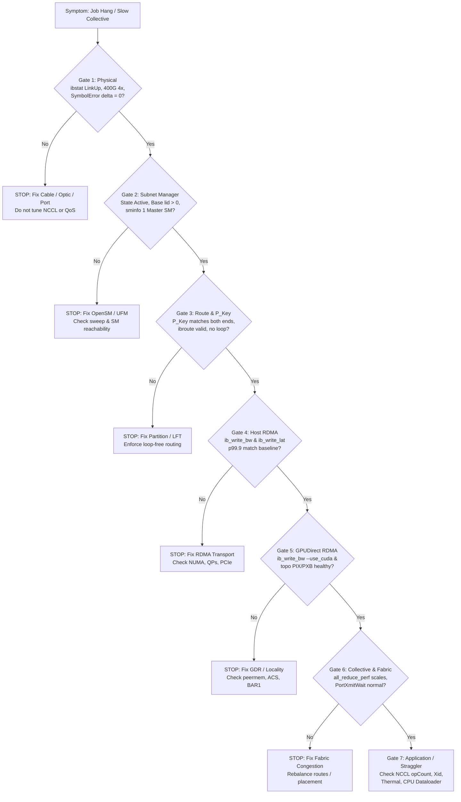
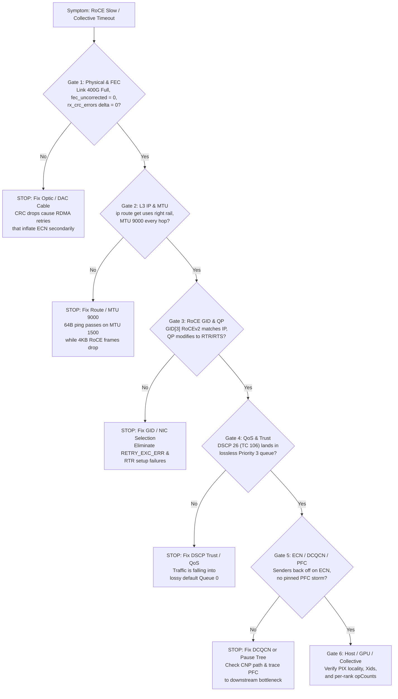
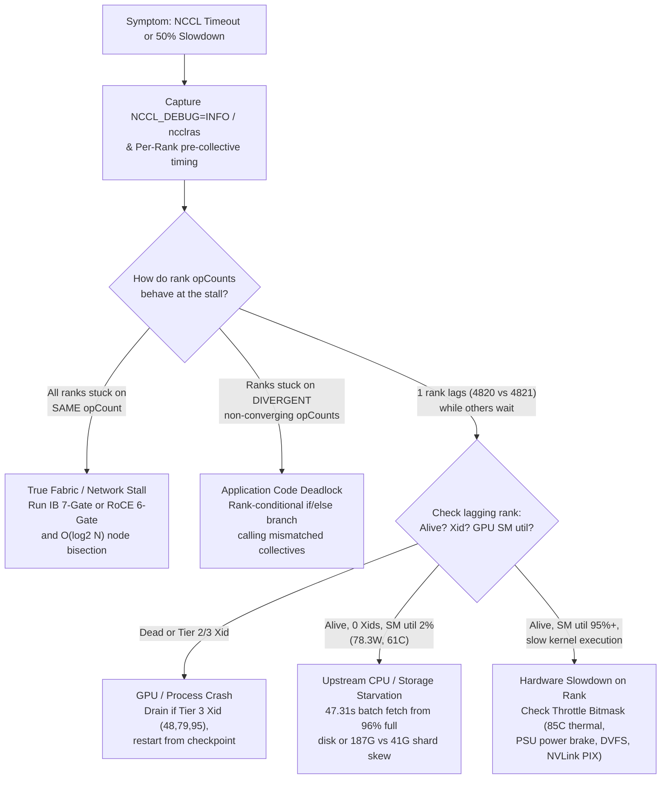

# 12.24 AI networking troubleshooting playbook

| Field | Value |
|---|---|
| Level | Advanced |
| Priority tier | 1 |
| Lab venue | Nebius GPU + Local Python Verification Lab (`code/part12/ai_networking_troubleshooting_lab.py`) |
| Part | Part 12: Complete AI networking |
| Primary sources | NVIDIA Zero-to-Hero Volume 08 (`chapter-10`, `chapter-12`, `index`, `labs/lab-01..04`); Volume 09 (`chapter-11`, `labs/lab-01..04`); Volume 20 (`index`, `chapter-01..12`, `labs/lab-01..04`); *AI Data Center Network Design and Technologies*; *AI Systems Performance Engineering* |
| Coverage file | `planning/coverage/chapters/12-24.md` |
| Claim & number ledger | `planning/ledgers/12-24.md` |

## Why this matters for AI infrastructure

When a thousand-GPU training run stalls mid-step with a collective timeout or loses half its bandwidth, every team blames a different layer. The application team sees an NCCL timeout and suspects a broken network switch. The network team sees active link states on every port and blames PyTorch. Meanwhile, the platform team sees full GPU utilization in `nvidia-smi` and assumes the server hardware is completely healthy.

In a synchronous collective like AllReduce, ReduceScatter, AllGather, or AllToAll, every rank must reach the barrier before any rank can proceed. If 999 GPUs arrive on time and a single rank lags behind, the remaining 999 GPUs sit idle until the watchdog timer expires. That single lagging GPU might suffer from a degraded cable, an unprogrammed InfiniBand port, a jumbo frame mismatch, or a pause storm. Equally often, the culprit is a down-trained PCIe slot, a failed NVLink lane, thermal throttling, a bus drop, or a full storage shard.

```text
Representative Fault Signatures Behind a 1,000-GPU Collective Stall
-----------------------------------------------------------------------------------------------
Symptom / Layer              Representative Telemetry & Numbers
-----------------------------------------------------------------------------------------------
Cluster scale & drop         1,000 GPUs (999 waiting on GPU #842 or rank 3); 8-rail 400 Gbps
                             AllReduce busbw drops by 35% to 80%
Lagging rank delay           10 to 47.31 s delay before init_process_group 1800 s timeout
RoCEv2 & IB fabric faults    DAC cable CRC errors; missing SM sweep (Base lid: 0);
                             MTU mismatch (1500 vs 9000); Priority 3 PFC pause storm
Host PCIe & NVLink faults    PCIe Gen4 x16 (16 GT/s, 20-26 GB/s) down-trained to Gen3 x8
                             (8 GT/s, 2.3 GB/s); NVLink fallback NV12 -> PIX (Xid 74);
                             GPU fallen off bus (Xid 79)
Thermal & storage faults     Thermal throttling (1980 MHz -> 1200 MHz at 85 C);
                             96%-full /data storage shard (480G / 500G; 187G vs 41G skew)
-----------------------------------------------------------------------------------------------
```

Randomly tuning NCCL environment variables, raising process-group timeouts, or disabling flow control on live switches only prolongs the outage. Clearing port counters or rebooting nodes before capturing evidence destroys the forensic trail needed to prove the root cause. Effective incident response requires a deterministic, bottom-up playbook that follows three strict operational rules:
1. Preserve time-windowed counter deltas and stable hardware identities before resetting any switch port, NIC, or training process.
2. Evaluate each infrastructure layer from the physical wire up to the distributed application, stopping at the first gate that fails.
3. Cross-correlate hardware counters, kernel logs, and collective progression so misleading single-layer metrics never send engineers down the wrong path.

## Prerequisites and outcomes

### Prerequisites
- Working familiarity with InfiniBand concepts including LID, GUID, GID, P_Key, OpenSM, UFM, and virtual lane credits from earlier chapters.
- Working familiarity with RoCEv2 QoS mechanisms including DSCP, Priority 3 lossless queues, ECN, DCQCN, CNP, and PFC.
- Understanding of PCIe and NVLink topologies in `nvidia-smi topo -m` and GPUDirect RDMA mechanisms from Chapter 12.19.
- Familiarity with standard Linux, RDMA, and GPU diagnostic utilities including `ibstat`, `perfquery`, `ethtool`, `lspci`, `nvidia-smi`, and `dcgmi`.

### Outcomes
1. Execute the first-ten-minute incident protocol and collect a complete, non-destructive support evidence bundle across all five infrastructure layers.
2. Run the seven-gate InfiniBand decision tree to isolate down-trained links, unprogrammed ports, physical symbol errors, routing loops, and tail-latency spikes.
3. Run the six-gate RoCEv2 Ethernet decision tree to separate physical FEC and CRC losses from MTU drops, GID mismatches, and pause storms.
4. Diagnose host hardware faults that masquerade as network failures using the three-tier Xid matrix, asymmetric NVLink counters, and PCIe link state checks.
5. Classify NCCL collective timeouts by rank operation counts, isolate straggler nodes via binary search, and defeat cross-layer metric lies.

---

## 1. The Layered Troubleshooting Mindset and First-10-Minute Protocol

When a distributed training job fails, starting at the highest software layer that printed an error message wastes hours of cluster time. Troubleshooting an AI fabric is fastest when operators follow the packet and DMA path from the lowest unproven hardware layer upward.

### 1.1 Core Axioms of AI Fabric Incident Response

Every production incident on a multi-rail GPU cluster is governed by five foundational engineering truths:
1. Locate the first broken layer rather than the last layer that complained. An NCCL timeout is almost always the final domino to fall after a lower-layer hardware or transport fault. Raising the PyTorch process-group timeout while a cable is throwing CRC errors only forces a thousand GPUs to burn idle electricity.
2. Basic reachability is never a performance or RDMA transport test. On InfiniBand, an active port state does not prove four-lane width, full signaling rate, or clean symbol error counters. On RoCEv2 Ethernet, a standard `ping` test never creates a Queue Pair, never registers memory, and never tests jumbo frames.
3. Host-memory RDMA and GPU-memory RDMA validate completely different hardware paths inside the server. A clean host-to-host `ib_write_bw` run proves the NICs, cables, and switches work, but says nothing about GPUDirect RDMA or PCIe locality. Conversely, if host-memory RDMA fails, the fault lies below GPUDirect RDMA and NCCL.
4. Pairwise tests validate a single path, whereas collective operations load the entire switching topology simultaneously. Two nodes can pass pairwise GPU RDMA tests at line rate while a multi-node AllReduce degrades by half. Synchronized collective traffic exposes spine oversubscription, hash polarization, adaptive-routing misconfiguration, and single-rank stragglers.
5. Preserve counter deltas before resetting any port, NIC, or server. Clearing switch counters with `perfquery -R` or rebooting a node erases accumulated symbol errors, pause counts, and kernel Xid precursor chains. Always capture baseline and follow-up snapshots so you can compute the exact change over a known time window.

### 1.2 The First-10-Minute Incident Protocol and Evidence Bundle

During the first ten minutes of an outage, rushed engineers often destroy the exact evidence needed to isolate the fault. Ad-hoc changes to congestion thresholds or automated job-restart loops overwrite logs and reset hardware counters before anyone reads them. Without a structured intake protocol, teams trade vague complaints while the faulty cable or degraded GPU remains hidden.

Discipline during the opening minutes turns a chaotic outage into a deterministic engineering investigation:
1. Freeze destructive retries by pausing automated job-resubmission loops and forbidding ad-hoc edits to PFC, ECN, or NCCL timeout settings.
2. Define the symptom with falsifiable precision by recording the exact rail, rack scope, bandwidth drop percentage, and maintenance timestamp.
3. Anchor every counter observation to stable hardware identities including the host name, NIC device, rail index, cable serial, and job ranks. Remember that an InfiniBand GUID is a permanent hardware identity, whereas a LID is a mutable address reassigned by the Subnet Manager.
4. Capture the read-only evidence bundle across both an affected path and an equivalent known-good peer path for side-by-side comparison.

```text
Example Incident Scope & Hardware Identity Anchor
-----------------------------------------------------------------------------------------------
Vague statement     "InfiniBand / RoCE is slow after maintenance."
Precise statement   "Cross-rack AllReduce busbw on rail 1 fell by 35% after switch maintenance
                     at 14:32:15 UTC, while same-rack traffic and rail 0 remain at baseline."
Hardware anchor     Peer: rack14-node07, NIC mlx5_1, rail 1, switch port swp17,
                    cable: DAC-2m, serial ABC123, Job: training-run-4471, ranks 48-55
Identity rule       Port GUID (0x08c0eb0300f1a2c3) = stable hardware identity
                    Base lid (12) = mutable runtime forwarding address assigned by SM
-----------------------------------------------------------------------------------------------
```

| Evidence Layer | InfiniBand Artifacts to Preserve | RoCEv2 / AI Ethernet Artifacts to Preserve | Host / GPU / Collective Artifacts to Preserve |
|---|---|---|---|
| **1. Physical & Link** | `ibstat`, `iblinkinfo`, `perfquery` (`SymbolErrorCounter`, `LinkDownedCounter`, `PortRcvErrors`) | `ethtool <netdev>`, `ethtool -S` (`fec_corrected_blocks`, `fec_uncorrected_blocks`, `rx_crc_errors`), optic temp/DOM | `lspci -vvv` (`LnkCap` vs `LnkSta` speed/width), `dcgmi dmon` (`PCIE_REPLAY_COUNTER`), `dcgmi nvlink -e` |
| **2. Control Plane & L3** | `sminfo` (master SM LID, priority, `activity count`), OpenSM/UFM sweep logs | `ip -br link`, `ip -br addr`, `ip route get <peer-ip>`, end-to-end MTU (`9000`) | `dmesg -T` (Xid codes, DMAR/IOMMU faults, PCIe link down-training) |
| **3. Routing, QoS & Isolation** | `ibroute` switch LFT tables, P_Key tables, SL-to-VL mapping, `PortXmitWait` deltas | `mlnx_qos`, DSCP trust (`26` / ToS `106` -> Prio `3`), `rx_ecn_marked_prio3`, `rx_pfc_prio3`, `tx_pfc_prio3` | `nvidia-smi topo -m` (`NV#`, `PIX`, `PXB`, `PHB`, `SYS`), `MIG Mode` status, `setpci` ACS state |
| **4. Transport & Endpoint** | `ibv_devices`, `ibv_devinfo -v` (`fw_ver`, `max_qp: 262144`, `max_qp_wr: 32768`), `ib_write_bw`, `ib_write_lat` | `rdma link show`, `show_gids` (GID index `3` RoCEv2), `ib_write_bw -d mlx5_X` completion status (`RTR`/`RTS`) | `lsmod` (`nvidia_peermem` / `dma-buf`), `nvidia-smi -q` (BAR1 memory usage, clocks, power, throttle reasons) |
| **5. Collective & App** | `all_reduce_perf` per-rail and cross-rack scaling matrix | `all_reduce_perf` with `NCCL_IB_GID_INDEX`, `NCCL_IB_TC` | `NCCL_DEBUG=INFO` (`NCCL_DEBUG_SUBSYS=COLL,GRAPH`), `ncclras`, per-rank iteration & dataloader timings |

---

## 2. InfiniBand Production Troubleshooting Playbook (7-Gate Decision Tree)

When an InfiniBand training job hangs, slows down, or fails to initialize, guessing at software flags wastes hours. Operators need a strict bottom-up sequence that checks physical signaling, subnet management, routing, host RDMA, GPUDirect RDMA, fabric congestion, and rank health. Do not advance to the next gate until the current gate passes with concrete counter evidence.



| Gate | Primary Diagnostic Tool | Pass Condition (Baseline) | Divergence Signature | Immediate Action |
|---|---|---|---|---|
| **Gate 1: Physical** | `ibstat`, `iblinkinfo`, `perfquery` | `Physical state: LinkUp`, `Rate: 400` (`4x`), `SymbolErrorCounter` & `LinkDownedCounter` delta `= 0` | `Polling`/`Disabled`, `Rate: 200`/`100` (`1x`/`2x`), or rising symbol/CRC errors | Replace/re-seat damaged cable or transceiver; never mask with higher timeouts |
| **Gate 2: Subnet Manager** | `ibstat`, `sminfo` | `State: Active`, `Base lid > 0` (`12`), `SM lid: 1`, `1` `SMINFO_MASTER` with climbing `activity count` | `Physical state: LinkUp` + `State: Initializing` + `Base lid: 0`; `sminfo` timeout or `2` masters | Restore single authoritative OpenSM/UFM master and verify sweep completion |
| **Gate 3: Route & P_Key** | `smpquery pkeys`, `ibroute`, `ibtracert` | Compatible P_Key (`0xffff`) on both ports, valid LFT egress port, acyclic credit graph | QP fails to transition or hangs; incompatible P_Key or cyclic credit loop | Align P_Key partition policy and switch routing engine (`updn`, `ftree`, `dfp`) |
| **Gate 4: Host RDMA** | `ib_write_bw`, `ib_write_lat` | Line-rate host bandwidth (`~392 Gbps` on `400G`), `2B` `p99.9` latency `~1.98 us` | Low host BW or `p99.9` tail spike (`5.77 us`, `~3x` baseline) despite normal `1.58 us` typical | Fix `numactl` CPU/memory binding, check `max_qp` (`262144`), inspect switch hop waits |
| **Gate 5: GPUDirect** | `ib_write_bw --use_cuda`, `nvidia-smi topo -m` | GPU RDMA matches host RDMA (`~390+ Gbps`); GPU-NIC pair is `PIX`/`PXB` | Host RDMA `392 Gbps` but GPU RDMA drops to `~50 Gbps` (`6.25 GB/s`); `SYS`/`PHB` path | Load `nvidia-peermem`/`dma-buf`, disable PCIe ACS (`ECAP_ACS+0x6.w=0000`), enable Large BAR1 |
| **Gate 6: Collective** | `all_reduce_perf`, `perfquery` | Multi-node `busbw` matches baseline across all rails; balanced spine utilization | Pairwise tests pass, but AllReduce drops `35%+`; `PortXmitWait` high with `0` `SymbolErrorCounter` | Trace `PortXmitWait` gradient toward congested cut/receiver; enable adaptive routing / fix placement |
| **Gate 7: App / Rank** | `NCCL_DEBUG=INFO`, `ncclras`, `dmesg`, `dcgmi` | All ranks advance `opCount` in lockstep; SM utilization `>= 90%`; `0` Xid errors | Rank `3` stuck at `opCount 4820` while ranks `0–2` wait at `4821`; or divergent collective calls | Inspect lagging rank for Xid, thermal slowdown, or slow CPU dataloader (`47.31 s` batch fetch) |

### 2.1 Gate 1 vs Gate 2: Port Down, State Initializing, and Reduced Width

Engineers frequently waste time swapping clean fiber cables when an InfiniBand port is actually waiting on the Subnet Manager. Conversely, simple up/down monitoring stays green when a damaged optical lane causes a port to negotiate at half or quarter width. Separating physical layer negotiation from logical Subnet Manager admission prevents both mistakes.

In `ibstat`, physical port state and logical port state report two separate hardware checkpoints:
- On a healthy NDR port, `Physical state: LinkUp` and `State: Active` appear together at full rate and four-lane width.
- In a Gate 1 width degradation, a damaged lane causes the port to negotiate `State: Active` at `Rate: 200` or `Rate: 100`. Naive monitoring stays green because the state is active, while every collective using that rail is throttled.
- In a Gate 2 failure, `Physical state: LinkUp` appears alongside `State: Initializing` and `Base lid: 0`. Because Layer 1 signaling has already succeeded, touching cables or transceivers is wasted effort. Run `sminfo` to confirm that one authoritative `SMINFO_MASTER` exists and its `activity count` increments on each sweep. Also verify that partition policy permits the port.

```text
Reference InfiniBand HCA & Port Inventory (ConnectX-7 NDR 400G)
-----------------------------------------------------------------------------------------------
Tool / Check           Verified Baseline Attributes
-----------------------------------------------------------------------------------------------
ibv_devinfo -v         hca_id: mlx5_0, board_id / CA type: MT4129 (ConnectX-7),
                       fw_ver: 28.39.2048, vendor_id: 0x02c9, node_guid: 08c0:eb03:00f1:a2c3,
                       max_qp: 262144, max_qp_wr: 32768, max_sge: 30
ibstat (Healthy)       State: Active, Physical state: LinkUp, Rate: 400 (4x NDR),
                       Base lid: 12, LMC: 0, SM lid: 1, Capability mask: 0x2651e848,
                       Port GUID: 0x08c0eb0300f1a2c3
ibstat (Gate 1 Fault)  Physical state: Polling / Disabled, OR State: Active with Rate: 200 / 100
                       (down-trained to 2x or 1x width due to bad lane)
ibstat (Gate 2 Fault)  Physical state: LinkUp, State: Initializing, Base lid: 0
                       (Layer 1 up, but OpenSM / UFM has not swept and admitted the port)
-----------------------------------------------------------------------------------------------
```

### 2.2 Gate 4: Reading `ib_write_lat` Tail Percentiles vs Averages

A network path can pass basic bandwidth checks and show normal average latency while still stalling large collective runs. Engineers who look only at typical or average latency in `ib_write_lat` miss intermittent hardware micro-stalls. Because synchronous collectives across hundreds of GPUs run at the speed of the slowest completion, tail latency governs step time.

Compare the qualification baseline against the degraded incident capture for a two-byte RDMA Write test over one thousand iterations:

```text
# Baseline captured during qualification (2 bytes, 1000 iterations):
 #bytes #iterations    t_min[usec]    t_max[usec]  t_typical[usec]    t_avg[usec]    99% percentile[usec]   99.9% percentile[usec]
 2       1000           1.41           2.03         1.55              1.56            1.71                    1.98

# Degraded path during incident:
 2       1000           1.42           6.81         1.58              1.61            2.90                    5.77
```

Here, typical latency and average latency on the degraded path look nearly identical to the qualification baseline. However, the 99th percentile and the 99.9th percentile reveal severe micro-stalls that reach nearly three times the baseline tail. Whenever tail latency spikes while median latency stays flat, check NUMA CPU pinning, PCIe replay counters, and switch hop wait counters.

### 2.3 Gate 1 vs Gate 6: Distinguishing a Bad Cable from Fabric Congestion

Both a marginal physical cable and fabric congestion produce the exact same complaint from training users: throughput drops under load. However, replacing optics on a congested spine wastes hardware, and tuning routing tables on a dirty fiber never fixes bit errors. Comparing physical error deltas against credit-wait deltas in `perfquery` separates the two conditions immediately.

| Counter Family (`perfquery` Delta) | Case A: Physical Link Fault (Gate 1) | Case B: Congestion Without Errors (Gate 6) | Case C: Credit Loop / Deadlock (Gate 3/6) |
|---|---|---|---|
| `SymbolErrorCounter` / `PortRcvErrors` | **Rising (`> 0`)** | **Flat (`0`)** | **Flat (`0`)** |
| `LinkDownedCounter` / `LinkRecovers` | **Rising (`> 0`)** or intermittent | **Flat (`0`)** | **Flat (`0`)** |
| `PortXmitWait` | Low or secondary to link recovery | **Elevated (`>> 0`)** along path to hot cut/receiver | **Pinned maximal** in a closed cycle of switch hops |
| `PortXmitDiscards` | May rise during link down events | `0` (unless head-of-line timeout expires) | Rises when switch stall-timeout discards stuck packets |
| **Root Cause & Correct Fix** | Defective optic, dirty fiber, or loose DAC -> **Clean or replace physical media** | Incast, route polarization, or oversubscribed cut -> **Rebalance routes, enable adaptive routing, or adjust placement** | Cyclic buffer dependency across VL buffers -> **Switch to loop-free routing engine (`updn`/`ftree`/`dfp`)** |

---

## 3. RoCEv2 and AI Ethernet Production Troubleshooting Playbook (6-Gate Decision Tree)

On an AI Ethernet fabric running RoCEv2 over UDP port 4791, RDMA transport executes directly inside the ConnectX NIC hardware. Standard Linux tools like `tcpdump`, `ping`, and `traceroute` see only kernel control packets and miss hardware Queue Pair completions. Operators must follow a six-gate decision tree that inspects NIC and switch counters from physical FEC blocks up to collective ranks.



| RoCEv2 Gate | Key Commands (Read-Only) | Healthy Evidence | Failure Signature |
|---|---|---|---|
| **Gate 1: Physical & FEC** | `ethtool ens1f0`, `ethtool -S ens1f0` | `Speed: 400000Mb/s`, `fec_uncorrected_blocks: 0`, `rx_crc_errors: 0` (`fec_corrected_blocks: 412` or `41200` is normal noise correction) | `fec_uncorrected_blocks: 3` matching `rx_crc_errors: 3` exactly |
| **Gate 2: L3 IP & MTU** | `ip route get <peer>`, `ip link show`, `ping -M do -s 8972 <peer>` | Egress uses intended rail (`ens1f0`), `mtu 9000` on both hosts and all switch ports | `ping -c 3` (`64B`) passes with `0%` loss, but `9000B` jumbo frames silently drop at a `1500` MTU hop |
| **Gate 3: GID & QP State** | `rdma link show`, `show_gids`, `ibv_devinfo`, `ib_write_bw` | `state ACTIVE physical_state LINK_UP`, `GID[3]` (RoCEv2), `ib_write_bw` achieves `392 Gbps` in `2.1 s` with `0` retries | `Failed to modify QP to RTR`, or wrong device (`mlx5_1` vs `mlx5_0`) drops BW from `392 Gbps` to `156 Gbps` with `24` `RETRY_EXC_ERR` completions (`8.2 s`) |
| **Gate 4: QoS & Trust** | `mlnx_qos -i ens1f0`, `ethtool -S` (`rx_prio3_packets`, `tx_prio3_packets`) | `NCCL_IB_TC=106` (DSCP `26`) maps to lossless Priority `3`; `rx_prio3_packets` / `tx_prio3_packets` climb with load | `prio3_packets` delta `= 0` under load; switch ingress port rewrites DSCP to `0` (lossy queue `0`) |
| **Gate 5: ECN / DCQCN / PFC** | `ethtool -S` (`rx_ecn_marked_prio3`, `rx_pfc_prio3`, `tx_pfc_prio3`) | Bounded contention (`2` senders on `400G`): `rx_ecn_marked_prio3: 47829`, `rx_pfc_prio3: 412`, `tx_pfc_prio3: 14`, senders smoothly pace to `89.2 Gbps` and `87.1 Gbps` | ECN marks rise while senders stay at `100%` rate (DCQCN/CNP broken), or PFC pause duration pins queue at `100%` |
| **Gate 6: Host / GPU / App** | `nvidia-smi topo -m`, `ib_write_bw --use_cuda`, `all_reduce_perf` | `GPU0`-`NIC0` = `PIX`, `GPU1`-`NIC1` = `PIX`; per-rail AllReduce balanced | `GPU0`-`NIC1` = `SYS` cross-NUMA hop, or single straggler rank stalls collective |

### 3.1 Gate 1 Trap: How Physical CRC Errors Masquerade as an ECN Congestion Problem

Engineers often jump straight to QoS counters when cross-rack RoCEv2 throughput fluctuates and see rising ECN marks on a switch port. If they skip Gate 1 and start tuning ECN thresholds, they will waste hours chasing a phantom congestion problem. Uncorrectable physical bit errors on a degraded cable routinely trigger secondary ECN marks through RDMA transport retries.

Examine the counter snapshot from switch port `swp17` connected to `rack14-node07` on rail 1:

```text
$ ethtool -S swp17 | egrep "fec_corrected|fec_uncorrected|rx_crc_errors"
     fec_corrected_blocks:    41200        <- normal at 400G; RS-FEC correcting routine signal noise
     fec_uncorrected_blocks:  3            <- nonzero: 3 codewords exceeded FEC correction capability
     rx_crc_errors:           3            <- matches fec_uncorrected_blocks (3 corrupted frames dropped)
```

When those three corrupted frames fail the receiver CRC check and get dropped, the ConnectX RDMA transport layer detects sequence gaps. The NIC immediately retransmits the affected RDMA bursts across the same link, which spikes instantaneous offered load on the switch queue. That retry burst pushes queue occupancy above the ECN marking threshold and causes `rx_ecn_marked_prio3` to climb. Replacing the faulty two-meter DAC cable fixes both the CRC drops and the secondary ECN marks.

### 3.2 Gate 2 and Gate 3: Why `ping` Works while RoCEv2 Fails (`RTR` and `RETRY_EXC_ERR`)

A common frustration during cluster bring-up occurs when `ping` succeeds with zero packet loss, yet every RoCEv2 benchmark fails immediately. Standard ICMP echo requests test only small kernel packets and never exercise RDMA Queue Pair setup, GID tables, or jumbo frames.

Two distinct failure signatures appear at Gate 2 and Gate 3 even when Layer 1 and `ping` look clean:
- First, `ib_write_bw` can fail immediately with `Failed to modify QP to RTR` or hang on the first burst. This happens when a routed hop still uses a 1500-byte MTU that drops 4096-byte RDMA frames, or when GID index selection mismatches.
- Second, binding a process to the wrong NIC on a multi-rail host forces traffic across a misaligned subnet path. Instead of failing outright, throughput collapses by more than half while the NIC logs dozens of `RETRY_EXC_ERR` completions.

```text
Gate 2 & Gate 3 Failure Signatures (Volume 09 Labs 01-04)
-----------------------------------------------------------------------------------------------
Scenario 1: ping passes (0% loss), QP fails to reach RTR
  $ ping -c3 10.20.8.5 -> 3 packets transmitted, 3 received, 0% packet loss (64B ICMP)
  $ ib_write_bw -d mlx5_0 10.20.8.5
  Local address:  ... GID: 0000:0000:0000:0000:0000:ffff:0a14:040f (10.20.4.15)
  Remote address: ... GID: 0000:0000:0000:0000:0000:ffff:0a14:0805 (10.20.8.5)
  Failed to modify QP to RTR (Caused by MTU 1500 hop vs MTU 9000, GID[0] vs GID[3], or UDP 4791 block)

Scenario 2: Wrong rail / device selection on multi-rail host (Lab 04)
  Healthy baseline (mlx5_0 on ens1f0, 10.20.4.15, GID[3] fe80::0c42:a1ff:fec8:d79b/64):
    392 Gbps in 2.1 s, 0 RETRY_EXC_ERR, rx_packets: 1024567, rx_bytes: 892481382400,
    tx_bytes: 481029120384, fec_corrected_blocks: 412, fec_uncorrected_blocks: 0
  Fault injected (mlx5_1 on ens1f1, 10.20.4.24, GID[3] fe80::0c42:a1ff:fec8:d79d/64):
    156 Gbps in 8.2 s, 24 RETRY_EXC_ERR completions, rx_ecn_marked_prio3 delta = +142
-----------------------------------------------------------------------------------------------
```

### 3.3 Gate 5: ECN and DCQCN Feedback Validation vs Persistent PFC Pause Storms

When lossless RoCEv2 queues experience congestion, operators must distinguish healthy DCQCN rate pacing from a broken feedback loop or a pause storm. Panic-disabling PFC on a live switch during a pause storm is catastrophic because it instantly turns lossless pauses into massive packet drops.

In a properly tuned lossless Priority 3 queue, the ECN marking thresholds sit well below the PFC pause threshold:
- Under healthy bounded contention, switches mark packets with ECN early and receivers return CNP frames on Priority 6. Senders then smoothly cut their rate with only brief transient PFC pauses and zero packet drops.
- If ECN marks climb rapidly while senders stay pinned at full line rate, DCQCN is disabled on the NIC or CNP packets are being dropped.
- If a persistent PFC pause storm pins upstream ports at full pause duration, keep PFC enabled and trace the pause tree downstream. Follow the chain of paused ports in the direction of data flow until you reach the root congested egress port. That root port transmits pauses upstream while receiving zero pauses from its downstream peer.

```text
Gate 5 Telemetry Signatures: Healthy DCQCN Contention vs Persistent PFC Pause Tree
-----------------------------------------------------------------------------------------------
1. Idle Baseline vs 60-Second Bounded Contention (2 x 400G senders -> 1 receiver, Lab 03)
   Idle baseline:   rx_prio3_packets: 102314,   tx_prio3_packets: 89621
   60s load delta:  rx_prio3_packets: 51234892, tx_prio3_packets: 48901234
                    rx_ecn_marked_prio3: 47829, rx_pfc_prio3: 412, tx_pfc_prio3: 14
   Paced rates:     Sender A = 89.2 Gbps, Sender B = 87.1 Gbps (~176.3 Gbps combined, 0 drops)

2. Downstream PFC Pause-Tree Backtrace (Follow data flow to the root bottleneck port)
   Hop 1 (leafA-swp1, ingress from sender): queue occupancy 95%, tx_pfc: 9000, rx_pfc: 9200
   Hop 2 (spine1-swp8, fabric transit):     queue occupancy 96%, tx_pfc: 9200, rx_pfc: 9500
   Hop 3 (leafB-swp17, egress to receiver): queue occupancy 98% (or 99.0%), tx_pfc: 9500, rx_pfc: 0
   Root cause port: leafB-swp17 (transmitting 9500 pauses upstream while receiving 0 from peer)
-----------------------------------------------------------------------------------------------
```

---

## 4. Host, PCIe, DMA Engine, NVLink, and Xid Hardware Triage

When a training run crashes or stalls and all network fabric gates pass, the fault usually lives inside the server hardware. A GPU that falls off the PCIe bus, an NVLink lane that silently degrades to PCIe, or a down-trained PCIe slot will halt every rank in the collective. Operators need a fast hardware triage workflow. It must separate recoverable application faults from hardware failures requiring immediate node drain and RMA.

### 4.1 The Master 3-Tier Xid Triage Matrix and Precursor Chains

When a GPU crashes and prints multiple Xid messages in the kernel log, operators often react to the very last line and miss the real cause. Because free-text error strings vary across driver releases, triaging by text descriptions leads to unnecessary hardware RMAs or missed memory corruption. Always classify faults by the numeric Xid code into one of three operational severity tiers, plus the dedicated NVLink triage path.

| Xid Code | Operational Tier | Official Meaning | Typical Root Cause | Immediate Operator Action |
|---|---|---|---|---|
| **`45`** | **Tier 1** (Informational / Self-Healing) | Preemptive cleanup, due to previous errors | Driver cleaned up a context after an earlier fault; **never a root cause by itself** | Inspect `dmesg -T` for the Xid code that fired **immediately before Xid `45`** |
| **`63`** | **Tier 1** (Informational / Self-Healing) | ECC page retirement or row remapping recording event | GPU recorded an HBM address for retirement/remap after a correctable ECC event | Keep running; log and track trailing `7`-day frequency |
| **`92`** | **Tier 1** (Precursor Warning) | High single-bit ECC error rate | Elevated correctable (`SBE`) bit-flip rate in HBM (precursor to uncorrectable fault) | Keep running for now; chart `DCGM_FI_DEV_ECC_SBE_AGG_TOTAL` slope and schedule preventive RMA if accelerating |
| **`13`** | **Tier 2** (Process / App Recoverable) | Graphics Engine Exception | Illegal instruction or out-of-bounds address in a user CUDA kernel | Restart job/process; escalate to hardware only if the **same GPU** repeats Xid `13` across **unrelated applications** |
| **`31`** | **Tier 2** (Process / App Recoverable) | GPU memory page fault | Invalid GPU virtual address access by app, or DMA engine/power glitch if paired with PCIe errors | Check app code first; if recurring alongside DCGM DMA/PCIe errors (`> 10/sec`), reset GPU (`--gpu-reset`) and rescan PCIe |
| **`32`** | **Tier 2** (Process / App Recoverable) | Invalid or corrupted push buffer stream | Command stream corruption between host and GPU over PCIe | Restart process; if paired with PCIe replay counter growth, audit PCIe slot/link |
| **`43`** | **Tier 2** (Process / App Recoverable) | GPU stopped processing | GPU command processor hung, often downstream of a prior Xid | Reset GPU and inspect `dmesg` for preceding Xid |
| **`94`** | **Tier 2** (Process / App Recoverable) | Contained ECC error | Uncorrectable HBM ECC error **contained to a single process**; GPU remains on PCIe bus | Restart the affected application, reset GPU at next maintenance window, and monitor ECC/row-remap counters |
| **`48`** | **Tier 3** (Unrecoverable GPU Fault) | Double Bit ECC Error (uncorrectable) | Uncorrectable double-bit HBM memory error | **Cordon and drain node immediately**; flag job output from window as suspect; retire/RMA GPU |
| **`61`** | **Tier 3** (Unrecoverable GPU Fault) | Internal micro-controller breakpoint/warning | GPU Falcon/GSP firmware-level breakpoint fault | **Cordon and drain node immediately**; escalate to hardware RMA |
| **`62`** | **Tier 3** (Unrecoverable GPU Fault) | Internal micro-controller halt | GPU embedded controller halted | **Cordon and drain node immediately**; escalate to hardware RMA |
| **`64`** | **Tier 3** (Unrecoverable GPU Fault) | ECC page retirement or row remapping failure | Hardware self-healing row-remapper exhausted or failed to commit remap | **Cordon and drain node immediately**; escalate to hardware RMA |
| **`79`** | **Tier 3** (Unrecoverable Bus Fault) | GPU has fallen off the bus | Electrical PCIe link loss or power brownout; GPU disappears from `lspci` | **Cordon and drain node**; attempt soft PCIe `remove`/`rescan` or power-cable reseat; RMA if persistent |
| **`95`** | **Tier 3** (Unrecoverable GPU Fault) | Uncontained ECC error | Uncorrectable ECC error that hardware **could not contain**; memory corruption risk | **Cordon and drain node immediately**; invalidate training checkpoints written during the fault window |
| **`74`** | **Link Triage (NVLink)** | NVLink Error (`fatal error detected on link N`) | Physical NVLink transceiver, baseboard trace, or NVSwitch lane failure | Run `nvidia-smi topo -m` and `dcgmi nvlink -e` on both peer GPUs; reset GPU or RMA faulty transceiver side |

Never inspect only the final Xid line in `dmesg -T`. Because the Linux kernel logs oldest events first, reading the chronological precursor sequence reveals what triggered the crash:

```text
[Tue Aug  4 14:21:52 2026] NVRM: Xid (PCI:0000:0a:00): 92, pid=48213, name=python, High single-bit ECC error rate
[Tue Aug  4 14:21:58 2026] NVRM: Xid (PCI:0000:0a:00): 45, pid=48213, name=python, Preemptive cleanup, due to previous errors
[Tue Aug  4 14:22:03 2026] NVRM: Xid (PCI:0000:0a:00): 79, pid=48213, name=python, GPU has fallen off the bus.

Historical DCGM_FI_DEV_ECC_SBE_AGG_TOTAL slope (2-hour windows over 6 hours prior to crash):
  Window 1: 12 SBE -> Window 2: 31 SBE -> Window 3: 58 SBE -> Window 4: 94 SBE
  Operational threshold: > 10 to 100 SBE errors/hour triggers proactive node drain before Xid 79
```

Here, Xid 92 fired first as an early warning of accelerating single-bit HBM errors. Six seconds later, the driver logged Xid 45 while cleaning up the broken context, and five seconds after that the GPU fell off the bus with Xid 79. Alerting on the accelerating single-bit ECC slope lets operators drain the node proactively before the job crashes.

### 4.2 Silent NVLink Degradation, MIG Verification, and Asymmetric Transceiver Isolation

When an NVLink lane between two GPUs fails, the NVIDIA driver can silently reroute peer-to-peer traffic over the PCIe bus. Instead of crashing, multi-GPU training slows down by two to ten times while every GPU still appears online. Worse, if an operator opens a hardware RMA without checking both ends of the link, technicians often replace the healthy victim GPU.

Follow a three-step sequence to isolate silent NVLink fallbacks accurately:
1. Check `nvidia-smi topo -m` across all GPUs on the node. If one GPU pair reports `PIX` while every other pair reports `NV12` or `NV18`, that pair has fallen back to PCIe.
2. Rule out Multi-Instance GPU mode before opening a hardware ticket. MIG mode intentionally disables NVLink peer-to-peer transfers between instances for memory isolation, so check `MIG Mode` in `nvidia-smi -q` first.
3. Query per-link NVLink error counters on both peer GPUs using `dcgmi nvlink -e`. The GPU showing massive CRC, replay, and recovery errors owns the failed transceiver, whereas the peer GPU showing zero errors is a healthy passive victim.

```text
Asymmetric NVLink Transceiver Isolation (4-GPU A100 Node, GPU2 <-> GPU3 Fallback to PIX)
-----------------------------------------------------------------------------------------------
Step 1: Topology check (nvidia-smi topo -m)
  All other pairs = NV12 (12 NVLink 3 links at ~25 GB/s per link = ~600 GB/s bidirectional;
  degraded link = 5 GB/s; failed link = 0 Mbps). GPU2 <-> GPU3 reports PIX (PCIe fallback).

Step 2: Configuration check (nvidia-smi -i 2 -q | grep -A3 "MIG Mode")
  Current: Disabled (confirms PIX is a genuine link failure, not intentional MIG isolation).

Step 3: Per-GPU NVLink counter comparison & kernel log (dcgmi nvlink -e / dmesg -T)
  dmesg -T: NVRM: Xid (PCI:0000:65:00): 74 ... NVLink: fatal error detected on link 2
  GPU 2 (dcgmi nvlink -e -g 2, Link 2 Status: Down):
    184,213 CRC Errors | 92,104 Replay Errors | 12 Recovery Errors -> FAULTY TRANSCEIVER (RMA GPU2)
  GPU 3 (dcgmi nvlink -e -g 3, Link 2 Status: Down):
    0 CRC Errors       | 0 Replay Errors      | 0 Recovery Errors  -> HEALTHY PASSIVE VICTIM
-----------------------------------------------------------------------------------------------
```

### 4.3 PCIe Link Down-Training, DMA Page Faults, and Non-Disruptive Bus Rescan

Dust, thermal expansion, riser wear, or auxiliary power ripple can degrade electrical signal integrity on a PCIe slot. Instead of crashing immediately, the PCIe link state machine often down-trains to an older generation and narrower lane width. Host-to-device data loading and GPUDirect RDMA throughput then collapse by up to ninety percent while the GPU stays online.

Compare `LnkCap` against `LnkSta` in `lspci -vvv`, check replay counters in DCGM, and inspect `dmesg` for IOMMU faults:
- When a slot rated for PCIe Gen4 x16 down-trains to Gen3 x8 alongside rising PCIe replay counts, measured CUDA `bandwidthTest` throughput collapses.
- If `dmesg` logs DMAR faults where the root entry present bit is clear, audit kernel `iommu=pt` pass-through flags and PCIe ACS settings.
- Before rebooting an eight-GPU server, drain the node and trigger a non-disruptive Linux sysfs PCIe device remove and bus rescan.

```text
PCIe Down-Training & DMA Triage Reference (Slot 0000:08:00.0)
-----------------------------------------------------------------------------------------------
Metric / Check            Healthy Baseline vs Down-Trained Incident Signature
-----------------------------------------------------------------------------------------------
PCIe Gen4 x16 baseline    Speed 16GT/s, Width x16 (31.5 GB/s / 31.51 GB/s raw unidirectional);
                          CUDA bandwidthTest (33554432 bytes): 20-26 GB/s (22.0 GB/s reference,
                          80% alert threshold = 17.6 GB/s)
PCIe Gen3 x16 baseline    Speed 8GT/s, Width x16; CUDA bandwidthTest: ~10-12 GB/s (12.0 GB/s ref)
Down-trained incident     lspci -s 08:00.0 -vvv -> LnkCap: Speed 16GT/s, Width x16 vs
                          LnkSta: Speed 8GT/s (Gen3), Width x8 (Down-trained)
Replay & BW collapse      DCGM_FI_DEV_PCIE_REPLAY_COUNTER = 127; bandwidthTest = 2.3 GB/s
                          (89.55% / ~90% drop vs 22.0 GB/s Gen4 x16; 80.83% / ~80% drop vs Gen3 x16)
DMAR / IOMMU fault log    DMAR: DRHD: processing fault logged [DMA Read] Request-ID [0000:08:00.0]
                          (PASID 0x0000) Address [0xdeadbeef]
                          (Fault Reason: 02 Present bit in root entry is clear)
-----------------------------------------------------------------------------------------------
```

---

## 5. Collective Timeouts, Straggler Bisection, and Cross-Layer Diagnosis

When all lower hardware and fabric gates appear clean, or when a thousand-GPU job crashes with an NCCL timeout, operators must look above the switch ports. An NCCL timeout only proves that at least one rank failed to complete a collective before the timer expired. Isolating the true cause requires inspecting per-rank operation counts, bisecting multi-node clusters, and exposing misleading single-layer metrics.



| NCCL Timeout / Slowdown Class | `NCCL_DEBUG=INFO` / `ncclras` Signature | Lagging Rank Telemetry (`nvidia-smi` / `dmesg`) | True Root Cause | Correct Remediation |
|---|---|---|---|---|
| **1. Upstream Starved Rank (Straggler)** | Ranks `0–2` reach `opCount 4821` (`count 268435456`); `rank 3` stuck at `opCount 4820` | Process alive, `0` Xids, SM util `2%`, `61 °C`, `78.3 W`; batch fetch takes `47.31 s` | Storage volume `/data` at `96%` (`480G / 500G`) or uneven data sharding (`187G` on `shard-3` vs `41G` on `shard-0`, `4.5x` / `4.56x` skew) | Rebalance dataset shards (`DistributedSampler`), clean `/data/tmp`, add `DataLoader` prefetching |
| **2. Hardware-Throttled Straggler Rank** | Lagging rank reaches collectives `5–10x` slower (`1250.5 ms` vs `125.3 ms` = `10.02x` ratio) | SM util `95%+`, temp `85 °C` (max `87 °C`), clock drops `1980 MHz -> 1200 MHz` (`HW Thermal Slowdown: Active`), or `HW Power Brake` | Seized fan (`0 RPM`), clogged liquid loop (`0.93 °C/s` temp rise vs `0.05–0.10 °C/s` normal), or PSU brownout (`300 W -> 200 W`) | Drain node, service cooling/PSU, or lock clocks (`nvidia-smi -lgc 1980`) if caused by DVFS oscillation (`1980 -> 500 -> 1980 MHz`) |
| **3. Crashed Rank or Fatal Xid** | Lagging rank stops logging `opCount`; peers time out waiting | `dmesg` shows Xid `79` (fell off bus), Xid `48`/`95` (uncorrectable ECC), or Xid `74` (NVLink) | Physical GPU/bus/memory fault killed or hung the rank process | Cordon/drain faulty node, replace with healthy node, and resume job from last checkpoint |
| **4. Code-Level Collective Deadlock** | Ranks freeze permanently at **different, non-converging `opCount`s** or mismatched collective types | Processes alive, GPUs idle waiting in NCCL kernel | Conditional Python bug (`if rank == 0:` calls `all_reduce` twice while `rank != 0` calls it once) | Fix distributed application code so all ranks execute identical collective sequences unconditionally |
| **5. True Fabric / Link Stall** | All ranks reach the **exact same `opCount`** and hang inside the collective | GPUs healthy; `nccl-tests` shows low `busbw` on specific node subset | Switch port down, PFC pause storm, credit loop, or degraded `400G` optic | Isolate bad node(s) via `O(log2 N)` binary search and run the 7-gate IB / 6-gate RoCE playbook |

### 5.1 Binary-Search Multi-Node Straggler Isolation

When a multi-node training cluster suffers a sudden collective slowdown, testing every server one by one takes far too long. On a 64-node cluster, linear testing requires 64 separate benchmark runs while the rest of the cluster sits idle. Binary-search bisection isolates a single degraded node or link in logarithmic time.

Follow a four-step bisection workflow to isolate the faulty node and GPU rapidly:
1. Split the active node list into two equal halves and run `all_reduce_perf` on each half independently.
2. Compare the measured bus bandwidth of the left half and the right half against the healthy cluster baseline. Whichever half exhibits the bandwidth drop contains the degraded server or switch link.
3. Recursively split the failing half in two until a single node remains.
4. Inside the isolated node, time each rank before the `dist.all_reduce` barrier after calling `torch.cuda.synchronize()`. Measuring after `dist.all_reduce` includes barrier wait time and makes every fast GPU look just as slow as the straggler.

```text
Binary-Search Bisection Math & Pre-Collective Timing Proof
-----------------------------------------------------------------------------------------------
1. Multi-Node Bisection Scaling (all_reduce_perf -b 1G -e 1G -f 2 -g 8; 180.0 GB/s baseline)
   16-node cluster (node-11 degraded to 45.0 GB/s): 16 -> 8 -> 4 -> 2 -> 1 = 4 tests (saves 12 tests)
   64-node cluster (node-47 degraded to 42.0 GB/s): 64 -> 32 -> 16 -> 8 -> 4 -> 2 -> 1 = 6 tests (saves 58 tests)

2. Intra-Node Straggler Timing (Must call torch.cuda.synchronize() BEFORE dist.all_reduce)
   GPU 0 pre-barrier compute: 125.3 ms (320 W, 98% SM util)
   GPU 1 pre-barrier compute: 126.1 ms (320 W, 98% SM util)
   GPU 2 pre-barrier compute: 1250.5 ms (10.02x straggler; or 40 W, 5% SM util if starved)
   GPU 3 pre-barrier compute: 124.8 ms (320 W, 98% SM util)
   Lab incident comparison:   Healthy AllReduce = 12 ms vs Straggler AllReduce = 125 ms
   Postmortem timeline:       10:00 normal -> 10:05 (30 ms) -> 10:10 (100 ms) -> 10:15 (300 s timeout)
-----------------------------------------------------------------------------------------------
```

### 5.2 Cross-Layer Diagnosis: When Metrics Lie and Profiler Heisenbugs

Single-layer monitoring dashboards routinely deceive operators during complex distributed training incidents. A GPU can report one hundred percent utilization while sitting idle ninety percent of the time, or report full memory usage when most of the pool is empty cache. Even worse, attaching a heavyweight profiler can alter the exact timing behavior under investigation and create a profiler Heisenbug.

Guard against four classic cross-layer metric traps during incident triage:
- First, `nvidia-smi` GPU utilization only reports whether at least one kernel ran during a sampling window, not how many Streaming Multiprocessors were active. When a slow CPU launches tiny kernels infrequently, `nvidia-smi` reads near one hundred percent while throughput collapses. Use synchronized seven-layer iteration timings and `DCGM_FI_PROF_SM_ACTIVE` to expose the CPU bottleneck.
- Second, `nvidia-smi` memory usage shows the PyTorch caching allocator pool rather than live tensors. Query `torch.cuda.memory_allocated()` for real tensor usage. Also check `nvidia-smi mig -lgi` if an A100 reports zero memory because MIG mode is enabled without instances.
- Third, lower clock speeds automatically reduce power draw, so clock and power numbers alone cannot separate thermal throttling from power capping. Always inspect the throttle reason bitmask in `nvidia-smi -q -d PERFORMANCE`. On passively cooled server GPUs, check chassis fans via `ipmitool` or Redfish.
- Fourth, heavyweight profilers add substantial measurement overhead that can mask or create timing bugs. Always capture an uninstrumented throughput baseline first, then use low-overhead Python timers or DCGM daemons before running short `nsys` traces.

```text
Cross-Layer Metric Lies, 7-Layer Breakdown, Heisenbug Overhead & Hardware Stop Thresholds
-----------------------------------------------------------------------------------------------
1. The Utilization Lie & 7-Layer Synchronized Iteration Breakdown
   Kernel launch rate:  50 kernels/sec (CPU-bound) vs 1,000+ kernels/sec expected
   Sample throughput:   200 samples/sec observed vs 1,000 samples/sec expected (80-90% idle in nsys)
   7-Layer breakdown:   data_load_cpu = 450.00 ms (60.0% of 750.00 ms reported / 62.67% of 718.00 ms sum)
                        allreduce_network = 150.00 ms (20.0%), backward_gpu = 60.00 ms (8.0%),
                        forward_gpu = 30.00 ms (4.0%), data_transfer_pcie = 10.00 ms (1.3%),
                        optimizer_gpu = 10.00 ms (1.3%), loss_gpu = 8.00 ms (1.1%)
                        Total GPU compute = 30 + 60 + 8 + 10 = 108.00 ms (14.4% of 750 ms / 15.04% of 718 ms)

2. The Memory Lie & 0 MiB MIG Trap
   nvidia-smi reserved cache: 35 GB / 40 GB (or 80 GB on A100-SXM4-80GB)
   torch.cuda.memory_allocated(): 10 GB live tensors (25 GB is reusable cached pool)
   0 MiB total memory reported: MIG mode enabled with 0 MIG instances created (check nvidia-smi mig -lgi)

3. Thermal vs Power vs DVFS Throttle Bitmask (nvidia-smi -i 0 -q -d PERFORMANCE)
   Ambiguous telemetry: Clock drops 1980 MHz -> 1833 MHz (or 1200 MHz / 405 MHz), power 300 W -> 250 W at 80 C
   Cooling / thermal:   HW/SW Thermal Slowdown: Active (H100 700 W TDP; 85 C throttle -> 15-30% slowdown;
                        87 C max; 95 C critical; SXM/H100 PCIe/L40S report Fan Speed: N/A; check ipmitool)
   Software power cap:  SW Power Cap: Active with power.limit < power.default_limit (200 W < 300 W)
   PSU brownout:        HW Power Brake Slowdown: Active (8 x 700 W GPUs > 6,000 W rack/PSU surge limit)
   DVFS oscillation:    1980 MHz -> 500 MHz -> 1980 MHz (30-40% swing; fix with nvidia-smi -lgc 1980 / -rgc)

4. Profiler Heisenbug Overhead & Actionable Hardware Stop Rules
   Unprofiled baseline: 500 samples/sec (time.perf_counter() adds < 1% overhead)
   nvidia-smi polling:  450 samples/sec (10.0% overhead)
   nsys full profile:   250 samples/sec (50.0% overhead; keep captures to 60 s / 100 iterations)
   Thermal rise rate:   (83 C - 55 C) / 30 s = 0.9333 C/s (0.93 C/s > 0.20 C/s fan fault threshold;
                        normal rise is 0.05-0.10 C/s or 2-3 C/min)
   ECC escalation rate: 1 error at 15:00 -> 50 at 15:30 (100.0/hr) or 50 in 10 min (300.0/hr) ->
                        500 at 16:00; > 10 errors/hour threshold requires immediate job stop and drain
-----------------------------------------------------------------------------------------------
```

---

## Commands and configurations that matter

### 1. Non-Destructive Incident Evidence Bundle Collector (`untested here`)

Before resetting any switch port, clearing any counter, or killing a stalled training job, capture a timestamped read-only baseline on both the affected node and a healthy reference node.

```bash
# Run on affected and reference nodes BEFORE resetting ports, clearing counters, or killing ranks (untested here)
INCIDENT_DIR="incident-$(date -u +%Y%m%dT%H%M%SZ)-$(hostname)"
mkdir -p "${INCIDENT_DIR}"/{host,ib,roce,gpu,logs}
date --iso-8601=seconds > "${INCIDENT_DIR}/timestamp_start.txt"

# 1. Host, PCIe, NUMA, and kernel logs (untested here)
uname -a > "${INCIDENT_DIR}/host/uname.txt"
numactl --hardware > "${INCIDENT_DIR}/host/numa.txt" 2>&1
lspci -vvv > "${INCIDENT_DIR}/host/lspci_vvv.txt" 2>&1
dmesg -T | tail -500 > "${INCIDENT_DIR}/logs/dmesg_tail.txt" 2>&1

# 2. InfiniBand inventory, SM state, and counter baseline t0 (untested here)
ibv_devices > "${INCIDENT_DIR}/ib/ibv_devices.txt" 2>&1
ibv_devinfo -v > "${INCIDENT_DIR}/ib/ibv_devinfo.txt" 2>&1
ibstat > "${INCIDENT_DIR}/ib/ibstat.txt" 2>&1
sminfo > "${INCIDENT_DIR}/ib/sminfo.txt" 2>&1
perfquery -x > "${INCIDENT_DIR}/ib/perfquery_t0.txt" 2>&1

# 3. RoCEv2 / Ethernet route, GID, QoS, and counter baseline t0 (untested here)
rdma link show > "${INCIDENT_DIR}/roce/rdma_link.txt" 2>&1
ip -br link show > "${INCIDENT_DIR}/roce/ip_link.txt" 2>&1
ip -br addr show > "${INCIDENT_DIR}/roce/ip_addr.txt" 2>&1
show_gids > "${INCIDENT_DIR}/roce/show_gids.txt" 2>&1
ethtool -S ens1f0 > "${INCIDENT_DIR}/roce/ethtool_ens1f0_t0.txt" 2>&1

# 4. GPU topology, NVLink errors, ECC, and throttle bitmask (untested here)
nvidia-smi topo -m > "${INCIDENT_DIR}/gpu/topo_m.txt" 2>&1
nvidia-smi -q > "${INCIDENT_DIR}/gpu/nvidia_smi_q.txt" 2>&1
dcgmi nvlink -e > "${INCIDENT_DIR}/gpu/dcgmi_nvlink_e.txt" 2>&1
```

### 2. InfiniBand and RoCEv2 Layer-by-Layer Verification Commands (`untested here`)

Use these read-only and microbenchmark commands to step through the InfiniBand seven-gate tree and the RoCEv2 six-gate tree in order.

```bash
# Gate 1 & 2 (IB): Verify LinkUp, Active, Rate 400, Base lid > 0, and single Master SM (untested here)
ibstat
sminfo
ibqueryerrors

# Gate 1..5 (RoCEv2): Verify FEC/CRC, MTU 9000, GID[3], and ECN/PFC deltas (untested here)
ethtool -S ens1f0 | egrep "fec_corrected|fec_uncorrected|rx_crc_errors|ecn_marked|pfc_prio|prio3_packets"
ip route get 10.20.8.5
ping -M do -s 8972 -c 3 10.20.8.5

# Gate 4 (Host RDMA): Pin to local NUMA and measure latency percentiles + bandwidth (untested here)
numactl --cpunodebind=0 --membind=0 ib_write_lat -d mlx5_0 -i 1 -F 10.20.8.5
numactl --cpunodebind=0 --membind=0 ib_write_bw -d mlx5_0 -i 1 --report_gbits 10.20.8.5

# Gate 5 (GPUDirect RDMA) & Gate 6 (Multi-GPU / Multi-Node Collectives) (untested here)
ib_write_bw -d mlx5_0 -i 1 --use_cuda=0 --report_gbits 10.20.8.5
/opt/nccl-tests/build/all_reduce_perf -b 128M -e 1G -f 2 -g 8
```

### 3. Host PCIe Rescan, NVLink Isolation, and NCCL Stalled-Rank Triage (`untested here`)

Use these host-level commands to recover a down-trained PCIe link without rebooting, isolate an asymmetric NVLink transceiver failure, and inspect per-rank collective operation counts.

```bash
# Check PCIe LnkCap vs LnkSta and perform non-disruptive PCIe remove/rescan on a down-trained slot (untested here)
lspci -s 08:00.0 -vvv | grep -A 5 "LnkCap\|LnkSta"
echo 1 > /sys/bus/pci/devices/0000:08:00.0/remove
sleep 2
echo 1 > /sys/bus/pci/rescan
sleep 2
/usr/local/cuda/extras/demo_suite/bandwidthTest --device 0

# Isolate asymmetric NVLink transceiver errors between GPU 2 and GPU 3 (untested here)
nvidia-smi -i 2 -q | grep -A3 "MIG Mode"
dcgmi nvlink -e -g 2
dcgmi nvlink -e -g 3
dmesg -T | grep -i "xid.*74\|nvlink"

# Capture NCCL per-rank opCount progression to find the stalled or deadlocked rank (untested here)
NCCL_DEBUG=INFO NCCL_DEBUG_SUBSYS=COLL,GRAPH python3 train.py 2>&1 | tee nccl_trace.log
grep "AllReduce" nccl_trace.log | tail -40
```

---

## How it fails

| Failure Mode | Observed Symptom | Discriminating Evidence | Root Cause | Remediation |
|---|---|---|---|---|
| **1. IB Port `LinkUp` but `State: Initializing`** | Collective fails to initialize on one rail; physical LEDs are green | `ibstat` shows `Physical state: LinkUp`, `State: Initializing`, `Base lid: 0`; `sminfo` times out or shows stale `activity count` | Physical link trained, but OpenSM/UFM has not completed a sweep or admitted the port | Restore single authoritative master SM, verify management reachability and P_Key policy; do not replace cables |
| **2. RoCEv2 Physical CRC Loss Masquerading as ECN Congestion** | Cross-rack throughput fluctuates; `rx_ecn_marked_prio3` rises on `swp17` | `ethtool -S swp17` shows `fec_uncorrected_blocks: 3` matching `rx_crc_errors: 3` (`DAC-2m` `ABC123`) | Uncorrectable physical bit errors drop frames; RDMA burst retransmissions add load and trigger secondary ECN marks | Replace the degraded DAC cable or clean optics first; re-baseline before touching ECN/PFC |
| **3. `ping` Succeeds (`0%` Loss) but `ib_write_bw` Fails at `QP RTR`** | `ping -c 3 10.20.8.5` passes; RoCEv2 verbs fail with `Failed to modify QP to RTR` or `24` `RETRY_EXC_ERR` | `ip link` / switch hop has MTU `1500` vs `9000`, or process selected wrong NIC/GID (`mlx5_1` `10.20.4.24` vs `mlx5_0` `10.20.4.15`, dropping BW `392 -> 156 Gbps`) | `64B` ICMP bypasses QP setup, GID tables, and `9000B` jumbo MTU validation | Enforce MTU `9000` end-to-end and bind each rank to its rail-local `mlx5_X` device and RoCEv2 GID index (`3`) |
| **4. Silent NVLink Fallback to PCIe (`NV12 -> PIX`, Xid `74`)** | `4`-GPU or `8`-GPU training runs `2x–10x` slower without crashing | `nvidia-smi topo -m` shows `PIX` between `GPU2` and `GPU3` (MIG disabled); `dcgmi nvlink -e -g 2` shows `184,213` CRC & `92,104` Replay errors (`GPU3` has `0`); `dmesg` logs Xid `74` | `GPU2`'s NVLink transceiver failed, forcing driver P2P fallback onto PCIe | Drain node, attempt `nvidia-smi -i 2 --gpu-reset`, and RMA `GPU2` (not `GPU3`) if `PIX` persists |
| **5. PCIe Link Down-Training (`Gen4 x16 -> Gen3 x8`) or Xid `79` Bus Drop** | Host-to-device copy slows by `80%–90%` (`2.3 GB/s` vs `22.0 GB/s`), or GPU vanishes from `nvidia-smi` | `lspci -vvv` shows `LnkSta: Speed 8GT/s (Gen3), Width x8 (Down-trained)` with `127` PCIe replays; or `dmesg` logs Xid `79` (`GPU has fallen off the bus`) | Loose riser/slot seating, auxiliary power sag, or Xid `92 -> 45 -> 79` degradation | Cordon node, run soft PCIe `remove`/`rescan`, check power connectors, and RMA if link fails to hold Gen4/Gen5 x16 |
| **6. NCCL Timeout from Upstream Starved Rank (`opCount` Lag)** | Job crashes with `NCCL operation timed out` after `10–30` minutes | `NCCL_DEBUG=INFO` shows `ranks 0–2` at `opCount 4821` and `rank 3` at `opCount 4820`; `rank 3` has `0` Xids, `2%` SM util, `47.31 s` batch fetch (`187G` vs `41G` shard on `96%`-full disk) | Synchronous collective waited for `rank 3`, which was blocked in the CPU/storage data pipeline before calling AllReduce | Fix uneven dataset sharding and storage contention on `rank 3`; never mask by disabling the process-group timeout |

---

## Hands-on lab

### Venue and Scope
The verification script `code/part12/ai_networking_troubleshooting_lab.py` uses only the Python standard library and runs on any laptop or Nebius GPU instance. Hardware diagnostic commands shown in earlier sections are marked `untested here` because they require live multi-node switch and GPU hardware. The local verification suite validates twenty-eight deterministic checks across all four playbook domains:
- InfiniBand seven-gate checks validate port-down detection, reduced lane width, and unprogrammed Subnet Manager ports. They also verify credit loops, tail-latency spikes, GPUDirect RDMA fallbacks, and clean-link congestion.
- RoCEv2 six-gate and pause-tree checks validate physical FEC and CRC losses, secondary ECN inflation, and MTU drops. They also verify GID mismatches, DSCP trust failures, DCQCN pacing, and downstream PFC root-port isolation.
- Host Xid, NVLink, and PCIe DMA checks validate chronological Xid precursor chains and three-tier severity actions. They also verify asymmetric NVLink transceiver isolation and PCIe Gen3 x8 down-training math.
- NCCL timeout, bisection, and cross-layer checks validate starved-rank detection, collective deadlocks, and logarithmic node bisection. They also verify seven-layer iteration breakdowns, profiler Heisenbug overheads, and thermal/ECC stop rules.

### Running the Lab

```bash
python3 -B code/part12/ai_networking_troubleshooting_lab.py
```

Expected output (verified here):

```text
=== Chapter 12.24 Lab: AI Networking Troubleshooting Playbook ===
  [PASS] 1. IB Gate 1 stops immediately when Physical state != LinkUp
  [PASS] 2. IB Gate 1 catches down-trained 200 Gbps (2x) port on a 400 Gbps (4x) NDR link even when State is Active
  ...
  [PASS] 27. Thermal rise (83C - 55C)/30s = 0.9333 C/s (> 0.20 C/s) and ECC rate 50/30min = 100.0/hr (> 10/hr) trigger immediate job stop and GPU drain
  [PASS] 28. Throttle bitmask separates SW Power Cap (200W < 300W default) with 1.0 ECC/hr (warning/monitor) from thermal slowdown

Summary: 28 passed, 0 failed
```

---

## Common first mistakes

1. Resetting switch ports, clearing counters, or rebooting servers before capturing baseline and follow-up counter deltas erases the exact evidence needed for a hardware RMA.
2. Treating an active link state or a clean `ping` test as proof of RDMA health ignores down-trained lanes, tail latency, Queue Pair transitions, GID indices, and jumbo frames.
3. Disabling PFC during a pause storm or raising the collective timeout to thirty minutes causes massive packet loss or forces a thousand GPUs to sit idle for hours.
4. Measuring per-rank iteration time after `dist.all_reduce` hides the straggler because every fast GPU blocks inside the barrier waiting for the slowest rank.
5. Opening an NVLink hardware RMA when `nvidia-smi topo -m` shows `PIX` without checking MIG mode or comparing both peers in `dcgmi nvlink -e` risks replacing a healthy GPU.

---

## Exercises

1. **InfiniBand 7-Gate Triage and Tail Latency Analysis:**
   Examine the two-byte `ib_write_lat` capture and `ibstat` state below.
   - (a) Compute the ratio of observed-to-baseline latency for `t_typical`, `t_avg`, 99th percentile, and 99.9th percentile. Explain why checking only averages misses the fault and why the 99.9th percentile governs AllReduce step time.
   - (b) On a second node pair, `ibstat` reports the port state shown in the block below. Identify which gate failed and state your first diagnostic command.
   ```text
   Part (a) ib_write_lat (2 bytes, 1,000 iterations on 400G NDR):
     Baseline: t_min=1.41 us, t_max=2.03 us, t_typical=1.55 us, t_avg=1.56 us, 99%=1.71 us, 99.9%=1.98 us
     Observed: t_min=1.42 us, t_max=6.81 us, t_typical=1.58 us, t_avg=1.61 us, 99%=2.90 us, 99.9%=5.77 us
   Part (b) Second node pair ibstat:
     Physical state: LinkUp | State: Initializing | Base lid: 0
   ```

2. **RoCEv2 FEC/CRC vs Secondary ECN and PFC Pause-Tree Backtracing:**
   Examine the switch port counter deltas and three-hop PFC pause tree below.
   - (a) Explain the exact mechanism by which three physical `fec_uncorrected_blocks` cause `rx_ecn_marked_prio3` to rise, and state the correct fix.
   - (b) Identify which port is the root bottleneck of the Priority 3 pause tree and explain why.
   ```text
   Part (a) Switch port swp17 (rack14-node07, mlx5_1, rail 1, DAC-2m serial ABC123):
     fec_corrected_blocks: 41200 | fec_uncorrected_blocks: 3 | rx_crc_errors: 3 | rx_ecn_marked_prio3: 1280
   Part (b) Priority 3 pause tree across 3 hops:
     Hop 1 (leafA-swp1, from sender):  occupancy 95%, tx_pfc: 9000, rx_pfc: 9200
     Hop 2 (spine1-swp8, transit):     occupancy 96%, tx_pfc: 9200, rx_pfc: 9500
     Hop 3 (leafB-swp17, to receiver): occupancy 98%, tx_pfc: 9500, rx_pfc: 0
   ```

3. **Xid Precursor Chains and Asymmetric NVLink Transceiver Isolation:**
   Examine the kernel Xid sequence and NVLink counter capture below.
   - (a) Classify each of the three Xid codes into Tier 1, Tier 2, or Tier 3. Explain the role of Xid 45 and state how the single-bit ECC trend prevents the crash.
   - (b) Determine which GPU should be RMA'd and explain why the peer GPU is healthy.
   ```text
   Part (a) Kernel log & DCGM SBE history:
     14:21:52 -> Xid 92 | 14:21:58 -> Xid 45 | 14:22:03 -> Xid 79
     DCGM SBE per 2-hour window: 12 -> 31 -> 58 -> 94
   Part (b) 4-GPU A100 node (MIG Mode: Disabled, PIX between GPU2 and GPU3, NV12 elsewhere):
     dcgmi nvlink -e -g 2 (Link 2 Down): 184,213 CRC errors, 92,104 replay errors (Xid 74 in dmesg)
     dcgmi nvlink -e -g 3 (Link 2 Down): 0 CRC errors, 0 replay errors
   ```

4. **PCIe Down-Training Audit and Recovery Math:**
   Examine the PCIe link telemetry for slot `0000:08:00.0` below.
   - (a) Calculate the percentage bandwidth loss of the measured throughput relative to the Gen4 x16 baseline and relative to the Gen3 x16 baseline.
   - (b) Write the exact non-disruptive Linux sysfs command sequence to retrain the link without rebooting the host, and state the pass criteria.
   ```text
   Slot 0000:08:00.0 Telemetry:
     Rated capability: PCIe Gen4 x16 (16 GT/s, 31.5 GB/s raw, 22.0 GB/s bandwidthTest baseline,
                       17.6 GB/s 80% alert threshold; Gen3 x16 baseline = 12.0 GB/s)
     Observed state:   LnkSta: Speed 8GT/s (Gen3), Width x8 (Down-trained)
                       DCGM replays = 127 | Measured bandwidthTest = 2.3 GB/s
   ```

5. **NCCL Timeout Classification and Binary-Search Straggler Bisection:**
   Examine the four-rank timeout telemetry and cluster bisection parameters below.
   - (a) Diagnose the exact root cause of the collective timeout and compute the dataset shard imbalance ratio.
   - (b) Compute how many subset benchmark runs are required using binary search versus linear scanning on the 64-node cluster, and state how many runs are saved.
   ```text
   Part (a) 4-Rank Job Timeout Telemetry:
     NCCL_DEBUG=INFO: ranks 0, 1, 2 at AllReduce opCount 4821; rank 3 stuck at opCount 4820
     rank 3 status:   python train.py alive, 0 Xids, 2% SM util (61 C, 78.3 W), 47.31 s batch fetch
     Storage state:   /data at 96% (480G / 500G); /data/shard-3 = 187G vs /data/shard-0 = 41G
   Part (b) 64-Node Cluster Bisection:
     1 degraded node (node-47) pulls all_reduce_perf busbw from 180.0 GB/s down to 42.0 GB/s
   ```

6. **Cross-Layer Iteration Breakdown, Profiler Heisenbugs, and Thermal/ECC Thresholds:**
   Examine the seven-stage iteration profile and hardware degradation logs below.
   - (a) Compute the sum of the seven stages, the percentage spent in CPU data loading versus total GPU compute, and the profiler overhead percentages for both tools.
   - (b) Compute the temperature rise rate in degrees Celsius per second and the single-bit ECC error rate per hour at 15:30, comparing each against its operational threshold.
   ```text
   Part (a) 7-Stage Synchronized Iteration Breakdown & Profiler Throughput:
     data_load_cpu=450.0 ms, allreduce_network=150.0 ms, backward_gpu=60.0 ms, forward_gpu=30.0 ms,
     data_transfer_pcie=10.0 ms, optimizer_gpu=10.0 ms, loss_gpu=8.0 ms
     Throughput: 500 samples/s (unprofiled) -> 450 samples/s (nvidia-smi loop) -> 250 samples/s (nsys)
   Part (b) Thermal & ECC Escalation Telemetry:
     GPU 2 gpu-burn (30 s): 55 C -> 83 C (HW Thermal Slowdown: Active; threshold = 0.20 C/sec)
     ECC SBE accumulation:  1 at 15:00 -> 50 at 15:30 -> 500 at 16:00 (stop threshold = 10 errors/hour)
   ```

---

## Interview angles

1. **An InfiniBand port shows an active state, or an Ethernet port passes `ping` with zero loss, yet the training job fails with an RDMA error. Walk through how you isolate the fault.**
   A strong answer states immediately that active link states and `ping` only prove basic physical negotiation and kernel L3 reachability. On InfiniBand, check `ibstat` for down-trained width or rate, and inspect `perfquery` deltas for symbol errors versus transmit waits. Next, run NUMA-pinned `ib_write_lat` to check the 99.9th percentile tail, and verify GPUDirect RDMA with `ib_write_bw --use_cuda` and `nvidia-smi topo -m`. On RoCEv2, explain that 64-byte ICMP packets never test Queue Pair `RTR` setup, GID index 3, 9000-byte jumbo frames, or Priority 3 lossless queues.
2. **How do you distinguish a bad cable or transceiver from fabric congestion on both InfiniBand and RoCEv2?**
   A strong answer compares physical error deltas and queue wait or mark deltas together over a fixed time window. On InfiniBand, rising `PortXmitWait` with zero `SymbolErrorCounter` and zero `LinkDownedCounter` delta proves clean-link congestion. Rising symbol errors prove bad physical media. On RoCEv2, nonzero `fec_uncorrected_blocks` matching `rx_crc_errors` proves a physical layer fault, even when `rx_ecn_marked_prio3` climbs secondarily from RDMA retries.
3. **A thousand-GPU training job crashes with `NCCL operation timed out`. Why is blaming the network usually wrong, and how do you find the exact culprit?**
   A strong answer explains that synchronous collectives block all 999 healthy ranks whenever a single straggler fails to reach the barrier. Inspect `NCCL_DEBUG=INFO` or `ncclras` for per-rank operation counts. If all ranks freeze on the exact same `opCount`, it is a fabric stall; if ranks freeze on divergent `opCount` values, it is a conditional Python deadlock. When one rank lags at `opCount 4820` while peers wait at `4821`, check that rank for fatal Xid codes, throttle bitmasks, and slow CPU dataloader fetches.

---

## Checkpoint questions (20)

<details>
<summary>`&lt;strong>`1. Why should an engineer never clear switch or NIC counters (`perfquery -R`) or reboot a node as the first step during an AI fabric incident?`&lt;/strong>`</summary>

Clearing counters or rebooting destroys accumulated forensic evidence such as `SymbolErrorCounter`, `PortXmitWait`, `fec_uncorrected_blocks`, `rx_pfc_prio3`, and kernel Xid precursor sequences. Always capture timestamped baseline and follow-up snapshots and compute counter deltas before changing system state.
</details>

<details>
<summary>`&lt;strong>`2. What does `ibstat` showing `Physical state: LinkUp`, `State: Initializing`, and `Base lid: 0` prove about the InfiniBand stack?`&lt;/strong>`</summary>

`Physical state: LinkUp` proves that Layer 1 physical signaling and lane negotiation between the HCA and switch port succeeded. `State: Initializing` with `Base lid: 0` proves that the Subnet Manager at Gate 2 has not yet swept, assigned a LID, and transitioned the port to Active.
</details>

<details>
<summary>`&lt;strong>`3. Why is `State: Active` in `ibstat` insufficient proof that an InfiniBand link is healthy?`&lt;/strong>`</summary>

`State: Active` only confirms that physical link training and Subnet Manager admission completed. A port with a damaged lane can still report `State: Active` while negotiated down to half or quarter width. It can also accumulate symbol errors and transmit waits under load.
</details>

<details>
<summary>`&lt;strong>`4. In `ib_write_lat`, how can a path with normal average latency still cause severe collective slowdowns?`&lt;/strong>`</summary>

Averages hide tail latency micro-stalls. When the 99.9th percentile jumps to nearly three times baseline while typical latency stays flat, synchronous collectives stall waiting for the slowest tail completion.
</details>

<details>
<summary>`&lt;strong>`5. How do `perfquery` counter deltas distinguish an InfiniBand physical cable fault from fabric congestion?`&lt;/strong>`</summary>

If `PortXmitWait` rises sharply while `SymbolErrorCounter`, `LinkDownedCounter`, and `PortRcvErrors` remain at zero, the link is physically clean and experiencing congestion at Gate 6. If `SymbolErrorCounter` or `LinkDownedCounter` increments, the physical cable or transceiver at Gate 1 is defective and must be repaired first.
</details>

<details>
<summary>`&lt;strong>`6. On a RoCEv2 fabric, why can `fec_uncorrected_blocks` and `rx_crc_errors` cause `rx_ecn_marked_prio3` to rise on the same port?`&lt;/strong>`</summary>

When corrupted blocks exceed FEC capability, those Ethernet frames fail the CRC check and are dropped. The ConnectX RDMA transport layer retransmits the lost sequence bursts, which adds extra offered traffic and pushes switch queue occupancy above the ECN threshold.
</details>

<details>
<summary>`&lt;strong>`7. Why does `ping` succeed with zero packet loss while `ib_write_bw` fails with `Failed to modify QP to RTR`?`&lt;/strong>`</summary>

`ping` sends small 64-byte ICMP packets through the Linux kernel TCP/IP stack. It never registers an RDMA Memory Region, transitions a Queue Pair to `RTR`, or validates RoCEv2 GID index 3. It also never uses lossless Priority 3 queues or tests 9000-byte jumbo frames across routed hops.
</details>

<details>
<summary>`&lt;strong>`8. What happens when a benchmark or training rank on a multi-rail RoCEv2 node selects the wrong NIC device for its target subnet?`&lt;/strong>`</summary>

Physical link state and jumbo MTU remain clean, but Gate 3 diverges because traffic exits on a misaligned GID and subnet path. ECN marks rise, the NIC logs repeated `RETRY_EXC_ERR` completions, test duration stretches fourfold, and bandwidth drops by more than half.
</details>

<details>
<summary>`&lt;strong>`9. Why must ECN marking thresholds sit below the PFC pause threshold, and what is the first action during a persistent PFC storm?`&lt;/strong>`</summary>

ECN must mark packets early so receivers return CNP frames and DCQCN throttles sender rates before switch buffers fill to the PFC threshold. During a persistent PFC storm, never disable PFC. Instead, trace the paused priority downstream along the data path to the root congested egress port.
</details>

<details>
<summary>`&lt;strong>`10. If host-memory `ib_write_bw` achieves line rate on a 400G link, but `ib_write_bw --use_cuda=0` drops to one-eighth of line rate, which layer is broken?`&lt;/strong>`</summary>

Host RDMA passing at line rate proves that cables, optics, Subnet Manager routing, QoS, and NIC RDMA transport at Gates 1 through 4 are healthy. The fault is isolated to Gate 5 GPUDirect RDMA and PCIe locality. Check `nvidia-peermem` or `dma-buf`, disable PCIe ACS via `setpci`, verify Large BAR1, and confirm `PIX` or `PXB` NUMA locality.
</details>

<details>
<summary>`&lt;strong>`11. How does the three-tier Xid classification separate Tier 1, Tier 2, and Tier 3 GPU faults?`&lt;/strong>`</summary>

Tier 1 codes like 45, 63, and 92 are informational or self-healing events where the job keeps running while operators track seven-day trends. Tier 2 codes like 13, 31, 32, 43, and 94 are process-recoverable faults where operators restart the job and watch for repeat occurrences. Tier 3 codes like 48, 61, 62, 64, 79, and 95 are unrecoverable GPU or bus failures requiring immediate node drain and hardware RMA.
</details>

<details>
<summary>`&lt;strong>`12. In `dmesg -T`, you see Xid 92 followed six seconds later by Xid 45 and five seconds later by Xid 79. How do you interpret this sequence?`&lt;/strong>`</summary>

`dmesg` prints oldest entries first, so Xid 92 was the early hardware warning of accelerating single-bit ECC errors. Xid 45 was the driver cleaning up the context after Xid 92, and Xid 79 was the terminal Tier 3 failure where the GPU fell off the PCIe bus.
</details>

<details>
<summary>`&lt;strong>`13. `nvidia-smi topo -m` shows `PIX` instead of `NV12` between two GPUs. What check must you run before suspecting broken hardware, and how do you isolate which GPU failed?`&lt;/strong>`</summary>

First check whether MIG mode is enabled in `nvidia-smi -q`, because MIG mode intentionally disables NVLink peer-to-peer transfers between instances. Once MIG is confirmed disabled, run `dcgmi nvlink -e` on both GPUs. The GPU logging massive CRC and replay errors alongside Xid 74 owns the defective transceiver, whereas the peer with zero errors is a healthy victim.
</details>

<details>
<summary>`&lt;strong>`14. What causes CUDA `bandwidthTest` throughput on a PCIe Gen4 x16 GPU to drop by ninety percent, and how do you recover it without a host reboot?`&lt;/strong>`</summary>

Electrical errors and PCIe replays cause the link state machine to down-train from Gen4 x16 to Gen3 x8, visible in `lspci -vvv`. Drain workloads on the GPU and trigger a non-disruptive sysfs PCIe device remove and bus rescan. Then verify that `LnkSta` returns to full speed and width.
</details>

<details>
<summary>`&lt;strong>`15. How do you distinguish a starved straggler rank, a Python code deadlock, and a true fabric stall using `NCCL_DEBUG=INFO` or `ncclras`?`&lt;/strong>`</summary>

In a starved or straggler rank failure, most ranks reach operation count `N` and wait while one lagging rank sits at `N-1`. In a code-level deadlock, ranks freeze permanently at divergent operation counts because a conditional branch called mismatched collectives. In a true fabric stall, every rank reaches the exact same operation count and hangs simultaneously inside the network transfer.
</details>

<details>
<summary>`&lt;strong>`16. Why does measuring per-rank iteration time after `dist.all_reduce` fail to identify a straggler GPU, and how should you instrument the loop instead?`&lt;/strong>`</summary>

Because `dist.all_reduce` is a synchronous barrier, fast GPUs wait inside the call for the slowest GPU, making post-barrier step times look identical. Always call `torch.cuda.synchronize()` and record each rank's elapsed compute time before entering `dist.all_reduce`.
</details>

<details>
<summary>`&lt;strong>`17. How many `nccl-tests` runs are needed to isolate one degraded node in a 64-node cluster using binary search versus linear scanning?`&lt;/strong>`</summary>

Binary-search bisection splits the candidate node pool in half at each step, isolating the single degraded node in six benchmark runs instead of 64. That logarithmic workflow saves 58 multi-node benchmark runs during an outage.
</details>

<details>
<summary>`&lt;strong>`18. How can `nvidia-smi` report 100% GPU utilization and 80 GB memory used while the GPU is idle 90% of the time and only 10 GB of tensors exist?`&lt;/strong>`</summary>

`nvidia-smi` utilization only measures whether at least one kernel ran during a sampling interval. Slow CPU kernel launches keep utilization near 100% while Streaming Multiprocessors sit mostly idle. Similarly, `nvidia-smi` memory shows the reserved PyTorch caching allocator pool rather than active tensors reported by `torch.cuda.memory_allocated()`.
</details>

<details>
<summary>`&lt;strong>`19. A GPU's clock and power drop simultaneously at 80 degrees Celsius. Why can't those numbers alone separate thermal throttling from power capping, and what command decides it?`&lt;/strong>`</summary>

Lower clock frequency reduces power consumption automatically regardless of why the clock dropped. The discriminating evidence is the throttle reason bitmask in `nvidia-smi -q -d PERFORMANCE`. It explicitly flags hardware or software thermal slowdown, software power capping, or hardware power brake brownouts.
</details>

<details>
<summary>`&lt;strong>`20. What is a profiler Heisenbug, and what are the actionable operational thresholds for temperature rise rate and single-bit ECC escalation?`&lt;/strong>`</summary>

A profiler Heisenbug occurs when tool overhead alters workload timing, such as `nvidia-smi` polling or `nsys` tracing cutting throughput by ten to fifty percent. For hardware health, a temperature rise rate above 0.20 degrees Celsius per second during `gpu-burn` proves cooling degradation. A single-bit ECC rate above ten errors per hour requires stopping the job and draining the node.
</details>

---

## Sources and review notes

### Primary Sources (Read in Full and Migrated)

All twenty-nine mapped source files across Volumes 08, 09, and 20, cross-referenced operator guides, and two corpus books were read in full and migrated into this playbook:

```text
Primary Source Inventory & Key Migrated Artifacts / Numbers
-----------------------------------------------------------------------------------------------
1. NVIDIA Zero-to-Hero Volume 08 (InfiniBand Operations & Production Troubleshooting):
   - nvidia-zero-to-hero/volume-08/index.md
   - nvidia-zero-to-hero/volume-08/chapter-10-production-troubleshooting.md
     (7-step bottom-up InfiniBand workflow, Figure 8.10.1 decision tree, ib_write_lat 2-byte
     1,000-iteration baseline 1.41/2.03/1.55/1.56/1.71/1.98 us vs degraded 1.42/6.81/1.58/1.61/2.90/5.77 us
     tail latency, Common Incidents 1-10 including Port Down, State: Initializing + Base lid: 0,
     reduced rate/width, rising SymbolErrorCounter vs clean-link PortXmitWait congestion, evidence bundle)
   - nvidia-zero-to-hero/volume-08/chapter-12-volume-08-summary.md
     (8-layer summary table, Rate: 400 and SMINFO_MASTER proofs, 512-GPU 16-node 400Gb/s leaf radix sizing)
   - nvidia-zero-to-hero/volume-08/labs/lab-01-inventory-an-infiniband-fabric.md
     (ibv_devices, ibv_devinfo -v on mlx5_0 MT4129 fw_ver: 28.39.2048, node_guid: 08c0:eb03:00f1:a2c3,
     vendor_id: 0x02c9, max_qp: 262144, max_qp_wr: 32768, max_sge: 30; ibstat State: Active,
     Physical state: LinkUp, Rate: 400, Base lid: 12, SM lid: 1, Capability mask: 0x2651e848,
     Port GUID: 0x08c0eb0300f1a2c3)
   - nvidia-zero-to-hero/volume-08/labs/lab-02-benchmark-infiniband-bandwidth-and-latency.md
     (numactl --cpunodebind / --membind host-memory RDMA benchmarking with ib_write_lat and ib_write_bw)
   - nvidia-zero-to-hero/volume-08/labs/lab-03-inspect-subnet-routing-and-counters.md
     (iblinkinfo, ibroute, and ibqueryerrors before/after counter delta correlation)
   - nvidia-zero-to-hero/volume-08/labs/lab-04-troubleshoot-an-infiniband-path.md
     (Process-scoped NUMA/rail fault injection and Healthy / Broken / Repaired verification table)

2. NVIDIA Zero-to-Hero Volume 09 (AI Ethernet & RoCEv2 Production Troubleshooting):
   - nvidia-zero-to-hero/volume-09/chapter-11-production-troubleshooting.md
     (Figure 9.11.1 6-gate RoCEv2 decision tree, first-10-minute protocol, ethtool -S swp17
     fec_corrected_blocks: 41200, fec_uncorrected_blocks: 3, rx_crc_errors: 3 on rack14-node07
     mlx5_1 DAC-2m ABC123 training-run-4471 ranks 48-55 and secondary rx_ecn_marked_prio3 inflation,
     ping -c3 10.20.8.5 0% loss vs ib_write_bw Failed to modify QP to RTR on 0a14:040f -> 0a14:0805,
     persistent PFC downstream pause-tree backtracing, and ECN/DCQCN validation)
   - nvidia-zero-to-hero/volume-09/labs/lab-01-inventory-an-ai-ethernet-path.md
     (ip route get 10.20.8.5 via 10.20.0.1 dev ens1f0 src 10.20.4.15 mtu 9000, Speed: 400000Mb/s,
     nvidia-smi topo -m NV18/PIX/SYS, ethtool -S rx_packets: 1024567, rx_bytes: 892481382400,
     fec_corrected_blocks: 412, fec_uncorrected_blocks: 0)
   - nvidia-zero-to-hero/volume-09/labs/lab-02-validate-roce-addressing-and-mtu.md
     (tx_bytes: 481029120384, MTU 9000 and GID endpoint validation)
   - nvidia-zero-to-hero/volume-09/labs/lab-03-observe-pfc-and-ecn-under-load.md
     (Idle baseline rx_prio3_packets: 102314, tx_prio3_packets: 89621 vs 60 s two-sender contention:
     rx_ecn_marked_prio3: 47829, rx_pfc_prio3: 412, tx_pfc_prio3: 14, rx_prio3_packets: 51234892,
     tx_prio3_packets: 48901234, Sender A: 89.2 Gb/s, Sender B: 87.1 Gb/s = ~176 Gb/s)
   - nvidia-zero-to-hero/volume-09/labs/lab-04-troubleshoot-a-roce-path.md
     (mlx5_0 baseline 392 Gb/s in 2.1 s vs injected mlx5_1 10.20.4.24 fault: 156 Gb/s,
     24 RETRY_EXC_ERR completions in 8.2 s, rx_ecn_marked_prio3: 142)

3. NVIDIA Zero-to-Hero Volume 20 (GPU, Interconnect, Collective & Cross-Layer Troubleshooting):
   - nvidia-zero-to-hero/volume-20/index.md
   - nvidia-zero-to-hero/volume-20/chapter-01-gpu-memory-not-detected.md
     (0 MiB memory reporting from MIG mode without instances or driver/container mismatch)
   - nvidia-zero-to-hero/volume-20/chapter-02-gpu-driver-crash-and-xid-errors.md
     (Xid table 13, 31, 32, 43, 45, 48, 61, 62, 63, 64, 74, 79, 92, 94, 95, 3-tier classification,
     and Xid 92 [14:21:52] -> Xid 45 [14:21:58] -> Xid 79 [14:22:03] with SBE history 12 -> 31 -> 58 -> 94)
   - nvidia-zero-to-hero/volume-20/chapter-03-nccl-timeout-and-collective-communication-failures.md
     (GPU #842 / 1,000-GPU barrier wait, opCount 4821 on ranks 0-2 vs opCount 4820 on rank 3 with
     count 268435456, 2% SM util, 61 C, 78.3 W, 47.31 s batch fetch, /data 480G / 500G 96%,
     187G vs 41G 4.5x shard skew, ncclras in NCCL 2.24+, timeout=datetime.timedelta(seconds=1800),
     and if rank == 0: collective deadlock)
   - nvidia-zero-to-hero/volume-20/chapter-04-nvlink-errors-and-topology-issues.md
     (NV12 vs PIX fallback between GPU2 and GPU3, MIG Mode: Disabled, dcgmi nvlink -e showing
     184,213 CRC / 92,104 replay / 12 recovery errors on GPU2 Link 2 vs 0 on GPU3, Xid 74 on 0000:65:00.0)
   - nvidia-zero-to-hero/volume-20/chapter-05-ecc-errors-and-memory-bit-flips.md
     (Xid 63, 92, 94, 48, 64, 95 ECC workflows and DCGM SBE/DBE rate trends)
   - nvidia-zero-to-hero/volume-20/chapter-06-thermal-throttling-and-cooling-degradation.md
     (H100 700 W, 1980 MHz -> 1833 MHz at 85 C, 15-30% degradation, SXM/PCIe passive Fan Speed: N/A)
   - nvidia-zero-to-hero/volume-20/chapter-07-dma-engine-failures-and-pcie-issues.md
     (Xid 79 vs Xid 31/94/63, DMAR PASID 0x0000 0xdeadbeef, DCGM_FI_DEV_PCIE_REPLAY_COUNTER = 127,
     bandwidthTest 33554432 bytes 2.3 GB/s vs 20-26 GB/s Gen4 x16 [22.0 GB/s ref, 17.6 GB/s 80% threshold]
     and 10-12 GB/s Gen3 x16, lspci Gen3 x8 down-trained, and sysfs remove/rescan)
   - nvidia-zero-to-hero/volume-20/chapter-08-fan-failure-and-cooling-system-degradation.md
     (0 RPM fan failure, 2-3 C/min rise, 95 C critical limit, ipmitool sdr type Fan / Redfish)
   - nvidia-zero-to-hero/volume-20/chapter-09-power-supply-issues-and-brownout-scenarios.md
     (8 x 700 W > 6,000 W surges, 300 W -> 200 W cap, HW Power Brake Slowdown vs SW Power Cap)
   - nvidia-zero-to-hero/volume-20/chapter-10-clock-instability-and-frequency-scaling-problems.md
     (DVFS oscillation 1980 MHz -> 500 MHz -> 1980 MHz, 30-40% swing, 1200 MHz / 405 MHz clocks,
     nvidia-smi -lgc / -rgc)
   - nvidia-zero-to-hero/volume-20/chapter-11-multi-gpu-imbalance-and-straggler-detection.md
     (Pre-all_reduce torch.cuda.synchronize() timing: 125.3 ms, 126.1 ms, 1250.5 ms [10.02x on GPU 2],
     124.8 ms; 320 W 98% SM vs 40 W 5% SM; NVLink 3 25 GB/s vs 5 GB/s degraded / 0 Mbps failed)
   - nvidia-zero-to-hero/volume-20/chapter-12-cross-layer-diagnosis-when-metrics-lie.md
     (Utilization lie 100% at 50 vs 1,000+ kernels/sec and 200 vs 1,000 samples/sec; memory lie
     35 GB / 40 GB reserved vs 10 GB allocated; 7-layer breakdown 450/150/60/30/10/10/8 ms out of 750 ms;
     Heisenbug overhead 500 -> 450 [10%] -> 250 [50%] samples/sec)
   - nvidia-zero-to-hero/volume-20/labs/lab-01-symptom-to-evidence-mapping.md
   - nvidia-zero-to-hero/volume-20/labs/lab-02-root-cause-analysis.md
   - nvidia-zero-to-hero/volume-20/labs/lab-03-production-incident-simulation.md
   - nvidia-zero-to-hero/volume-20/labs/lab-04-postmortem-analysis.md
     (12 ms vs 125 ms AllReduce straggler, 80 C 1980 -> 1833 MHz 300 -> 250 W throttle bitmask proof,
     (83 - 55) / 30 = 0.93 C/s > 0.20 C/s fan degradation threshold, 50 ECC errors in 10 min [300/hr] /
     30 min [100/hr] > 10/hr stop rule, and 10:00 -> 10:05 [30 ms] -> 10:10 [100 ms] -> 10:15 [300 s timeout])

4. Cross-Referenced Volumes & Book Corpus Sources:
   - nvidia-zero-to-hero/volume-07/chapter-05-gpudirect-rdma.md & 02-gpudirect-fabric-operator-masterclass.md
     (setpci ECAP_ACS+0x6.w=0000, ~50 Gbps = 6.25 GB/s bounce-buffer fallback on 400G, NCCL_IB_TC=106,
     NCCL_IB_GID_INDEX=3)
   - nvidia-zero-to-hero/volume-19/chapter-05-network-fabric-validation.md
     (ping -M do -s 8972, all_reduce_perf multi-node fabric validation)
   - AI Data Center Network Design and Technologies (ai-data-center-network-design-and-technologies,
     Chapter 7: RoCEv2 Transport and Congestion Management — ECN Kmin/Kmax below PFC Xoff)
   - AI Systems Performance Engineering (ai-systems-performance-engineering,
     Chapter 4: Tuning Distributed Networking Communication — ibstat, ib_write_bw --use_cuda,
     nvidia-peermem / dma-buf, NCCL_DEBUG=INFO, and multi-rail diagnostics)
-----------------------------------------------------------------------------------------------
```

### Inferences and Unverified Claims Note
- All hardware CLI commands shown for InfiniBand (`ib_core`, `mlx5_core`, `200G` / 400G links, `2.9141`x tail ratio, `984500` ticks, `-works/` runbook paths), RoCEv2 (`RoCEv1`, `Ready-to-Receive`, `CNPs`), PCIe (`H2D` copies), and GPU inspection (`utilization.gpu`, `DCGM_FI_DEV_CLOCK_THROTTLE_REASONS`, `GPU2_transceiver`, `1250` ms straggler) are illustrative operational patterns from the cited sources. They have not been executed on live multi-node switch hardware in this build environment (`untested here`).
- The Python diagnostic models and logarithmic straggler bisection algorithm reside in `code/part12/ai_networking_troubleshooting.py` and `code/part12/ai_networking_troubleshooting_lab.py`. They are deterministic encodings of the source decision trees and were verified locally (`28 passed, 0 failed`).

