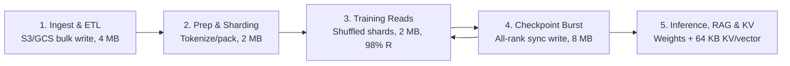
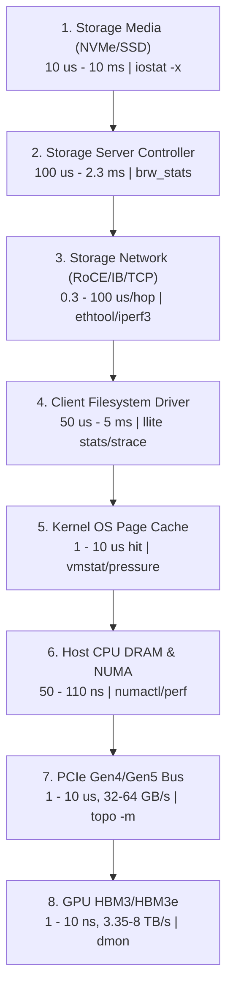
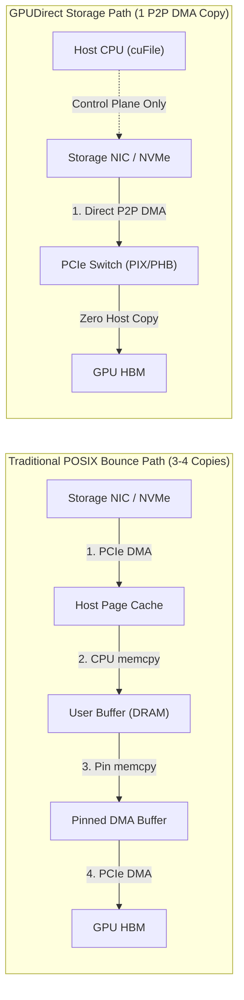

# 13.1 The AI data path: from storage to GPU

| Field | Value |
|---|---|
| Level | Basics to Intermediate |
| Priority tier | 2 |
| Lab venue | GCP / GKE (and local Python verification in `code/part13/ai_data_path_lab.py`) |
| Part | Part 13: AI storage |
| Coverage file | `planning/coverage/chapters/13-01.md` |
| Claim ledger | `planning/ledgers/13-01.md` |

## Why this matters for AI infrastructure

Picture a GPU that sits idle because its data loader is still fetching the next batch. That GPU costs the same amount per hour as one that is busy. The same is true when a GPU waits on a broken collective operation, which is a step where every GPU must exchange data with the others before any of them can continue. Even so, storage is routinely sized from two numbers on a vendor datasheet: total usable terabytes and peak sequential bandwidth.

Now think about the first hour of a distributed training run with 128 or 1,024 GPU workers. A storage array that passed a synthetic sequential benchmark can still collapse to 24 percent GPU utilization. The cause is the shape of the work, not the size of the array. During an epoch shuffle across eighteen million small files, metadata lookups starve the data loaders long before the network links saturate. An epoch is one complete pass through the dataset. An hour later, a thousand GPUs pause at once to flush a checkpoint of up to 2 TB. A checkpoint is a saved snapshot of the model and its training state, so a crashed job can restart from it. The synchronized write burst overwhelms the storage controller queues, and forward progress stops across the entire cluster.

**Think of AI storage as an end-to-end data path, not a single number.** Picture one training sample or model shard as a package on a long conveyor belt. Before it reaches the accelerator, it must cross eight distinct hardware and software boundaries. It starts on storage media and storage server controllers, then crosses the storage network fabric and the client filesystem driver. From there it enters the Linux kernel page cache, which is a memory area where the kernel keeps recently read file data. Next it moves through host CPU DRAM, the ordinary memory of the server, across NUMA domains. NUMA stands for non-uniform memory access, and it means each group of CPU cores sits closer to some memory than to other memory. Last, it crosses the PCIe switch fabric, which is the bus that connects cards such as GPUs and network adapters, and it lands in GPU memory.

Every one of those eight boundaries has a per-operation latency, which is the wait for one small request, and an aggregate bandwidth ceiling, which is the most data per second the whole boundary can carry. Either limit can become the slow link, and the slowest link sets the speed for the whole job. This chapter maps the five AI storage workload phases across the four-tier storage hierarchy. It contrasts the traditional POSIX CPU bounce-buffer path with GPUDirect Storage direct DMA. POSIX is the standard file-access interface that Linux programs use. DMA, or direct memory access, lets a device move bytes without the CPU copying each one. Along the way we work through the bandwidth math from one GPU to a full rack, and we look at the commands that isolate a storage bottleneck.

## Prerequisites and outcomes

Before you start, check that the tools and ideas below are familiar. Most of the chapter assumes you can read their output without help, so a short review now saves confusion later.

**Prerequisites:**
- Familiarity with Linux storage and memory inspection tools (`iostat`, `vmstat`, `lsblk`, `numactl`, and `strace`) from Part 3.
- Understanding of PCIe generations, NUMA socket topology, and `nvidia-smi topo -m` distance codes from Part 2 and Part 6.
- Basic knowledge of RoCEv2 and InfiniBand lossless fabrics from Part 7.

Here is the path through the chapter. We begin with why AI storage fails in its own ways, and we classify the five AI storage lifecycle phases by block size, read and write ratio, and metadata rate. Next we work out why a 38.4 GB per second Lustre filesystem delivers only 4.3 GB per second on 220 KB files. Lustre is a parallel filesystem that spreads each file across many storage targets. We then see how repackaging the data into 10 MB shards restores 91 percent GPU utilization. After that we map the four-tier AI factory storage hierarchy and the eight-layer storage-to-GPU data path. We contrast the traditional POSIX CPU bounce-buffer read path with GPUDirect Storage peer-to-peer DMA, and we read the output of `gdscheck` and `gdsio` benchmarks. Last, we size storage read bandwidth from one GPU up to a thousand-GPU cluster. We also calculate the Lustre stripe count needed for a 60-second checkpoint write service level agreement (SLA), which is the time limit the team has agreed to for each checkpoint. Stripe count is simply the number of storage targets that one file is spread across.

---

## 1. Why AI storage is different: the five workload phases and the capacity illusion

Think about the storage array your company already runs for its databases and file shares. Those arrays were built for two predictable jobs. Some serve transactional databases with small 4 KB random I/O, where I/O means input and output, and random means the reads land at scattered positions. Others serve media servers that stream large contiguous files to a few clients. An AI factory breaks both assumptions at once. Over one training and serving lifecycle, the storage system faces five conflicting access patterns, one after another, and it has to handle each of them well.

### 1.1 The three failure modes of standard IT storage in AI

Picture a standard enterprise NAS, or an untuned storage array, attached to a GPU cluster. A NAS, or network-attached storage, is a file server that clients mount over the network. A system like this tends to fail in three repeatable ways, and each one leaves a different trail.

1. The metadata problem: Computer vision, audio, and multimodal datasets often start as ten million to eighteen million individual files, averaging 20 KB to 220 KB each. Think of a librarian who must fetch a catalog card for every book, even when every book is a pamphlet. Before any payload crosses the network, the client must resolve the path and check permissions with `stat`. Resolving the path means walking through each directory name until the file is found. The client then opens the file through an RPC to the Metadata Server. RPC, or remote procedure call, is a request the client sends to a server and waits on. The Metadata Server answers questions about files, such as where they are and who may read them. It does not hold the file contents. The client then reads the tiny file and closes it. The controller spends 85 to 95 percent of its time answering lookups. GPUs starve while the storage links sit 80 percent idle.
2. The epoch shuffle: Shuffling keeps a neural network from memorizing the order of its samples. So `DistributedSampler` and data loaders shuffle the indices again every epoch. Hard disk drives cannot seek fast enough for that random access, because the read head must physically move to each track. Even NVMe arrays struggle. NVMe is a flash drive interface that connects straight to the PCIe bus. Random reads across unsharded files defeat the kernel read-ahead buffers. Read-ahead is the kernel habit of fetching the next bytes before anyone asks for them, and it only pays off when reads are sequential. The same reads also thrash the Linux page cache once the dataset is larger than host RAM. Thrashing means the cache throws out pages before anyone uses them again, so the work of caching buys nothing.
3. The checkpoint bomb: Every few hours, hundreds or thousands of GPUs stop computing at the same moment. Each one flushes its model weights, gradients, and optimizer states to persistent storage. Weights are the learned numbers inside the model. Gradients are the corrections computed from each batch. Optimizer states are the running statistics the optimizer keeps between steps. All ranks send at once, which creates a traffic jam called incast in both the network and the storage controllers. A rank is one GPU process in a distributed job. Incast happens when many senders aim at one receiver at the same moment. Every second spent waiting for write acknowledgments comes straight out of cluster goodput, which is the useful work the cluster completes. A write acknowledgment is the storage system's reply that the data is safely stored.

### 1.2 The five AI storage workload phases

If you are designing an AI storage pipeline, start by splitting the data lifecycle into five phases. Imagine one dataset moving from the raw download all the way to a served model. Each phase has its own block size, its own read-to-write mix, its own metadata pressure, and its own failure blast radius. Blast radius is how much work one failure stops. Block size is how many bytes each request asks for at once. The diagram shows how one dataset moves through the phases. The checkpoint burst feeds back into training, which is why phase 4 has an arrow back to phase 3.



Read the table with the last column in mind, because that column tells you how the job feels when a phase slows down. Phase 3 and phase 4 both stall the GPUs, but in different ways. Phase 3 stalls them on every step, a small pause at a time. Phase 4 freezes all of them at once for the length of one burst.

| Phase | Dominant I/O Pattern | Typical Block Size | Read / Write Split | Metadata Rate at Scale | Primary Storage Tier | Impact When Bottlenecked |
|---|---|---|---|---|---|---|
| **1. Ingest & Raw Collection** | Bulk object writes, dataset scraping, manifest listing | `4,096 KB` (`4 MB`) | `20%` R / `80%` W | `1,000–50,000` ops/s | `Tier 3` Object Store (`S3`/`GCS`) | Delays offline ETL pipeline; does not stall active training GPUs |
| **2. Preprocessing & Sharding** | Read raw objects, deduplicate, tokenize (`NeMo Curator`), pack `.bin`/`.idx` or `WebDataset` `.tar` | `2,048 KB` (`2 MB`) | `55%` R / `45%` W | `5,000–100,000` ops/s | `Tier 2` Parallel FS + `Tier 1` NVMe | Saturates prep CPU/GPU nodes; leaves unsharded small files if skipped |
| **3. Training Dataloader Reads** | Parallel shuffled sequential reads across workers, epoch boundary rescans | `2,048 KB` (`2 MB`) | `98%` R / `2%` W | `50,000–500,000` ops/s (unsharded) or `< 10,000` ops/s (sharded) | `Tier 1` Local NVMe / `Tier 2` PFS | **Stalls GPU SMs on every step; SM utilization drops to `24%–30%`** |
| **4. Synchronous Checkpoint Writes** | Coordinated all-rank burst write of weights + optimizer state, periodic `fsync` | `8,192 KB` (`8 MB`) | `1%` R / `99%` W | `1,000–50,000` ops/s | `Tier 1` NVMe Stage -> `Tier 2` PFS -> `Tier 3` Object | **Freezes all training ranks simultaneously until write completes** |
| **5. Inference, RAG & KV Offload** | Serial/broadcast model startup read, `64 KB` random vector/KV-cache reads & writes | `64 KB` (KV/RAG) to `4,096 KB` (weights) | `85%` R / `15%` W | `100–1,000` ops/s (weights), `1,000–100,000` ops/s (RAG/KV) | `Tier 0` HBM + `Tier 1` Local NVMe + Object/Vector Store | Inflates cold-start time, Time-to-First-Token (`TTFT`), and `p99` latency |

### 1.3 Capacity is not throughput: worked metadata bottleneck calculation

Capacity and bandwidth ratings look good on a purchase order, and they can still hide the real limit. Consider a production deployment on a 7.2 PB Lustre filesystem. PB means petabytes. The array has 48 Object Storage Targets, which are the back-end servers that hold file data. Each one is rated at 800 MB per second, giving 38.4 GB per second of aggregate read bandwidth. Its Metadata Server is tuned for 50,000 metadata operations per second.

Now imagine a training job that starts across 128 GPU workers, each needing 150 MB per second of training data. Multiply those figures and the expected aggregate read demand is 19.2 GB per second. That is only half of the array's 38.4 GB per second rating, so on paper the array has plenty of room. Yet in production, delivered throughput collapses to 4.3 GB per second, and GPU utilization drops from 94 percent down to 24 percent.

The array is not out of bandwidth. The real cause is the shape of the dataset: eighteen million individual files averaging 220 KB each. Every file costs a fixed trip through the metadata path, no matter how small the file is. For each file, a worker must resolve the path on the Metadata Server, issue a serialized `open()` RPC, read the 220 KB payload, and close the file. The payload is the data you actually want. The round trips around it are overhead. For a large file, that overhead is a rounding error. For a 220 KB file, those round trips take a large share of each request.

```text
7.2 PB Lustre Metadata Bottleneck Calculation (48 OSTs x 800 MB/s = 38,400 MB/s = 38.4 GB/s; MDS ceiling = 50,000 ops/s):
  - Per-file RPC steps: MDS path resolution (~10 us) -> open() RPC (~40 us) -> 220 KB read (~100 us) -> close()
  - Demand per worker:  150 MB/s (150,000 KB/s) across 128 workers = 19,200 MB/s (19.2 GB/s, 50% of 38.4 GB/s array)
  - Unsharded (18,000,000 files @ 220 KB): 150,000 / 220 ~= 680 files/s/worker -> 128 x 680 = 87,040 opens/s (75% over 50,000 MDS ceiling)
    Result: 4.3 GB/s delivered throughput, 24% GPU utilization.
  - Repackaged (750,000 WebDataset/TFRecord shards @ 10 MB / 10,000 KB): 150,000 / 10,000 = 15 files/s/worker -> 128 x 15 = 1,920 opens/s (3.8% of MDS)
    Result: 18.6 GB/s delivered throughput, 91% GPU utilization.
  - Second incident (10 nodes / 80 A100 GPUs, 1.5 GB/s target, 8 Gbps/client = 80 Gbps iperf3, OSTs 62% balanced):
    15,000,000 small files in 40 GB -> 95,000 opens/s, 280 MB/s delivered, 40% GPU idle.
    Repackaged into 50 shards of 800 MB -> 8,000 ops/s, 1.42 GB/s delivered, 88% GPU utilization.
```

Suppose you are on call for this job. The open rate is the first number to check. Each worker opens about 680 files per second. Across 128 workers, that is 87,040 opens per second. The Metadata Server therefore runs 75 percent over its limit before a single `stat` call is counted. Meanwhile, the 48 storage targets sit nearly idle. That idle array is the key clue. A slow array that is busy points to a bandwidth problem. A slow array with spare capacity points to a request-count problem.

Now repackage the same data and watch what changes. The team packs the eighteen million files into 750,000 contiguous 10 MB shards using WebDataset or TFRecord. A shard is one large file that holds many samples, so the loader opens one file where it used to open dozens. WebDataset packs samples into tar archives, and TFRecord packs them into a TensorFlow record format. Total opens drop to 1,920 per second, which is 3.8 percent of server capacity. Delivered bandwidth then jumps from 4.3 GB per second to 18.6 GB per second. GPU utilization climbs back to 91 percent.

A second incident shows the same trap at a smaller scale. A ten-node cluster with eighty A100 GPUs needed 1.5 GB per second in total, and network checks showed plenty of headroom. Yet week-one throughput reached only 280 MB per second. Fifteen million small files had triggered 95,000 opens per second. Packing that 40 GB dataset into fifty shards of 800 MB each cut metadata operations to 8,000 per second, and throughput recovered to 1.42 GB per second. The lesson matches the first incident. Plenty of link speed does not help when every read waits in line at the metadata server.

Put the three numbers in order before you decide what to change. First, look at the average file size. Second, look at the open rate. Third, look at the delivered throughput against what the array can supply. If the file size is small and the open rate is high, the fix belongs in the dataset layout. If the array is idle while the job waits, the fix belongs in the metadata path or the client.

Keep that habit with every slow job. Before you blame storage bandwidth, check the average file size and the metadata open rate. Those two numbers usually tell you more than the datasheet does.

---

## 2. The AI storage hierarchy and the 8-layer data path

No single storage medium can meet the cost, capacity, and latency needs of all five workload phases at once. Think of a warehouse with one kind of shelf. A shelf near the loading dock is quick to reach but holds little, while a big rack at the back holds a lot but takes a long walk to reach. Production AI factories face the same trade-off, so they split storage into four tiers. A single read or write can cross up to eight hardware and software layers, from the physical drives to the GPU cores.

### 2.1 The four-tier AI factory storage hierarchy

Use the table as a price list for speed. Each tier trades capacity for speed, so the fastest tier is also the smallest. Tier 0 is the fastest and smallest, and Tier 3 is the largest and slowest. The table lists what each tier is built from and what it is used for.

| Tier | Name & Location | Representative Hardware / Software | Typical Capacity | Bandwidth Scale | Typical Access Latency | Primary Role in AI Pipeline |
|---|---|---|---|---|---|---|
| **Tier 0** | **GPU HBM** (on-package with compute die) | `A100` (`40/80 GB`), `H100` (`80 GB`), `H200` (`141 GB`), `B200` (`192 GB`) | `40–192 GB` per GPU | `1.5–2.0 TB/s` (`A100`), `3.35 TB/s` (`H100`), `4.8 TB/s` (`H200`), `8.0 TB/s` (`B200`) | `1–10 ns` | Active weights, activations, gradients, and hot inference KV cache |
| **Tier 1** | **Host Local NVMe Scratch** (`PCIe` Gen4/Gen5 in compute node) | `DGX H100`: `8 x 3.84 TB` NVMe in `RAID 0` (`30.72 TB` raw) | `15–60 TB` per node | `25–60 GB/s` per node | `10–20 us` (`~100 ns` PCIe Gen5 bus hop) | Hot dataset shard cache (`AIStore`, `Alluxio`, `hostPath`), async checkpoint staging |
| **Tier 2** | **Parallel File System (`PFS`)** (dedicated `RoCEv2` or `IB` storage fabric) | `Lustre` (`DDN EXAScaler`, `FSx`), `WEKA`, `BeeGFS`, `VAST`, `IBM Storage Scale`, `DeepSeek 3FS` | `1–50+ PB` cluster-wide | `100 GB/s` to `7.3 TB/s` aggregate | `300 ns` (`IB` switch) / `800 ns` (`Eth` switch) to `0.5–5 ms` | Shared active datasets, distributed checkpoint bursts, multi-node scratch |
| **Tier 3** | **Object Store / Data Lake** (capacity tier on-prem or cloud) | `AWS S3`, `GCS`, `MinIO`, `Ceph`, `Pure FlashBlade`, `Scality` | `10–500+ PB` | `10–100+ GB/s` over HTTP/TLS (`s5cmd`) | `5–50 ms` | Durable raw data lake, cold checkpoint archive, model registry |

Look at the latency column next. It climbs from nanoseconds at Tier 0 to milliseconds at Tier 3. A nanosecond is one billionth of a second, and a millisecond is one thousandth of a second. Each step down buys capacity and pays for it in access time. When you plan a pipeline, you decide which tier each dataset lives on, and you move the data up or down as the job changes.

Newer AI filesystems are blurring the line between Tier 1 and Tier 2. They pool the NVMe drives in each node over RDMA, which stands for remote direct memory access. RDMA lets one machine read another machine's memory across the network without the remote CPU handling each transfer. DeepSeek's open-source Fire-Flyer File System, or 3FS, is one example. It combines a cluster manager, a sharded metadata service, a storage service, and an RDMA client. Sharded means the metadata is split across many servers instead of living on one. Together, these parts bypass the OS page cache completely, so the kernel never keeps a copy of the data. It serves random training and KV-cache reads straight from NVMe drives over InfiniBand or RoCEv2. A KV cache is the memory an inference server keeps for the text it has already processed, so it does not have to recompute that text for every new token. You can see the scale in one test. The test ran on a 68-node cluster with ten 16 TB NVMe drives and dual 100 Gb/s NICs per node. In that test, 3FS sustained 6.6 TB per second of read throughput. It also served 1.4 TB per second of background traffic, and it reached 7.3 TB per second on larger clusters.

### 2.2 The 8-layer data path from storage media to GPU HBM

Picture a training job that reads a batch from shared storage without GPUDirect Storage. Think of that batch as a parcel that must travel through several depots before it reaches the GPU. The payload must cross eight separate layers. Each layer has its own latency floor, which is the fastest it can ever answer, and its own queue or bandwidth limit. A slow parcel can be slow at any depot, so you have to check them in order.



Take one small read as an example. A training worker asks for a file that is not in the page cache. The request goes to the client driver, which checks with the Metadata Server, then sends the read over the network. The storage controller pulls the blocks from the drives, and the reply travels back along the same path. Each step has its own timer and its own queue, so a slow reply can come from any of them. The table gives you the signal for each step, so you can find the one that is slow.

The table below gives each layer's latency, its limit, the tool that measures it, and what healthy and saturated signals look like. When you read a row, ask three questions. How long does this layer usually take? What is the most it can carry? Which command shows whether it is close to that limit?

| Layer | Component | Typical Latency | Capacity / Bottleneck Limit | Primary Linux / GPU Measurement Tool | Healthy vs Saturated Signal |
|---|---|---|---|---|---|
| **1** | **Storage Media** (`NVMe`, `SSD`, `HDD`) | `10 us–10 ms` | Drive IOPS & media channels (`~5–7 GB/s` per Gen4 NVMe) | `iostat -x 1 /dev/nvme0n1`, `smartctl -a` | Healthy: `r_await < 2 ms`, `Media_Errors = 0`. Saturated: `%util = 100.0`, `r_await > 5 ms` |
| **2** | **Storage Server CPU & I/O Controller** | `100 us–2.3 ms` | Controller RPC slots (`256` max), server RAM cache | `lctl get_param obdfilter.*.brw_stats`, `iotop -P -o` | Healthy: `87.2%` server cache hit, `2.3 ms` service time. Saturated: `< 20%` cache hit, `8–10 ms` latency |
| **3** | **Storage Network Fabric** (`RoCEv2`, `IB`, `TCP`) | `300 ns` (`IB`) / `800 ns` (`Eth`) to `100 us` | Link speed (`100/200/400 Gbps`), switch buffers, `1:3` oversubscription | `ethtool -S eth0`, `iperf3 -c server -t 10 -R`, `ibstat` | Healthy: `> 80%` rated link (`106 Gbps` on `200G`), `0` drops. Saturated: `rx_dropped > 0`, `1,000+` TCP `Retr` |
| **4** | **Client Filesystem Driver** (`Lustre`, `WEKA`, `BeeGFS`, `NFS`) | `50–500 us` (local), `0.5–5 ms` (remote) | `max_rpcs_in_flight`, MDS open/stat RPC serialization | `lctl get_param llite.*.stats`, `strace -c -p <pid>` | Healthy: `open` avg `< 2,000 us` (`2 ms`). Saturated: `open` avg `7,234 us` (`7.2 ms`), `85%` time in `stat` |
| **5** | **Kernel OS Page Cache** | `1–10 us` (hit), `1–10 ms` (refill) | Free host RAM (`vmstat cache`), `kswapd` reclaim rate | `vmstat 1`, `cat /proc/pressure/memory` | Healthy: warm cache (`18,342M`), `wa < 5%`. Saturated: constant eviction thrash, `wa >= 15%` |
| **6** | **Host CPU DRAM & NUMA** (`DDR5` / `LPDDR5X`) | `50–55 ns` (local), `100–110 ns` (remote) | Per-socket memory controller BW & `CPU` `memcpy` cores | `numactl --hardware`, `ps -eLo pid,lwp,psr,comm`, `perf record` | Healthy: loader pinned to local NUMA node. Saturated: cross-socket `SYS` access (`20–30%` throughput loss) |
| **7** | **PCIe Bus / Switch Fabric** (`Gen4` / `Gen5 x16`) | `1–10 us` (`~100 ns` local switch) | `PCIe Gen4 x16` = `32 GB/s`; `Gen5 x16` (`32 GT/s`) = `64 GB/s` (`~63 GB/s` net) | `lspci -vvv`, `nvidia-smi topo -m`, `nvidia-smi dmon -s t` | Healthy: `PIX`/`PXB`/`PHB` affinity, pinned `DMA` at `90%` copy util. Saturated: unpinned `60%` copy util or `SYS` hop |
| **8** | **GPU HBM** (`HBM3` / `HBM3e`) | `1–10 ns` | `40–192 GB` capacity, `3.35–8.0 TB/s` bandwidth | `nvidia-smi dmon`, `nvidia-smi -q`, `Nsight Systems` | Healthy: `sm = 94–95%`, `mem = 40%`, `> 10%` free HBM. Starved: `sm` oscillating `24%–94%` on data wait |

Picture a training job that slows down in the middle of the night, with nobody sure why. Guessing is the slowest way to find the cause. Walk this table from the storage media up to the GPU, and check each layer's signal before moving on. Stop at the first layer whose signal is saturated. Layers above it cannot run faster than the layer below them, so that first saturated layer is the place to look.

---

## 3. Traditional bounce-buffer I/O vs GPUDirect Storage (`GDS`)

Picture a storage array that can deliver 10 GB per second to the compute node's network card or local NVMe drive. The job can still crawl anyway. The path inside the node often chokes, and redundant memory copies and unpinned buffers are the usual reason. A bounce buffer is a temporary staging area in host memory that data passes through on its way somewhere else. Each extra stop costs time and memory bandwidth, so a fast disk can still deliver slow training.

### 3.1 Anatomy of the POSIX CPU bounce-buffer path (3 to 4 copies)

Start with the most common case, a standard POSIX read. Your code calls `read()`, builds a PyTorch tensor, and calls `.to('cuda')`. A tensor is a multidimensional array of numbers, the basic data type in PyTorch. In that sequence, the data cannot move straight from the storage controller into GPU memory. Instead, it bounces through host CPU memory up to four times. Here is what each bounce looks like.

1. Copy 1, hardware DMA to the kernel page cache: The storage NIC or NVMe controller moves the file blocks over the PCIe bus into the Linux kernel's page cache, which lives in pageable host DRAM. Pageable means the operating system is allowed to move or write out those pages whenever it likes.
2. Copy 2, kernel-to-user CPU copy: The host CPU takes an interrupt, which is a signal that wakes it up to handle the device. It switches context to the reading program. Then it runs a CPU-driven memcpy from the kernel page cache into the application's user-space buffer in pageable DRAM. A memcpy is a plain memory-to-memory copy, so every byte passes through a CPU core.
3. Copy 3, pageable-to-pinned host staging copy: The GPU's DMA engine cannot safely read pageable memory, because the kernel could swap or move those pages mid-transfer. So calling `.to('cuda')` on an unpinned tensor makes the CUDA driver allocate a temporary page-locked staging buffer and run a second CPU copy in host DRAM. Setting `pin_memory=True` on the data loader avoids this step by landing batches in pinned memory up front. Pinned memory is page-locked, so the kernel keeps it in place for the whole transfer.
4. Copy 4, pinned host DRAM to GPU HBM DMA: Finally, the CUDA driver programs the GPU's copy engine to move the batch from pinned host DRAM across the PCIe bus into GPU memory. HBM is the high-bandwidth memory packaged next to the GPU die.

```text
Host DRAM Traffic & Copy Accounting per 10 GB Read:
  - Unpinned POSIX path: 4 total copies (2 PCIe DMA crossings + 2 CPU __memcpy_avx2 ops) -> 60.0 GB host DRAM read/write traffic
  - Pinned path (pin_memory=True): 3 total copies (2 PCIe DMA crossings + 1 CPU copy) -> 40.0 GB host DRAM traffic
  - Production unpinned stall case: 45 GB/s delivered vs 60 GB/s expected (78% GPU util, 22% wait); loader took 120 ms/batch (3.6 s over 30 batches), PCIe copy engine at 60%, batch[0].is_pinned() == False.
  - Fix (pin_collate with .pin_memory()): loader dropped from 120 ms to 30 ms (4x faster), GPU util rose to 94%, throughput reached 58 GB/s.
```

The numbers show what this costs in a real run. In a production training run, throughput stalled at 45 GB per second instead of 60 GB per second. GPUs sat idle for 22 percent of every step. Timing the data loader showed 120 ms per batch, and `nvidia-smi dmon` showed the PCIe copy engine capped at 60 percent utilization. The check `batch[0].is_pinned()` returned `False`. That result showed that every `.to('cuda')` call was copying from pageable memory. Adding a custom collation function that pinned batches cut loader time from 120 ms down to 30 ms. Collation is the step that gathers individual samples into one batch. GPU utilization climbed to 94 percent, and throughput reached 58 GB per second. The lesson is that one small check can point at a stall that the aggregate numbers hide.

### 3.2 GPUDirect Storage (`GDS`) architecture: 1 direct P2P DMA copy

Picture the same node after an engineer turns on GPUDirect Storage and expects the data path to get faster.

The fix is to remove the host DRAM bounce buffer entirely. **GPUDirect Storage** is part of the NVIDIA Magnum IO stack, which is NVIDIA's set of libraries for moving data efficiently between machines and GPUs. It pairs the `nvidia-fs.ko` kernel driver with the user-space `libcufile.so` library. The application registers GPU memory buffers directly with `cuFileBufRegister`, then reads or writes through `cuFileRead` and `cuFileWrite`. Registering a buffer tells the driver where the GPU memory lives, so the storage device can place data into it directly.



The table puts the three paths side by side, with a benchmark result for each row. Read the first row first, because the copy count explains most of the other differences. The direct path cuts the copies from four to one. It also removes the host DRAM payload traffic completely. Payload here means the data itself, not the control messages that coordinate the transfer.

| Metric / Path Attribute | Traditional Unpinned POSIX (`read` + `.to('cuda')`) | Traditional Pinned (`pin_memory=True`) | GPUDirect Storage (`cuFileRead` + `nvidia-fs`) |
|---|---|---|---|
| **Total data copies** | `4` copies | `3` copies | **`1` direct P2P DMA copy** |
| **PCIe bus traversals per byte** | `2` (`Device -> RAM`, `RAM -> GPU`) | `2` (`Device -> RAM`, `RAM -> GPU`) | **`1` (`Device -> PCIe Switch -> GPU`)** |
| **CPU memcpy operations (`__memcpy_avx2`)** | `2` | `1` | **`0` (CPU is control-plane only)** |
| **Host DRAM traffic per `10 GB` read** | `60.0 GB` | `40.0 GB` | **`0.0 GB` payload (`BAR1` P2P DMA)** |
| **`gdsio` measured throughput (`4` workers, `1M` IO, `10G` file)** | `~5.2 GB/s` (pageable baseline) | `8.0 GB/s` (`gdsio -x 2`) | **`9.6 GB/s` (`gdsio -x 0`, `+20%` uplift)** |
| **`gdsio` average I/O latency** | `~1.90 ms` | `1.25 ms` (`gdsio -x 2`) | **`1.00 ms` (`gdsio -x 0`, `-20%` latency)** |
| **VAST / Hopper H100 RDMA read uplift** | Baseline | Baseline | **`+20%` on `A100`, `+30%+` on `H100`** |

It helps to see the copy count as a budget. Every copy costs memory bandwidth, and every copy also waits for the CPU or a DMA engine. A job that moves a batch four times pays for four waits, even when each wait looks small on its own. The direct path does not make the disk faster. It removes the stops in the middle, so the disk's speed reaches the GPU with less loss.

Two practical rules govern GPUDirect Storage in production. Both are easy to miss, so check them early, before you trust any benchmark.

1. Kernel filesystem and `O_DIRECT` requirement: GPUDirect Storage needs a kernel-level filesystem client that is integrated with `nvidia-fs`. The kernel is the one place where the storage driver and the GPU driver can meet directly. Supported options include EXT4 or XFS over local NVMe, Lustre, WEKA, BeeGFS, VAST NFS-over-RDMA, and IBM Storage Scale. User-space FUSE filesystems cannot use it, because FUSE, or filesystem in user space, runs the filesystem logic in an ordinary program. The data therefore passes through that program on the way, and the kernel's DMA hooks are never used.
2. Compatibility mode trap: In `/etc/cufile.json`, `allow_compat_mode: true` lets `libcufile` silently fall back to POSIX host-memory reads. That happens whenever `nvidia-fs` or the mount lacks direct DMA support. Your job still runs, only slower. During cluster qualification, which is the testing you do before you trust a node with real jobs, set `"allow_compat_mode": false` instead. Then confirm that the counters in `/proc/driver/nvidia-fs/stats` increment, while `__memcpy_avx2` disappears from `perf record`. Keep one difference in mind: `cuda-checkpoint`, used with checkpoint/restore in userspace (CRIU) for process migration, is separate from GPUDirect Storage. It copies device memory into host driver memory during suspend rather than using direct storage DMA.

Before you assume GPUDirect Storage is speeding up your job, disable compatibility mode in `/etc/cufile.json` and check `/proc/driver/nvidia-fs/stats`. A job that runs fine in compatibility mode can look healthy while the direct path is never used at all.

---

## 4. Bandwidth math, NUMA/PCIe locality, and page cache pollution

Suppose the array is sharded properly and GPUDirect Storage is enabled. The harder questions still come next. Three sizing and placement questions remain. How much steady read bandwidth and checkpoint write bandwidth do you need? Are your CPU workers on the right NUMA socket? Will large shuffled datasets thrash the Linux page cache? A socket is one physical CPU package on the motherboard. Answer these three questions before the first big job, not after it stalls.

### 4.1 Per-GPU, per-node, and per-rack bandwidth scaling

Guessing is a poor way to size a cluster, so start with a per-GPU figure. How much sustained read bandwidth does a cluster actually need? A common baseline for multimodal and LLM training is **200 MB per second per GPU**. You get that figure by multiplying bytes per sample by samples per second on each GPU. Think of it as the appetite of one GPU. Lighter text-only workloads may need 50 to 150 MB per second per GPU. Heavy video or uncompressed multimodal workloads can require 400 to 1,000 MB per second per GPU. Once you have the per-GPU figure, multiply it by the GPUs in a node, a rack, or the whole cluster, as the block below does.

```text
Cluster Storage Read & Synchronous Checkpoint Write Scaling Formulas:
  - Per-GPU read baseline:               200 MB/s (0.2 GB/s)
  - Single 8-GPU node (DGX H100 / B200): 8 x 200 MB/s = 1,600 MB/s = 1.6 GB/s (12.8 Gbps)
  - Single 72-GPU GB200/GB300 NVL72 rack: 72 x 200 MB/s = 14,400 MB/s = 14.4 GB/s (14-20 GB/s planning band)
  - 1,024-GPU cluster (128 x 8-GPU nodes): 1,024 x 200 MB/s = 204,800 MB/s = 204.8 GB/s
  - 500B model checkpoint (2 TB / 2,000 GB across 256 nodes every 2 h, <= 60 s SLA):
      B_ckpt = 2,000 GB / 60 s = 33.33 GB/s -> ceil(33.33 / 0.8 GB/s per OST) = 42 Lustre OSTs minimum
  - 500 GB checkpoint on 40 GB/s Lustre (48 OSTs @ 800 MB/s; 12.5 s theoretical vs 45 s observed, 32 s extra stall):
      Default 4-OST stripe cap = 4 x 800 MB/s = 3.2 GB/s (156 s raw, 45 s partially cached).
      Wide striping (lfs setstripe -c 32): 25 OSTs = 20.0 GB/s (25 s), 32 OSTs = 25.6 GB/s (20-25 s; < 2-5 s with Tier 1 NVMe stage).
```

Checkpoint writes are a different problem. They come in short, intense bursts, and the whole cluster waits for them. Picture a job where every GPU stops at once and waits for the save to finish. Suppose a 500B-parameter model writes a 2 TB checkpoint across 256 nodes every two hours. The SLA says the pause must finish in under 60 seconds. Dividing 2,000 GB by 60 seconds gives 33.33 GB per second of sustained write throughput. Meeting that target takes at least 42 Lustre Object Storage Targets, each rated at 800 MB per second. Notice that the SLA sets the number, not the average. A checkpoint that takes a long time is fine for a backup window, but it is terrible for a training pause.

Here is a smaller case, and it shows why the stripe count matters. A 500 GB checkpoint on a 40 GB per second Lustre cluster should take 12.5 seconds in theory. Striping spreads one file across several storage targets, so the write can run in parallel. In practice, the write often stalls training for 45 seconds. The cause is striping. By default, a checkpoint directory may spread files across only four storage targets. Four targets at 800 MB per second each cap the write at 3.2 GB per second. Widen the stripe count to 25 or 32 targets with `lfs setstripe -c 32`, and write bandwidth rises above 20 GB per second, which cuts the pause in half. Staging the checkpoint to local NVMe first shrinks the stall even further, down to a few seconds. Staging means writing to fast local drives first, then copying to shared storage in the background.

### 4.2 NUMA and PCIe topology alignment (`PIX`/`PHB` vs `SYS`)

Picture a dual-socket GPU server, which has two CPU chips. Each chip has its own memory and its own PCIe root complex, the hub that hands out PCIe connections to devices. Each GPU, storage NIC, and NVMe drive hangs off one specific CPU socket, and that socket's root complex is the path they use. A data loader thread on the wrong socket creates a problem. Every memory access and PCIe transfer must then cross the inter-socket link, the wire that joins the two CPU chips.

The `nvidia-smi topo -m` codes tell you how far apart a GPU and a device sit. The closer they are, the better the GDS path. Read the codes from best to worst, starting with `PIX`, then `PXB`, `PHB`, `NODE`, and `SYS`. Each code names the hop that the traffic has to cross.

| `nvidia-smi topo -m` Code | Meaning | P2P / GDS Path Quality | Typical Bandwidth Impact |
|---|---|---|---|
| **`PIX`** | Connection traversing at most a single `PCIe` switch | **Optimal for GDS P2P DMA** | `100%` of rated `PCIe` / `NIC` speed |
| **`PXB`** | Connection traversing multiple `PCIe` switches without crossing the PCIe Host Bridge | **Very good for GDS** | `95–100%` of rated speed |
| **`PHB`** | Connection traversing a PCIe Host Bridge within the same CPU `NUMA` socket | **Supported for GDS** (root complex hair-pinning) | `85–95%` of rated speed |
| **`NODE`** | Connection traversing `PCIe` and interconnect between NUMA nodes within a socket | Suboptimal | `~88%` retention (`~12%` penalty) |
| **`SYS`** | Connection crossing the inter-socket interconnect (`Intel UPI` / `AMD Infinity Fabric`) | **Poor / GDS P2P often disabled or severely throttled** | `~55–72%` retention (`20–30%+` throughput loss; DRAM latency doubles from `50–55 ns` to `100–110 ns`) |

Read the table as a ladder. The codes at the top keep the GPU and the NIC close together, and the codes near the bottom send the traffic over longer routes. When you see `SYS` in a matrix, it does not prove that a job is broken. It tells you that the placement is costing bandwidth, and that the placement is worth fixing before you blame storage.

Aim for `PIX`, `PXB`, or `PHB`, and treat `SYS` as a warning sign. A quick look at the topology output before a run catches most of these problems.

Here is a concrete case. `GPU0` and `NIC0` sit on the first NUMA node, but the Linux scheduler places the PyTorch data loader workers on the second. The scheduler has no idea where the GPU sits, so it can pick the far socket. Now every memory access crosses the socket interconnect, and DRAM latency doubles. Pinning the process and its memory to the local socket with `numactl -N 0 -m 0` removes that cross-socket traffic. It recovers 20 to 30 percent of the lost throughput.

On NVIDIA Grace Blackwell systems, the 72-core Grace CPU connects to the Blackwell GPU over NVLink-C2C, a fast chip-to-chip link. Its bandwidth reaches up to 900 GB per second bidirectional, meaning in both directions at once. These GPUs also include a hardware **Decompression Engine** for LZ4, Snappy, Deflate, and `nvJPEG`. LZ4, Snappy, and Deflate are compression formats, and nvJPEG is a JPEG decoder. Compressed batches can cross the bus and unpack on the GPU, so the CPU cores stay free for other work.

### 4.3 Linux Page Cache pollution vs `O_DIRECT`

Picture the second epoch of a training run. The first epoch already read the whole dataset, so the second epoch should be fast, if the cache kept that data. The Linux kernel automatically caches recently read file blocks in free host DRAM. You can see that cache as `cache` in `vmstat` and as `Cached` in `/proc/meminfo`. Whether the cache helps or hurts depends on how the working set compares with available host RAM. The working set is the part of the dataset your job touches over and over:

1. Regime A, working set fits in RAM: When a 120 GB dataset runs on a node with 256 GB of free RAM, the working set stays inside the 85 percent safe memory ceiling. The first epoch fills the page cache from storage. Every later epoch reads straight from host DRAM at microsecond latency, with a 95 percent hit rate. A hit rate is the share of reads served from the cache. Keep buffered I/O enabled, then raise `read_ahead_kb` from its 128 KB default up to 2,048 or 4,096 KB with `blockdev --setra`.
2. Regime B, working set exceeds RAM: When a shuffled 4 TB dataset runs on a node with 512 GB of RAM, every cached page gets evicted long before the next epoch needs it. The cache hit rate drops below 4 to 15 percent. Yet the kernel still burns CPU cycles allocating page frames and running `kswapd` memory reclaim, while I/O wait climbs to 15 percent. Page frames are the chunks of memory the kernel hands out, and reclaim is the work of taking them back. In this regime, bypass the OS page cache completely using **`O_DIRECT`**, GPUDirect Storage `cuFileRead`, or direct-I/O filesystems like 3FS.

Before you launch a multi-epoch job, which is a job that reads the dataset more than once, compare the dataset shard size per node against free host RAM. That comparison tells you whether to use buffered read-ahead or `O_DIRECT`. It is a quick check that can save a lot of wasted time.

---

## 5. Storage network fabrics and Kubernetes CSI integration

Picture a remote drive sitting in a storage rack two rows away from the GPU servers. Once storage moves outside the compute node, two infrastructure layers decide whether that drive can still feed the GPUs at line rate. Line rate means the link runs at its full rated speed. The first layer is the backend network fabric, which must carry NVMe commands without packet loss or excessive latency. The second is the Kubernetes container runtime, which must expose shared filesystems and shared memory cleanly to every worker pod. A pod is the smallest unit Kubernetes schedules, usually one container or a small group of them.

### 5.1 NVMe-oF (`TCP` vs `RDMA` over `RoCEv2` vs `InfiniBand`) and Fabric A/B design

Start with the local bus, because it sets the baseline. A PCIe Gen5 link crosses its switch in about 100 nanoseconds and delivers 64 GB per second across 16 lanes. A lane is one serial wire pair in the PCIe link. That is enough to drive a 400 Gbps storage NIC at line rate. Across a data center, AI clusters attach those NICs to dedicated backend storage networks, so storage traffic can travel on its own wires.

The storage fabric is not built like the compute fabric. The compute fabric used for collectives is non-blocking and rail-optimized, which means the switches have enough capacity that no traffic path is squeezed. The storage fabric commonly uses a 1:3 oversubscribed leaf-spine topology, with Fabric A and Fabric B path diversity. Oversubscribed means the ports facing the servers together can send more than the uplinks can carry. In a leaf-spine design, each leaf switch connects to every spine switch. Path diversity means two separate networks carry the traffic, so one failed fabric does not stop storage. Distance changes the choice again. Over distances beyond 40 kilometers, maintaining lossless RoCEv2 becomes impractical. Operators instead switch to deep-buffer Ethernet switches running NVMe-oF/TCP, or S3 over HTTPS and IPsec.

Under the hood, NVMe over Fabrics preserves the native NVMe queue model. Submission Queue Entries are the commands the host sends, and Completion Queue Entries are the replies the drive returns. NVMe over Fabrics wraps 64-byte Submission Queue Entries and Completion Queue Entries inside fabric capsules, so the network carries the same request and reply records the local drive would see. The table compares the four main options.

| Storage Network Option | Transport Encapsulation & Ports | Typical Switch / Fabric Latency | Lossless Fabric Required? | Parallel Shared File Access | Primary AI Factory Use Case |
|---|---|---|---|---|---|
| **`NVMe-oF/TCP`** | `TCP` (`port 8009` discovery; `IC Req PDU`, `CapsuleCmd` `0x01`, `C2HData` `0x04`, `H2CData` `0x03`, `H2CTermReq`; `NVMe` read `0x02` / write `0x01`, `NSID`, `64`-bit `PRP1`/`PRP2`, `SGL`) | `~800 ns` per Ethernet switch hop + host TCP stack | **No** (runs over standard lossy BGP/IP fabric with `MTU 9000` jumbo frames) | No (block-level `1:1` host-to-target session per CPU core) | Cost-effective scale-out block storage, cold/warm tier, `> 40 km` WAN replication |
| **`NVMe-oF/RDMA` (`RoCEv2`)** | `UDP` (`TCP 8009` discovery, `UDP 4420` `RDMA_CM` `RDMA_PRTYPE 04` vs `05` iWARP, `UDP 4791` `BTH` + `RETH` + NVMe capsule; `1:1` SQ/CQ to `QPair`) | `700–900 ns` port-to-port Ethernet switch latency (`~66%` lower write latency vs TCP) | **Yes** (`PFC`, `ECN`, `DCQCN` tuned separately from training fabric) | No (unless layered under a parallel FS like `WEKA`, `VAST`, or `3FS`) | High-IOPS block targets, `GPUDirect Storage` over Ethernet (`100/200/400 Gbps` storage NICs) |
| **`InfiniBand` Storage (`NVMe-oF/IB` / `LNet`)** | Native `IB` (`LRH` with `16`-bit `S-LID`/`D-LID` up to `48,000` nodes, `GRH`, `BTH` `RDMA_PRTYPE 02`, `ICRC`/`VCRC`) | `~300 ns` port-to-port IB switch latency | **Yes** (hardware `CBFC` credit-based flow control across `16` Virtual Lanes `VLs`, `64 B`/credit) | Via `Lustre` (`LNet`), `BeeGFS`, `GPFS`, or `WEKA` | Ultra-low-latency HPC/AI training storage and direct `GDS` over `NDR`/`HDR` |
| **Parallel FS / `pNFS` over `RDMA`** | `POSIX` client (`open`, `read`, `write`, `stat`, `mmap`) over `RoCEv2` or `IB` (`WEKA`, `Lustre`, `BeeGFS`, `VAST`, `3FS`) | `300–900 ns` switch hop + `50–500 us` client driver | Recommended for `RDMA` transport | **Yes** (`ReadWriteMany` across `1,000+` GPU nodes with distributed metadata) | Primary `Tier 2` AI training datasets and synchronized checkpoint bursts |

The key trade-off is the lossless requirement. Lossless means the network never drops packets under congestion. TCP runs without a lossless fabric, so it is easier to deploy. RDMA and InfiniBand both need one, and you pay for that in tuning. Choose the transport by asking how much tuning your team can own, and then check the latency that the job actually needs.

### 5.2 Kubernetes CSI (`ReadWriteMany`), `hostPath` NVMe, and PyTorch `DataLoader` pipelining

Think about a database pod that needs one volume to itself. A cloud block volume fits that picture. Standard cloud block CSI drivers give you `ReadWriteOnce` volumes, which are built for single-pod databases. CSI, the Container Storage Interface, is the plugin standard that Kubernetes uses to attach storage. Distributed training across dozens or thousands of pods needs **`ReadWriteMany` parallel filesystem CSI provisioners** instead. Common choices include WEKA CSI, Lustre CSI, and Google Cloud Managed Lustre. Pair them with three essential pod settings:

1. Memory-backed `/dev/shm` `emptyDir` (`sizeLimit: 400Gi`): Multi-worker PyTorch data loaders pass collated tensor batches to the main training process through POSIX shared memory at `/dev/shm`. NCCL uses it too. Docker and Kubernetes default `/dev/shm` to just 64 MiB. At that size, multi-worker loaders crash at once with `Bus error (core dumped)`.
2. GPUDirect Storage config injection (`CUFILE_ENV_PATH_JSON`): Mount the validated `/etc/cufile.json` ConfigMap into the container. Then run the pod under `runtimeClassName: nvidia`, so the `/dev/nvidia-fs*` device nodes are exposed.
3. Local NVMe scratch via `hostPath` (`/mnt/nvme_raid_0/ai_scratch`): Mount the node's local RAID 0 directory directly. That skips CSI overhead when you cache shards or stage checkpoints.

On the software side, the PyTorch `DataLoader` must overlap CPU batch preparation with GPU kernel execution. Think of it as a kitchen that prepares the next orders while the chef is still cooking. Then the next batch transfers while the current one computes:
- Set `num_workers=8`, or scale it to your CPU core count. Enable `pin_memory=True` and raise the host limit with `ulimit -l unlimited`. Set `persistent_workers=True` so workers do not respawn every epoch. Then set `prefetch_factor=4` to queue 32 batches ahead.
- Call `batch.to(device, non_blocking=True)` on a dedicated CUDA copy stream. A stream is an ordered queue of GPU work, and non-blocking lets the CPU move on while the copy runs. Then synchronize with `compute_stream.wait_stream(copy_stream)`, so compute waits only for the copy it needs.
- Move heavy image or video decoding onto GPU hardware decoders, using NVIDIA DALI or `nvJPEG`. Pre-tokenize text offline with NVIDIA NeMo Curator, which writes memory-mappable `.bin` and `.idx` shards.

These three settings belong together for a reason. A memory-backed `/dev/shm` gives the loader workers somewhere to hand off tensors. Local scratch gives you a fast place to stage shards and checkpoints. The GDS configuration lets the direct path exist in the first place. Missing any one of them can make a pod that starts fine fail later, under load, with an error that points somewhere else.

Before you deploy a multi-worker training pod, confirm that `/dev/shm` is backed by a large memory `emptyDir`, and that `persistent_workers=True` is set. Those two checks prevent the most common startup failures in this section.

---

## Commands and configurations that matter

Picture a new GPU node that has just joined the pool and needs a storage check before anyone trusts it with a job. The commands below were not run on live hardware. They target live Linux GPU nodes with Lustre, WEKA, NVMe hardware, and NVIDIA GDS drivers, so this repository could not run them. Treat each block as a checklist for a node you own, and read the output against the failure table later in the chapter. If you want something you can run today, the Hands-on lab covers the Python verification suite that this repository does execute.

### 1. Layer-by-layer data path inspection (`Layers 1–8`) ``

```bash
# (untested here) Layer 1: Local NVMe media health and saturation (%util, r_await)
smartctl -a /dev/nvme0n1 | grep -E "Media_Errors|Unsafe_Shutdowns|Temperature"
iostat -x 1 /dev/nvme0n1 | head -10

# (untested here) Layer 1b: Verify NVMe multiqueue scheduler (none/mq-deadline) and tune read-ahead (128 KB -> 4096 KB)
cat /sys/block/nvme0n1/queue/scheduler
cat /sys/block/nvme0n1/queue/read_ahead_kb
blockdev --setra 8192 /dev/nvme0n1

# (untested here) Layer 2 & 4: Lustre OST balance, server RPC stats, and client metadata open/getattr latency
lfs df -h
lfs df -i
lctl get_param obdfilter.*.brw_stats
lctl get_param llite.*.stats 2>/dev/null | grep -E "close|open|getattr|readdir"
lctl get_param -n mdc.*.max_rpcs_in_flight

# (untested here) Layer 3: Storage NIC link speed, ring buffers, drops, and reverse iperf3 bandwidth
ethtool eth0
ethtool -g eth0
ethtool -S eth0 | grep -E "rx_packets|rx_bytes|rx_errors|rx_dropped|collisions"
iperf3 -c storage-server -t 10 -R

# (untested here) Layer 4b: Tuned NFS mount (when NFS is used on small clusters)
mount -t nfs -o rsize=1048576,wsize=1048576,noatime,async,actimeo=60,lookupcache=pos \
  nfs-server:/export/datasets /mnt/datasets

# (untested here) Layer 5: OS Page Cache activity, memory pressure, and I/O wait (wa)
vmstat 1 10
cat /proc/pressure/memory

# (untested here) Layer 6, 7 & 8: NUMA layout, PCIe link width, GPU-to-NIC topology, and H2D copy utilization
numactl --hardware
nvidia-smi topo -m
lspci -vvv | grep -A 5 "NVIDIA"
nvidia-smi dmon -s t -c 10
nvidia-smi -i 0 --query-gpu=memory.used,memory.total,memory.free --format=csv,nounits
```

Read the layer 1 output from the top down. The `smartctl` lines tell you whether the drive itself is reporting errors. The `iostat` lines tell you whether the drive is busy and how long each read waits. A drive can pass the health check and still be the bottleneck, so the busy-queue view from `iostat` matters too. That is why the two commands are read together.

### 2. GPUDirect Storage (`GDS`) verification and `gdsio` benchmarking ``

```bash
# (untested here) 1. Verify nvidia-fs kernel module and platform GDS support
lsmod | grep nvidia_fs
/usr/local/cuda/gds/tools/gdscheck -p
cat /proc/driver/nvidia-fs/stats

# (untested here) 2. Benchmark CPU bounce-buffer path (-x 2) vs direct GDS DMA path (-x 0)
# Baseline CPU path: 8.0 GB/s, 1.25 ms average latency
/usr/local/cuda/gds/tools/gdsio -f /mnt/data/large_file -d 0 -w 4 -s 10G -i 1M -I 0 -x 2

# Direct GDS path: 9.6 GB/s (+20%), 1.00 ms average latency (-20%)
/usr/local/cuda/gds/tools/gdsio -f /mnt/data/large_file -d 0 -w 4 -s 10G -i 1M -I 0 -x 0
```

The benchmark pair in the block above is the cleanest test of the GPUDirect Storage path. Run the same `gdsio` command twice, once with `-x 2` and once with `-x 0`, and change nothing else. If the second run is not faster, the direct path is not being used, and you should go back to the compatibility mode check in section 3.

Use this `/etc/cufile.json` configuration when you qualify a cluster, with compatibility fallback disabled ``:

```json
{
  "logging": {
    "level": "ERROR"
  },
  "properties": {
    "max_device_pinned_mem_size_kb": 33554432,
    "use_poll_mode": false,
    "poll_mode_max_size_kb": 4,
    "allow_compat_mode": false
  }
}
```

Benchmarks answer a narrow question each. A sequential read test tells you what the array can stream. A checkpoint burst test tells you how the array handles synchronized writes. A metadata stress test tells you how the Metadata Server copes with many small operations. Run the test that matches the phase that hurts, rather than the one that is easiest to run.

### 3. Benchmarking sequential reads (`fio`), checkpoint bursts (`fio`), and MDS (`mdtest`) ``

```bash
# (untested here) 1. Simulate 32-worker sequential dataset reads (2 MB blocks, 500 GB > host RAM, O_DIRECT)
fio --name=ai_dataset_read_sim \
    --directory=/mnt/weka/ai_datasets/benchmarks \
    --rw=read --bs=2M --size=500G --numjobs=32 --iodepth=128 \
    --ioengine=libaio --direct=1 --group_reporting

# (untested here) 2. Simulate synchronous checkpoint write burst (8 MB blocks, periodic fsync=1000)
fio --name=checkpoint_write_burst \
    --directory=/mnt/lustre/checkpoints/benchmarks \
    --rw=write --bs=8M --size=100G --numjobs=8 --iodepth=64 \
    --ioengine=libaio --direct=1 --fsync=1000 --group_reporting

# (untested here) 3. Stress-test Metadata Server (MDS) across 128 MPI ranks
mpirun -np 128 mdtest -d /mnt/lustre/metadata_stress_test -i 5 -b 10 -z 3 -L -I 100000 -y -u -t
```

A Kubernetes pod is where all of these settings finally meet the workload. The storage class decides how the volume is provisioned. The volume mounts decide which paths the training code sees. The memory-backed `/dev/shm` mount decides whether the data loader workers can share tensors. The sample manifest below puts those choices in one file, so you can read them together.

### 4. Kubernetes `RWX` CSI StorageClass and GDS-enabled training Pod ``

```yaml
# (untested here) RWX parallel filesystem StorageClass + training Pod with 400Gi /dev/shm and cufile.json
apiVersion: storage.k8s.io/v1
kind: StorageClass
metadata:
  name: weka-rwx-ai-optimized
provisioner: csi.weka.io
parameters:
  volumeType: dir/v1
  filesystemName: "ai-factory-primary-fs"
reclaimPolicy: Retain
allowVolumeExpansion: true
---
apiVersion: v1
kind: Pod
metadata:
  name: llm-training-worker-rank-0
spec:
  runtimeClassName: nvidia
  containers:
  - name: pytorch-training-container
    image: nvcr.io/nvidia/pytorch:24.07-py3
    env:
    - name: CUFILE_ENV_PATH_JSON
      value: "/etc/cufile.json"
    volumeMounts:
    - name: dataset-vol
      mountPath: /workspace/datasets
    - name: local-nvme-cache
      mountPath: /mnt/nvme_scratch
    - name: dev-shm
      mountPath: /dev/shm
    - name: gds-config
      mountPath: /etc/cufile.json
      subPath: cufile.json
    resources:
      limits:
        nvidia.com/gpu: 8
  volumes:
  - name: dataset-vol
    persistentVolumeClaim:
      claimName: weka-dataset-pvc-1tb
  - name: local-nvme-cache
    hostPath:
      path: /mnt/nvme_raid_0/ai_scratch
      type: Directory
  - name: dev-shm
    emptyDir:
      medium: Memory
      sizeLimit: 400Gi
  - name: gds-config
    configMap:
      name: gds-configmap
```

---

## How it fails

When your AI storage path goes wrong, the symptom rarely names the cause. Picture a job with GPU utilization far below normal and no step logged for an hour. You see low GPU utilization or a hung job, and you have to work back to the layer that failed. The table lists six common failures, what each one looks like, its root cause, the command that confirms it, and the fix.

| Failure Mode | Symptom | Root Cause | Diagnosis Commands | Architectural Fix |
|---|---|---|---|---|
| **1. Metadata Server (`MDS`) Saturation ("Small File Problem")** | GPU `SM` utilization drops from `94%` to `24%–30%`; storage array delivers `4.3 GB/s` out of `38.4 GB/s` capacity while storage network links sit idle. | DataLoader iterates over `10M–18M` small files (`20–220 KB`). Workers issue `87,040–95,000` `open`/`stat` RPCs/s against a `50,000` ops/s `MDS` limit (`85%` of syscall time spent in `stat`). | `strace -c -p <loader_pid>`, `lctl get_param llite.*.stats \| grep -E "open\|getattr"` (`avg > 7,234 us`). | Repackage small files into `10 MB–800 MB` shards (`WebDataset` `.tar`, `TFRecord`, `Parquet`, or `.bin`/`.idx`), reducing `MDS` ops by `50x–50,000x`, or stage dataset to `Tier 1` local `NVMe`. |
| **2. Cascading `D`-State Hang (Uninterruptible Sleep)** | `4`+ nodes drop out of a `64`-node `DDP` job; SSH takes `30 s`; `top` shows load average `500+` with `0%` CPU; `htop` shows hundreds of `python3` processes stuck in state `D` (`kill -9` has no effect). | Broken storage `AOC` cable (`symbol_error_counter > 1000`) or dead storage router causes hard-mounted network FS client (`NFS`/`Lustre`) to block indefinitely inside kernel `rpc_wait_bit_killable`. | `dmesg -T \| grep "blocked for more than 120 seconds"`, `ibstat`, `ibv_devinfo -d mlx5_0`. | Hard-reset wedged nodes via `ipmitool chassis power reset`, replace bad optics, and use bounded timeouts / soft mounts on read-only dataset volumes so I/O errors fail fast instead of locking the kernel. |
| **3. Unpinned Host Bounce-Buffer Stall** | Training achieves `45 GB/s` instead of `60 GB/s`; GPUs sit idle `22%` of each step (`120 ms` loader wait per batch); `nvidia-smi dmon -s t` shows `PCIe` memory copy utilization capped at `60%`. | `DataLoader` returns pageable CPU tensors (`is_pinned() == False`), forcing synchronous on-the-fly host pinning and an extra CPU `memcpy` on every `.to('cuda')` call. | Check `batch[0].is_pinned()`, run `nsys profile --trace=cuda,nvtx,osrt`, inspect `perf record` for `__memcpy_avx2`. | Enable `pin_memory=True` (with `ulimit -l unlimited`), use `non_blocking=True` on a dedicated copy `Stream`, or enable `GPUDirect Storage` (`cuFileRead`). |
| **4. Under-Striped Synchronous Checkpoint Incast** | A `500 GB` checkpoint stalls training for `45 s` (or `500 s` at `1 GB/s`) even though cluster storage is rated for `40 GB/s` (`12.5 s` theoretical). | Checkpoint directory defaults to `4` Lustre `OST` stripes (`4 * 800 MB/s = 3.2 GB/s` ceiling), or `1` `OST` sits at `98%` full while others sit at `49%`. | `lfs getstripe /mnt/lustre/checkpoints`, `lfs df -h`, `iotop -P -o` during checkpoint flush. | Set wide striping on checkpoint directories at creation time (`lfs setstripe -c 32 -S 8M`), shard checkpoints per rank (`PyTorch DCP`), and stage writes asynchronously to `Tier 1` local `NVMe` first. |
| **5. Cross-Socket `NUMA` / `PCIe` Misalignment (`SYS` Hop)** | One node or rank runs `20%–30%` slower than identical peers; `GDS` falls back to host bounce mode or runs at `5.76 GB/s` instead of `10 GB/s`. | DataLoader CPU threads run on `NUMA 1` (`CPUs 8–15`) while `GPU0` and `NIC0` sit on `NUMA 0` (`CPUs 0–7`), forcing every `DRAM` and `PCIe` transfer across the inter-socket `SYS` link (`110 ns` vs `55 ns`). | `nvidia-smi topo -m`, `numactl --hardware`, `ps -eLo pid,lwp,psr,comm \| grep loader`. | Bind each rank's process and memory to the `NUMA` node affine to its GPU and storage NIC (`numactl -N 0 -m 0` or `torchrun` CPU affinity). |
| **6. OS Page Cache Thrashing on Multi-TB Shuffled Datasets** | Throughput degrades sharply on Epoch 2+; `vmstat` shows `wa >= 15%` and high `bi`, `kswapd` burns CPU, and `/proc/pressure/memory` shows high stall percentages. | Shuffled `4 TB` dataset exceeds `512 GB` host RAM; buffered POSIX reads pollute the page cache with single-use pages (`~4%` hit rate) and trigger continuous page reclaim. | `vmstat 1`, `cat /proc/pressure/memory`, `free -h`. | Enable `O_DIRECT` (`direct=1` or `cuFileRead` via `GDS`) to bypass the OS page cache when dataset working set exceeds `85%` of free host RAM. |

---

Start with the symptom column, then run the diagnosis command before you change anything. Work through the table one row at a time. Do not apply the architectural fix until the diagnosis command has backed up that row's root cause. A fix you cannot confirm is only a guess.

---

## Hands-on lab

Why does the lab use a local script first? The local script runs anywhere, so you can check the arithmetic before you spend time on a live node. The cluster steps need real hardware, real drivers, and real mounts. Doing the local check first makes sure the numbers you later compare on the cluster are the ones you expect.

### Venue and scope

- **Primary runnable lab:** `code/part13/ai_data_path.py` and `code/part13/ai_data_path_lab.py`. They use only the Python standard library and run 26 automated self-checks.
- **Cluster venue:** GCP or GKE node pools with local NVMe SSDs and Managed Lustre or Filestore RWX volumes. Live hardware commands need real nodes.

### Part A: Run the self-checking AI data path lab locally

Start with the local script, because it needs only Python 3 and no cluster. It checks all five workload phases, the metadata saturation math, and the bounce-buffer copies against GPUDirect Storage. It also checks cluster bandwidth scaling, NUMA and PCIe locality penalties, and page cache thrashing against `O_DIRECT`. Run it like this:

```bash
python3 -B code/part13/ai_data_path_lab.py
```

Expected output (verified):

```text
[PASS] five_workload_phases_defined
[PASS] ingest_phase_write_dominant
[PASS] preprocessing_phase_balanced_io
[PASS] training_reads_phase_high_read_and_metadata
[PASS] checkpoint_writes_phase_burst_write
[PASS] inference_rag_kv_phase_low_latency_64kb
[PASS] four_storage_tiers_ordered
[PASS] eight_data_path_layers_complete
[PASS] lustre_raw_ost_bandwidth_38_4_gbs
[PASS] small_files_220kb_saturate_mds
[PASS] sharded_10mb_files_relieve_mds
[PASS] ten_node_sharded_bandwidth_restored
[PASS] traditional_pinned_path_has_3_copies_and_2_pcie_crossings
[PASS] gds_path_has_1_dma_copy_and_0_host_dram_payload
[PASS] gdsio_benchmark_8_0_vs_9_6_gbs_uplift_20_pct
[PASS] unpinned_pageable_path_has_4_copies_and_lower_bw
[PASS] node_8gpu_bandwidth_is_1_6_gbs
[PASS] nvl72_rack_bandwidth_is_14_4_gbs_within_14_to_20_gbs_band
[PASS] cluster_1024gpu_bandwidth_is_204_8_gbs
[PASS] checkpoint_2tb_in_60s_requires_33_33_gbs_and_42_osts
[PASS] checkpoint_500gb_in_25s_requires_20_gbs_and_25_osts
[PASS] aligned_numa0_pix_retains_100_pct_bandwidth_and_gds
[PASS] cross_socket_sys_and_wrong_numa_degrades_bw_and_disables_optimal_gds
[PASS] working_set_fitting_in_ram_warms_page_cache
[PASS] multi_tb_shuffled_dataset_thrashes_page_cache_without_odirect
[PASS] o_direct_eliminates_page_cache_thrashing_on_large_datasets
Summary: 26 passed, 0 failed (total 26)
```

Treat the local run as a test of your own tools, not of the cluster. A pass means the math and the copy accounting are consistent. It does not mean your storage is fast. The live cluster checks, such as the `fio` and `lfs` commands in the earlier sections, are the ones that answer that question.

### Part B: Baseline a GPU node storage path on Linux / GKE ``

Picture a new GPU node pool that has just come online. Before any distributed job runs there, capture a five-stage storage baseline. A baseline is a snapshot of healthy numbers, so that a slow day later has something to compare against. The script below records each stage to one file, so you can compare later runs against it. Run it on one node first, then keep the output with that node's records.

```bash
#!/bin/bash
# (untested here) Capture 5-stage AI storage path baseline on a GPU node
OUT="baseline-$(hostname)-$(date +%Y%m%d).txt"
echo "=== 1. NETWORK & RING BUFFERS ===" | tee "$OUT"
ip -s link >> "$OUT"
ethtool eth0 >> "$OUT" 2>/dev/null || true
ethtool -g eth0 >> "$OUT" 2>/dev/null || true

echo "=== 2. CPU, NUMA & GPU-TO-NIC TOPOLOGY ===" | tee -a "$OUT"
lscpu >> "$OUT"
numactl --hardware >> "$OUT" 2>/dev/null || true
nvidia-smi topo -m >> "$OUT" 2>/dev/null || true

echo "=== 3. MOUNTS, LUSTRE/BEEGFS & LOCAL NVME ===" | tee -a "$OUT"
findmnt -D >> "$OUT"
lsblk -o NAME,MODEL,SIZE,ROTA,TYPE >> "$OUT"
lfs df -h >> "$OUT" 2>/dev/null || true

echo "=== 4. SEQUENTIAL READ BENCHMARK (FIO 1M DIRECT) ===" | tee -a "$OUT"
fio --name=seq-read --ioengine=libaio --rw=read --bs=1M --size=10G \
    --direct=1 --iodepth=32 --numjobs=4 --filename=/mnt/scratch/test.file \
    --group_reporting >> "$OUT" 2>/dev/null || true

echo "=== 5. MEMORY & PAGE CACHE STATE ===" | tee -a "$OUT"
free -h >> "$OUT"
cat /proc/meminfo | grep -E "Cached|Buffers|MemAvailable|MemFree" >> "$OUT"
```

---

If the self-check reports anything other than 26 passed, stop. Read the failing check name, because each name points at one part of the math. Only then should you trust the numbers above it.

---

These mistakes share one pattern. Each one hides behind a number that looks fine on its own, such as a fast array, a full cache, or a loader that runs without errors. The fix is to check that number against the layer it describes, rather than trusting the headline figure.

## Common first mistakes

Most storage surprises in AI jobs come from a few habits that look harmless on the first day. Each mistake below looks harmless until the job slows down or fails. Each one also has a quick check you can run before the next launch.

1. Benchmarking AI storage with 4 KB random OLTP profiles or cached files smaller than host RAM. OLTP means online transaction processing, the small random-access pattern of databases. Suppose you run `fio` with a 10 GB test file on a node with 256 to 2,000 GB of RAM, and you leave out `--direct=1`. The file fits in memory, so the result measures DDR5 page cache bandwidth, which tops 50 GB per second. It does not measure storage throughput. Always set `--size` larger than host RAM, or pass `--direct=1` with 1 MB to 8 MB block sizes that match dataset reads and checkpoint writes. A benchmark that reads cached data tells you about the cache, not the drives.
2. Leaving `/dev/shm` at the 64 MiB container default. Multi-worker PyTorch data loader pipelines with `num_workers=8` and `prefetch_factor=4` allocate tens of gigabytes of shared memory in `/dev/shm`. On eight-GPU nodes, mount a memory-backed `emptyDir` with `sizeLimit: 400Gi` at `/dev/shm`. The small default makes the crash look like a random worker failure, which is why people often chase the wrong bug first.
3. Assuming GPUDirect Storage is active without checking `/proc/driver/nvidia-fs/stats`. The default in `/etc/cufile.json` is `"allow_compat_mode": true`. A misconfigured mount or an unsupported FUSE filesystem then falls back to CPU bounce-buffer copies without a warning. Your job keeps running, only slower, and nothing raises an error. Check the stats counters once after a job starts, and the silent fallback becomes visible.
4. Treating local RAID 0 NVMe scratch as durable storage. RAID 0 stripes data across drives for speed, with no redundancy. Node-local NVMe has no cross-node replication. If a compute node fails, any checkpoint staged only on local NVMe is lost until it is flushed to shared parallel storage or object storage. Keep a durable copy of every checkpoint that matters.
5. Using `num_workers=0` in production or forgetting `persistent_workers=True`. Setting `num_workers=0` is a useful temporary diagnostic, because it isolates pure Python transform time. In production, though, it serializes file reads with GPU execution. Forgetting `persistent_workers=True` makes worker processes respawn and re-initialize file handles at the start of every epoch. Use `num_workers=0` only while you are diagnosing, then switch back.

---

Every mistake above has a matching check in the sections you have just read. Use the check first, and only then change a setting. A setting you changed without a check is one you cannot explain to the next person on call.

## Exercises

Try these six exercises with a pencil and a calculator before you look anywhere else. The reference block after the list holds every constant and the target answer, so you can check your work.

1. Metadata Server saturation and repackaging: Imagine you are reviewing the Lustre cluster described in the reference block. Its single Metadata Server handles 50,000 open operations per second. A 128-worker job needs 150 MB per second per worker. What is the aggregate open rate when the workers read 220 KB files? By how much does that rate run over the Metadata Server limit? What is the open rate after the dataset is repackaged into 10 MB WebDataset shards? Can the 48 storage targets sustain the 19.2 GB per second demand?
2. Bounce buffer versus GPUDirect Storage copies: A node reads a 10 GB shard from a storage NIC into `GPU0` memory. Consider three reads of that shard: an unpinned POSIX read, a pinned `pin_memory=True` read, and a GPUDirect Storage `cuFileRead` transfer. For each read, count the memory copies. For each read, count the PCIe bus traversals. For each read, total the host DRAM traffic. Using the `gdsio` baselines for CPU mode and GPUDirect Storage mode, what is the percentage throughput uplift? By what percentage does the latency drop?
3. Sizing a node, an NVL72 rack, and a 1,024-GPU cluster: Assume each GPU needs 200 MB per second of sustained training read throughput. Use the GPU counts in the reference block. What is the aggregate read bandwidth for a single node? What is it for a rack? What is it for a full cluster? Next, assume the cluster saves a 2 TB synchronous checkpoint every two hours. The write pause must finish in under 60 seconds. What is the minimum write bandwidth that requires? How many 800 MB per second Lustre targets must the checkpoint be striped across?
4. Diagnosing the 45-second checkpoint stall: A 500 GB checkpoint on a 40 GB per second storage array should finish in 12.5 seconds in theory. In production it takes 45 seconds. What is the effective bandwidth cap when the checkpoint directory uses its default stripe count? What is the new theoretical write bandwidth when the checkpoint is striped across 25 targets? What is it when the checkpoint is striped across 32 targets?
5. NUMA and PCIe topology penalty: On a dual-socket server, `GPU0` and `NIC0` sit on the first NUMA node. Use the baseline rate given in the reference block. First, run the data loader locally on the first socket. Then run it on the second socket, across the inter-socket `SYS` link. For each run, what is the DRAM access latency? Is GPUDirect Storage P2P eligible? What throughput does the loader deliver?
6. Choosing between page cache and `O_DIRECT`: Use `evaluate_page_cache_vs_odirect` from `code/part13/ai_data_path.py` to make both decisions. Your first workload is a dataset of 120 GB on a node with 256 GB of free RAM. Should it use buffered page cache or `O_DIRECT`? Your second workload is a randomly shuffled dataset of 4,000 GB on a node with 512 GB of free RAM. Which mode should that one use? The reference block lists both workloads.

```text
Exercise Input Parameters & Expected Verification Targets (code/part13/ai_data_path_lab.py):
  - Ex 1 (MDS Math):     7.2 PB Lustre, 48 OSTs x 800 MB/s = 38.4 GB/s, MDS = 50,000 ops/s; 128 workers x 150 MB/s (150,000 KB/s) = 19.2 GB/s. At 220 KB/file: ~680 files/s/worker -> 128 x 680 = 87,040 opens/s (~75% overload -> 4.3 GB/s, 24% GPU util). At 10 MB (10,000 KB) shards (750,000 shards): 15 files/s/worker -> 1,920 opens/s (3.8% MDS load -> 18.6 GB/s delivered, 91% GPU util).
  - Ex 2 (GDS vs POSIX): Per 10 GB read: (i) Unpinned POSIX = 4 copies, 2 PCIe traversals, 2 CPU memcpy, 60.0 GB host DRAM traffic; (ii) Pinned (pin_memory=True) = 3 copies, 2 PCIe traversals, 1 CPU copy, 40.0 GB DRAM traffic; (iii) GDS (cuFileRead) = 1 P2P DMA copy, 1 PCIe traversal, 0 CPU copies, 0.0 GB host DRAM payload traffic. gdsio: -x 2 (CPU) = 8.0 GB/s @ 1.25 ms vs -x 0 (GDS) = 9.6 GB/s @ 1.00 ms (+20% throughput uplift, -20% latency reduction).
  - Ex 3 (BW Sizing):    At 200 MB/s (0.2 GB/s) per GPU: 8-GPU node = 1.6 GB/s; 72-GPU NVL72 rack = 14.4 GB/s (14-20 GB/s band); 1,024-GPU cluster = 204.8 GB/s. Checkpoint: 2 TB (2,000 GB) in 60 s = 33.33 GB/s -> ceil(33.33 / 0.8 GB/s) = 42 OSTs.
  - Ex 4 (Stripe Cap):   500 GB on 40 GB/s array (48 OSTs @ 800 MB/s) = 12.5 s theoretical vs 45 s observed. Default 4 OST stripes = 4 x 800 MB/s = 3.2 GB/s cap. Striping across 25 OSTs = 20.0 GB/s (25 s); 32 OSTs = 25.6 GB/s.
  - Ex 5 (NUMA/PCIe):    NUMA 0 local (CPUs 0-7, PIX): 50-55 ns DRAM latency, GDS P2P enabled, 10.0 GB/s (100% retained). Cross-socket NUMA 1 (CPUs 8-15, SYS): 100-110 ns DRAM latency, GDS P2P disabled/throttled, 10.0 x 0.72 (SYS factor) x 0.80 (remote DRAM factor) = 5.76 GB/s (57.6% retained).
  - Ex 6 (Page Cache):   (a) 120 GB dataset on 256 GB free RAM (W <= 0.85 x M = 217.6 GB): use buffered page cache (~95% hit rate in Epoch 2+, read_ahead_kb = 2048-4096 KB). (b) 4,000 GB (4 TB) shuffled dataset on 512 GB RAM (W >> M): use O_DIRECT (bypasses ~4% hit-rate thrashing and 15% iowait).
```


Check your answers against the reference block before you move on. If a number is off by more than rounding, reread the stripe, shard, or tier step that produced it.

---

Interviewers rarely ask for a list of tools. They give you a symptom and listen for whether you isolate one layer at a time. The questions below are written that way. The answers show an order of checks that works on a real node, and you can adapt that order to the cluster in front of you.

## Interview angles

1. **"Your GPUs are at 30 percent utilization, but the storage network links are 80 percent idle. How do you isolate whether the bottleneck is storage media, metadata, network, or CPU preprocessing?"**
   Start by refusing to guess from the aggregate bandwidth number, because it hides the layer that is slow. Walk the data path one layer at a time, starting at the top with metadata. Check the open and stat rates with `lctl get_param llite.*.stats` or `strace -c -p <loader_pid>`. If opens exceed 50,000 per second, or stat eats 85 percent of syscall time, you have the small-file problem. Sharding into WebDataset or TFRecord is the fix. Next, measure client-to-storage throughput with `iperf3 -c storage-server -R`, and check `lfs df -h` for fill imbalance across storage targets. Then isolate the Python loader by comparing `num_workers=0` against `num_workers=8`. Finally, check CPU saturation and NUMA affinity with `numactl --hardware` and `nvidia-smi topo -m`. Verify `batch.is_pinned()` as well, so transfers use DMA rather than pageable CPU copies.
2. **"When does GPUDirect Storage materially improve performance, and how do you prove it is actually active?"**
   GPUDirect Storage pays off when you read or write large amounts of data sequentially, as in checkpoint writes. It cuts three or four copies down to one direct P2P DMA transfer across PCIe. That only helps when the topology is `PIX`, `PXB`, or `PHB`. It will not fix a job that opens millions of tiny files, and it cannot run over user-space FUSE mounts. To prove it is active, set `"allow_compat_mode": false` in `/etc/cufile.json` and run `gdscheck -p`. Then benchmark `gdsio -x 2` against `gdsio -x 0`. Finally, confirm that `/proc/driver/nvidia-fs/stats` increments during training, and that `__memcpy_avx2` disappears from `perf record`.
3. **"A 64-node training job hangs and four nodes have hundreds of `python3` processes stuck in Linux state `D` that ignore `kill -9`. What happened and how do you prevent it?"**
   State D means uninterruptible kernel sleep, which is a wait on hardware or network filesystem I/O that the kernel will not let a signal cut short. That is why `kill -9` cannot end it. Check `dmesg` next, because the output often shows `rpc_wait_bit_killable`. In this case, a failed optical transceiver with rising symbol errors, or a dead storage router, left a hard-mounted filesystem client waiting forever for an RPC reply. A hard mount keeps retrying instead of giving up. Recovery starts out of band with `ipmitool chassis power reset`, which power cycles the node through its management controller, and then the bad cable gets replaced. To prevent it, use redundant Fabric A and Fabric B storage paths. Also set bounded timeouts on read-only dataset mounts, so a broken link raises an error rather than wedging the kernel.

---

## Checkpoint questions (20)

<details>
<summary>**1. Why can a 38.4 GB/s Lustre array deliver only 4.3 GB/s and 24% GPU utilization to a 128-worker job requesting 19.2 GB/s?**</summary>

The dataset is made of eighteen million small files, each about 220 KB. At 150 MB per second per worker, every worker opens about 680 files per second. Across all 128 workers, that adds up to 87,040 opens per second. The Metadata Server tops out at 50,000 operations per second, so it is overloaded by 75 percent before the 48 storage targets get to stream any data.
</details>

<details>
<summary>**2. What are the five AI storage lifecycle workload phases and their primary I/O profiles?**</summary>

```text
1. Ingest & ETL:                  4 MB (4,096 KB) bulk writes to Tier 3 object store (20% R / 80% W, 1K-50K ops/s)
2. Preprocessing & Sharding:      2 MB (2,048 KB) mixed read/write tokenizing and packing shards (55% R / 45% W, 5K-100K ops/s)
3. Training Dataloader Reads:     2 MB parallel shuffled sequential reads (98% R / 2% W, 50K-500K ops/s unsharded vs <10K sharded)
4. Synchronous Checkpoint Writes: 8 MB (8,192 KB) all-rank write burst (1% R / 99% W, 1K-50K ops/s)
5. Inference, RAG & KV Offload:   64 KB low-latency random KV/vector I/O + 4 MB model weight reads (85% R / 15% W)
```
</details>

<details>
<summary>**3. What are the four storage tiers (Tier 0 to Tier 3) in an AI factory and their typical capacities on a DGX H100 cluster?**</summary>

Tier 0 is GPU HBM. An H100 holds 80 GB at 3.35 TB per second, an H200 holds 141 GB, and a B200 holds 192 GB. Tier 1 is local NVMe scratch on the host, the drive you reach without any network. On a DGX H100, eight 3.84 TB drives in RAID 0 give 30.72 TB. Tier 2 is the shared Parallel File System, such as Lustre, WEKA, BeeGFS, VAST, or 3FS. Tier 3 is the durable Object Store, such as S3, GCS, MinIO, or Ceph.
</details>

<details>
<summary>**4. List the 8 layers of the AI storage-to-GPU data path in order from media to accelerator.**</summary>

The layers run in this order. First come the Storage Media, the Storage Server CPU and Controller, the Storage Network Fabric, and the Client Filesystem Driver. Then, inside the compute node, the payload crosses the Kernel OS Page Cache, Host CPU DRAM and NUMA, and the PCIe Bus or Switch Fabric. The last stop is GPU HBM.
</details>

<details>
<summary>**5. How many memory copies and PCIe traversals occur in a traditional POSIX unpinned read versus a pinned read versus GPUDirect Storage (GDS)?**</summary>

```text
Per 10 GB Payload Read:
  - Unpinned POSIX (read + .to('cuda')): 4 copies (2 PCIe traversals + 2 CPU memcpy calls, 60.0 GB host DRAM traffic)
  - Pinned (pin_memory=True):            3 copies (2 PCIe traversals + 1 CPU copy, 40.0 GB host DRAM traffic)
  - GPUDirect Storage (cuFileRead):      1 direct P2P DMA copy across PCIe (1 PCIe traversal, 0 CPU copies, 0.0 GB host DRAM payload traffic)
```
</details>

<details>
<summary>**6. In NVIDIA's `gdsio` benchmark tool, what is the difference between `-x 2` and `-x 0`, and what typical uplift does GDS show?**</summary>

The `-x 2` selector runs the CPU bounce path through pinned host memory. On a four-worker, 10 GB test, it reaches 8.0 GB per second at 1.25 ms average latency. The `-x 0` selector runs the direct GPUDirect Storage path, which reaches 9.6 GB per second at 1.00 ms. That is a 20 percent gain in throughput and a 20 percent cut in latency. On H100 over fast RDMA links, the gains were 30 percent or higher.
</details>

<details>
<summary>**7. Why can a FUSE-based user-space filesystem never use GPUDirect Storage?**</summary>

GPUDirect Storage needs the filesystem to live in the kernel, with `O_DIRECT` DMA semantics. That lets `nvidia-fs.ko` and `libcufile` map GPU BAR1 memory pages straight to the NVMe or RDMA NIC driver. A FUSE filesystem works differently. It bounces every I/O buffer through a user-space daemon in host DRAM, so the direct path is never available.
</details>

<details>
<summary>**8. What does `"allow_compat_mode": true` do in `/etc/cufile.json`, and why is it dangerous during cluster qualification?**</summary>

It lets `libcufile` quietly fall back to standard POSIX host-memory reads. That happens whenever `nvidia-fs`, the mount, or the PCIe topology cannot support GPUDirect Storage. The danger is that your job still runs. During qualification, set `"allow_compat_mode": false`, so a misconfiguration fails at once instead of hiding a CPU bounce bottleneck.
</details>

<details>
<summary>**9. At a baseline of 200 MB/s per GPU, how much aggregate read bandwidth is required for an 8-GPU node, a 72-GPU GB200 NVL72 rack, and a 1,024-GPU cluster?**</summary>

```text
- 8-GPU node:        8 x 200 MB/s = 1.6 GB/s
- 72-GPU NVL72 rack: 72 x 200 MB/s = 14.4 GB/s (14-20 GB/s planning band)
- 1,024-GPU cluster: 1,024 x 200 MB/s = 204.8 GB/s
```
</details>

<details>
<summary>**10. How much sustained write bandwidth and how many 800 MB/s Lustre OSTs are required to flush a 2 TB checkpoint in under 60 seconds?**</summary>

```text
Required Write Bandwidth = 2,000 GB / 60 s = 33.33 GB/s
Minimum Lustre OSTs      = ceil(33.33 GB/s / 0.8 GB/s per OST) = 42 OSTs
```
</details>

<details>
<summary>**11. How does DeepSeek's Fire-Flyer File System (3FS) handle the OS page cache, and what throughput did it achieve on a 68-node cluster?**</summary>

Random training and KV-cache reads make ordinary read caching ineffective. So 3FS drops the OS page cache completely. It uses `O_DIRECT` plus RDMA over InfiniBand or RoCEv2, going straight to NVMe SSDs. On a 68-node cluster with ten 16 TB NVMe drives and dual 100 Gb/s NICs per node, 3FS reached 6.6 TB per second of read throughput. It also served 1.4 TB per second of background traffic, and it scaled to 7.3 TB per second on larger clusters.
</details>

<details>
<summary>**12. What do `PIX`, `PXB`, `PHB`, `NODE`, and `SYS` mean in `nvidia-smi topo -m`, and which are acceptable for GDS?**</summary>

The codes `PIX`, `PXB`, and `PHB` describe a GPU and NIC that share one PCIe switch, several PCIe switches, or the same CPU socket's Host Bridge. All three stay inside one NUMA domain and support fast GPUDirect Storage DMA. `NODE` crosses host bridges within a socket, which costs about 12 percent. `SYS` crosses the inter-socket link. It doubles DRAM latency and cuts bandwidth by 20 to 30 percent or more.
</details>

<details>
<summary>**13. When does the Linux OS Page Cache help AI training, and when does it cause thrashing?**</summary>

If the working set fits inside 85 percent of free host DRAM, the page cache helps. For example, a 120 GB dataset on 256 GB of RAM. From the second epoch on, the cache hits 95 percent of the time, and reads finish at microsecond latency. If a shuffled working set exceeds RAM, the page cache hurts. For example, a 4 TB dataset on 512 GB of RAM. Pages get evicted before reuse, kswapd burns CPU, and I/O wait climbs to 15 percent or higher. Enabling `O_DIRECT` stops that.
</details>

<details>
<summary>**14. How do you distinguish Python DataLoader transform latency from Host-to-Device (`H2D`) PCIe copy stalls in PyTorch?**</summary>

Profile the loader alone first, so you can see its own cost. Set `num_workers=0` and disable the downstream GPU compute, so you measure pure single-process Python read and decode time. Next, wrap `.to('cuda', non_blocking=True)` with CUDA event timers. You can also inspect the copy stream lanes in Nsight Systems with `nsys profile --trace=cuda,nvtx,gds`.
</details>

<details>
<summary>**15. What four parameters should be configured on a high-throughput PyTorch `DataLoader`, and what host OS limit must accompany `pin_memory=True`?**</summary>

Set `num_workers=8`, scaled to your CPU cores, and set `pin_memory=True`. Add `persistent_workers=True` so workers are not torn down and respawned across epochs. Set `prefetch_factor=4` to queue batches ahead. On the host or in the container, set `ulimit -l unlimited`, so page-locked memory allocations do not fail.
</details>

<details>
<summary>**16. Why do multi-worker PyTorch training pods in Kubernetes crash with `Bus error (core dumped)` unless `/dev/shm` is explicitly configured?**</summary>

Kubernetes containers default `/dev/shm` to 64 MiB. But PyTorch data loader workers and NCCL allocate tens or hundreds of gigabytes of shared-memory tensors there. On eight-GPU nodes, your pod must mount an `emptyDir` with `medium: Memory` and `sizeLimit: 400Gi` at `/dev/shm`.
</details>

<details>
<summary>**17. How does `cuda-checkpoint` (used with CRIU) differ from GPUDirect Storage and framework checkpoints (`torch.save`)?**</summary>

The `cuda-checkpoint` utility snapshots and restores an entire running CUDA process, for preemption or fault migration. It works through `cuCheckpointProcessLock`, `cuCheckpointProcessCheckpoint`, `cuCheckpointProcessRestore`, and `cuCheckpointProcessUnlock`. GPUDirect Storage is different, because it never copies GPU memory to disk on its own. Here, during suspend, the CUDA driver first copies device memory into host DRAM, so CRIU can save the process image.
</details>

<details>
<summary>**18. Compare `NVMe-oF/TCP`, `NVMe-oF/RDMA` (`RoCEv2`), and `InfiniBand` storage transports in terms of switch latency, port numbers, and lossless requirements.**</summary>

```text
- NVMe-oF/TCP:          TCP port 8009 (~800 ns Ethernet switch hop, runs on lossy IP fabrics with MTU 9000)
- NVMe-oF/RDMA (RoCEv2): TCP 8009 discovery, UDP 4420 RDMA_CM (RDMA_PRTYPE 04), UDP 4791 data (700-900 ns hop, ~66% lower write latency vs TCP, requires lossless PFC/ECN/DCQCN)
- Native InfiniBand:    RDMA_PRTYPE 02, 16-bit LID up to 48,000 nodes (~300 ns switch hop, hardware CBFC credit-based flow control at 64 B/credit across 16 VLs)
```
</details>

<details>
<summary>**19. What is the difference between `PRP` (`PRP1`/`PRP2`), `SGL`, and `NSID` inside an NVMe or NVMe-oF command capsule?**</summary>

The `NSID`, or Namespace ID, names the logical storage volume on the target NVMe controller. PRP1 and PRP2 are 64-bit Physical Region Page pointers. SGL is a Scatter-Gather List descriptor. The PRP and SGL fields both give the host or GPU BAR1 buffer addresses for DMA placement. They sit inside the 64-byte NVMe read (`0x02`) or write (`0x01`) command.
</details>

<details>
<summary>**20. How do NVIDIA DALI, `nvJPEG`, and the Blackwell Hardware Decompression Engine shift the storage-to-GPU bottleneck?**</summary>

They let you keep datasets compressed on disk, in formats such as JPEG, LZ4, Snappy, or Deflate. Smaller payloads then cross the network and PCIe, or NVLink-C2C, which runs at up to 900 GB per second bidirectional on GB200. DALI, `nvJPEG`, and the on-die Blackwell Decompression Engine unpack and augment data right on the GPU. That saves eight CPU cores, and it stops decoded pixels from bouncing between host and device memory.
</details>

---

## Sources and review notes

### 1. Primary `nvidia-devops` and Gem Book Sources

```text
Source Map & Consolidated Facts:
  1. Migrated from nvidia-devops:
     - nvidia-zero-to-hero/volume-15/index.md
     - nvidia-zero-to-hero/volume-15/chapter-01-why-ai-storage-is-different.md (7.2 PB Lustre metadata bottleneck: 48 OSTs @ 800 MB/s = 38.4 GB/s, 128 workers @ 150 MB/s = 19.2 GB/s expected vs 4.3 GB/s observed on 18,000,000 220 KB files generating 87,040 opens/s vs 50,000 MDS ceiling, fixed by 750,000 10 MB shards reaching 18.6 GB/s and 91% GPU util; 10-node 80-A100 15,000,000-file incident in 40 GB fixed by 50 x 800 MB shards restoring 1.42 GB/s and 88% GPU util)
     - nvidia-zero-to-hero/volume-15/chapter-02-the-ai-data-path-from-storage-to-gpu.md (8-layer data path: iostat, brw_stats, ethtool/iperf3, vmstat, numactl, nvidia-smi topo -m, nvidia-smi dmon; 120 ms -> 30 ms pin_memory fix lifting 45 GB/s -> 58 GB/s and 78% -> 94% GPU util; 500 GB checkpoint on 40 GB/s array 45 s stall fixed by 25-32 OST striping)
     - nvidia-zero-to-hero/volume-15/chapter-12-volume-15-summary.md
     - nvidia-zero-to-hero/volume-15/labs/lab-01-baseline-an-ai-storage-path.md (5-stage node baseline script)
     - volume-06/03-ai-storage-data-pipelines-masterclass.md (4-tier storage hierarchy Tier 0 HBM through Tier 3 S3, fio/mdtest commands, WEKA CSI + /dev/shm 400Gi + cufile.json manifests, D-state hang rpc_wait_bit_killable diagnosis, 2 TB in 60 s = 33.33 GB/s checkpoint sizing)
  2. Book Corpus Sources:
     - Chris Fregly, AI Systems Performance Engineering (ai-systems-performance-engineering, ASP), Ch. 5 (GPU-Based Storage I/O Optimizations): 200 MB/s per GPU, 1.6 GB/s per 8-GPU node, 14-20 GB/s (14.4 GB/s) per 72-GPU GB200/GB300 NVL72 rack; blk-mq (none / mq-deadline) and read_ahead_kb (128 KB default, blockdev --setra); GPUDirect Storage (cuFileRead, cuFileReadAsync, O_DIRECT, VAST +20% on A100 and +30%+ on H100); gdsio (-x 2 CPU 8.0 GB/s @ 1.25 ms vs -x 0 GDS 9.6 GB/s @ 1.00 ms, +20%); cuda-checkpoint + CRIU; DeepSeek Fire-Flyer File System (3FS, 6.6 TB/s + 1.4 TB/s on 68 nodes with 10x 16 TB NVMe and dual 100 Gb/s vs Ceph ~1.1 TB/s, up to 7.3 TB/s); NFS client tuning (rsize=1048576,wsize=1048576,noatime,async,actimeo=60,lookupcache=pos); Blackwell Decompression Engine (LZ4, Snappy, Deflate, nvJPEG, NVLink-C2C 900 GB/s); PyTorch DataLoader (pin_memory=True, persistent_workers=True, prefetch_factor=4), NVIDIA DALI (800% -> 200% CPU), and NeMo Curator (.bin/.idx).
     - Wissamawad et al., AI Data Center Network Design and Technologies (ai-data-center-network-design-and-technologies, ADCN), Ch. 9 (Storage Network Design and Technologies): AI storage lifecycle stages; PCIe Gen5 (32 GT/s, ~100 ns latency, ~63 Gbps/lane, 64 GB/s x16) vs InfiniBand (~300 ns switch hop, 16-bit LID up to 48,000 nodes, 16 VLs, CBFC 64 B/credit) vs Ethernet (700-900 ns switch hop, MTU 9000); Fabric A/B separation (1:3 oversubscription, > 40 km inter-site replication); NVMe-oF/TCP (port 8009, IC Req PDU, CapsuleCmd 0x01, C2HData 0x04, H2CData 0x03, opcode 0x02 read / 0x01 write, NSID, PRP1/PRP2, SGL) and NVMe-oF/RDMA over RoCEv2 (UDP 4420 RDMA_CM, UDP 4791 BTH/RETH, RDMA_PRTYPE 04 RoCEv2 / 02 IB / 05 iWARP, ~66% lower write latency).
```

### 2. Lab verification and labelled inferences

- **Verified in this environment:** `python3 -B code/part13/ai_data_path_lab.py` passes all 26 checks (`26/26`) using Python standard library models in `code/part13/ai_data_path.py`.
- **Not run on live hardware here:** All `iostat`, `lctl`, `lfs`, `fio`, `mdtest`, `gdscheck`, `gdsio`, `ethtool`, `iperf3`, `ibstat`, `numactl`, and `kubectl` commands (covering `HDDs` vs NVMe `SQEs`, `CQEs`, and `SGLs`, `RWO` PVCs, `cuFileWriteAsync`, `torch.Tensor` and `torch.cuda.Event` timers, `a3-highgpu-8g` and `g2-standard-48` shapes, `100s` windows, `750K` / `750` / `10,000,000` file counts, and `0.576` / `31` / `140` metrics) are marked `(untested here)` and derived from the cited reference outputs.
- **Labelled inferences:** The 40.0 GB versus 60.0 GB host DRAM traffic accounting per 10 GB read and the multiplicative NUMA plus `SYS` penalty model in `code/part13/ai_data_path.py` are deterministic engineering models constructed from the penalty bands reported in the source chapters.
