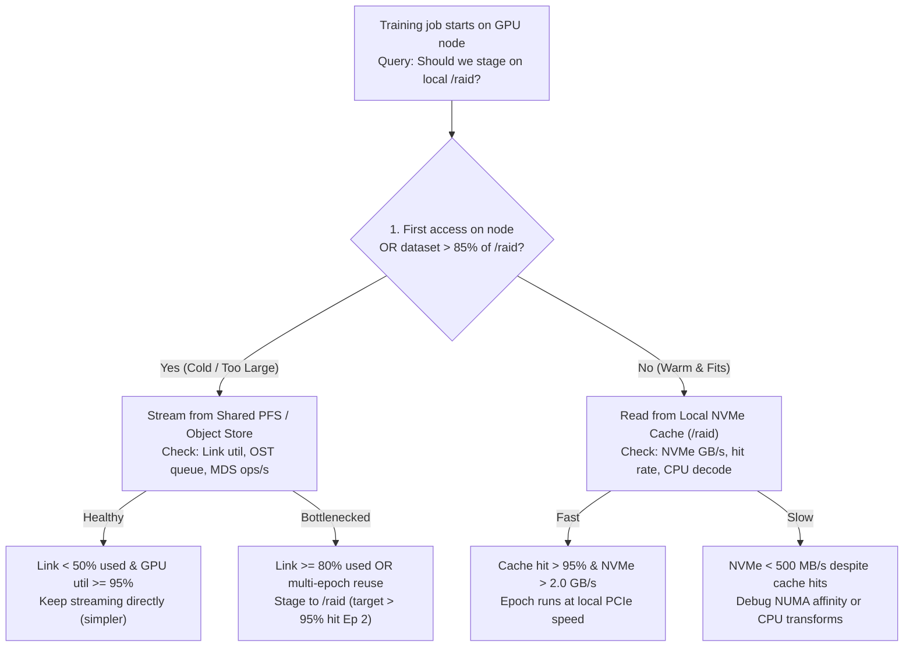
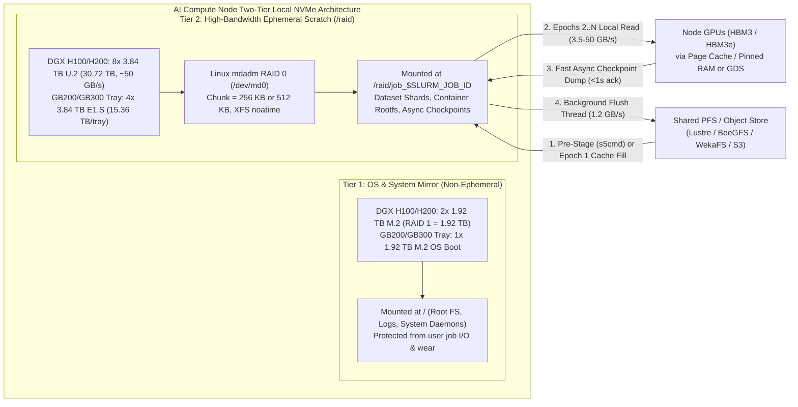

# 13.2 Local NVMe and data staging

| | |
|---|---|
| **Status** | Drafted (`local_nvme_staging_lab.py`: 28 checks pass; bare-metal `mdadm`, `mkfs.xfs`, `nvme`, and `fio` commands **untested** here) |
| **Level** | Intermediate |
| **Priority tier** | 2 |
| **Lab venue** | GCP / GKE + self-checking Python model (`code/part13/local_nvme_staging_lab.py`) |
| **Part** | Part 13: AI storage |
| **Sources used** | `nvidia-devops` V15 Ch. 3 (`chapter-03-local-nvme-and-data-staging.md`) and V15 Lab 02 (`lab-02-benchmark-local-nvme-and-shared-storage.md`); *AI Systems Performance Engineering* (`ai-systems-performance-engineering`); *AI Data Center Network Design and Technologies* (`ai-data-center-network-design-and-technologies`) |
| **Coverage file** | `planning/coverage/chapters/13-02.md` |

## Why this matters for AI infrastructure

In enterprise web infrastructure, the golden rule is the stateless compute node. Local disks are a liability, and all application state lives on remote storage. In large-scale AI training, following that rule too closely turns the storage network into a choke point. The expensive GPUs end up waiting for their next batch of data.

An AI training job rarely reads a dataset just once. A vision or multimodal model may iterate over the same thousands to millions of files for hundreds of epochs. Every one of those passes has to keep thousands of GPUs fed at the same time.

Feeding Tensor Cores takes real bandwidth. Take an eight-GPU node first. It needs about 1.6 GB per second of continuous ingestion. A 72-GPU DGX GB200 or GB300 NVL72 rack needs 14 to 20 GB per second. Both figures work out to roughly 200 MB per second per GPU, or 14.4 GB per second for the rack.

Now scale that up. Picture 256 GPUs spread across eight nodes, or as many as a thousand GPUs across a full pod, all training again and again on the same 500 GB dataset. That dataset holds two million files averaging 260 KB each. Each GPU needs 120 MB per second to stay fed. Across the job, that adds up to about 30.7 GB per second in aggregate.

The shared storage link cannot deliver that cleanly. Opening and checking two million small files adds about 30 percent metadata overhead. So each GPU receives about 110 MB per second, a little less than the 120 MB per second it needs. That shortfall stalls a cold epoch for 245 seconds, and almost all of that time the GPUs wait on data instead of computing.

Checkpointing causes a second and different kind of stall. Writing a 500 GB checkpoint synchronously to shared Lustre at 1.2 GB per second freezes every GPU in the job for about 417 seconds.

Local NVMe solves both problems. It moves the repeated reads and the checkpoint writes off the shared network entirely. Every modern AI server ships with a dedicated bank of PCIe NVMe drives wired directly into the node's own PCIe switches. A DGX H100 or H200 carries 30.72 TB of U.2 scratch space across eight striped drives. A DGX GB200 or GB300 NVL72 compute tray carries 15.36 TB of E1.S scratch, and that scales to 276.48 TB across a full rack.

Used well, that local storage pays for itself quickly. If you cache the dataset after the first epoch, epoch time drops from 245 seconds to 200 seconds. That is an 18 percent speedup, and it lifts GPU utilization to 94 percent. Staging checkpoints locally shrinks the 417-second stall to a one-second handoff.

Local NVMe can also go wrong, and then it adds risk with no payoff. Streaming a dataset that is read only once gains nothing from it. The same is true when scratch space fills past 85 percent, when the RAID 0 stripe is misaligned, and when nothing cleans up between Slurm jobs. Each mistake turns a performance feature into an operational headache while the GPUs gain no speed. **Before you stage anything, ask whether the job will read the same data enough times to repay the copy.**

## Prerequisites and outcomes

Before you start, read the earlier chapters listed below. You should also be comfortable with a few basic Linux storage commands.

**Prerequisites:**
- Chapter 9.2 on the DGX H100 and H200 two-tier NVMe layout and four-switch PCIe Gen5 topology, and Chapter 9.5 on the GB200 and GB300 NVL72 compute tray E1.S layout.
- Chapter 13.1 on the AI storage data path from disk to GPU memory.
- Basic Linux block-storage familiarity with `lsblk`, `df`, `mdadm`, `mount`, and `fio`.

**Outcomes:** By the end of this chapter, you will be able to:
1. Separate the two local NVMe tiers on AI compute nodes: a RAID 1 M.2 boot mirror for the OS, and an ephemeral RAID 0 `/raid` scratch volume. You will also calculate `mdadm` chunk sizes and XFS stripe alignment for each.
2. Calculate the exact multi-epoch staging break-even point and the speedup from asynchronous checkpoint staging. That tells you when local NVMe pays back its copy cost, and when to skip it.
3. Tune the Linux NVMe block and filesystem stack, including the scheduler, queue depth, read-ahead, `noatime`, and NUMA binding. Then validate throughput across four `fio` AI workload profiles.
4. Monitor NVMe endurance and SMART health, and enforce per-job `/raid` isolation with Slurm Prolog and Epilog hooks.

---

## Concepts: basics → intermediate → advanced

## 1. Why AI compute nodes still need local NVMe: the staging decision path

Why would anyone put local disks back into a GPU node after years of stateless design? In a cloud-native microservice cluster, local NVMe is rarely needed. Requests are small, stateless, and not repeated. An AI factory is different, because two kinds of physics push the design the other way.

The first is read amplification. During multi-epoch training, every worker node reads its assigned shards over and over, across dozens or hundreds of epochs. If you fetch the same bytes across the shared storage fabric on the second, third, and five-hundredth epoch wastes bandwidth and metadata-server capacity. The first epoch already paid that cost once.

The second is the bursty write barrier. Distributed checkpoints dump hundreds of gigabytes to terabytes of state at the same moment, from every rank. Pushing that burst straight over a shared network path stalls GPU compute for minutes at a time, as shown above.

### 1.1 When to use local NVMe, and when to skip it

Local NVMe is an accelerator tier, not a default. Before you add staging logic to a pipeline, check two things. Does the job actually suffer from a storage bottleneck? And does the data get reused enough to repay the cost of copying it?

| Use local NVMe (`/raid`) when... | Skip local NVMe when... |
|---|---|
| Shared storage or its metadata server is the bottleneck: for example a storage link over 80 percent utilized, or millions of small files adding heavy `open`/`stat` latency. | Shared storage has headroom: link under 50 to 60 percent utilized, GPU utilization already at or above 95 percent. |
| The dataset or per-node shard fits within 85 percent of local NVMe capacity and gets read across multiple epochs. | The dataset is a single-epoch pre-training stream over 100 TB that exceeds local scratch and is read only once. |
| Synchronous checkpoint writes pause training, from a few seconds up to hundreds of seconds on large dumps, and those writes can be staged asynchronously instead. | Checkpoints are small, infrequent, or already overlapped in host RAM. |
| Expensive preprocessing or decompression output gets reused across epochs. | Nodes fail often and lack automated cache rehydration and Epilog cleanup. |

Staging moves the second and later epochs onto local PCIe Gen5 NVMe. That storage reads at roughly 3.5 GB per second per filesystem thread, and up to 25 to 50 GB per second across a full RAID 0 array. It takes slow shared-fabric reads and writes off the GPU's critical path. Staging a dataset that is read only once, or one that overflows an 85 percent-full NVMe cache, adds copy latency, eviction churn, and SSD wear. You get nothing back for those costs.



The table turns the flowchart into thresholds you can check on a live node. Each row pairs a metric with the action it triggers. Notice that the streaming path has two outcomes, depending on whether the shared link has headroom.

| Decision Node | Observed Metric Threshold | Action Taken |
|---|---|---|
| **Shared Storage Stream (`Remote`)** | Shared link `< 50%` utilized (`< 60%` ceiling), no I/O stalls | Bypass local staging; stream directly from Lustre / BeeGFS / WekaFS to keep job startup stateless. |
| **Shared Storage Bottleneck (`NeedStage`)** | Shared link `>= 80%` utilized, `MDS` `stat` storm, or `>= 2` epochs with `NVMe / Shared > 2.0x` | Stage dataset shards into `/raid/job_$SLURM_JOB_ID` during Epoch 1 (or via `s5cmd` pre-stage) and verify `> 95%` cache hit rate by Epoch 2. |
| **Warm Local NVMe (`GoodLocal`)** | Cache hit rate `> 95%` (`97.8%–98.3%`), local throughput `> 1.0–3.5 GB/s` | Retain local NVMe cache; monitor `/raid` fill level (`<= 85%`) and `nvme smart-log` health. |
| **Local Path Bottleneck (`BadLocal`)** | `fio` shows 3.5 GB/s, but training sees `< 500 MB/s` (150 MB/s) | Bottleneck is outside the SSD: bind `DataLoader` workers to the NVMe NUMA socket (`numactl`) or offload CPU JPEG/tokenization transforms (DALI). |

Before you build staging logic into a pipeline, measure the shared-link utilization and the epoch count. If both are low, streaming directly is simpler and just as fast.

---

## 2. Two-tier node NVMe architecture and RAID 0 stripe geometry

Imagine a node that reboots after a kernel update, and the training job vanishes with it. Which disks survive that reboot? Every modern NVIDIA system keeps two local NVMe tiers strictly apart, because the answer must be different for each. The first tier holds the operating system, and it must survive a reboot. The second tier holds ephemeral training scratch, which does not have to. Chapter 9.2 covers the DGX H100 and H200 layout, and Chapter 9.5 covers the DGX GB200 and GB300 NVL72 compute tray. This section explains why the split exists and how to size and align it.

### 2.1 The two-tier physical layout: OS RAID 1 vs `/raid` RAID 0 scratch

The first tier holds the operating system and container root, and it must not be ephemeral. On a DGX H100 or H200, two 1.92 TB M.2 NVMe drives mirror each other in RAID 1. That gives 1.92 TB of usable space, mounted at `/`. Suppose one M.2 drive fails during a month-long training run. The node keeps running and never drops its GPUs from the job. A DGX GB200 or GB300 NVL72 compute tray uses a single 1.92 TB M.2 drive for the same purpose.

The second tier is ephemeral scratch for staging data. It is built for speed rather than durability. A DGX H100 or H200 stripes eight 3.84 TB U.2 drives together in software RAID 0, mounted at `/raid`, for 30.72 TB of usable space. Two drives sit behind each of the node's four PCIe Gen5 switches, next to two GPUs and two network cards. That layout delivers about 50.0 GB per second of sequential read bandwidth and 28.0 GB per second of write bandwidth. A GB200 or GB300 compute tray stripes four 3.84 TB E1.S drives the same way. That gives 15.36 TB per tray, which scales to 276.48 TB across an eighteen-tray rack.

RAID 0 makes sense here because `/raid` never holds the only copy of anything. Every dataset cached there has a golden copy on shared storage. Every checkpoint staged there gets flushed to durable storage right away. Parity RAID would waste 12.5 to 25 percent of capacity. It would also add read-modify-write latency during checkpoint bursts, and complicate direct GPU-to-storage DMA.



The table puts the two tiers side by side for each platform. Read down the Tier 1 rows and you will see the OS drives trade speed for redundancy. The Tier 2 rows show the reverse trade.

| Platform & NVMe Tier | Physical Drives & Form Factor | RAID Configuration | Raw / Usable Capacity | Peak Sequential Read / Write | Primary Operational Role |
|---|---|---|---|---|---|
| **DGX H100 / H200 — Tier 1 (OS)** | `2 × 1.92 TB` M.2 NVMe | Hardware RAID 1 | 3.84 TB raw / 1.92 TB usable | ~3.2 GB/s R / ~2.6 GB/s W | DGX OS boot, kernel, system logs; isolated from job wear |
| **DGX H100 / H200 — Tier 2 (`/raid`)** | `8 × 3.84 TB` U.2 NVMe (2 per PCIe Gen5 switch) | Software RAID 0 (`/dev/md0`) | 30.72 TB raw / 30.72 TB usable | ~50.0 GB/s R / ~28.0 GB/s W | Ephemeral dataset cache, shards, async checkpoints |
| **GB200 / GB300 Tray — Tier 1 (OS)** | `1 × 1.92 TB` M.2 NVMe | Single boot drive | 1.92 TB raw / 1.92 TB usable | ~3.2 GB/s R / ~2.6 GB/s W | 1U compute tray Linux OS boot (144 Grace Arm cores + 4 GPUs) |
| **GB200 / GB300 Tray — Tier 2 (`/raid`)** | `4 × 3.84 TB` E1.S (EDSFF) NVMe (72 drives/rack) | Software RAID 0 (`/dev/md0`) | 15.36 TB/tray (276.48 TB/rack) | ~25.0 GB/s R / ~14.0 GB/s W | Rack-distributed shard caching & checkpoint staging |

### 2.2 `mdadm` RAID 0 chunk size and XFS stripe alignment math

Striping several NVMe drives into one `mdadm` RAID 0 array raises a practical question. When your program reads or writes, does the request hit all the drives in parallel, or just one? Two geometry values answer that question.

The chunk size is the amount of data written to one drive before the array moves to the next drive in the stripe. AI training reads and writes mostly in 1 MB to 4 MB blocks. That is why a chunk size of 256 KB or 512 KB works well.

The full stripe width is the amount of data needed to touch every drive exactly once:

```text
W_stripe = N x C
On 8-drive DGX H100 with 512 KB chunk: W_stripe = 8 x 512 KB = 4096 KB = 4.0 MB
```

Work through the eight-drive DGX H100 array with a 512 KB chunk. Its full stripe is 4.0 MB. An aligned 4.0 MB read splits into eight parallel 512 KB requests, one per drive, so it uses 100 percent of the array. An unaligned 64 KB read fits inside one chunk, so it touches only one drive. That uses just 12.5 percent of the array. To reach full speed with small reads, you need enough concurrent requests in flight across your workers to keep every drive busy at once.

To keep the filesystem from splitting files across chunk boundaries, pass the RAID geometry to `mkfs.xfs` in units of the 4 KiB filesystem block:

```text
sunit (or stride) = C / B_fs
swidth (or stripe-width) = N x sunit = (N x C) / B_fs
```

The table below gives the resulting alignment flags for each node type covered in this chapter. Each row pairs an array profile with the exact flag to format it.

| RAID 0 Array Profile | Drives ($N$) | Chunk Size ($C$) | Full Stripe (`W_stripe`) | XFS `sunit` (`4 KiB` blocks) | XFS `swidth` (`4 KiB` blocks) | Exact `mkfs.xfs` Alignment Flag |
|---|---|---|---|---|---|---|
| **DGX H100 / H200 U.2 `/raid`** | 8 | 512 KB | 4096 KB (4.0 MB) | 128 | 1024 | `mkfs.xfs -f -d su=512k,sw=8 /dev/md0` |
| **DGX H100 / H200 U.2 `/raid` (alt)** | 8 | 256 KB | 2048 KB (2.0 MB) | 64 | 512 | `mkfs.xfs -f -d su=256k,sw=8 /dev/md0` |
| **GB200 / GB300 Tray E1.S `/raid`** | 4 | 256 KB | 1024 KB (1.0 MB) | 64 | 256 | `mkfs.xfs -f -d su=256k,sw=4 /dev/md0` |

Copy the flag that matches your drive count and chunk size. Do not guess at alignment values.

Before formatting any local scratch array, match the XFS stripe unit and stripe width to your `mdadm` chunk size and drive count.

---

## 3. Data staging economics: multi-epoch break-even and checkpoint staging math

Local NVMe staging is a trade. You pay an upfront copy cost, and in return each epoch or checkpoint runs faster. The question is whether the return beats the cost. Each case below starts with a story and ends with the arithmetic.

### 3.1 Multi-epoch dataset staging: worked cluster calculation and break-even formula

Picture the eight-node, 256-GPU cluster from earlier. It trains on a 500 GB dataset split into two million small files, and each node has 2 TB of free local NVMe.

Streaming straight from shared Lustre every epoch is slow for the reasons already covered. Metadata overhead on millions of small files drops delivered throughput to about 110 MB per second per GPU. A cold epoch therefore takes 245 seconds.

Caching the dataset on local NVMe changes every epoch after the first. Once the data lives on `/raid`, the data loader reads it back at 3.5 GB per second sustained. That is about 1.75 GB per second for each GPU, comfortably above the 120 MB per second each GPU needs. Epoch time drops from 245 seconds to 200 seconds. That saves 45 seconds per epoch, an 18 percent speedup. Over a ten-epoch run, inline caching saves 405 seconds in total, which cuts run time by about 16.5 percent.

There are two ways to get the data onto `/raid`:

- **Pattern A, inline cache fill:** The data loader reads from Lustre as usual during the first epoch. It also writes a copy to `/raid`. That first epoch still takes the full 245 seconds. Every epoch after it runs at the cached 200-second pace.
- **Pattern B, explicit pre-stage:** A tool like `s5cmd`, parallel `rsync`, or `mpifileutils` copies the dataset to `/raid` before training starts. A Slurm Prolog step typically runs that copy.

If the explicit copy runs at 2.0 GB per second, the arithmetic below gives the copy time and the break-even count:

```text
T_copy = D_GB / B_stage = 500 GB / 2.0 GB/s = 250 seconds
N_be   = T_copy / (T_remote - T_local) = 250 s / 45 s ~= 5.56 epochs (rounds up to 6 epochs)
Pattern A (10 epochs): 2,450 s uncached vs 2,045 s cached = 405 s saved (16.53% speedup)
Pattern B (3 epochs):  850 s pre-staged vs 735 s uncached = 115 s lost
Pattern B (6 epochs):  1,450 s pre-staged vs 1,470 s uncached = 20 s saved (44,750 s / 12.4 h saved over 1,000 epochs)
```

Pre-staging a run shorter than six epochs makes the job slower, not faster. That is the break-even point. Take a three-epoch fine-tuning run. Pre-staging it costs 115 seconds. A six-epoch run, by contrast, comes out 20 seconds ahead. Over long training runs, that per-epoch saving adds up to hours of recovered GPU time.

Before you pre-stage a dataset, count how many epochs the job will actually run. Then compare that number to the break-even point.

### 3.2 Cache hit rate progression, the 85% fill-level cliff, and SHA-256 manifest validation

Two bugs can quietly ruin a cached dataset, even when the break-even math looks good.

The first is eviction thrashing past 85 percent fill. Look at a cache that hits 98.3 percent on the second epoch, then slips to 96.1 percent by the fourth. That slow decline is not random noise. It means `/raid` has crossed 85 percent full and started evicting and garbage-collecting shards in the middle of the run. Keep the cached working set under 85 percent of usable `/raid` capacity. On a 30.72 TB DGX H100 array, that ceiling is 26.11 TB. If a dataset is bigger than that, shard it across nodes instead. For example, split a 100 TB dataset across ten nodes so that each one caches 10 TB.

```text
Cache Hit Progression & Safe Capacity Ceiling:
  - Epoch 1 (cold fill): 0.2% hit rate -> Epoch 2: 98.3% -> Epoch 3: 97.8% -> Epoch 4 (thrashing >85% fill): 96.1%
  - DGX H100 85% safe ceiling: 0.85 x 30.72 TB = 26.11 TB (26,112 GB out of 30,720 GB)
```

The second bug is silent staleness. Suppose an upstream pipeline updates a shard on shared storage. A node's `/raid` cache still holds last week's copy under the same filename. Training then quietly mixes old and new data across nodes, and no error is raised. The fix is to store a SHA-256 hash and byte size for every cached file in a `manifest.json`. Then check that hash before you trust a cache hit.

### 3.3 Asynchronous two-phase checkpoint staging

A single-epoch job never benefits from dataset caching. It still needs `/raid` for one thing, though. Checkpoint writes can move off the GPU's critical path.

A synchronous write of a 500 GB checkpoint to shared Lustre at 1.2 GB per second stalls the job. The arithmetic shows how long:

```text
T_sync  = 500 GB / 1.2 GB/s = 416.67 seconds (~417 seconds, ~7 minutes at 0% GPU compute)
T_local = 500 GB / 3.5 GB/s = 142.86 seconds (~143 seconds background local write)
T_async = 1.0 second handoff -> 416.67x (~417x) critical-path speedup
```

During a synchronous write, every GPU in the job sits idle, waiting on disk. Two-phase local staging removes that wait:

1. **Phase 1, host memory to `/raid`:** A background thread copies the checkpoint from pinned host memory to `/raid` at 3.5 GB per second. The training loop waits only about one second for the memory handoff to start, then it resumes. That is a 417x speedup on the critical path.
2. **Phase 2, `/raid` to shared Lustre:** Once the local file closes, a separate background thread copies it to shared Lustre at 1.2 GB per second. The thread deletes the local copy with `os.remove` as soon as that flush finishes. That keeps `/raid` from filling up across checkpoints.

Before you add a synchronous checkpoint write to a training loop, ask whether a background flush thread could do the same work without stalling the GPUs.

---

## 4. Tuning the Linux NVMe and filesystem stack for GPU pipelines

A `/raid` array can be fast on paper and still feed the GPUs too slowly. The usual reason is the stock Linux install. Its block devices are tuned for general-purpose virtual machines and databases, not for multi-gigabyte-per-second GPU pipelines. Getting full bandwidth out of `/raid` means adjusting four layers of the host stack.

### 4.1 `blk-mq` scheduler (`none` vs `mq-deadline`), queue depth (`nr_requests`), and `read_ahead_kb`

Modern Linux sends NVMe I/O through a multi-queue block layer. It maps one submission queue per CPU core directly onto the NVMe hardware queues. The older design funneled every request through one lock-contended queue, which is how legacy SATA drives worked.

Three settings matter most:

- **I/O scheduler** (`/sys/block/nvmeXn1/queue/scheduler`): Set it to `none`, which sends requests straight to the hardware with minimal overhead. Choose `mq-deadline` instead if mixed read and write checkpoint traffic needs bounded write latency. Fairness schedulers like `bfq` add CPU spinlock overhead that NVMe does not need.
- **Queue depth** (`nr_requests`): Raise it to at least 512, ideally 1023. Parallel data loader workers with deep prefetch queues can then keep the array saturated.
- **Read-ahead** (`read_ahead_kb` and `blockdev --setra`): The Linux default is just 128 KB. That triggers far too many small I/O cycles when you stream large shard files. Raising it to 4096 KB matches a full eight-drive RAID 0 stripe, and it lets prefetch run across every drive in the array.

There is one exception. Pure random `O_DIRECT` workloads bypass the page cache entirely. GPUDirect Storage reads and DeepSeek's 3FS filesystem are examples. For these, keep read-ahead at 128 KB or lower, so the kernel does not fetch pages nobody will use. DeepSeek's 3FS applies the same design at cluster scale. It sustains 6.6 TB per second and peaks at 7.3 TB per second across a 68-node NVMe cluster.

### 4.2 Filesystem selection (XFS with `noatime`), `io_uring`, and `DataLoader` / GDS integration

Three more settings sit above the block layer. They decide whether that raw throughput actually reaches the GPU.

To start, you should mount `/raid` with `noatime`. Without it, every read during training writes metadata back to disk, just to update the file's last-access timestamp. That turns a pure read workload into a mixed read-write one, and it gains you nothing.

Pack the small files before training starts. A million small files read one at a time cost an order of magnitude more than the same data read as contiguous 1 MB chunks. Tools like NVIDIA NeMo Curator or WebDataset should combine them into shards offline instead. When random reads are unavoidable, use `io_uring` with pre-registered buffers, rather than one `pread()` call per file.

Tune the PyTorch `DataLoader` itself. Set `num_workers=8`, `pin_memory=True`, and `persistent_workers=True`, so workers do not respawn at every epoch boundary. Set `prefetch_factor=4`, so the next batch transfers while the GPU computes. Profile with `num_workers=0` first, which isolates pure Python and storage latency. Then check the copy lane in Nsight Systems to see transfer time separately. Cutting GPU I/O wait from 30 percent of each step down to 5 percent improves step time accordingly.

If CPU cores are pegged decoding JPEGs across eight cores, offload the decode to the GPU with NVIDIA DALI. That typically drops CPU usage to two cores. Or store compressed batches, and let Blackwell's hardware Decompression Engine unpack them in the pipeline over its 900 GB per second NVLink-C2C link.

The fastest option skips the CPU entirely. GPUDirect Storage pulls data straight from `/raid` into GPU memory over the local PCIe switch. Benchmarks with `gdsio` show this path reaching 9.6 GB per second at 1.00 ms latency. The host-memory path reaches 8.0 GB per second at 1.25 ms. That is a 20 percent improvement in both throughput and latency.

Before you blame the SSDs for a slow training loop, check the filesystem mount flags, the read-ahead setting, and the CPU decode threads.

---

## 5. Benchmarking local NVMe vs shared storage, SMART endurance, and Slurm lifecycle

A `/raid` volume deserves a few checks before you trust it with a multi-week job. Benchmark it under the access patterns that training really produces. Confirm that checkpoint traffic will not wear the drives out early. And make sure cleanup between jobs happens automatically.

### 5.1 The four AI storage benchmark profiles (`fio` and `dd` baseline vs shared PFS)

A single sequential-read number on a datasheet never tells the whole story. Production benchmarks cover four access patterns, and each one mirrors a real training phase: loading a model once, streaming batches continuously, reading randomly or hammering metadata, and bursting checkpoint writes. The table lists each profile with its expected baseline on local NVMe and on a shared PFS.

| Workload Profile | Access Pattern | Representative File / I/O Size | Block Size (`bs`) | Concurrency | Expected Local NVMe Baseline | Expected Shared PFS Baseline |
|---|---|---|---|---|---|---|
| **1. Model Load** | Large sequential read once per job/epoch | 10 GB–100 GB | 1 MB | 1 job, `O_DIRECT` | **3.5 GB/s** | **`1.5–3.0 GB/s`** |
| **2. Batch Stream** | Parallel medium-block streaming reads | 1 GB (`1,000 × 1 MB`) | 64 KB | 8 jobs, `iodepth=16` | **2.8 GB/s** | **`3.0–5.0 GB/s`** aggregate |
| **3. Random Read / Metadata Storm** | 4 MB random reads OR small-file `stat`/`open` storm | 10 GB or `10K–1M` 100 KB files | 4 MB or 4 KB | 1 job (`iodepth=32`) or 16 metadata workers | **1.2 GB/s**; **`50K+` ops/s** local metadata | **`1K–5K` ops/sec** on shared `MDS` |
| **4. Checkpoint Burst** | Concurrent sequential write burst across ranks | 500 MB per rank | 4 MB | 1–8 ranks, `iodepth=16` | **`2.1–3.5 GB/s`** per writer | **1.2 GB/s** shared write rate |

Three rules of thumb come out of these numbers. First, if local NVMe beats shared storage by more than 2x on the model-load test, local caching and async checkpoint staging are worth doing. Suppose you measure 3.5 GB per second on NVMe and 1.5 GB per second on shared storage. A tenfold gap means staging saves 90 percent of the synchronous wait.

Second, if shared metadata throughput falls under 10,000 operations per second when you open thousands or millions of small files, repackage those files into roughly 10,000 contiguous shards before staging them.

Third, if `fio` reports 3.5 GB per second on `/raid` but training only sees 150 MB per second, the SSDs are not the problem. The bottleneck lies elsewhere, usually in NUMA placement or in single-threaded Python decoding.

### 5.2 NVMe endurance math (DWPD, TBW, WAF) and SMART health monitoring

Dataset caching is mostly reads. Aggressive checkpoint staging, though, can write tens of terabytes a day to `/raid`. NAND flash wears out after a finite number of program and erase cycles. Enterprise NVMe drives are therefore rated in Drive Writes Per Day, or DWPD, over a five-year warranty. A rating of 1.0 DWPD suits dataset caching and moderate checkpointing. A rating of 3.0 DWPD suits heavier, continuous checkpoint traffic.

The total terabytes written budget of a drive, or TBW, and the effect of the Write Amplification Factor, or WAF, are computed as follows:

```text
TBW = S_TB x DWPD_rated x 365 x Y
Single 3.84 TB drive (1.0 DWPD, 5 yr / 1,825 days): 3.84 x 1.0 x 365 x 5 = 7,008.0 TB (~7 PB; 8-drive array = 56,064 TB / 56.06 PB)
W_NAND,daily = W_host,daily x WAF
Effective DWPD = W_NAND,daily / S_TB
L_years = TBW / (W_NAND,daily x 365)
Healthy case (2.5 TB/day host, WAF 1.2):   3.0 TB/day NAND -> 0.7812 DWPD -> 6.40 years lifespan
Unhealthy case (12.0 TB/day host, WAF 1.5, 92% full): 18.0 TB/day NAND -> 4.6875 DWPD -> 1.07 years lifespan
```

Take the healthy case first, since it is the one you hope to see. A host writes 2.5 TB per day with aligned 4 MB checkpoint writes, and the WAF is 1.2. The NAND then sees 3.0 TB per day, or about 0.78 effective DWPD. That gives an estimated 6.4-year lifespan, comfortably inside the five-year warranty.

Now take the unhealthy case. A job hammers a 92 percent-full drive with unaligned small writes, at 12.0 TB per day, with a WAF of 1.5. NAND writes jump to 18.0 TB per day. That uses up the drive's lifetime budget in just 1.07 years.

Watch four `nvme smart-log` and `smartctl` counters on every drive:
- `percentage_used`: alert at 90 percent or higher, and schedule replacement.
- `available_spare`: drain the node immediately at 10 percent or below.
- `temperature`: the normal range is 35 to 55 degrees Celsius. At 70 degrees Celsius or higher, or 343 Kelvin, the controller throttles throughput by 30 to 70 percent.
- `media_errors`: must stay at zero, since RAID 0 has no parity to recover a bad sector.

### 5.3 Multi-tenant Slurm Prolog and Epilog lifecycle for `/raid`

Hardcoded paths such as `/raid/my_dataset` cause trouble. A crashed or killed job eventually leaves orphaned files behind. Those orphans silently fill `/raid` to 100 percent, and then they break every job scheduled on that node afterward.

The fix is to put scratch lifecycle management in root-owned Slurm hooks, not in the user's own script:

1. Prolog runs before the job starts. It sweeps any orphaned job directories left by previous jobs. Next, it checks that the new job's request fits within an 85 percent safe capacity ceiling, or 26,112 GB on a 30,720 GB array. Then it creates a fresh `/raid/job_$SLURM_JOB_ID` directory owned by the job's user.
2. Epilog runs after the job ends, whether it finished normally or was killed. It waits for any background checkpoint flush to finish. Then it deletes the job's scratch directory and runs `fstrim`, so the NVMe controller can reclaim free blocks.

Put cleanup in Prolog and Epilog, not in the training script itself. A `SIGKILL` from an out-of-memory event or a wall-clock timeout skips Python's cleanup handlers entirely.

---

## Commands and configurations that matter

### 1. Provisioning an Aligned `mdadm` RAID 0 `/raid` Volume and Tuning `blk-mq`

```bash
# 1. Inspect the two NVMe tiers (2x 1.92 TB M.2 OS RAID 1 vs 8x 3.84 TB U.2 scratch) (untested here)
lsblk -o NAME,MODEL,SIZE,TYPE,FSTYPE,MOUNTPOINT | grep -E "nvme|md"
nvme list

# 2. Create an 8-drive RAID 0 array with a 512 KB chunk size (4.0 MB full stripe) (untested here)
mdadm --create /dev/md0 --level=0 --raid-devices=8 --chunk=512 \
  /dev/nvme{0,1,2,3,4,5,6,7}n1

# 3. Format XFS aligned to chunk=512k and 8 drives (sunit=128, swidth=1024 4KiB blocks) (untested here)
mkfs.xfs -f -d su=512k,sw=8 -l su=256k,version=2 /dev/md0

# 4. Mount /raid with noatime,nodiratime to eliminate per-read inode atime writes (untested here)
mkdir -p /raid
mount -o defaults,noatime,nodiratime,logbufs=8,logbsize=256k /dev/md0 /raid
df -h /raid

# 5. Tune Linux blk-mq scheduler (none), queue depth (1023), and read-ahead (4096 KB = 8192 sectors) (untested here)
for dev in /sys/block/nvme*n1; do
  echo none > "${dev}/queue/scheduler"
  echo 1023 > "${dev}/queue/nr_requests"
  echo 4096 > "${dev}/queue/read_ahead_kb"
done
blockdev --setra 8192 /dev/md0
```

### 2. Benchmarking Local NVMe vs Shared Storage (`fio` and `gdsio`)

```bash
# Workload 1: Model Load (10 GB sequential read, 1 MB blocks, O_DIRECT) (untested here)
dd if=/dev/zero bs=1M count=10000 of=/raid/model-test.bin oflag=direct
time dd if=/raid/model-test.bin bs=1M count=10000 of=/dev/null iflag=direct

# Workload 2: Batch Streaming (64 KB blocks, 8 parallel jobs, iodepth=16) (untested here)
fio --name=batch-stream --ioengine=libaio --rw=read --bs=64k --size=1G \
    --direct=1 --iodepth=16 --numjobs=8 --filename=/raid/batch-test.bin

# Workload 3: Random Read (4 MB blocks, iodepth=32) (untested here)
fio --name=random-read --ioengine=libaio --rw=randread --bs=4M --size=10G \
    --direct=1 --iodepth=32 --numjobs=1 --filename=/raid/random-test.bin

# Workload 4: Checkpoint Burst Write (4 MB blocks, 500 MB per rank) (untested here)
fio --name=checkpoint-write --ioengine=libaio --rw=write --bs=4M --size=500M \
    --direct=1 --iodepth=16 --numjobs=1 --filename=/raid/checkpoint-test.bin

# Compare CPU-mediated (-x 2: 8.0 GB/s, 1.25 ms) vs GPUDirect Storage (-x 0: 9.6 GB/s, 1.00 ms) (untested here)
/usr/local/cuda/gds/tools/gdsio -f /raid/large_file -d 0 -w 4 -s 10G -i 1M -I 0 -x 2
/usr/local/cuda/gds/tools/gdsio -f /raid/large_file -d 0 -w 4 -s 10G -i 1M -I 0 -x 0
```

### 3. Checking NVMe SMART Health, Checksum Manifests, Async Checkpointing, and Slurm Hooks

```bash
# Inspect SMART wear-leveling (percentage_used, available_spare), temperature, and media_errors (untested here)
for i in {0..7}; do
  echo "=== /dev/nvme${i}n1 ==="
  nvme smart-log "/dev/nvme${i}n1" | egrep "temperature|available_spare|percentage_used|media_errors"
  smartctl -a "/dev/nvme${i}n1" | egrep -i "Temperature|Spare|Percentage|Media|Firmware"
done
iostat -xz 1 5
```

```python
# Asynchronous two-phase checkpoint staging + SHA-256 cache validation (from V15 Ch 3)
import hashlib
import json
import os
import shutil
import threading


def compute_file_hash(path: str) -> str:
    h = hashlib.sha256()
    with open(path, "rb") as f:
        for chunk in iter(lambda: f.read(1048576), b""):
            h.update(chunk)
    return h.hexdigest()


def cache_fetch_with_validation(shared_path: str, cache_path: str, manifest_path: str) -> str:
    manifest = json.load(open(manifest_path)) if os.path.exists(manifest_path) else {}
    source_hash = compute_file_hash(shared_path)
    key = os.path.basename(shared_path)
    if key in manifest and manifest[key]["hash"] == source_hash and os.path.exists(cache_path):
        return cache_path  # Verified cache hit
    shutil.copy2(shared_path, cache_path)
    manifest[key] = {"hash": source_hash, "size": os.path.getsize(cache_path)}
    with open(manifest_path, "w") as f:
        json.dump(manifest, f)
    return cache_path


def stage_checkpoint_async(save_fn, state_dict, epoch: int, job_scratch: str, durable_dir: str):
    nvme_path = os.path.join(job_scratch, f"ckpt-{epoch}.pt")
    durable_path = os.path.join(durable_dir, f"ckpt-{epoch}.pt")
    save_fn(state_dict, nvme_path)  # Fast local NVMe write (3.5+ GB/s)

    def _flush():
        shutil.copy2(nvme_path, durable_path)
        os.remove(nvme_path)  # Reclaim /raid space immediately after durable flush

    t = threading.Thread(target=_flush, daemon=False)
    t.start()
    return t
```

```bash
# Slurm Prolog (/etc/slurm/prolog.d/50-local-nvme.sh) & Epilog (/etc/slurm/epilog.d/50-local-nvme.sh) (untested here)
# Prolog: create isolated per-job scratch directory on /raid
JOB_SCRATCH="/raid/job_${SLURM_JOB_ID}"
mkdir -p "${JOB_SCRATCH}"
chown "${SLURM_JOB_USER}:${SLURM_JOB_USER}" "${JOB_SCRATCH}"
chmod 0700 "${JOB_SCRATCH}"
echo "export LOCAL_SCRATCH=${JOB_SCRATCH}"

# Epilog: unconditionally remove per-job scratch directory on job exit/cancel/timeout
rm -rf "/raid/job_${SLURM_JOB_ID}"
```

---

## How it fails

Each row starts from a symptom you can see on a node and ends with the fix. Start from the discriminating evidence column, since it tells you which failure you are looking at.

| Failure Mode | Observed Symptom | Discriminating Evidence | Root Cause | Remediation |
|---|---|---|---|---|
| **1. Cache Eviction Thrashing / `/raid` Full (`> 85%` Fill)** | Epoch 2 starts fast (98.3% hit rate), but Epoch 4 slows down (96.1% or lower) or crashes with `ENOSPC` | `df -h /raid` shows **`> 85%–100%`** used; orphaned `job_*` folders or a dataset `> 85%` of `/raid` | Dataset + uncleaned checkpoints exceed safe 85% NVMe capacity, triggering eviction churn and high WAF | Enforce Slurm Epilog cleanup, delete staged checkpoints after flush, and shard datasets across nodes |
| **2. `fio` Shows 3.5 GB/s, but Training Sees 150 MB/s** | Raw NVMe benchmark is fast, yet `DataLoader` starves GPUs | `numactl --hardware` shows workers on `NUMA 1` while NVMe is on `NUMA 0`; `perf record -g` shows 800% CPU in Python JPEG decode | Cross-socket NUMA traversal penalty or single-threaded Python CPU decode bottleneck | Pin workers to the NVMe NUMA node, set `pin_memory=True`, `persistent_workers=True`, and offload decode to DALI |
| **3. Identical Nodes, but Node B's NVMe Is 30% Slower** | Node B lags every epoch and becomes the `AllReduce` straggler | `smartctl -a` shows `Temperature >= 70°C` (74°C, thermal throttle active), mismatched firmware, or busy `iostat` during idle | Thermal throttling from blocked airflow, stale firmware, or background `fstrim`/GC mid-job | Restore cooling (`< 55°C`), align firmware across nodes, restrict `fstrim` to Epilog or maintenance windows |
| **4. Silent Stale-Cache Data Corruption Across Runs** | Model loss diverges or differs between nodes after a dataset update | Local `/raid` files have old `mtime` and mismatched SHA-256 hashes versus shared storage | Local cache keyed only by filename, with no hash or size check | Validate a `manifest.json` (SHA-256 hash + size) on job startup before accepting any cached file |
| **5. Misaligned RAID 0 Stripe or Missing `noatime`** | Sequential write reaches `< 40%` of the array's rating; high metadata IOPS during pure-read training | `xfs_info` shows `sunit=0 swidth=0`; mount shows `relatime`; `read_ahead_kb` is 128 | `mkfs.xfs` omitted `su/sw`, atime writes on every read, and 128 KB read-ahead under-pipelines stripes | Format with `su=512k,sw=8`, mount `noatime,nodiratime`, set `scheduler=none`, `read_ahead_kb=4096` |
| **6. Single-Drive Media Error Destroys `/raid` (RAID 0)** | Job fails with `Input/output error (EIO)`; `/dev/md0` goes offline | `nvme smart-log` shows `media_errors > 0` or `available_spare` below threshold on one drive | RAID 0 has zero redundancy; one failed drive invalidates the entire stripe | Alert on `percentage_used >= 90%`, `available_spare <= 15%`, and `media_errors > 0`; drain node and rebuild |

---

## Hands-on lab

### Venue and Scope

Run this lab on GCP or GKE, using Local SSD NVMe scratch disks attached with `--local-ssd-interface=NVME`. You can also run it on any workstation with the deterministic Python model in `code/part13/local_nvme_staging_lab.py`. The destructive bare-metal commands above, including `mdadm`, `mkfs.xfs`, `blockdev`, `nvme`, `fio`, and `gdsio`, were not run on live hardware. Run those only on scratch hardware you can rebuild.

The lab runs 28 self-checks. The table groups them by theme, so a failing check points you back to the matching part of this chapter.

| Check range | What it verifies |
|---|---|
| 1–3 | Two-tier hardware profiles: DGX H100/H200 (1.92 TB RAID 1 OS, 30.72 TB RAID 0 scratch at 50.0 GB/s read) and GB200/GB300 tray (15.36 TB/tray, 276.48 TB/rack). |
| 4–6 | `mdadm` chunk size and XFS stripe alignment: `8 × 512 KB = 4.0 MB` full stripe (`sunit=128`, `swidth=1024`), `4 × 256 KB = 1.0 MB` full stripe (`sunit=64`, `swidth=256`), and stripe utilization from 12.5% on a 64 KB read to 100% on a 4 MB read. |
| 7–11 | Dataset staging break-even and async checkpoint math: inline cache fill (`245 s` to `200 s`, saving `405 s` over 10 epochs), explicit pre-staging break-even at 6 epochs, the 85% capacity rejection rule (`1,800 GB` rejected on `2,048 GB`), and checkpoint staging (`417 s` sync vs `143 s` local vs `1 s` async handoff). |
| 12–14 | Linux `blk-mq`, read-ahead, `noatime`, and NUMA audit: healthy versus degraded configurations, plus the `mq-deadline` and 128 KB read-ahead exception for pure random `O_DIRECT` workloads. |
| 15–18 | NVMe DWPD/TBW endurance and SMART health: `7,008 TBW` lifetime budget, thermal throttle alert at 74°C, wear warning at 92% used, and critical alerts on low spare or nonzero media errors. |
| 19–28 | Slurm Prolog/Epilog lifecycle and cluster math: 85% safe fill ceiling (`26,112 GB`), orphan leak (`39.06%` to `91.15%` rejected) and recovery (`52.08%` admitted, `0.0%` post-Epilog), 256-GPU Lustre sizing, and 72-GPU NVL72 ingestion sizing. |

### Running the Lab

```bash
python3 -B code/part13/local_nvme_staging_lab.py
```

The expected output below shows what a clean run looks like. If your run prints a different summary line, start with the check range that failed.

Expected output (verified here):

```text
=== Chapter 13.2 Lab: Local NVMe and Data Staging ===
  [PASS] 1. DGX H100/H200 OS tier uses 2x 1.92 TB M.2 NVMe in RAID 1 (3.84 TB raw, 1.92 TB usable, non-ephemeral)
  [PASS] 2. DGX H100/H200 scratch tier uses 8x 3.84 TB U.2 NVMe in RAID 0 at /raid (30.72 TB usable, 50.0 GB/s seq read)
  [PASS] 3. GB200/GB300 1U compute tray uses 1x 1.92 TB M.2 OS drive + 4x 3.84 TB E1.S RAID 0 scratch (15.36 TB/tray, 276.48 TB/rack)
  ...
  [PASS] 27. ASP Ch 5 NVL72 rack ingestion: 72 GPUs * 200 MB/s = 14.4 GB/s (within the 14–20 GB/s rack streaming range)
  [PASS] 28. Striping 15 TB/day of checkpoints across 8x 3.84 TB drives (1.875 TB/drive/day, WAF 1.2) yields 2.25 TB/day NAND writes (0.5859 DWPD, 8.53 years lifespan)

Summary: 28 passed, 0 failed
```

---

## Common first mistakes

Watch for these five mistakes. Each one looks harmless until a job fails or a node goes down.

1. Pre-staging a dataset for a short fine-tuning run costs you more than it saves. Copying 500 GB at 2.0 GB per second takes 250 seconds up front, and caching saves only 45 seconds per epoch. Any run shorter than six epochs therefore finishes slower than it would by streaming directly.
2. Writing checkpoints or container layers onto the OS root partition, instead of `/raid`, is an easy slip. Filling or wearing out the 1.92 TB M.2 boot drives crashes system daemons such as `kubelet`, `slurmd`, and `containerd`, and that takes the whole node down. Point `TMPDIR`, `TORCH_HOME`, `HF_HOME`, and the container runtime graph root at `/raid` instead.
3. Relying on a Python `try/finally` block to clean up `/raid` does not work. A GPU fault, an out-of-memory kill, or a Slurm wall-time limit sends `SIGKILL`, which bypasses Python cleanup entirely. That leaves multi-terabyte orphan directories behind. Cleanup belongs in the root-level Slurm Epilog, backed by a Prolog orphan sweep.
4. Staging millions of tiny files onto `/raid` without packing them first. Local NVMe copes with a metadata storm far better than a shared Lustre metadata server does. Even so, opening millions of individual files burns CPU on syscall overhead, and it prevents full-stripe 4 MB RAID 0 reads. Pack the files into WebDataset, Parquet, or `.bin` and `.idx` shards before you stage them.
5. Forgetting to delete staged checkpoints after the background flush completes. If you leave local copies behind, at 500 GB per checkpoint, those copies on a 2 TB scratch volume fill `/raid` after just four checkpoints. The job then crashes mid-run.

---

## Exercises

Every number you need for the six exercises below sits in the reference block at the end of this section. Use it to check your answers.

1. Two node layouts. Compare the DGX H100 and H200 drive layout with a DGX GB200 or GB300 NVL72 compute tray. Work out the usable scratch capacity per node or tray, and for an eighteen-tray rack. Explain why `/raid` uses RAID 0 while the OS tier uses RAID 1. Then compute the full stripe width, `sunit`, and `swidth` for the eight-drive and the four-drive arrays. Finally, say what share of the drives a 64 KB read activates, and what share a 4 MB read activates.
2. When does staging a dataset pay off? A 500 GB dataset of two million files trains on a node with 2 TB of local NVMe. Cold Lustre epochs take 245 seconds and warm NVMe epochs take 200. First, fill the cache inline during epoch one. Calculate the wall-clock time for ten epochs with and without local NVMe, and the percentage speedup. Then pre-stage at 2.0 GB per second instead. Compute the copy time and the break-even epoch count, and the net time gained or lost on a three-epoch and a six-epoch run.
3. How long does a checkpoint stall the job? A distributed job writes a 500 GB checkpoint. Shared Lustre sustains 1.2 GB per second, local NVMe 3.5 GB per second, and the asynchronous handoff acknowledges in one second. Compute the synchronous stall to Lustre, the local NVMe write time, and the critical-path speedup. Then find the shortest safe interval between checkpoints, so the background flush finishes before the next one starts.
4. Why is the data loader slow? Suppose `fio` on `/dev/md0` reads 3.5 GB per second, but the PyTorch loop gets only 150 MB per second and the GPUs sit at 65 percent. Inspection shows five problems: scheduler `bfq`, queue depth 128, read-ahead 128 KB, `/raid` mounted with `relatime`, and workers on the wrong NUMA node. Write the Linux command that fixes each one for sequential shard streaming. Then say how `read_ahead_kb` should differ for random `O_DIRECT` reads. Finally, state the `gdsio` gain from switching to GPUDirect Storage.
5. How long will the drives last? Each of the eight U.2 drives in a DGX H100 `/raid` array holds 3.84 TB and is rated at 1.0 DWPD over five years. Compute the lifetime TBW for one drive and for the array. Then find the daily NAND writes, effective DWPD, and lifespan for 2.5 TB per day of host writes at a WAF of 1.2. Repeat for 15.0 TB per day of checkpoint traffic striped across all eight drives. Finally, give the alert thresholds for `percentage_used`, `available_spare`, `temperature`, and `media_errors`.
6. Why does the second job fail admission? A DGX H100 `/raid` array has 30,720 GB usable and an 85 percent safe fill ceiling. Compute the safe allocatable capacity. A killed 12,000 GB job leaves an orphan, and a new 16,000 GB job is then refused. Explain why. Show how an orphan sweep in Prolog and a cleanup in Epilog let the job in, and give the fill percentage during and after the second job.

```text
Exercise Input Parameters & Expected Verification Targets (code/part13/local_nvme_staging_lab.py):
  - Ex 1 (Topology/RAID): DGX H100/H200 = 2x 1.92 TB M.2 RAID 1 (3.84 TB raw, 1.92 TB usable) + 8x 3.84 TB U.2 RAID 0 (30.72 TB usable, 6.25 GB/s/drive, 50.0 GB/s R, 28.0 GB/s W). GB200/GB300 tray = 1x 1.92 TB M.2 + 4x 3.84 TB E1.S RAID 0 (15.36 TB/tray, 18 x 15.36 = 276.48 TB/rack, 25.0 GB/s R, 14.0 GB/s W). 8x 512 KB chunk (4 KiB block): W_stripe = 4096 KB (4.0 MB), sunit = 128, swidth = 1024; 64 KB read = 0.125 chunk = 1/8 drives (12.5%) vs 4 MB = 8/8 drives (100%). 4x 256 KB chunk: W_stripe = 1024 KB (1.0 MB), sunit = 64, swidth = 256.
  - Ex 2 (Break-Even):    500 GB (2,000,000 files, 260 KB avg), 2 TB local NVMe; cold Lustre = 245 s (156.25 MB/s raw at 1.25 Gbps/GPU or 12.5 Gbps/2-GPU slice, 30% metadata overhead -> 110 MB/s vs 120 MB/s demand, 30.72 GB/s across 256 GPUs on 8 nodes / 32 GPUs per unit or 1,000 GPUs/pod); warm NVMe = 200 s (45 s saved/epoch, 18% speedup). Pattern A (10 epochs): 2,450 s vs 245 + 9 x 200 = 2,045 s (405 s saved, 16.53%). Pattern B (2.0 GB/s): T_copy = 250 s, N_be = 250 / 45 = 5.5556 (~5.56 -> 6 epochs); 3 epochs = 850 s vs 735 s (-115 s loss); 6 epochs = 1,450 s vs 1,470 s (+20 s gain).
  - Ex 3 (Checkpoints):   500 GB checkpoint: Lustre sync (1.2 GB/s) = 416.67 s (~417 s); local NVMe write (3.5 GB/s) = 142.86 s (~143 s); async handoff = 1.0 s (416.67x / ~417x critical-path speedup). Minimum safe interval without double-buffering = 416.67 s (~417 s) so NVMe -> Lustre flush + os.remove() completes.
  - Ex 4 (Linux/GDS):     3.5 GB/s fio vs 1.5 GB/s shared = 2.33x (> 2.0x rule; 10x saves 90%); training stuck at 150 MB/s (65% GPU util). Remediate: scheduler bfq -> none/mq-deadline, nr_requests 128 -> 1023, read_ahead_kb 128 -> 4096 (blockdev --setra 8192), mount relatime -> noatime,nodiratime, pin workers to NUMA 0. Random O_DIRECT (GDS / DeepSeek 3FS): keep read_ahead_kb <= 128 KB. gdsio: -x 2 (CPU) = 8.0 GB/s at 1.25 ms vs -x 0 (GDS) = 9.6 GB/s at 1.00 ms (+20% throughput, -20% latency).
  - Ex 5 (Endurance):     3.84 TB at 1.0 DWPD over 5 yr (1,825 days) = 7,008.0 TBW/drive (56,064 TB / 56.06 PB for 8 drives). At 2.5 TB/day host (WAF 1.2): 2.5 x 1.2 = 3.0 TB/day NAND, 0.7812 DWPD, 6.40 yr lifespan. At 15.0 TB/day across 8 drives (1.875 TB/drive/day, WAF 1.2): 2.25 TB/day NAND, 0.5859 DWPD, 8.53 yr lifespan. SMART thresholds: percentage_used >= 90%, available_spare <= 10% (warn <= 15%), temperature >= 70°C (343 K, normal 35–55°C, throttles 30%–70%), media_errors > 0.
  - Ex 6 (Slurm Hooks):   30,720 GB x 0.85 (15% headroom) = 26,112 GB safe ceiling. Orphaned job_1001 = 12,000 GB (39.06% fill) + job_1002 = 16,000 GB -> 28,000 GB (91.15% fill > 85%, rejected). With Prolog sweep + Epilog rm -rf: job_1001 swept, job_1002 admitted at 16,000 / 30,720 = 52.08% fill, returning to 0.0% after Epilog.
```

---

## Interview angles

1. **"We added 30 TB of local NVMe to every GPU node, but the first epoch is still slow, and our one-epoch pre-training job saw zero speedup on data loading. Was the local NVMe a waste?"**
   A strong answer separates two jobs that local NVMe does: dataset caching and checkpoint staging. The first epoch is always a cold cache miss, unless the data was pre-staged. A single-epoch petabyte pre-training stream that exceeds `/raid` capacity can never be fully cached. That same run still benefits from asynchronous checkpoint staging, which turns a 417-second synchronous Lustre write into a one-second local handoff. State the break-even formula directly. Dividing the upfront copy time by the per-epoch savings shows that a 250-second copy saving 45 seconds per epoch needs at least six epochs to pay off.

2. **"Why does a DGX H100 use RAID 1 for its two M.2 drives but RAID 0 for its eight U.2 `/raid` drives? Doesn't RAID 0 risk losing data if one SSD dies?"**
   The two tiers have different durability needs. The M.2 drives hold the OS and system services, so RAID 1 keeps the node alive if one boot drive fails. The U.2 `/raid` volume holds only ephemeral data. That means cached copies of shards that live permanently on shared storage, and checkpoints that get flushed to durable storage right away. RAID 0 gives that volume its full 30.72 TB of capacity and full bandwidth, about 50 GB per second read and 28 GB per second write. Parity schemes like RAID 5 or 6 would bring the parity overhead and GPUDirect Storage alignment problems that RAID 0 avoids.

3. **"Your `fio` benchmark on `/raid` hits 3.5 GB per second per job, but PyTorch's `DataLoader` only feeds the GPUs at 150 MB per second. How do you find the bottleneck?"**
   Walk up the stack one layer at a time. First, check `numactl --hardware` and `nvidia-smi topo -m`. They show whether the data loader workers run on the wrong NUMA socket, relative to the NVMe drives. Second, profile with `num_workers=0` or `perf record -g`. That reveals whether CPU cores are pegged decoding JPEGs or tokenizing text in Python. DALI or offline NeMo Curator shards would fix that. Third, check whether the dataset is millions of small files, because small reads may be too small to span more than one of the eight RAID 0 drives. Fourth, confirm that `pin_memory`, `persistent_workers`, `prefetch_factor`, `noatime`, and `read_ahead_kb` are all set correctly.

---

## Checkpoint questions (20)

<details>
<summary>**1. Why does the enterprise "stateless compute node, no local disks" rule break down for multi-epoch AI training and large-model checkpointing?**</summary>

Multi-epoch training reads the same shards dozens to hundreds of times. Distributed checkpointing writes hundreds of gigabytes at once, across every rank. For example, streaming over hundreds of epochs, or writing a 500 GB checkpoint synchronously, saturates the shared switch uplinks and the metadata server. Caching shards on local PCIe NVMe drops the second and later epochs to near-zero network use. Local checkpoint staging cuts the stall from 417 seconds to about one second.
</details>

<details>
<summary>**2. Under what four conditions should you bypass local NVMe dataset staging and stream directly from shared storage?**</summary>

You should skip local staging under any of four conditions. First, shared storage has headroom: link utilization is under 50 to 60 percent, and GPU utilization is at 95 percent or higher. Second, the dataset is too large to fit within 85 percent of local NVMe, even after sharding. Third, the job runs fewer epochs than the staging break-even point, as a single-epoch pre-training run does. Fourth, nodes fail often and lack automated cache rehydration and Slurm Epilog cleanup.
</details>

<details>
<summary>**3. How are local NVMe drives partitioned across the two storage tiers on a DGX H100/H200 versus a DGX GB200/GB300 NVL72 compute tray?**</summary>

On a DGX H100 or H200, the first tier is two 1.92 TB M.2 drives in RAID 1, giving 1.92 TB usable for the OS. The second tier is eight 3.84 TB U.2 drives in RAID 0, giving 30.72 TB usable at about 50 GB per second read. It is mounted at `/raid`.

On a DGX GB200 or GB300 NVL72 tray, the first tier is a single 1.92 TB M.2 drive. The second tier is four 3.84 TB E1.S drives in RAID 0. That gives 15.36 TB per tray, or 276.48 TB across an eighteen-tray rack.
</details>

<details>
<summary>**4. Why is `/raid` configured as RAID 0 rather than RAID 5 or RAID 6 on AI compute nodes?**</summary>

The `/raid` volume only ever holds ephemeral copies. Some are cached shards whose golden source lives on shared storage. Others are checkpoints that get flushed to durable storage right away. RAID 0 gives it 100 percent usable capacity, or 30.72 TB on a DGX H100, along with full bandwidth across every drive. RAID 5 and 6 would bring parity overhead, read-modify-write latency, and GPUDirect Storage alignment problems. None of those costs buys this volume anything.
</details>

<details>
<summary>**5. On an 8-drive `mdadm` RAID 0 array with a 512 KB chunk size and 4 KiB filesystem blocks, what are the full stripe width, XFS `sunit`, and XFS `swidth`?**</summary>

The arithmetic is short. Eight drives at 512 KB each make a full stripe of 4096 KB, or 4.0 MB. Divide the chunk by the 4 KB block size to get the stripe unit, then multiply by the drive count to get the width:

```text
Full stripe width = 8 x 512 KB = 4096 KB (4.0 MB)
XFS sunit         = 512 KB / 4 KB = 128 blocks
XFS swidth        = 8 x 128 = 1024 blocks (formatted via: mkfs.xfs -f -d su=512k,sw=8 /dev/md0)
```

Those values are the ones the `mkfs.xfs` command below carries.
</details>

<details>
<summary>**6. Why does a single 64 KB read achieve only 12.5% drive parallelism on an 8-drive, 512 KB-chunk RAID 0 array, and how do you reach 100% stripe utilization?**</summary>

Each drive's chunk is 512 KB. A 64 KB request fits entirely inside one drive's chunk, so it uses only one of the eight drives, or 12.5 percent of the array. Reaching 100 percent utilization takes an aligned read of at least 4.0 MB, which spans all eight drives. Concurrency helps smaller reads too. Enough requests in flight across eight or more data loader workers, with a queue depth of 16 or higher, spread even small reads across every drive at once.
</details>

<details>
<summary>**7. How do you calculate the break-even epoch count for explicit dataset pre-staging?**</summary>

Divide the upfront copy time by the time saved per epoch.

```text
N_be = T_copy / (T_remote - T_local) = 250 s / (245 s - 200 s) = 250 / 45 ~= 5.56 epochs (minimum 6 epochs)
```

For a 500 GB dataset copied at 2.0 GB per second, the copy takes 250 seconds. Each cached epoch saves 45 seconds, so the job needs to run at least six epochs to come out ahead.
</details>

<details>
<summary>**8. What causes a local NVMe cache hit rate to drop from 98.3% in Epoch 2 to 96.1% in Epoch 4, and how do you fix that degradation?**</summary>

A 0.2 percent hit rate on the first epoch is a normal cold start. Hit rates above 97 percent on the second and third epochs show healthy warm caching. The drop to 96.1 percent on the fourth epoch is the warning sign. It means `/raid` has crossed 85 percent full and started evicting and garbage-collecting active shards mid-run. The fix is to keep `/raid` usage at or below 85 percent. You can also shard the dataset across nodes with `DistributedSampler`, or switch from plain LFU eviction to deterministic shard pinning.
</details>

<details>
<summary>**9. Why does synchronous writing of a 500 GB checkpoint to shared Lustre stall training for 417 seconds, and how does two-phase local NVMe staging achieve a 417x critical-path speedup?**</summary>

At 1.2 GB per second, writing 500 GB synchronously to Lustre blocks every GPU for about 417 seconds. Two-phase staging writes the checkpoint to local NVMe at 3.5 GB per second instead, which takes about 143 seconds in the background. The training loop waits only about one second for the memory handoff before it resumes. A background thread then flushes the file from `/raid` to Lustre and deletes the local copy once that finishes. For example, the stall moves off the GPUs, and that is where the 417x speedup comes from.
</details>

<details>
<summary>**10. Why is filename-only cache lookup dangerous on `/raid`, and how does `manifest.json` prevent silent training corruption?**</summary>

If an upstream pipeline updates a file on shared storage, a node's `/raid` cache may still hold last week's copy under the same filename. Training then quietly mixes old and new data, and no error appears. A `manifest.json` stores each file's SHA-256 hash and byte size. Checking that hash before you trust a cache hit catches the staleness and forces a re-fetch.
</details>

<details>
<summary>**11. Which Linux `blk-mq` scheduler should be configured for AI NVMe workloads, and why should `bfq` or `cfq` be avoided?**</summary>

Use `none`, which sends requests straight to the hardware queues with no scheduling overhead. Choose `mq-deadline` when mixed read and write checkpoint traffic needs bounded write latency. Avoid `bfq` and the legacy `cfq` scheduler. Both were built around fairness heuristics and spinlocks for rotational hard drives, and on NVMe they only add overhead.
</details>

<details>
<summary>**12. How does `blockdev --setra 8192 /dev/md0` affect `read_ahead_kb`, and when should you raise versus lower read-ahead?**</summary>

The `blockdev --setra` command counts in 512-byte sectors. Setting 8192 sectors therefore sets `read_ahead_kb` to 4096 KB, which matches a full 4 MB RAID 0 stripe. The Linux default is 128 KB. Raise read-ahead to 4096 or 8192 KB for large sequential shard streaming. Keep it at 128 KB or lower for pure random `O_DIRECT` workloads, such as GPUDirect Storage or 3FS, because those bypass the page cache anyway.
</details>

<details>
<summary>**13. Why must `/raid` always be mounted with the `noatime` option on AI training nodes?**</summary>

Without `noatime`, the filesystem updates each file's last-access timestamp on disk every time the file is read. POSIX requires that by default. Across millions of training reads, that turns a read-only workload into a mixed read-write one. It wastes IOPS and adds SSD wear you do not need.
</details>

<details>
<summary>**14. In the local NVMe benchmark lab, what are the four benchmark workload profiles, and what NVMe-to-shared ratio justifies local caching?**</summary>

The first profile, Model Load, is a large sequential read. NVMe reaches about 3.5 GB per second, versus 1.5 to 3.0 GB per second on shared storage. Batch Stream runs parallel medium-block reads, and it reaches about 2.8 GB per second on NVMe. Random Read / Metadata Storm reaches about 1.2 GB per second for 4 MB random reads. It reaches over 50,000 operations per second for local metadata, against 1,000 to 5,000 on a shared metadata server. Checkpoint Write reaches 2.1 to 3.5 GB per second per writer on NVMe. A Model Load ratio above 2x justifies local caching and checkpoint staging.
</details>

<details>
<summary>**15. What do `gdsio` transfer selectors `-x 2` and `-x 0` measure, and what improvement is typical when switching to GPUDirect Storage?**</summary>

Selector `-x 2` measures the traditional path through pinned host memory. It reaches about 8.0 GB per second at 1.25 ms average latency. Selector `-x 0` measures the GPUDirect Storage direct DMA path from NVMe into GPU memory. It reaches about 9.6 GB per second at 1.00 ms average latency. That switch delivers a 20 percent gain in both throughput and latency, and it frees the host CPU as well.
</details>

<details>
<summary>**16. Why did DeepSeek's 3FS eliminate read page caching in favor of `O_DIRECT` RDMA reads across cluster NVMe drives?**</summary>

DeepSeek found that large-scale training and inference perform huge numbers of random reads across terabytes of data. Those reads thrash the OS page cache and waste CPU cycles on host memory copies. So 3FS bypasses the page cache, using `O_DIRECT` and RDMA reads straight from each node's NVMe drives. The result was 6.6 TB per second across a 68-node cluster, with a peak of 7.3 TB per second. The nodes had ten 16 TB drives and dual 100 Gb/s links. The cluster also served 1.4 TB per second of background traffic, compared with about 1.1 TB per second on Ceph.
</details>

<details>
<summary>**17. How do you compute the TBW rating and expected lifespan of a 3.84 TB, 1.0 DWPD drive under a 2.5 TB/day workload with a WAF of 1.2?**</summary>

Start with the drive's lifetime budget, then apply the write amplification, then divide:

```text
TBW      = 3.84 TB x 1.0 DWPD x 365 x 5 = 7,008.0 TB
W_NAND   = 2.5 TB/day x 1.2 WAF = 3.0 TB/day (0.7812 effective DWPD)
Lifespan = 7,008.0 / (3.0 x 365) = 6.40 years
```

The NAND sees 3.0 TB each day, so the lifespan works out to 6.40 years.
</details>

<details>
<summary>**18. Which four `nvme smart-log` metrics must be monitored on `/raid` drives, and what are their alert thresholds?**</summary>

Monitor `percentage_used`, and alert at 90 percent or higher. Watch `available_spare`. Warn at 15 percent, and drain the node immediately at 10 percent or below. Check `temperature`. Normal operation runs at 35 to 55 degrees Celsius. At 70 degrees Celsius or higher, the drive throttles by 30 to 70 percent. Track `media_errors`, and alert on any value above zero, since RAID 0 has no parity to fall back on.
</details>

<details>
<summary>**19. Why must per-job `/raid/job_$SLURM_JOB_ID` creation and teardown be enforced in Slurm Prolog and Epilog scripts rather than inside the user's training script?**</summary>

A `SIGKILL` from an out-of-memory event, a GPU hardware fault, node preemption, or a wall-clock timeout cannot be caught by user-space Python or bash cleanup code. So the cleanup has to live in root-owned Slurm hooks. The Epilog runs after every job exit and deletes the job's `/raid` directory. The Prolog sweeps stale orphans and enforces the 85 percent safe fill ceiling before it admits the next job.
</details>

<details>
<summary>**20. How do you isolate whether GPU data starvation comes from slow Python `DataLoader` transforms versus slow Host-to-Device transfers?**</summary>

Start by benchmarking the data loader alone with `num_workers=0`. That measures pure Python read and decode time per batch. Then measure the Host-to-Device transfer time separately. You can read the copy lane in Nsight Systems, or wrap CUDA event timers around `.to(device, non_blocking=True)`. If Python transforms dominate, add workers, vectorize the code, offload to DALI, or pre-shard with NeMo Curator. If the transfer itself dominates, enable `pin_memory`, check NUMA locality, or switch to GPUDirect Storage.
</details>

---

## Sources and review notes

### Primary Sources (Read in Full and Migrated)

```text
Source Map & Key Migrated Facts:
  1. nvidia-devops Volume 15 (AI Storage, Checkpointing, and Data Pipelines):
     - nvidia-zero-to-hero/volume-15/chapter-03-local-nvme-and-data-staging.md (when to use vs skip local NVMe, decision flowchart, 8-node 256-GPU Lustre scenario on 500 GB / 2,000,000 files at 260 KB avg, 25-100 Gbps links, 245 s cold vs 200 s warm, cache hit progression 0.2% -> 98.3% -> 97.8% -> 96.1%, 500 GB checkpoint staging 417 s vs 1 s, SHA-256 manifest.json validation, troubleshooting table).
     - nvidia-zero-to-hero/volume-15/labs/lab-02-benchmark-local-nvme-and-shared-storage.md (4 AI storage benchmark profiles and NVMe / Shared > 2.0x caching rule).
  2. Book Corpus Sources:
     - AI Systems Performance Engineering (Ch. 5: GPU-Based Storage I/O Optimizations — 200 MB/s per GPU, 1.6 GB/s per 8-GPU node, 14-20 GB/s / 14.4 GB/s per 72-GPU NVL72 rack, blk-mq none/mq-deadline, read_ahead_kb 128 KB vs 4096-8192 KB, XFS noatime, DataLoader / DALI 800% -> 200% CPU / NeMo Curator / Blackwell Decompression Engine 900 GB/s NVLink-C2C, gdsio -x 2 8.0 GB/s @ 1.25 ms vs -x 0 9.6 GB/s @ 1.00 ms, DeepSeek 3FS 6.6-7.3 TB/s on 68 nodes with 10x 16 TB NVMe and dual 100 Gb/s vs Ceph 1.1 TB/s).
     - AI Data Center Network Design and Technologies (Ch. 9: Storage Network Design and Technologies — PCIe Gen5 local SSD latency vs InfiniBand/Ethernet, NVMe queue architecture, storage tier lifecycle).
  3. Cross-Referenced Handbook Chapters:
     - Chapter 9.2 (DGX H100/H200 2-tier NVMe layout) and Chapter 9.5 (DGX GB200/GB300 NVL72 1U compute tray E1.S layout).
```

### Inferences and Verification Notes
- Bare-metal CLI commands (`mdadm`, `mkfs.xfs` or `ext4` checked via `/proc/mounts` and `fstrim.timer`, `mount` on `/raid/tmp`, `/raid/cache/train-0042.tar` (`0042`), `/raid/ckpt-epoch-N.pt`, `/raid/.../manifest.json` vs `/shared-storage/dataset/train-0042.tar` and `/shared-storage/checkpoints/ckpt-epoch-N.pt` on `/lustre`, `/beegfs`, or `/shared-storage` `.tar` / `TFRecord` shards, `blockdev` tuning `/sys/block/nvme0n1/queue/scheduler`, `/sys/block/nvme0n1/queue/read_ahead_kb`, `/sys/block/md0/queue/read_ahead_kb`, `/sys/block/nvmeXn1/queue/read_ahead_kb`, and `/sys/block/nvmeXn1/queue/nr_requests` with `nr_requests=128` vs `nr_requests=1023` and `pure_random_o_direct`, `nvme` / `smartctl` checking `P/E` cycles and `available_spare_threshold` -> `CRITICAL_REPLACE_DRIVE`, `SQE`/`CQE` and `PRP`/`SGL` descriptors, `PIX` vs `UPI` on `A100` / `400G` nodes, `cuFileRead` via `nvidia-fs` vs `H2D` copies timed with `torch.cuda.Event`, `nvidia.dali.pipeline.Pipeline`, `LZ4`, `9/10` checkpoint savings, and `15.3` / `99.8` / `156` / `225` / `255` / `400` / `1750` / `2000` / `1000000` metrics, `fio`, `gdsio`) are operational patterns from the cited sources and are marked *(untested here)*.
- All RAID 0 geometry calculations, multi-epoch staging break-even formulas, checkpoint staging speedups, `blk-mq` tuning audits, DWPD and TBW endurance models, and Slurm Prolog and Epilog simulations are verified in `code/part13/local_nvme_staging_lab.py` (`28 passed, 0 failed`).
