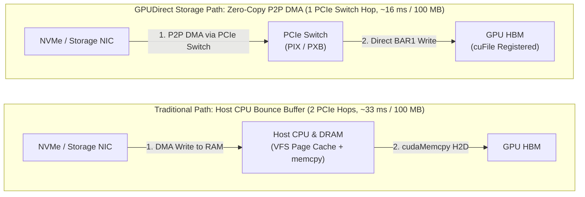
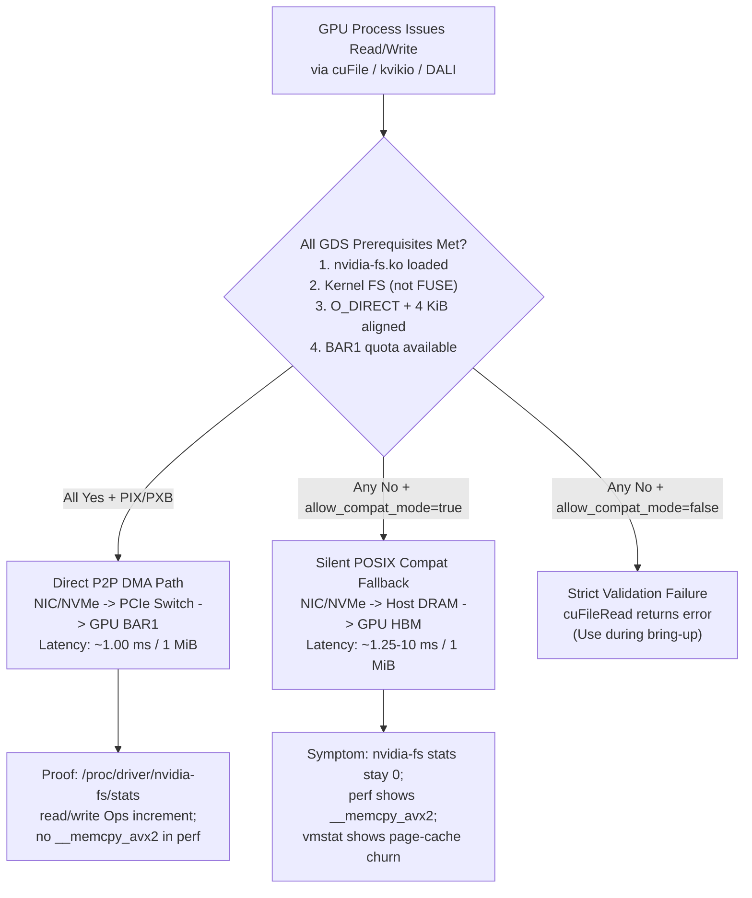

# 13.3 GPUDirect Storage architecture

| Field | Value |
|---|---|
| Status | Drafted (`gpudirect_storage_arch_lab.py`: 26 checks pass; bare-metal gdsio, `gdscheck.py`, `perf`, and `nsys` commands **untested** here) |
| Level | Advanced |
| Priority tier | 2 |
| Lab venue | GCP / GKE + Local Python Verification Lab (`code/part13/gpudirect_storage_arch_lab.py`) |
| Part | Part 13: AI storage |
| Primary sources | NVIDIA Zero-to-Hero Volume 15 (Chapter 4, Lab 03); *AI Systems Performance Engineering* (Chapter 5); *AI Data Center Network Design and Technologies* (Chapter 9) |
| Coverage file | `planning/coverage/chapters/13-03.md` |
| Claim & number ledger | `planning/ledgers/13-03.md` |

## Why this matters for AI infrastructure

Feeding training samples, media shards, and model checkpoints into GPU memory is just as critical to cluster goodput as collective communication. When a storage pipeline cannot keep up, expensive GPUs sit idle waiting for the next batch or freeze during checkpoint writes.

Modern AI racks demand serious storage ingestion bandwidth. An eight-GPU compute node where each GPU consumes 200 MB per second needs 1.6 GB per second of continuous reads. A 72-GPU Grace Blackwell NVL72 rack requires 14 to 20 GB per second of sustained storage ingestion. Across multimodal video pipelines or 100,000-GPU clusters writing multi-terabyte checkpoints, per-node storage streams routinely reach 10 to 100 GB per second.

In a traditional Linux storage stack without GPUDirect Storage, the host CPU and system memory act as a mandatory middleman. Engineers call this intermediate staging area the host bounce buffer.

1. The storage controller or network card writes blocks across the PCIe bus into the Linux page cache or a host DRAM buffer.
2. The host CPU copies those bytes from the kernel page cache into a user-space or pinned host buffer, polluting the CPU L3 cache and saturating memory channels.
3. The CUDA runtime initiates a second PCIe DMA transfer from host DRAM across the PCIe bus into GPU high-bandwidth memory.

Streaming 100 GB per second through this CPU bucket brigade causes three severe bottlenecks. First, it doubles traffic on the PCIe bus because every byte crosses the bus twice. Second, it drives host CPU utilization toward 85 to 100 percent, starving Python tokenization workers and kernel launches. Third, it inflates per-fetch latency on model weights and training batches.

GPUDirect Storage, part of the NVIDIA Magnum IO stack alongside GPUDirect RDMA, eliminates the host DRAM bounce buffer. It pairs the user-space cuFile library with the nvidia-fs.ko Linux kernel driver. Together they program the local NVMe drive or RDMA storage NIC to transfer blocks directly into and out of GPU BAR1 memory across a shared PCIe switch.

```text
Cluster Storage Ingestion & GPUDirect Storage Impact Summary:
  - 8-GPU node ingestion demand:      8 x 200 MB/s = 1.6 GB/s
  - 72-GPU GB200/GB300 NVL72 demand:  72 x 200 MB/s = 14.4 GB/s (14-20 GB/s sustained; 10.0-100.0 GB/s burst)
  - Traditional CPU bounce path:      2 PCIe traversals per byte, 1-2 host DRAM copies, 85.0%-100% CPU load
  - GPUDirect Storage (GDS) path:     1 PCIe switch hop, 0 host DRAM copies, 25.0% CPU load
  - Measured gdsio read uplift:       8.0 GB/s -> 9.6 GB/s (+20.0% throughput; +30.0%+ on H100 with VAST Data)
  - Measured gdsio read latency:      1.25 ms -> 1.00 ms (-20.0% average latency)
```

Used well, GPUDirect Storage cuts host memory copies to zero. Raises read throughput by 20 to 30 percent, and drops host CPU load from 85 percent down to 25 percent. Used carelessly, a silent fallback in `/etc/cufile.json` or a cross-socket PCIe hop leaves your data bouncing through host RAM while reporting zero errors.

## Prerequisites and outcomes

### Prerequisites
- Working knowledge of the Linux storage stack, including the VFS page cache, O_DIRECT, blk-mq, and NVMe queues from Chapters 13.1 and 13.2.
- Familiarity with PCIe topologies in `nvidia-smi topo -m`, BAR1 apertures, and NVMe-oF over RoCEv2 or InfiniBand from Chapter 12.19.
- Basic familiarity with CUDA memory allocation and PyTorch data loader workers.

### Outcomes
After completing this chapter, you will be able to:
1. Quantify the latency, PCIe traffic amplification, and CPU cache overhead of the CPU bounce-buffer path versus the GPUDirect Storage direct DMA path.
2. Implement and audit the seven-step cuFile API lifecycle and explain how nvidia-fs.ko redirects kernel DMA mappings to GPU BAR1 memory.
3. Validate 4 KiB O_DIRECT alignment and 8 KiB Lustre stripe alignment across file offsets, transfer sizes, and GPU buffer addresses, while diagnosing silent fallbacks on FUSE mounts.
4. Benchmark and interpret gdsio transfer modes across local NVMe, VAST Data, and DeepSeek 3FS architectures.
5. Prove whether GPUDirect Storage is active in production using `gdscheck.py -p`, `/proc/driver/nvidia-fs/stats`, `perf record`, and Nsight Systems, and size compressed pipelines for the Blackwell Hardware Decompression Engine.

---

## 1. The CPU Bounce-Buffer Bottleneck vs GPUDirect Storage

### 1.1 Anatomy of the Traditional CPU Bounce Path

When a training or inference process loads dataset shards. Model weights using standard POSIX file calls like open() and read(), the GPU cannot talk to the storage device directly. Calling `torch.load("/storage/model.pt", map_location="cpu")` followed by `.cuda()` hits the exact same wall. Every byte has to take a detour through host memory first.

```text
Traditional Path (with CPU Bounce Buffer):
Storage -> NIC / NVMe (DMA to CPU DRAM) -> OS Page Cache / User Buffer -> CPU-to-GPU PCIe Copy -> GPU HBM
```

First, that detour doubles PCIe bus traffic. A 100 MB payload crosses the PCIe root complex once moving from the NVMe drive or storage NIC into host DRAM. It crosses a second time moving from host DRAM into GPU HBM, generating 200 MB of total PCIe traffic for 100 MB of useful data.

Second, CPU memory copies saturate host cores and pollute the L3 cache. Without direct I/O and pre-pinned buffers, the Linux kernel copies every 4 KiB page out of the VFS page cache into user space using vectorized CPU instructions like `__memcpy_avx2`. Even at 1,000 batches per second of 1 MB each, or 1 GB per second total, those copies tie up multiple CPU cores continuously. At 10 to 100 GB per second, CPU usage climbs to 85 or 100 percent and starves the GPU of kernel launches.

Third, staging through host memory adds a clear latency penalty on model-weight and batch fetches. Suppose the raw NVMe read takes 100 microseconds, while CPU staging achieves 3,000 MB per second versus 6,000 MB per second for direct NIC-to-GPU DMA. The resulting transfer times for a 100 MB fetch appear in the block below.

```text
100 MB Fetch Latency Breakdown (100 us = 0.10 ms raw storage latency, 500 us/MB CPU staging overhead):
  - Traditional CPU bounce (3,000 MB/s): (100.0 MB / 3,000 MB/s) + 0.10 ms = 33.33 ms + 0.10 ms = 33.43 ms (~33 ms, 2 PCIe hops)
  - GPUDirect Storage DMA  (6,000 MB/s): (100.0 MB / 6,000 MB/s) + 0.10 ms = 16.67 ms + 0.10 ms = 16.77 ms (~16 ms, 1 PCIe hop, 2.0x copy speedup)
```



| Architectural Dimension | Traditional Path (CPU Bounce Buffer) | GPUDirect Storage (GDS Direct DMA) |
|---|---|---|
| Primary APIs | open() / read() / `torch.load(..., map_location="cpu")` | cuFile (`cuFileRead`, `cuFileWrite`, `kvikio.CuFile`, DALI) |
| PCIe bus traversals per transfer | `2` (`Storage -> Host DRAM`, then `Host DRAM -> GPU HBM`) | `1` (`Storage / NIC -> PCIe Switch -> GPU BAR1 HBM`) |
| Host DRAM copies | `1–2` (`VFS` page cache -> user buffer -> pinned buffer) | `0` (host DRAM and `L3` cache bypassed on data plane) |
| CPU role during I/O | Data-plane middleman (`__memcpy_avx2` + page cache churn) | Control-plane orchestrator only (builds NVMe/RDMA descriptors) |
| `100 MB` fetch time (`3 GB/s` vs `6 GB/s` stream) | `33.33 ms` copy (`~33 ms`) + `100 us` storage latency (`33.43 ms`) | `16.67 ms` DMA (`~16 ms`) + `100 us` storage latency (`16.77 ms`, **`2.0x`**) |
| Kernel counter proof | `perf report` shows high copy_page / `__memcpy_avx2` | `/proc/driver/nvidia-fs/stats` `Ops` counters increment |

### 1.2 The Five Conditions Where GPUDirect Storage Pays Off

On paper, eliminating the CPU bounce buffer cuts copy latency in half and boosts sustained throughput by 20 to 30 percent. In production, those gains show up only when five architectural conditions hold at the same time.

1. **The workload is I/O-bound or CPU-bound on memory copies, not compute-bound.** If GPU utilization is already 95 percent or higher. GDS because data prefetching hides behind long compute passes, GDS will free host CPU cores without shortening step time. When GPU utilization sits below 70 or 80 percent because GPUs wait on data, cutting I/O wait from 30 percent down to 5 percent reduces stall time sixfold. That drop raises active compute steps by 35.71 percent.
2. **The storage link is fast enough that the CPU bounce is the real bottleneck.** On a slow 10 Gbps NAS link delivering 1.25 GB per second. The network wire itself is the limit and the host CPU can copy that stream effortlessly. GDS pays off when storage bandwidth exceeds 40 Gbps. That includes 100 to 800 Gbps RoCEv2 or InfiniBand fabrics and multi-drive local NVMe arrays.
3. **The storage client runs in kernel space with nvidia-fs support.** Supported stacks include local NVMe. NVMe-oF on EXT4 or XFS with O_DIRECT, NFS over RDMA, Lustre, WekaFS, VAST Data, BeeGFS, and IBM Storage Scale. User-space FUSE mounts cannot deliver a native GDS path.
4. **The GPU and storage NIC or NVMe drive share a PCIe domain.** When `nvidia-smi topo -m` reports PIX. PXB between the GPU and the storage device, peer-to-peer packets switch directly across the PCIe switch. If the topology reports PHB or SYS, packets must cross the CPU host bridge or inter-socket link, erasing most of the latency advantage.
5. **The application invokes cuFile with 4 KiB-aligned O_DIRECT buffers.** Standard open(). Read() calls never enter libcufile.so, and unaligned buffers force the library into internal bounce buffers or compatibility mode.

```text
GDS Payoff & I/O Wait Reduction Math:
  - Baseline GPU I/O wait share:  30.0% I/O stall (70.0% active compute)
  - GDS GPU I/O wait share:       5.0% I/O stall  (95.0% active compute -> 6.0x stall reduction, +35.71% active compute share)
  - Storage link threshold:       10 Gbps (1.25 GB/s) yields < 20% gain; target > 40 Gbps (100-400/800 Gbps RoCEv2 / IB or NVMe RAID 0)
```

---

## 2. Under the Hood: cuFile API, nvidia-fs.ko, and BAR1 Peer-to-Peer DMA

### 2.1 How GDS Complements `GPUDirect RDMA`

Inside the NVIDIA Magnum IO architecture, GPUDirect RDMA and GPUDirect Storage solve two halves of the zero-copy problem. GPUDirect RDMA accelerates network-to-GPU transfers for collective communication libraries like NCCL, NVSHMEM, UCX, and NIXL over InfiniBand or RoCEv2 queue pairs. It relies on `nvidia-peermem.ko` or Linux dma-buf registration via `ibv_reg_dmabuf_mr`.

GPUDirect Storage accelerates storage-to-GPU transfers for files, block NVMe queues, and distributed parallel filesystems. It relies on the user-space cuFile library and the nvidia-fs.ko kernel driver.

Neither technology removes the CPU from the control plane. The host CPU still opens files, checks permissions, resolves filesystem extents, and submits NVMe queue entries or RDMA work requests. What GDS removes is the host memory bounce buffer on the data plane. Host pinned memory allocated with `cudaMallocHost` is not used on the GDS storage-to-GPU data path; instead, cuFile pins GPU HBM directly inside the GPU BAR1 aperture.

### 2.2 The 7-Step cuFile API Lifecycle and 10-Stage OS/CUDA Flow

To read or write a file directly between storage and GPU memory. A storage library like RAPIDS kvikio, NVIDIA DALI, or PyTorch v2.7.0+ executes seven core cuFile API calls. Those seven calls sit inside a ten-stage operating system and CUDA sequence.

1. **Step 1 — `cuFileDriverOpen()`:** Initializes the libcufile.so runtime, reads `/etc/cufile.json` or the path in `CUFILE_ENV_PATH_JSON`, and opens `/dev/nvidia-fs0` to talk to nvidia-fs.ko.
2. **OS Stage 2 — `open(path, O_RDWR | O_DIRECT, 0644)`:** Opens the target file on a GDS-capable mount with the Linux O_DIRECT flag so the kernel VFS layer bypasses the host page cache.
3. **Step 2 — `cuFileHandleRegister(&cf_handle, &cf_descr)`:** Populates a descriptor structure with `CU_FILE_HANDLE_TYPE_OPAQUE_FD` and the Linux file descriptor. It then registers that structure with the cuFile runtime to verify filesystem DMA support.
4. **CUDA Stage 4 — `cudaMalloc(&d_ptr, size)`:** Allocates the target tensor buffer in GPU HBM on the active CUDA device.
5. **Step 3 — `cuFileBufRegister(d_ptr, size, flags)`:** Instructs nvidia-fs.ko to pin the GPU HBM physical pages inside the GPU BAR1 aperture and pre-build the PCIe DMA scatter-gather table. Register reusable GPU staging buffers once during startup and reuse them across thousands of batches rather than registering buffers inside the training loop.
6. **Step 4 — `cuFileRead` or `cuFileWrite`:** Executes the zero-copy transfer synchronously, or asynchronously on a CUDA stream via `cuFileReadAsync`, `cuFileWriteAsync`, or `cuFileBatchIOSubmit`. During this call, the filesystem resolves the logical file range into physical NVMe logical block addresses or remote RDMA extents. Then nvidia-fs.ko substitutes the pinned GPU BAR1 bus addresses directly into the hardware DMA descriptors.
7. **Step 5 — `cuFileBufDeregister(d_ptr)`:** Unpins the GPU BAR1 pages and frees the scatter-gather mapping before freeing GPU memory.
8. **Step 6 — `cuFileHandleDeregister(cf_handle)`:** Releases the registered file handle before closing the Linux file descriptor.
9. **OS and CUDA Stage 9 — `cudaFree(d_ptr)` and `close(fd)`:** Frees the GPU HBM allocation and closes the Linux file descriptor.
10. **Step 7 — `cuFileDriverClose()`:** Closes `/dev/nvidia-fs0` and tears down the cuFile driver context.

```text
Hardware Descriptor Substitution Inside Step 4 (cuFileRead / cuFileWrite):
  - File extent resolution:   [file_offset, file_offset + size) -> physical NVMe LBAs or NVMe-oF / parallel FS RDMA extents
  - Kernel DMA interception:  nvidia-fs.ko replaces host DRAM PRP1/PRP2 (64-bit pointers) or SGL / RDMA MKey addresses with GPU BAR1 (d_ptr + dev_offset)
  - Hardware wire execution:  Local NVMe (opcode 0x02 Read / 0x01 Write) or ConnectX RDMA NIC (UDP 4791 RoCEv2 / IB) DMAs via PCIe switch to GPU HBM
  - BAR1 quota parameter:     max_device_pinned_mem_size_kb = 33554432 (33,554,432 KiB = 32.0 GiB ceiling in /etc/cufile.json)
```

```c
// Complete 7-step cuFile API (10-stage OS/CUDA) GPUDirect Storage read & async stream example (untested here)
#include <fcntl.h>
#include <unistd.h>
#include <cuda_runtime.h>
#include <cufile.h>

int gds_read_sync_and_async(const char *path, size_t aligned_bytes, off_t aligned_file_off) {
    // Step 1: Open the cuFile driver (/dev/nvidia-fs0)
    CUfileError_t status = cuFileDriverOpen();
    if (status.err != CU_FILE_SUCCESS) return -1;

    // Stage 2 (OS): Open file with O_DIRECT (4 KiB aligned semantics)
    int fd = open(path, O_RDONLY | O_DIRECT);
    if (fd < 0) { cuFileDriverClose(); return -2; }

    // Step 2: Register the Linux file descriptor with cuFile
    CUfileDescr_t cf_descr = {};
    cf_descr.handle.fd = fd;
    cf_descr.type = CU_FILE_HANDLE_TYPE_OPAQUE_FD;
    CUfileHandle_t cf_handle;
    status = cuFileHandleRegister(&cf_handle, &cf_descr);
    if (status.err != CU_FILE_SUCCESS) { close(fd); cuFileDriverClose(); return -3; }

    // Stage 4 (CUDA) + Step 3: Allocate GPU HBM and pin in BAR1 once
    void *d_buf = nullptr;
    cudaMalloc(&d_buf, aligned_bytes);
    status = cuFileBufRegister(d_buf, aligned_bytes, 0);
    if (status.err != CU_FILE_SUCCESS) {
        cudaFree(d_buf); cuFileHandleDeregister(cf_handle); close(fd); cuFileDriverClose();
        return -4;
    }

    // Step 4a: Synchronous zero-copy read directly into GPU HBM
    ssize_t bytes_read = cuFileRead(cf_handle, d_buf, aligned_bytes, aligned_file_off, 0);

    // Step 4b: Or asynchronous stream-ordered GDS read overlapped with GPU compute
    cudaStream_t io_stream;
    cudaStreamCreateWithFlags(&io_stream, cudaStreamNonBlocking);
    size_t io_size = aligned_bytes;
    off_t f_off = aligned_file_off;
    off_t d_off = 0;
    ssize_t async_bytes_read = 0;
    cuFileReadAsync(cf_handle, d_buf, &io_size, &f_off, &d_off, &async_bytes_read, io_stream);
    cudaStreamSynchronize(io_stream);
    cudaStreamDestroy(io_stream);

    // Steps 5, 6, Stage 9, Step 7: Deregister buffer, deregister handle, close fd, close driver
    cuFileBufDeregister(d_buf);
    cudaFree(d_buf);
    cuFileHandleDeregister(cf_handle);
    close(fd);
    cuFileDriverClose();
    return (bytes_read == (ssize_t)aligned_bytes) ? 0 : -5;
}
```

### 2.3 Orthogonal Path: cuda-checkpoint and `CRIU` vs GDS

Do not confuse framework tensor checkpoints written via `cuFileWrite` with the NVIDIA process-level cuda-checkpoint utility. Framework checkpoints in PyTorch or Megatron save model weights and optimizer states into `.pt` or `.safetensors` files. When paired with `cuFileWrite`, those tensors move directly from GPU HBM to NVMe or RDMA storage.

By contrast, cuda-checkpoint works alongside CRIU, which stands for Checkpoint and Restore in Userspace, to pause and migrate entire running CUDA processes. It calls `cuCheckpointProcessLock`, `cuCheckpointProcessCheckpoint`, `cuCheckpointProcessRestore`, and `cuCheckpointProcessUnlock`. During a process suspend, the CUDA driver drains in-flight GPU work and copies the GPU memory image into host DRAM so CRIU can snapshot the process. It does not DMA directly from GPU HBM to disk via GDS.

---

## 3. Compatibility Mode, `4 KiB` O_DIRECT Alignment, and Why FUSE Cannot Use GDS

### 3.1 Direct Path vs Silent Compatibility-Mode Fallback

One of the most common operational traps in GPUDirect Storage is assuming GDS is active just because a cuFile job finishes without errors. By default, `/etc/cufile.json` ships with `"allow_compat_mode": true`. Whenever any hardware, kernel, filesystem, or alignment check fails, libcufile.so silently falls back to POSIX compatibility mode. It allocates a host DRAM buffer, calls standard pread() or `pwrite()`, and copies the data into GPU memory with `cudaMemcpyAsync`.



| Verification Signal | Direct GDS Path (`gds-p2p-dma`) | Silent Fallback (`compat-posix-fallback`) | Strict Bring-Up (`allow_compat_mode: false`) |
|---|---|---|---|
| `cuFileRead()` return status | Success (`bytes_read == size`) | Success (`bytes_read == size`, **silent**) | Immediate error (`CU_FILE_IO_NOT_SUPPORTED` / alignment err) |
| `/proc/driver/nvidia-fs/stats` | `Read` / `Write` `Ops` and byte counters increment | Counters remain **`0`** (unchanged during load) | Counters remain `0` |
| `perf record -g` stack trace | `cuFileRead` -> nvidia-fs `ioctl` (no CPU `memcpy`) | copy_page -> `__memcpy_avx2` (`20%+` CPU time) | Process exits on error |
| GPU PCIe counters (`nvidia-smi dmon -s t`) | Non-zero `PCIe Rx/Tx` (**cannot distinguish paths alone**) | Non-zero `PCIe Rx/Tx` (both paths cross PCIe into GPU) | None |

:::tip Why `nvidia-smi dmon` PCIe counters cannot prove GDS is working
Data enters the GPU over its PCIe interface in both the traditional CPU bounce path and the direct GDS path. Watching `nvidia-smi dmon -s t -d 1` will therefore show high PCIe throughput even when GDS is completely broken. Always check `/proc/driver/nvidia-fs/stats` and `perf report` or run `nsys profile --trace=gds` to prove which path carried the bytes.
:::

### 3.2 `4 KiB` O_DIRECT Alignment Rules and `8 KiB` Lustre Stripe Alignment

Hardware NVMe controllers and O_DIRECT filesystems address blocks in multiples of the 4 KiB page size, which is 4,096 bytes. Certain Lustre Object Storage Target configurations enforce an 8 KiB boundary, or 8,192 bytes. For nvidia-fs.ko to program zero-copy DMA descriptors without staging. An intermediate bounce buffer, all three coordinates of a `cuFileRead` or `cuFileWrite` call must be integer multiples of that block size.

```text
O_DIRECT & Lustre Alignment Coordinates and Realignment Math:
  1. File offset alignment:       file_offset % 4096 == 0 (or % 8192 == 0 on strict 8 KiB Lustre OSTs)
  2. Transfer size alignment:     size % 4096 == 0 (practically >= 1 MiB to amortize submission overhead)
  3. GPU HBM buffer alignment:    (uintptr_t)(d_ptr + dev_offset) % 4096 == 0 (slicing by +0x100 breaks 4 KiB alignment)
  4. Unaligned 4 KiB example:     file_offset = 4,100 B, size = 1,000,000 B (end byte = 1,004,100)
     - Rounded-down start offset: 4,100 & ~4095 = 4,096 B (+4 B tensor pointer offset inside GPU HBM)
     - Rounded-up end offset:     (1,004,100 + 4,095) & ~4,095 = 1,007,616 B -> aligned read size = 1,003,520 B
  5. Unaligned 8 KiB Lustre:      file_offset = 4,096 B, size = 8,192 B -> realigns down to offset 0 and size 16,384 B
```

When an application requests an unaligned slice, you have two choices. You can round the start offset down and the end offset up to 4,096-byte boundaries in user space, read the slightly wider span into GPU memory. Advance the tensor pointer by a few bytes on the GPU. Otherwise, if `"posix_unaligned_kb"` is enabled in `/etc/cufile.json`, libcufile allocates an internal staging buffer for the unaligned edges and sacrifices pure zero-copy speed.

### 3.3 Why User-Space FUSE Filesystems Cannot Deliver a Native GDS Path

Many cloud object-storage connectors like `s3fs`, `gcsfuse`, and `mountpoint-s3` mount buckets via Linux FUSE, which stands for Filesystem in Userspace. A FUSE mount cannot provide a native GPUDirect Storage path. GDS requires a kernel-mode filesystem client that supports O_DIRECT and registers block or RDMA callbacks with nvidia-fs.ko so physical GPU BAR1 addresses can go straight into hardware descriptors.

In a FUSE mount, every file read or write traps into the kernel `fuse.ko` driver, copies the request into a user-space daemon in host DRAM. Passes data back through memory pipes. Even if your code calls `cuFileRead` on a FUSE file, libcufile is forced onto the compatibility bounce path.

DeepSeek's open-source Fire-Flyer File System, known as 3FS, shows how to design around this problem. DeepSeek observed that LLM training and inference issue massive volumes of random reads across multi-terabyte datasets, making traditional OS page caches useless. Instead, 3FS drops page-cache staging completely and connects its Cluster Manager, Metadata Service, Storage Service, and Client directly over InfiniBand or RoCEv2 using O_DIRECT and RDMA reads.

```text
DeepSeek Fire-Flyer File System (3FS) Cluster Benchmark vs Ceph:
  - Cluster hardware configuration: 68 storage nodes, 10 x 16 TB NVMe SSDs/node (680 drives = 10,880 TB raw), dual 100 Gb/s NICs/node
  - 3FS aggregate read throughput:  6.6 TB/s foreground reads + 1.4 TB/s background traffic = 8.0 TB/s combined (up to 7.3 TB/s peak runs)
  - Ceph baseline on same class:    ~1.1 TB/s (3FS delivers a 6.0x foreground read speedup over Ceph)
```

Keep one architectural distinction in mind when comparing 3FS with standard enterprise storage. DeepSeek 3FS uses its own native RDMA client pipeline rather than nvidia-fs.ko. When you need a strict cuFile and nvidia-fs.ko path on enterprise infrastructure. Pair GDS with a kernel-integrated client such as local NVMe, NVMe-oF, WekaFS, VAST Data, Lustre, BeeGFS, or IBM Storage Scale.

---

## 4. Benchmarking with gdsio, Enterprise Uplifts, and the Blackwell Hardware Decompression Engine

### 4.1 gdsio Transfer Selector Modes

Before refactoring a training pipeline to use GPUDirect Storage. You need a clean way to measure whether the storage hardware actually runs faster without the host CPU in the loop. NVIDIA ships the gdsio benchmark utility under `/usr/local/cuda/gds/tools/gdsio` to compare storage-to-GPU throughput, latency, and CPU load across identical files, thread counts, and block sizes. The most important flag in gdsio is the transfer mode selector `-x`, which switches between seven different data paths.

| gdsio Flag | Transfer Mode Name | Data Path | Uses GDS (nvidia-fs)? |
|---|---|---|---|
| **`-x 0`** | GDS Direct (`Storage -> GPU`) | Storage `<->` GPU HBM directly via `cuFileRead` / `cuFileWrite` and nvidia-fs.ko | **Yes** |
| **`-x 1`** | `Storage -> CPU` Only | Storage `<->` Host DRAM only (measures raw storage baseline without GPU copy) | No |
| **`-x 2`** | `Storage -> CPU -> GPU` (Pinned Async) | Storage `->` Pinned Host DRAM (`cudaMallocHost`) `->` GPU HBM via `cudaMemcpyAsync` | No (**Primary CPU-bounce baseline**) |
| **`-x 3`** | `Storage -> CPU Pageable -> GPU` | Storage `->` Pageable Host DRAM `->` GPU HBM via synchronous `cudaMemcpy` | No |
| **`-x 4`** | `Storage -> mmap -> CPU -> GPU` | Memory-mapped file (`mmap`) `->` Host DRAM `->` GPU HBM | No |
| **`-x 5`** | GDS Batch API | Storage `<->` GPU HBM directly via batched `cuFileBatchIOSubmit` | **Yes** |
| **`-x 6`** | GDS Async Stream API | Storage `<->` GPU HBM directly via stream-ordered `cuFileReadAsync` / `cuFileWriteAsync` | **Yes** |

### 4.2 Quantitative gdsio Benchmark and `VAST Data` Uplifts

To run a fair comparison between the fastest CPU-staged path and direct GPUDirect Storage, compare `-x 2` against `-x 0`. Mode `-x 2` reads into pinned host memory and copies asynchronously to the GPU, while mode `-x 0` transfers straight into GPU HBM. The commands below test a 10 GiB file on GPU 0 using four worker threads and 1 MiB read chunks.

```bash
# 1. Baseline Before GDS: Storage -> Pinned CPU Memory -> GPU (-x 2) (untested here)
/usr/local/cuda/gds/tools/gdsio \
    -f /mnt/data/large_file \
    -d 0 -w 4 -s 10G -i 1M -I 0 -x 2
# Output:
# Total Throughput: 8.0 GB/s
# Average Latency: 1.25 ms   (Host CPU utilization: ~85%)

# 2. After Enabling GDS: Storage -> GPU HBM Direct (-x 0) (untested here)
/usr/local/cuda/gds/tools/gdsio \
    -f /mnt/data/large_file \
    -d 0 -w 4 -s 10G -i 1M -I 0 -x 0
# Output:
# Total Throughput: 9.6 GB/s
# Average Latency: 1.00 ms   (Host CPU utilization: ~25%)
```

| Metric | Without GDS (`gdsio -x 2`, `Storage -> CPU -> GPU`) | With GDS (`gdsio -x 0`, `Storage -> GPU`) | Measured Delta / Impact |
|---|---|---|---|
| Sustained read throughput | **`8.0 GB/s`** | **`9.6 GB/s`** | **`+20.0%`** higher throughput |
| Average I/O latency (`1 MiB` read) | **`1.25 ms`** | **`1.00 ms`** | **`-20.0%`** lower latency (`-0.25 ms`) |
| Time to read `10.0 GB` shard | `1.2500 s` | `1.0417 s` | `0.2083 s` saved per `10.0 GB` |
| Host CPU utilization during read | **`85.0%`** | **`25.0%`** | **`-60.0` percentage points** (`3.4x` lower CPU load) |
| CPU I/O efficiency (`GB/s` per `1%` CPU) | **`0.0941 GB/s`** per `%` CPU | **`0.3840 GB/s`** per `%` CPU | **`4.08x`** higher throughput per unit of CPU |
| Enterprise NAS (`VAST Data` over RDMA) | Staged `POSIX` baseline | **`+20.0%`** on A100; **`+30.0%+`** on H100 | H100 sees larger gain due to higher NIC/compute rate |

### 4.3 In-Pipeline Unpacking with the Blackwell Hardware Decompression Engine

When PCIe lanes or network links are already full, the best way to multiply effective storage bandwidth is to store datasets. Checkpoints compressed on disk and unpack them inside GPU memory right after a GDS read. For image and video pipelines, NVIDIA `nvJPEG` and NVIDIA DALI move decoding onto the GPU hardware media engines. That shift cuts host CPU usage on an eight-core vision loader from 800 percent down to 200 percent.

On Blackwell B200 and GB200 GPUs, NVIDIA added a dedicated on-die Hardware Decompression Engine that unpacks LZ4, Snappy, and Deflate streams at up to 800 GB per second. That engine sits alongside the 900 GB per second bidirectional NVLink-C2C coherent interconnect linking the 72-core Grace CPU to the Blackwell GPUs. Because decompression runs on fixed-function silicon instead of GPU Streaming Multiprocessors, every SM stays free to run Transformer attention and matrix math kernels.

Suppose a node loads a 4.0 GB uncompressed training batch over a 50.0 GB per second GDS link. Storing that batch with LZ4 at a 2.5x compression ratio shrinks the on-disk footprint to 1.6 GB. Cuts total load time by more than half, as shown below.

```text
Blackwell Hardware Decompression Engine Pipeline Math (4.0 GB Batch, 2.5x LZ4 = 1.6 GB on Disk, 50.0 GB/s GDS Link):
  1. Uncompressed GDS read time:             t_uncomp    = 4.0 GB / 50.0 GB/s  = 80.0 ms
  2. Compressed GDS read time (1.6 GB):      t_comp_read = 1.6 GB / 50.0 GB/s  = 32.0 ms
  3. Blackwell Hardware Decompression time:  t_decomp    = 4.0 GB / 800.0 GB/s = 5.0 ms
  4. Total serial read + unpack time:        t_total     = 32.0 ms + 5.0 ms    = 37.0 ms
  5. Effective uncompressed throughput:      4.0 GB / 0.037 s = 108.11 GB/s (2.16x end-to-end speedup before pipelining)
```

---

## 5. Production Verification, `/etc/cufile.json` Tuning, and Profiling with `nsys`

### 5.1 Four-Stage Production Verification Workflow

Before rolling out GPUDirect Storage across a training cluster, walk through four verification stages on a single node. These checks prove that the hardware topology, kernel module, and application calls are delivering real peer-to-peer DMA rather than falling back to host memory.

#### Stage 1: Verify Kernel Driver, Platform, and Filesystem Prerequisites
First confirm that a supported NVIDIA GPU driver and the nvidia-fs.ko kernel module are loaded. Then run `gdscheck.py -p` to inspect the registered filesystem transports.

```bash
# Check GPU product and driver version (>= 470+, modern 535+/550+ in production) (untested here)
nvidia-smi -i 0 -q | grep "Product Name"
nvidia-smi -q | grep "Driver Version"

# Verify nvidia_fs kernel module and GDS platform compatibility report (untested here)
lsmod | grep nvidia_fs
/usr/local/cuda/gds/tools/gdscheck.py -p

# Check NVMe-oF or Lustre GDS capability (untested here)
modprobe nvme_fabrics
lctl list_param mgc.* | grep -i gds
```

#### Stage 2: Audit Physical PCIe and NUMA Topology
Even when `gdscheck.py -p` passes, GDS will not beat a CPU bounce buffer if the GPU and the storage NIC or NVMe drive sit on different PCIe root complexes. Run `nvidia-smi topo -m` to check how each GPU connects to its storage device.

```text
# Illustrative topology matrix showing PHB vs same-domain affinity (untested here)
        GPU0    GPU1    GPU2    GPU3    NIC0    NIC1    CPU Affinity    NUMA Affinity
GPU0     X      NV2     NV2     NV4     PHB     PHB     0-31            0
GPU1    NV2      X      NV4     NV2     PHB     PHB     32-63           1
GPU2    NV2     NV4      X      NV2     PHB     PHB     32-63           1
GPU3    NV4     NV2     NV2      X      PHB     PHB     0-31            0
NIC0    PHB     PHB     PHB     PHB      X      PHB     0-31            0
NIC1    PHB     PHB     PHB     PHB     PHB      X      32-63           1
```

- **Ideal placement (PIX or PXB):** Each GPU shares a dedicated PCIe switch with its paired ConnectX NIC and local NVMe drives. Peer-to-peer DMA switches directly inside the PCIe switch in a single hop without touching the CPU root complex.
- **Same-socket host bridge (PHB):** Peer-to-peer DMA has to cross the CPU root complex. Bind `NIC0` to `GPU0` and `GPU3` on NUMA node 0, bind `NIC1` to `GPU1` and `GPU2` on NUMA node 1. Test with `nvidia-p2pBandwidthLatencyTest` and gdsio to verify at least a 20 percent gain over `-x 2`.
- **Cross-socket interconnect (SYS):** Peer-to-peer traffic crosses the inter-socket UPI or xGMI link, which is slower than staging in local host DRAM.

#### Stage 3: Prove the Active Path in Flight
Compare `/proc/driver/nvidia-fs/stats` before and after a live read, and record a CPU stack trace with `perf` to check for host memory copies.

```bash
# Snapshot nvidia-fs kernel counters before and after a training/benchmark load (untested here)
cat /proc/driver/nvidia-fs/stats

# Record CPU stack traces during data loading to check for CPU memcpy (untested here)
perf record -g python3 data_loader.py
perf report | grep -E "memcpy|cuFileRead|copy_page"
```

When GDS has silently fallen back to the CPU bounce path, `perf report` shows heavy CPU time inside copy_page and `__memcpy_avx2`.

```text
# Illustrative perf report when fallback / CPU bounce is active (untested here)
-   25.34%     2.10%  python   [kernel.kallsyms]           [k] copy_page
   - 22.34% copy_page
      - 21.20% __memcpy_avx2  <-- CPU is copying every page through host RAM
        + 18.90% load_image_batch
```

When GDS is genuinely active, `__memcpy_avx2` disappears from the storage path and `perf report` shows only lightweight user-space orchestration inside `cuFileRead`.

```text
# Illustrative perf report when GDS zero-copy DMA is active (untested here)
-   14.20%     0.50%  python   [nvidia/umd]                [.] cuFileRead
   - 13.70% cuFileRead
      + 11.50% ... (nvidia-fs ioctl submission; zero host-side page copies)
```

#### Stage 4: Timeline Profiling with Nsight Systems and PyTorch Isolation
To see whether `cuFileRead` and `cuFileReadAsync` calls overlap cleanly with GPU compute kernels, profile the job with Nsight Systems while enabling static tracepoints in `/etc/cufile.json`.

```bash
# Capture CUDA kernels, GDS cuFile API calls, NVTX ranges, and OS runtime waits (untested here)
nsys profile --trace=cuda,gds,nvtx,osrt -o gds_profile_report python3 train.py
```

Keep one observability boundary in mind when reading the timeline. Passing `--trace=gds` records user-space cuFile API calls and static tracepoints on the Nsight Systems timeline. Low-level kernel counters for NVMe peer-to-peer DMA completions are not exposed directly in Nsight Systems, so cross-check them with `/proc/driver/nvidia-fs/stats`, `iostat -xz 1`, `nvme-cli`, and NVIDIA DCGM.

When a PyTorch training loop stalls on `next(data_iterator)`, that wait combines background prefetching with Host-to-Device copy time. Separate Python CPU bottlenecks from transfer bottlenecks in two steps:
1. **Isolate Python transform cost:** Set `num_workers=0` temporarily to disable background worker processes and time how long the data loader takes to produce 100 batches with GPU kernels disabled.
2. **Isolate Host-to-Device transfer cost:** Check the CUDA copy lanes in Nsight Systems or wrap `.to("cuda", non_blocking=True)` in `torch.cuda.Event` timers. If Python transforms dominate, vectorize the code or move to NVIDIA DALI or offline NeMo Curator `.bin` and `.idx` shards. If transfers dominate, enable `pin_memory=True` with `prefetch_factor=4` and `persistent_workers=True`, raise `ulimit -l`, or switch to GPUDirect Storage.

---

## Commands and configurations that matter

### 1. Hardened `/etc/cufile.json` Configuration for Verification and Production

```json
{
    "logging": {
        "dir": "/var/log/gds",
        "level": "ERROR"
    },
    "profile": {
        "nvtx": true,
        "cufile_stats": 3
    },
    "properties": {
        "max_device_pinned_mem_size_kb": 33554432,
        "max_batch_io_size": 128,
        "max_batch_io_timeout_msecs": 5,
        "use_poll_mode": false,
        "poll_mode_max_size_kb": 4,
        "allow_compat_mode": false,
        "rdma_dev_addr_list": ["10.20.1.10", "10.20.2.10"]
    },
    "fs": {
        "generic": {
            "posix_unaligned_kb": false
        },
        "lustre": {
            "rdma_dev_addr_list": []
        },
        "wekafs": {
            "rdma_write_support": true
        }
    }
}
```

| `/etc/cufile.json` Key | Value | Operational Meaning |
|---|---|---|
| `profile.nvtx` & `profile.cufile_stats` | `true`, `3` | Enables cuFile static tracepoints for `nsys profile --trace=gds` and detailed `gds_stats` counters (`Level 1..3`). |
| `properties.max_device_pinned_mem_size_kb` | `33554432` | Caps total GPU BAR1 memory pinned across `cuFileBufRegister` calls at **`32.0 GiB`** (`33,554,432 KiB`). |
| `properties.use_poll_mode` & `poll_mode_max_size_kb` | `false`, `4` | When `use_poll_mode` is `true`, CPU polling only applies to I/Os **`<= 4 KiB`**. Large `1 MiB+` training reads still use interrupts; enabling poll mode with a huge threshold burns `100%` of a CPU core. |
| `properties.allow_compat_mode` | `false` (test) / `true` (prod) | Set to **`false` during validation** so any unsupported mount, missing nvidia-fs.ko, or unaligned buffer fails immediately instead of silently bouncing through host DRAM. |
| `fs.generic.posix_unaligned_kb` | `false` | Rejects unaligned O_DIRECT I/Os during validation rather than allocating hidden staging buffers. |

### 2. Essential Linux NVMe, Lustre, NFS, and GDS Commands

```bash
# 1. Verify NVMe blk-mq scheduler ('none' or 'mq-deadline') and increase read-ahead from 128 KB to 4 MB (untested here)
cat /sys/block/nvme0n1/queue/scheduler
cat /sys/block/nvme0n1/queue/read_ahead_kb
sudo blockdev --setra 8192 /dev/nvme0n1   # 8192 x 512B sectors = 4096 KB (4 MiB)

# 2. Stripe large Arrow/Parquet/checkpoint files across 4 or 8 Lustre OSTs (4 x 500 MB/s = 2.0 GB/s) (untested here)
lfs setstripe -c 4 -S 4M /lustre/training_shards/
lfs getstripe /lustre/training_shards/model-test.bin

# 3. Tune NFS client mount options (1 MiB rsize/wsize, noatime, 60s attribute cache) when NFS is used (untested here)
sudo mount -t nfs -o rsize=1048576,wsize=1048576,noatime,async,actimeo=60,lookupcache=pos \
    10.20.0.10:/export/datasets /mnt/datasets

# 4. Run gdsio CPU-mediated baseline (-x 2) vs GDS zero-copy (-x 0) and async stream (-x 6) (untested here)
/usr/local/cuda/gds/tools/gdsio -f /mnt/data/large_file -d 0 -w 4 -s 10G -i 1M -I 0 -x 2
/usr/local/cuda/gds/tools/gdsio -f /mnt/data/large_file -d 0 -w 4 -s 10G -i 1M -I 0 -x 0
/usr/local/cuda/gds/tools/gdsio -f /mnt/data/large_file -d 0 -w 4 -s 10G -i 1M -I 0 -x 6
```

### 3. Refactoring Python I/O from CPU Bounce (`torch.load`) to kvikio / cuFile

```python
# Illustrative comparison: CPU bounce vs RAPIDS kvikio CuFile direct GPU read (untested here)
import torch

# --- OLD WAY: CPU Bounce Buffer (Storage -> Host DRAM -> PCIe Copy -> GPU HBM) ---
# Loads into host RAM first, polluting CPU L3 cache and doubling PCIe traffic:
state = torch.load("/lustre/model.pt", map_location="cpu")
for k, v in state.items():
    state[k] = v.cuda()

# --- GDS WAY: Direct Storage-to-GPU DMA via RAPIDS kvikio (cuFile wrapper) ---
import kvikio

buffer_bytes = 100 * 1024 * 1024  # 100 MiB (multiple of 4096 B)
gpu_tensor = torch.empty(buffer_bytes // 4, dtype=torch.float32, device="cuda:0")

with kvikio.CuFile("/lustre/model-test.bin", "r") as f:
    # Reads 100 MiB directly from NVMe/Lustre into GPU0 BAR1 HBM (zero host DRAM copy)
    bytes_read = f.read(gpu_tensor)
torch.cuda.synchronize()
```

---

## How it fails

When GPUDirect Storage misbehaves in production, it either fails with an explicit alignment or mapping error or silently falls back to bouncing data through host memory. The table below maps each symptom to its root cause and fix.

| # | Failure Mode | Observable Symptom | Root-Cause Diagnosis | Remediation |
|---|---|---|---|---|
| **1** | **Application Uses Standard CPU I/O APIs (`torch.load` / open()) Instead of cuFile** | GDS packages are installed and `gdscheck.py -p` passes, but training throughput is unchanged and `perf report` shows `21.20%` CPU time in `__memcpy_avx2` (copy_page). | Application code still calls open()/read() or `torch.load("/storage/model.pt", map_location="cpu")` followed by `.cuda()`, never invoking `cuFileRead()`. | Refactor data loading to use `RAPIDS kvikio` (`kvikio.CuFile`), **NVIDIA DALI** (`fn.readers.file` / `fn.readers.numpy` with `device="gpu"`), **PyTorch `v2.7.0+`** native GDS tensors, or C++ `cuFileRead` / `cuFileReadAsync`. |
| **2** | **Silent Fallback to POSIX Compatibility Mode (`allow_compat_mode: true`)** | `cuFileRead()` returns success without errors, yet `/proc/driver/nvidia-fs/stats` read/write counters remain at `0` and host DRAM page-cache churn is high in `vmstat`. | `"allow_compat_mode": true` in `/etc/cufile.json` masked an underlying failure (such as missing O_DIRECT, an unsupported mount, or nvidia-fs.ko not loaded) and routed I/O through pread() + `cudaMemcpyAsync`. | Set `"allow_compat_mode": false` in `/etc/cufile.json` during bring-up, inspect `/var/log/gds/cufile.log` for the exact rejection reason, load nvidia-fs.ko, and open files with O_DIRECT. |
| **3** | **Cross-Root-Complex (PHB / SYS) Topology Bottleneck** | `/proc/driver/nvidia-fs/stats` increments and `cuFileRead()` appears in `perf`, but GDS throughput is no faster than CPU bounce (`-x 2`). | `nvidia-smi topo -m` shows PHB or SYS between the active GPU and the storage NIC or NVMe SSD, forcing every PCIe P2P transaction through the CPU root complex or inter-socket `UPI`/`xGMI` link. | Bind each GPU process to the NIC / NVMe drive sharing its local PCIe switch (PIX / PXB) or NUMA socket (`NIC0` with `GPU0` on `0-31`, `NIC1` with `GPU1` on `32-63`), and disable `PCIe ACS` if enabled. |
| **4** | **`cuFile invalid buffer alignment` / Unaligned `4 KiB` O_DIRECT I/O** | `cuFileRead()` or `cuFileWrite()` fails with `CU_FILE_INVALID_VALUE` / invalid buffer alignment (when `posix_unaligned_kb: false`) or suffers a sudden `50%+` throughput drop. | File offset, transfer size, or GPU buffer sub-slice (`d_ptr + dev_offset`) is not a multiple of `4,096` bytes (`4 KiB`) for NVMe/NVMe-oF or `8,192` bytes (`8 KiB`) for Lustre. | Align host/device buffers and file offsets to `4,096`-byte (`4 KiB`) boundaries (`memalign(4096, size)` / `4 KiB`-padded tensor shards) and verify Lustre stripe alignment with `lfs getstripe`. |
| **5** | **User-Space FUSE Mount Incompatibility** | Mounting object storage or a custom filesystem via FUSE (`gcsfuse`, `s3fs`) with GDS enabled results in `0` nvidia-fs ops or `CU_FILE_IO_NOT_SUPPORTED`. | FUSE runs in user space and bounces all I/O through `fuse.ko` and host DRAM; it lacks kernel-level O_DIRECT DMA registration with nvidia-fs.ko. | Replace the FUSE mount on the hot path with a kernel-native GDS filesystem (`local NVMe` `XFS`/`EXT4`, NVMe-oF, Lustre, WekaFS, VAST, BeeGFS, `IBM Storage Scale`) or stage objects onto local NVMe using `s5cmd`. |
| **6** | **BAR1 Pinned Memory Quota Exhaustion (`max_device_pinned_mem_size_kb`)** | First few `cuFileBufRegister()` calls succeed at `9.6 GB/s`, but subsequent worker allocations fall back to `8.0 GB/s` or fail with `CU_FILE_MEMORY_MAPPING_ERROR`. | Application calls `cuFileBufRegister()` repeatedly on new tensors without `cuFileBufDeregister()`, or sets `max_device_pinned_mem_size_kb` too low in `/etc/cufile.json` (or `Above 4G Decoding` is off in `BIOS`). | Enable `Above 4G Decoding` (`Large BAR1`) in `BIOS`, set `max_device_pinned_mem_size_kb` to `33554432` (`32 GiB`), and register a fixed pool of reusable GPU ring buffers once at startup. |

---

## Hands-on lab

### Venue and Scope
The hands-on verification has two parts. Part A runs locally in Python using `code/part13/gpudirect_storage_arch.py` and `code/part13/gpudirect_storage_arch_lab.py` to verify all 26 architecture, alignment, benchmark, and decompression checks. Part B provides the bare-metal cluster validation script for a live GPU node with nvidia-fs.ko and NVMe or Lustre storage.

### Part A: Run the Local Self-Checking Verification Lab

```bash
python3 -B code/part13/gpudirect_storage_arch_lab.py
```

Expected output (verified):

```text
=== Chapter 13.3 Lab: GPUDirect Storage Architecture ===
  [PASS] 1. cuFile 7-step API lifecycle validates cuFileDriverOpen -> cuFileHandleRegister -> cuFileBufRegister -> cuFileRead/Write -> Deregister -> Close
  [PASS] 2. Swapping cuFileHandleRegister and cuFileBufRegister is flagged as an invalid lifecycle order
  [PASS] 3. Full 10-stage OS+CUDA cuFile flow includes open_O_DIRECT and cudaMalloc around the 7 cuFile calls
  [PASS] 4. 100 MB fetch via CPU bounce @ 3000 MB/s takes 33.33 ms (~33 ms) copy + 100 us storage latency with 2 PCIe traversals
  [PASS] 5. 100 MB fetch via GDS direct DMA @ 6000 MB/s takes 16.67 ms (~16 ms) + 100 us storage latency (2.0x copy speedup, 1 PCIe hop)
  [PASS] 6. Volume 15 Lab 03 5-trial CPU bounce baseline averages 0.251 s (398 MB/s) and recommends DEPLOY GDS when improvement > 20%
  [PASS] 7. PIX topology + nvidia-fs + O_DIRECT + aligned buffer executes gds-p2p-dma (nvidia-fs stats increment, no __memcpy_avx2)
  [PASS] 8. PHB root-complex topology degrades GDS to gds-root-complex-degraded even when nvidia-fs is active
  [PASS] 9. Application calling torch.load(map_location='cpu') without cuFile falls back to CPU (__memcpy_avx2 active, nvidia-fs stats 0)
  [PASS] 10. FUSE user-space mount cannot use GDS and silently falls back to POSIX when allow_compat_mode=true
  [PASS] 11. Missing nvidia-fs.ko with allow_compat_mode=false fails loudly (error-io-rejected) instead of silently bouncing
  [PASS] 12. Exhausting max_device_pinned_mem_size_kb BAR1 quota triggers POSIX compatibility fallback when allow_compat_mode=true
  [PASS] 13. 4 KiB (4096 B) aligned file offset (512 KiB), transfer size (1 MiB), and GPU buffer address pass O_DIRECT validation
  [PASS] 14. Unaligned offset (4100 B), size (1,000,000 B), and GPU buffer (+0x100) fail 4 KiB check and compute realigned bounds (4096 B, 1003520 B)
  [PASS] 15. 4 KiB offset fails strict 8 KiB (8192 B) Lustre alignment check and realigns offset down to 0
  [PASS] 16. gdsio defines all 7 transfer modes -x 0 through -x 6 (-x 0/5/6 use GDS; -x 1/2/3/4 use CPU bounce)
  [PASS] 17. gdsio Table 5-1 baseline (-x 2, Storage->CPU->GPU) measures 8.0 GB/s at 1.25 ms average latency and 85% CPU utilization
  [PASS] 18. gdsio Table 5-1 GDS path (-x 0, Storage->GPU) measures 9.6 GB/s (+20.0%) at 1.00 ms (-20.0%) and 25% CPU utilization
  [PASS] 19. GDS reduces CPU utilization by 60.0 percentage points (85% -> 25%) and boosts GB/s per CPU% by 4.08x (0.0941 -> 0.3840)
  [PASS] 20. VAST Data GDS benchmarks report +20.0% read throughput on Ampere A100 and +30.0%+ on Hopper H100
  [PASS] 21. /etc/cufile.json linter flags allow_compat_mode=true, poll_mode_max_size_kb=4 on 1 MiB I/O, and posix_unaligned_kb=true
  [PASS] 22. Hardened /etc/cufile.json (allow_compat_mode=false, nvtx=true, cufile_stats=3) passes strict verification with 0 issues
  [PASS] 23. Blackwell Hardware Decompression Engine supports LZ4, Snappy, and Deflate at up to 800.0 GB/s
  [PASS] 24. 4.0 GB batch compressed 2.5x (1.6 GB on disk) reads in 32.0 ms via 50 GB/s GDS + 5.0 ms @ 800 GB/s Decompression Engine = 37.0 ms (2.16x speedup vs 80.0 ms uncompressed)
  [PASS] 25. DeepSeek 3FS (68 nodes, 680 x 16 TB NVMe = 10,880 TB) delivers 6.6 TB/s + 1.4 TB/s bg (8.0 TB/s combined, up to 7.3 TB/s peak), 6.0x faster than Ceph (1.1 TB/s)
  [PASS] 26. Reducing GPU I/O wait from 30.0% to 5.0% cuts I/O stall time by 6.0x and increases active compute share by 35.71%
Summary: 26 passed, 0 failed
```

### Part B: Cluster Hardware Validation Script

When qualifying a live GPU node before production deployment, run the three-step bash harness below, marked untested here.

```bash
#!/bin/bash
# Step 1: Verify GDS prerequisites (nvidia_fs module, /proc/driver/nvidia-fs/stats, topology, NVMe/Lustre, driver >= 470) (untested here)
echo "=== GDS PREREQUISITE CHECK ==="
lsmod | grep -q nvidia_fs && echo "[PASS] nvidia_fs loaded" || echo "[FAIL] nvidia-fs not installed"
[ -f /proc/driver/nvidia-fs/stats ] && cat /proc/driver/nvidia-fs/stats || echo "[FAIL] /proc/driver/nvidia-fs/stats missing"
nvidia-smi topo -m
/usr/local/cuda/gds/tools/gdscheck.py -p

# Step 2: Run 5-trial 100 MB CPU-bounce baseline vs kvikio CuFile GDS benchmark (untested here)
# Typical CPU-bounce baseline across 5 trials (100 MB):
# Trial 1: 0.265s (378 MB/s), Trial 2: 0.250s (400 MB/s), Trial 3: 0.248s (403 MB/s),
# Trial 4: 0.247s (404 MB/s), Trial 5: 0.246s (407 MB/s) -> Average: 0.251s (398 MB/s)

# Step 3: Decision gate — deploy GDS only if throughput improves by > 20% (or checkpoint/CPU stalls drop > 20%) (untested here)
/usr/local/cuda/gds/tools/gdsio -f /mnt/data/large_file -d 0 -w 4 -s 10G -i 1M -I 0 -x 2
/usr/local/cuda/gds/tools/gdsio -f /mnt/data/large_file -d 0 -w 4 -s 10G -i 1M -I 0 -x 0
```

---

## Common first mistakes

1. **Treating `nvidia-smi dmon -s t` PCIe counters as proof that GDS is active.** Both CPU-bounce I/O and direct GDS I/O cross the GPU PCIe bus on the final hop into HBM. Always check that `/proc/driver/nvidia-fs/stats` increments and `__memcpy_avx2` is absent in `perf report`.
2. **Leaving `"allow_compat_mode": true` in `/etc/cufile.json` during bring-up.** Compatibility mode hides broken O_DIRECT flags, missing nvidia-fs.ko modules, and unsupported FUSE mounts by falling back to pread() and `cudaMemcpyAsync`. Set `"allow_compat_mode": false` while qualifying a cluster so misconfigurations fail immediately.
3. **Enabling GDS on a 10 Gbps NAS or on a workload already at 95 percent GPU utilization.** When storage links are slow. GPU compute already hides all data loading, GDS delivers less than a 20 percent gain while adding kernel-module coupling.
4. **Calling `cuFileBufRegister()` on every batch instead of once at startup.** Pinning BAR1 pages and building PCIe scatter-gather lists inside nvidia-fs.ko is an expensive control-plane operation. Pre-allocate and register a ring of 4 KiB-aligned GPU buffers once per worker and pass `dev_offset` slices to `cuFileRead` or `cuFileReadAsync`.
5. **Using DALI only for GPU JPEG decoding and copying pixels back to the CPU for augmentations.** Bouncing decoded tensors from GPU to CPU. Back to GPU erases both GDS and DALI speedups. Keep the entire preprocessing graph on the GPU.

---

## Exercises

All numerical inputs and target verification outputs for the six exercises below appear in the reference block that follows.

1. **Model-Weight Fetch and Lab 03 Decision Math:** Evaluate a 100 MB model shard fetch where raw storage read latency is 100 microseconds. Compare the traditional CPU-bounce path at 3,000 MB per second against the GDS direct DMA path at 6,000 MB per second. Calculate the copy or DMA time, total fetch time, and copy speedup factor. Next, average the five Lab 03 CPU-bounce trials against a 960 MB per second GDS read rate and determine whether the gain clears the 20 percent deployment threshold.
2. **The cuFile 7-Step Lifecycle and Path Resolution:** Use `validate_cufile_lifecycle()` and `resolve_gds_execution_path()` in `code/part13/gpudirect_storage_arch.py` to determine the selected execution path across five cluster scenarios. State whether `/proc/driver/nvidia-fs/stats` increments. Whether `__memcpy_avx2` runs for a healthy WekaFS PIX setup, a Lustre PHB setup, a standard `torch.load` call, a FUSE mount with compatibility mode enabled. A node missing nvidia-fs.ko with compatibility mode disabled.
3. **Alignment Math for `4 KiB` O_DIRECT and `8 KiB` Lustre:** A worker calls `cuFileRead` with an unaligned file offset, transfer size, and GPU buffer address. Verify why all three coordinates fail 4 KiB alignment, and calculate the rounded-down start offset and rounded-up read size needed to cover the byte range. Then compute the realigned offset and size for a 4,096-byte offset when a Lustre OST enforces 8 KiB alignment.
4. **Throughput, Latency, and CPU Efficiency in gdsio:** Compare gdsio mode `-x 2` against mode `-x 0` on a 10 GiB read test. Calculate the percentage throughput gain, the latency reduction, and the drop in host CPU utilization. Then compute the CPU I/O efficiency in GB per second per 1 percent CPU before and after enabling GDS.
5. **Auditing `/etc/cufile.json` with the Configuration Linter:** Audit a `/etc/cufile.json` file configured for a 1 MiB training workload where compatibility mode, poll mode, and unaligned POSIX fallback are enabled. Convert `max_device_pinned_mem_size_kb` to GiB, identify all three configuration defects, and write the hardened settings.
6. **Blackwell Hardware Decompression and DeepSeek 3FS Sizing:** A Blackwell B200 node reads a 4.0 GB batch compressed 2.5x with LZ4 over a 50 GB per second GDS link. Unpacks it with the 800 GB per second Hardware Decompression Engine. Compute the uncompressed read time, compressed read time, hardware unpack time, combined serial time, effective throughput, and speedup factor. Then calculate total drives, raw capacity, combined read throughput, and speedup over Ceph for DeepSeek's 68-node 3FS cluster.

```text
Exercise Input Parameters & Expected Verification Targets (code/part13/gpudirect_storage_arch_lab.py):
  - Ex 1 (100 MB Fetch):   100.0 MB shard, 100 us (0.10 ms) storage latency; CPU bounce @ 3,000 MB/s = 33.33 ms copy (~33 ms, 33.43 ms total, 2 PCIe hops) vs GDS DMA @ 6,000 MB/s = 16.67 ms DMA (~16 ms, 16.77 ms total, 1 PCIe hop, 2.0x copy speedup). Lab 03 5 trials: 0.265 s (378 MB/s), 0.250 s (400 MB/s), 0.248 s (403 MB/s), 0.247 s (404 MB/s), 0.246 s (407 MB/s) -> average 0.251 s (398.0 MB/s); GDS @ 960.0 MB/s = +141.2% gain (> 20.0% gate -> DEPLOY GDS).
  - Ex 2 (Path Resolver):  (a) WEKA + nvidia-fs + O_DIRECT + PIX + aligned -> gds-p2p-dma (stats True, __memcpy_avx2 False); (b) Lustre + PHB -> gds-root-complex-degraded (stats True, __memcpy_avx2 False); (c) torch.load(map_location="cpu") -> compat-posix-fallback (stats False, __memcpy_avx2 True); (d) FUSE + allow_compat_mode=True -> compat-posix-fallback; (e) missing nvidia-fs + allow_compat_mode=False -> error-io-rejected.
  - Ex 3 (Alignment):      file_offset = 4,100 B (4,100 % 4,096 = 4), transfer_size = 1,000,000 B (1,000,000 % 4,096 = 576), gpu_buffer_addr = 0x7F0000100100 (% 4,096 = 256). Realigned 4 KiB start = 4,096 B, end = 1,007,616 B -> aligned read size = 1,003,520 B. On 8 KiB (8,192 B) Lustre, offset 4,096 B (size 8,192 B) realigns to offset 0 and size 16,384 B.
  - Ex 4 (gdsio Table 5-1): -d 0 -w 4 -s 10G -i 1M -I 0: -x 2 = 8.0 GB/s @ 1.25 ms & 85.0% CPU vs -x 0 = 9.6 GB/s (+20.0%) @ 1.00 ms (-20.0%) & 25.0% CPU (-60.0 percentage points). CPU efficiency rises from 0.0941 GB/s per 1% CPU to 0.3840 GB/s per 1% CPU (4.08x multiplier).
  - Ex 5 (cufile.json):    max_device_pinned_mem_size_kb = 33554432 (33,554,432 KiB = 32.0 GiB). Defects on 1 MiB (1,024 KiB) I/O: allow_compat_mode: true, use_poll_mode: true with poll_mode_max_size_kb: 4, posix_unaligned_kb: true. Remediate: allow_compat_mode: false, use_poll_mode: false, posix_unaligned_kb: false, nvtx: true, cufile_stats: 3.
  - Ex 6 (Blackwell/3FS):  4.0 GB batch @ 2.5x LZ4 (1.6 GB on disk) over 50.0 GB/s GDS: 80.0 ms uncompressed vs 32.0 ms compressed read + 5.0 ms @ 800.0 GB/s Decompression Engine = 37.0 ms total (108.11 GB/s effective, 2.16x speedup). DeepSeek 3FS: 68 nodes x 10 x 16 TB NVMe = 680 drives (10,880 TB raw), 6.6 TB/s fg + 1.4 TB/s bg = 8.0 TB/s combined (7.3 TB/s peak) vs Ceph 1.1 TB/s (6.0x speedup).
```

---

## Interview angles

1. **"You are asked to deploy GPUDirect Storage to speed up training I/O fivefold. What do you measure first before touching any application code?"**
   Start by measuring current GPU utilization and I/O stall time without GDS. If the GPU is already above 90 or 95 percent utilization, compute or collective communication is the bottleneck and GDS will not shorten step time. When GPU utilization sits below 70 or 80 percent and storage read latency exceeds 5 ms. Check that the storage link exceeds 40 to 100 Gbps. Inspect `nvidia-smi topo -m` to confirm GPUs and storage NICs or NVMe drives share a PIX or PXB switch rather than crossing PHB or SYS. Then run `gdsio -x 2` versus `gdsio -x 0` on the target mount to verify at least a 20 percent gain before refactoring the loader to cuFile, kvikio, or DALI.

2. **"We enabled GPUDirect Storage and `cuFileRead()` succeeds without errors, but training throughput did not improve. How do you prove whether GDS is working or silently falling back?"**
   Never rely on `nvidia-smi dmon -s t`, because PCIe receive and transmit counters climb on both the CPU bounce path and the GDS path. Instead, check `/proc/driver/nvidia-fs/stats` before and after a read; if the operation counters stay at zero, nvidia-fs.ko was bypassed. Next, run `perf record -g` and check `perf report` for `__memcpy_avx2` or copy_page, which proves the CPU is still copying pages. Set `"allow_compat_mode": false` in `/etc/cufile.json` and inspect `/var/log/gds/cufile.log` so libcufile fails loudly if O_DIRECT, 4 KiB alignment, or kernel filesystem support is missing.

3. **"Why can't we use GPUDirect Storage directly over a FUSE-mounted object store, and how do modern AI storage architectures work around this?"**
   GPUDirect Storage needs a kernel-mode filesystem client that supports O_DIRECT. Registers DMA callbacks with nvidia-fs.ko so GPU BAR1 physical addresses can go straight into NVMe or RDMA descriptors. A FUSE filesystem traps every request into a user-space daemon in host DRAM, forcing a CPU bounce buffer. Production clusters work around this by running kernel-integrated parallel filesystems like WekaFS, VAST Data, Lustre, BeeGFS. IBM Storage Scale, staging S3 objects onto local NVMe XFS or EXT4 via `s5cmd`, or deploying RDMA-native direct-I/O filesystems like DeepSeek 3FS.

---

## Checkpoint questions (20)

<details>
<summary>`&lt;strong>`1. What are the three main system penalties caused by the host CPU bounce buffer when streaming 10–100 GB/s of AI training data?`&lt;/strong>`</summary>

1. **Doubled PCIe bus traffic:** Every byte crosses the PCIe bus twice, moving from storage or the NIC into host DRAM and then from host DRAM into GPU HBM.
2. **High CPU utilization and L3 cache pollution:** The CPU runs copy_page. `__memcpy_avx2` across millions of 4 KiB pages, driving CPU load to 85 or 100 percent and starving data preprocessing and kernel launches.
3. **Increased transfer latency:** Staging through host DRAM doubles copy time on a 100 MB fetch from about 16.67 ms to 33.33 ms.
</details>

<details>
<summary>`&lt;strong>`2. List the five architectural prerequisites that must hold for GPUDirect Storage to deliver a meaningful production speedup.`&lt;/strong>`</summary>

1. The workload is I/O-bound or CPU-bound on memory copies rather than 95 percent compute-bound.
2. The storage link exceeds 40 Gbps, ideally 100 to 800 Gbps or multi-drive NVMe, so CPU staging is the bottleneck.
3. The filesystem is a GDS-supported kernel client such as NVMe, NVMe-oF, Lustre, WekaFS, VAST, BeeGFS, or GPFS rather than a user-space FUSE mount.
4. The GPU and storage NIC or NVMe drive share a PIX or PXB PCIe switch domain rather than crossing PHB or SYS.
5. The application calls the cuFile API with 4 KiB-aligned O_DIRECT buffers and request sizes of at least 1 MiB.
</details>

<details>
<summary>`&lt;strong>`3. How does GPUDirect Storage (GDS) complement GPUDirect RDMA inside the NVIDIA Magnum IO stack, and what is the CPU's role in both?`&lt;/strong>`</summary>

GPUDirect RDMA removes the host DRAM bounce buffer for network-to-GPU transfers in NCCL, NVSHMEM, UCX, and NIXL over InfiniBand or RoCEv2. GPUDirect Storage removes the host DRAM bounce buffer for storage-to-GPU transfers across NVMe, NVMe-oF, and parallel filesystems using cuFile and nvidia-fs.ko. In both technologies, the CPU stays on the control plane to manage file descriptors, metadata, and queue submissions while stepping out of the data plane.
</details>

<details>
<summary>`&lt;strong>`4. Is host pinned memory (`cudaMallocHost`) used on the storage-to-GPU data path when GPUDirect Storage is active?`&lt;/strong>`</summary>

No. Host pinned memory is used in the traditional CPU-staged path tested by `gdsio -x 2` or PyTorch `pin_memory=True`. In native GPUDirect Storage tested by `gdsio -x 0`. `cuFileBufRegister()` pins GPU HBM inside the GPU BAR1 aperture, and nvidia-fs.ko transfers data directly between the storage controller or NIC and GPU memory.
</details>

<details>
<summary>`&lt;strong>`5. Name the 7 core cuFile API functions in exact lifecycle order from driver initialization to teardown.`&lt;/strong>`</summary>

1. `cuFileDriverOpen()`
2. `cuFileHandleRegister(&cf_handle, &cf_descr)` wrapping an O_DIRECT file descriptor
3. `cuFileBufRegister(d_ptr, size, flags)` pinning the GPU HBM buffer in BAR1
4. `cuFileRead(...)` or `cuFileWrite(...)` or their asynchronous stream variants
5. `cuFileBufDeregister(d_ptr)`
6. `cuFileHandleDeregister(cf_handle)`
7. `cuFileDriverClose()`
</details>

<details>
<summary>`&lt;strong>`6. How do `cuFileReadAsync` and `cuFileWriteAsync` overlap storage I/O with GPU compute kernels?`&lt;/strong>`</summary>

Both functions accept a `cudaStream_t` argument. Binding storage reads for the next batch or checkpoint writes to a non-blocking CUDA stream lets the DMA engine move data in hardware. The GPU Streaming Multiprocessors execute forward and backward compute kernels on the current batch.
</details>

<details>
<summary>`&lt;strong>`7. How does NVIDIA's cuda-checkpoint (`CRIU`) utility differ from a GPUDirect Storage checkpoint write?`&lt;/strong>`</summary>

The cuda-checkpoint utility is a process-level fault-tolerance and live-migration tool that calls `cuCheckpointProcessLock`, `cuCheckpointProcessCheckpoint`, `cuCheckpointProcessRestore`, and `cuCheckpointProcessUnlock`. During suspend, it drains GPU work and copies device memory into host DRAM via the CUDA driver so CRIU can snapshot the process. Unlike `cuFileWrite`, it does not DMA directly from GPU HBM to storage via GDS.
</details>

<details>
<summary>`&lt;strong>`8. Why cannot `nvidia-smi dmon -s t -d 1` PCIe throughput counters distinguish between GPUDirect Storage and the CPU bounce path?`&lt;/strong>`</summary>

Data enters GPU HBM across the GPU PCIe interface in both paths. Whether it comes from host DRAM in the bounce path or from the NIC or NVMe drive via a PCIe switch in the GDS path. To tell them apart, inspect `/proc/driver/nvidia-fs/stats`, which increments only on the GDS path, and `perf report`, where `__memcpy_avx2` appears only on the CPU bounce path.
</details>

<details>
<summary>`&lt;strong>`9. What happens when `"allow_compat_mode": true` is set in `/etc/cufile.json` and a file is opened without O_DIRECT or on an unsupported filesystem?`&lt;/strong>`</summary>

The libcufile.so library silently falls back to POSIX compatibility mode. Reading the file into a host DRAM bounce buffer via pread() or `pwrite()` and copying it to GPU HBM with `cudaMemcpyAsync`. The job finishes without raising an error, but `/proc/driver/nvidia-fs/stats` stays at zero and host CPU usage spikes.
</details>

<details>
<summary>`&lt;strong>`10. What are the exact alignment rules for O_DIRECT with cuFile on NVMe/NVMe-oF and Lustre?`&lt;/strong>`</summary>

All three transfer coordinates, namely the file offset. The transfer length, and the GPU buffer address `d_ptr + dev_offset`, must be integer multiples of 4,096 bytes on NVMe and NVMe-oF filesystems. On Lustre Object Storage Targets configured for 8 KiB alignment, all three coordinates must be multiples of 8,192 bytes.
</details>

<details>
<summary>`&lt;strong>`11. Why is a user-space FUSE filesystem incapable of delivering a native GPUDirect Storage zero-copy path?`&lt;/strong>`</summary>

GPUDirect Storage requires a kernel-mode filesystem client that supports O_DIRECT and registers block or RDMA callbacks with nvidia-fs.ko. A FUSE mount routes every file operation through `fuse.ko` into a user-space daemon in host DRAM, preventing direct peer-to-peer DMA between the storage device and GPU BAR1 memory.
</details>

<details>
<summary>`&lt;strong>`12. What are the four architectural components of DeepSeek's Fire-Flyer File System (`3FS`), and what throughput did it achieve on a 68-node cluster compared to Ceph?`&lt;/strong>`</summary>

The four components of 3FS are the Cluster Manager, Metadata Service, Storage Service, and Client, linked over RDMA with direct O_DIRECT NVMe reads and no page-cache staging. Across 68 nodes equipped with ten 16 TB NVMe drives. Dual 100 Gb/s NICs per node, 3FS reached 6.6 TB/s of foreground read throughput plus 1.4 TB/s of background traffic, beating Ceph at 1.1 TB/s by sixfold.
</details>

<details>
<summary>`&lt;strong>`13. What is the difference between `gdsio -x 0`, `gdsio -x 1`, `gdsio -x 2`, `gdsio -x 5`, and `gdsio -x 6`?`&lt;/strong>`</summary>

- **Mode `-x 0`:** Direct storage-to-GPU transfer via synchronous `cuFileRead` and `cuFileWrite`.
- **Mode `-x 1`:** Storage-to-host DRAM transfer only, with no GPU copy.
- **Mode `-x 2`:** Storage to pinned host DRAM followed by `cudaMemcpyAsync` to GPU HBM.
- **Mode `-x 5`:** Direct storage-to-GPU transfer via batched `cuFileBatchIOSubmit`.
- **Mode `-x 6`:** Direct storage-to-GPU transfer via stream-ordered `cuFileReadAsync` and `cuFileWriteAsync`.
</details>

<details>
<summary>`&lt;strong>`14. State the exact throughput, average latency, and CPU utilization numbers from the gdsio benchmark (`-d 0 -w 4 -s 10G -i 1M -I 0`) comparing `-x 2` against `-x 0`, plus VAST Data's measured A100/H100 gains.`&lt;/strong>`</summary>

- **Without GDS (`-x 2`):** 8.0 GB/s throughput, 1.25 ms average latency, and 85 percent host CPU utilization.
- **With GDS (`-x 0`):** 9.6 GB/s throughput for a 20 percent gain, 1.00 ms average latency for a 20 percent drop. 25 percent host CPU utilization for a 4.08x improvement in GB/s per CPU percent.
- **VAST Data over RDMA:** 20 percent higher read throughput on NVIDIA A100 and over 30 percent higher read throughput on NVIDIA H100.
</details>

<details>
<summary>`&lt;strong>`15. Why does setting `"use_poll_mode": true` with `"poll_mode_max_size_kb": 4` in `/etc/cufile.json` have zero effect on a 1 MiB (`-i 1M`) gdsio or training read?`&lt;/strong>`</summary>

The libcufile runtime only uses CPU completion polling for requests whose size is at or below `poll_mode_max_size_kb`, which defaults to 4 KiB. A 1 MiB read equals 1,024 KiB, so it exceeds the 4 KiB threshold and automatically uses interrupt-driven completion.
</details>

<details>
<summary>`&lt;strong>`16. How do you trace cuFile activity in NVIDIA Nsight Systems, and what is the limitation regarding kernel-mode NVMe P2P counters?`&lt;/strong>`</summary>

Run `nsys profile --trace=cuda,gds,nvtx,osrt` after setting `"nvtx": true` and `"cufile_stats": 3` in `/etc/cufile.json`. That trace captures user-space cuFile calls and static tracepoints on the timeline. Kernel-mode counters for NVMe peer-to-peer DMA completions are not exposed in Nsight Systems and must be checked via `/proc/driver/nvidia-fs/stats` and DCGM.
</details>

<details>
<summary>`&lt;strong>`17. Which compression formats and peak bandwidth are supported by the NVIDIA Blackwell on-die Hardware Decompression Engine, and why does it help GDS pipelines?`&lt;/strong>`</summary>

The Blackwell Hardware Decompression Engine supports LZ4, Snappy, and Deflate at up to 800 GB/s in fixed-function silicon. Storing batches compressed on disk cuts storage transfer time by the compression ratio. The hardware engine unpacks a 4.0 GB batch in 5.0 ms inside GPU memory without using any GPU SM compute cycles.
</details>

<details>
<summary>`&lt;strong>`18. How do you distinguish a Python data-transform bottleneck from a Host-to-Device (`H2D`) copy bottleneck in PyTorch `DataLoader`?`&lt;/strong>`</summary>

First set `num_workers=0` or time 100 batches with GPU kernels disabled to measure pure Python read and transform latency. Next check the CUDA copy lanes in Nsight Systems or time `.to("cuda", non_blocking=True)` with CUDA events to isolate Host-to-Device transfer time, and compare both against total `next(data_iterator)` idle wait.
</details>

<details>
<summary>`&lt;strong>`19. What are the recommended Linux NVMe block-queue (`blk-mq`), read-ahead, Lustre striping, and NFS client mount settings for high-throughput AI data loading?`&lt;/strong>`</summary>

- **Linux NVMe:** Set `/sys/block/nvme*/queue/scheduler` to `none`. `mq-deadline`, mount XFS or EXT4 with `noatime`, and raise `read_ahead_kb` from 128 KB to 4 MiB via `blockdev --setra 8192` for sequential reads.
- **Lustre:** Stripe large files across four or eight OSTs with `lfs setstripe -c 4 -S 4M` so four 500 MB/s targets deliver 2.0 GB/s per file.
- **NFS client:** Mount with `rsize=1048576,wsize=1048576,noatime,async,actimeo=60,lookupcache=pos`.
</details>

<details>
<summary>`&lt;strong>`20. How do NVIDIA DALI and NeMo Curator reduce CPU data-loading bottlenecks alongside GPUDirect Storage?`&lt;/strong>`</summary>

NVIDIA DALI moves image and video decoding with `nvJPEG`. Augmentations onto the GPU inside a fused static graph, cutting host CPU load on an eight-core vision pipeline from 800 percent down to 200 percent. NVIDIA NeMo Curator runs offline deduplication, filtering, and tokenization across multi-GPU clusters, packing text into memory-mappable `.bin` and `.idx` shards so training only performs sequential binary reads.
</details>

---

## Sources and review notes

### Primary Sources (Read in Full and Migrated)

```text
Source Map & Key Migrated Facts:
  1. Primary Book Sources Read in Full from Local Corpus:
     - AI Systems Performance Engineering (ai-systems-performance-engineering, ASP, Chapter 5: GPU-Based Storage I/O Optimizations):
       * Data locality: 200 MB/s per GPU = 1.6 GB/s for 8 GPUs and 14.4 GB/s (14-20 GB/s) for a 72-GPU GB200/GB300 NVL72 rack.
       * Linux & NVMe tuning: 1 MB vs 4 KB chunks, pread(), io_uring, XFS noatime, Amazon EFS Max I/O and Provisioned throughput, blk-mq none/mq-deadline in /sys/block/nvme*/queue/scheduler, read_ahead_kb default 128 KB raised to 4 MiB via blockdev --setra 8192, 72-core Grace CPU worker scaling.
       * Using NVIDIA GDS: cuFile, cuFileRead, cuFileReadAsync, cuFileWriteAsync, nvidia-fs kernel driver, O_DIRECT alignment, why host pinned memory (cudaMallocHost) is not used on the GDS storage-to-GPU path, VAST Data +20% (+20.0%) on A100 and +30%+ (+30.0%+) on H100, 1,000 batches/s of 1 MB = 1,000 MB/s (1.0 GB/s).
       * Checkpointing GPU State with cuda-checkpoint: cuCheckpointProcessLock, cuCheckpointProcessCheckpoint, cuCheckpointProcessRestore, cuCheckpointProcessUnlock with CRIU copying device memory to host DRAM during suspend vs GDS.
       * Measuring GDS with gdsio (Table 5-1): /usr/local/cuda/gds/tools/gdsio -f /mnt/data/large_file -d 0 -w 4 -s 10G -i 1M -I 0 comparing -x 2 (Storage -> CPU, 8.0 GB/s at 1.25 ms, 85% CPU) vs -x 0 (Storage -> GPU with GDS, 9.6 GB/s +20% at 1.00 ms -20%, 25% CPU).
       * DeepSeek Fire-Flyer File System (3FS): Cluster Manager, Metadata Service, Storage Service, Client over RDMA, why user-space FUSE cannot support a GDS path, 6.6 TB/s foreground read + 1.4 TB/s background = 8.0 TB/s on a 68-node cluster with 10 x 16 TB NVMe SSDs and dual 100 Gb/s NICs vs Ceph ~1.1 TB/s, peak runs up to 7.3 TB/s.
       * NFS & Lustre tuning: rsize=1048576,wsize=1048576,noatime,async,actimeo=60,lookupcache=pos; Lustre lfs setstripe across 4 OSTs x 500 MB/s = 2.0 GB/s.
       * Blackwell Hardware Decompression Engine: LZ4, Snappy, Deflate at up to 800 GB/s (800.0 GB/s), nvJPEG, 900 GB/s (900.0 GB/s) NVLink-C2C, nsys profile --trace=cuda,gds,nvtx,osrt and /etc/cufile.json static tracepoints, 30% -> 5% I/O wait (6x reduction), NVIDIA DALI (800% -> 200% CPU), NVIDIA NeMo Curator (.bin/.idx).
     - AI Data Center Network Design and Technologies (ai-data-center-network-design-and-technologies, ADC, Chapter 9: Storage Network Design and Technologies):
       * NVMe-o-TCP (TCP port 8009, CapsuleCmd 0x01, opcode 0x02 Read / 0x01 Write, NSID, PRP1/PRP2 64-bit pointers vs SGL, MTU 9000) vs NVMe-o-RDMA (RoCEv2 ~66% lower write latency, TCP 8009 discovery RDMA_PRTYPE = 04 RoCEv2 / 02 IB / 05 iWARP, UDP 4420 RDMA CM, UDP 4791 RoCEv2 BTH/RETH).
       * WekaFS and VAST parallel filesystems (400/800 Gbps training NICs + 100/200 Gbps storage NICs), GPUDirect Storage Figures 9-19 & 9-20 (cudaMalloc + cuFileBufRegister -> PIN to direct IO -> Storage NIC -> RoCEv2 / InfiniBand -> Storage Arrays), 100,000-GPU cluster host CPU/memory cost savings, PyTorch v2.7.0+ native GDS support.
  2. Mapped nvidia-devops Files Read in Full and Migrated (Volume 15):
     - Migrated from nvidia-devops: nvidia-zero-to-hero/volume-15/chapter-04-gpudirect-storage-architecture.md (Beginner's Primer removing the host CPU bounce buffer, 100 MB model-weight fetch math 3,000 MB/s = ~33 ms vs 6,000 MB/s = ~16 ms + 100 us storage latency and 500 us/MB copy overhead, 5 conditions for GDS payoff, Direct vs Fallback Mermaid flow, 4-step verification with gdscheck.py -p, nvidia-smi topo -m GPU0..3 / NIC0..1 PHB affinity 0-31 and 32-63, /proc/driver/nvidia-fs/stats vs nvidia-smi dmon -s t, perf record showing 25.34% copy_page / 21.20% __memcpy_avx2 vs 14.20% cuFileRead, silent fallback from torch.load(..., map_location="cpu"), troubleshooting table, interview questions on 5x latency measurement and 10 Gbps storage).
     - Migrated from nvidia-devops: nvidia-zero-to-hero/volume-15/labs/lab-03-validate-a-gpudirect-storage-design.md (5-check prerequisite script, 100 MB 5-trial CPU-bounce benchmark averaging 0.251 s / 398 MB/s across trials 0.265 s, 0.250 s, 0.248 s, 0.247 s, 0.246 s, RAPIDS kvikio CuFile benchmark, psutil CPU sampler, > 20% throughput improvement decision gate).
```

### Verification and Honest-Scope Note
- Both `code/part13/gpudirect_storage_arch.py` and `code/part13/gpudirect_storage_arch_lab.py` were executed and verified locally (`Summary: 26 passed, 0 failed`).
- Commands requiring physical NVIDIA GPUs, nvidia-fs.ko, Lustre, WekaFS, or NVMe-oF storage, gdsio, `perf`, or `nsys profile --trace=gds` are marked `(untested here)`.

