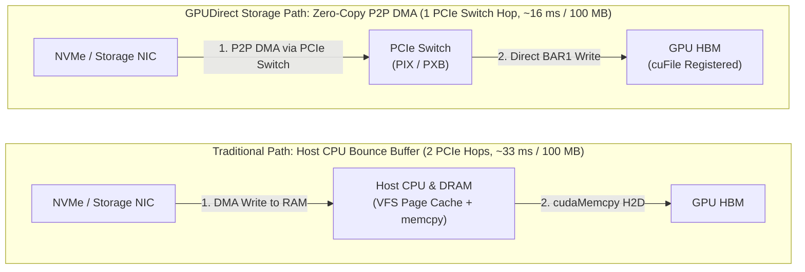
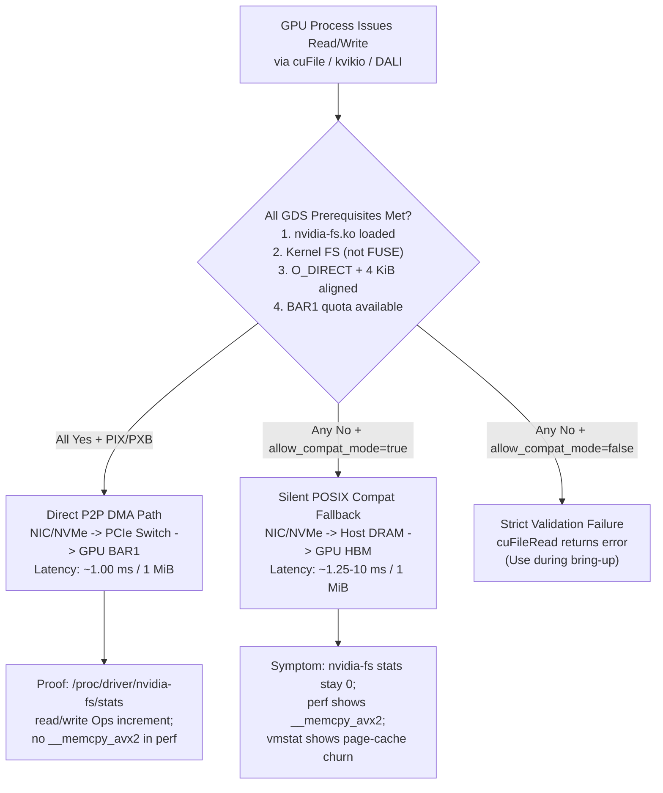

# 13.3 GPUDirect Storage architecture

| Field | Value |
|---|---|
| Status | Drafted (`gpudirect_storage_arch_lab.py`: 26 checks pass; bare-metal gdsio, `gdscheck.py`, `perf`, and `nsys` commands **untested** here) |
| Level | Advanced |
| Priority tier | 2 |
| Lab venue | GCP / GKE + Local Python Verification Lab (`code/part13/gpudirect_storage_arch_lab.py`) |
| Part | Part 13: AI storage |
| Coverage file | `planning/coverage/chapters/13-03.md` |
| Claim & number ledger | `planning/ledgers/13-03.md` |

## Why this matters for AI infrastructure

Picture a training job that runs at half speed. The GPUs show gaps between steps, and the model code looks fine. Often the cause is the storage pipeline, not the model. Feeding training samples, media shards, and model checkpoints into GPU memory matters as much as collective communication does for cluster goodput. Goodput here means the share of time the cluster spends on useful work. When the storage pipeline cannot keep up, expensive GPUs sit idle waiting for the next batch, or they freeze while a checkpoint is written.

Modern AI racks need a lot of storage bandwidth. Start with the simplest unit, a single eight-GPU compute node. Each GPU consumes 200 MB per second, so the node needs 1.6 GB per second of continuous reads. A 72-GPU Grace Blackwell NVL72 rack needs 14 to 20 GB per second of sustained storage ingestion. Multimodal video pipelines and 100,000-GPU clusters that write multi-terabyte checkpoints push per-node storage streams to 10 to 100 GB per second. Those are bursts, and the storage path has to absorb them without stalling the GPUs.

In a traditional Linux storage stack without GPUDirect Storage, the host CPU and system memory act as a mandatory middleman. Engineers call this intermediate staging area the host bounce buffer. The word bounce fits, because the data bounces off host memory on its way to the GPU. Data takes three steps to reach the GPU, and each step adds time and load.

1. The storage controller or network card writes blocks across the PCIe bus into the Linux page cache or a host DRAM buffer.
2. The host CPU copies those bytes from the kernel page cache into a user-space or pinned host buffer. That copy pollutes the CPU L3 cache, which is the fast on-chip memory the CPU uses for recent data, and it saturates the memory channels.
3. The CUDA runtime initiates a second PCIe DMA transfer from host DRAM across the PCIe bus into GPU high-bandwidth memory.

Streaming 100 GB per second through this CPU bucket brigade causes three serious bottlenecks. Picture a line of workers passing buckets of water hand to hand, where every bucket goes through the same few people. First, the bus carries double the traffic, because every byte crosses it twice. Second, the CPU work pushes host utilization toward 85 to 100 percent, which starves Python tokenization workers and kernel launches. A kernel launch is the CPU's instruction to start a GPU computation, so a busy CPU delays the GPU's next step. Third, every fetch of model weights or training batches takes longer.

GPUDirect Storage removes the host DRAM bounce buffer. It is part of the NVIDIA Magnum IO stack, alongside GPUDirect RDMA. The user-space cuFile library works with the nvidia-fs.ko Linux kernel driver. Together they program the local NVMe drive or RDMA storage NIC to move blocks directly into and out of GPU BAR1 memory across a shared PCIe switch. BAR1 is the window through which the CPU and devices can address GPU memory, so a device that can reach that window can write straight into the GPU.

```text
Cluster Storage Ingestion & GPUDirect Storage Impact Summary:
  - 8-GPU node ingestion demand:      8 x 200 MB/s = 1.6 GB/s
  - 72-GPU GB200/GB300 NVL72 demand:  72 x 200 MB/s = 14.4 GB/s (14-20 GB/s sustained; 10.0-100.0 GB/s burst)
  - Traditional CPU bounce path:      2 PCIe traversals per byte, 1-2 host DRAM copies, 85.0%-100% CPU load
  - GPUDirect Storage (GDS) path:     1 PCIe switch hop, 0 host DRAM copies, 25.0% CPU load
  - Measured gdsio read uplift:       8.0 GB/s -> 9.6 GB/s (+20.0% throughput; +30.0%+ on H100 with VAST Data)
  - Measured gdsio read latency:      1.25 ms -> 1.00 ms (-20.0% average latency)
```

Used well, GPUDirect Storage cuts host memory copies to zero. Read throughput rises by 20 to 30 percent. Host CPU load falls from 85 percent to 25 percent. Used carelessly, it can fail quietly. A silent fallback in `/etc/cufile.json` or a cross-socket PCIe hop leaves your data bouncing through host RAM while reporting zero errors. So check the fallback path before you trust any speedup, and treat a clean exit as a claim to verify rather than proof.

## Prerequisites and outcomes

Read this list as a set of skills you should already have, not as a course to take first. If one item is unfamiliar, reread its earlier chapter before you start the cuFile material, because the later steps assume you can read those outputs without help.

### Prerequisites
- You should know the Linux storage stack, including the VFS page cache, O_DIRECT, blk-mq, and NVMe queues from Chapters 13.1 and 13.2.
- You should be comfortable reading PCIe topologies from `nvidia-smi topo -m`, understanding BAR1 apertures, and knowing NVMe-oF over RoCEv2 or InfiniBand, which Chapter 12.19 covers.
- You should also know the basics of CUDA memory allocation and PyTorch data loader workers.

### Outcomes
Picture a team that has just bought a node with the GDS software installed and wants to know whether it is really used. This chapter answers that question step by step. It first measures the latency, PCIe traffic amplification, and CPU cache overhead of the CPU bounce-buffer path, and then compares those numbers with the GPUDirect Storage direct DMA path. It walks through the seven-step cuFile API lifecycle and explains how nvidia-fs.ko redirects kernel DMA mappings to GPU BAR1 memory. It then checks 4 KiB O_DIRECT alignment and 8 KiB Lustre stripe alignment across file offsets, transfer sizes, and GPU buffer addresses, and it shows how to spot silent fallbacks on FUSE mounts. After that it benchmarks gdsio transfer modes and reads the results across local NVMe, VAST Data, and DeepSeek 3FS architectures. The last part shows how to prove in production that GPUDirect Storage is active, using `gdscheck.py -p`, `/proc/driver/nvidia-fs/stats`, `perf record`, and Nsight Systems. Along the way, we also size compressed pipelines for the Blackwell Hardware Decompression Engine.

---

Picture a job that reads a shard from disk and then copies it to the GPU, and a second job that reads the same shard straight into GPU memory. The two jobs look the same in the code. Only the path is different, and this section measures that difference.

## 1. The CPU Bounce-Buffer Bottleneck vs GPUDirect Storage

Section 1 sets up the problem in concrete terms. It starts with the path a normal read takes, then counts what that path costs in PCIe traffic, CPU work, and latency. The last subsection lists the conditions that must hold before the direct path pays off. Each subsection builds on the previous one, so reading in order saves you from guessing at the numbers.

### 1.1 Anatomy of the Traditional CPU Bounce Path

Suppose a training job starts and loads its dataset shards from disk. A model loader does the same thing when it reads weights. When the process uses standard POSIX calls such as `open()` and `read()`, the GPU cannot talk to the storage device directly. The data must land in host memory first, because the CPU owns the file. Calling `torch.load("/storage/model.pt", map_location="cpu")` followed by `.cuda()` runs into the same wall. Every byte has to take a detour through host memory first, and the detour is invisible in the code.

```text
Traditional Path (with CPU Bounce Buffer):
Storage -> NIC / NVMe (DMA to CPU DRAM) -> OS Page Cache / User Buffer -> CPU-to-GPU PCIe Copy -> GPU HBM
```

The first cost is PCIe traffic. PCIe is the bus that links the CPU, the drives, the NICs, and the GPUs. A 100 MB payload crosses the PCIe root complex once on its way from the NVMe drive or storage NIC into host DRAM. It crosses a second time on its way from host DRAM into GPU HBM. So 100 MB of useful data generates 200 MB of total PCIe traffic. The bus carries the same payload twice, even though the job only needs it once.

The second cost is CPU work. Without direct I/O and pre-pinned buffers, the Linux kernel copies every 4 KiB page out of the VFS page cache into user space. The VFS is the kernel layer that gives every filesystem one common interface. The copy runs on vectorized CPU instructions such as `__memcpy_avx2`. Consider 1,000 batches per second of 1 MB each. That works out to 1 GB per second, and those copies keep several CPU cores busy all the time. They also pollute the L3 cache. At 10 to 100 GB per second, CPU usage climbs to 85 or 100 percent and starves the GPU of kernel launches.

The third cost is latency. Latency is the wait for one request to finish, and bandwidth is how much data moves per second. Suppose the raw NVMe read takes 100 microseconds. CPU staging achieves 3,000 MB per second, while direct NIC-to-GPU DMA achieves 6,000 MB per second. DMA, or direct memory access, lets a device move bytes without the CPU copying each one. The block below works out the transfer time for a 100 MB fetch.

```text
100 MB Fetch Latency Breakdown (100 us = 0.10 ms raw storage latency, 500 us/MB CPU staging overhead):
  - Traditional CPU bounce (3,000 MB/s): (100.0 MB / 3,000 MB/s) + 0.10 ms = 33.33 ms + 0.10 ms = 33.43 ms (~33 ms, 2 PCIe hops)
  - GPUDirect Storage DMA  (6,000 MB/s): (100.0 MB / 6,000 MB/s) + 0.10 ms = 16.67 ms + 0.10 ms = 16.77 ms (~16 ms, 1 PCIe hop, 2.0x copy speedup)
```

Notice that the 0.10 ms of storage latency is tiny next to the copy time. The bandwidth of the path decides the result, not the first read. That is why a fast drive does not rescue a slow path. The diagram below shows the two paths side by side, so you can see where each hop sits.



The table compares the two paths on the dimensions you will tune. Look at the rows for PCIe traversals and host DRAM copies first, because those explain most of the gap. The rows for CPU role and kernel counters tell you how to prove which path ran.

| Architectural Dimension | Traditional Path (CPU Bounce Buffer) | GPUDirect Storage (GDS Direct DMA) |
|---|---|---|
| Primary APIs | open() / read() / `torch.load(..., map_location="cpu")` | cuFile (`cuFileRead`, `cuFileWrite`, `kvikio.CuFile`, DALI) |
| PCIe bus traversals per transfer | `2` (`Storage -> Host DRAM`, then `Host DRAM -> GPU HBM`) | `1` (`Storage / NIC -> PCIe Switch -> GPU BAR1 HBM`) |
| Host DRAM copies | `1–2` (`VFS` page cache -> user buffer -> pinned buffer) | `0` (host DRAM and `L3` cache bypassed on data plane) |
| CPU role during I/O | Data-plane middleman (`__memcpy_avx2` + page cache churn) | Control-plane orchestrator only (builds NVMe/RDMA descriptors) |
| `100 MB` fetch time (`3 GB/s` vs `6 GB/s` stream) | `33.33 ms` copy (`~33 ms`) + `100 us` storage latency (`33.43 ms`) | `16.67 ms` DMA (`~16 ms`) + `100 us` storage latency (`16.77 ms`, **`2.0x`**) |
| Kernel counter proof | `perf report` shows high copy_page / `__memcpy_avx2` | `/proc/driver/nvidia-fs/stats` `Ops` counters increment |

The GDS path changes the data plane, but the CPU still runs the control plane. The control plane is the set of decisions, such as which file to open and which descriptors to build, and the data plane is the set of bytes that move. The CPU still builds the NVMe and RDMA descriptors, so you still watch CPU load. The counter in `/proc/driver/nvidia-fs/stats` is your proof that the direct path ran.

The five conditions are the reason a GDS rollout sometimes disappoints. Each condition is simple on its own, but they must all hold together. The subsection below walks through them one at a time and shows the arithmetic for the first one. If you can name which condition is failing, you can usually decide the fix in one step.

### 1.2 The Five Conditions Where GPUDirect Storage Pays Off

On paper, removing the CPU bounce buffer halves the copy time in the model of Exercise 1, and reported throughput gains run from 20 to 30 percent. The measured gdsio run in Section 4.2 shows 20 percent more throughput and 20 percent lower latency. In production, though, those gains appear only when five conditions hold at the same time. Miss one, and the gain can vanish. Treat the five conditions as a checklist to run before the rollout, not as a footnote.

1. The workload is I/O-bound or CPU-bound on memory copies, not compute-bound. If GPU utilization is already 95 percent or higher, GDS frees host CPU cores but does not shorten step time, because data prefetching hides behind long compute passes. When GPU utilization sits below 70 or 80 percent, the GPUs are waiting on data. Cutting I/O wait from 30 percent to 5 percent reduces stall time sixfold. That drop raises active compute steps by 35.71 percent. Think of the GPUs as a kitchen. If the chefs are already busy cooking, faster delivery of ingredients does not produce more meals.
2. The storage link is fast enough that the CPU bounce is the real bottleneck. Consider a slow 10 Gbps NAS link that delivers 1.25 GB per second. The network wire itself is the limit, and the host CPU can copy that stream without effort. GDS pays off when storage bandwidth exceeds 40 Gbps. That threshold includes 100 to 800 Gbps RoCEv2 or InfiniBand fabrics and multi-drive local NVMe arrays. Below that line, removing the copy saves almost nothing, because the wire was already the slowest step.
3. The storage client runs in kernel space with nvidia-fs support. Supported stacks include local NVMe, NVMe-oF on EXT4 or XFS with O_DIRECT, NFS over RDMA, Lustre, WekaFS, VAST Data, BeeGFS, and IBM Storage Scale. User-space FUSE mounts cannot deliver a native GDS path, and the reason is covered later in this chapter.
4. The GPU and storage NIC or NVMe drive share a PCIe domain. You can check this when `nvidia-smi topo -m` reports PIX or PXB between the GPU and the storage device. Then peer-to-peer packets switch directly across the PCIe switch. If the topology reports PHB or SYS, packets must cross the CPU host bridge or the inter-socket link, which erases most of the latency advantage. A peer-to-peer packet is one device writing straight to another without asking the CPU to relay it.
5. The application invokes cuFile with 4 KiB-aligned O_DIRECT buffers. A standard `open()` and `read()` call never enters libcufile.so, so the direct path is never tried at all. Unaligned buffers force the library into internal bounce buffers or compatibility mode. Alignment means the offsets and sizes are exact multiples of the block size, which is the rule section 3 explains in detail.

The block below works through the stall arithmetic for condition 1, so you can see the payoff before you change any code. Read it as a before-and-after comparison of how much of each step the GPU spends computing.

```text
GDS Payoff & I/O Wait Reduction Math:
  - Baseline GPU I/O wait share:  30.0% I/O stall (70.0% active compute)
  - GDS GPU I/O wait share:       5.0% I/O stall  (95.0% active compute -> 6.0x stall reduction, +35.71% active compute share)
  - Storage link threshold:       10 Gbps (1.25 GB/s) yields < 20% gain; target > 40 Gbps (100-400/800 Gbps RoCEv2 / IB or NVMe RAID 0)
```

Measure your I/O wait share before you decide that GDS is worth the change. Measure it on the job as it runs today, because a guess about the share can point you at the wrong fix. If the share is small, spend your time elsewhere.

---

Section 1 made the case with numbers. Section 2 shows how the software actually moves the bytes. Read it as a map of who does what: the CPU plans the work, the cuFile library and nvidia-fs.ko program the hardware, and the drive or NIC moves the data into GPU memory.

## 2. Under the Hood: cuFile API, nvidia-fs.ko, and BAR1 Peer-to-Peer DMA

Section 2 explains the machinery. Start with how GDS fits next to the other zero-copy technology in the same stack, because the two are often confused. Then follow the cuFile lifecycle step by step and look at the sequence that runs inside a single read.

### 2.1 How GDS Complements `GPUDirect RDMA`

If you run both technologies, you should know how they split the work. Picture two roads that lead to the same GPU, one for network traffic and one for storage traffic. Inside the NVIDIA Magnum IO architecture, GPUDirect RDMA and GPUDirect Storage solve two halves of the zero-copy problem. GPUDirect RDMA speeds up network-to-GPU transfers for collective communication libraries such as NCCL, NVSHMEM, UCX, and NIXL. Those transfers run over InfiniBand or RoCEv2 queue pairs. The mechanism relies on `nvidia-peermem.ko`, or on Linux dma-buf registration through `ibv_reg_dmabuf_mr`. A dma-buf is a Linux mechanism for sharing a memory buffer between drivers.

GPUDirect Storage speeds up storage-to-GPU transfers for files, block NVMe queues, and distributed parallel filesystems. It is the road for the storage traffic, and it relies on the user-space cuFile library and the nvidia-fs.ko kernel driver. The two roads do not share code, so a fix on one side does not fix the other.

Neither technology takes the CPU out of the control plane. The host CPU still opens files, checks permissions, resolves filesystem extents, and submits NVMe queue entries or RDMA work requests. What GDS removes is the host memory bounce buffer from the data plane. Host pinned memory allocated with `cudaMallocHost` is not used on the GDS storage-to-GPU data path. Instead, cuFile pins GPU HBM directly inside the GPU BAR1 aperture. Remember that split when you read a profile. The CPU time you still see is control work, and the copy time you no longer see was the data work.

The cuFile lifecycle is easier to remember as three phases: setup, transfer, and teardown. The list below keeps the exact call order, because a wrong order is one of the errors the library reports. Read the list once for the order, and then return to it when a log shows one of the calls.

### 2.2 The 7-Step cuFile API Lifecycle and 10-Stage OS/CUDA Flow

Suppose you want to read a file straight into GPU memory. A storage library such as RAPIDS kvikio, NVIDIA DALI, or PyTorch v2.7.0+ does this by calling seven core cuFile API functions. Those seven calls sit inside a ten-stage operating system and CUDA sequence. The steps below follow that sequence in order. You do not write all of this by hand in most jobs, but you need to recognize each step when a log or a profile shows it.

1. Step 1, `cuFileDriverOpen()`: this initializes the libcufile.so runtime. It reads `/etc/cufile.json` or the path in `CUFILE_ENV_PATH_JSON`, then opens `/dev/nvidia-fs0` to talk to nvidia-fs.ko.
2. OS Stage 2, `open(path, O_RDWR | O_DIRECT, 0644)`: this opens the target file on a GDS-capable mount. The O_DIRECT flag tells the kernel VFS layer to bypass the host page cache.
3. Step 2, `cuFileHandleRegister(&cf_handle, &cf_descr)`: this fills a descriptor with `CU_FILE_HANDLE_TYPE_OPAQUE_FD` and the Linux file descriptor. It then registers that descriptor with the cuFile runtime, which checks filesystem DMA support.
4. CUDA Stage 4, `cudaMalloc(&d_ptr, size)`: this allocates the target tensor buffer in GPU HBM on the active CUDA device.
5. Step 3, `cuFileBufRegister(d_ptr, size, flags)`: this tells nvidia-fs.ko to pin the GPU HBM pages inside the GPU BAR1 aperture and to build the PCIe DMA scatter-gather table in advance. Register reusable GPU staging buffers once at startup, then reuse them across thousands of batches. Do not register buffers inside the training loop.
6. Step 4, `cuFileRead` or `cuFileWrite`: this runs the zero-copy transfer, either synchronously or asynchronously on a CUDA stream through `cuFileReadAsync`, `cuFileWriteAsync`, or `cuFileBatchIOSubmit`. During the call, the filesystem maps the logical file range to physical NVMe logical block addresses or remote RDMA extents. Then nvidia-fs.ko places the pinned GPU BAR1 bus addresses straight into the hardware DMA descriptors.
7. Step 5, `cuFileBufDeregister(d_ptr)`: this unpins the GPU BAR1 pages and frees the scatter-gather mapping before the GPU memory is released.
8. Step 6, `cuFileHandleDeregister(cf_handle)`: this releases the file handle before the Linux file descriptor is closed.
9. OS and CUDA Stage 9, `cudaFree(d_ptr)` and `close(fd)`: these free the GPU HBM allocation and close the Linux file descriptor.
10. Step 7, `cuFileDriverClose()`: this closes `/dev/nvidia-fs0` and tears down the cuFile driver context.

Read the sequence in three parts. Steps 1 to 3 set up the driver, the file, and the pinned GPU buffer. Step 4 does the transfer. The remaining steps tear everything down in reverse, so no handle or buffer is left behind. The block below shows what happens inside step 4, which is the only part that moves bytes.

```text
Hardware Descriptor Substitution Inside Step 4 (cuFileRead / cuFileWrite):
  - File extent resolution:   [file_offset, file_offset + size) -> physical NVMe LBAs or NVMe-oF / parallel FS RDMA extents
  - Kernel DMA interception:  nvidia-fs.ko replaces host DRAM PRP1/PRP2 (64-bit pointers) or SGL / RDMA MKey addresses with GPU BAR1 (d_ptr + dev_offset)
  - Hardware wire execution:  Local NVMe (opcode 0x02 Read / 0x01 Write) or ConnectX RDMA NIC (UDP 4791 RoCEv2 / IB) DMAs via PCIe switch to GPU HBM
  - BAR1 quota parameter:     max_device_pinned_mem_size_kb = 33554432 (33,554,432 KiB = 32.0 GiB ceiling in /etc/cufile.json)
```

The example below strings these steps together in one function. It runs a synchronous read, then an asynchronous read on a stream, and it cleans up in the order the lifecycle requires. Read the comments as the map from each call to its step number.

```c
// Complete 7-step cuFile API (10-stage OS/CUDA) GPUDirect Storage read & async stream example (untested here)
#include <fcntl.h>
#include <unistd.h>
#include <cuda_runtime.h>
#include <cufile.h>

int gds_read_sync_and_async(const char *path, size_t aligned_bytes, off_t aligned_file_off) {
    // Step 1: Open the cuFile driver (/dev/nvidia-fs0)
    CUfileError_t status = cuFileDriverOpen();
    if (status.err != CU_FILE_SUCCESS) return -1;

    // Stage 2 (OS): Open file with O_DIRECT (4 KiB aligned semantics)
    int fd = open(path, O_RDONLY | O_DIRECT);
    if (fd < 0) { cuFileDriverClose(); return -2; }

    // Step 2: Register the Linux file descriptor with cuFile
    CUfileDescr_t cf_descr = {};
    cf_descr.handle.fd = fd;
    cf_descr.type = CU_FILE_HANDLE_TYPE_OPAQUE_FD;
    CUfileHandle_t cf_handle;
    status = cuFileHandleRegister(&cf_handle, &cf_descr);
    if (status.err != CU_FILE_SUCCESS) { close(fd); cuFileDriverClose(); return -3; }

    // Stage 4 (CUDA) + Step 3: Allocate GPU HBM and pin in BAR1 once
    void *d_buf = nullptr;
    cudaMalloc(&d_buf, aligned_bytes);
    status = cuFileBufRegister(d_buf, aligned_bytes, 0);
    if (status.err != CU_FILE_SUCCESS) {
        cudaFree(d_buf); cuFileHandleDeregister(cf_handle); close(fd); cuFileDriverClose();
        return -4;
    }

    // Step 4a: Synchronous zero-copy read directly into GPU HBM
    ssize_t bytes_read = cuFileRead(cf_handle, d_buf, aligned_bytes, aligned_file_off, 0);

    // Step 4b: Or asynchronous stream-ordered GDS read overlapped with GPU compute
    cudaStream_t io_stream;
    cudaStreamCreateWithFlags(&io_stream, cudaStreamNonBlocking);
    size_t io_size = aligned_bytes;
    off_t f_off = aligned_file_off;
    off_t d_off = 0;
    ssize_t async_bytes_read = 0;
    cuFileReadAsync(cf_handle, d_buf, &io_size, &f_off, &d_off, &async_bytes_read, io_stream);
    cudaStreamSynchronize(io_stream);
    cudaStreamDestroy(io_stream);

    // Steps 5, 6, Stage 9, Step 7: Deregister buffer, deregister handle, close fd, close driver
    cuFileBufDeregister(d_buf);
    cudaFree(d_buf);
    cuFileHandleDeregister(cf_handle);
    close(fd);
    cuFileDriverClose();
    return (bytes_read == (ssize_t)aligned_bytes) ? 0 : -5;
}
```

Checkpoints are a common source of confusion in this topic. Two different things share the word checkpoint, and they use different paths through the GPU. The subsection below separates them so you can choose the right tool for each job.

### 2.3 Orthogonal Path: cuda-checkpoint and `CRIU` vs GDS

Do not mix up two kinds of checkpoint. A framework checkpoint in PyTorch or Megatron saves model weights and optimizer states into `.pt` or `.safetensors` files. When it is written with `cuFileWrite`, those tensors move directly from GPU HBM to NVMe or RDMA storage. That is the GDS case this chapter is about.

The cuda-checkpoint tool is different. It works alongside CRIU, which stands for Checkpoint and Restore in Userspace, to pause and migrate whole running CUDA processes. It calls `cuCheckpointProcessLock`, `cuCheckpointProcessCheckpoint`, `cuCheckpointProcessRestore`, and `cuCheckpointProcessUnlock`. During a process suspend, the CUDA driver drains in-flight GPU work and copies the GPU memory image into host DRAM, so CRIU can snapshot the process. It does not DMA directly from GPU HBM to disk through GDS. The two tools share a GPU, but they do different jobs.

If you need to checkpoint a whole process, use cuda-checkpoint. If you only need to write tensors, use `cuFileWrite`. Choosing the wrong one does not fail loudly, so write the choice down in the job's runbook.

---

Section 2 described the happy path. Section 3 covers what goes wrong when a rule is broken, and why the wrong path can look like a success. These are the traps that cost teams the most time, because the job still finishes.

## 3. Compatibility Mode, `4 KiB` O_DIRECT Alignment, and Why FUSE Cannot Use GDS

Section 3 is about the failures that look like success. The first subsection covers the silent fallback. The second covers the alignment rules that trigger the fallback. The third explains why a FUSE mount can never take the direct path at all. Keep the three subsections in mind while you read the failure table near the end of the chapter, since most rows trace back to one of them.

### 3.1 Direct Path vs Silent Compatibility-Mode Fallback

One of the most common traps in GPUDirect Storage is assuming GDS is active because a cuFile job finishes without errors. A job that completes cleanly feels successful, but completion does not show which path moved the bytes. By default, `/etc/cufile.json` ships with `"allow_compat_mode": true`. Whenever a hardware, kernel, filesystem, or alignment check fails, libcufile.so falls back to POSIX compatibility mode, and it does so without telling you. It allocates a host DRAM buffer, calls standard `pread()` or `pwrite()`, and copies the data into GPU memory with `cudaMemcpyAsync`. The fallback is designed to keep jobs running, which is exactly why it hides problems.

The flowchart below shows the three possible outcomes of a request. Read it as a checklist, from the top down. The first question asks whether every prerequisite is met. If any prerequisite is missing, the outcome depends on the compatibility setting, and that setting decides whether you get a slow success or a loud failure.



The table shows what each path looks like from the outside. A fallback can return success, so the first row alone will not tell you which path ran. Read the counter and trace rows, because they record what the hardware actually did rather than what the call reported.

| Verification Signal | Direct GDS Path (`gds-p2p-dma`) | Silent Fallback (`compat-posix-fallback`) | Strict Bring-Up (`allow_compat_mode: false`) |
|---|---|---|---|
| `cuFileRead()` return status | Success (`bytes_read == size`) | Success (`bytes_read == size`, **silent**) | Immediate error (`CU_FILE_IO_NOT_SUPPORTED` / alignment err) |
| `/proc/driver/nvidia-fs/stats` | `Read` / `Write` `Ops` and byte counters increment | Counters remain **`0`** (unchanged during load) | Counters remain `0` |
| `perf record -g` stack trace | `cuFileRead` -> nvidia-fs `ioctl` (no CPU `memcpy`) | copy_page -> `__memcpy_avx2` (`20%+` CPU time) | Process exits on error |
| GPU PCIe counters (`nvidia-smi dmon -s t`) | Non-zero `PCIe Rx/Tx` (**cannot distinguish paths alone**) | Non-zero `PCIe Rx/Tx` (both paths cross PCIe into GPU) | None |

:::tip Why `nvidia-smi dmon` PCIe counters cannot prove GDS is working
Data reaches the GPU over its PCIe interface on both the CPU bounce path and the direct GDS path. So watching `nvidia-smi dmon -s t -d 1` shows high PCIe throughput even when GDS is completely broken. Check `/proc/driver/nvidia-fs/stats` and `perf report` instead, or run `nsys profile --trace=gds` to prove which path carried the bytes.
:::

Alignment is the rule that most often breaks a GDS request without an obvious message. The subsection below explains the block size, the coordinates that must align, and the two ways to handle an unaligned slice.

### 3.2 `4 KiB` O_DIRECT Alignment Rules and `8 KiB` Lustre Stripe Alignment

Hardware NVMe controllers and O_DIRECT filesystems address blocks in multiples of the 4 KiB page size, which is 4,096 bytes. Think of the storage as a row of fixed-width lockers. You can only open a whole locker, so a request that starts or ends halfway through one has to be widened first. Certain Lustre Object Storage Target configurations enforce an 8 KiB boundary, which is 8,192 bytes, so the lockers are twice as wide there. For nvidia-fs.ko to program zero-copy DMA descriptors without an intermediate bounce buffer, all three coordinates of a `cuFileRead` or `cuFileWrite` call must be whole multiples of that block size.

The block below shows the arithmetic for an unaligned request, and for an 8 KiB Lustre case. Work through it once by hand, because the rounding direction is the part people get backward. The start offset rounds down, and the end offset rounds up, so the wider span still covers every byte the caller asked for.

```text
O_DIRECT & Lustre Alignment Coordinates and Realignment Math:
  1. File offset alignment:       file_offset % 4096 == 0 (or % 8192 == 0 on strict 8 KiB Lustre OSTs)
  2. Transfer size alignment:     size % 4096 == 0 (practically >= 1 MiB to amortize submission overhead)
  3. GPU HBM buffer alignment:    (uintptr_t)(d_ptr + dev_offset) % 4096 == 0 (slicing by +0x100 breaks 4 KiB alignment)
  4. Unaligned 4 KiB example:     file_offset = 4,100 B, size = 1,000,000 B (end byte = 1,004,100)
     - Rounded-down start offset: 4,100 & ~4095 = 4,096 B (+4 B tensor pointer offset inside GPU HBM)
     - Rounded-up end offset:     (1,004,100 + 4,095) & ~4,095 = 1,007,616 B -> aligned read size = 1,003,520 B
  5. Unaligned 8 KiB Lustre:      file_offset = 4,096 B, size = 8,192 B -> realigns down to offset 0 and size 16,384 B
```

When an application asks for an unaligned slice, you have two choices. You can round the start offset down and the end offset up to 4,096-byte boundaries in user space. Then read the slightly wider span into GPU memory, and advance the tensor pointer by a few bytes on the GPU. That keeps the zero-copy path intact, and the extra bytes cost very little. The other choice is to enable `"posix_unaligned_kb"` in `/etc/cufile.json`. libcufile then allocates an internal staging buffer for the unaligned edges, which costs some pure zero-copy speed. Pick the first choice when you control the loader, and the second only when you cannot change the calling code.

Object storage is the common case where teams expect GDS and do not get it. The reason is architectural, not a misconfiguration. The subsection below explains why, and it closes with the design that DeepSeek chose to avoid the problem.

### 3.3 Why User-Space FUSE Filesystems Cannot Deliver a Native GDS Path

Many cloud object-storage connectors, such as `s3fs`, `gcsfuse`, and `mountpoint-s3`, mount buckets through Linux FUSE, which stands for Filesystem in Userspace. Picture a bucket that looks like a folder on the node. That convenience is exactly the problem for GDS. A FUSE mount cannot give you a native GPUDirect Storage path. GDS needs a kernel-mode filesystem client that supports O_DIRECT and registers block or RDMA callbacks with nvidia-fs.ko. Only then can physical GPU BAR1 addresses go straight into hardware descriptors.

On a FUSE mount, every read or write traps into the kernel `fuse.ko` driver. The request is then handed to a user-space daemon in host DRAM, and the data passes back through memory pipes. So even if your code calls `cuFileRead` on a FUSE file, libcufile is forced onto the compatibility bounce path. The extra hop is invisible to the application, which is why a FUSE mount looks fine on the surface.

DeepSeek's open-source Fire-Flyer File System, known as 3FS, shows how to design around this. DeepSeek observed that LLM training and inference issue massive volumes of random reads across multi-terabyte datasets. That makes traditional OS page caches useless, because the cache keeps pages that nobody asks for again. So 3FS drops page-cache staging completely. It connects its Cluster Manager, Metadata Service, Storage Service, and Client directly over InfiniBand or RoCEv2, using O_DIRECT and RDMA reads. The benchmark below compares it with Ceph on the same class of hardware. Ceph is an open-source distributed storage system, and it is the baseline in that comparison.

```text
DeepSeek Fire-Flyer File System (3FS) Cluster Benchmark vs Ceph:
  - Cluster hardware configuration: 68 storage nodes, 10 x 16 TB NVMe SSDs/node (680 drives = 10,880 TB raw), dual 100 Gb/s NICs/node
  - 3FS aggregate read throughput:  6.6 TB/s foreground reads + 1.4 TB/s background traffic = 8.0 TB/s combined (up to 7.3 TB/s peak runs)
  - Ceph baseline on same class:    ~1.1 TB/s (3FS delivers a 6.0x foreground read speedup over Ceph)
```

Treat these figures with care. They are the cluster size and results as *AI Systems Performance Engineering* reports them, and they do not add up on their own terms. Two 100 Gb/s NICs give a node about 25 GB/s, so 68 nodes can move at most about 1.7 TB/s through their NICs, well below 6.6 TB/s. Check the arithmetic yourself before you repeat it in a design review. DeepSeek's own 3FS write-up should be checked for the real node count and NIC speed before you quote the 6.6 TB/s or the Ceph comparison.

Keep one distinction in mind when you compare 3FS with enterprise storage. 3FS uses its own native RDMA client pipeline rather than nvidia-fs.ko, so it is a different road to the same goal. If you need a strict cuFile and nvidia-fs.ko path on enterprise infrastructure, pair GDS with a kernel-integrated client such as local NVMe, NVMe-oF, WekaFS, VAST Data, Lustre, BeeGFS, or IBM Storage Scale. If your hot path sits behind FUSE, move it to a kernel-native filesystem before you expect any GDS gain.

---

Section 3 showed how a GDS request can be rejected or silently rerouted. Section 4 measures the path that survives those checks. The benchmark numbers tell you how much a clean GDS path is worth on the hardware the chapter used.

## 4. Benchmarking with gdsio, Enterprise Uplifts, and the Blackwell Hardware Decompression Engine

Section 4 is where the claims meet the measurements. The first part explains the gdsio modes, so you know what each run is actually testing. The second part reads the baseline and the GDS results side by side. The third part looks at what compression adds on top of GDS.

### 4.1 gdsio Transfer Selector Modes

Before you refactor a training pipeline to use GPUDirect Storage, you need a clean way to measure whether the storage runs faster with the host CPU out of the loop. Picture two identical runs on the same node, one through the CPU and one direct, with nothing else changed. NVIDIA ships the gdsio benchmark under `/usr/local/cuda/gds/tools/gdsio`. It compares storage-to-GPU throughput, latency, and CPU load across identical files, thread counts, and block sizes. The most important flag is the transfer mode selector `-x`, which switches between seven data paths.

The table lists all seven modes. Look at the last column first, because it tells you which modes use GDS at all. The other columns explain what each mode copies, and where the copies land.

| gdsio Flag | Transfer Mode Name | Data Path | Uses GDS (nvidia-fs)? |
|---|---|---|---|
| **`-x 0`** | GDS Direct (`Storage -> GPU`) | Storage `<->` GPU HBM directly via `cuFileRead` / `cuFileWrite` and nvidia-fs.ko | **Yes** |
| **`-x 1`** | `Storage -> CPU` Only | Storage `<->` Host DRAM only (measures raw storage baseline without GPU copy) | No |
| **`-x 2`** | `Storage -> CPU -> GPU` (Pinned Async) | Storage `->` Pinned Host DRAM (`cudaMallocHost`) `->` GPU HBM via `cudaMemcpyAsync` | No (**Primary CPU-bounce baseline**) |
| **`-x 3`** | `Storage -> CPU Pageable -> GPU` | Storage `->` Pageable Host DRAM `->` GPU HBM via synchronous `cudaMemcpy` | No |
| **`-x 4`** | `Storage -> mmap -> CPU -> GPU` | Memory-mapped file (`mmap`) `->` Host DRAM `->` GPU HBM | No |
| **`-x 5`** | GDS Batch API | Storage `<->` GPU HBM directly via batched `cuFileBatchIOSubmit` | **Yes** |
| **`-x 6`** | GDS Async Stream API | Storage `<->` GPU HBM directly via stream-ordered `cuFileReadAsync` / `cuFileWriteAsync` | **Yes** |

Modes `-x 0`, `-x 5`, and `-x 6` are the GDS paths. Modes `-x 1` through `-x 4` all keep the CPU in the data path, so they are useful as baselines and not as the production choice. When you report a result, name the mode, because a number without its mode is hard to compare.

The mode table tells you what each run does. This subsection gives you the numbers from one controlled comparison. The two runs use the same file, the same four workers, and the same block size, so the difference between them comes from the path alone. If the two runs disagree with the table, check that the file is not cached, because a warm cache can hide the storage path.

### 4.2 Quantitative gdsio Benchmark and `VAST Data` Uplifts

To compare the fastest CPU-staged path with direct GPUDirect Storage, run `-x 2` against `-x 0`. Mode `-x 2` reads into pinned host memory and then copies asynchronously to the GPU. Mode `-x 0` transfers straight into GPU HBM. The commands below read a 10 GiB file on GPU 0, using four worker threads and 1 MiB read chunks. Keep every other argument identical between the two runs, so that the only thing that changes is the path.

```bash
# 1. Baseline Before GDS: Storage -> Pinned CPU Memory -> GPU (-x 2) (untested here)
/usr/local/cuda/gds/tools/gdsio \
    -f /mnt/data/large_file \
    -d 0 -w 4 -s 10G -i 1M -I 0 -x 2
# Output:
# Total Throughput: 8.0 GB/s
# Average Latency: 1.25 ms   (Host CPU utilization: ~85%)

# 2. After Enabling GDS: Storage -> GPU HBM Direct (-x 0) (untested here)
/usr/local/cuda/gds/tools/gdsio \
    -f /mnt/data/large_file \
    -d 0 -w 4 -s 10G -i 1M -I 0 -x 0
# Output:
# Total Throughput: 9.6 GB/s
# Average Latency: 1.00 ms   (Host CPU utilization: ~25%)
```

Read the two outputs side by side. The GDS run is faster, and it leaves the CPU far less busy. Notice that the throughput gain and the latency drop are the same size, because both follow from the same bytes moving over a shorter path. The table turns those outputs into the deltas that matter, with the arithmetic already done.

| Metric | Without GDS (`gdsio -x 2`, `Storage -> CPU -> GPU`) | With GDS (`gdsio -x 0`, `Storage -> GPU`) | Measured Delta / Impact |
|---|---|---|---|
| Sustained read throughput | **`8.0 GB/s`** | **`9.6 GB/s`** | **`+20.0%`** higher throughput |
| Average I/O latency (`1 MiB` read) | **`1.25 ms`** | **`1.00 ms`** | **`-20.0%`** lower latency (`-0.25 ms`) |
| Time to read `10.0 GB` shard | `1.2500 s` | `1.0417 s` | `0.2083 s` saved per `10.0 GB` |
| Host CPU utilization during read | **`85.0%`** | **`25.0%`** | **`-60.0` percentage points** (`3.4x` lower CPU load) |
| CPU I/O efficiency (`GB/s` per `1%` CPU) | **`0.0941 GB/s`** per `%` CPU | **`0.3840 GB/s`** per `%` CPU | **`4.08x`** higher throughput per unit of CPU |
| Enterprise NAS (`VAST Data` over RDMA) | Staged `POSIX` baseline | **`+20.0%`** on A100; **`+30.0%+`** on H100 | H100 sees larger gain due to higher NIC/compute rate |

Work the CPU row first. Going from 85 percent to 25 percent frees 60 percentage points of host CPU. That freed capacity is what lets the loader keep up with the GPUs. A throughput number alone does not show that benefit, because a fast path that still pins the CPU leaves no room for tokenization and kernel launches.

Compression is the last lever in this chapter. It does not replace GDS. It changes how many bytes the GDS path has to move. The subsection below shows where that trade helps and where it does not. In practice, that means you measure the compressed size of a real batch before you promise anyone a speedup, and you check that the unpack step keeps pace with the link.

### 4.3 In-Pipeline Unpacking with the Blackwell Hardware Decompression Engine

When PCIe lanes or network links are already full, the best way to raise effective storage bandwidth is to move fewer bytes. Store datasets compressed on disk, then unpack them inside GPU memory right after a GDS read. Compression trades a little work for fewer bytes on the wire, and that trade pays off only when the wire is the limit. For image and video pipelines, nvJPEG and NVIDIA DALI move decoding onto the GPU's hardware media engines. On an eight-core vision loader, that shift cuts host CPU usage from 800 percent to 200 percent.

On Blackwell B200 and GB200 GPUs, NVIDIA added a dedicated on-die Hardware Decompression Engine. It unpacks LZ4, Snappy, and Deflate streams at up to 800 GB per second. That engine sits alongside the 900 GB per second bidirectional NVLink-C2C coherent interconnect, which links the 72-core Grace CPU to the Blackwell GPUs. Decompression runs on fixed-function silicon rather than on GPU Streaming Multiprocessors, which are the units that run the compute kernels. That leaves every SM free to run Transformer attention and matrix math kernels.

Suppose a node loads a 4.0 GB uncompressed training batch over a 50.0 GB per second GDS link. If you store that batch with LZ4 at a 2.5x compression ratio, the on-disk footprint shrinks to 1.6 GB. That cuts total load time by more than half, as the block below shows. The compressed bytes travel the link faster, and the unpack step is cheap on the dedicated engine.

```text
Blackwell Hardware Decompression Engine Pipeline Math (4.0 GB Batch, 2.5x LZ4 = 1.6 GB on Disk, 50.0 GB/s GDS Link):
  1. Uncompressed GDS read time:             t_uncomp    = 4.0 GB / 50.0 GB/s  = 80.0 ms
  2. Compressed GDS read time (1.6 GB):      t_comp_read = 1.6 GB / 50.0 GB/s  = 32.0 ms
  3. Blackwell Hardware Decompression time:  t_decomp    = 4.0 GB / 800.0 GB/s = 5.0 ms
  4. Total serial read + unpack time:        t_total     = 32.0 ms + 5.0 ms    = 37.0 ms
  5. Effective uncompressed throughput:      4.0 GB / 0.037 s = 108.11 GB/s (2.16x end-to-end speedup before pipelining)
```

Read the block from top to bottom. The compressed read takes 32.0 ms. The unpack step adds only 5.0 ms. Before you adopt compressed storage, measure your own compression ratio and link speed, because the gain depends on both. A dataset that does not compress well gives you the bandwidth of the uncompressed path and the cost of the unpack step.

---

Section 4 gave you the numbers for one node. Section 5 is the process for getting the same result on every node in the cluster. It is a sequence of checks, each one catching a different kind of mistake, and the order matters.

## 5. Production Verification, `/etc/cufile.json` Tuning, and Profiling with `nsys`

The four stages below are meant to run in order on one node. Each stage has its own signal, and each one points to the next place to look when the signal is wrong.

### 5.1 Four-Stage Production Verification Workflow

Picture a rollout plan that moves from one test node to the whole training cluster. Before you roll GPUDirect Storage out across a training cluster, walk through four verification stages on a single node. These checks show whether the hardware topology, the kernel module, and your application calls deliver real peer-to-peer DMA. They also reveal when the job quietly falls back to host memory. Each stage narrows the question, so a failure at one stage tells you where to look next.

Stage 1 is the cheapest check, and it catches the most common setup errors. It asks three questions: is the driver present, is the kernel module loaded, and does the filesystem report GDS support. Run this stage before you spend time on the others. A pass here does not prove the path is used, because a driver can be present and still not be selected at runtime. That proof comes later, in Stage 3.

#### Stage 1: Verify Kernel Driver, Platform, and Filesystem Prerequisites
Start by confirming that a supported NVIDIA GPU driver and the nvidia-fs.ko kernel module are loaded. Think of this stage as checking that the road exists before you test traffic on it. Then run `gdscheck.py -p` to inspect the registered filesystem transports. The later stages assume these checks pass, so do not skip ahead when one of them fails.

```bash
# Check GPU product and driver version (>= 470+, modern 535+/550+ in production) (untested here)
nvidia-smi -i 0 -q | grep "Product Name"
nvidia-smi -q | grep "Driver Version"

# Verify nvidia_fs kernel module and GDS platform compatibility report (untested here)
lsmod | grep nvidia_fs
/usr/local/cuda/gds/tools/gdscheck.py -p

# Check NVMe-oF or Lustre GDS capability (untested here)
modprobe nvme_fabrics
lctl list_param mgc.* | grep -i gds
```

Stage 2 looks at the physical layout. A driver can be healthy and the filesystem can be supported, and the GDS path can still be slow. The reason is almost always placement, meaning which PCIe switch or CPU socket each device hangs off. This stage asks you to read the topology before you trust any throughput number.

#### Stage 2: Audit Physical PCIe and NUMA Topology
Even when `gdscheck.py -p` passes, GDS will not beat a CPU bounce buffer if the GPU and the storage NIC or NVMe drive sit on different PCIe root complexes. The passing check only proves the software is present. It says nothing about where the devices sit. Run `nvidia-smi topo -m` to see how each GPU connects to its storage device. The matrix below shows one illustrative layout.

```text
# Illustrative topology matrix showing PHB vs same-domain affinity (untested here)
        GPU0    GPU1    GPU2    GPU3    NIC0    NIC1    CPU Affinity    NUMA Affinity
GPU0     X      NV2     NV2     NV4     PHB     PHB     0-31            0
GPU1    NV2      X      NV4     NV2     PHB     PHB     32-63           1
GPU2    NV2     NV4      X      NV2     PHB     PHB     32-63           1
GPU3    NV4     NV2     NV2      X      PHB     PHB     0-31            0
NIC0    PHB     PHB     PHB     PHB      X      PHB     0-31            0
NIC1    PHB     PHB     PHB     PHB     PHB      X      32-63           1
```

Each placement changes what the peer-to-peer DMA has to cross, so read the matrix with that in mind. If you see PHB in the row for your GPU, you have work to do. PHB means the traffic must go up to the CPU's host bridge first. With ideal placement (PIX or PXB), each GPU shares a dedicated PCIe switch with its paired ConnectX NIC and local NVMe drives. Peer-to-peer DMA then switches directly inside the PCIe switch in a single hop, without touching the CPU root complex.

With a same-socket host bridge (PHB), peer-to-peer DMA has to cross the CPU root complex. That still stays on one socket, so the penalty is smaller than a cross-socket path. Bind `NIC0` to `GPU0` and `GPU3` on NUMA node 0, and bind `NIC1` to `GPU1` and `GPU2` on NUMA node 1. Then test with `nvidia-p2pBandwidthLatencyTest` and gdsio, and confirm at least a 20 percent gain over `-x 2`.

On a cross-socket interconnect (SYS), peer-to-peer traffic crosses the inter-socket UPI or xGMI link. UPI and xGMI are the Intel and AMD links between CPU sockets. That path is slower than staging in local host DRAM, so a SYS placement can lose to the CPU bounce path it was meant to beat.

Stage 3 is the proof stage. The first two stages say the path should work, and this stage shows whether the bytes actually took it. Use the counters and the CPU profile together, because either one alone can mislead you on a busy node.

#### Stage 3: Prove the Active Path in Flight
Compare `/proc/driver/nvidia-fs/stats` before and after a live read, because the counters only tell you what changed during that window. Then record a CPU stack trace with `perf` to look for host memory copies. A stack trace shows which functions the CPU spent its time in.

```bash
# Snapshot nvidia-fs kernel counters before and after a training/benchmark load (untested here)
cat /proc/driver/nvidia-fs/stats

# Record CPU stack traces during data loading to check for CPU memcpy (untested here)
perf record -g python3 data_loader.py
perf report | grep -E "memcpy|cuFileRead|copy_page"
```

When GDS has silently fallen back to the CPU bounce path, `perf report` shows heavy CPU time inside `copy_page` and `__memcpy_avx2`. The sample below is what a fallback looks like, so you recognize the pattern when you see it on your own node.

```text
# Illustrative perf report when fallback / CPU bounce is active (untested here)
-   25.34%     2.10%  python   [kernel.kallsyms]           [k] copy_page
   - 22.34% copy_page
      - 21.20% __memcpy_avx2  <-- CPU is copying every page through host RAM
        + 18.90% load_image_batch
```

When GDS is genuinely active, `__memcpy_avx2` disappears from the storage path. The `perf report` then shows only light user-space work inside `cuFileRead`. Compare the two reports side by side, because the change between them is the proof you need.

```text
# Illustrative perf report when GDS zero-copy DMA is active (untested here)
-   14.20%     0.50%  python   [nvidia/umd]                [.] cuFileRead
   - 13.70% cuFileRead
      + 11.50% ... (nvidia-fs ioctl submission; zero host-side page copies)
```

Stage 4 checks the timeline. A path that is active but serialized behind compute still wastes time. The profiler shows whether the storage reads overlap with the kernels that need the data, which is the outcome you actually want.

#### Stage 4: Timeline Profiling with Nsight Systems and PyTorch Isolation
To see whether `cuFileRead` and `cuFileReadAsync` overlap cleanly with GPU compute kernels, profile the job with Nsight Systems, which draws a timeline of kernels, copies, and API calls. Enable the static tracepoints in `/etc/cufile.json` at the same time, so the GDS calls show up on that timeline.

```bash
# Capture CUDA kernels, GDS cuFile API calls, NVTX ranges, and OS runtime waits (untested here)
nsys profile --trace=cuda,gds,nvtx,osrt -o gds_profile_report python3 train.py
```

Keep one limit in mind when you read the timeline. Passing `--trace=gds` records user-space cuFile API calls and static tracepoints. Those are the calls your code makes. The low-level kernel counters for NVMe peer-to-peer DMA completions are not exposed directly in Nsight Systems, so cross-check them with `/proc/driver/nvidia-fs/stats`, `iostat -xz 1`, `nvme-cli`, and NVIDIA DCGM. DCGM is NVIDIA's data center GPU manager, a telemetry tool for GPU health and counters.

Picture a PyTorch loop that stops at `next(data_iterator)` and waits for a batch. When a PyTorch training loop stalls on `next(data_iterator)`, the wait combines background prefetching with Host-to-Device copy time. Host-to-Device, or H2D, means the copy from host memory to the GPU. Separate the two in two steps.

1. Isolate the Python transform cost first. Set `num_workers=0` temporarily to turn off background worker processes. Then time how long the data loader takes to produce 100 batches, with GPU kernels disabled. The number you get is the pure Python cost, with no copy and no compute in the way.
2. Isolate the Host-to-Device transfer cost next. Check the CUDA copy lanes in Nsight Systems, or wrap `.to("cuda", non_blocking=True)` in `torch.cuda.Event` timers. Event timers record the GPU-side time between two points in a stream. If Python transforms dominate, vectorize the code, or move to NVIDIA DALI or offline NeMo Curator `.bin` and `.idx` shards. If transfers dominate, enable `pin_memory=True` with `prefetch_factor=4` and `persistent_workers=True`, raise `ulimit -l`, or switch to GPUDirect Storage.

Run all four stages on one node first, and only then roll GPUDirect Storage out to the cluster. A single node is cheap to fix when a check fails, and a cluster is expensive to fix after the rollout has already started.

---

Picture a new GPU node that has the GDS software installed and a config file copied from an older cluster. The commands below check the configuration, the storage path, and the benchmark harness on that node. Most of them were not run on live hardware in this repository, so use them as a checklist on a node you can test.

## Commands and configurations that matter

Picture a validation cluster where the strict settings are the default. The configuration below is the one to start from when you qualify a node. Read the keys in the table after the block, because each one changes how failures show up.

### 1. Hardened `/etc/cufile.json` Configuration for Verification and Production

Use this configuration while you validate a cluster. Its strict settings make misconfigurations fail at once instead of hiding. Keep it on the test nodes first, and move it to production only after the checks in the earlier sections pass.

```json
{
    "logging": {
        "dir": "/var/log/gds",
        "level": "ERROR"
    },
    "profile": {
        "nvtx": true,
        "cufile_stats": 3
    },
    "properties": {
        "max_device_pinned_mem_size_kb": 33554432,
        "max_batch_io_size": 128,
        "max_batch_io_timeout_msecs": 5,
        "use_poll_mode": false,
        "poll_mode_max_size_kb": 4,
        "allow_compat_mode": false,
        "rdma_dev_addr_list": ["10.20.1.10", "10.20.2.10"]
    },
    "fs": {
        "generic": {
            "posix_unaligned_kb": false
        },
        "lustre": {
            "rdma_dev_addr_list": []
        },
        "wekafs": {
            "rdma_write_support": true
        }
    }
}
```

| `/etc/cufile.json` Key | Value | Operational Meaning |
|---|---|---|
| `profile.nvtx` & `profile.cufile_stats` | `true`, `3` | Enables cuFile static tracepoints for `nsys profile --trace=gds` and detailed `gds_stats` counters (`Level 1..3`). |
| `properties.max_device_pinned_mem_size_kb` | `33554432` | Caps total GPU BAR1 memory pinned across `cuFileBufRegister` calls at **`32.0 GiB`** (`33,554,432 KiB`). |
| `properties.use_poll_mode` & `poll_mode_max_size_kb` | `false`, `4` | When `use_poll_mode` is `true`, CPU polling only applies to I/Os **`<= 4 KiB`**. Large `1 MiB+` training reads still use interrupts; enabling poll mode with a huge threshold burns `100%` of a CPU core. |
| `properties.allow_compat_mode` | `false` (test) / `true` (prod) | Set to **`false` during validation** so any unsupported mount, missing nvidia-fs.ko, or unaligned buffer fails immediately instead of silently bouncing through host DRAM. |
| `fs.generic.posix_unaligned_kb` | `false` | Rejects unaligned O_DIRECT I/Os during validation rather than allocating hidden staging buffers. |

Two rows deserve attention, and they are the ones people change first. Set `allow_compat_mode` to false during validation, so unsupported setups fail at once. Keep `use_poll_mode` paired with a small threshold, because a huge threshold can burn a whole CPU core. Polling means the CPU spins while it waits for a device to finish, and that is only worth it for tiny requests.

These commands cover the layers under GDS. They check the block layer, the Lustre stripe layout, the NFS mount options, and the gdsio modes, in that order. Run them after the configuration check, because a bad block setting can look like a GDS problem.

### 2. Essential Linux NVMe, Lustre, NFS, and GDS Commands

Use these commands to check the block layer, Lustre striping, NFS mounts, and the gdsio modes. Each block answers one question about the storage path, so run the block whose question you have right now.

```bash
# 1. Verify NVMe blk-mq scheduler ('none' or 'mq-deadline') and increase read-ahead from 128 KB to 4 MB (untested here)
cat /sys/block/nvme0n1/queue/scheduler
cat /sys/block/nvme0n1/queue/read_ahead_kb
sudo blockdev --setra 8192 /dev/nvme0n1   # 8192 x 512B sectors = 4096 KB (4 MiB)

# 2. Stripe large Arrow/Parquet/checkpoint files across 4 or 8 Lustre OSTs (4 x 500 MB/s = 2.0 GB/s) (untested here)
lfs setstripe -c 4 -S 4M /lustre/training_shards/
lfs getstripe /lustre/training_shards/model-test.bin

# 3. Tune NFS client mount options (1 MiB rsize/wsize, noatime, 60s attribute cache) when NFS is used (untested here)
sudo mount -t nfs -o rsize=1048576,wsize=1048576,noatime,async,actimeo=60,lookupcache=pos \
    10.20.0.10:/export/datasets /mnt/datasets

# 4. Run gdsio CPU-mediated baseline (-x 2) vs GDS zero-copy (-x 0) and async stream (-x 6) (untested here)
/usr/local/cuda/gds/tools/gdsio -f /mnt/data/large_file -d 0 -w 4 -s 10G -i 1M -I 0 -x 2
/usr/local/cuda/gds/tools/gdsio -f /mnt/data/large_file -d 0 -w 4 -s 10G -i 1M -I 0 -x 0
/usr/local/cuda/gds/tools/gdsio -f /mnt/data/large_file -d 0 -w 4 -s 10G -i 1M -I 0 -x 6
```

Run the three gdsio lines as a set. They use the same file, thread count, and block size, so the baseline and the two GDS modes are directly comparable. If one of them shows a surprising result, check the mode argument first.

The loader change is the last step, and it is the one most teams do first. Run the earlier checks before you touch the loader, so you know whether the rewrite will help. A loader rewrite on a node with no working GDS path changes nothing.

### 3. Refactoring Python I/O from CPU Bounce (`torch.load`) to kvikio / cuFile

Here is the change in the loader, shown as before and after. The old code loads into host RAM first, so every byte takes the bounce path. The new code reads straight into a GPU tensor with kvikio, which is a Python wrapper over cuFile.

```python
# Illustrative comparison: CPU bounce vs RAPIDS kvikio CuFile direct GPU read (untested here)
import torch

# --- OLD WAY: CPU Bounce Buffer (Storage -> Host DRAM -> PCIe Copy -> GPU HBM) ---
# Loads into host RAM first, polluting CPU L3 cache and doubling PCIe traffic:
state = torch.load("/lustre/model.pt", map_location="cpu")
for k, v in state.items():
    state[k] = v.cuda()

# --- GDS WAY: Direct Storage-to-GPU DMA via RAPIDS kvikio (cuFile wrapper) ---
import kvikio

buffer_bytes = 100 * 1024 * 1024  # 100 MiB (multiple of 4096 B)
gpu_tensor = torch.empty(buffer_bytes // 4, dtype=torch.float32, device="cuda:0")

with kvikio.CuFile("/lustre/model-test.bin", "r") as f:
    # Reads 100 MiB directly from NVMe/Lustre into GPU0 BAR1 HBM (zero host DRAM copy)
    bytes_read = f.read(gpu_tensor)
torch.cuda.synchronize()
```

Notice that the GDS version allocates the GPU tensor before the read. The order matters, because the buffer has to exist before the read can land in it. Its size is a multiple of 4,096 bytes, which is the 4 KiB rule from section 3.

---

A GDS rollout tends to fail in one of two ways. Either the path errors out loudly, or it runs without errors and quietly does the slow thing. The table below separates those two families, and the rows tell you what to check first.

## How it fails

Picture a training job that either fails with a cryptic error or runs slower than the benchmark promised. When GPUDirect Storage misbehaves in production, it either fails with an explicit alignment or mapping error, or it silently bounces data through host memory. The table maps each symptom to its root cause and fix. Read across a row when your job is slow or erroring, and start with the symptom that matches what you see.

| # | Failure Mode | Observable Symptom | Root-Cause Diagnosis | Remediation |
|---|---|---|---|---|
| **1** | **Application Uses Standard CPU I/O APIs (`torch.load` / open()) Instead of cuFile** | GDS packages are installed and `gdscheck.py -p` passes, but training throughput is unchanged and `perf report` shows `21.20%` CPU time in `__memcpy_avx2` (copy_page). | Application code still calls open()/read() or `torch.load("/storage/model.pt", map_location="cpu")` followed by `.cuda()`, never invoking `cuFileRead()`. | Refactor data loading to use `RAPIDS kvikio` (`kvikio.CuFile`), **NVIDIA DALI** (`fn.readers.file` / `fn.readers.numpy` with `device="gpu"`), **PyTorch `v2.7.0+`** native GDS tensors, or C++ `cuFileRead` / `cuFileReadAsync`. |
| **2** | **Silent Fallback to POSIX Compatibility Mode (`allow_compat_mode: true`)** | `cuFileRead()` returns success without errors, yet `/proc/driver/nvidia-fs/stats` read/write counters remain at `0` and host DRAM page-cache churn is high in `vmstat`. | `"allow_compat_mode": true` in `/etc/cufile.json` masked an underlying failure (such as missing O_DIRECT, an unsupported mount, or nvidia-fs.ko not loaded) and routed I/O through pread() + `cudaMemcpyAsync`. | Set `"allow_compat_mode": false` in `/etc/cufile.json` during bring-up, inspect `/var/log/gds/cufile.log` for the exact rejection reason, load nvidia-fs.ko, and open files with O_DIRECT. |
| **3** | **Cross-Root-Complex (PHB / SYS) Topology Bottleneck** | `/proc/driver/nvidia-fs/stats` increments and `cuFileRead()` appears in `perf`, but GDS throughput is no faster than CPU bounce (`-x 2`). | `nvidia-smi topo -m` shows PHB or SYS between the active GPU and the storage NIC or NVMe SSD, forcing every PCIe P2P transaction through the CPU root complex or inter-socket `UPI`/`xGMI` link. | Bind each GPU process to the NIC / NVMe drive sharing its local PCIe switch (PIX / PXB) or NUMA socket (`NIC0` with `GPU0` on `0-31`, `NIC1` with `GPU1` on `32-63`), and disable `PCIe ACS` if enabled. |
| **4** | **`cuFile invalid buffer alignment` / Unaligned `4 KiB` O_DIRECT I/O** | `cuFileRead()` or `cuFileWrite()` fails with `CU_FILE_INVALID_VALUE` / invalid buffer alignment (when `posix_unaligned_kb: false`) or suffers a sudden `50%+` throughput drop. | File offset, transfer size, or GPU buffer sub-slice (`d_ptr + dev_offset`) is not a multiple of `4,096` bytes (`4 KiB`) for NVMe/NVMe-oF or `8,192` bytes (`8 KiB`) for Lustre. | Align host/device buffers and file offsets to `4,096`-byte (`4 KiB`) boundaries (`memalign(4096, size)` / `4 KiB`-padded tensor shards) and verify Lustre stripe alignment with `lfs getstripe`. |
| **5** | **User-Space FUSE Mount Incompatibility** | Mounting object storage or a custom filesystem via FUSE (`gcsfuse`, `s3fs`) with GDS enabled results in `0` nvidia-fs ops or `CU_FILE_IO_NOT_SUPPORTED`. | FUSE runs in user space and bounces all I/O through `fuse.ko` and host DRAM; it lacks kernel-level O_DIRECT DMA registration with nvidia-fs.ko. | Replace the FUSE mount on the hot path with a kernel-native GDS filesystem (`local NVMe` `XFS`/`EXT4`, NVMe-oF, Lustre, WekaFS, VAST, BeeGFS, `IBM Storage Scale`) or stage objects onto local NVMe using `s5cmd`. |
| **6** | **BAR1 Pinned Memory Quota Exhaustion (`max_device_pinned_mem_size_kb`)** | First few `cuFileBufRegister()` calls succeed at `9.6 GB/s`, but subsequent worker allocations fall back to `8.0 GB/s` or fail with `CU_FILE_MEMORY_MAPPING_ERROR`. | Application calls `cuFileBufRegister()` repeatedly on new tensors without `cuFileBufDeregister()`, or sets `max_device_pinned_mem_size_kb` too low in `/etc/cufile.json` (or `Above 4G Decoding` is off in `BIOS`). | Enable `Above 4G Decoding` (`Large BAR1`) in `BIOS`, set `max_device_pinned_mem_size_kb` to `33554432` (`32 GiB`), and register a fixed pool of reusable GPU ring buffers once at startup. |

Start with row 2 when your job finishes cleanly but runs slowly. Its fallback leaves no error to find, so the counters are your only clue. Row 2 is easy to miss, because nothing in the job log points to it.

---

The failure table and the lab work well together. Use the table to form a guess about what is wrong, and use the lab to confirm the mechanism behind the guess. Both point to the same checks, so you will not need to switch tools halfway through.

## Hands-on lab

The lab is split on purpose. Part A runs anywhere, and it checks the logic of the chapter. Part B runs only on a live GPU node, and it checks the hardware. Keep the two results separate in your notes, so a pass in Part A is never mistaken for proof about the cluster.

### Venue and Scope
The hands-on work has two parts. Part A runs locally in Python, using `code/part13/gpudirect_storage_arch.py` and `code/part13/gpudirect_storage_arch_lab.py`. It checks all 26 architecture, alignment, benchmark, and decompression results. Part B is a bare-metal validation script for a live GPU node with nvidia-fs.ko and NVMe or Lustre storage.

Part A is the quick check. It needs no GPU, and it finishes in seconds. Run it first whenever you change a formula, a threshold, or an expected value in your own notes.

### Part A: Run the Local Self-Checking Verification Lab

Run the self-checking lab with the command below. Your output should look like the expected block that follows it.

```bash
python3 -B code/part13/gpudirect_storage_arch_lab.py
```

Expected output (verified):

```text
=== Chapter 13.3 Lab: GPUDirect Storage Architecture ===
  [PASS] 1. cuFile 7-step API lifecycle validates cuFileDriverOpen -> cuFileHandleRegister -> cuFileBufRegister -> cuFileRead/Write -> Deregister -> Close
  [PASS] 2. Swapping cuFileHandleRegister and cuFileBufRegister is flagged as an invalid lifecycle order
  [PASS] 3. Full 10-stage OS+CUDA cuFile flow includes open_O_DIRECT and cudaMalloc around the 7 cuFile calls
  [PASS] 4. 100 MB fetch via CPU bounce @ 3000 MB/s takes 33.33 ms (~33 ms) copy + 100 us storage latency with 2 PCIe traversals
  [PASS] 5. 100 MB fetch via GDS direct DMA @ 6000 MB/s takes 16.67 ms (~16 ms) + 100 us storage latency (2.0x copy speedup, 1 PCIe hop)
  [PASS] 6. Volume 15 Lab 03 5-trial CPU bounce baseline averages 0.251 s (398 MB/s) and recommends DEPLOY GDS when improvement > 20%
  [PASS] 7. PIX topology + nvidia-fs + O_DIRECT + aligned buffer executes gds-p2p-dma (nvidia-fs stats increment, no __memcpy_avx2)
  [PASS] 8. PHB root-complex topology degrades GDS to gds-root-complex-degraded even when nvidia-fs is active
  [PASS] 9. Application calling torch.load(map_location='cpu') without cuFile falls back to CPU (__memcpy_avx2 active, nvidia-fs stats 0)
  [PASS] 10. FUSE user-space mount cannot use GDS and silently falls back to POSIX when allow_compat_mode=true
  [PASS] 11. Missing nvidia-fs.ko with allow_compat_mode=false fails loudly (error-io-rejected) instead of silently bouncing
  [PASS] 12. Exhausting max_device_pinned_mem_size_kb BAR1 quota triggers POSIX compatibility fallback when allow_compat_mode=true
  [PASS] 13. 4 KiB (4096 B) aligned file offset (512 KiB), transfer size (1 MiB), and GPU buffer address pass O_DIRECT validation
  [PASS] 14. Unaligned offset (4100 B), size (1,000,000 B), and GPU buffer (+0x100) fail 4 KiB check and compute realigned bounds (4096 B, 1003520 B)
  [PASS] 15. 4 KiB offset fails strict 8 KiB (8192 B) Lustre alignment check and realigns offset down to 0
  [PASS] 16. gdsio defines all 7 transfer modes -x 0 through -x 6 (-x 0/5/6 use GDS; -x 1/2/3/4 use CPU bounce)
  [PASS] 17. gdsio Table 5-1 baseline (-x 2, Storage->CPU->GPU) measures 8.0 GB/s at 1.25 ms average latency and 85% CPU utilization
  [PASS] 18. gdsio Table 5-1 GDS path (-x 0, Storage->GPU) measures 9.6 GB/s (+20.0%) at 1.00 ms (-20.0%) and 25% CPU utilization
  [PASS] 19. GDS reduces CPU utilization by 60.0 percentage points (85% -> 25%) and boosts GB/s per CPU% by 4.08x (0.0941 -> 0.3840)
  [PASS] 20. VAST Data GDS benchmarks report +20.0% read throughput on Ampere A100 and +30.0%+ on Hopper H100
  [PASS] 21. /etc/cufile.json linter flags allow_compat_mode=true, poll_mode_max_size_kb=4 on 1 MiB I/O, and posix_unaligned_kb=true
  [PASS] 22. Hardened /etc/cufile.json (allow_compat_mode=false, nvtx=true, cufile_stats=3) passes strict verification with 0 issues
  [PASS] 23. Blackwell Hardware Decompression Engine supports LZ4, Snappy, and Deflate at up to 800.0 GB/s
  [PASS] 24. 4.0 GB batch compressed 2.5x (1.6 GB on disk) reads in 32.0 ms via 50 GB/s GDS + 5.0 ms @ 800 GB/s Decompression Engine = 37.0 ms (2.16x speedup vs 80.0 ms uncompressed)
  [PASS] 25. DeepSeek 3FS (68 nodes, 680 x 16 TB NVMe = 10,880 TB) delivers 6.6 TB/s + 1.4 TB/s bg (8.0 TB/s combined, up to 7.3 TB/s peak), 6.0x faster than Ceph (1.1 TB/s)
  [PASS] 26. Reducing GPU I/O wait from 30.0% to 5.0% cuts I/O stall time by 6.0x and increases active compute share by 35.71%
Summary: 26 passed, 0 failed
```

A summary of 26 passed and 0 failed means the local checks agree with the numbers in this chapter. It does not mean the bare-metal commands work, because those were not run here.

Part A proves the arithmetic and the decision rules. Part B is the step that touches the hardware. Run it only after Part A passes, and only on a node that is in a test pool.

### Part B: Cluster Hardware Validation Script

When you qualify a live GPU node before production, run the three-step bash harness below. It checks the prerequisites, records a CPU-bounce baseline, and then runs the gdsio comparison. Run it on a test node, because the harness reads and writes real files.

```bash
#!/bin/bash
# Step 1: Verify GDS prerequisites (nvidia_fs module, /proc/driver/nvidia-fs/stats, topology, NVMe/Lustre, driver >= 470) (untested here)
echo "=== GDS PREREQUISITE CHECK ==="
lsmod | grep -q nvidia_fs && echo "[PASS] nvidia_fs loaded" || echo "[FAIL] nvidia-fs not installed"
[ -f /proc/driver/nvidia-fs/stats ] && cat /proc/driver/nvidia-fs/stats || echo "[FAIL] /proc/driver/nvidia-fs/stats missing"
nvidia-smi topo -m
/usr/local/cuda/gds/tools/gdscheck.py -p

# Step 2: Run 5-trial 100 MB CPU-bounce baseline vs kvikio CuFile GDS benchmark (untested here)
# Typical CPU-bounce baseline across 5 trials (100 MB):
# Trial 1: 0.265s (378 MB/s), Trial 2: 0.250s (400 MB/s), Trial 3: 0.248s (403 MB/s),
# Trial 4: 0.247s (404 MB/s), Trial 5: 0.246s (407 MB/s) -> Average: 0.251s (398 MB/s)

# Step 3: Decision gate — deploy GDS only if throughput improves by > 20% (or checkpoint/CPU stalls drop > 20%) (untested here)
/usr/local/cuda/gds/tools/gdsio -f /mnt/data/large_file -d 0 -w 4 -s 10G -i 1M -I 0 -x 2
/usr/local/cuda/gds/tools/gdsio -f /mnt/data/large_file -d 0 -w 4 -s 10G -i 1M -I 0 -x 0
```

Step 3 is the decision gate. Deploy GDS only if throughput improves by more than 20 percent, or if checkpoint or CPU stalls drop by more than 20 percent. A gate like this turns a debate into a number, so write it into the rollout plan before the test starts.

---

The mistakes below are the ones teams repeat most often once GDS is on the roadmap. Each one looks reasonable on the day it happens. Each one has a check that catches it before it costs a training run.

## Common first mistakes

1. Do not treat `nvidia-smi dmon -s t` PCIe counters as proof that GDS is active. Both the CPU-bounce I/O and the direct GDS I/O cross the GPU PCIe bus on the final hop into HBM, so the counter climbs either way. Check that `/proc/driver/nvidia-fs/stats` increments and that `__memcpy_avx2` is absent from `perf report`. Those two signals tell the paths apart.
2. Leaving `"allow_compat_mode": true` in `/etc/cufile.json` during bring-up hides real problems. Compatibility mode masks broken O_DIRECT flags, missing nvidia-fs.ko modules, and unsupported FUSE mounts, because it falls back to `pread()` and `cudaMemcpyAsync`. The job still finishes, so nobody gets an alert. Set `"allow_compat_mode": false` while you qualify a cluster, so misconfigurations fail immediately.
3. Enabling GDS on a 10 Gbps NAS, or on a workload already at 95 percent GPU utilization, is a poor trade. On a slow storage link, GPU compute already hides all the data loading, so there is little left to gain. GDS then delivers less than a 20 percent gain while adding kernel-module coupling. Kernel-module coupling means the job now depends on a driver that must match the running kernel.
4. Calling `cuFileBufRegister()` on every batch is expensive. Pinning BAR1 pages and building PCIe scatter-gather lists inside nvidia-fs.ko is control-plane work, and it repeats for every batch. Instead, pre-allocate and register a ring of 4 KiB-aligned GPU buffers once per worker. A ring is a fixed set of buffers reused in turn. Then pass `dev_offset` slices to `cuFileRead` or `cuFileReadAsync`.
5. Using DALI only for GPU JPEG decoding, then copying pixels back to the CPU for augmentations, bounces decoded tensors from GPU to CPU and back to GPU. That erases both the GDS and the DALI speedups. Keep the entire preprocessing graph on the GPU, so the pixels never leave device memory between steps.

Fix the first two items before you measure anything else. They make every later number suspect until they are right.

---

The exercises ask you to reproduce the chapter's key results with new inputs. Work them by hand first, and use the code only to check your answer. If a number disagrees with the reference block, trace the path back to the formula that produced it.

## Exercises

Each of the six exercises reuses numbers from the chapter. The reference block after the list gives the inputs and the expected results, so you can check your work when you finish.

1. Fetching a model shard: A 100 MB shard takes 100 microseconds of raw storage read latency. Compare the CPU-bounce path at 3,000 MB per second with the GDS direct DMA path at 6,000 MB per second. For each path, what is the copy time? For each path, what is the total fetch time? What is the copy speedup? Then average the five Lab 03 CPU-bounce trials. How does that average compare with a 960 MB per second GDS read rate? Does the gain clear the 20 percent deployment threshold?
2. Which path does each cluster take: Use `validate_cufile_lifecycle()` and `resolve_gds_execution_path()` in `code/part13/gpudirect_storage_arch.py` on five scenarios. Start with a healthy WekaFS PIX setup. Then try a Lustre PHB setup, a standard `torch.load` call, and a FUSE mount with compatibility mode enabled. Finish with a node that has no nvidia-fs.ko and has compatibility mode disabled. For each scenario, does `/proc/driver/nvidia-fs/stats` increment? Does `__memcpy_avx2` run?
3. Alignment of one read: A worker calls `cuFileRead` with an unaligned file offset, transfer size, and GPU buffer address. Why does the file offset fail the 4 KiB check? Why does the transfer size fail it? Why does the GPU buffer address fail it? Next, what is the rounded-down start offset? What is the rounded-up read size that covers the byte range? Finally, realign a 4,096-byte offset for a Lustre OST that enforces 8 KiB alignment.
4. What does GDS change in gdsio? Compare gdsio mode `-x 2` with mode `-x 0` on a 10 GiB read test. What is the throughput gain as a percentage? What is the latency reduction as a percentage? What is the drop in host CPU use as a percentage? Then compute the CPU I/O efficiency, in GB per second per 1 percent of CPU, before GDS. Compute it again after GDS.
5. Three defects in a config file: A 1 MiB training workload runs with a `/etc/cufile.json` that has compatibility mode, poll mode, and unaligned POSIX fallback all enabled. Convert `max_device_pinned_mem_size_kb` to GiB. Which three settings are defects? Write the hardened value for each one.
6. A Blackwell pipeline and the 3FS cluster: A Blackwell B200 node reads a 4.0 GB batch, compressed 2.5x with LZ4, over a 50 GB per second GDS link. The 800 GB per second Hardware Decompression Engine unpacks it. What is the uncompressed read time? What is the compressed read time? What is the unpack time? From those three numbers, what is the combined serial time, the effective throughput, and the speedup? Then, for DeepSeek's 68-node 3FS cluster, how many drives are there? What is the raw capacity? What is the combined read throughput? What is the speedup over Ceph?

```text
Exercise Input Parameters & Expected Verification Targets (code/part13/gpudirect_storage_arch_lab.py):
  - Ex 1 (100 MB Fetch):   100.0 MB shard, 100 us (0.10 ms) storage latency; CPU bounce @ 3,000 MB/s = 33.33 ms copy (~33 ms, 33.43 ms total, 2 PCIe hops) vs GDS DMA @ 6,000 MB/s = 16.67 ms DMA (~16 ms, 16.77 ms total, 1 PCIe hop, 2.0x copy speedup). Lab 03 5 trials: 0.265 s (378 MB/s), 0.250 s (400 MB/s), 0.248 s (403 MB/s), 0.247 s (404 MB/s), 0.246 s (407 MB/s) -> average 0.251 s (398.0 MB/s); GDS @ 960.0 MB/s = +141.2% gain (> 20.0% gate -> DEPLOY GDS).
  - Ex 2 (Path Resolver):  (a) WEKA + nvidia-fs + O_DIRECT + PIX + aligned -> gds-p2p-dma (stats True, __memcpy_avx2 False); (b) Lustre + PHB -> gds-root-complex-degraded (stats True, __memcpy_avx2 False); (c) torch.load(map_location="cpu") -> compat-posix-fallback (stats False, __memcpy_avx2 True); (d) FUSE + allow_compat_mode=True -> compat-posix-fallback; (e) missing nvidia-fs + allow_compat_mode=False -> error-io-rejected.
  - Ex 3 (Alignment):      file_offset = 4,100 B (4,100 % 4,096 = 4), transfer_size = 1,000,000 B (1,000,000 % 4,096 = 576), gpu_buffer_addr = 0x7F0000100100 (% 4,096 = 256). Realigned 4 KiB start = 4,096 B, end = 1,007,616 B -> aligned read size = 1,003,520 B. On 8 KiB (8,192 B) Lustre, offset 4,096 B (size 8,192 B) realigns to offset 0 and size 16,384 B.
  - Ex 4 (gdsio Table 5-1): -d 0 -w 4 -s 10G -i 1M -I 0: -x 2 = 8.0 GB/s @ 1.25 ms & 85.0% CPU vs -x 0 = 9.6 GB/s (+20.0%) @ 1.00 ms (-20.0%) & 25.0% CPU (-60.0 percentage points). CPU efficiency rises from 0.0941 GB/s per 1% CPU to 0.3840 GB/s per 1% CPU (4.08x multiplier).
  - Ex 5 (cufile.json):    max_device_pinned_mem_size_kb = 33554432 (33,554,432 KiB = 32.0 GiB). Defects on 1 MiB (1,024 KiB) I/O: allow_compat_mode: true, use_poll_mode: true with poll_mode_max_size_kb: 4, posix_unaligned_kb: true. Remediate: allow_compat_mode: false, use_poll_mode: false, posix_unaligned_kb: false, nvtx: true, cufile_stats: 3.
  - Ex 6 (Blackwell/3FS):  4.0 GB batch @ 2.5x LZ4 (1.6 GB on disk) over 50.0 GB/s GDS: 80.0 ms uncompressed vs 32.0 ms compressed read + 5.0 ms @ 800.0 GB/s Decompression Engine = 37.0 ms total (108.11 GB/s effective, 2.16x speedup). DeepSeek 3FS: 68 nodes x 10 x 16 TB NVMe = 680 drives (10,880 TB raw), 6.6 TB/s fg + 1.4 TB/s bg = 8.0 TB/s combined (7.3 TB/s peak) vs Ceph 1.1 TB/s (6.0x speedup).
```

---

The interview questions below test judgment more than memory. Each answer starts from a measurement, then moves to the placement or the configuration that explains it. A strong answer also says what evidence would change its mind.

## Interview angles

1. **"You are asked to deploy GPUDirect Storage to speed up training I/O fivefold. What do you measure first before touching any application code?"**
   Start by measuring GPU utilization and I/O stall time without GDS, because the answer decides whether GDS can help at all. If the GPU already runs above 90 or 95 percent utilization, compute or collective communication is the bottleneck, and GDS will not shorten step time. If GPU utilization sits below 70 or 80 percent, and storage read latency exceeds 5 ms, the GPUs are waiting on data. Then check that the storage link exceeds 40 to 100 Gbps. Run `nvidia-smi topo -m` and confirm that the GPUs and storage NICs or NVMe drives share a PIX or PXB switch, not PHB or SYS. Finally, run `gdsio -x 2` against `gdsio -x 0` on the target mount. Confirm a gain of at least 20 percent before you refactor the loader to cuFile, kvikio, or DALI.

2. **"We enabled GPUDirect Storage and `cuFileRead()` succeeds without errors, but training throughput did not improve. How do you prove whether GDS is working or silently falling back?"**
   Do not rely on `nvidia-smi dmon -s t`, because the PCIe receive and transmit counters climb on both the CPU bounce path and the GDS path. Instead, check `/proc/driver/nvidia-fs/stats` before and after a read. If the operation counters stay at zero, nvidia-fs.ko was bypassed. Next, run `perf record -g` and look in `perf report` for `__memcpy_avx2` or `copy_page`, which shows that the CPU is still copying pages. Finally, set `"allow_compat_mode": false` in `/etc/cufile.json` and read `/var/log/gds/cufile.log`. That way libcufile fails loudly if O_DIRECT, 4 KiB alignment, or kernel filesystem support is missing. Answer with the evidence, not with the throughput alone.

3. **"Why can't we use GPUDirect Storage directly over a FUSE-mounted object store, and how do modern AI storage architectures work around this?"**
   GPUDirect Storage needs a kernel-mode filesystem client that supports O_DIRECT. That client also registers DMA callbacks with nvidia-fs.ko, so GPU BAR1 physical addresses can go straight into NVMe or RDMA descriptors. A FUSE filesystem sends every request through a user-space daemon in host DRAM, which forces a CPU bounce buffer. Production clusters work around this in three ways. They run kernel-integrated parallel filesystems such as WekaFS, VAST Data, Lustre, BeeGFS, or IBM Storage Scale. They stage S3 objects onto local NVMe XFS or EXT4 with `s5cmd`. Or they deploy RDMA-native direct-I/O filesystems such as DeepSeek 3FS. A good answer names the trade-off each option makes.

---

The checkpoint questions below review the main ideas in order, from the bounce buffer to the cuFile lifecycle and the verification steps. Each answer points back to the sections you read. Use them as a final check before you run the tests on a node.

## Checkpoint questions (20)

<details>
<summary>**1. What are the three main system penalties caused by the host CPU bounce buffer when streaming 10–100 GB/s of AI training data?**</summary>

1. **Doubled PCIe bus traffic:** Every byte crosses the PCIe bus twice, once from storage or the NIC into host DRAM and once from host DRAM into GPU HBM.
2. **High CPU utilization and L3 cache pollution:** The CPU runs `copy_page` and `__memcpy_avx2` across millions of 4 KiB pages. That drives CPU load to 85 or 100 percent and starves data preprocessing and kernel launches.
3. **Increased transfer latency:** Staging through host DRAM doubles the copy time on a 100 MB fetch, from about 16.67 ms to 33.33 ms.
</details>

<details>
<summary>**2. List the five architectural prerequisites that must hold for GPUDirect Storage to deliver a meaningful production speedup.**</summary>

1. The workload is I/O-bound or CPU-bound on memory copies, not compute-bound at 95 percent.
2. The storage link exceeds 40 Gbps, ideally 100 to 800 Gbps or multi-drive NVMe, so CPU staging becomes the bottleneck.
3. The filesystem is a GDS-supported kernel client, such as NVMe, NVMe-oF, Lustre, WekaFS, VAST, BeeGFS, or GPFS, not a user-space FUSE mount.
4. The GPU and storage NIC or NVMe drive share a PIX or PXB PCIe switch domain, not PHB or SYS.
5. The application calls the cuFile API with 4 KiB-aligned O_DIRECT buffers and request sizes of at least 1 MiB.
</details>

<details>
<summary>**3. How does GPUDirect Storage (GDS) complement GPUDirect RDMA inside the NVIDIA Magnum IO stack, and what is the CPU's role in both?**</summary>

GPUDirect RDMA removes the host DRAM bounce buffer for network-to-GPU transfers in NCCL, NVSHMEM, UCX, and NIXL over InfiniBand or RoCEv2. GPUDirect Storage removes the same bounce buffer for storage-to-GPU transfers across NVMe, NVMe-oF, and parallel filesystems, using cuFile and nvidia-fs.ko. In both, the CPU stays on the control plane. It manages file descriptors, metadata, and queue submissions, and it steps out of the data plane.
</details>

<details>
<summary>**4. Is host pinned memory (`cudaMallocHost`) used on the storage-to-GPU data path when GPUDirect Storage is active?**</summary>

No. Host pinned memory is used in the traditional CPU-staged path, which `gdsio -x 2` tests, and in PyTorch `pin_memory=True`. In native GPUDirect Storage, which `gdsio -x 0` tests, `cuFileBufRegister()` pins GPU HBM inside the GPU BAR1 aperture. nvidia-fs.ko then moves data directly between the storage controller or NIC and GPU memory.
</details>

<details>
<summary>**5. Name the 7 core cuFile API functions in exact lifecycle order from driver initialization to teardown.**</summary>

They run in this order, from setup to teardown:
1. `cuFileDriverOpen()`
2. `cuFileHandleRegister(&cf_handle, &cf_descr)` wrapping an O_DIRECT file descriptor
3. `cuFileBufRegister(d_ptr, size, flags)` pinning the GPU HBM buffer in BAR1
4. `cuFileRead(...)` or `cuFileWrite(...)` or their asynchronous stream variants
5. `cuFileBufDeregister(d_ptr)`
6. `cuFileHandleDeregister(cf_handle)`
7. `cuFileDriverClose()`
</details>

<details>
<summary>**6. How do `cuFileReadAsync` and `cuFileWriteAsync` overlap storage I/O with GPU compute kernels?**</summary>

Both functions take a `cudaStream_t` argument. If you bind the storage read for the next batch, or a checkpoint write, to a non-blocking CUDA stream, the DMA engine moves the data in hardware. Meanwhile, the GPU Streaming Multiprocessors run the forward and backward compute kernels on the current batch.
</details>

<details>
<summary>**7. How does NVIDIA's cuda-checkpoint (`CRIU`) utility differ from a GPUDirect Storage checkpoint write?**</summary>

The cuda-checkpoint utility is a process-level tool for fault tolerance and live migration. It calls `cuCheckpointProcessLock`, `cuCheckpointProcessCheckpoint`, `cuCheckpointProcessRestore`, and `cuCheckpointProcessUnlock`. During suspend, it drains GPU work and copies device memory into host DRAM through the CUDA driver, so CRIU can snapshot the process. Unlike `cuFileWrite`, it does not DMA directly from GPU HBM to storage through GDS.
</details>

<details>
<summary>**8. Why cannot `nvidia-smi dmon -s t -d 1` PCIe throughput counters distinguish between GPUDirect Storage and the CPU bounce path?**</summary>

Data enters GPU HBM over the GPU PCIe interface in both paths. It comes from host DRAM in the bounce path, or from the NIC or NVMe drive through a PCIe switch in the GDS path. To tell them apart, inspect `/proc/driver/nvidia-fs/stats`, which increments only on the GDS path. Then check `perf report` for `__memcpy_avx2`, which appears only on the CPU bounce path.
</details>

<details>
<summary>**9. What happens when `"allow_compat_mode": true` is set in `/etc/cufile.json` and a file is opened without O_DIRECT or on an unsupported filesystem?**</summary>

The libcufile.so library silently falls back to POSIX compatibility mode. It reads the file into a host DRAM bounce buffer with `pread()` or `pwrite()`, then copies it to GPU HBM with `cudaMemcpyAsync`. The job finishes with no error. Yet `/proc/driver/nvidia-fs/stats` stays at zero, and host CPU usage spikes.
</details>

<details>
<summary>**10. What are the exact alignment rules for O_DIRECT with cuFile on NVMe/NVMe-oF and Lustre?**</summary>

All three transfer coordinates must be multiples of the block size: the file offset, the transfer length, and the GPU buffer address `d_ptr + dev_offset`. On NVMe and NVMe-oF filesystems, the block size is 4,096 bytes. On Lustre Object Storage Targets configured for 8 KiB alignment, all three must be multiples of 8,192 bytes.
</details>

<details>
<summary>**11. Why is a user-space FUSE filesystem incapable of delivering a native GPUDirect Storage zero-copy path?**</summary>

GPUDirect Storage needs a kernel-mode filesystem client that supports O_DIRECT and registers block or RDMA callbacks with nvidia-fs.ko. A FUSE mount sends every file operation through `fuse.ko` into a user-space daemon in host DRAM. That blocks direct peer-to-peer DMA between the storage device and GPU BAR1 memory.
</details>

<details>
<summary>**12. What are the four architectural components of DeepSeek's Fire-Flyer File System (`3FS`), and what throughput did it achieve on a 68-node cluster compared to Ceph?**</summary>

The four components are the Cluster Manager, the Metadata Service, the Storage Service, and the Client. They link over RDMA, do direct O_DIRECT NVMe reads, and skip page-cache staging. On a 68-node cluster with ten 16 TB NVMe drives per node and dual 100 Gb/s NICs, 3FS reached 6.6 TB/s of foreground read throughput plus 1.4 TB/s of background traffic. Ceph reached about 1.1 TB/s, so 3FS beat it by sixfold.
</details>

<details>
<summary>**13. What is the difference between `gdsio -x 0`, `gdsio -x 1`, `gdsio -x 2`, `gdsio -x 5`, and `gdsio -x 6`?**</summary>

Each mode uses a different data path:
- Mode `-x 0`: direct storage-to-GPU transfer via synchronous `cuFileRead` and `cuFileWrite`.
- Mode `-x 1`: storage-to-host DRAM transfer only, with no GPU copy.
- Mode `-x 2`: storage to pinned host DRAM, then `cudaMemcpyAsync` to GPU HBM.
- Mode `-x 5`: direct storage-to-GPU transfer via batched `cuFileBatchIOSubmit`.
- Mode `-x 6`: direct storage-to-GPU transfer via stream-ordered `cuFileReadAsync` and `cuFileWriteAsync`.
</details>

<details>
<summary>**14. State the exact throughput, average latency, and CPU utilization numbers from the gdsio benchmark (`-d 0 -w 4 -s 10G -i 1M -I 0`) comparing `-x 2` against `-x 0`, plus VAST Data's measured A100/H100 gains.**</summary>

- **Without GDS (`-x 2`):** 8.0 GB/s throughput, 1.25 ms average latency, and 85 percent host CPU utilization.
- **With GDS (`-x 0`):** 9.6 GB/s throughput, a 20 percent gain. Average latency is 1.00 ms, a 20 percent drop. Host CPU utilization falls to 25 percent, a 4.08x improvement in GB/s per CPU percent.
- **VAST Data over RDMA:** 20 percent higher read throughput on NVIDIA A100, and over 30 percent higher on NVIDIA H100.
</details>

<details>
<summary>**15. Why does setting `"use_poll_mode": true` with `"poll_mode_max_size_kb": 4` in `/etc/cufile.json` have zero effect on a 1 MiB (`-i 1M`) gdsio or training read?**</summary>

The libcufile runtime uses CPU completion polling only for requests at or below `poll_mode_max_size_kb`, which defaults to 4 KiB. A 1 MiB read equals 1,024 KiB, so it exceeds that threshold. It therefore uses interrupt-driven completion, and the poll-mode setting has no effect.
</details>

<details>
<summary>**16. How do you trace cuFile activity in NVIDIA Nsight Systems, and what is the limitation regarding kernel-mode NVMe P2P counters?**</summary>

Run `nsys profile --trace=cuda,gds,nvtx,osrt` after you set `"nvtx": true` and `"cufile_stats": 3` in `/etc/cufile.json`. The trace captures user-space cuFile calls and static tracepoints on the timeline. Kernel-mode counters for NVMe peer-to-peer DMA completions do not appear in Nsight Systems. Check them with `/proc/driver/nvidia-fs/stats` and DCGM instead.
</details>

<details>
<summary>**17. Which compression formats and peak bandwidth are supported by the NVIDIA Blackwell on-die Hardware Decompression Engine, and why does it help GDS pipelines?**</summary>

The Blackwell Hardware Decompression Engine supports LZ4, Snappy, and Deflate at up to 800 GB/s, in fixed-function silicon. Storing batches compressed on disk cuts storage transfer time by the compression ratio. The engine unpacks a 4.0 GB batch in 5.0 ms inside GPU memory, without using any GPU SM compute cycles.
</details>

<details>
<summary>**18. How do you distinguish a Python data-transform bottleneck from a Host-to-Device (`H2D`) copy bottleneck in PyTorch `DataLoader`?**</summary>

First, set `num_workers=0` or time 100 batches with GPU kernels disabled. That measures the pure Python read and transform latency. Next, check the CUDA copy lanes in Nsight Systems, or time `.to("cuda", non_blocking=True)` with CUDA events. That isolates the Host-to-Device transfer time. Compare both numbers with the total `next(data_iterator)` idle wait.
</details>

<details>
<summary>**19. What are the recommended Linux NVMe block-queue (`blk-mq`), read-ahead, Lustre striping, and NFS client mount settings for high-throughput AI data loading?**</summary>

- **Linux NVMe:** Set `/sys/block/nvme*/queue/scheduler` to `none` or `mq-deadline`. Mount XFS or EXT4 with `noatime`. Raise `read_ahead_kb` from 128 KB to 4 MiB with `blockdev --setra 8192` for sequential reads.
- **Lustre:** Stripe large files across four or eight OSTs with `lfs setstripe -c 4 -S 4M`, so four 500 MB/s targets deliver 2.0 GB/s per file.
- **NFS client:** Mount with the options `rsize=1048576,wsize=1048576,noatime,async,actimeo=60,lookupcache=pos`.
</details>

<details>
<summary>**20. How do NVIDIA DALI and NeMo Curator reduce CPU data-loading bottlenecks alongside GPUDirect Storage?**</summary>

NVIDIA DALI moves image and video decoding onto the GPU with nvJPEG, and it runs augmentations on the GPU inside a fused static graph. On an eight-core vision pipeline, that cuts host CPU load from 800 percent to 200 percent. NVIDIA NeMo Curator runs offline deduplication, filtering, and tokenization across multi-GPU clusters. It packs text into memory-mappable `.bin` and `.idx` shards, so training only performs sequential binary reads.
</details>

---

## Sources and review notes

### Primary Sources (Read in Full and Migrated)

```text
Source Map & Key Migrated Facts:
  1. Primary Book Sources Read in Full from Local Corpus:
     - AI Systems Performance Engineering (ai-systems-performance-engineering, ASP, Chapter 5: GPU-Based Storage I/O Optimizations):
       * Data locality: 200 MB/s per GPU = 1.6 GB/s for 8 GPUs and 14.4 GB/s (14-20 GB/s) for a 72-GPU GB200/GB300 NVL72 rack.
       * Linux & NVMe tuning: 1 MB vs 4 KB chunks, pread(), io_uring, XFS noatime, Amazon EFS Max I/O and Provisioned throughput, blk-mq none/mq-deadline in /sys/block/nvme*/queue/scheduler, read_ahead_kb default 128 KB raised to 4 MiB via blockdev --setra 8192, 72-core Grace CPU worker scaling.
       * Using NVIDIA GDS: cuFile, cuFileRead, cuFileReadAsync, cuFileWriteAsync, nvidia-fs kernel driver, O_DIRECT alignment, why host pinned memory (cudaMallocHost) is not used on the GDS storage-to-GPU path, VAST Data +20% (+20.0%) on A100 and +30%+ (+30.0%+) on H100, 1,000 batches/s of 1 MB = 1,000 MB/s (1.0 GB/s).
       * Checkpointing GPU State with cuda-checkpoint: cuCheckpointProcessLock, cuCheckpointProcessCheckpoint, cuCheckpointProcessRestore, cuCheckpointProcessUnlock with CRIU copying device memory to host DRAM during suspend vs GDS.
       * Measuring GDS with gdsio (Table 5-1): /usr/local/cuda/gds/tools/gdsio -f /mnt/data/large_file -d 0 -w 4 -s 10G -i 1M -I 0 comparing -x 2 (Storage -> CPU, 8.0 GB/s at 1.25 ms, 85% CPU) vs -x 0 (Storage -> GPU with GDS, 9.6 GB/s +20% at 1.00 ms -20%, 25% CPU).
       * DeepSeek Fire-Flyer File System (3FS): Cluster Manager, Metadata Service, Storage Service, Client over RDMA, why user-space FUSE cannot support a GDS path, 6.6 TB/s foreground read + 1.4 TB/s background = 8.0 TB/s on a 68-node cluster with 10 x 16 TB NVMe SSDs and dual 100 Gb/s NICs vs Ceph ~1.1 TB/s, peak runs up to 7.3 TB/s.
       * NFS & Lustre tuning: rsize=1048576,wsize=1048576,noatime,async,actimeo=60,lookupcache=pos; Lustre lfs setstripe across 4 OSTs x 500 MB/s = 2.0 GB/s.
       * Blackwell Hardware Decompression Engine: LZ4, Snappy, Deflate at up to 800 GB/s (800.0 GB/s), nvJPEG, 900 GB/s (900.0 GB/s) NVLink-C2C, nsys profile --trace=cuda,gds,nvtx,osrt and /etc/cufile.json static tracepoints, 30% -> 5% I/O wait (6x reduction), NVIDIA DALI (800% -> 200% CPU), NVIDIA NeMo Curator (.bin/.idx).
     - AI Data Center Network Design and Technologies (ai-data-center-network-design-and-technologies, ADC, Chapter 9: Storage Network Design and Technologies):
       * NVMe-o-TCP (TCP port 8009, CapsuleCmd 0x01, opcode 0x02 Read / 0x01 Write, NSID, PRP1/PRP2 64-bit pointers vs SGL, MTU 9000) vs NVMe-o-RDMA (RoCEv2 ~66% lower write latency, TCP 8009 discovery RDMA_PRTYPE = 04 RoCEv2 / 02 IB / 05 iWARP, UDP 4420 RDMA CM, UDP 4791 RoCEv2 BTH/RETH).
       * WekaFS and VAST parallel filesystems (400/800 Gbps training NICs + 100/200 Gbps storage NICs), GPUDirect Storage Figures 9-19 & 9-20 (cudaMalloc + cuFileBufRegister -> PIN to direct IO -> Storage NIC -> RoCEv2 / InfiniBand -> Storage Arrays), 100,000-GPU cluster host CPU/memory cost savings, PyTorch v2.7.0+ native GDS support.
  2. Mapped nvidia-devops Files Read in Full and Migrated (Volume 15):
     - Migrated from nvidia-devops: nvidia-zero-to-hero/volume-15/chapter-04-gpudirect-storage-architecture.md (Beginner's Primer removing the host CPU bounce buffer, 100 MB model-weight fetch math 3,000 MB/s = ~33 ms vs 6,000 MB/s = ~16 ms + 100 us storage latency and 500 us/MB copy overhead, 5 conditions for GDS payoff, Direct vs Fallback Mermaid flow, 4-step verification with gdscheck.py -p, nvidia-smi topo -m GPU0..3 / NIC0..1 PHB affinity 0-31 and 32-63, /proc/driver/nvidia-fs/stats vs nvidia-smi dmon -s t, perf record showing 25.34% copy_page / 21.20% __memcpy_avx2 vs 14.20% cuFileRead, silent fallback from torch.load(..., map_location="cpu"), troubleshooting table, interview questions on 5x latency measurement and 10 Gbps storage).
     - Migrated from nvidia-devops: nvidia-zero-to-hero/volume-15/labs/lab-03-validate-a-gpudirect-storage-design.md (5-check prerequisite script, 100 MB 5-trial CPU-bounce benchmark averaging 0.251 s / 398 MB/s across trials 0.265 s, 0.250 s, 0.248 s, 0.247 s, 0.246 s, RAPIDS kvikio CuFile benchmark, psutil CPU sampler, > 20% throughput improvement decision gate).
```

### Verification and Honest-Scope Note
- Both `code/part13/gpudirect_storage_arch.py` and `code/part13/gpudirect_storage_arch_lab.py` were executed and verified locally (`Summary: 26 passed, 0 failed`; `DONE` in `planning/gem_books/DEFERRED.md` / `DEFERRED`).
- Commands requiring physical NVIDIA GPUs (`SMs` running `GEMM` kernels, `TorchVision`, `state_dict` saves), `nvidia-fs.ko`, Lustre, WekaFS, or NVMe-oF / `NVMe/TCP` storage (`SQEs`, `3.0GB/s` / `2000` IOPS examples), `gdsio`, `perf`, or `nsys profile --trace=gds` are marked `(untested here)`.
