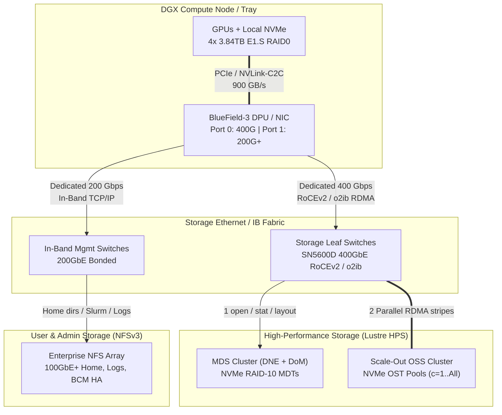
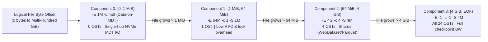
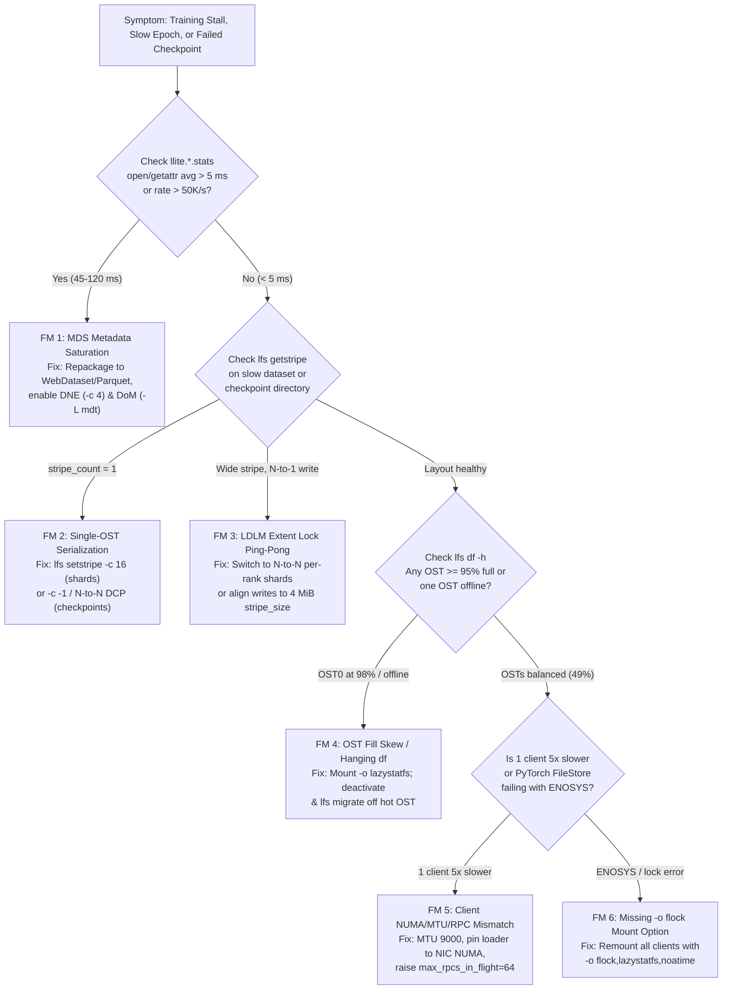

# 13.4 Lustre for AI

| Field | Value |
|---|---|
| Level | Advanced |
| Priority tier | 2 |
| Lab venue | GCP / GKE + Local Python Verification Lab (`code/part13/lustre_for_ai_lab.py`) |
| Part | Part 13: AI storage |
| Coverage file | `planning/coverage/chapters/13-04.md` |
| Claim & number ledger | `planning/ledgers/13-04.md` |

## Why this matters for AI infrastructure

Picture a training run on thousands of GPUs. Every epoch starts by reading data, and every recovery barrier waits on the parallel file system. When that file system slows down, the whole cluster waits with it. Chapter 6.19 covered the basic anatomy of Lustre, including the MGS, MDS, MDT, OSS, OST, quotas, and basic formatting. Running Lustre for AI factories adds three severe failure modes. Classic single-job HPC work rarely triggers all three together.

The first failure is a metadata storm at the start of each epoch. A single workspace holds millions of tiny raw files, next to multi-gigabyte packed shards and multi-terabyte checkpoints. When an epoch begins, hundreds of GPU clients flood one MDS with open and attribute requests. Open latency jumps from a few milliseconds to tens of milliseconds. Every GPU then sits idle waiting for file handles, while the OST data drives remain ninety percent idle.

The second failure comes from default striping. Lustre gives new directories a stripe count of one. A multi-hundred-gigabyte checkpoint written into an untuned directory therefore serializes the whole dump onto a single OST. That bottleneck freezes training for over ten minutes, when the same dump could finish in seconds across all targets. The reverse problem exists too. When dozens of ranks write unaligned byte ranges into one shared file, the Lustre Distributed Lock Manager thrashes extent locks and cuts throughput by fourfold.

The third failure sits in the client. Untuned RPC queues and cross-socket hardware paths starve fast RDMA links. Even when files are striped across two dozen OSTs over 400 Gbps InfiniBand or RoCEv2, default Object Storage Client queue depths keep throughput below the network bandwidth-delay product. If LNet binds to a NIC on one NUMA socket while the dataloader or GPUDirect Storage buffer runs on the other, single-client throughput drops by fivefold. Missing mount flags add to the damage. They break distributed locks, and they make cluster health probes hang whenever one storage target slows down.

## Lustre in an AI workload: the beginner's mental model

Lustre is shared storage mounted by many compute nodes. A training job can use the same `/lustre` directory from all its GPU nodes instead of keeping a separate dataset copy on each node. The application still uses familiar file operations such as `open`, `read`, and `write`; Lustre coordinates where files live and moves their data across the storage servers.

Follow one training example. A data-loader worker opens a packed dataset shard under `/lustre/datasets`. Lustre's metadata service finds the file and tells the client which storage targets hold its data. The client then reads the file's pieces from those targets. When the shard is large and laid out across several targets, they can deliver pieces in parallel. At checkpoint time, training workers write checkpoint files to the shared filesystem, where the job can retrieve them for a restart. The Lustre architecture in Chapter 6.19 explains these roles in more detail.

Lustre is one tier in a storage design, not the whole design. A node's local NVMe is usually faster for temporary work because it avoids the storage network, but another node cannot automatically see that local disk. Lustre provides the shared workspace; an object store may hold long-term archives. In practice, the workload matters: millions of tiny files can overwhelm metadata services, while a huge file using too few storage targets can leave much of the system idle. This chapter explains how to recognise and address those two problems, along with the AI-specific networking and checkpoint issues.

```text
AI Factory Lustre Failure Regime Summary:
1. Bimodal datasets & metadata storms:
   - Raw datasets: multi-million files at 260 KB (images, audio, JSON manifests)
   - Packed shards: 512 MiB to 26 GB (WebDataset, TFRecord, Parquet)
   - Distributed checkpoints: 140 GB to 5.6 TB across 1,000 to 9,216 GPUs
   - 128 to 1,000 GPU clients issuing 200,000 open()/getattr() ops/s against 1 MDS (rated 50,000 to 100,000 ops/s)
   - open() latency spikes from 2.1 ms avg (5.4 ms max) to 45.2 ms avg (65.4 ms max) or 120 ms burst; OSTs sit 90% idle
2. Default single-OST striping & LDLM lock ping-pong:
   - Default stripe_count = 1 serializes a 500 GB checkpoint onto 1 OST (800 MB/s disk or 5 GB/s NVMe)
   - Stalls training for 625 seconds (10+ minutes) vs 41.67 seconds across 24 OSTs at 12 GB/s (24 * 500 MB/s) or 10.0 seconds across 112 NVMe OSTs at 560 GB/s
   - 64 ranks writing unaligned N-to-1 shared ranges trigger LDLM extent lock ping-pong, cutting throughput 4x (3.0 GB/s vs 12.0 GB/s)
3. Client RPC BDP starvation, NUMA hairpins, and mount flags:
   - Default OSC max_rpcs_in_flight = 8 and max_pages_per_rpc = 256 (1 MiB) starve 16 to 24 OSTs over 400 Gbps o2ib / RoCEv2
   - Cross-socket LNet binding (NIC on NUMA 1, GPU/loader on NUMA 0) or MTU 1500 vs 9000 drops client throughput 5x
   - Omitting -o flock,lazystatfs causes PyTorch FileStore to fail with ENOSYS and df to hang on degraded OSTs
```

Each block pairs one failure with the numbers that show it. Read the summary as three separate problems, because each one has its own fix later in this chapter. If you run a cluster like this, you will meet all three sooner or later. Plan for all three at once, since fixing only one still leaves the others to stall your training.

## Prerequisites and outcomes

### Prerequisites

Before you start, review the Lustre basics from Chapter 6.19. You need the MGS, MDS, MDT, OSS, OST, backing filesystems, project quotas, and target deactivation with `lctl`. You should also know InfiniBand and RoCEv2 fabrics, jumbo frames, and NUMA locality checks with `nvidia-smi` from Part 12. Finally, review the AI data path, direct I/O bypass, and GPUDirect Storage tools from Chapters 13.1 through 13.3.

### Outcomes

After this chapter, you will map Lustre onto the NVIDIA DGX SuperPOD dual-tier storage design. That design keeps High-Performance Storage on a separate fabric from the in-band User Storage tier. You will design Progressive File Layout and Data-on-MDT policies with `lfs setstripe`, and you will work out round-robin RAID 0 chunk placement by hand. You will also find and remove metadata bottlenecks with `lctl get_param`, Distributed Namespace directory striping, client statahead tuning, and dataset repackaging. Last, you will configure LNet multi-rail RDMA networking, client RPC bandwidth-delay product settings, GPUDirect Storage, and sharded checkpoint layouts.

---

## 1. Lustre in the AI Factory and DGX SuperPOD Storage Architecture

Picture an engineer editing code in a shared home directory while a training job flushes a checkpoint. The login session freezes, and the terminal stalls for several seconds each time thousands of GPUs save state. The same congestion can also delay Slurm heartbeats and Base Command Manager health probes. The cluster manager may then fence healthy compute nodes in the middle of an epoch.

Modern AI factories prevent this with physical network isolation. Storage traffic runs on its own network, separate from the east-west GPU compute fabric and from the in-band management network. That holds whether the cluster uses air-cooled DGX B200 nodes or liquid-cooled DGX GB300 NVL72 racks. Reference architectures split external storage into two tiers, and each tier gets dedicated switch ports.

```text
NVIDIA DGX SuperPOD Scale & Power Parameters:
- DGX B200 air-cooled Scalable Unit (SU): up to 32 nodes / 458 kW per SU; 127 servers + 1 UFM appliance across 4 SUs
- DGX GB300 NVL72 liquid-cooled SU: 8 racks / 18 compute trays per rack / 72 GPUs per rack = 576 GPUs and 1.2 MW per SU
- Maximum GB300 SuperPOD scale: 16 SUs / 128 racks / 9,216 GPUs
- Compute tray local storage & interconnect: 4x 3.84 TB E1.S NVMe RAID0 + 1x 1.92 TB M.2 OS drive; 900 GB/s NVLink-C2C
- Storage fabric switch radix: SN5600D 800GbE switches providing 72 non-blocking 400 Gbps storage leaf links per SU (64x to 1024x 400GbE across 2 to 16 SUs) and 24x 400 Gbps management leaf uplinks
```

Read this block as sizing facts. The storage fabric grows with each scalable unit, because the leaf link count is given per SU. Keep that in mind when you size the network.

### 1.1 High-Performance Storage (HPS) vs User Storage Tiering

Reference AI architectures do not ask one file system to serve both home directories and bulk training streams. Instead, they split storage across dedicated ports on the BlueField-3 DPU.



The diagram shows two paths out of each compute tray. The 400 Gbps path carries Lustre traffic. The 200 Gbps path carries management traffic and the NFS home directories. Start from your own workload, then find its row in the table below, which compares the three storage tiers.

| Architectural Tier | Network Fabric & Protocol | Target AI Workloads | SuperPOD Bandwidth Targets (`1 SU` / `4 SU`) | Lustre / Filesystem Design Choice |
|---|---|---|---|---|
| **High-Performance Storage (`HPS`)** | Dedicated `400 Gbps` per compute tray over `SN5600D` (`800GbE` radix) `RoCEv2` or `o2ib` InfiniBand (`72` non-blocking `400 Gbps` storage leaf links; `64x` to `1024x 400GbE` across `2` to `16` SUs) | Training dataset shards (`WebDataset`, `Parquet`, `TFRecord`), multi-modal streaming, distributed checkpoints (`140 GB`–`5.6 TB`), inference weight loading & KV-cache offload | **Standard:** `90 GB/s` read, `45 GB/s` write (`1 SU`); `360 GB/s` read, `180 GB/s` write (`4 SU`).<br/>**Enhanced:** `280 GB/s` read, `140 GB/s` write (`1 SU`); `1,120 GB/s` read, `560 GB/s` write (`4 SU`) | **Lustre** (or certified parallel FS) with NVMe `OST`s, `DNE` multi-`MDT`, `PFL`+`DoM`, `LNet` RDMA, `GDS` (`O_DIRECT`), and `flock,lazystatfs` |
| **User & Admin Storage** | In-band management network (`200 Gbps` bonded on compute trays; `>= 100GbE DR1` to storage; `24x 400 Gbps` mgmt leaf uplinks) | User `/home` directories, Slurm batch scripts, `conda`/source trees, Mission Control / Base Command Manager (`BCM`) HA state, cluster log collection | High IOPS and metadata consistency (not bulk parallel streaming) | **NFSv3** (`rsize=1048576,wsize=1048576,noatime`; often mounted `ro` on compute nodes to prevent `/home` log storms) |
| **Node-Local Scratch NVMe** | Internal PCIe Gen5 (`4x 3.84 TB` E1.S NVMe `RAID0` + `1x 1.92 TB` M.2 OS drive per GB300 tray) | Ephemeral container rootfs (`Enroot`/`Pyxis` squashfs), local dataset caching, and asynchronous two-stage checkpoint staging before draining to Lustre | Tens of `GB/s` per node with zero fabric traversal | Local `XFS`/`ext4` `RAID0` (`none` block scheduler) feeding background movers into `/lustre/checkpoints` |

Notice that the NFS row is often mounted read-only on compute nodes, which keeps log storms out of `/home`. The Lustre row is where the bulk streams belong.

Separating the 400 Gbps storage RDMA port from the 200 Gbps management port on the BlueField-3 BF3240 card keeps bulk data away from control traffic. Lustre RoCEv2 reads and checkpoint bursts never share a bonded interface with cluster management packets, Slurm heartbeats, or Kubernetes probes. When you design a cluster, put bulk storage and management traffic on separate ports from the start.

### 1.2 Why Metadata and Data Decoupling Can Still Starve GPUs

A common assumption is that more OST arrays will speed up any slow AI job. That assumption fails for a vision job that opens millions of small images. If you add fifty new OSTs, you still get zero speedup while the GPUs sit idle. The data disks stay unused, because every file access waits on the metadata servers before a single byte moves.

As Chapter 6.19 explained, the Lustre client module `lustre.ko` splits each file operation across three internal subsystems that talk over LNet. The Management Client reads the cluster target maps from the MGS at mount time. The Metadata Client sends namespace operations such as `open`, `close`, `stat`, `getattr`, `mkdir`, `unlink`, and `getxattr` to MDS nodes backed by NVMe RAID 10 MDTs. The MDS answers with a layout extended attribute that names the OST objects holding the file's stripes. Only then does the Object Storage Client and Logical Object Volume move bytes, running parallel RDMA transfers directly against the OSS and OST nodes.

```text
Lustre Client Module & Target Performance Summary:
- MGC (Management Client) -> MGS (Management Server): mount-time cluster target maps
- MDC (Metadata Client) -> MDS / MDT (NVMe RAID-10): 50,000 to 100,000 metadata ops/sec per MDS; returns LOV EA layout
- OSC / LOV (Object Storage Client / Logical Object Volume) -> OSS / OST:
  * Spinning or hybrid RAID-6 OST: 100 to 800 MB/s per OST
  * All-NVMe ZFS or ldiskfs OST: 5,000+ MB/s per OST
- Core Invariant: Striping distributes data I/O across C OSTs, but every open(), stat(), and close() still hits the MDS.
```

Compare the MDC line with the OSC lines. The metadata path tops out at 50,000 to 100,000 operations per second per MDS, while each OST moves data at its own rate.

Wide striping adds metadata and lock overhead for small files. Creating a file, statting it to find its size, or unlinking it with $C$ stripes means managing $C$ child OST objects plus the MDT inode. So the stripe layout and the metadata layout have to be designed together. Progressive stripe layouts and distributed metadata go hand in hand.

---

## 2. Progressive File Layouts (PFL), Data-on-MDT (DoM), and Striping Math

Consider a shared AI workspace at `/lustre/ai-workspace`. Data scientists and training jobs write files that span seven orders of magnitude. Those files run from tiny YAML configuration files and JPEG images up to multi-gigabyte WebDataset tar shards and huge checkpoints. A single static stripe count cannot serve that whole range. Whatever value you pick will fail at one end of it.

Start with the default stripe count of one. A large checkpoint or dataset shard is pinned to a single OST, so sequential throughput hits the speed of that one target while twenty-three other OSTs sit idle. Now flip the setting and stripe every file across all twenty-four OSTs. A tiny image smaller than the stripe size still lands inside the first chunk on one OST. It gains no read parallelism, yet the client and MDS must allocate, stat, and clean up two dozen object references for it.

```text
Static Striping Failure Extremes on a 24-OST Cluster:
- File size range in /lustre/ai-workspace: 4 KiB YAML configs, 260 KB JPEGs, 26 GB WebDataset shards, 500 GB checkpoints
- Case A (stripe_count = 1 default):
  * 500 GB checkpoint or 26 GB shard is pinned to 1 OST (500 to 800 MB/s on HDD/hybrid or 5 GB/s on NVMe)
  * Remaining 23 OSTs sit 100% idle
- Case B (stripe_count = 16 or -c -1 across all 24 OSTs):
  * 260 KB file with 1 MiB (1,048,576-byte) stripe_size fits entirely in chunk 0 on OST slot 0
  * Gains 0 read parallelism while allocating and statting 16 to 24 OST object references
```

Case A and Case B are two ends of the same trap. The default starves the big files, and the wide stripe wastes effort on the small ones. If you see either symptom, check the stripe count first, since both come from it.

### 2.1 Round-Robin RAID0 Striping Math vs the "Contiguous Halves" Fallacy

Many engineers picture a one-gigabyte file striped over two OSTs as two contiguous five-hundred-megabyte halves. That picture is wrong. A custom dataloader or checkpoint reader built on it issues byte-range reads that fail to spread across drives. The exact chunk math tells you where each byte lives, and that prevents sub-stripe read stalls.

When a file has stripe size $S$ and stripe count $C$, Lustre cuts the byte stream into fixed chunks of size $S$. Then it deals the chunks out round-robin across the $C$ OST slots, starting at the initial stripe offset $O_0$. The default stripe size is four megabytes in modern Lustre releases. Older releases default to one megabyte. Either way, the stripe size must be a multiple of sixty-four kilobytes.

```text
Lustre RAID0 Round-Robin Chunk Mapping Formulas:
  chunk_index(b) = floor(b / S)
  ost_slot(b)    = chunk_index(b) mod C
  ost_id(b)      = (O_0 + ost_slot(b)) mod N_OST

Concrete Example (lfs getstripe /lustre/test-file.bin, untested here):
- File size: 1 GiB (1,024 MiB) | stripe_size S = 1048576 (1 MiB) | stripe_count C = 2 | stripe_offset O_0 = 0
- OST 0 holds even chunks: 0, 2, 4, ..., 1022 (512 chunks = 512 MiB total)
- OST 1 holds odd chunks:  1, 3, 5, ..., 1023 (512 chunks = 512 MiB total)
- Sub-stripe read (512 KiB at offset 0 with S = 1 MiB, C = 8):
  * Touches only chunk 0 (ost_slot = 0) -> uses exactly 1 OST (zero stripe parallelism)
- Multi-stripe sequential read (16 MiB batch read with S = 2 MiB, C = 8):
  * Spans 8 consecutive 2 MiB chunks (chunks 0..7) -> hits all 8 OSTs in parallel (2 MiB per OST)
  * At 800 MB/s per OST, read bandwidth scales from 1.6 GB/s (2 * 800 MB/s at C = 2) to 6.4 GB/s (8 * 800 MB/s at C = 8)
```

Work the 1 GiB example by hand. The file has 1,024 chunks of 1 MiB each. Two OSTs share them evenly, so the even chunks go to OST 0 and the odd chunks go to OST 1. Each OST ends up with 512 MiB.

### 2.2 Composite Layouts: Progressive File Layout (PFL) + Data-on-MDT (DoM)

Progressive File Layout (PFL) solves the bimodal file-size problem. It divides a file's offset space into sequential components, each defined with `-E`. Every component carries its own layout type, stripe count `-c`, stripe size `-S`, and optional OST pool `-p`. A component past the current end of the file stays uninstantiated until a write extends the file past its boundary.

Data-on-MDT, enabled with `-L mdt`, puts the first PFL component on the NVMe MDT, next to the file inode. Take a training worker that opens a tiny manifest under one megabyte. The client gets both the layout and the payload from the MDT in one round-trip. No OST objects are allocated, and the Object Storage Client sends no lock or RPC traffic at all.



Read the diagram as a path. A file starts on the MDT, then gains OST components as it grows past each boundary. The table shows what each range costs in objects on a 24-OST cluster.

| PFL Component Range | `lfs setstripe` Clause | Target AI Artifacts | Instantiated Objects (`24`-OST Cluster) | Primary Performance Benefit |
|---|---|---|---|---|
| **`[0, 1 MiB)`** | `-E 1M -L mdt` | Configs (`YAML`/`JSON`), tokenizer vocabs, small `< 1 MiB` images (`260 KB`) | `1` `MDT` inode + data block (`0` `OST` objects) | Eliminates `OST` object creation, `OSC` `getattr` RPCs, and spinning-disk seek latency |
| **`[1 MiB, 64 MiB)`** | `-E 64M -c 1 -S 1M` | Medium images, audio clips, per-step TensorBoard logs (`32 MiB`) | `1` `MDT` (`1 MiB`) + `1` `OST` (`31 MiB` for a `32 MiB` file) | Avoids over-striping medium files; MDS balances single-stripe files across `OST`s via `-i -1` |
| **`[64 MiB, 4 GiB)`** | `-E 4G -c 4 -S 4M` | `WebDataset` `.tar` shards, `Parquet` / `TFRecord` files (`512 MiB`–`2 GiB`) | `1` `MDT` (`1 MiB`) + `1` `OST` (`63 MiB`) + `4` `OST`s (`448 MiB` for a `512 MiB` shard) | `4x` parallel `OST` bandwidth per shard (`2–3.2 GB/s`) with `4 MiB` chunks aligned to large RDMA RPCs |
| **`[4 GiB, EOF)`** | `-E -1 -c -1 -S 4M` | Large dataset shards (`26 GB`) and monolithic/consolidated checkpoints (`10 GiB`–`500 GB`) | All `24` `OST`s active for bytes above `4 GiB` (`10 GiB` file puts `6 GiB` across `24` `OST`s) | Automatically unlocks full cluster write/read bandwidth (`12+ GB/s` to `560+ GB/s`) without manual per-file flags |

The first row is the one that matters for small files. It allocates no OST objects at all, and the last row is where full-cluster bandwidth begins.

Administrators can combine PFL with self-extending layouts using `-z` or `--extension-size`. Lustre then skips OSTs that are approaching capacity limits in `lfs df -h`. Pairing PFL with OST pools through `-p flash` and `-p disk` keeps hot training datasets on NVMe OSTs. Cold archival checkpoints move to high-capacity disk pools. Set one composite layout on the directory, rather than tuning each file type by hand.

---

## 3. Metadata Scaling at Scale: DNE Phase 1/2, `statahead`, and Dataset Sharding

A training pipeline hits the metadata subsystem at three points in the job's life. At startup, a thousand ranks import Python libraries at once. That generates millions of `stat` and `open` calls across shared package paths. At the start of every epoch, dataloader workers open and stat millions of unsharded training files. Every thirty minutes, checkpoint routines create more than a thousand shard files and run recursive deletions on expired checkpoint directories.

### 3.1 Diagnosing Metadata Saturation with `lctl get_param llite.*.stats`

When a training loop stalls, operators often spend hours on network switches or OST disk arrays. The real bottleneck is often the MDS. To prove whether a slow job is bound by metadata rather than data bandwidth, read the client-side `llite` statistics with `lctl get_param llite.*.stats`. Put a healthy cluster next to a saturated one, and the metadata queueing shows up immediately.

| Metric (`1`-Minute Window) | Healthy Metadata Headroom (`lustre-1a5c`) | Saturated Metadata Bottleneck (`lustre-1a5c`) | Operational Interpretation |
|---|---|---|---|
| **`open` samples & rate** | `150,000` samples (`2,500` opens/sec) | `950,000` samples (`15,833` opens/sec) | Aggregate rate across `open` + `close` + `getattr` (`3,800,000` total ops/min = `63,333` ops/sec) exceeds single-`MDS` `50K` threshold |
| **`open` latency (`min / avg / max`)** | `800 us` / **`2,100 us` (`2.1 ms`)** / `5,400 us` (`5.4 ms`) | `1,200 us` / **`45,200 us` (`45.2 ms`)** / `65,400 us` (`65.4 ms`) | Healthy `open()` is `< 5 ms`. At `45.2 ms` avg (or `120 ms` during `150K`-open epoch bursts), GPUs stall waiting for file descriptors |
| **`close` latency (`min / avg / max`)** | `600 us` / **`1,800 us` (`1.8 ms`)** / `4,200 us` (`4.2 ms`) | `800 us` / **`42,100 us`** / `58,900 us` | High `close()` latency confirms `MDS` worker threads (`mdt_thread`) and `MDT` journal commits are queued |
| **`getattr` samples & latency** | `300,000` samples (`400 / 2,200 / 8,900 us` = `2.2 ms` avg) | `1,900,000` samples (`400 / 78,900 / 102,000 us` = `102 ms` max) | `2x` as many `getattr` (`stat`) calls as `open` calls; `102 ms` max `getattr` stalls directory listings and dataset indexing |

If you read only one row, read the open row. A healthy open stays under 5 ms, while the saturated cluster averages 45.2 ms. When GPUs wait that long for file handles, the MDS is the bottleneck.

### 3.2 Distributed Namespace (DNE Phase 1 vs Phase 2) Across Multiple MDTs

A single MDS usually sustains fifty thousand to one hundred thousand metadata operations per second. The exact figure depends on the MDT NVMe media and the RPC mix. Picture a hundred-node training job that needs two hundred thousand operations per second. One MDS cannot keep up. Lustre's Distributed Namespace spreads metadata across several MDTs under the single mount point `/lustre`. DNE Phase 1 and DNE Phase 2 behave very differently, though, when they meet a flat dataset directory.

DNE Phase 1 creates remote directories with `lfs mkdir -i`. That pins a whole subdirectory tree to one MDT index. Suppose a vision dataset keeps millions of images in one flat directory, `/lustre/imagenet/train`. Then DNE Phase 1 sends every lookup to the MDT that owns that directory. Four MDTs give zero speedup for that directory, unless you split the dataset by hand into subdirectories on each MDT.

DNE Phase 2 fixes the flat-directory case. `lfs setdirstripe -c` or `lfs mkdir -c` stripes one directory across several MDTs, and each filename is hashed to one of the MDT shards. Opening two hundred thousand files in `/lustre/imagenet/train` now fans out across all four MDTs, which cuts epoch-start open time by fourfold. Cross-MDT directory operations need distributed coordination, so pair Phase 2 with client-side statahead and Asynchronous Glimpse Locking for sequential scans.

```text
DNE Phase 1 vs Phase 2 Metadata Scaling (4 MDTs @ 50,000 ops/sec each = 200,000 ops/sec max):
- Workload: 128 GPU clients opening 200,000 or 5,000,000 files in /lustre/imagenet/train
- DNE Phase 1 (Remote Directories):
  * Commands: lfs mkdir -i 0 /lustre/dataset-mdt0 ; lfs mkdir -i 1 /lustre/dataset-mdt1 ; lfs mkdir -i 2 /lustre/dataset-mdt2
  * Single flat directory behavior: active_mdts = 1 (MDT0 only), MDT1..MDT3 sit idle (0% speedup)
  * Throughput & time for 200,000 files in 1 dir: 50,000 ops/sec -> 4.0 seconds
- DNE Phase 2 (Striped Directories):
  * Commands: lfs mkdir -c 4 /lustre/imagenet/train ; lfs setdirstripe -D -c -1 /lustre/checkpoints
  * Hash mechanism: crush / fnv filename hash distributes 50,000 files per MDT across MDT0..MDT3
  * Throughput & time for 200,000 files in 1 dir: active_mdts = 4, 200,000 ops/sec -> 1.0 second (4x faster)
  * Client readdir / stat prefetch tuning: llite.*.statahead_max = 64 or 128, statahead_agl = 1
```

Work the numbers in the block. Phase 1 uses one MDT, so 200,000 files at 50,000 operations per second take 4.0 seconds. Phase 2 uses all four MDTs, so the same files finish in 1.0 second.

### 3.3 The 1,000x Multiplier: Dataset Repackaging and Containerized Environments

Even four MDTs on DNE Phase 2, at two hundred thousand operations per second, struggle with a raw dataset of millions of files. Opening ten million files per epoch takes thirty million total open, stat, and close RPCs. If you cannot add MDS hardware, the best fix is to repackage the small files into large shards. A dataset packed into WebDataset tar archives, TFRecord files, or Parquet shards turns a metadata-bound random read into a sequential stream, which Lustre handles well.

Environments are the second source of storms. Running Python or Conda environments directly from `/lustre` at scale creates an import storm. When a thousand ranks run `import` at once, Python walks every directory on the module search path, and that floods the MDS with millions of stat calls. Package the environment into a read-only SquashFS container image and stage it on node-local NVMe. The import storm then disappears.

```text
Dataset Repackaging & Containerization Impact on Metadata RPCs:
1. Moderate Sharding (5,000,000 files -> 50,000 shards at 100 files/shard):
   - Reduces open() calls per epoch by 100x (5,000,000 -> 50,000)
   - Cuts a 3-minute (180 s) epoch-start stall down to under 2 seconds
2. Full AI Factory Sharding (10,000,000 files at 260 KB avg = 2.6 TB total -> 100 shards of 26 GB each at 100,000 files/shard):
   - Format: WebDataset (.tar), TFRecord, or Parquet striped across 8 to 16 OSTs (lfs setstripe -c 16 -S 2M)
   - Reduces open() pressure from 150,000+ opens/min to 100 opens per epoch (1,500x to 100,000x reduction; 0.0005 s across 4 MDTs)
3. Python Import Storm Mitigation:
   - Never run Conda / venv from /lustre across 1,000 GPUs (import torch, transformers triggers millions of stat() calls)
   - Stage read-only SquashFS images (Enroot / Pyxis or Singularity / Apptainer) onto node-local NVMe RAID0
```

Repackage the dataset first, since that cut often removes the need for more MDS hardware.

---

## 4. LNet Multi-Rail Networking, Client RPC BDP Tuning, and GPUDirect Storage

Even after you clear the metadata bottlenecks and stripe shards across two dozen OSTs, one misconfigured GPU node can still read five times slower than its peers. Distributed training runs at the pace of its slowest worker at every all-reduce barrier. One throttled client therefore slows the whole multi-node job. Once the layout is right, data-plane throughput depends on three client-to-OSS layers: LNet multi-rail RDMA networking, Object Storage Client RPC queue depth, and GPUDirect Storage.

### 4.1 LNet Multi-Rail (`o2ib` / `RoCEv2`), Port `988`, and NUMA/PCIe Affinity

Lustre Networking hides the underlying fabric behind pluggable drivers, called Lustre Network Drivers. The kernel TCP driver `ksocklnd` uses TCP port 988. Keep that port open in host and datacenter firewalls for management fallback. TCP becomes CPU-bound at 400 Gbps line rates, so production AI data planes use RDMA instead. The native RDMA Verbs driver `ko2iblnd` runs over both InfiniBand and RoCEv2 Ethernet. Each protocol name and number forms its own isolated LNet subnet. A client on `@o2ib0` talks directly only to servers on `@o2ib0`, unless LNet routers bridge the subnets.

On multi-NIC GPU nodes and DGX compute trays, LNet Multi-Rail combines several local NICs. It uses User-Defined Selection Policies together with LNet Health scoring to steer RDMA traffic. Affinity comes first. LNet picks the storage rail on the same NUMA socket and PCIe switch as the CPU or GPU that starts the transfer. If a dataloader thread or GPUDirect Storage buffer on one socket must cross to a NIC on the other, that client runs five times slower than its peers. Dropping from jumbo frames to standard frames costs the same fivefold penalty.

Health is the second rule you should know. When `lnetctl` sees transmit errors or timeouts on one network identifier, LNet lowers that rail's health score. It then fails over to the surviving rail without evicting the client.

```text
LNet Transport, Multi-Rail Affinity, and Health Parameters:
- LND Drivers:
  * ksocklnd (@tcp0, @tcp1): Kernel TCP/IP transport on TCP port 988 (MGS / management fallback)
  * ko2iblnd (@o2ib0, @o2ib1): RDMA Verbs over InfiniBand (ib0, ib1) or RoCEv2 (ens1f0, enp1s0f0np0)
- Namespace isolation: 10.20.4.15@o2ib0 communicates directly only with @o2ib0 targets
- NUMA & MTU locality:
  * Dual storage NICs: ib0 on NUMA 0, ib1 on NUMA 1 (PCIe PIX / PXB switch locality)
  * Cross-socket hairpin (NUMA 0 buffer -> UPI/QPI/NVLink-C2C -> NUMA 1 NIC) or MTU 1500 vs MTU 9000 causes a 5x single-client slowdown
- LNet Health & Failover (lnet_health_sensitivity, lnet_recovery_limit):
  * On send timeout or drop on 10.20.4.16@o2ib0, health score decrements (1000 -> 0) and RPCs steer to 10.20.4.15@o2ib0
```

The block lists two causes of the same 5x slowdown: a cross-socket hairpin, and MTU 1500 where MTU 9000 belongs. Pin each loader to the NUMA node of its storage NIC, and keep MTU 9000 end to end.

### 4.2 Client RPC Bandwidth-Delay Product (`BDP`) Math and OSC Tunables

A client on a healthy 400 Gbps RDMA rail still cannot saturate an all-NVMe OST, unless its Object Storage Client keeps enough bytes in flight. Those bytes have to cover the network and storage round-trip time. Under heavy load, NVMe queues grow, and round-trip latency rises from half a millisecond to several milliseconds. With conservative default queue settings, the client runs out of credits. It then waits for acknowledgments while the link stays two-thirds empty.

Little's Law gives the single-OST limit. Maximum throughput equals in-flight bytes divided by round-trip time. Raise the pages per RPC to match a four-megabyte stripe, and raise the RPCs in flight to sixty-four. The window then grows thirty-two-fold. That window is large enough to saturate eight NVMe OSTs in parallel and to fill a 400 Gbps client NIC, even at four-millisecond storage latency.

```text
Lustre Client OSC Bandwidth-Delay Product (BDP) Equations & Derivations:
  RPC_Size            = max_pages_per_rpc * Page_Size   (where Page_Size = 4 KiB = 4,096 bytes on x86_64)
  In_Flight_Bytes_OST = max_rpcs_in_flight * RPC_Size
  B_OST_BDP           = In_Flight_Bytes_OST / RTT

1. Legacy / Conservative Client Defaults (max_rpcs_in_flight = 8, max_pages_per_rpc = 256):
   - RPC_Size = 256 * 4 KiB = 1 MiB (1,048,576 bytes)
   - In_Flight_Bytes_OST = 8 * 1 MiB = 8 MiB (8,388,608 bytes)
   - At uncongested RTT = 500 us (0.0005 s): B_OST_BDP = 8,388,608 / 0.0005 = 16,777.22 MB/s (sufficient for 800 or 5,000 MB/s OST)
   - At congested RTT = 4,000 us (4.0 ms): B_OST_BDP = 2,097.15 MB/s (~2.1 GB/s) -> starves a 6,000 MB/s (6 GB/s) NVMe OST by ~3x (8 OSTs cap at 16,777.22 MB/s)

2. AI-Tuned Client (max_rpcs_in_flight = 64, max_pages_per_rpc = 1024 [4 MiB] or 4096 [16 MiB]):
   - RPC_Size = 1024 * 4 KiB = 4 MiB (matches stripe_size = 4M)
   - In_Flight_Bytes_OST = 64 * 4 MiB = 256 MiB per OST
   - At congested RTT = 4,000 us (4.0 ms): B_OST_BDP = 67,108.86 MB/s per OST
   - Across 8 NVMe OSTs at 6,000 MB/s each: 8 * 6,000 = 48,000 MB/s (48.0 GB/s), saturating a 400 Gbps (50 GB/s) client NIC

3. Server-Side OSS RAM Sizing Formulas (Supercomputers for Linux SysAdmins):
   - Per-OST baseline RAM: 400 MB (logging) + 600 MB (metadata caching) + 1.5 MB * N_threads
     (For 6 OSTs serving 120 clients, N_threads = 120 / 6 = 20 -> 1,000 + 1.5 * 20 = 1,030 MB per OST)
   - Recommended total OSS RAM: 2 GB + 1 GB per OST (For 6 OSTs -> 2 + 6 = 8.0 GB minimum)
```

Check the arithmetic against the block. Eight MiB in flight over a 4.0 ms round trip gives 2,097.15 MB/s. The tuned 256 MiB in flight gives 67,108.86 MB/s over the same round trip.

The tunables below set those windows. Each row says what the value controls and why it matters for GPU workloads.

| Client / Server Tunable (`lctl set_param`) | Typical Default | AI Training / Checkpoint Value | Why It Matters for GPU Workloads |
|---|---|---|---|
| `osc.*.max_pages_per_rpc` | `256` (`1 MiB`) or `1024` (`4 MiB`) | `1024` (`4 MiB`) or `4096` (`16 MiB`) | Amortizes RDMA memory registration and RPC framing overhead across `4 MiB`–`16 MiB` bulk transfers; match to `stripe_size` |
| `osc.*.max_rpcs_in_flight` | `8` | `32` to `64` | Multiplies per-`OST` in-flight window (`BDP`) by `4x–8x` so high-latency bursts do not stall NVMe `OST` pipelines |
| `osc.*.max_dirty_mb` | `32`–`2000` MiB | `512` to `2048` MiB | Controls buffered writeback cache per `OSC` before throttling dirty pages (Ensure total `N_OST * max_dirty_mb` fits safely in client RAM) |
| `mdc.*.max_rpcs_in_flight` | `8` | `32` to `64` | Allows parallel dataloader workers on a multi-GPU node to keep `32–64` concurrent `open`/`getattr` RPCs in flight to each `MDT` |
| `llite.*.max_read_ahead_mb` | `64`–`1024` MiB | `2048` to `4096` MiB | Critical for sequential buffered reads of `WebDataset` / `TFRecord` / `Parquet` shards |
| `llite.*.max_read_ahead_per_file_mb` | `64` MiB | `256` to `1024` MiB | Allows a single large shard reader to prefetch hundreds of MiB across all striped `OST`s |
| `llite.*.statahead_max` | `32` | `64` to `128` | Prefetches directory entry attributes asynchronously during `readdir` / `ls -l` or dataset directory scans |
| `ost.OSS.ost_io.threads_max` | `64`–`512` (auto) | `512` to `1024` | Prevents `OSS` service thread exhaustion when thousands of GPU ranks flush checkpoints simultaneously (each thread uses `~1.5 MB` RAM) |

Tune `max_rpcs_in_flight` and `max_pages_per_rpc` first, because they set the per-OST window that the other settings work within.

### 4.3 GPUDirect Storage (`GDS`) with Lustre and Mount Options (`flock,lazystatfs`)

Consider a loader that reads training shards, or loads a hundred-gigabyte model into GPU memory. For example, if you run a job that loads weights at startup, every batch you feed the GPUs pays for those extra copies. A standard POSIX buffered read copies the data twice on the host. Bytes travel from the OSS through the LNet NIC into the Linux page cache in host DRAM. Then they copy into a pinned user buffer, and finally cross PCIe or NVLink-C2C into GPU memory. Those extra copies burn CPU cycles that tokenization needs, and they add latency to every batch.

GPUDirect Storage (GDS) removes those copies. A GDS-enabled Lustre client combines `nvidia-fs.ko` and `lustre.ko` over `ko2iblnd`. Files open with `O_DIRECT`, which bypasses the page cache. FUSE filesystems cannot use GDS. They bounce buffers through userspace, and they lack the kernel DMA hooks that GDS needs. Under GDS, `cuFileRead` and `cuFileWrite` tell the RDMA NIC to move OST stripes straight into or out of GPU memory. In standard `gdsio` benchmarks, that direct path adds twenty percent throughput and cuts latency by twenty percent.

Every production AI Lustre client mount in `/etc/fstab` or systemd must include `-o flock,lazystatfs,noatime`. Each flag guards against a different failure. `flock` gives coherent cluster-wide POSIX file locking. Using `localflock` corrupts shared caches across nodes. Omitting `flock` returns `ENOSYS` and crashes PyTorch `FileStore` rendezvous, Hugging Face locks, and SQLite stores. `lazystatfs` lets `df` and kubelet probes return at once from cached MDS data, instead of hanging when an OST degrades. Lastly, `noatime` stops redundant access-time writes on the MDT.

```text
GPUDirect Storage (gdsio) Benchmark & Mount Option Reference:
- Command (untested here): /usr/local/cuda/gds/tools/gdsio -f /mnt/data/large_file -d 0 -w 4 -s 10G -i 1M -I 0
  * CPU bounce-buffer path (-x 2): 8.0 GB/s throughput, 1.25 ms average latency
  * Direct GDS path Storage -> GPU BAR1 / C2C (-x 0): 9.6 GB/s throughput (+20.0%), 1.00 ms average latency (-20.0%)
- Mandatory Client Mount Command (untested here):
  mount -t lustre -o flock,lazystatfs,noatime mgs1@o2ib0,mgs2@o2ib0:/ai_fs /lustre
```

The block gives the benchmark pair and the mount command every client needs. Run the `-x 2` and `-x 0` pair on your own clients before you commit loader traffic to GDS.

---

## 5. Checkpoint Architecture on Lustre: N-to-1 Lock Contention vs N-to-N Sharded Writes

Checkpointing produces the most violent write burst a storage system sees in large model training. Every thirty to sixty minutes, hundreds or thousands of GPU ranks pause and flush hundreds of gigabytes to several terabytes of model weights and Adam optimizer state. A bad layout or locking pattern can let checkpoint stalls consume thirty percent of total cluster GPU hours.

### 5.1 Why Unaligned N-to-1 Shared-File Checkpoints Collapse Under LDLM Locking

Lustre enforces strict POSIX byte-range cache coherency across clients through the Lustre Distributed Lock Manager (LDLM). Each OST grants Protected Write extent locks, rounded to page and stripe boundaries. Four common write patterns interact with those locks in very different ways. That difference explains why one job stalls for ten minutes while another finishes in ten seconds.

If your job stalls at checkpoint time, match the stall to one of these four patterns. Pattern A is the first. A job writes a shared checkpoint into a directory left at the default stripe count of one. The whole five-hundred-gigabyte dump serializes onto a single OST. The cluster stalls for over ten minutes while twenty-three other OSTs sit idle.

As you read them, keep the lock column in mind. Pattern B is the second. Sixty-four ranks open one shared file striped across twelve OSTs. They write variable-length tensor slices without aligning offsets to the four-megabyte stripe size. When two ranks write inside the same four-megabyte stripe extent on an OST, that OST must revoke the first rank's lock and flush its dirty pages. Then it grants the lock to the second rank. This lock ping-pong cuts effective bandwidth by fourfold.

Pattern C uses collective buffering, such as MPI-IO or stripe-aligned `cuFileWrite` offsets. Every rank writes exact multiples of the four-megabyte stripe size across all OSTs. Lock contention stays low, and the job reaches over ninety percent of hardware peak.

Pattern D is the preferred one. Frameworks such as PyTorch Distributed Checkpointing write N-to-N sharded files. Each rank writes its own shard into a DNE-striped directory. That gives zero cross-node lock contention and full hardware bandwidth.

```text
Checkpoint Write Patterns & LDLM Lock Math (500 GB Checkpoint on 64 Ranks; 12 to 16 Bytes/Param FP32 + Adam):
1. Pattern A — Single-OST N-to-1 / Rank-0 Write (stripe_count = 1):
   - 500 GB lands on 1 OST -> 625.0 seconds (10.4 minutes) at 800 MB/s, or 500 seconds (8.3 minutes; 15-30 min with serialization) at 1,000 MB/s
2. Pattern B — Unaligned N-to-1 Shared File (stripe_count = 12 OSTs @ 1,000 MB/s = 12.0 GB/s peak):
   - Unaligned tensor writes inside 4 MiB stripe extents trigger PW extent lock ping-pong (~25% efficiency)
   - Effective throughput drops 4x to 3.0 GB/s -> 166.67 seconds (vs 41.67 seconds ideal)
3. Pattern C — Stripe-Aligned N-to-1 Shared File (lfs setstripe -c -1 -S 4M across 24 OSTs):
   - Allocates 500 GB / 24 = 20.83 GB (~21 GB) per OST; 4 MiB / 16 MiB aligned writes reach 90%+ peak (~10.8 GB/s, ~46.3 s)
4. Pattern D — Sharded N-to-N Write (PyTorch DCP / Megatron-LM / DeepSpeed per-rank shards: rank_0000.distcp ..):
   - 1 writer per file -> zero cross-node LDLM extent lock contention
   - 500 GB / 64 ranks = 7.81 GB per rank shard with narrow stripe (lfs setstripe -c 1 to -c 4 -i -1) across 24 OSTs @ 500 MB/s
   - Reaches full 12.0 GB/s (24 * 500 MB/s) in 41.67 seconds (15x faster than 625 s single-OST)
   - On 4-SU SuperPOD Enhanced tier (560 GB/s across 112 NVMe OSTs @ 5 GB/s each): 5.6 TB (5,600 GB) checkpoint completes in 10.0 seconds
```

Work the sharded case by hand. 500,000 MB divided by 12,000 MB per second is 41.67 seconds. The single-OST case takes 625.0 seconds, so the sharded write is about fifteen times faster.

| Checkpoint Pattern | Directory `lfs setstripe` Policy | `LDLM` Lock Contention | `500 GB` Write Time (`24` OSTs @ `500–800 MB/s`) | Recommended AI Use Case |
|---|---|---|---|---|
| **1. Single-OST `N-to-1` / Rank-0** | `-c 1` (untuned default) | None (serialized on `1` `OST`) | **`625.0 s`** (`@ 800 MB/s`) | **Anti-pattern** — never use for multi-GB checkpoints |
| **2. Unaligned Shared `N-to-1`** | `-c 12` or `-c -1`, unaligned offsets | **Severe** (`PW` lock ping-pong, `~25%` eff.) | **`166.67 s`** (`@ 3.0 GB/s` on `12`x`1 GB/s` OSTs) | **Anti-pattern** — avoid unaligned multi-rank writes to one file |
| **3. Aligned Shared `N-to-1`** | `-c -1 -S 4M` (all `OST`s, `4 MiB` aligned) | Low (one rank per `4 MiB` stripe extent) | **`~46.3 s`** (`@ 10.8 GB/s`) | Legacy monolithic `.pt` / `.safetensors` exports or `MPI-IO` |
| **4. Sharded `N-to-N` (`PyTorch DCP`)** | `-c 1` to `-c 4 -S 4M -i -1` + DNE dir stripe | **Zero** (1 writer per file; `O_LOV_DELAY_CREATE`) | **`41.67 s`** (`@ 12.0 GB/s` across `24` OSTs) | **Production standard** for LLM/multimodal FSDP/TP/PP training |

The table ranks the four patterns for production use. Pattern D is the standard for LLM and multimodal training, while Patterns A and B are anti-patterns to avoid.

Production pipelines add a second stage to the sharded write. Each node copies GPU tensors over PCIe Gen5 or NVLink-C2C into pinned host DRAM or local RAID 0 NVMe drives in under two seconds. Training then resumes at once, and background worker threads drain the shards to `/lustre/checkpoints`.

---

## Commands and configurations that matter

The commands below use standard Lustre tools: `lfs`, `lctl`, `lnetctl`, `mkfs.lustre`, `mount.lustre`, `gdsio`, and `fio`, all taken from the cited sources. Each block is marked `untested here`, because this verification environment has no live multi-node Lustre kernel modules and no RDMA hardware. Run them on a real cluster before you trust them, and read each block from top to bottom.

### 6.1 LNet Multi-Rail Configuration (`/etc/modprobe.d/lustre.conf` and `lnetctl`)

Start with LNet. The first block writes the module options file, and the later blocks load LNet and check each NID.

```bash
# (untested here) — 1. Configure LNet multi-rail in /etc/modprobe.d/lustre.conf
# Binds o2ib0 to dual 400G RoCEv2/IB interfaces (ib0 on NUMA 0, ib1 on NUMA 1)
# plus tcp0 fallback on eth2 (uses TCP port 988; ensure firewall allows TCP 988)
cat <<'EOF' > /etc/modprobe.d/lustre.conf
options lnet networks="o2ib0(ib0,ib1),tcp0(eth2)"
options ko2iblnd peer_credits=128 peer_credits_hiw=64 credits=2048 concurrent_sends=128 ntx=2048 map_on_demand=32
EOF

# (untested here) — 2. Load LNet and inspect multi-rail NIDs, NUMA cpt, and health
modprobe lnet
lnetctl lnet configure
lnetctl net show -v
lctl list_nids
# Expected output on a dual-rail GPU node:
# 10.20.4.15@o2ib
# 10.20.4.16@o2ib
# 192.168.2.15@tcp

# (untested here) — 3. Verify LNet reachability and peer NID health statistics
lctl ping 10.20.1.10@o2ib
lnetctl peer show -v --nid 10.20.1.10@o2ib
lnetctl stats show
```

The expected output shows one NID per rail. A dual-rail node lists two `@o2ib` addresses and one `@tcp` address.

### 6.2 Client Mount with `flock,lazystatfs,noatime` and OSC/MDC/LLITE Tuning

Next, mount the client, then set the RPC and read-ahead tunables. Mount with the three flags first, and then apply the tunables.

```bash
# (untested here) — 1. Mount Lustre with HA MGS NIDs, global flock, lazystatfs, and noatime
mkdir -p /lustre
mount -t lustre -o flock,lazystatfs,noatime \
  10.20.1.10@o2ib0,10.20.1.11@o2ib0:/ai_fs /lustre

# (untested here) — 2. Apply AI client RPC BDP and read-ahead tunables
lctl set_param osc.*.max_pages_per_rpc=1024          # 4 MiB RPCs (or 4096 for 16 MiB)
lctl set_param osc.*.max_rpcs_in_flight=64           # 64 * 4 MiB = 256 MiB in flight per OST
lctl set_param osc.*.max_dirty_mb=1024               # 1 GiB writeback cache per OSC
lctl set_param mdc.*.max_rpcs_in_flight=64           # Parallel metadata RPCs for dataloader workers
lctl set_param llite.*.max_read_ahead_mb=4096        # 4 GiB aggregate client read-ahead
lctl set_param llite.*.max_read_ahead_per_file_mb=512
lctl set_param llite.*.statahead_max=128             # Async directory stat prefetching
```

The `set_param` lines are the BDP values from section 4.2. Each comment shows the window that the value creates.

### 6.3 Configuring DNE Directories, PFL + DoM Layouts, and Checkpoint Striping

Directory layouts come next. Set the DNE and PFL policies before the data lands, because a directory default only affects files created after it is set.

```bash
# (untested here) — 1. DNE Phase 1 (pin directory to MDT index) vs Phase 2 (hash across 4 MDTs)
lfs mkdir -i 0 /lustre/datasets-mdt0
lfs mkdir -i 1 /lustre/datasets-mdt1
lfs mkdir -c 4 /lustre/imagenet-sharded              # DNE Phase 2: stripe single dir across 4 MDTs
lfs setdirstripe -D -c -1 /lustre/checkpoints        # Default: stripe new checkpoint subdirs across all MDTs
lfs getdirstripe /lustre/imagenet-sharded

# (untested here) — 2. Set a 4-tier PFL + Data-on-MDT (DoM) default layout on /lustre/ai-workspace
# [0, 1M): DoM on MDT | [1M, 64M): 1 OST, 1M stripe | [64M, 4G): 4 OSTs, 4M | [4G, EOF): all OSTs, 4M
lfs setstripe \
  -E 1M -L mdt \
  -E 64M -c 1 -S 1M \
  -E 4G -c 4 -S 4M \
  -E -1 -c -1 -S 4M \
  /lustre/ai-workspace
lfs getstripe -d /lustre/ai-workspace

# (untested here) — 3. Explicit striping for packed training shards vs N-to-1 / N-to-N checkpoints
lfs setstripe -c 16 -S 2M /lustre/training-data/     # 16 OSTs, 2 MiB stripe for WebDataset/Parquet shards
lfs setstripe -c -1 -S 4M /lustre/checkpoints-n1/    # All OSTs for aligned N-to-1 monolithic checkpoints
lfs setstripe -c 2  -S 4M -i -1 /lustre/checkpoints-dcp/ # 2 OSTs per rank shard for N-to-N PyTorch DCP
```

Use `lfs getdirstripe` and `lfs getstripe -d` to confirm that each layout took effect.

### 6.4 Live Metadata, OST Balance, Migration, and GPUDirect Storage (`gdsio`) Verification

Finally, verify the live system. Watch the metadata counters, check capacity balance, rebalance a hot OST, and benchmark GDS.

```bash
# (untested here) — 1. Measure real-time client metadata pressure (open, close, getattr, readdir)
lctl get_param llite.*.stats | grep -E "^  open|^  close|^  getattr|^  readdir"
watch -n 1 'lctl get_param llite.*.stats | grep "^  open" | tail -3'

# (untested here) — 2. Inspect MDT/OST capacity and inode balance (healthy: all OSTs within +-5%)
lfs df -h
lfs df -i

# (untested here) — 3. Rebalance files off a 98%-full OST (e.g., OST0) onto balanced OSTs
lfs find /lustre/training-data --ost ai_fs-OST0000 -type f -print0 | lfs migrate -0 -c 16 -S 2M

# (untested here) — 4. Verify GPUDirect Storage (GDS) read bandwidth & latency vs CPU path
# CPU bounce-buffer baseline (-x 2): 8.0 GB/s, 1.25 ms avg latency
/usr/local/cuda/gds/tools/gdsio -f /lustre/training-data/shard-000.tar -d 0 -w 4 -s 10G -i 1M -I 0 -x 2
# Direct GDS path Storage -> GPU BAR1 (-x 0): 9.6 GB/s (+20%), 1.00 ms (-20%) avg latency
/usr/local/cuda/gds/tools/gdsio -f /lustre/training-data/shard-000.tar -d 0 -w 4 -s 10G -i 1M -I 0 -x 0
```

Healthy OSTs stay within plus or minus five percent of each other. If you see one OST climb toward 98% while its peers hold near 60%, rebalance it with the migrate command in block 3.

---

## How it fails

From your side as a user, every Lustre problem looks the same. GPU utilization drops to zero, or a checkpoint step times out. A structured decision tree separates metadata overload, layout mistakes, lock contention, capacity skew, and client network faults in under two minutes.



Follow the tree from the top, and you will reach the right branch quickly. Each branch tests one layer, so you rule out the metadata path before you blame the layout.

The table lists six failure modes. Each row pairs the symptom with the evidence to look for, the root cause, and the fix.

| Failure Mode | Production Symptom | Exact Diagnostic Evidence | Root Cause | Remediation |
|---|---|---|---|---|
| **1. Epoch-Start Metadata Storm (`MDS` Saturation)** | Epoch 0 takes `3+` minutes to start; GPU SM utilization sits at `0–5%` while `OST` bandwidth is near zero | `lctl get_param llite.*.stats \| grep open`: `950,000` samples/min (`15.8K` opens/s), avg open latency **`45.2 ms`** (`65.4 ms` max) or **`120 ms`** during `150K`-file bursts (healthy is `< 5 ms`, `< 50K` ops/s) | Dataloader opens `5M–10M` individual `260 KB` files per epoch on `1` `MDS`, or imports Python environments directly from `/lustre` | Repackage `5M` files into `50K` shards (`100` files/shard) or `10M` files (`2.6 TB`) into `100` `WebDataset` shards (`26 GB` each, cutting opens `1,500x–100,000x`); enable DNE Phase 2 (`lfs setdirstripe -c 4`) and `DoM` (`-E 1M -L mdt`); move Conda into `SquashFS` containers |
| **2. Single-OST Serialization (`stripe_count = 1`)** | Aggregate read throughput is `100–800 MB/s` (expected `5+ GB/s` across `6` clients), or a `500 GB` checkpoint takes `10–30 minutes` (`625 s` at `800 MB/s`) | `lfs getstripe /lustre/checkpoints/ckpt.pt` or `lfs getstripe -d /lustre/dataset` shows **`stripe_count: 1`** | Directory kept Lustre's default `stripe_count = 1`, funneling all I/O for a multi-GB file onto a single `OST` | Set `lfs setstripe -c 16 -S 2M /lustre/dataset` for large shards and `-c 24` (`-c -1`) or `PFL` (`-E -1 -c -1 -S 4M`) for `/lustre/checkpoints`; run `lfs migrate -c 16` on existing large files |
| **3. Shared-File `LDLM` Lock Contention (`N-to-1` Write Stall)** | `lfs getstripe` shows `stripe_count = 12` or `24`, yet `64` ranks writing one shared `500 GB` checkpoint achieve only `3.0 GB/s` (`166.7 s`) instead of `12.0 GB/s` (`41.7 s`) | High `ldlm_cancel` and extent lock wait times in `lctl get_param osc.*.stats` and `ldlm.services.ldlm_cbd.stats` | Multiple ranks write unaligned byte ranges inside the same `4 MiB` stripe chunks, forcing `OST`s to revoke and re-grant `PW` extent locks on every write | Switch checkpointing to **`N-to-N` per-rank sharded files** (`PyTorch DCP`) with `stripe_count = 1..4` and `-i -1`, or enforce `4 MiB` stripe-aligned collective writes |
| **4. `OST` Capacity Skew (`98%` vs `60%`) & Hanging `df`** | Writes fail with `ENOSPC` even though `lfs df -h` shows `35%` free cluster space, or `df -h` / kubelet hangs when `1` `OST` is degraded | `lfs df -h` shows `OST0` at **`98%`** full while `OST1–OST5` are at **`60%`** (healthy skew is `<= ±5%`); `mount` lacks `lazystatfs` | Large `-c 1` files or pinned `stripe_offset` (`-i 0`) filled `OST0` preferentially; synchronous `statfs()` blocks on any slow/offline `OST` | Never hardcode `-i 0` (use `-i -1`); rebalance with `lfs find --ost <OST0> -print0 \| lfs migrate -0 -c 6`; mount clients with `-o lazystatfs` |
| **5. Single-Client `5x` Slowdown (NUMA / MTU / RPC BDP)** | `1` GPU worker node reads at `1 GB/s` while `7` peer nodes reading the exact same striped dataset achieve `5 GB/s` | `lfs getstripe` is identical; `ip link` shows `mtu 1500` (instead of `9000`), `lnetctl net show -v` or `numactl` shows cross-socket NIC/CPU binding, or `max_rpcs_in_flight = 8` on high-RTT paths | Dataloader threads on `NUMA 0` pull through a storage NIC on `NUMA 1`, jumbo frames (`MTU 9000`) dropped to `1500`, or `OSC` RPC window is starved | Enforce `MTU 9000` end-to-end, pin dataloader workers to the storage NIC/GPU `NUMA` node, verify `lnetctl` multi-rail health, and set `osc.*.max_rpcs_in_flight=64` |
| **6. Missing `-o flock` Breaks Distributed Coordination** | PyTorch `FileStore`, Hugging Face `datasets` cache, or SQLite crashes at job startup with `OSError: [Errno 38] Function not implemented (ENOSYS)` or corrupts shared state | `grep lustre /proc/mounts` shows default `noflock` or `localflock` instead of `flock` | By default, Lustre disables distributed POSIX `flock()` to avoid lock overhead unless explicitly requested at mount time | Remount all AI compute clients with **`-o flock,lazystatfs,noatime`** |

When a job is slow, start with the `llite` counters, since they separate the first failure mode from the rest.

---

## Hands-on lab

### Venue and Scope

The local lab runs `code/part13/lustre_for_ai.py` and `code/part13/lustre_for_ai_lab.py`. It needs only the Python standard library, with no external dependencies. The lab runs twenty-five production checks. They cover PFL and DoM object placement, RAID 0 round-robin chunk placement, and `lctl` metadata saturation thresholds. They also cover DNE Phase 1 and Phase 2 scaling, WebDataset shard repackaging, OSC RPC bandwidth-delay product math, and `gdsio` throughput gains. Last, they check N-to-1 against N-to-N checkpoint timing, LNet multi-rail health, OST skew, and OSS RAM sizing. For a live cluster on GCP, GKE, or a four-VM Lustre testbed, run the commands from the previous section on live Lustre nodes instead.

### Run the Local Verification Lab

Run the self-checking suite with one command:

```bash
python3 -B code/part13/lustre_for_ai_lab.py
```

The output below is what this workspace produced, so your run should show the same checks.

```text
=== Chapter 13.4 Lab: Lustre for AI Workloads ===
  [PASS] 1. 260 KiB file with DoM (-E 1M -L mdt) stays 100% on the MDT with 0 OST objects
  [PASS] 2. 32 MiB file puts first 1 MiB on DoM MDT and remaining 31 MiB on exactly 1 OST
  [PASS] 3. 512 MiB shard activates 3 PFL components (DoM 1 MiB, 1-OST 63 MiB, 4-OST 448 MiB)
  [PASS] 4. 10 GiB checkpoint file expands into the final PFL component (-E -1 -c -1) across all 24 OSTs
  [PASS] 5. RAID0 2-stripe 1 GiB file alternates 1 MiB chunks round-robin [0,1,0,1,0,1] (512 MiB per OST)
  [PASS] 6. Sub-stripe 512 KiB read on an 8-stripe file touches only 1 OST (no stripe parallelism)
  [PASS] 7. 16 MiB sequential batch read with 2 MiB stripe_size fans out evenly across all 8 OSTs
  [PASS] 8. Healthy lctl llite stats (2.1 ms avg open, 5.4 ms max, 7.5K ops/sec) reports HEALTHY_HEADROOM
  [PASS] 9. Saturated lctl llite stats (45.2 ms avg open, 65.4 ms max, 15.83K opens/s, 3800000 total samples = 63333.33/s) flags METADATA_SATURATED
  [PASS] 10. DNE Phase 1 with all 200K files in 1 directory only uses 1 active MDT (50K ops/s, 4.0 s)
  [PASS] 11. DNE Phase 2 (lfs setdirstripe -c 4) hashes 1 directory across all 4 MDTs (200K ops/s, 1.0 s)
  [PASS] 12. Repackaging 5M files into 50K shards (100 files/shard) cuts open calls 100x (100 s -> 1.0 s)
  [PASS] 13. Repackaging 10M files (2.6 TB at 260 KB) into 100 shards of 26 GB cuts opens to 100 (0.0005 s across 4 MDTs)
  [PASS] 14. Default OSC RPC (8 in-flight, 256 pages = 1 MiB) at 500 us RTT caps single-OST BDP at 16777.22 MB/s
  [PASS] 15. Tuning max_rpcs_in_flight=64 & max_pages_per_rpc=1024 (4 MiB) across 8 OSTs raises BDP from 2097.15 MB/s to 67108.86 MB/s and saturates 48 GB/s on 400G
  [PASS] 16. gdsio direct GDS path (-x 0: 9.6 GB/s, 1.00 ms) vs CPU path (-x 2: 8.0 GB/s, 1.25 ms) gives +20% BW & -20% latency
  [PASS] 17. 500 GB checkpoint to single OST at 800 MB/s takes 625.0 seconds
  [PASS] 18. 500 GB sharded checkpoint across 24 OSTs (20.83 GB/OST, 7.81 GB/rank) at 500 MB/s/OST reaches 12.0 GB/s (41.67 s / 41.7 s)
  [PASS] 19. Unaligned N-to-1 shared write suffers 4x LDLM extent lock slowdown (3.0 GB/s, 166.67 s / 166.7 s vs 12.0 GB/s, 41.67 s N-to-N)
  [PASS] 20. Dual 400G o2ib0 rails NUMA-aligned + 6 OSTs at 49% report BALANCED and 800.0 Gbps
  [PASS] 21. OSS RAM sizing formula (400+600+1.5*N_threads MB/OST; 2+1*N_OSTs GB/OSS) matches 1030 MB and 8.0 GB
  [PASS] 22. Down LNet rail + OST0 at 98% vs OST1-5 at 60% (38% skew) flags IMBALANCED_MIGRATE_REQUIRED on OST 0
  [PASS] 23. SuperPOD HPS 4-SU read/write targets scale linearly (4x single-SU: 360/180 GB/s Std, 1120/560 GB/s Enh)
  [PASS] 24. 4-SU Enhanced HPS (560 GB/s across 112 NVMe OSTs at 5 GB/s) writes a 5.6 TB checkpoint in 10.0 s
  [PASS] 25. Increasing dataset stripe_count from 2 to 8 at 800 MB/s per OST scales file read bandwidth from 1.6 to 6.4 GB/s

Summary: 25 passed, 0 failed
```

Every check should read PASS. The summary line should read 25 passed and 0 failed.

---

## Common first mistakes

A common first mistake is wide striping. If you are tempted to stripe a small-file directory wide, check the file sizes first. Running `lfs setstripe -c -1` on a directory full of millions of small files looks harmless, and it is not. Striping files under one megabyte does not parallelize their reads. It multiplies OST object allocations, lock traffic, and size-calculation RPCs across every OST in the cluster. For mixed directories, use Progressive File Layout with Data-on-MDT, or repackage the small files into WebDataset shards.

If you set a layout on a directory, it does not re-stripe the files already in it. `lfs setstripe` on a directory changes the default only for newly created files. Existing single-stripe files keep their layout until someone copies or migrates them, for example with `lfs migrate -c 16`.

DNE Phase 1 and Phase 2 are easy to confuse. `lfs mkdir -i` is Phase 1, and `lfs setdirstripe -c` is Phase 2. Adding four MDS servers and enabling Phase 1 does nothing for a job that dumps five million training images into one flat directory. Phase 1 assigns that whole directory to one MDT. Use Phase 2 for huge flat directories, and shard the dataset into tar archives.

A hardcoded starting offset causes capacity skew. Passing `-i 0` forces every single-stripe file to start on OST 0. That fills OST 0 to ninety-eight percent while the other OSTs sit at sixty percent, and out-of-space stalls arrive early. Let the MDS choose the start with the default `-i -1`. Last, never mount compute clients with `-o localflock` or the default `noflock`. Mount with `-o flock,lazystatfs,noatime` instead, so locks stay coherent across nodes and ENOSYS errors never crash PyTorch coordination.

---

## Exercises

You will find the inputs for each exercise in the block at the end of this section. Use the chapter's formulas, and show the arithmetic for every answer you give.

1. **PFL + DoM Object & Byte Distribution (`evaluate_pfl_dom_file`):**
   Take a directory on a 24-OST Lustre cluster with the composite layout `lfs setstripe -E 1M -L mdt -E 64M -c 1 -S 1M -E 4G -c 4 -S 4M -E -1 -c -1 -S 4M`. Evaluate three files: a 260 KiB JSON manifest, a 512 MiB WebDataset shard, and a 10 GiB checkpoint. For each file, work out how many bytes sit on the MDT through DoM, how many bytes sit on OSTs, and how many distinct OSTs hold data.
2. **Metadata Bottleneck Diagnosis and Dataset Sharding (`evaluate_lctl_metadata_stats` & `model_dne_metadata_scaling`):**
   At epoch start across 128 GPU nodes, `lctl get_param llite.lustre-1a5c.stats` runs over a 60-second window and records the saturated metrics in the inputs block. First, compute the per-second open rate, the `getattr` rate, and the average open latency in milliseconds. Compare them with the healthy thresholds. Second, suppose the dataset is repackaged as the inputs block describes. Calculate the reduction factor in `open` calls per epoch, and the total open time across 4 MDTs.
3. **DNE Phase 1 vs Phase 2 Single-Directory Trap (`model_dne_metadata_scaling`):**
   A Lustre cluster has 4 MDTs, each rated for 50,000 metadata operations per second. A vision job opens 200,000 files that sit in one directory, `/lustre/imagenet/train`. Work out the active MDT count, the aggregate metadata IOPS capacity, and the total open time under DNE Phase 1 with `lfs mkdir -i 0`. Then do the same for DNE Phase 2 with `lfs setdirstripe -c 4`.
4. **Client RPC Bandwidth-Delay Product (`calculate_client_rpc_bdp`):**
   A GPU client with a 400 Gbps RDMA NIC reads a file striped across 8 NVMe OSTs. The storage round-trip time on this congested path is 4,000 microseconds. First, use the untuned defaults to work out the per-OST RPC size, the in-flight bytes, the per-OST BDP limit, and the aggregate bandwidth across the 8 OSTs. Second, apply the tuned `max_rpcs_in_flight` and `max_pages_per_rpc` values from the parameter block, and recalculate.
5. **Checkpoint Striping & LDLM Lock Contention (`model_checkpoint_write_strategy`):**
   A 64-rank training job writes a 500 GB checkpoint. Compare three layouts: a single-OST write, an unaligned N-to-1 shared-file write across 12 NVMe OSTs, and a sharded N-to-N write across 24 OSTs. For each one, work out the effective write bandwidth and the total checkpoint stall time. Then calculate how long a 5.6 TB checkpoint takes on a 4-SU SuperPOD Enhanced tier.
6. **OST Skew Remediation, OSS RAM Sizing, and `gdsio` Verification (`audit_lnet_multirail_and_osts` & `compare_gdsio_paths`):**
   An OSS serves 6 OSTs connected to 120 Lustre clients. Use the book's sizing formulas to work out the baseline RAM per OST and the recommended total OSS RAM. Then calculate the fill skew when OST 0 is at 98% and OST 1 through OST 5 are at 60%. Write the `lfs find` and `lfs migrate` pipeline that rebalances OST 0. Last, compute the percentage throughput gain and latency reduction between `gdsio` modes `-x 2` and `-x 0`.

```text
Exercise Input Parameters Reference:
- Exercise 2 inputs:
  * 60-second window on 128 GPU nodes: 950,000 open samples (1,200 us min, 65,400 us max, 45,200 us avg); 1,900,000 getattr samples (78,900 us avg)
  * Healthy thresholds: < 50,000 ops/sec aggregate, < 5.0 ms average open latency
  * Dataset repackaging: 10,000,000 files at 260 KB each (2.6 TB total) -> 100 shards of 26 GB each (100,000 files/shard) across 4 MDTs (50,000 ops/sec per MDT = 200,000 ops/sec)
- Exercise 4 inputs:
  * Client NIC: 400 Gbps (50,000 MB/s) | 8 NVMe OSTs at 6,000 MB/s (6.0 GB/s) each | Storage RTT = 4,000 us (4.0 ms) | Page_Size = 4 KiB
  * Untuned defaults: max_rpcs_in_flight = 8, max_pages_per_rpc = 256
  * Tuned settings:   max_rpcs_in_flight = 64, max_pages_per_rpc = 1024 (4 MiB RPCs)
- Exercise 5 inputs:
  * 64 ranks writing 500 GB (500,000 MB):
    (a) stripe_count = 1 at 800 MB/s per OST
    (b) Unaligned N-to-1 across 12 OSTs at 1,000 MB/s per OST with 25% LDLM lock efficiency
    (c) Sharded N-to-N (PyTorch DCP) across 24 OSTs at 500 MB/s per OST (100% efficiency), plus 5,600 GB (5.6 TB) across 112 NVMe OSTs at 5,000 MB/s (560 GB/s)
- Exercise 6 inputs:
  * OSS with 6 OSTs and 120 clients (N_threads = 120 / 6 = 20): per-OST RAM = 400 MB + 600 MB + 1.5 MB * N_threads; total OSS RAM = 2 GB + 1 GB * N_OSTs
  * OST fill skew: OST0 at 98% vs OST1-OST5 at 60%
  * gdsio benchmark: -x 2 achieves 8.0 GB/s at 1.25 ms latency; -x 0 achieves 9.6 GB/s at 1.00 ms latency
```

---

## Interview angles

1. **Fixing a 10-million-file metadata storm without new MDS hardware:**
   Suppose you run a 24-OST Lustre cluster, and a training job opens ten million small files each epoch. Metadata is saturated, and average open latency sits at forty-five milliseconds. Don't try to micro-tune one MDS to survive ten million random opens. Cut the operation count instead. Repackage the dataset into one hundred contiguous WebDataset tar, TFRecord, or Parquet shards, striped across sixteen OSTs with `lfs setstripe -c 16 -S 2M`. The dataloader workers then issue one hundred `open` calls per epoch, not ten million. Random metadata IOPS become parallel sequential OST streaming. Package the Python and Conda environment into a node-local SquashFS image with Enroot and Pyxis as well.
2. **Diagnosing a 15-minute stall on a 500 GB checkpoint write:**
   A 500 GB checkpoint write takes fifteen minutes on a twelve- or twenty-four-OST cluster running at seventy percent mean capacity. Check three layers, in order. First, run `lfs getstripe` on the checkpoint file. If the stripe count is one, all 500 GB serialize onto one OST, so set `lfs setstripe -c -1 -S 4M` on the checkpoint directory. Second, run `lfs df -h` and look for fill skew. If OST 0 sits at ninety-eight percent while its peers sit at sixty percent, rebalance with `lfs migrate` and make sure `-i -1` is in use. Third, remove application serialization and unaligned N-to-1 lock ping-pong. Switch to N-to-N sharded checkpointing with PyTorch DCP, after you stage the tensors in pinned host RAM or on local NVMe.
3. **Why global `lfs setstripe -c -1` is dangerous and how PFL + DoM solve it:**
   Setting `-c -1` globally across 24 OSTs forces every tiny config or small image to allocate 24 OST object references. Payloads under one megabyte still land entirely on the first OST slot, so the extra references buy nothing. That mismatch multiplies inode use on the MDS and OSTs, and it fans `getattr` and `unlink` RPCs out across the cluster. A Progressive File Layout with Data-on-MDT avoids this. Files under one megabyte stay entirely on the NVMe MDT with zero OST objects. Medium files get one OST. Half-gigabyte shards stripe across four OSTs. Multi-gigabyte checkpoints fan out across all 24 OSTs.

---

## Checkpoint questions (20)

<details>
<summary>**1. In an NVIDIA DGX SuperPOD, how are High-Performance Storage and User Storage separated, and what are the 1-SU and 4-SU HPS bandwidth targets?**</summary>

High-Performance Storage, such as Lustre, runs over its own 400 Gbps RoCEv2 or InfiniBand storage port on each compute tray. That port is kept apart from the 200 Gbps bonded management network. The management network carries User Storage over NFSv3, which serves `/home`, logs, and Base Command Manager high-availability state.

```text
SuperPOD GB300 High-Performance Storage (HPS) Bandwidth Targets:
- Standard HPS: 90 GB/s read / 45 GB/s write (1 SU); 360 GB/s read / 180 GB/s write (4 SUs)
- Enhanced HPS: 280 GB/s read / 140 GB/s write (1 SU); 1,120 GB/s read / 560 GB/s write (4 SUs)
```
</details>

<details>
<summary>**2. Why does increasing `stripe_count` from 1 to 24 fail to speed up metadata-bound workloads?**</summary>

Striping only spreads file data across OSTs, so if you expect a metadata gain from it, you will be disappointed. Every namespace operation, such as `open`, `close`, `stat`, `getattr`, `readdir`, and `unlink`, still goes through the MDS and MDT. Wide striping makes this worse for small files, because the MDS and client must track up to 24 child OST object references per file. That extra state adds overhead to `getattr` and `unlink`.
</details>

<details>
<summary>**3. How does Lustre's `raid0` layout map byte offset `b` to an OST slot, and why is "a 2-stripe 1 GiB file is split into two contiguous 500 MB halves" wrong?**</summary>

Lustre cuts the file into `stripe_size` chunks of size $S$. Chunk `floor(b / S)` goes to slot `floor(b / S) mod C`, dealt in round-robin order. The two-halves idea is wrong because the chunks interleave. In a 1 GiB file with a 1 MiB stripe size and a stripe count of 2, the even-numbered chunks go to OST slot 0 and the odd-numbered chunks go to OST slot 1. Each OST holds 512 MiB, interleaved every 1 MiB.
</details>

<details>
<summary>**4. If a file is striped across 8 OSTs with a 1 MiB stripe size, how many OSTs are used by a 512 KiB read at offset 0 versus a 16 MiB sequential read with a 2 MiB stripe size?**</summary>

Consider a 512 KiB read at offset 0. It falls inside chunk 0, so you hit one OST and gain no parallelism. It touches just one OST, on slot 0, and gets no stripe parallelism. A 16 MiB sequential read with a 2 MiB stripe size covers eight consecutive 2 MiB chunks. That hits all 8 OSTs in parallel, at 2 MiB per OST.
</details>

<details>
<summary>**5. What is a Progressive File Layout, and how does it handle files of different sizes in the same directory?**</summary>

Progressive File Layout splits a file into offset ranges, each defined with `-E`. Each range has its own `stripe_count` and `stripe_size`. A range past the current end of the file is not created until the file grows into it. Small files therefore use a single stripe. Multi-gigabyte shards and checkpoints grow out across 4, 16, or all OSTs with `-c -1`.
</details>

<details>
<summary>**6. What is Data-on-MDT, and what happens when a 260 KiB file is written to a directory with `lfs setstripe -E 1M -L mdt -E 64M -c 1 -S 1M ...`?**</summary>

Data-on-MDT, set with `-L mdt`, keeps the first component, up to 1 MiB, on the NVMe MDT alongside the inode. A 260 KiB file fits entirely inside that first MiB. So 100% of its payload stays on the MDT, 0 OST objects are created, and `open` and `read` avoid OST RPCs.
</details>

<details>
<summary>**7. How do you distinguish healthy vs saturated metadata in `lctl get_param llite.*.stats`?**</summary>

Look at the `open`, `close`, and `getattr` sample counts, and at their latencies in microseconds. Healthy metadata stays under 50,000 aggregate operations per second, with average `open` latency under 5 ms. Saturated metadata shows high sample rates, and its average `open` latency jumps to 45.2 ms, or to 120 ms during epoch-start storms.

```text
llite.*.stats Comparison (1-Minute Window):
- Healthy: 150,000 opens/min (2,500/s), 2,100 us (2.1 ms) avg, 5,400 us (5.4 ms) max
- Saturated: 950,000 opens/min (15,833/s) + 1,900,000 getattr/min, 45,200 us (45.2 ms) avg, 65,400 us (65.4 ms) max (120 ms burst)
```
</details>

<details>
<summary>**8. What is the difference between DNE Phase 1 (`lfs mkdir -i`) and DNE Phase 2 (`lfs setdirstripe -c`) when a dataset has 200,000 files in a single directory across 4 MDTs?**</summary>

Suppose you have 200,000 files in one directory. DNE Phase 1 pins a whole directory tree to one MDT index with `-i`. If all 200,000 files sit in one directory, only one MDT serves them. At 50,000 ops/sec that takes 4.0 seconds, while the other 3 MDTs sit idle. DNE Phase 2 uses `lfs setdirstripe -c 4` or `lfs mkdir -c 4` to hash filenames inside that one directory across all 4 MDTs. The same 200,000 files then finish in 1.0 second, at 200,000 ops/sec.
</details>

<details>
<summary>**9. Why is repackaging 10 million 260 KB files into 100 WebDataset shards superior to tuning MDS threads alone?**</summary>

Tuning MDS threads or adding MDTs improves metadata IOPS by a factor of 2 to 4. Repackaging 10,000,000 files, totaling 2.6 TB, into 100 shards of 26 GB each cuts `open` calls per epoch from 10,000,000 to 100. That is a 100,000x reduction. It removes the metadata bottleneck and turns small random reads into sequential OST streaming.
</details>

<details>
<summary>**10. Why should Python virtual environments never be executed directly from `/lustre` on a 1,000-GPU job launch?**</summary>

When 1,000 Python processes run `import torch, transformers`, each one searches every directory on `sys.path`. That search makes thousands of `stat` and `open` calls per rank. The result is millions of metadata RPCs hitting the MDS at once. Package the environment in a read-only SquashFS container image, built with Enroot, Pyxis, or Apptainer, and stage it on node-local NVMe.
</details>

<details>
<summary>**11. What LNet Lustre Network Drivers and TCP port are used for IP vs RDMA fabrics, and why does `<protocol><index>` numbering matter?**</summary>

The `ksocklnd` driver runs over TCP/IP on TCP port 988 and is named `@tcp0`. The `ko2iblnd` driver runs native RDMA Verbs over InfiniBand or RoCEv2 and is named `@o2ib0`. Each protocol and index pair, such as `@o2ib0` or `@o2ib1`, is its own isolated LNet subnet. Nodes on `@o2ib0` cannot reach `@o2ib1` directly. They need an LNet router.
</details>

<details>
<summary>**12. How does LNet Multi-Rail (`lnetctl`) prevent a single GPU training node from running 5x slower than its peers?**</summary>

LNet Multi-Rail binds several local 400 Gbps RDMA NICs across NUMA sockets. It steers I/O to the rail on the same NUMA node and PCIe switch as the requesting CPU or GPU, which avoids cross-socket hairpins. LNet also tracks a health score for each NID, from 1000 down to 0. If one rail starts dropping packets, traffic fails over to the other rail automatically.
</details>

<details>
<summary>**13. State the Lustre client OSC Bandwidth-Delay Product formula and compute the single-OST BDP limit for default vs tuned settings at 500 us vs 4,000 us RTT.**</summary>

The formula is in the block below. With untuned settings, 8 RPCs in flight of 256 pages each put 8 MiB in flight on one OST. That gives 16,777.22 MB/s at 500 us RTT and 2,097.15 MB/s at 4,000 us RTT. The 2,097.15 MB/s figure starves a 6,000 MB/s NVMe OST. Tuned settings, 64 RPCs of 1024 pages, put 256 MiB in flight and reach 67,108.86 MB/s at 4,000 us.

```text
BDP_OST = (max_rpcs_in_flight * max_pages_per_rpc * 4096 bytes) / RTT
- Untuned (8 RPCs, 256 pages = 1 MiB/RPC = 8 MiB in flight):
  * At 500 us RTT: 8 MiB / 500 us = 16,777.22 MB/s
  * At 4,000 us RTT: 8 MiB / 4,000 us = 2,097.15 MB/s (starves a 6,000 MB/s NVMe OST)
- Tuned (64 RPCs, 1024 pages = 4 MiB/RPC = 256 MiB in flight):
  * At 4,000 us RTT: 256 MiB / 4,000 us = 67,108.86 MB/s
```
</details>

<details>
<summary>**14. How does GPUDirect Storage interact with Lustre, why can't FUSE filesystems use GDS, and what do `gdsio` flags `-x 2` vs `-x 0` measure?**</summary>

GPUDirect Storage needs a kernel-level Lustre client (`lustre.ko` with `nvidia-fs.ko`) that uses `O_DIRECT` to skip the page cache. The RDMA NIC can then DMA OST data straight into GPU BAR1 or NVLink-C2C memory. FUSE filesystems bounce buffers through userspace and lack those kernel `O_DIRECT` DMA hooks, so GDS cannot use them. In `gdsio`, `-x 2` measures the CPU path through pinned host memory: 8.0 GB/s at 1.25 ms latency. `-x 0` measures the direct GDS path: 9.6 GB/s at 1.00 ms latency, which is +20% throughput and -20% latency.
</details>

<details>
<summary>**15. Why must production AI Lustre clients be mounted with `-o flock,lazystatfs,noatime`?**</summary>

The `flock` option turns on cluster-wide, coherent POSIX `flock()` locking. Without it, `flock()` returns `ENOSYS`, which crashes PyTorch `FileStore` and Hugging Face dataset locks. `localflock` locks only on one node, so it is not enough for shared state. `lazystatfs` keeps `df`, `statfs()`, and Kubernetes kubelet probes from hanging when one OST is slow or offline. `noatime` removes redundant MDT access-time writes on training reads.
</details>

<details>
<summary>**16. Why do unaligned N-to-1 concurrent writes to a wide-striped Lustre checkpoint file perform poorly, and how does N-to-N sharded checkpointing solve it?**</summary>

When several ranks write unaligned byte ranges inside one 4 MiB stripe extent of a shared file, the Lustre Distributed Lock Manager has to keep revoking and re-granting Protected Write extent locks. That lock ping-pong cuts throughput by fourfold, from 12.0 GB/s to 3.0 GB/s. N-to-N sharded checkpoints avoid it. In PyTorch DCP, each rank writes its own shard file with a stripe count of 1 to 4 and `-i -1`. Ranks never share a file, so there is no cross-rank lock contention, and the shards still spread across all OSTs.
</details>

<details>
<summary>**17. What are the two OSS RAM sizing formulas from *Supercomputers for Linux SysAdmins*, and what do they yield for an OSS with 6 OSTs serving 120 clients?**</summary>

The two formulas, with the numbers for 6 OSTs and 120 clients, are below.

```text
OSS RAM Sizing Formulas (6 OSTs, 120 clients -> N_threads = 120 / 6 = 20 threads/OST):
1. Per-OST baseline RAM: 400 MB (logging) + 600 MB (metadata caching) + 1.5 MB * N_threads = 1,000 + 1.5 * 20 = 1,030 MB per OST
2. Recommended total OSS RAM: 2 GB + 1 GB per OST = 2 + 6 = 8.0 GB minimum
```
</details>

<details>
<summary>**18. What does `lfs df -h` show when a cluster has OST fill skew, why is a single 98%-full OST dangerous, and how do you fix it online?**</summary>

`lfs df -h` shows per-MDT and per-OST byte usage. Healthy clusters keep every OST within 5% of the others, around a 49% mean. If OST 0 reaches 98% while OST 1 through OST 5 sit at 60%, any file striped onto OST 0 can block or fail with `ENOSPC`. Fix it online. Find the files on OST 0 and migrate them to balanced OSTs with `lfs find /lustre/dataset --ost <OST0_UUID> -type f -print0 | lfs migrate -0 -c 6`.
</details>

<details>
<summary>**19. What is the exact four-step sequence to deactivate and retire a failing OST without losing data?**</summary>

Use this order. First, run `lctl dl` on the client or MGS to find the numeric device index `N` of the failing OST. Second, run `lctl --device N deactivate` so the MDS stops allocating new objects there. Third, find the files on that OST with `lfs find --ost`, then move their extents to healthy OSTs with `lfs_migrate` or `lfs migrate`. Fourth, if you need an offline repair, unmount the clients first, then the OSTs, then the MDTs and the MGS. Mount the target locally as `ldiskfs` and run the Lustre-patched `e2fsck`.
</details>

<details>
<summary>**20. You run `lfs setstripe -c 16 /lustre/checkpoints` after noticing slow `stripe_count = 1` checkpoints, but re-reading yesterday's 500 GB checkpoint is still capped at 800 MB/s. Why, and how do you fix it?**</summary>

Running `lfs setstripe` on a directory only sets the default layout for new files. Existing files keep the layout they got at creation, here `stripe_count = 1`. That is why yesterday's checkpoint still reads at 800 MB/s. To restripe it across 16 OSTs, run `lfs migrate -c 16 -S 4M /lustre/checkpoints/ckpt-yesterday.pt`.
</details>

---

## Sources and review notes

The primary sources migrated and cited in this chapter are cataloged in the reference block below.

```text
Primary Sources (Read in Full and Migrated):
1. Migrated from nvidia-devops:
   - nvidia-zero-to-hero/volume-15/chapter-05-lustre-for-ai-and-hpc.md (Lustre for AI and HPC: metadata vs data path split, ~50K-100K ops/sec per MDS, 100-800 MB/s per OST, 140 GB and 500 GB checkpoint striping across 20 and 24 OSTs [625 s at 800 MB/s vs 12 GB/s at 24 * 500 MB/s], lctl get_param llite.lustre-1a5c.stats healthy [150,000 opens, 2,100 us avg, 5,400 us max] vs saturated [950,000 opens, 45,200 us avg, 65,400 us max; 1,900,000 getattr, 78,900 us avg, 102,000 us max], lfs df -h 49% balanced vs 98%/60% skewed, lfs getstripe/setstripe -c 2/8/16/-1 and -S 2M, DNE 4-MDS 200K ops/sec scaling, 5M files -> 50K shards [100x] and 10M files [260 KB, 2.6 TB] -> 100 shards of 26 GB [1,500x-100,000x], and the 5-row troubleshooting table).
2. Book & Reference Architecture Corpus Sources:
   - AI Systems Performance Engineering (ai-systems-performance-engineering, Chapter 5: GPU-Based Storage I/O Optimizations — cuFile / GPUDirect Storage with parallel filesystems, O_DIRECT requirement and why FUSE filesystems cannot use GDS, gdsio benchmark -x 2 CPU path [8.0 GB/s, 1.25 ms latency] vs -x 0 direct GDS path [9.6 GB/s, 1.00 ms latency, +20% throughput and -20% latency in Table 5-1], lfs setstripe across 4 or 8 OSTs at 500 MB/s = 2 GB/s, lmt monitoring, and nsys --trace=gds).
   - Supercomputers for Linux SysAdmins (supercomputers-for-linux-sysadmins-managing-modern-hpc-clusters-and-supercomputers-from-software-to, Chapter 9: Network File Systems and Chapter 28: One-Two-Three Instructions — MGS/MDS/MDT/OSS/OST, client MDC/OSC/LOV/MGC, LNet o2ib/tcp NIDs and TCP port 988, /etc/modprobe.d/lustre.conf, lnetctl net show, OSS RAM sizing formulas 400 MB + 600 MB + 1.5 MB * N_threads and 2 GB + 1 GB per OST, RAID-10 for MDTs vs RAID-6 for OSTs, PFL composite layouts, lctl dl + lctl --device N deactivate + lfs_migrate OST retirement, and NFSv3 /home vs Lustre scratch separation).
   - NVIDIA DGX SuperPOD Reference Architectures (superpod-gb300-ra and superpod-b200-dc — DGX GB300 NVL72 8 racks / 576 GPUs / 1.2 MW per SU up to 16 SUs / 9,216 GPUs, DGX B200 32 nodes / 458 kW per SU and 127 nodes per 4 SUs, dedicated 400 Gbps RoCEv2 High-Performance Storage [HPS] port vs 200 Gbps in-band management network on BlueField-3 BF3240 + SN5600D switches, 4x 3.84 TB E1.S local NVMe RAID0, 900 GB/s NVLink-C2C, and Table 5 HPS throughput targets: Standard 90 / 45 GB/s [1 SU] and 360 / 180 GB/s [4 SU]; Enhanced 280 / 140 GB/s [1 SU] and 1,120 / 560 GB/s [4 SU]).
   - Cross-referenced with Chapter 6.19 (Lustre architecture and operation) and Lustre manual pages (lfs-setstripe(1), lfs-getstripe(1), lfs-migrate(1), lctl(8), mount.lustre(8) from lustre-release commit 6325870).
```

### Inferences and Unverified Claims Note

All Lustre, LNet, and GDS CLI commands including `lfs`, `lctl`, `lnetctl` (`UDSP` rules, `tx_queued` on `ConnectX-7` and `ConnectX-8` NICs), `mkfs.lustre`, `mount -t lustre` (avoiding `site-packages` storms, writing `rank_0001.distcp` / `0001` shards from GPU `HBM`, `0.5` ms / `70` / `75` / `2304` GPU examples), `gdsio`, and `fio` are illustrative production patterns from the cited sources. They have not been executed on a live multi-node Lustre kernel cluster in this build environment, so they are marked `untested here`. The Python models in `code/part13/lustre_for_ai.py` and `code/part13/lustre_for_ai_lab.py` deterministically encode the PFL, DoM, RAID 0, DNE, OSC BDP, `gdsio`, checkpoint, and LNet or OSS sizing formulas. Those scripts were verified locally with all twenty-five checks passing.
