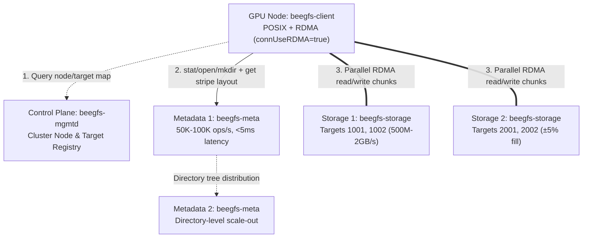
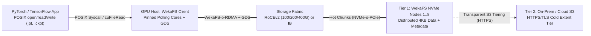
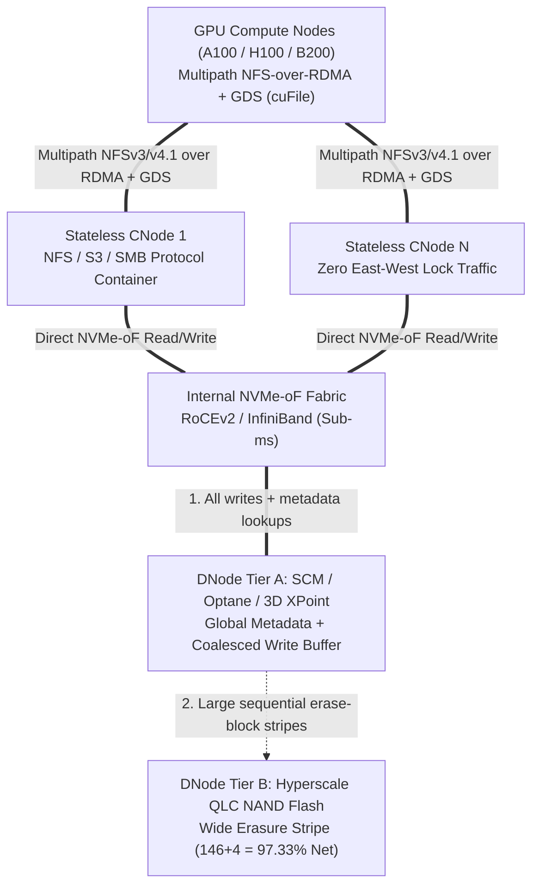
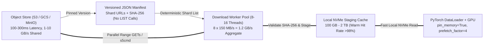

# 13.5 BeeGFS, Weka, VAST and object storage

| Field | Value |
|---|---|
| Level | Intermediate |
| Priority tier | 2 |
| Lab venue | GCP / GKE + Local Python Verification Lab (`code/part13/beegfs_weka_vast_object_lab.py`) |
| Part | Part 13: AI storage |
| Primary sources | NVIDIA Zero-to-Hero Volume 15 (`chapter-06-beegfs-for-gpu-clusters.md`, `chapter-07-object-storage-and-dataset-pipelines.md`); *AI Systems Performance Engineering* (`ai-systems-performance-engineering`); *AI Data Center Network Design and Technologies* (`ai-data-center-network-design-and-technologies`) |
| Coverage file | `planning/coverage/chapters/13-05.md` |
| Claim & number ledger | `planning/ledgers/13-05.md` |

## Why this matters for AI infrastructure

An AI cluster is only as productive as the storage layer feeding its training loops and absorbing its checkpoints. When the storage fabric falls behind, expensive GPU nodes sit idle waiting for batches or blocking on synchronous weight dumps. Every minute spent waiting on storage is a minute of wasted cluster power and lost training progress.

Feeding modern accelerators requires massive sustained bandwidth. If a single GPU needs 200 MB/s of training data to keep its Tensor Cores busy, an eight-GPU server demands 1.6 GB/s of continuous read throughput. Scale that to an NVIDIA Grace Blackwell GB200 or GB300 NVL72 rack across a single NVLink domain, and one rack requires 14.4 GB/s of continuous ingestion. When storage stalls consume a third of iteration time, cutting that wait down to 5 percent lowers the stall fraction sixfold and recovers 25 percentage points of active compute time.

```text
Cluster Storage Bandwidth & Stall Reduction Envelope:
  - Single 8-GPU training server (8 x 200 MB/s):               1.6 GB/s sustained read
  - Single GB200 / GB300 NVL72 rack (72 x 200 MB/s):          14.4 GB/s (14-20 GB/s envelope)
  - Cutting GPU I/O wait from 30% down to 5%:                  6.0x stall reduction (+25 pct pts active compute)
```

While Lustre dominates classic national-laboratory supercomputers, commercial and enterprise GPU clusters often choose from four complementary storage architectures. Each sits at a different point on the spectrum of operational simplicity, metadata scalability, and cost per gigabyte.

First, BeeGFS is an open-ecosystem parallel filesystem that separates management, metadata, storage targets, and kernel clients into standard Linux services. It is far simpler to install and run than Lustre. However, platform engineers must still configure directory stripe patterns and repackage small files so its metadata servers do not saturate above 100 GPUs.

Second, WekaFS is a software-defined, NVMe-first parallel filesystem that distributes both data and metadata in 4 KB chunks across every storage node. That design eliminates dedicated metadata-server bottlenecks entirely. It pins dedicated polling CPU cores on GPU hosts for low-latency POSIX access over RoCEv2 or InfiniBand with GPUDirect Storage. It also transparently tiers cold extents to S3 object storage under one namespace.

Third, VAST Data DASE and AI-native RDMA filesystems like DeepSeek 3FS rethink how compute nodes talk to flash media. VAST decouples stateless protocol containers from NVMe-oF storage enclosures that pair Storage Class Memory write buffers with wide-striped QLC flash. DeepSeek 3FS goes even further for random-read AI workloads by bypassing the Linux page cache completely with `O_DIRECT`, `io_uring`, and RDMA. In production benchmarks, 3FS sustained 6.6 TB/s of aggregate read throughput across 68 storage nodes.

Fourth, object storage systems like S3, GCS, Azure Blob, and MinIO provide durable, exabyte-scale source-of-truth data lakes over HTTP and TLS. However, a 150 ms per-request latency turns two million small files into more than 83 hours of serial API wait. Feeding GPUs from object storage requires versioned JSON manifests, prefix sharding, parallel download worker pools, and local NVMe staging caches.

## Prerequisites and outcomes

### Prerequisites
- Understanding of AI storage workload taxonomy and local NVMe block queues from the earlier chapters in Part 13.
- Familiarity with parallel filesystem concepts such as separated metadata and data paths and target striping from the previous chapter.
- Working knowledge of NVMe-oF over TCP port 8009 or RDMA UDP ports 4420 and 4791, plus GPUDirect Storage (`cuFile` and `nvidia-fs`).

### Outcomes
After completing this chapter, you will be able to:
1. Architect and diagnose a BeeGFS cluster across its four services and calculate round-robin stripe chunk placement. You will also detect target fill skew and prevent 256-GPU metadata saturation through MDS scale-out and WebDataset sharding.
2. Contrast BeeGFS and Lustre against WekaFS and VAST Data DASE across metadata layout, erasure coding, client core pinning, and hybrid S3 namespace tiering.
3. Quantify GPUDirect Storage performance with `gdsio` and explain how DeepSeek 3FS uses `O_DIRECT`, `io_uring`, and RDMA to reach 6.6 to 7.3 TB/s across 68 storage nodes.
4. Design and instrument a production S3 dataset staging pipeline that eliminates bucket listings via JSON manifests. You will also scale request rates via prefix sharding and track per-epoch local NVMe cache hit rates.

---

## 1. The AI Storage Taxonomy: Block, File, Parallel File, and Object

Platform engineers often struggle when a single storage system is forced to serve every stage of the AI lifecycle. Raw data ingestion, offline curation with NeMo Curator, high-throughput multi-node training, synchronous checkpoint dumps, and RAG vector lookups place completely different demands on latency, concurrency, and cost.

A single standard NFS server cannot feed a 100-GPU cluster. Even when tuned with 1 MiB transfer sizes, every metadata lookup and data stream funnels through one server's network interfaces and CPU queues. Parallel filesystems break that single-node ceiling. They stripe data and metadata across dozens or hundreds of independent storage servers simultaneously.

| Feature | Object Storage (`S3` / `GCS` / MinIO) | Block Storage (`NVMe-oF` / SAN) | Shared / Parallel File Storage (`BeeGFS` / `WekaFS` / `VAST` / `Lustre` / `GPFS`) |
|---|---|---|---|
| **Data organization** | Immutable objects (`key -> blob + metadata`) in flat buckets | Fixed-size logical blocks (`4 KB` LBAs) inside `NSID` volumes | Hierarchical POSIX files and directories with inode attributes |
| **Access method** | REST `HTTP/TLS` API (`GET`, `PUT`, byte-range `GET`) | Block-level NVMe queues (`SQE`/`CQE` capsules over PCIe or fabric) | POSIX syscalls (`open`, `read`, `write`, `stat`, `mmap`, `unlink`) |
| **Network transport** | `TCP/HTTPS` over standard Ethernet/IP | `NVMe-o-TCP` (port `8009`), `NVMe-o-RDMA` (`RoCEv2` UDP `4791` / `IB`), `FC` | `RDMA` (`RoCEv2` / InfiniBand) or `TCP` over Ethernet/IP |
| **OS page cache & `GDS`** | No kernel page cache; staged to local NVMe or memory | Raw block volumes have no shared multi-node page cache; `GDS` via local/remote `O_DIRECT` | Supports shared namespace; `GDS` (`cuFile` + `nvidia-fs`) bypasses host bounce buffers over `RDMA` |
| **Scalability & cost** | Highest capacity scalability (multi-exabyte); lowest `$/GB` | High per-volume IOPS/latency (`~100 ns` PCIe Gen5, `~300 ns` IB, `~800 ns` Eth); highest `$/GB` | Scales to hundreds of `GB/s` or multi-`TB/s` across thousands of GPU clients; moderate-to-high `$/GB` |
| **Primary AI domain** | Data lake source of truth, offline curation, cross-site/cloud checkpoint archival, RAG corpus | Local scratch volumes, database backing stores, hyperconverged or disaggregated `DNode` backing | Active multi-node training datasets, synchronous multi-rank checkpoint writes, shared home/code directories |

Matching each workload to the right storage tier keeps both GPU utilization and storage budgets under control. Object stores hold the durable multi-petabyte data lake, parallel filesystems serve active multi-node training and checkpoints over RDMA, and local NVMe block volumes absorb node-local scratch and cache traffic.

---

## 2. BeeGFS for GPU Clusters: Architecture, Striping, and Metadata Tuning

Many AI engineering teams need multi-node parallel storage bandwidth for 100 to 500 GPUs but lack a dedicated HPC storage team to maintain Lustre's patched kernels and complex failover pairs. When a parallel filesystem is too hard to operate, minor configuration errors leave checkpoint directories unstriped or metadata servers overloaded.

BeeGFS solves this operational problem by installing as standard Linux user-space daemons on top of any existing XFS or EXT4 filesystem. Originally developed at the Fraunhofer Center for High Performance Computing, it pairs those user-space servers with a lightweight client kernel module that supports InfiniBand and RoCEv2 RDMA as well as GPUDirect Storage.

### 2.1 The Four Decoupled BeeGFS Services

A BeeGFS cluster splits cluster management, directory metadata, bulk chunk storage, and client POSIX mounting into four independent services.



| Service | Daemon / Module | Core Responsibility | Healthy Operational Envelope | Primary CLI Check (`untested here`) |
|---|---|---|---|---|
| **Management Service** | `beegfs-mgmtd` | Maintains the authoritative registry of all metadata nodes, storage nodes, targets, and client sessions; never sits on the data path | `< 1%` CPU/network load; queried upon mount and topology changes | `beegfs-ctl --listnodes --nodetype=mgmt` |
| **Metadata Service (`MDS`)** | `beegfs-meta` | Stores POSIX inodes, directory hierarchies, permissions, and the per-file stripe pattern (`target IDs` + `chunksize`) | **`50,000–100,000` ops/sec** per MDS; average latency **`< 5 ms`** (e.g., `2.0–2.1 ms` at `5.2K–5.4K` ops/sec) | `beegfs-ctl --serverstats --nodetype=meta` |
| **Storage Service (`OSS`)** | `beegfs-storage` | Manages one or more underlying NVMe RAID/XFS storage targets (`TargetID`) and serves striped file chunks over `RDMA` or `TCP` | **`500 MB/s–2 GB/s`** per storage node; all targets balanced within **`±5%` fill** (`> 10%` spread triggers investigation) | `beegfs-ctl --listtargets --nodetype=storage --spaceinfo` |
| **Client Service** | `beegfs-client` | Kernel module mounted at `/beegfs`; fetches file stripe layout from `MDS` on `open()` and performs direct parallel `RDMA` I/O to storage targets | Sustained `4–5 GB/s` single-client read across `8–12` targets with `connUseRDMA = true` | `beegfs-ctl --clientinfo` and `mount \| grep beegfs` |

When a GPU worker opens a file on `/beegfs`, the client module asks the Metadata Service for the file's stripe recipe. After receiving that target list, the client bypasses the metadata server completely and streams file chunks in parallel across all assigned storage targets over RDMA.

### 2.2 Round-Robin Striping Math and Checkpoint Stall Time

If an administrator leaves a BeeGFS checkpoint directory on a narrow default stripe width of one or two targets, a multi-hundred-gigabyte checkpoint write bottlenecks on just two disks while the rest of the storage cluster sits idle. Every GPU in the training job freezes until that slow write finishes.

BeeGFS slices each file into fixed-size contiguous chunks and distributes them in round-robin order across the directory's configured storage targets. By setting `--chunksize` to 1 MiB through 4 MiB and `--numtargets` to 8 or 12 with `beegfs-ctl --setpattern`, a single large file harnesses the combined write bandwidth of the entire storage pool.

```text
BeeGFS Round-Robin Stripe Mapping & 500 GB Checkpoint Stall Math (800 MB/s per target):
  - Formulas for byte offset B, chunksize C, numtargets N across ordered TargetIDs T[0..N-1]:
      chunk_index        = floor(B / C)
      stripe_row         = floor(chunk_index / N)
      target_slot        = chunk_index mod N
      intra_chunk_offset = B mod C
      TargetID           = T[target_slot]
  - Worked example: C = 1 MiB (1,048,576 B), N = 8 targets [1001, 1002, 2001, 2002, 3001, 3002, 4001, 4002]:
      Offset B = 10,486,272 B (10 MiB + 512 B) -> chunk_index = 10, stripe_row = 1, target_slot = 2 (TargetID 2001), intra_chunk_offset = 512 B
  - 500 GB Checkpoint Write Duration by Stripe Width:
      numtargets = 2:   2 x 800 MB/s = 1.6 GB/s theoretical -> 500 GB / 1.6 GB/s = 312.5 s (~312 s / 5.2 min stall)
      numtargets = 8:   8 x 800 MB/s = 6.4 GB/s theoretical -> 500 GB / 6.4 GB/s = 78.125 s (~78 s, 4.0x faster; 100.0 s at 5.0 GB/s / 78.125% efficiency)
      numtargets = 12: 12 x 800 MB/s = 9.6 GB/s theoretical -> 500 GB / 9.6 GB/s = 52.0833 s (52.08 s)
```

Wider striping cuts the 500 GB checkpoint stall fourfold from 312.5 seconds on two targets down to 78.125 seconds theoretical. At 5.0 GB/s sustained across eight targets, that same write finishes in 100 seconds. Expanding the stripe across twelve targets cuts the theoretical write time further to 52.08 seconds.

Crucially, running `beegfs-ctl --setpattern` on a directory only applies to newly created files inside that directory. Existing files keep the stripe width recorded in their inode at creation time. To restripe an existing dataset or checkpoint, you must rewrite the files or migrate them with `beegfs-ctl --migrate`.

### 2.3 The 256-GPU Metadata Wall and Target Fill Skew

BeeGFS is much simpler to run than Lustre, but its metadata scaling is more manual than Lustre's Distributed Namespace. When 256 GPUs start an epoch over ten million raw JPEG files at 800 metadata calls per GPU per second, aggregate demand spikes past 200,000 ops/sec. That storm overwhelms a single BeeGFS metadata server rated for 50,000 to 100,000 ops/sec. Average latency climbs past 30 ms and stalls every GPU.

You can scale out to four or five `beegfs-meta` servers to reach 250,000 ops/sec of raw capacity, because BeeGFS assigns different directories to different metadata nodes. However, if all ten million JPEGs sit inside one flat directory, every lookup still hammers the single metadata server that owns that directory inode. The permanent fix is repackaging small files into large WebDataset `.tar`, TFRecord, or Parquet shards. That step cuts metadata operations a hundredfold down to 2,048 ops/sec.

A second day-two hazard is storage target fill skew across nodes. When unstriped files or uneven client placement fill one storage node to 72 percent while another sits at 44 percent, the 28 percent spread violates the healthy 5 percent balance band. If one target hits 100 percent full, wide-striped writes fail even when the rest of the cluster has terabytes of free space.

```text
BeeGFS 256-GPU Metadata Storm & Storage Target Fill Skew Summary:
  - 256-GPU raw small-file storm (10,000,000 JPEGs, 800 ops/s/GPU): 204,800 ops/sec (200K+ ops/sec; saturates 1 MDS at 50,000 ops/sec, > 30 ms latency)
  - MDS scale-out capacity (5 x 50,000 ops/sec safe ceiling):       250,000 ops/sec (requires multi-directory tree distribution vs Lustre DNE 500,000+ ops/sec)
  - 100x WebDataset / TFRecord sharding reduction:                    2,048 ops/sec (< 5,000 ops/sec; < 5 ms latency on a single MDS)
  - Target fill skew example (Node 101 storage1 vs Node 102 storage2):
      storage1: TargetID 1001 = 4.5 / 10.0 TB (45%), TargetID 1002 = 4.4 / 10.0 TB (44%)
      storage2: TargetID 2001 = 7.2 / 10.0 TB (72%), TargetID 2002 = 7.1 / 10.0 TB (71%)
      Cluster mean = 58.0%, inter-node spread = 28.0% (exceeds +/-5% healthy band and > 10% investigation threshold; migrate 2001, 2002)
```

---

## 3. WekaFS: Distributed Virtual Metadata, Core Pinning, and S3 Tiering

When an organization supports dozens of research teams running mixed small-file and large-checkpoint workloads, manually balancing directory metadata trees or enforcing dataset repackaging before every experiment becomes a bottleneck. Teams need a shared POSIX filesystem that absorbs millions of small-file lookups and multi-gigabyte streaming reads without manual stripe tuning.

WekaFS solves this problem at the filesystem architecture level. Instead of routing directory lookups through dedicated metadata servers, WekaFS virtualizes all NVMe drives across the storage cluster into a single pool and distributes both data and metadata across every node.

### 3.1 Fully Distributed Metadata and N+K Erasure Coding

Unlike Lustre and BeeGFS, WekaFS has no dedicated metadata servers at all. It slices both file data and virtual metadata into 4 KB chunks and distributes them across every storage node using deterministic cryptographic hashing. Because every node serves metadata operations in parallel, small-file `open`, `stat`, and `unlink` IOPS scale linearly as you add storage nodes.

For durability, WekaFS avoids hardware RAID cards and 3x replication, which wastes two-thirds of raw NVMe capacity. Instead, it stripes data across failure domains using cluster-wide $N + K$ erasure coding, where $N$ data chunks and $K$ parity chunks never exceed the number of storage nodes.

```text
WekaFS Distributed N+K Erasure Coding, Core Pinning & Hybrid S3 Namespace Math:
  - 8-node cluster (8 x 8 x 15.36 TB NVMe SSDs = 983.04 TB raw):
      3x replication:   33.33% efficiency (66.67% overhead) -> 327.68 TB usable
      6+2 erasure code: 6 / (6+2) = 75.0% efficiency        -> 737.28 TB usable Tier 1 NVMe (2.25x usable capacity gain over 3x replication; survives 2 node/drive failures)
      Tier 2 S3 bucket: 2,000 TB cold extent capacity       -> 737.28 + 2,000 = 2,737.28 TB single unified POSIX namespace
  - 18-node cluster with 16+2 erasure stripe:
      16 / (16+2) = 88.89% net NVMe efficiency
  - GPU host client core pinning (ll_core polling mode):
      4 pinned cores on a 128-core GPU server = 3.125% host CPU tax
```

### 3.2 POSIX Client Core Pinning and Unified S3 Tiering

To drive line-rate RDMA and GPUDirect Storage without kernel interrupt jitter, WekaFS runs a dedicated client on each GPU server that pins one to four CPU cores in polling mode.



| Architectural Layer | WekaFS Mechanism | Operational Impact for GPU Clusters |
|---|---|---|
| **GPU Host Access (`WekaFS Client`)** | Dedicated user-space/kernel POSIX client running on the GPU server (`100/200/400/800 Gbps` NICs); pins `1` to `4` dedicated CPU cores (`ll_core`) in polling mode | Eliminates OS interrupt latency and sequential NFS state-machine overhead; on a `128`-core host, pinning `4` cores consumes **`3.125%`** CPU to drive line-rate `RDMA` and `GPUDirect Storage` (`GDS`) |
| **Protocol Fallback (`NFS`)** | Optional standard `NFSv3` / `NFSv4.1` gateway access for non-GPU hosts without the native client | Functional for management nodes, but delivers substantially lower IOPS and does not provide the full native `WekaFS-o-RDMA` client pipeline |
| **Unified Hybrid Namespace (`Tier 1 + Tier 2`)** | Hot working sets reside on Tier 1 NVMe flash (`737.28 TB`), while cold datasets and older `.pt`, `.ckpt`, `.npy`, `.h5`, and `.bin` files transparently tier to Tier 2 `S3` object storage (`2,000 TB`+) over `HTTPS/TLS` | Applications see a single `2,737.28 TB` POSIX directory tree; policy engines evict cold data extents from NVMe to `S3` while keeping metadata headers in flash for instant `ls`/`stat` lookups |

Because WekaFS keeps file metadata headers on Tier 1 NVMe flash while evicting cold data extents to Tier 2 S3 object storage, directory listings and `stat` calls stay instant across the entire multi-petabyte namespace. When a training script opens a cold checkpoint or dataset shard, WekaFS streams the extents back into Tier 1 NVMe transparently.

---

## 4. VAST Data DASE, GPUDirect Storage, and DeepSeek 3FS

Shared-nothing storage clusters bind specific drives and metadata shards to stateful server CPUs. Whenever a client modifies a directory or writes across nodes, those storage servers must exchange east-west lock and cache-coherency messages across the network. At multi-terabyte-per-second scale, east-west coordination and host OS page caches turn into major bottlenecks.

Two modern architectures remove those bottlenecks in complementary ways. VAST Data uses a Disaggregated Shared-Everything architecture to eliminate east-west lock traffic between protocol servers. DeepSeek's Fire-Flyer File System bypasses the Linux page cache completely with `O_DIRECT`, `io_uring`, and RDMA to saturate NVMe drives on random-read AI workloads.

### 4.1 VAST Data Disaggregated Shared-Everything Architecture

VAST Data separates stateless protocol containers from high-availability NVMe-oF drive enclosures over an internal RoCEv2 or InfiniBand fabric. Because the protocol servers hold zero persistent state, any container can read or write any drive enclosure directly without coordinating locks with peer servers.



| DASE Component | Architectural Function | Quantitative Advantage |
|---|---|---|
| **Stateless `CNodes` (Compute Nodes)** | Containerized protocol servers exposing multipath `NFS-over-RDMA` (`nconnect` / multipath), `S3`, and `SMB`; hold **zero persistent state** | Any `CNode` can read or write any `DNode` drive directly over `NVMe-oF`; if a `CNode` fails, active `RDMA` connections fail over to peer `CNodes` without data rebuilds |
| **Internal `NVMe-oF` Fabric** | High-speed `RoCEv2` or InfiniBand switch fabric connecting every `CNode` to every high-availability `DNode` enclosure | Allows independent scaling of protocol CPU (`CNodes`) and flash capacity (`DNodes`) |
| **`DNode` `SCM` (`Optane` / `3D XPoint`) Tier** | Ultra-low-latency, high-endurance non-volatile memory that stores global metadata data structures and absorbs `100%` of incoming random writes | Protects lower-endurance `QLC` flash from random write amplification; `CNodes` coalesce data in `SCM` (`24 TB`+) and destage only full, sequential erase-block stripes |
| **`DNode` `QLC` Flash + Wide Stripes (`146+4`)** | Low-cost, high-density `QLC` NAND flash protected by locally decodable wide erasure codes (e.g., `146` data strips + `4` parity strips across enclosures) | Cuts erasure-coding parity overhead to **`2.67%`** (**`97.33%` net efficiency**; `1,460 TB` usable out of `1,500 TB` raw, or `2,920 TB` at `2.0x` similarity reduction) while surviving `4` concurrent failures |

### 4.2 Quantifying GPUDirect Storage with `gdsio`

Even when a parallel filesystem streams data over RDMA at line rate, routing those bytes through the legacy Linux CPU path creates a severe host-memory bounce-buffer bottleneck. Data travels from the storage NIC across PCIe into host DRAM. It must then be copied a second time across PCIe into GPU HBM.

NVIDIA GPUDirect Storage eliminates that host memory copy. Using the CUDA `cuFile` API and the `nvidia-fs` kernel driver, it registers GPU HBM buffers directly with the storage or RDMA NIC driver. DMA engines then move bytes straight between remote storage and GPU memory. You can measure the exact throughput and latency gain on a live mount with `/usr/local/cuda/gds/tools/gdsio` by comparing transfer mode `-x 2` against `-x 0`.

| `gdsio` Transfer Mode | CLI Flag | Measured Read Throughput | Average I/O Latency | Observed Hardware Impact |
|---|---|---|---|---|
| **Storage -> CPU Memory -> GPU (`Before GDS`)** | `-x 2` | **`8.0 GB/s`** | **`1.25 ms`** | Host CPU cores saturated executing `memcpy` through host pinned bounce buffers |
| **Storage -> GPU HBM Direct (`With GDS`)** | `-x 0` | **`9.6 GB/s` (`+20.0%`)** | **`1.00 ms` (`-20.0%`)** | Zero host `DRAM` bounce copy; VAST benchmarks show **`+20%`** read throughput on `A100` (`100 Gb/s` NIC) and **`+30%+`** on `H100` (`200/400 Gb/s` NICs) |

### 4.3 DeepSeek Fire-Flyer File System vs Ceph on 68 Nodes

During large-scale LLM pretraining, multi-modal shuffling, and distributed KVCache lookups, thousands of workers issue non-repeating random reads across petabytes of data. On a conventional filesystem backed by the Linux page cache, those random reads suffer near-zero cache hit rates. They also burn CPU cycles on page-table locks and memory allocations.

Furthermore, many modern user-space filesystems rely on FUSE. Standard FUSE cannot use kernel GPUDirect Storage because `nvidia-fs` requires kernel-level `O_DIRECT` DMA integration. DeepSeek solved both problems in its open-source Fire-Flyer File System, or 3FS. It combines strict `O_DIRECT`, asynchronous `io_uring` with pre-registered buffers, and native RDMA reads across four decoupled services: Cluster Manager, Metadata Service, Storage Service, and Client.

```text
DeepSeek 3FS 68-Node Benchmark vs Ceph:
  - Cluster hardware per storage node (68 nodes total): 10 x 16 TB NVMe SSDs (680 SSDs = 10,880 TB raw) + dual 100 Gb/s NICs (200 Gb/s = 25.0 GB/s network/node)
  - Sustained aggregate random read throughput:          6.6 TB/s (97.06 GB/s per storage node across internal/fabric paths)
  - Concurrent background workload traffic:             +1.4 TB/s (8.0 TB/s combined I/O; up to 7.3 TB/s peak read in larger runs)
  - Ceph baseline on comparable hardware:               ~1.1 TB/s (3FS achieves 6.0x speedup at 6.6 TB/s and 6.64x speedup at 7.3 TB/s)
```

| Parallel Filesystem Comparison | BeeGFS | Lustre | WekaFS (`WEKA`) | VAST Data (`DASE`) | DeepSeek `3FS` |
|---|---|---|---|---|---|
| **Metadata Model** | Multiple `beegfs-meta` (`50–100K` ops/s each); manual directory distribution | Multiple `MDT`s with `DNE` (`500K+` ops/s); rich namespace tooling | Fully distributed `4 KB` virtual metadata across all NVMe nodes | Global metadata in `DNode` `SCM`/`Optane` accessed by stateless `CNodes` | Sharded, replicated transactional metadata over `RDMA` |
| **Small-File / Random Read Fit** | Moderate (requires `WebDataset` sharding above `~100` GPUs) | High with `DNE` + `DoM` (Data-on-MDT), complex to tune | Very high (no single `MDS` bottleneck) | Very high (`SCM` metadata + multipath `RDMA`) | Extreme for random reads (`O_DIRECT` + `io_uring`, zero page cache) |
| **Operational Complexity** | Low (standard Linux packages on `XFS`/`EXT4`) | High (patched kernel, `MDT`/`OST` failover, `DNE` balancing) | Low-to-moderate (commercial SDS, requires pinned client cores) | Low (turnkey disaggregated appliance, `NFS-over-RDMA` + `S3`) | High (custom `RDMA` + `io_uring` stack for ultra-scale AI factories) |
| **Primary Ideal Scale** | `100–500` GPUs, sequential shards & checkpoints | `1,000+` GPUs, classic HPC & large AI supercomputers | `100–10,000+` GPUs needing mixed small/large I/O + `S3` tiering | Multi-tenant enterprise AI data platforms needing unified `NFS` + `S3` | Ultra-scale LLM training & KVCache (`6.6–7.3 TB/s` across `68+` nodes) |

---

## 5. Object Storage and Dataset Staging Pipelines

Object storage systems like AWS S3, Google Cloud Storage, Azure Blob Storage, and on-premises MinIO or VAST S3 serve as the universal source-of-truth data lake for modern AI teams. They offer virtually infinite capacity, strong durability, and a fraction of the cost of all-flash parallel filesystems. However, object storage is not a POSIX filesystem. Pointing a PyTorch DataLoader directly at millions of individual S3 keys is one of the costliest mistakes in AI infrastructure.

### 5.1 The S3 Small-Object Latency Trap

Every S3 `GET` request traverses an HTTP and TLS stack, authenticates IAM signatures, looks up the object key in a distributed index, and streams the payload over TCP. For a single 100 MB model weight file, 150 ms of control-plane latency plus 100 ms of data transfer completes in a harmless 250 ms.

Now consider a 500 GB vision dataset stored in S3 as two million individual objects of 260 KB each. Every request still pays that 150 ms HTTP and API latency tax, which is far larger than the payload transfer time itself. Issued serially, two million requests waste 300,000 seconds, or 83.33 hours. Your GPUs sit 99 percent idle for more than three days waiting on HTTP headers.

```text
S3 Object Latency Trap & Parallel Staging Math:
  - Loading 1 x 100 MB model file:             50 ms TCP/TLS + 100 ms S3 API + 100 ms transfer (at 1 GB/s) = 250 ms total
  - Fetching 2,000,000 x 260 KB objects:       2,000,000 x 0.150 s = 300,000 seconds = 83.33 hours (~83 hours serial API wait)
  - Single 1 GB object download:               50 ms TLS + 80 ms API + 6,000 ms transfer = 6.2 s (161.29 MB/s / ~161 MB/s)
  - Parallel 8 x 1 GB object download:         7.5 s elapsed vs 8 x 6.2 = 49.6 s serial (6.61x speedup; 1,066.67 MB/s / ~1,067 MB/s aggregate; 133.33 MB/s / ~133 MB/s per worker)
  - Time-to-First-Batch (500 GB = 50 x 10 GB shards, prefetch 2 shards = 20 GB):
      8 workers at 150 MB/s (1.2 GB/s agg):    20 GB / 1.2 GB/s = 16.67 s (~17 s) + 2 x 5.0 s API (10.0 s) + 2 x 0.1 s TLS (0.2 s) = 26.87 s (~27 s)
      16 workers at 150 MB/s (2.4 GB/s agg):   20 GB / 2.4 GB/s = 8.33 s + 10.2 s API/TLS = 18.53 s
```

### 5.2 Prefix Sharding, Parallel Worker Pools, and Local NVMe Caching

Turning an object store into a high-bandwidth training feeder requires five coordinated mechanisms: versioned JSON manifests, prefix sharding, parallel worker pools, asynchronous prefetching, and local NVMe staging caches.



| Pipeline Stage | Operational Bottleneck Addressed | Target Metric / Sizing Rule |
|---|---|---|
| **1. Versioned JSON Manifest** | Eliminates repeated `ListObjectsV2` bucket listings (which are slow, paginated at `1,000` keys, and subject to eventual-consistency/data-drift bugs) | Pre-compute `imagenet-manifest.json` (`1,099,511,627,776` bytes = `1 TiB` across `1,073,741,824`-byte `1 GiB` `.tar` shards, `1,281,167` samples) with pinned `sha256` checksums |
| **2. S3 Prefix Sharding** | Standard S3 partitions enforce **`3,500` `PUT/COPY/POST/DELETE`** and **`5,500` `GET/HEAD` requests/sec per prefix**; dumping all shards under one prefix triggers `503 Slow Down` throttling at cluster scale | Shard object keys across $P = 16$ hex/hash prefixes (`s3://bucket/00/..` to `s3://bucket/0f/..`) to scale aggregate request ceilings to **`88,000` `GET`/s** and **`56,000` `PUT`/s** |
| **3. Parallel Worker Pool (`8–16` Workers / `s5cmd`)** | Single-stream TCP/TLS downloads cannot saturate `10–100 Gb/s` host NICs (`1 GB` single object takes `6.2 s` = **`161.29 MB/s`**: `50 ms` TLS + `80 ms` API + `6,000 ms` transfer) | Fetching `8 x 1 GB` objects in parallel completes in **`7.5 s`** instead of `8 x 6.2 = 49.6 s` (**`6.61x` speedup**), delivering **`1,066.67 MB/s`** (`~1,067 MB/s`) aggregate (**`133.33 MB/s`** per worker) |
| **4. Time-to-First-Batch Startup** | Prevents GPU starvation at job launch when staging a `500 GB` dataset (`50 x 10 GB` shards) | With `8` workers at `150 MB/s` (`1.2 GB/s` aggregate), prefetching the first `2` shards (`20 GB`) takes `20 / 1.2 = 16.67 s` (`~17 s`) + `2 x 5.0 s` API + `2 x 0.1 s` TLS = **`26.87 s` (`~27 s`)** (`18.53 s` with `16` workers) |
| **5. Local NVMe Cache & LRU Eviction** | Absorbs S3 latency jitter and serves Epochs `2..N` at local NVMe speed (`100 GB–2 TB` scratch) | **Epoch 1 (cold):** `0.1%` hit rate (`45.3 min` wait); **Epoch 2 (warm):** `98.2%` hit rate (`2.1 min` wait, **`21.57x` wait reduction**); **Epoch 3 (`> 85%` fill):** `97.5%` hit rate (`3.5 min` wait as LRU eviction begins) |

Tracking cache hit rate across epochs exposes local scratch sizing bugs early. A jump from 0.1 percent in the first epoch to 98.2 percent in the second epoch confirms that the local NVMe cache is warming properly. That warm cache cuts download wait time by more than twentyfold. If the hit rate dips to 97.5 percent and wait time climbs in the third epoch because cache occupancy crosses 85 percent, the dataset exceeds your local scratch budget and is triggering LRU eviction.

---

## Commands and configurations that matter

Every command below that queries or modifies cluster storage services (`beegfs-ctl`, `gdsio`, `aws`, `s5cmd`, `mount`, `blockdev`, `dd`, `nsys`) is marked `untested here`. Multi-node parallel filesystem daemons and cloud S3 buckets are not attached to this build container.

### 1. BeeGFS Health, Metadata Rate, and Target Fill Inspection

```bash
# 1. Inspect Metadata Service (MDS) nodes, active sessions, ops/sec, and latency (untested here)
beegfs-ctl --listnodes --nodetype=meta --details
beegfs-ctl --serverstats --nodetype=meta

# Illustrative healthy output (untested here):
# Metadata Service ID 1 (meta1.example.com):
#   Used capacity: 45 GB / 500 GB (9%)
#   Sessions: 24 active
#   Operations: 5,230 ops/sec (healthy, < 50,000 ops/sec ceiling)
#   Latency (avg): 2.1 ms (healthy, < 5.0 ms threshold)
# Metadata Service ID 2 (meta2.example.com):
#   Used capacity: 44 GB / 500 GB (8%)
#   Sessions: 25 active
#   Operations: 5,410 ops/sec (healthy)
#   Latency (avg): 2.0 ms

# 2. Inspect Storage Targets and detect fill-level skew across storage nodes (untested here)
beegfs-ctl --listtargets --nodetype=storage --spaceinfo
beegfs-ctl --serverstats --nodetype=storage

# Illustrative skewed output requiring rebalancing (untested here):
# NodeID: 101 (storage1) Paths:
#  TargetID: 1001 Capacity: 10.0 TB Used: 4.5 TB (45%) Path: /data/target1
#  TargetID: 1002 Capacity: 10.0 TB Used: 4.4 TB (44%) Path: /data/target2
# NodeID: 102 (storage2) Paths:
#  TargetID: 2001 Capacity: 10.0 TB Used: 7.2 TB (72%) Path: /data/target1
#  TargetID: 2002 Capacity: 10.0 TB Used: 7.1 TB (71%) Path: /data/target2
```

### 2. BeeGFS Client RDMA Config and Stripe Tuning

```ini
# /etc/beegfs/beegfs-client.conf — AI training & checkpoint optimization (untested here)
sysMgmtdHost = mgmt.example.com
connUseRDMA = true               # Use InfiniBand / RoCEv2 RDMA instead of TCP
tuneUseGDTLSConnPool = true      # Connection pooling reduces per-I/O setup latency
tuneUseGDTLSDisableSSL = false
tunePrefetchType = buffered      # Client read-ahead caching for sequential dataset scans
connMaxInactiveTime = 900000     # Keep connections alive across long GPU compute steps
```

```bash
# Verify client mount, RDMA connectivity, and file stripe layout (untested here)
mount | grep beegfs
grep -E "sysMgmtdHost|connUseRDMA|tuneUseGDTLSConnPool|tunePrefetchType" /etc/beegfs/beegfs-client.conf
beegfs-ctl --clientinfo

# Set directory stripe pattern BEFORE writing training shards or checkpoints (untested here)
# Training data: 4 MiB chunks across 12 targets for large sequential batch reads
beegfs-ctl --setpattern --chunksize=4M --numtargets=12 /beegfs/training-data/

# Checkpoints: 2 MiB chunks across 12 targets for maximum parallel write fan-out
beegfs-ctl --setpattern --chunksize=2M --numtargets=12 /beegfs/checkpoints/

# Verify stripe pattern on a specific 500 GB shard (untested here)
beegfs-ctl --getentryinfo /beegfs/dataset/train.tar.gz

# Benchmark single-client direct read throughput (expect 4-5 GB/s across 8-12 targets) (untested here)
time dd if=/beegfs/training-data/large-file bs=4M count=25000 of=/dev/null iflag=direct
```

### 3. Benchmarking GPUDirect Storage with `gdsio` and Linux NVMe Tuning

```bash
# 1. Verify NVMe multiqueue scheduler ('none' or 'mq-deadline') and raise read-ahead to 4 MiB (untested here)
cat /sys/block/nvme0n1/queue/scheduler
cat /sys/block/nvme0n1/queue/read_ahead_kb
blockdev --setra 8192 /dev/nvme0n1   # 8192 x 512B sectors = 4 MiB read-ahead

# 2. High-throughput NFS client mount options (when using VAST NFS-over-RDMA or enterprise NAS) (untested here)
mount -t nfs -o rdma,port=20049,nconnect=16,rsize=1048576,wsize=1048576,noatime,async,actimeo=60,lookupcache=pos \
  10.30.0.10:/ai-datasets /mnt/data

# 3. Benchmark CPU bounce-buffer path (-x 2) vs GPUDirect Storage direct GPU DMA path (-x 0) (untested here)
# Before (Storage -> CPU Pinned Memory -> GPU, -x 2): 8.0 GB/s, 1.25 ms avg latency
/usr/local/cuda/gds/tools/gdsio -f /mnt/data/large_file -d 0 -w 4 -s 10G -i 1M -I 0 -x 2

# After (Storage -> GPU HBM directly via GDS cuFile/nvidia-fs, -x 0): 9.6 GB/s (+20%), 1.00 ms (-20%)
/usr/local/cuda/gds/tools/gdsio -f /mnt/data/large_file -d 0 -w 4 -s 10G -i 1M -I 0 -x 0

# 4. Trace cuFile GDS timeline alongside GPU compute kernels in Nsight Systems (untested here)
nsys profile --trace=cuda,nvtx,gds -o gds_training_profile python3 train.py
```

### 4. Production S3 Manifest Validation and Exponential Backoff Prefetch

```python
# Production S3 manifest verification + asynchronous 8-worker prefetch with exponential backoff (untested here)
from concurrent.futures import ThreadPoolExecutor
import hashlib
import json
import os
import time
import boto3
from botocore.exceptions import ClientError

def verify_and_stage_manifest(manifest_path: str, cache_dir: str = "/local-cache", max_workers: int = 8) -> None:
    with open(manifest_path, "r", encoding="utf-8") as f:
        manifest = json.load(f)
    s3 = boto3.client("s3")
    os.makedirs(cache_dir, exist_ok=True)

    def download_and_verify(shard: dict, max_retries: int = 3) -> str:
        local_path = os.path.join(cache_dir, shard["name"])
        if os.path.exists(local_path) and os.path.getsize(local_path) == shard["size"]:
            return local_path
        bucket, key = shard["s3_path"].replace("s3://", "").split("/", 1)
        for attempt in range(max_retries):
            try:
                s3.download_file(bucket, key, local_path)
                digest = hashlib.sha256()
                with open(local_path, "rb") as lf:
                    for chunk in iter(lambda: lf.read(16 * 1024 * 1024), b""):
                        digest.update(chunk)
                if digest.hexdigest() != shard["sha256"]:
                    raise ValueError(f"SHA-256 mismatch on {shard['name']}")
                return local_path
            except ClientError:
                if attempt == max_retries - 1:
                    raise
                time.sleep(2 ** attempt)  # 1s, 2s, 4s backoff
        return local_path

    with ThreadPoolExecutor(max_workers=max_workers) as pool:
        futures = [pool.submit(download_and_verify, s) for s in manifest["shards"]]
        for fut in futures:
            fut.result()
```

---

## How it fails

When a parallel filesystem or S3 staging pipeline is misconfigured, the failure almost always surfaces as idle GPUs, epoch-boundary hangs, or sudden checkpoint timeouts rather than an explicit storage error. Use the symptoms and verification checks below to isolate the broken layer quickly.

| Failure Mode | Observable Symptom | Root Cause Diagnosis | Verification Check (`untested here`) | Remediation |
|---|---|---|---|---|
| **1. BeeGFS `MDS` Saturation at Epoch Start** | Training hangs or crawls at the start of every epoch; metadata latency spikes to **`30 ms+`** (vs `< 5 ms` healthy) | `100–256+` GPUs concurrently `open()`/`stat()` millions of small individual files (`200K+` ops/sec), overwhelming `beegfs-meta` (`50K–100K` ops/sec per server) | `beegfs-ctl --serverstats --nodetype=meta` and `time ls -la /beegfs/dataset/ \| wc -l` | Repackage small files into `100 MB–10 GB` `WebDataset` `.tar` or `TFRecord` shards (`100x` fewer metadata ops, `< 5K` ops/s); scale out `beegfs-meta` servers |
| **2. Narrow Directory Stripe Width (`numtargets = 1` or `2`)** | A `500 GB` checkpoint stalls the cluster for `312.5 s` (`1.6 GB/s`), or a client reads at `800 MB/s` instead of `4–5 GB/s` | Directory was created with default `numtargets=1` or `2`; existing files keep their narrow stripe layout even after `--setpattern` is run later | `beegfs-ctl --getentryinfo /beegfs/checkpoints/ckpt.pt` (inspect `NumTargets` and `ChunkSize`) | Set `beegfs-ctl --setpattern --chunksize=2M --numtargets=12` on the directory *before* creating files; restripe/copy existing files |
| **3. BeeGFS Storage Target Fill Skew (`> 10%` Spread)** | `storage2` targets hit `71–72%` (or `95%`) full while `storage1` targets sit at `44–45%`; wide writes fail when one target fills | Large unstriped files (`numtargets=1`) or uneven client placement concentrated writes on `storage2` | `beegfs-ctl --listtargets --nodetype=storage --spaceinfo` | Enforce wide directory striping (`numtargets=8` or `12`) and run `beegfs-ctl --migrate` to rebalance overloaded target IDs |
| **4. BeeGFS / WekaFS / VAST Client Fallback from `RDMA` to `TCP` or `SYS` NUMA Path** | Single-client read throughput drops from `4–5 GB/s` to `800 MB/s`, or clients show `2x` throughput variance across nodes | `connUseRDMA = false`, storage subnet routed over a slow management NIC, or DataLoader workers scheduled on the wrong CPU/NUMA socket (`SYS` traversal) | `beegfs-ctl --clientinfo`, `lsof \| grep beegfs`, `iperf3`, and `numactl --hardware` | Enable `connUseRDMA = true`, verify lossless `RoCEv2`/`IB` path, and pin DataLoader workers (`numactl`) to the storage NIC's local NUMA node |
| **5. Attempting Kernel `GDS` (`cuFile`) over a User-Space `FUSE` Mount** | `cuFileRead` falls back to host compatibility mode (`-x 2` speed, high CPU `memcpy` load) or fails `O_DIRECT` registration | Standard `FUSE` filesystems route I/O through user-space daemons and lack kernel `nvidia-fs` `O_DIRECT` DMA integration | `/usr/local/cuda/gds/tools/gdscheck -p` and `gdsio -x 0` vs `-x 2` | Use a `GDS`-supported kernel client (`BeeGFS`, `WekaFS`, `VAST NFS-over-RDMA`, `Lustre`, `GPFS`, local `XFS` `NVMe`) or native user-space `RDMA` + `io_uring` (`3FS`) |
| **6. S3 Cold-Cache Stall, Early LRU Eviction, or `503 Slow Down`** | Epoch 1 is `10x` slower than Epoch 2 (`45.3 min` vs `2.1 min` wait), training stalls `30 s` every `5 min`, or S3 returns `503` / `403` | Cold NVMe cache in Epoch 1; download pool (`8` workers) slower than GPU consumption; cache fill `> 85%` triggering LRU eviction in Epoch 3 (`97.5%` hit); or unsharded S3 prefix exceeding `5,500` `GET`/s | Log per-epoch `cache_hits / (cache_hits + cache_misses)`, `df -h /local-cache`, and `aws sts get-caller-identity` | Pre-warm local NVMe cache before `1`-epoch jobs, scale download workers `8 -> 16`, enlarge NVMe cache above dataset working set, use STS credentials with sufficient TTL, and shard S3 keys across `16+` prefixes |

---

## Hands-on lab

### Venue and Scope

This lab runs in the local Python verification script `code/part13/beegfs_weka_vast_object_lab.py`, which is tested and verified in this environment. Cluster CLI commands that require live BeeGFS, S3, or GPU hardware are marked `untested here`.

The script deterministically verifies all 26 quantitative models in `code/part13/beegfs_weka_vast_object.py`. Those checks cover BeeGFS round-robin chunk placement, checkpoint stall durations, metadata saturation, storage target fill skew, WekaFS erasure coding, VAST DASE wide stripes, `gdsio` throughput uplift, DeepSeek 3FS benchmarks, and S3 staging cache progressions.

### Step 1: Run the Self-Contained Verification Lab

```bash
python3 -B code/part13/beegfs_weka_vast_object_lab.py
```

**Expected output:**
```text
=== Chapter 13.5 Lab: BeeGFS, Weka, VAST and Object Storage ===
  [PASS] 1. BeeGFS defines four decoupled services: beegfs-mgmtd, beegfs-meta, beegfs-storage, and beegfs-client
  [PASS] 2. BeeGFS storage node capacity ranges from 500 MB/s to 2000 MB/s (2 GB/s) with a +/-5% healthy target fill band
  [PASS] 3. BeeGFS 1 MiB chunksize across 8 targets maps offset 0 to slot 0 (Target 1001) and offset 10 MiB to chunk 10, row 1, slot 2 (Target 2001)
  [PASS] 4. BeeGFS 500 GB checkpoint striped across 2 targets at 800 MB/s gets 1.6 GB/s (312.5 s) vs 8 targets getting 6.4 GB/s (78.125 s, 4.0x faster)
  [PASS] 5. BeeGFS 12-target training/checkpoint pattern at 800 MB/s/target yields 9.6 GB/s theoretical throughput (52.0833 s for 500 GB)
  [PASS] 6. 256 GPUs generating 204,800 metadata ops/sec saturate 1 MDS (50K ops/sec, needing >= 5 MDSs), while 100x WebDataset sharding drops load to 2,048 ops/sec
  [PASS] 7. BeeGFS target fill check flags storage1 (45%, 44%) vs storage2 (72%, 71%) as a 28% spread (> 10% investigation threshold, outside +/-5% band)
  [PASS] 8. WekaFS 8-node cluster with 6+2 erasure coding achieves 75.0% usable NVMe capacity (2.25x more usable capacity than 3x replication)
  [PASS] 9. WekaFS 18-node cluster with 16+2 erasure coding achieves 88.89% usable NVMe efficiency and pins dedicated client cores (4/128 = 3.125% core tax)
  [PASS] 10. WekaFS unifies Tier 1 hot NVMe-o-RDMA storage (737.28 TB usable on 8 nodes) with Tier 2 S3 object storage (2000 TB) into a 2737.28 TB POSIX namespace
  [PASS] 11. WekaFS rejects N+K stripe widths that exceed the number of failure-domain storage nodes
  [PASS] 12. VAST DASE decouples stateless CNodes from NVMe-oF DNodes (SCM/Optane write buffer + QLC flash) with zero east-west CNode lock traffic
  [PASS] 13. VAST DASE wide 146+4 erasure stripe achieves 97.33% net capacity efficiency (only 2.67% parity overhead across DNodes)
  [PASS] 14. NVIDIA gdsio benchmark shows GDS (-x 0) raises throughput from 8.0 GB/s (-x 2 CPU path) to 9.6 GB/s (+20.0%) and cuts latency from 1.25 ms to 1.00 ms (-20.0%)
  [PASS] 15. DeepSeek 3FS comprises 4 RDMA-connected components (Cluster Manager, Metadata Service, Storage Service, Client) and bypasses the OS page cache via O_DIRECT + io_uring
  [PASS] 16. DeepSeek 3FS 68-node cluster (680 x 16 TB NVMe = 10,880 TB, dual 100 Gb/s NICs) achieves 6.6 TB/s read (+ 1.4 TB/s background = 8.0 TB/s, up to 7.3 TB/s peak)
  [PASS] 17. DeepSeek 3FS delivers 97.06 GB/s per storage node and outperforms Ceph (1.1 TB/s) by 6.0x at 6.6 TB/s and 6.64x at 7.3 TB/s
  [PASS] 18. Fetching 2,000,000 small 260 KB objects serially from S3 at 150 ms/request wastes 300,000 seconds (83.33 hours) on HTTP/TLS API latency alone
  [PASS] 19. Prefetching 2 x 10 GB shards (20 GB) with 8 workers at 150 MB/s each (1.2 GB/s aggregate) takes 16.67 s transfer + 10.2 s API/TLS = 26.87 s (~27 s) to first batch
  [PASS] 20. Doubling S3 download workers from 8 to 16 (2.4 GB/s aggregate) cuts 20 GB transfer time to 8.33 s (18.53 s total with API/TLS)
  [PASS] 21. S3 prefix sharding across 16 prefixes scales request ceilings from 5,500 GET/s and 3,500 PUT/s to 88,000 GET/s and 56,000 PUT/s
  [PASS] 22. Parallel 8 x 1 GB S3 download finishes in 7.5 s (1066.67 MB/s aggregate, 133.33 MB/s per worker) vs 6.2 s single-object (161.29 MB/s) and 49.6 s serial (6.61x speedup)
  [PASS] 23. Local NVMe staging cache warms from 0.1% hit rate (45.3 min wait) in Epoch 1 to 98.2% (2.1 min wait, 21.57x wait reduction) in Epoch 2
  [PASS] 24. Local NVMe staging cache detects LRU eviction onset in Epoch 3 when cache fill (88.0%) exceeds the 85.0% threshold and hit rate dips to 97.5% (3.5 min wait)
  [PASS] 25. GB200/GB300 NVL72 rack (72 GPUs x 200 MB/s per GPU) requires 14.4 GB/s (14-20 GB/s envelope) of sustained storage ingestion bandwidth
  [PASS] 26. Reducing GPU I/O wait time from 30% to 5% lowers the I/O stall fraction by 6.0x and recovers 25 percentage points of active GPU compute time

Summary: 26 passed, 0 failed
```

---

## Common first mistakes

1. **Running `beegfs-ctl --setpattern` after uploading the dataset or writing checkpoints:** Directory stripe patterns are inherited only when a new inode is created. Changing `--numtargets=12` on `/beegfs/checkpoints/` does nothing to a 500 GB file that was already created with two targets. You must rewrite or migrate existing files.
2. **Co-locating `beegfs-meta` and `beegfs-storage` on the same physical disks in production:** Sharing spindles or NVMe queues between 50,000 random inode transactions per second and 2 GB/s bulk checkpoint writes causes severe metadata tail-latency spikes above 30 ms. Always dedicate low-latency NVMe mirrors to `beegfs-meta`.
3. **Treating cold-cache overhead the same for 100-epoch pretraining and one-epoch fine-tuning:** If the first epoch takes 180 minutes on a cold cache while later epochs take 30 minutes, the extra 2.5 hours is under 5 percent of a 50-hour run. For a one-epoch fine-tuning job, that cold wait is 100 percent overhead. Pre-warm the local NVMe cache before starting GPU workers.
4. **Calling `s3.list_objects_v2()` inside every rank's dataset initialization:** When a thousand GPU workers start simultaneously and paginate through two million keys, they immediately consume the per-prefix rate limit. That storm triggers 503 Slow Down errors and risks silent training drift if new files are uploaded mid-run. Always read a static, version-pinned `manifest.json` file.
5. **Forgetting `ulimit -l` when enabling `pin_memory=True` or GPUDirect Storage:** Both PyTorch's `DataLoader` with pinned memory and `cuFile` buffer registration lock pages in physical RAM. Leaving container `memlock` limits at the default 64 KB causes mid-epoch allocation crashes or silent fallback to unpinned transfers.

---

## Exercises

Use the parameters and expected verification targets in the block below to complete the six quantitative exercises.

```text
Exercise Input Parameters & Expected Verification Targets (code/part13/beegfs_weka_vast_object_lab.py):
  - Ex 1 (BeeGFS Stripe & Checkpoint):
      (a) --chunksize=1M (1,048,576 B), --numtargets=8 [1001, 1002, 2001, 2002, 3001, 3002, 4001, 4002], offset 10,486,272 B (10 MiB + 512 B)
          -> chunk_index = 10, stripe_row = 1, target_slot = 2, TargetID = 2001, intra_chunk_offset = 512 B.
      (b) 500 GB checkpoint at 800 MB/s per target:
          numtargets=2  -> 1.6 GB/s (312.5 s);
          numtargets=8  -> 6.4 GB/s theoretical (78.125 s, saving 234.375 s) or 5.0 GB/s at 78.125% efficiency (100.0 s, saving 212.5 s);
          numtargets=12 -> 9.6 GB/s (52.0833 s / 52.08 s).
  - Ex 2 (BeeGFS 256-GPU Metadata & Skew):
      (a) 256 GPUs x 800 ops/sec = 204,800 ops/sec peak; requires >= 5 MDS nodes at 50,000 ops/sec/MDS (250,000 ops/sec); 100x WebDataset sharding -> 2,048 ops/sec (1 MDS at < 5 ms).
      (b) storage1: 1001 (4.5/10.0 TB = 45%), 1002 (4.4/10.0 TB = 44%); storage2: 2001 (7.2/10.0 TB = 72%), 2002 (7.1/10.0 TB = 71%)
          -> mean fill = 58.0%, max spread = 28.0% (> 10% threshold, outside +/-5% band); migrate TargetIDs [2001, 2002].
  - Ex 3 (WekaFS Erasure Coding & Tiering):
      (a) 8 nodes x 8 x 15.36 TB = 983.04 TB raw; 6+2 stripe = 737.28 TB usable (75.0%) vs 3x replication = 327.68 TB (33.33%), a 2.25x gain; + 2,000 TB Tier 2 S3 = 2,737.28 TB namespace.
      (b) 18 nodes with 16+2 stripe = 88.89% efficiency; 4 pinned ll_core threads on 128-core host = 3.125% CPU tax.
  - Ex 4 (VAST DASE & gdsio):
      (a) 146+4 wide stripe on 1,500 TB raw QLC (24 TB SCM buffer): parity overhead = 2.67% (4/150), net efficiency = 97.33% (146/150), physical usable = 1,460.0 TB, logical at 2.0x reduction = 2,920.0 TB.
      (b) gdsio (-d 0 -w 4 -s 10G -i 1M -I 0): -x 2 CPU = 8.0 GB/s at 1.25 ms vs -x 0 GDS = 9.6 GB/s at 1.00 ms (+20.0% throughput, -20.0% latency; +30%+ on H100 with 200/400 Gb/s NICs).
  - Ex 5 (DeepSeek 3FS vs Ceph):
      (a) 68 nodes x 10 x 16 TB NVMe = 680 SSDs (10,880 TB raw), dual 100 Gb/s NICs (25.0 GB/s/node); 6.6 TB/s read = 97.06 GB/s/node; + 1.4 TB/s background = 8.0 TB/s combined; 6.0x vs Ceph (1.1 TB/s) at 6.6 TB/s and 6.64x at 7.3 TB/s peak.
  - Ex 6 (S3 Staging Pipeline):
      (a) 2,000,000 x 260 KB at 150 ms = 300,000 s (83.33 hours); 20 GB (2 x 10 GB shards) across 8 workers (1.2 GB/s) = 16.67 s + 10.0 s API + 0.2 s TLS = 26.87 s (~27 s); 16 workers (2.4 GB/s) = 8.33 s + 10.2 s = 18.53 s.
      (b) 16 prefixes x (5,500 GET/s, 3,500 PUT/s) = 88,000 GET/s and 56,000 PUT/s; 8 x 1 GB in 7.5 s (1,066.67 MB/s agg, 133.33 MB/s/worker) vs 6.2 s single (161.29 MB/s) and 49.6 s serial = 6.61x speedup; Epoch 1 (0.1%, 45.3 min) -> Epoch 2 (98.2%, 2.1 min) = 21.57x wait reduction; Epoch 3 rises to 3.5 min (97.5% hit) because 88.0% fill exceeds 85.0% LRU eviction threshold.
```

1. **BeeGFS Stripe Layout and Checkpoint Stall Math:** Calculate the exact chunk index, stripe row, target slot, TargetID, and intra-chunk offset for the byte offset in Ex 1. Then compute the theoretical write bandwidth, checkpoint stall duration, and seconds saved when striping the checkpoint across two, eight, and twelve targets.
2. **BeeGFS Metadata Saturation and Target Fill Skew:** Calculate the peak metadata ops/sec for the cluster in Ex 2, the minimum number of `beegfs-meta` nodes required, and the reduced rate after WebDataset sharding. Then evaluate the target fill spread between `storage1` and `storage2` and identify which targets require migration.
3. **WekaFS Distributed Erasure Coding, Core Pinning, and Hybrid Tiering:** Compute the raw NVMe capacity, usable Tier 1 capacity, replication baseline, usable capacity gain, and total unified POSIX namespace for the cluster in Ex 3. Then calculate the net erasure efficiency on the larger cluster and the CPU core tax of pinning polling client cores.
4. **VAST Data DASE Wide Erasure Stripes and `gdsio` Uplift Verification:** Calculate the parity overhead percentage, net efficiency, usable physical QLC capacity, and effective logical capacity for the wide stripe in Ex 4. Then compute the throughput uplift and latency reduction between `gdsio` modes `-x 2` and `-x 0`.
5. **DeepSeek Fire-Flyer File System vs Ceph at Scale:** Calculate the total SSD count, raw flash capacity, per-node read throughput, combined throughput with background traffic, and speedup factors over Ceph in Ex 5. Explain why 3FS bypasses the OS page cache with `O_DIRECT` and `io_uring` and why standard FUSE cannot use kernel GPUDirect Storage.
6. **S3 Small-Object Trap, Prefix Sharding, and Local NVMe Staging Pipeline:** Compare the serial API wait of two million small S3 requests against prefetching two large shards across eight or sixteen workers in Ex 6. Then compute the prefix sharding ceilings, the parallel download speedup, and the wait reduction from the first epoch to the second, and explain why wait time rises in the third epoch.

---

## Interview angles

1. **"You are deploying BeeGFS for a 256-GPU cluster. What is your single biggest architectural risk, and how do you mitigate it?"**
   Metadata saturation on `beegfs-meta` is the top risk. When 256 GPUs start an epoch over millions of small files, metadata demand spikes past 200,000 ops/sec. That rate is four times higher than a single server's 50,000 ops/sec safe ceiling and drives latency past 30 ms. First, scale out to four or five metadata servers and distribute directory subtrees across them. Second, repackage small files into large WebDataset `.tar`, TFRecord, or `.bin` and `.idx` shards. That repackaging cuts metadata operations a hundredfold down to 2,048 ops/sec and keeps latency around 2.1 ms on even a single server.
2. **"How do WekaFS and VAST Data solve the metadata and small-file problem differently than Lustre and BeeGFS?"**
   Lustre and BeeGFS rely on dedicated metadata servers that partition the directory namespace. WekaFS eliminates dedicated metadata servers altogether. It slices both file data and virtual metadata into 4 KB chunks across every NVMe node in the cluster and drives RDMA from pinned polling client cores. VAST Data DASE disaggregates stateless protocol containers from NVMe-oF drive enclosures. It holds all global metadata and coalesces random writes inside Storage Class Memory before destaging wide 146+4 erasure stripes to QLC flash with zero east-west lock traffic.
3. **"Why did DeepSeek build Fire-Flyer File System instead of using Ceph, and why did they bypass the OS page cache?"**
   LLM pretraining and KVCache workloads generate massive random reads across petabytes of data. In a conventional OS page cache, random reads have near-zero cache hit rates and waste CPU and memory bandwidth thrashing page tables. DeepSeek 3FS combines strict `O_DIRECT`, Linux `io_uring` for batched syscall-free submission, and native RDMA across 68 storage nodes. That design sustained 6.6 TB/s of read throughput and peaked at 7.3 TB/s, outperforming Ceph's 1.1 TB/s by more than sixfold.
4. **"Epoch 1 on an S3-backed dataset takes 3 hours, while Epoch 2 takes 30 minutes. Explain the exact mechanics and whether you should fix it."**
   The first epoch is cache-cold at a 0.1 percent hit rate and 45.3 minutes or more of download wait as background workers pull shards over HTTP and TLS into the local NVMe staging cache. The second epoch is cache-warm at a 98.2 percent hit rate and 2.1 minutes of wait, reading straight from local NVMe. Over a 100-epoch run, 2.5 extra hours on the first epoch is under 5 percent of total runtime and can be amortized. Over a one-epoch fine-tuning run, it is 100 percent wasted GPU time. You must pre-warm the local NVMe cache from the version-pinned JSON manifest before launching GPU workers.

---

## Checkpoint questions (20)

<details>
<summary>**1. How much aggregate storage read bandwidth is required to keep an 8-GPU node and a 72-GPU Grace Blackwell NVL72 rack saturated at 200 MB/s per GPU?**</summary>

At 200 MB/s per GPU, an eight-GPU server requires 1.6 GB/s of sustained read throughput. A 72-GPU GB200 or GB300 NVL72 rack requires 14.4 GB/s, which sits inside the 14 to 20 GB/s operational envelope.
</details>

<details>
<summary>**2. What are the four core services in a BeeGFS cluster, and which ones sit on the active I/O data path?**</summary>

The four services are `beegfs-mgmtd` for cluster registry management, `beegfs-meta` for directory inodes and stripe layouts, `beegfs-storage` for NVMe and XFS storage targets, and `beegfs-client` for the kernel mount on GPU nodes. Only `beegfs-client` and `beegfs-storage` sit on the active bulk data path once a file is opened.
</details>

<details>
<summary>**3. What are the healthy operational thresholds for a BeeGFS Metadata Service and Storage Target?**</summary>

A `beegfs-meta` server should stay below 50,000 ops/sec and keep average latency under 5 ms. A `beegfs-storage` node delivers 500 MB/s to 2 GB/s. All storage targets across the cluster should stay balanced within a plus or minus 5 percent fill band, and operators should investigate any spread above 10 percent.
</details>

<details>
<summary>**4. In BeeGFS, how is a logical file byte offset mapped to a storage target given chunk size C and target count N?**</summary>

BeeGFS uses round-robin striping where `chunk_index = floor(B / C)`, `stripe_row = floor(chunk_index / N)`, `target_slot = chunk_index mod N`, and `intra_chunk_offset = B mod C`. With a 1 MiB chunk size across eight targets, byte offset 10 MiB plus 512 B lands in chunk 10, row 1, target slot 2, at byte offset 512 inside that chunk.
</details>

<details>
<summary>**5. A 500 GB checkpoint is written to a BeeGFS cluster with 800 MB/s per target. How long does the write stall training with 2, 8, or 12 targets?**</summary>

With two targets, aggregate bandwidth is 1.6 GB/s and the write stalls for 312.5 seconds. With eight targets, theoretical bandwidth reaches 6.4 GB/s for a 78.125-second write, or 100 seconds at 5.0 GB/s sustained. With twelve targets, theoretical bandwidth reaches 9.6 GB/s and cuts the write to 52.08 seconds.
</details>

<details>
<summary>**6. Why doesn't running `beegfs-ctl --setpattern --numtargets=12 /beegfs/checkpoints/` speed up reads of checkpoints that were already written in that directory?**</summary>

BeeGFS records a file's stripe width and chunk size inside its inode at the moment the file is created. Changing `--setpattern` on a directory only applies to newly created files. Existing files must be rewritten or migrated with `beegfs-ctl --migrate`.
</details>

<details>
<summary>**7. Why does a 256-GPU cluster opening raw JPEG files saturate BeeGFS metadata, and why is scaling out MDS nodes alone insufficient?**</summary>

When 256 GPUs issue 800 metadata calls per second each, the resulting 204,800 ops/sec storm is four times higher than one metadata server's 50,000 ops/sec safe limit. Even with four or five metadata servers, placing millions of files in a single flat directory hashes every lookup to the one server owning that directory inode. Repackaging into WebDataset or TFRecord shards cuts metadata calls a hundredfold to 2,048 ops/sec.
</details>

<details>
<summary>**8. Which `/etc/beegfs/beegfs-client.conf` parameters are most critical for AI GPU clusters?**</summary>

Set `connUseRDMA = true` to enable InfiniBand or RoCEv2 RDMA instead of TCP, and set `tunePrefetchType = buffered` for sequential shard read-ahead. Enable `tuneUseGDTLSConnPool = true` to pool connections. Set `connMaxInactiveTime = 900000` so connections do not drop during long GPU compute steps.
</details>

<details>
<summary>**9. How does WekaFS eliminate the Metadata Server bottleneck present in both Lustre and BeeGFS?**</summary>

WekaFS has no dedicated metadata servers. It slices both file data and virtual metadata into 4 KB chunks and distributes them across every NVMe storage node in the cluster. Every node therefore serves `open`, `stat`, and `unlink` operations in parallel.
</details>

<details>
<summary>**10. Why does the native WekaFS client pin dedicated CPU cores on GPU servers, and how does it compare to mounting WekaFS via NFS?**</summary>

The native WekaFS client pins one to four polling CPU cores, or 3.125 percent of a 128-core host, to drive a lockless RDMA engine without OS interrupt latency or NFS state-machine overhead. That design unlocks full GPUDirect Storage bandwidth and millions of small-file IOPS. Mounting via legacy NFS works without pinned cores but sacrifices GPUDirect Storage and high IOPS.
</details>

<details>
<summary>**11. How does WekaFS unify local NVMe flash and cloud S3 object storage for PyTorch workloads?**</summary>

WekaFS exposes a single POSIX mount point where hot working sets sit on Tier 1 NVMe flash over RDMA and cold data extents tier transparently to Tier 2 S3 object storage over HTTPS. PyTorch scripts open `.pt`, `.ckpt`, and `.bin` files normally while metadata headers stay on Tier 1 flash for instant directory lookups.
</details>

<details>
<summary>**12. In VAST Data's Disaggregated Shared-Everything architecture, what is the difference between CNodes and DNodes?**</summary>

CNodes are stateless protocol containers serving NFS-over-RDMA, S3, and SMB with zero persistent state and zero east-west inter-node lock traffic. DNodes are high-availability NVMe-oF enclosures holding Storage Class Memory for global metadata and write coalescing alongside high-density QLC NAND flash for bulk capacity.
</details>

<details>
<summary>**13. How does VAST Data achieve 97.33% net capacity efficiency on QLC flash without suffering random-write wear-out?**</summary>

All incoming random writes and metadata updates land first in high-endurance Storage Class Memory, where CNodes coalesce them into large sequential erase-block stripes. Those stripes are then written to QLC flash using wide 146+4 locally decodable erasure codes. That wide stripe incurs only 2.67 percent parity overhead for 97.33 percent net efficiency.
</details>

<details>
<summary>**14. In NVIDIA's `gdsio` benchmark tool, what do `-x 2` and `-x 0` measure, and what throughput and latency numbers demonstrate a healthy GDS uplift?**</summary>

Flag `-x 2` measures the CPU bounce-buffer path through host DRAM at 8.0 GB/s and 1.25 ms average latency. Flag `-x 0` measures the direct GPUDirect Storage DMA path into GPU HBM at 9.6 GB/s and 1.00 ms latency. That switch delivers a 20 percent throughput gain and 20 percent latency reduction on A100 and over 30 percent on H100.
</details>

<details>
<summary>**15. What are the four components of DeepSeek's Fire-Flyer File System, and what throughput did it achieve across 68 storage nodes compared to Ceph?**</summary>

The four RDMA-connected services are Cluster Manager, Metadata Service, Storage Service, and Client. Across 68 storage nodes with 680 NVMe SSDs and dual 100 Gb/s NICs per node, 3FS sustained 6.6 TB/s of aggregate read throughput plus 1.4 TB/s of background traffic. It peaked at 7.3 TB/s and outperformed Ceph's 1.1 TB/s by more than sixfold.
</details>

<details>
<summary>**16. Why cannot a standard user-space FUSE filesystem use kernel GPUDirect Storage, and how does DeepSeek 3FS work around this?**</summary>

Kernel GPUDirect Storage requires a kernel filesystem driver integrated with `nvidia-fs` for `O_DIRECT` DMA registration, which standard user-space FUSE lacks. DeepSeek 3FS bypasses the OS page cache with `O_DIRECT` paired with Linux `io_uring` pre-registered buffers and native user-space RDMA reads straight into GPU-accessible memory.
</details>

<details>
<summary>**17. Why does training directly on 2,000,000 small 260 KB objects in S3 stall GPUs for 83.33 hours?**</summary>

Each S3 GET request incurs roughly 150 ms of TCP, TLS, and API lookup latency, which dwarfs the transfer time of a 260 KB payload. Issuing two million requests serially wastes 300,000 seconds, or 83.33 hours, waiting on HTTP round-trips.
</details>

<details>
<summary>**18. What are the per-prefix request limits in S3, and how does prefix sharding across 16 prefixes prevent 503 Slow Down errors?**</summary>

A single S3 prefix supports 5,500 GET or HEAD requests per second and 3,500 PUT, COPY, POST, or DELETE requests per second. Sharding keys evenly across 16 hex prefixes multiplies aggregate capacity sixteenfold to 88,000 GET/s and 56,000 PUT/s.
</details>

<details>
<summary>**19. With a 500 GB dataset split into 50 x 10 GB shards in S3 and 8 download workers at 150 MB/s each, what is the expected startup time to the first training batch?**</summary>

Eight workers at 150 MB/s deliver 1.2 GB/s of aggregate download bandwidth. Prefetching the first two shards, or 20 GB, takes 16.67 seconds of data transfer plus 10.2 seconds of S3 API and TLS overhead. That brings total time to first batch to 26.87 seconds.
</details>

<details>
<summary>**20. In a multi-epoch S3-to-NVMe staging pipeline, what causes cache hit rate to rise from 0.1% in Epoch 1 to 98.2% in Epoch 2 and then dip to 97.5% in Epoch 3?**</summary>

The first epoch starts with a cold local NVMe cache at a 0.1 percent hit rate and 45.3 minutes of download wait. By the second epoch, the shards are cached on local NVMe, raising the hit rate to 98.2 percent and cutting wait time to 2.1 minutes. In the third epoch, cache fill crosses 85 percent to reach 88 percent, which triggers LRU eviction of earlier shards and nudges wait time up to 3.5 minutes.
</details>

---

## Sources and review notes

### Primary Sources (Read in Full and Migrated)

```text
Source Map & Key Migrated Facts:
  1. Migrated from nvidia-devops Volume 15 (AI Storage, Checkpointing, and Data Pipelines):
     - nvidia-zero-to-hero/volume-15/chapter-06-beegfs-for-gpu-clusters.md (BeeGFS decoupled architecture across beegfs-mgmtd, beegfs-meta [50K-100K ops/sec, < 5 ms latency, meta1 5,230 ops/s at 2.1 ms and 45/500 GB 9%, meta2 5,410 ops/s at 2.0 ms and 44/500 GB 8%], beegfs-storage [500 MB/s-2 GB/s per node, +/-5% target balance, storage1 1001/1002 at 45%/44% vs storage2 2001/2002 at 72%/71%], and beegfs-client [connUseRDMA = true, tuneUseGDTLSConnPool = true, tunePrefetchType = buffered, connMaxInactiveTime = 900000]; round-robin striping with beegfs-ctl --setpattern --chunksize=1M --numtargets=8 [6.4 GB/s theoretical, ~5 GB/s sustained at 70-80% efficiency], --chunksize=4M --numtargets=12 for training, --chunksize=2M --numtargets=12 for checkpoints; 500 GB checkpoint across 2 targets [1.6 GB/s, 312 s / 312.5 s] vs 8 targets [6.4 GB/s, 78 s / 78.125 s]; 256-GPU 200K+ ops/sec metadata saturation vs 100x WebDataset sharding; and comparison of BeeGFS, Lustre, IBM Storage Scale/GPFS, WEKA, and VAST Data).
     - nvidia-zero-to-hero/volume-15/chapter-07-object-storage-and-dataset-pipelines.md (Why direct S3 training stalls: 100 MB model load in 250 ms [50 ms TCP/TLS + 100 ms API + 100 ms transfer] vs 500 GB dataset with 2,000,000 objects of 260 KB at 150 ms/req = 300,000 s = 83 / 83.33 hours; single 1 GB S3 download in 6.2 s [161 MB/s / 161.29 MB/s, 50 ms TLS + 80 ms API + 6,000 ms data] vs 8 x 1 GB parallel download in 7.5 s vs 49.6 s serial [1,067 MB/s / 1,066.67 MB/s aggregate, 133 MB/s / 133.33 MB/s per object]; local NVMe cache hit rates across Epoch 1 [0.1%, 45.3 min wait], Epoch 2 [98.2%, 2.1 min wait], and Epoch 3 [97.5%, 3.5 min wait with > 85% fill eviction]; imagenet-2024-v1 JSON manifest [1,073,741,824 B shards, 1,099,511,627,776 B total, 1,281,167 samples]; exponential backoff 2 ** attempt; and 500 GB 50 x 10 GB shard startup math [8 x 150 MB/s = 1.2 GB/s, 20 GB / 1.2 GB/s = 17 s / 16.67 s + 10 s API + 0.2 s TLS = ~27 s / 26.87 s to first batch]).
  2. Book Corpus Sources:
     - AI Systems Performance Engineering (ai-systems-performance-engineering, Chapter 5: GPU-Based Storage I/O Optimizations — 8 GPUs x 200 MB/s = 1.6 GB/s and GB200/GB300 NVL72 72 GPUs x 200 MB/s = 14-20 GB/s [14.4 GB/s]; blk-mq none/mq-deadline and read_ahead_kb 128 KB -> multi-MB via blockdev --setra; GPUDirect Storage [GDS] with cuFile and nvidia-fs; VAST Data GDS uplift of +20% on A100 and +30%+ on H100; gdsio benchmark -x 2 CPU path [8.0 GB/s, 1.25 ms] vs -x 0 GDS path [9.6 GB/s +20%, 1.00 ms -20%]; DeepSeek's Fire-Flyer File System [3FS] across 4 components [Cluster Manager, Metadata Service, Storage Service, Client] using O_DIRECT, io_uring, and RDMA, achieving 6.6 TB/s read + 1.4 TB/s background [7.3 TB/s peak] on a 68-node cluster with 10 x 16 TB NVMe SSDs and dual 100 Gb/s NICs vs Ceph ~1.1 TB/s, and why FUSE cannot deliver kernel GDS; NFS tuning rsize=1048576,wsize=1048576,noatime,async,actimeo=60,lookupcache=pos; s5cmd parallel S3 transfers; and reducing GPU I/O wait from 30% to 5% [6x stall reduction]).
     - AI Data Center Network Design and Technologies (ai-data-center-network-design-and-technologies, Chapter 9: Storage Network Design and Technologies — Table 9-1 Comparison of Object, Block, and File Storage Systems; PCIe Gen5 ~100 ns vs InfiniBand ~300 ns vs Ethernet ~700-900 ns [800 ns]; High-Performance File Systems section detailing WekaFS distributed data and metadata chunks across NVMe servers, POSIX over RoCEv2/IB RDMA on 100/200/400/800 Gbps fabrics, Tier 1 local NVMe flash + Tier 2 cloud S3 over HTTPS/TLS for .pt, .npy, .ckpt, .h5, .bin files, and VAST Data NFS-over-RDMA + GDS).
```

### Inferences and Unverified Claims Note
- All cluster CLI commands (`beegfs-ctl`, `gdsio`, `gdscheck`, `blockdev`, `mount` on `ZFS` or XFS, `cuFileBufRegister`, `cuFileReadAsync`, `cuFileWrite`, `cuFileWriteAsync` into GPU `BAR1`, `aws` / `s5cmd` `GET/HEAD/LIST` calls, `1/4` stripe shares, `0.15`s / `0.8` GB/s / `1200` / `2100` metrics, cross-referenced with Chapters `13.1`, `13.3`, and `13.4`, `dd`, `nsys`) are illustrative operational patterns from the cited sources and have **not been executed on live multi-node storage hardware in this build environment** (`untested here`).
- The Python stripe-mapping, metadata-scaling, erasure-coding, `gdsio`, DeepSeek 3FS, and S3 staging cache models in `code/part13/beegfs_weka_vast_object.py` and `code/part13/beegfs_weka_vast_object_lab.py` are deterministic reference implementations verified locally (`26 passed, 0 failed`).

