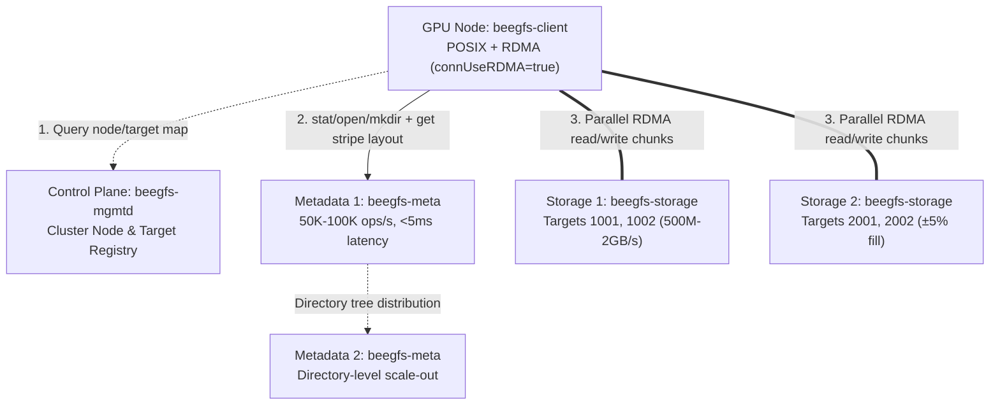
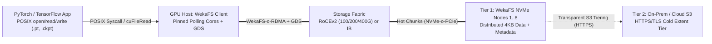
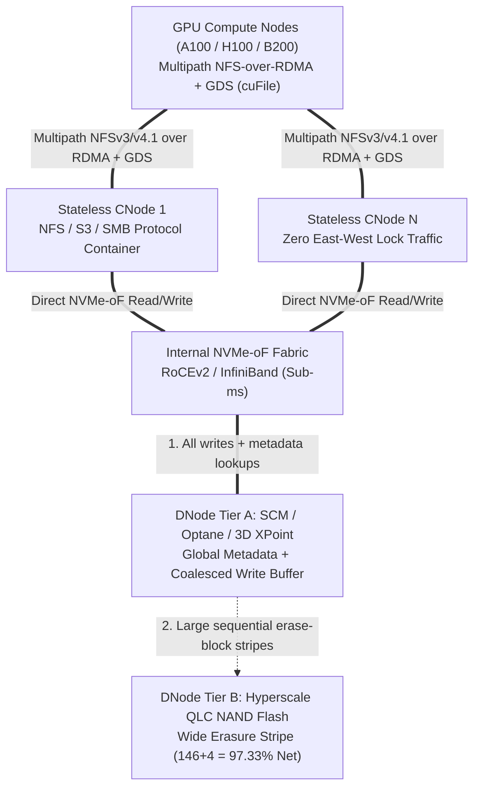
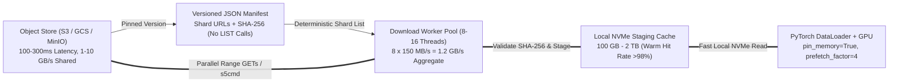

# 13.5 BeeGFS, Weka, VAST and object storage

| Field | Value |
|---|---|
| Level | Intermediate |
| Priority tier | 2 |
| Lab venue | GCP / GKE + Local Python Verification Lab (`code/part13/beegfs_weka_vast_object_lab.py`) |
| Part | Part 13: AI storage |
| Primary sources | NVIDIA Zero-to-Hero Volume 15 (`chapter-06-beegfs-for-gpu-clusters.md`, `chapter-07-object-storage-and-dataset-pipelines.md`); *AI Systems Performance Engineering* (`ai-systems-performance-engineering`); *AI Data Center Network Design and Technologies* (`ai-data-center-network-design-and-technologies`) |
| Coverage file | `planning/coverage/chapters/13-05.md` |
| Claim & number ledger | `planning/ledgers/13-05.md` |

## Why this matters for AI infrastructure

Picture a training run that should take a week and takes two. The GPU dashboard shows the cards busy, yet progress is slow. Often the cause is not the compute. The storage layer is not delivering batches or saving checkpoints fast enough, so the GPUs spend their time waiting.

Every minute spent waiting on storage is a minute of wasted cluster power and lost training progress. When the storage fabric falls behind, expensive GPU nodes sit idle waiting for batches. They also block on synchronous weight dumps, which means the training loop stops until each dump finishes.

Feeding modern accelerators takes massive sustained bandwidth, which is the amount of data that can move every second. Do the arithmetic for one GPU. If it needs 200 MB/s of training data to keep its Tensor Cores busy, an eight-GPU server needs 1.6 GB/s of continuous read throughput. Multiply again for a rack. An NVIDIA Grace Blackwell GB200 or GB300 NVL72 rack, which forms a single NVLink domain, needs 14.4 GB/s of continuous ingestion.

Stalls matter just as much as raw speed. If storage stalls consume a third of iteration time, cutting that wait down to 5 percent lowers the stall fraction sixfold. The GPUs recover 25 percentage points of active compute time from that single change.

The envelope below puts these figures side by side. Notice how the rack-level number grows with the number of GPUs in the rack, and how the same storage fix changes the stall numbers.

```text
Cluster Storage Bandwidth & Stall Reduction Envelope:
  - Single 8-GPU training server (8 x 200 MB/s):               1.6 GB/s sustained read
  - Single GB200 / GB300 NVL72 rack (72 x 200 MB/s):          14.4 GB/s (14-20 GB/s envelope)
  - Cutting GPU I/O wait from 30% down to 5%:                  6.0x stall reduction (+25 pct pts active compute)
```

Lustre dominates classic national-laboratory supercomputers. Commercial and enterprise GPU clusters, however, often pick from four complementary storage architectures. Each one sits at a different point between operational simplicity, metadata scalability and cost per gigabyte.

The first option is BeeGFS, an open-ecosystem parallel filesystem. It splits its work into management, metadata, storage targets and kernel clients, and each piece runs as a standard Linux service. That makes it far simpler to install and run than Lustre. The trade-off is that you still have to configure directory stripe patterns yourself. Repackaging small files keeps the metadata servers from saturating above 100 GPUs.

The second option is WekaFS, a software-defined, NVMe-first parallel filesystem. It spreads both data and metadata in 4 KB chunks across every storage node. Because no single node owns the metadata, there is no dedicated metadata server that can become a bottleneck. Weka pins dedicated polling CPU cores on GPU hosts, which gives low-latency POSIX access over RoCEv2 or InfiniBand with GPUDirect Storage. It also moves cold extents, the data that is rarely read, to S3 object storage on its own, while keeping one namespace.

The third option is VAST Data DASE, along with AI-native RDMA filesystems such as DeepSeek 3FS. Both designs rethink how compute nodes talk to flash. VAST separates stateless protocol containers from NVMe-oF storage enclosures. Those enclosures pair Storage Class Memory write buffers with wide-striped QLC flash. DeepSeek 3FS goes further for random-read AI workloads. It bypasses the Linux page cache completely, using `O_DIRECT`, `io_uring` and RDMA. In production benchmarks, 3FS sustained 6.6 TB/s of aggregate read throughput across 68 storage nodes.

The fourth option is object storage, such as S3, GCS, Azure Blob and MinIO. It gives you durable, exabyte-scale data lakes that act as the source of truth, reached over HTTP and TLS. The catch is latency. At 150 ms per request, two million small files add up to more than 83 hours of serial API wait. Feeding GPUs from object storage therefore needs more machinery: versioned JSON manifests, prefix sharding, parallel download worker pools and local NVMe staging caches.

Start by working out how much bandwidth your GPUs actually need, because that number narrows the four options quickly.

## Prerequisites and outcomes

### Prerequisites
- You should already know the AI storage workload taxonomy and the local NVMe block queues from the earlier chapters in Part 13.
- Parallel filesystem ideas from the previous chapter, such as separated metadata and data paths and target striping, should feel familiar.
- You need working knowledge of NVMe-oF over TCP on port `8009`, or over RDMA on UDP ports `4420` and `4791`, plus GPUDirect Storage (`cuFile` and `nvidia-fs`).

### Outcomes
After completing this chapter, you will be able to:
1. Lay out and troubleshoot a BeeGFS cluster across its four services. You will work out how round-robin stripe chunks are placed, spot target fill skew, and stop 256-GPU metadata saturation with MDS scale-out and WebDataset sharding.
2. Compare BeeGFS and Lustre with WekaFS and VAST Data DASE. The comparison covers metadata layout, erasure coding, client core pinning and hybrid S3 namespace tiering.
3. Measure GPUDirect Storage performance with `gdsio`, and explain how DeepSeek 3FS uses `O_DIRECT`, `io_uring` and RDMA to reach 6.6 to 7.3 TB/s across 68 storage nodes.
4. Build and instrument a production S3 dataset staging pipeline. It removes bucket listings by using JSON manifests, scales request rates through prefix sharding, and tracks the per-epoch local NVMe cache hit rate.

---

## 1. The AI Storage Taxonomy: Block, File, Parallel File, and Object

Picture one storage system asked to do every job. It ingests raw data, curates it with NeMo Curator, serves multi-node training reads, absorbs synchronous checkpoint dumps and answers RAG vector lookups. Each of those jobs asks for something different in latency, concurrency and cost. A system built for one of them usually struggles with the rest.

A single standard NFS server cannot feed a 100-GPU cluster. Even when you tune it with 1 MiB transfer sizes, every metadata lookup and data stream still funnels through one server's network interfaces and CPU queues. Parallel filesystems break that single-node ceiling. They stripe data and metadata across dozens or hundreds of independent storage servers at the same time.

The table compares the three families side by side, so you can see which one fits each job. Object storage is the cheapest per gigabyte. Block volumes are the most expensive per gigabyte, but they deliver high per-volume IOPS and latency.

| Feature | Object Storage (`S3` / `GCS` / MinIO) | Block Storage (`NVMe-oF` / SAN) | Shared / Parallel File Storage (`BeeGFS` / `WekaFS` / `VAST` / `Lustre` / `GPFS`) |
|---|---|---|---|
| **Data organization** | Immutable objects (`key -> blob + metadata`) in flat buckets | Fixed-size logical blocks (`4 KB` LBAs) inside `NSID` volumes | Hierarchical POSIX files and directories with inode attributes |
| **Access method** | REST `HTTP/TLS` API (`GET`, `PUT`, byte-range `GET`) | Block-level NVMe queues (`SQE`/`CQE` capsules over PCIe or fabric) | POSIX syscalls (`open`, `read`, `write`, `stat`, `mmap`, `unlink`) |
| **Network transport** | `TCP/HTTPS` over standard Ethernet/IP | `NVMe-o-TCP` (port `8009`), `NVMe-o-RDMA` (`RoCEv2` UDP `4791` / `IB`), `FC` | `RDMA` (`RoCEv2` / InfiniBand) or `TCP` over Ethernet/IP |
| **OS page cache & `GDS`** | No kernel page cache; staged to local NVMe or memory | Raw block volumes have no shared multi-node page cache; `GDS` via local/remote `O_DIRECT` | Supports shared namespace; `GDS` (`cuFile` + `nvidia-fs`) bypasses host bounce buffers over `RDMA` |
| **Scalability & cost** | Highest capacity scalability (multi-exabyte); lowest `$/GB` | High per-volume IOPS/latency (`~100 ns` PCIe Gen5, `~300 ns` IB, `~800 ns` Eth); highest `$/GB` | Scales to hundreds of `GB/s` or multi-`TB/s` across thousands of GPU clients; moderate-to-high `$/GB` |
| **Primary AI domain** | Data lake source of truth, offline curation, cross-site/cloud checkpoint archival, RAG corpus | Local scratch volumes, database backing stores, hyperconverged or disaggregated `DNode` backing | Active multi-node training datasets, synchronous multi-rank checkpoint writes, shared home/code directories |

Put each workload on the tier that suits it, and you protect both GPU utilization and your storage budget. Object stores hold the durable, multi-petabyte data lake. Parallel filesystems serve active multi-node training and checkpoints over RDMA. Local NVMe block volumes absorb node-local scratch and cache traffic.

Sort each workload into one of these tiers before you choose a product.

---

## 2. BeeGFS for GPU Clusters: Architecture, Striping, and Metadata Tuning

Suppose your team runs between 100 and 500 GPUs and needs multi-node parallel storage bandwidth. You probably do not have an HPC storage team to look after Lustre's patched kernels and complex failover pairs. When a parallel filesystem is hard to operate, small configuration mistakes pile up. A checkpoint directory is left unstriped, or a metadata server quietly overloads.

BeeGFS avoids much of that burden. It runs as ordinary Linux user-space daemons on top of an existing XFS or EXT4 filesystem. It was originally developed at the Fraunhofer Center for High Performance Computing. Its servers pair with a lightweight client kernel module, which supports InfiniBand and RoCEv2 RDMA as well as GPUDirect Storage.

### 2.1 The Four Decoupled BeeGFS Services

The cluster splits into four independent services. One handles cluster management, one holds directory metadata, one stores the bulk chunks, and one mounts the POSIX client on each GPU node.



Each row of the table below names one service, its job, the envelope that counts as healthy and the command that checks it. Keep the envelope in mind when a checkpoint slows down, because it tells you what normal looks like.

| Service | Daemon / Module | Core Responsibility | Healthy Operational Envelope | Primary CLI Check (`untested here`) |
|---|---|---|---|---|
| **Management Service** | `beegfs-mgmtd` | Maintains the authoritative registry of all metadata nodes, storage nodes, targets, and client sessions; never sits on the data path | `< 1%` CPU/network load; queried upon mount and topology changes | `beegfs-ctl --listnodes --nodetype=mgmt` |
| **Metadata Service (`MDS`)** | `beegfs-meta` | Stores POSIX inodes, directory hierarchies, permissions, and the per-file stripe pattern (`target IDs` + `chunksize`) | **`50,000–100,000` ops/sec** per MDS; average latency **`< 5 ms`** (e.g., `2.0–2.1 ms` at `5.2K–5.4K` ops/sec) | `beegfs-ctl --serverstats --nodetype=meta` |
| **Storage Service (`OSS`)** | `beegfs-storage` | Manages one or more underlying NVMe RAID/XFS storage targets (`TargetID`) and serves striped file chunks over `RDMA` or `TCP` | **`500 MB/s–2 GB/s`** per storage node; all targets balanced within **`±5%` fill** (`> 10%` spread triggers investigation) | `beegfs-ctl --listtargets --nodetype=storage --spaceinfo` |
| **Client Service** | `beegfs-client` | Kernel module mounted at `/beegfs`; fetches file stripe layout from `MDS` on `open()` and performs direct parallel `RDMA` I/O to storage targets | Sustained `4–5 GB/s` single-client read across `8–12` targets with `connUseRDMA = true` | `beegfs-ctl --clientinfo` and `mount \| grep beegfs` |

Picture a GPU worker opening a file under `/beegfs`. The client module first asks the Metadata Service for that file's stripe recipe. Once it holds the target list, it skips the metadata server entirely. It then streams the chunks in parallel to every assigned storage target over RDMA.

Before you trust a new mount, run the client check and confirm the read rate sits inside the envelope above.

### 2.2 Round-Robin Striping Math and Checkpoint Stall Time

Suppose a checkpoint directory is left on the default stripe width of one or two targets. A multi-hundred-gigabyte checkpoint then has to squeeze through just two targets while the rest of the storage cluster sits idle. Every GPU in the job freezes until that slow write finishes.

BeeGFS cuts each file into fixed-size, contiguous chunks. It then deals those chunks out in round-robin order across the directory's storage targets. You control this with `--chunksize`, which can be 1 MiB through 4 MiB, and `--numtargets`, set to 8 or 12. Set both with `beegfs-ctl --setpattern`, and one large file can draw on the write bandwidth of the whole pool.

```text
BeeGFS Round-Robin Stripe Mapping & 500 GB Checkpoint Stall Math (800 MB/s per target):
  - Formulas for byte offset B, chunksize C, numtargets N across ordered TargetIDs T[0..N-1]:
      chunk_index        = floor(B / C)
      stripe_row         = floor(chunk_index / N)
      target_slot        = chunk_index mod N
      intra_chunk_offset = B mod C
      TargetID           = T[target_slot]
  - Worked example: C = 1 MiB (1,048,576 B), N = 8 targets [1001, 1002, 2001, 2002, 3001, 3002, 4001, 4002]:
      Offset B = 10,486,272 B (10 MiB + 512 B) -> chunk_index = 10, stripe_row = 1, target_slot = 2 (TargetID 2001), intra_chunk_offset = 512 B
  - 500 GB Checkpoint Write Duration by Stripe Width:
      numtargets = 2:   2 x 800 MB/s = 1.6 GB/s theoretical -> 500 GB / 1.6 GB/s = 312.5 s (~312 s / 5.2 min stall)
      numtargets = 8:   8 x 800 MB/s = 6.4 GB/s theoretical -> 500 GB / 6.4 GB/s = 78.125 s (~78 s, 4.0x faster; 100.0 s at 5.0 GB/s / 78.125% efficiency)
      numtargets = 12: 12 x 800 MB/s = 9.6 GB/s theoretical -> 500 GB / 9.6 GB/s = 52.0833 s (52.08 s)
```

Here is the arithmetic for that 500 GB checkpoint. On two targets, the write runs at 2 x 800 MB/s, which is 1.6 GB/s. The checkpoint therefore takes 312.5 seconds, about 5.2 minutes of stall. Move to eight targets and the theoretical rate becomes 6.4 GB/s, so the write drops to 78.125 seconds. That is fourfold faster. At a sustained 5.0 GB/s across eight targets, the same write finishes in 100 seconds. Twelve targets cut the theoretical time further, to 52.08 seconds.

There is a catch. Running `beegfs-ctl --setpattern` on a directory affects only the files created after that point. Existing files keep the stripe width recorded in their inode when they were created. To restripe an existing dataset or checkpoint, you have to rewrite the files or migrate them with `beegfs-ctl --migrate`. Set the stripe pattern on a checkpoint directory before the first checkpoint lands in it.

### 2.3 The 256-GPU Metadata Wall and Target Fill Skew

BeeGFS is much simpler to run than Lustre, but scaling its metadata takes more hands-on work than Lustre's Distributed Namespace. Picture 256 GPUs starting an epoch over ten million raw JPEG files. Each GPU makes 800 metadata calls per second, so demand climbs past 200,000 ops/sec. A single BeeGFS metadata server is rated for 50,000 to 100,000 ops/sec, so it is overwhelmed. Average latency climbs past 30 ms and stalls every GPU.

Scaling out helps. With four or five `beegfs-meta` servers you reach 250,000 ops/sec of raw capacity, because BeeGFS assigns different directories to different metadata nodes. The catch is that all ten million JPEGs in one flat directory still land on the one metadata server that owns that directory's inode. Every lookup hits that server. The lasting fix is repackaging small files into large WebDataset `.tar`, TFRecord or Parquet shards. That step cuts metadata operations a hundredfold, down to 2,048 ops/sec.

A second hazard appears once the cluster is running. Storage targets drift apart in how full they are, and that is target fill skew. Unstriped files or uneven client placement can fill one storage node to 72 percent while another sits at 44 percent. That 28 percent spread breaks the healthy 5 percent balance band. If one target reaches 100 percent full, wide-striped writes fail, even when the rest of the cluster has terabytes free.

The summary below gathers the storm, the scale-out ceiling and the skew example in one place.

```text
BeeGFS 256-GPU Metadata Storm & Storage Target Fill Skew Summary:
  - 256-GPU raw small-file storm (10,000,000 JPEGs, 800 ops/s/GPU): 204,800 ops/sec (200K+ ops/sec; saturates 1 MDS at 50,000 ops/sec, > 30 ms latency)
  - MDS scale-out capacity (5 x 50,000 ops/sec safe ceiling):       250,000 ops/sec (requires multi-directory tree distribution vs Lustre DNE 500,000+ ops/sec)
  - 100x WebDataset / TFRecord sharding reduction:                    2,048 ops/sec (< 5,000 ops/sec; < 5 ms latency on a single MDS)
  - Target fill skew example (Node 101 storage1 vs Node 102 storage2):
      storage1: TargetID 1001 = 4.5 / 10.0 TB (45%), TargetID 1002 = 4.4 / 10.0 TB (44%)
      storage2: TargetID 2001 = 7.2 / 10.0 TB (72%), TargetID 2002 = 7.1 / 10.0 TB (71%)
      Cluster mean = 58.0%, inter-node spread = 28.0% (exceeds +/-5% healthy band and > 10% investigation threshold; migrate 2001, 2002)
```

Notice that sharding cuts the metadata load a hundredfold, while the skew example calls for migrating targets 2001 and 2002. Package the small files first, then check that every target stays inside the 5 percent band.

---

## 3. WekaFS: Distributed Virtual Metadata, Core Pinning, and S3 Tiering

Picture a platform team that supports dozens of research groups. Some run small-file workloads, and others write large checkpoints. If someone has to hand-balance directory metadata trees, or repackage datasets before each experiment, the platform team becomes the bottleneck. What those groups need is one shared POSIX filesystem. It should absorb millions of small-file lookups and multi-gigabyte streaming reads, with no manual stripe tuning.

WekaFS tackles this in the filesystem design itself. It does not send directory lookups to dedicated metadata servers. Instead, it pools every NVMe drive in the storage cluster into one virtual pool, and it spreads both data and metadata across every node.

### 3.1 Fully Distributed Metadata and N+K Erasure Coding

Unlike Lustre and BeeGFS, WekaFS has no dedicated metadata servers at all. It cuts both file data and virtual metadata into 4 KB chunks. A deterministic cryptographic hash then decides which node holds each chunk. Because every node handles metadata operations in parallel, small-file `open`, `stat` and `unlink` IOPS grow linearly as you add storage nodes.

For durability, WekaFS skips hardware RAID cards and 3x replication. Triple replication wastes two-thirds of raw NVMe capacity. Instead, WekaFS stripes data across failure domains with cluster-wide $N + K$ erasure coding. Here $N$ counts the data chunks and $K$ counts the parity chunks, and together they never exceed the number of storage nodes.

The numbers below work through an 8-node cluster first, then an 18-node cluster. Compare the 3x replication line with the 6+2 line. The erasure code keeps 75 percent of raw capacity usable, and it still gives 2.25 times the usable capacity of 3x replication.

```text
WekaFS Distributed N+K Erasure Coding, Core Pinning & Hybrid S3 Namespace Math:
  - 8-node cluster (8 x 8 x 15.36 TB NVMe SSDs = 983.04 TB raw):
      3x replication:   33.33% efficiency (66.67% overhead) -> 327.68 TB usable
      6+2 erasure code: 6 / (6+2) = 75.0% efficiency        -> 737.28 TB usable Tier 1 NVMe (2.25x usable capacity gain over 3x replication; survives 2 node/drive failures)
      Tier 2 S3 bucket: 2,000 TB cold extent capacity       -> 737.28 + 2,000 = 2,737.28 TB single unified POSIX namespace
  - 18-node cluster with 16+2 erasure stripe:
      16 / (16+2) = 88.89% net NVMe efficiency
  - GPU host client core pinning (ll_core polling mode):
      4 pinned cores on a 128-core GPU server = 3.125% host CPU tax
```

Erasure coding is the trade you make for durability. Before you count terabytes, count how many node or drive failures the layout must survive.

### 3.2 POSIX Client Core Pinning and Unified S3 Tiering

Line-rate RDMA and GPUDirect Storage need steady CPU time, and kernel interrupt jitter would get in the way. So WekaFS runs a dedicated client on each GPU server, and that client pins one to four CPU cores in polling mode.



The table maps each architectural layer to what it does for a GPU cluster.

| Architectural Layer | WekaFS Mechanism | Operational Impact for GPU Clusters |
|---|---|---|
| **GPU Host Access (`WekaFS Client`)** | Dedicated user-space/kernel POSIX client running on the GPU server (`100/200/400/800 Gbps` NICs); pins `1` to `4` dedicated CPU cores (`ll_core`) in polling mode | Eliminates OS interrupt latency and sequential NFS state-machine overhead; on a `128`-core host, pinning `4` cores consumes **`3.125%`** CPU to drive line-rate `RDMA` and `GPUDirect Storage` (`GDS`) |
| **Protocol Fallback (`NFS`)** | Optional standard `NFSv3` / `NFSv4.1` gateway access for non-GPU hosts without the native client | Functional for management nodes, but delivers substantially lower IOPS and does not provide the full native `WekaFS-o-RDMA` client pipeline |
| **Unified Hybrid Namespace (`Tier 1 + Tier 2`)** | Hot working sets reside on Tier 1 NVMe flash (`737.28 TB`), while cold datasets and older `.pt`, `.ckpt`, `.npy`, `.h5`, and `.bin` files transparently tier to Tier 2 `S3` object storage (`2,000 TB`+) over `HTTPS/TLS` | Applications see a single `2,737.28 TB` POSIX directory tree; policy engines evict cold data extents from NVMe to `S3` while keeping metadata headers in flash for instant `ls`/`stat` lookups |

Metadata headers stay on Tier 1 flash, even after the data behind them has moved to S3. That is why a directory listing or a `stat` call stays fast across a multi-petabyte namespace. Now suppose a training script opens a cold checkpoint. WekaFS streams those extents back to Tier 1 NVMe without the script doing anything special.

Decide which working sets must stay on Tier 1 flash, since that choice sets how fast the hot data feels.

---

## 4. VAST Data DASE, GPUDirect Storage, and DeepSeek 3FS

Consider what happens on a shared-nothing storage cluster when many clients write at once. Each server owns specific drives and metadata shards, so a write that spans nodes forces those servers to exchange lock and cache-coherency messages across the network. At multi-terabyte-per-second scale, that east-west coordination and the host OS page caches become the main bottlenecks.

Two modern architectures remove those bottlenecks in different ways. VAST Data uses a Disaggregated Shared-Everything architecture, which removes east-west lock traffic between protocol servers. DeepSeek's Fire-Flyer File System bypasses the Linux page cache completely. It uses `O_DIRECT`, `io_uring` and RDMA to saturate NVMe drives on random-read AI workloads.

### 4.1 VAST Data Disaggregated Shared-Everything Architecture

VAST Data separates stateless protocol containers from high-availability NVMe-oF drive enclosures. The two sides talk over an internal RoCEv2 or InfiniBand fabric. Because the protocol servers hold no persistent state, any container can read or write any drive enclosure directly. It never has to coordinate locks with its peers.



The table lists the four DASE components. Read each row as a job the component does, and the advantage it gives you.

| DASE Component | Architectural Function | Quantitative Advantage |
|---|---|---|
| **Stateless `CNodes` (Compute Nodes)** | Containerized protocol servers exposing multipath `NFS-over-RDMA` (`nconnect` / multipath), `S3`, and `SMB`; hold **zero persistent state** | Any `CNode` can read or write any `DNode` drive directly over `NVMe-oF`; if a `CNode` fails, active `RDMA` connections fail over to peer `CNodes` without data rebuilds |
| **Internal `NVMe-oF` Fabric** | High-speed `RoCEv2` or InfiniBand switch fabric connecting every `CNode` to every high-availability `DNode` enclosure | Allows independent scaling of protocol CPU (`CNodes`) and flash capacity (`DNodes`) |
| **`DNode` `SCM` (`Optane` / `3D XPoint`) Tier** | Ultra-low-latency, high-endurance non-volatile memory that stores global metadata data structures and absorbs `100%` of incoming random writes | Protects lower-endurance `QLC` flash from random write amplification; `CNodes` coalesce data in `SCM` (`24 TB`+) and destage only full, sequential erase-block stripes |
| **`DNode` `QLC` Flash + Wide Stripes (`146+4`)** | Low-cost, high-density `QLC` NAND flash protected by locally decodable wide erasure codes (e.g., `146` data strips + `4` parity strips across enclosures) | Cuts erasure-coding parity overhead to **`2.67%`** (**`97.33%` net efficiency**; `1,460 TB` usable out of `1,500 TB` raw, or `2,920 TB` at `2.0x` similarity reduction) while surviving `4` concurrent failures |

Think of the SCM tier as a landing zone. Every random write lands there first, so the lower-endurance QLC flash only receives full, sequential stripes.

### 4.2 Quantifying GPUDirect Storage with `gdsio`

Imagine a parallel filesystem streaming data over RDMA at line rate. Even then, routing those bytes through the legacy Linux CPU path creates a host-memory bottleneck. Data travels from the storage NIC across PCIe into host DRAM. It must then be copied a second time across PCIe into GPU HBM.

NVIDIA GPUDirect Storage removes that host memory copy. It uses the CUDA `cuFile` API and the `nvidia-fs` kernel driver to register GPU HBM buffers directly with the storage or RDMA NIC driver. DMA engines then move bytes straight between remote storage and GPU memory. You can measure the gain on a live mount with `/usr/local/cuda/gds/tools/gdsio` by comparing transfer mode `-x 2` against `-x 0`.

| `gdsio` Transfer Mode | CLI Flag | Measured Read Throughput | Average I/O Latency | Observed Hardware Impact |
|---|---|---|---|---|
| **Storage -> CPU Memory -> GPU (`Before GDS`)** | `-x 2` | **`8.0 GB/s`** | **`1.25 ms`** | Host CPU cores saturated executing `memcpy` through host pinned bounce buffers |
| **Storage -> GPU HBM Direct (`With GDS`)** | `-x 0` | **`9.6 GB/s` (`+20.0%`)** | **`1.00 ms` (`-20.0%`)** | Zero host `DRAM` bounce copy; VAST benchmarks show **`+20%`** read throughput on `A100` (`100 Gb/s` NIC) and **`+30%+`** on `H100` (`200/400 Gb/s` NICs) |

As you read the table, treat it as a before-and-after pair. The first row is the bounce-buffer path, and the second row is the direct path. The throughput rises from 8.0 GB/s to 9.6 GB/s, which is the 20 percent gain, and latency drops from 1.25 ms to 1.00 ms.

### 4.3 DeepSeek Fire-Flyer File System vs Ceph on 68 Nodes

Picture a large LLM pretraining job, a multi-modal shuffle, or a fleet of workers doing distributed KVCache lookups. Thousands of workers issue random reads that never repeat across petabytes of data. On a conventional filesystem backed by the Linux page cache, those reads get almost no cache hits. They also burn CPU cycles on page-table locks and memory allocations.

Many modern user-space filesystems rely on FUSE, and standard FUSE cannot use kernel GPUDirect Storage. The reason is that `nvidia-fs` requires kernel-level `O_DIRECT` DMA integration. DeepSeek solved both problems in its open-source Fire-Flyer File System, or 3FS. It combines strict `O_DIRECT`, asynchronous `io_uring` with pre-registered buffers, and native RDMA reads. Four decoupled services make up the design: Cluster Manager, Metadata Service, Storage Service and Client.

```text
DeepSeek 3FS 68-Node Benchmark vs Ceph:
  - Cluster hardware per storage node (68 nodes total): 10 x 16 TB NVMe SSDs (680 SSDs = 10,880 TB raw) + dual 100 Gb/s NICs (200 Gb/s = 25.0 GB/s network/node)
  - Sustained aggregate random read throughput:          6.6 TB/s (97.06 GB/s per storage node across internal/fabric paths)
  - Concurrent background workload traffic:             +1.4 TB/s (8.0 TB/s combined I/O; up to 7.3 TB/s peak read in larger runs)
  - Ceph baseline on comparable hardware:               ~1.1 TB/s (3FS achieves 6.0x speedup at 6.6 TB/s and 6.64x speedup at 7.3 TB/s)
```

The benchmark block gives the headline numbers. Sustained aggregate reads reach 6.6 TB/s across the 68 nodes, against a Ceph baseline of about 1.1 TB/s. Use the table below to see how the five filesystems compare on metadata, small-file fit, operational load and ideal scale.

| Parallel Filesystem Comparison | BeeGFS | Lustre | WekaFS (`WEKA`) | VAST Data (`DASE`) | DeepSeek `3FS` |
|---|---|---|---|---|---|
| **Metadata Model** | Multiple `beegfs-meta` (`50–100K` ops/s each); manual directory distribution | Multiple `MDT`s with `DNE` (`500K+` ops/s); rich namespace tooling | Fully distributed `4 KB` virtual metadata across all NVMe nodes | Global metadata in `DNode` `SCM`/`Optane` accessed by stateless `CNodes` | Sharded, replicated transactional metadata over `RDMA` |
| **Small-File / Random Read Fit** | Moderate (requires `WebDataset` sharding above `~100` GPUs) | High with `DNE` + `DoM` (Data-on-MDT), complex to tune | Very high (no single `MDS` bottleneck) | Very high (`SCM` metadata + multipath `RDMA`) | Extreme for random reads (`O_DIRECT` + `io_uring`, zero page cache) |
| **Operational Complexity** | Low (standard Linux packages on `XFS`/`EXT4`) | High (patched kernel, `MDT`/`OST` failover, `DNE` balancing) | Low-to-moderate (commercial SDS, requires pinned client cores) | Low (turnkey disaggregated appliance, `NFS-over-RDMA` + `S3`) | High (custom `RDMA` + `io_uring` stack for ultra-scale AI factories) |
| **Primary Ideal Scale** | `100–500` GPUs, sequential shards & checkpoints | `1,000+` GPUs, classic HPC & large AI supercomputers | `100–10,000+` GPUs needing mixed small/large I/O + `S3` tiering | Multi-tenant enterprise AI data platforms needing unified `NFS` + `S3` | Ultra-scale LLM training & KVCache (`6.6–7.3 TB/s` across `68+` nodes) |

Pick the filesystem whose ideal scale matches your cluster, and then check the operational complexity row against the team that will run it.

---

## 5. Object Storage and Dataset Staging Pipelines

Many AI teams keep their source-of-truth data in object storage. Systems such as AWS S3, Google Cloud Storage, Azure Blob Storage, and on-premises MinIO or VAST S3 offer nearly unlimited capacity and strong durability. They also cost a fraction of what an all-flash parallel filesystem costs. Object storage is not a POSIX filesystem, though. Pointing a PyTorch DataLoader straight at millions of individual S3 keys is one of the costliest mistakes you can make in AI infrastructure.

### 5.1 The S3 Small-Object Latency Trap

Every S3 `GET` request goes through an HTTP and TLS stack. It authenticates IAM signatures, looks up the object key in a distributed index, and streams the payload over TCP. For a single 100 MB model weight file, 150 ms of control-plane latency plus 100 ms of data transfer finishes in a harmless 250 ms.

Now picture a 500 GB vision dataset stored as two million individual objects of 260 KB each. Every request still pays the 150 ms HTTP and API latency, and that delay is far larger than the transfer time for a 260 KB payload. Issued one after another, the two million requests waste 300,000 seconds, or 83.33 hours. Your GPUs would sit 99 percent idle for more than three days, waiting on HTTP headers.

```text
S3 Object Latency Trap & Parallel Staging Math:
  - Loading 1 x 100 MB model file:             50 ms TCP/TLS + 100 ms S3 API + 100 ms transfer (at 1 GB/s) = 250 ms total
  - Fetching 2,000,000 x 260 KB objects:       2,000,000 x 0.150 s = 300,000 seconds = 83.33 hours (~83 hours serial API wait)
  - Single 1 GB object download:               50 ms TLS + 80 ms API + 6,000 ms transfer = 6.2 s (161.29 MB/s / ~161 MB/s)
  - Parallel 8 x 1 GB object download:         7.5 s elapsed vs 8 x 6.2 = 49.6 s serial (6.61x speedup; 1,066.67 MB/s / ~1,067 MB/s aggregate; 133.33 MB/s / ~133 MB/s per worker)
  - Time-to-First-Batch (500 GB = 50 x 10 GB shards, prefetch 2 shards = 20 GB):
      8 workers at 150 MB/s (1.2 GB/s agg):    20 GB / 1.2 GB/s = 16.67 s (~17 s) + 2 x 5.0 s API (10.0 s) + 2 x 0.1 s TLS (0.2 s) = 26.87 s (~27 s)
      16 workers at 150 MB/s (2.4 GB/s agg):   20 GB / 2.4 GB/s = 8.33 s + 10.2 s API/TLS = 18.53 s
```

The single-object line shows the cost clearly. Fetching one 1 GB object takes 6.2 seconds, which works out to about 161 MB/s. Fetching eight of them in parallel finishes in 7.5 seconds, a 6.61x speedup. That is why the next section uses a worker pool.

### 5.2 Prefix Sharding, Parallel Worker Pools, and Local NVMe Caching

Turning an object store into a high-bandwidth training feeder takes five coordinated pieces. You need versioned JSON manifests, prefix sharding, parallel worker pools, asynchronous prefetching, and local NVMe staging caches. Each piece removes one source of waiting.



The table walks through the five stages in order. For each stage, it names the bottleneck and the sizing rule that keeps it under control.

| Pipeline Stage | Operational Bottleneck Addressed | Target Metric / Sizing Rule |
|---|---|---|
| **1. Versioned JSON Manifest** | Eliminates repeated `ListObjectsV2` bucket listings, which are slow, paginated at `1,000` keys, and exposed to eventual-consistency and data-drift bugs | Pre-compute `imagenet-manifest.json` (`1,099,511,627,776` bytes = `1 TiB` across `1,073,741,824`-byte `1 GiB` `.tar` shards, `1,281,167` samples) with pinned `sha256` checksums |
| **2. S3 Prefix Sharding** | Standard S3 partitions enforce **`3,500` `PUT/COPY/POST/DELETE`** and **`5,500` `GET/HEAD` requests/sec per prefix**; dumping all shards under one prefix triggers `503 Slow Down` throttling at cluster scale | Shard object keys across $P = 16$ hex/hash prefixes (`s3://bucket/00/..` to `s3://bucket/0f/..`) to scale aggregate request ceilings to **`88,000` `GET`/s** and **`56,000` `PUT`/s** |
| **3. Parallel Worker Pool (`8–16` Workers / `s5cmd`)** | Single-stream TCP/TLS downloads cannot saturate `10–100 Gb/s` host NICs (`1 GB` single object takes `6.2 s` = **`161.29 MB/s`**: `50 ms` TLS + `80 ms` API + `6,000 ms` transfer) | Fetching `8 x 1 GB` objects in parallel completes in **`7.5 s`** instead of `8 x 6.2 = 49.6 s` (**`6.61x` speedup**), delivering **`1,066.67 MB/s`** (`~1,067 MB/s`) aggregate (**`133.33 MB/s`** per worker) |
| **4. Time-to-First-Batch Startup** | Prevents GPU starvation at job launch when staging a `500 GB` dataset (`50 x 10 GB` shards) | With `8` workers at `150 MB/s` (`1.2 GB/s` aggregate), prefetching the first `2` shards (`20 GB`) takes `20 / 1.2 = 16.67 s` (`~17 s`) + `2 x 5.0 s` API + `2 x 0.1 s` TLS = **`26.87 s` (`~27 s`)** (`18.53 s` with `16` workers) |
| **5. Local NVMe Cache & LRU Eviction** | Absorbs S3 latency jitter and serves Epochs `2..N` at local NVMe speed (`100 GB–2 TB` scratch) | **Epoch 1 (cold):** `0.1%` hit rate (`45.3 min` wait); **Epoch 2 (warm):** `98.2%` hit rate (`2.1 min` wait, **`21.57x` wait reduction**); **Epoch 3 (`> 85%` fill):** `97.5%` hit rate (`3.5 min` wait as LRU eviction begins) |

Tracking the cache hit rate across epochs exposes sizing bugs early. Suppose the hit rate jumps from 0.1 percent in epoch 1 to 98.2 percent in epoch 2. That confirms the local NVMe cache is warming properly, and it cuts the wait by more than twentyfold. If the hit rate slips to 97.5 percent in the third epoch, cache occupancy has crossed 85 percent. At that point your dataset is larger than the local scratch budget, and LRU eviction has started.

Watch the cache hit rate in every epoch, and resize the scratch budget before the third epoch slows down.

---

## Commands and configurations that matter

Every command below that queries or modifies cluster storage services (`beegfs-ctl`, `gdsio`, `aws`, `s5cmd`, `mount`, `blockdev`, `dd`, `nsys`) is marked `untested here`. Multi-node parallel filesystem daemons and cloud S3 buckets are not attached to this build container.

### 1. BeeGFS Health, Metadata Rate, and Target Fill Inspection

```bash
# 1. Inspect Metadata Service (MDS) nodes, active sessions, ops/sec, and latency (untested here)
beegfs-ctl --listnodes --nodetype=meta --details
beegfs-ctl --serverstats --nodetype=meta

# Illustrative healthy output (untested here):
# Metadata Service ID 1 (meta1.example.com):
#   Used capacity: 45 GB / 500 GB (9%)
#   Sessions: 24 active
#   Operations: 5,230 ops/sec (healthy, < 50,000 ops/sec ceiling)
#   Latency (avg): 2.1 ms (healthy, < 5.0 ms threshold)
# Metadata Service ID 2 (meta2.example.com):
#   Used capacity: 44 GB / 500 GB (8%)
#   Sessions: 25 active
#   Operations: 5,410 ops/sec (healthy)
#   Latency (avg): 2.0 ms

# 2. Inspect Storage Targets and detect fill-level skew across storage nodes (untested here)
beegfs-ctl --listtargets --nodetype=storage --spaceinfo
beegfs-ctl --serverstats --nodetype=storage

# Illustrative skewed output requiring rebalancing (untested here):
# NodeID: 101 (storage1) Paths:
#  TargetID: 1001 Capacity: 10.0 TB Used: 4.5 TB (45%) Path: /data/target1
#  TargetID: 1002 Capacity: 10.0 TB Used: 4.4 TB (44%) Path: /data/target2
# NodeID: 102 (storage2) Paths:
#  TargetID: 2001 Capacity: 10.0 TB Used: 7.2 TB (72%) Path: /data/target1
#  TargetID: 2002 Capacity: 10.0 TB Used: 7.1 TB (71%) Path: /data/target2
```

### 2. BeeGFS Client RDMA Config and Stripe Tuning

```ini
# /etc/beegfs/beegfs-client.conf — AI training & checkpoint optimization (untested here)
sysMgmtdHost = mgmt.example.com
connUseRDMA = true               # Use InfiniBand / RoCEv2 RDMA instead of TCP
tuneUseGDTLSConnPool = true      # Connection pooling reduces per-I/O setup latency
tuneUseGDTLSDisableSSL = false
tunePrefetchType = buffered      # Client read-ahead caching for sequential dataset scans
connMaxInactiveTime = 900000     # Keep connections alive across long GPU compute steps
```

```bash
# Verify client mount, RDMA connectivity, and file stripe layout (untested here)
mount | grep beegfs
grep -E "sysMgmtdHost|connUseRDMA|tuneUseGDTLSConnPool|tunePrefetchType" /etc/beegfs/beegfs-client.conf
beegfs-ctl --clientinfo

# Set directory stripe pattern BEFORE writing training shards or checkpoints (untested here)
# Training data: 4 MiB chunks across 12 targets for large sequential batch reads
beegfs-ctl --setpattern --chunksize=4M --numtargets=12 /beegfs/training-data/

# Checkpoints: 2 MiB chunks across 12 targets for maximum parallel write fan-out
beegfs-ctl --setpattern --chunksize=2M --numtargets=12 /beegfs/checkpoints/

# Verify stripe pattern on a specific 500 GB shard (untested here)
beegfs-ctl --getentryinfo /beegfs/dataset/train.tar.gz

# Benchmark single-client direct read throughput (expect 4-5 GB/s across 8-12 targets) (untested here)
time dd if=/beegfs/training-data/large-file bs=4M count=25000 of=/dev/null iflag=direct
```

### 3. Benchmarking GPUDirect Storage with `gdsio` and Linux NVMe Tuning

```bash
# 1. Verify NVMe multiqueue scheduler ('none' or 'mq-deadline') and raise read-ahead to 4 MiB (untested here)
cat /sys/block/nvme0n1/queue/scheduler
cat /sys/block/nvme0n1/queue/read_ahead_kb
blockdev --setra 8192 /dev/nvme0n1   # 8192 x 512B sectors = 4 MiB read-ahead

# 2. High-throughput NFS client mount options (when using VAST NFS-over-RDMA or enterprise NAS) (untested here)
mount -t nfs -o rdma,port=20049,nconnect=16,rsize=1048576,wsize=1048576,noatime,async,actimeo=60,lookupcache=pos \
  10.30.0.10:/ai-datasets /mnt/data

# 3. Benchmark CPU bounce-buffer path (-x 2) vs GPUDirect Storage direct GPU DMA path (-x 0) (untested here)
# Before (Storage -> CPU Pinned Memory -> GPU, -x 2): 8.0 GB/s, 1.25 ms avg latency
/usr/local/cuda/gds/tools/gdsio -f /mnt/data/large_file -d 0 -w 4 -s 10G -i 1M -I 0 -x 2

# After (Storage -> GPU HBM directly via GDS cuFile/nvidia-fs, -x 0): 9.6 GB/s (+20%), 1.00 ms (-20%)
/usr/local/cuda/gds/tools/gdsio -f /mnt/data/large_file -d 0 -w 4 -s 10G -i 1M -I 0 -x 0

# 4. Trace cuFile GDS timeline alongside GPU compute kernels in Nsight Systems (untested here)
nsys profile --trace=cuda,nvtx,gds -o gds_training_profile python3 train.py
```

### 4. Production S3 Manifest Validation and Exponential Backoff Prefetch

```python
# Production S3 manifest verification + asynchronous 8-worker prefetch with exponential backoff (untested here)
from concurrent.futures import ThreadPoolExecutor
import hashlib
import json
import os
import time
import boto3
from botocore.exceptions import ClientError

def verify_and_stage_manifest(manifest_path: str, cache_dir: str = "/local-cache", max_workers: int = 8) -> None:
    with open(manifest_path, "r", encoding="utf-8") as f:
        manifest = json.load(f)
    s3 = boto3.client("s3")
    os.makedirs(cache_dir, exist_ok=True)

    def download_and_verify(shard: dict, max_retries: int = 3) -> str:
        local_path = os.path.join(cache_dir, shard["name"])
        if os.path.exists(local_path) and os.path.getsize(local_path) == shard["size"]:
            return local_path
        bucket, key = shard["s3_path"].replace("s3://", "").split("/", 1)
        for attempt in range(max_retries):
            try:
                s3.download_file(bucket, key, local_path)
                digest = hashlib.sha256()
                with open(local_path, "rb") as lf:
                    for chunk in iter(lambda: lf.read(16 * 1024 * 1024), b""):
                        digest.update(chunk)
                if digest.hexdigest() != shard["sha256"]:
                    raise ValueError(f"SHA-256 mismatch on {shard['name']}")
                return local_path
            except ClientError:
                if attempt == max_retries - 1:
                    raise
                time.sleep(2 ** attempt)  # 1s, 2s, 4s backoff
        return local_path

    with ThreadPoolExecutor(max_workers=max_workers) as pool:
        futures = [pool.submit(download_and_verify, s) for s in manifest["shards"]]
        for fut in futures:
            fut.result()
```

---

## How it fails

Suppose a parallel filesystem or S3 staging pipeline is misconfigured. The failure rarely shows up as a clear storage error. You are more likely to see idle GPUs, epoch-boundary hangs or sudden checkpoint timeouts. Use the symptoms and verification checks below to find the broken layer quickly.

| Failure Mode | Observable Symptom | Root Cause Diagnosis | Verification Check (`untested here`) | Remediation |
|---|---|---|---|---|
| **1. BeeGFS `MDS` Saturation at Epoch Start** | Training hangs or crawls at the start of every epoch; metadata latency spikes to **`30 ms+`** (vs `< 5 ms` healthy) | `100–256+` GPUs concurrently `open()`/`stat()` millions of small individual files (`200K+` ops/sec), overwhelming `beegfs-meta` (`50K–100K` ops/sec per server) | `beegfs-ctl --serverstats --nodetype=meta` and `time ls -la /beegfs/dataset/ \| wc -l` | Repackage small files into `100 MB–10 GB` `WebDataset` `.tar` or `TFRecord` shards (`100x` fewer metadata ops, `< 5K` ops/s); scale out `beegfs-meta` servers |
| **2. Narrow Directory Stripe Width (`numtargets = 1` or `2`)** | A `500 GB` checkpoint stalls the cluster for `312.5 s` (`1.6 GB/s`), or a client reads at `800 MB/s` instead of `4–5 GB/s` | Directory was created with default `numtargets=1` or `2`; existing files keep their narrow stripe layout even after `--setpattern` is run later | `beegfs-ctl --getentryinfo /beegfs/checkpoints/ckpt.pt` (inspect `NumTargets` and `ChunkSize`) | Set `beegfs-ctl --setpattern --chunksize=2M --numtargets=12` on the directory *before* creating files; restripe/copy existing files |
| **3. BeeGFS Storage Target Fill Skew (`> 10%` Spread)** | `storage2` targets hit `71–72%` (or `95%`) full while `storage1` targets sit at `44–45%`; wide writes fail when one target fills | Large unstriped files (`numtargets=1`) or uneven client placement concentrated writes on `storage2` | `beegfs-ctl --listtargets --nodetype=storage --spaceinfo` | Enforce wide directory striping (`numtargets=8` or `12`) and run `beegfs-ctl --migrate` to rebalance overloaded target IDs |
| **4. BeeGFS / WekaFS / VAST Client Fallback from `RDMA` to `TCP` or `SYS` NUMA Path** | Single-client read throughput drops from `4–5 GB/s` to `800 MB/s`, or clients show `2x` throughput variance across nodes | `connUseRDMA = false`, storage subnet routed over a slow management NIC, or DataLoader workers scheduled on the wrong CPU/NUMA socket (`SYS` traversal) | `beegfs-ctl --clientinfo`, `lsof \| grep beegfs`, `iperf3`, and `numactl --hardware` | Enable `connUseRDMA = true`, verify lossless `RoCEv2`/`IB` path, and pin DataLoader workers (`numactl`) to the storage NIC's local NUMA node |
| **5. Attempting Kernel `GDS` (`cuFile`) over a User-Space `FUSE` Mount** | `cuFileRead` falls back to host compatibility mode (`-x 2` speed, high CPU `memcpy` load) or fails `O_DIRECT` registration | Standard `FUSE` filesystems route I/O through user-space daemons and lack kernel `nvidia-fs` `O_DIRECT` DMA integration | `/usr/local/cuda/gds/tools/gdscheck -p` and `gdsio -x 0` vs `-x 2` | Use a `GDS`-supported kernel client (`BeeGFS`, `WekaFS`, `VAST NFS-over-RDMA`, `Lustre`, `GPFS`, local `XFS` `NVMe`) or native user-space `RDMA` + `io_uring` (`3FS`) |
| **6. S3 Cold-Cache Stall, Early LRU Eviction, or `503 Slow Down`** | Epoch 1 is `10x` slower than Epoch 2 (`45.3 min` vs `2.1 min` wait), training stalls `30 s` every `5 min`, or S3 returns `503` / `403` | Cold NVMe cache in Epoch 1; download pool (`8` workers) slower than GPU consumption; cache fill `> 85%` triggering LRU eviction in Epoch 3 (`97.5%` hit); or unsharded S3 prefix exceeding `5,500` `GET`/s | Log per-epoch `cache_hits / (cache_hits + cache_misses)`, `df -h /local-cache`, and `aws sts get-caller-identity` | Pre-warm local NVMe cache before `1`-epoch jobs, scale download workers `8 -> 16`, enlarge NVMe cache above dataset working set, use STS credentials with sufficient TTL, and shard S3 keys across `16+` prefixes |

---

## Hands-on lab

### Venue and Scope

The lab runs in the local Python verification script `code/part13/beegfs_weka_vast_object_lab.py`. You can run it here, and it is tested in this environment. Commands that need live BeeGFS, S3 or GPU hardware are marked `untested here`, because this build container has no cluster attached.

The script checks all 26 quantitative models in `code/part13/beegfs_weka_vast_object.py` with deterministic results. Those checks cover BeeGFS round-robin chunk placement, checkpoint stall durations, metadata saturation, storage target fill skew, WekaFS erasure coding, VAST DASE wide stripes, `gdsio` throughput uplift, DeepSeek 3FS benchmarks, and S3 staging cache progressions.

### Step 1: Run the Self-Contained Verification Lab

Run the script with the command below. Each line of the expected output maps to one quantitative model.

```bash
python3 -B code/part13/beegfs_weka_vast_object_lab.py
```

**Expected output:**
```text
=== Chapter 13.5 Lab: BeeGFS, Weka, VAST and Object Storage ===
  [PASS] 1. BeeGFS defines four decoupled services: beegfs-mgmtd, beegfs-meta, beegfs-storage, and beegfs-client
  [PASS] 2. BeeGFS storage node capacity ranges from 500 MB/s to 2000 MB/s (2 GB/s) with a +/-5% healthy target fill band
  [PASS] 3. BeeGFS 1 MiB chunksize across 8 targets maps offset 0 to slot 0 (Target 1001) and offset 10 MiB to chunk 10, row 1, slot 2 (Target 2001)
  [PASS] 4. BeeGFS 500 GB checkpoint striped across 2 targets at 800 MB/s gets 1.6 GB/s (312.5 s) vs 8 targets getting 6.4 GB/s (78.125 s, 4.0x faster)
  [PASS] 5. BeeGFS 12-target training/checkpoint pattern at 800 MB/s/target yields 9.6 GB/s theoretical throughput (52.0833 s for 500 GB)
  [PASS] 6. 256 GPUs generating 204,800 metadata ops/sec saturate 1 MDS (50K ops/sec, needing >= 5 MDSs), while 100x WebDataset sharding drops load to 2,048 ops/sec
  [PASS] 7. BeeGFS target fill check flags storage1 (45%, 44%) vs storage2 (72%, 71%) as a 28% spread (> 10% investigation threshold, outside +/-5% band)
  [PASS] 8. WekaFS 8-node cluster with 6+2 erasure coding achieves 75.0% usable NVMe capacity (2.25x more usable capacity than 3x replication)
  [PASS] 9. WekaFS 18-node cluster with 16+2 erasure coding achieves 88.89% usable NVMe efficiency and pins dedicated client cores (4/128 = 3.125% core tax)
  [PASS] 10. WekaFS unifies Tier 1 hot NVMe-o-RDMA storage (737.28 TB usable on 8 nodes) with Tier 2 S3 object storage (2000 TB) into a 2737.28 TB POSIX namespace
  [PASS] 11. WekaFS rejects N+K stripe widths that exceed the number of failure-domain storage nodes
  [PASS] 12. VAST DASE decouples stateless CNodes from NVMe-oF DNodes (SCM/Optane write buffer + QLC flash) with zero east-west CNode lock traffic
  [PASS] 13. VAST DASE wide 146+4 erasure stripe achieves 97.33% net capacity efficiency (only 2.67% parity overhead across DNodes)
  [PASS] 14. NVIDIA gdsio benchmark shows GDS (-x 0) raises throughput from 8.0 GB/s (-x 2 CPU path) to 9.6 GB/s (+20.0%) and cuts latency from 1.25 ms to 1.00 ms (-20.0%)
  [PASS] 15. DeepSeek 3FS comprises 4 RDMA-connected components (Cluster Manager, Metadata Service, Storage Service, Client) and bypasses the OS page cache via O_DIRECT + io_uring
  [PASS] 16. DeepSeek 3FS 68-node cluster (680 x 16 TB NVMe = 10,880 TB, dual 100 Gb/s NICs) achieves 6.6 TB/s read (+ 1.4 TB/s background = 8.0 TB/s, up to 7.3 TB/s peak)
  [PASS] 17. DeepSeek 3FS delivers 97.06 GB/s per storage node and outperforms Ceph (1.1 TB/s) by 6.0x at 6.6 TB/s and 6.64x at 7.3 TB/s
  [PASS] 18. Fetching 2,000,000 small 260 KB objects serially from S3 at 150 ms/request wastes 300,000 seconds (83.33 hours) on HTTP/TLS API latency alone
  [PASS] 19. Prefetching 2 x 10 GB shards (20 GB) with 8 workers at 150 MB/s each (1.2 GB/s aggregate) takes 16.67 s transfer + 10.2 s API/TLS = 26.87 s (~27 s) to first batch
  [PASS] 20. Doubling S3 download workers from 8 to 16 (2.4 GB/s aggregate) cuts 20 GB transfer time to 8.33 s (18.53 s total with API/TLS)
  [PASS] 21. S3 prefix sharding across 16 prefixes scales request ceilings from 5,500 GET/s and 3,500 PUT/s to 88,000 GET/s and 56,000 PUT/s
  [PASS] 22. Parallel 8 x 1 GB S3 download finishes in 7.5 s (1066.67 MB/s aggregate, 133.33 MB/s per worker) vs 6.2 s single-object (161.29 MB/s) and 49.6 s serial (6.61x speedup)
  [PASS] 23. Local NVMe staging cache warms from 0.1% hit rate (45.3 min wait) in Epoch 1 to 98.2% (2.1 min wait, 21.57x wait reduction) in Epoch 2
  [PASS] 24. Local NVMe staging cache detects LRU eviction onset in Epoch 3 when cache fill (88.0%) exceeds the 85.0% threshold and hit rate dips to 97.5% (3.5 min wait)
  [PASS] 25. GB200/GB300 NVL72 rack (72 GPUs x 200 MB/s per GPU) requires 14.4 GB/s (14-20 GB/s envelope) of sustained storage ingestion bandwidth
  [PASS] 26. Reducing GPU I/O wait time from 30% to 5% lowers the I/O stall fraction by 6.0x and recovers 25 percentage points of active GPU compute time

Summary: 26 passed, 0 failed
```

---

## Common first mistakes

1. Suppose you upload the dataset or write checkpoints first, and only then run `beegfs-ctl --setpattern`. The new stripe pattern does nothing for files that already exist. Directory stripe patterns are inherited only when a new inode is created. Changing `--numtargets=12` on `/beegfs/checkpoints/` does nothing to a 500 GB file that was already created with two targets. You must rewrite or migrate existing files.
2. Do not put `beegfs-meta` and `beegfs-storage` on the same physical disks in production. Sharing spindles or NVMe queues between 50,000 random inode transactions per second and 2 GB/s bulk checkpoint writes causes severe metadata tail-latency spikes above 30 ms. Give `beegfs-meta` its own low-latency NVMe mirrors.
3. Consider how one cold-cache epoch plays out in two different jobs. In a 100-epoch pretraining run, a first epoch of 180 minutes against 30-minute epochs after it adds an extra 2.5 hours. That is under 5 percent of a 50-hour run. In a one-epoch fine-tuning job, the same cold wait is 100 percent overhead. Pre-warm the local NVMe cache before you start GPU workers.
4. Avoid calling `s3.list_objects_v2()` inside every rank's dataset initialization. Suppose a thousand GPU workers start at once and paginate through two million keys. They quickly use up the per-prefix rate limit, which triggers 503 Slow Down errors. If new files are uploaded mid-run, the listing can also cause silent training drift. Read a static, version-pinned `manifest.json` file instead.
5. Do not forget `ulimit -l` when you turn on `pin_memory=True` or GPUDirect Storage. Both PyTorch's `DataLoader` with pinned memory and `cuFile` buffer registration lock pages in physical RAM. If the container's `memlock` limit stays at the default 64 KB, you get mid-epoch allocation crashes or a silent fallback to unpinned transfers. Check each item before the first run, not after the first crash.

---

## Exercises

Work through the six exercises below using the parameters in the block. The block also lists the values the verification lab should produce, so you can check your answers.

```text
Exercise Input Parameters & Expected Verification Targets (code/part13/beegfs_weka_vast_object_lab.py):
  - Ex 1 (BeeGFS Stripe & Checkpoint):
      (a) --chunksize=1M (1,048,576 B), --numtargets=8 [1001, 1002, 2001, 2002, 3001, 3002, 4001, 4002], offset 10,486,272 B (10 MiB + 512 B)
          -> chunk_index = 10, stripe_row = 1, target_slot = 2, TargetID = 2001, intra_chunk_offset = 512 B.
      (b) 500 GB checkpoint at 800 MB/s per target:
          numtargets=2  -> 1.6 GB/s (312.5 s);
          numtargets=8  -> 6.4 GB/s theoretical (78.125 s, saving 234.375 s) or 5.0 GB/s at 78.125% efficiency (100.0 s, saving 212.5 s);
          numtargets=12 -> 9.6 GB/s (52.0833 s / 52.08 s).
  - Ex 2 (BeeGFS 256-GPU Metadata & Skew):
      (a) 256 GPUs x 800 ops/sec = 204,800 ops/sec peak; requires >= 5 MDS nodes at 50,000 ops/sec/MDS (250,000 ops/sec); 100x WebDataset sharding -> 2,048 ops/sec (1 MDS at < 5 ms).
      (b) storage1: 1001 (4.5/10.0 TB = 45%), 1002 (4.4/10.0 TB = 44%); storage2: 2001 (7.2/10.0 TB = 72%), 2002 (7.1/10.0 TB = 71%)
          -> mean fill = 58.0%, max spread = 28.0% (> 10% threshold, outside +/-5% band); migrate TargetIDs [2001, 2002].
  - Ex 3 (WekaFS Erasure Coding & Tiering):
      (a) 8 nodes x 8 x 15.36 TB = 983.04 TB raw; 6+2 stripe = 737.28 TB usable (75.0%) vs 3x replication = 327.68 TB (33.33%), a 2.25x gain; + 2,000 TB Tier 2 S3 = 2,737.28 TB namespace.
      (b) 18 nodes with 16+2 stripe = 88.89% efficiency; 4 pinned ll_core threads on 128-core host = 3.125% CPU tax.
  - Ex 4 (VAST DASE & gdsio):
      (a) 146+4 wide stripe on 1,500 TB raw QLC (24 TB SCM buffer): parity overhead = 2.67% (4/150), net efficiency = 97.33% (146/150), physical usable = 1,460.0 TB, logical at 2.0x reduction = 2,920.0 TB.
      (b) gdsio (-d 0 -w 4 -s 10G -i 1M -I 0): -x 2 CPU = 8.0 GB/s at 1.25 ms vs -x 0 GDS = 9.6 GB/s at 1.00 ms (+20.0% throughput, -20.0% latency; +30%+ on H100 with 200/400 Gb/s NICs).
  - Ex 5 (DeepSeek 3FS vs Ceph):
      (a) 68 nodes x 10 x 16 TB NVMe = 680 SSDs (10,880 TB raw), dual 100 Gb/s NICs (25.0 GB/s/node); 6.6 TB/s read = 97.06 GB/s/node; + 1.4 TB/s background = 8.0 TB/s combined; 6.0x vs Ceph (1.1 TB/s) at 6.6 TB/s and 6.64x at 7.3 TB/s peak.
  - Ex 6 (S3 Staging Pipeline):
      (a) 2,000,000 x 260 KB at 150 ms = 300,000 s (83.33 hours); 20 GB (2 x 10 GB shards) across 8 workers (1.2 GB/s) = 16.67 s + 10.0 s API + 0.2 s TLS = 26.87 s (~27 s); 16 workers (2.4 GB/s) = 8.33 s + 10.2 s = 18.53 s.
      (b) 16 prefixes x (5,500 GET/s, 3,500 PUT/s) = 88,000 GET/s and 56,000 PUT/s; 8 x 1 GB in 7.5 s (1,066.67 MB/s agg, 133.33 MB/s/worker) vs 6.2 s single (161.29 MB/s) and 49.6 s serial = 6.61x speedup; Epoch 1 (0.1%, 45.3 min) -> Epoch 2 (98.2%, 2.1 min) = 21.57x wait reduction; Epoch 3 rises to 3.5 min (97.5% hit) because 88.0% fill exceeds 85.0% LRU eviction threshold.
```

1. Start with the byte offset in Ex 1. Work out the chunk index, stripe row, target slot, TargetID and intra-chunk offset for it. Then compute the theoretical write bandwidth, the checkpoint stall, and the seconds saved when you stripe the checkpoint across two, eight and twelve targets.
2. Using Ex 2, find the peak metadata ops/sec for the cluster and the minimum number of `beegfs-meta` nodes you need. Then work out the rate after WebDataset sharding. Finally, measure the fill spread between `storage1` and `storage2`, and say which targets need migration.
3. For the cluster in Ex 3, compute the raw NVMe capacity, the usable Tier 1 capacity, the replication baseline, the usable capacity gain and the total unified POSIX namespace. Then find the net erasure efficiency on the larger cluster, along with the CPU core tax of pinning polling client cores.
4. For the wide stripe in Ex 4, calculate the parity overhead percentage, the net efficiency, the usable physical QLC capacity and the effective logical capacity. Then measure the throughput uplift and latency reduction between `gdsio` modes `-x 2` and `-x 0`.
5. Using Ex 5, calculate the total SSD count, the raw flash capacity, the per-node read throughput, the combined throughput with background traffic and the speedup over Ceph. Then explain why 3FS bypasses the OS page cache with `O_DIRECT` and `io_uring`, and why standard FUSE cannot use kernel GPUDirect Storage.
6. For Ex 6, compare the serial API wait for two million small S3 requests with prefetching two large shards across eight or sixteen workers. Then compute the prefix sharding ceilings, the parallel download speedup and the wait reduction from epoch 1 to epoch 2. Last, explain why wait time rises in epoch 3.

---

## Interview angles

Interviewers use these questions to see whether you can reason about trade-offs. Answer with the mechanism, not just the product name.

1. **"You are deploying BeeGFS for a 256-GPU cluster. What is your single biggest architectural risk, and how do you mitigate it?"**
   Metadata saturation on `beegfs-meta` is the top risk. Picture 256 GPUs starting an epoch over millions of small files. Metadata demand spikes past 200,000 ops/sec, which is four times a single server's 50,000 ops/sec safe ceiling, and latency climbs past 30 ms. Start by scaling out to four or five metadata servers and spreading directory subtrees across them. Then repackage the small files into large WebDataset `.tar`, TFRecord, or `.bin` and `.idx` shards. That repackaging cuts metadata operations a hundredfold, down to 2,048 ops/sec, and keeps latency around 2.1 ms even on a single server.
2. **"How do WekaFS and VAST Data solve the metadata and small-file problem differently than Lustre and BeeGFS?"**
   Lustre and BeeGFS rely on dedicated metadata servers that partition the directory namespace. WekaFS removes dedicated metadata servers altogether. It slices both file data and virtual metadata into 4 KB chunks across every NVMe node in the cluster, and it drives RDMA from pinned polling client cores. VAST Data DASE separates stateless protocol containers from NVMe-oF drive enclosures. It keeps all global metadata and coalesces random writes inside Storage Class Memory. Then it destages wide 146+4 erasure stripes to QLC flash, with zero east-west lock traffic.
3. **"Why did DeepSeek build Fire-Flyer File System instead of using Ceph, and why did they bypass the OS page cache?"**
   LLM pretraining and KVCache workloads generate massive random reads across petabytes of data. On a conventional OS page cache, those random reads almost never hit, and they waste CPU and memory bandwidth thrashing page tables. DeepSeek 3FS combines strict `O_DIRECT`, Linux `io_uring` for batched, syscall-free submission, and native RDMA across 68 storage nodes. That design sustained 6.6 TB/s of read throughput and peaked at 7.3 TB/s, more than six times Ceph's 1.1 TB/s.
4. **"Epoch 1 on an S3-backed dataset takes 3 hours, while Epoch 2 takes 30 minutes. Explain the exact mechanics and whether you should fix it."**
   The first epoch starts with a cold cache at a 0.1 percent hit rate. Workers pull shards over HTTP and TLS into the local NVMe staging cache, which leaves 45.3 minutes or more of download wait. The second epoch is warm, at a 98.2 percent hit rate and 2.1 minutes of wait, because it reads straight from local NVMe. Over a 100-epoch run, the extra 2.5 hours on the first epoch is under 5 percent of total runtime, so it amortizes. Over a one-epoch fine-tuning run, the same wait is 100 percent wasted GPU time. So fix it by pre-warming the local NVMe cache from the version-pinned JSON manifest before you launch GPU workers.

---

## Checkpoint questions (20)

<details>
<summary>**1. How much aggregate storage read bandwidth is required to keep an 8-GPU node and a 72-GPU Grace Blackwell NVL72 rack saturated at 200 MB/s per GPU?**</summary>

At 200 MB/s per GPU, an eight-GPU server needs 1.6 GB/s of sustained read throughput. A 72-GPU GB200 or GB300 NVL72 rack needs 14.4 GB/s, which sits inside the 14 to 20 GB/s operational envelope.
</details>

<details>
<summary>**2. What are the four core services in a BeeGFS cluster, and which ones sit on the active I/O data path?**</summary>

The four services are `beegfs-mgmtd` for cluster registry management, `beegfs-meta` for directory inodes and stripe layouts, `beegfs-storage` for NVMe and XFS storage targets, and `beegfs-client` for the kernel mount on GPU nodes. Once a file is open, only `beegfs-client` and `beegfs-storage` carry the bulk data.
</details>

<details>
<summary>**3. What are the healthy operational thresholds for a BeeGFS Metadata Service and Storage Target?**</summary>

A `beegfs-meta` server should stay below 50,000 ops/sec and keep average latency under 5 ms. A `beegfs-storage` node delivers 500 MB/s to 2 GB/s. Every storage target should stay within a plus or minus 5 percent fill band. If you see a spread above 10 percent, investigate it.
</details>

<details>
<summary>**4. In BeeGFS, how is a logical file byte offset mapped to a storage target given chunk size C and target count N?**</summary>

BeeGFS uses round-robin striping. The chunk index is `floor(B / C)`, the stripe row is `floor(chunk_index / N)`, the target slot is `chunk_index mod N`, and the intra-chunk offset is `B mod C`. With a 1 MiB chunk size across eight targets, byte offset 10 MiB plus 512 B lands in chunk 10, row 1, target slot 2, at byte offset 512 inside that chunk.
</details>

<details>
<summary>**5. A 500 GB checkpoint is written to a BeeGFS cluster with 800 MB/s per target. How long does the write stall training with 2, 8, or 12 targets?**</summary>

With two targets, the aggregate bandwidth is 1.6 GB/s, and the write stalls for 312.5 seconds. With eight targets, the theoretical bandwidth reaches 6.4 GB/s, which makes a 78.125-second write. At a sustained 5.0 GB/s, it takes 100 seconds. With twelve targets, the theoretical bandwidth reaches 9.6 GB/s and cuts the write to 52.08 seconds.
</details>

<details>
<summary>**6. Why doesn't running `beegfs-ctl --setpattern --numtargets=12 /beegfs/checkpoints/` speed up reads of checkpoints that were already written in that directory?**</summary>

BeeGFS records a file's stripe width and chunk size in its inode at the moment the file is created. Running `--setpattern` on a directory affects only the files created after that. Existing files must be rewritten, or migrated with `beegfs-ctl --migrate`.
</details>

<details>
<summary>**7. Why does a 256-GPU cluster opening raw JPEG files saturate BeeGFS metadata, and why is scaling out MDS nodes alone insufficient?**</summary>

When 256 GPUs each issue 800 metadata calls per second, the 204,800 ops/sec storm is four times one metadata server's 50,000 ops/sec safe limit. Adding four or five metadata servers still is not enough when millions of files sit in one flat directory. Every lookup then lands on the one server that owns that directory's inode. Repackaging the files into WebDataset or TFRecord shards cuts metadata calls a hundredfold, to 2,048 ops/sec.
</details>

<details>
<summary>**8. Which `/etc/beegfs/beegfs-client.conf` parameters are most critical for AI GPU clusters?**</summary>

Set `connUseRDMA = true` to use InfiniBand or RoCEv2 RDMA instead of TCP. Set `tunePrefetchType = buffered` for read-ahead on sequential shards. Turn on `tuneUseGDTLSConnPool = true` to pool connections. Set `connMaxInactiveTime = 900000` so connections stay up through long GPU compute steps.
</details>

<details>
<summary>**9. How does WekaFS eliminate the Metadata Server bottleneck present in both Lustre and BeeGFS?**</summary>

WekaFS has no dedicated metadata servers. It cuts both file data and virtual metadata into 4 KB chunks and spreads them across every NVMe storage node in the cluster. Because every node serves `open`, `stat` and `unlink` in parallel, no single server becomes the choke point.
</details>

<details>
<summary>**10. Why does the native WekaFS client pin dedicated CPU cores on GPU servers, and how does it compare to mounting WekaFS via NFS?**</summary>

The native client pins one to four polling CPU cores, which is 3.125 percent of a 128-core host. That lets it drive a lockless RDMA engine without OS interrupt latency or NFS state-machine overhead. The result is full GPUDirect Storage bandwidth and millions of small-file IOPS. A legacy NFS mount needs no pinned cores, but it gives up GPUDirect Storage and high IOPS.
</details>

<details>
<summary>**11. How does WekaFS unify local NVMe flash and cloud S3 object storage for PyTorch workloads?**</summary>

WekaFS presents one POSIX mount point. Hot working sets sit on Tier 1 NVMe flash over RDMA, and cold data extents tier to Tier 2 S3 object storage over HTTPS without any extra steps. PyTorch scripts open `.pt`, `.ckpt` and `.bin` files as usual. The metadata headers stay on Tier 1 flash, so directory lookups stay instant.
</details>

<details>
<summary>**12. In VAST Data's Disaggregated Shared-Everything architecture, what is the difference between CNodes and DNodes?**</summary>

CNodes are stateless protocol containers that serve NFS-over-RDMA, S3 and SMB. They hold no persistent state and send no east-west lock traffic between nodes. DNodes are high-availability NVMe-oF enclosures. They hold Storage Class Memory for global metadata and write coalescing, plus high-density QLC NAND flash for bulk capacity.
</details>

<details>
<summary>**13. How does VAST Data achieve 97.33% net capacity efficiency on QLC flash without suffering random-write wear-out?**</summary>

Every incoming random write and metadata update lands first in high-endurance Storage Class Memory. There, CNodes coalesce them into large sequential erase-block stripes. The stripes then go to QLC flash under a wide 146+4 locally decodable erasure code. That stripe adds only 2.67 percent parity overhead, which gives 97.33 percent net efficiency.
</details>

<details>
<summary>**14. In NVIDIA's `gdsio` benchmark tool, what do `-x 2` and `-x 0` measure, and what throughput and latency numbers demonstrate a healthy GDS uplift?**</summary>

Flag `-x 2` measures the CPU bounce-buffer path through host DRAM, at 8.0 GB/s and 1.25 ms average latency. Flag `-x 0` measures the direct GPUDirect Storage DMA path into GPU HBM, at 9.6 GB/s and 1.00 ms latency. That switch delivers a 20 percent throughput gain and a 20 percent latency reduction on A100, and more than 30 percent on H100.
</details>

<details>
<summary>**15. What are the four components of DeepSeek's Fire-Flyer File System, and what throughput did it achieve across 68 storage nodes compared to Ceph?**</summary>

The four RDMA-connected services are Cluster Manager, Metadata Service, Storage Service and Client. Across 68 storage nodes, each with 680 NVMe SSDs in total and dual 100 Gb/s NICs, 3FS sustained 6.6 TB/s of aggregate read throughput, plus 1.4 TB/s of background traffic. It peaked at 7.3 TB/s, which is more than six times Ceph's 1.1 TB/s.
</details>

<details>
<summary>**16. Why cannot a standard user-space FUSE filesystem use kernel GPUDirect Storage, and how does DeepSeek 3FS work around this?**</summary>

Kernel GPUDirect Storage needs a kernel filesystem driver integrated with `nvidia-fs` for `O_DIRECT` DMA registration. Standard user-space FUSE lacks that integration. DeepSeek 3FS bypasses the OS page cache instead. It uses `O_DIRECT` with Linux `io_uring` pre-registered buffers and native user-space RDMA reads, straight into GPU-accessible memory.
</details>

<details>
<summary>**17. Why does training directly on 2,000,000 small 260 KB objects in S3 stall GPUs for 83.33 hours?**</summary>

Each S3 GET request carries roughly 150 ms of TCP, TLS and API lookup latency. That delay dwarfs the transfer time of a 260 KB payload. If you issue two million requests one after another, you waste 300,000 seconds, or 83.33 hours, waiting on HTTP round-trips.
</details>

<details>
<summary>**18. What are the per-prefix request limits in S3, and how does prefix sharding across 16 prefixes prevent 503 Slow Down errors?**</summary>

A single S3 prefix supports 5,500 GET or HEAD requests per second and 3,500 PUT, COPY, POST or DELETE requests per second. Spreading keys evenly across 16 hex prefixes multiplies the aggregate capacity sixteenfold, to 88,000 GET/s and 56,000 PUT/s. That keeps any one prefix below its limit.
</details>

<details>
<summary>**19. With a 500 GB dataset split into 50 x 10 GB shards in S3 and 8 download workers at 150 MB/s each, what is the expected startup time to the first training batch?**</summary>

Eight workers at 150 MB/s deliver 1.2 GB/s of aggregate download bandwidth. Prefetching the first two shards, or 20 GB, takes 16.67 seconds of transfer. Add 10.2 seconds of S3 API and TLS overhead, and the total time to the first batch is 26.87 seconds.
</details>

<details>
<summary>**20. In a multi-epoch S3-to-NVMe staging pipeline, what causes cache hit rate to rise from 0.1% in Epoch 1 to 98.2% in Epoch 2 and then dip to 97.5% in Epoch 3?**</summary>

Think about what your cache does across three epochs. The first epoch starts with a cold local NVMe cache, at a 0.1 percent hit rate and 45.3 minutes of download wait. By the second epoch, the shards are cached on local NVMe, which lifts the hit rate to 98.2 percent and cuts the wait to 2.1 minutes. In the third epoch, cache fill crosses 85 percent and reaches 88 percent. That triggers LRU eviction of earlier shards and pushes the wait up to 3.5 minutes.
</details>

---

## Sources and review notes

### Primary Sources (Read in Full and Migrated)

```text
Source Map & Key Migrated Facts:
  1. Migrated from nvidia-devops Volume 15 (AI Storage, Checkpointing, and Data Pipelines):
     - nvidia-zero-to-hero/volume-15/chapter-06-beegfs-for-gpu-clusters.md (BeeGFS decoupled architecture across beegfs-mgmtd, beegfs-meta [50K-100K ops/sec, < 5 ms latency, meta1 5,230 ops/s at 2.1 ms and 45/500 GB 9%, meta2 5,410 ops/s at 2.0 ms and 44/500 GB 8%], beegfs-storage [500 MB/s-2 GB/s per node, +/-5% target balance, storage1 1001/1002 at 45%/44% vs storage2 2001/2002 at 72%/71%], and beegfs-client [connUseRDMA = true, tuneUseGDTLSConnPool = true, tunePrefetchType = buffered, connMaxInactiveTime = 900000]; round-robin striping with beegfs-ctl --setpattern --chunksize=1M --numtargets=8 [6.4 GB/s theoretical, ~5 GB/s sustained at 70-80% efficiency], --chunksize=4M --numtargets=12 for training, --chunksize=2M --numtargets=12 for checkpoints; 500 GB checkpoint across 2 targets [1.6 GB/s, 312 s / 312.5 s] vs 8 targets [6.4 GB/s, 78 s / 78.125 s]; 256-GPU 200K+ ops/sec metadata saturation vs 100x WebDataset sharding; and comparison of BeeGFS, Lustre, IBM Storage Scale/GPFS, WEKA, and VAST Data).
     - nvidia-zero-to-hero/volume-15/chapter-07-object-storage-and-dataset-pipelines.md (Why direct S3 training stalls: 100 MB model load in 250 ms [50 ms TCP/TLS + 100 ms API + 100 ms transfer] vs 500 GB dataset with 2,000,000 objects of 260 KB at 150 ms/req = 300,000 s = 83 / 83.33 hours; single 1 GB S3 download in 6.2 s [161 MB/s / 161.29 MB/s, 50 ms TLS + 80 ms API + 6,000 ms data] vs 8 x 1 GB parallel download in 7.5 s vs 49.6 s serial [1,067 MB/s / 1,066.67 MB/s aggregate, 133 MB/s / 133.33 MB/s per object]; local NVMe cache hit rates across Epoch 1 [0.1%, 45.3 min wait], Epoch 2 [98.2%, 2.1 min wait], and Epoch 3 [97.5%, 3.5 min wait with > 85% fill eviction]; imagenet-2024-v1 JSON manifest [1,073,741,824 B shards, 1,099,511,627,776 B total, 1,281,167 samples]; exponential backoff 2 ** attempt; and 500 GB 50 x 10 GB shard startup math [8 x 150 MB/s = 1.2 GB/s, 20 GB / 1.2 GB/s = 17 s / 16.67 s + 10 s API + 0.2 s TLS = ~27 s / 26.87 s to first batch]).
  2. Book Corpus Sources:
     - AI Systems Performance Engineering (ai-systems-performance-engineering, Chapter 5: GPU-Based Storage I/O Optimizations — 8 GPUs x 200 MB/s = 1.6 GB/s and GB200/GB300 NVL72 72 GPUs x 200 MB/s = 14-20 GB/s [14.4 GB/s]; blk-mq none/mq-deadline and read_ahead_kb 128 KB -> multi-MB via blockdev --setra; GPUDirect Storage [GDS] with cuFile and nvidia-fs; VAST Data GDS uplift of +20% on A100 and +30%+ on H100; gdsio benchmark -x 2 CPU path [8.0 GB/s, 1.25 ms] vs -x 0 GDS path [9.6 GB/s +20%, 1.00 ms -20%]; DeepSeek's Fire-Flyer File System [3FS] across 4 components [Cluster Manager, Metadata Service, Storage Service, Client] using O_DIRECT, io_uring, and RDMA, achieving 6.6 TB/s read + 1.4 TB/s background [7.3 TB/s peak] on a 68-node cluster with 10 x 16 TB NVMe SSDs and dual 100 Gb/s NICs vs Ceph ~1.1 TB/s, and why FUSE cannot deliver kernel GDS; NFS tuning rsize=1048576,wsize=1048576,noatime,async,actimeo=60,lookupcache=pos; s5cmd parallel S3 transfers; and reducing GPU I/O wait from 30% to 5% [6x stall reduction]).
     - AI Data Center Network Design and Technologies (ai-data-center-network-design-and-technologies, Chapter 9: Storage Network Design and Technologies — Table 9-1 Comparison of Object, Block, and File Storage Systems; PCIe Gen5 ~100 ns vs InfiniBand ~300 ns vs Ethernet ~700-900 ns [800 ns]; High-Performance File Systems section detailing WekaFS distributed data and metadata chunks across NVMe servers, POSIX over RoCEv2/IB RDMA on 100/200/400/800 Gbps fabrics, Tier 1 local NVMe flash + Tier 2 cloud S3 over HTTPS/TLS for .pt, .npy, .ckpt, .h5, .bin files, and VAST Data NFS-over-RDMA + GDS).
```

### Inferences and Unverified Claims Note
- All cluster CLI commands (`beegfs-ctl`, `gdsio`, `gdscheck`, `blockdev`, `mount` on `ZFS` or XFS, `cuFileBufRegister`, `cuFileReadAsync`, `cuFileWrite`, `cuFileWriteAsync` into GPU `BAR1`, `aws` / `s5cmd` `GET/HEAD/LIST` calls, `1/4` stripe shares, `0.15`s / `0.8` GB/s / `1200` / `2100` metrics, cross-referenced with Chapters `13.1`, `13.3`, and `13.4`, `dd`, `nsys`) are illustrative operational patterns from the cited sources and have **not been executed on live multi-node storage hardware in this build environment** (`untested here`).
- The Python stripe-mapping, metadata-scaling, erasure-coding, `gdsio`, DeepSeek 3FS, and S3 staging cache models in `code/part13/beegfs_weka_vast_object.py` and `code/part13/beegfs_weka_vast_object_lab.py` are deterministic reference implementations verified locally (`26 passed, 0 failed`).
