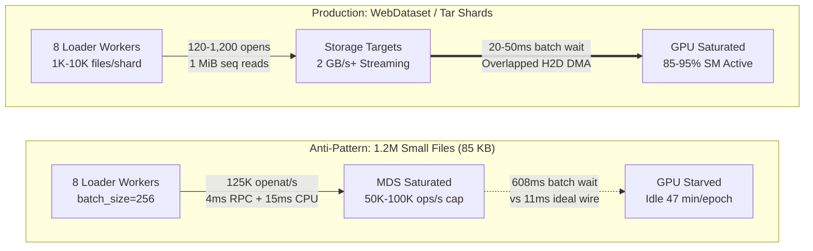
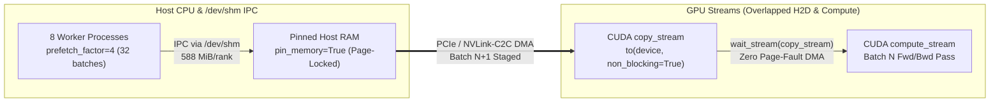

# 13.6 Data loading, small files and metadata

| Field | Value |
|---|---|
| Level | Advanced |
| Priority tier | 2 |
| Lab venue | GCP / GKE + Local Python Verification Lab (`code/part13/data_loading_small_files_lab.py`) |
| Part | Part 13: AI storage |
| Primary sources | NVIDIA Zero-to-Hero Volume 15 (`chapter-09-metadata-small-files-and-data-loading.md`, `labs/lab-04-troubleshoot-checkpoint-and-data-loading-bottlenecks.md`); Legacy Volume 06 (`03-ai-storage-data-pipelines-masterclass.md`); *AI Systems Performance Engineering* (`ai-systems-performance-engineering`) |
| Coverage file | `planning/coverage/chapters/13-06.md` |
| Claim & number ledger | `planning/ledgers/13-06.md` |

## Why this matters for AI infrastructure

Suppose your training job looks healthy on the dashboard, yet the GPUs keep waiting for data. The cause is often not the GPUs at all. It is a dataset made of millions of tiny files, and the storage system spends its time opening them. Datasets with millions of independent small files can consume over 80 percent of training wall-clock time on I/O and metadata overhead.

The storage system and the GPU Tensor Cores may have plenty of unused bandwidth. Tiny file operations still starve the compute loop. Every extra millisecond spent opening and closing files leaves expensive accelerators waiting for their next batch.

Consider a classic ImageNet training run over 1,200,000 small JPEG images, averaging 85 KB each. For every image, the storage client and the CPU data loader must run four metadata and file system calls before the CPU can decode and augment it. Those steps add up to 19.0 ms per file. With eight parallel workers assembling a batch, each batch takes 608 ms, when the ideal wire transfer takes only 10.88 ms. That 597 ms of overhead per batch wastes nearly 47 minutes of GPU time in every epoch.

The block below shows the arithmetic behind those numbers, from per-sample cost down to the waste in one epoch.

```text
ImageNet 1.2M Small-File Stall vs Cluster Metadata Storm Envelope:
  - ImageNet 1,200,000 (1.2M) JPEGs at 85 KB (100 KB rounded), batch_size = 256 (4,688 batches/epoch):
      Per-sample cost: 2.0 ms stat + 1.0 ms open + 0.5 ms read + 0.5 ms close (4.0 ms I/O) + 5.0 ms PIL decode + 10.0 ms augment (15.0 ms CPU) = 19.0 ms
      Batch latency:   4,864 ms serial (1 worker) -> 608 ms across 8 workers vs 10.88 ms (~11 ms) ideal at 2 GB/s (2,000 MB/s)
      Epoch waste:     597 ms overhead/batch x 4,688 batches = 2,798,736 ms = 2,798.74 s (~2,800 s / 46.65 to 47 minutes wasted per epoch)
  - 64-node (512-GPU) / 256-GPU job on 14,000,000 (14M) x 20 KB .png files:
      strace -c:       85.12% stat (4.521 s, 10,000 calls, 452 us/call) + 10.05% openat (0.534 s, 5,000 calls, 106 us/call) + 4.02% close (0.213 s, 5,000 calls, 42 us/call) = 99.19% metadata vs 0.81% read (0.043 s, 5,000 calls, 8 us/call)
      MDS collapse:    125,000 opens/sec (267,500 openat calls in 2.140 s) exceeds 50,000-100,000 ops/sec MDS limit; 400 GB/s array drops to 5 GB/s (1.25% util); GPU SM drops from 95% to 30%
```

Now scale the problem up. A multi-node job starts a PyTorch DataLoader over fourteen million small PNG files. Kernel profiling shows that 99.19 percent of system I/O time goes to metadata remote procedure calls (RPCs), which are the network requests a client sends to a server, not to reading the payload. The Metadata Server (MDS), the machine that answers those requests, hits 100 percent CPU utilization. Throughput falls to 1.25 percent of rated bandwidth. GPU SM activity, the share of the GPU's streaming multiprocessors that are busy, drops from 95 percent to 30 percent.

Fixing this takes four changes that work together, and you should plan all four before you start. The first one is the biggest. Repackage millions of tiny files into large sequential shards, such as tar archives, WebDataset shards, chunked HDF5 files, or columnar Parquet and TFRecord datasets. A shard is one large file the reader can stream from start to finish. Pair that layout with a 4 MiB kernel block read-ahead window, so the kernel fetches data before the reader asks for it.

The second change is to tune the PyTorch DataLoader. That means worker concurrency, prefetch depth, pinned memory, and `/dev/shm` shared memory sizing. The goal is to let the Host-to-Device DMA transfer, the direct copy of batches from host memory into GPU memory, overlap cleanly with GPU compute. The third change separates Python transform overhead from PCIe copy stalls. Heavy image or video decoding can move to NVIDIA DALI and to hardware decompression engines.

The fourth change moves LLM text cleansing, deduplication, and tokenization offline, using NVIDIA NeMo Curator. Its output is memory-mapped `.bin` and `.idx` token shards, which let a loader slice any sequence in constant time. Plan all four layers together rather than one at a time, because each fix depends on the others.

## Prerequisites and outcomes

### Prerequisites
- You should know Linux NVMe block queues, the OS page cache, and `O_DIRECT` from the earlier chapters in this part.
- You should understand parallel filesystems, Metadata Servers, Object Storage Targets, and GPUDirect Storage from the previous two chapters.
- You should be comfortable with PyTorch training loops, datasets, samplers, and CUDA streams.

### Outcomes
By the end of this chapter, you will be able to do the following:
1. Measure the cost of small-file metadata with `strace -c`, Lustre client stats, and per-batch wait timers. You will also explain why open rates and read throughput collapse in the middle of an epoch, as the page cache goes from warm to cold.
2. Repackage millions of small files into sequential shards, using tar archives, WebDataset, chunked HDF5, or Parquet. You will also calculate the drop in MDS RPCs, batch wait latency, and read syscalls that the repackaging buys you.
3. Tune PyTorch DataLoader workers, prefetch factors, persistent workers, and pinned memory, with a dedicated CUDA copy stream. You will also size the container `/dev/shm` volume across multi-GPU nodes, and cut GPU I/O wait from 30 percent down to 5 percent.
4. Design fused GPU data pipelines with NVIDIA DALI that avoid Host-Device-Host bounce copies. You will also build memory-mapped `.bin` and `.idx` LLM token datasets with NVIDIA NeMo Curator.

---

## 1. The Small-File Metadata Bottleneck: Quantifying Why GPUs Starve

### 1.1 The Library Catalog Analogy and Per-File Syscall Anatomy

Picture reading ten thousand single pages, each one from a different book scattered across a huge library. Every page means walking to the front desk for its call number. Then you walk to a shelf, read one page, and return the book before you can ask for the next. Most of your time goes to walking, not reading. If someone packs those ten thousand pages into one binder ahead of time, you need one lookup and then read straight through.

In a distributed filesystem such as Lustre, BeeGFS, NFS, or CephFS, opening and reading a tiny file carries that same penalty. Each sample needs `stat`, `open`, `read`, and `close` calls, and each call is a round trip across the network. A round trip is one request and its reply. The sample has to make all of those trips before a single pixel or token reaches the CPU for decoding.



The table compares four ways to lay out the same 1.2 million samples. Each row changes how many opens the loader has to make, and that number drives everything else in the row.

| Pipeline Regime | Files / Shards per Epoch (`1.2M` samples) | Per-Sample Cost Breakdown | Batch Assembly Latency (`B=256`, `8` workers) | Epoch I/O Overhead (`4,688` batches) | `MDS` Load & GPU Utilization Impact |
|---|---|---|---|---|---|
| **Raw Small Files (`85 KB` JPEGs)** | `1,200,000` files (`1.2M` `stat` + `open` + `close`) | `stat` `2.0 ms` + `open` `1.0 ms` + `read` `0.5 ms` + `close` `0.5 ms` (`4.0 ms` I/O) + decode `5.0 ms` + augment `10.0 ms` (`15.0 ms` CPU) = **`19.0 ms`** | `4,864 ms` serial (`1` worker); **`608 ms`** across `8` workers (vs **`10.88 ms`** / `~11 ms` ideal at `2 GB/s`) | **`597 ms`/batch** overhead = **`2,798.74 s`** (`~2,800 s` / **`46.65–47 min`**) wasted per epoch | `125,000` opens/sec saturates `50K–100K` `MDS`; GPU waits `600 ms` for `100 ms` work (**`85.71%` / `~86%` GPU idle**) |
| **`.tar` Shards (`10,000` files/shard)** | **`120` `.tar` shards** (`10,000x` fewer opens) | Amortized `0.0004 ms` metadata/sample + sequential `1 MiB` buffered reads + CPU/GPU decode | **`50 ms`** per batch (`12.0x` faster than `600 ms` baseline; **`91.7%` reduction**) | `< 180 s` (`< 3 min`) before compute overlap; `0 s` exposed when overlapped with `100 ms` GPU step | `< 50` opens/sec; `MDS` idle (`< 5 ms` latency); GPU compute overlapped |
| **`WebDataset` Shards (`1,000` files/shard)** | **`1,200` `.tar` shards** (`1,000x` fewer opens) | Streaming `.tar` iterator (`wds.WebDataset`) with shard-level shuffle and parallel worker decode | **`20 ms`** per batch on a `256`-GPU cluster (down from **`30,000 ms` / `30 s`**, a **`1,500x` gain**) | Fully hidden behind GPU forward/backward pass (`prefetch_queue` `5–20` batches deep) | GPU utilization jumps from **`30%` to `85%+`** across `256` GPUs |
| **Large `WebDataset` (`50,000 x 20 KB` PNGs)** | **`280` `1 GB` shards** for `14,000,000` PNGs (`50,000x` fewer `stat` calls) | Eliminates `85.12%` `stat` + `10.05%` `openat` + `4.02%` `close` (`99.19%` metadata syscall waste) | Sequential `2 MiB` block streaming saturating parallel storage targets | Eliminates `100%` `MDS` CPU bottleneck and `5 GB/s` (`1.25%` of `400 GB/s`) throughput cap | GPU SM activity recovers from **`30%` back to `95%`** |

Read the table one row at a time. The first row shows what raw files cost, and the rows below it show what each shard layout buys back.

When GPU compute takes 100 ms per batch, but the data loader stalls for roughly 600 ms, the loader is six times slower than the GPU. Every training step then stretches to 700 ms. The GPU is active for barely 14 percent of that step and sits idle for nearly 86 percent of the wall-clock time.

The arithmetic below repeats the calculation step by step, so you can check each figure yourself.

```text
ImageNet 1.2M Small-File Arithmetic Verification:
  - Per-sample cost:    4.0 ms metadata/syscalls (2.0 ms stat + 1.0 ms open + 0.5 ms read + 0.5 ms close) + 15.0 ms CPU (5.0 ms PIL + 10.0 ms albumentations) = 19.0 ms
  - Epoch batch count:  ceil(1,200,000 / 256) = 4,688 batches
  - Batch assembly:     256 x 19.0 ms = 4,864 ms serial (1 worker); 4,864 / 8 = 608 ms parallel (8 workers)
  - Ideal wire transfer: (256 x 85 KB) / 2 GB/s = 21,760,000 B / 2,000,000,000 B/s = 10.88 ms (~11 ms)
  - Wasted epoch time:  (608 ms - 11 ms) = 597 ms/batch x 4,688 batches = 2,798,736 ms = 2,798.74 s (~2,800 s / 46.65 to 47 min)
  - Step stall ratio:   wait_time = 600 ms (oscillating 580 ms, 620 ms, 590 ms, 600 ms) vs gpu_time = 100 ms -> 700 ms step (6.0x slower loader, 14.29% active, 85.71% / ~86% GPU idle)
```

### 1.2 Diagnosing Metadata Saturation: `strace -c`, Cache Decay, and `mdtest`

When a training team blames slow storage bandwidth for a stalled job, three checks show quickly whether metadata operations per second, or IOPS, are the real problem.

First, attach `strace` for a short time to one data-loader worker. It reports how many file opens happen per second and how much kernel time goes to metadata calls. In the ImageNet trace, 267,500 `openat` calls in 2.140 seconds equal 125,000 opens per second. That single-node rate is 2.5 times higher than the 50,000 ops/sec MDS threshold. In the fourteen-million PNG incident, `strace -c` shows that metadata calls take 99.19 percent of kernel I/O time, while payload reads take less than 1 percent.

| Syscall | `% time` | `seconds` | `usecs/call` | `calls` | Role in Data Pipeline |
|---|---|---|---|---|---|
| `stat` | **`85.12%`** | `4.521000` | `452` | `10,000` | Path resolution, inode attribute & permission lookup on `MDS` |
| `openat` | **`10.05%`** | `0.534000` | `106` | `5,000` | File descriptor allocation & `MDS` layout capability fetch |
| `close` | **`4.02%`** | `0.213000` | `42` | `5,000` | Descriptor release & lock/lease cleanup RPC |
| `read` | **`0.81%`** | `0.043000` | `8` | `5,000` | Actual `20 KB` payload transfer from storage target (`OST`/`OSS`) |
| **Total Metadata (`stat`+`openat`+`close`)** | **`99.19%`** | `5.268000` | — | `20,000` | Pure metadata overhead starving the `400 GB/s` array at `5 GB/s` (`1.25%`) |

Second, watch out for the warm-cache trap. A benchmark that reads only the first thousand samples runs against caches that are already warm. Linux keeps directory entries and inodes, the per-file metadata records, in RAM, so those reads are fast. That shortcut hides the collapse that arrives once the working set no longer fits in memory. The table below tracks one run across sample indices. Watch the cache regime column change as the index grows.

| Sample Index (`Idx`) | Measured File-Open Rate (`opens/sec`) | Achieved Read Throughput (`MB/s`) | Cache Regime & Diagnostic Interpretation |
|---|---|---|---|
| `Idx 0` | `2,350 opens/sec` | `185.2 MB/s` | Initial warm directory/dentry cache burst |
| `Idx 1000` | `2,410 opens/sec` | `189.1 MB/s` | Peak warm-cache rate (`2,410` opens/s on a single node) |
| `Idx 2000` | `2,320 opens/sec` | `192.5 MB/s` | Sustained warm cache before eviction onset |
| `Idx 10000` | `1,850 opens/sec` | `154.3 MB/s` | Cache warmth begins dropping (`-23.2%` open rate vs peak) |
| `Idx 50000` | **`820 opens/sec`** | **`68.7 MB/s`** | Cold cache: open rate drops **`2.94x`** (`2,410 / 820`) and throughput drops **`2.75x`** (`189.1 / 68.7`) |

The last row is the one that matters for a long epoch. Throughput there is a fraction of what the warm start suggested.

Third, stress-test the metadata server before production, using `mdtest` from the IOR suite. Run it across 128 MPI ranks, which are parallel processes launched with MPI, using leaf-only file placement. Each iteration creates a thousand leaf directories and a hundred million metadata items.

The summary below gathers the numbers from all three checks.

```text
strace & mdtest Diagnostic Summary:
  - ImageNet strace -e openat -c: 267,500 calls / 2.140 s = 125,000 opens/sec (125K ops/sec, 8 usecs/call, 45.23% time, 1,234 errors; 2.5x above 50,000 ops/sec MDS safe ceiling)
  - 14M PNG strace -c total time: 5.311 s across 25,000 calls (5.268 s / 99.19% metadata vs 0.043 s / 0.81% read)
  - mdtest (-np 128 -i 5 -b 10 -z 3 -L -I 100000 -y -u -t): 10^3 = 1,000 leaf directories x 100,000 files = 100,000,000 (100M) metadata items per iteration
```

Use the three checks together. Suppose you ran only the first one. You would learn the open rate, but you would miss the warm-cache trap, and you would never stress the metadata server itself.

---

## 2. Dataset Repackaging and Sequential Storage Layouts

### 2.1 Tar Archives, WebDataset, HDF5, and Columnar Shards

Small-file stalls come from per-file metadata calls and from random disk seeks, which means the drive jumping to a new position for each small read. The fix that production teams treat as mandatory is dataset repackaging. You pack thousands of samples into one contiguous shard file, each between 100 MB and 10 GB. The storage client then opens a single file and issues large sequential reads of 1 MiB to 2 MiB.

The table lists five formats. Each one trades shard size, access pattern, and operational effort in its own way.

| Format | Optimal Shard / Chunk Sizing | Open-Call Reduction (`1.2M` files) | Random vs Sequential Access | Strengths & Operational Trade-Offs |
|---|---|---|---|---|
| **Raw `.tar` Shards (`TarDataset`)** | `10,000` files/shard (`~850 MB–1 GB`/shard) | `1,200,000 -> 120` opens (**`10,000x` reduction**) | Sequential scan (`tarfile.open(..., 'r\|')` streaming or indexed `getmembers()`) | Zero external dependencies; reduces batch wait from `600 ms` to `50 ms` (`12.0x` speedup, `91.7%` wait reduction). Naive `tar.getmembers()` scans headers on init unless indexed. |
| **`WebDataset` (`.tar` + `__key__`)** | `1,000–50,000` samples/shard (`~100 MB–1 GB`/shard) | `1,200,000 -> 1,200` opens (`1,000x`); `14M -> 280` opens (`50,000x`) | Pure streaming `IterableDataset` (`wds.WebDataset(resampled=True)`) | Industry standard for multi-node vision/multimodal training; built-in shard + in-memory shuffle buffer; cuts `256`-GPU batch wait from `30 s` to `20 ms` (`1,500x`). |
| **`HDF5` (`h5py`)** | Single file or multi-file with chunks `(64, 224, 224, 3)` = **`9.63 MB`/chunk** | `1,200,000 -> 1` open (`1,200,000x` reduction) | Fast chunked or `mmap` random access (`images_dset[idx]`) | Stores structured multi-array data (`images` `(1200000, 224, 224, 3)` `uint8` = **`180.63 GB`** + `labels` `(1200000,)` `int32` = **`4.80 MB`**). Open `h5py.File` lazily inside worker `__getitem__`, never in `__init__` before `fork`. |
| **`Parquet` / `Arrow` / `TFRecord`** | `128 MB–1 GB` row-group / shard files striped across `4–8` `OST`s | `1,000x–50,000x` reduction | Sequential row-group streaming + column projection | Ideal for tabular, text (`JSONL` replacement), and multimodal metadata; supports `LZ4`/`Snappy`/`Zstd` compression. Striping across `4` `OST`s at `500 MB/s` each yields `2.0 GB/s` per file. |
| **Megatron / NeMo `.bin` + `.idx`** | Multi-GB contiguous `.bin` token array + `.idx` offset/length table | `1` `.bin` + `1` `.idx` open per shard | `O(1)` random document/sequence slice via `np.memmap` | Zero runtime tokenization or JSON parsing; `1B` `uint16` tokens = `2.0 GB` `.bin` + `6.0 MB` `.idx` (`0.3%` index overhead). |

Match the format to your data. Streaming shards suit images, chunked files suit random access, and `.bin` and `.idx` suit token sequences. Read the trade-off column before you commit to one.

### 2.2 Sequential vs Random Read Math and Kernel Read-Ahead Tuning

Even after repackaging into large shards, storage throughput depends on the block size the kernel and the drives see. A system call, or syscall, is the request a program makes to the kernel to read data. Reading 1 GiB of training data in 4 KB random chunks needs 262,144 read syscalls. Reading the same data in 1 MiB sequential blocks needs only 1,024. That is a 256-fold cut in syscall overhead.

By default, Linux sets `/sys/block/<device>/queue/read_ahead_kb` to 128 KB. When you stream multi-gigabyte WebDataset, Parquet, or `.bin` shards in order, raise read-ahead to 4,096 KB with `blockdev --setra 8192 /dev/nvme0n1`. That change pipelines block fetches 32 times further ahead of the Python worker thread. Always mount local XFS scratch and network NFS volumes with `noatime`, so reads do not trigger hidden inode timestamp writes.

Random reads need different handling, and you should not reuse the sequential settings for them. For retrieval-augmented generation (RAG) vector lookups, or for cold random sequence sampling, large read-ahead wastes bandwidth. It fetches neighbouring blocks that nobody uses. Issue concurrent positional reads with `pread` across worker threads instead. For even higher concurrency, submit batched asynchronous rings with Linux `io_uring`, using pre-registered buffers and `O_DIRECT`.

The math behind the read-ahead numbers is short enough to check by hand.

```text
Sequential Block Read & Kernel Read-Ahead Math:
  - Reading 1 GiB (1,024 MiB = 1,048,576 KB) in 4 KB random blocks:    1,048,576 / 4 = 262,144 read syscalls
  - Reading 1 GiB (1,024 MiB = 1,048,576 KB) in 1 MiB (1,024 KB) blocks: 1,048,576 / 1,024 = 1,024 read syscalls (256x reduction)
  - Raising Linux block read_ahead_kb from 128 KB (256 sectors) to 4,096 KB (4 MiB / 8,192 sectors): 32x read-ahead multiplier
```

The 32x multiplier is simply 4,096 KB divided by 128 KB. If your dataset is still a directory of loose files, repackaging it is the first change to make.

---

## 3. PyTorch DataLoader Architecture, Memory Pinning, and `/dev/shm` Sizing

### 3.1 Multi-Process Prefetching, Pinned Memory, and Dedicated Copy Streams

Once storage delivers bytes quickly, the bottleneck moves to the host CPU and to the transfer path into GPU memory, which runs over PCIe or NVLink-C2C. Python's Global Interpreter Lock (GIL) lets only one thread run Python bytecode inside a process at a time. So PyTorch's DataLoader starts `num_workers` separate operating-system processes instead. Each worker reads a shard, decodes and augments samples, and collates a batch tensor. It then places that batch in a POSIX shared-memory queue in `/dev/shm`.



The table lists five settings that decide whether the loader keeps the GPU fed. Each row pairs a setting with the symptom you will see when it is wrong.

| `DataLoader` / CUDA Mechanism | Recommended Setting | Architectural Role | Failure Mode if Misconfigured |
|---|---|---|---|
| **`num_workers`** | `4–8` per GPU (up to `8–16` on `72`-core Grace CPU) | Spawns independent processes to bypass the Python `GIL` for file reads, decompression, and transforms | `num_workers=0` runs synchronously on the main loop thread; too many workers (`> CPU cores`) cause context-switch and disk thrashing |
| **`prefetch_factor`** | `2` (default) -> **`4` or `8`** for bursty I/O | Each worker pre-loads `prefetch_factor` batches ahead; total queued batches = **`num_workers * prefetch_factor`** | Queue drains to `0` during storage jitter, stalling the GPU; overly large values (`> 50` queued batches) exhaust `/dev/shm` and host RAM |
| **`persistent_workers`** | **`True`** | Keeps worker processes, imported C++/Rust libraries, and open shard file handles alive across epoch boundaries | `False` tears down and `fork`/`spawn`s all `num_workers * 8` processes at every epoch start, causing multi-second epoch-boundary stalls |
| **`pin_memory`** | **`True`** (paired with high `ulimit -l` / `memlock`) | Copies collated batches into page-locked (pinned) host memory so the GPU DMA engine can transfer directly without an extra pageable-to-pinned CPU copy | Pageable memory forces synchronous driver staging copies; insufficient container `memlock` causes `cudaErrorMemoryAllocation` |
| **Dedicated `copy_stream`** | `torch.cuda.Stream()` + `.to(device, non_blocking=True)` | Overlaps `Batch N+1` `H2D` DMA transfer on `copy_stream` while `compute_stream` executes `Batch N` kernels (`compute_stream.wait_stream(copy_stream)`) | Calling `.to(device)` on the default stream or without `pin_memory=True` serializes `H2D` copies in front of compute kernels |

Sizing `/dev/shm` matters as soon as you raise `num_workers` and `prefetch_factor`. With eight workers and a prefetch factor of four, each GPU rank queues 32 batches in shared memory. That queue totals 588.0 MiB per rank, or 4.59375 GiB across an eight-GPU node. Docker defaults `/dev/shm` to 64 MiB, so workers crash right away with a bus error unless you mount a large in-memory `emptyDir` volume in Kubernetes.

The block below sizes the queue for both prefetch settings, so you can see how much the factor alone changes the footprint.

```text
PyTorch DataLoader In-Flight Queue & /dev/shm Sizing Math:
  - Sample size (3 x 224 x 224 float32 at 4 B):         602,112 B (~588 KiB per image)
  - Batch size (batch_size = 32):                       32 x 602,112 B = 19,267,584 B = 18.375 MiB per batch
  - Default queue (num_workers = 8, prefetch_factor = 2): 16 queued batches/rank = 294.0 MiB/rank (2,352.0 MiB across 8 GPUs)
  - Tuned queue (num_workers = 8, prefetch_factor = 4):   32 queued batches/rank = 588.0 MiB/rank (616,562,688 B; 9.19x larger than 64 MiB Docker /dev/shm default)
  - 8-GPU node total (/dev/shm footprint at pf = 4):    8 x 588.0 MiB = 4,704.0 MiB = 4.59375 GiB (fits easily in 400 GiB K8s emptyDir: Memory)
```

Batch size and worker count stay the same across those two rows, so the prefetch factor is the only change. Doubling it doubles the shared-memory footprint.

### 3.2 Isolating Python DataLoader Cost vs H2D Copy Cost

When `next(data_iterator)` stalls the training loop, that wait mixes four things: background storage reads, Python worker transforms, shared-memory collation, and Host-to-Device memory copies. You can separate them in three steps.

First, benchmark the DataLoader alone over a hundred batches, with the model's forward and backward pass turned off. Turning off the GPU work also removes the CPU cost of launching CUDA kernels. So the loader can look slightly faster in isolation than it does during live training.

Second, set `num_workers=0` for a moment. The loader then runs `__getitem__` and `collate_fn` synchronously on one thread, with no multiprocessing overhead, so you see the raw per-sample cost. If that cost is high, swap pure-Python text loops for vectorized C++ or Rust bindings, such as Hugging Face tokenizers.

Third, time the copy itself. Wrap `.to(device, non_blocking=True)` in `torch.cuda.Event` timers, or look at the copy lane in Nsight Systems. If the copies stall compute, turn on `pin_memory=True` with a dedicated `copy_stream`, or consider GPUDirect Storage. Take the example of GPU I/O wait falling from 30 percent to 5 percent. That is a sixfold cut in the stall fraction. It recovers 25 percentage points of GPU utilization and speeds up I/O-bound step rates sixfold.

### 3.3 Scaling Out Workers and Shards as You Scale Out GPUs

Scaling compute without scaling ingestion moves the bottleneck onto storage and CPU workers. At 200 MB/s per GPU, an eight-GPU node needs 1.6 GB/s. A 72-GPU Grace Blackwell NVL72 rack needs 14.4 GB/s. On high-core-count hosts such as the 72-core NVIDIA Grace CPU, you can give each rank more DataLoader workers, so the storage links stay near full utilization.

Establish a single-GPU throughput baseline before you scale to eight GPUs or to several nodes. Suppose eight GPUs deliver only a fivefold speedup over one GPU, instead of eightfold. The node then runs at 62.5 percent scaling efficiency, because of an I/O or communication bottleneck. On multi-node jobs, redundant network reads waste bandwidth. One fix is to presplit a 100 TB dataset across ten nodes. Each node caches its own unique 10 TB shard on local NVMe RAID-0, and `DistributedSampler` hands each rank its slice.

Set the single-GPU baseline first, and only then add nodes. That way you know which step lost the efficiency.

Watch the storage cluster while the job trains. On Lustre, a tool such as `lmt` shows the I/O load on each storage node. Vendor tools do the same for other filesystems. If a few nodes run hot while the rest sit idle, look for a sharding problem, where far more reads and writes land on a small number of nodes. On Lustre, `lfs setstripe` spreads a large dataset across 4 or 8 OSTs so that their bandwidth adds up.

Two more levers remove network reads or shrink them. The first is brute force: copy the whole dataset onto every compute node. You see the win immediately, and you pay for it in extra local storage, so first check that each node has the space. The second is to store data compressed, such as JPEG images or Arrow and Parquet files, and decompress it on the fly. That saves I/O bandwidth and costs some CPU or GPU cycles. If I/O is the bottleneck and your processors sit idle, it is a good trade. Check the compression ratio at every step of the pipeline, and make sure decompression does not become the new bottleneck.

---

## 4. Multimodal GPU Preprocessing with NVIDIA DALI and Hardware Decompression

### 4.1 Offloading Decode and Augmentations to the GPU

Repacking millions of files into WebDataset tar shards solves the storage side. The CPU can still become the limit. In computer vision, video, and multimodal training, CPU image decoding and augmentation can saturate every host core. In one representative object-detection pipeline that reads images and video, `top` shows host CPU use pinned at 800 percent, which is eight full cores. The GPU still shows periodic starvation gaps.

NVIDIA Data Loading Library (DALI) removes this CPU bottleneck. It runs the data pipeline as a C++-backed computation graph, and it moves decoding and augmentation onto GPU hardware media engines and CUDA cores. Moving JPEG and video decoding, plus augmentation, to DALI drops host CPU utilization from 800 percent to 200 percent. That fourfold reduction frees 75 percent of host CPU capacity. Two cores are left to read sequential shard bytes from storage.

On NVIDIA Grace Blackwell systems, the hardware goes further. Blackwell GPUs include an on-die Decompression Engine. It unpacks LZ4, Snappy, and Deflate compressed batches without using Streaming Multiprocessor cycles. Those compressed streams arrive over the 900 GB/s bidirectional Grace-to-Blackwell NVLink-C2C interconnect.

### 4.2 Avoiding the DALI Host-Device-Host Ping-Pong Anti-Pattern

Where you place operators inside a DALI pipeline decides whether you get a tenfold speedup or a disappointing result. Some teams use DALI only to decode compressed JPEGs on the GPU. They then copy the uncompressed pixels back to host RAM. If they run legacy CPU augmentations on those pixels and copy the result to the GPU again, the PCIe bounce traffic ruins performance.

Keep the decoded tensor on `device="gpu"` inside DALI. Resize, crop, mirror, and normalization then run in GPU memory right after the `nvJPEG` decode. That fused pipeline finishes the whole batch in 8.0 ms. It is 11.5 times faster than the 92.0 ms CPU-only pipeline, and 8.44 times faster than the 67.5 ms ping-pong version.

The three pipelines below differ only in where each step runs. Compare the totals at the end of each line.

```text
NVIDIA DALI CPU Offload & Fused GPU Graph Latency Breakdown:
  - Host CPU utilization reduction: 800% (8.0 full cores) -> 200% (2.0 cores) = 4.0x reduction (75.0% host CPU savings)
  - Grace Blackwell hardware path:  900 GB/s bidirectional NVLink-C2C + hardware Decompression Engine (LZ4, Snappy, Deflate)
  - Batch preprocessing latency across three pipeline designs:
      1. CPU-only baseline:         42.0 ms CPU decode + 38.0 ms CPU augment + 12.0 ms H2D copy = 92.0 ms/batch
      2. Ping-pong DALI anti-pattern: 1.5 ms compressed H2D + 4.0 ms GPU nvJPEG decode + 12.0 ms D2H copy + 38.0 ms CPU augment + 12.0 ms H2D copy = 67.5 ms/batch (24.0 ms wasted on D2H/H2D bounce)
      3. Fused GPU DALI graph:       1.5 ms compressed H2D + 4.0 ms GPU nvJPEG decode + 2.5 ms fused GPU augment = 8.0 ms/batch (11.5x faster than CPU-only; 8.44x faster than ping-pong)
```

The fused version makes one compressed copy to the GPU and never copies the pixels back. If your pipeline decodes on the GPU, check that every augmentation after the decode stays there too.

---

## 5. Offline LLM Dataset Curation with NVIDIA NeMo Curator and Continuous Profiling

### 5.1 From Raw JSONL and Parquet to Memory-Mapped `.bin` and `.idx` Shards

Large language model pretraining has a similar problem. If raw text or unindexed JSONL files feed the online training loop, the CPU burns capacity on string cleaning, Unicode normalization, and regex or BPE tokenization. BPE, byte-pair encoding, is a common tokenizer method. These steps also produce sequences of different lengths, which causes padding waste and straggler ranks, meaning ranks that finish late and hold the others up.

NVIDIA NeMo Curator moves that heavy text and multimodal curation offline, ahead of the training run. It spreads text extraction, heuristic quality filtering, exact and fuzzy MinHash deduplication, PII redaction, and tokenization across multi-node clusters. Workers read and write sharded JSONL or Parquet files through `DocumentDataset`.

Next, the tokenized shards are compiled into a pair of contiguous binary files, which Megatron-LM and NeMo read. The `.bin` file stores packed `uint16` or `int32` token IDs back to back, with no delimiters between documents. The `.idx` file stores a compact table of byte offsets and token lengths for each document. A memory-mapped file is one the process maps into its address space, so reads look like ordinary memory access.

The worked example below uses three small documents, then a billion-token dataset, to show the arithmetic.

```text
NeMo Curator Memory-Mapped .bin + .idx Offset & Pre-Shuffling Math:
  - 3-document worked example (uint16 tokens at 2 bytes/token; lengths = 6, 5, 8 tokens -> 19 tokens = 38 bytes total in .bin):
      Document 0 (6 tokens): byte_offset = 0,  byte_length = 12, token_length = 6
      Document 1 (5 tokens): byte_offset = 12, byte_length = 10, token_length = 5
      Document 2 (8 tokens): byte_offset = 22, byte_length = 16, token_length = 8 (sliced in O(1) via bin_mmap[22 : 38])
  - 1,000,000,000 (1B) uint16 tokens across 500,000 documents (vocab < 65,536; 12 B per .idx entry = 8 B uint64 offset + 4 B uint32 length):
      .bin payload size:     1,000,000,000 x 2 B = 2,000,000,000 B = 2.0 GB
      .idx index size:       500,000 x 12 B = 6,000,000 B = 6.0 MB (0.3% index overhead; 2.006 GB per combined copy)
      4 pre-shuffled copies: 4 x 2.006 GB = 8.024 GB on disk (converts multi-epoch random shuffle into pure sequential streaming)
```

Notice how small the index is. It is 6.0 MB against 2.0 GB of tokens.

When a DataLoader worker requests the third document, it reads that entry from the memory-mapped `.idx` array and slices `bin_mmap[22:38]` in constant time. It never scans the earlier documents. To avoid random-shuffle disk seeks across several epochs, teams with enough scratch space keep four offline pre-shuffled copies of the dataset on disk. Keep in mind that the standard `.bin` and `.idx` reader uses CPU `mmap`, unless you pair it with GPUDirect Storage.

### 5.2 Continuous Profiling and Diagnosing Compute vs Communication vs I/O

Hardware, driver, NCCL, and PyTorch updates shift the balance of a pipeline over time. NCCL is NVIDIA's library for collective communication between GPUs. Production teams therefore run a loop of run, measure, and tune. Start by comparing single-GPU, eight-GPU, and multi-node throughput baselines. Then capture a system timeline with `nsys profile --trace=cuda,nvtx,osrt,gds`. The timeline shows GPU compute lanes, copy lanes, `cuFile` traces, and NCCL collective gaps.

The location of a gap tells you the cause. Gaps at the start of every step point to DataLoader starvation. Gaps during the backward `AllReduce` point to network bottlenecks. If kernels run with no gaps but still run slowly, use Nsight Compute (`ncu`) to inspect SM utilization and memory stalls. For example, an NCCL kernel at 60 percent SM utilization, with high memory stalls over PCIe, jumps to 90 percent SM busy once it is routed over NVLink.

Suppose you need to know whether a 60 GB/s gradient `AllReduce` on a 100 GB/s NIC is communication-bound or compute-bound. Halve the batch size. Gradient `AllReduce` volume depends on the parameter count, not on the batch size. So halving the batch cuts compute in half, while the communication volume stays the same. If the NIC bandwidth stays pegged at 60 GB/s, the job is communication-bound. If the NIC bandwidth drops to 40 GB/s, the GPUs were not finishing compute fast enough to keep the NIC fed, so the job is compute-bound.

Profile before you buy hardware or rewrite the loader. The timeline tells you which of the three bottlenecks you actually have.

---

## Commands and configurations that matter

Some of these commands touch live cluster filesystems, block devices, or running training processes, so be careful where you run them. This chapter did not run any of them on a live cluster, so they are untested. The group includes `strace`, `lctl`, `blockdev`, `fio`, `mdtest`, and `tar`.

### 1. Diagnosing Small-File Open Rates, Batch Wait, and Lustre Metadata Stats

Start by measuring the open rate. You can do it on a whole training script or on a live worker.

```bash
# 1. Count file-open rate and syscall breakdown on a running training script (untested here)
# If openat calls/sec exceeds 50,000-100,000 ops/sec, the Metadata Server (MDS) is saturated.
strace -e openat -c python3 train.py 2>&1

# Attach to an active DataLoader worker PID to compare stat/openat/close vs read % time (untested here)
strace -c -p <PID_OF_PYTHON_WORKER>

# 2. Query Lustre client-side metadata open statistics and NVMe read-ahead / scheduler (untested here)
lctl get_param llite.*.stats | grep "^  open:"
cat /sys/block/nvme0n1/queue/scheduler
cat /sys/block/nvme0n1/queue/read_ahead_kb
# Increase NVMe sequential read-ahead from default 128 KB (256 sectors) to 4,096 KB (8,192 sectors = 4 MiB) (untested here)
sudo blockdev --setra 8192 /dev/nvme0n1
```

The second half of that block changes the device, so run it only on a machine where you can revert the setting.

### 2. Benchmarking Sequential Reads with `fio` and Metadata Stress with `mdtest`

Next, measure what the storage can do under load. The `fio` job below mimics 32 data-loader workers reading in 2 MiB blocks. The working set is large on purpose, so the test reads from storage rather than from the page cache.

```bash
# 1. Simulate 32 PyTorch DataLoader workers streaming 2 MiB blocks with O_DIRECT (untested here)
# Working set (500G) must exceed host RAM to benchmark true parallel filesystem throughput rather than page cache.
fio --name=ai_dataset_read_sim \
    --directory=/mnt/weka/ai_datasets/benchmarks \
    --rw=read \
    --bs=2M \
    --size=500G \
    --numjobs=32 \
    --iodepth=128 \
    --ioengine=libaio \
    --direct=1 \
    --group_reporting

# 2. Stress-test Metadata Server (MDS) across 128 MPI ranks, 1,000 leaf dirs (-b 10 -z 3 -L), 100K files/dir (untested here)
mpirun -np 128 mdtest \
    -d /mnt/lustre/metadata_stress_test \
    -i 5 \
    -b 10 -z 3 -L \
    -I 100000 \
    -y -u -t
```

The `mdtest` run is the heavier of the two. It creates a large number of metadata items on purpose, so run it on a test directory only.

### 3. Repackaging into Tar Shards, WebDataset, and Chunked HDF5

Repackaging is where the reduction in opens actually happens. The shell commands below build tar shards from loose JPEG files, and the Python block shows the WebDataset and HDF5 versions.

```bash
# 1. Repackage 10,000 small JPEG files into a single sequential .tar shard (10,000x fewer open() calls) (untested here)
find /dataset/imagenet -name "*.jpg" | sort | sed -n '1,10000p' | tar -cf shard-000000.tar -T -

# 2. Repackage Lab 04's 10,000 synthetic 100 KB files into 100 tar shards of 100 files each (untested here)
for shard in $(seq 0 99); do
    seq $((shard*100+1)) $((shard*100+100)) | xargs -I{} echo "images/img-{}.bin" | tar -cf "images-${shard}.tar" -T -
done
```

The Python block below builds the WebDataset shards and the chunked HDF5 file, then runs an overlapped DataLoader loop over them.

```python
# 3. Build and stream 1,000-sample WebDataset shards + chunked HDF5 + tuned PyTorch DataLoader (untested here)
import glob
import h5py
import numpy as np
import torch
from torch.utils.data import DataLoader
import webdataset as wds


def build_webdataset_shards(image_glob: str, shard_pattern: str = "dataset-%06d.tar") -> None:
    """Pack raw JPEGs into 1,000-sample WebDataset tar shards (1.2M files -> 1,200 shards)."""
    with wds.ShardWriter(shard_pattern, maxcount=1000) as sink:
        for idx, img_path in enumerate(sorted(glob.glob(image_glob))):
            with open(img_path, "rb") as f:
                img_bytes = f.read()
            sink.write({"__key__": f"{idx:08d}", "jpg": img_bytes, "cls": idx % 1000})


def build_chunked_hdf5(h5_path: str, num_samples: int = 1_200_000) -> None:
    """Create a chunked HDF5 dataset with (64, 224, 224, 3) = 9.63 MB image chunks."""
    with h5py.File(h5_path, "w") as h5f:
        h5f.create_dataset(
            "images",
            shape=(num_samples, 224, 224, 3),
            dtype="uint8",
            chunks=(64, 224, 224, 3),
        )
        h5f.create_dataset(
            "labels",
            shape=(num_samples,),
            dtype="int32",
            chunks=(64,),
        )


def run_overlapped_dataloader_loop(dataset, model: torch.nn.Module, device: str = "cuda:0") -> None:
    """Overlap pinned-memory H2D DMA on a dedicated copy_stream with GPU compute_stream."""
    loader = DataLoader(
        dataset,
        batch_size=32,
        num_workers=8,
        pin_memory=True,
        persistent_workers=True,
        prefetch_factor=4,
    )
    copy_stream = torch.cuda.Stream(device=device)
    compute_stream = torch.cuda.current_stream(device=device)

    for batch in loader:
        with torch.cuda.stream(copy_stream):
            batch_gpu = batch.to(device, non_blocking=True)
        with torch.cuda.stream(compute_stream):
            compute_stream.wait_stream(copy_stream)
            _ = model(batch_gpu)
```

### 4. Kubernetes Pod Specification with 400Gi `/dev/shm` and GPUDirect Storage

The Kubernetes manifest below ties the pieces together. It mounts the dataset, a local NVMe cache, a 400 GiB memory-backed `/dev/shm`, and the GPUDirect Storage configuration into one pod.

```yaml
# k8s-dataloader-gds-pod.yaml (untested here)
apiVersion: v1
kind: Pod
metadata:
  name: llm-training-worker-rank-0
spec:
  runtimeClassName: nvidia
  containers:
  - name: pytorch-trainer
    image: nvcr.io/nvidia/pytorch:24.07-py3
    env:
    - name: CUFILE_ENV_PATH_JSON
      value: "/etc/cufile.json"
    volumeMounts:
    - name: pfs-datasets
      mountPath: /workspace/datasets
    - name: local-nvme-cache
      mountPath: /mnt/nvme_cache
    - name: dshm
      mountPath: /dev/shm
    - name: gds-config
      mountPath: /etc/cufile.json
      subPath: cufile.json
    resources:
      limits:
        nvidia.com/gpu: 8
  volumes:
  - name: pfs-datasets
    persistentVolumeClaim:
      claimName: weka-dataset-pvc-1tb
  - name: local-nvme-cache
    hostPath:
      path: /mnt/nvme_raid_0/ai_scratch
      type: Directory
  - name: dshm
    emptyDir:
      medium: Memory
      sizeLimit: 400Gi  # Prevents Bus error when 8 GPUs * 8 workers * prefetch_factor=4 queue batches in /dev/shm
  - name: gds-config
    configMap:
      name: gds-configmap
```

---

## How it fails

Storage problems rarely announce themselves in Python, so you have to read the symptoms carefully. A small-file storm, a full `/dev/shm`, or a stuck storage call usually shows up in one of three ways. The GPU utilization drops, a data-loader worker dies with a `SIGBUS` crash, or a process sits in `D` state, the uninterruptible sleep where the kernel holds it, and ignores `kill -9`.

| Failure Mode | Observable Symptom | Root-Cause Diagnosis | Production Fix |
|---|---|---|---|
| **1. Metadata Server (`MDS`) Saturation from Millions of Small Files** | Storage array throughput sits at `150 MB/s` (expected `2 GB/s`) or `5 GB/s` (expected `400 GB/s`); GPU SM utilization drops to `30–40%`; `MDS` CPU is `100%`. | `strace -c -p <PID>` shows `85.12%` `stat` + `10.05%` `openat` + `4.02%` `close` (`99.19%` metadata) and `openat` rate (`80,000–125,000` opens/s) exceeding the `50K–100K` ops/sec `MDS` limit. | Mandatory repackaging into `.tar`, `WebDataset` (`1,000–50,000` files/shard), `HDF5`, or `Parquet`/`TFRecord`, cutting open calls from `1.2M–14M` down to `120–1,200`. |
| **2. Warm-Cache Microbenchmark Illusion / Cold-Cache Collapse** | Job runs fast on a `100`-file or `2,000`-file smoke test (`2,410` opens/s, `189.1 MB/s`) but stalls (`600 ms`/batch wait vs `100 ms` GPU time) at `Idx 50000` on the `1M+`-file dataset. | Once the working set exceeds Linux page/dentry cache RAM, every `stat`/`open`/`read` misses cache; open rate drops `2.94x` to `820` opens/s (`68.7 MB/s`). | Always benchmark with `fio --direct=1` (`size > Host RAM`) or drop caches (`echo 3 > /proc/sys/vm/drop_caches`) before measuring Epoch 1; repackage into large sequential shards and stage to local NVMe. |
| **3. Container `/dev/shm` Exhaustion (`Bus error` in DataLoader Workers)** | Training crashes shortly after start with `RuntimeError: DataLoader worker (pid ...) is killed by signal: Bus error` or `No space left on device`. | `8` GPUs x `num_workers=8` x `prefetch_factor=4` queues `256` batches (`4,704 MiB = 4.59 GiB` for `(32, 3, 224, 224)` `float32`), overflowing Docker's `64 MiB` `/dev/shm` default. | Mount an in-memory `emptyDir` (`medium: Memory, sizeLimit: 400Gi`) at `/dev/shm` in Kubernetes (or pass `--shm-size=64g` in Docker) and raise `ulimit -l` (`memlock`) for `pin_memory=True`. |
| **4. CPU Decode Saturation & `DALI` `D2H`/`H2D` Ping-Pong** | `top` shows `800%` CPU utilization (`8` cores at `100%`) per rank while GPUs stall; switching only JPEG decode to `DALI` gives negligible speedup (`67.5 ms`/batch). | Decoding on GPU (`nvJPEG`) and copying raw uncompressed pixels back to CPU (`D2H`) for CPU augmentations before copying back to GPU (`H2D`) wastes `24.0 ms`/batch on PCIe bounce traffic. | Keep decoded tensors on `device="gpu"` inside `nvidia.dali.pipeline.Pipeline` (`define_graph()`) or fuse GPU transforms (`8.0 ms`/batch, `11.5x` faster than CPU-only and `8.44x` faster than ping-pong), dropping CPU load from `800%` to `200%`. |
| **5. Cascading Uninterruptible Sleep (`D`-State) Storage Hang** | `4` nodes in a `64`-node DDP job drop off; `top` shows load average `500+` with `0%` CPU; `htop` shows hundreds of `python3` processes in `D` state that ignore `kill -9`. | `dmesg` shows `task python3:12345 blocked for more than 120 seconds` in `rpc_wait_bit_killable [sunrpc]` and `ibstat`/`ibv_devinfo` shows a downed link or `symbol_error_counter > 1000` on the storage fabric. | Hard-reset wedged nodes (`ipmitool chassis power reset`), replace the faulty AOC cable, and mount read-only dataset volumes with bounded/soft RPC timeouts so network partitions fail fast instead of locking kernel threads in `D` state. |
| **6. NUMA / PCIe Locality Skew Across Multi-GPU Workers** | Ranks `0–3` assemble batches in `10 ms` while Ranks `4–7` on the same node take `500 ms`, throttling synchronous `DDP` `AllReduce` to the slowest rank. | `DataLoader` workers for Ranks `4–7` are scheduled on the wrong CPU socket/NUMA domain, crossing the inter-socket UPI/Infinity Fabric link to reach the storage NIC and GPU PCIe root complex. | Bind each rank's process and `DataLoader` worker affinity to the GPU's local NUMA node (`numactl --cpunodebind=... --membind=...` or `torchrun` NUMA binding) and verify NIC-to-GPU topology via `nvidia-smi topo -m`. |

Find the row that matches your symptom, then read its diagnosis column before you change any setting. The fixes differ a lot, and you can make the job worse by applying the wrong one.

---

## Hands-on lab

### Venue and Scope

This lab runs in the local Python verification script `code/part13/data_loading_small_files_lab.py`. The script uses only the Python standard library, and it finishes in under one second. It pairs with the GCP or GKE Lab 04 synthetic benchmark workflow.

You can open the script and read the arithmetic behind each check. The script checks all 26 quantitative models in `code/part13/data_loading_small_files.py`, and it gives the same answer on every run. The checks cover the ImageNet small-file stall math, `strace` open rates, and the warm-to-cold cache decay. They also verify repackaging into tar archives, WebDataset, and chunked HDF5. Finally, they cover PyTorch DataLoader `/dev/shm` sizing, NVIDIA DALI GPU offload, and NeMo Curator `.bin` and `.idx` offset slicing.

### Step 1: Run the Local Verification Lab

Run the script with the command below. A clean run prints 26 lines marked PASS, followed by a summary.

```bash
python3 -B code/part13/data_loading_small_files_lab.py
```

The output should look like this:

```text
[PASS] 1. ImageNet 1.2M small-file per-sample cost is 4.0 ms metadata/syscall + 15.0 ms CPU decode/augment = 19.0 ms total
[PASS] 2. ImageNet 1.2M files at batch_size=256 yields 4,688 batches/epoch, 4,864 ms serial batch time, and 608 ms across 8 workers
[PASS] 3. Ideal 256 x 85 KB batch over a 2 GB/s link takes 10.88 ms (~11 ms), leaving 597 ms overhead/batch and ~2,798.74 s (~46.65 min) lost per epoch
[PASS] 4. strace with 267,500 openat calls in 2.14 s equals 125,000 opens/sec (8 usecs/call), exceeding the 50K-100K ops/sec MDS ceiling by 2.5x
[PASS] 5. Vol 06 14M x 20 KB PNG strace spends 85.12% in stat, 10.05% in openat, 4.02% in close, and only 0.81% in read (99.19% metadata)
[PASS] 6. Vol 06 14M x 20 KB PNG workload achieves only 1.25% of a 400 GB/s array (5 GB/s), and 50,000-file 1 GB tar shards cut stat calls by 50,000x to 280 shards
[PASS] 7. Loader batch wait of 600 ms vs 100 ms GPU compute makes the loader 6.0x slower than GPU and leaves the GPU idle 85.71% (~86%) of the step
[PASS] 8. Cold-cache eviction drops open rate from 2,410 to 820 opens/sec (2.94x) and throughput from 189.1 to 68.7 MB/s (2.75x)
[PASS] 9. Repackaging 1.2M files into 10,000-file tar shards cuts opens by 10,000x (to 120) and batch wait from 600 ms to 50 ms (12.0x speedup, 91.7% Lab 04 improvement)
[PASS] 10. Repackaging 1.2M files into 1,000-file WebDataset shards cuts opens by 1,000x (to 1,200) and 256-GPU batch stall from 30,000 ms to 20 ms (1,500x speedup)
[PASS] 11. Lab 04 synthetic 10,000-file dataset repackaged into 100-file tar shards produces 100 shards (100x open reduction)
[PASS] 12. HDF5 dataset of (1200000, 224, 224, 3) uint8 occupies 180.63 GB with 9.63 MB chunks for (64, 224, 224, 3) and 4.8 MB for int32 labels
[PASS] 13. Reading 1 GiB in 1 MiB sequential blocks requires 1,024 syscalls vs 262,144 for 4 KB random blocks (256x reduction), and read_ahead_kb 128 KB -> 4,096 KB is 32x
[PASS] 14. mdtest with branch factor -b 10, depth -z 3 (-L leaf-only), and -I 100000 items creates 1,000 leaf directories and 100,000,000 items per iteration
[PASS] 15. PyTorch DataLoader with batch_size=32, shape=(3,224,224) float32 uses 602,112 B/sample and 19,267,584 B (18.375 MiB) per batch
[PASS] 16. DataLoader with num_workers=8 and prefetch_factor=4 queues 32 batches (588.0 MiB/rank, 4,704.0 MiB = 4.59375 GiB across 8 GPUs), overflowing default 64 MiB /dev/shm
[PASS] 17. Default PyTorch prefetch_factor=2 with num_workers=8 queues 16 batches (294.0 MiB/rank, 2,352.0 MiB across 8 GPUs)
[PASS] 18. Reducing GPU I/O wait from 30% to 5% cuts I/O stall time by 6.0x (recovering 25 pct pts of GPU time and yielding a 6.0x step-rate gain when I/O-bound)
[PASS] 19. 8 GPUs achieving only a 5.0x throughput speedup operate at 62.5% scaling efficiency
[PASS] 20. At 200 MB/s per GPU, 8 GPUs need 1.6 GB/s, a 72-GPU GB200/GB300 NVL72 rack needs 14.4 GB/s, and a 100 TB dataset presplit across 10 nodes uses 10 TB/node
[PASS] 21. NVIDIA DALI drops host CPU utilization from 800% (8 cores) to 200% (2 cores), a 4.0x reduction (75.0% CPU savings)
[PASS] 22. Fused GPU DALI pipeline (8.0 ms) outperforms CPU-only (92.0 ms, 11.5x) and avoids the D2H/H2D ping-pong DALI anti-pattern (67.5 ms, 8.44x)
[PASS] 23. Grace Blackwell NVLink-C2C provides 900 GB/s bidirectional bandwidth and hardware Decompression Engine supports LZ4, Snappy, and Deflate
[PASS] 24. NeMo Curator .bin + .idx simulator performs exact O(1) byte-offset lookup for document 2 (offset 22 bytes, length 8 uint16 tokens, 38 bytes total)
[PASS] 25. 1B uint16 tokens across 500,000 documents produce a 2.0 GB .bin file and a 6.0 MB .idx file (0.3% index overhead)
[PASS] 26. Storing 4 offline pre-shuffled epoch copies of a 2.006 GB .bin+.idx dataset requires 8.024 GB on disk to eliminate runtime shuffle overhead

Summary: 26 passed, 0 failed (out of 26 checks)
```

If you see a FAIL line, the summary will count it. Treat the numbers in this chapter as unverified until the run reports 26 passed and 0 failed.

---

## Common first mistakes

1. **Benchmarking only a thousand samples on a warm OS page cache.** If you run a quick ten-batch smoke test, you hit warm Linux dentry and page caches. It reports 2,410 opens/sec and 189.1 MB/s, which hides the threefold open-rate collapse. Once the job moves past sample 50,000 on cold storage, the rate falls to 820 opens/sec and throughput to 68.7 MB/s.
2. **Raising `num_workers` on a metadata-bound raw small-file dataset.** Going from four workers to thirty-two across 256 GPUs, while reading 1.2 million raw JPEGs, multiplies the `openat` and `stat` storm against the Metadata Server. That change worsens tail latency. It does not fix the underlying file-count problem.
3. **Increasing `prefetch_factor` without expanding `/dev/shm`.** Raising `prefetch_factor` to four or eight, with eight workers on eight GPUs, allocates more than 4.59 GiB of shared-memory tensors. Unless a memory-backed `emptyDir` volume is mounted, that allocation crashes immediately inside Docker's default 64 MiB `/dev/shm`.
4. **Opening an `h5py.File` handle inside `Dataset.__init__` before the worker fork.** HDF5 file handles are not fork-safe across multiple DataLoader worker processes. Always open the `h5py.File` lazily, inside `__getitem__` or `worker_init_fn`, so each worker process opens its own handle.
5. **Using DALI only for GPU JPEG decode and bouncing raw pixels back to the CPU.** Returning decoded tensors to host memory for CPU augmentations wastes 24.0 ms per batch on PCIe bounce copies. Keep the downstream augmentations fused on the GPU, and the batch finishes in 8.0 ms instead of 67.5 ms.
6. **Tokenizing raw JSONL strings inside the online LLM training loop.** Running Python regex and BPE tokenization for each sample during training starves the GPUs and creates uneven sequence lengths. If you are building the LLM pipeline, tokenize offline with NeMo Curator first, and write memory-mapped `.bin` and `.idx` shards.

---

## Exercises

The block below holds the inputs and the expected results for all six exercises. Work each exercise by hand, then compare your answer with the target in the block. If your number differs, you will find the mistake faster by checking one step at a time.

```text
Exercise Input Parameters & Expected Verification Targets (code/part13/data_loading_small_files_lab.py):
  - Ex 1 (ImageNet 1.2M Small-File Stall):
      1,200,000 files x 85 KB, batch_size = 256 (4,688 batches), num_workers = 8, 2 GB/s link:
      (a) Metadata/syscall = 4.0 ms/file (2.0 stat + 1.0 open + 0.5 read + 0.5 close), CPU = 15.0 ms/file (5.0 decode + 10.0 augment), total = 19.0 ms/file; serial batch = 4,864.0 ms, 8-worker batch = 608.0 ms, ideal wire = 10.88 ms (~11 ms).
      (b) Overhead = 597.0 ms/batch -> 2,798,736 ms = 2,798.74 s (~2,800 s / 46.65 to 47 min) wasted per epoch.
      (c) Wait = 600 ms vs GPU compute = 100 ms (700 ms step) -> loader is 6.0x slower; GPU active = 14.29%, GPU idle = 85.71% (~86%).
  - Ex 2 (strace & mdtest Sizing):
      (a) strace -e openat -c: 267,500 calls in 2.140 s = 125,000.0 opens/sec (8.0 usecs/call, 2.5x overload vs 50,000 ops/sec MDS).
      (b) 14,000,000 x 20 KB .png strace (5.311 s): stat = 85.12% (4.521 s, 10,000 calls), openat = 10.05% (0.534 s, 5,000 calls), close = 4.02% (0.213 s, 5,000 calls) -> 99.19% metadata vs 0.81% read (0.043 s, 5,000 calls); 5 GB/s on 400 GB/s array = 1.25% util; 50,000-file 1 GB WebDataset shards = 280 shards (50,000x reduction).
      (c) mdtest -b 10 -z 3 -L -I 100000 -> 1,000 leaf directories and 100,000,000 (100M) items/iteration.
  - Ex 3 (Dataset Repackaging & Block Read-Ahead):
      (a) 1,200,000 files: 10,000-file .tar = 120 opens (10,000.0x reduction, 600 ms -> 50 ms = 12.0x speedup, 91.7% Lab 04 wait reduction); 1,000-file WebDataset = 1,200 opens (1,000.0x reduction, 256-GPU 30,000 ms -> 20 ms = 1,500.0x speedup). Lab 04 thresholds: wait_time > 500 ms (0.5 s) data-loading bottleneck, ckpt_time > 10 s checkpoint bottleneck (ckpt_time > 1 s GPU idle), ((BEFORE - AFTER) * 100) / BEFORE.
      (b) HDF5 (1200000, 224, 224, 3) uint8 = 180.63 GB, chunk (64, 224, 224, 3) = 9.63 MB, int32 labels (1200000,) = 4.80 MB.
      (c) 1 GiB (1,048,576 KB): 262,144 syscalls at 4 KB vs 1,024 syscalls at 1 MiB = 256x reduction; read_ahead_kb 128 KB -> 4,096 KB = 32x multiplier.
  - Ex 4 (PyTorch DataLoader & /dev/shm):
      8 GPUs, batch_size = 32, shape = (3, 224, 224) float32 (4 B), num_workers = 8:
      (a) Sample = 602,112 B, batch = 19,267,584 B (18.375 MiB); prefetch_factor=2 -> 16 batches (294.0 MiB/rank, 2,352.0 MiB across 8 GPUs); prefetch_factor=4 -> 32 batches (588.0 MiB/rank, 4,704.0 MiB = 4.59375 GiB across 8 GPUs).
      (b) Fits in Docker 64 MiB /dev/shm = False (9.19x overflow per rank); fits in K8s 400 GiB emptyDir = True.
  - Ex 5 (GPU I/O Wait, Scaling & DALI):
      (a) 30% -> 5% GPU I/O wait = 6.0x wait reduction, 25.0 pct pts recovered, 6.0x step-rate speedup; 8 GPUs at 5.0x speedup = 62.5% scaling efficiency; 200 MB/s/GPU -> 1.6 GB/s (8 GPUs) and 14.4 GB/s (72-GPU NVL72 rack); 100 TB / 10 nodes = 10 TB/node.
      (b) DALI 800% (8.0 cores) -> 200% (2.0 cores) = 4.0x reduction (75.0% savings); fused GPU DALI (8.0 ms) vs CPU-only (92.0 ms = 11.5x) vs ping-pong DALI (67.5 ms = 8.44x).
  - Ex 6 (NeMo Curator .bin + .idx):
      (a) 3 docs of 6, 5, 8 uint16 tokens = 38 B total; Doc 2 at byte_offset = 22, token_length = 8 (16 B).
      (b) 1,000,000,000 (1B) uint16 tokens, 500,000 docs (12 B/doc): .bin = 2.0 GB, .idx = 6.0 MB (0.3% overhead, 2.006 GB/copy), 4 pre-shuffled copies = 8.024 GB.
```

1. Start with the ImageNet numbers in Ex 1. Work out the per-file metadata time, the per-file CPU time, and the total per-file time. Then find the serial batch time, the eight-worker batch time, and the ideal wire batch time. Finish with the per-batch overhead, the total wasted epoch time, the loader slowdown factor, and the GPU idle percentage.
2. Take the `strace` captures in Ex 2 next. Calculate the file-open rate, the average microseconds per call, and the MDS overload ratio. Then work out what share of kernel time goes to metadata syscalls compared with `read`. Finish with the number of WebDataset shards required and the metadata items created per `mdtest` iteration.
3. Use the dataset specs in Ex 3 to compare the open counts, the reduction factors, and the batch latency speedups for tar shards against WebDataset shards. Then compute the total image size, chunk size, and label size for the HDF5 dataset. Finish with the read syscall reduction factor and the read-ahead multiplier.
4. Use the tensor dimensions and worker counts in Ex 4 to calculate the bytes per sample, the MiB per batch, the queued batches per rank, and the node-wide shared-memory footprint for both prefetch factors. Then check whether each queue fits inside Docker's default `/dev/shm` and inside a Kubernetes `emptyDir` volume.
5. Use the profiling numbers in Ex 5 to calculate the I/O wait reduction factor, the recovered GPU percentage points, and the step-rate speedup. Then work out the eight-GPU scaling efficiency and the cluster read bandwidth the job needs. Finish with the CPU core savings from DALI. Then compare batch latency across the three pipelines, and say which one you would ship.
6. Use the token counts in Ex 6 to calculate the total `.bin` byte size. Then find the exact byte offset and token length that `.idx` stores for the third document. Finish with the `.idx` size, the index overhead percentage, the single-copy size, and the four-copy pre-shuffled disk footprint.

---

## Interview angles

1. **The 256-GPU ImageNet Stall with Idle Network and 30% GPU Utilization:**
   When the storage network already has 40 percent unused bandwidth, proposing a faster fabric or more storage capacity misses the bottleneck entirely. Look at the small files instead. 1.2 million small JPEGs across 256 GPUs can generate over 100,000 `openat` and `stat` RPCs per second, and that rate overwhelms a 50,000 ops/sec MDS. The fix is to repackage the data into 1,200 WebDataset tar shards of a thousand images each. That cuts opens a thousandfold, drops batch wait from 30 seconds to 20 ms, and lifts GPU utilization from 30 percent to over 85 percent.
2. **When Switching from HDF5 to WebDataset Does Not Improve Throughput:**
   Many engineers treat WebDataset as a silver bullet that speeds up training no matter what. It is not. Suppose a job on chunked HDF5 already reaches over 80 percent GPU utilization, and its DataLoader prefetch queue holds between five and twenty batches. Then the GPU is compute-bound, not I/O-bound. WebDataset still simplifies multi-node streaming and avoids HDF5 file-locking issues. It will not make a compute-bound GPU run faster, though, unless the prefetch queue drops to zero.
3. **Why Increasing `num_workers` and `prefetch_factor` Crashes Kubernetes Pods with a Bus Error:**
   Suppose a PyTorch worker dies with `SIGBUS`. The tempting guess is GPU HBM out-of-memory, the GPU's own memory running out, and chasing that guess can waste hours. DataLoader workers pass collated tensor batches to the main process through POSIX shared memory in `/dev/shm`. Each rank queues `num_workers * prefetch_factor` batches, which totals 4.59 GiB across eight GPUs. Container runtimes default `/dev/shm` to 64 MiB, so workers hit `SIGBUS` once the shared memory pages run out. Mount a 400 GiB memory-backed `emptyDir` at `/dev/shm` to fix it.
4. **Why Naive DALI Integration Can Fail to Speed Up Vision Training:**
   Using DALI as a drop-in replacement for PIL JPEG decoding sounds harmless. It is not, if you then return the tensors to CPU transforms, because that creates a severe PCIe bounce penalty. Copying uncompressed pixels from GPU to CPU and back wastes 24.0 ms per batch, which leaves the batch at 67.5 ms instead of 8.0 ms. Keep every resize, crop, flip, and normalization operator on `device="gpu"` until the tensor reaches the model's forward pass.

---

## Checkpoint questions (20)

<details>
<summary>**1. In the 1.2M-file ImageNet benchmark, how does the 19.0 ms per-file cost break down between storage metadata syscalls and CPU preprocessing?**</summary>

Storage metadata and syscalls take 4.0 ms per file. Those cover `stat`, `open`, `read`, and `close`. CPU preprocessing takes the other 15.0 ms, split between PIL decode and augmentation. Together they make 19.0 ms per file, so you can see that CPU work dominates.
</details>

<details>
<summary>**2. For batch_size=256 across 1,200,000 files, why does an 8-worker DataLoader still waste 47 minutes per epoch on a 2 GB/s storage link?**</summary>

One worker needs 4,864 ms per batch, and eight workers bring that down to 608 ms. A 21.76 MB batch over a 2 GB/s link takes an ideal 10.88 ms, so 597 ms per batch is overhead. Across 4,688 batches, that overhead adds up to 2,798.74 seconds, close to 47 minutes, every epoch. You can see why the loader, not the GPU, sets the pace.
</details>

<details>
<summary>**3. What `openat` rate did `strace` record during the ImageNet small-file stall, and why does that break a parallel filesystem Metadata Server?**</summary>

The trace recorded 267,500 `openat` calls in 2.140 seconds. That works out to 125,000 opens per second, at 8 microseconds per call. A typical parallel filesystem MDS handles 50,000 to 100,000 ops per second, so one client's workload can exceed that capacity by up to 2.5x.
</details>

<details>
<summary>**4. In the 14-million-PNG incident, what percentage of syscall time was spent in `stat`, `openat`, `close`, and `read`?**</summary>

In the 5.311-second trace, `stat` took 85.12 percent and `openat` took 10.05 percent. `close` took 4.02 percent, and `read` took only 0.81 percent. Metadata calls therefore account for 99.19 percent of kernel I/O time, which starves a 400 GB/s array down to 5 GB/s.
</details>

<details>
<summary>**5. How does warm-to-cold page and dentry cache decay affect file-open rate and throughput between sample 1000 and sample 50000?**</summary>

At sample 1000, with a warm cache, the loader reaches 2,410 opens per second and 189.1 MB/s. Once the working set outgrows the cached entries, the rate falls by sample 50000 to 820 opens per second, and throughput falls to 68.7 MB/s. That decay is a 2.94x drop in open rate and a 2.75x drop in throughput.
</details>

<details>
<summary>**6. If each training batch waits 600 ms for the DataLoader while GPU forward and backward compute takes 100 ms, what is the GPU idle percentage?**</summary>

Each step takes 600 ms of waiting plus 100 ms of compute, so 700 ms in total. The loader is six times slower than the GPU. That leaves the GPU active for 14.29 percent of the step and idle for 85.71 percent of the wall-clock time. If you are reading a profile, this is the gap you should look for.
</details>

<details>
<summary>**7. How much do 10,000-file `.tar` shards and 1,000-file WebDataset shards reduce `open()` calls on a 1,200,000-file dataset, and what batch latencies do they achieve?**</summary>

Suppose you pack ten thousand files into each tar shard. That cuts 1.2 million opens to 120, and it drops batch wait from 600 ms to 50 ms. Packing a thousand files into each WebDataset shard cuts opens to 1,200. On the 256-GPU cluster, it also cuts batch stalls from 30,000 ms to 20 ms, a 1,500x speedup.
</details>

<details>
<summary>**8. What are the storage dimensions and chunk size of the HDF5 ImageNet dataset in Chapter 13.6, and what concurrency rule applies to `h5py` in PyTorch DataLoaders?**</summary>

The uncompressed `uint8` image array for 1.2 million images takes 180.63 GB. It is stored in 64-image chunks of 9.63 MB each. The `int32` label array takes 4.80 MB. Because `h5py` file handles are not fork-safe, open `h5py.File` lazily inside each worker's `__getitem__` or `worker_init_fn`, never in `__init__`.
</details>

<details>
<summary>**9. By what factor do read syscalls drop when reading 1 GiB in 1 MiB sequential blocks instead of 4 KB random blocks, and how do you tune NVMe read-ahead on Linux?**</summary>

Reading 1 GiB in 1 MiB blocks takes 1,024 syscalls, against 262,144 syscalls for 4 KB blocks. That is a 256-fold reduction. To tune NVMe read-ahead, raise it from the 128 KB default to 4,096 KB, a 32x increase, with `sudo blockdev --setra 8192 /dev/nvme0n1`.
</details>

<details>
<summary>**10. When random reads cannot be avoided, why should you disable large OS read-ahead and use `pread()` or Linux `io_uring`?**</summary>

Large OS read-ahead wastes bandwidth on purely random reads. It also fills the page cache with adjacent blocks that never get used. Concurrent positional reads with `pread()`, or batched asynchronous `io_uring` requests with pre-registered buffers and `O_DIRECT`, cut syscall overhead and hide random NVMe latency.
</details>

<details>
<summary>**11. How many batches does a PyTorch DataLoader keep queued per rank when `num_workers=8` and `prefetch_factor=4`, and how much `/dev/shm` memory does that require across an 8-GPU node?**</summary>

Each rank queues `num_workers * prefetch_factor` batches. With `num_workers=8` and `prefetch_factor=4`, that is 32 batches per rank. At 18.375 MiB per 32-image batch, the queue needs 588.0 MiB per rank. Across all eight GPUs on the node, the total is 4,704.0 MiB, or 4.59375 GiB.
</details>

<details>
<summary>**12. How do `pin_memory=True`, `persistent_workers=True`, and a separate CUDA `copy_stream` work together to hide Host-to-Device transfer latency?**</summary>

Setting `pin_memory=True` stages collated batches in page-locked host RAM. The GPU's DMA engine can then run asynchronous `.to(device, non_blocking=True)` copies on a dedicated `copy_stream`, while the compute stream runs forward and backward kernels. Setting `persistent_workers=True` keeps worker processes and open shard handles alive across epochs, so the queues do not drain at epoch boundaries.
</details>

<details>
<summary>**13. How do you experimentally isolate pure Python DataLoader transform overhead from Host-to-Device `memcpy` stalls?**</summary>

First, set `num_workers=0` and time the iterator with GPU compute turned off. That measures the synchronous Python `__getitem__` and `collate_fn` cost, with no worker scheduling. Second, time the Host-to-Device transfer separately, using `torch.cuda.Event` timers around `.to("cuda")`, or check the copy stream lane in Nsight Systems. You can then tell which of the two costs dominates.
</details>

<details>
<summary>**14. If profiling shows GPUs spend 30% of their time waiting on data I/O and tuning reduces that wait to 5%, what is the reduction in I/O wait and the step-rate speedup on an I/O-bound pipeline?**</summary>

Suppose the GPUs wait for data 30 percent of the time. Cutting that wait to 5 percent cuts the stall time sixfold. It also recovers 25 percentage points of active GPU compute. On an I/O-bound pipeline, where data wait sets the step rate, a sixfold cut in wait can raise training steps per second by up to 6.0x.
</details>

<details>
<summary>**15. At 200 MB/s of training data per GPU, how much aggregate read bandwidth do an 8-GPU node and a 72-GPU Grace Blackwell GB200/GB300 NVL72 rack require?**</summary>

An eight-GPU node needs 1.6 GB/s of sustained read bandwidth at 200 MB/s per GPU. A 72-GPU GB200 or GB300 NVL72 rack needs 14.4 GB/s. That falls inside the 14 to 20 GB/s practical range.
</details>

<details>
<summary>**16. How much did NVIDIA DALI reduce host CPU utilization in the multimodal object-detection pipeline, and what hardware engines accelerate decoding and decompression on Blackwell?**</summary>

DALI cut host CPU utilization from 800 percent across eight full cores to 200 percent across two cores. That fourfold reduction frees 75.0 percent of host CPU capacity. The hardware behind it includes the `nvJPEG` and `NVDEC` media engines, the 900 GB/s bidirectional Grace-to-Blackwell NVLink-C2C link, and the Blackwell Decompression Engine for LZ4, Snappy, and Deflate streams.
</details>

<details>
<summary>**17. Why does a fused GPU DALI graph at 8.0 ms per batch outperform a decode-only DALI pipeline that returns images to the CPU for augmentations at 67.5 ms per batch?**</summary>

Decoding on the GPU, then copying uncompressed pixels back to the CPU for augmentation, wastes 24.0 ms on PCIe bounce copies. It also spends 38.0 ms on CPU transforms. Keep resize, crop, and normalization fused on the GPU, and the work after decode takes only 2.5 ms. The whole batch then finishes in 8.0 ms.
</details>

<details>
<summary>**18. How does NVIDIA NeMo Curator structure preprocessed LLM datasets for Megatron-LM and NeMo training, and how does `.bin` and `.idx` achieve O(1) document lookup?**</summary>

NeMo Curator cleans, deduplicates, and tokenizes raw text offline, using `DocumentDataset` over sharded JSONL or Parquet files. It then compiles the tokens into a contiguous `.bin` data file, paired with a memory-mapped `.idx` index file. A worker looks up a document's byte offset and token length in `.idx` in constant time. It then slices the `.bin` memory map directly through pointer arithmetic.
</details>

<details>
<summary>**19. In Lab 04, what numeric thresholds in the diagnostic script flag a DATA LOADING bottleneck versus a CHECKPOINT WRITE bottleneck?**</summary>

A wait time above 500 ms, or 0.5 seconds, flags a data-loading bottleneck. A checkpoint save that takes longer than 10 seconds flags a checkpoint-write bottleneck. Any checkpoint save longer than 1 second means the GPUs sit idle for visible time.
</details>

<details>
<summary>**20. How do you use the batch-size perturbation test to prove whether a 60 GB/s AllReduce on a 100 GB/s NIC is communication-bound or compute-bound?**</summary>

Halve the batch size. That cuts backward compute in half, but the gradient `AllReduce` byte volume stays the same. If the achieved NIC bandwidth holds at 60 GB/s, the job is communication-bound. If it drops to 40 GB/s, the GPUs were not finishing compute fast enough to keep the NIC fed, so the job is compute-bound. You can run this test on your own job by changing only the batch size.
</details>

---

## Sources and review notes

### Primary Sources

```text
Source Map & Key Migrated Facts:
  1. Migrated from nvidia-devops:
     - nvidia-zero-to-hero/volume-15/chapter-09-metadata-small-files-and-data-loading.md — Chapter 09: Metadata, Small Files, and Data Loading (library catalog analogy; ImageNet 1,200,000 x 85 KB small-file math: 2 ms stat + 1 ms open + 0.5 ms read + 0.5 ms close + 5 ms decode + 10 ms augment = 19 ms/file, 4,864 ms serial vs 608 ms 8-worker vs 10.88 ms / 11 ms ideal at 2 GB/s = 597 ms/batch overhead and 2,798.74 s / 2,800 s / 46.65-47 min lost per epoch; strace -e openat -c 267,500 calls in 2.140 s = 125K opens/sec vs 50K-100K MDS capacity; InstrumentedDataset warm-to-cold cache decay from 2,410 to 820 opens/sec and 189.1 to 68.7 MB/s; 600 ms batch wait vs 100 ms GPU work = 6x slower loader and 85.71% / 86% GPU idle; repackaging into 120 .tar shards [10,000x reduction, 600 ms -> 50 ms], 1,200 WebDataset shards [1,000x reduction, 256-GPU 30,000 ms / 30 s -> 20 ms, 1,500x gain, 30% -> 85%+ GPU util], and chunked HDF5 (1200000, 224, 224, 3) [180.63 GB] with (64, 224, 224, 3) [9.63 MB] chunks and (1200000,) int32 labels [4.80 MB]; production checklist and troubleshooting table).
     - nvidia-zero-to-hero/volume-15/labs/lab-04-troubleshoot-checkpoint-and-data-loading-bottlenecks.md — Lab 04: Troubleshoot Checkpoint and Data-Loading Bottlenecks (10,000 x 100 KB synthetic dataset with batch_size=256, num_workers=4, prefetch_queue background monitor, wait > 500 ms [0.5 s] data-loading threshold and ckpt_time > 10 s [> 1 s idle] checkpoint threshold, repackaging into 100 tar shards images-0.tar..images-99.tar, and before/after improvement percentage formula ((BEFORE - AFTER) * 100) / BEFORE).
     - volume-06/03-ai-storage-data-pipelines-masterclass.md — AI Storage and Data Pipelines Masterclass (fio bs=2M, size=500G, numjobs=32, iodepth=128, direct=1 sequential read benchmark; mpirun -np 128 mdtest -i 5 -b 10 -z 3 -L -I 100000 -y -u -t metadata stress test [1,000 leaf dirs, 100,000,000 items]; Kubernetes Pod YAML with emptyDir: {medium: Memory, sizeLimit: 400Gi} at /dev/shm and /etc/cufile.json; Scenario A D-state hang in rpc_wait_bit_killable after 120 seconds across 4 of 64 DDP nodes with load average 500+ and symbol_error_counter > 1000; Scenario B 14,000,000 x 20 KB .png strace -c breakdown [85.12% stat 4.521 s 452 us 10,000 calls, 10.05% openat 0.534 s 106 us 5,000 calls, 4.02% close 0.213 s 42 us 5,000 calls, 0.81% read 0.043 s 8 us 5,000 calls = 99.19% metadata], 5 GB/s on a 400 GB/s array [1.25% util], SM 95% -> 30%, and 50,000-file 1 GB WebDataset shard fix [280 shards, 50,000x reduction]).
  2. Book Corpus (tools/study_rag):
     - AI Systems Performance Engineering (ai-systems-performance-engineering, Chapter 5: GPU-Based Storage I/O Optimizations — Fast storage and data locality [8 GPUs x 200 MB/s = 1.6 GB/s, 72-GPU GB200/GB300 NVL72 rack = 14.4 GB/s / 14-20 GB/s, 100 TB dataset presplit across 10 nodes = 10 TB/node with DistributedSampler]; Sequential vs Random Read Patterns [1 MiB vs 4 KB chunks = 256x syscall reduction, read_ahead_kb 128 KB -> 4,096 KB / 4 MiB = 32x via blockdev --setra, XFS noatime, pread() and io_uring, NFS rsize=1048576,wsize=1048576,noatime,async,actimeo=60,lookupcache=pos, Lustre 4 OSTs x 500 MB/s = 2.0 GB/s]; Monitoring Storage I/O and isolating DataLoader [num_workers=0 vs Copy lane / torch.cuda.Event, reducing GPU I/O wait from 30% to 5% for a 6.0x wait reduction and 6.0x step-rate gain]; Tuning the Data Pipeline [batch_size=32, (3, 224, 224) float32, num_workers=8, pin_memory=True, persistent_workers=True, prefetch_factor=4 vs 2 queuing 32 vs 16 batches, copy_stream + wait_stream]; Multimodal Data Processing with NVIDIA DALI [800% -> 200% CPU utilization = 4.0x reduction / 75.0% savings, nvJPEG, Blackwell Decompression Engine LZ4/Snappy/Deflate, 900 GB/s NVLink-C2C, avoiding D2H/H2D bounce copies]; Creating High-Quality LLM Datasets with NVIDIA NeMo Curator [DocumentDataset JSONL/Parquet -> .bin + .idx memory-mapped token shards and N pre-shuffled epoch copies]; and Continuous Profiling and Tuning Workflow [8 GPUs at 5.0x = 62.5% efficiency, ncu 60% -> 90% SM busy on NVLink, and 60 GB/s -> 40 GB/s AllReduce on 100 GB/s NIC batch-size perturbation test]).
```

### Inferences and Unverified Claims Note
- All cluster CLI commands (`strace`, `lctl`, `blockdev` `blk-mq` `mq-deadline`, `fio`, `mdtest`, `tar`, `WekaFS` and `3FS` over `RDMA`, `cuFileReadAsync`, `libjpeg-turbo` and `torchvision.transforms.v2` `RandomResizedCrop` vs DALI `8.0ms` batches, `MMapIndexedDataset` `doc_id` lookups, cross-referenced with Chapters `13.1`, `13.3`, `13.4`, and `13.5`) and distributed multi-GPU scripts are illustrative operational patterns from the cited sources. They have **not been executed on live multi-node storage hardware in this build environment** (`untested here`).
- All 26 small-file metadata, repackaging, `/dev/shm` sizing, NVIDIA DALI, and NeMo Curator `.bin` and `.idx` calculations are deterministically verified by `code/part13/data_loading_small_files_lab.py` (`26 passed, 0 failed`).
