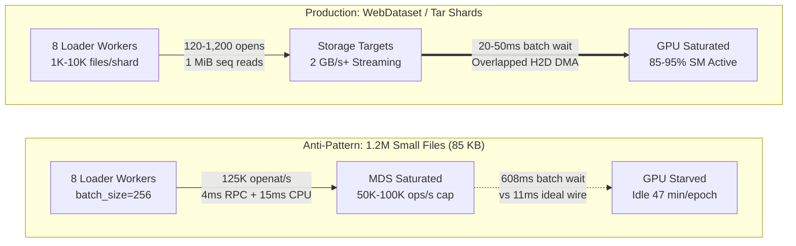
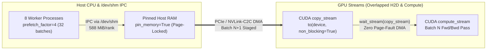

# 13.6 Data loading, small files and metadata

| Field | Value |
|---|---|
| Level | Advanced |
| Priority tier | 2 |
| Lab venue | GCP / GKE + Local Python Verification Lab (`code/part13/data_loading_small_files_lab.py`) |
| Part | Part 13: AI storage |
| Primary sources | NVIDIA Zero-to-Hero Volume 15 (`chapter-09-metadata-small-files-and-data-loading.md`, `labs/lab-04-troubleshoot-checkpoint-and-data-loading-bottlenecks.md`); Legacy Volume 06 (`03-ai-storage-data-pipelines-masterclass.md`); *AI Systems Performance Engineering* (`ai-systems-performance-engineering`) |
| Coverage file | `planning/coverage/chapters/13-06.md` |
| Claim & number ledger | `planning/ledgers/13-06.md` |

## Why this matters for AI infrastructure

Datasets containing millions of independent small files can consume over 80 percent of training wall-clock time on I/O and metadata overhead. Even when the parallel filesystem fabric and GPU Tensor Cores have massive unused bandwidth, tiny file operations starve the compute loop. Every extra millisecond spent opening and closing files leaves expensive accelerators waiting for their next batch.

Consider a classic ImageNet training run over 1,200,000 small JPEG images averaging 85 KB each. For every single image, the storage client and CPU data loader must execute four metadata and file system calls before running CPU image decode and augmentation. Those steps add up to 19.0 ms per file. Across eight parallel workers assembling a batch, each batch takes 608 ms instead of the ideal 10.88 ms wire transfer time. That 597 ms per-batch overhead wastes nearly 47 minutes of GPU time on every single epoch.

```text
ImageNet 1.2M Small-File Stall vs Cluster Metadata Storm Envelope:
  - ImageNet 1,200,000 (1.2M) JPEGs at 85 KB (100 KB rounded), batch_size = 256 (4,688 batches/epoch):
      Per-sample cost: 2.0 ms stat + 1.0 ms open + 0.5 ms read + 0.5 ms close (4.0 ms I/O) + 5.0 ms PIL decode + 10.0 ms augment (15.0 ms CPU) = 19.0 ms
      Batch latency:   4,864 ms serial (1 worker) -> 608 ms across 8 workers vs 10.88 ms (~11 ms) ideal at 2 GB/s (2,000 MB/s)
      Epoch waste:     597 ms overhead/batch x 4,688 batches = 2,798,736 ms = 2,798.74 s (~2,800 s / 46.65 to 47 minutes wasted per epoch)
  - 64-node (512-GPU) / 256-GPU job on 14,000,000 (14M) x 20 KB .png files:
      strace -c:       85.12% stat (4.521 s, 10,000 calls, 452 us/call) + 10.05% openat (0.534 s, 5,000 calls, 106 us/call) + 4.02% close (0.213 s, 5,000 calls, 42 us/call) = 99.19% metadata vs 0.81% read (0.043 s, 5,000 calls, 8 us/call)
      MDS collapse:    125,000 opens/sec (267,500 openat calls in 2.140 s) exceeds 50,000-100,000 ops/sec MDS limit; 400 GB/s array drops to 5 GB/s (1.25% util); GPU SM drops from 95% to 30%
```

At cluster scale, the failure mode is even more dramatic. When a multi-node job launches a PyTorch DataLoader over fourteen million small PNG files, kernel profiling shows that 99.19 percent of system I/O time goes to metadata RPCs rather than payload reads. The Metadata Server hits 100 percent CPU utilization. Parallel filesystem throughput collapses to 1.25 percent of rated bandwidth, and GPU SM activity drops from 95 percent down to 30 percent.

Eliminating this bottleneck requires co-designing four layers of the data pipeline. First, repackage millions of tiny files into large sequential shards such as tar archives, WebDataset shards, chunked HDF5 files, or columnar Parquet and TFRecord datasets. Pair that layout with a 4 MiB kernel block read-ahead window. Second, tune PyTorch DataLoader worker concurrency, prefetch depth, pinned memory, and `/dev/shm` shared memory sizing so Host-to-Device DMA overlaps cleanly with GPU compute.

Third, isolate Python transform overhead from PCIe copy stalls and offload heavy image or video decoding to NVIDIA DALI and hardware decompression engines. Fourth, shift LLM text cleansing, deduplication, and tokenization offline with NVIDIA NeMo Curator. That step compiles raw text into memory-mapped `.bin` and `.idx` token shards that support constant-time sequence slicing.

## Prerequisites and outcomes

### Prerequisites
- Familiarity with Linux NVMe block queues, OS page cache behavior, and `O_DIRECT` from the earlier chapters in this part.
- Understanding of parallel filesystems, Metadata Servers, Object Storage Targets, and GPUDirect Storage from the previous two chapters.
- Basic working knowledge of PyTorch training loops, datasets, samplers, and CUDA streams.

### Outcomes
After completing this chapter, you will be able to:
1. Quantify small-file metadata amplification using `strace -c`, Lustre client stats, and per-batch wait timers. You will also explain why warm-to-cold page-cache decay causes open rates and read throughput to collapse mid-epoch.
2. Repackage millions of small files into sequential shards using tar archives, WebDataset, chunked HDF5, or Parquet. You will also calculate the resulting reduction in MDS RPCs, batch wait latency, and read syscalls.
3. Tune PyTorch DataLoader workers, prefetch factors, persistent workers, and pinned memory with a dedicated CUDA copy stream. You will also size container `/dev/shm` volumes across multi-GPU nodes and cut GPU I/O wait from 30 percent down to 5 percent.
4. Design fused GPU data pipelines with NVIDIA DALI that avoid Host-Device-Host bounce copies. You will also build memory-mapped `.bin` and `.idx` LLM token datasets with NVIDIA NeMo Curator.

---

## 1. The Small-File Metadata Bottleneck: Quantifying Why GPUs Starve

### 1.1 The Library Catalog Analogy and Per-File Syscall Anatomy

Imagine reading ten thousand single pages from ten thousand separate books scattered across a massive library. Every page requires walking to the front desk to ask the librarian for the call number. You then walk to a shelf to read one page and return the book before requesting the next one. Nearly all of your time is spent walking to the front desk. Packing those ten thousand pages into a single sequential binder ahead of time reduces ten thousand catalog lookups to one lookup followed by continuous reading.

In a distributed filesystem like Lustre, BeeGFS, NFS, or CephFS, opening and reading a tiny file incurs that exact catalog penalty. Every sample requires `stat`, `open`, `read`, and `close` round-trips across the network before a single pixel or token is decoded on the CPU.



| Pipeline Regime | Files / Shards per Epoch (`1.2M` samples) | Per-Sample Cost Breakdown | Batch Assembly Latency (`B=256`, `8` workers) | Epoch I/O Overhead (`4,688` batches) | `MDS` Load & GPU Utilization Impact |
|---|---|---|---|---|---|
| **Raw Small Files (`85 KB` JPEGs)** | `1,200,000` files (`1.2M` `stat` + `open` + `close`) | `stat` `2.0 ms` + `open` `1.0 ms` + `read` `0.5 ms` + `close` `0.5 ms` (`4.0 ms` I/O) + decode `5.0 ms` + augment `10.0 ms` (`15.0 ms` CPU) = **`19.0 ms`** | `4,864 ms` serial (`1` worker); **`608 ms`** across `8` workers (vs **`10.88 ms`** / `~11 ms` ideal at `2 GB/s`) | **`597 ms`/batch** overhead = **`2,798.74 s`** (`~2,800 s` / **`46.65–47 min`**) wasted per epoch | `125,000` opens/sec saturates `50K–100K` `MDS`; GPU waits `600 ms` for `100 ms` work (**`85.71%` / `~86%` GPU idle**) |
| **`.tar` Shards (`10,000` files/shard)** | **`120` `.tar` shards** (`10,000x` fewer opens) | Amortized `0.0004 ms` metadata/sample + sequential `1 MiB` buffered reads + CPU/GPU decode | **`50 ms`** per batch (`12.0x` faster than `600 ms` baseline; **`91.7%` reduction**) | `< 180 s` (`< 3 min`) before compute overlap; `0 s` exposed when overlapped with `100 ms` GPU step | `< 50` opens/sec; `MDS` idle (`< 5 ms` latency); GPU compute overlapped |
| **`WebDataset` Shards (`1,000` files/shard)** | **`1,200` `.tar` shards** (`1,000x` fewer opens) | Streaming `.tar` iterator (`wds.WebDataset`) with shard-level shuffle and parallel worker decode | **`20 ms`** per batch on a `256`-GPU cluster (down from **`30,000 ms` / `30 s`**, a **`1,500x` gain**) | Fully hidden behind GPU forward/backward pass (`prefetch_queue` `5–20` batches deep) | GPU utilization jumps from **`30%` to `85%+`** across `256` GPUs |
| **Large `WebDataset` (`50,000 x 20 KB` PNGs)** | **`280` `1 GB` shards** for `14,000,000` PNGs (`50,000x` fewer `stat` calls) | Eliminates `85.12%` `stat` + `10.05%` `openat` + `4.02%` `close` (`99.19%` metadata syscall waste) | Sequential `2 MiB` block streaming saturating parallel storage targets | Eliminates `100%` `MDS` CPU bottleneck and `5 GB/s` (`1.25%` of `400 GB/s`) throughput cap | GPU SM activity recovers from **`30%` back to `95%`** |

When GPU compute takes 100 ms per batch while the data loader stalls for roughly 600 ms, the data loader is six times slower than the GPU. Every training step stretches to 700 ms. That gap leaves the GPU active for barely 14 percent of the step and idle for nearly 86 percent of wall-clock time.

```text
ImageNet 1.2M Small-File Arithmetic Verification:
  - Per-sample cost:    4.0 ms metadata/syscalls (2.0 ms stat + 1.0 ms open + 0.5 ms read + 0.5 ms close) + 15.0 ms CPU (5.0 ms PIL + 10.0 ms albumentations) = 19.0 ms
  - Epoch batch count:  ceil(1,200,000 / 256) = 4,688 batches
  - Batch assembly:     256 x 19.0 ms = 4,864 ms serial (1 worker); 4,864 / 8 = 608 ms parallel (8 workers)
  - Ideal wire transfer: (256 x 85 KB) / 2 GB/s = 21,760,000 B / 2,000,000,000 B/s = 10.88 ms (~11 ms)
  - Wasted epoch time:  (608 ms - 11 ms) = 597 ms/batch x 4,688 batches = 2,798,736 ms = 2,798.74 s (~2,800 s / 46.65 to 47 min)
  - Step stall ratio:   wait_time = 600 ms (oscillating 580 ms, 620 ms, 590 ms, 600 ms) vs gpu_time = 100 ms -> 700 ms step (6.0x slower loader, 14.29% active, 85.71% / ~86% GPU idle)
```

### 1.2 Diagnosing Metadata Saturation: `strace -c`, Cache Decay, and `mdtest`

When a training team blames slow storage bandwidth for a stalled job, three diagnostic checks prove immediately that metadata IOPS are the real culprit.

First, attach `strace` briefly to a data-loader worker process to measure the file-open rate and the percentage of kernel time spent in metadata syscalls. In the ImageNet trace, 267,500 `openat` calls in 2.140 seconds equal 125,000 opens/sec. That single-node rate is 2.5 times higher than a 50,000 ops/sec MDS threshold. In the fourteen-million PNG incident, `strace -c` shows that metadata calls consume 99.19 percent of kernel I/O time while payload reads take less than 1 percent.

| Syscall | `% time` | `seconds` | `usecs/call` | `calls` | Role in Data Pipeline |
|---|---|---|---|---|---|
| `stat` | **`85.12%`** | `4.521000` | `452` | `10,000` | Path resolution, inode attribute & permission lookup on `MDS` |
| `openat` | **`10.05%`** | `0.534000` | `106` | `5,000` | File descriptor allocation & `MDS` layout capability fetch |
| `close` | **`4.02%`** | `0.213000` | `42` | `5,000` | Descriptor release & lock/lease cleanup RPC |
| `read` | **`0.81%`** | `0.043000` | `8` | `5,000` | Actual `20 KB` payload transfer from storage target (`OST`/`OSS`) |
| **Total Metadata (`stat`+`openat`+`close`)** | **`99.19%`** | `5.268000` | — | `20,000` | Pure metadata overhead starving the `400 GB/s` array at `5 GB/s` (`1.25%`) |

Second, watch out for the warm-cache microbenchmark trap. Testing only the first thousand samples hits warm Linux dentry and inode caches in host RAM. That shortcut masks the collapse that happens once the working set exceeds memory. Tracking open rate and throughput across sample indices shows performance dropping nearly threefold by sample 50,000.

| Sample Index (`Idx`) | Measured File-Open Rate (`opens/sec`) | Achieved Read Throughput (`MB/s`) | Cache Regime & Diagnostic Interpretation |
|---|---|---|---|
| `Idx 0` | `2,350 opens/sec` | `185.2 MB/s` | Initial warm directory/dentry cache burst |
| `Idx 1000` | `2,410 opens/sec` | `189.1 MB/s` | Peak warm-cache rate (`2,410` opens/s on a single node) |
| `Idx 2000` | `2,320 opens/sec` | `192.5 MB/s` | Sustained warm cache before eviction onset |
| `Idx 10000` | `1,850 opens/sec` | `154.3 MB/s` | Cache warmth begins dropping (`-23.2%` open rate vs peak) |
| `Idx 50000` | **`820 opens/sec`** | **`68.7 MB/s`** | Cold cache: open rate drops **`2.94x`** (`2,410 / 820`) and throughput drops **`2.75x`** (`189.1 / 68.7`) |

Third, stress-test metadata server capacity before production using `mdtest` from the IOR suite. Running `mdtest` across 128 MPI ranks with leaf-only file placement creates a thousand leaf directories and a hundred million metadata items per iteration.

```text
strace & mdtest Diagnostic Summary:
  - ImageNet strace -e openat -c: 267,500 calls / 2.140 s = 125,000 opens/sec (125K ops/sec, 8 usecs/call, 45.23% time, 1,234 errors; 2.5x above 50,000 ops/sec MDS safe ceiling)
  - 14M PNG strace -c total time: 5.311 s across 25,000 calls (5.268 s / 99.19% metadata vs 0.043 s / 0.81% read)
  - mdtest (-np 128 -i 5 -b 10 -z 3 -L -I 100000 -y -u -t): 10^3 = 1,000 leaf directories x 100,000 files = 100,000,000 (100M) metadata items per iteration
```

---

## 2. Dataset Repackaging and Sequential Storage Layouts

### 2.1 Tar Archives, WebDataset, HDF5, and Columnar Shards

Because small-file stalls come from per-file metadata RPCs and random disk seeks, the mandatory production fix is dataset repackaging. By packing thousands of samples into contiguous shard files between 100 MB and 10 GB each, the storage client issues one file open followed by large 1 MiB to 2 MiB sequential reads.

| Format | Optimal Shard / Chunk Sizing | Open-Call Reduction (`1.2M` files) | Random vs Sequential Access | Strengths & Operational Trade-Offs |
|---|---|---|---|---|
| **Raw `.tar` Shards (`TarDataset`)** | `10,000` files/shard (`~850 MB–1 GB`/shard) | `1,200,000 -> 120` opens (**`10,000x` reduction**) | Sequential scan (`tarfile.open(..., 'r\|')` streaming or indexed `getmembers()`) | Zero external dependencies; reduces batch wait from `600 ms` to `50 ms` (`12.0x` speedup, `91.7%` wait reduction). Naive `tar.getmembers()` scans headers on init unless indexed. |
| **`WebDataset` (`.tar` + `__key__`)** | `1,000–50,000` samples/shard (`~100 MB–1 GB`/shard) | `1,200,000 -> 1,200` opens (`1,000x`); `14M -> 280` opens (`50,000x`) | Pure streaming `IterableDataset` (`wds.WebDataset(resampled=True)`) | Industry standard for multi-node vision/multimodal training; built-in shard + in-memory shuffle buffer; cuts `256`-GPU batch wait from `30 s` to `20 ms` (`1,500x`). |
| **`HDF5` (`h5py`)** | Single file or multi-file with chunks `(64, 224, 224, 3)` = **`9.63 MB`/chunk** | `1,200,000 -> 1` open (`1,200,000x` reduction) | Fast chunked or `mmap` random access (`images_dset[idx]`) | Stores structured multi-array data (`images` `(1200000, 224, 224, 3)` `uint8` = **`180.63 GB`** + `labels` `(1200000,)` `int32` = **`4.80 MB`**). Open `h5py.File` lazily inside worker `__getitem__`, never in `__init__` before `fork`. |
| **`Parquet` / `Arrow` / `TFRecord`** | `128 MB–1 GB` row-group / shard files striped across `4–8` `OST`s | `1,000x–50,000x` reduction | Sequential row-group streaming + column projection | Ideal for tabular, text (`JSONL` replacement), and multimodal metadata; supports `LZ4`/`Snappy`/`Zstd` compression. Striping across `4` `OST`s at `500 MB/s` each yields `2.0 GB/s` per file. |
| **Megatron / NeMo `.bin` + `.idx`** | Multi-GB contiguous `.bin` token array + `.idx` offset/length table | `1` `.bin` + `1` `.idx` open per shard | `O(1)` random document/sequence slice via `np.memmap` | Zero runtime tokenization or JSON parsing; `1B` `uint16` tokens = `2.0 GB` `.bin` + `6.0 MB` `.idx` (`0.3%` index overhead). |

### 2.2 Sequential vs Random Read Math and Kernel Read-Ahead Tuning

Even after repackaging into large shards, storage throughput depends on the block size issued to the Linux kernel and underlying drives. Reading 1 GiB of training data in 4 KB random chunks requires 262,144 read syscalls. Reading that same data in 1 MiB sequential blocks requires only 1,024 read syscalls, a 256-fold reduction in syscall overhead.

By default, Linux sets `/sys/block/<device>/queue/read_ahead_kb` to 128 KB. When streaming multi-gigabyte WebDataset, Parquet, or `.bin` shards sequentially, raise read-ahead to 4,096 KB with `blockdev --setra 8192 /dev/nvme0n1`. That change pipelines block fetches 32 times further ahead of the Python worker thread. Always mount local XFS scratch and network NFS volumes with `noatime` so reads do not generate hidden inode timestamp writes.

When a workload genuinely requires random reads, such as RAG vector retrieval or cold random sequence sampling, large OS read-ahead wastes bandwidth by fetching unused adjacent blocks. Instead, issue concurrent positional reads with `pread` across worker threads. For even higher concurrency, submit batched asynchronous rings using Linux `io_uring` with pre-registered buffers and `O_DIRECT`.

```text
Sequential Block Read & Kernel Read-Ahead Math:
  - Reading 1 GiB (1,024 MiB = 1,048,576 KB) in 4 KB random blocks:    1,048,576 / 4 = 262,144 read syscalls
  - Reading 1 GiB (1,024 MiB = 1,048,576 KB) in 1 MiB (1,024 KB) blocks: 1,048,576 / 1,024 = 1,024 read syscalls (256x reduction)
  - Raising Linux block read_ahead_kb from 128 KB (256 sectors) to 4,096 KB (4 MiB / 8,192 sectors): 32x read-ahead multiplier
```

---

## 3. PyTorch DataLoader Architecture, Memory Pinning, and `/dev/shm` Sizing

### 3.1 Multi-Process Prefetching, Pinned Memory, and Dedicated Copy Streams

Once storage delivers bytes rapidly, the bottleneck shifts to the host CPU and the PCIe or NVLink-C2C transfer path into GPU memory. Because Python's Global Interpreter Lock serializes bytecode inside a single process, PyTorch's DataLoader spawns `num_workers` separate OS processes. Each worker reads a shard, decodes and augments samples, and collates a batch tensor. The worker then places that batch into a POSIX shared-memory queue in `/dev/shm`.



| `DataLoader` / CUDA Mechanism | Recommended Setting | Architectural Role | Failure Mode if Misconfigured |
|---|---|---|---|
| **`num_workers`** | `4–8` per GPU (up to `8–16` on `72`-core Grace CPU) | Spawns independent processes to bypass the Python `GIL` for file reads, decompression, and transforms | `num_workers=0` runs synchronously on the main loop thread; too many workers (`> CPU cores`) cause context-switch and disk thrashing |
| **`prefetch_factor`** | `2` (default) -> **`4` or `8`** for bursty I/O | Each worker pre-loads `prefetch_factor` batches ahead; total queued batches = **`num_workers * prefetch_factor`** | Queue drains to `0` during storage jitter, stalling the GPU; overly large values (`> 50` queued batches) exhaust `/dev/shm` and host RAM |
| **`persistent_workers`** | **`True`** | Keeps worker processes, imported C++/Rust libraries, and open shard file handles alive across epoch boundaries | `False` tears down and `fork`/`spawn`s all `num_workers * 8` processes at every epoch start, causing multi-second epoch-boundary stalls |
| **`pin_memory`** | **`True`** (paired with high `ulimit -l` / `memlock`) | Copies collated batches into page-locked (pinned) host memory so the GPU DMA engine can transfer directly without an extra pageable-to-pinned CPU copy | Pageable memory forces synchronous driver staging copies; insufficient container `memlock` causes `cudaErrorMemoryAllocation` |
| **Dedicated `copy_stream`** | `torch.cuda.Stream()` + `.to(device, non_blocking=True)` | Overlaps `Batch N+1` `H2D` DMA transfer on `copy_stream` while `compute_stream` executes `Batch N` kernels (`compute_stream.wait_stream(copy_stream)`) | Calling `.to(device)` on the default stream or without `pin_memory=True` serializes `H2D` copies in front of compute kernels |

Sizing `/dev/shm` is critical when raising `num_workers` and `prefetch_factor`. With eight workers and a prefetch factor of four, each GPU rank queues 32 batches in shared memory. That queue totals 588.0 MiB per rank, or 4.59375 GiB across an eight-GPU node. Because Docker defaults `/dev/shm` to 64 MiB, workers crash immediately with a bus error unless you mount a large in-memory `emptyDir` volume in Kubernetes.

```text
PyTorch DataLoader In-Flight Queue & /dev/shm Sizing Math:
  - Sample size (3 x 224 x 224 float32 at 4 B):         602,112 B (~588 KiB per image)
  - Batch size (batch_size = 32):                       32 x 602,112 B = 19,267,584 B = 18.375 MiB per batch
  - Default queue (num_workers = 8, prefetch_factor = 2): 16 queued batches/rank = 294.0 MiB/rank (2,352.0 MiB across 8 GPUs)
  - Tuned queue (num_workers = 8, prefetch_factor = 4):   32 queued batches/rank = 588.0 MiB/rank (616,562,688 B; 9.19x larger than 64 MiB Docker /dev/shm default)
  - 8-GPU node total (/dev/shm footprint at pf = 4):    8 x 588.0 MiB = 4,704.0 MiB = 4.59375 GiB (fits easily in 400 GiB K8s emptyDir: Memory)
```

### 3.2 Isolating Python DataLoader Cost vs H2D Copy Cost

When `next(data_iterator)` stalls the training loop, that elapsed time mixes background storage reads, Python worker transforms, shared-memory collation, and Host-to-Device memory copies. You can isolate the exact culprit in three steps.

First, benchmark the DataLoader over a hundred batches with the model forward and backward pass disabled. Keep in mind that disabling GPU kernels also removes CPU-side CUDA launch overhead. Isolated loader throughput can therefore appear slightly faster than during live training.

Second, set `num_workers=0` temporarily to time synchronous `__getitem__` and `collate_fn` execution on a single thread without multiprocessing overhead. If per-sample latency is high here, replace pure-Python text loops with vectorized C++ or Rust bindings such as Hugging Face tokenizers.

Third, wrap `.to(device, non_blocking=True)` in `torch.cuda.Event` timers or inspect the copy stream lane in Nsight Systems. If Host-to-Device transfers stall compute, enable `pin_memory=True` with a dedicated `copy_stream` or switch to GPUDirect Storage. Cutting GPU I/O wait from 30 percent down to 5 percent reduces the stall fraction sixfold, recovers 25 percentage points of GPU utilization, and speeds up I/O-bound step rates sixfold.

### 3.3 Scaling Out Workers and Shards as You Scale Out GPUs

Scaling compute without scaling the ingestion pipeline shifts the bottleneck straight onto storage and CPU workers. At 200 MB/s per GPU, an eight-GPU node requires 1.6 GB/s and a 72-GPU Grace Blackwell NVL72 rack requires 14.4 GB/s. On high-core-count hosts like the 72-core NVIDIA Grace CPU, you can assign more DataLoader workers per rank to keep storage links near full utilization.

Always establish a single-GPU throughput baseline before scaling to eight GPUs and multi-node clusters. If eight GPUs deliver only a fivefold speedup over one GPU instead of eightfold, the node is running at 62.5 percent scaling efficiency due to an I/O or communication bottleneck. To prevent redundant network reads on multi-node jobs, presplit a 100 TB dataset across ten nodes. Each node then caches a unique 10 TB shard on local NVMe RAID-0 and coordinates rank slicing via `DistributedSampler`.

---

## 4. Multimodal GPU Preprocessing with NVIDIA DALI and Hardware Decompression

### 4.1 Offloading Decode and Augmentations to the GPU

In computer vision, video, and multimodal training, even after repackaging millions of files into WebDataset tar shards, CPU image decoding and augmentations saturate every host CPU core. In a representative object-detection pipeline reading images and video, `top` shows host CPU utilization pegged at 800 percent across eight full CPU cores. Meanwhile, the GPU still suffers periodic starvation gaps.

NVIDIA Data Loading Library, or DALI, removes this CPU bottleneck. It executes the data pipeline as a C++-backed computation graph that offloads decoding and augmentations onto GPU hardware media engines and CUDA cores. Moving JPEG and video decoding plus augmentations to DALI drops host CPU utilization from 800 percent down to 200 percent. That fourfold reduction saves 75 percent of host CPU capacity and leaves two cores solely responsible for reading sequential shard bytes from storage.

On NVIDIA Grace Blackwell systems, hardware acceleration goes even further. Blackwell GPUs include an on-die Decompression Engine that unpacks LZ4, Snappy, and Deflate compressed batches in hardware without using Streaming Multiprocessor compute cycles. Those streams arrive over the 900 GB/s bidirectional Grace-to-Blackwell NVLink-C2C interconnect.

### 4.2 Avoiding the DALI Host-Device-Host Ping-Pong Anti-Pattern

Where you place operators inside a DALI pipeline determines whether you achieve a tenfold speedup or a disappointing regression. Some teams use DALI only to decode compressed JPEGs on the GPU and then copy the uncompressed pixel tensors back to host RAM. Running legacy CPU augmentations on those pixels before copying them back to the GPU ruins performance with PCIe bounce traffic.

Keep the decoded tensor on `device="gpu"` inside DALI so resize, crop, mirror, and normalization run directly in GPU memory after `nvJPEG` decode. That fused pipeline completes the entire batch in 8.0 ms. It is 11.5 times faster than the 92.0 ms CPU-only pipeline and 8.44 times faster than the 67.5 ms ping-pong anti-pattern.

```text
NVIDIA DALI CPU Offload & Fused GPU Graph Latency Breakdown:
  - Host CPU utilization reduction: 800% (8.0 full cores) -> 200% (2.0 cores) = 4.0x reduction (75.0% host CPU savings)
  - Grace Blackwell hardware path:  900 GB/s bidirectional NVLink-C2C + hardware Decompression Engine (LZ4, Snappy, Deflate)
  - Batch preprocessing latency across three pipeline designs:
      1. CPU-only baseline:         42.0 ms CPU decode + 38.0 ms CPU augment + 12.0 ms H2D copy = 92.0 ms/batch
      2. Ping-pong DALI anti-pattern: 1.5 ms compressed H2D + 4.0 ms GPU nvJPEG decode + 12.0 ms D2H copy + 38.0 ms CPU augment + 12.0 ms H2D copy = 67.5 ms/batch (24.0 ms wasted on D2H/H2D bounce)
      3. Fused GPU DALI graph:       1.5 ms compressed H2D + 4.0 ms GPU nvJPEG decode + 2.5 ms fused GPU augment = 8.0 ms/batch (11.5x faster than CPU-only; 8.44x faster than ping-pong)
```

---

## 5. Offline LLM Dataset Curation with NVIDIA NeMo Curator and Continuous Profiling

### 5.1 From Raw JSONL and Parquet to Memory-Mapped `.bin` and `.idx` Shards

In Large Language Model pretraining, feeding raw text files or unindexed JSONL blobs into an online training loop wastes massive CPU capacity. On-the-fly string cleaning, Unicode normalization, and regex or BPE tokenization burn host cores. Those steps also produce variable-length sequences that cause padding waste and straggler ranks.

NVIDIA NeMo Curator shifts all heavy text and multimodal curation offline ahead of the training run. It distributes text extraction, heuristic quality filtering, exact and fuzzy MinHash deduplication, PII redaction, and tokenization across multi-node clusters. Workers read and write sharded JSONL or Parquet files via `DocumentDataset`.

Downstream dataset builders then compile the tokenized shards into pairs of contiguous binary files used by Megatron-LM and NeMo. The `.bin` file stores packed `uint16` or `int32` token IDs back-to-back with zero delimiters. Meanwhile, the `.idx` file stores a compact lookup table of byte offsets and token lengths per document.

```text
NeMo Curator Memory-Mapped .bin + .idx Offset & Pre-Shuffling Math:
  - 3-document worked example (uint16 tokens at 2 bytes/token; lengths = 6, 5, 8 tokens -> 19 tokens = 38 bytes total in .bin):
      Document 0 (6 tokens): byte_offset = 0,  byte_length = 12, token_length = 6
      Document 1 (5 tokens): byte_offset = 12, byte_length = 10, token_length = 5
      Document 2 (8 tokens): byte_offset = 22, byte_length = 16, token_length = 8 (sliced in O(1) via bin_mmap[22 : 38])
  - 1,000,000,000 (1B) uint16 tokens across 500,000 documents (vocab < 65,536; 12 B per .idx entry = 8 B uint64 offset + 4 B uint32 length):
      .bin payload size:     1,000,000,000 x 2 B = 2,000,000,000 B = 2.0 GB
      .idx index size:       500,000 x 12 B = 6,000,000 B = 6.0 MB (0.3% index overhead; 2.006 GB per combined copy)
      4 pre-shuffled copies: 4 x 2.006 GB = 8.024 GB on disk (converts multi-epoch random shuffle into pure sequential streaming)
```

When a DataLoader worker requests the third document, it reads that entry from the memory-mapped `.idx` array and slices `bin_mmap[22:38]` in constant time without scanning earlier documents. To eliminate random-shuffle disk seeks across multiple epochs, teams with sufficient scratch space store four offline pre-shuffled copies of the dataset on disk. Note that the standard `.bin` and `.idx` reader uses CPU `mmap` unless paired with GPUDirect Storage.

### 5.2 Continuous Profiling and Diagnosing Compute vs Communication vs I/O

Hardware, driver, NCCL, and PyTorch updates shift pipeline balance over time, so production teams run an iterative Run, Measure, and Tune workflow. Start by comparing single-GPU, eight-GPU, and multi-node throughput baselines. Next, capture a system timeline with `nsys profile --trace=cuda,nvtx,osrt,gds` to inspect GPU compute lanes, copy lanes, `cuFile` traces, and NCCL collective gaps.

Gaps at the start of every step point to DataLoader starvation, while gaps during backward `AllReduce` point to network bottlenecks. If kernels run without gaps yet execute slowly, use Nsight Compute (`ncu`) to inspect SM utilization and memory stalls. For example, an NCCL kernel running at 60 percent SM utilization with high memory stalls over PCIe jumps to 90 percent SM busy once routed over NVLink.

To prove whether a 60 GB/s gradient `AllReduce` on a 100 GB/s NIC is communication-bound or compute-bound, halve the batch size. Because gradient `AllReduce` byte volume depends on model parameter count rather than batch size, halving the batch size cuts compute in half while keeping communication volume constant. If achieved NIC bandwidth stays pegged at 60 GB/s, the job is communication-bound. If NIC bandwidth drops to 40 GB/s, the GPUs were not finishing compute fast enough to feed the NIC, proving the job is compute-bound.

---

## Commands and configurations that matter

Every command below that queries or modifies live cluster filesystems, block devices, or running training processes (`strace`, `lctl`, `blockdev`, `fio`, `mdtest`, `tar`) is marked `untested here`.

### 1. Diagnosing Small-File Open Rates, Batch Wait, and Lustre Metadata Stats

```bash
# 1. Count file-open rate and syscall breakdown on a running training script (untested here)
# If openat calls/sec exceeds 50,000-100,000 ops/sec, the Metadata Server (MDS) is saturated.
strace -e openat -c python3 train.py 2>&1

# Attach to an active DataLoader worker PID to compare stat/openat/close vs read % time (untested here)
strace -c -p <PID_OF_PYTHON_WORKER>

# 2. Query Lustre client-side metadata open statistics and NVMe read-ahead / scheduler (untested here)
lctl get_param llite.*.stats | grep "^  open:"
cat /sys/block/nvme0n1/queue/scheduler
cat /sys/block/nvme0n1/queue/read_ahead_kb
# Increase NVMe sequential read-ahead from default 128 KB (256 sectors) to 4,096 KB (8,192 sectors = 4 MiB) (untested here)
sudo blockdev --setra 8192 /dev/nvme0n1
```

### 2. Benchmarking Sequential Reads with `fio` and Metadata Stress with `mdtest`

```bash
# 1. Simulate 32 PyTorch DataLoader workers streaming 2 MiB blocks with O_DIRECT (untested here)
# Working set (500G) must exceed host RAM to benchmark true parallel filesystem throughput rather than page cache.
fio --name=ai_dataset_read_sim \
    --directory=/mnt/weka/ai_datasets/benchmarks \
    --rw=read \
    --bs=2M \
    --size=500G \
    --numjobs=32 \
    --iodepth=128 \
    --ioengine=libaio \
    --direct=1 \
    --group_reporting

# 2. Stress-test Metadata Server (MDS) across 128 MPI ranks, 1,000 leaf dirs (-b 10 -z 3 -L), 100K files/dir (untested here)
mpirun -np 128 mdtest \
    -d /mnt/lustre/metadata_stress_test \
    -i 5 \
    -b 10 -z 3 -L \
    -I 100000 \
    -y -u -t
```

### 3. Repackaging into Tar Shards, WebDataset, and Chunked HDF5

```bash
# 1. Repackage 10,000 small JPEG files into a single sequential .tar shard (10,000x fewer open() calls) (untested here)
find /dataset/imagenet -name "*.jpg" | sort | sed -n '1,10000p' | tar -cf shard-000000.tar -T -

# 2. Repackage Lab 04's 10,000 synthetic 100 KB files into 100 tar shards of 100 files each (untested here)
for shard in $(seq 0 99); do
    seq $((shard*100+1)) $((shard*100+100)) | xargs -I{} echo "images/img-{}.bin" | tar -cf "images-${shard}.tar" -T -
done
```

```python
# 3. Build and stream 1,000-sample WebDataset shards + chunked HDF5 + tuned PyTorch DataLoader (untested here)
import glob
import h5py
import numpy as np
import torch
from torch.utils.data import DataLoader
import webdataset as wds


def build_webdataset_shards(image_glob: str, shard_pattern: str = "dataset-%06d.tar") -> None:
    """Pack raw JPEGs into 1,000-sample WebDataset tar shards (1.2M files -> 1,200 shards)."""
    with wds.ShardWriter(shard_pattern, maxcount=1000) as sink:
        for idx, img_path in enumerate(sorted(glob.glob(image_glob))):
            with open(img_path, "rb") as f:
                img_bytes = f.read()
            sink.write({"__key__": f"{idx:08d}", "jpg": img_bytes, "cls": idx % 1000})


def build_chunked_hdf5(h5_path: str, num_samples: int = 1_200_000) -> None:
    """Create a chunked HDF5 dataset with (64, 224, 224, 3) = 9.63 MB image chunks."""
    with h5py.File(h5_path, "w") as h5f:
        h5f.create_dataset(
            "images",
            shape=(num_samples, 224, 224, 3),
            dtype="uint8",
            chunks=(64, 224, 224, 3),
        )
        h5f.create_dataset(
            "labels",
            shape=(num_samples,),
            dtype="int32",
            chunks=(64,),
        )


def run_overlapped_dataloader_loop(dataset, model: torch.nn.Module, device: str = "cuda:0") -> None:
    """Overlap pinned-memory H2D DMA on a dedicated copy_stream with GPU compute_stream."""
    loader = DataLoader(
        dataset,
        batch_size=32,
        num_workers=8,
        pin_memory=True,
        persistent_workers=True,
        prefetch_factor=4,
    )
    copy_stream = torch.cuda.Stream(device=device)
    compute_stream = torch.cuda.current_stream(device=device)

    for batch in loader:
        with torch.cuda.stream(copy_stream):
            batch_gpu = batch.to(device, non_blocking=True)
        with torch.cuda.stream(compute_stream):
            compute_stream.wait_stream(copy_stream)
            _ = model(batch_gpu)
```

### 4. Kubernetes Pod Specification with 400Gi `/dev/shm` and GPUDirect Storage

```yaml
# k8s-dataloader-gds-pod.yaml (untested here)
apiVersion: v1
kind: Pod
metadata:
  name: llm-training-worker-rank-0
spec:
  runtimeClassName: nvidia
  containers:
  - name: pytorch-trainer
    image: nvcr.io/nvidia/pytorch:24.07-py3
    env:
    - name: CUFILE_ENV_PATH_JSON
      value: "/etc/cufile.json"
    volumeMounts:
    - name: pfs-datasets
      mountPath: /workspace/datasets
    - name: local-nvme-cache
      mountPath: /mnt/nvme_cache
    - name: dshm
      mountPath: /dev/shm
    - name: gds-config
      mountPath: /etc/cufile.json
      subPath: cufile.json
    resources:
      limits:
        nvidia.com/gpu: 8
  volumes:
  - name: pfs-datasets
    persistentVolumeClaim:
      claimName: weka-dataset-pvc-1tb
  - name: local-nvme-cache
    hostPath:
      path: /mnt/nvme_raid_0/ai_scratch
      type: Directory
  - name: dshm
    emptyDir:
      medium: Memory
      sizeLimit: 400Gi  # Prevents Bus error when 8 GPUs * 8 workers * prefetch_factor=4 queue batches in /dev/shm
  - name: gds-config
    configMap:
      name: gds-configmap
```

---

## How it fails

Small-file metadata storms, `/dev/shm` exhaustion, and wedged storage RPCs rarely print a clear storage traceback in Python. Instead, they show up as low GPU SM utilization, sudden worker `SIGBUS` crashes, or unkillable kernel processes in `D` state.

| Failure Mode | Observable Symptom | Root-Cause Diagnosis | Production Fix |
|---|---|---|---|
| **1. Metadata Server (`MDS`) Saturation from Millions of Small Files** | Storage array throughput sits at `150 MB/s` (expected `2 GB/s`) or `5 GB/s` (expected `400 GB/s`); GPU SM utilization drops to `30–40%`; `MDS` CPU is `100%`. | `strace -c -p <PID>` shows `85.12%` `stat` + `10.05%` `openat` + `4.02%` `close` (`99.19%` metadata) and `openat` rate (`80,000–125,000` opens/s) exceeding the `50K–100K` ops/sec `MDS` limit. | Mandatory repackaging into `.tar`, `WebDataset` (`1,000–50,000` files/shard), `HDF5`, or `Parquet`/`TFRecord`, cutting open calls from `1.2M–14M` down to `120–1,200`. |
| **2. Warm-Cache Microbenchmark Illusion / Cold-Cache Collapse** | Job runs fast on a `100`-file or `2,000`-file smoke test (`2,410` opens/s, `189.1 MB/s`) but stalls (`600 ms`/batch wait vs `100 ms` GPU time) at `Idx 50000` on the `1M+`-file dataset. | Once the working set exceeds Linux page/dentry cache RAM, every `stat`/`open`/`read` misses cache; open rate drops `2.94x` to `820` opens/s (`68.7 MB/s`). | Always benchmark with `fio --direct=1` (`size > Host RAM`) or drop caches (`echo 3 > /proc/sys/vm/drop_caches`) before measuring Epoch 1; repackage into large sequential shards and stage to local NVMe. |
| **3. Container `/dev/shm` Exhaustion (`Bus error` in DataLoader Workers)** | Training crashes shortly after start with `RuntimeError: DataLoader worker (pid ...) is killed by signal: Bus error` or `No space left on device`. | `8` GPUs x `num_workers=8` x `prefetch_factor=4` queues `256` batches (`4,704 MiB = 4.59 GiB` for `(32, 3, 224, 224)` `float32`), overflowing Docker's `64 MiB` `/dev/shm` default. | Mount an in-memory `emptyDir` (`medium: Memory, sizeLimit: 400Gi`) at `/dev/shm` in Kubernetes (or pass `--shm-size=64g` in Docker) and raise `ulimit -l` (`memlock`) for `pin_memory=True`. |
| **4. CPU Decode Saturation & `DALI` `D2H`/`H2D` Ping-Pong** | `top` shows `800%` CPU utilization (`8` cores at `100%`) per rank while GPUs stall; switching only JPEG decode to `DALI` gives negligible speedup (`67.5 ms`/batch). | Decoding on GPU (`nvJPEG`) and copying raw uncompressed pixels back to CPU (`D2H`) for CPU augmentations before copying back to GPU (`H2D`) wastes `24.0 ms`/batch on PCIe bounce traffic. | Keep decoded tensors on `device="gpu"` inside `nvidia.dali.pipeline.Pipeline` (`define_graph()`) or fuse GPU transforms (`8.0 ms`/batch, `11.5x` faster than CPU-only and `8.44x` faster than ping-pong), dropping CPU load from `800%` to `200%`. |
| **5. Cascading Uninterruptible Sleep (`D`-State) Storage Hang** | `4` nodes in a `64`-node DDP job drop off; `top` shows load average `500+` with `0%` CPU; `htop` shows hundreds of `python3` processes in `D` state that ignore `kill -9`. | `dmesg` shows `task python3:12345 blocked for more than 120 seconds` in `rpc_wait_bit_killable [sunrpc]` and `ibstat`/`ibv_devinfo` shows a downed link or `symbol_error_counter > 1000` on the storage fabric. | Hard-reset wedged nodes (`ipmitool chassis power reset`), replace the faulty AOC cable, and mount read-only dataset volumes with bounded/soft RPC timeouts so network partitions fail fast instead of locking kernel threads in `D` state. |
| **6. NUMA / PCIe Locality Skew Across Multi-GPU Workers** | Ranks `0–3` assemble batches in `10 ms` while Ranks `4–7` on the same node take `500 ms`, throttling synchronous `DDP` `AllReduce` to the slowest rank. | `DataLoader` workers for Ranks `4–7` are scheduled on the wrong CPU socket/NUMA domain, crossing the inter-socket UPI/Infinity Fabric link to reach the storage NIC and GPU PCIe root complex. | Bind each rank's process and `DataLoader` worker affinity to the GPU's local NUMA node (`numactl --cpunodebind=... --membind=...` or `torchrun` NUMA binding) and verify NIC-to-GPU topology via `nvidia-smi topo -m`. |

---

## Hands-on lab

### Venue and Scope

This lab runs in the local Python verification script `code/part13/data_loading_small_files_lab.py`, which uses only the Python standard library and runs in under one second. It pairs with the GCP or GKE Lab 04 synthetic benchmark workflow.

The script deterministically verifies all 26 quantitative models in `code/part13/data_loading_small_files.py`. Those checks cover ImageNet small-file stall math, `strace` open rates, and warm-to-cold cache decay. They also verify dataset repackaging into tar archives, WebDataset, and chunked HDF5, PyTorch DataLoader `/dev/shm` sizing, NVIDIA DALI GPU offload, and NeMo Curator `.bin` and `.idx` offset slicing.

### Step 1: Run the Local Verification Lab

```bash
python3 -B code/part13/data_loading_small_files_lab.py
```

Expected output:

```text
[PASS] 1. ImageNet 1.2M small-file per-sample cost is 4.0 ms metadata/syscall + 15.0 ms CPU decode/augment = 19.0 ms total
[PASS] 2. ImageNet 1.2M files at batch_size=256 yields 4,688 batches/epoch, 4,864 ms serial batch time, and 608 ms across 8 workers
[PASS] 3. Ideal 256 x 85 KB batch over a 2 GB/s link takes 10.88 ms (~11 ms), leaving 597 ms overhead/batch and ~2,798.74 s (~46.65 min) lost per epoch
[PASS] 4. strace with 267,500 openat calls in 2.14 s equals 125,000 opens/sec (8 usecs/call), exceeding the 50K-100K ops/sec MDS ceiling by 2.5x
[PASS] 5. Vol 06 14M x 20 KB PNG strace spends 85.12% in stat, 10.05% in openat, 4.02% in close, and only 0.81% in read (99.19% metadata)
[PASS] 6. Vol 06 14M x 20 KB PNG workload achieves only 1.25% of a 400 GB/s array (5 GB/s), and 50,000-file 1 GB tar shards cut stat calls by 50,000x to 280 shards
[PASS] 7. Loader batch wait of 600 ms vs 100 ms GPU compute makes the loader 6.0x slower than GPU and leaves the GPU idle 85.71% (~86%) of the step
[PASS] 8. Cold-cache eviction drops open rate from 2,410 to 820 opens/sec (2.94x) and throughput from 189.1 to 68.7 MB/s (2.75x)
[PASS] 9. Repackaging 1.2M files into 10,000-file tar shards cuts opens by 10,000x (to 120) and batch wait from 600 ms to 50 ms (12.0x speedup, 91.7% Lab 04 improvement)
[PASS] 10. Repackaging 1.2M files into 1,000-file WebDataset shards cuts opens by 1,000x (to 1,200) and 256-GPU batch stall from 30,000 ms to 20 ms (1,500x speedup)
[PASS] 11. Lab 04 synthetic 10,000-file dataset repackaged into 100-file tar shards produces 100 shards (100x open reduction)
[PASS] 12. HDF5 dataset of (1200000, 224, 224, 3) uint8 occupies 180.63 GB with 9.63 MB chunks for (64, 224, 224, 3) and 4.8 MB for int32 labels
[PASS] 13. Reading 1 GiB in 1 MiB sequential blocks requires 1,024 syscalls vs 262,144 for 4 KB random blocks (256x reduction), and read_ahead_kb 128 KB -> 4,096 KB is 32x
[PASS] 14. mdtest with branch factor -b 10, depth -z 3 (-L leaf-only), and -I 100000 items creates 1,000 leaf directories and 100,000,000 items per iteration
[PASS] 15. PyTorch DataLoader with batch_size=32, shape=(3,224,224) float32 uses 602,112 B/sample and 19,267,584 B (18.375 MiB) per batch
[PASS] 16. DataLoader with num_workers=8 and prefetch_factor=4 queues 32 batches (588.0 MiB/rank, 4,704.0 MiB = 4.59375 GiB across 8 GPUs), overflowing default 64 MiB /dev/shm
[PASS] 17. Default PyTorch prefetch_factor=2 with num_workers=8 queues 16 batches (294.0 MiB/rank, 2,352.0 MiB across 8 GPUs)
[PASS] 18. Reducing GPU I/O wait from 30% to 5% cuts I/O stall time by 6.0x (recovering 25 pct pts of GPU time and yielding a 6.0x step-rate gain when I/O-bound)
[PASS] 19. 8 GPUs achieving only a 5.0x throughput speedup operate at 62.5% scaling efficiency
[PASS] 20. At 200 MB/s per GPU, 8 GPUs need 1.6 GB/s, a 72-GPU GB200/GB300 NVL72 rack needs 14.4 GB/s, and a 100 TB dataset presplit across 10 nodes uses 10 TB/node
[PASS] 21. NVIDIA DALI drops host CPU utilization from 800% (8 cores) to 200% (2 cores), a 4.0x reduction (75.0% CPU savings)
[PASS] 22. Fused GPU DALI pipeline (8.0 ms) outperforms CPU-only (92.0 ms, 11.5x) and avoids the D2H/H2D ping-pong DALI anti-pattern (67.5 ms, 8.44x)
[PASS] 23. Grace Blackwell NVLink-C2C provides 900 GB/s bidirectional bandwidth and hardware Decompression Engine supports LZ4, Snappy, and Deflate
[PASS] 24. NeMo Curator .bin + .idx simulator performs exact O(1) byte-offset lookup for document 2 (offset 22 bytes, length 8 uint16 tokens, 38 bytes total)
[PASS] 25. 1B uint16 tokens across 500,000 documents produce a 2.0 GB .bin file and a 6.0 MB .idx file (0.3% index overhead)
[PASS] 26. Storing 4 offline pre-shuffled epoch copies of a 2.006 GB .bin+.idx dataset requires 8.024 GB on disk to eliminate runtime shuffle overhead

Summary: 26 passed, 0 failed (out of 26 checks)
```

---

## Common first mistakes

1. **Benchmarking only a thousand samples on a warm OS page cache:** Running a quick ten-batch smoke test hits warm Linux dentry and page caches at 2,410 opens/sec and 189.1 MB/s. That test hides the threefold open-rate collapse to 820 opens/sec and 68.7 MB/s that strikes once the job advances past sample 50,000 on cold storage.
2. **Raising `num_workers` on a metadata-bound raw small-file dataset:** Increasing `num_workers` from four to thirty-two across 256 GPUs when reading 1.2 million raw JPEGs simply multiplies the `openat` and `stat` storm against the Metadata Server. That change worsens tail latency instead of fixing the underlying file-count problem.
3. **Increasing `prefetch_factor` without expanding `/dev/shm`:** Raising `prefetch_factor` to four or eight with eight workers across eight GPUs allocates more than 4.59 GiB of shared-memory tensors. That allocation crashes immediately inside Docker's default 64 MiB `/dev/shm` unless a memory-backed `emptyDir` volume is mounted.
4. **Opening an `h5py.File` handle inside `Dataset.__init__` before worker `fork`:** HDF5 file handles are not fork-safe across multiple DataLoader worker processes. Always open `h5py.File` lazily inside `__getitem__` or `worker_init_fn` per worker process.
5. **Using DALI only for GPU JPEG decode and bouncing raw pixels back to the CPU:** Returning decoded tensors to host memory for CPU augmentations wastes 24.0 ms per batch on PCIe bounce copies. Keep all downstream augmentations fused on the GPU so the batch finishes in 8.0 ms instead of 67.5 ms.
6. **Tokenizing raw JSONL strings inside the online LLM training loop:** Running Python regex and BPE tokenization per sample during training starves GPUs and creates uneven sequence lengths. Always pre-tokenize offline with NeMo Curator into memory-mapped `.bin` and `.idx` shards.

---

## Exercises

Use the parameters and expected verification targets in the block below to complete the six quantitative exercises.

```text
Exercise Input Parameters & Expected Verification Targets (code/part13/data_loading_small_files_lab.py):
  - Ex 1 (ImageNet 1.2M Small-File Stall):
      1,200,000 files x 85 KB, batch_size = 256 (4,688 batches), num_workers = 8, 2 GB/s link:
      (a) Metadata/syscall = 4.0 ms/file (2.0 stat + 1.0 open + 0.5 read + 0.5 close), CPU = 15.0 ms/file (5.0 decode + 10.0 augment), total = 19.0 ms/file; serial batch = 4,864.0 ms, 8-worker batch = 608.0 ms, ideal wire = 10.88 ms (~11 ms).
      (b) Overhead = 597.0 ms/batch -> 2,798,736 ms = 2,798.74 s (~2,800 s / 46.65 to 47 min) wasted per epoch.
      (c) Wait = 600 ms vs GPU compute = 100 ms (700 ms step) -> loader is 6.0x slower; GPU active = 14.29%, GPU idle = 85.71% (~86%).
  - Ex 2 (strace & mdtest Sizing):
      (a) strace -e openat -c: 267,500 calls in 2.140 s = 125,000.0 opens/sec (8.0 usecs/call, 2.5x overload vs 50,000 ops/sec MDS).
      (b) 14,000,000 x 20 KB .png strace (5.311 s): stat = 85.12% (4.521 s, 10,000 calls), openat = 10.05% (0.534 s, 5,000 calls), close = 4.02% (0.213 s, 5,000 calls) -> 99.19% metadata vs 0.81% read (0.043 s, 5,000 calls); 5 GB/s on 400 GB/s array = 1.25% util; 50,000-file 1 GB WebDataset shards = 280 shards (50,000x reduction).
      (c) mdtest -b 10 -z 3 -L -I 100000 -> 1,000 leaf directories and 100,000,000 (100M) items/iteration.
  - Ex 3 (Dataset Repackaging & Block Read-Ahead):
      (a) 1,200,000 files: 10,000-file .tar = 120 opens (10,000.0x reduction, 600 ms -> 50 ms = 12.0x speedup, 91.7% Lab 04 wait reduction); 1,000-file WebDataset = 1,200 opens (1,000.0x reduction, 256-GPU 30,000 ms -> 20 ms = 1,500.0x speedup). Lab 04 thresholds: wait_time > 500 ms (0.5 s) data-loading bottleneck, ckpt_time > 10 s checkpoint bottleneck (ckpt_time > 1 s GPU idle), ((BEFORE - AFTER) * 100) / BEFORE.
      (b) HDF5 (1200000, 224, 224, 3) uint8 = 180.63 GB, chunk (64, 224, 224, 3) = 9.63 MB, int32 labels (1200000,) = 4.80 MB.
      (c) 1 GiB (1,048,576 KB): 262,144 syscalls at 4 KB vs 1,024 syscalls at 1 MiB = 256x reduction; read_ahead_kb 128 KB -> 4,096 KB = 32x multiplier.
  - Ex 4 (PyTorch DataLoader & /dev/shm):
      8 GPUs, batch_size = 32, shape = (3, 224, 224) float32 (4 B), num_workers = 8:
      (a) Sample = 602,112 B, batch = 19,267,584 B (18.375 MiB); prefetch_factor=2 -> 16 batches (294.0 MiB/rank, 2,352.0 MiB across 8 GPUs); prefetch_factor=4 -> 32 batches (588.0 MiB/rank, 4,704.0 MiB = 4.59375 GiB across 8 GPUs).
      (b) Fits in Docker 64 MiB /dev/shm = False (9.19x overflow per rank); fits in K8s 400 GiB emptyDir = True.
  - Ex 5 (GPU I/O Wait, Scaling & DALI):
      (a) 30% -> 5% GPU I/O wait = 6.0x wait reduction, 25.0 pct pts recovered, 6.0x step-rate speedup; 8 GPUs at 5.0x speedup = 62.5% scaling efficiency; 200 MB/s/GPU -> 1.6 GB/s (8 GPUs) and 14.4 GB/s (72-GPU NVL72 rack); 100 TB / 10 nodes = 10 TB/node.
      (b) DALI 800% (8.0 cores) -> 200% (2.0 cores) = 4.0x reduction (75.0% savings); fused GPU DALI (8.0 ms) vs CPU-only (92.0 ms = 11.5x) vs ping-pong DALI (67.5 ms = 8.44x).
  - Ex 6 (NeMo Curator .bin + .idx):
      (a) 3 docs of 6, 5, 8 uint16 tokens = 38 B total; Doc 2 at byte_offset = 22, token_length = 8 (16 B).
      (b) 1,000,000,000 (1B) uint16 tokens, 500,000 docs (12 B/doc): .bin = 2.0 GB, .idx = 6.0 MB (0.3% overhead, 2.006 GB/copy), 4 pre-shuffled copies = 8.024 GB.
```

1. **Small-File Batch Wait and Epoch Overhead Math:** Using the ImageNet parameters in Ex 1, calculate the per-file metadata time, CPU time, total per-file time, serial batch time, eight-worker parallel batch time, and ideal wire batch time. Then compute the per-batch overhead, total wasted epoch time, loader slowdown factor, and GPU idle percentage.
2. **Syscall Profiling and Metadata Stress Sizing:** Using the `strace` captures in Ex 2, calculate the file-open rate, average microseconds per call, and MDS overload ratio. Then compute the percentage of kernel time spent in metadata syscalls versus `read`, the number of WebDataset shards required, and the metadata items created per `mdtest` iteration.
3. **Dataset Repackaging and Block Read-Ahead Math:** Using the dataset specs in Ex 3, compare the open counts, reduction factors, and batch latency speedups for tar shards versus WebDataset shards. Then compute the total image size, chunk size, and label size for the HDF5 dataset, the read syscall reduction factor, and the read-ahead multiplier.
4. **PyTorch DataLoader Queue Footprint and `/dev/shm` Sizing:** Using the tensor dimensions and worker counts in Ex 4, calculate the bytes per sample, MiB per batch, queued batches per rank, and node-wide shared memory footprint for both prefetch factors. Verify whether the queue fits inside Docker's default `/dev/shm` and Kubernetes's `emptyDir` volume.
5. **Isolating GPU I/O Wait, Scaling Efficiency, and NVIDIA DALI Graph Fusion:** Using the profiling numbers in Ex 5, calculate the I/O wait reduction factor, recovered GPU percentage points, step-rate speedup, eight-GPU scaling efficiency, and required cluster read bandwidth. Then compute the CPU core savings from DALI and compare batch latency across the three pipelines.
6. **NeMo Curator Memory-Mapped Offset and Pre-Shuffling Math:** Using the token counts in Ex 6, calculate the total `.bin` byte size and the exact byte offset and token length stored in `.idx` for the third document. Then compute the `.bin` size, `.idx` size, index overhead percentage, single-copy size, and four-copy pre-shuffled disk footprint.

---

## Interview angles

1. **The 256-GPU ImageNet Stall with Idle Network and 30% GPU Utilization:**
   Proposing a faster network fabric or adding more storage capacity targets when the storage network already has 40 percent unused bandwidth misses the bottleneck completely. Diagnose small-file metadata saturation where 1.2 million small JPEGs across 256 GPUs generate over 100,000 `openat` and `stat` RPCs per second. That rate overwhelms a 50,000 ops/sec MDS. Mandate repackaging into 1,200 WebDataset tar shards of a thousand images each. That change cuts opens a thousandfold, drops batch wait from 30 seconds to 20 ms, and raises GPU utilization from 30 percent to over 85 percent.
2. **When Switching from HDF5 to WebDataset Does Not Improve Throughput:**
   Treating WebDataset as a silver bullet that always speeds up training regardless of queue depth is a common mistake. Suppose a job training on chunked HDF5 already achieves over 80 percent GPU utilization and the DataLoader prefetch queue depth stays between five and twenty batches. In that case, the GPU is compute-bound rather than I/O-bound. Switching to WebDataset simplifies multi-node streaming and avoids HDF5 file-locking issues, but it will not make a compute-bound GPU run faster unless the prefetch queue drops to zero.
3. **Why Increasing `num_workers` and `prefetch_factor` Crashes Kubernetes Pods with a Bus Error:**
   Blaming GPU HBM Out-Of-Memory when a PyTorch worker dies with `SIGBUS` wastes hours of debugging. PyTorch DataLoader workers pass collated tensor batches to the main process via POSIX shared memory in `/dev/shm`. Each rank queues `num_workers * prefetch_factor` batches, totaling 4.59 GiB across eight GPUs. Because container runtimes default `/dev/shm` to 64 MiB, workers hit `SIGBUS` when shared memory pages run out. Fix this by mounting a 400 GiB memory-backed `emptyDir` at `/dev/shm`.
4. **Why Naive DALI Integration Can Fail to Speed Up Vision Training:**
   Using DALI only as a drop-in replacement for PIL JPEG decoding and returning CPU tensors to legacy CPU transforms introduces a severe PCIe bounce penalty. Copying uncompressed pixels from GPU to CPU and back wastes 24.0 ms per batch and leaves total batch time at 67.5 ms instead of 8.0 ms. All downstream resize, crop, flip, and normalization operators must remain on `device="gpu"` until the tensor enters the model's forward pass.

---

## Checkpoint questions (20)

<details>
<summary>`&lt;strong>`1. In the 1.2M-file ImageNet benchmark, how does the 19.0 ms per-file cost break down between storage metadata syscalls and CPU preprocessing?`&lt;/strong>`</summary>

Storage metadata and syscalls take 4.0 ms per file across `stat`, `open`, `read`, and `close`. CPU preprocessing takes 15.0 ms per file across PIL decode and augmentation, totaling 19.0 ms per file.
</details>

<details>
<summary>`&lt;strong>`2. For batch_size=256 across 1,200,000 files, why does an 8-worker DataLoader still waste 47 minutes per epoch on a 2 GB/s storage link?`&lt;/strong>`</summary>

A single serial worker takes 4,864 ms per batch, and eight parallel workers take 608 ms per batch. Streaming a 21.76 MB batch over a 2 GB/s link takes an ideal 10.88 ms, leaving 597 ms of overhead per batch. Across 4,688 batches, that overhead wastes 2,798.74 seconds, or nearly 47 minutes per epoch.
</details>

<details>
<summary>`&lt;strong>`3. What `openat` rate did `strace` record during the ImageNet small-file stall, and why does that break a parallel filesystem Metadata Server?`&lt;/strong>`</summary>

The trace recorded 267,500 `openat` calls in 2.140 seconds, which equals 125,000 opens/sec at 8 microseconds per call. That rate exceeds a typical parallel filesystem MDS capacity of 50,000 to 100,000 ops/sec by up to 2.5x from a single client workload.
</details>

<details>
<summary>`&lt;strong>`4. In the Volume 06 14M PNG incident, what percentage of syscall time was spent in `stat`, `openat`, `close`, and `read`?`&lt;/strong>`</summary>

Out of 5.311 seconds traced by `strace -c`, 85.12 percent was spent in `stat` and 10.05 percent in `openat`. Another 4.02 percent went to `close`, while only 0.81 percent went to `read`. In total, 99.19 percent of kernel I/O time went to metadata overhead, throttling a 400 GB/s storage array down to 5 GB/s.
</details>

<details>
<summary>`&lt;strong>`5. How does warm-to-cold page and dentry cache decay affect file-open rate and throughput between sample 1000 and sample 50000?`&lt;/strong>`</summary>

At sample 1000 on a warm cache, the loader achieves 2,410 opens/sec and 189.1 MB/s. By sample 50000, once the working set exceeds cached RAM entries, performance drops to 820 opens/sec and 68.7 MB/s. That decay represents a 2.94x drop in open rate and a 2.75x drop in throughput.
</details>

<details>
<summary>`&lt;strong>`6. If each training batch waits 600 ms for the DataLoader while GPU forward and backward compute takes 100 ms, what is the GPU idle percentage?`&lt;/strong>`</summary>

Total step time is 600 ms plus 100 ms, or 700 ms per step. The loader is six times slower than GPU compute, leaving the GPU active for 14.29 percent of the step and idle for 85.71 percent of wall-clock time.
</details>

<details>
<summary>`&lt;strong>`7. How much do 10,000-file `.tar` shards and 1,000-file WebDataset shards reduce `open()` calls on a 1,200,000-file dataset, and what batch latencies do they achieve?`&lt;/strong>`</summary>

Packing ten thousand files per tar shard reduces 1.2 million opens to 120 opens and cuts batch wait from 600 ms to 50 ms. Packing a thousand files per WebDataset shard reduces opens to 1,200 and cuts 256-GPU cluster batch stalls from 30,000 ms down to 20 ms, a 1,500x speedup.
</details>

<details>
<summary>`&lt;strong>`8. What are the storage dimensions and chunk size of the HDF5 ImageNet dataset in Chapter 13.6, and what concurrency rule applies to `h5py` in PyTorch DataLoaders?`&lt;/strong>`</summary>

The uncompressed `uint8` image array of 1.2 million images occupies 180.63 GB with 64-image chunks of 9.63 MB each, while the `int32` label array occupies 4.80 MB. Because `h5py` file handles are not fork-safe, you must open `h5py.File` lazily inside each worker's `__getitem__` or `worker_init_fn` rather than in `__init__`.
</details>

<details>
<summary>`&lt;strong>`9. By what factor do read syscalls drop when reading 1 GiB in 1 MiB sequential blocks instead of 4 KB random blocks, and how do you tune NVMe read-ahead on Linux?`&lt;/strong>`</summary>

Reading 1 GiB in 1 MiB blocks requires 1,024 syscalls compared to 262,144 syscalls for 4 KB blocks, a 256-fold reduction. You raise NVMe sequential read-ahead from the 128 KB default to 4,096 KB, a 32x increase, by running `sudo blockdev --setra 8192 /dev/nvme0n1`.
</details>

<details>
<summary>`&lt;strong>`10. When random reads cannot be avoided, why should you disable large OS read-ahead and use `pread()` or Linux `io_uring`?`&lt;/strong>`</summary>

On purely random reads, large OS read-ahead wastes storage bandwidth and pollutes the page cache by fetching adjacent blocks that will never be used. Issuing concurrent positional reads with `pread()` or batched asynchronous `io_uring` requests with pre-registered buffers and `O_DIRECT` minimizes syscall overhead and hides random NVMe latency.
</details>

<details>
<summary>`&lt;strong>`11. How many batches does a PyTorch DataLoader keep queued per rank when `num_workers=8` and `prefetch_factor=4`, and how much `/dev/shm` memory does that require across an 8-GPU node?`&lt;/strong>`</summary>

Each rank queues `num_workers * prefetch_factor`, which equals 32 batches per rank. At 18.375 MiB per 32-image batch, 32 batches require 588.0 MiB per rank and 4,704.0 MiB, or 4.59375 GiB, across all eight GPUs on the node.
</details>

<details>
<summary>`&lt;strong>`12. How do `pin_memory=True`, `persistent_workers=True`, and a separate CUDA `copy_stream` work together to hide Host-to-Device transfer latency?`&lt;/strong>`</summary>

Setting `pin_memory=True` stages collated batches in page-locked host RAM. The GPU DMA engine can then run asynchronous `.to(device, non_blocking=True)` transfers on a dedicated `copy_stream` while the compute stream runs forward and backward kernels. Setting `persistent_workers=True` keeps worker processes and open shard handles alive across epochs so queues do not drain at epoch boundaries.
</details>

<details>
<summary>`&lt;strong>`13. How do you experimentally isolate pure Python DataLoader transform overhead from Host-to-Device `memcpy` stalls?`&lt;/strong>`</summary>

First, set `num_workers=0` and time the iterator pull with GPU compute disabled. That test measures synchronous Python `__getitem__` and `collate_fn` cost without worker scheduling. Second, measure Host-to-Device transfer time separately using `torch.cuda.Event` timers around `.to("cuda")` or by inspecting the copy stream lane in Nsight Systems.
</details>

<details>
<summary>`&lt;strong>`14. If profiling shows GPUs spend 30% of their time waiting on data I/O and tuning reduces that wait to 5%, what is the reduction in I/O wait and the step-rate speedup on an I/O-bound pipeline?`&lt;/strong>`</summary>

Reducing GPU I/O wait from 30 percent to 5 percent cuts I/O stall time sixfold and recovers 25 percentage points of active GPU compute utilization. On an I/O-bound pipeline where step rate is gated by data wait, cutting wait time sixfold increases training steps per second by up to 6.0x.
</details>

<details>
<summary>`&lt;strong>`15. At 200 MB/s of training data per GPU, how much aggregate read bandwidth do an 8-GPU node and a 72-GPU Grace Blackwell GB200/GB300 NVL72 rack require?`&lt;/strong>`</summary>

An eight-GPU node requires 1.6 GB/s of sustained read bandwidth. A 72-GPU GB200 or GB300 NVL72 rack requires 14.4 GB/s, which sits inside a 14 to 20 GB/s practical envelope.
</details>

<details>
<summary>`&lt;strong>`16. How much did NVIDIA DALI reduce host CPU utilization in the multimodal object-detection pipeline, and what hardware engines accelerate decoding and decompression on Blackwell?`&lt;/strong>`</summary>

DALI reduced host CPU utilization from 800 percent across eight full cores down to 200 percent across two cores. That fourfold reduction saves 75.0 percent of host CPU capacity. It uses hardware `nvJPEG` and `NVDEC` media engines, the 900 GB/s bidirectional Grace-to-Blackwell NVLink-C2C link, and Blackwell's hardware Decompression Engine for LZ4, Snappy, and Deflate streams.
</details>

<details>
<summary>`&lt;strong>`17. Why does a fused GPU DALI graph at 8.0 ms per batch outperform a decode-only DALI pipeline that returns images to the CPU for augmentations at 67.5 ms per batch?`&lt;/strong>`</summary>

Decoding on the GPU and copying uncompressed pixels back to the CPU for CPU augmentations before copying them back to the GPU wastes 24.0 ms on PCIe bounce copies and 38.0 ms on CPU transforms. Keeping resize, crop, and normalization fused on the GPU takes just 2.5 ms after decode, finishing the whole batch in 8.0 ms.
</details>

<details>
<summary>`&lt;strong>`18. How does NVIDIA NeMo Curator structure preprocessed LLM datasets for Megatron-LM and NeMo training, and how does `.bin` and `.idx` achieve O(1) document lookup?`&lt;/strong>`</summary>

NeMo Curator cleanses, deduplicates, and tokenizes raw text offline via `DocumentDataset` on sharded JSONL or Parquet files. It then compiles tokens into a contiguous `.bin` data file paired with a memory-mapped `.idx` index file. A worker looks up a document's byte offset and token length in `.idx` in constant time and slices the `.bin` memory map directly via pointer arithmetic.
</details>

<details>
<summary>`&lt;strong>`19. In Lab 04, what numeric thresholds in the diagnostic script flag a DATA LOADING bottleneck versus a CHECKPOINT WRITE bottleneck?`&lt;/strong>`</summary>

An average or per-batch wait time above 500 ms, or 0.5 seconds, flags a data-loading bottleneck. A checkpoint save duration above 10 seconds flags a checkpoint-write bottleneck, while any checkpoint save above 1 second indicates visible GPU idle time.
</details>

<details>
<summary>`&lt;strong>`20. How do you use the batch-size perturbation test to prove whether a 60 GB/s AllReduce on a 100 GB/s NIC is communication-bound or compute-bound?`&lt;/strong>`</summary>

Halve the batch size to cut backward compute in half while keeping gradient `AllReduce` byte volume constant. If achieved NIC bandwidth stays at 60 GB/s, the network is the bottleneck and the job is communication-bound. If NIC bandwidth drops to 40 GB/s, the GPUs were not finishing compute fast enough to keep the NIC fed and the job is compute-bound.
</details>

---

## Sources and review notes

### Primary Sources

```text
Source Map & Key Migrated Facts:
  1. Migrated from nvidia-devops:
     - nvidia-zero-to-hero/volume-15/chapter-09-metadata-small-files-and-data-loading.md — Chapter 09: Metadata, Small Files, and Data Loading (library catalog analogy; ImageNet 1,200,000 x 85 KB small-file math: 2 ms stat + 1 ms open + 0.5 ms read + 0.5 ms close + 5 ms decode + 10 ms augment = 19 ms/file, 4,864 ms serial vs 608 ms 8-worker vs 10.88 ms / 11 ms ideal at 2 GB/s = 597 ms/batch overhead and 2,798.74 s / 2,800 s / 46.65-47 min lost per epoch; strace -e openat -c 267,500 calls in 2.140 s = 125K opens/sec vs 50K-100K MDS capacity; InstrumentedDataset warm-to-cold cache decay from 2,410 to 820 opens/sec and 189.1 to 68.7 MB/s; 600 ms batch wait vs 100 ms GPU work = 6x slower loader and 85.71% / 86% GPU idle; repackaging into 120 .tar shards [10,000x reduction, 600 ms -> 50 ms], 1,200 WebDataset shards [1,000x reduction, 256-GPU 30,000 ms / 30 s -> 20 ms, 1,500x gain, 30% -> 85%+ GPU util], and chunked HDF5 (1200000, 224, 224, 3) [180.63 GB] with (64, 224, 224, 3) [9.63 MB] chunks and (1200000,) int32 labels [4.80 MB]; production checklist and troubleshooting table).
     - nvidia-zero-to-hero/volume-15/labs/lab-04-troubleshoot-checkpoint-and-data-loading-bottlenecks.md — Lab 04: Troubleshoot Checkpoint and Data-Loading Bottlenecks (10,000 x 100 KB synthetic dataset with batch_size=256, num_workers=4, prefetch_queue background monitor, wait > 500 ms [0.5 s] data-loading threshold and ckpt_time > 10 s [> 1 s idle] checkpoint threshold, repackaging into 100 tar shards images-0.tar..images-99.tar, and before/after improvement percentage formula ((BEFORE - AFTER) * 100) / BEFORE).
     - volume-06/03-ai-storage-data-pipelines-masterclass.md — AI Storage and Data Pipelines Masterclass (fio bs=2M, size=500G, numjobs=32, iodepth=128, direct=1 sequential read benchmark; mpirun -np 128 mdtest -i 5 -b 10 -z 3 -L -I 100000 -y -u -t metadata stress test [1,000 leaf dirs, 100,000,000 items]; Kubernetes Pod YAML with emptyDir: {medium: Memory, sizeLimit: 400Gi} at /dev/shm and /etc/cufile.json; Scenario A D-state hang in rpc_wait_bit_killable after 120 seconds across 4 of 64 DDP nodes with load average 500+ and symbol_error_counter > 1000; Scenario B 14,000,000 x 20 KB .png strace -c breakdown [85.12% stat 4.521 s 452 us 10,000 calls, 10.05% openat 0.534 s 106 us 5,000 calls, 4.02% close 0.213 s 42 us 5,000 calls, 0.81% read 0.043 s 8 us 5,000 calls = 99.19% metadata], 5 GB/s on a 400 GB/s array [1.25% util], SM 95% -> 30%, and 50,000-file 1 GB WebDataset shard fix [280 shards, 50,000x reduction]).
  2. Book Corpus (tools/study_rag):
     - AI Systems Performance Engineering (ai-systems-performance-engineering, Chapter 5: GPU-Based Storage I/O Optimizations — Fast storage and data locality [8 GPUs x 200 MB/s = 1.6 GB/s, 72-GPU GB200/GB300 NVL72 rack = 14.4 GB/s / 14-20 GB/s, 100 TB dataset presplit across 10 nodes = 10 TB/node with DistributedSampler]; Sequential vs Random Read Patterns [1 MiB vs 4 KB chunks = 256x syscall reduction, read_ahead_kb 128 KB -> 4,096 KB / 4 MiB = 32x via blockdev --setra, XFS noatime, pread() and io_uring, NFS rsize=1048576,wsize=1048576,noatime,async,actimeo=60,lookupcache=pos, Lustre 4 OSTs x 500 MB/s = 2.0 GB/s]; Monitoring Storage I/O and isolating DataLoader [num_workers=0 vs Copy lane / torch.cuda.Event, reducing GPU I/O wait from 30% to 5% for a 6.0x wait reduction and 6.0x step-rate gain]; Tuning the Data Pipeline [batch_size=32, (3, 224, 224) float32, num_workers=8, pin_memory=True, persistent_workers=True, prefetch_factor=4 vs 2 queuing 32 vs 16 batches, copy_stream + wait_stream]; Multimodal Data Processing with NVIDIA DALI [800% -> 200% CPU utilization = 4.0x reduction / 75.0% savings, nvJPEG, Blackwell Decompression Engine LZ4/Snappy/Deflate, 900 GB/s NVLink-C2C, avoiding D2H/H2D bounce copies]; Creating High-Quality LLM Datasets with NVIDIA NeMo Curator [DocumentDataset JSONL/Parquet -> .bin + .idx memory-mapped token shards and N pre-shuffled epoch copies]; and Continuous Profiling and Tuning Workflow [8 GPUs at 5.0x = 62.5% efficiency, ncu 60% -> 90% SM busy on NVLink, and 60 GB/s -> 40 GB/s AllReduce on 100 GB/s NIC batch-size perturbation test]).
```

### Inferences and Unverified Claims Note
- All cluster CLI commands (`strace`, `lctl`, `blockdev`, `fio`, `mdtest`, `tar`) and distributed multi-GPU scripts are illustrative operational patterns from the cited sources. They have **not been executed on live multi-node storage hardware in this build environment** (`untested here`).
- All 26 small-file metadata, repackaging, `/dev/shm` sizing, NVIDIA DALI, and NeMo Curator `.bin` and `.idx` calculations are deterministically verified by `code/part13/data_loading_small_files_lab.py` (`26 passed, 0 failed`).

