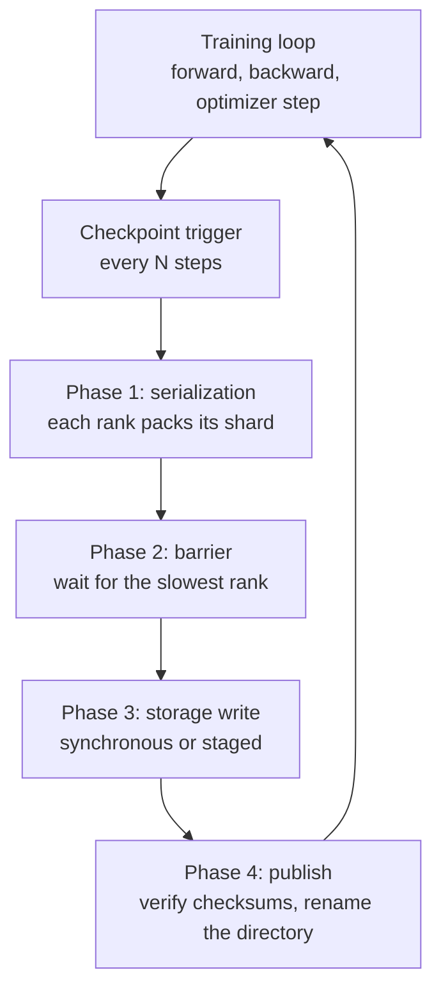
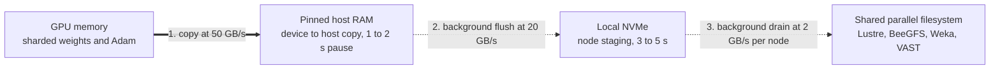
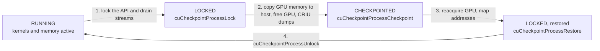

# 13.7 Checkpoint architecture and recovery

| Field | Value |
|---|---|
| Level | Advanced |
| Priority tier | 2 |
| Lab venue | GCP / GKE + Local Python Verification Lab |
| Part | Part 13: AI storage |
| Primary sources | NVIDIA Zero-to-Hero Volume 15 and Volume 13; *AI Systems Performance Engineering*; *NVIDIA DGX SuperPOD with DGX GB300 Reference Architecture* |
| Coverage file | `planning/coverage/chapters/13-07.md` |
| Claim & number ledger | `planning/ledgers/13-07.md` |

## Why this matters for AI infrastructure

The training team has done everything right. Their job saves a checkpoint every thirty minutes, and it resumes cleanly after a crash. Then the storage graphs show the problem: every save takes eight minutes, the GPUs idle for all of it, and the filesystem is at 90 percent full after three weeks. The checkpoint logic is correct. The storage path under it is not.

This chapter is the storage side of checkpointing. Chapter 14.11 owns the training side: what a checkpoint must contain, how often to save, failure detection and elastic restart. Read it for the five components, the sharded-versus-gathered argument and the Young-Daly interval. Chapter 19.4 combines both halves in a capstone. Here we answer questions that the storage engineer owns.

- How many bytes does a checkpoint add to the filesystem, and how fast must it absorb them?
- Where should the bytes land first so the GPUs are released quickly?
- How do you publish a checkpoint so a crash never leaves a half-written one that looks complete?
- How long does a restore take, and what do you keep or delete?
- When is a transparent, driver-level snapshot better than a framework checkpoint?

Two failure stories frame the chapter. In the first, a synchronous write over a congested shared filesystem stalls the cluster for eight minutes per save. Across a thousand saves that is over 133 hours of idle GPUs. In the second, a month of 100 GB checkpoints every half hour fills 144 TB, and a worker killed in the middle of `torch.save` leaves a truncated file that no one notices until the restore.

```text
Storage-side checkpoint economics:
  Degraded trace:     3.1 s serialize + 28.3 s waiting for rank 7 + 450.2 s write (8.25 GB at 18.33 MB/s)
                      = 481.6 s, about 8 minutes of idle GPUs per save
  1,000 saves:        1,000 x 480 s = 133.3 hours of stall
  Staged to NVMe:     1,000 x 5 s = 1.39 hours, a 96 times smaller stall
  Unpruned capacity:  100 GB x 48 saves a day x 30 days = 144 TB a month
                      1,000 saves of 500 GB = 500 TB
```

**Stage checkpoints to local NVMe first, publish them atomically, and prune on a schedule, so the filesystem sees steady background writes instead of eight-minute stalls.**

## Prerequisites and outcomes

You should know local NVMe staging (chapter 13.2), GPUDirect Storage (13.3), Lustre (13.4) and the other parallel filesystems (13.5). From Part 14 you should have read chapter 14.11, or at least know what a sharded save is.

After this chapter you can do the following.
1. Size the bytes a checkpoint adds and the write bandwidth needed to absorb it.
2. Break a slow save into serialization, barrier, write and publication, and find the phase that costs time.
3. Design a staged write path from GPU to local NVMe to shared storage, with a host-memory guard.
4. Publish checkpoints atomically with checksums, restore them in parallel and retain them by policy.
5. Decide when `cuda-checkpoint` with CRIU is a better tool than a framework checkpoint.

---

## 1. How many bytes a checkpoint adds

The planning figure is 14 bytes per parameter: BF16 weights, FP32 master weights and the two FP32 Adam moments. Gradients are not saved, and chapter 14.11 explains why. Some frameworks keep only the FP32 master weights and moments, which is 12 bytes per parameter, so check what your job actually writes.

| Model | Checkpoint at 14 bytes per parameter | Training world size | Shard per GPU |
|---|---|---|---|
| 7B | 98 GB | 4 GPUs | 24.5 GB |
| 70B | 980 GB | 128 GPUs | 7.66 GB |
| 175B | 2,450 GB | 128 GPUs | 19.14 GB |
| 400B | 5,600 GB | 2,048 GPUs | 2.73 GB |

Divide a row's total by its GPU count to see what each rank writes. Now multiply by how often you save. A 980 GB checkpoint every 40 minutes is 36 saves a day, or about 35 TB a day before pruning. The retention policy in section 5 decides how much of that survives.

---

## 2. Where the time goes in one save

A checkpoint has four phases, and each can stall the cluster. The diagram shows the loop.



The table compares a healthy save with a degraded one from a field trace. Use it as a checklist when saves suddenly get slower.

| Phase | What happens | Healthy | Degraded trace | Usual cause |
|---|---|---|---|---|
| Serialization | Pack tensors into byte buffers | Under 5 s | 3.1 s for 8.25 GB | Single-threaded pickling or unpinned memory |
| Barrier | Wait so no rank changes weights during the snapshot | Under 1 s | 28.3 s, rank 7 late | A straggler from NUMA contention, thermal throttling or a PCIe fallback |
| Storage write | Persist the shard bytes | 1.4 to 5 s staged or on a fast filesystem | 450.2 s at 18.33 MB/s | Synchronous write to one congested target |
| Publication | Mark the checkpoint complete | Under 0.5 s | A torn file after a crash | Overwriting in place with no temporary directory |

The idle pause is the sum of the first three rows. In the degraded trace the write dominates, but the 28.3 seconds at the barrier is its own problem. One slow rank holds every other GPU. Before the barrier, gather each rank's average step time with `dist.all_gather` and flag any rank more than 15 percent slower than the fastest. Then check the NUMA binding with `numactl`, throttling with `nvidia-smi -q -d PERFORMANCE`, and NVLink against PCIe fallback with `nvidia-smi topo -m`.

---

## 3. The staged write path

How do you cut the blocking pause from minutes to seconds? Split the save. The snapshot stays on the critical path, because the weights must not change while they are copied. The durable write moves off it.



The table shows each stage for a node that holds 70 GB of checkpoint shards. The rates are representative values, not measurements.

| Stage | From to | Rate per 8-GPU node | Time for 70 GB | Blocks the GPUs? | What it protects against |
|---|---|---|---|---|---|
| Synchronous baseline | GPU to shared filesystem | 2 GB/s on congested storage | 35 s, or far more under load | Yes, all of it | Immediate durability, at a high idle cost |
| 1a. Snapshot | GPU memory to pinned host RAM | 50 GB/s | 1.4 s | Yes, only this | A process crash, if the node stays up |
| 1b. Local staging | Host RAM to local NVMe | 20 GB/s over 4 to 8 drives | 3.5 s | No | A process restart or out-of-memory kill on the same node |
| 2. Durable drain | Local NVMe to shared storage | 2 GB/s per node | 35 s, or 70 to 500 s under load | No | Loss of the whole node |

Only the snapshot always blocks training. The shared filesystem then sees a steady background drain from each node, not a burst from every rank at once. Chapter 13.2 covers how to build the local NVMe array.

### 3.1 The host memory guard

The snapshot lands in pinned host memory. If a second save starts before the first flush ends, two snapshots are staged at once. On a node with 512 GB of RAM and 180 GB used by workers and loaders, one 70 GB snapshot brings use to 250 GB. Five overlapping snapshots bring it to 530 GB and the out-of-memory killer fires.

Three rules prevent it. Allow one snapshot in flight and wait on the previous flush before starting the next. Allocate a reusable pinned buffer pool at job start. Delete the local staging file as soon as the shared copy is verified. Pinned memory cannot be swapped, so extra swap does not help. Chapter 14.11 explains this from the training side.

---

## 4. Sizing the storage for checkpoint bandwidth

A shared filesystem has to absorb the background drains and still serve restores. Start from two numbers: the bytes per save and the time you allow each drain to take. If every node drains a 70 GB payload in 60 seconds, each node needs about 1.2 GB/s, and a 128-node cluster needs about 150 GB/s of aggregate write for that window. Drains that are spread across nodes need less. Drains that start together need more.

For NVIDIA DGX SuperPOD with DGX GB300, the reference architecture sets two high-performance storage tiers. Standard suits single-modality training whose working set fits in local cache. Enhanced suits large multimodal or trillion-parameter models that save often.

| DGX SuperPOD GB300 scale | Standard read | Standard write | Enhanced read | Enhanced write |
|---|---|---|---|---|
| One scalable unit | 90 GB/s | 45 GB/s | 280 GB/s | 140 GB/s |
| Four scalable units | 360 GB/s | 180 GB/s | 1,120 GB/s | 560 GB/s |

On top of the storage fabric, NVIDIA Mission Control provides an autonomous recovery engine with in-memory checkpointing. It restarts processes from memory or staged snapshots and moves work to healthy nodes. Pick the tier by how often you save and how large the saves are, and see chapter 13.5 for how the filesystems differ.

---

## 5. Striping, atomic publication and retention

### 5.1 Stripe the checkpoint directory

On Lustre, a file written with the default stripe lives on one object storage target. A large checkpoint then runs at the speed of one target. Set the stripe on the checkpoint directory before the first save, so new files spread across all targets.

```bash
# All targets, 16 MiB stripe size, for the checkpoint directory
lfs setstripe -c -1 -S 16M /shared-storage/checkpoints/
```

Chapter 13.4 explains the stripe count and size trade-off for small and large files.

### 5.2 Publish atomically

A crash in the middle of a write must never leave a directory that looks like a good checkpoint. Use three steps.

1. Every rank writes into a temporary directory such as `/shared-storage/.ckpt-step-1000.tmp/`, calls `fsync`, and waits at a barrier.
2. Rank 0 writes a manifest with the SHA-256 checksum of every shard, the step, the world size, the list of saved keys and a completed flag, then calls `fsync` on it.
3. Rank 0 renames the temporary directory to its final name with one atomic `os.replace`.

Recovery automation reads only directories without the temporary suffix, and it verifies the manifest before use. A truncated or partial shard then fails the checksum, and the job falls back to the previous checkpoint.

### 5.3 Retention

Without cleanup, a thousand saves of 500 GB fill half a petabyte. A hook after each validated commit should keep a rolling window of the last five checkpoints for crash recovery, plus a milestone every hundred steps or epochs for evaluation. Delete everything else. For a 980 GB checkpoint, five kept saves occupy about 4.9 TB, plus the milestones.

---

## 6. The restore path

A restore reads the checkpoint back, and storage determines how long that takes. Suppose you read a 500 GB checkpoint from one unstriped target at 2 GB/s. The read alone takes 250 seconds. Striped across eight targets at 2 GB/s each, with GPUDirect Storage where it is supported, the aggregate is 16 GB/s and the read takes 31.25 seconds.

```text
Recovery time objective for a 500 GB checkpoint:
  One target, 2 GB/s:      read 250.0 s + deserialize 10 s + distribute 5 s = 265 s (4.4 min)
  Eight targets, 16 GB/s:  read  31.25 s + 10 s + 5 s                        =  46.25 s
```

When the job restarts on a different number of GPUs, each new rank reads a different set of byte ranges, which overlap several old shards. Chapter 14.11 explains the API. For storage, the effect is that reads are no longer one file per rank, so a wide stripe and a filesystem that handles many concurrent readers matter more. The example below shows the pattern for 19,200 parameters going from 64 to 48 ranks.

```text
64 source shards of 300 elements, 48 destination ranks of 400 elements
  Destination rank 0 reads 300 from source shard 0 and 100 from source shard 1
  Destination rank 1 reads 200 from source shard 1 and 200 from source shard 2
  In all, 96 slice reads and every element is read exactly once
```

---

## 7. Transparent snapshots with cuda-checkpoint and CRIU

A framework checkpoint needs the training script to cooperate at a step boundary. A scheduler that must preempt a job, move it to another node or snapshot it cannot wait for that, and should not need code changes. For that case NVIDIA provides the `cuda-checkpoint` utility and Driver API calls, used together with CRIU, which snapshots and restores a Linux process.



| Driver call | Transition | What the driver does | Constraint |
|---|---|---|---|
| `cuCheckpointProcessLock` | RUNNING to LOCKED | Blocks new CUDA calls and drains outstanding kernels and streams | The wait depends on how much work is in flight |
| `cuCheckpointProcessCheckpoint` | LOCKED to CHECKPOINTED | Copies GPU memory into host memory and releases the GPU so CRIU can dump the process | Does not use GPUDirect Storage; time is active GPU memory divided by host link speed |
| `cuCheckpointProcessRestore` | CHECKPOINTED to LOCKED | Reacquires GPUs of the same architecture and maps memory back to its original addresses | Needs the same GPU architecture; persistence mode or `cuInit` |
| `cuCheckpointProcessUnlock` | LOCKED to RUNNING | Lets threads and kernels run again | Complements, but does not replace, framework checkpoints |

With 64 GB of active GPU memory and a 50 GB/s host link, the copy takes 1.28 seconds. Then CRIU writes the process image to storage. Use framework checkpoints for durable, elastic saves that survive world-size changes. Use this path for fast preemption and live migration of a running job.

---

## Commands and configurations that matter

### 1. Staged save with a barrier and atomic publish

This pattern ties together the straggler check, the staged write and the manifest. It needs a multi-GPU PyTorch job with `/local-nvme` and `/shared-storage`, and it has not been run on a cluster for this edit. It saves each rank's own random state and data loader position, as chapter 14.11 requires.

```python
import hashlib, json, os, shutil, threading, time
import torch
import torch.distributed as dist

_flush = None

def detect_straggler(batch_times, warn_ratio=1.15):
    local_avg = sum(batch_times) / max(len(batch_times), 1)
    gathered = [torch.zeros(1, device="cuda") for _ in range(dist.get_world_size())]
    dist.all_gather(gathered, torch.tensor([local_avg], device="cuda"))
    if dist.get_rank() == 0:
        times = [t.item() for t in gathered]
        if max(times) > min(times) * warn_ratio:
            print(f"rank {times.index(max(times))} is straggling: {max(times):.3f}s vs {min(times):.3f}s")

def save_staged(model, optimizer, scheduler, loader, epoch, step):
    global _flush
    rank, world = dist.get_rank(), dist.get_world_size()
    if _flush is not None and _flush.is_alive():
        _flush.join()                                  # one snapshot in flight

    payload = {
        "model_state_dict": model.state_dict(),
        "optimizer_state_dict": optimizer.state_dict(),
        "scheduler_state_dict": scheduler.state_dict(),
        "rng_state": {"cpu": torch.get_rng_state(), "cuda": torch.cuda.get_rng_state()},
        "dataloader_state": loader.state_dict() if hasattr(loader, "state_dict") else {"step": step},
        "step_metadata": {"epoch": epoch, "global_step": step, "world_size": world},
    }
    dist.barrier()

    local_dir = f"/local-nvme/ckpt-step-{step}"
    os.makedirs(local_dir, exist_ok=True)
    local_shard = f"{local_dir}/rank_{rank:05d}.pt"
    torch.save(payload, local_shard)                   # fast local write

    def drain():
        tmp = f"/shared-storage/.ckpt-step-{step}.tmp"
        final = f"/shared-storage/ckpt-step-{step}"
        os.makedirs(tmp, exist_ok=True)
        shard = f"{tmp}/rank_{rank:05d}.pt"
        shutil.copy2(local_shard, shard)
        os.remove(local_shard)
        h = hashlib.sha256()
        with open(shard, "rb") as f:
            while chunk := f.read(16 * 1024 * 1024):
                h.update(chunk)
        with open(f"{tmp}/rank_{rank:05d}.sha256", "w") as hf:
            hf.write(h.hexdigest())
        if rank == 0:
            while len([n for n in os.listdir(tmp) if n.endswith(".sha256")]) < world:
                time.sleep(0.5)
            hashes = {f"rank_{r:05d}.pt": open(f"{tmp}/rank_{r:05d}.sha256").read().strip()
                      for r in range(world)}
            manifest = {"global_step": step, "world_size": world, "completed": True,
                        "included_state_keys": list(payload.keys()), "shard_sha256": hashes}
            with open(f"{tmp}/manifest.json", "w") as mf:
                json.dump(manifest, mf, indent=2); mf.flush(); os.fsync(mf.fileno())
            os.replace(tmp, final)                     # atomic publish

    _flush = threading.Thread(target=drain)
    _flush.start()
```

The function reads in the order of the chapter: wait for the previous flush, capture state, barrier, local write, then a background drain that ends in the rename. The rename is the step that makes the checkpoint visible.

### 2. Storage commands

```bash
# Inspect the global tensor metadata of a sharded checkpoint
python3 -c "from torch.distributed.checkpoint import FileSystemReader; \
print(FileSystemReader('/checkpoints/step_5000').read_metadata())"

# Stripe the checkpoint directory before the first save
lfs setstripe -c -1 -S 16M /shared-storage/checkpoints/

# Check free space and inodes before you blame the filesystem
df -h /shared-storage; df -i /shared-storage

# Verify one shard against the manifest
sha256sum /shared-storage/ckpt-step-1000/rank_00000.pt
```

Read the metadata first because it tells you what a checkpoint holds. Set the stripe before the first save, not after.

---

## How it fails

| Symptom | Evidence to collect | Cause | Fix |
|---|---|---|---|
| Resume fails with a size mismatch or unpickling error | `ls -lh` on the file, the manifest completed flag, `sha256sum` against the manifest | A worker was killed or the node lost power during an in-place write | Write to a temporary directory, `fsync`, verify checksums, publish with an atomic rename, and fall back to the previous checkpoint |
| Training dies right after a save starts with an out-of-memory kill | `dmesg -T`, `free -m`, the count of snapshots in flight | Overlapping snapshots in pinned host memory | One snapshot in flight, a reusable buffer pool, spill staging to local NVMe |
| Save time jumps from 90 seconds to 12 minutes | Per-rank write rate, `df -h`, `df -i`, target health, per-rank step times | A degraded or contended target, a nearly full filesystem with no retention, or a straggler at the barrier | Stripe across healthy targets, stage to local NVMe, automate retention, bind the straggler with `numactl` |
| Restore is slow | Read rate per client, stripe count of the files | Checkpoint written with the default stripe | Set the stripe on the directory and rewrite, restore in parallel |
| A checkpoint loads but is wrong | Manifest keys against the expected list | A script saved only some state, or a shard was corrupted | Reject any checkpoint whose manifest lacks a required key or fails a checksum |

If a save crashes or a resume goes wrong, find the row that matches the symptom and collect the evidence before changing anything. Most fixes come down to two habits: write to a staging directory first, and verify before you publish.

---

## Hands-on lab

You can run this lab without GPUs. It checks the arithmetic and state machines in this chapter. The driver script is `code/part13/checkpoint_architecture_lab.py`, and it imports `code/part13/checkpoint_architecture.py`. The Young-Daly interval, the gather-versus-sharded comparison and the training-side checks live in chapter 14.11's lab.

```bash
python3 -B code/part13/checkpoint_architecture_lab.py
```

Expected output.

```text
  [PASS] 1. 70B model mixed-precision AdamW footprint is 980.0 GB persistent (14 B/param) vs 1,120.0 GB active training state (16 B/param), or 7.65625 GB vs 8.75 GB per GPU across 128 GPUs
  [PASS] 2. 400B model mixed-precision AdamW footprint is 5,600.0 GB persistent (14 B/param) and 6,400.0 GB active state (16 B/param), or 2.73438 GB vs 3.125 GB per GPU across 2,048 GPUs
  [PASS] 3. Checkpoint phase breakdown: 3.1 s serialize + 28.3 s straggler barrier (Rank 7) + 450.2 s slow write (8.25 GB at 18.33 MB/s) = 481.6 s (~8 min) stall
  [PASS] 4. Over 1,000 checkpoints, reducing GPU stall from 8 minutes (480 s) to 5 seconds via local NVMe staging cuts lost time from 8,000 min (133.33 h) to 1.3889 h (~1.4 h, 96.0x reduction)
  [PASS] 5. Two-stage async checkpointing of 70 GB/node (50 GB/s DtoH, 20 GB/s local NVMe, 2 GB/s remote PFS) cuts GPU pause from 35.0 s to 1.4 s (25.0x speedup)
  [PASS] 6. Stacking 5 unflushed 70 GB async checkpoints (350 GB pinned buffer + 180 GB RSS = 530 GB > 512 GB host RAM) triggers Linux OOM killer unless gated on prior flush completion
  [PASS] 7. Tiered checkpoint retention keeps the last 5 checkpoints plus every 100-epoch milestone while deleting intermediate checkpoints
  [PASS] 8. Restoring a 500 GB checkpoint across 8 Lustre OSTs at 2 GB/s/OST (16 GB/s aggregate) cuts read time from 250.0 s to 31.25 s (8.0x faster; total RTO 46.25 s vs 265.0 s = 4.42 min)
  [PASS] 9. DGX SuperPOD GB300 storage tiers specify 90/45 GB/s (1 SU Standard), 280/140 GB/s (1 SU Enhanced), 360/180 GB/s (4 SU Standard), and 1,120/560 GB/s (4 SU Enhanced)
  [PASS] 10. PyTorch DCP 1D resharding planner maps a 64-GPU checkpoint to a 48-GPU allocation across 96 copy slices with zero element loss
  [PASS] 11. Executing DCP N=64 -> M=48 resharding and M=48 -> N=64 round-trip preserves exact element ordering for all 19,200 parameters
  [PASS] 12. Executing DCP N=4 -> M=8 scale-out resharding splits each 4-GPU shard into two exact 8-GPU sub-shards
  [PASS] 13. Atomic manifest validator accepts a complete checkpoint with valid SHA-256 shard hashes and all 6 required deterministic recovery keys
  [PASS] 14. Atomic manifest validator rejects an incomplete checkpoint (completed=False) caused by a mid-write crash
  [PASS] 15. Atomic manifest validator rejects a checkpoint missing optimizer_state_dict or rng_state
  [PASS] 16. Atomic manifest validator detects truncated or corrupted shard bytes via SHA-256 mismatch
  [PASS] 17. cuda-checkpoint state machine enforces RUNNING -> LOCKED -> CHECKPOINTED -> LOCKED -> RUNNING via the four CUDA Driver API calls
  [PASS] 18. cuda-checkpoint state machine rejects out-of-order Driver API calls (e.g., calling cuCheckpointProcessCheckpoint before cuCheckpointProcessLock)

Summary: 18 passed, 0 failed
```

If any line prints a failure, the arithmetic or the state machine has drifted from the chapter.

---

## Exercises

1. Size the checkpoints for storage. A 70B model on 128 GPUs and a 400B model on 2,048 GPUs both save 14 bytes per parameter. Calculate the total size and the shard per GPU for each. Then calculate how much a 40-minute save interval adds in one day for the 70B model.
2. Diagnose a slow save. A trace shows 3.1 s serialization, 28.3 s at the barrier and 450.2 s of writing 8.25 GB per rank. Compute the per-rank write rate in MB per second, name the two largest costs, and say what you would check for each.
3. Work out the staged write. For a node with 70 GB of shards, calculate the time of the snapshot at 50 GB/s, the local write at 20 GB/s and the shared drain at 2 GB/s. Say which stage blocks the GPUs.
4. Check the host memory. A node has 512 GB of RAM with 180 GB in use. Calculate memory use with one 70 GB snapshot in flight and with five. Name the rule that prevents the second case.
5. Compare restores. Calculate the read time and total recovery time of a 500 GB checkpoint from one target at 2 GB/s and from eight targets at 2 GB/s each, adding 15 seconds for deserialization and distribution.
6. Choose a tool. A scheduler must preempt a running job and move it to another node, with no change to the training code. Say whether you would use a framework checkpoint or `cuda-checkpoint` with CRIU, and give the suspend time for 64 GB of active GPU memory at 50 GB/s.

Expected values from the lab: item 1, 980 GB and 7.66 GB per GPU for the 70B model, 5,600 GB and 2.73 GB for the 400B model. Item 2, 18.33 MB/s. Item 3, 1.4 s, 3.5 s and 35 s. Item 4, 250 GB and 530 GB. Item 5, 265 s and 46.25 s. Item 6, `cuda-checkpoint`, 1.28 s.

---

## Interview angles

1. **"A job writes a 500 GB checkpoint each hour and blocks for 8 minutes per save, across 1,000 planned saves. What does it cost and how do you fix it?"**
   A thousand saves at 8 minutes is 8,000 minutes, or 133 hours of idle cluster. Instrument the phases: serialization, barrier, write and publication. Then stage through pinned memory and local NVMe in under five seconds, drain to shared storage in the background, and publish with an atomic manifest. The stall falls about 96 times, to 1.39 hours.
2. **"How do you make sure a half-written checkpoint can never be restored?"**
   Write every shard into a temporary directory, `fsync`, record a SHA-256 checksum for each shard in a manifest with a completed flag, and publish by one atomic rename. Restore only from published directories whose manifest verifies, and keep the last five so there is always a fallback.
3. **"Why does asynchronous checkpointing add a failure that synchronous saves do not have?"**
   The staged copy lives in pinned host memory while the flush runs. If saves overlap, the copies plus the loader workers exceed RAM and the out-of-memory killer fires. Allow one save in flight, wait on the previous flush and reuse a fixed buffer pool.
4. **"When would you use cuda-checkpoint instead of a framework checkpoint?"**
   Use a framework checkpoint for durable saves that survive a change of world size. Use `cuda-checkpoint` with CRIU when the scheduler needs to preempt or move a running job without changing the training code, on GPUs of the same architecture.

---

## Checkpoint questions (20)

<details>
<summary>**1. What does a checkpoint add to the filesystem, and why is it not 16 bytes per parameter?**</summary>

A mixed-precision checkpoint is about 14 bytes per parameter: BF16 weights, FP32 master weights and two FP32 Adam moments. Gradients are not saved because the next backward pass recomputes them.
</details>

<details>
<summary>**2. How large is the checkpoint for a 70B model and what does each of 128 GPUs write?**</summary>

At 14 bytes per parameter it is 980 GB, and each GPU writes about 7.66 GB.
</details>

<details>
<summary>**3. What are the four phases of a save, and which can stall every GPU?**</summary>

Serialization, the barrier, the storage write and publication. The first three block the GPUs, and the barrier turns one slow rank into a cluster-wide wait.
</details>

<details>
<summary>**4. In the trace of 3.1 s, 28.3 s and 450.2 s, what do the last two numbers show?**</summary>

The 28.3 seconds at the barrier point to a straggler on rank 7. The 450.2 seconds of writing at 18.33 MB per rank point to a synchronous write to slow or unstriped shared storage.
</details>

<details>
<summary>**5. How do you find which rank causes a barrier stall?**</summary>

Each rank records its average step time, then `dist.all_gather` collects them before the barrier. A rank more than 15 percent slower than the fastest is the straggler. Check its NUMA binding, throttling and NVLink against PCIe fallback.
</details>

<details>
<summary>**6. What is the staged write path and which stage blocks training?**</summary>

GPU memory is copied to pinned host RAM, flushed to local NVMe and drained to shared storage. Only the first copy blocks the GPUs, for about 1.4 seconds on a 70 GB node payload.
</details>

<details>
<summary>**7. What does each stage of the path protect against?**</summary>

Pinned RAM survives a process crash if the node stays up. Local NVMe survives a process restart on the same node. The shared filesystem survives loss of the node.
</details>

<details>
<summary>**8. What causes a host-memory out-of-memory kill during asynchronous saves, and how do you prevent it?**</summary>

Overlapping snapshots in pinned memory, next to loader workers, exceed RAM. Allow one snapshot in flight, wait on the previous flush, reuse a fixed buffer pool and delete staging files after the drain.
</details>

<details>
<summary>**9. Why does swap not solve the pinned-memory problem?**</summary>

Pinned memory is locked in RAM and cannot be paged out, so extra swap does not hold the staged buffers.
</details>

<details>
<summary>**10. How do you estimate the aggregate write bandwidth the filesystem needs for checkpoints?**</summary>

Take the bytes each node must drain and the time you allow, then multiply by the number of nodes. For 70 GB per node in 60 seconds across 128 nodes, that is about 150 GB per second if the drains start together.
</details>

<details>
<summary>**11. What storage tiers does the DGX SuperPOD GB300 reference architecture define?**</summary>

A Standard tier of 90 GB/s read and 45 GB/s write for one scalable unit, and an Enhanced tier of 280 and 140. At four units, Standard is 360 and 180, and Enhanced is 1,120 and 560.
</details>

<details>
<summary>**12. Why set the Lustre stripe on the checkpoint directory before the first save?**</summary>

New files inherit the directory's stripe. With the default stripe a large file sits on one target and runs at its speed. A wide stripe spreads writes and reads across all targets.
</details>

<details>
<summary>**13. How do you publish a checkpoint so a crash cannot leave a half-written one that looks complete?**</summary>

Write into a temporary directory, `fsync`, write a manifest with checksums and a completed flag, and rename the directory with one atomic `os.replace`. Restore only from published directories that verify.
</details>

<details>
<summary>**14. What goes in the manifest?**</summary>

The step, the world size, the list of saved keys, the SHA-256 checksum of every shard and a completed flag.
</details>

<details>
<summary>**15. What retention policy keeps storage bounded without losing recovery points?**</summary>

Keep a rolling window of the last five checkpoints plus a milestone every hundred steps or epochs, and delete the rest after each validated commit.
</details>

<details>
<summary>**16. How does striping change the restore time of a 500 GB checkpoint?**</summary>

One target at 2 GB/s takes 250 seconds to read. Eight targets give 16 GB/s and 31.25 seconds. With 15 seconds of deserialization and distribution, recovery falls from 265 to 46.25 seconds.
</details>

<details>
<summary>**17. What does restoring onto a different GPU count mean for storage reads?**</summary>

Each new rank reads byte ranges that overlap several old shards, so reads are spread across many files at once. A wide stripe and good concurrent read behaviour matter more.
</details>

<details>
<summary>**18. What do the four `cuda-checkpoint` calls do, in order?**</summary>

Lock blocks new CUDA calls and drains streams. Checkpoint copies GPU memory to host memory and frees the GPU for CRIU. Restore reacquires the GPUs and maps memory to its original addresses. Unlock lets the process run again.
</details>

<details>
<summary>**19. Does `cuda-checkpoint` use GPUDirect Storage during the suspend?**</summary>

No. The driver copies GPU memory into host memory at host-link speed, which is 1.28 seconds for 64 GB at 50 GB/s. CRIU then writes the process image to storage.
</details>

<details>
<summary>**20. How do you decide between a framework checkpoint and `cuda-checkpoint`?**</summary>

A framework checkpoint is durable and survives a change of world size, but needs the script to cooperate. `cuda-checkpoint` with CRIU needs no code change and suits preemption and live migration on the same GPU architecture.
</details>

---

## Sources and review notes

### Sources used

| Source | Used for |
|---|---|
| NVIDIA DGX SuperPOD with DGX GB300 Reference Architecture | Standard and Enhanced storage tiers, Mission Control in-memory checkpointing |
| *AI Systems Performance Engineering*, chapter 5 | Checkpointing GPU state with `cuda-checkpoint` and CRIU, driver-managed host copy rather than GPUDirect Storage |
| NVIDIA `cuda-checkpoint` and CUDA Driver API documentation | The four checkpoint calls and the process states |
| PyTorch documentation, `torch.distributed.checkpoint` | Sharded save, metadata and resharded load |
| Lustre manual, `lfs setstripe` | Directory striping |
| NVIDIA training and storage field notes (volumes 13 and 15 of the `nvidia-devops` repository) | The degraded save trace, 500 GB restore example and staging rates. These are illustrative figures. |

### Changes in this revision

- The five checkpoint components, the gather-versus-sharded comparison and the Young-Daly derivation were removed and replaced with links to chapter 14.11, which owns them. The lab checks for those topics moved with them.
- The payload accounting now matches chapter 14.11: 14 bytes per parameter, no gradients.
- The sample code saves each rank's own random state and the data loader position.
- The swap-file mitigation was removed, because pinned memory cannot be swapped.
- Section 4 now explains how to size aggregate write bandwidth. The vendor tiers come from the reference architecture and are not a measured result.

### Not verified here

The staged-save code and the shell commands were not run on a cluster. Stage rates are representative values.
