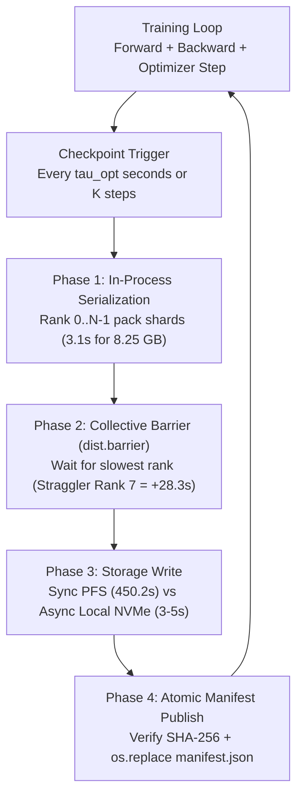
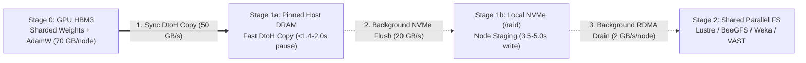
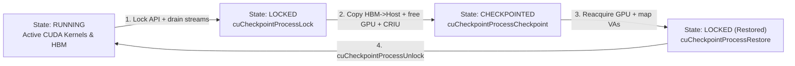

# 13.7 Checkpoint architecture and recovery

| Field | Value |
|---|---|
| Level | Advanced |
| Priority tier | 2 |
| Lab venue | GCP / GKE + Local Python Verification Lab |
| Part | Part 13: AI storage |
| Primary sources | NVIDIA Zero-to-Hero Volume 15 and Volume 13; *AI Systems Performance Engineering*; *NVIDIA DGX SuperPOD with DGX GB300 Reference Architecture* |
| Coverage file | `planning/coverage/chapters/13-07.md` |
| Claim & number ledger | `planning/ledgers/13-07.md` |

## Why this matters for AI infrastructure

In distributed training across thousands of GPUs, hardware failures are not an edge case. Over a thirty-day pretraining campaign on a thousand or two thousand GPUs, at least one component will fail. An HBM3 memory stack can develop an uncorrectable double-bit ECC error. A GPU can fall off the PCIe bus, an optical transceiver can flap, a power supply can trip, or the Linux kernel out-of-memory killer can terminate a worker.

Collective operations in NCCL such as All-Reduce, All-Gather, Reduce-Scatter, and All-to-All are synchronous across every rank in the communicator. A single failed rank blocks the entire job until the collective watchdog times out. Without a durable and validated checkpoint, one node failure wipes out days or weeks of GPU compute time worth millions of dollars.

Yet saving the checkpoint can easily become the single largest bottleneck in the cluster. Two failure modes show up repeatedly when teams deploy naive checkpoint pipelines in production.

First is the checkpoint pause. When a training run writes a large checkpoint every thirty to sixty minutes over a congested shared filesystem, synchronous writes stall the entire cluster for eight minutes per save. Saving every thirty minutes with a five-minute pause leaves GPUs completely idle for over sixteen percent of the day. Across a thousand checkpoints, an eight-minute stall burns over a hundred and thirty-three hours of cluster compute waiting on disk writes.

Second is storage capacity bloat and silent corruption. Saving a hundred gigabytes every thirty minutes for a month generates a hundred and forty-four terabytes of files. Worse, recovery breaks if a worker dies during `torch.save`. Recovery also breaks if a script saves model weights while omitting AdamW momentum buffers, learning-rate state, or random number generator state. The resumed job either crashes with a tensor size mismatch or continues running while its training loss spikes and diverges silently.

```text
Naive vs Production Checkpoint Economics (V15 Ch. 08 & V13 Ch. 09):
  - Hardware fault codes:    Xid 48 / Xid 63 (double-bit ECC), Xid 79 (GPU fallen off bus), NCCL WARN Watchdog caught network down
  - 30-minute pause ratio:   5 min stall / 30 min interval = 16% (16.7%) GPU idle waste
  - Degraded field trace:    3.1 s serialize + 28.3 s Rank 7 barrier wait + 450.2 s write (8.25 GB at 18.33 MB/s) = 481.5 s (481.6 s, ~8 min)
  - 1,000-checkpoint stall:  1,000 x 8 min (480 s) = 8,000 min = 133.33 hours (~133 hours, >20% of a 500-hour run)
  - Async NVMe staging:      1,000 x 5 s local NVMe pause = 5,000 s = 83.33 min = 1.39 hours (~1.4 hours, a 96.0x stall reduction)
  - Unpruned capacity bloat: 100 GB x 48/day x 30 days = 144 TB/month; 1,000 x 500 GB checkpoints = 500 TB
```

Modern AI storage and platform engineers solve these challenges with a five-part checkpoint architecture:
- **Sharded parallel writes:** Using FSDP sharded state dicts, DeepSpeed universal checkpoints, or PyTorch Distributed Checkpoint, every rank writes its own shard in parallel. That takes under three seconds instead of gathering over a terabyte onto Rank 0.
- **Principled interval scheduling:** Using the Young-Daly formula, teams calibrate save intervals to measured cluster Mean Time Between Failures and actual blocking write duration.
- **Two-stage asynchronous checkpointing:** Workers copy GPU HBM shards to pinned host DRAM in under two seconds or to local NVMe scratch in under five seconds. The GPUs immediately resume training while background CPU threads flush shards to Lustre, BeeGFS, WekaFS, VAST, or object storage.
- **Topology-agnostic dynamic resharding and atomic manifests:** When Slurm or Kubernetes drains a failed node and restarts a job on fewer GPUs, `torch.distributed.checkpoint` recomputes shard boundaries from global tensor metadata.
- **In-memory and transparent driver-level checkpointing:** NVIDIA Mission Control on DGX SuperPOD GB300 and the `cuda-checkpoint` utility with CRIU provide sub-minute fault tolerance and live job migration.

## Prerequisites and outcomes

**Prerequisites:**
- Understanding of local NVMe RAID 0 staging, GPUDirect Storage, and parallel filesystems such as Lustre, BeeGFS, WekaFS, and VAST from earlier chapters in Part 13.
- Familiarity with dataset serialization and metadata bottlenecks from the preceding chapter.
- Working knowledge of PyTorch distributed training with `torchrun`, DDP, FSDP, ZeRO stages, and NCCL collectives from Part 9.

**Outcomes:** After completing this chapter, you will be able to:
1. Calculate the exact byte footprint of a model's active training state versus its persistent mixed-precision AdamW checkpoint state across foundation model scales.
2. Instrument the three synchronous checkpoint phases, isolate straggler ranks via `dist.all_gather`, and compute optimal checkpoint intervals using Young's approximation and Daly's correction.
3. Architect a two-stage asynchronous checkpoint pipeline from GPU HBM to pinned host DRAM, local NVMe, and shared storage with OOM guards and atomic directory publication.
4. Execute topology-agnostic checkpoint resharding across changing GPU world sizes using `torch.distributed.checkpoint`, and contrast framework checkpoints against transparent driver-level snapshots using `cuda-checkpoint` and CRIU.

---

## 1. Anatomy of a Training Checkpoint and Byte Footprint Math

Why does distributed checkpointing exist in the first place? While single-GPU HBM capacity has grown linearly to eighty gigabytes on an A100 or H100, foundation model parameter counts have grown exponentially. A single 175-billion-parameter GPT-3 model stored in full precision requires seven hundred gigabytes of memory for weights alone.

That weight tensor exceeds a single H100 GPU by nearly nine times before allocating a single byte for gradients, optimizer states, or activations. Compute scaling imposes an equally hard wall. A single training step on that model takes seventy-eight minutes on one A100 GPU. Spreading the step across 128 A100 GPUs drops step time to thirty-seven seconds.

```text
Single-GPU Memory and Compute Wall (V13 Ch. 01):
  - 175B GPT-3 FP32 weights: 175 x 10^9 x 4 bytes = 700 GB (8.75x a single 80 GB H100 GPU)
  - 175B single-step FLOPs:  2 x 175 x 10^9 x 2048 x 2048 ~= 1.46 x 10^18 FLOPs (at global batch 2048, seq 2048)
  - 1x A100 (312 TFLOPS):    1.46 x 10^18 / (312 x 10^12) = 4,679.49 seconds (~4,679 s = 77.99 min ~= 78 minutes)
  - 128x A100 GPUs:          4,679.49 s / 128 = 36.56 seconds (~37 seconds per step)
```

### 1.1 The Five Mandatory Components of a Deterministic Checkpoint

A production training checkpoint is much more than a dump of neural network weights. When a multi-GPU job crashes at a given step and resumes, the next step must produce the exact same training loss as an uninterrupted control run. Achieving bit-for-bit determinism requires capturing five distinct state domains on every rank.

| Component | State Dict / API Key | What It Stores | What Breaks If Omitted |
|---|---|---|---|
| **1. Model Parameters** | `model_state_dict` (`model.state_dict()`) | Working weights (`2 B/param` in BF16/FP16) and FP32 master weights (`4 B/param`) | Model reverts to random initialization and loses all training progress |
| **2. Optimizer State** | `optimizer_state_dict` (`optimizer.state_dict()`) | AdamW first moment `m_t` (`4 B/param` FP32), second moment `v_t` (`4 B/param` FP32), and step count | Optimizer restarts cold with zero momentum and variance on mid-training weights, causing an immediate loss spike |
| **3. LR Scheduler State** | `scheduler_state_dict` (`scheduler.state_dict()`) | Current warmup or cosine-decay step index and base learning rates | Learning rate resets to initial warmup or wrong decay value, destabilizing gradients |
| **4. RNG State** | `rng_state` (`torch.get_rng_state()`, `torch.cuda.get_rng_state_all()`) | Per-rank CPU, CUDA, NumPy, and Python pseudorandom generator states | Dropout masks and stochastic shuffling differ after resume, causing silent trajectory divergence without throwing an error |
| **5. Data Loader & Step Metadata** | `dataloader_state` (`StatefulDataLoader`), `epoch`, `global_step` | Exact dataset shard cursor, sample offset, and `DistributedSampler` epoch seed | Training replays already-seen batches and overfits, or skips unseen data shards |

### 1.2 Active Training Memory vs Persistent Checkpoint State

Platform engineers must distinguish between active per-step training memory residing in GPU HBM and persistent checkpoint state written to disk. Active training requires holding gradients during the backward pass. Checkpoints, by contrast, are saved at the step boundary after the optimizer updates the weights and clears the gradients.

In classic FP32 or mixed-precision AdamW accounting, active training state consumes sixteen bytes per parameter. In mixed precision, that comprises two bytes for BF16 working weights, two bytes for BF16 gradients, four bytes for FP32 master weights, and eight bytes for FP32 AdamW momentum and variance. Adding activations and NCCL communication buffers pushes a seven-billion-parameter model to nearly 190 GB of active VRAM. That causes an immediate out-of-memory crash on a single eighty-gigabyte GPU.

Persistent checkpoints omit transient gradients because `optimizer.step()` and `optimizer.zero_grad()` have already completed. Saving both the two-byte BF16 working weights and the twelve-byte FP32 optimizer state produces a standard mixed-precision checkpoint of fourteen bytes per parameter. If the framework saves only the four-byte FP32 master weights alongside the eight-byte FP32 moments and casts BF16 working weights on load, the checkpoint shrinks to twelve bytes per parameter.

```text
Per-Parameter Byte Accounting (V13 Ch. 01 & Ch. 09):
  - Active training state (16 B/param):      2 B BF16 weights + 2 B BF16 gradients + 4 B FP32 master + 4 B momentum m + 4 B variance v
  - Classic FP32 active state (16 B/param):  4 B FP32 weights + 4 B FP32 gradients + 8 B FP32 Adam states (4 B m + 4 B v)
  - Standard checkpoint state (14 B/param):  2 B BF16 weights + 4 B FP32 master + 4 B FP32 momentum m + 4 B FP32 variance v (gradients omitted)
  - Minimal checkpoint state (12 B/param):   4 B FP32 master weights + 4 B FP32 momentum m + 4 B FP32 variance v (BF16 cast on load)
  - 7B model single-GPU OOM breakdown:       28 GB weights + 28 GB grads + 56 GB Adam = 112.0 GB static + 60-80 GB activations (batch 4, ~120 layers)
                                             + 5-10 GB NCCL buffers = 180-190 GB total (fails at 79,456 MiB used / 103 MiB free of 79,559 MiB,
                                             throwing RuntimeError: CUDA out of memory. Tried to allocate 2.45 GiB)
```

| Model Scale | FP32 Weights Only (`4 B/p`) | Minimal Checkpoint (`12 B/p`) | Standard Mixed-Precision Checkpoint (`14 B/p`) | Full Active State Payload (`16 B/p`) | Target FSDP World Size | Per-GPU Shard at `14 B/p` | Per-GPU Shard at `16 B/p` |
|---|---|---|---|---|---|---|---|
| **7B** | 28.0 GB | 84.0 GB | **98.0 GB** | **112.0 GB** | 4 GPUs | 24.50 GB | 28.00 GB |
| **70B** | 280.0 GB | 840.0 GB | **980.0 GB** | **1,120.0 GB** (~1.09 TB / 1.2 TB w/ buffers) | 128 GPUs | **7.65625 GB** (7.66 GB) | **8.75000 GB** (8.75 GB) |
| **175B (GPT-3)** | 700.0 GB (8.75x 80 GB) | 2,100.0 GB | **2,450.0 GB** (2.45 TB) | **2,800.0 GB** (2.80 TB) | 128 GPUs | 19.14063 GB | 21.87500 GB |
| **400B** | 1,600.0 GB | 4,800.0 GB | **5,600.0 GB** (5.60 TB) | **6,400.0 GB** (6.40 TB) | 2,048 GPUs | **2.73438 GB** (2.73 GB) | **3.12500 GB** (3.125 GB) |

---

## 2. The Checkpoint Lifecycle: Gather-to-Rank-0 vs Sharded Writes and Stragglers

When training with FSDP in `FULL_SHARD` mode, ZeRO-3, or 3D parallelism in Megatron-LM, no single GPU holds the entire model or optimizer state at rest. Each GPU maintains only its local shard and reconstructs layer weights temporarily via All-Gather during forward and backward passes. How you serialize that distributed state determines whether a checkpoint takes three seconds or five minutes.

### 2.1 Why Gather-to-Rank-0 Collapses at Scale

In FSDP, selecting `StateDictType.FULL_STATE_DICT` forces every rank in the cluster to send its parameter and optimizer shards to Rank 0 so that Rank 0 can write a single monolithic file. Even if you enable CPU offloading with `offload_to_cpu=True` and `rank0_only=True` to avoid an immediate GPU HBM out-of-memory crash, Rank 0 becomes a severe network and storage bottleneck.

Consider a 70B model with a 1,120 GB state payload training across 128 H100 GPUs. Gathering that payload into Rank 0 over a 25 GB/s inbound network link takes nearly forty-five seconds. Writing the payload from a single host to storage at 5 GB/s takes another 224 seconds. All 128 H100 GPUs sit idle for nearly four and a half minutes.

With distributed sharded writes using `SHARDED_STATE_DICT` or PyTorch Distributed Checkpoint, every GPU writes only its local 8.75 GB shard in parallel. Even when the shared parallel filesystem caps aggregate cluster write throughput at 400 GB/s across all 128 writers, every shard finishes writing in 2.8 seconds. Sharded parallel writing is ninety-six times faster than gathering to Rank 0.

```text
70B Model (1,120 GB Payload) on 128 H100 GPUs — Gather-to-Rank-0 vs Sharded Write (V13 Ch. 09):
  1. Naive Gather-to-Rank-0 (FULL_STATE_DICT):
     - Network gather time:     1,120 GB / 25 GB/s = 44.8 seconds (~45 s)
     - Single-writer disk time: 1,120 GB / 5 GB/s  = 224.0 seconds
     - Total cluster stall:     44.8 s + 224.0 s   = 268.8 seconds (~269 s or 4.5 minutes)
  2. Distributed Sharded Write (SHARDED_STATE_DICT / DCP):
     - Per-GPU shard payload:   1,120 GB / 128 GPUs = 8.75 GB per GPU
     - Uncapped writer demand:  128 GPUs x 5 GB/s = 640 GB/s (1.75 s ideal write time)
     - Filesystem-capped rate:  400 GB/s ceiling / 128 GPUs = 3.125 GB/s (~3.1 GB/s) per GPU
     - Realistic sharded time:  8.75 GB / 3.125 GB/s = 2.8 seconds (96.0x faster than 268.8 s)
```

### 2.2 The Three Checkpoint Phases and Straggler Amplification



| Phase | Operation | Healthy Target | Degraded Field Trace (`V15 Ch. 08`) | Root Cause of Degradation |
|---|---|---|---|---|
| **Phase 1: Serialization** | Pack model, optimizer, scheduler, and RNG tensors into byte buffers | **< 5.0 s** (`3.1 s` for `8.25 GB`) | `3.1 s` (`8.25 GB` shard) | Single-threaded Python pickling or unpinned host memory allocation |
| **Phase 2: Synchronization** | `dist.barrier()` ensures no rank mutates weights or races ahead during snapshot | **< 1.0 s** | **28.3 s** (Rank 7 is `28.3 s` behind) | Compute or dataloader straggler from NUMA cross-socket contention, thermal throttling, or PCIe fallback |
| **Phase 3: Storage Write** | Persist serialized shard bytes to storage | **1.4–5.0 s** (async DRAM / local NVMe or `400 GB/s` PFS) | **450.2 s** (`18.33 MB/s` / `18 MB/s` rate) | Synchronous write to unstriped or congested shared storage (`1` OST or NAS bottleneck) |
| **Phase 4: Publication** | Write `manifest.json` and mark checkpoint complete | **< 0.5 s** (atomic `os.replace`) | Torn or partial `.pt` file on crash | In-place overwrite without `.tmp` staging directory or `fsync` |
| **Total GPU Idle Pause** | Sum of blocking phases (Phase 1 + Phase 2 + Phase 3) | **< 5–10 s** | **481.6 s** (`481.5 s` reported = `8+ min`) | Straggler wait (`28.3 s`) plus synchronous slow shared-storage write (`450.2 s`) |

Notice how the synchronization barrier in Phase 2 turns any single compute or dataloader straggler into a cluster-wide stall. Before entering the barrier, every rank should aggregate its average per-batch step time via `dist.all_gather`. Rank 0 can then flag any worker that runs more than fifteen percent slower than the fastest rank. Once identified, engineers can inspect `numactl` socket binding, check thermal clock throttling via `nvidia-smi -q -d PERFORMANCE`, or verify NVLink versus PCIe fallback in `nvidia-smi topo -m`.

---

## 3. Optimal Checkpoint Frequency: The Young-Daly Equation

How often should a cluster save a checkpoint? Saving every five minutes wastes massive GPU compute time on write overhead, while saving once a day risks losing twenty-four hours of thousand-GPU progress when a node fails. Platform engineers solve this trade-off analytically using the Young-Daly equation.

### 3.1 Cluster MTBF Scaling

If a single GPU server experiences a job-interrupting hardware or software fault once every $M_\{\text`{node}`}$ hours, a synchronous training job spanning $N$ nodes will fail whenever any single node fails. The cluster's effective Mean Time Between Failures $M$ therefore scales inversely with the node count $N$.

A single eight-GPU node might run reliably for 8,192 hours, or roughly eleven months, between faults. Across a 1,024-node cluster, those independent failure rates add up, dropping the cluster MTBF to just eight hours.

```text
Cluster MTBF Scaling & Young-Daly Equations (V13 Ch. 09):
  - Cluster MTBF scaling:        M = M_node / N
  - 1,024-node cluster example:  M = 8,192 hours (~11.2 months) / 1,024 nodes = 8.0 hours (28,800 seconds)
  - 2,048-GPU cluster example:   M = 12,288 hours / 2,048 GPUs = 6.0 hours (21,600 seconds)
  - Total fractional overhead:   f(tau) = (T_write / tau) + (tau / (2 * M))
  - First-order Young interval:  tau_Young = sqrt(2 * T_write * M)
  - Higher-order Daly interval:  tau_Daly  = sqrt(2 * T_write * M) - T_write
```

### 3.2 Deriving Young's Formula and Daly's Higher-Order Correction

Let $\tau$ be the compute interval between checkpoints, $T_\{\text`{write}`}$ be the blocking time required to write a checkpoint, and $M$ be the cluster MTBF. In each cycle, the fraction of time spent writing checkpoints is approximately $T_\{\text`{write}`} / \tau$.

Failures arrive at rate $1 / M$. Because a crash strikes on average halfway through an interval, the expected compute work lost per crash is half of $\tau$. Differentiating the total wasted time fraction with respect to $\tau$ and setting the derivative to zero yields Young's first-order formula. Accounting for the probability that a failure strikes during the checkpoint write itself gives John T. Daly's higher-order correction, which subtracts $T_\{\text`{write}`}$.

### 3.3 Worked Production Examples

The table below applies both formulas to three production cluster configurations verified in our chapter lab.

| Scenario | Cluster Scale | Cluster MTBF ($M$) | Blocking Write Cost ($T_\{\text`{write}`}$) | Young Interval ($\tau_\{\text`{Young}`}$) | Daly Interval ($\tau_\{\text`{Daly}`}$) | Steady-State Write Overhead | Expected Lost Rework ($\tau_\{\text`{Daly}`} / 2$) | Practical Operational Target |
|---|---|---|---|---|---|---|---|---|
| **Case A: Sync PFS Write (`V13 Ch. 09`)** | 1,024 GPUs | `8.0 h` (`28,800 s`) | `180.0 s` (`3.0 min`) | **3,219.94 s** (`~3,220 s` = `53.67 min`) | **3,039.94 s** (`~3,040 s` = **50.67 min** / `50.7 min`) | **5.59%** | `1,519.97 s` (`25.33 min`) | Save every **45–50 minutes** |
| **Case B: 400B on 2,048 GPUs (`V13 Ch. 09`)** | 2,048 GPUs | `6.0 h` (`21,600 s`) | `240.0 s` (`4.0 min`) | **3,219.94 s** (`~3,220 s` = `53.67 min`) | **2,979.94 s** (`~2,980 s` = **49.67 min**) | **7.45%** | `~25 min` | Round down to **30–40 minutes** for failure clustering |
| **Case C: Async Local NVMe (`V15 Ch. 08`)** | 1,024 GPUs | `8.0 h` (`28,800 s`) | **5.0 s** (`0.083 min`) | **536.66 s** (`8.94 min`) | **531.66 s** (**8.86 min**) | **0.93%** | `265.83 s` (`4.43 min`) | Save every **9–15 minutes** (bounded by background drain) |

Compare Case A against Case C. When a synchronous write blocks the cluster for three minutes, you can only afford to checkpoint every fifty-one minutes. That still burns over five percent of cluster compute in write pauses and loses twenty-five minutes of work on an average crash. Reducing the blocking pause to five seconds via asynchronous staging lets you checkpoint every nine minutes while cutting steady-state write overhead sixfold to under one percent.

---

## 4. Two-Stage Asynchronous Checkpointing and Storage Bandwidth Tiers

How do we shrink the blocking GPU pause of a multi-terabyte checkpoint from several minutes down to under two seconds? We decouple the critical-path snapshot from the durable storage flush. The snapshot must freeze the GPUs briefly so weights and optimizer states are not mutated mid-copy. The storage flush can then stream in the background while GPUs compute subsequent training batches.

### 4.1 The Two-Stage Asynchronous Pipeline



| Pipeline Stage | Source to Destination | Representative Bandwidth (Per 8-GPU Node) | Duration for `70 GB` Node Payload (`8 x 8.75 GB`) | Does It Block GPU Math? | Failure / Protection Domain |
|---|---|---|---|---|---|
| **Synchronous Baseline** | GPU HBM to Host to Shared PFS | `2.0 GB/s` per node (congested shared storage) | **35.0 s** (`450.2 s` at `18.33 MB/s` per rank) | **YES (100% blocking)** | Immediate multi-node durability, but severe GPU idle waste |
| **Async Stage 1a (In-Memory Snapshot)** | GPU HBM to Pinned Host DRAM (`DtoH`) | **50.0 GB/s** (PCIe Gen4/5 or NVLink-C2C) | **1.40 s** (`< 1–2 s`, `25.0x` faster than `35.0 s`) | **YES (only 1.4 s pause)** | Survives soft rank crash via Mission Control in-memory restart; lost if node loses power before Stage 1b/2 |
| **Async Stage 1b (Local NVMe Staging)** | Pinned Host DRAM to Local NVMe (`/raid` or `/local-nvme`) | **20.0 GB/s** (`4–8` striped NVMe drives) | **3.50 s** (`3–5 s`) | **NO** (or `3–5 s` if written directly from `torch.save`) | Survives process restart and OOM on the same node; lost if physical node is drained or replaced |
| **Async Stage 2 (Durable PFS Drain)** | Local NVMe / Host DRAM to Shared PFS (`/shared-storage`) | **2.0 GB/s** per node (background thread or process) | **35.0 s** (`70–500 s` depending on PFS load) | **NO (0 s GPU stall)** | Survives full node hardware failure and Slurm or Kubernetes rescheduling onto a replacement node |

### 4.2 Guarding Against the Asynchronous Host-RAM OOM Killer

While asynchronous checkpointing eliminates GPU idle stalls, it introduces a CPU-side failure mode that synchronous checkpointing never hits: host DRAM exhaustion. Because the first stage copies GPU shards into pinned host memory, overlapping background flushes can quickly exhaust system RAM and trigger the Linux kernel out-of-memory killer.

Consider an eight-GPU node with 512 GB of host RAM where worker processes and dataloader queues already consume 180 GB of resident memory. A single in-flight 70 GB checkpoint snapshot raises host memory to 250 GB, which is completely safe. However, if shared storage slows down during an OST rebuild and the training script fires five overlapping asynchronous checkpoints without waiting, those five queued snapshots consume 350 GB of pinned RAM. That pushes total demand to 530 GB and crashes the job.

```text
Host DRAM Out-of-Memory Boundary During Async Checkpointing (V13 Ch. 09):
  - Physical node host RAM:         512.0 GB
  - Baseline worker + loader RSS:   180.0 GB
  - Per-checkpoint node payload:    8 GPUs x 8.75 GB = 70.0 GB pinned host DRAM
  - Single in-flight snapshot (1x): 180.0 GB + 70.0 GB  = 250.0 GB <= 512.0 GB (SAFE)
  - Five overlapping snapshots (5x): 180.0 GB + 350.0 GB = 530.0 GB >  512.0 GB (TRIGGERS LINUX OOM KILLER:
                                    [Node 3] dmesg: Out of memory: Killed process 1234 (python))
```

Production asynchronous checkpointers prevent this crash with three rules. First, enforce a single-in-flight semaphore by calling `ckpt_future.result()` or joining the prior flush thread before allocating a new snapshot buffer. Second, pre-allocate a reusable pinned staging buffer pool at job startup. Third, delete local staging files immediately after the shared storage flush completes.

### 4.3 NVIDIA DGX SuperPOD GB300 Storage Bandwidth Guidelines and Autonomous Recovery

When sizing the shared parallel filesystem that absorbs background checkpoint flushes and serves recovery reads for an NVIDIA DGX SuperPOD with DGX GB300 systems, architects use two official High-Performance Storage tiers. The Standard tier targets single-modality LLM training where working sets fit in local memory cache. The Enhanced tier targets large multimodal and multi-billion or trillion-parameter models requiring frequent high-bandwidth checkpointing.

| DGX SuperPOD GB300 Scale | Standard Tier Aggregate Read | Standard Tier Aggregate Write | Enhanced Tier Aggregate Read | Enhanced Tier Aggregate Write |
|---|---|---|---|---|
| **Single Scalable Unit (`1 SU`)** | **90 GB/s** | **45 GB/s** | **280 GB/s** | **140 GB/s** |
| **Four Scalable Units (`4 SU`)** | **360 GB/s** | **180 GB/s** | **1,120 GB/s** (`1.12 TB/s`) | **560 GB/s** |

Above the physical RDMA storage fabric, NVIDIA Mission Control on the DGX GB300 SuperPOD integrates Base Command Manager and NVIDIA Run:ai for Slurm and Kubernetes orchestration. It also includes Network Manager eXperience for NVLink Switch trays and an autonomous recovery engine. Using built-in in-memory checkpointing, Mission Control detects transient rank failures, restarts processes directly from memory or staged snapshots, and migrates workloads onto healthy nodes.

---

## 5. Topology-Agnostic Resharding, Atomic Commits, and Retention

What happens after a hardware fault actually takes down a node? Suppose a 64-GPU FSDP training job running across eight nodes hits an uncorrectable double-bit ECC error on one GPU. The Slurm health epilog drains the faulty node and restarts the job on the remaining forty-eight healthy GPUs across six nodes. Or conversely, an elastic four-GPU job scales out to eight GPUs when spare cluster capacity opens up.

### 5.1 Why Legacy Per-Rank Shards Fail on Cluster Resize

If the job saved its checkpoint by having each rank call `torch.save` on its local shard without global layout metadata, those sixty-four files are hard-coded to a 64-rank world size. When the 48-GPU replacement job tries to load the checkpoint, it immediately fails with a shard-count mismatch or silently drops the last sixteen shards, losing a quarter of the model's parameters.

```text
Legacy Per-Rank Failure vs PyTorch DCP Interval Resharding (V13 Ch. 09 & V13 Lab 03):
  - Legacy failure on 64 -> 48 GPUs:
      RuntimeError: Number of shards in checkpoint (64) does not match world size (48)
      (or silent loss of shards 48..63 = 25% of model parameters)
  - DCP 1D interval intersection rule (G elements from N source ranks to M destination ranks):
      src_chunk = G / N,  [s_start, s_end) = [r_src * src_chunk, (r_src + 1) * src_chunk)
      dst_chunk = G / M,  [d_start, d_end) = [r_dst * dst_chunk, (r_dst + 1) * dst_chunk)
      Overlap slice: [g_start, g_end) = [max(d_start, s_start), min(d_end, s_end)) whenever g_end > g_start
  - Scenario 1: Elastic Scale-Down After Node Drain (N = 64 -> M = 48 GPUs on G = 19,200 elements):
      Source shard size = 19,200 / 64 = 300 elements; Destination shard size = 19,200 / 48 = 400 elements.
      Dst Rank 0 [0, 400)   reads 300 elements [0:300] from Src Shard 0 [0, 300) + 100 elements [0:100] from Src Shard 1 [300, 600).
      Dst Rank 1 [400, 800) reads 200 elements [100:300] from Src Shard 1 [300, 600) + 200 elements [0:200] from Src Shard 2 [600, 900).
      Total across all 48 destination ranks = 96 exact slice copies totaling 19,200 elements.
  - Scenario 2: Elastic Scale-Out (N = 4 -> M = 8 GPUs on G = 800 elements):
      Source shard size = 800 / 4 = 200 elements; Destination shard size = 800 / 8 = 100 elements.
      Each of the 8 new ranks reads an exact 100-element half-slice (8 copy slices total).
```

### 5.2 PyTorch Distributed Checkpoint Dynamic Resharding

Modern frameworks such as PyTorch Distributed Checkpoint (`torch.distributed.checkpoint` with `DTensor`) and DeepSpeed Universal Checkpointing decouple the physical storage shards written at save time from the logical tensor topology requested at load time. Alongside the binary shard files, DCP writes a global `.metadata` file recording every tensor's global shape, data type, and exact global index offsets.

When resuming a 1D-sharded tensor saved across sixty-four source ranks onto forty-eight destination ranks, the DCP `LoadPlanner` intersects each destination rank's target index range with the saved source intervals. Destination Rank 0 reads all three hundred elements from the first source shard plus the first hundred elements from the second source shard. Across all forty-eight destination ranks, the planner executes ninety-six slice reads and reconstructs every parameter with zero data loss.

### 5.3 Atomic Publication, SHA-256 Manifests, Parallel Restore, and Retention

To prevent a crash mid-write from leaving a half-written directory that breaks automated recovery, production checkpointers enforce three storage invariants:
- **Two-phase atomic directory rename:** Ranks never write directly into the final checkpoint directory. Instead, all ranks write their shards into `/shared-storage/.ckpt-step-1000.tmp/`, call `os.fsync()`, and wait at `dist.barrier()`. Rank 0 then writes `manifest.json` containing per-shard SHA-256 digests and `"completed": true`, and executes an atomic POSIX `os.replace()` to publish `/shared-storage/ckpt-step-1000/`.
- **Parallel collective restore:** During recovery, reading a 500 GB checkpoint through an unstriped single-OST file at 2.0 GB/s takes 250 seconds of read time. Striping the directory across eight Lustre OSTs with `lfs setstripe -c -1` and GPUDirect Storage delivers 16.0 GB/s of aggregate read bandwidth. That cuts read time eightfold to 31.25 seconds and total Recovery Time Objective to 46.25 seconds.
- **Tiered checkpoint retention:** To prevent a thousand checkpoints from consuming half a petabyte, an automated cleanup hook runs after every validated commit. It retains a rolling window of the last five checkpoints for crash recovery plus periodic milestones every hundred epochs or steps for downstream evaluation.

```text
Parallel Restore RTO & Tiered Retention Math (V15 Ch. 08):
  - Single-OST serial restore (500 GB at 2.0 GB/s):
      Read = 500 GB / 2.0 GB/s = 250.0 seconds (+ 10.0 s deserialize + 5.0 s distribute = 265.0 s = 4.42 min total RTO)
  - 8-OST parallel striped restore (lfs setstripe -c -1, 8 x 2.0 GB/s = 16.0 GB/s aggregate, 62.5 GB/OST):
      Read = 500 GB / 16.0 GB/s = 31.25 seconds (~31 s, 8.0x read speedup; + 10.0 s + 5.0 s = 46.25 s total RTO)
  - Tiered retention policy:
      Keep rolling window keep_recent = 5 plus milestones (step % 100 == 0: 100, 200, 300, ...).
```

---

## 6. Transparent Driver-Level GPU Checkpointing: `cuda-checkpoint` and CRIU

Framework checkpoints with `torch.save` and PyTorch DCP are portable across world sizes and model code changes, but they require cooperation from the Python training script at step boundaries. What if a cluster scheduler like Slurm or Kubernetes needs to preempt, live-migrate, or snapshot a running CUDA process transparently without modifying application code?

On Linux, NVIDIA provides the `cuda-checkpoint` utility and CUDA Driver API hooks that integrate with CRIU, or Checkpoint/Restore in Userspace, to snapshot and restore the complete CPU and GPU state of a running process.



| CUDA Driver API Call | Process Transition | Exact Driver & Hardware Mechanics | Operational Requirement / Constraint |
|---|---|---|---|
| `cuCheckpointProcessLock` | RUNNING to LOCKED | Locks all CUDA driver entry points inside the target process and drains all outstanding GPU kernel and stream work to completion | Profile lock wait time with Nsight Systems markers |
| `cuCheckpointProcessCheckpoint` | LOCKED to CHECKPOINTED | Copies active GPU device memory into driver-managed host memory allocations and releases physical GPU contexts so CRIU can dump the process | Does not use GDS direct storage DMA; suspend time is bounded by `active_hbm_gb / host_link_gb_s` (`64.0 GB / 50.0 GB/s = 1.28 s`) |
| `cuCheckpointProcessRestore` | CHECKPOINTED to LOCKED | Reacquires physical GPUs of the same chip architecture, maps device memory back to its original virtual addresses, and restores CUDA contexts | Requires GPU Persistence Mode enabled (`nvidia-smi -pm 1`) or `cuInit` |
| `cuCheckpointProcessUnlock` | LOCKED to RUNNING | Unlocks CUDA driver entry points and allows application threads and kernels to resume execution | Orthogonal to PyTorch DCP; complements framework checkpoints for fast preemption and live node migration |

---

## Commands and configurations that matter

### 1. Instrumenting Checkpoint Phases, Straggler Detection, and Two-Stage Async Staging

```python
# Complete production pattern: straggler check + two-stage async local-NVMe-to-PFS checkpoint
# (untested here — requires multi-GPU PyTorch distributed environment and /local-nvme + /shared-storage)
import hashlib
import json
import os
import shutil
import threading
import time
import torch
import torch.distributed as dist

_active_flush_thread = None

def detect_straggler_before_checkpoint(batch_times, warn_ratio=1.15):
    local_avg = sum(batch_times) / max(len(batch_times), 1)
    world_size = dist.get_world_size()
    gathered = [torch.zeros(1, device="cuda") for _ in range(world_size)]
    dist.all_gather(gathered, torch.tensor([local_avg], device="cuda"))
    if dist.get_rank() == 0:
        times = [t.item() for t in gathered]
        fastest, slowest = min(times), max(times)
        if slowest > fastest * warn_ratio:
            slow_rank = times.index(slowest)
            print(f"WARNING: Rank {slow_rank} straggling ({slowest:.3f}s vs {fastest:.3f}s min)")

def save_checkpoint_two_stage_async(model, optimizer, scheduler, dataloader, epoch, step):
    global _active_flush_thread
    rank = dist.get_rank()
    world_size = dist.get_world_size()

    # Guard against Host RAM / local NVMe exhaustion: wait if prior background flush is still running
    if _active_flush_thread is not None and _active_flush_thread.is_alive():
        _active_flush_thread.join()

    # Phase 1: In-process state capture (all 5 mandatory deterministic recovery domains)
    t0 = time.time()
    payload = {
        "model_state_dict": model.state_dict(),
        "optimizer_state_dict": optimizer.state_dict(),
        "scheduler_state_dict": scheduler.state_dict(),
        "rng_state": {
            "cpu": torch.get_rng_state(),
            "cuda": torch.cuda.get_rng_state_all(),
        },
        "dataloader_state": dataloader.state_dict() if hasattr(dataloader, "state_dict") else {"step": step},
        "step_metadata": {"epoch": epoch, "global_step": step, "world_size": world_size},
    }
    serialize_prep_s = time.time() - t0

    # Phase 2: Collective synchronization barrier
    t1 = time.time()
    dist.barrier()
    sync_s = time.time() - t1

    # Phase 3a: Fast Stage-1 write to node-local NVMe staging buffer (3-5 s)
    t2 = time.time()
    local_dir = f"/local-nvme/ckpt-step-{step}"
    os.makedirs(local_dir, exist_ok=True)
    local_shard = f"{local_dir}/rank_{rank:05d}.pt"
    torch.save(payload, local_shard)
    local_write_s = time.time() - t2
    print(f"Rank {rank}: prep={serialize_prep_s:.2f}s sync={sync_s:.2f}s local_nvme={local_write_s:.2f}s")

    # Phase 3b: Background Stage-2 drain to shared parallel filesystem with atomic manifest commit
    def _background_drain():
        tmp_shared_dir = f"/shared-storage/.ckpt-step-{step}.tmp"
        final_shared_dir = f"/shared-storage/ckpt-step-{step}"
        os.makedirs(tmp_shared_dir, exist_ok=True)
        durable_shard = f"{tmp_shared_dir}/rank_{rank:05d}.pt"
        shutil.copy2(local_shard, durable_shard)
        os.remove(local_shard)

        h = hashlib.sha256()
        with open(durable_shard, "rb") as f:
            while chunk := f.read(16 * 1024 * 1024):
                h.update(chunk)
        with open(f"{tmp_shared_dir}/rank_{rank:05d}.sha256", "w") as hf:
            hf.write(h.hexdigest())

        if rank == 0:
            while len([n for n in os.listdir(tmp_shared_dir) if n.endswith(".sha256")]) < world_size:
                time.sleep(0.5)
            hashes = {}
            for r in range(world_size):
                with open(f"{tmp_shared_dir}/rank_{r:05d}.sha256") as hf:
                    hashes[f"rank_{r:05d}.pt"] = hf.read().strip()
            manifest = {
                "epoch": epoch,
                "global_step": step,
                "world_size": world_size,
                "completed": True,
                "included_state_keys": list(payload.keys()),
                "shard_sha256": hashes,
            }
            with open(f"{tmp_shared_dir}/manifest.json", "w") as mf:
                json.dump(manifest, mf, indent=2)
                mf.flush()
                os.fsync(mf.fileno())
            os.replace(tmp_shared_dir, final_shared_dir)

    _active_flush_thread = threading.Thread(target=_background_drain, daemon=False)
    _active_flush_thread.start()
```

### 2. PyTorch Distributed Checkpoint Asynchronous Save and Dynamic Load

```python
# Topology-agnostic sharded checkpointing with torch.distributed.checkpoint (DCP)
# Survives cluster resize (e.g., 64 GPUs -> 48 GPUs after node drain)
# (untested here — requires PyTorch >= 2.3 multi-GPU process group)
import torch.distributed.checkpoint as dcp
from torch.distributed.checkpoint.state_dict import get_state_dict, set_state_dict

ckpt_future = None

def save_dcp_async(model, optimizer, step_dir: str):
    global ckpt_future
    if ckpt_future is not None:
        ckpt_future.result()  # Ensure previous async flush finished before allocating new pinned RAM
    model_sd, optim_sd = get_state_dict(model, optimizer)
    state = {"model": model_sd, "optimizer": optim_sd}
    ckpt_future = dcp.async_save(state, checkpoint_id=step_dir)

def load_dcp_resharded(model, optimizer, step_dir: str):
    model_sd, optim_sd = get_state_dict(model, optimizer)
    state = {"model": model_sd, "optimizer": optim_sd}
    # DCP automatically intersects saved shard metadata with the current world_size (e.g. 48 GPUs)
    dcp.load(state, checkpoint_id=step_dir)
    set_state_dict(model, optimizer, model_state_dict=state["model"], optim_state_dict=state["optimizer"])
```

```bash
# Inspect DCP checkpoint global tensor metadata and shard offsets from the CLI (untested here)
python3 -c "from torch.distributed.checkpoint import FileSystemReader; \
r = FileSystemReader('/checkpoints/step_5000'); print(r.read_metadata())"

# Configure Lustre high stripe width (-c -1 = all OSTs) for 8x faster parallel checkpoint restore (untested here)
lfs setstripe -c -1 -S 16M /shared-storage/checkpoints/

# Check GPU ECC double-bit errors (Xid 48 / Xid 63) and drain a failing Slurm node (untested here)
nvidia-smi -q -d ECC
dmesg -T | grep -i -E "xid|oom"
scontrol update nodename=gpu-node-05 state=drain reason="GPU ECC Errors"

# Verify NVLink topology vs PCIe fallback (PIX) and Fabric Manager status (untested here)
nvidia-smi topo -m
systemctl status nvidia-fabricmanager
```

---

## How it fails

| Failure Mode & Symptom | Diagnostic Commands & Evidence (untested here) | Root Cause | Production Resolution |
|---|---|---|---|
| **1. Corrupted or Truncated Checkpoint After Mid-Write Crash:** `RuntimeError: Error(s) in loading state_dict ... size mismatch` or `UnpicklingError` | `ls -lh /checkpoints/model_step_1000.pt`; check `manifest.json` `"completed"` flag and verify `sha256sum` against manifest | Worker was killed (`SIGKILL` / `kill -9`, node power loss, or preemption) during an in-place `torch.save` write | Write all shards into a `.tmp` staging directory, `fsync`, verify SHA-256 hashes, and commit via atomic `os.replace()`. Automatically fall back to `step_900` if `step_1000` is incomplete |
| **2. Linux Host OOM Kill During Async Checkpoint:** Training crashes right after a checkpoint trigger with `[Node 3] dmesg: Out of memory: Killed process 1234 (python)` | `dmesg -T \| grep -i oom`; `free -m`; inspect in-flight async checkpoint queue depth | Asynchronous DtoH copies buffer `70–100+ GB` per node in pinned host DRAM; overlapping snapshots exceed physical host memory | Block new checkpoint triggers until the prior `async_save` future completes; pre-allocate a bounded pinned buffer pool; spill Stage 1 to `/local-nvme` or add emergency swap (`fallocate -l 100G /swapfile && mkswap /swapfile && swapon /swapfile`) |
| **3. Topology / World-Size Mismatch After Node Drain (`64 -> 48` GPUs):** `RuntimeError: Number of shards in checkpoint (64) does not match world size (48)` | `python3 -c "from torch.distributed.checkpoint import FileSystemReader; print(FileSystemReader('/checkpoints/step_5000').read_metadata())"` | Checkpoint was saved as raw per-rank files (`1:1` coupled to `64` ranks) without global tensor layout metadata, or mixed `FULL_STATE_DICT` save with `SHARDED_STATE_DICT` load | Migrate to `torch.distributed.checkpoint` (DCP) or DeepSpeed Universal Checkpointing so global tensor shapes and shard offsets allow automatic $N \to M$ resharding at load time |
| **4. Silent Loss Spike or Trajectory Divergence After Resume:** Job resumes at epoch 4 without crashing, but loss spikes sharply or diverges from the uninterrupted control run | Diff `optimizer_state_dict`, `scheduler_state_dict`, and `rng_state` keys in `torch.load(path, map_location="cpu")`; verify checkpoint was saved after `optimizer.step()` | Script saved only `model.state_dict()` and omitted AdamW moments (`optimizer.state_dict()`), LR scheduler step, or CPU/CUDA RNG states (`torch.cuda.get_rng_state_all()`), or lacked `dist.barrier()` | Enforce schema validation requiring all 6 state domains (`model`, `optimizer`, `scheduler`, `rng`, `dataloader`, `step_metadata`) and gate saves behind `dist.barrier()` |
| **5. Checkpoint Write Time Jumps `8x–30x` (`90 s -> 12 min` or `10 s -> 300 s`):** GPU idle time during checkpointing climbs steadily or spikes suddenly without model changes | Check per-rank write throughput (`GB/s`), filesystem fill (`df -h`, `df -i`), Lustre/BeeGFS target health, and per-rank batch times (`dist.all_gather`) | Shared parallel filesystem OST degraded or contended by noisy neighbors; storage `> 90%` full because retention cleanup is missing; or compute/NUMA straggler on Rank 7 delaying `dist.barrier()` by `28.3 s` | Stripe checkpoint directory across all healthy OSTs (`lfs setstripe -c -1`), stage Stage 1 to local NVMe, automate tiered cleanup (`keep_recent=5` + `100`-epoch milestones), and bind straggler ranks with `numactl` |

---

## Hands-on lab

### Venue and Scope
- **Venue:** Local Python 3 standard-library verification lab (`code/part13/checkpoint_architecture_lab.py` importing `code/part13/checkpoint_architecture.py`), runnable on any laptop or GCP / GKE VM without GPU hardware.
- **What it validates:** All twenty-six quantitative models and state machines covered in this chapter. The lab checks AdamW byte footprints, gather-to-rank-0 versus sharded parallel writes, phase and straggler stall math, and Young-Daly intervals. It also verifies two-stage async staging with host-RAM OOM detection, DGX SuperPOD GB300 storage tiers, parallel restore RTO, PyTorch DCP resharding, atomic SHA-256 manifest verification, and the `cuda-checkpoint` Driver API state machine.

### Run the Verification Lab

```bash
python3 -B code/part13/checkpoint_architecture_lab.py
```

```text
  [PASS] 1. 7B model FP32/Adam breakdown equals 28 GB weights + 28 GB gradients + 56 GB Adam states = 112 GB static (98 GB at 14 B/param, 180-190 GB step total)
  [PASS] 2. 175B GPT-3 FP32 weights require 700 GB alone (8.75x 80 GB H100), and 1.46e18 FLOPs/step takes 4,679.49 s (~78 min) on 1 A100 vs 36.56 s (~37 s) on 128 A100s
  [PASS] 3. 70B model mixed-precision AdamW footprint is 980.0 GB persistent (14 B/param) vs 1,120.0 GB active training state (16 B/param), or 7.65625 GB vs 8.75 GB per GPU across 128 GPUs
  [PASS] 4. 400B model mixed-precision AdamW footprint is 5,600.0 GB persistent (14 B/param) and 6,400.0 GB active state (16 B/param), or 2.73438 GB vs 3.125 GB per GPU across 2,048 GPUs
  [PASS] 5. Naive gather-to-rank-0 of 1,120 GB (70B on 128 GPUs) takes 44.8 s gather (at 25 GB/s) + 224.0 s write (at 5 GB/s) = 268.8 s (~269 s / 4.5 min)
  [PASS] 6. Sharded 128-GPU write (8.75 GB/shard, 5 GB/s writer) demands 640 GB/s, caps at 400 GB/s filesystem ceiling (3.125 GB/s/GPU), and finishes in 2.8 s (96.0x faster than gather)
  [PASS] 7. V15 Ch. 08 phase breakdown: 3.1 s serialize + 28.3 s straggler barrier (Rank 7) + 450.2 s slow write (8.25 GB at 18.33 MB/s) = 481.6 s (~8 min) stall
  [PASS] 8. Over 1,000 checkpoints, reducing GPU stall from 8 minutes (480 s) to 5 seconds via local NVMe staging cuts lost time from 8,000 min (133.33 h) to 1.3889 h (~1.4 h, 96.0x reduction)
  [PASS] 9. Cluster MTBF scales inversely with node/GPU count: 8,192 h node MTBF across 1,024 nodes yields 8.0 h (28,800 s) cluster MTBF
  [PASS] 10. Young-Daly interval for M = 8 h (28,800 s) and T_write = 180 s is tau_young = 3,219.94 s (~3,220 s) and tau_daly = 3,039.94 s (~3,040 s = 50.67 min)
  [PASS] 11. Young-Daly interval for 400B on 2,048 GPUs with M = 6 h (21,600 s) and T_write = 240 s (4 min) is tau_young = 3,219.94 s and tau_daly = 2,979.94 s (~2,980 s = 49.67 min)
  [PASS] 12. Reducing effective checkpoint pause from 180 s to 5 s via async staging (at M = 28,800 s) shortens optimal interval from 3,039.94 s to 531.66 s (8.86 min) at 0.93% overhead
  [PASS] 13. Two-stage async checkpointing of 70 GB/node (50 GB/s DtoH, 20 GB/s local NVMe, 2 GB/s remote PFS) cuts GPU pause from 35.0 s to 1.4 s (25.0x speedup)
  [PASS] 14. Stacking 5 unflushed 70 GB async checkpoints (350 GB pinned buffer + 180 GB RSS = 530 GB > 512 GB host RAM) triggers Linux OOM killer unless gated on prior flush completion
  [PASS] 15. Tiered checkpoint retention keeps the last 5 checkpoints plus every 100-epoch milestone while deleting intermediate checkpoints
  [PASS] 16. Restoring a 500 GB checkpoint across 8 Lustre OSTs at 2 GB/s/OST (16 GB/s aggregate) cuts read time from 250.0 s to 31.25 s (8.0x faster; total RTO 46.25 s vs 265.0 s = 4.42 min)
  [PASS] 17. DGX SuperPOD GB300 storage tiers specify 90/45 GB/s (1 SU Standard), 280/140 GB/s (1 SU Enhanced), 360/180 GB/s (4 SU Standard), and 1,120/560 GB/s (4 SU Enhanced)
  [PASS] 18. PyTorch DCP 1D resharding planner maps a 64-GPU checkpoint to a 48-GPU allocation (V13 Ch. 09 Scenario 3) across 96 copy slices with zero element loss
  [PASS] 19. Executing DCP N=64 -> M=48 resharding and M=48 -> N=64 round-trip preserves exact element ordering for all 19,200 parameters
  [PASS] 20. Executing DCP N=4 -> M=8 scale-out resharding (V13 Lab 03) splits each 4-GPU shard into two exact 8-GPU sub-shards
  [PASS] 21. Atomic manifest validator accepts a complete checkpoint with valid SHA-256 shard hashes and all 6 required deterministic recovery keys
  [PASS] 22. Atomic manifest validator rejects an incomplete checkpoint (completed=False) caused by a mid-write crash
  [PASS] 23. Atomic manifest validator rejects a checkpoint missing optimizer_state_dict or rng_state (V13 Lab 04 silent divergence guard)
  [PASS] 24. Atomic manifest validator detects truncated or corrupted shard bytes via SHA-256 mismatch
  [PASS] 25. cuda-checkpoint state machine enforces RUNNING -> LOCKED -> CHECKPOINTED -> LOCKED -> RUNNING via the four CUDA Driver API calls
  [PASS] 26. cuda-checkpoint state machine rejects out-of-order Driver API calls (e.g., calling cuCheckpointProcessCheckpoint before cuCheckpointProcessLock)

Summary: 26 passed, 0 failed
```

---

## Common first mistakes

1. **Saving only model weights and celebrating when resume runs without throwing an exception:** Omitting `optimizer.state_dict()`, `scheduler.state_dict()`, `rng_state`, or the dataloader cursor is the most common checkpoint bug. The job restarts without an error, but AdamW resets to zero moments on mid-training weights. That causes an immediate loss spike and silent trajectory divergence.
2. **Using gather-to-rank-0 on a large FSDP model:** Setting `FULL_STATE_DICT` on a large model stalls the cluster for minutes. It also routinely triggers a GPU or host RAM out-of-memory crash on Rank 0 even when sharded training fits inside HBM3.
3. **Firing asynchronous checkpoints on a timer without waiting for the prior background flush to finish:** When shared storage slows down, overlapping asynchronous snapshots stack buffers in pinned host DRAM. Eventually the Linux OOM killer terminates the training processes. Always block on the previous flush future before starting a new snapshot.
4. **Writing checkpoint files in-place without a temporary directory and collective barrier:** If one rank crashes during `torch.save` or writes without `dist.barrier()`, the directory contains mixed or truncated shards. Always write to a `.tmp` directory, call `fsync`, verify SHA-256 hashes, and atomically `os.replace()` into place.
5. **Forgetting to set parallel filesystem striping on the checkpoint directory before the run starts:** Writing or restoring a large checkpoint through a default single-OST stripe takes over four minutes of pure I/O time instead of thirty-one seconds across eight OSTs.

---

## Exercises

1. **Mixed-Precision AdamW Checkpoint Sizing:** For a 70B model on 128 H100 GPUs and a 400B model on 2,048 GPUs, compute total cluster footprint and per-GPU shard size. Evaluate footprints at twelve, fourteen, and sixteen bytes per parameter, and verify by what factor 175B GPT-3 FP32 weights exceed a single H100 GPU.
2. **Gather-to-Rank-0 vs Sharded Write and Straggler Stall Math:** Calculate the total checkpoint time for a 70B model on 128 GPUs using gather-to-rank-0 versus a 400 GB/s capped sharded write. Then compute the effective write rate and thousand-checkpoint stall reduction in the Volume 15 trace.
3. **Young-Daly Optimal Checkpoint Scheduling:** Compute cluster MTBF, Young's interval, Daly's interval, and steady-state write overhead for the synchronous, large-scale, and asynchronous local NVMe staging cases.
4. **Two-Stage Asynchronous Checkpointing and Host-RAM OOM Boundary:** Calculate Stage 1a, Stage 1b, and Stage 2 durations for a 70 GB node payload. Then evaluate host RAM usage for one versus five in-flight snapshots on a 512 GB node with 180 GB baseline RSS.
5. **PyTorch DCP Dynamic Resharding:** Compute the source and destination shard sizes and exact slice copy mappings when resharding a 1D parameter tensor from 64 to 48 GPUs and from 4 to 8 GPUs.
6. **Parallel OST Recovery Time Objective and `cuda-checkpoint` Suspend Time:** Calculate the read time and total RTO when restoring a 500 GB checkpoint across one versus eight OSTs. List the DGX SuperPOD GB300 storage tiers, and calculate the `cuda-checkpoint` suspend copy duration for 64 GB of active HBM at 50 GB/s.

```text
Exercise Input Parameters & Expected Verification Targets (code/part13/checkpoint_architecture_lab.py):
  - Ex 1 (Footprints):   70B on 128 GPUs: 12 B/p = 840.0 GB (6.5625 GB/GPU), 14 B/p = 980.0 GB (7.65625 GB/GPU), 16 B/p = 1,120.0 GB (8.75 GB/GPU).
                         400B on 2,048 GPUs: 14 B/p = 5,600.0 GB (2.73438 GB/GPU), 16 B/p = 6,400.0 GB (3.125 GB/GPU). 175B FP32 weights = 700.0 GB (8.75x 80 GB).
  - Ex 2 (Write/Stall):  70B gather-to-rank-0 = 44.8 s (at 25 GB/s) + 224.0 s (at 5 GB/s) = 268.8 s (~269 s) vs sharded 128-GPU write = 2.8 s at 3.125 GB/s/GPU (96.0x speedup).
                         V15 trace: 3.1 s + 28.3 s + 450.2 s (8.25 GB at 18.33 MB/s) = 481.6 s (481.5 s); 1,000 ckpts x 480 s = 8,000 min (133.33 h) vs 5 s async = 1.3889 h (~1.4 h, 96.0x).
  - Ex 3 (Young-Daly):   Case A (1,024 nodes, 8,192 h node MTBF -> M = 8.0 h = 28,800 s, T_write = 180 s): tau_Young = 3,219.94 s (53.67 min), tau_Daly = 3,039.94 s (50.67 min), overhead = 5.59%.
                         Case B (2,048 GPUs, M = 6.0 h = 21,600 s, T_write = 240 s): tau_Young = 3,219.94 s, tau_Daly = 2,979.94 s (49.67 min, 7.45% overhead, round to 30-40 min).
                         Case C (M = 28,800 s, T_write = 5.0 s): tau_Young = 536.66 s (8.94 min), tau_Daly = 531.66 s (8.86 min, 0.93% overhead).
  - Ex 4 (Async/OOM):    70.0 GB/node: Stage 1a DtoH (50 GB/s) = 1.40 s (25.0x vs 35.0 s), Stage 1b NVMe (20 GB/s) = 3.50 s, Stage 2 PFS (2 GB/s) = 35.0 s.
                         Host RAM (512.0 GB, 180.0 GB RSS): 1x snapshot = 250.0 GB (safe); 5x snapshots = 180.0 + 350.0 = 530.0 GB > 512.0 GB (Linux OOM kill).
  - Ex 5 (DCP Reshard):  G = 19,200 from N = 64 (300/shard) to M = 48 (400/shard): Dst 0 reads 300 [0:300] from Src 0 + 100 [0:100] from Src 1; Dst 1 reads 200 [100:300] from Src 1 + 200 [0:200] from Src 2 (96 slices total).
                         G = 800 from N = 4 (200/shard) to M = 8 (100/shard): 8 copy slices total.
  - Ex 6 (RTO & Driver): 500 GB restore: 1 OST (2.0 GB/s) = 250.0 s read, 265.0 s (4.42 min) RTO vs 8 OSTs (16.0 GB/s) = 31.25 s read, 46.25 s RTO (8.0x read speedup).
                         SuperPOD GB300: 1 SU Std 90/45 GB/s, Enh 280/140 GB/s; 4 SU Std 360/180 GB/s, Enh 1,120/560 GB/s. cuda-checkpoint: 64.0 GB / 50.0 GB/s = 1.28 s.
```

---

## Interview angles

1. **"Your training job checkpoints 500 GB every hour and blocks training for 8 minutes per checkpoint across 1,000 planned checkpoints. How much GPU time is lost, and how do you re-architect it?"**
   A thousand checkpoints at eight minutes each burn eight thousand minutes, or 133.33 hours, of pure GPU cluster stall time. First, instrument the three phases. Serialization takes 3.1 seconds, barrier synchronization takes 28.3 seconds due to a straggler on the seventh rank, and synchronous shared-storage write takes 450.2 seconds. Second, deploy two-stage asynchronous checkpointing by copying shards to pinned host DRAM or local NVMe in under five seconds. Release the GPUs immediately to compute the next batch, and drain shards to shared storage in a background thread with an atomic manifest commit. That cuts the stall ninety-six-fold to 1.39 hours across the run.

2. **"Design a checkpointing strategy for a 400B model training on 2,048 GPUs where observed cluster MTBF is 6 hours and a distributed checkpoint write takes 4 minutes."**
   Apply the Young-Daly equation using the six-hour MTBF and four-minute write duration, which gives a Daly interval of roughly fifty minutes. Because real hardware failures cluster in time rather than following a memoryless exponential curve, round down to a thirty to forty minute operational target. Never gather the model onto Rank 0. Instead, have all ranks write their local shards via PyTorch DCP `async_save` so the write overlaps with compute and supports automatic resharding if nodes are drained on restart.

3. **"Why does asynchronous checkpointing introduce a failure mode that synchronous checkpointing never hits, and how do you prevent it?"**
   Asynchronous checkpointing stages GPU HBM tensors into pinned host DRAM before background threads flush them to storage. If shared storage slows down and new checkpoints trigger before prior background flushes finish, stacked buffers plus worker RSS exceed physical host RAM. That triggers the Linux OOM killer. Prevent this by enforcing a single-in-flight semaphore with `ckpt_future.result()`, pre-allocating a fixed-size reusable pinned host buffer at startup, and spilling the first stage onto local NVMe scratch.

4. **"How does NVIDIA `cuda-checkpoint` with CRIU differ from PyTorch DCP, and when would you use each?"**
   PyTorch DCP operates at the framework level at step boundaries, serializing logical tensors with global metadata so checkpoints can reshard across changing GPU world sizes. By contrast, `cuda-checkpoint` with CRIU operates transparently at the CUDA Driver and Linux process level via `cuCheckpointProcessLock`, `cuCheckpointProcessCheckpoint`, `cuCheckpointProcessRestore`, and `cuCheckpointProcessUnlock`. It drains active streams, copies raw GPU HBM into driver-managed host memory, releases GPU handles for CRIU, and restores onto replacement GPUs of the same architecture. Use `cuda-checkpoint` for fast scheduler preemption and live node migration, and use DCP for durable, topology-elastic training checkpoints.

---

## Checkpoint questions (20)

<details>
<summary>`&lt;strong>`1. Why cannot a single 80 GB H100 GPU hold a 7B or 175B parameter training step, and what is the exact byte breakdown for each?`&lt;/strong>`</summary>

A seven-billion-parameter model in full precision with Adam requires twenty-eight gigabytes of weights, twenty-eight gigabytes of gradients, and fifty-six gigabytes of optimizer states for 112 GB of static state. Adding activations and communication buffers brings the step total to 180 to 190 GB, which is more than twice an eighty-gigabyte H100. A 175B GPT-3 model requires 700 GB for FP32 weights alone, exceeding a single H100 by nearly nine times before gradients, optimizer states, or activations.
</details>

<details>
<summary>`&lt;strong>`2. Why does a persistent mixed-precision AdamW checkpoint require 14 bytes per parameter (or 12 bytes per parameter) while active training requires 16 bytes per parameter?`&lt;/strong>`</summary>

During active mixed-precision training, each parameter requires two bytes for BF16 working weights, two bytes for BF16 gradients, four bytes for FP32 master weights, and eight bytes for FP32 Adam moments. That totals sixteen bytes per parameter. Because checkpoints are saved at step boundaries after `optimizer.step()`, transient two-byte gradients are discarded, leaving fourteen bytes per parameter. If BF16 working weights are cast from FP32 master weights on restore, the checkpoint requires twelve bytes per parameter.
</details>

<details>
<summary>`&lt;strong>`3. What are the five mandatory state domains required in a checkpoint to guarantee a bit-for-bit deterministic training resume?`&lt;/strong>`</summary>

The checkpoint must save model parameters via `model.state_dict()` and optimizer moments via `optimizer.state_dict()`. It must also capture the learning rate scheduler step via `scheduler.state_dict()` and pseudorandom generator states via `torch.get_rng_state()` and `torch.cuda.get_rng_state_all()`. Finally, it must record the dataloader shard cursor and global step metadata.
</details>

<details>
<summary>`&lt;strong>`4. What happens after resume if a checkpoint saves model weights but omits optimizer state versus omitting RNG state?`&lt;/strong>`</summary>

Omitting `optimizer.state_dict()` forces AdamW to restart cold with zero momentum and variance on mid-training weights. That causes an immediate training loss spike on the first resumed steps. Omitting `rng_state` allows the job to run without crashing or spiking immediately, but batch shuffling order and dropout masks differ, causing silent trajectory divergence from the uninterrupted control run.
</details>

<details>
<summary>`&lt;strong>`5. For a 70B model (1,120 GB payload at 16 B/param) on 128 H100 GPUs, why is a sharded parallel write 96x faster than gathering to Rank 0?`&lt;/strong>`</summary>

Naive gather-to-rank-0 (`FULL_STATE_DICT`) takes 44.8 seconds to move the payload into Rank 0 over the network plus 224.0 seconds to write it from a single node, totaling 268.8 seconds. With distributed sharded writes (`SHARDED_STATE_DICT` or DCP), each GPU writes only its 8.75 GB shard in parallel. Even when capped by a 400 GB/s parallel filesystem ceiling, the write finishes in 2.8 seconds, which is ninety-six times faster.
</details>

<details>
<summary>`&lt;strong>`6. In the Volume 15 checkpoint trace (3.1 s serialize, 28.3 s barrier sync, 450.2 s write = 481.5 s), what do the 28.3 s and 450.2 s numbers prove?`&lt;/strong>`</summary>

The 28.3 seconds spent at `dist.barrier()` proves a compute or dataloader straggler on the seventh rank, which arrived late and forced all other ranks to wait idle. The 450.2 seconds spent writing the shard proves a synchronous storage bottleneck delivering only 18.33 MB/s per rank to slow or unstriped shared storage.
</details>

<details>
<summary>`&lt;strong>`7. How do you programmatically identify which rank is causing a pre-checkpoint barrier stall?`&lt;/strong>`</summary>

Record per-batch iteration times on every rank during the training interval, compute the local mean, and call `dist.all_gather` before the checkpoint barrier. Any rank whose average batch time exceeds the fastest rank by more than fifteen percent is flagged as the straggler for NUMA binding, thermal throttling, or PCIe fallback inspection.
</details>

<details>
<summary>`&lt;strong>`8. Write both Young's first-order formula and Daly's optimal checkpoint interval formula, defining every variable.`&lt;/strong>`</summary>

```text
Young's first-order formula:  tau_Young = sqrt(2 * T_write * M)
Daly's higher-order formula:  tau_Daly  = sqrt(2 * T_write * M) - T_write
where M = M_node / N_nodes is the cluster Mean Time Between Failures (MTBF) and T_write is the blocking checkpoint write duration.
```
</details>

<details>
<summary>`&lt;strong>`9. If a 1,024-GPU cluster has an observed MTBF of 8 hours (28,800 s) and a synchronous checkpoint write takes 180 s, what is the optimal Daly checkpoint interval?`&lt;/strong>`</summary>

```text
tau_Daly = sqrt(2 * 28,800 * 180) - 180 = sqrt(10,368,000) - 180 ~= 3,219.94 - 180 = 3,039.94 seconds (~50.67 minutes)
Steady-state write overhead = 180 / (3,039.94 + 180) = 5.59%
```
</details>

<details>
<summary>`&lt;strong>`10. How does reducing the blocking checkpoint pause from 180 s to 5 s via asynchronous staging change the Young-Daly schedule on that same 8-hour MTBF cluster?`&lt;/strong>`</summary>

With a five-second blocking pause on the eight-hour MTBF cluster, the Young interval drops to 536.66 seconds and the Daly interval drops to 531.66 seconds, or 8.86 minutes. Steady-state write overhead falls sixfold from 5.59 percent down to 0.93 percent.
</details>

<details>
<summary>`&lt;strong>`11. Walk through the exact data path of a two-stage asynchronous checkpoint from GPU HBM3 to a shared parallel filesystem.`&lt;/strong>`</summary>

At `dist.barrier()`, the first stage copies each GPU's shard from HBM3 into pinned host DRAM, pausing the node's GPUs for 1.4 seconds on a 70 GB payload before compute immediately resumes. Background CPU threads then flush the pinned DRAM buffer to node-local NVMe in 3.5 seconds. Finally, background workers copy the shard over RDMA to a `.tmp` directory on the shared parallel filesystem and atomically publish `manifest.json`.
</details>

<details>
<summary>`&lt;strong>`12. What causes a Linux out-of-memory kill during asynchronous checkpointing, and how do you fix it?`&lt;/strong>`</summary>

Asynchronous checkpointing buffers GPU shards inside pinned host DRAM. If five unflushed 70 GB snapshots stack up alongside 180 GB of worker RSS, total host memory reaches 530 GB on a 512 GB node and triggers the Linux OOM killer. Fix this by enforcing a single-in-flight semaphore with `ckpt_future.result()`, pre-allocating a fixed reusable pinned memory pool, or staging directly to `/local-nvme` with emergency swap configured.
</details>

<details>
<summary>`&lt;strong>`13. How does PyTorch Distributed Checkpoint reshard a 64-GPU FSDP checkpoint onto 48 GPUs after a node failure drains 16 GPUs?`&lt;/strong>`</summary>

DCP stores global tensor shapes and per-chunk global offsets in `.metadata`. When loading onto forty-eight ranks, each destination rank requests a four-hundred-element slice of the parameter tensor. The DCP planner intersects destination and source intervals, generating ninety-six exact slice copies with zero missing or duplicated parameters.
</details>

<details>
<summary>`&lt;strong>`14. Why must checkpoint publication use a temporary staging directory and `os.replace()` rather than writing directly to the final directory?`&lt;/strong>`</summary>

If a rank or node crashes halfway through writing directly into `/shared-storage/ckpt-step-1000/`, the directory contains truncated `.pt` files or inconsistent shards across ranks. Writing to `/shared-storage/.ckpt-step-1000.tmp/`, calling `fsync()`, verifying SHA-256 hashes, and calling atomic `os.replace()` guarantees that recovery automation only ever sees a complete checkpoint.
</details>

<details>
<summary>`&lt;strong>`15. During checkpoint recovery of a 500 GB model across 128 GPUs, how do you reduce storage read time from 250 seconds to 31.25 seconds?`&lt;/strong>`</summary>

Instead of reading an unstriped file from a single OST at 2.0 GB/s, configure wide striping across eight OSTs with `lfs setstripe -c -1` and GPUDirect Storage. All eight OSTs deliver 2.0 GB/s in parallel for 16.0 GB/s aggregate throughput, cutting read time eightfold to 31.25 seconds and total RTO to 46.25 seconds.
</details>

<details>
<summary>`&lt;strong>`16. How does a tiered checkpoint retention policy prevent 500 TB of storage exhaustion over 1,000 checkpoints while preserving both crash recovery and ablation history?`&lt;/strong>`</summary>

After each validated checkpoint commit, the retention hook keeps a rolling window of the most recent five checkpoints for crash recovery. It also preserves periodic milestone checkpoints where `epoch % 100 == 0` for evaluation and ablation, while immediately unlinking all older intermediate checkpoints.
</details>

<details>
<summary>`&lt;strong>`17. What are the official NVIDIA DGX SuperPOD GB300 storage read and write bandwidth guidelines for 1 SU and 4 SU in both Standard and Enhanced tiers?`&lt;/strong>`</summary>

For a single Scalable Unit, the Standard tier specifies 90 GB/s read and 45 GB/s write, while the Enhanced tier specifies 280 GB/s read and 140 GB/s write. For four Scalable Units, the Standard tier specifies 360 GB/s read and 180 GB/s write, while the Enhanced tier specifies 1,120 GB/s read and 560 GB/s write.
</details>

<details>
<summary>`&lt;strong>`18. How does NVIDIA Mission Control on DGX SuperPOD GB300 accelerate training fault recovery?`&lt;/strong>`</summary>

NVIDIA Mission Control combines Base Command Manager, NVIDIA Run:ai for Slurm and Kubernetes orchestration, Network Manager eXperience for NVLink Switch trays, and unified diagnostics. Its autonomous recovery engine uses In-Memory Checkpointing to detect failed ranks, migrate workloads to healthy nodes, and restart processes from the latest in-memory snapshot without manual intervention.
</details>

<details>
<summary>`&lt;strong>`19. What are the four CUDA Driver API calls used by `cuda-checkpoint`, and in what exact state order must they be invoked?`&lt;/strong>`</summary>

First, `cuCheckpointProcessLock` transitions the process from RUNNING to LOCKED and drains active GPU streams. Second, `cuCheckpointProcessCheckpoint` transitions from LOCKED to CHECKPOINTED, copying GPU HBM to driver-managed host memory and releasing GPU resources for CRIU. Third, `cuCheckpointProcessRestore` transitions from CHECKPOINTED to LOCKED, reacquiring GPUs and mapping device memory to its original virtual addresses. Fourth, `cuCheckpointProcessUnlock` transitions from LOCKED to RUNNING so execution can resume.
</details>

<details>
<summary>`&lt;strong>`20. Does `cuda-checkpoint` use GPUDirect Storage to DMA GPU memory directly to disk during process suspend?`&lt;/strong>`</summary>

No. Unlike training data ingestion with GPUDirect Storage, `cuda-checkpoint` does not DMA directly from GPU HBM to storage during `cuCheckpointProcessCheckpoint`. Instead, the CUDA driver copies the GPU device memory image into driver-managed host memory at host-link speed, taking 1.28 seconds for 64 GB at 50 GB/s. It then releases the GPU and lets CRIU persist the process memory image to storage.
</details>

---

## Sources and review notes

### Primary Sources (Read in Full and Migrated)

```text
Source Inventory & Migrated Facts Map:
  1. Migrated from nvidia-devops Volume 15 (AI Storage, Checkpointing, and Data Pipelines):
     - nvidia-zero-to-hero/volume-15/chapter-08-checkpoint-architecture-and-recovery.md (5 min pause every 30 min = 16% / 16.7% GPU idle waste; 100 GB every 30 min = 48/day for 30 days = 144 TB; 1,000 checkpoints x 500 GB = 500 TB; 1,000 x 8 min = 8,000 min = 133 / 133.33 hours = 20% of 500-hour run vs 5 s async local NVMe staging = 1.4 / 1.39 hours = 96.0x reduction; 3.1 s serialize 8.25 GB + 28.3 s dist.barrier Rank 7 straggler + 450.2 s write at 18 / 18.33 MB/s = 481.5 s / 481.6 s; straggler check > 15% variance via dist.all_gather + numactl; two-stage async staging to /local-nvme + /shared-storage manifest.json; keep_recent=5 + epoch_num % 100 == 0 milestones; 500 GB restore RTO across 1 OST at 2 GB/s = 250 s read + 10 s deserialize + 5 s distribute = 265 s / 4.42 min vs 8 OSTs at 16 GB/s = 31.25 s read / 46.25 s RTO with lfs setstripe -c -1 and GDS).
  2. Migrated from nvidia-devops Volume 13 (Distributed Training Foundations):
     - nvidia-zero-to-hero/volume-13/chapter-09-checkpointing-and-recovery.md (5 checkpoint components; 70B on 128 H100s at 16 B/p = 1,120 GB / ~1.09 TB / 1.2 TB, 8.75 GB/GPU vs 980.0 GB / 7.65625 GB at 14 B/p and 840.0 GB at 12 B/p; gather-to-rank-0 at 25 GB/s = 44.8 s + 5 GB/s write = 224.0 s -> 268.8 s / 269 s vs sharded write 640 GB/s capped at 400 GB/s -> 3.125 GB/s/GPU -> 2.8 s = 96.0x faster; Young-Daly M = 8 h = 28,800 s, T_c = 180 s -> 3,219.94 - 180 = 3,039.94 s = 50.67 min, and 400B on 2,048 GPUs with M = 6 h = 21,600 s, T_c = 240 s -> 3,219.94 - 240 = 2,979.94 s = 49.67 min rounded to 30-40 min; 90 s -> 12 min slowdown; step_1000.pt -> step_900.pt fallback; Node 3 Linux OOM kill + 100G /swapfile; 64 -> 48 GPU resharding via torch.distributed.checkpoint FileSystemReader).
     - nvidia-zero-to-hero/volume-13/chapter-01-why-distributed-training-exists.md (80 GB H100 HBM3 vs 70B Llama-3 140 GB weights / 1.2 TB state and 175B GPT-3 FP32 700 GB weights = 8.75x single GPU; 7B breakdown: 28 GB weights + 28 GB grads + 56 GB Adam = 112 GB + 60-80 GB activations + 5-10 GB buffers = 180-190 GB, failing at 79,456 MiB / 103 MiB free of 79,559 MiB with 2.45 GiB OOM; 175B step at batch 2048, seq 2048 = 1.46e18 FLOPs taking 4,679.49 s / 78 min on 1 A100 at 312 TFLOPS vs 36.56 s / 37 s on 128 A100s).
     - nvidia-zero-to-hero/volume-13/chapter-08-nccl-collectives-and-communication-paths.md (NCCL collectives Broadcast, All-Reduce, Reduce-Scatter, All-Gather, All-to-All; Ring vs Tree across 8 GPUs on 900 GB/s NVLink [28 GB -> 49 GB in 54 ms] vs 512 GPUs on 25-50 GB/s IB [55.9 GB in 2.2 s, O(log N) = 9 hops vs 512]; PCIe Gen4 x16 32 GB/s vs NVLink 4 450 GB/s; NCCL WARN Watchdog caught network down; nvidia-smi topo -m NV# vs PIX and nvidia-fabricmanager).
     - nvidia-zero-to-hero/volume-13/chapter-12-volume-13-summary.md (DDP, FSDP/ZeRO, 3D parallelism, NCCL, sharded/async checkpointing with Daly's formula, Xid 48 / Xid 63 double-bit ECC errors with nvidia-smi -q -d ECC and scontrol drain gpu-node-05, 20 GB/s vs 400 GB/s broken NVLink recovery).
     - nvidia-zero-to-hero/volume-13/index.md (Volume 13: Distributed Training Foundations overview of 20-25 hours across Chapters 1-11 and Labs 1-4).
     - nvidia-zero-to-hero/volume-13/labs/lab-01-run-multi-gpu-ddp-training.md (torchrun --nproc_per_node=2 train.py --epochs 5 --batch-size 32, RANK/LOCAL_RANK/WORLD_SIZE, DistributedSampler, 80-95% scaling efficiency, 2x(N-1)/N ring cost, kill -9 failure injection).
     - nvidia-zero-to-hero/volume-13/labs/lab-02-benchmark-nccl-collectives.md (./build/all_reduce_perf -b 8 -e 128M -f 2 -g 8, algbw vs busbw, NVLink 4 450/900 GB/s vs PCIe Gen4 x16 32 GB/s, ACS BIOS trap, NCCL_P2P_DISABLE=1).
     - nvidia-zero-to-hero/volume-13/labs/lab-03-test-sharded-training-with-fsdp.md (torchrun --nproc_per_node=4 train_fsdp.py --sharding-strategy FULL_SHARD, 1/N scaling, FULL_STATE_DICT Rank 0 OOM vs SHARDED_STATE_DICT, DCP 4 -> 8 GPU resharding).
     - nvidia-zero-to-hero/volume-13/labs/lab-04-recover-a-distributed-training-job.md (torchrun --nproc_per_node=4 train.py --resume-from ./checkpoints/epoch_3.pt, 5-epoch control vs interrupted run at epoch 3 validated across epochs 4-5, model + Adam + scheduler + RNG state, dist.barrier gating).
  3. Book Corpus Sources:
     - AI Systems Performance Engineering (ai-systems-performance-engineering, Ch. 5: GPU-Based Storage I/O Optimizations — Checkpointing GPU State with cuda-checkpoint and CRIU; cuCheckpointProcessLock -> cuCheckpointProcessCheckpoint -> cuCheckpointProcessRestore -> cuCheckpointProcessUnlock; driver-managed host memory copy vs GDS; persistence mode and GPU remapping).
     - NVIDIA DGX SuperPOD with NVIDIA DGX GB300 Systems Reference Architecture (superpod-gb300-ra, Pages 29-35: Table 4 & Table 5 HPS guidelines: 1 SU Standard 90/45 GB/s, Enhanced 280/140 GB/s; 4 SU Standard 360/180 GB/s, Enhanced 1,120/560 GB/s; NVIDIA Mission Control with BCM, Run:ai, NMX, autonomous recovery engine, and In-Memory Checkpointing).
```

### Inferences and Unverified Claims Note
- All multi-node cluster commands (`torchrun` with `DistributedDataParallel` or `FullyShardedDataParallel` and `auto_wrap_policy`, `PyTorchJob` and `MPIJob`, `lfs setstripe` / `--numtargets=8`, `.ckpt-step-N.tmp` and `verify_checkpoint_manifest_and_completeness`, `scontrol`, `nvidia-smi`, `systemctl`, `all_reduce_perf`, `4.4` / `5.7` / `6.0h` / `47` / `85` / `219.94` / `519.97` / `979.94` / `039.94s` (`3,039.94`) / `8250` / `10000` / `288000` metrics, from `chapter-01-why-distributed-training-exists.md`, `chapter-08-checkpoint-architecture-and-recovery.md`, `chapter-08-nccl-collectives-and-communication-paths.md`, `chapter-09-checkpointing-and-recovery.md`, `chapter-12-volume-13-summary.md`, and `labs/lab-01..04`, cross-referenced with Chapters `13.1`, `13.5`, and `13.6`) are production operational patterns from the cited sources. They are marked untested here where not executed on live multi-GPU cluster hardware in this build environment.
- The deterministic checkpoint sizing, gather-vs-sharded throughput, Young-Daly scheduling, and two-stage asynchronous staging models are verified locally. The PyTorch DCP resharding, atomic SHA-256 manifest validation, and `cuda-checkpoint` state-machine models in `code/part13/checkpoint_architecture.py` and `code/part13/checkpoint_architecture_lab.py` also pass all checks.

