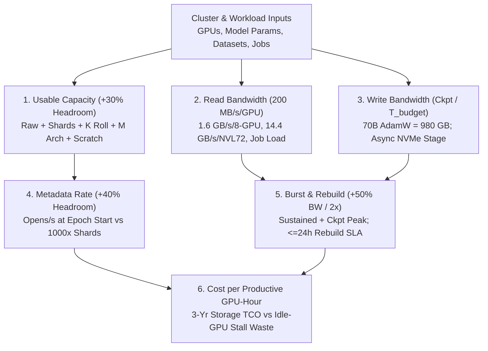
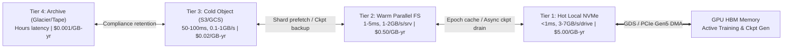

# 13.8 Capacity, performance and cost planning

| Field | Value |
|---|---|
| Level | Advanced |
| Priority tier | 2 |
| Lab venue | GCP / GKE + Local Python Verification Lab |
| Part | Part 13: AI storage |
| Primary sources | NVIDIA Zero-to-Hero Volume 15 and Volume 21; *NVIDIA DGX SuperPOD GB300 Reference Architecture* (`superpod-gb300-ra`); *NVIDIA DGX B200 SuperPOD Data Center Design* (`superpod-b200-dc`); *AI Systems Performance Engineering* (`ai-systems-performance-engineering`) |
| Coverage file | `planning/coverage/chapters/13-08.md` |
| Claim & number ledger | `planning/ledgers/13-08.md` |

## Why this matters for AI infrastructure

Traditional enterprise storage planning treats capacity in terabytes or petabytes as the primary procurement metric. It views storage hardware as a standalone cost center to minimize. In an AI factory, that mental model is backwards. A GPU sitting idle waiting on dataset reads, epoch-start metadata lookups, or synchronous checkpoint writes burns the exact same electricity and lease dollars as a GPU computing at peak utilization.

Consider a 128-GPU A100 training cluster. Between electricity and capital lease amortization, the cluster burns four hundred and thirty-five dollars every hour. If storage stalls leave those GPUs idle for just ten percent of the day, the cluster wastes over a thousand dollars per day. That adds up to roughly three hundred and eighty thousand dollars per year in lost compute.

Spending a hundred thousand dollars on parallel storage to eliminate that stall pays for itself in roughly ninety-six days. When evaluated across concurrent GPU streams, cutting storage stall time from five percent down to one percent by pairing a one-petabyte Lustre tier with local NVMe caching saves nearly nineteen million dollars per year.

```text
Idle-GPU Opportunity Cost vs Storage Investment (V15 Ch. 10):
  - 128-GPU A100 cluster burn rate:
      Power = 128 GPUs x 4 kW x $0.10/kWh = $51.20/hr (~$51/hr)
      Lease = 128 GPUs x $3.00/hr         = $384.00/hr
      Total = $435/hour combined cluster burn rate
  - Storage hardware reference costs:
      1 PB parallel filesystem = $50K-$100K one-time CapEx + $10K/yr maintenance
      1.28 PB distributed local NVMe (10 TB x 128 nodes) = $500K one-time CapEx
  - 10% data stall waste (2.4 hours/day idle):
      2.4 hr/day x $435/hr = $1,044/day = $381,060/year (~$380K/year)
      $100K storage upgrade payback = $100,000 / $1,044 = 95.79 days (95.8 days; 26.24% of 1-yr waste, 2.6% on 10x baseline)
  - Per-GPU-stream stall comparison across 128 GPUs ($435/hr value per stream):
      Option A (Minimal Storage, 5% stall): 128 x 5% x $435/hr = $2,784/hr waste = $24.4M/year (+ $5K/yr maint = $24.4M/yr)
      Option B (Balanced Storage, <1% stall): 128 x 1% x $435/hr = $556.80/hr (~$558/hr) = $4.9M/year
        + $80K Lustre (+$10K/yr) + $500K NVMe (+$5K/yr) = $595K Year-1 storage = $5.5M/year total -> saves $18.9M/year
```

At rack and cluster scale, storage sizing must satisfy six coupled dimensions at the same time:
- **Usable and raw capacity:** Size for raw datasets, preprocessed shards, rolling and archive checkpoints, scratch space, and user home directories. Add thirty percent capacity headroom to stay below the ninety percent fragmentation cliff. Then apply the usable-to-raw multiplier of replication or erasure coding.
- **Sustained read bandwidth:** Size from both per-GPU continuous ingestion demand and concurrent job startup load budgets.
- **Checkpoint write bandwidth:** Size from checkpoint payload divided by the target time budget, separating synchronous network writes from asynchronous local NVMe staging.
- **Metadata operations per second:** Size for peak epoch-start file-open storms plus forty percent metadata headroom. Apply shard packaging to cut metadata operations by three orders of magnitude.
- **Burst headroom and SuperPOD Scalable Unit tiers:** Apply a fifty percent bandwidth headroom rule and match NVIDIA DGX SuperPOD High-Performance Storage Standard and Enhanced tier specifications.
- **Multi-tier FinOps and three-year TCO:** Balance Hot NVMe, Warm parallel filesystems, Cold object storage, and Archive storage within the overall three-year AI factory budget.

## Prerequisites and outcomes

**Prerequisites:**
- Understanding of the seven-layer AI storage data path and local NVMe staging from earlier chapters in Part 13.
- Familiarity with Lustre, BeeGFS, WekaFS, VAST Data, and object storage manifests from Part 13.
- Working knowledge of small-file metadata bottlenecks and sharded distributed checkpointing from the preceding two chapters.

**Outcomes:** After completing this chapter, you will be able to:
1. Execute a six-dimension AI storage sizing calculation covering usable capacity, read bandwidth, write bandwidth, metadata rate, burst headroom, and cost per GPU-hour.
2. Size storage networks and parallel filesystems for NVIDIA DGX SuperPOD Scalable Units across DGX GB300 NVL72 and DGX B200 architectures.
3. Convert usable capacity into raw physical flash capacity across replication and erasure coding schemes while meeting a twenty-four-hour rebuild SLA.
4. Build a four-tier storage placement and three-year TCO model that quantifies when to invest in NVMe caching, parallel filesystems, and spot-instance checkpoint resilience.

---

## 1. The Six-Dimension AI Storage Sizing Framework

Sizing storage for a GPU cluster by adding up dataset terabytes is one of the most expensive mistakes in AI infrastructure engineering. A five-terabyte vision dataset easily fits on a single consumer hard drive. Yet 256 GPUs training across a hundred concurrent jobs on that dataset require gigabytes per second of sustained read and write bandwidth. They also generate tens of thousands of metadata operations per second at every epoch boundary.



| Sizing Dimension | Governing Equation | Mandatory Headroom / Constraint | Typical Bottleneck Symptom | Primary Architectural Lever |
|---|---|---|---|---|
| **1. Usable Capacity** | `C_usable = (D_raw + D_shards + (K + M)* S_ckpt + S_scratch + S_home) * 1.30` | **+30% capacity headroom** (`1 / 1.30 = 76.9%` steady fill, well below **90%** cliff) | `ENOSPC` mid-checkpoint; severe fragmentation and write cliff above `85–90%` fill | Automated rolling-$K$ checkpoint pruning; S3 cold tiering; high-efficiency erasure coding |
| **2. Read Bandwidth** | `B_read = max(N_GPU * R_GPU, J_conc * S_load / T_load)` | **200 MB/s per GPU** (`1.6 GB/s` per `8`-GPU node; **14–20 GB/s** / `14.4 GB/s` per NVL72 rack) | GPU SM utilization oscillates (`100% -> 0%`) while DataLoader prefetch queues drain | Parallel OST striping (Lustre `24` OSTs = `19.2 GB/s`); local NVMe shard caching; GDS |
| **3. Write Bandwidth** | `B_write = J_conc * S_ckpt / T_ckpt_budget` | `70B` AdamW = **14 B/param** (`980 GB` / `~1 TB`) ckpt (`16 B/param` = `1,120 GB` / `1.12 TB` RAM); `< 60–300 s` budget | Multi-minute cluster-wide training freeze (`0%` GPU SM activity) on every checkpoint step | Sharded PyTorch DCP / ZeRO-3 (`15.3125 GB/GPU` / `15.31 GB`, `122.5 GB/node`) + async NVMe staging |
| **4. Metadata Rate** | `IOPS_meta = Batches/s * Files/batch * 1.40` | **+40% metadata headroom**; `< 50,000` ops/sec per Lustre or BeeGFS MDS (`< 5 ms` latency) | **47-minute** epoch-start stall; storage bandwidth near `0 MB/s` while MDS CPU is `100%` | Repackage small files into WebDataset or TFRecord `.tar` shards (**1,000x ops reduction**) |
| **5. Burst & Rebuild** | `B_peak = B_sustained_read + B_ckpt_burst <= B_fabric` | **+50% bandwidth headroom** (**2.0x sustained overbuild**); **24-hour** drive or node rebuild SLA | Training throughput drops `30–50%` whenever a neighboring job writes a checkpoint or rebuild runs | Overbuild fabric `2.0x` sustained (`3 GB/s -> 6 GB/s`, `10 GB/s -> 20 GB/s`); QoS throttling |
| **6. Cost per GPU-Hour** | `Total Annual Cost = Storage Amort + Storage OpEx + (N_GPU * f_stall * C_GPU-hr * 8760)` | Keep storage-induced GPU stall fraction `f_stall < 1%` | Saving `$80K` on storage causes `$18.9M/year` in idle GPU waste (`5%` vs `1%` stall on `128` GPUs) | Invest in parallel FS + local NVMe staging whenever payback period is `< 6–12` months |

### 1.1 Dimension 1: Usable Capacity and the 30 Percent Headroom Rule

A production AI storage pool must hold five distinct data classes plus a mandatory free-space buffer. First are raw source datasets such as JSONL text, Parquet tables, JPEGs, or video files. Second are preprocessed and tokenized shards like WebDataset `.tar` archives or memory-mapped token arrays, which often double the dataset footprint during curation.

Third are rolling active checkpoints kept on fast warm or hot storage for immediate crash recovery. Fourth are archive milestone checkpoints retained across epochs for evaluation and compliance. Fifth are scratch files, exported inference weights, compilation caches, user home directories, and training logs.

Sixth is a thirty percent capacity headroom buffer. Parallel and local filesystems require contiguous free extents for high-bandwidth striped writes. As filesystem occupancy approaches ninety percent, extent allocation fragments, metadata lock contention spikes, and write throughput drops off a cliff. Always add thirty percent capacity headroom on top of your active usable subtotal so steady-state fill stays below seventy-seven percent.

```text
Worked Usable Capacity Calculations (V15 Ch. 10):
  1. Worked Example A — 1.3B-Parameter Model (8 Nodes, 100 Epochs):
     - Training dataset (D_raw + D_shards):       500 GB
     - Checkpoint size per epoch (S_ckpt):        100 GB
     - Rolling checkpoints (K = 20):              20 x 100 GB = 2,000 GB
     - Archive checkpoints (M = 10):              10 x 100 GB = 1,000 GB
     - Model artifacts / scratch (S_scratch):     50 GB
     - Logs and metadata (S_home):                10 GB
     - Usable subtotal:                           500 + 2,000 + 1,000 + 50 + 10 = 3,560 GB
     - 30% capacity headroom:                     3,560 GB x 0.30 = 1,068 GB
     - Total required usable capacity:            3,560 + 1,068 = 4,628 GB (~4.63 TB ~= 5 TB minimum)
  2. Worked Example B — 256-GPU Cluster Multi-Job Sizing:
     - Shared training datasets:                  5 TB (5,000 GB)
     - Active checkpoint pool (2 x 500 GB):       1 TB (1,000 GB)
     - Subtotal before headroom:                  5 TB + 1 TB = 6.0 TB (6,000 GB)
     - 30% capacity headroom:                     6.0 TB x 0.30 = 1.8 TB (1,800 GB)
     - Minimum usable capacity baseline:          6.0 TB + 1.8 TB = 7.8 TB (7,800 GB)
     - Unpruned multi-job explosion warning:      100 jobs x 20 rolling x 0.5 TB = 1,000 TB unless tiered to S3
```

---

## 2. Read, Write, Metadata, and Burst Bandwidth Sizing

### 2.1 Dimension 2: Sustained Read Bandwidth

Read bandwidth must be sized against whichever of two regimes is more demanding: continuous training sample ingestion or burst model and dataset loading at job start.

For pre-tokenized text LLM pretraining, steady-state read bandwidth is tiny. A 70B Llama-3 model running at forty percent MFU on sixty-four H100 GPUs processes roughly sixty thousand tokens per second across the entire cluster. That works out to under a quarter of a megabyte per second of token IDs. For text LLMs, checkpoint writes and startup weight loads dominate storage design.

For vision, audio, video, and multimodal training, continuous ingestion dominates. A standard engineering baseline is two hundred megabytes per second per GPU, which works out to 1.6 GB/s for an eight-GPU node and 14.4 GB/s for a 72-GPU Grace Blackwell NVL72 rack. When multiple jobs start concurrently, startup read demand can be equally high. Three jobs each loading a hundred-gigabyte model within thirty seconds require 10.0 GB/s of aggregate read throughput.

```text
Sustained Read Bandwidth & Concurrent Startup Math (AISPE Ch. 5, V15 Ch. 10, V21 Ch. 04):
  - Text LLM ingestion (Llama-3-70B on 64 H100 GPUs at 40% MFU, 989 TFLOPS):
      Tokens/s/GPU ~= (0.40 x 989 x 10^12) / (6 x 70 x 10^9) ~= 940 tokens/s/GPU (~60,000 tokens/s on 64 GPUs)
      At 2-4 B/token = 120-240 KB/s cluster-wide (6 TB tokenized dataset at 1 GB/s takes 6,000 s ~= 1.7 hours)
  - Multimodal / Vision 200 MB/s per GPU rule:
      8-GPU server (DGX H100/B200) = 8 x 200 MB/s  = 1.6 GB/s
      64-GPU cluster (8 nodes)     = 64 x 200 MB/s = 12.8 GB/s
      72-GPU GB200/GB300 NVL72     = 72 x 200 MB/s = 14.4 GB/s (14-20 GB/s operational rack envelope)
  - Concurrent job startup load budget (3 jobs loading 100 GB in 30 s):
      Per-job read = 100 GB / 30 s = 3.3333 GB/s (~3.33 GB/s / 3.3 GB/s) -> 3 jobs = 10.0 GB/s (9.9 GB/s)
      Lustre 24 OSTs x 800 MB/s = 19.2 GB/s (PASSES with 92% headroom)
      BeeGFS 8 nodes x 1.5 GB/s = 12.0 GB/s (PASSES with 20% headroom)
      Single-server NFS         = 2.0 GB/s  (FAILS, 5.0x too slow -> 150-second load stall)
```

### 2.2 Dimension 3: Checkpoint Write Bandwidth and Two-Tier Async Staging

During distributed training with mixed-precision AdamW, every parameter requires fourteen bytes of persistent checkpoint state, compared to sixteen bytes per parameter of active GPU training memory. For a 70B model, each checkpoint writes 980 GB, or roughly one terabyte. When sharded with ZeRO-3 or PyTorch FSDP across sixty-four GPUs on eight nodes, each GPU writes a 15.3125 GB shard and each node writes 122.5 GB.

Writing a five-hundred-gigabyte checkpoint synchronously over a slow network path stalls all GPUs for five hundred seconds. By staging each node's shard to local NVMe at 20 GB/s first, the synchronous pause drops twentyfold to twenty-five seconds for that dump, or just 6.125 seconds for a 122.5 GB node shard. Background threads then drain the staged files to the warm parallel filesystem and cold S3 archive while training continues.

```text
Checkpoint Write Bandwidth & Two-Tier Staging Math (V15 Ch. 10 & 12, V21 Ch. 04):
  - 70B mixed-precision AdamW state:
      2 B BF16 weights + 4 B FP32 master + 4 B Adam m + 4 B Adam v = 14 B/param x 70B = 980 GB (~1 TB)
      Active training memory (including 2 B BF16 gradients)        = 16 B/param x 70B = 1,120 GB (~1.1 TB)
      Sharded across 64 GPUs (8 nodes): 980 GB / 64 = 15.3125 GB/GPU (~15 GB); 15.3125 x 8 = 122.5 GB/node (~122 GB)
      Weekly volume: 980 GB at 10 GB/s = 98-100 s; every 8h (3/day x 7) = ~21 TB/week; every 24h = ~7 TB/week
  - Smaller 100 GB checkpoint in 300 s (5 min) budget:
      100,000 MB / 300 s = 333.33 MB/s (~333 MB/s) per stream; 8 streams = 2.6667 GB/s (~2.7 GB/s)
      Lustre 24 OSTs x 400 MB/s = 9.6 GB/s write and BeeGFS 8 x 1.5 GB/s = 12.0 GB/s absorb easily
  - Synchronous vs Async Local NVMe Staging (PCIe Gen5 x16 = 64 GB/s, local NVMe RAID = 10-20 GB/s):
      500 GB sync at 1 GB/s = 500 seconds (8.33 min) vs 20 GB/s local NVMe = 25 seconds (20.0x reduction, saves 475 seconds)
      122.5 GB node shard at 20 GB/s = 6.125 seconds (or 12.25 seconds at 10 GB/s, ~10 seconds)
```

### 2.3 Dimensions 4 and 5: Metadata Rate and Burst Overbuild

High sequential bandwidth is useless if the Metadata Server is saturated. Training on 1.2 million small images generates 4.8 million metadata operations per epoch and 25,600 file opens per second. Adding the mandatory forty percent metadata headroom requires 35,840 operations per second. That rate crushes a single NFS server and causes a forty-seven-minute stall at the start of every epoch.

Repackaging a thousand small images into each sequential WebDataset `.tar` or TFRecord shard cuts metadata operations by three orders of magnitude, dropping the open rate to 25.6 opens per second. Finally, because checkpoint bursts overlap with ongoing dataset reads, always apply the 2.0x burst overbuild rule, which adds fifty percent headroom on peak traffic.

```text
Metadata IOPS & Burst Overbuild Math (V15 Ch. 10 & Ch. 12):
  - 1.2M small images (100 KB each) per-epoch volume:
      1.2M open() + 1.2M close() + 2.4M stat() = 4.8 million metadata ops/epoch
  - Real-time open rate (256 files/batch x 100 batches/sec):
      Raw rate = 25,600 opens/sec; with +40% metadata headroom = 25,600 x 1.40 = 35,840 ops/sec
      Single NFS (5,000 ops/s) FAILS (5.12x below raw demand; causes ~47-minute epoch-start stall)
      Lustre 1 MDS (50,000 ops/s), 2 MDTs (100,000 ops/s), DNE (500,000+ ops/s), BeeGFS (50,000-100,000 ops/s) PASS
  - WebDataset / TFRecord 1,000x sharding fix:
      25,600 / 1,000 = 25.6 opens/sec (5 TB in 1,000 shards x 100 jobs = 100,000 opens per entire epoch)
  - Burst handling & 2.0x overbuild rule (+50% bandwidth headroom):
      1 GB/s sustained read + 5 GB/s checkpoint burst = 6 GB/s peak
      3 GB/s sustained -> provision 6 GB/s; 10 GB/s sustained -> provision 20 GB/s
```

---

## 3. NVIDIA DGX SuperPOD High-Performance Storage Architecture

When scaling from tens of GPUs to thousands of GPUs in an enterprise AI factory, the NVIDIA DGX SuperPOD Reference Architecture standardizes compute, network fabrics, and High-Performance Storage into modular Scalable Units.

### 3.1 DGX GB300 NVL72 vs DGX B200 SuperPOD Scalable Units

| Architectural Attribute | DGX GB300 NVL72 SuperPOD (`superpod-gb300-ra`) | DGX B200 SuperPOD (`superpod-b200-dc`) |
|---|---|---|
| **Compute building block** | **DGX GB300 NVL72 rack:** `72` B300 GPUs + `36` Grace CPUs across `18` compute trays (`2` GB300 Superchips/tray, `900 GB/s` NVLink-C2C) + `9` NVLink switch trays (`18` switch chips, `1.8 TB/s`/GPU NVL5) | **DGX B200 system:** `8` Blackwell B200 GPUs per air-cooled server (`2` systems/rack standard, `4` systems/rack high-density in `48U`/`52U` racks) |
| **Size of 1 Scalable Unit (SU)** | **8 DGX GB300 racks** = **576 GPUs** (`144` compute trays) requiring **1.2 MW TDP** (`8` power shelves/rack x `6` x `5.5 kW` PSUs = `33 kW`/shelf) | Up to **32 DGX B200 systems** = **256 GPUs** requiring **458 kW per SU** (`127` DGX B200 systems = **1,016 GPUs** at `4` SUs, as `1` server is displaced by the UFM appliance) |
| **Maximum scale-out documented** | Up to **16 SUs** = **128 racks** = **9,216 GPUs** (`128` Q3400-RD `800G` IB leaves + `72` spines, `19.2 MW`) | Multi-SU interconnected via common InfiniBand spine and shared High-Performance Storage |
| **Local NVMe scratch per node/tray** | **4 x 3.84 TB (`15.36 TB`) E1.S NVMe in RAID 0** for local staging + **1 x 1.92 TB M.2 NVMe** for OS (`276.48 TB` RAID 0/rack; **2,211.84 TB RAID 0/SU**, `~2.21 PB`) | Local NVMe cache and scratch array per DGX B200 system for dataset caching and async checkpoint staging |
| **Storage NIC & fabric segmentation** | **1 x BlueField-3 (`BF3240`) dual-port `2x400G` DPU** per tray: `1 x 400 Gbps` dedicated to **RoCEv2 Storage Network** + `1 x 200+ Gbps` (`400G` port) to **In-Band Mgmt / NFS** (`1:3` compute leaf blocking: `24x400G` uplinks; `72x400G` non-blocking storage leaves on SN5600D) | Dedicated high-speed storage fabric (RoCEv2 or InfiniBand) separated from compute fabric and out-of-band management |

In the DGX GB300 SuperPOD, dedicating one 400 Gbps RoCEv2 port on each BlueField-3 DPU exclusively to storage guarantees that bursty checkpoint writes and GPUDirect Storage DMA streams never contend with cluster control traffic. Kubernetes, Slurm, container image pulls, and NFS home-directory traffic stay isolated on the In-Band management port. As the cluster scales from two Scalable Units to sixteen Scalable Units, the SN5600D Spectrum-4 Ethernet storage fabric scales its non-blocking 400GbE storage links linearly.

| SuperPOD Scale (`GB300`) | GPUs | SUs | Compute Leaf Switches (`SN5600D`) | Storage Leaf Switches (`SN5600D`) | Spine Switches (`SN5600D`) | Max Supported Storage Fabric Links |
|---|---|---|---|---|---|---|
| **2-SU Cluster** | 1,152 | 2 | 8 (`4` per SU) | 2 | 4 | **64 x 400GbE** (`25.6 Tbps` = `3.2 TB/s` raw line rate) |
| **4-SU Cluster** | 2,304 | 4 | 16 (`4` per SU, `32` racks, `576` trays, `4.8 MW`) | 2 | 8 | **128 x 400GbE** (`51.2 Tbps` = `6.4 TB/s` raw line rate) |
| **8-SU Cluster** | 4,608 | 8 | 32 (`4` per SU) | 4 | 12 | **256 x 400GbE** (`102.4 Tbps` = `12.8 TB/s` raw line rate) |
| **16-SU Cluster** | 9,216 | 16 | 64 (`4` per SU) | 8 | 24 | **1024 x 400GbE** (`409.6 Tbps` = `51.2 TB/s` raw line rate) |

### 3.2 SuperPOD Standard Tier vs Enhanced Tier

NVIDIA certifies partner parallel filesystems such as DDN EXAScaler, WEKA, VAST Data, IBM Storage Scale, NetApp, and Dell against two workload-driven High-Performance Storage tiers defined per Scalable Unit.

| SuperPOD HPS Tier | Workload & Dataset Characterization | `1 SU` Read (`GB/s`) | `1 SU` Write (`GB/s`) | `4 SU` Read (`GB/s`) | `4 SU` Write (`GB/s`) | `16 SU` Read (`GB/s`) | `16 SU` Write (`GB/s`) |
|---|---|---|---|---|---|---|---|
| **Standard Tier** | Concurrent LLM pretraining, fine-tuning, periodic checkpoints, and inference where compute dominates I/O; single-modality datasets fit within local compute memory and NVMe cache | **90 GB/s** | **45 GB/s** | **360 GB/s** | **180 GB/s** | **1,440 GB/s** (`1.44 TB/s`) | **720 GB/s** |
| **Enhanced Tier** | Concurrent multimodal training, frequent large checkpoints, and inference where I/O bounds wall-clock timing; multi-modality datasets exceed local cache and models have billions or trillions of parameters (`3.1111x` / `3.11x` Standard) | **280 GB/s** | **140 GB/s** | **1,120 GB/s** (`1.12 TB/s`) | **560 GB/s** | **4,480 GB/s** (`4.48 TB/s`) | **2,240 GB/s** (`2.24 TB/s`) |

Three engineering ratios stand out in the SuperPOD storage specification:
- **Two-to-one read-to-write asymmetry:** Both Standard and Enhanced tiers specify a 2.0x read-to-write bandwidth ratio, matching the higher sequential read throughput of NVMe flash and erasure-coded filesystems.
- **Enhanced-to-Standard step-up:** Moving from the Standard tier to the Enhanced tier multiplies required per-SU storage bandwidth by roughly 3.11x.
- **Local NVMe staging buffer:** Each DGX GB300 Scalable Unit carries 2,211.84 TB of aggregate local RAID 0 NVMe scratch across its compute trays. That local flash absorbs immediate rank-local checkpoint shards at multi-terabyte-per-second PCIe speeds while the shared RoCEv2 parallel filesystem drains them asynchronously.

---

## 4. Usable-to-Raw Efficiency, Erasure Coding, and Multi-Tier FinOps

### 4.1 Converting Usable TB to Raw Flash TB: Replication vs Erasure Coding

Once you have calculated your required usable capacity including the thirty percent free-space headroom, you must convert that figure into raw physical flash capacity. That multiplier depends on the storage system's data protection scheme. At the same time, you must reserve enough background network bandwidth to rebuild a failed drive or storage sled within twenty-four hours.

```text
Usable-to-Raw Efficiency & 24-Hour Rebuild SLA Math (V15 Ch. 10 & ADC Ch. 9):
  - Erasure coding efficiency:   eta_EC = N / (N + K)
  - Raw flash required:          C_raw  = C_usable / eta_EC = C_usable x (N + K) / N
  - 24-hour rebuild SLA formula: B_rebuild_24h = S_failed_unit / (24 x 3600 s) = S_failed_unit / 86,400 seconds
  - Failed 15.36 TB NVMe drive:  15.36 TB / 86,400 s = 177.78 MB/s minimum sustained rebuild rate
  - Failed 61.44 TB QLC sled:    61.44 TB / 86,400 s = 711.11 MB/s minimum sustained rebuild rate
```

| Protection Scheme | Example Storage Platform | Data ($N$) + Parity/Mirror ($K$) | Usable-to-Raw Efficiency | Raw Multiplier | Raw Flash Needed for `1,000 TB` (`1 PB`) Usable | Parity / Replica Overhead (`TB`) |
|---|---|---|---|---|---|---|
| **3x Replication** | Ceph Default / HDFS / Early 3FS Metadata | `1 + 2` | **33.33%** | `3.0000x` (`3.0x`) | **3,000.00 TB** (`3.00 PB`) | `2,000.00 TB` |
| **2x Replication** | Lustre / BeeGFS Mirrored Targets | `1 + 1` | **50.00%** (`50.0%`) | `2.0000x` (`2.0x`) | **2,000.00 TB** (`2.00 PB`) | `1,000.00 TB` |
| **6 + 2 Erasure Coding** | WekaFS (`8`-node small cluster) | `6 + 2` | **75.00%** (`75.0%`) | `1.3333x` | **1,333.33 TB** (`1.33 PB`) | `333.33 TB` |
| **8 + 2 Erasure Coding** | Lustre ZFS RAID-Z2 / IBM Storage Scale | `8 + 2` | **80.00%** (`80.0%`) | `1.2500x` | **1,250.00 TB** (`1.25 PB`) | `250.00 TB` |
| **16 + 2 Erasure Coding** | WekaFS (`18+`-node production cluster) | `16 + 2` | **88.89%** | `1.1250x` | **1,125.00 TB** (`1.125 PB`) | `125.00 TB` |
| **146 + 4 Wide Stripe** | VAST Data DASE (QLC + SCM buffer) | `146 + 4` | **97.33%** | `1.0274x` | **1,027.40 TB** (`1.027 PB`) | **27.40 TB** (`2.67%`) |

When an NVMe drive fails in an erasure-coded pool, the storage cluster reconstructs the lost data strips across surviving nodes. It must finish before additional failures exceed the parity count. Rebuilding a 15.36 TB drive within twenty-four hours requires 177.78 MB/s of background throughput, while a 61.44 TB sled requires 711.11 MB/s. Both rebuild streams must fit inside your fifty percent bandwidth headroom so active GPU training jobs never stall during a drive replacement.

### 4.2 Four-Tier Storage Architecture and 3-Year TCO Economics

Because storage media unit costs span five thousandfold from local NVMe flash down to deep archive tape, placing all datasets and historical checkpoints on a single tier wastes budget. Production AI factories instead map each stage of the data lifecycle to one of four storage tiers.



| Storage Tier | Media & Representative Systems | Access Latency | Typical Throughput | Primary AI Workload Role | Annual Unit Cost (`$/GB-year`) | Worked `1.3B` Model Allocation & Cost |
|---|---|---|---|---|---|---|
| **Tier 1: Hot** | Local PCIe Gen4/Gen5 NVMe (RAID 0 / Lustre LNet / Weka cache) | **< 1 ms** | **3–7 GB/s per drive** (`15–50+ GB/s`/node) | Current epoch working-set cache and synchronous or async local checkpoint staging | **$5.00 / GB-yr** | `100 GB x $5.00` = **$500 / yr** |
| **Tier 2: Warm** | Parallel Filesystem (Lustre, BeeGFS, WekaFS, VAST, GPFS) | **1–5 ms** | **1–2 GB/s per server** (`10–1,120+ GB/s` cluster) | Active shared training datasets, preprocessed shards, and rolling-$K$ checkpoints | **$0.50 / GB-yr** | `2.5 TB` (`2,500 GB`) `x $0.50` = **$1,250 / yr** |
| **Tier 3: Cold** | Object Storage (AWS S3, GCS, MinIO, Ceph RGW) | **50–100 ms** | **0.1–1 GB/s** per stream | Durable source-of-truth datasets, manifest versions, and periodic (`8h`/`24h`) checkpoint backups | **$0.02 / GB-yr** (S3 Standard `~$0.023/GB-mo` = **$2,300/mo per `100 TB`**) | `5.0 TB` (`5,000 GB`) `x $0.02` = **$100 / yr** |
| **Tier 4: Archive** | Deep Object Archive / Tape (S3 Glacier Deep Archive, LTO) | **Hours** | Batch restore only | Long-term regulatory audit trails and historical release checkpoints | **$0.001 / GB-yr** (`5,000x` cheaper than Hot NVMe) | `10.0 TB` (`10,000 GB`) `x $0.001` = **$10 / yr** |
| **Blended Total** | **4-Tier Lifecycle Pipeline** | **Sub-ms on hot path** | **Matches GPU ingest & ckpt burst** | **Full `17.6 TB` lifecycle footprint** | **$8.81 / TB-month blended** | **`17.6 TB` total = $1,860 / year** |

How does storage fit into the macro-economics of a multi-year AI factory deployment? Across a 1,200-GPU H100 factory, the three-year Total Cost of Ownership is 70.2 million dollars. The two million dollars spent on NVMe, NAS, and SAN storage hardware represents less than five percent of hardware CapEx and under three percent of total TCO.

Similarly, in cloud bursts where renting an 8xH100 Spot instance saves sixty-five percent compared to on-demand pricing, cloud providers give only a two-minute preemption warning. Capturing that compute discount requires a storage pipeline fast enough to flush an emergency checkpoint in under two minutes.

```text
3-Year AI Factory TCO, Fleet Refresh & Spot FinOps Breakdown (V21 Ch. 04, Ch. 11 & Ch. 12):
  1. 3-Year Fleet Refresh & Lead-Time Planning (464 -> 800 -> 900 GPUs):
     - Year 1: 464 H100 GPUs (400 inference + 64 training at $30K) = $13.9M CapEx
     - Year 2: +60 H200 GPUs at $40K = $2.4M CapEx (vs $1.8M for H100)
     - Year 3: +100 H200 GPUs at $35K = $3.5M CapEx (vs $2.5M for H100 at $25K)
     - Total 3-Yr TCO: $19.8M CapEx + $9.0M OpEx ($3.0M/yr power + staff) = $28.8M across (464x3 + 60x2 + 100x1) = 1,612 GPU-years
     - Amortized cost: $28.8M / 1,612 = $17,866 (~$17.9K / $17.87K) per GPU-year
     - Lead-time rule: 3-9 month supply-chain lead times -> target 70-85% steady utilization (80%+ SM util target)
  2. 1,200-GPU H100 AI Factory 3-Year TCO ($70.2M Total, 1,186.8 PFLOPS BF16 at 989 TFLOPS/GPU, ~9,100 QPS at 7.6 QPS/GPU):
     - 3-Yr CapEx ($44.0M): $36.0M GPUs + $1.5M IB/Ethernet + $2.0M NVMe/NAS/SAN storage + $1.5M power/cooling + $2.0M chassis + $1.0M labor
     - 3-Yr OpEx ($26.2M):  $2.15M electricity (680 kW avg, 1.35 PUE) + $13.5M staff (30 FTEs at $150K/yr) + $6.0M maint + $3.0M WAN + $1.5M software
     - Unit economics:      $70.2M / 3,600 GPU-yrs = $19.5K/GPU-yr ($10.0K GPU CapEx + $7.3K OpEx + $2.2K non-GPU HW); $19.7K/PFLOP-yr;
                            408 GPUs serving 2,000 QPS (25.9B tokens/day at $18.1K/day) = $0.70 / million tokens
     - Storage share:       $2.0M storage CapEx = 4.55% of $44.0M CapEx and 2.85% of $70.2M 3-year TCO
     - 1 PB (1,000 TB) storage 3-Yr TCO: $2.0M CapEx + 3 x $200K/yr maint + 3 x $56,764.80/yr power (40 kW, 1.35 PUE, $0.12/kWh)
                            = $2,770,294.40 total 3-year TCO = $76.95 / TB-month
  3. Cloud Spot Instance Resilience (p5.48xlarge 8xH100):
     - Spot = $21/hr ($2.63 / $2.625 per GPU-hr, $18.9K/GPU-yr over 300 days) vs On-Demand = $60/hr ($7.50/GPU-hr, $54K/GPU-yr)
     - Discount = 65.0% savings ($35.1K/GPU-yr), gated by 2-minute (120-second) spot eviction warning at
       http://169.254.169.254/latest/meta-data/spot/instance-action
```

---

## 5. Production Readiness Checklist and End-to-End Cluster Sizing Walkthrough

Before declaring an AI storage architecture ready for production training and inference, platform teams must validate both the quantitative sizing worksheet and the operational readiness checklist across all seven layers of the data path.

### 5.1 Worked Sizing Walkthrough: 256-GPU Distributed Training Cluster

Suppose you are asked to architect the storage layer for a 256-GPU distributed training cluster with shared training datasets, model checkpoints, and up to a hundred concurrent training jobs planned across research teams.

First, size usable and raw capacity. The active working set is five terabytes of datasets plus one terabyte of active checkpoint buffers, and adding thirty percent headroom yields a 7.8 TB minimum usable baseline. Enforce an automated lifecycle policy that keeps two rolling checkpoints per active job on warm flash and tiers older checkpoints to cold S3 object storage. Provision a twelve-node Lustre cluster with eight OST storage nodes, two MDS metadata nodes, one backup MDS, and one MGS management node. Using twelve-terabyte enterprise NVMe SSDs per OST provides 96 TB raw and 80 TB usable capacity.

Second, size read and write bandwidth. Loading the dataset across concurrent job shards within sixty seconds requires 8.3 GB/s of sustained read bandwidth, or 10 to 15 GB/s with fifty percent headroom. Absorbing 5 GB/s checkpoint bursts alongside ongoing reads requires 8 to 10 GB/s of sustained write bandwidth. A 24-OST Lustre layout delivering 19.2 GB/s read and 9.6 GB/s write satisfies both targets comfortably.

Third, size metadata and verify financial payback. Packaging the dataset into a thousand WebDataset `.tar` shards caps epoch-start file opens at a hundred thousand across all jobs, well inside the ceiling of two Lustre MDTs. At roughly a hundred thousand dollars CapEx plus ten thousand dollars per year maintenance, the storage tier costs less than three percent of the annual compute wasted if an undersized NAS stalls the cluster.

### 5.2 Production AI Storage Deployment Checklist

| Verification Domain | Production Gate / Requirement | Verification Tool / Metric (untested here) |
|---|---|---|
| **1. Seven-Layer Data Path & GDS** | Benchmark media, storage server, fabric, client FS, page cache, CPU RAM, PCIe, and GPU HBM independently; confirm `PHB` or better topology for GDS and verify zero CPU bounce copies | `nvidia-smi topo -m`, `perf record` (absence of `__memcpy_avx2`), `/proc/driver/nvidia-fs/stats`, `nvidia-smi dmon -s t` |
| **2. Capacity & Target Balance** | Reserve **30% capacity headroom** (alert at `75%`, hard gate before **90% fill**); keep all OST or `beegfs-storage` targets within **±5% fill** (`> 10%` spread triggers migration) | `lfs df -h`, `lfs df -i`, `beegfs-ctl --listtargets --nodetype=storage --spaceinfo` |
| **3. Metadata & Small-File Sharding** | Size MDS and MDT count against **peak epoch-start ops/sec + 40% headroom**; repackage datasets with `> 100K` small files into WebDataset or TFRecord shards (`1,000x` ops reduction) | `strace -c -e openat`, `beegfs-ctl --serverstats --nodetype=meta`, `lctl get_param mdt.*.md_stats` |
| **4. Directory Striping at Creation** | Configure wide stripe patterns (`lfs setstripe -c -1 -S 4M` or `beegfs-ctl --setpattern --chunksize=2M --numtargets=12`) on `/checkpoints` and `/datasets` **before** files are written | `lfs getstripe /lustre/checkpoints`, `beegfs-ctl --getentryinfo /beegfs/checkpoints` |
| **5. Async Two-Tier Checkpointing** | Stage sharded checkpoints (`14 B/param`) to **local NVMe** first (`6–25 s`), write to temp names plus atomic rename, verify SHA-256 manifest checksums, and test multi-node restore RTO | Local NVMe eviction daemon, `sha256sum -c manifest.sha256`, end-to-end restore drill on altered node count |
| **6. Correlated GPU + Storage Telemetry** | Join GPU SM utilization (`DCGM_FI_DEV_GPU_UTIL`), DataLoader queue depth, OST throughput, and MDS latency (`< 5 ms`) on a single dashboard to price idle-GPU-hours during the worst `60 s` of each epoch | Prometheus + Grafana (`dcgm-exporter` + `node_exporter` + Lustre/BeeGFS/WEKA exporters) |

---

## Commands and configurations that matter

### 1. Auditing Usable Capacity, Inode Headroom, and Target Skew

```bash
# (untested here) Verify Lustre OST and MDT capacity and inode fill (keep capacity < 85-90% and balanced within +/-5%)
lfs df -h /mnt/lustre
lfs df -i /mnt/lustre

# (untested here) Verify BeeGFS storage target fill balance and metadata server ops/sec + latency (< 5 ms)
beegfs-ctl --listtargets --nodetype=storage --spaceinfo
beegfs-ctl --serverstats --nodetype=meta --names

# (untested here) Pre-configure directory stripe patterns BEFORE writing checkpoints or dataset shards
lfs setstripe -S 4M -c 16 /mnt/lustre/checkpoints
beegfs-ctl --setpattern --chunksize=2M --numtargets=12 /mnt/beegfs/checkpoints
```

### 2. Measuring Sustained Read/Write Bandwidth and Metadata IOPS with `fio` and `gdsio`

```bash
# (untested here) Benchmark multi-stream sequential read bandwidth (simulating 8 DataLoader workers reading 4 MiB chunks)
fio --name=seq_read_sizing \
    --directory=/mnt/lustre/benchmark \
    --rw=read --bs=4M --direct=1 --ioengine=libaio \
    --iodepth=16 --numjobs=8 --size=16G --group_reporting

# (untested here) Benchmark burst checkpoint write bandwidth (simulating 8 GPU ranks flushing 15.31 GB ZeRO-3 shards)
fio --name=ckpt_write_burst \
    --directory=/nvme/staging_cache \
    --rw=write --bs=4M --direct=1 --ioengine=libaio \
    --iodepth=8 --numjobs=8 --size=16G --end_fsync=1 --group_reporting

# (untested here) Compare GPUDirect Storage (-x 0, direct DMA) vs CPU bounce buffer (-x 2) read bandwidth
/usr/local/cuda/gds/tools/gdsio -f /mnt/vast/train/shard-000.bin -d 0 -w 4 -s 10G -i 1M -x 2 -I 0
/usr/local/cuda/gds/tools/gdsio -f /mnt/vast/train/shard-000.bin -d 0 -w 4 -s 10G -i 1M -x 0 -I 0

# (untested here) Profile file-open metadata rate of a live training process to catch unsharded small-file storms
strace -f -c -e trace=openat,stat,newfstatat -p $(pgrep -n -f train.py)
```

### 3. Executing the Deterministic Capacity, SuperPOD, and TCO Calculator

```bash
# Run the Chapter 13.8 pure-stdlib verification lab (26 self-checks)
python3 -B code/part13/storage_capacity_cost_planning_lab.py
```

---

## How it fails

| Failure Mode | Observable Symptom | Root Cause | Diagnosis Command (untested here) | Architectural Fix |
|---|---|---|---|---|
| **1. The 90% Fill Fragmentation Cliff** | Checkpoint write time jumps `3x–5x` (`78 s -> 350 s`) or jobs crash with `ENOSPC` even though `df -h` shows `12%` free space on the cluster | Unbalanced OST or storage targets (one target hits `92–100%` while others sit at `65%`) or failure to reserve **30% capacity headroom** | `lfs df -h` or `beegfs-ctl --listtargets --spaceinfo` (check max spread `> 10%`) | Enforce `30%` free-space headroom (`< 75–80%` steady fill); automate rolling-$K$ checkpoint pruning; run `lfs_migrate` or `beegfs-ctl --migrate` on skewed targets |
| **2. Epoch-Start Metadata Storm (`47`-Minute Stall)** | GPU SM utilization drops to `0%` for `30–47 minutes` at the start of every epoch; storage network bandwidth is `< 100 MB/s` while MDS CPU is `100%` | Dataset stored as millions of raw `100 KB` JPEGs (`25,600–200,000+` opens/sec) exceeding the `50,000` ops/sec per-MDS ceiling | `strace -c -e openat -p <PID>` and `beegfs-ctl --serverstats --nodetype=meta` (latency `> 20 ms`) | Repackage small files into WebDataset `.tar` or TFRecord shards (`1,000x` metadata reduction to `25.6` ops/sec) and scale out MDS/MDT nodes with `+40%` headroom |
| **3. Concurrent Checkpoint + Read Collision** | Training step time doubles across all jobs whenever a large `70B` job saves its `980 GB` checkpoint | Storage bandwidth was sized for average read (`3 GB/s`) without the **2.0x burst overbuild (+50% headroom)** for `5 GB/s` checkpoint bursts | Correlate `DCGM_FI_DEV_GPU_UTIL` dips with storage fabric RoCEv2 or IB port saturation (`ethtool -S`, `perfquery`) | Stage checkpoints to local NVMe (`122.5 GB`/node in `6.1–12.2 s` at `10–20 GB/s`), drain asynchronously at throttled rate, and overbuild shared bandwidth `2.0x` |
| **4. Spot Instance Eviction Checkpoint Loss** | Preemptible or Spot training job (`8xH100` at `$21/hr`) loses `4–8 hours` of compute on eviction because its emergency checkpoint write times out | AWS or GCP spot termination gives only **120 seconds (2 minutes)** warning, but synchronous `980 GB` write at `2 GB/s` takes `490 seconds` | Inspect spot termination handler logs (`169.254.169.254/latest/meta-data/spot/instance-action`) and checkpoint write duration | Poll spot metadata every `5 s`; on eviction signal, flush sharded PyTorch DCP state to **local NVMe** or high-speed parallel tier sized for `< 30–60 s` completion |
| **5. Local NVMe Cache Eviction Thrashing** | Training runs fast in Epoch 2 (`2.1 min` wait, `98.2%` hit rate) but slows down in Epoch 3+ (`3.5+ min` wait) with heavy S3 or NAS re-downloads | Local NVMe cache occupancy crosses **85% fill** (`88%+`), causing LRU eviction of early-epoch shards before the next epoch reads them | Monitor local `/nvme/cache` capacity (`df -h /nvme`) and per-epoch cache hit counters | Partition dataset shards deterministically per rank (`my_files = all_files[rank::world_size]`) so each node's slice fits within `< 80%` of its local NVMe (`15.36 TB` on GB300) |
| **6. Degraded Erasure Rebuild Starving GPUs** | A single failed `15.36 TB` or `61.44 TB` NVMe drive causes a `25%` drop in training throughput for `24–48 hours` | Storage cluster prioritizes parity reconstruction (`177.78–711.11 MB/s` per failed unit) without reserved rebuild bandwidth headroom | Check storage array rebuild progress and client read latency (`gdsio` / `ioping`) during degraded mode | Reserve **50% bandwidth headroom** and spare capacity so `24`-hour rebuilds (`177.78 MB/s` per `15.36 TB`) run inside the headroom envelope without throttling GPU reads |

---

## Hands-on lab

### Lab Venue and Objectives
- **Venue:** Local Python 3 verification environment executing `code/part13/storage_capacity_cost_planning.py` and `code/part13/storage_capacity_cost_planning_lab.py` with zero external dependencies.
- **Objective:** Deterministically verify all twenty-six quantitative models in this chapter. The lab checks six-dimension capacity, bandwidth, metadata, and burst sizing alongside NVIDIA DGX SuperPOD GB300 and B200 Standard versus Enhanced HPS sizing. It also validates replication versus erasure coding raw flash and rebuild math, four-tier storage placement, and three-year TCO and idle-GPU stall ROI.

### Step 1: Run the Verification Lab

```bash
python3 -B code/part13/storage_capacity_cost_planning_lab.py
```

### Expected Output

```text
=== Chapter 13.8 Lab: Capacity, Performance and Cost Planning ===
  [PASS] 1. Headroom rules reserve 30% capacity (<90% fill), 50% bandwidth (2.0x burst overbuild), 40% metadata, and <=24h rebuild SLA
  [PASS] 2. V15 Ch. 10 1.3B-model usable capacity: 500 GB dataset + 2,000 GB rolling + 1,000 GB archive + 50 GB artifacts + 10 GB logs = 3,560 GB + 30% (1,068 GB) = 4,628 GB
  [PASS] 3. V15 Ch. 10 256-GPU cluster interview baseline: 5,000 GB dataset + 1,000 GB checkpoints + 30% headroom (1,800 GB) = 7,800 GB (7.8 TB)
  [PASS] 4. Per-GPU 200 MB/s ingestion requires 1.6 GB/s per 8-GPU node and 14.4 GB/s (14-20 GB/s envelope) per 72-GPU GB200/GB300 NVL72 rack (AISPE Ch. 5)
  [PASS] 5. V15 Ch. 10 read bandwidth: 3 concurrent jobs loading 100 GB in 30 s require 3.3333 GB/s/job = 10.0 GB/s (Lustre 24 OSTs = 19.2 GB/s and BeeGFS 8 nodes = 12.0 GB/s pass; NFS 2.0 GB/s fails)
  [PASS] 6. V15 Ch. 10 checkpoint write budget: 100 GB checkpoint in 300 s (5 min) requires 333.33 MB/s (2.6667 GB/s across 8 parallel streams vs 9.6 GB/s Lustre write capacity)
  [PASS] 7. V21 Ch. 04 70B Llama mixed-precision AdamW checkpoint is 14 B/param = 980 GB (16 B/param = 1,120 GB training memory), sharded across 64 GPUs = 15.3125 GB/GPU and 122.5 GB/node
  [PASS] 8. V15 Ch. 12 synchronous 500 GB checkpoint at 1 GB/s stalls training for 500 s vs 25 s when staged asynchronously to local NVMe at 20 GB/s (20.0x stall reduction)
  [PASS] 9. V15 Ch. 10 burst handling: 1 GB/s sustained read + 5 GB/s checkpoint burst = 6 GB/s peak; 2.0x overbuild rule sizes 3 GB/s -> 6 GB/s and 10 GB/s -> 20 GB/s
  [PASS] 10. V15 Ch. 10 metadata sizing: 1.2M small images generate 4.8M ops/epoch and 25,600 opens/sec (35,840 ops/sec with 40% headroom; Lustre/BeeGFS 50K pass, NFS 5K fails; WebDataset cuts ops 1,000x to 25.6/s)
  [PASS] 11. SuperPOD Standard Tier delivers 90 GB/s read and 45 GB/s write per SU (360 GB/s read and 180 GB/s write for 4 SUs)
  [PASS] 12. SuperPOD Enhanced Tier delivers 280 GB/s read and 140 GB/s write per SU (1,120 GB/s read and 560 GB/s write for 4 SUs; 3.1111x Standard Tier)
  [PASS] 13. DGX GB300 SuperPOD SU has 8 NVL72 racks (576 GPUs, 144 compute trays, 15.36 TB RAID0 NVMe/tray = 2,211.84 TB/SU, 1.2 MW TDP) and scales to 16 SUs (128 racks, 9,216 GPUs, 1024x400GbE)
  [PASS] 14. DGX B200 SuperPOD SU has up to 32 DGX B200 systems (256 GPUs, 458 kW/SU) and 127 systems (1,016 GPUs) at 4 SUs with 1 system displaced by UFM (`superpod-b200-dc`)
  [PASS] 15. 2x replication (1+1) has 50.0% efficiency (2.0x raw multiplier) and 3x replication (1+2) has 33.33% efficiency (3.0x raw multiplier)
  [PASS] 16. WekaFS 6+2 (75.0%), Lustre/ZFS 8+2 (80.0%), WekaFS 16+2 (88.89%), and VAST 146+4 (97.33%) cut raw flash required for 1,000 TB usable from 2,000-3,000 TB down to 1,333.33-1,027.40 TB
  [PASS] 17. Rebuilding a failed 15.36 TB NVMe drive within the 24-hour SLA requires at least 177.78 MB/s of sustained background rebuild bandwidth (711.11 MB/s for a 61.44 TB drive/node)
  [PASS] 18. Four-tier storage unit costs span 5,000x: Hot NVMe ($5/GB-yr), Warm Parallel FS ($0.50/GB-yr), Cold Object S3 ($0.02/GB-yr or $0.023/GB-mo = $2,300/mo per 100 TB), and Archive ($0.001/GB-yr)
  [PASS] 19. V15 Ch. 10 1.3B-model 4-tier storage budget: 100 GB Hot ($500) + 2.5 TB Warm ($1,250) + 5 TB Cold ($100) + 10 TB Archive ($10) = $1,860/year across 17.6 TB ($8.81/TB-month blended)
  [PASS] 20. V15 Ch. 10 128-GPU A100 cluster costs $435/hr ($51/hr power + $384/hr lease); a 10% data stall (2.4 hr/day) wastes $1,044/day ($381,060/yr, ~$380K/yr), paying back a $100K storage upgrade in 95.79 days
  [PASS] 21. V15 Ch. 10 cost-per-GPU-hour comparison: Option A (5% stall = $2,784/hr = $24.4M/yr) vs Option B (1% stall = $558/hr = $4.9M/yr + $0.6M storage = $5.5M/yr) saves $18.9M/year
  [PASS] 22. V21 Ch. 12 1,200-GPU AI Factory 3-year TCO is $70.2M ($44.0M CapEx + $26.2M OpEx = $19.5K/GPU-yr), where $2.0M storage CapEx is only 4.55% of CapEx and 2.85% of 3-year TCO
  [PASS] 23. 1 PB (1,000 TB) parallel storage with $2.0M CapEx, $200K/yr maintenance, and 40 kW power (1.35 PUE, $0.12/kWh = $56,764.80/yr) has a $2,770,294.40 3-year TCO ($76.95/TB-month)
  [PASS] 24. V21 Ch. 11 3-year hardware refresh (464 GPUs Yr1 + 60 GPUs Yr2 + 100 GPUs Yr3 = 1,612 GPU-years; $19.8M CapEx + $9.0M OpEx = $28.8M TCO) amortizes to $17.87K (~$17.9K) per GPU-year
  [PASS] 25. V21 Ch. 12 spot instance resilience: $21/hr spot vs $60/hr on-demand (8xH100 p5.48xlarge) saves 65.0% ($2.625 vs $7.50/GPU-hr), bounded by the checkpoint interval on 2-minute eviction warning
  [PASS] 26. Input validation rejects non-positive SuperPOD SU counts, unsupported tiers, and negative capacity inputs

Summary: 26 passed, 0 failed
```

---

## Common first mistakes

1. **Sizing storage for average bandwidth instead of the worst sixty seconds of every epoch:** Engineers often divide dataset size by epoch duration and buy a slow NAS. At epoch startup or during a synchronous checkpoint burst, that NAS saturates and leaves millions of dollars of GPUs sitting idle.
2. **Confusing raw flash capacity with usable capacity under the ninety percent fill limit:** Ordering one petabyte of raw flash under two-way replication gives half a petabyte of formatted space. Once you subtract the mandatory thirty percent free-space headroom needed to avoid fragmentation near ninety percent fill, safe usable capacity is only about 385 TB.
3. **Treating local NVMe RAID 0 scratch as durable storage:** Local NVMe drives are ephemeral hot caches for active epoch shards and asynchronous checkpoint staging. If a compute tray or power shelf fails before the background daemon flushes the checkpoint to shared storage, unflushed state is lost. Always keep at least the last two verified checkpoints on durable shared storage before deleting local copies.
4. **Confusing active training memory with persistent checkpoint size:** Mixed-precision AdamW holds sixteen bytes per parameter in GPU HBM during backprop because two-byte BF16 gradients are present. Checkpoints omit gradients and store fourteen bytes per parameter.
5. **Evaluating storage CapEx in isolation from idle-GPU opportunity cost:** Rejecting an eighty to hundred thousand dollar parallel filesystem upgrade while allowing a five to ten percent data stall on a 128-GPU cluster wastes hundreds of thousands to millions of dollars per year in idle GPU compute.

---

## Exercises

1. **Usable Capacity and Multi-Tier Lifecycle Budgeting:** Using `calculate_usable_capacity_plan()`, compute the subtotal usable capacity, thirty percent headroom, and total usable capacity for the 1.3B-parameter run. Then use `evaluate_four_tier_storage_budget()` to compute the annual cost and blended monthly rate across the four-tier plan and the monthly cost of S3 Standard.
2. **Read Bandwidth, Metadata Rate, and WebDataset Sharding:** Calculate the sustained read bandwidth at 200 MB/s per GPU for an eight-GPU node, a 64-GPU cluster, and a 72-GPU NVL72 rack. Evaluate three concurrent jobs loading 100 GB in thirty seconds against Lustre, BeeGFS, and NFS. Then calculate per-epoch metadata ops, peak opens per second, required MDS capacity with forty percent headroom, and the sharded rate after WebDataset packaging.
3. **70B AdamW Sharded Checkpointing and Async Local NVMe Staging:** For a 70B model across sixty-four GPUs on eight nodes, calculate the total checkpoint size, training memory, per-GPU shard, and per-node shard. Compare a synchronous network write against local NVMe staging, compute the node staging time, and apply the burst overbuild rule.
4. **NVIDIA DGX SuperPOD Standard vs Enhanced HPS Sizing:** Using `size_superpod_storage_by_su()`, calculate racks, GPUs, compute trays, local RAID 0 NVMe scratch, TDP, storage fabric links, and Standard versus Enhanced bandwidth on DGX GB300 NVL72. Then compute systems, GPUs, and power for one and four Scalable Units on DGX B200 accounting for the UFM appliance displacement.
5. **Erasure Coding vs Replication Raw Flash Sizing and 24-Hour Rebuild SLA:** Using `calculate_raw_from_usable_capacity()`, compute the efficiency, raw multiplier, required raw flash, and parity or mirror overhead for a petabyte of usable capacity across replication and erasure coding schemes. Calculate the minimum sustained rebuild bandwidth to reconstruct a failed drive or storage sled within twenty-four hours.
6. **Idle-GPU Opportunity Cost, Spot Resilience, and 3-Year AI Factory TCO:** Calculate the hourly burn rate, ten percent stall waste, upgrade payback period, and Option A versus Option B annual savings on the 128-GPU A100 cluster. Then compute the per-GPU-year cost, storage share of CapEx and TCO, parallel storage three-year TCO, fleet refresh amortization, and Spot instance percentage savings.

```text
Exercise Input Parameters & Expected Verification Targets (code/part13/storage_capacity_cost_planning_lab.py):
  - Ex 1 (Capacity/Tiers): 1.3B model = 500 GB dataset + 2,000 GB rolling + 1,000 GB archive + 50 GB artifacts + 10 GB logs = 3,560.0 GB subtotal + 1,068.0 GB (30%) = 4,628.0 GB (4.628 TB ~= 5 TB).
                           4-tier budget: $500 (100 GB Hot) + $1,250 (2.5 TB Warm) + $100 (5 TB Cold) + $10 (10 TB Archive) = $1,860.00/yr across 17.6 TB ($8.81/TB-mo); 100 TB S3 at $0.023/GB-mo = $2,300.00/mo.
  - Ex 2 (Read/Metadata):  200 MB/s/GPU -> 1.6 GB/s (8 GPUs), 12.8 GB/s (64 GPUs), 14.4 GB/s (72-GPU NVL72). 3 jobs x 100 GB / 30 s = 10.0 GB/s (3.3333 GB/s/job): Lustre 19.2 GB/s & BeeGFS 12.0 GB/s pass, NFS 2.0 GB/s fails.
                           1.2M images = 4,800,000 ops/epoch, 25,600 opens/s, +40% headroom = 35,840.0 ops/s; 1,000x WebDataset sharding = 25.6 opens/s.
  - Ex 3 (Ckpt/Burst):     70B AdamW = 980.0 GB (14 B/p) vs 1,120.0 GB (16 B/p); across 64 GPUs = 15.3125 GB/GPU and 122.5 GB/node (6.125 s at 20 GB/s).
                           500 GB sync at 1 GB/s = 500.0 s vs 25.0 s at 20 GB/s (20.0x reduction, saves 475 s). 2.0x overbuild: 3 GB/s -> 6.0 GB/s, 10 GB/s -> 20.0 GB/s.
  - Ex 4 (SuperPOD HPS):   GB300 1 SU = 8 racks, 576 GPUs, 144 trays, 2,211.84 TB NVMe, 1.2 MW, Std 90/45 GB/s, Enh 280/140 GB/s; 4 SUs = 32 racks, 2,304 GPUs, 576 trays, 4.8 MW, Std 360/180 GB/s, Enh 1,120/560 GB/s;
                           16 SUs = 128 racks, 9,216 GPUs, 2,304 trays, 19.2 MW, Std 1,440/720 GB/s, Enh 4,480/2,240 GB/s; links = 64, 128, 256, 1,024 x 400GbE.
                           B200: 1 SU = 32 systems (256 GPUs, 458.0 kW); 4 SUs = 127 systems (1,016 GPUs, 1 displaced by UFM).
  - Ex 5 (EC & Rebuild):   For 1,000 TB usable: 3x rep = 33.33% (3,000.0 TB raw, 2,000.0 TB overhead), 2x rep = 50.0% (2,000.0 TB raw, 1,000.0 TB overhead), Weka 6+2 = 75.0% (1,333.33 TB raw, 333.33 TB overhead),
                           Lustre/ZFS 8+2 = 80.0% (1,250.0 TB raw, 250.0 TB overhead), Weka 16+2 = 88.89% (1,125.0 TB raw, 125.0 TB overhead), VAST 146+4 = 97.33% (1,027.40 TB raw, 27.40 TB overhead).
                           24h rebuild SLA: 15.36 TB drive = 177.78 MB/s; 61.44 TB sled = 711.11 MB/s.
  - Ex 6 (TCO & FinOps):   128 A100 burn = $435.00/hr ($51 power + $384 lease); 10% stall = $1,044.00/day ($381,060.00/yr), $100K payback = 95.79 days; Option B ($5.5M/yr) vs Option A ($24.4M/yr) saves $18.9M/year.
                           1,200-GPU factory ($70.2M TCO) = $19.5K/GPU-yr, $2.0M storage = 4.55% CapEx / 2.85% TCO; 1 PB 3-yr TCO = $2,770,294.40 ($76.95/TB-mo); 1,612 GPU-yr refresh ($28.8M) = $17,866.00/GPU-yr; Spot $21 vs $60 = 65.0% savings.
```

---

## Interview angles

1. **"You need to outfit a 256-GPU cluster for distributed training with 5 TB datasets, 500 GB checkpoints, and 100 concurrent jobs planned. What storage do you buy, and why?"**
   Walk all six dimensions quantitatively. First, capacity requires five terabytes for datasets plus one terabyte for active checkpoints plus thirty percent headroom for a 7.8 TB minimum usable baseline. Pair that with automated S3 tiering so concurrent jobs do not leave unpruned checkpoints on flash. Second, loading shards over sixty seconds requires 8.3 GB/s of sustained read bandwidth and 5 GB/s checkpoint write bursts. With fifty percent headroom, you need 10 to 15 GB/s read and 8 to 10 GB/s write. Third, repackage the dataset into WebDataset shards so epoch-start file opens stay well inside two Lustre MDTs. Deploy a twelve-node Lustre cluster delivering 96 TB raw and 80 TB usable capacity.

2. **"How do you decide between NVIDIA DGX SuperPOD Standard Tier and Enhanced Tier storage?"**
   The decision depends on modality and working-set locality relative to node memory and local NVMe cache. If the cluster primarily runs text LLM pretraining and fine-tuning where tokenized datasets and working sets fit inside compute tray memory and local NVMe scratch, the Standard Tier is sufficient. That tier provides 90 GB/s read and 45 GB/s write per Scalable Unit. If the cluster runs concurrent multimodal video, image, and audio training on billion or trillion-parameter models where datasets exceed local cache, provision the Enhanced Tier. That tier delivers 280 GB/s read and 140 GB/s write per Scalable Unit.

3. **"Your CFO asks why you want $580K for a parallel filesystem and local NVMe cache when a minimal storage setup is already paid for. How do you make the business case?"**
   Price the idle GPU hours during the worst sixty seconds of every epoch and checkpoint. On a 128-GPU cluster valued at $435/hour per GPU stream, a minimal storage setup that causes a five percent stall wastes $2,784/hour, or $24.4M/year. Investing in a parallel Lustre tier and local NVMe staging cuts stalls below one percent, reducing total annual cost to $5.5M/year and saving $18.9M/year. Even on a conservative cluster-wide basis where all GPUs combined burn $435/hour, a ten percent stall wastes $381K/year and pays back a $100K storage upgrade in ninety-six days.

4. **"How does erasure coding change your raw flash purchase for a 1 PB usable AI cluster compared to replication, and what operational risk does it introduce?"**
   Under three-way or two-way replication, delivering one petabyte of usable capacity requires three petabytes or two petabytes of raw flash. Modern parallel filesystems use distributed erasure coding such as WekaFS 6+2 or 16+2, Lustre ZFS 8+2, or VAST DASE 146+4. Those schemes cut required raw flash down to between 1,333.33 TB and 1,027.40 TB. The operational trade-off is degraded-mode parity reconstruction. You must reserve enough spare capacity and fifty percent network bandwidth headroom to complete drive rebuilds within twenty-four hours without starving active GPU training jobs.

---

## Checkpoint questions (20)

<details>
<summary>`&lt;strong>`1. On a 128-GPU A100 cluster drawing 4 kW/GPU at $0.10/kWh and leased at $3/GPU-hour, what is the hourly cluster burn rate, and how much money is wasted per day and per year if storage stalls GPUs 10% of the time?`&lt;/strong>`</summary>

Electricity costs roughly fifty-one dollars per hour and GPU leases cost $384/hour, totaling $435/hour. A ten percent storage stall leaves the cluster idle for 2.4 hours per day. That wastes $1,044/day or $381,060/year and pays back a hundred thousand dollar storage upgrade in 95.79 days.
</details>

<details>
<summary>`&lt;strong>`2. What are the six dimensions of the AI storage capacity and performance planning framework?`&lt;/strong>`</summary>

The six dimensions are Usable Capacity with thirty percent headroom, Read Bandwidth for continuous ingestion and startup loads, and Write Bandwidth for checkpoint bursts. The remaining three are Metadata Rate with forty percent headroom, Burst Handling with fifty percent bandwidth headroom and a twenty-four-hour rebuild reserve, and Cost per Productive GPU-Hour.
</details>

<details>
<summary>`&lt;strong>`3. Why must you reserve 30% capacity headroom on parallel filesystems instead of filling them to 95–100%?`&lt;/strong>`</summary>

Parallel filesystems such as Lustre, BeeGFS, and WekaFS suffer severe extent fragmentation, allocator lock contention, and target skew as occupancy approaches ninety percent. Reserving thirty percent capacity headroom keeps steady-state fill below seventy-seven percent, preventing multi-minute checkpoint write cliffs and out-of-space crashes.
</details>

<details>
<summary>`&lt;strong>`4. In the worked 1.3B-parameter model example, what is the exact usable capacity required including 30% headroom?`&lt;/strong>`</summary>

Adding the dataset, rolling checkpoints, archive checkpoints, model artifacts, and logs gives a 3,560 GB subtotal. Adding thirty percent capacity headroom of 1,068 GB yields 4,628 GB, or roughly five terabytes of usable capacity.
</details>

<details>
<summary>`&lt;strong>`5. How much sustained storage read bandwidth is needed at 200 MB/s per GPU for an 8-GPU server, a 64-GPU cluster, and a 72-GPU Grace Blackwell NVL72 rack?`&lt;/strong>`</summary>

At two hundred megabytes per second per GPU, an eight-GPU server requires 1.6 GB/s and a 64-GPU cluster requires 12.8 GB/s. A 72-GPU Grace Blackwell GB200 or GB300 NVL72 rack requires 14.4 GB/s, fitting inside the operational rack envelope.
</details>

<details>
<summary>`&lt;strong>`6. Why does pre-tokenized text LLM pretraining require almost no steady-state read bandwidth compared to vision or multimodal training?`&lt;/strong>`</summary>

At forty percent MFU on H100 GPUs, a 70B Llama-3 model processes roughly 940 tokens per second per GPU, or sixty thousand tokens per second across sixty-four GPUs. At two to four bytes per token ID, cluster-wide read throughput is under a quarter of a megabyte per second. Text LLM storage is therefore dominated by checkpoint write bursts rather than continuous ingestion.
</details>

<details>
<summary>`&lt;strong>`7. Three concurrent training jobs each need to load a 100 GB model within a 30-second startup budget. Which storage systems pass: single-server NFS, 8-node BeeGFS, or 24-OST Lustre?`&lt;/strong>`</summary>

Each job needs 3.33 GB/s, so three concurrent jobs require 10.0 GB/s of aggregate read throughput. Single-server NFS at 2.0 GB/s fails by fivefold, whereas eight-node BeeGFS at 12.0 GB/s and 24-OST Lustre at 19.2 GB/s both pass.
</details>

<details>
<summary>`&lt;strong>`8. For a 70B-parameter model trained with mixed-precision AdamW across 64 GPUs on 8 nodes, what is the exact checkpoint size, training memory state, per-GPU shard, and per-node shard?`&lt;/strong>`</summary>

At fourteen bytes per parameter, the persistent checkpoint size is 980 GB, while active training memory at sixteen bytes per parameter is 1,120 GB. Sharded across sixty-four GPUs with ZeRO-3 or FSDP, each GPU writes 15.3125 GB and each eight-GPU node writes 122.5 GB.
</details>

<details>
<summary>`&lt;strong>`9. How much training stall time is saved on a 500 GB checkpoint by switching from a 1 GB/s synchronous network write to a 20 GB/s local NVMe async staging write?`&lt;/strong>`</summary>

A synchronous five-hundred-gigabyte write at 1 GB/s stalls all GPUs for 500 seconds. Staging to local NVMe at 20 GB/s finishes the critical-path pause in 25 seconds. That delivers a twentyfold stall reduction and saves 475 seconds per checkpoint while background threads drain the file to shared storage.
</details>

<details>
<summary>`&lt;strong>`10. A dataset has 1.2 million small images and trains at 100 batches/sec with 256 images/batch. What are the per-epoch metadata ops, peak opens/sec, required MDS capacity with 40% headroom, and the effect of WebDataset sharding?`&lt;/strong>`</summary>

Each epoch generates 4.8 million metadata operations and a peak rate of 25,600 file opens per second. That requires 35,840 ops/sec of MDS capacity with forty percent headroom. Repackaging into thousand-image WebDataset shards cuts metadata operations by three orders of magnitude to just 25.6 opens per second.
</details>

<details>
<summary>`&lt;strong>`11. What is the 2.0x burst overbuild rule in AI storage network design?`&lt;/strong>`</summary>

Because checkpoint write bursts overlap with ongoing training reads, you should overbuild sustained storage bandwidth by two times, equivalent to fifty percent headroom on peak demand. A 3 GB/s sustained workload requires 6 GB/s of provisioned bandwidth, and a 10 GB/s sustained workload requires 20 GB/s.
</details>

<details>
<summary>`&lt;strong>`12. What are the per-SU and 4-SU read and write bandwidth specifications for NVIDIA DGX SuperPOD Standard Tier vs Enhanced Tier High-Performance Storage?`&lt;/strong>`</summary>

The Standard Tier specifies 90 GB/s read and 45 GB/s write per Scalable Unit, scaling to 360 GB/s read and 180 GB/s write for four Scalable Units. The Enhanced Tier specifies 280 GB/s read and 140 GB/s write per Scalable Unit, scaling to 1,120 GB/s read and 560 GB/s write for four Scalable Units.
</details>

<details>
<summary>`&lt;strong>`13. How many racks, GPUs, compute trays, and terabytes of local RAID 0 NVMe scratch are in one DGX GB300 NVL72 SuperPOD Scalable Unit, and what is its maximum documented scale?`&lt;/strong>`</summary>

One DGX GB300 Scalable Unit contains eight NVL72 racks holding 576 B300 GPUs across 144 compute trays at 1.2 MW TDP. With 15.36 TB of RAID 0 E1.S NVMe per tray, each rack provides 276.48 TB and each Scalable Unit provides 2,211.84 TB of local scratch. The architecture scales up to sixteen Scalable Units with 9,216 GPUs.
</details>

<details>
<summary>`&lt;strong>`14. How many DGX B200 systems and GPUs are in 1 SU and 4 SUs of a DGX B200 SuperPOD, and why does a 4-SU deployment have 127 systems instead of 128?`&lt;/strong>`</summary>

One DGX B200 Scalable Unit holds up to thirty-two DGX B200 systems, or 256 GPUs at 458 kW. In a four-SU deployment, one server slot is displaced by the NVIDIA Unified Fabric Manager appliance, leaving 127 DGX B200 systems with 1,016 GPUs.
</details>

<details>
<summary>`&lt;strong>`15. How much raw flash capacity is required to deliver 1,000 TB of usable capacity under 3x replication, 2x replication, WekaFS 6+2, Lustre/ZFS 8+2, WekaFS 16+2, and VAST DASE 146+4?`&lt;/strong>`</summary>

Delivering a thousand terabytes usable requires 3,000.00 TB raw under three-way replication and 2,000.00 TB raw under two-way replication. Erasure coding reduces required raw flash to 1,333.33 TB for WekaFS 6+2, 1,250.00 TB for Lustre/ZFS 8+2, 1,125.00 TB for WekaFS 16+2, and 1,027.40 TB for VAST DASE 146+4.
</details>

<details>
<summary>`&lt;strong>`16. What minimum sustained background rebuild bandwidth is required to reconstruct a failed 15.36 TB NVMe drive or a 61.44 TB storage sled within the 24-hour rebuild SLA?`&lt;/strong>`</summary>

Dividing drive capacity by the eighty-six thousand four hundred seconds in twenty-four hours gives 177.78 MB/s for a 15.36 TB NVMe drive. A 61.44 TB QLC drive or storage sled requires four times that rate, or 711.11 MB/s of background rebuild bandwidth.
</details>

<details>
<summary>`&lt;strong>`17. What are the latency, throughput, and unit cost of the four AI storage tiers, and what is the annual cost of the 17.6 TB 1.3B-model tiering plan?`&lt;/strong>`</summary>

Hot local NVMe delivers sub-millisecond latency at $5.00/GB-year, and Warm parallel filesystems deliver one to five milliseconds at $0.50/GB-year. Cold object storage delivers fifty to a hundred milliseconds at $0.02/GB-year, while Archive tape or Glacier takes hours at $0.001/GB-year. Placing the 1.3B-model footprint across those four tiers costs $1,860/year across 17.6 TB, or $8.81/TB-month blended.
</details>

<details>
<summary>`&lt;strong>`18. In the Volume 15 Cost-per-GPU-Hour comparison on 128 GPUs, how does investing in Balanced Storage save $18.9M/year compared to Minimal Storage?`&lt;/strong>`</summary>

Minimal Storage causes a five percent data stall across 128 GPUs valued at $435/hour per stream, wasting $2,784/hour or $24.4M/year. Balanced Storage pairs a Lustre tier with NVMe cache to cut stalls to one percent. That reduces waste to $4.9M/year and total cost including storage to $5.5M/year for a net savings of $18.9M/year.
</details>

<details>
<summary>`&lt;strong>`19. In a 1,200-GPU H100 AI Factory with a $70.2M 3-year TCO, what is the amortized cost per GPU-year, and what percentage of CapEx and 3-year TCO is the $2.0M storage hardware?`&lt;/strong>`</summary>

Dividing the $70.2M total across three thousand six hundred GPU-years yields $19.5K per GPU-year. The $2.0M storage hardware represents 4.55 percent of hardware CapEx and just 2.85 percent of the three-year TCO. Including maintenance and power, a one-petabyte tier has a three-year TCO of $2,770,294.40, or $76.95/TB-month.
</details>

<details>
<summary>`&lt;strong>`20. Why does using cloud Spot GPU instances place a strict minimum bandwidth requirement on your checkpoint storage tier?`&lt;/strong>`</summary>

Renting an 8xH100 Spot instance at $21/hour instead of $60/hour on-demand saves 65.0 percent, but cloud providers issue only a two-minute preemption warning via instance metadata. Your checkpoint pipeline must serialize and flush sharded state to local NVMe or fast parallel storage within those two minutes, or the lost compute erases the Spot discount.
</details>

---

## Sources and review notes

### Primary Sources (Read in Full and Migrated)

```text
Source Inventory & Migrated Facts Map:
  1. Migrated from nvidia-devops Volume 15 (AI Storage, Checkpointing, and Data Pipelines):
     - nvidia-zero-to-hero/volume-15/chapter-10-capacity-performance-and-cost-planning.md (128-GPU A100 idle-GPU vs storage cost model: 128 x 4 kW x $0.10/kWh = $51.20/hr ~$51/hr power + 128 x $3.00/hr = $384/hr lease = $435/hr; 1 PB parallel storage $50K-$100K + $10K/yr or 10 TB x 128 = 1.28 PB NVMe $500K; 10% idle = 2.4 hr/day = $1,044/day = $381,060/yr ~$380K/yr, $100K payback = 95.79 days = 26.24% of 1-yr waste or 2.6% on 10x baseline; Six-Dimension Framework: 1.3B usable capacity 500 + 2,000 + 1,000 + 50 + 10 = 3,560 GB + 30% headroom 1,068 GB = 4,628 GB ~5 TB; read bandwidth 100 GB / 30 s = 3.3333 GB/s x 3 jobs = 10.0 GB/s vs Lustre 24 x 800 MB/s = 19.2 GB/s, BeeGFS 8 x 1.5 GB/s = 12.0 GB/s, NFS 2.0 GB/s; write bandwidth 100 GB / 300 s = 333.33 MB/s, 8 ranks = 2.6667 GB/s vs Lustre 24 x 400 MB/s = 9.6 GB/s; metadata 1.2M 100 KB images = 4.8M ops/epoch, 256 x 100 = 25,600 opens/s + 40% headroom = 35,840 ops/s vs Lustre 50K/100K MDS, BeeGFS 50K, NFS 5K, and 1,000x WebDataset reduction to 25.6 opens/s; burst 1 + 5 = 6 GB/s peak, 2.0x overbuild 3 -> 6 GB/s and 10 -> 20 GB/s; Option A 5% stall = $2,784/hr = $24.4M/yr vs Option B 1% stall = $556.80/hr ~$558/hr = $4.9M/yr + $80K Lustre + $10K/yr + $500K NVMe + $5K/yr = $5.5M/yr saving $18.9M/yr; 4-tier table $5.00, $0.50, $0.02, $0.001/GB-yr = $500 + $1,250 + $100 + $10 = $1,860/yr across 17.6 TB = $8.81/TB-mo; headroom rules 30% capacity <90% fill, 50% bandwidth, 40% metadata, 24h rebuild; 256-GPU interview sizing 7.8 TB min usable, 8.3 GB/s read, 12-node Lustre 8 OST + 2 MDS + 1 backup + 1 MGS x 12 TB = 96 TB raw / 80 TB usable at $100K + $10K/yr).
     - nvidia-zero-to-hero/volume-15/chapter-12-volume-15-summary.md (Seven-layer data path; GDS verification via nvidia-smi topo -m PHB, perf record __memcpy_avx2 absence, /proc/driver/nvidia-fs/stats; Lustre DNE 500K+ ops/s vs BeeGFS 50-100K ops/s; sync 500 GB ckpt at 1 GB/s = 500 s vs async local NVMe at 20 GB/s = 25 s = 20.0x reduction; ~47-minute epoch-start metadata problem; Production Deployment Checklist).
     - nvidia-zero-to-hero/volume-15/index.md (Volume 15 AI Storage end-to-end pipeline overview).
  2. Cross-Referenced nvidia-devops Volume 21 (AI Factory Architecture, Capacity Planning & FinOps):
     - nvidia-zero-to-hero/volume-21/chapter-04-storage-infrastructure-for-ai-pipelines.md (Llama-3-70B 40% MFU on H100 989 TFLOPS = 940 tokens/s/GPU, 60,000 tokens/s on 64 GPUs = 120-240 KB/s text read vs 6 TB at 1 GB/s = 6,000 s; 64-GPU cluster with 8 x 7.68 TB = 61 TB NVMe/node, 500 TB 10 GB/s NAS, 100 TB S3 at $0.023/GB-mo = $2,300/mo; 70B AdamW ckpt = 14 B/p = 980 GB ~1 TB vs 16 B/p = 1,120 GB ~1.1 TB RAM, sharded across 64 GPUs = 15.3125 GB/GPU ~15 GB and 122.5 GB/node ~122 GB, 21 TB/wk at 8h vs 7 TB/wk at 24h, staged to local NVMe in 6.125-12.25 s ~10 s).
     - nvidia-zero-to-hero/volume-21/chapter-11-capacity-planning-and-forecasting.md (3-9 month procurement lead times, 70-85% utilization target, 3-year refresh: 464 H100s Yr1 $13.9M + 60 H200s Yr2 $2.4M + 100 H200s Yr3 $3.5M = $19.8M CapEx + $9.0M OpEx = $28.8M TCO across 1,612 GPU-years = $17,866 ~$17.9K/GPU-yr).
     - nvidia-zero-to-hero/volume-21/chapter-12-cost-optimization-and-resource-efficiency.md (80%+ SM util target; 408 GPUs serving 2,000 QPS / 25.9B tokens/day at $18.1K/day = $0.70/1M tokens; p5.48xlarge 8xH100 Spot $21/hr [$2.63/GPU-hr, $18.9K/GPU-yr] vs $60/hr on-demand [$7.50/GPU-hr, $54K/GPU-yr] saving 65.0% with 2-min 169.254.169.254 eviction warning; 1,200-GPU 3-yr TCO: $36M GPU + $1.5M network + $2.0M storage + $4.5M power/chassis/labor = $44.0M CapEx + $26.2M OpEx = $70.2M TCO = $19.5K/GPU-yr and $19.7K/PFLOP-yr).
  3. Book & Reference Architecture Corpus Sources:
     - NVIDIA DGX SuperPOD: Next Generation Scalable Infrastructure for AI Factories Reference Architecture Featuring NVIDIA DGX GB300 Systems (superpod-gb300-ra, Pages 1-25 & 26-36: DGX GB300 NVL72 rack with 72 B300 GPUs across 18 trays, 4 x 3.84 TB = 15.36 TB E1.S NVMe RAID 0 + 1 x 1.92 TB M.2 OS NVMe = 276.48 TB/rack and 2,211.84 TB/SU, BlueField-3 2x400G DPU; 8 racks = 576 GPUs and 1.2 MW/SU, up to 16 SUs = 128 racks = 9,216 GPUs; Table 4 SN5600D links 64, 128, 256, 1024 x 400GbE; Table 4 & 5 HPS Standard Tier 90/45 GB/s per SU [360/180 GB/s for 4 SUs] vs Enhanced Tier 280/140 GB/s per SU [1,120/560 GB/s for 4 SUs]).
     - NVIDIA DGX SuperPOD Data Center Design Featuring NVIDIA DGX B200 Systems (superpod-b200-dc: up to 32 DGX B200 systems = 256 GPUs at 458 kW/SU, 2 or 4 systems per 48U/52U rack, max 127 DGX B200 servers = 1,016 GPUs per 4-SU SuperPOD due to 1 server displaced by UFM appliance).
     - AI Systems Performance Engineering (ai-systems-performance-engineering, Ch. 5: GPU-Based Storage I/O Optimizations — 200 MB/s per GPU = 1.6 GB/s per 8-GPU node and 14-20 GB/s [14.4 GB/s] per 72-GPU GB200/GB300 NVL72 rack; local NVMe sharding 100 TB across 10 nodes = 10 TB/node; GDS uplift +20% on A100, +30%+ on H100).
```

### Inferences and Unverified Claims Note
- Cluster CLI commands (`lfs`, `beegfs-ctl`, `fio`, `gdsio`, `strace`) are operational diagnostic patterns from the cited sources. They are marked untested here because no multi-node Lustre, BeeGFS, or SuperPOD hardware is attached to this build container.
- All capacity, bandwidth, metadata, and SuperPOD SU calculations are deterministically verified locally. The erasure-coding, four-tier FinOps, and three-year TCO models in `code/part13/storage_capacity_cost_planning.py` and `code/part13/storage_capacity_cost_planning_lab.py` also pass all checks.

