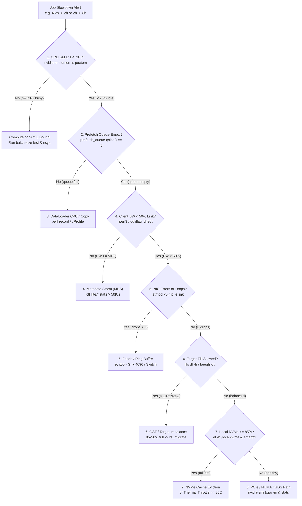
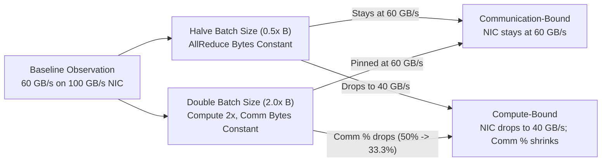

# 13.9 Storage troubleshooting

| Field | Value |
|---|---|
| Level | Advanced |
| Priority tier | 2 |
| Lab venue | GCP / GKE + Local Python Verification Lab (`code/part13/storage_troubleshooting_lab.py`) |
| Part | Part 13: AI storage |
| Primary sources | NVIDIA Zero-to-Hero Volume 15 (`chapter-11-production-troubleshooting.md`, `chapter-12-volume-15-summary.md`, `index.md`, `labs/lab-01..04`); *AI Systems Performance Engineering* (`ai-systems-performance-engineering`) |
| Coverage file | `planning/coverage/chapters/13-09.md` |
| Claim & number ledger | `planning/ledgers/13-09.md` |

## Why this matters for AI infrastructure

When a distributed training run slows down from 2 hours to 8 hours, every minute spent guessing at the storage array burns expensive accelerator capacity. A GPU sitting idle while waiting on a stalled file lookup or a dropped network packet costs the exact same hourly rate as a GPU running at full speed. Yet production AI storage paths span eight distinct hardware and software layers. Those layers stretch from GPU memory and PCIe interconnects down through host CPU queues, local NVMe drives, client filesystems, network switches, metadata servers, and storage targets.

Without an ordered diagnostic sequence, engineering teams routinely misdiagnose storage incidents and fix the wrong layer. They scale out storage array bandwidth when the real culprit is a small-file metadata storm that wastes 47 minutes of every training epoch. They tune PyTorch worker counts when a tiny network ring buffer is silently dropping hundreds of packets under multi-job congestion. Or they assume GPUDirect Storage is bypassing the host CPU when an alignment mismatch has forced the driver back into slow host memory copies.

Teams also make the opposite mistake and blame storage when the storage array is completely healthy. When an eight-GPU job scales poorly because collective communication runs over PCIe instead of NVLink, storage tuning will not save a single millisecond. You need a fast, falsifiable way to separate GPU compute limits, network collective bottlenecks, and true storage starvation before changing cluster configuration.

This final chapter of Part 13 turns the entire AI storage stack into an operational runbook. You will learn how to capture a five-minute golden baseline before incidents happen and walk an eight-layer decision tree from the GPU backward to the storage media. You will also run batch-size scaling experiments to separate network communication from compute, audit GPUDirect Storage for silent fallbacks, and resolve six major production storage failures.

```text
Incident Triage Reference Metrics:
  Job runtime regression examples: 2.0 hours -> 8.0 hours (4.0x slowdown) | 45 minutes -> 2.0 hours
  GPU SM utilization drop:         92% SM (40% mem) healthy -> 15% SM (5% mem) starved (< 70% SM I/O gate)
  Small-file metadata stall:       > 100,000 ops/sec saturated (< 50,000 ops/sec healthy MDS ceiling) -> 47 minutes lost/epoch
  NIC ring-buffer overflow:        RX ring 256 dropping 856 packets / 10 s (1,240 rx_errors) under 5 x 128-GPU jobs (640 GPUs)
  Silent GDS fallback signature:   __memcpy_avx2 consuming > 20% (24.5% - 31.0%) of CPU cycles when allow_compat_mode is true
  Compute vs NCCL scaling example: 8 GPUs achieving 5x speedup = 62.5% scaling efficiency (37.5% loss)
  NVLink + NCCL overlap gain:      60% SM busy and 100 ms step time -> 90% SM busy and 70 ms step time (-30% duration)
```

## Prerequisites and outcomes

**Prerequisites:**
- End-to-end understanding of the seven-stage AI storage data path, local NVMe staging, and Linux block queue tuning from Chapters 13.1 and 13.2.
- Working knowledge of GPUDirect Storage, `cuFile`, `nvidia-fs.ko`, `/proc/driver/nvidia-fs/stats`, direct I/O alignment rules, and `gdsio` from Chapter 13.3.
- Familiarity with Lustre, BeeGFS, WekaFS, VAST Data, DeepSeek 3FS, WebDataset repackaging, and asynchronous checkpoint recovery from Chapters 13.4 through 13.8.

**Outcomes:** After completing this chapter, you will be able to:
1. Walk the eight-layer storage decision tree from GPU utilization and queue depth down to host CPU, metadata, network, targets, local NVMe, and PCIe topology.
2. Run the batch-size scaling experiment to separate communication from compute bottlenecks, and correlate Nsight Systems, Nsight Compute, PyTorch Profiler, and Holistic Trace Analysis timelines.
3. Capture a reproducible five-minute golden baseline across network links, PCIe affinity, local NVMe drives, and shared parallel filesystems across four standard AI workload profiles.
4. Audit GPUDirect Storage in production to catch silent POSIX compatibility fallbacks and apply the 20 percent throughput uplift rule before deploying direct DMA.
5. Diagnose and fix six major production storage failures: ring-buffer drops, small-file metadata storms, checkpoint stalls, Lustre target skew, local NVMe faults, and NFS mount errors.

---

## Concepts: basics → intermediate → advanced

## 1. The Eight-Layer AI Storage Troubleshooting Decision Tree

When a training job stalls or loses more than half of its throughput, the cardinal rule of production troubleshooting is simple. Never start at the storage array. Always start at the GPU and walk backward toward the storage media one falsifiable signal at a time.

Guessing that Lustre is slow when the GPU is actually 94 percent busy in a matrix kernel wastes hours of incident response time. Adding more DataLoader workers when a top-of-rack switch is dropping packets only makes network congestion worse. By checking eight ordered gates from the accelerator down to the PCIe root complex, you rule out entire subsystems in minutes.

### 1.1 The End-to-End Decision Tree



| Layer | Diagnostic Question | Primary Telemetry Command (`untested here`) | Healthy Baseline | Fault Signature | Immediate Remediation |
|---|---|---|---|---|---|
| **1. Accelerator (GPU)** | Is the GPU starving for input data, or busy computing and running NCCL? | `nvidia-smi dmon -s puctem -c 5` | `SM >= 85-92%`, `Mem >= 40%` | `SM < 70%` (`15%` SM, `5%` Mem) or oscillating `0% <-> 95%` | If `SM >= 70%`, stop blaming storage; run `nsys` and the `0.5x`/`2.0x` batch-size test. If `< 70%`, check Layer 2. |
| **2. Batch Queue (DataLoader)** | Is the host prefetch queue empty when the GPU finishes a step? | `prefetch_queue.qsize()` and per-batch `wait_time` | `qsize >= 2`, `wait_time < 50 ms` | `qsize == 0` for `80%` of steps; `wait_time > 500 ms` (`620 ms`) | If queue is full (`qsize >= 2`) yet GPU waits, check CPU-to-GPU copy (`pin_memory`, GDS). If empty, check Layers 3 and 4. |
| **3. Host CPU (Decode / Copy)** | Are CPU cores pegged in image or token decode, or in memory bounce buffers? | `python -m cProfile -s cumtime` and `perf record -g` | Decode `< batch compute`; `__memcpy_avx2 < 5%` | `Image.open` + `augment` taking `57.3 s` / `120K` calls; `__memcpy_avx2 > 20%` | Offload decode to NVIDIA DALI or nvJPEG, preprocess offline with NeMo Curator, or enable GDS and `pin_memory=True`. |
| **4. Filesystem Metadata (MDS)** | Is the parallel filesystem choking on small-file `open` and `stat` calls? | `lctl get_param llite.*.stats \| grep -E 'open\|close\|getattr'` or `strace -c -e openat` | `< 50,000` ops/sec per MDS; `open` latency `2.0-5.0 ms` | `> 100,000` ops/sec saturated; `open` latency `20-50 ms` (`45 ms`); `47 min`/epoch lost | Repackage small files into WebDataset `.tar`, TFRecord, or `.bin`/`.idx` shards (`100x-1,000x` fewer opens). |
| **5. Network Fabric (NIC / Switch)** | Are storage packets dropping at the NIC ring buffer or leaf and spine switch? | `ethtool -S eth0`, `ethtool -g eth0`, `ip -s link`, `iperf3 -c storage -t 10` | `80-100%` link speed (`20-25 Gbps` on `25G`); `0` `rx_errors`/`rx_dropped`; ring `4096`; `MTU 9000` | `rx_errors = 1240`, `rx_dropped = 856` in `10 s`; RX ring `256`; `300`/sec TCP or RDMA retransmits | Raise ring buffer (`ethtool -G eth0 rx 4096 tx 4096`), verify `MTU 9000`, and throttle concurrent jobs on oversubscribed switches. |
| **6. Storage Targets (OST / OSS)** | Are specific storage targets full (`>= 95%`) or throttled by bad striping? | `lfs df -h`, `lfs getstripe <file>`, `beegfs-ctl --listtargets --spaceinfo` | All targets within `±5%` fill (`OST 0..7` at `50%`); `stripe_count = 1..4` (small) or `16` (ckpt) | `OST 5..7` at `98%` full while `OST 0..4` at `30%` (`68%` spread); `stripe_count = 32` on small files | Migrate hot files off full OSTs (`lfs_migrate`), set `stripe_count = 1..4` for shards and `16+` for large checkpoints. |
| **7. Local NVMe Cache (Scratch)** | Is the node-local NVMe cache evicting hot shards, thermal throttling, or failing? | `df -h /local-nvme`, `iostat -xz 1`, `nvme smart-log /dev/nvme0n1`, `smartctl -a` | Fill `< 85%`; temp `< 70 C`; `0` media errors; `3.5 GB/s` sequential read | Fill `>= 85%` (`88%` LRU thrashing); temp `>= 80 C` (`0.65 GB/s`); RAID 0 member failed | Expand scratch capacity, clean stale checkpoints, improve chassis airflow, or rebuild failed RAID 0 member and re-stage. |
| **8. PCIe / NUMA / GDS Path** | Is traffic crossing inter-socket links (`SYS`/`NODE`) or silently bypassing GDS? | `nvidia-smi topo -m`, `/proc/driver/nvidia-fs/stats`, `numactl --hardware` | `PIX`/`PXB` affinity; `nvidia-fs` `Ops Read` climbing; loader pinned to GPU NUMA node | `SYS` cross-socket hop; `nvidia-fs` counters flat (`0` delta); CPU bounce active | Bind process with `numactl -N <node> -m <node>`, fix `4 KiB`/`8 KiB` alignment, and verify `/etc/cufile.json`. |

### 1.2 Why Layer Order Matters: Avoiding False Positives

Consider what happens during a real incident when an engineer skips the first two gates and runs `python -m cProfile -s cumtime train.py` first. The profiler output looks damning at first glance. It shows over a hundred thousand calls to image open and augmentation functions taking nearly a minute of cumulative CPU time.

```text
   ncalls  tottime  cumtime  filename:lineno(function)
   120000      0.5     45.2  Image.open
   120000      0.2     12.1  augmentation.apply
   Total cumulative decode + augment time: 45.2 s + 12.1 s = 57.3 s (~57 s across 120,000 calls, or 0.48 ms/image)
```

An engineer looking only at `cProfile` will spend two days rewriting the image augmentation pipeline in C++ or NVIDIA DALI. That effort will produce zero improvement in job runtime.

Checking Gate 1 with `nvidia-smi dmon` and Gate 2 with `prefetch_queue.qsize()` first immediately disproves the CPU bottleneck hypothesis. GPU SM utilization sits at 15 percent instead of its healthy 92 percent baseline. Meanwhile, the host prefetch queue is completely empty 80 percent of the time. If CPU image decoding were the real bottleneck after fast storage reads, raw file buffers would pile up inside worker queues waiting on CPU threads. Instead, worker threads are stuck in uninterruptible kernel sleep waiting for network and filesystem calls to return before `Image.open` can even run.

---

## 2. Separating Compute, Collective Communication, and Storage I/O Bottlenecks

Before digging into filesystem counters, you must prove that the slowdown is not caused by GPU compute kernels or multi-GPU collective communication. When a data-parallel job scales from 1 GPU to 8 GPUs, ideal linear scaling delivers 8x throughput. If 8 GPUs deliver only 5x throughput, the job reaches 62.5 percent scaling efficiency. The remaining 37.5 percent of cluster capacity is lost to synchronization, network collectives, or I/O stalls.

### 2.1 The Batch-Size Halving and Doubling Diagnostic

During the backward pass of distributed training, NCCL runs an AllReduce collective to average gradients across all ranks. Suppose you watch the network interface and see gradient AllReduce sustaining 60 GB/s across a 100 GB/s NIC. You need to know whether the network fabric is congested and capping throughput at 60 GB/s. Alternatively, the GPUs might be computing backward passes too slowly to feed the NIC any faster.

You can isolate the answer without touching a single switch by using a fundamental invariant of data-parallel training. The byte volume of a gradient AllReduce depends strictly on the number of model parameters, not on the micro-batch size.

```text
Bytes_AllReduce = 2 x ((N - 1) / N) x |Theta| x sizeof(grad)    (strictly independent of micro-batch size B)
```

By holding the model constant while halving and doubling the micro-batch size, you change the GPU compute work per step. At the same time, network bytes per step stay fixed. If halving the batch size leaves NIC throughput pinned at 60 GB/s, the network fabric is the ceiling and the job is communication-bound. Even when GPUs finish backward compute twice as fast, the network cannot push more than 60 GB/s.

If halving the batch size causes NIC throughput to drop from 60 GB/s to 40 GB/s, the network had plenty of headroom. In that case, the job is compute-bound. Doubling the batch size confirms this diagnosis from the opposite direction. Because compute work doubles while AllReduce bytes stay constant, the fraction of step time spent in AllReduce shrinks from 50 percent down to 33.33 percent.



| Diagnostic Experiment | Communication-Bound Signature (Network / NCCL Limiter) | Compute-Bound Signature (GPU SM Limiter) | Storage / Data-Loading Bound Signature (I/O Limiter) |
|---|---|---|---|
| **Baseline (`1.0x` batch size)** | NIC at `60 GB/s` on `100 GB/s` (`800 Gbps`) link; long `ncclDevKernel` gaps at step end | NIC at `60 GB/s`; SMs `> 90%` busy during forward and backward pass | Gap appears at iteration start before forward pass; NIC idle; `prefetch_queue.qsize() == 0` |
| **Halve batch size (`0.5x` batch size)** | NIC throughput remains at `60 GB/s` because network caps transfer rate | NIC throughput drops from `60 GB/s` to `40 GB/s` | Metadata `open` rate doubles per second; iteration-start stall worsens |
| **Double batch size (`2.0x` batch size)** | NIC throughput stays at `60 GB/s` | Relative share of step time in AllReduce shrinks (`50.0% -> 33.33%`, `50 ms / 150 ms`) | Sequential read bytes per batch double; `iostat` `rMB/s` or OST bandwidth saturates |
| **Topology-aware NCCL + overlap fix** | Moving AllReduce from PCIe to NVLink plus stream overlap raises SM busy `60% -> 90%` and cuts step time `100 ms -> 70 ms` (`-30%`) | Use FP8 or BF16 Tensor Cores, kernel fusion (`torch.compile`), or CUTLASS | Repackage small files (WebDataset), enable GDS, stage to local NVMe, or widen OST striping |

### 2.2 Multi-Level Profiling Stack

Once the decision tree and batch-size test show which regime dominates, pick the profiling tool that instruments that exact layer of the stack. Running a kernel-level profiler when the process is sleeping on disk I/O only produces noise.

| Tool | Scope | Key Command / API (`untested here`) | What It Proves During Storage & Pipeline Triage |
|---|---|---|---|
| **NVIDIA Nsight Systems (`nsys`)** | System-wide timeline (CPU, GPU, OS, GDS, NVTX) | `nsys profile --trace=cuda,gds,nvtx,osrt -o report python train.py` | Correlates NVTX ranges (`"train_step"`, `"forward"`, `"backward"`, `"optimizer_step"`) with OS `read`/`open` stalls (`osrt`), `cuFile` GDS transfers (`gds`), and CUDA stream gaps. |
| **PyTorch Profiler (`Kineto`)** | Operator-level CPU & CUDA timeline + memory | `torch.profiler.profile(activities=[CPU, CUDA], record_shapes=True, profile_memory=True, with_stack=True, with_flops=True)` | Identifies DataLoader `enumerate(loader)` wait gaps, host-to-device `cudaMemcpyAsync` stalls, and `torch.compile` graph breaks. View JSON traces in Perfetto UI, since TensorBoard trace plugin and `chrome://tracing` are deprecated. |
| **Holistic Trace Analysis (`HTA`)** | Multi-GPU / multi-node trace correlation | Ingests Kineto distributed JSON traces across all ranks | Separates true storage stragglers, such as one rank waiting on a `98%`-full OST or degraded NVMe, from collective NCCL wait times across ranks. |
| **NVIDIA Nsight Compute (`ncu`)** | Single-kernel hardware counters & roofline | `ncu --set full -o kernel_report python train.py` | Proves whether a slow CUDA or NCCL kernel is HBM memory-bandwidth bound, SM compute bound, or stalled on PCIe peer-to-peer memory barriers (`60%` vs `90%` SM busy). |
| **Linux `perf`** | Host CPU hardware PMU counters & off-CPU sleep | `perf record -g python train.py && perf report` and `perf sched` | Detects `__memcpy_avx2` (`> 20%` proves CPU bounce buffer and inactive GDS), Python GIL contention, image decode hotspots, and off-CPU `D`-state I/O sleep. |
| **Linux Block & Process I/O (`iostat`, `iotop`, `pidstat`)** | Block device queues, latencies, and per-PID I/O | `iostat -xz 1`, `iotop -b -n 5`, `pidstat -d 1`, `nvme-cli` | Measures local NVMe `%util`, `r_await`/`w_await` (`ms`), `aqu-sz` queue depth, `rMB/s`, `wMB/s`, and isolates noisy-neighbor processes saturating disks. |

---

## 3. Evidence Gathering: The 5-Minute Golden Baseline

You cannot diagnose a slow storage path during an outage if you do not know what a healthy storage path looks like on the exact same node. Before launching production workloads, capture a reproducible five-minute golden baseline and save it as `healthy.txt`. That baseline covers five domains: network and PCIe topology, filesystem mounts and target health, raw network versus storage bandwidth, local NVMe versus shared storage workload profiles, and host memory state.

### 3.1 Layer-by-Layer Latency and Bandwidth Reference

Every read request travels from the remote storage media across the network fabric, through the client kernel filesystem and host DRAM, and across PCIe or NVLink-C2C into GPU HBM. Knowing the normal latency and throughput envelope at each stage lets you spot a broken hop immediately.

```mermaid
flowchart LR
    Storage["Storage Array<br/>Lustre / BeeGFS / VAST"]
    Fabric["Network Fabric<br/>NIC & Switch (MTU 9000)"]
    ClientFS["Client Filesystem<br/>llite / beegfs / nvidia-fs"]
    CPU["CPU & NUMA Memory<br/>Page Cache / Pinned DRAM"]
    PCIe["PCIe Gen4/Gen5 Fabric<br/>or NVLink-C2C (900 GB/s)"]
    GPU["GPU HBM Memory<br/>A100 40GB / H100 / B200"]

    Storage -->|"Media: ~100 us"| Fabric
    Fabric -->|"Fabric: 10-100 us"| ClientFS
    ClientFS -->|"VFS/RPC: 50-500 us"| CPU
    CPU -->|"DRAM: 50-100 ns"| PCIe
    PCIe -->|"PCIe DMA: 1-10 us"| GPU
```



| Storage Path Stage | Baseline Latency Envelope | Healthy Single-Node Throughput / Capacity | Primary Baseline Command (`untested here`) | Red-Flag Threshold Requiring Action |
|---|---|---|---|---|
| **1. Storage Array (OST / MDS)** | `~100 us` media access; `2.0-5.0 ms` metadata `open` | `< 50,000` `open` ops/s per MDS; targets balanced within `±5%` | `lfs df -h` and `lctl get_param llite.*.stats` | Any `OST >= 90-98%` full; `> 10%` target fill spread; `open > 100,000` ops/s or `> 20 ms` latency |
| **2. Network Fabric (NIC / Switch)** | `10-100 us` (`~300 ns` IB, `~800 ns` RoCEv2 switch hop) | `20-25 Gbps` on `25GbE` (`25,000 Mb/s`, `80-100%` link); `MTU 9000`; RX/TX ring `4096` | `ip -s link`, `ethtool eth0`, `ethtool -g eth0`, `iperf3 -c storage -t 10` | `iperf3 < 50%` of link speed; `MTU 1500` on storage VLAN; RX ring `< 512` (`256`); `rx_errors` or `rx_dropped > 0` |
| **3. Client Filesystem (Kernel)** | `50-500 us` client VFS / RPC processing | `1.5-3.0 GB/s` (`~1-3 GB/s`) single-client seq read; `3.0-5.0 GB/s` `8`-client aggregate | `findmnt -D`, `dd if=/lustre/test.file bs=1M count=1000 of=/dev/null iflag=direct` | Missing `flock,lazystatfs,noatime` (Lustre) or `rsize=1048576,wsize=1048576,hard` (NFS); `dd < 500 MB/s` |
| **4. Host CPU & NUMA Memory** | `50-100 ns` local DRAM access | Dual-socket NUMA 0 (`cpus 0-31`) and NUMA 1 (`cpus 32-63`); `ulimit -l unlimited` | `lscpu`, `numactl --hardware`, `free -h`, `cat /proc/meminfo` | DataLoader workers scheduled on NUMA 1 while GPU0 and NIC0 sit on NUMA 0; swap active (`si`/`so > 0`) |
| **5. PCIe Fabric & GDS Topology** | `1-10 us` PCIe transaction (`~100 ns` Gen5 switch) | `PIX` or `PXB` between GPU (`A100 PCIe 40960 MiB`) and storage NIC/NVMe (`PHB` acceptable if verified) | `lspci -tv`, `nvidia-smi topo -m`, `/usr/local/cuda/gds/tools/gdscheck.py -p` | `SYS` or `NODE` traversal between GPU and storage NIC; `nvidia_fs` not loaded; driver `< 470` (`535.29` baseline) |
| **6. Local NVMe Scratch vs Shared FS** | `< 100 us` local `O_DIRECT` read | Local NVMe: `3.5 GB/s` seq read, `2.8 GB/s` batch stream, `1.2 GB/s` rand read, `2.1 GB/s` ckpt write | `nvme list`, `smartctl -a /dev/nvme0n1`, `fio --ioengine=libaio --direct=1` | Local NVMe `< 500 MB/s`; SMART `Temperature >= 70 C`; `Media and Data Integrity Errors > 0` |

### 3.2 Benchmarking Local NVMe vs Shared Storage Across Four AI Workload Profiles

A single `dd` command is never enough to certify an AI storage path because training and inference generate four very different I/O patterns. Model loading reads large sequential blocks once at startup, batch streaming runs concurrent medium reads, random access hits large blocks across shards, and checkpointing bursts heavy sequential writes across all ranks.

When baselining a cluster, run `fio` with `--ioengine=libaio --direct=1` alongside a metadata test loop on both local NVMe and shared storage. Comparing the two tiers side by side tells you immediately whether to stream directly from the parallel filesystem or stage datasets and checkpoints onto local NVMe.

| AI Workload Profile | I/O Access Pattern | Total Test Size | Block Size (`bs`) | Concurrency (`numjobs` / `iodepth`) | Typical Local NVMe Baseline | Typical Shared Parallel FS Baseline | Operational Decision Rule |
|---|---|---|---|---|---|---|---|
| **1. Model Weight Load** | Sequential read (`rw=read`), once at startup or epoch | `10 GB-100 GB` (`count=10000` at `1M`) | `1 MB` (`bs=1M`) | `1` reader (`iodepth=32`, `numjobs=4` structured) | **`3.5 GB/s`** | **`1.5-3.0 GB/s`** (`2.33x` ratio at `1.5 GB/s`) | If NVMe is `> 2x` faster than shared storage (`> 2.0 GB/s`), cache model weights on local NVMe. |
| **2. Batch Streaming** | Concurrent medium-block reads (`rw=read`) | `1 GB` per job (`1,000 x 1 MB` batches) | `64 KB` (`bs=64k`) | `8` parallel readers (`numjobs=8`, `iodepth=16`) | **`2.8 GB/s`** | **`3.0-5.0 GB/s`** aggregate across `8` clients | If aggregate shared bandwidth does not scale with client count, the storage network or OST count is saturated. |
| **3. Random Weight / KV-Cache Read** | Random large-block read (`rw=randread`) | `10 GB` | `4 MB` (`bs=4M`) | `1` reader (`iodepth=32`, `numjobs=1`) | **`1.2 GB/s`** | Scales with `stripe_count` and `read_ahead_kb` (`4 MiB`) | Ensure `blockdev --setra` (`4 MiB`) and `blk-mq` `none` or `mq-deadline` scheduler are active on NVMe. |
| **4. Checkpoint Burst Write** | Synchronized sequential write (`rw=write`) | `500 MB` per rank (`500 GB` cluster-wide) | `4 MB` (`bs=4M`) | `1` per rank (`8` ranks per node, `iodepth=16`) | **`2.1 GB/s`** per drive (`10+ GB/s` RAID 0) | `1.0-6.4 GB/s` (depends on `stripe_count = 16`) | A `500 GB` sync write at `1.0 GB/s` stalls GPUs for `500 s`; staging to `10x` faster NVMe (`10 GB/s -> 50 s`) saves `9/10` (`90% = 450 s`) of stall time. |
| **5. Metadata Storm (Small Files)** | `create` + `stat` + `open` + `close` on `10,000-1,000,000` files | `100 KB` per file | `4 KB` metadata inode | `16` metadata workers | `50,000+` local XFS ops/sec | **`1,000-5,000` ops/sec** per client (`< 50,000` per MDS ceiling) | If metadata rate is `< 10,000` ops/sec or dataset has `1,000,000` files, repackage into `1,000-10,000` `.tar` shards (`100x-1,000x` open reduction). |

---

## 4. Deep-Dive Walkthrough of a Real Production Incident

To see how the eight-layer decision tree and the five-minute baseline work together under pressure, let us walk through a real multi-symptom incident on a Lustre-backed GPU cluster. A distributed training job that normally finishes in 2.0 hours suddenly stretches to 8.0 hours, a 4.0x slowdown that burns four times the GPU budget.

### 4.1 Incident Alert and Step 1: Comparing Current State Against the Baseline

Instead of guessing at Lustre or PyTorch flags, the on-call engineer runs `./capture_baseline.sh > current.txt` (`untested here`) on a training node and compares it against `healthy.txt` using `diff`. The comparison immediately surfaces three simultaneous anomalies across the GPU, the Lustre object targets, and the network interface.

```text
< GPU0    dmon -s puctem shows: sm=92%, mem=40%
> GPU0    dmon -s puctem shows: sm=15%, mem=5%          <- Signal 1: GPU idle!

< LFS df shows: OST 0-7 at 50% full
> LFS df shows: OST 5-7 at 98% full, OST 0-4 at 30%     <- Signal 2: OST imbalance (68% spread)!

< ethtool -S eth0: rx_errors=0, rx_dropped=0
> ethtool -S eth0: rx_errors=1240, rx_dropped=856       <- Signal 3: Network packet drops!
```

A junior engineer seeing `OST 5-7 at 98% full` might immediately start migrating terabytes of files across Lustre targets. That migration takes hours and adds heavy background I/O load to an already struggling cluster. A senior engineer follows the eight-layer decision tree strictly in order so they fix the true pacing bottleneck first.

### 4.2 Steps 2 and 3: Queue Depth and Ruling Out the CPU Decoder

Gate 1 confirms that GPU SM utilization has collapsed from 92 percent to 15 percent, well below the 70 percent threshold. That drop proves the job is I/O-bound. Gate 2 checks `prefetch_queue.qsize()` inside the training loop and finds the queue empty 80 percent of the time, with batch wait exceeding 500 ms.

At Gate 3, running `python -m cProfile -s cumtime train.py` (`untested here`) shows 120,000 calls to `Image.open` taking 45.2 seconds. It also shows `augmentation.apply` taking 12.1 seconds, totaling 57.3 seconds of CPU work. While 57.3 seconds of CPU work is real, it cannot explain why the prefetch queue sits empty 80 percent of the time. The raw file bytes are stalling in the storage network before they ever reach `Image.open`.

### 4.3 Steps 4, 5, and 6: Metadata Latency, Ring Buffers, and Switch Oversubscription

Moving to Gate 4, the engineer checks Lustre client metadata counters over a 60-second window during epoch startup. The counters record 950,000 file opens in one minute, which works out to 15,833.33 opens per second. A Lustre MDS safely handles 50,000 opens per second, so 15.8K opens per second should run at a healthy 2.0 ms latency. Instead, average `open` latency has spiked to 45.0 ms.

Gate 5 explains why a lightly loaded MDS is taking 45.0 ms to answer an `open` request. Watching `ethtool -S eth0` over 10 seconds reveals 1,240 receive errors and 856 dropped packets on a tiny 256-entry RX ring buffer. Every dropped metadata RPC triggers a network retransmission timeout that inflates a 2.0 ms lookup into a 45.0 ms stall.

Raising the NIC ring buffers to 4096 with `ethtool -G eth0 rx 4096 tx 4096` cuts local NIC drops below 5 per second. However, 300 network retransmits per second still remain. Checking the cluster scheduler reveals five concurrent 128-GPU training jobs, or 640 GPUs in total, hammering an oversubscribed storage switch fabric at once. Capping concurrent heavy I/O jobs from five down to three clears the switch congestion and restores 2.0 ms metadata latency and 88 percent GPU utilization. The team can then rebalance the 98 percent full OSTs later during a maintenance window.

```text
Incident Triage Progression & Numbers:
  1. Metadata open rate check:     950,000 opens / 60 s = 15,833.33 opens/sec (~15.8K/sec, 31.7% of 50,000 ops/sec MDS ceiling)
  2. Metadata latency inflation:   2.0 ms healthy baseline -> 45.0 ms during incident (22.5x inflation due to packet drops)
  3. NIC ring-buffer fix:          ethtool -g eth0 shows RX ring = 256 -> ethtool -G eth0 rx 4096 tx 4096 cuts drops from 85.6/s to < 5/s
  4. Switch oversubscription fix:  5 jobs x 128 GPUs (640 GPUs, 300 retransmits/s) -> 3 jobs x 128 GPUs (384 GPUs, 0 retransmits/s)
  5. Final restored state:         0 retransmits/sec, 2.0 ms open latency, 88% GPU SM utilization, 2.0-hour runtime restored
```

---

## 5. Validating GPUDirect Storage and Catching Silent Fallbacks

A recurring anti-pattern in GPU clusters is what operators call Placebo GDS. An engineering team installs the `nvidia-fs` package, sets an environment variable, and assumes storage reads are streaming straight into GPU HBM. Meanwhile, `cuFile` has silently fallen back to POSIX compatibility mode and is routing every byte through the Linux page cache and host CPU bounce buffers.

Because `/etc/cufile.json` ships with `allow_compat_mode: true` by default, any broken prerequisite causes a silent fallback rather than a loud crash. Training jobs keep running, but host CPU utilization spikes above 85 percent inside `__memcpy_avx2` while PCIe bandwidth gets wasted copying every batch twice.

### 5.1 The Six Non-Negotiable GDS Prerequisites and Verification Signals

GPUDirect Storage bypasses the host CPU bounce buffer only when all six architectural requirements hold at the same time. If even one requirement fails, `cuFile` quietly routes reads through host DRAM.

| Requirement # | Layer | Technical Requirement | Verification Command (`untested here`) | What Causes Silent Fallback to CPU Bounce |
|---|---|---|---|---|
| **1. Kernel Driver** | Host OS | `nvidia_fs` kernel module loaded and `/proc/driver/nvidia-fs/stats` active | `lsmod \| grep nvidia_fs` and `cat /proc/driver/nvidia-fs/stats` | `nvidia-fs` DKMS package missing or broken after a Linux kernel upgrade. |
| **2. GPU Driver** | CUDA Driver | NVIDIA display and compute driver `>= 470` (`535.29`+) and `/usr/local/cuda/include/cufile.h` present | `nvidia-smi \| grep "Driver Version"` | Older driver lacking `cuFile` BAR1 peer-to-peer DMA hooks. |
| **3. PCIe Topology** | Hardware Fabric | GPU and NVMe or storage NIC share a PCIe switch (`PIX` or `PXB`) or supported root complex (`PHB`), never crossing inter-socket links (`SYS` or `NODE`) | `nvidia-smi topo -m` and `lspci -tv \| grep -E "NVIDIA\|Tesla\|NIC"` | GPU0 on NUMA 0 reading via NIC1 on NUMA 1 (`SYS` or `NODE` hop across QPI, UPI, or Infinity Fabric). |
| **4. Storage Backend** | Filesystem | Kernel-level `O_DIRECT` + GDS-enabled client (NVMe, NVMe-oF, Lustre, BeeGFS, WekaFS, VAST, IBM Storage Scale) | `/usr/local/cuda/gds/tools/gdscheck.py -p` | Mounting storage via user-space FUSE or standard TCP NFS without RDMA and `nvidia-fs` registration. |
| **5. Buffer & Offset Alignment** | I/O Geometry | File offset, GPU buffer address, and transfer size aligned to `4 KiB` (`4,096 B`) for NVMe/NVMe-oF or `8 KiB` (`8,192 B`) for Lustre, with request size `>= 1 MiB` (`1,048,576 B`) | Inspect `cuFileRead` / `kvikio.CuFile` arguments and `nsys --trace=gds` | Reading unaligned byte ranges, such as a `4,096 B` offset on Lustre requiring `8,192 B`, or tiny `< 1 MiB` chunks. |
| **6. Application API & Proof** | Runtime | Uses `cuFile` (`kvikio.CuFile`, DALI, NIXL GDS plugin) rather than Python `open`/`read`, and proves activity via counters | `perf record -g` (`0%` `__memcpy_avx2`) + rising `Ops Read` in `/proc/driver/nvidia-fs/stats` | Using standard `open(path, "rb")` or `torch.load()` without `kvikio` or `cuFile` integration. |

### 5.2 Benchmarking CPU Bounce vs Direct GDS and the 20 Percent Rule

Before rolling out GPUDirect Storage across a fleet, benchmark both the Python application path and the raw hardware ceiling using `/usr/local/cuda/gds/tools/gdsio`. On the traditional Python path, reading a 100 MiB file with `open` and copying it into GPU memory averages 0.251 seconds across five trials. That works out to about 398 MB/s. Replacing `open` with RAPIDS `kvikio.CuFile` streams the file straight into GPU memory without a host staging copy.

At the hardware level, `gdsio` compares the CPU bounce path using flag `-x 2` against direct DMA using flag `-x 0`. In a four-worker read test on a 10 GiB file, switching from `-x 2` to `-x 0` raises throughput and cuts latency by 20 percent. At the same time, host CPU load drops from 85 percent down to 25 percent.

Use the 20 percent improvement rule to decide whether GDS is worth deploying for a specific workload. Deploy GDS in production if it improves throughput by at least 20 percent, or if it frees starved CPU cores needed for batch streaming. If the gain is under 20 percent, skip GDS and fix the real bottleneck first, such as small-file metadata overhead or narrow Lustre striping.

```text
GDS Benchmark Reference & Decision Math:
  1. Lab 03 Python 100 MiB (104,857,600 B) CPU-bounce trials:
     Trial times:  [0.265 s, 0.250 s, 0.248 s, 0.247 s, 0.246 s] -> Mean = 0.2512 s (~0.251 s)
     Trial rates:  [378, 400, 403, 404, 407] MiB/s -> Mean = 398 MiB/s (398 MB/s)
  2. Controlled gdsio benchmark (-d 0 -w 4 -s 10G -i 1M -I 0):
     CPU bounce (-x 2): Throughput = 8.0 GB/s | Avg latency = 1.25 ms | Host CPU ~ 85%
     Direct GDS (-x 0): Throughput = 9.6 GB/s | Avg latency = 1.00 ms | Host CPU ~ 25%
     Improvement:       (9.6 - 8.0) / 8.0 = +20.0% throughput uplift | (1.25 - 1.00) / 1.25 = -20.0% latency reduction
  3. High-rate batch streaming example:
     1,000 batches/sec x 1 MB/batch = 1,000 MB/s (1.0 GB/s) continuous transfer offloaded from host CPU
```

---

## 6. Commands and Configurations That Matter

When an incident alert pages you at 2 a.m., you should not have to remember twenty different CLI flags from scratch. The scripts and command blocks below group every diagnostic check by the exact storage layer it instruments. All bare-metal cluster commands are marked `untested here`.

### 6.1 The 5-Minute Node and Storage Baseline Capture Script

Run this script on a GPU node before starting training to establish your `healthy.txt` reference file. Run it again to capture `current.txt` the moment a slowdown alert fires, then compare the two files with `diff`.

```bash
#!/bin/bash
# (untested here) Capture 5-minute golden baseline across GPU, NIC, Topology, FS, and NVMe
OUTPUT_FILE="baseline-$(hostname)-$(date +%Y%m%d-%H%M%S).txt"

echo "=== 1. GPU UTILIZATION & DETAILS ===" | tee "$OUTPUT_FILE"
nvidia-smi dmon -s puctem -c 5 >> "$OUTPUT_FILE"
nvidia-smi -i 0 -q | grep -E "Product Name|Memory|Driver" >> "$OUTPUT_FILE"

echo "=== 2. NETWORK INTERFACES, RING BUFFERS & TOPOLOGY ===" >> "$OUTPUT_FILE"
ip -s link >> "$OUTPUT_FILE"
ethtool eth0 >> "$OUTPUT_FILE"
ethtool -S eth0 | grep -E "rx_errors|rx_dropped|tx_errors" >> "$OUTPUT_FILE"
ethtool -g eth0 >> "$OUTPUT_FILE"
lscpu >> "$OUTPUT_FILE"
numactl --hardware >> "$OUTPUT_FILE"
lspci -tv | grep -E "NVIDIA|Tesla|NIC" >> "$OUTPUT_FILE"
nvidia-smi topo -m >> "$OUTPUT_FILE"

echo "=== 3. FILESYSTEM MOUNTS, TARGET HEALTH & METADATA ===" >> "$OUTPUT_FILE"
mount | grep -E "lustre|beegfs|nfs|/mnt" >> "$OUTPUT_FILE"
findmnt -D >> "$OUTPUT_FILE"
if command -v lfs &> /dev/null; then
    lfs df -h >> "$OUTPUT_FILE"
    lctl get_param llite.*.stats | grep -E "^[^ ]|^  open|^  close|^  getattr" | head -20 >> "$OUTPUT_FILE"
fi
if command -v beegfs-ctl &> /dev/null; then
    beegfs-ctl --listtargets --nodetype=storage --spaceinfo >> "$OUTPUT_FILE"
fi

echo "=== 4. LOCAL NVMe SMART HEALTH & PAGE CACHE ===" >> "$OUTPUT_FILE"
lsblk -o NAME,MODEL,SIZE,ROTA,TYPE >> "$OUTPUT_FILE"
if command -v nvme &> /dev/null; then
    nvme list >> "$OUTPUT_FILE"
    for dev in /dev/nvme*n1; do
        smartctl -a "$dev" 2>/dev/null | grep -E "Temperature|Errors|Percentage Used|Unsafe" >> "$OUTPUT_FILE" || true
    done
fi
free -h >> "$OUTPUT_FILE"
cat /proc/meminfo | grep -E "Cached|Buffers|MemAvailable|MemFree" >> "$OUTPUT_FILE"
```

### 6.2 Structured Benchmark, Profiling, and Remediation Commands

Once the baseline script highlights a suspect layer, run the targeted benchmark or profiler command for that layer. Always pass `iflag=direct` to `dd` and `--direct=1` to `fio` so the Linux page cache does not fake a fast disk read out of host DRAM.

```bash
# (untested here) 1. Compare throughput with and without NUMA affinity binding
time dd if=/lustre/test.file bs=1M count=1000 of=/dev/null iflag=direct
time numactl -N 0 -m 0 dd if=/lustre/test.file bs=1M count=1000 of=/dev/null iflag=direct

# (untested here) 2. Local NVMe vs Shared Storage 4-Workload fio Benchmark
fio --name=seq-read --ioengine=libaio --rw=read --bs=1M --size=10G \
    --direct=1 --iodepth=32 --numjobs=4 --filename=/lustre/test.file --output-format=normal
fio --name=batch-stream --ioengine=libaio --rw=read --bs=64k --size=1G \
    --direct=1 --iodepth=16 --numjobs=8 --filename=/local-nvme/batch-test.bin --output-format=normal
fio --name=checkpoint-write --ioengine=libaio --rw=write --bs=4M --size=500M \
    --direct=1 --iodepth=16 --numjobs=1 --filename=/local-nvme/checkpoint-test.bin

# (untested here) 3. Verify GPUDirect Storage (-x 2 CPU bounce vs -x 0 Direct GDS)
/usr/local/cuda/gds/tools/gdscheck.py -p
/usr/local/cuda/gds/tools/gdsio -f /mnt/data/large_file -d 0 -w 4 -s 10G -i 1M -I 0 -x 2
/usr/local/cuda/gds/tools/gdsio -f /mnt/data/large_file -d 0 -w 4 -s 10G -i 1M -I 0 -x 0

# (untested here) 4. End-to-End System, GDS, and Block/Process I/O Profiling
nsys profile --trace=cuda,gds,nvtx,osrt -o storage_trace python train.py
perf record -g python train.py && perf report | grep __memcpy_avx2
strace -e openat -c python train.py
iostat -xz 1 10
iotop -b -n 5
pidstat -d 1 10

# (untested here) 5. Production NFS Client Mount & NIC Ring Buffer Remediation
ethtool -G eth0 rx 4096 tx 4096
mount -t nfs -o rw,hard,rsize=1048576,wsize=1048576,noatime,async,actimeo=60,lookupcache=pos \
    nfs-server:/export/datasets /mnt/datasets
```

---

## 7. How It Fails: Six Production Storage Failure Modes

Most production storage outages in AI clusters fall into one of six repeatable patterns. Use this reference table to match observable job symptoms to the exact counter that proves the root cause and the command that fixes it.

| # | Failure Mode | Observable Symptom | Root-Cause Diagnosis (Commands & Counters) | Deterministic Fix |
|---|---|---|---|---|
| **1** | **NIC Ring Buffer Overflow + Switch Oversubscription** | Job runtime jumps `4.0x` (`2h -> 8h`); GPU SM drops `92% -> 15%`; `prefetch_queue` empty `80%` of steps; `open` latency spikes `2 ms -> 45 ms` despite only `15.8K` opens/sec (`950K`/min). | `ethtool -S eth0` shows `rx_errors = 1240`, `rx_dropped = 856` in `10 s`; `ethtool -g eth0` reveals tiny RX ring (`256` vs `4096`). After ring fix (`< 5` drops/s), `300` retransmits/s persist because `5 x 128`-GPU jobs (`640` GPUs) oversubscribe switch uplinks. | Run `ethtool -G eth0 rx 4096 tx 4096`, verify `MTU 9000`, and cap concurrent heavy I/O jobs from `5` (`640` GPUs) to `3` (`384` GPUs) or add spine bandwidth (`0` retransmits, `2 ms` metadata, `88%` SM). |
| **2** | **Epoch-Start Small-File Metadata Storm (The 47-Minute Problem)** | Epoch 1 start takes `2` minutes while Epoch 2 takes `30` seconds; or `47` minutes per epoch are lost with GPUs idle while storage bandwidth sits `< 10%` utilized. | `lctl get_param llite.*.stats \| grep open` or `strace -c -e openat` shows `> 100,000` opens/sec (`> 50,000` per MDS safe ceiling); `top -H` on MDS shows all service threads at `100%` CPU; or small files have `stripe_count = 32`. | Repackage `1,000,000` small files (`100-260 KB`) into `1,000-10,000` WebDataset `.tar`, TFRecord, or `.bin`/`.idx` shards (`100x-1,000x` fewer opens; batch wait drops `620 ms -> 31 ms`, `-95%`), and set `stripe_count = 1..4` for small files. |
| **3** | **Silent GPUDirect Storage Compatibility-Mode Fallback** | GDS (`kvikio` / `cuFile`) is enabled, yet throughput remains stuck at CPU-bounce speed (`398 MB/s` or `8.0 GB/s` instead of `9.6 GB/s`), and host CPU sits at `85%-100%`. | `/proc/driver/nvidia-fs/stats` `Ops Read` counter stays at `0` during reads; `perf record` shows `> 20%` (`24.5%-31.0%`) of CPU samples in `__memcpy_avx2`. Caused by `"allow_compat_mode": true` masking `4 KiB` (NVMe) or `8 KiB` (Lustre) misalignment, `< 1 MiB` I/O size, FUSE mount, or `SYS` cross-socket topology. | Align offsets and buffers to `4,096 B` (NVMe-oF) or `8,192 B` (Lustre) with `>= 1 MiB` transfers, bind process to the `PIX`/`PXB`-affine NUMA node (`numactl -N 0 -m 0`), use kernel GDS clients (not FUSE), and verify `nvidia-fs` counters increment. |
| **4** | **Lustre OST Fill Skew (`98%` Full), Client Eviction, & Sync Checkpoint Stalls** | Checkpoint saves stall training for `500+` seconds (`500 GB` at `1 GB/s`) or fail mid-write with `ENOSPC` / `EIO` even though `df -h /lustre` shows `45%` free cluster space. | `lfs df -h` shows `OST 5..7` at `98%` full while `OST 0..4` sit at `30%` (`68%` spread); files landing on `OST 5..7` hit allocator fragmentation, LDLM lock timeouts, and client eviction (`ptlrpc` expired). | Migrate files off full targets (`lfs_migrate`), set `lfs setstripe -c 16 -S 4M` on checkpoint directories before writing, and async-stage checkpoints to local NVMe (`10x` faster -> saves `9/10 = 450 s` of the `500 s` stall) before background flushing. |
| **5** | **Local NVMe Thermal Throttling (`>= 80 C`), SMART Wear, or RAID 0 Failure** | Single node becomes a straggler (`500 MB/s` vs `3.5 GB/s` peers), or job crashes with `Input/output error` on `/local-nvme` scratch. | `iostat -xz 1` shows `100%` `%util` with `r_await > 25 ms` on one NVMe device; `smartctl -a /dev/nvme1n1` shows `Temperature = 82 C` (`>= 70 C` warn, `>= 80 C` critical throttle to `0.65 GB/s`), `Percentage Used >= 95%`, or `Media Errors > 0` breaking an `mdadm` RAID 0 stripe. | Replace worn or faulted NVMe SSD, fix server fan and heatsink airflow to keep composite temperature `< 70 C`, enforce `< 85%` local cache fill watermark, and treat RAID 0 local NVMe strictly as ephemeral cache. |
| **6** | **NFS `Stale file handle` (`ESTALE`) & `soft`-Mount Silent Corruption** | Workers crash with `OSError: [Errno 116] Stale file handle` during dataset reads, or `torch.save()` produces truncated or corrupted `.pt` checkpoints during network blips. | Dataset curation scripts deleted and recreated a directory on the NFS server while compute nodes held cached dentries (`ESTALE`, `errno 116`); or `/etc/fstab` used `soft,timeo=...`, causing `write()` syscalls to return `EIO` on transient timeouts instead of retrying. | Remount with `hard,rsize=1048576,wsize=1048576,noatime,actimeo=60,lookupcache=pos` (never `soft` for read-write checkpoints), use atomic rename or immutable versioned directories (`dataset-v2/`) to avoid `ESTALE`, and move clusters `> 8` nodes off single-server NFS. |

---

## 8. Hands-On Lab: End-to-End Storage Incident and Bottleneck Triage

**Venue:** GCP / GKE or any Linux workstation using the `python3` standard library only, with no GPU or root access required.

The companion verification suite in `code/part13/storage_troubleshooting.py` and `code/part13/storage_troubleshooting_lab.py` turns every diagnostic rule from this chapter into runnable Python models. It tests the eight-layer decision tree, the 2-hour to 8-hour incident triage, the batch-size scaling experiment, and the GPUDirect Storage compatibility auditor. It also verifies checkpoint staging math, WebDataset repackaging, local NVMe SMART triage, and NFS mount auditing across 28 deterministic checks.

### Run the Verification Lab

```bash
python3 -B code/part13/storage_troubleshooting_lab.py
```

### Expected Output (Verified Locally)

```text
=== Chapter 13.9: Storage Troubleshooting Verification Lab ===

  [PASS] 01. Production incident slowdown is 4.0x (2.0 hours baseline -> 8.0 hours current) with GPU SM utilization dropping from 92% (mem 40%) to 15% (mem 5%)
  [PASS] 02. Decision tree Gate 1 & Gate 2 classify GPU utilization < 70% (15%) with 80% empty prefetch queue as I/O-bound starvation
  [PASS] 03. cProfile CPU decode (45.2 s) + augmentation (12.1 s) totals 57.3 s (~57 s) across 120,000 calls, ruled out as primary root cause because prefetch queue is 80% empty
  [PASS] 04. Lustre metadata open rate of 950,000 opens in 60 s equals 15,833.33 (~15.8K) opens/sec (< 50,000 ops/sec MDS ceiling, > 100,000 saturated) with 45.0 ms open latency vs 2.0 ms baseline
  [PASS] 05. Network triage isolates rx_errors=1240 and rx_dropped=856 in 10 s on RX ring size 256 (fixed via ethtool -G eth0 rx 4096 tx 4096 to < 5 drops/sec)
  [PASS] 06. Switch oversubscription triage shows 5 concurrent 128-GPU jobs (640 GPUs) cause 300 retransmits/sec; reducing to 3 jobs (384 GPUs) restores 0 retransmits, 2 ms open latency, and 88% GPU util
  [PASS] 07. Lustre target fill check detects OST 5..7 at 98.0% full vs OST 0..4 at 30.0% full (68.0% spread vs 50.0% healthy baseline)
  [PASS] 08. Decision tree classifies GPU SM utilization >= 70% (94%) as Compute / Collective Communication (Not Storage)
  [PASS] 09. Decision tree classifies low GPU utilization (28%) with full queue (5% empty) and low memcpy (6%) as DataLoader CPU Preprocessing bottleneck
  [PASS] 10. Decision tree classifies > 20% CPU __memcpy_avx2 samples (28.0%) with low GPU util (30%) as PCIe / CPU-to-GPU Bounce Copy Overhead
  [PASS] 11. Decision tree classifies 110,000 opens/sec (> 50K healthy, > 100K saturated) with healthy network link (22.0 / 25.0 Gbps = 88%) as Filesystem Metadata Server (MDS) bottleneck
  [PASS] 12. Batch-size scaling test diagnoses COMMUNICATION_BOUND when NIC stays pinned at 60.0 GB/s (on a 100.0 GB/s NIC) across 0.5x, 1.0x, and 2.0x batch sizes
  [PASS] 13. Batch-size scaling test diagnoses COMPUTE_BOUND when halving batch size drops NIC utilization from 60.0 GB/s to 40.0 GB/s and doubling batch size shrinks all-reduce time share from 50.0% to 33.33%
  [PASS] 14. GDS audit confirms GDS_DIRECT_DMA when nvidia_fs is loaded, driver is 535.29 (>= 470), topology is PIX, NVMe-oF offset is 4096 B aligned, request >= 1 MiB, nvidia-fs stats increment, and __memcpy_avx2 is 0%
  [PASS] 15. GDS audit catches silent POSIX_COMPAT_CPU_BOUNCE fallback on Lustre when offset is 4096 B (not 8192 B / 8 KB aligned), request < 1 MiB, nvidia-fs stats delta is 0, and __memcpy_avx2 is 24.5%
  [PASS] 16. GDS audit flags user-space FUSE mount and cross-socket SYS topology as incompatible with kernel nvidia-fs O_DIRECT DMA
  [PASS] 17. Lab 03 100 MiB (104,857,600 B) CPU-bounce benchmark trials [0.265, 0.250, 0.248, 0.247, 0.246] s average 0.251 s (396..426 MB/s decimal, ~398 MiB/s)
  [PASS] 18. gdsio (-d 0 -w 4 -s 10G -i 1M -I 0) shows -x 0 GDS (9.6 GB/s, 1.00 ms) achieves +20.0% throughput uplift and -20.0% latency reduction over -x 2 CPU path (8.0 GB/s, 1.25 ms), meeting the >= 20% DEPLOY_GDS threshold
  [PASS] 19. Lab 02 local NVMe baseline verifies 3.5 GB/s model load, 2.8 GB/s batch stream (64 KB x 8), 1.2 GB/s random read (4 MB), and 2.1 GB/s checkpoint write (2.33x faster than 1.5 GB/s shared storage)
  [PASS] 20. Synchronous 500 GB checkpoint at 1.0 GB/s stalls training for 500.0 s; staging to 10x faster NVMe (10.0 GB/s) cuts critical-path stall to 50.0 s, saving 450.0 s (9/10 = 90.0%)
  [PASS] 21. Lab 04 repackaging of 10,000 small 100 KB files into 100 tar shards (100 files/shard) cuts open calls 100.0x and reduces batch wait from 620.0 ms (> 500 ms stall threshold) to 31.0 ms (95.0% improvement)
  [PASS] 22. Repackaging 1,000,000 small files into 1,000 WebDataset/tar shards cuts metadata open calls by 1,000.0x and collapses the 47.0-minute per-epoch metadata stall to < 0.05 minutes
  [PASS] 23. Local NVMe health check passes HEALTHY drive at 52 C (< 70 C), 18% wear (< 95%), 0 media errors, and 3.5 GB/s read throughput
  [PASS] 24. Local NVMe health check detects CRITICAL_THERMAL_THROTTLE at 82 C (>= 80 C critical) when throughput drops to 0.65 GB/s alongside 96% endurance wear
  [PASS] 25. Local NVMe health check flags CRITICAL_RAID0_FAILURE and media_errors=3 when a RAID-0 scratch member fails
  [PASS] 26. NFS audit validates tuned mount (hard,rsize=1048576,wsize=1048576,noatime,async,actimeo=60,lookupcache=pos) on 4 GPU nodes with 0 risks
  [PASS] 27. NFS audit catches soft-mount checkpoint corruption risk, missing 1 MiB rsize/wsize, missing noatime, ESTALE (errno 116, Stale file handle), and 32-node scale overload
  [PASS] 28. Topology-aware NCCL and compute-communication overlap raises SM utilization from 60.0% to 90.0% and cuts iteration time by 30.0% (100.0 ms -> 70.0 ms)

Summary: 28 passed, 0 failed
```

---

## Common first mistakes

1. **Starting storage troubleshooting at the storage array instead of checking the GPU and prefetch queue first:** If GPU SM utilization is 70 percent or higher, the job is compute-bound or collective-bound rather than storage-bound. And if GPU utilization is below 30 percent while `prefetch_queue.qsize()` is full, the bottleneck is CPU preprocessing or host-to-GPU memory copies, not the parallel filesystem.
2. **Changing three knobs at once without re-measuring against a captured baseline:** Raising `num_workers`, changing Lustre stripe count with `lfs setstripe -c 16`, and tuning NIC ring buffers with `ethtool -G eth0 rx 4096` all at once hides which change actually fixed the problem. Follow a strict single-variable loop: capture a baseline, form one hypothesis, change one parameter, and re-measure.
3. **Assuming GPUDirect Storage is active without checking kernel counters and CPU profiles:** Because `/etc/cufile.json` defaults to `allow_compat_mode: true`, any alignment mismatch, small read size, or unsupported PCIe bridge silently routes I/O through host DRAM via `__memcpy_avx2` without raising an error. Always confirm that `/proc/driver/nvidia-fs/stats` counters climb during reads.
4. **Benchmarking storage with cached `dd` instead of direct I/O:** Running `dd if=/lustre/test.file of=/dev/null` without `iflag=direct` measures Linux DRAM page-cache speed on any file smaller than free host RAM. Always pass `iflag=direct` to `dd` or `--direct=1` to `fio` so you measure real network and disk throughput.
5. **Using a wide stripe count for small dataset files or a single stripe for huge checkpoints:** Striping a 100 KB file across 32 Lustre OSTs requires 32 object RPCs and lock operations per file, turning a tiny read into a metadata and lock storm. Keep `stripe_count` between 1 and 4 for small files and use 16 or more only for multi-gigabyte shards and checkpoints.

---

## Exercises

1. **8-Layer Incident Triage:**
   - **(a)** Using the incident metrics in the block below, calculate the job slowdown factor, total CPU decode plus augmentation time, and the exact `open` rate per second. Explain why neither CPU decode nor MDS capacity is the primary root cause.
   - **(b)** Using the network and concurrency metrics below, calculate the active GPU count before and after reducing job concurrency. State the resulting retransmit rate, `open` latency, and GPU SM utilization.

```text
Exercise 1 Input Data:
  Part (a): Runtime = 2.0 h baseline -> 8.0 h current | SM = 15% (92% base), Mem = 5% (40% base) | prefetch_queue.qsize() == 0 for 80% of steps
            cProfile (120,000 calls): Image.open = 45.2 s, augmentation.apply = 12.1 s
            lctl llite.*.stats: 950,000 opens in 60 s at 45.0 ms latency (2.0 ms base, 50,000 ops/sec safe MDS ceiling)
  Part (b): ethtool -S eth0 (10 s): rx_errors = 1240, rx_dropped = 856 on RX ring = 256 -> ethtool -G eth0 rx 4096 tx 4096 cuts drops to < 5/sec
            Switch congestion: 300 retransmits/sec under 5 concurrent 128-GPU jobs -> reduced to 3 concurrent 128-GPU jobs
```

2. **Communication-Bound vs Compute-Bound Batch-Size Scaling Test:**
   - **(a)** Using the AllReduce baseline in the block below, explain mathematically why changing the micro-batch size does not change the gradient AllReduce payload bytes.
   - **(b)** Using the halving and doubling measurements below, calculate Run B's new AllReduce share of total iteration time at double the batch size. Then classify Run A and Run B as communication-bound or compute-bound.

```text
Exercise 2 Input Data:
  Part (a): Backward-pass gradient AllReduce achieves 60.0 GB/s on a 100.0 GB/s NIC | Baseline step = 50.0 ms compute + 50.0 ms AllReduce
  Part (b): Halve batch size (0.5x): Run A stays at 60.0 GB/s | Run B drops to 40.0 GB/s
            Double batch size (2.0x): Run B step = 100.0 ms compute + 50.0 ms AllReduce communication
```

3. **GPUDirect Storage Silent Fallback Audit and `gdsio` Decision Math:**
   - **(a)** Using the Lab 03 and `gdsio` benchmark numbers below, calculate the mean elapsed time and average throughput for the Python trials. Next, compute the `gdsio` percentage throughput uplift and latency reduction, and state whether GDS meets the deployment threshold.
   - **(b)** A developer runs `kvikio.CuFile` on Lustre with the geometry shown below and sees zero change in `/proc/driver/nvidia-fs/stats`. Identify the two geometry violations causing silent fallback to POSIX compatibility mode.

```text
Exercise 3 Input Data:
  Part (a): Five 100 MiB (104,857,600 B) CPU-bounce trials = [0.265, 0.250, 0.248, 0.247, 0.246] s
            gdsio (-d 0 -w 4 -s 10G -i 1M -I 0): -x 2 (CPU path) = 8.0 GB/s at 1.25 ms | -x 0 (GDS path) = 9.6 GB/s at 1.00 ms (>= 20.0% deploy threshold)
  Part (b): Lustre kvikio.CuFile read with io_offset = 4,096 B and io_request = 512 KiB (perf record shows 24.5% __memcpy_avx2)
```

4. **Local NVMe vs Shared Storage Benchmarking and Checkpoint Staging:**
   - **(a)** Using the Lab 02 numbers below, compute the NVMe-to-shared speedup ratio and state whether it exceeds the local caching threshold.
   - **(b)** Using the checkpoint staging numbers below, calculate the new critical-path stall duration, the exact seconds saved per checkpoint, and the fraction of stall time eliminated.

```text
Exercise 4 Input Data:
  Part (a): Lab 02 model load = 3.5 GB/s on local NVMe vs 1.5 GB/s on shared storage (> 2.0x local caching threshold)
  Part (b): Synchronous 500 GB checkpoint at 1.0 GB/s = 500.0 seconds stall | Local NVMe RAID 0 staging sustains 10.0 GB/s (10x faster)
```

5. **Small-File Metadata Storm Repackaging:**
   - **(a)** Using the Lab 04 dataset metrics below, compute the file-open reduction factor and the percentage reduction in average batch wait time after repackaging.
   - **(b)** Using the production dataset metrics below, calculate the open-call reduction factor and the remaining metadata stall time in minutes after repackaging into WebDataset shards.

```text
Exercise 5 Input Data:
  Part (a): Lab 04 dataset = 10,000 files (100 KB each) -> repackaged into 100 .tar shards (100 files/shard) | Batch wait drops 620.0 ms -> 31.0 ms
  Part (b): Production dataset = 1,000,000 small files losing 47.0 minutes/epoch -> repackaged into 1,000 WebDataset shards (1,000 files/shard)
```

6. **Local NVMe SMART Triage and NFS Mount Auditing:**
   - **(a)** Classify each of the three local NVMe scratch drives in the block below against the thermal and endurance wear thresholds.
   - **(b)** Audit an NFS client mounted with `-o rw,soft,rsize=32768,wsize=32768` across the cluster described below where workers fail with `ESTALE`. List all five operational risks and write the corrected production `mount` option string.

```text
Exercise 6 Input Data:
  Part (a) Thresholds: 70 C warning | 80 C critical thermal | 95% endurance wear
           nvme0n1: Temp = 52 C | Percentage Used = 18% | Media Errors = 0 | Read BW = 3.50 GB/s | RAID-0 = clean
           nvme1n1: Temp = 82 C | Percentage Used = 96% | Media Errors = 0 | Read BW = 0.65 GB/s | RAID-0 = clean
           nvme2n1: Temp = 58 C | Percentage Used = 40% | Media Errors = 3 | Read BW = 0.00 GB/s | RAID-0 = failed
  Part (b) NFS cluster: 32 GPU nodes | Workers fail with errno 116 (ESTALE)
```

---

## Interview angles

1. **"Your training job suddenly slows from 2 hours to 8 hours. You have 5 minutes on the node to isolate the root cause. What exact sequence of checks do you run?"**
   - *Strong answer:* Walk the eight-layer decision tree from the GPU backward so you never guess. First, run `nvidia-smi dmon -s puctem` to confirm GPU SM utilization sits at 15 percent, well below the 70 percent I/O gate. Second, check `prefetch_queue.qsize()`, which is empty 80 percent of the time, proving batches stall before reaching the CPU image decoder. Third, check Lustre metadata counters and `ethtool -S eth0`. A modest 15.8K opens/sec rate is suffering 45 ms latency because a 256-entry RX ring buffer and five 128-GPU jobs are dropping packets. Raising the ring buffer to 4096 with `ethtool -G eth0 rx 4096 tx 4096` and capping concurrency to three jobs restores 88 percent GPU utilization.
2. **"During distributed training, your 100 GB/s NIC shows 60 GB/s during backward-pass AllReduce. How do you prove whether you are network-bound or compute-bound without changing hardware?"**
   - *Strong answer:* Gradient AllReduce byte volume depends strictly on model parameter count and is independent of micro-batch size. Run the batch-size halving and doubling test to separate the two regimes. When you halve the batch size, backward compute finishes twice as fast while AllReduce bytes stay constant. If NIC throughput stays pinned at 60 GB/s, the network fabric is capping transfer rate and the job is communication-bound. If NIC throughput drops to 40 GB/s, and doubling the batch size shrinks the AllReduce share from 50 percent to 33.3 percent, the job is compute-bound.
3. **"Training throughput dropped 40 percent after a dataset update, or metadata latency jumped from 2 ms to 45 ms. How do you isolate why?"**
   - *Strong answer:* First confirm GPU utilization is low or oscillating below 70 percent. Next, measure the file-open rate on the process with `strace -c -e openat` and on the client with `lctl get_param llite.*.stats | grep open` or `beegfs-ctl --serverstats --nodetype=meta`. If the open rate stayed flat around 15K/sec while latency jumped to 45 ms, check MDS CPU threads with `top -H` or network drops with `ethtool -S`. If the open rate spiked past 50K to 100K ops/sec, the dataset update introduced millions of small files. Repackage those files into WebDataset `.tar` or `.bin`/`.idx` shards to cut file opens by 100x to 1,000x.
4. **"How do you prove GPUDirect Storage is actually working in production rather than silently falling back to CPU bounce buffers?"**
   - *Strong answer:* Never trust configuration files alone because `/etc/cufile.json` enables `allow_compat_mode: true` by default. Verify four runtime signals during the read workload. Check that `nvidia-smi topo -m` shows `PIX` or `PXB` affinity between the GPU and storage NIC or NVMe, and run `gdscheck.py -p` to confirm driver 470+ support. Then verify that `/proc/driver/nvidia-fs/stats` read counters climb during training and `perf record -g` shows 0 percent `__memcpy_avx2` instead of a 20 percent spike.

---

## Checkpoint questions (20)

<details>
<summary>`&lt;strong>`1. In the eight-layer AI storage troubleshooting decision tree, what is Gate 1, and what threshold separates compute or communication bottlenecks from storage I/O bottlenecks?`&lt;/strong>`</summary>

Gate 1 is GPU Streaming Multiprocessor utilization measured with `nvidia-smi dmon -s puctem`. If GPU SM utilization is 70 percent or higher, the job is compute-bound or NCCL-bound rather than storage-bound. If SM utilization sits below 70 percent or oscillates between idle and busy, move to Gate 2 and check `prefetch_queue.qsize()`.
</details>

<details>
<summary>`&lt;strong>`2. If GPU utilization is low (below 30 percent) but `prefetch_queue.qsize()` is full most of the time, which layers of the data path are suspect?`&lt;/strong>`</summary>

When the host batch queue is full yet the GPU is starving, the storage array and network are delivering data fast enough. The bottleneck sits downstream of storage fetch, either in slow DataLoader CPU collation or in CPU-to-GPU PCIe transfer overhead. Check for missing `pin_memory=True`, cross-socket NUMA placement, or inactive GPUDirect Storage.
</details>

<details>
<summary>`&lt;strong>`3. In the production incident walkthrough, why did `cProfile` showing 57.3 seconds of image decode and augmentation across 120,000 calls turn out not to be the root cause?`&lt;/strong>`</summary>

Because `prefetch_queue.qsize()` sat at zero 80 percent of the time while GPU SM utilization was stuck at 15 percent. If CPU decoding had been the real limiter after fast storage reads, raw file buffers would have queued up in host memory waiting on CPU threads. Instead, worker threads were blocked in kernel sleep waiting for network and filesystem RPCs before `Image.open` could even start.
</details>

<details>
<summary>`&lt;strong>`4. In that same incident, Lustre recorded 950,000 `open` calls in 1 minute (15.8K opens/sec) at 45 ms average latency. Why was `open` latency 22.5x above the 2 ms baseline when the MDS ceiling is 50,000 ops/sec?`&lt;/strong>`</summary>

The `eth0` interface had a tiny 256-entry RX ring buffer and an oversubscribed switch fabric under five concurrent 128-GPU jobs. That bottleneck caused 1,240 receive errors and 856 dropped packets in 10 seconds. Every dropped metadata RPC triggered a TCP or LNet retransmission timeout that stretched a 2 ms MDS lookup into a 45 ms client stall.
</details>

<details>
<summary>`&lt;strong>`5. What two remediations resolved the 2-hour to 8-hour incident, and what metrics confirmed the fix?`&lt;/strong>`</summary>

First, raising the NIC ring buffers with `ethtool -G eth0 rx 4096 tx 4096` cut local packet drops from 85.6 per second down to fewer than 5 per second. Second, reducing concurrent 128-GPU training jobs from 5 jobs (640 GPUs) to 3 jobs (384 GPUs) cleared the switch congestion. Retransmits fell from 300/sec to 0/sec, metadata latency dropped back to 2 ms, and GPU SM utilization rose from 15 percent to 88 percent.
</details>

<details>
<summary>`&lt;strong>`6. How does the batch-size halving and doubling experiment distinguish a communication-bound workload from a compute-bound workload when a 100 GB/s NIC shows 60 GB/s?`&lt;/strong>`</summary>

Gradient AllReduce byte volume depends only on model parameter count, not micro-batch size. When you halve the batch size, backward compute takes half as long. If NIC bandwidth stays pinned at 60 GB/s, the network caps throughput and the job is communication-bound. If NIC bandwidth drops to 40 GB/s, and doubling the batch size shrinks the AllReduce share from 50 percent to 33.33 percent, the job is compute-bound.
</details>

<details>
<summary>`&lt;strong>`7. What is the quantitative impact of switching NCCL from a topology-unaware PCIe path without overlap to a topology-aware NVLink path with compute-communication overlap?`&lt;/strong>`</summary>

According to *AI Systems Performance Engineering* Table 4-2, GPU SM busy utilization rises from 60 percent to 90 percent. Memory-stall warps drop substantially, and total iteration time falls by 30 percent, from 100 ms down to 70 ms.
</details>

<details>
<summary>`&lt;strong>`8. Which Nsight Systems CLI flags capture CUDA kernels, GPUDirect Storage transfers, NVTX ranges, and OS runtime syscalls in a single timeline?`&lt;/strong>`</summary>

Run `nsys profile --trace=cuda,gds,nvtx,osrt -o report python train.py` (`untested here`). That command aligns NVTX markers like `"train_step"`, `"forward"`, `"backward"`, and `"optimizer_step"` with OS syscall stalls in `osrt`, direct DMA reads in `gds`, and GPU gaps in `cuda`.
</details>

<details>
<summary>`&lt;strong>`9. Why should you use Perfetto and Holistic Trace Analysis instead of TensorBoard's PyTorch trace plugin or `chrome://tracing`?`&lt;/strong>`</summary>

Both TensorBoard's legacy PyTorch trace plugin and Chrome's built-in `chrome://tracing` viewer are deprecated. Perfetto provides a fast web UI and SQL query engine for inspecting Kineto JSON traces. Holistic Trace Analysis correlates traces across all ranks to separate single-node storage stragglers from multi-node NCCL waits.
</details>

<details>
<summary>`&lt;strong>`10. What are the expected healthy baseline numbers for a 25GbE storage link, single-client Lustre sequential read, metadata `open` rate, and per-operation metadata latency?`&lt;/strong>`</summary>

A healthy 25 Gbps link sustains 20 to 25 Gbps in `iperf3` with `MTU 9000` and a 4096-entry ring buffer. Single-client sequential read reaches 1.5 to 3.0 GB/s, and eight concurrent clients reach 3.0 to 5.0 GB/s aggregate. Metadata open rates below 50,000 ops/sec per MDS are healthy, whereas rates above 100,000 ops/sec are saturated. Per-operation metadata latency should sit between 2 and 5 ms rather than above 20 ms.
</details>

<details>
<summary>`&lt;strong>`11. In Volume 15 Lab 02, what are the four reference workload throughputs on a healthy local NVMe drive, and when should you cache models on local NVMe?`&lt;/strong>`</summary>

Local NVMe reaches 3.5 GB/s on sequential model load, 2.8 GB/s on eight-job 64 KB batch streaming, 1.2 GB/s on 4 MB random reads, and 2.1 GB/s on sequential checkpoint writes. You should cache model weights and stage checkpoints on local NVMe whenever local NVMe throughput is more than 2x faster than shared storage.
</details>

<details>
<summary>`&lt;strong>`12. How much critical-path training stall time does asynchronous local NVMe staging save on a 500 GB checkpoint if shared storage writes at 1.0 GB/s and NVMe staging writes 10x faster at 10.0 GB/s?`&lt;/strong>`</summary>

Writing 500 GB synchronously to shared storage at 1.0 GB/s stalls every GPU for 500 seconds. Staging that 500 GB dump to local NVMe at 10.0 GB/s finishes the critical-path write in 50 seconds. That saves 450 seconds, or 9/10 (90.0 percent) of the GPU stall time while a background thread flushes the file to shared storage.
</details>

<details>
<summary>`&lt;strong>`13. What are the six prerequisites required for GPUDirect Storage to bypass the host CPU bounce buffer?`&lt;/strong>`</summary>

First, the `nvidia_fs` kernel module must be loaded. Second, the NVIDIA GPU driver must be version 470 or newer. Third, the GPU and storage NIC or NVMe drive must share a PCIe switch or root complex (`PIX`, `PXB`, or verified `PHB`, never `SYS` or `NODE`). Fourth, the filesystem must use a kernel GDS client rather than user-space FUSE. Fifth, offsets and buffers must align to 4 KiB on NVMe-oF or 8 KiB on Lustre with transfer sizes of at least 1 MiB. Sixth, the application must call `cuFile` APIs such as `kvikio.CuFile`.
</details>

<details>
<summary>`&lt;strong>`14. In Lab 03 and `gdsio`, what throughput and latency numbers distinguish CPU bounce (`-x 2`) from direct GDS (`-x 0`), and what is the deployment threshold?`&lt;/strong>`</summary>

In Lab 03, five 100 MiB Python CPU-bounce trials average 0.251 seconds, or 398 MB/s. In `gdsio`, the `-x 2` CPU bounce path reaches 8.0 GB/s at 1.25 ms latency and 85 percent host CPU load. The `-x 0` direct GDS path reaches 9.6 GB/s at 1.00 ms latency and 25 percent CPU load. That 20.0 percent throughput uplift and 20.0 percent latency drop meet the 20 percent threshold required to deploy GDS.
</details>

<details>
<summary>`&lt;strong>`15. Which two runtime signals prove beyond doubt whether GDS is using direct DMA or silently falling back to POSIX compatibility mode?`&lt;/strong>`</summary>

First, watch `/proc/driver/nvidia-fs/stats` during the read workload and verify that `Ops Read` and byte counters actively climb. Second, run `perf record -g` on the training process and confirm that `__memcpy_avx2` is absent at 0 percent. Silent POSIX compatibility fallback instead shows more than 20 percent of CPU samples inside `__memcpy_avx2`.
</details>

<details>
<summary>`&lt;strong>`16. What is the 47-minute problem in AI storage, and how does repackaging into WebDataset `.tar` shards solve it?`&lt;/strong>`</summary>

Opening a million individual 100 KB to 260 KB files at the start of every epoch saturates the parallel filesystem MDS above 50,000 to 100,000 opens per second. That metadata bottleneck wastes 47 minutes of idle GPU time per epoch while bulk data bandwidth sits unused. Repackaging those files into WebDataset `.tar`, TFRecord, or `.bin`/`.idx` shards holding 100 to 1,000 files each cuts `open` calls by 100x to 1,000x. Per-batch wait time drops from 620 ms to 31 ms, a 95 percent reduction.
</details>

<details>
<summary>`&lt;strong>`17. Why does setting `lfs setstripe -c 32` on a directory of small files degrade Lustre performance, and when should high stripe counts be used?`&lt;/strong>`</summary>

Setting `stripe_count = 32` on small files splits each tiny file across 32 OSTs. That layout multiplies MDS overhead and requires 32 separate OST RPCs and distributed locks for every read. Small and medium files should use a stripe count of 1 to 4, reserving stripe counts of 16 or higher strictly for multi-gigabyte shards and checkpoint files.
</details>

<details>
<summary>`&lt;strong>`18. How does Lustre OST fill imbalance (`OST 5..7` at 98 percent full vs `OST 0..4` at 30 percent full) cause training stalls and job failures even when the cluster is only 55 percent full overall?`&lt;/strong>`</summary>

When specific OSTs reach 95 to 98 percent full, their backing block allocators suffer severe fragmentation and high write latency. That slowdown throttles every striped file or checkpoint that touches those targets to the speed of the slowest OST. Once a target hits 100 percent, writes fail with `ENOSPC` or trigger client lock evictions even though other OSTs are 70 percent empty. Rebalance targets within 5 percent using `lfs_migrate`.
</details>

<details>
<summary>`&lt;strong>`19. What `smartctl` and `iostat -xz` metrics indicate that a local NVMe scratch drive is thermal-throttling or failing in a RAID 0 array?`&lt;/strong>`</summary>

Thermal throttling appears when composite temperature reaches 70 C (warning) or 80 C and above (critical, such as 82 C). At the same time, `iostat -xz 1` shows 100 percent utilization and sequential read speed collapses from 3.5 GB/s down to 0.65 GB/s. Drive wear or failure appears when `Percentage Used` reaches 95 percent or higher, or when `Media and Data Integrity Errors` rises above zero, breaking an `mdadm` RAID 0 array.
</details>

<details>
<summary>`&lt;strong>`20. Why must production NFS mounts on GPU clusters never use the `soft` mount option for checkpoints, and what causes `OSError: [Errno 116] Stale file handle` (`ESTALE`)?`&lt;/strong>`</summary>

Under transient network or server congestion, an NFS `soft` mount aborts in-flight RPCs after `timeo` and returns `EIO` to `write()`. That behavior silently truncates or corrupts `torch.save()` checkpoints. Always mount with `hard,rsize=1048576,wsize=1048576,noatime,actimeo=60,lookupcache=pos`. An `ESTALE` (`errno 116`) error happens when a file or directory inode on the NFS server is deleted and recreated while compute nodes still hold cached dentries.
</details>

---

## Sources and review notes

### Primary Sources (Read in Full and Migrated)

```text
Source Inventory & Key Migrated Facts:
  1. Migrated from nvidia-devops — Volume 15 (AI Storage, Checkpointing, and Data Pipelines):
     - nvidia-zero-to-hero/volume-15/chapter-11-production-troubleshooting.md (8-layer decision tree: GPU < 70% gate, prefetch.queue.qsize() check, cProfile / perf record CPU decode and __memcpy_avx2 > 20%, lctl get_param llite.*.stats metadata rate < 50K healthy vs > 100K saturated, ethtool -S / ethtool -g ring buffers, lfs df -h and smartctl target health, df /local-nvme >= 85% cache eviction, PCIe/NUMA topology; 5-minute baseline script; 2-hour -> 8-hour [4.0x] incident walkthrough with SM 92% -> 15%, mem 40% -> 5%, OST 5..7 at 98% vs OST 0..4 at 30% [50% baseline], 120,000 calls to Image.open [45.2 s] + augmentation.apply [12.1 s] = 57.3 s / ~57 s, 950,000 opens in 60 s = 15,833.33 / 15.8K opens/sec at 45 ms vs 2 ms baseline, rx_errors = 1240 and rx_dropped = 856 in 10 s on RX ring 256 fixed via ethtool -G eth0 rx 4096 tx 4096 to < 5 drops/sec, 300/sec retransmits across 5 x 128 GPUs [640 GPUs] resolved by reducing to 3 jobs [384 GPUs] -> 0 retransmits, 2 ms latency, 88% GPU util).
     - nvidia-zero-to-hero/volume-15/chapter-12-volume-15-summary.md (7-stage data path tools iostat, iotop, ethtool/iperf, vmstat, perf, nvidia-smi; proving GDS active via nvidia-smi topo -m [PHB or better], 0% __memcpy_avx2 in perf record, rising /proc/driver/nvidia-fs/stats counters; Lustre DNE 500K+ ops/sec vs BeeGFS 50-100K ops/sec per MDS vs GPFS/WEKA/VAST; synchronous 500 GB checkpoint at 1 GB/s stalling training for 500 s vs async local NVMe staging; the 47-minute problem cured by WebDataset/TFRecord/.tar repackaging; 40% throughput drop diagnosis using strace -c -e openat and beegfs-ctl --getstats).
     - nvidia-zero-to-hero/volume-15/index.md (End-to-end AI storage pipeline overview across Object Storage, Parallel Filesystem, Local NVMe Cache, CPU/System Memory, GPUDirect Storage, GPU Memory, Checkpoint Writes, and correlated Storage/GPU Metrics).
     - nvidia-zero-to-hero/volume-15/labs/lab-01-baseline-an-ai-storage-path.md (6-stage path latency reference: Storage 100 us, Fabric 10-100 us, Client FS 50-500 us, CPU/NUMA 50-100 ns, PCIe 1-10 us; baseline inventory for 25,000 Mb/s [25 Gbps] link, MTU 9000, RX/TX ring 4096, NUMA node 0 [0-31] and node 1 [32-63], A100 PCIe 40960 MiB [40 GB] on driver 535.29; healthy values of 20-25 Gbps [80-100%], 1-3 GB/s storage read, < 50K opens/sec [> 100K saturated], 2-5 ms metadata latency [> 20 ms slow], numactl -N 0 -m 0 test).
     - nvidia-zero-to-hero/volume-15/labs/lab-02-benchmark-local-nvme-and-shared-storage.md (4 AI workload profiles: Model Load 100 GB / 10 GB 1 MB seq read, Batch Stream 1 MB / 64 KB x 8 readers, Metadata Storm 100 KB files / 4 KB x 16, Checkpoint Write 500 MB/rank 4 MB x 8; local NVMe baseline: 3.5 GB/s model load, 2.8 GB/s batch stream, 1.2 GB/s 4 MB random read, 2.1 GB/s checkpoint write; shared storage baseline: 1.5-3.0 GB/s model load, 3-5 GB/s 8-client read, 1K-5K ops/sec metadata; > 2x NVMe caching rule and 10x NVMe staging saving 9/10 = 90% of checkpoint stall time).
     - nvidia-zero-to-hero/volume-15/labs/lab-03-validate-a-gpudirect-storage-design.md (6-point GDS prerequisite check: nvidia_fs module, /proc/driver/nvidia-fs/stats, nvidia-smi topo -m same PCIe domain, nvme list / gdscheck.py -p, driver 470+, cuFile / kvikio.CuFile API with 4 KB NVMe-oF and 8 KB Lustre alignment and > 1 MB request size; 100 MiB CPU-bounce trials [0.265, 0.250, 0.248, 0.247, 0.246] s averaging 0.251 s and 398 MB/s; >= 20% improvement rule to deploy vs skip GDS).
     - nvidia-zero-to-hero/volume-15/labs/lab-04-troubleshoot-checkpoint-and-data-loading-bottlenecks.md (Synthetic 10,000 x 100 KB small-file dataset with batch_size = 256, num_workers = 4; wait_time > 0.5 s [500 ms] starvation alert and ckpt_time > 10 s threshold; strace -e openat -c profiling; repackaging 10,000 files into 100 .tar shards [images-0.tar .. images-99.tar, 100 files/tar] reducing batch wait from 620 ms to 31 ms [95% improvement]).
  2. Book Corpus Sources:
     - AI Systems Performance Engineering (ai-systems-performance-engineering, Ch. 4: Tuning Distributed Networking Communication, Ch. 5: GPU-Based Storage I/O Optimizations, Ch. 13: Profiling, Tuning, and Scaling PyTorch — 1,000 batches/sec x 1 MB = 1,000 MB/s CPU vs GDS; cuda-checkpoint and CRIU cuCheckpointProcessLock/Checkpoint/Restore/Unlock; gdsio -d 0 -w 4 -s 10G -i 1M -I 0 comparing -x 2 CPU path [8.0 GB/s, 1.25 ms] vs -x 0 GDS path [9.6 GB/s +20%, 1.00 ms -20%]; NFS tuning rsize=1048576,wsize=1048576,noatime,async,actimeo=60,lookupcache=pos; s5cmd and NeMo Curator .bin/.idx preprocessing; Blackwell Hardware Decompression Engine [LZ4, Snappy, Deflate] and nvJPEG; monitoring I/O with iostat, iotop, pidstat -d, nvme-cli, perf, eBPF, nsys profile --trace=gds; 8 GPUs giving 5x throughput = 62.5% scaling efficiency; Table 4-2 topology-aware NCCL + overlap raising SM busy 60% -> 90% and cutting step time 100 ms -> 70 ms [-30%]; Diagnosing Communication- Versus Compute-Bound Workloads using 60 GB/s vs 40 GB/s batch-size halving/doubling test on a 100 GB/s NIC; Table 13-1 profiling stack comparing PyTorch Profiler [Kineto], Nsight Systems [nsys], Nsight Compute [ncu], Linux perf, Holistic Trace Analysis [HTA], and Perfetto).
```

### Inferences and Unverified Claims Note
- All node and cluster CLI commands (`nvidia-smi` `GPU-to-NIC` topology on `cuda:0`, `ethtool`, `ip`, `iperf3`, `lfs` `MDT`/OST on `ZFS`, `lctl`, `beegfs-ctl` / `beegfs-client` on `/beegfs` (`50K/sec` threshold), VAST `DNodes`, `fio`, `dd`, `numactl`, `nvme`, `smartctl`, `gdsio` / `cuFileWrite`, `np.frombuffer` and `torch.frombuffer`, `RTO` targets, `0.8` GB/s / `75`% metrics, `gdscheck.py`, `nsys`, `ncu`, `perf`, `strace`, `iostat`, `iotop`, `pidstat`, `mount`) come from the cited sources. They have not been executed on live multi-node GPU cluster hardware in this build environment (`untested here`).
- The Python diagnostic models in `code/part13/storage_troubleshooting.py` and `code/part13/storage_troubleshooting_lab.py` are deterministic standard-library reference implementations verified locally (`28 passed, 0 failed`).

