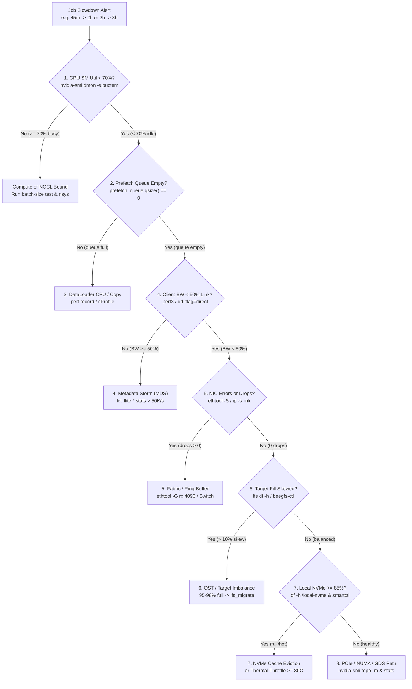
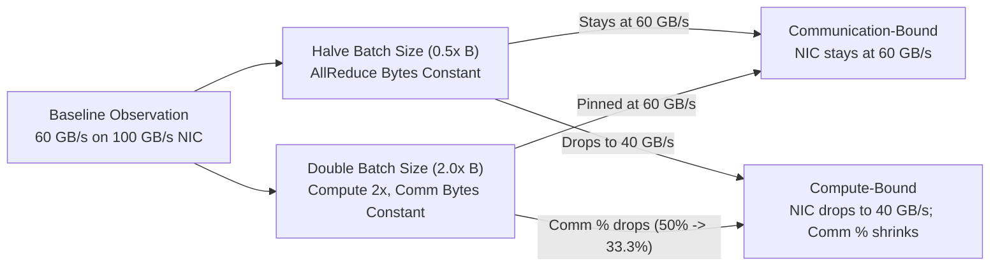

```mermaid
flowchart LR
    Storage["Storage Array<br/>Lustre / BeeGFS / VAST"]
    Fabric["Network Fabric<br/>NIC & Switch (MTU 9000)"]
    ClientFS["Client Filesystem<br/>llite / beegfs / nvidia-fs"]
    CPU["CPU & NUMA Memory<br/>Page Cache / Pinned DRAM"]
    PCIe["PCIe Gen4/Gen5 Fabric<br/>or NVLink-C2C (900 GB/s)"]
    GPU["GPU HBM Memory<br/>A100 40GB / H100 / B200"]

    Storage -->|"Media: ~100 us"| Fabric
    Fabric -->|"Fabric: 10-100 us"| ClientFS
    ClientFS -->|"VFS/RPC: 50-500 us"| CPU
    CPU -->|"DRAM: 50-100 ns"| PCIe
    PCIe -->|"PCIe DMA: 1-10 us"| GPU
```

# 13.9 Storage troubleshooting

| Field | Value |
|---|---|
| Level | Advanced |
| Priority tier | 2 |
| Lab venue | GCP / GKE + Local Python Verification Lab (`code/part13/storage_troubleshooting_lab.py`) |
| Part | Part 13: AI storage |
| Coverage file | `planning/coverage/chapters/13-09.md` |
| Claim & number ledger | `planning/ledgers/13-09.md` |

## Why this matters for AI infrastructure

Picture a training run that used to finish in 2 hours and now takes 8 hours. Nothing in the job looks different on paper, and the team starts guessing. You may know this feeling already. Every minute spent poking at the storage array burns accelerator time, because GPUs are billed by the hour whether they are working or waiting. A GPU that sits idle while it waits on a stalled file lookup costs the same hourly rate as one running at full speed.

The trouble is that a production AI storage path is long. It crosses eight distinct hardware and software layers. Each layer is one stage of the trip that a byte of training data takes. Those layers run from GPU memory and PCIe (Peripheral Component Interconnect Express, the wiring between the CPU, the GPU, and other cards) down through host CPU queues, local NVMe drives (solid-state drives that sit inside the server, on the fast NVMe interface), client filesystems, network switches, metadata servers, and storage targets.

Think about what happens without an ordered sequence. Each engineer picks the layer they know best, and each one fixes a real problem that is not the cause. Teams misdiagnose storage incidents this way and end up fixing the wrong layer. Some teams scale out storage bandwidth when the real culprit is a small-file metadata storm. That storm can waste 47 minutes of every training epoch, and adding bandwidth does nothing for it. Others tune PyTorch worker counts while a tiny network ring buffer silently drops hundreds of packets under multi-job congestion. A ring buffer is the queue where the network card holds incoming packets before the operating system reads them, so a small one overflows under load. Still others assume GPUDirect Storage is bypassing the host CPU. An alignment mismatch can force the driver back into slow host memory copies, and nobody sees an error.

Teams also make the opposite mistake. They blame storage when the array is completely healthy. Suppose an eight-GPU job scales poorly because the GPUs talk to each other, through a collective communication step, over PCIe instead of NVLink. NVLink is NVIDIA's faster link between GPUs inside one server. In that case, storage tuning will not save a single millisecond. What you need is a fast test that can prove you wrong. The test should separate GPU compute limits, network collective bottlenecks (slowdowns in the group exchanges between GPUs, such as gradient averaging), and true storage starvation. Run it before you change any cluster configuration.

Both mistakes come from the same place. Each one picks a favorite suspect before the evidence arrives. A falsifiable test keeps the favorite out of the discussion until the numbers can speak.

This is the last chapter of Part 13, and it turns the whole AI storage stack into a runbook you can follow during an incident. The chapter starts before any incident, with a five-minute golden baseline (a snapshot of a healthy node that you can compare against later). From there it walks an eight-layer decision tree, moving from the GPU backward to the storage media. It then shows how batch-size scaling experiments separate network communication from compute, how to audit GPUDirect Storage for silent fallbacks, and how to resolve six major production storage failures.

```text
Incident Triage Reference Metrics:
  Job runtime regression examples: 2.0 hours -> 8.0 hours (4.0x slowdown) | 45 minutes -> 2.0 hours
  GPU SM utilization drop:         92% SM (40% mem) healthy -> 15% SM (5% mem) starved (< 70% SM I/O gate)
  Small-file metadata stall:       > 100,000 ops/sec saturated (< 50,000 ops/sec healthy MDS ceiling) -> 47 minutes lost/epoch
  NIC ring-buffer overflow:        RX ring 256 dropping 856 packets / 10 s (1,240 rx_errors) under 5 x 128-GPU jobs (640 GPUs)
  Silent GDS fallback signature:   __memcpy_avx2 consuming > 20% (24.5% - 31.0%) of CPU cycles when allow_compat_mode is true
  Compute vs NCCL scaling example: 8 GPUs achieving 5x speedup = 62.5% scaling efficiency (37.5% loss)
  NVLink + NCCL overlap gain:      60% SM busy and 100 ms step time -> 90% SM busy and 70 ms step time (-30% duration)
```

## Prerequisites and outcomes

Before you start, it helps to know three earlier topics, because each one feeds the tools used here. The first is the seven-stage AI storage data path, the local NVMe staging step (copying data onto a drive inside the server), and Linux block queue tuning. Those come from Chapters 13.1 and 13.2. The second is GPUDirect Storage itself. That covers `cuFile`, `nvidia-fs.ko`, `/proc/driver/nvidia-fs/stats`, direct I/O alignment rules (the rules for where data must start and how big each read must be, so the device can use direct I/O), and `gdsio`, all from Chapter 13.3. The third is a working familiarity with Lustre, BeeGFS, WekaFS, VAST Data, DeepSeek 3FS, WebDataset repackaging, and asynchronous checkpoint recovery, which come from Chapters 13.4 through 13.8. Each one is a short reminder of a tool that comes back later in the chapter.

This chapter follows the order you would use during an incident. It starts with the eight-layer storage decision tree, which runs from GPU utilization and queue depth down to host CPU, metadata, network, targets, local NVMe, and PCIe topology. Next comes the batch-size scaling experiment, which separates communication from compute bottlenecks. Its results are read alongside Nsight Systems, Nsight Compute, PyTorch Profiler, and Holistic Trace Analysis timelines. After that, the chapter captures a reproducible five-minute golden baseline across network links, PCIe affinity, local NVMe drives, and shared parallel filesystems, covering four standard AI workload profiles. Then it audits GPUDirect Storage for silent POSIX compatibility fallbacks (POSIX is the standard file API that ordinary Linux programs use), and it applies the 20 percent throughput uplift rule before deploying direct DMA (direct memory access, where the device copies data without the CPU doing the copying). Last, it diagnoses and fixes six major production storage failures: ring-buffer drops, small-file metadata storms, checkpoint stalls, Lustre target skew, local NVMe faults, and NFS mount errors.

---

## Concepts: basics → intermediate → advanced

## 1. The Eight-Layer AI Storage Troubleshooting Decision Tree

Picture a training job that stalls in the middle of the night, or loses more than half of its throughput. Your first instinct may point at the storage array, since it is the component most people blame first. Resist it. The cardinal rule of production troubleshooting is simple: never start at the storage array. Start at the GPU instead, and walk backward toward the storage media, one falsifiable signal at a time. A falsifiable signal is a measurement that can prove your guess wrong. If a measurement cannot prove you wrong, it is not much help.

Suppose the GPU is already 94 percent busy in a matrix kernel (the small program the GPU runs for matrix math). The GPU is clearly not waiting on storage. If you guess that Lustre is slow anyway, you can lose hours of incident response time. Adding more DataLoader workers (the processes that prepare batches for training) while a top-of-rack switch drops packets only makes the congestion worse. Checking eight ordered gates, from the accelerator down to the PCIe root complex, lets you rule out whole subsystems in minutes. Each gate answers one yes-or-no question, so you never have to guess which subsystem is responsible.

### 1.1 The End-to-End Decision Tree

Read the diagram from the top, the way you would read a checklist. Each question either points you at a likely cause or sends you on to the next gate. The labels inside the boxes name the command to run, so you can work through the diagram at the terminal while you read it.

The tree has eight layers because each one is a place where production incidents have hidden before. A shorter tree would be quicker to read, but it would send you to the wrong place more often.



The table turns each gate into a lookup you can scan under pressure. The first column names the layer, and the second asks the diagnostic question. Then come the command to run, the healthy baseline, the fault signature, and the immediate fix. Read one row at a time, and compare what you measured with the healthy column before you decide anything.

| Layer | Diagnostic Question | Primary Telemetry Command | Healthy Baseline | Fault Signature | Immediate Remediation |
|---|---|---|---|---|---|
| **1. Accelerator (GPU)** | Is the GPU starving for input data, or busy computing and running NCCL? | `nvidia-smi dmon -s puctem -c 5` | `SM >= 85-92%`, `Mem >= 40%` | `SM < 70%` (`15%` SM, `5%` Mem) or oscillating `0% <-> 95%` | If `SM >= 70%`, stop blaming storage; run `nsys` and the `0.5x`/`2.0x` batch-size test. If `< 70%`, check Layer 2. |
| **2. Batch Queue (DataLoader)** | Is the host prefetch queue empty when the GPU finishes a step? | `prefetch_queue.qsize()` and per-batch `wait_time` | `qsize >= 2`, `wait_time < 50 ms` | `qsize == 0` for `80%` of steps; `wait_time > 500 ms` (`620 ms`) | If queue is full (`qsize >= 2`) yet GPU waits, check CPU-to-GPU copy (`pin_memory`, GDS). If empty, check Layers 3 and 4. |
| **3. Host CPU (Decode / Copy)** | Are CPU cores pegged in image or token decode, or in memory bounce buffers? | `python -m cProfile -s cumtime` and `perf record -g` | Decode `< batch compute`; `__memcpy_avx2 < 5%` | `Image.open` + `augment` taking `57.3 s` / `120K` calls; `__memcpy_avx2 > 20%` | Offload decode to NVIDIA DALI or nvJPEG, preprocess offline with NeMo Curator, or enable GDS and `pin_memory=True`. |
| **4. Filesystem Metadata (MDS)** | Is the parallel filesystem choking on small-file `open` and `stat` calls? | `lctl get_param llite.*.stats \| grep -E 'open\|close\|getattr'` or `strace -c -e openat` | `< 50,000` ops/sec per MDS; `open` latency `2.0-5.0 ms` | `> 100,000` ops/sec saturated; `open` latency `20-50 ms` (`45 ms`); `47 min`/epoch lost | Repackage small files into WebDataset `.tar`, TFRecord, or `.bin`/`.idx` shards (`100x-1,000x` fewer opens). |
| **5. Network Fabric (NIC / Switch)** | Are storage packets dropping at the NIC ring buffer or leaf and spine switch? | `ethtool -S eth0`, `ethtool -g eth0`, `ip -s link`, `iperf3 -c storage -t 10` | `80-100%` link speed (`20-25 Gbps` on `25G`); `0` `rx_errors`/`rx_dropped`; ring `4096`; `MTU 9000` | `rx_errors = 1240`, `rx_dropped = 856` in `10 s`; RX ring `256`; `300`/sec TCP or RDMA retransmits | Raise ring buffer (`ethtool -G eth0 rx 4096 tx 4096`), verify `MTU 9000`, and throttle concurrent jobs on oversubscribed switches. |
| **6. Storage Targets (OST / OSS)** | Are specific storage targets full (`>= 95%`) or throttled by bad striping? | `lfs df -h`, `lfs getstripe <file>`, `beegfs-ctl --listtargets --spaceinfo` | All targets within `±5%` fill (`OST 0..7` at `50%`); `stripe_count = 1..4` (small) or `16` (ckpt) | `OST 5..7` at `98%` full while `OST 0..4` at `30%` (`68%` spread); `stripe_count = 32` on small files | Migrate hot files off full OSTs (`lfs_migrate`), set `stripe_count = 1..4` for shards and `16+` for large checkpoints. |
| **7. Local NVMe Cache (Scratch)** | Is the node-local NVMe cache evicting hot shards, thermal throttling, or failing? | `df -h /local-nvme`, `iostat -xz 1`, `nvme smart-log /dev/nvme0n1`, `smartctl -a` | Fill `< 85%`; temp `< 70 C`; `0` media errors; `3.5 GB/s` sequential read | Fill `>= 85%` (`88%` LRU thrashing); temp `>= 80 C` (`0.65 GB/s`); RAID 0 member failed | Expand scratch capacity, clean stale checkpoints, improve chassis airflow, or rebuild failed RAID 0 member and re-stage. |
| **8. PCIe / NUMA / GDS Path** | Is traffic crossing inter-socket links (`SYS`/`NODE`) or silently bypassing GDS? | `nvidia-smi topo -m`, `/proc/driver/nvidia-fs/stats`, `numactl --hardware` | `PIX`/`PXB` affinity; `nvidia-fs` `Ops Read` climbing; loader pinned to GPU NUMA node | `SYS` cross-socket hop; `nvidia-fs` counters flat (`0` delta); CPU bounce active | Bind process with `numactl -N <node> -m <node>`, fix `4 KiB`/`8 KiB` alignment, and verify `/etc/cufile.json`. |

Notice that the first gate alone decides where the next hour of work goes, either to the GPU or to storage. That is why it comes first.

Keep the diagram open beside the table during your first few incidents. The diagram tells you where to go next. The table tells you which command to type and what the answer should look like. Experienced engineers often stop looking at the diagram after a while, because the order becomes second nature. The table stays useful longer, since it holds exact thresholds that memory tends to blur.

### 1.2 Why Layer Order Matters: Avoiding False Positives

Consider an engineer who skips the first two gates and runs `python -m cProfile -s cumtime train.py` straight away. cProfile is Python's built-in profiler, and it records how much time each function takes. The profile looks damning at first glance. It shows more than a hundred thousand calls to image open and augmentation functions, which take nearly a minute of cumulative CPU time. Cumulative time means the total spent in a function, including the functions it calls. It is easy to read that number as proof that the CPU is the bottleneck.

Notice that the profile was accurate. Every number in it was correct. The mistake was in the question the engineer asked of it. The engineer asked where the time went, when the useful question was why the GPU was waiting.

```text
   ncalls  tottime  cumtime  filename:lineno(function)
   120000      0.5     45.2  Image.open
   120000      0.2     12.1  augmentation.apply
   Total cumulative decode + augment time: 45.2 s + 12.1 s = 57.3 s (~57 s across 120,000 calls, or 0.48 ms/image)
```

That engineer could spend two days rewriting the augmentation pipeline in C++ or NVIDIA DALI (a GPU-accelerated data loading library), and the effort would produce zero improvement in job runtime. The early gates disprove the CPU theory in minutes. Gate 1 is checked with `nvidia-smi dmon`, which samples the GPU's activity counters. It shows GPU SM utilization at 15 percent. SM stands for streaming multiprocessor, the unit inside the GPU that runs the work. The healthy baseline is 92 percent. Gate 2 is checked with `prefetch_queue.qsize()`. That call reports how many ready batches are waiting in the host prefetch queue. The queue is completely empty 80 percent of the time.

Think about what that pattern means. If CPU decoding were the real limit after fast storage reads, raw file buffers would pile up in the worker queues, waiting for a free CPU thread. The queue would be full, not empty. Instead, the worker threads sit in uninterruptible kernel sleep. That is a state where a thread waits inside the kernel and cannot be woken by a signal. Here the threads wait for network and filesystem calls to return before `Image.open` can even run. The pattern points at the storage path, not at the decoder. Run the early gates before you touch code that sits near the end of the pipeline.

The early gates also save time in a quieter way. A profile can be correct and still point at the wrong layer. Checking the GPU and the queue first keeps the profile in its proper place, as one clue among several.

Wrong fixes also leave scars. A rewritten augmentation pipeline has to be tested, reviewed, and maintained, and then it gets rolled back once the real fix lands. The team loses both the time and the trust of the people who waited for the result. Early gates protect the code as well as the calendar.

---

## 2. Separating Compute, Collective Communication, and Storage I/O Bottlenecks

Before you dig into filesystem counters, prove that the slowdown is not caused by GPU compute kernels or by multi-GPU collective communication. A kernel is the small program a GPU runs for one operation. Consider a data-parallel job, one that copies the model onto every GPU and gives each copy a different slice of the data. It scales from 1 GPU to 8 GPUs. Ideal linear scaling delivers 8x throughput, which means eight times the work in the same time. If 8 GPUs deliver only 5x, the job reaches 62.5 percent scaling efficiency. Scaling efficiency is the speedup you got divided by the speedup you hoped for. The remaining 37.5 percent of cluster capacity is lost to synchronization, network collectives, or I/O stalls.

A useful way to hold this in your head is to ask who is idle. When the GPUs are idle, the wait is in the input or the network. When the GPUs are busy and the network is idle, the wait is in the compute.

### 2.1 The Batch-Size Halving and Doubling Diagnostic

During the backward pass, NCCL (NVIDIA's library for collective communication between GPUs) runs an AllReduce collective to average gradients across all ranks. A rank is one process, usually one GPU. Suppose you watch the network interface card (NIC, the network adapter in the server) and see gradient AllReduce sustaining 60 GB/s on a 100 GB/s NIC. You need to know whether the fabric is congested and capping throughput at 60 GB/s. The other possibility is that the GPUs compute backward passes too slowly to feed the NIC any faster. Both explanations produce the same number on the dashboard, so the number alone cannot settle the question.

You can separate the two without touching a single switch. The trick rests on an invariant, which is a fact that does not change when you change the batch size. For data-parallel training, the byte volume of a gradient AllReduce depends only on the number of model parameters. The micro-batch size, which is the number of examples each GPU processes per step, does not enter the formula. The formula below shows it.

```text
Bytes_AllReduce = 2 x ((N - 1) / N) x |Theta| x sizeof(grad)    (strictly independent of micro-batch size B)
```

That invariant gives you a clean experiment. Hold the model constant and halve or double the micro-batch size. Each change alters the GPU compute work per step. The network bytes per step stay fixed, though. Think of it as a truck that carries the same load no matter how fast the factory runs. If halving the batch size leaves NIC throughput pinned at 60 GB/s, the fabric is the ceiling. Even when the GPUs finish backward compute twice as fast, the network cannot push more than 60 GB/s, so the job is communication-bound.

This is a good example of a controlled experiment. Only one thing moves at a time, and the number you care about is the one you watch.

If halving the batch size drops NIC throughput from 60 GB/s to 40 GB/s, the network had plenty of headroom. The GPUs were the slow part, so the job is compute-bound. Doubling the batch size confirms the diagnosis from the other direction. Compute work doubles while AllReduce bytes stay constant. That means the share of step time spent in AllReduce shrinks from 50 percent to 33.33 percent, because the same communication now sits behind more compute.

The flowchart below traces both branches of the experiment. Read the top box first, then follow the branch that matches what your monitoring shows.



The table below lists what each run should look like under each regime. Use it as a lookup after you run the experiment. Each column is one kind of limit, and each row is one experiment.

| Diagnostic Experiment | Communication-Bound Signature (Network / NCCL Limiter) | Compute-Bound Signature (GPU SM Limiter) | Storage / Data-Loading Bound Signature (I/O Limiter) |
|---|---|---|---|
| **Baseline (`1.0x` batch size)** | NIC at `60 GB/s` on `100 GB/s` (`800 Gbps`) link; long `ncclDevKernel` gaps at step end | NIC at `60 GB/s`; SMs `> 90%` busy during forward and backward pass | Gap appears at iteration start before forward pass; NIC idle; `prefetch_queue.qsize() == 0` |
| **Halve batch size (`0.5x` batch size)** | NIC throughput remains at `60 GB/s` because network caps transfer rate | NIC throughput drops from `60 GB/s` to `40 GB/s` | Metadata `open` rate doubles per second; iteration-start stall worsens |
| **Double batch size (`2.0x` batch size)** | NIC throughput stays at `60 GB/s` | Relative share of step time in AllReduce shrinks (`50.0% -> 33.33%`, `50 ms / 150 ms`) | Sequential read bytes per batch double; `iostat` `rMB/s` or OST bandwidth saturates |
| **Topology-aware NCCL + overlap fix** | Moving AllReduce from PCIe to NVLink plus stream overlap raises SM busy `60% -> 90%` and cuts step time `100 ms -> 70 ms` (`-30%`) | Use FP8 or BF16 Tensor Cores, kernel fusion (`torch.compile`), or CUTLASS | Repackage small files (WebDataset), enable GDS, stage to local NVMe, or widen OST striping |

Let the NIC number decide where you spend your next hour. If it does not move when the batch size changes, the network is the limit. If it falls, the GPUs are the limit.

Read the three columns of the table as three suspects. The communication column says the network is holding the job back. The compute column says the GPUs are the limit. The storage column says the input pipeline starves the GPUs before any compute starts. Only one column should match your measurements. If two columns seem to match, collect one more measurement before you change anything, such as the batch-size test at a third setting.

### 2.2 Multi-Level Profiling Stack

Once the decision tree and the batch-size test show which regime dominates, pick the profiler that watches that exact layer. A kernel-level profiler only produces noise when the process is asleep on disk I/O, because there is no GPU kernel to look at while the process waits. A profiler is a tool that records where time goes. The table below lists each tool with the question it answers, so you can match the question to the tool.

| Tool | Scope | Key Command / API | What It Proves During Storage & Pipeline Triage |
|---|---|---|---|
| **NVIDIA Nsight Systems (`nsys`)** | System-wide timeline (CPU, GPU, OS, GDS, NVTX) | `nsys profile --trace=cuda,gds,nvtx,osrt -o report python train.py` | Correlates NVTX ranges (`"train_step"`, `"forward"`, `"backward"`, `"optimizer_step"`) with OS `read`/`open` stalls (`osrt`), `cuFile` GDS transfers (`gds`), and CUDA stream gaps. |
| **PyTorch Profiler (`Kineto`)** | Operator-level CPU & CUDA timeline + memory | `torch.profiler.profile(activities=[CPU, CUDA], record_shapes=True, profile_memory=True, with_stack=True, with_flops=True)` | Identifies DataLoader `enumerate(loader)` wait gaps, host-to-device `cudaMemcpyAsync` stalls, and `torch.compile` graph breaks. View JSON traces in Perfetto UI, since TensorBoard trace plugin and `chrome://tracing` are deprecated. |
| **Holistic Trace Analysis (`HTA`)** | Multi-GPU / multi-node trace correlation | Ingests Kineto distributed JSON traces across all ranks | Separates true storage stragglers, such as one rank waiting on a `98%`-full OST or degraded NVMe, from collective NCCL wait times across ranks. |
| **NVIDIA Nsight Compute (`ncu`)** | Single-kernel hardware counters & roofline | `ncu --set full -o kernel_report python train.py` | Proves whether a slow CUDA or NCCL kernel is HBM memory-bandwidth bound, SM compute bound, or stalled on PCIe peer-to-peer memory barriers (`60%` vs `90%` SM busy). |
| **Linux `perf`** | Host CPU hardware PMU counters & off-CPU sleep | `perf record -g python train.py && perf report` and `perf sched` | Detects `__memcpy_avx2` (`> 20%` proves CPU bounce buffer and inactive GDS), Python GIL contention, image decode hotspots, and off-CPU `D`-state I/O sleep. |
| **Linux Block & Process I/O (`iostat`, `iotop`, `pidstat`)** | Block device queues, latencies, and per-PID I/O | `iostat -xz 1`, `iotop -b -n 5`, `pidstat -d 1`, `nvme-cli` | Measures local NVMe `%util`, `r_await`/`w_await` (`ms`), `aqu-sz` queue depth, `rMB/s`, `wMB/s`, and isolates noisy-neighbor processes saturating disks. |

Choose the tool that matches the layer the batch-size test pointed at. Leave the others for later, because a second profiler run on the wrong layer only adds data you do not need.

If you are unsure which tool fits, go back to the batch-size result. The result tells you which layer to look at, and the layer tells you the tool.

A useful habit is to write the question on a sticky note before you open the profiler. For example, the question might be whether the GPU waits on the disk or on the network. Then the profiler has one job, and you can stop once it answers that question.

Profilers also work well as a pair. A system-wide timeline shows when the GPU went quiet, while a single-kernel counter shows why one kernel was slow. Use the timeline first to find the quiet window. Then zoom in with the counter tool that matches the layer you suspect. Opening the kernel view first often shows a healthy kernel, because the kernel was never the problem.

---

## 3. Evidence Gathering: The 5-Minute Golden Baseline

A slow storage path is hard to diagnose during an outage if you never measured a healthy one. Picture a stranger who has never seen your node. Without a baseline, they cannot tell whether a number is high or low. Think of the golden baseline as a photograph of the node on a good day. Before you launch production workloads, capture a reproducible five-minute baseline and save it as `healthy.txt`. Reproducible means you can run the same script again later and compare the results line by line. The baseline covers five domains: network and PCIe topology, filesystem mounts and target health, raw network versus storage bandwidth, local NVMe versus shared storage workload profiles, and host memory state.

### 3.1 Layer-by-Layer Latency and Bandwidth Reference

When your application reads a file, the request travels a long road. Picture a parcel that moves through several depots before it reaches your door. It starts at the remote storage media, which is the drive or flash array that holds the bytes. It crosses the network fabric, the network of cables and switches between servers. Then it passes through the client kernel filesystem and host DRAM, the system memory of the server. Finally, it crosses PCIe or NVLink-C2C into GPU HBM, the high-bandwidth memory on the GPU. Latency is how long one request takes, and throughput is how much data moves per second. If you know the normal latency and throughput at each stage, a broken hop stands out right away.



Use the table as a reference when one stage looks wrong. Each red-flag cell names the threshold that should trigger action, so you do not have to argue with yourself about whether a number is bad. Compare the measured value against the cell, and act only when the cell's condition is true.

Storage is only one of the stages in that table, and the others are easy to forget when the storage path looks suspicious. Read the whole row before you blame the array.

| Storage Path Stage | Baseline Latency Envelope | Healthy Single-Node Throughput / Capacity | Primary Baseline Command | Red-Flag Threshold Requiring Action |
|---|---|---|---|---|
| **1. Storage Array (OST / MDS)** | `~100 us` media access; `2.0-5.0 ms` metadata `open` | `< 50,000` `open` ops/s per MDS; targets balanced within `±5%` | `lfs df -h` and `lctl get_param llite.*.stats` | Any `OST >= 90-98%` full; `> 10%` target fill spread; `open > 100,000` ops/s or `> 20 ms` latency |
| **2. Network Fabric (NIC / Switch)** | `10-100 us` (`~300 ns` IB, `~800 ns` RoCEv2 switch hop) | `20-25 Gbps` on `25GbE` (`25,000 Mb/s`, `80-100%` link); `MTU 9000`; RX/TX ring `4096` | `ip -s link`, `ethtool eth0`, `ethtool -g eth0`, `iperf3 -c storage -t 10` | `iperf3 < 50%` of link speed; `MTU 1500` on storage VLAN; RX ring `< 512` (`256`); `rx_errors` or `rx_dropped > 0` |
| **3. Client Filesystem (Kernel)** | `50-500 us` client VFS / RPC processing | `1.5-3.0 GB/s` (`~1-3 GB/s`) single-client seq read; `3.0-5.0 GB/s` `8`-client aggregate | `findmnt -D`, `dd if=/lustre/test.file bs=1M count=1000 of=/dev/null iflag=direct` | Missing `flock,lazystatfs,noatime` (Lustre) or `rsize=1048576,wsize=1048576,hard` (NFS); `dd < 500 MB/s` |
| **4. Host CPU & NUMA Memory** | `50-100 ns` local DRAM access | Dual-socket NUMA 0 (`cpus 0-31`) and NUMA 1 (`cpus 32-63`); `ulimit -l unlimited` | `lscpu`, `numactl --hardware`, `free -h`, `cat /proc/meminfo` | DataLoader workers scheduled on NUMA 1 while GPU0 and NIC0 sit on NUMA 0; swap active (`si`/`so > 0`) |
| **5. PCIe Fabric & GDS Topology** | `1-10 us` PCIe transaction (`~100 ns` Gen5 switch) | `PIX` or `PXB` between GPU (`A100 PCIe 40960 MiB`) and storage NIC/NVMe (`PHB` acceptable if verified) | `lspci -tv`, `nvidia-smi topo -m`, `/usr/local/cuda/gds/tools/gdscheck.py -p` | `SYS` or `NODE` traversal between GPU and storage NIC; `nvidia_fs` not loaded; driver `< 470` (`535.29` baseline) |
| **6. Local NVMe Scratch vs Shared FS** | `< 100 us` local `O_DIRECT` read | Local NVMe: `3.5 GB/s` seq read, `2.8 GB/s` batch stream, `1.2 GB/s` rand read, `2.1 GB/s` ckpt write | `nvme list`, `smartctl -a /dev/nvme0n1`, `fio --ioengine=libaio --direct=1` | Local NVMe `< 500 MB/s`; SMART `Temperature >= 70 C`; `Media and Data Integrity Errors > 0` |

### 3.2 Benchmarking Local NVMe vs Shared Storage Across Four AI Workload Profiles

One `dd` run cannot certify an AI storage path, because training and inference generate very different I/O patterns. dd is a simple copy tool that measures one stream. AI jobs rarely look like one stream. Model loading reads large sequential blocks once at startup. Batch streaming runs concurrent medium-sized reads, as many workers ask for their next batch at the same time. Random access hits large blocks across shards, which happens with scattered weight or KV-cache reads. Checkpointing sends a burst of heavy sequential writes from all ranks at once, so every GPU process pushes its state to disk together.

When you baseline a cluster, run `fio` with `--ioengine=libaio --direct=1` alongside a metadata test loop. Run it on both local NVMe and shared storage. fio is the standard benchmark tool for disk and filesystem I/O. The direct=1 setting bypasses the page cache, so the numbers reflect the device and not the server's free memory. Comparing the two tiers side by side answers the question you care about most. Should you stream directly from the parallel filesystem, or stage datasets and checkpoints onto local NVMe? The answer decides where your data lives during training.

Run the test while nothing else is busy if you can. A noisy node gives noisy numbers, and noisy numbers look like a bad drive.

| AI Workload Profile | I/O Access Pattern | Total Test Size | Block Size (`bs`) | Concurrency (`numjobs` / `iodepth`) | Typical Local NVMe Baseline | Typical Shared Parallel FS Baseline | Operational Decision Rule |
|---|---|---|---|---|---|---|---|
| **1. Model Weight Load** | Sequential read (`rw=read`), once at startup or epoch | `10 GB-100 GB` (`count=10000` at `1M`) | `1 MB` (`bs=1M`) | `1` reader (`iodepth=32`, `numjobs=4` structured) | **`3.5 GB/s`** | **`1.5-3.0 GB/s`** (`2.33x` ratio at `1.5 GB/s`) | If NVMe is `> 2x` faster than shared storage (`> 2.0 GB/s`), cache model weights on local NVMe. |
| **2. Batch Streaming** | Concurrent medium-block reads (`rw=read`) | `1 GB` per job (`1,000 x 1 MB` batches) | `64 KB` (`bs=64k`) | `8` parallel readers (`numjobs=8`, `iodepth=16`) | **`2.8 GB/s`** | **`3.0-5.0 GB/s`** aggregate across `8` clients | If aggregate shared bandwidth does not scale with client count, the storage network or OST count is saturated. |
| **3. Random Weight / KV-Cache Read** | Random large-block read (`rw=randread`) | `10 GB` | `4 MB` (`bs=4M`) | `1` reader (`iodepth=32`, `numjobs=1`) | **`1.2 GB/s`** | Scales with `stripe_count` and `read_ahead_kb` (`4 MiB`) | Ensure `blockdev --setra` (`4 MiB`) and `blk-mq` `none` or `mq-deadline` scheduler are active on NVMe. |
| **4. Checkpoint Burst Write** | Synchronized sequential write (`rw=write`) | `500 MB` per rank (`500 GB` cluster-wide) | `4 MB` (`bs=4M`) | `1` per rank (`8` ranks per node, `iodepth=16`) | **`2.1 GB/s`** per drive (`10+ GB/s` RAID 0) | `1.0-6.4 GB/s` (depends on `stripe_count = 16`) | A `500 GB` sync write at `1.0 GB/s` stalls GPUs for `500 s`; staging to `10x` faster NVMe (`10 GB/s -> 50 s`) saves `9/10` (`90% = 450 s`) of stall time. |
| **5. Metadata Storm (Small Files)** | `create` + `stat` + `open` + `close` on `10,000-1,000,000` files | `100 KB` per file | `4 KB` metadata inode | `16` metadata workers | `50,000+` local XFS ops/sec | **`1,000-5,000` ops/sec** per client (`< 50,000` per MDS ceiling) | If metadata rate is `< 10,000` ops/sec or dataset has `1,000,000` files, repackage into `1,000-10,000` `.tar` shards (`100x-1,000x` open reduction). |

Read each row as a decision, and let the last column tell you whether to stage, cache, or repackage. Take the checkpoint burst row as an example. Picture a training job that pauses to save its state. A 500 GB synchronous write at 1.0 GB/s keeps the GPUs waiting for 500 seconds. Synchronous means the GPUs stop until the write finishes. Staged to NVMe at 10 GB/s, the same write takes 50 seconds, so the stall shrinks to a tenth of its length. Staging means writing to fast local drives first, then copying to shared storage in the background.

Not every row describes a bad system. Some rows describe a good system that is about to be overloaded. A model load at full speed is fine until a second job starts loading from the same drive. When you read a row, ask whether the healthy number can survive the load you plan to add. That question is what the baseline is really for.

---

## 4. Deep-Dive Walkthrough of a Real Production Incident

The decision tree and the baseline prove their worth under pressure. So let us walk through a real multi-symptom incident on a Lustre-backed GPU cluster. A distributed training job that normally finishes in 2.0 hours suddenly stretches to 8.0 hours. That 4.0x slowdown burns four times the GPU budget. If the cluster bills by the GPU-hour, the same job costs four times as much, and the team waits four times as long for results.

The incident below is useful precisely because it has three symptoms at once. Real outages rarely announce one cause. They show several symptoms, and the tree helps you keep them in order.

### 4.1 Incident Alert and Step 1: Comparing Current State Against the Baseline

Imagine you are the on-call engineer, and the alert has just fired. Instead of guessing at Lustre or PyTorch flags, you run `./capture_baseline.sh > current.txt` on a training node. The script writes the same sections as the healthy file, so the two files line up. Then you compare the output with `healthy.txt` using `diff`. The comparison shows three anomalies at once. One is on the GPU, one is on the Lustre object targets, and one is on the network interface. Each one sits on a different layer, and the order of the tree tells you which one to read first.

Notice what the diff gives you. It does not say what is wrong. It says what changed. That difference is the whole reason to keep a healthy file in the first place.

```text
< GPU0    dmon -s puctem shows: sm=92%, mem=40%
> GPU0    dmon -s puctem shows: sm=15%, mem=5%          <- Signal 1: GPU idle!

< LFS df shows: OST 0-7 at 50% full
> LFS df shows: OST 5-7 at 98% full, OST 0-4 at 30%     <- Signal 2: OST imbalance (68% spread)!

< ethtool -S eth0: rx_errors=0, rx_dropped=0
> ethtool -S eth0: rx_errors=1240, rx_dropped=856       <- Signal 3: Network packet drops!
```

A junior engineer who sees `OST 5-7 at 98% full` may start migrating terabytes of files right away. The instinct is understandable, since a full target looks like the obvious fault. That migration takes hours and adds heavy background I/O to a cluster that is already struggling. A senior engineer follows the eight-layer tree in order instead, so the true pacing bottleneck gets fixed first. The full target still needs attention, but it can wait for a maintenance window.

### 4.2 Steps 2 and 3: Queue Depth and Ruling Out the CPU Decoder

Gate 1 shows GPU SM utilization has collapsed from 92 percent to 15 percent, well below the 70 percent threshold. That drop tells you the job is I/O-bound, meaning it waits on input data. Gate 2 checks `prefetch_queue.qsize()` inside the training loop. Think of the queue as a shelf of ready batches. The shelf is empty 80 percent of the time, and batch wait exceeds 500 ms. In other words, the GPU reaches for the next batch and finds nothing there.

Each number in this gate is a small fact. Together they form a pattern, and the pattern is what you act on.

At Gate 3, you profile the job with `python -m cProfile -s cumtime train.py`. The profile is the same kind you saw in the earlier section, and it shows 120,000 calls to `Image.open` taking 45.2 seconds. It also shows `augmentation.apply` taking 12.1 seconds. Added together, that totals 57.3 seconds of CPU work. A CPU-heavy number like that is easy to misread, which is why the gates come first.

That 57.3 seconds of CPU work is real. It still cannot explain why the prefetch queue sits empty 80 percent of the time. If the CPU were the limit, the queue would be full. The raw file bytes are stalling in the storage network before they ever reach `Image.open`, so the decoder never gets a chance to be slow. Ruling the CPU out early spared the team the work of rewriting the decoder.

The lesson here is about order more than arithmetic. The same 57.3 seconds would look like the answer if you had read it first. After the queue data, it becomes a red herring. Keep the sequence fixed, and let each gate narrow the field before the next one spends your time.

### 4.3 Steps 4, 5, and 6: Metadata Latency, Ring Buffers, and Switch Oversubscription

At Gate 4, the engineer checks Lustre client metadata counters over a 60-second window during epoch startup. An epoch is one full pass over the dataset. The metadata server (MDS, the server that handles file names, permissions, and open requests) sits behind those counters. The counters record 950,000 file opens in one minute. That works out to 15,833.33 opens per second. A Lustre MDS handles 50,000 opens per second safely, so 15.8K opens per second should run at a healthy 2.0 ms latency. Instead, average `open` latency has spiked to 45.0 ms, which is far above the normal figure.

Notice how the numbers build on each other. The open rate, the latency, and the packet drops describe one chain. Read them in the order the packet travels, and the story becomes easy to follow.

Gate 5 explains why a lightly loaded MDS takes 45.0 ms to answer. The MDS is not the problem here, since it is not busy. Watching `ethtool -S eth0` over 10 seconds reveals 1,240 receive errors and 856 dropped packets. Those counters come from the network card on the storage path. The RX ring buffer, which is the card's receive queue, holds only 256 entries. Every dropped metadata RPC (a remote procedure call, the message that asks the server for a file lookup) triggers a network retransmission timeout. That timeout stretches a 2.0 ms lookup into a 45.0 ms stall.

Raising the NIC ring buffers to 4096 with `ethtool -G eth0 rx 4096 tx 4096` cuts local drops below 5 per second. That fix is local, so it only stops drops on this node. However, 300 network retransmits per second remain. The cause sits outside the node. Oversubscribed means the switch uplinks carry more traffic than they can handle. Five concurrent 128-GPU training jobs, 640 GPUs in total, push an oversubscribed storage switch fabric at the same time. Capping heavy I/O jobs from five down to three clears the congestion and restores 2.0 ms metadata latency and 88 percent GPU utilization. The team can rebalance the 98 percent full OSTs later, during a maintenance window, because that work adds I/O of its own.

The fix came in two parts, and the order mattered. The first part was local to one node and was cheap to undo. The second part reduced load on the whole fabric. That kind of change is harder to undo, because other jobs now depend on the new schedule.

Here is the whole progression with its arithmetic.

```text
Incident Triage Progression & Numbers:
  1. Metadata open rate check:     950,000 opens / 60 s = 15,833.33 opens/sec (~15.8K/sec, 31.7% of 50,000 ops/sec MDS ceiling)
  2. Metadata latency inflation:   2.0 ms healthy baseline -> 45.0 ms during incident (22.5x inflation due to packet drops)
  3. NIC ring-buffer fix:          ethtool -g eth0 shows RX ring = 256 -> ethtool -G eth0 rx 4096 tx 4096 cuts drops from 85.6/s to < 5/s
  4. Switch oversubscription fix:  5 jobs x 128 GPUs (640 GPUs, 300 retransmits/s) -> 3 jobs x 128 GPUs (384 GPUs, 0 retransmits/s)
  5. Final restored state:         0 retransmits/sec, 2.0 ms open latency, 88% GPU SM utilization, 2.0-hour runtime restored
```

Each line answers one gate, so the block doubles as an incident log you can paste into a ticket. Fix the network path and the job mix first. Schedule the target rebalance for later, once the job pressure is gone.

A good incident log also records what you did not change. If you left the stripe count alone, write that down, so the next engineer does not repeat the experiment.

---

## 5. Validating GPUDirect Storage and Catching Silent Fallbacks

Suppose a team installs the `nvidia-fs` package, sets an environment variable, and assumes reads now stream straight into GPU HBM. nvidia-fs is the kernel driver that lets the storage path talk to the GPU directly. Training keeps running, so you may never notice. Meanwhile, `cuFile`, the NVIDIA API that GPUDirect Storage uses, has quietly fallen back to POSIX compatibility mode. Here POSIX means the ordinary Linux file path. Every byte travels through the Linux page cache and the host CPU bounce buffers instead, so the CPU copies the data twice. Operators call this pattern Placebo GDS, and it is a recurring anti-pattern in GPU clusters. An anti-pattern is a habit that looks like progress and quietly costs you.

The default configuration makes it easy to miss. `/etc/cufile.json` ships with `allow_compat_mode: true`. That setting lets a broken prerequisite cause a silent fallback instead of a loud crash. A loud crash would stop the job and tell you why, while a silent fallback lets it limp along. The job runs on. Host CPU use climbs above 85 percent inside `__memcpy_avx2`, which is the CPU routine that copies memory. PCIe bandwidth, the lane capacity between the CPU and the GPU, is wasted copying every batch twice.

Checking the config file is a good first step, but it is not proof. A config file records intent. The counters and the CPU profile record what the job actually did, and only those count as proof.

### 5.1 The Six Non-Negotiable GDS Prerequisites and Verification Signals

GPUDirect Storage skips the host CPU bounce buffer only when all six requirements hold at the same time. A bounce buffer is a staging area in host memory where data pauses on its way to the GPU. If even one requirement fails, `cuFile` quietly routes reads through host DRAM. Think of six locks on one door. A single locked lock means you must take the long way round. The table lists each requirement, the command that verifies it, and the failure that causes the fallback.

The six rows fall into three groups. The first two rows concern the host and the GPU driver. The middle two rows concern the hardware wiring and the filesystem. The last two rows concern how the application asks for data. A failure in an early group often hides failures in later ones, so start with the group closest to the hardware.

| Requirement # | Layer | Technical Requirement | Verification Command | What Causes Silent Fallback to CPU Bounce |
|---|---|---|---|---|
| **1. Kernel Driver** | Host OS | `nvidia_fs` kernel module loaded and `/proc/driver/nvidia-fs/stats` active | `lsmod \| grep nvidia_fs` and `cat /proc/driver/nvidia-fs/stats` | `nvidia-fs` DKMS package missing or broken after a Linux kernel upgrade. |
| **2. GPU Driver** | CUDA Driver | NVIDIA display and compute driver `>= 470` (`535.29`+) and `/usr/local/cuda/include/cufile.h` present | `nvidia-smi \| grep "Driver Version"` | Older driver lacking `cuFile` BAR1 peer-to-peer DMA hooks. |
| **3. PCIe Topology** | Hardware Fabric | GPU and NVMe or storage NIC share a PCIe switch (`PIX` or `PXB`) or supported root complex (`PHB`), never crossing inter-socket links (`SYS` or `NODE`) | `nvidia-smi topo -m` and `lspci -tv \| grep -E "NVIDIA\|Tesla\|NIC"` | GPU0 on NUMA 0 reading via NIC1 on NUMA 1 (`SYS` or `NODE` hop across QPI, UPI, or Infinity Fabric). |
| **4. Storage Backend** | Filesystem | Kernel-level `O_DIRECT` + GDS-enabled client (NVMe, NVMe-oF, Lustre, BeeGFS, WekaFS, VAST, IBM Storage Scale) | `/usr/local/cuda/gds/tools/gdscheck.py -p` | Mounting storage via user-space FUSE or standard TCP NFS without RDMA and `nvidia-fs` registration. |
| **5. Buffer & Offset Alignment** | I/O Geometry | File offset, GPU buffer address, and transfer size aligned to `4 KiB` (`4,096 B`) for NVMe/NVMe-oF or `8 KiB` (`8,192 B`) for Lustre, with request size `>= 1 MiB` (`1,048,576 B`) | Inspect `cuFileRead` / `kvikio.CuFile` arguments and `nsys --trace=gds` | Reading unaligned byte ranges, such as a `4,096 B` offset on Lustre requiring `8,192 B`, or tiny `< 1 MiB` chunks. |
| **6. Application API & Proof** | Runtime | Uses `cuFile` (`kvikio.CuFile`, DALI, NIXL GDS plugin) rather than Python `open`/`read`, and proves activity via counters | `perf record -g` (`0%` `__memcpy_avx2`) + rising `Ops Read` in `/proc/driver/nvidia-fs/stats` | Using standard `open(path, "rb")` or `torch.load()` without `kvikio` or `cuFile` integration. |

Work down the table in order, and fix the first row that fails. Fixing a lower row first is wasted effort, because a later row may depend on it. If row 1 fails, the driver is missing, so the rest of the checks mean little.

Think of the table as a ladder with rungs. Each rung depends on the rung below it. A broken rung means the climb above it proves nothing.

A simple habit helps here. Before you change a row, write its current value next to the healthy value in the table, so the next person sees the gap.

### 5.2 Benchmarking CPU Bounce vs Direct GDS and the 20 Percent Rule

Before you roll out GPUDirect Storage across a fleet, benchmark two things: the Python application path and the raw hardware ceiling. The ceiling is the best speed the hardware can reach with no application code in the way. When you need the hardware ceiling, use `/usr/local/cuda/gds/tools/gdsio`. On the traditional Python path, reading a 100 MiB file with `open` and copying it into GPU memory averages 0.251 seconds across five trials. MiB means mebibytes, and 100 MiB is roughly the size of a short video clip. That works out to about 398 MB/s. Replacing `open` with RAPIDS `kvikio.CuFile` streams the file straight into GPU memory, with no host staging copy. RAPIDS is NVIDIA's family of GPU data science libraries, and kvikio is its file I/O package.

At the hardware level, `gdsio` compares two paths. Flag `-x 2` selects the CPU bounce path, and flag `-x 0` selects direct DMA, where the data goes straight from the storage path into GPU memory. Flags are the switches you pass on the command line. In a four-worker read test on a 10 GiB file, switching from `-x 2` to `-x 0` raises throughput and cuts latency by 20 percent. A worker here is one parallel reader. In the same test, host CPU load drops from 85 percent to 25 percent. That CPU saving matters, because the freed cores can serve other work such as data preparation.

If you only remember one thing from this comparison, remember the CPU column. A fast path that still burns the host CPU leaves less room for everything else the node must do.

Use the 20 percent rule to decide whether GDS is worth deploying for a given workload. Here is how to read it. Deploy GDS in production if it improves throughput by at least 20 percent. Deploy it also if it frees CPU cores that batch streaming is starved for, because the CPU is then the real limit. If the gain is under 20 percent, skip GDS and fix the real bottleneck first. The usual suspects are small-file metadata overhead and narrow Lustre striping, which means the file is spread over too few storage targets.

The arithmetic behind the rule is in the block below. Read the three parts in order, starting with the Python trials, then the gdsio runs, then the batch example.

Before you trust the block, check the units. The Python trials are reported in MiB/s, and the gdsio runs are reported in GB/s, so the two sets of numbers are not on the same scale until you convert them. A mix-up of that kind is a common reason a benchmark seems to contradict itself.

```text
GDS Benchmark Reference & Decision Math:
  1. Lab 03 Python 100 MiB (104,857,600 B) CPU-bounce trials:
     Trial times:  [0.265 s, 0.250 s, 0.248 s, 0.247 s, 0.246 s] -> Mean = 0.2512 s (~0.251 s)
     Trial rates:  [378, 400, 403, 404, 407] MiB/s -> Mean = 398 MiB/s (398 MB/s)
  2. Controlled gdsio benchmark (-d 0 -w 4 -s 10G -i 1M -I 0):
     CPU bounce (-x 2): Throughput = 8.0 GB/s | Avg latency = 1.25 ms | Host CPU ~ 85%
     Direct GDS (-x 0): Throughput = 9.6 GB/s | Avg latency = 1.00 ms | Host CPU ~ 25%
     Improvement:       (9.6 - 8.0) / 8.0 = +20.0% throughput uplift | (1.25 - 1.00) / 1.25 = -20.0% latency reduction
  3. High-rate batch streaming example:
     1,000 batches/sec x 1 MB/batch = 1,000 MB/s (1.0 GB/s) continuous transfer offloaded from host CPU
```

Both the 20 percent throughput gain and the 20 percent latency cut come from the same two runs. That matters, because one test gives you both answers. Deploy GDS only when the benchmark clears that bar, or when it frees the CPU cores you need.

Keep the benchmark numbers in the same file as the decision, so the next review can see why GDS was or was not deployed.

---

## 6. Commands and Configurations That Matter

When an alert pages you at 2 a.m., you should not have to recall twenty different command-line flags from memory. Write them down once, group them by layer, and keep them where you can find them. The scripts and command blocks below do exactly that. Each check sits under the storage layer it instruments, so you can jump straight to the block that matches the gate you are on.

### 6.1 The 5-Minute Node and Storage Baseline Capture Script

Run this script on a GPU node before training starts. It builds the `healthy.txt` reference file, which is your photograph of the good day. When a slowdown alert fires, run it again to capture `current.txt`. Then compare the two files with `diff`, and read the lines that changed. Those lines are your first suspects.

Keep the output file with the node's name and date in it. The script already builds that name for you, so the next engineer can find the matching baseline without asking you.

```bash
#!/bin/bash
# (untested here) Capture 5-minute golden baseline across GPU, NIC, Topology, FS, and NVMe
OUTPUT_FILE="baseline-$(hostname)-$(date +%Y%m%d-%H%M%S).txt"

echo "=== 1. GPU UTILIZATION & DETAILS ===" | tee "$OUTPUT_FILE"
nvidia-smi dmon -s puctem -c 5 >> "$OUTPUT_FILE"
nvidia-smi -i 0 -q | grep -E "Product Name|Memory|Driver" >> "$OUTPUT_FILE"

echo "=== 2. NETWORK INTERFACES, RING BUFFERS & TOPOLOGY ===" >> "$OUTPUT_FILE"
ip -s link >> "$OUTPUT_FILE"
ethtool eth0 >> "$OUTPUT_FILE"
ethtool -S eth0 | grep -E "rx_errors|rx_dropped|tx_errors" >> "$OUTPUT_FILE"
ethtool -g eth0 >> "$OUTPUT_FILE"
lscpu >> "$OUTPUT_FILE"
numactl --hardware >> "$OUTPUT_FILE"
lspci -tv | grep -E "NVIDIA|Tesla|NIC" >> "$OUTPUT_FILE"
nvidia-smi topo -m >> "$OUTPUT_FILE"

echo "=== 3. FILESYSTEM MOUNTS, TARGET HEALTH & METADATA ===" >> "$OUTPUT_FILE"
mount | grep -E "lustre|beegfs|nfs|/mnt" >> "$OUTPUT_FILE"
findmnt -D >> "$OUTPUT_FILE"
if command -v lfs &> /dev/null; then
    lfs df -h >> "$OUTPUT_FILE"
    lctl get_param llite.*.stats | grep -E "^[^ ]|^  open|^  close|^  getattr" | head -20 >> "$OUTPUT_FILE"
fi
if command -v beegfs-ctl &> /dev/null; then
    beegfs-ctl --listtargets --nodetype=storage --spaceinfo >> "$OUTPUT_FILE"
fi

echo "=== 4. LOCAL NVMe SMART HEALTH & PAGE CACHE ===" >> "$OUTPUT_FILE"
lsblk -o NAME,MODEL,SIZE,ROTA,TYPE >> "$OUTPUT_FILE"
if command -v nvme &> /dev/null; then
    nvme list >> "$OUTPUT_FILE"
    for dev in /dev/nvme*n1; do
        smartctl -a "$dev" 2>/dev/null | grep -E "Temperature|Errors|Percentage Used|Unsafe" >> "$OUTPUT_FILE" || true
    done
fi
free -h >> "$OUTPUT_FILE"
cat /proc/meminfo | grep -E "Cached|Buffers|MemAvailable|MemFree" >> "$OUTPUT_FILE"
```

### 6.2 Structured Benchmark, Profiling, and Remediation Commands

Once the baseline points at a suspect layer, run the benchmark or profiler for that layer. Always pass `iflag=direct` to `dd` and `--direct=1` to `fio`. Without those flags, the Linux page cache can fake a fast disk read out of host DRAM. The page cache is the memory area where Linux keeps recently read file data. A second run of the same file then reads from memory and looks impossibly fast. Those flags force the read to go to the device, so the number you see is the real one.

The profiler commands also come with overhead. A profiler slows the job while it records, so run it for a short window, then compare its timing with a normal run.

```bash
# (untested here) 1. Compare throughput with and without NUMA affinity binding
time dd if=/lustre/test.file bs=1M count=1000 of=/dev/null iflag=direct
time numactl -N 0 -m 0 dd if=/lustre/test.file bs=1M count=1000 of=/dev/null iflag=direct

# (untested here) 2. Local NVMe vs Shared Storage 4-Workload fio Benchmark
fio --name=seq-read --ioengine=libaio --rw=read --bs=1M --size=10G \
    --direct=1 --iodepth=32 --numjobs=4 --filename=/lustre/test.file --output-format=normal
fio --name=batch-stream --ioengine=libaio --rw=read --bs=64k --size=1G \
    --direct=1 --iodepth=16 --numjobs=8 --filename=/local-nvme/batch-test.bin --output-format=normal
fio --name=checkpoint-write --ioengine=libaio --rw=write --bs=4M --size=500M \
    --direct=1 --iodepth=16 --numjobs=1 --filename=/local-nvme/checkpoint-test.bin

# (untested here) 3. Verify GPUDirect Storage (-x 2 CPU bounce vs -x 0 Direct GDS)
/usr/local/cuda/gds/tools/gdscheck.py -p
/usr/local/cuda/gds/tools/gdsio -f /mnt/data/large_file -d 0 -w 4 -s 10G -i 1M -I 0 -x 2
/usr/local/cuda/gds/tools/gdsio -f /mnt/data/large_file -d 0 -w 4 -s 10G -i 1M -I 0 -x 0

# (untested here) 4. End-to-End System, GDS, and Block/Process I/O Profiling
nsys profile --trace=cuda,gds,nvtx,osrt -o storage_trace python train.py
perf record -g python train.py && perf report | grep __memcpy_avx2
strace -e openat -c python train.py
iostat -xz 1 10
iotop -b -n 5
pidstat -d 1 10

# (untested here) 5. Production NFS Client Mount & NIC Ring Buffer Remediation
ethtool -G eth0 rx 4096 tx 4096
mount -t nfs -o rw,hard,rsize=1048576,wsize=1048576,noatime,async,actimeo=60,lookupcache=pos \
    nfs-server:/export/datasets /mnt/datasets
```

Each block is grouped by purpose, so copy only the block for the layer you are testing. Running all five blocks at once mixes their results, and you will not know which one changed the number.

Read each block from the top, and stop as soon as one result names the layer. Most of the blocks are safe to run on a healthy node. The remediation lines are different, because they change settings, so run them only after the counters have named the layer.

When a block prints more than you need, filter the output down to the lines that match the counter you are checking. The blocks above already do most of that filtering for you.

---

## 7. How It Fails: Six Production Storage Failure Modes

Most production storage outages in AI clusters fall into one of six repeatable patterns. When your job misbehaves, match what you see to one of these patterns. The same symptom, such as a slow epoch, can come from more than one pattern. The table gives you the counter that proves the root cause and the command that fixes it. Use the counter as the proof, and do not apply the fix until the counter agrees.

Each row also names a fix, but the fix is the last step, not the first. Read the counter, confirm it matches the row, and only then change the setting. A correct fix applied to the wrong row can still make the next incident harder to read.

| # | Failure Mode | Observable Symptom | Root-Cause Diagnosis (Commands & Counters) | Deterministic Fix |
|---|---|---|---|---|
| **1** | **NIC Ring Buffer Overflow + Switch Oversubscription** | Job runtime jumps `4.0x` (`2h -> 8h`); GPU SM drops `92% -> 15%`; `prefetch_queue` empty `80%` of steps; `open` latency spikes `2 ms -> 45 ms` despite only `15.8K` opens/sec (`950K`/min). | `ethtool -S eth0` shows `rx_errors = 1240`, `rx_dropped = 856` in `10 s`; `ethtool -g eth0` reveals tiny RX ring (`256` vs `4096`). After ring fix (`< 5` drops/s), `300` retransmits/s persist because `5 x 128`-GPU jobs (`640` GPUs) oversubscribe switch uplinks. | Run `ethtool -G eth0 rx 4096 tx 4096`, verify `MTU 9000`, and cap concurrent heavy I/O jobs from `5` (`640` GPUs) to `3` (`384` GPUs) or add spine bandwidth (`0` retransmits, `2 ms` metadata, `88%` SM). |
| **2** | **Epoch-Start Small-File Metadata Storm (The 47-Minute Problem)** | Epoch 1 start takes `2` minutes while Epoch 2 takes `30` seconds; or `47` minutes per epoch are lost with GPUs idle while storage bandwidth sits `< 10%` utilized. | `lctl get_param llite.*.stats \| grep open` or `strace -c -e openat` shows `> 100,000` opens/sec (`> 50,000` per MDS safe ceiling); `top -H` on MDS shows all service threads at `100%` CPU; or small files have `stripe_count = 32`. | Repackage `1,000,000` small files (`100-260 KB`) into `1,000-10,000` WebDataset `.tar`, TFRecord, or `.bin`/`.idx` shards (`100x-1,000x` fewer opens; batch wait drops `620 ms -> 31 ms`, `-95%`), and set `stripe_count = 1..4` for small files. |
| **3** | **Silent GPUDirect Storage Compatibility-Mode Fallback** | GDS (`kvikio` / `cuFile`) is enabled, yet throughput remains stuck at CPU-bounce speed (`398 MB/s` or `8.0 GB/s` instead of `9.6 GB/s`), and host CPU sits at `85%-100%`. | `/proc/driver/nvidia-fs/stats` `Ops Read` counter stays at `0` during reads; `perf record` shows `> 20%` (`24.5%-31.0%`) of CPU samples in `__memcpy_avx2`. Caused by `"allow_compat_mode": true` masking `4 KiB` (NVMe) or `8 KiB` (Lustre) misalignment, `< 1 MiB` I/O size, FUSE mount, or `SYS` cross-socket topology. | Align offsets and buffers to `4,096 B` (NVMe-oF) or `8,192 B` (Lustre) with `>= 1 MiB` transfers, bind process to the `PIX`/`PXB`-affine NUMA node (`numactl -N 0 -m 0`), use kernel GDS clients (not FUSE), and verify `nvidia-fs` counters increment. |
| **4** | **Lustre OST Fill Skew (`98%` Full), Client Eviction, & Sync Checkpoint Stalls** | Checkpoint saves stall training for `500+` seconds (`500 GB` at `1 GB/s`) or fail mid-write with `ENOSPC` / `EIO` even though `df -h /lustre` shows `45%` free cluster space. | `lfs df -h` shows `OST 5..7` at `98%` full while `OST 0..4` sit at `30%` (`68%` spread); files landing on `OST 5..7` hit allocator fragmentation, LDLM lock timeouts, and client eviction (`ptlrpc` expired). | Migrate files off full targets (`lfs_migrate`), set `lfs setstripe -c 16 -S 4M` on checkpoint directories before writing, and async-stage checkpoints to local NVMe (`10x` faster -> saves `9/10 = 450 s` of the `500 s` stall) before background flushing. |
| **5** | **Local NVMe Thermal Throttling (`>= 80 C`), SMART Wear, or RAID 0 Failure** | Single node becomes a straggler (`500 MB/s` vs `3.5 GB/s` peers), or job crashes with `Input/output error` on `/local-nvme` scratch. | `iostat -xz 1` shows `100%` `%util` with `r_await > 25 ms` on one NVMe device; `smartctl -a /dev/nvme1n1` shows `Temperature = 82 C` (`>= 70 C` warn, `>= 80 C` critical throttle to `0.65 GB/s`), `Percentage Used >= 95%`, or `Media Errors > 0` breaking an `mdadm` RAID 0 stripe. | Replace worn or faulted NVMe SSD, fix server fan and heatsink airflow to keep composite temperature `< 70 C`, enforce `< 85%` local cache fill watermark, and treat RAID 0 local NVMe strictly as ephemeral cache. |
| **6** | **NFS `Stale file handle` (`ESTALE`) & `soft`-Mount Silent Corruption** | Workers crash with `OSError: [Errno 116] Stale file handle` during dataset reads, or `torch.save()` produces truncated or corrupted `.pt` checkpoints during network blips. | Dataset curation scripts deleted and recreated a directory on the NFS server while compute nodes held cached dentries (`ESTALE`, `errno 116`); or `/etc/fstab` used `soft,timeo=...`, causing `write()` syscalls to return `EIO` on transient timeouts instead of retrying. | Remount with `hard,rsize=1048576,wsize=1048576,noatime,actimeo=60,lookupcache=pos` (never `soft` for read-write checkpoints), use atomic rename or immutable versioned directories (`dataset-v2/`) to avoid `ESTALE`, and move clusters `> 8` nodes off single-server NFS. |

Find the row whose symptom matches what you see. Then confirm the counter before you apply the fix. A matching symptom alone is not proof, because several rows share symptoms such as slow epochs.

---

## 8. Hands-On Lab: End-to-End Storage Incident and Bottleneck Triage

You can run this lab on GCP / GKE or on any Linux workstation. GCP is Google Cloud Platform, and GKE is Google Kubernetes Engine. It uses only the `python3` standard library, the set of modules that ships with Python, and it needs neither a GPU nor root access. These steps were not run on a live cluster.

The companion verification suite in `code/part13/storage_troubleshooting.py` and `code/part13/storage_troubleshooting_lab.py` turns each diagnostic rule into runnable Python. Think of it as the chapter's rules written as code, so a rule the chapter states can be checked by running it. It tests the eight-layer decision tree, the 2-hour to 8-hour incident triage, the batch-size scaling experiment, and the GPUDirect Storage compatibility auditor. An auditor here is a function that reads the configuration and reports risks. It also checks checkpoint staging math, WebDataset repackaging, local NVMe SMART triage, and NFS mount auditing. SMART (self-monitoring, analysis, and reporting technology) is the health report built into most drives. The suite runs 28 deterministic checks in all, which means the same input always gives the same result.

Read the suite as a set of worked examples. Each check names a scenario, runs the rule, and reports PASS or FAIL. You can read a check the same way you read a lab step, one input and one answer at a time.

### Run the Verification Lab

Run the suite with the command below. Start from the root of the repository, so the relative paths resolve. The command includes a flag that stops Python from writing cache files next to the code.

```bash
python3 -B code/part13/storage_troubleshooting_lab.py
```

### Expected Output (Verified Locally)

Every line should read PASS. The last line should report 28 passed and 0 failed. Those counts mean the code and the chapter text agree on every number.

The lab proves that the rules in the chapter agree with each other. It does not prove that your cluster behaves the same way. Treat a passing run as a check on the reasoning, and treat your own measurements as the check on the hardware.

```text
=== Chapter 13.9: Storage Troubleshooting Verification Lab ===

  [PASS] 01. Production incident slowdown is 4.0x (2.0 hours baseline -> 8.0 hours current) with GPU SM utilization dropping from 92% (mem 40%) to 15% (mem 5%)
  [PASS] 02. Decision tree Gate 1 & Gate 2 classify GPU utilization < 70% (15%) with 80% empty prefetch queue as I/O-bound starvation
  [PASS] 03. cProfile CPU decode (45.2 s) + augmentation (12.1 s) totals 57.3 s (~57 s) across 120,000 calls, ruled out as primary root cause because prefetch queue is 80% empty
  [PASS] 04. Lustre metadata open rate of 950,000 opens in 60 s equals 15,833.33 (~15.8K) opens/sec (< 50,000 ops/sec MDS ceiling, > 100,000 saturated) with 45.0 ms open latency vs 2.0 ms baseline
  [PASS] 05. Network triage isolates rx_errors=1240 and rx_dropped=856 in 10 s on RX ring size 256 (fixed via ethtool -G eth0 rx 4096 tx 4096 to < 5 drops/sec)
  [PASS] 06. Switch oversubscription triage shows 5 concurrent 128-GPU jobs (640 GPUs) cause 300 retransmits/sec; reducing to 3 jobs (384 GPUs) restores 0 retransmits, 2 ms open latency, and 88% GPU util
  [PASS] 07. Lustre target fill check detects OST 5..7 at 98.0% full vs OST 0..4 at 30.0% full (68.0% spread vs 50.0% healthy baseline)
  [PASS] 08. Decision tree classifies GPU SM utilization >= 70% (94%) as Compute / Collective Communication (Not Storage)
  [PASS] 09. Decision tree classifies low GPU utilization (28%) with full queue (5% empty) and low memcpy (6%) as DataLoader CPU Preprocessing bottleneck
  [PASS] 10. Decision tree classifies > 20% CPU __memcpy_avx2 samples (28.0%) with low GPU util (30%) as PCIe / CPU-to-GPU Bounce Copy Overhead
  [PASS] 11. Decision tree classifies 110,000 opens/sec (> 50K healthy, > 100K saturated) with healthy network link (22.0 / 25.0 Gbps = 88%) as Filesystem Metadata Server (MDS) bottleneck
  [PASS] 12. Batch-size scaling test diagnoses COMMUNICATION_BOUND when NIC stays pinned at 60.0 GB/s (on a 100.0 GB/s NIC) across 0.5x, 1.0x, and 2.0x batch sizes
  [PASS] 13. Batch-size scaling test diagnoses COMPUTE_BOUND when halving batch size drops NIC utilization from 60.0 GB/s to 40.0 GB/s and doubling batch size shrinks all-reduce time share from 50.0% to 33.33%
  [PASS] 14. GDS audit confirms GDS_DIRECT_DMA when nvidia_fs is loaded, driver is 535.29 (>= 470), topology is PIX, NVMe-oF offset is 4096 B aligned, request >= 1 MiB, nvidia-fs stats increment, and __memcpy_avx2 is 0%
  [PASS] 15. GDS audit catches silent POSIX_COMPAT_CPU_BOUNCE fallback on Lustre when offset is 4096 B (not 8192 B / 8 KB aligned), request < 1 MiB, nvidia-fs stats delta is 0, and __memcpy_avx2 is 24.5%
  [PASS] 16. GDS audit flags user-space FUSE mount and cross-socket SYS topology as incompatible with kernel nvidia-fs O_DIRECT DMA
  [PASS] 17. Lab 03 100 MiB (104,857,600 B) CPU-bounce benchmark trials [0.265, 0.250, 0.248, 0.247, 0.246] s average 0.251 s (396..426 MB/s decimal, ~398 MiB/s)
  [PASS] 18. gdsio (-d 0 -w 4 -s 10G -i 1M -I 0) shows -x 0 GDS (9.6 GB/s, 1.00 ms) achieves +20.0% throughput uplift and -20.0% latency reduction over -x 2 CPU path (8.0 GB/s, 1.25 ms), meeting the >= 20% DEPLOY_GDS threshold
  [PASS] 19. Lab 02 local NVMe baseline verifies 3.5 GB/s model load, 2.8 GB/s batch stream (64 KB x 8), 1.2 GB/s random read (4 MB), and 2.1 GB/s checkpoint write (2.33x faster than 1.5 GB/s shared storage)
  [PASS] 20. Synchronous 500 GB checkpoint at 1.0 GB/s stalls training for 500.0 s; staging to 10x faster NVMe (10.0 GB/s) cuts critical-path stall to 50.0 s, saving 450.0 s (9/10 = 90.0%)
  [PASS] 21. Lab 04 repackaging of 10,000 small 100 KB files into 100 tar shards (100 files/shard) cuts open calls 100.0x and reduces batch wait from 620.0 ms (> 500 ms stall threshold) to 31.0 ms (95.0% improvement)
  [PASS] 22. Repackaging 1,000,000 small files into 1,000 WebDataset/tar shards cuts metadata open calls by 1,000.0x and collapses the 47.0-minute per-epoch metadata stall to < 0.05 minutes
  [PASS] 23. Local NVMe health check passes HEALTHY drive at 52 C (< 70 C), 18% wear (< 95%), 0 media errors, and 3.5 GB/s read throughput
  [PASS] 24. Local NVMe health check detects CRITICAL_THERMAL_THROTTLE at 82 C (>= 80 C critical) when throughput drops to 0.65 GB/s alongside 96% endurance wear
  [PASS] 25. Local NVMe health check flags CRITICAL_RAID0_FAILURE and media_errors=3 when a RAID-0 scratch member fails
  [PASS] 26. NFS audit validates tuned mount (hard,rsize=1048576,wsize=1048576,noatime,async,actimeo=60,lookupcache=pos) on 4 GPU nodes with 0 risks
  [PASS] 27. NFS audit catches soft-mount checkpoint corruption risk, missing 1 MiB rsize/wsize, missing noatime, ESTALE (errno 116, Stale file handle), and 32-node scale overload
  [PASS] 28. Topology-aware NCCL and compute-communication overlap raises SM utilization from 60.0% to 90.0% and cuts iteration time by 30.0% (100.0 ms -> 70.0 ms)

Summary: 28 passed, 0 failed
```

If a line reads FAIL, compare its numbers with the section text before you change anything. A FAIL usually means one input changed, so find that input first. Do not edit the expected numbers just to make the line pass.

---

## Common first mistakes

1. Starting at the storage array instead of the GPU. The storage array is the easiest place to look, so newcomers go there first. Check the GPU and the prefetch queue first. If GPU SM utilization is 70 percent or higher, the job is compute-bound or collective-bound, not storage-bound. If GPU utilization is below 30 percent while `prefetch_queue.qsize()` stays full, look at CPU preprocessing or host-to-GPU copies instead of the parallel filesystem.
2. Changing three knobs at once without measuring against a baseline. Raising `num_workers`, changing the Lustre stripe count with `lfs setstripe -c 16`, and tuning NIC ring buffers with `ethtool -G eth0 rx 4096` all at the same time hides which change fixed the problem. If the job speeds up, you still do not know why. Follow a strict single-variable loop. Capture a baseline, form one hypothesis, change one parameter, and measure again. Repeat that loop until the numbers stop moving.
3. Assuming GPUDirect Storage is active without checking kernel counters and CPU profiles. A config file can say one thing while the runtime does another. Because `/etc/cufile.json` defaults to `allow_compat_mode: true`, an alignment mismatch, a small read size, or an unsupported PCIe bridge can route I/O through host DRAM via `__memcpy_avx2` with no error. Confirm that the `/proc/driver/nvidia-fs/stats` counters climb during reads. A config file only shows intent, and the counters show what really happened.
4. Benchmarking storage with cached `dd` instead of direct I/O. This is a common trap, because the first number looks great. Running `dd if=/lustre/test.file of=/dev/null` without `iflag=direct` measures page-cache speed on any file smaller than free host RAM. Pass `iflag=direct` to `dd` or `--direct=1` to `fio`, so you measure real network and disk throughput.
5. Using a wide stripe count for small dataset files, or a single stripe for huge checkpoints. Striping spreads one file across several storage targets, and the stripe count says how many. Striping a 100 KB file across 32 Lustre OSTs requires 32 object RPCs and lock operations per file, so a tiny read turns into a metadata and lock storm. Keep `stripe_count` between 1 and 4 for small files, and use 16 or more only for multi-gigabyte shards and checkpoints.

Treat each fix as an experiment, and hold the rest of the cluster still while you run it. A fix you cannot explain is a fix you cannot trust, so write down the one change and the number it moved.

Most of these mistakes share one root cause. The engineer wanted to act quickly, and the numbers were not in front of them yet. Slow down for the few minutes it takes to capture the baseline. That short pause usually saves far more time than it costs.

If you find yourself changing two things in one afternoon, stop and write down which change you think matters most. Then undo everything else before you measure again.

---

## Exercises

Work these through on paper before you check any answer. Every input you need is in the block that goes with each exercise. Write each step down, so you can see where a number came from.

1. **Work an eight-layer incident.**

   Your on-call shift starts with a slowdown report. Use the incident metrics in the block below to calculate the job slowdown factor. Next, calculate the total CPU decode plus augmentation time. Then calculate the exact `open` rate per second. Last, explain why neither CPU decode nor MDS capacity is the primary root cause.

   Now look at the network and concurrency metrics. Use them to calculate the active GPU count before you reduce job concurrency. Then calculate the active GPU count after you reduce it. State the resulting retransmit rate. State the `open` latency. Last, state the GPU SM utilization.

```text
Exercise 1 Input Data:
  Part (a): Runtime = 2.0 h baseline -> 8.0 h current | SM = 15% (92% base), Mem = 5% (40% base) | prefetch_queue.qsize() == 0 for 80% of steps
            cProfile (120,000 calls): Image.open = 45.2 s, augmentation.apply = 12.1 s
            lctl llite.*.stats: 950,000 opens in 60 s at 45.0 ms latency (2.0 ms base, 50,000 ops/sec safe MDS ceiling)
  Part (b): ethtool -S eth0 (10 s): rx_errors = 1240, rx_dropped = 856 on RX ring = 256 -> ethtool -G eth0 rx 4096 tx 4096 cuts drops to < 5/sec
            Switch congestion: 300 retransmits/sec under 5 concurrent 128-GPU jobs -> reduced to 3 concurrent 128-GPU jobs
```

2. **Tell a communication-bound job from a compute-bound one.**

   Your team sees a 60 GB/s AllReduce on a 100 GB/s NIC and wants to know why. Use the AllReduce baseline below to explain, with the formula, why changing the micro-batch size does not change the gradient AllReduce payload bytes.

   Next, use the halving and doubling measurements below. Calculate Run B's new AllReduce share of total iteration time at double the batch size. Then classify Run A as communication-bound or compute-bound. Last, classify Run B the same way.

```text
Exercise 2 Input Data:
  Part (a): Backward-pass gradient AllReduce achieves 60.0 GB/s on a 100.0 GB/s NIC | Baseline step = 50.0 ms compute + 50.0 ms AllReduce
  Part (b): Halve batch size (0.5x): Run A stays at 60.0 GB/s | Run B drops to 40.0 GB/s
            Double batch size (2.0x): Run B step = 100.0 ms compute + 50.0 ms AllReduce communication
```

3. **Audit a GPUDirect Storage fallback and run the gdsio math.**

   Start with the Lab 03 and `gdsio` benchmark numbers below. Calculate the mean elapsed time for the Python trials. Then calculate their average throughput. Next, compute the `gdsio` percentage throughput uplift. Compute the latency reduction too. Last, state whether GDS meets the deployment threshold.

   A developer runs `kvikio.CuFile` on Lustre with the geometry shown below. The developer sees zero change in `/proc/driver/nvidia-fs/stats`. Identify the first geometry violation that causes the silent fallback to POSIX compatibility mode. Then identify the second one.

```text
Exercise 3 Input Data:
  Part (a): Five 100 MiB (104,857,600 B) CPU-bounce trials = [0.265, 0.250, 0.248, 0.247, 0.246] s
            gdsio (-d 0 -w 4 -s 10G -i 1M -I 0): -x 2 (CPU path) = 8.0 GB/s at 1.25 ms | -x 0 (GDS path) = 9.6 GB/s at 1.00 ms (>= 20.0% deploy threshold)
  Part (b): Lustre kvikio.CuFile read with io_offset = 4,096 B and io_request = 512 KiB (perf record shows 24.5% __memcpy_avx2)
```

4. **Compare local NVMe with shared storage, then size a checkpoint stall.**

   Use the Lab 02 numbers below to compute the NVMe-to-shared speedup ratio. Then state whether that ratio exceeds the local caching threshold.

   Next, use the checkpoint staging numbers below. Calculate the new critical-path stall duration, which is the time the GPUs must wait. Then calculate the exact seconds saved per checkpoint. Last, find the fraction of stall time eliminated.

```text
Exercise 4 Input Data:
  Part (a): Lab 02 model load = 3.5 GB/s on local NVMe vs 1.5 GB/s on shared storage (> 2.0x local caching threshold)
  Part (b): Synchronous 500 GB checkpoint at 1.0 GB/s = 500.0 seconds stall | Local NVMe RAID 0 staging sustains 10.0 GB/s (10x faster)
```

5. **Measure what repackaging saves.**

   Use the Lab 04 dataset metrics below. Compute the file-open reduction factor. Then compute the percentage reduction in average batch wait time after repackaging.

   Next, use the production dataset metrics below. Calculate the open-call reduction factor. Then calculate the remaining metadata stall time, in minutes, after repackaging into WebDataset shards.

```text
Exercise 5 Input Data:
  Part (a): Lab 04 dataset = 10,000 files (100 KB each) -> repackaged into 100 .tar shards (100 files/shard) | Batch wait drops 620.0 ms -> 31.0 ms
  Part (b): Production dataset = 1,000,000 small files losing 47.0 minutes/epoch -> repackaged into 1,000 WebDataset shards (1,000 files/shard)
```

6. **Triage three NVMe drives and audit an NFS mount.**

   Start with the three local NVMe scratch drives below. Classify each one against the thermal and endurance wear thresholds.

   Next, audit an NFS client mounted with `-o rw,soft,rsize=32768,wsize=32768`. The cluster is described below, and its workers fail with `ESTALE`. List all five operational risks in that mount. Then write the corrected production `mount` option string.

```text
Exercise 6 Input Data:
  Part (a) Thresholds: 70 C warning | 80 C critical thermal | 95% endurance wear
           nvme0n1: Temp = 52 C | Percentage Used = 18% | Media Errors = 0 | Read BW = 3.50 GB/s | RAID-0 = clean
           nvme1n1: Temp = 82 C | Percentage Used = 96% | Media Errors = 0 | Read BW = 0.65 GB/s | RAID-0 = clean
           nvme2n1: Temp = 58 C | Percentage Used = 40% | Media Errors = 3 | Read BW = 0.00 GB/s | RAID-0 = failed
  Part (b) NFS cluster: 32 GPU nodes | Workers fail with errno 116 (ESTALE)
```

Check your answers against the section text, not against memory. If an answer differs, reread the section that owns the number.

---

## Interview angles

Each question asks for a sequence of checks, not a single fact. The strong answers below show the order to reason in. Read them as a sequence, not as a script to memorize.

In an interview, say the order out loud. Interviewers usually care more about how you reason under pressure than about whether you remember one flag.

1. **"Your training job suddenly slows from 2 hours to 8 hours. You have 5 minutes on the node to isolate the root cause. What exact sequence of checks do you run?"**
   - *Strong answer:* Walk the eight-layer tree from the GPU backward, so you never guess. Start with the GPU, because its utilization tells you whether storage is even the suspect. First, run `nvidia-smi dmon -s puctem` and confirm GPU SM utilization sits at 15 percent, well below the 70 percent I/O gate. Second, check `prefetch_queue.qsize()`. It is empty 80 percent of the time, which shows batches stall before they reach the CPU image decoder. Third, check the Lustre metadata counters and `ethtool -S eth0`. A modest 15.8K opens per second now takes 45 ms, because a 256-entry RX ring buffer and five 128-GPU jobs are dropping packets. Raising the ring buffer to 4096 with `ethtool -G eth0 rx 4096 tx 4096`, and capping concurrency at three jobs, restores 88 percent GPU utilization.
2. **"During distributed training, your 100 GB/s NIC shows 60 GB/s during backward-pass AllReduce. How do you prove whether you are network-bound or compute-bound without changing hardware?"**
   - *Strong answer:* Gradient AllReduce byte volume depends strictly on the model parameter count, and it does not depend on micro-batch size. So run the batch-size halving and doubling test. Say the reasoning out loud, since the reasoning is the answer. When you halve the batch size, backward compute finishes twice as fast, while AllReduce bytes stay constant. If NIC throughput stays pinned at 60 GB/s, the fabric caps the transfer rate, and the job is communication-bound. If NIC throughput drops to 40 GB/s, and doubling the batch size shrinks the AllReduce share from 50 percent to 33.3 percent, the job is compute-bound.
3. **"Training throughput dropped 40 percent after a dataset update, or metadata latency jumped from 2 ms to 45 ms. How do you isolate why?"**
   - *Strong answer:* First confirm that GPU utilization is low, or oscillating below 70 percent. Start by asking whether the GPU is actually waiting, since a slow dataset is only one possible cause. Next, measure the file-open rate on the process with `strace -c -e openat`, and on the client with `lctl get_param llite.*.stats | grep open` or `beegfs-ctl --serverstats --nodetype=meta`. If the open rate stayed flat around 15K/sec while latency jumped to 45 ms, check the MDS CPU threads with `top -H`, or check network drops with `ethtool -S`. If the open rate spiked past 50K to 100K ops/sec, the dataset update introduced millions of small files. Repackage those files into WebDataset `.tar` or `.bin`/`.idx` shards to cut file opens by 100x to 1,000x. Measure before you migrate anything, because a migration is slow and can make the incident worse.
4. **"How do you prove GPUDirect Storage is actually working in production rather than silently falling back to CPU bounce buffers?"**
   - *Strong answer:* Never trust configuration files alone, because `/etc/cufile.json` enables `allow_compat_mode: true` by default. A config file tells you what was requested, and only runtime evidence tells you what happened. Verify four runtime signals during the read workload. Check that `nvidia-smi topo -m` shows `PIX` or `PXB` affinity between the GPU and the storage NIC or NVMe. Run `gdscheck.py -p` to confirm driver support for 470+. Confirm that the read counters in `/proc/driver/nvidia-fs/stats` climb during training. Finally, `perf record -g` should show 0 percent `__memcpy_avx2` instead of a 20 percent spike.

---

## Checkpoint questions (20)

<details>
<summary>**1. In the eight-layer AI storage troubleshooting decision tree, what is Gate 1, and what threshold separates compute or communication bottlenecks from storage I/O bottlenecks?**</summary>

Gate 1 is GPU Streaming Multiprocessor utilization, which you measure with `nvidia-smi dmon -s puctem`. At 70 percent or higher, the job is compute-bound or NCCL-bound, not storage-bound. Below 70 percent, or when utilization swings between idle and busy, move on to Gate 2 and check `prefetch_queue.qsize()`.
</details>

<details>
<summary>**2. If GPU utilization is low (below 30 percent) but `prefetch_queue.qsize()` is full most of the time, which layers of the data path are suspect?**</summary>

When the host batch queue is full but the GPU still starves, storage and the network are keeping up. The bottleneck sits after the storage fetch, either in slow DataLoader collation or in CPU-to-GPU PCIe transfer overhead. Check for a missing `pin_memory=True`, cross-socket NUMA placement, or inactive GPUDirect Storage.
</details>

<details>
<summary>**3. In the production incident walkthrough, why did `cProfile` showing 57.3 seconds of image decode and augmentation across 120,000 calls turn out not to be the root cause?**</summary>

The prefetch queue ruled it out. `prefetch_queue.qsize()` sat at zero 80 percent of the time while GPU SM utilization was stuck at 15 percent. If CPU decoding were the limit after fast storage reads, raw file buffers would have queued up in host memory waiting on CPU threads. Instead, worker threads were blocked in kernel sleep, waiting for network and filesystem RPCs before `Image.open` could start.
</details>

<details>
<summary>**4. In that same incident, Lustre recorded 950,000 `open` calls in 1 minute (15.8K opens/sec) at 45 ms average latency. Why was `open` latency 22.5x above the 2 ms baseline when the MDS ceiling is 50,000 ops/sec?**</summary>

The `eth0` interface had a 256-entry RX ring buffer, and the switch fabric was oversubscribed by five concurrent 128-GPU jobs. Together they caused 1,240 receive errors and 856 dropped packets in 10 seconds. Each dropped metadata RPC triggered a TCP or LNet retransmission timeout, which stretched a 2 ms MDS lookup into a 45 ms client stall.
</details>

<details>
<summary>**5. What two remediations resolved the 2-hour to 8-hour incident, and what metrics confirmed the fix?**</summary>

First, raising the NIC ring buffers with `ethtool -G eth0 rx 4096 tx 4096` cut local packet drops from 85.6 per second to fewer than 5 per second. Second, cutting concurrent 128-GPU training jobs from 5 jobs (640 GPUs) to 3 jobs (384 GPUs) cleared the switch congestion. Retransmits fell from 300 per second to 0, metadata latency dropped back to 2 ms, and GPU SM utilization rose from 15 percent to 88 percent.
</details>

<details>
<summary>**6. How does the batch-size halving and doubling experiment distinguish a communication-bound workload from a compute-bound workload when a 100 GB/s NIC shows 60 GB/s?**</summary>

The experiment works because AllReduce byte volume depends only on model parameter count, not on micro-batch size. When you halve the batch size, backward compute takes half as long. If NIC bandwidth stays pinned at 60 GB/s, the network caps throughput, and the job is communication-bound. If NIC bandwidth drops to 40 GB/s, and doubling the batch size shrinks the AllReduce share from 50 percent to 33.33 percent, the job is compute-bound.
</details>

<details>
<summary>**7. What is the quantitative impact of switching NCCL from a topology-unaware PCIe path without overlap to a topology-aware NVLink path with compute-communication overlap?**</summary>

According to *AI Systems Performance Engineering*, GPU SM busy utilization rises from 60 percent to 90 percent when NCCL moves from a topology-unaware PCIe path without overlap to a topology-aware NVLink path with compute-communication overlap. Memory-stall warps drop substantially. Total iteration time falls by 30 percent, from 100 ms to 70 ms.
</details>

<details>
<summary>**8. Which Nsight Systems CLI flags capture CUDA kernels, GPUDirect Storage transfers, NVTX ranges, and OS runtime syscalls in a single timeline?**</summary>

Run `nsys profile --trace=cuda,gds,nvtx,osrt -o report python train.py`, a command that was not run on live hardware. It lines up NVTX markers such as `"train_step"`, `"forward"`, `"backward"`, and `"optimizer_step"` with OS syscall stalls in `osrt`, direct DMA reads in `gds`, and GPU gaps in `cuda`.
</details>

<details>
<summary>**9. Why should you use Perfetto and Holistic Trace Analysis instead of TensorBoard's PyTorch trace plugin or `chrome://tracing`?**</summary>

If you profile a PyTorch job, both TensorBoard's legacy PyTorch trace plugin and Chrome's built-in `chrome://tracing` viewer are deprecated. Perfetto gives you a fast web UI and a SQL query engine for Kineto JSON traces. Holistic Trace Analysis correlates traces across all ranks, so you can separate a single-node storage straggler from multi-node NCCL waits.
</details>

<details>
<summary>**10. What are the expected healthy baseline numbers for a 25GbE storage link, single-client Lustre sequential read, metadata `open` rate, and per-operation metadata latency?**</summary>

When you check a healthy 25 Gbps link, it sustains 20 to 25 Gbps in `iperf3` with `MTU 9000` and a 4096-entry ring buffer. Single-client sequential read reaches 1.5 to 3.0 GB/s, and eight concurrent clients reach 3.0 to 5.0 GB/s in aggregate. Metadata open rates below 50,000 ops/sec per MDS are healthy, and rates above 100,000 ops/sec are saturated. Per-operation metadata latency should sit between 2 and 5 ms, not above 20 ms.
</details>

<details>
<summary>**11. In the local NVMe benchmark lab, what are the four reference workload throughputs on a healthy local NVMe drive, and when should you cache models on local NVMe?**</summary>

On a healthy drive, you should see local NVMe reach 3.5 GB/s on sequential model load, 2.8 GB/s on eight-job 64 KB batch streaming, 1.2 GB/s on 4 MB random reads, and 2.1 GB/s on sequential checkpoint writes. Cache model weights and stage checkpoints on local NVMe whenever it is more than 2x faster than shared storage.
</details>

<details>
<summary>**12. How much critical-path training stall time does asynchronous local NVMe staging save on a 500 GB checkpoint if shared storage writes at 1.0 GB/s and NVMe staging writes 10x faster at 10.0 GB/s?**</summary>

A synchronous 500 GB write to shared storage at 1.0 GB/s stalls every GPU for 500 seconds. Staging the same 500 GB dump to local NVMe at 10.0 GB/s finishes the critical-path write in 50 seconds. That saves 450 seconds, or 9/10 (90.0 percent) of the GPU stall time, while a background thread flushes the file to shared storage.
</details>

<details>
<summary>**13. What are the six prerequisites required for GPUDirect Storage to bypass the host CPU bounce buffer?**</summary>

First, the `nvidia_fs` kernel module must be loaded. Second, the NVIDIA GPU driver must be version 470 or newer. Third, the GPU and the storage NIC or NVMe drive must share a PCIe switch or root complex, shown as `PIX`, `PXB`, or a verified `PHB`, never `SYS` or `NODE`. Fourth, the filesystem must use a kernel GDS client, not user-space FUSE. Fifth, offsets and buffers must align to 4 KiB on NVMe-oF or 8 KiB on Lustre, and transfers must be at least 1 MiB. Sixth, the application must call `cuFile` APIs such as `kvikio.CuFile`.
</details>

<details>
<summary>**14. In Lab 03 and `gdsio`, what throughput and latency numbers distinguish CPU bounce (`-x 2`) from direct GDS (`-x 0`), and what is the deployment threshold?**</summary>

In Lab 03, five 100 MiB Python CPU-bounce trials average 0.251 seconds, or 398 MB/s. In `gdsio`, the `-x 2` CPU bounce path reaches 8.0 GB/s at 1.25 ms latency, with 85 percent host CPU load. The `-x 0` direct GDS path reaches 9.6 GB/s at 1.00 ms latency, with 25 percent CPU load. That 20.0 percent throughput uplift and 20.0 percent latency drop clear the 20 percent threshold for deploying GDS.
</details>

<details>
<summary>**15. Which two runtime signals prove beyond doubt whether GDS is using direct DMA or silently falling back to POSIX compatibility mode?**</summary>

First, watch `/proc/driver/nvidia-fs/stats` during the read workload, and verify that the `Ops Read` and byte counters climb. Second, run `perf record -g` on the training process and confirm that `__memcpy_avx2` stays at 0 percent. A silent POSIX compatibility fallback shows more than 20 percent of CPU samples inside `__memcpy_avx2`.
</details>

<details>
<summary>**16. What is the 47-minute problem in AI storage, and how does repackaging into WebDataset `.tar` shards solve it?**</summary>

When you open a million individual 100 KB to 260 KB files at the start of every epoch pushes the parallel filesystem MDS above 50,000 to 100,000 opens per second. That metadata bottleneck wastes 47 minutes of idle GPU time per epoch, while bulk data bandwidth sits unused. Repackaging those files into WebDataset `.tar`, TFRecord, or `.bin`/`.idx` shards holding 100 to 1,000 files each cuts `open` calls by 100x to 1,000x. Per-batch wait time drops from 620 ms to 31 ms, a 95 percent reduction.
</details>

<details>
<summary>**17. Why does setting `lfs setstripe -c 32` on a directory of small files degrade Lustre performance, and when should high stripe counts be used?**</summary>

If you set `stripe_count = 32` on small files splits each tiny file across 32 OSTs. That layout multiplies MDS overhead and needs 32 separate OST RPCs and distributed locks for every read. Keep small and medium files at a stripe count of 1 to 4. Reserve stripe counts of 16 or higher for multi-gigabyte shards and checkpoint files.
</details>

<details>
<summary>**18. How does Lustre OST fill imbalance (`OST 5..7` at 98 percent full vs `OST 0..4` at 30 percent full) cause training stalls and job failures even when the cluster is only 55 percent full overall?**</summary>

When specific OSTs reach 95 to 98 percent full, their block allocators suffer severe fragmentation and high write latency. Every striped file or checkpoint that touches those targets then runs at the speed of the slowest OST. Once a target hits 100 percent, writes fail with `ENOSPC` or trigger client lock evictions, even though other OSTs sit 70 percent empty. Rebalance the targets to within 5 percent using `lfs_migrate`.
</details>

<details>
<summary>**19. What `smartctl` and `iostat -xz` metrics indicate that a local NVMe scratch drive is thermal-throttling or failing in a RAID 0 array?**</summary>

If you check a drive, thermal throttling shows up when composite temperature reaches 70 C, a warning level, or 80 C and above, the critical level, as with 82 C. At the same time, `iostat -xz 1` shows 100 percent utilization, and sequential read speed collapses from 3.5 GB/s to 0.65 GB/s. Drive wear or failure shows up when `Percentage Used` reaches 95 percent or more, or when `Media and Data Integrity Errors` rises above zero and breaks an `mdadm` RAID 0 array.
</details>

<details>
<summary>**20. Why must production NFS mounts on GPU clusters never use the `soft` mount option for checkpoints, and what causes `OSError: [Errno 116] Stale file handle` (`ESTALE`)?**</summary>

Under transient network or server congestion, a `soft` NFS mount gives up on in-flight requests after `timeo` and returns `EIO` to `write()`. That silently truncates or corrupts `torch.save()` checkpoints. Never use `soft` for checkpoints. Mount with `hard,rsize=1048576,wsize=1048576,noatime,actimeo=60,lookupcache=pos` instead. The `ESTALE` error (`errno 116`) appears when a file or directory on the NFS server is deleted and recreated while compute nodes still hold cached dentries.
</details>

---

## Sources and review notes

### Primary Sources (Read in Full and Migrated)

```text
Source Inventory & Key Migrated Facts:
  1. Migrated from nvidia-devops — Volume 15 (AI Storage, Checkpointing, and Data Pipelines):
     - nvidia-zero-to-hero/volume-15/chapter-11-production-troubleshooting.md (8-layer decision tree: GPU < 70% gate, prefetch.queue.qsize() check, cProfile / perf record CPU decode and __memcpy_avx2 > 20%, lctl get_param llite.*.stats metadata rate < 50K healthy vs > 100K saturated, ethtool -S / ethtool -g ring buffers, lfs df -h and smartctl target health, df /local-nvme >= 85% cache eviction, PCIe/NUMA topology; 5-minute baseline script; 2-hour -> 8-hour [4.0x] incident walkthrough with SM 92% -> 15%, mem 40% -> 5%, OST 5..7 at 98% vs OST 0..4 at 30% [50% baseline], 120,000 calls to Image.open [45.2 s] + augmentation.apply [12.1 s] = 57.3 s / ~57 s, 950,000 opens in 60 s = 15,833.33 / 15.8K opens/sec at 45 ms vs 2 ms baseline, rx_errors = 1240 and rx_dropped = 856 in 10 s on RX ring 256 fixed via ethtool -G eth0 rx 4096 tx 4096 to < 5 drops/sec, 300/sec retransmits across 5 x 128 GPUs [640 GPUs] resolved by reducing to 3 jobs [384 GPUs] -> 0 retransmits, 2 ms latency, 88% GPU util).
     - nvidia-zero-to-hero/volume-15/chapter-12-volume-15-summary.md (7-stage data path tools iostat, iotop, ethtool/iperf, vmstat, perf, nvidia-smi; proving GDS active via nvidia-smi topo -m [PHB or better], 0% __memcpy_avx2 in perf record, rising /proc/driver/nvidia-fs/stats counters; Lustre DNE 500K+ ops/sec vs BeeGFS 50-100K ops/sec per MDS vs GPFS/WEKA/VAST; synchronous 500 GB checkpoint at 1 GB/s stalling training for 500 s vs async local NVMe staging; the 47-minute problem cured by WebDataset/TFRecord/.tar repackaging; 40% throughput drop diagnosis using strace -c -e openat and beegfs-ctl --getstats).
     - nvidia-zero-to-hero/volume-15/index.md (End-to-end AI storage pipeline overview across Object Storage, Parallel Filesystem, Local NVMe Cache, CPU/System Memory, GPUDirect Storage, GPU Memory, Checkpoint Writes, and correlated Storage/GPU Metrics).
     - nvidia-zero-to-hero/volume-15/labs/lab-01-baseline-an-ai-storage-path.md (6-stage path latency reference: Storage 100 us, Fabric 10-100 us, Client FS 50-500 us, CPU/NUMA 50-100 ns, PCIe 1-10 us; baseline inventory for 25,000 Mb/s [25 Gbps] link, MTU 9000, RX/TX ring 4096, NUMA node 0 [0-31] and node 1 [32-63], A100 PCIe 40960 MiB [40 GB] on driver 535.29; healthy values of 20-25 Gbps [80-100%], 1-3 GB/s storage read, < 50K opens/sec [> 100K saturated], 2-5 ms metadata latency [> 20 ms slow], numactl -N 0 -m 0 test).
     - nvidia-zero-to-hero/volume-15/labs/lab-02-benchmark-local-nvme-and-shared-storage.md (4 AI workload profiles: Model Load 100 GB / 10 GB 1 MB seq read, Batch Stream 1 MB / 64 KB x 8 readers, Metadata Storm 100 KB files / 4 KB x 16, Checkpoint Write 500 MB/rank 4 MB x 8; local NVMe baseline: 3.5 GB/s model load, 2.8 GB/s batch stream, 1.2 GB/s 4 MB random read, 2.1 GB/s checkpoint write; shared storage baseline: 1.5-3.0 GB/s model load, 3-5 GB/s 8-client read, 1K-5K ops/sec metadata; > 2x NVMe caching rule and 10x NVMe staging saving 9/10 = 90% of checkpoint stall time).
     - nvidia-zero-to-hero/volume-15/labs/lab-03-validate-a-gpudirect-storage-design.md (6-point GDS prerequisite check: nvidia_fs module, /proc/driver/nvidia-fs/stats, nvidia-smi topo -m same PCIe domain, nvme list / gdscheck.py -p, driver 470+, cuFile / kvikio.CuFile API with 4 KB NVMe-oF and 8 KB Lustre alignment and > 1 MB request size; 100 MiB CPU-bounce trials [0.265, 0.250, 0.248, 0.247, 0.246] s averaging 0.251 s and 398 MB/s; >= 20% improvement rule to deploy vs skip GDS).
     - nvidia-zero-to-hero/volume-15/labs/lab-04-troubleshoot-checkpoint-and-data-loading-bottlenecks.md (Synthetic 10,000 x 100 KB small-file dataset with batch_size = 256, num_workers = 4; wait_time > 0.5 s [500 ms] starvation alert and ckpt_time > 10 s threshold; strace -e openat -c profiling; repackaging 10,000 files into 100 .tar shards [images-0.tar .. images-99.tar, 100 files/tar] reducing batch wait from 620 ms to 31 ms [95% improvement]).
  2. Book Corpus Sources:
     - AI Systems Performance Engineering (ai-systems-performance-engineering, Ch. 4: Tuning Distributed Networking Communication, Ch. 5: GPU-Based Storage I/O Optimizations, Ch. 13: Profiling, Tuning, and Scaling PyTorch — 1,000 batches/sec x 1 MB = 1,000 MB/s CPU vs GDS; cuda-checkpoint and CRIU cuCheckpointProcessLock/Checkpoint/Restore/Unlock; gdsio -d 0 -w 4 -s 10G -i 1M -I 0 comparing -x 2 CPU path [8.0 GB/s, 1.25 ms] vs -x 0 GDS path [9.6 GB/s +20%, 1.00 ms -20%]; NFS tuning rsize=1048576,wsize=1048576,noatime,async,actimeo=60,lookupcache=pos; s5cmd and NeMo Curator .bin/.idx preprocessing; Blackwell Hardware Decompression Engine [LZ4, Snappy, Deflate] and nvJPEG; monitoring I/O with iostat, iotop, pidstat -d, nvme-cli, perf, eBPF, nsys profile --trace=gds; 8 GPUs giving 5x throughput = 62.5% scaling efficiency; Table 4-2 topology-aware NCCL + overlap raising SM busy 60% -> 90% and cutting step time 100 ms -> 70 ms [-30%]; Diagnosing Communication- Versus Compute-Bound Workloads using 60 GB/s vs 40 GB/s batch-size halving/doubling test on a 100 GB/s NIC; Table 13-1 profiling stack comparing PyTorch Profiler [Kineto], Nsight Systems [nsys], Nsight Compute [ncu], Linux perf, Holistic Trace Analysis [HTA], and Perfetto).
```

### Inferences and Unverified Claims Note
- All node and cluster CLI commands (`nvidia-smi` `GPU-to-NIC` topology on `cuda:0`, `ethtool`, `ip`, `iperf3`, `lfs` `MDT`/OST on `ZFS`, `lctl`, `beegfs-ctl` / `beegfs-client` on `/beegfs` (`50K/sec` threshold), VAST `DNodes`, `fio`, `dd`, `numactl`, `nvme`, `smartctl`, `gdsio` / `cuFileWrite`, `np.frombuffer` and `torch.frombuffer`, `RTO` targets, `0.8` GB/s / `75`% metrics, `gdscheck.py`, `nsys`, `ncu`, `perf`, `strace`, `iostat`, `iotop`, `pidstat`, `mount`) come from the cited sources. They have not been executed on live multi-node GPU cluster hardware in this build environment (`untested here`).
- The Python diagnostic models in `code/part13/storage_troubleshooting.py` and `code/part13/storage_troubleshooting_lab.py` are deterministic standard-library reference implementations verified locally (`28 passed, 0 failed`).
