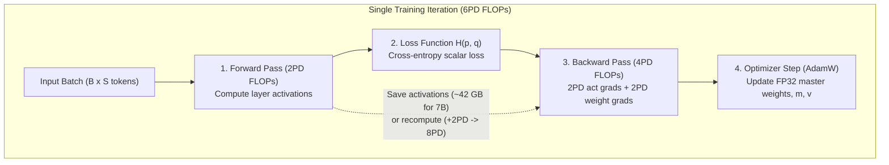
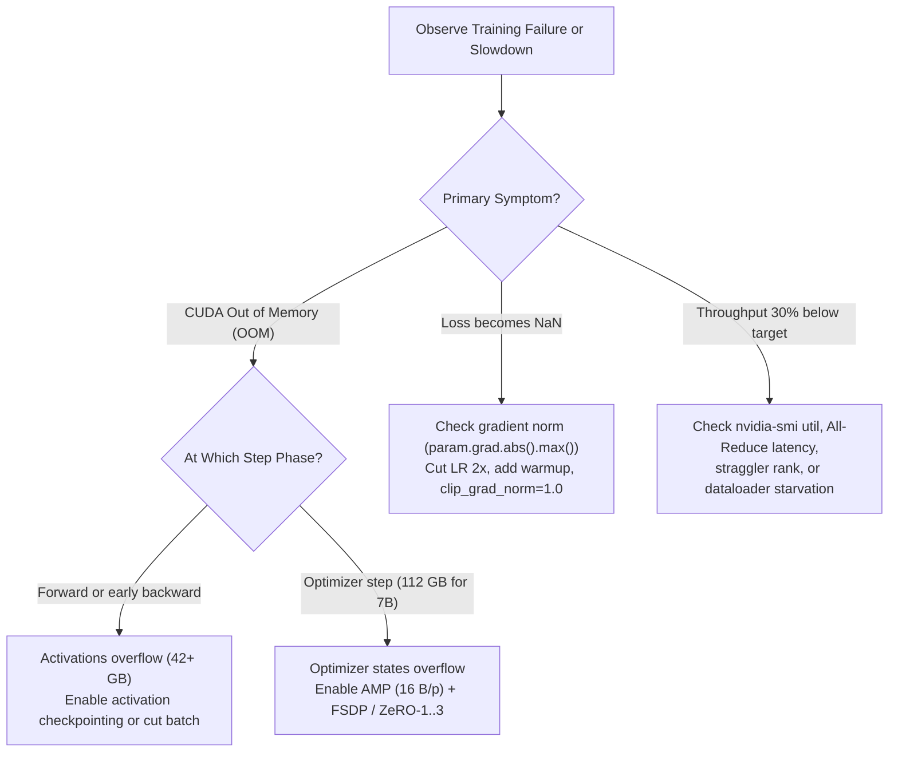

# 14.1 ML and deep learning fundamentals for infrastructure engineers

| Field | Value |
|---|---|
| Level | Basics |
| Priority tier | 2 |
| Lab venue | Nebius GPU + Local Python Verification Lab (`code/part14/ml_dl_fundamentals_lab.py`) |
| Part | Part 14: Distributed training and fine-tuning |
| Primary sources | *Designing Machine Learning Systems* (`designing-machine-learning-systems`, Ch. 1, Ch. 2, Ch. 6); *Engineering AI Systems: Architecture and DevOps Essentials* (`engineering-ai-systems-architecture-and-devops-essentials`, Ch. 3); NVIDIA Zero-to-Hero Volume 13 (`chapter-01-why-distributed-training-exists.md`, `chapter-02-training-memory-and-compute-anatomy.md`) and Volume 21 (`chapter-07-multi-node-distributed-training.md`) |
| Coverage file | `planning/coverage/chapters/14-01.md` |
| Claim & number ledger | `planning/ledgers/14-01.md` |

## Why this matters for AI infrastructure

When data scientists talk about a machine learning system, they often picture the neural network architecture or the optimization algorithm. In production, the algorithm is only a small fraction of a holistic system. That system spans business objectives, data pipelines, feature stores, distributed training clusters, checkpoint storage, serving engines, and continuous observability. An infrastructure engineer cannot treat the training loop as an opaque black box. Doing so makes it impossible to size a GPU cluster or diagnose an out-of-memory crash at step one. It also hides why doubling the GPU count stopped speeding up convergence, or whether observed throughput reflects a network regression.

Every mathematical choice inside a deep learning training loop maps directly onto a physical hardware constraint. **You must translate model parameter counts, batch sizes, and optimizer rules into exact byte capacities and floating-point operation rates before provisioning a single server.**

First, consider the memory wall. High Bandwidth Memory capacity on a single GPU has grown linearly, whereas foundation model parameter counts have grown exponentially. Loading a massive model in 32-bit floating-point precision requires hundreds of gigabytes for the weights alone. That footprint exceeds a single 80 GB H100 GPU many times over before allocating any gradients, optimizer states, or activations. Even a 7B parameter model trained with Adam allocates weights, gradients, optimizer moments, intermediate activations, and workspace buffers. Together, those tensors exceed a single 80 GB GPU and trigger an immediate `RuntimeError: CUDA out of memory`.

Second, consider the compute wall. Every dense linear layer executes one forward matrix multiplication and two backward matrix multiplications during backpropagation. A single training step on a large language model therefore requires quintillions of floating-point operations. Running that single batch update on one GPU would take more than an hour. Across a full multi-hundred-billion-token pretraining corpus, total required compute reaches hundreds of zettaFLOPs, making multi-node distributed execution mandatory.

Third, hyperparameters act as direct cluster control knobs. Learning rate schedules, micro-batch sizes, gradient accumulation steps, and global batch sizes are not merely statistical tuning dials. Pushing the global batch size past the critical batch size wastes GPU hours in a diminishing-returns regime. Conversely, scaling the global batch size across dozens of GPUs requires square-root learning-rate scaling and linear warmup. Skipping those adjustments causes either sluggish progress or sudden gradient divergence into NaN values.

| Constraint Domain | Model & Hardware Scenario | Mathematical Law or Breakdown | Physical Consequence (`V13 Ch. 01`, `DMLS Ch. 2, Ch. 6`, `V21 Ch. 07`) |
|---|---|---|---|
| **The Memory Wall** | `GPT-3` (`175B` params) in `FP32` (`4 bytes/param`) on `1` `80 GB` `H100` (`HBM3`) | `175 x 10^9 x 4 bytes = 700 GB` weights alone | Exceeds a single `80 GB` `H100` by **`8.75x`** before gradients, optimizer states, or activations |
| **The Memory Wall** | `7B` model trained in `FP32` with `Adam` on `1` `80 GB` GPU | `28 GB` weights + `28 GB` gradients + `56 GB` optimizer states (`112 GB` static) + `42–80 GB` (`60–80 GB`) activations + `5–10 GB` buffers = **`180–190 GB`** total | Crashes with `RuntimeError: CUDA out of memory. Tried to allocate 2.45 GiB` (`79,456 MiB` used, `103 MiB` free out of `79,559 MiB`) |
| **The Compute Wall** | `GPT-3` `175B` single step at batch `2,048`, seq `2,048` (`4,194,304` tokens) | Forward `2PD = 2 x 175 x 10^9 x 2048 x 2048 ~= 1.46 x 10^18 FLOPs` (`1.4680 x 10^18` exact; `4.4040 x 10^18` for `6PD`) | On `1` `A100` (`312 TFLOPS` `FP32` tensor ops): **`4,679.49 s` (`~4,679 s` or `78 min`)** per step; on `128` `A100` GPUs: **`36.56 s` (`~37 s`)** (`128x` faster) |
| **The Compute Wall** | `GPT-3` `175B` full pretraining run on `500B` tokens (`DMLS Ch. 2`) | `6PD = 6 x 175 x 10^9 x 500 x 10^9 = 5.25 x 10^23 FLOPs` (**`525.0 ZFLOPs`**) | Requires hundreds or thousands of GPUs running continuously across high-speed fabrics |
| **Hyperparameter Knobs** | Global batch scaling (`3.2M` tokens on `GPT-3` `175B`; `64` GPUs x `128` seq/GPU = `8,192` seqs) | Square-root LR scaling from base batch `32` (`1e-4`): `1e-4 x sqrt(8192 / 32) = 1.6e-3`; critical batch size `B_crit` limit | Exceeding `B_crit` wastes GPU-hours in curvature-dominated regime; missing warmup + LR scaling causes `NaN` divergence or `30%` throughput diagnosis errors (`20M` vs `32M tokens/sec`, `512` to `1,024` GPU scaling stalls) |

Before you approve a training cluster request, calculate both the static parameter memory and the total training FLOPs from first principles.

## Prerequisites and outcomes

### Prerequisites
- Familiarity with GPU compute architecture including Streaming Multiprocessors, Tensor Cores, High Bandwidth Memory, NVLink, and PCIe from Part 4. You should also know CUDA and PyTorch runtime basics from Part 6.
- Understanding of cluster networking including RoCEv2, InfiniBand, and NCCL collective operations from Part 9. Familiarity with checkpoint storage paths from Part 13 is also expected.

### Outcomes
After completing this chapter, you will be able to:
1. Contrast symbolic AI, classical data-driven machine learning, and foundation models across the four phases of ML adoption. You will also translate business goals into decoupled objective functions and tail-latency SLAs.
2. Derive the exact 6PD training FLOPs law from first principles. You will calculate single-step and full-run wall-clock times, achieved TFLOPS per GPU, and Model FLOPs Utilization.
3. Break down the five GPU memory consumers of a training step and prove why mixed-precision AdamW consumes 16 bytes per parameter. You will also select between mixed precision, activation checkpointing, and distributed sharding.
4. Compute linear warmup and cosine annealing learning-rate schedules alongside batch-size learning-rate scaling rules. You will also evaluate critical batch size scaling efficiency and pipeline parallelism bubble fractions.
5. Calculate cross-entropy loss and perplexity and evaluate models against the five production baselines. You will apply perturbation, invariance, directional, calibration, and slice-based evaluation tests.

---

## 1. AI Taxonomy, ML Systems Design, and Model Selection

Teams often waste months provisioning expensive GPU clusters for problems that a simple SQL heuristic or CPU tree model could solve. Product managers feel this mistake as blown cloud budgets and missed launch deadlines, while site reliability engineers inherit fragile serving pipelines. Before provisioning GPU racks, an infrastructure architect must verify what kind of model the workload actually needs. It may require symbolic rules, a classical tabular ML model on CPUs, or a foundation model on an InfiniBand cluster. As statistician George Box observed, all models are wrong, but some are useful, because every model omits real-world detail.

### 1.1 Symbolic AI vs Data-Driven ML vs Foundation Models

*Engineering AI Systems* divides artificial intelligence techniques into rule-based symbolic AI and data-driven non-symbolic or sub-symbolic AI. Symbolic systems rely on explicit human-authored rules and require no training dataset at all. They remain the right choice when the domain is well understood and the scope fits within a few hundred rules. They also excel when strict regulatory compliance demands complete audit traceability. Once rule counts grow into the thousands, however, human-maintained rule bases become brittle and contradictory.

Classical data-driven machine learning learns patterns directly from structured datasets through supervised or unsupervised algorithms. According to *Designing Machine Learning Systems*, classical ML is appropriate when nine criteria hold. The system must have the capacity to learn, complex patterns must exist, and data must be available or collectible. Furthermore, the task must be framed as a prediction on unseen data that shares the training distribution. It should also be repetitive, tolerate cheap wrong predictions, run at scale, and track changing patterns.

Foundation models occupy the third tier of the taxonomy. They use self-supervised pretraining on massive unlabeled corpora followed by supervised fine-tuning on labeled instructions. This two-stage paradigm handles unstructured language, vision, audio, video, and multimodal tasks across multi-node GPU clusters.

| Category | Learning Paradigm & Data | When to Choose (`EAS Ch. 3`, `DMLS Ch. 1`) | Execution & Infrastructure Profile |
|---|---|---|---|
| **1. Symbolic & Rule-Based AI** | Explicit human-authored rules (`if/else` knowledge base); no training dataset | Well-understood domain; well-defined scope (`a few hundred rules`, failing when rules grow into the `thousands`); strict regulatory compliance and `100%` audit traceability | CPU-bound rules engine; latency governed by **rule ordering**, **rule grouping** (cache locality), **conflict resolution** (`specificity`, `salience`, `chronological order`), **condition indexing/filtering**, pre-compilation, and thread parallelism (`EAS 3.3.1`) |
| **2. Classical Data-Driven ML** | **Supervised** (labeled input-target pairs), **Unsupervised** (unlabeled pattern discovery / clustering) | Large structured/tabular datasets where complex patterns exist (`DMLS Ch. 1`: `9` criteria—capacity to learn, complex patterns, existing data, predictive framing, unseen data shares distribution, repetitive, cheap wrong predictions, at scale, changing patterns) | Often fits on CPU or single GPU (`scikit-learn`, `XGBoost`, `LightGBM`); fast training and sub-millisecond inference (`1 GB` to `16 GB` RAM) |
| **3. Foundation Models (`FMs`) & Deep Learning** | **Self-supervised pretraining** (models generate their own labels from massive unlabeled corpora, e.g., masked token or next-token prediction) followed by **supervised fine-tuning (`SFT`)** on labeled instruction datasets (`EAS Ch. 3`) | Unstructured modalities (**Language**, **Vision**, **Audio**, **Video**, **Multimodal**, and **Domain-specific** models such as `BloombergGPT` `50B` for finance, `NVIDIA Nemotron`, `BLOOM` [`1,000+` researchers], `OpenAI GPT-x`, `Google Gemini`, `Meta LLaMA`, `BERT-Large` `340M` params / `1.35 GB`) | Multi-GPU / multi-node accelerated clusters (`PyTorch`, `TensorFlow`, `Megatron-LM`, `DeepSpeed`) across cloud platforms (`AWS SageMaker`, `Azure ML`, `Google Vertex AI`, `IBM Watson Studio`, `MosaicML`) or on-prem GPU fabrics |

### 1.2 Research vs Production Systems and Latency vs Throughput

A model that wins an academic leaderboard often fails catastrophically when deployed behind a live user-facing API. Academic ML research optimizes a single metric: state-of-the-art accuracy on a static benchmark. Production ML engineering must instead reconcile multiple conflicting stakeholders. In a restaurant recommendation system, ML engineers want complex models for accuracy, while sales teams want expensive restaurants recommended. Product managers demand sub-100-millisecond latency so users do not abandon the app. Meanwhile, platform SREs prioritize stability over frequent model reloads, and executives care about net margin and customer retention.

When a system must satisfy conflicting business objectives, combining them into a single weighted training loss is an operational trap. Suppose a newsfeed must minimize both quality loss and engagement loss. Training a single model on a combined loss forces a full model retrain every time product managers adjust the business weights. Decoupling the problem into two independent models—one scoring quality and one scoring engagement—solves this problem cleanly. Engineers can combine the scores at serving time, tune weights instantly without retraining, and update each model independently.

Research and production also have opposite computational priorities. Research prioritizes high training throughput via aggressive batching, whereas production prioritizes low inference tail latency. Grouping online requests into batches increases GPU hardware utilization and total throughput. However, waiting to form a batch and computing a larger matrix multiplication simultaneously increases per-request latency. Furthermore, arithmetic average latency hides severe tail outliers, so production SLAs are always enforced at the 90th, 95th, or 99th percentile.

Finally, every production ML platform must satisfy four foundational systems requirements: reliability, scalability, maintainability, and adaptability. Traditional software crashes loudly with an HTTP 500 error, whereas a broken ML model fails silently by returning HTTP 200 garbage predictions. Scaling requires handling both larger artifacts and higher request volumes without suffering costly autoscaling outages.

| Production Dimension | Research vs Production Contrast (`DMLS Ch. 1–2`) | Concrete Numbers, Benchmarks & Business Impact |
|---|---|---|
| **Stakeholder & Latency SLAs** | Single static SOTA metric vs multi-stakeholder production trade-offs | Sales `10%` restaurant order fee; product `< 100 ms` SLA (`> 100 ms` causes `10%` of users to close app); Akamai (`2017`): `100 ms` delay hurts conversion by **`7%`**; Booking.com (`2019`): `30%` latency increase costs **`0.5%`** conversion; Google (`2016`): **`> 50%`** mobile users abandon pages taking **`> 3 seconds`** |
| **Customer Economics & Enterprise ROI** | Leaderboard accuracy vs acquisition/retention cost and resource efficiency | Acquiring a mobile user who makes an in-app purchase costs **`$86.61`**; acquiring a Lyft rider costs **`$158`**; customer acquisition is **`5 to 25x`** more expensive than retention; `0.1%` cloud resource efficiency saves millions vs `0.2%` CTR gain |
| **Decoupled Multi-Objective Ranking** | Monolithic loss `alpha * quality_loss + beta * engagement_loss` vs decoupled serving | Separate `quality_model` and `engagement_model` combined as `alpha * quality_score + beta * engagement_score` at serving time avoids Pareto retraining when `alpha` or `beta` changes |
| **Batching: Latency vs Throughput** | Unbatched (`1` query at a time) vs dynamic request batching (`DMLS Ch. 1`, Fig. 1-4) | `1` query in `10 ms` = **`100 queries/sec`**; `1` query in `100 ms` = **`10 queries/sec`**; batching `10` queries in `10 ms` = **`1,000 queries/sec`** at `10 ms`; batching `50` queries in `20 ms` = **`2,500 queries/sec`** at `20 ms` |
| **Tail Latency Percentiles (`p50`, `p90`, `p99`)** | Arithmetic mean vs percentile SLAs across `10` requests `[100, 102, 100, 100, 99, 104, 110, 90, 3000, 95] ms` | Arithmetic mean = **`390.0 ms`** (`390 ms`), median **`p50 = 100.0 ms`** (`100 ms`), tail outlier **`p90 = 3,000.0 ms`** (`3,000 ms` / `3.0 s`) |
| **Four Systems Requirements & Maturity** | Reliability, Scalability, Maintainability, Adaptability (`DMLS Ch. 2`) | Scaling from `1 GB` RAM logistic regression to `100M`-param model needing `16 GB` RAM; `10,000` to `10M` daily requests; `8,000` per-customer enterprise models; Amazon Prime Day autoscaling crash cost **`$72M–$99M` per hour**; Algorithmia (`2020`): **`75%`** of orgs with `> 5` years maturity deploy in `< 30` days vs **`60%`** of beginners taking `> 30` days |

### 1.3 Taxonomy of ML Tasks, Algorithms, Ensembles, and the Four Adoption Phases

Choosing the wrong problem framing can force unnecessary model retraining every time the product catalog changes. Suppose a mobile operating system predicts which app a user will open next. If an engineer frames this as multiclass classification with one output slot per app, adding a new app requires retraining the entire network. Framing the exact same task as scalar regression or scoring solves this bottleneck. The model takes user, environment, and candidate app features as inputs and outputs a single probability between zero and one. That design lets the system score brand-new apps immediately without retraining.

Beyond problem framing, *Engineering AI Systems* and *Designing Machine Learning Systems* classify classical algorithms into classification, regression, clustering, and ensemble methods. In competitive machine learning and high-stakes production systems, ensembles consistently outperform single models because combining uncorrelated base learners reduces variance or bias. Suppose three independent classifiers each achieve 70 percent accuracy. A majority vote succeeds whenever at least two of the three classifiers agree, lifting combined accuracy to 78.4 percent.

```text
Majority-Vote Ensemble of 3 Uncorrelated Classifiers (each 70% = 0.70 accurate, DMLS Ch. 6 Table 6-1):
  - All 3 correct:       0.7 x 0.7 x 0.7         = 0.343  (34.3%)
  - Exactly 2 correct:   3 x (0.7 x 0.7 x 0.3)   = 0.441  (44.1%)
  - Exactly 1 correct:   3 x (0.3 x 0.3 x 0.7)   = 0.189  (18.9%)
  - None (0) correct:    0.3 x 0.3 x 0.3         = 0.027  (2.7%)
  ---------------------------------------------------------------
  Ensemble Accuracy (>= 2 correct): 0.343 + 0.441 = 0.784 (78.4% accuracy, +8.4% gain)
```

To avoid over-engineering, teams should progress through four disciplined adoption phases. Start with non-ML heuristics in Phase 1, and deploy the simplest ML models in Phase 2 to validate the end-to-end pipeline. Next, optimize those simple models with feature engineering and ensembles in Phase 3. Move to complex deep neural networks and foundation models in Phase 4 only when simple models plateau.

| Task or Adoption Dimension | Core Algorithms, Framing & Mechanics (`EAS 3.2.2`, `DMLS Ch. 2, Ch. 6`) | Production Trade-Offs & Empirical Numbers |
|---|---|---|
| **Classification (`EAS 3.2.2`, `DMLS Ch. 2`)** | Assigns static inputs to discrete classes (distinct from temporal *prediction/forecasting*): **binary** (`2` classes, e.g., spam, hotdog), **multiclass** (`>= 3` classes; **hierarchical classification** for high cardinality), **multilabel** (variable subset e.g. `[0, 1, 1, 0]` via multi-output sigmoid). Algorithms: **KNN** (`k` nearest by Euclidean distance), **Logistic Regression** (sigmoid `1 / (1 + exp(-z))` with `0.5` threshold), **Decision Trees**, **Random Forests**, **Naive Bayes**, **SVM**, **Neural Networks** (softmax output) | High-cardinality classification with `1,000` classes requires `>= 100` examples/class = **`>= 100,000`** labeled examples; reframing `N`-class next-app prediction as scalar `[0, 1]` regression avoids retraining when new apps arrive |
| **Regression (`EAS 3.2.2`)** | Predicts continuous values: **Linear Regression**, **Polynomial Regression** (`n`-th degree nonlinear trends), **Support Vector Regression (`SVR`)** (`epsilon`-insensitive buffer zone), **Decision Tree Regression**, **Random Forest Regression**, **Gradient Boosting Regression**, **Neural Network Regression** | Tree ensembles (`XGBoost`, `LightGBM`) dominate tabular regression on CPUs with minimal memory overhead |
| **Clustering (`EAS 3.2.2`)** | Unsupervised grouping via Euclidean or **Levenshtein edit distance** (strings), using **hard clustering** (single cluster) or **soft clustering** (probabilities): **K-Means** (`k` centroids, used in Netflix movie/show clustering), **DBSCAN** (`MinPts` and radius `epsilon` for **core**, **border**, and **noise** points), **Hierarchical Clustering** (**agglomerative** bottom-up vs **divisive** top-down) | Discovers structure in unlabeled data without human annotation cost |
| **Ensembles: Bagging, Boosting, Stacking (`DMLS Ch. 6`)** | **Bagging** (*bootstrap aggregating*, e.g., Random Forests) samples in parallel to **reduce variance**; **Boosting** (`GBM`, `XGBoost`, distributed `LightGBM`) trains sequentially on residual errors to **reduce bias**; **Stacking** trains a **meta-learner** on base predictions | **`20` of `22`** Kaggle winning solutions (`2021`, including a `33`-model winner) and all **`top 20` `SQuAD 2.0`** entries use ensembles; `3` uncorrelated `70%` classifiers reach **`78.4%`** |
| **Six Selection Tips & Seven Assumptions (`DMLS Ch. 6`)** | (1) Avoid SOTA trap, (2) start simple, (3) equal hyperparameter budgets, (4) learning curves for now vs later (Andrew Ng: high-variance improves with data, high-bias does not), (5) trade-offs (`FP` vs `FN`, latency vs accuracy, interpretability), (6) verify **7 assumptions**: **Prediction**, **IID**, **Smoothness**, **Tractability** `P(Z\|X)`, **Linear Boundaries**, **Conditional Independence**, **Normal Distribution** | Stanford HAI (`2019`): only **`13%`** of large enterprises mitigated fairness risks and **`19%`** worked on explainability; Geoffrey Hinton's surgeon survey: **`50%`** of `30` tech executives rejected a **`90%`**-cure black-box AI surgeon in favor of an **`80%`**-cure human surgeon |
| **Four Adoption Phases (`DMLS Ch. 6`)** | **Phase 1:** Non-ML heuristics `->` **Phase 2:** Simplest ML (`logistic regression`, `GBDT`, `KNN`) `->` **Phase 3:** Optimizing simple models `->` **Phase 4:** Complex models (`DNNs`, `FMs`) | Top-`3` English letters (`"e"`, `"t"`, `"a"`) give **`30%`** accuracy; Facebook used chronological newsfeed from **`2006–2011`**; Martin Zinkevich's rule: if ML gives a **`100%`** boost, a heuristic gets you **`50%`** of the way there |

Before you provision a multi-node GPU cluster for a new product feature, require the modeling team to establish a Phase 1 heuristic baseline and a Phase 2 simple model baseline.

---

## 2. Deep Learning Mechanics and the 6PD Training FLOPs Law

When an engineering team moves to Phase 4 and trains a deep neural network or Transformer foundation model, cluster capacity planning often goes wrong by a factor of three or four. Engineers who estimate compute from the forward inference pass alone severely under-provision GPU nodes and miss delivery deadlines by months. To size a training cluster accurately, you must account for both the forward pass and the two backward matrix multiplications.

Deep learning training proceeds as an iterative loop over batches, iterations, and epochs. The batch size is the number of training examples or tokens processed before a single weight update. An iteration or step is one complete forward pass, loss calculation, backward pass, and optimizer update on a single batch. An epoch is one full pass over the entire training dataset. For example, a dataset of 1,000 examples processed with a batch size of 100 requires 10 iterations to complete 1 epoch.



### 2.1 Why Forward Is 2PD and Backward Is 4PD

Consider a dense linear layer in a Transformer that multiplies an input activation matrix by a weight matrix. Each output element is the dot product of an input row and a weight column. That dot product performs one floating-point multiplication and one floating-point addition per parameter for every token. Because each multiply-accumulate operation equals two floating-point operations, the forward pass across P parameters and D tokens costs 2PD FLOPs.

During the backward pass, the chain rule of calculus requires every linear layer to compute two separate matrix multiplications using the upstream gradient. First, the layer multiplies the upstream gradient by the transposed weight matrix to compute the input activation gradients. That first step allows errors to propagate backward to earlier layers. Second, the layer multiplies the transposed input activations by the upstream gradient to compute the weight gradients for the optimizer. Each of those two backward matrix multiplications has the exact same operation count as the forward pass, costing 2PD FLOPs apiece.

Summing the 2PD forward pass and the 4PD backward pass yields the fundamental 6PD training FLOPs law for dense Transformers. When memory limits force engineers to enable full activation checkpointing, intermediate activations are discarded during the forward pass. Those activations are then recomputed on the fly via an extra 2PD forward pass during backpropagation. **Standard dense Transformer training costs 6PD FLOPs per token, and enabling full activation checkpointing raises that cost by one-third to 8PD FLOPs.**

```text
Dense Linear Layer Y = X * W (Weight matrix W of shape [d_in, d_out], P = d_in * d_out parameters, Input X of shape [D, d_in] tokens):

1. Forward Pass (1 GEMM: Y = X * W, shape [D, d_in] x [d_in, d_out] -> [D, d_out]):
   D * d_in * d_out = P * D multiply-accumulates (MACs) x 2 FLOPs/MAC
   F_forward            = 2 * P * D   FLOPs

2. Backward Pass (2 GEMMs via Chain Rule given upstream dL/dY of shape [D, d_out]):
   - Activation Gradients (dL/dX = dL/dY * W^T, shape [D, d_out] x [d_out, d_in] -> [D, d_in]):  2 * P * D FLOPs
   - Weight Gradients     (dL/dW = X^T * dL/dY, shape [d_in, D] x [D, d_out] -> [d_in, d_out]):  2 * P * D FLOPs
   F_backward           = 2PD + 2PD = 4 * P * D   FLOPs  (2x Forward)

3. Total Training Compute (Standard vs Full Activation Checkpointing):
   F_train_standard     = 2PD (forward) + 4PD (backward) = 6 * P * D   FLOPs
   F_train_checkpointed = 6PD + 2PD (recomputed forward) = 8 * P * D   FLOPs  (+33.33% compute; 30–50% slower backward in V13 Ch. 02; fits 10x larger models at ~20% overhead in Salimans & Bulatov 2017, DMLS Ch. 6)
```

### 2.2 Concrete Compute Scaling Across Dataset Scales

*Designing Machine Learning Systems* traces the exponential growth of language model pretraining datasets over the past decade. Early neural language benchmarks in 2013 trained on less than one billion tokens, whereas modern open-weight models train on trillions of tokens. Total training compute scales with the product of parameters and tokens. Doubling both model size and dataset size therefore quadruples the required GPU hours.

| Model & Workload Scenario | Parameters (`P`) | Tokens (`D`) | Forward (`2PD`) | Backward (`4PD`) | Total Standard (`6PD`) | With Checkpointing (`8PD`) | Hardware Timing & Corpus Context (`V13 Ch. 01`, `DMLS Ch. 2`, `code/part14/ml_dl_fundamentals.py`) |
|---|---|---|---|---|---|---|---|
| **Historical Dataset Growth** (`DMLS Ch. 2`, Fig. 2-8) | — | **`0.8B`** (`2013` One Billion Word) `->` **`10B`** (`2019` `GPT-2`) `->` **`500B`** (`2020` `GPT-3`) | — | — | Scales `625x` in token volume from `0.8B` to `500B` | — | Modern open-weights runs (`7B` to `70B`) train on **`1 trillion` (`1T`) to `2 trillion` (`2T`) tokens** |
| **`GPT-3` `175B` Single Step** (`V13 Ch. 01`, batch `2048`, seq `2,048`) | `175 x 10^9` | `4,194,304` (`4.19M`) | `1.468 x 10^18` (`~1.46e18`) | `2.936 x 10^18` | `4.404 x 10^18` | `5.872 x 10^18` | At `1.46e18` FLOPs on `1` `A100` (`312 TFLOPS`): **`4,679.49 s` (`~78 min`)**; on `128` `A100` GPUs: **`36.56 s` (`~37 s`)** |
| **`7B` Model Pretraining** (`1T` tokens) | `7 x 10^9` | `1.0 x 10^12` | `1.40 x 10^22` (`14.0 ZFLOPs`) | `2.80 x 10^22` (`28.0 ZFLOPs`) | **`4.20 x 10^22` (`42.0 ZFLOPs`)** | `5.60 x 10^22` (`56.0 ZFLOPs`) | On `64` `H100` GPUs (`989 TFLOPS` peak) at `50%` `MFU` (`494.50 TFLOPS/GPU`, `31.648 PFLOPS`): **`368.64 hours` (`15.36 days`)** |
| **`GPT-3` `175B` Full Run** (`DMLS Ch. 2`, `500B` tokens) | `175 x 10^9` | `5.0 x 10^11` | `1.75 x 10^23` (`175.0 ZFLOPs`) | `3.50 x 10^23` (`350.0 ZFLOPs`) | **`5.25 x 10^23` (`525.0 ZFLOPs`)** | `7.00 x 10^23` (`700.0 ZFLOPs`) | Requires multi-node distributed training across hundreds or thousands of GPUs |
| **`70B` Model Pretraining** (`2T` tokens) | `70 x 10^9` | `2.0 x 10^12` | `2.80 x 10^23` (`280.0 ZFLOPs`) | `5.60 x 10^23` (`560.0 ZFLOPs`) | **`8.40 x 10^23` (`840.0 ZFLOPs`)** | `1.12 x 10^24` (`1,120.0 ZFLOPs` / `1.12 YFLOPs`) | On `512` `H100` GPUs (`989 TFLOPS` peak) at `45%` `MFU` (`445.05 TFLOPS/GPU`, `227.8656 PFLOPS`): **`1,024.0 hours` (`42.67 days`)** |

Always multiply your forward-pass FLOP estimate by three for standard training, or by four when full activation checkpointing is enabled.

---

## 3. Training Step Memory Anatomy and SGD vs AdamW

New infrastructure engineers frequently look at a 7B model checkpoint that occupies 14 GB on disk in 16-bit precision and assume it will train on a single 80 GB H100. When they launch the training script, the job immediately crashes with an out-of-memory error. Inference only stores static weights and a small key-value cache, whereas training dynamically allocates five distinct memory consumers in GPU HBM. Those five consumers are model weights, gradients, optimizer states, forward activations, and temporary workspace buffers.

### 3.1 Optimizer State Memory: Vanilla SGD vs Momentum SGD vs Mixed-Precision AdamW

During backpropagation, the optimizer updates model parameters using the newly computed gradients. Different optimization algorithms maintain vastly different historical state buffers per parameter. Vanilla Stochastic Gradient Descent subtracts the scaled gradient directly from each weight and maintains zero historical state buffers. It therefore requires only 8 bytes per parameter in 32-bit precision. Adding a momentum term to SGD introduces one 32-bit velocity buffer per parameter, raising the static footprint to 12 bytes per parameter.

Adaptive optimizers like Adam and AdamW converge much faster on Transformers because they maintain two separate 32-bit historical buffers per parameter. Those two buffers track the first moment for momentum and the second moment for variance. Even when forward and backward matrix multiplications run in 16-bit mixed precision, AdamW cannot accumulate tiny updates directly into 16-bit weights without underflow. Mixed-precision AdamW therefore keeps 2-byte working weights and 2-byte gradients alongside a 4-byte FP32 master weight copy and two 4-byte FP32 moment buffers. **Mixed-precision AdamW always consumes 16 bytes of static GPU memory per parameter, which equals 112 GB for a 7B model before allocating any activations.**

```text
Static Memory Breakdown per Parameter Across Optimizers (V13 Ch. 01–02, EAS 3.3.2):

1. Vanilla SGD in FP32 (0 optimizer states):
   W_{t+1} = W_t - lr * g_t
   4 B (FP32 weight) + 4 B (FP32 grad) + 0 B (state)                          =  8 bytes / parameter

2. SGD with Momentum in FP32 (1 state buffer: velocity v_t):
   4 B (FP32 weight) + 4 B (FP32 grad) + 4 B (FP32 velocity v_t)              = 12 bytes / parameter

3. Pure FP32 Adam / AdamW (2 state buffers: momentum m_t, variance v_t):
   4 B (FP32 weight) + 4 B (FP32 grad) + 4 B (FP32 m_t) + 4 B (FP32 v_t)      = 16 bytes / parameter

4. Mixed-Precision (AMP BF16/FP16 + FP32 Master Weights) AdamW:
   Why FP32 master weights? FP16 dynamic range is ~10^-5 to 10^4 (vs FP32 10^-38 to 10^38), so small updates lr * g_t underflow to 0.0 in FP16.
   - BF16 / FP16 Working Weights:     2 bytes
   - BF16 / FP16 Gradients:           2 bytes
   - FP32 Master Weights:             4 bytes
   - FP32 Adam First Moment (m_t):    4 bytes (controlled by beta_1)
   - FP32 Adam Second Moment (v_t):   4 bytes (controlled by beta_2)
   -------------------------------------------------------------------------
   TOTAL STATIC TRAINING STATE:      16 bytes / parameter
```

| Optimizer Configuration | Weights | Gradients | Master Weights | Optimizer States (`m`, `v`) | Total Bytes / Param | `7B` Static State | `70B` Static State | `175B` Static State |
|---|---|---|---|---|---|---|---|---|
| **Vanilla `SGD` (`FP32`)** | `4 B` (`FP32`) | `4 B` (`FP32`) | `0 B` | `0 B` (`0` states) | **`8 B / param`** | **`56.0 GB`** | `560.0 GB` | `1,400.0 GB` |
| **`SGD` + Momentum (`FP32`)** | `4 B` (`FP32`) | `4 B` (`FP32`) | `0 B` | `4 B` (`1` state: `v_t`) | **`12 B / param`** | **`84.0 GB`** | `840.0 GB` | `2,100.0 GB` |
| **Pure `FP32` `Adam` / `AdamW`** (`V13 Ch. 01–02`) | `4 B` (`FP32`) | `4 B` (`FP32`) | `0 B` | `8 B` (`4 B` `m_t` + `4 B` `v_t`) | **`16 B / param`** | **`112.0 GB`** | `1,120.0 GB` | `2,800.0 GB` |
| **Mixed-Precision `AdamW` (`BF16`/`FP16` + `FP32` Master)** | `2 B` (`BF16`) | `2 B` (`BF16`) | `4 B` (`FP32`) | `8 B` (`4 B` `m_t` + `4 B` `v_t`) | **`16 B / param`** | **`112.0 GB`** (`14+14+28+28+28`) | **`1,120.0 GB`** (`~1.2 TB` with buffers) | **`2,800.0 GB`** (`2.8 TB`) |

### 3.2 Timeline of the Five Memory Consumers Across a 7B Training Step

Static parameter states are only part of the memory budget. During the forward pass, PyTorch must retain intermediate layer activations in GPU memory because the backward weight-gradient formula multiplies those exact forward activations by the upstream gradients. In addition, the CUDA runtime reserves several gigabytes of workspace buffers for cuBLAS matrix kernels, NCCL communication staging, and allocator fragmentation.

Tracing memory usage across the four phases of a single training step explains why jobs crash at specific lines of code. If a job runs out of memory during the forward pass or early backward pass, intermediate activations have overflowed HBM. You can fix that activation overflow by enabling activation checkpointing, enabling Automatic Mixed Precision, or reducing the micro-batch size. Sometimes a job survives the backward pass with activation checkpointing enabled, yet crashes inside `optimizer.step()`. In that case, the 112 GB AdamW state peak has exceeded single-GPU memory, so you must shard optimizer states across GPUs using ZeRO or FSDP.

| Step Phase (`V13 Ch. 02` `7B` Transformer: `32` layers, `hidden_dim = 4096`, `batch_size = 4`, `seq_len = 2048`) | Active Memory Components in `VRAM` | Peak Memory Total | Status on `1` `80 GB` `H100` & Engineering Takeaway |
|---|---|---|---|
| **Stage 1 — Forward Pass (`FP32`)** | `28.0 GB` `FP32` weights + `42.0 GB` saved forward activations (`32 x 4 x 4096 x 4 x 2048 ~= 42.0 GB`; up to `60–80 GB` on `120`-layer deeper variants in `V13 Ch. 01`) | **`70.0 GB`** (`87.5%` of `80 GB` `H100`) | Fits barely during forward, leaving almost no headroom before backward starts |
| **Stage 2 — Backward Without Activation Checkpointing** | `28.0 GB` weights + `42.0 GB` saved forward activations + `28.0 GB` newly allocated gradients | **`98.0 GB`** | **Immediate `OOM`** (`98.0 GB > 80 GB`) as gradients allocate alongside saved activations |
| **Stage 3 — Backward With Activation Checkpointing** | `28.0 GB` weights + **`10.0 GB`** (`5–10 GB`) recomputed layer-boundary activations + `28.0 GB` gradients | **`66.0 GB`** | **Fits in `80 GB`** during backward, at the cost of `30–50%` slower backward compute |
| **Stage 4 — Optimizer Step (`FP32` `Adam`)** | `28.0 GB` weights + `28.0 GB` gradients + `28.0 GB` momentum (`m_t`) + `28.0 GB` variance (`v_t`) + `5–15 GB` workspace buffers | **`112.0 GB`** static (`180–190 GB` unoptimized total) | **Immediate `OOM`** on `optimizer.step()` without **`ZeRO-1` / `FSDP`** optimizer-state sharding |
| **Effect of Automatic Mixed Precision (`AMP`)** | `14.0 GB` `FP16` weights + `21.0 GB` `FP16` activations + `14.0 GB` `FP16` gradients + `2.0 GB` `FP32` loss/normalizations | **`51.0 GB`** theoretical (**`48.2 GB`** vs **`78.5 GB`** measured) | `python train.py --use_amp True` cuts memory from `78.5 GB` to `48.2 GB` and boosts speed from **`1,000` to `1,280 tokens/sec` (`1.28x` speedup)** |

When a training run crashes with a CUDA out-of-memory error, inspect the stack trace first. Check whether the crash occurred during activation allocation in `backward()` or during state allocation in `optimizer.step()`.

---

## 4. Optimization Dynamics: Learning Rate Schedules, Critical Batch Size, and Loss/Perplexity

An infrastructure engineer who scales a training job from 1 GPU to 64 GPUs often sees one of two failures. Either the loss suddenly explodes into NaN values after a few hundred steps, or the 64-GPU cluster converges no faster than 16 GPUs. Both failures stem from the coupling between global batch size, gradient noise, and the learning rate schedule.

### 4.1 Linear Warmup, Cosine Decay, and Batch-Size LR Scaling

The learning rate is the single most sensitive hyperparameter in deep learning. At step zero, model weights are randomly initialized and AdamW variance estimates are completely uncalibrated. Applying a large peak learning rate on step one causes massive parameter jumps and immediate gradient divergence. Conversely, keeping the learning rate high at the end of training causes the optimizer to bounce around the walls of the loss valley.

Modern foundation model training solves both ends of this problem by pairing linear warmup with cosine annealing decay. During the first few thousand warmup steps, the learning rate ramps linearly from zero up to its peak value. That ramp gives AdamW time to calibrate its second-moment variance buffers. After warmup completes, the learning rate follows a smooth cosine curve down to a minimum floor, typically one-tenth of the peak rate.

When you scale data parallelism across many GPUs, the global batch size equals the per-GPU micro-batch size multiplied by the GPU count. Because each global step now averages gradients over many more examples, the gradient estimate has lower variance. The model also takes far fewer steps per epoch. To maintain training speed without destabilizing AdamW, engineers scale the peak learning rate by the square root of the batch-size multiplier and add warmup.

```text
1. Linear Warmup (0 <= t <= W) and Cosine Annealing Decay (W < t <= T):
   Warmup:          lr(t) = lr_peak * (t / W)
   Cosine Progress: p     = (t - W) / (T - W)
   Cosine Decay:    lr(t) = lr_min + 0.5 * (lr_peak - lr_min) * (1 + cos(pi * p))

   Worked Schedule (T = 100,000 total steps, W = 2,000 warmup steps, lr_peak = 3.0e-4 [0.0003], lr_min = 3.0e-5 [0.00003]):
   - Step t = 0:       lr(0)      = 0.0
   - Step t = 1,000:   lr(1000)   = 3.0e-4 * (1000 / 2000) = 1.5e-4  (50% warmup)
   - Step t = 2,000:   lr(2000)   = 3.0e-4                           (warmup peak)
   - Step t = 26,500:  progress   = 24,500 / 98,000 = 0.25           (quarter cosine decay)
   - Step t = 51,000:  progress   = (51000 - 2000) / 98000 = 49,000 / 98,000 = 0.5 -> cos(0.5 * pi) = 0 -> lr(51000) = 3.0e-5 + 0.5 * 2.7e-4 = 1.65e-4
   - Step t = 75,500:  progress   = 73,500 / 98,000 = 0.75           (three-quarter cosine decay)
   - Step t = 100,000: progress   = 1.0 -> cos(pi) = -1              -> lr(100000) = 3.0e-5

2. Global Batch Size & Learning-Rate Scaling (DMLS Ch. 6, V21 Ch. 07):
   - Step Compression Example (DMLS Ch. 6): 1 machine with batch 1,000 takes 1,000,000 (1M) steps/epoch; 1,000 machines with batch 1,000 have global batch 1,000,000 (1M) and take only 1,000 steps/epoch (GPT-3 175B uses a 3.2M-token global batch).
   - Square-Root vs Linear Scaling (V21 Ch. 07): Scaling from base batch B_base = 32 (lr_base = 1e-4) to 64 GPUs at 128 sequences/GPU (B_global = 8,192, a 256x batch increase):
     * Square-Root Rule: lr_scaled = 1e-4 * sqrt(8192 / 32) = 1e-4 * sqrt(256) = 1e-4 * 16 = 1.6e-3
     * Linear Rule:      lr_scaled = 1e-4 * (8192 / 32)     = 1e-4 * 256       = 2.56e-2 (often destabilizes AdamW without long warmup)
```

### 4.2 Critical Batch Size, Gradient Noise Scale, and Parallel Regimes

Why can we not shrink a 30-day training run down to 30 minutes simply by multiplying the number of GPUs and the global batch size by 1,440? As McCandlish and colleagues proved, increasing the global batch size reduces stochastic gradient noise only up to a physical threshold called the critical batch size. The critical batch size is proportional to the gradient noise scale, which measures the ratio of per-sample gradient variance to the squared norm of the true gradient.

When the global batch size is much smaller than the critical batch size, training operates in the noise-dominated regime. In that regime, doubling the batch size cuts the required number of optimization steps nearly in half. At the critical batch knee where the global batch size equals the critical batch size, training requires twice the minimum steps and twice the minimum compute. That knee yields 50 percent parallel scaling efficiency. Pushing the global batch size far beyond the critical batch size enters the curvature-dominated regime. Because the batch gradient is already accurate, adding 8 times more GPUs barely reduces step count while burning 9 times the total GPU compute.

```text
McCandlish et al. (2018, DMLS Ch. 6) Critical Batch Size Scaling Laws:
  Gradient Noise Scale:                 B_noise   = tr(Sigma) / |G|^2   (where B_crit ~= B_noise)
  Relative Optimization Steps Required: S / S_min = 1 + (B_crit / B)
  Relative Total Data / Compute Cost:   E / E_min = 1 + (B / B_crit)
  Parallel Step Scaling Efficiency:     eta(B)    = 1 / (1 + B / B_crit)
```

| Global Batch Size (`B`) vs `B_crit` (Example `B_crit = 2,048,000` tokens) | Step Ratio (`S / S_min`) | Data & FLOP Cost (`E / E_min`) | Step Scaling Efficiency (`eta`) | Physical Training Regime (`code/part14/ml_dl_fundamentals.py`) |
|---|---|---|---|---|
| **`B = 0.25 x B_crit` (`512,000` tokens)** | `5.00x` (`5.0x`) | `1.25x` | **`80.0%`** | **Noise-Dominated (Linear Scaling):** Doubling `B` cuts required steps nearly in half (`~2x` speedup) with minimal wasted FLOPs |
| **`B = 1.00 x B_crit` (`2,048,000` tokens)** | **`2.00x`** (`2.0x`) | **`2.00x`** (`2.0x`) | **`50.0%`** | **Critical Batch Knee (`B = B_crit`):** Requires `2x` minimum steps and `2x` minimum compute; optimal cost/time knee for cluster sizing |
| **`B = 8.00 x B_crit` (`16,384,000` tokens)** | `1.125x` | **`9.00x`** (`9.0x`) | **`11.11%`** (`~11%`) | **Curvature-Dominated (Diminishing Returns):** Moving from `1x` to `8x` `B_crit` gives only `2.0 / 1.125 = 1.78x` step speedup while burning `9.0 / 2.0 = 4.5x` (`9.0x` total) GPU FLOPs |

Once your global batch size reaches the critical batch size, you cannot add more GPUs via Data Parallelism alone without wasting compute. Instead, you must hold the global batch size at or below the critical batch size. You then scale across more GPUs using Tensor Parallelism inside each node and Pipeline Parallelism across nodes. **Keep Tensor Parallelism strictly within a single node's NVLink domain, and use Pipeline Parallelism with enough micro-batches to shrink the pipeline bubble across InfiniBand.**

| Parallelism & Synchronization Strategy | Execution & Communication Mechanics (`DMLS Ch. 6`, `V21 Ch. 07`) | Hardware Bandwidth & Bubble Math |
|---|---|---|
| **Synchronous vs Asynchronous Data Parallel SGD** (`DMLS Ch. 6`, Fig. 6-6) | **Synchronous SGD** waits at an `All-Reduce` barrier for every worker to finish its mini-batch (exact mini-batch SGD, vulnerable to the **straggler problem** across `N` workers). **Asynchronous SGD** (`Hogwild!`) updates weights immediately per worker, risking **gradient staleness** unless updates are sparse | Inter-node Data Parallelism (`DDP` / `FSDP`) runs over **`50 GB/s`** InfiniBand once per micro-batch step |
| **Tensor Parallelism (`TP`)** (`V21 Ch. 07`) | Splits weight matrices *inside* each layer (`column-parallel` first MLP matrix + `row-parallel` second MLP matrix in `Megatron-Core`, e.g., `Llama-70B` with `80` layers, `hidden_size = 8192`, `64` attention heads, `tensor_model_parallel_size = 8`) | Executes `2` `All-Reduce` collectives *per layer* in forward and backward; **must stay inside a single node's `900 GB/s` `NVLink` domain**, never across `50 GB/s` inter-node InfiniBand |
| **Pipeline Parallelism (`PP`)** (`DMLS Ch. 6` Fig. 6-8, `V21 Ch. 07`) | Places consecutive layer groups (`p` stages) on different machines (`pipeline_model_parallel_size = 2` or `4`) and splits each mini-batch into `m` micro-batches (`GPipe`, `1F1B`) so stage `2` computes micro-batch `1` while stage `1` computes micro-batch `2` | **Pipeline Bubble Fraction = `(p - 1) / (m + p - 1)`**: for `p = 4` stages and `m = 4` micro-batches, bubble is `3 / 7 =` **`42.86%`** (`0.4286`); increasing to `m = 16` micro-batches shrinks the bubble to `3 / 19 =` **`15.79%`** (`0.1579`) |

### 4.3 Cross-Entropy Loss, Perplexity, and Production Offline Evaluation

Engineers monitoring a pretraining run watch a single scalar number—cross-entropy loss—tick downward over weeks, while evaluation dashboards report a second metric called perplexity. Even worse, teams frequently ship models that score above 95 percent accuracy in offline validation only to fail in production. Once deployed, those models often fail on minority user groups or perform no better than a trivial majority-class guess. Understanding how cross-entropy loss maps to perplexity and how offline evaluation tests catch hidden failures is essential before promoting any checkpoint.

For classification and autoregressive language modeling, the standard training objective is cross-entropy loss between the ground-truth distribution and the predicted softmax distribution. In language modeling, perplexity is defined simply as the exponential of the natural-log cross-entropy loss. Intuitively, perplexity measures the effective branching factor of the model's uncertainty. A perplexity of 50,000 at step zero means the model is choosing uniformly among 50,000 vocabulary tokens. By contrast, a converged perplexity near 7.39 means the model has narrowed the next token down to roughly 7 equally likely candidates.

```text
Cross-Entropy Loss and Perplexity Definitions (DMLS Ch. 2, code/part14/ml_dl_fundamentals.py):
  Cross-Entropy Loss (nats):   H(p, q) = - sum_i  p_i * ln(q_i)
  Cross-Entropy Loss (bits):   H_bits  = - sum_i  p_i * log2(q_i) = H(p, q) / ln(2)
  Perplexity (PPL):            PPL     = exp( H(p, q) )

Worked Example 1 — DMLS Ch. 2 4-Class Topic Classification ([tech, entertainment, finance, politics]):
  Ground truth p = [0, 0, 0, 1] (politics), Model prediction q = [0.45, 0.2, 0.02, 0.33]
  H(p, q) = -(0 + 0 + 0 + 1 * ln(0.33)) = -ln(0.33) = 1.108663 nats  (1.599462 bits)
  PPL     = exp(1.108663) = 3.030303   (= 1 / 0.33, effective branching factor of ~3.03 choices)

Worked Example 2 — LLM Vocabulary Guessing vs Converged Pretraining (V = 50,000 tokens):
  - Step 0 Uniform Guessing (q_i = 1 / 50,000):  loss = ln(50,000) = 10.819778 nats -> PPL = exp(10.819778) = 50,000.0
  - Mid-Convergence         (loss = 2.50 nats):  PPL  = exp(2.50)  = 12.182494 (12.18)
  - Strong Convergence      (loss = 2.00 nats):  PPL  = exp(2.00)  =  7.389056 (7.39)
```

Before deploying a trained checkpoint, *Designing Machine Learning Systems* requires evaluating the candidate against five explicit baselines. Those baselines are random guessing, simple heuristics, the zero-rule majority baseline, human performance, and existing production solutions. Beyond baselines, teams must run five behavioral and subgroup checks. They include perturbation tests for noisy inputs, invariance tests for protected attributes, directional expectation tests, probability calibration via Platt scaling, and slice-based evaluation.

| Evaluation Method (`DMLS Ch. 6`) | Purpose & Mechanism | Concrete Corpus Examples & Numbers |
|---|---|---|
| **1. Five Production Baselines** | Prevent shipping complex models that fail to beat trivial rules | **(i) Random baseline (`Table 6-2`, `90%` `NEGATIVE` / `10%` `POSITIVE`):** uniform random (`50%/50%`) gets `F1 = 0.167`, `Accuracy = 0.50` (`50%`); label-distribution random (`90%` NEG / `10%` POS) gets `F1 = 0.10`, `Accuracy = 0.82` (`82%`); if `90%` are `POSITIVE`, random guessing at `90%` gets `F1 = 0.90`, `Accuracy = 0.80`. **(ii) Simple heuristic:** reverse-chronological feed. **(iii) Zero-rule baseline:** always predict most common class (most-used phone app gives **`70%`** accuracy; predicting `90%` majority class gives **`90%`** accuracy / `0.90`). **(iv) Human baseline.** **(v) Existing solutions.** |
| **2. Perturbation & Invariance Tests** | Verify noise robustness and fairness invariance | **Perturbation:** inject microphone background chatter/clipping on `2`-second hospital cough recordings. **Invariance:** outputs must not change when sensitive attributes change (Berkeley mortgage study: **`1.3 million`** creditworthy Black and Latino applicants rejected between **`2008` and `2015`**; deleting race identifiers reversed rejections). |
| **3. Directional & Calibration Tests** | Verify monotonic expectations and true probability calibration | **Directional:** increasing house lot size must never decrease predicted price. **Calibration:** a model predicting `70%` win rate that wins `60%` of `1,000` games (or `10%` ad CTR getting `5%` clicks, or recommender showing `100%` romance instead of `80%` romance / `20%` comedy) is miscalibrated; measure with `sklearn.calibration.calibration_curve` and fix via **Platt scaling** (`CalibratedClassifierCV`). |
| **4. Slice-Based Evaluation (`Table 6-3`)** | Expose minority-group failures hidden by aggregate metrics (discovered via heuristics, error analysis such as a half-hidden mobile button, and **Slice Finder**) | Dataset with `90%` majority and `10%` minority: **Model A** (`98%` majority, `80%` minority) scores **`96.2%`** overall; **Model B** (`95%` majority, `95%` minority) scores **`95.0%`** overall—aggregate accuracy hides Model A's `80%` minority failure. |
| **5. Simpson's Paradox (`Tables 6-4 & 6-5`)** | Subgroup winners reverse when aggregated across unequal group sizes | **`Table 6-4`** (Charig et al. `1986` kidney stone study): **Model A** beats **Model B** in **Group A** (`81/87 = 93%` [`93.10%`] vs `234/270 = 87%` [`86.67%`]) *and* in **Group B** (`192/263 = 73%` [`73.00%`] vs `55/80 = 69%` [`68.75%`]), yet loses overall (**`273/350 = 78%` [`78.0%`] vs `289/350 = 83%` [`82.57%`]**). **`Table 6-5`** (Berkeley `1973` admissions across **`12,763`** applicants): men had **`44%`** (`8,442`) aggregate admission vs **`35%`** (`4,321`) for women despite women having higher admission rates in **`4` of `6`** departments `A..F`. |

Always gate model deployment on per-slice validation metrics rather than a single aggregate accuracy or perplexity score.

---

## 5. Training Time, Model FLOPs Utilization, Experiment Tracking, and AutoML

Suppose leadership asks how many H100 nodes are required to train a 70B foundation model on 2 trillion tokens in 45 days. Dividing total FLOPs by the GPU datasheet peak will underestimate the required cluster size by more than half. No distributed cluster runs at 100 percent of datasheet Tensor Core peak. Network collectives, pipeline bubbles, activation recomputation, and memory-bandwidth-bound normalization kernels all consume wall-clock time.

### 5.1 Capacity Planning: Achieved TFLOPS, MFU, and Training Duration

To bridge the gap between theoretical hardware peak and real-world cluster throughput, platform engineers measure Model FLOPs Utilization. MFU is the ratio of useful 6PD mathematical operations achieved per second per GPU to the GPU's datasheet dense Tensor Core peak. Notice that MFU deliberately uses the 6PD baseline in the numerator rather than 8PD. Any extra compute spent on activation recomputation is therefore penalized as overhead rather than rewarded as useful throughput. In well-tuned multi-node LLM training runs, MFU typically lands between 35 percent and 55 percent. **Sizing a training cluster from datasheet peak TFLOPS without multiplying by a realistic MFU between 0.35 and 0.55 will miss your deadline by more than double.**

```text
Cluster Capacity Planning & MFU Equations (code/part14/ml_dl_fundamentals.py):
  Achieved TFLOPS / GPU   = (6 * P * tokens_per_sec_cluster) / (num_gpus * 10^12)
  MFU                     = Achieved TFLOPS / GPU  /  Hardware Peak TFLOPS / GPU
  Training Time (seconds) = (6 * P * D) / (num_gpus * Hardware_Peak_FLOPS * MFU)

Worked Example 1 — 70B Model on 2 Trillion (2 x 10^12) Tokens Across 512 H100 GPUs (989 TFLOPS BF16 peak) at 45% (45.0%) MFU:
  - Total 6PD Training Compute:  6 * (70 * 10^9) * (2 * 10^12) = 8.40 x 10^23 FLOPs (840.0 ZFLOPs)
  - Achieved Compute per GPU:    989.0 * 0.45                  = 445.05 TFLOPS/GPU
  - Aggregate Cluster Compute:   512 * 445.05 TFLOPS           = 227,865.6 TFLOPS = 227.8656 PFLOPS
  - Cluster Token Throughput:    227.8656 x 10^15 / (4.2e11)   = 542,537.14 tokens/sec (1,059.64 tokens/sec/GPU)
  - Wall-Clock Training Time:    8.40 x 10^23 / 2.278656e17    = 3,686,383.30 seconds = 1,024.0 hours = 42.67 days

Worked Example 2 — 7B Model on 1 Trillion (1 x 10^12) Tokens Across 64 H100 GPUs (989 TFLOPS peak) at 50% (50.0%) MFU:
  - Total 6PD Training Compute:  6 * (7 * 10^9) * (1 * 10^12)  = 4.20 x 10^22 FLOPs (42.0 ZFLOPs)
  - Achieved Compute per GPU:    989.0 * 0.50                  = 494.50 TFLOPS/GPU (31.648 PFLOPS across 64 GPUs)
  - Wall-Clock Training Time:    4.20 x 10^22 / (31.648 x 10^15) = 1,327,098.08 seconds = 368.64 hours = 15.36 days
```



### 5.2 Experiment Tracking, Data Versioning, Debugging, and AutoML

Because distributed training runs cost thousands of GPU hours and fail silently, disciplined experiment tracking and pre-flight debugging are mandatory. A tiny hyperparameter change—such as a learning rate of 0.003 versus 0.002—can separate state-of-the-art convergence from a flat loss curve. Furthermore, versioning multi-terabyte datasets is fundamentally harder than versioning source code in Git. Binary files cannot be line-diffed, merging two datasets does not merge their models, and privacy laws mandate deleting user records across historical snapshots.

Before launching any multi-node job, *Designing Machine Learning Systems* prescribes three non-negotiable debugging steps. Start with a simple architecture, lock all random seeds to isolate code changes, and overfit a single batch down to near-zero loss. If a model cannot memorize ten images or a hundred sentence pairs on one GPU, launching it across 512 GPUs will only burn money faster.

| Operational Discipline (`DMLS Ch. 6`, `EAS 3.3.2`) | Core Practices & Mechanisms | Key Tools, Benchmarks & Warnings |
|---|---|---|
| **Experiment Tracking & Telemetry** | Log `6` streams: (i) train/val loss curves, (ii) task metrics (`F1`, `accuracy`, `perplexity`), (iii) sample predictions, (iv) speed (`steps/sec`, `tokens/sec`), (v) system metrics (`GPU memory`, `GPU/CPU util`), (vi) dynamic norms (`lr`, **gradient norms** under clipping, **weight norms** under `L1` Lasso, `L2` Ridge, `ElasticNet`, or `dropout` regularization) | `MLflow`, `Weights & Biases`; diffs as small as `lr = 0.003` vs `lr = 0.002` alter convergence; `CUDA` atomic operation nondeterminism requires seed locking |
| **Data Versioning (`DVC` vs `Git`)** | Tracks directory checksums and file additions/removals instead of line-by-line diffs | Datasets cannot be duplicated locally; `1,000,000`-character binary lines cannot be line-diffed; merging dataset `X` (model `A`) + dataset `Y` (model `B`) into `Z` yields no merged model; `GDPR` right-to-erasure requires deleting user records across versions |
| **Three Preventive Debugging Rules** | (1) **Start simple** (`1` `RNN` layer before stacking; `BERT` `MLM` loss before adding `NSP`), (2) **Overfit a single batch**, (3) **Set all random seeds** (`Python`, `NumPy`, `PyTorch` CPU/CUDA) | Overfit `10` images to **`100%`** accuracy or `100` translation sentence pairs to **`~100` `BLEU`**; failure exposes broken loss signs or missing `model.train()` / `zero_grad()` |
| **Soft AutoML (Hyperparameter Tuning)** | Tunes user-supplied hyperparameters (`lr`, `batch_size`, hidden layers/units, `dropout`, `Adam` `beta_1`/`beta_2`, quantization `32`/`16`/`8`-bit) on the **validation split** | **Warning:** Never tune on the **test split**; replaces *"Graduate Student Descent (`GSD`)"* with coarse-to-fine random search (NVIDIA `Milano`), grid search, and Bayesian optimization (`Ray Tune`, `Keras Tuner`, `auto-sklearn`); `Melis et al. 2018` proved tuned simple models beat untuned complex ones |
| **Hard AutoML (`NAS` & Learned Optimizers)** | **Neural Architecture Search (`NAS`)** combines a search space (`ReLU`/`Sigmoid`/`Tanh`, convolutions, skip connections, continuous `DARTS`), performance estimation (avoiding training `1,000` candidates to convergence), and search strategy (RL `Zoph & Le 2016`, evolution `Real et al. 2019`); **Learned optimizers** (`Metz et al. 2020`) replace hand-crafted `SGD`/`Momentum`/`Adam`/`RMSprop` with a meta-trained network | At `TensorFlow Dev Summit 2018`, Jeff Dean framed AutoML as replacing **`100`** ML researchers with **`100x`** compute; `NAS` produced `EfficientNet` (**`up to 10x`** better efficiency) |

Always verify that a new model architecture can overfit a single batch on one GPU before scheduling a multi-node training job.

---

## Commands and configurations that matter

When a distributed training job stalls or crashes, you need immediate visibility into GPU memory allocation, compute utilization, and collective communication health. The commands and configurations below provide live hardware telemetry, per-phase PyTorch memory profiling, and multi-node fault-tolerant launch templates.

### 1. Live GPU Memory & Utilization Telemetry

```bash
# Poll GPU memory (used, free, total) and compute utilization every 2 seconds (untested here)
nvidia-smi --query-gpu=index,memory.used,memory.free,memory.total,utilization.gpu --format=csv -l 2

# Inspect per-process GPU memory allocation to catch single-GPU launch bugs on multi-GPU nodes (untested here)
nvidia-smi --query-compute-apps=index,pid,process_name,used_memory --format=csv
nvidia-smi pmon -c 5
```

| `nvidia-smi` Metric (`V13 Ch. 01`) | Healthy Production Range | Unhealthy Readings & Root-Cause Diagnosis |
|---|---|---|
| **Memory Used / Total (`%`)** | **`70–90%`** steady working set after step `1` | **`> 95%`** leaves no headroom for temporary `NCCL`/`cuBLAS` buffers (`OOM` risk); **`< 30%`** indicates micro-batch under-sizing; linear growth after step `5` indicates a tensor history leak (accumulating `loss` instead of `loss.item()`) |
| **GPU Utilization (`%`)** | **`80–95%`** sustained during step loop | **`< 50%`** indicates CPU dataloader starvation or inter-node network bottleneck; **`100%`** static with zero step progress indicates a deadlocked `NCCL` collective |

### 2. PyTorch Memory Phase Profiler & AMP + Gradient Clipping Loop

```python
# Instrument exact VRAM high-water marks across the 4 training step phases (untested here)
import torch
from torch.amp import GradScaler, autocast
from torch.profiler import ProfilerActivity, profile

def log_memory(phase_name: str) -> None:
    allocated = torch.cuda.memory_allocated() / 1e9
    reserved = torch.cuda.memory_reserved() / 1e9
    print(f"{phase_name:22s}: allocated={allocated:6.2f} GB, reserved={reserved:6.2f} GB")

def run_profiled_training_step(model, dataloader, optimizer, compute_loss):
    scaler = GradScaler()
    with profile(
        activities=[ProfilerActivity.CPU, ProfilerActivity.CUDA],
        record_shapes=True,
        profile_memory=True,
    ) as prof:
        for inputs, labels in dataloader:
            log_memory("start")
            optimizer.zero_grad(set_to_none=True)

            # 1. Forward pass + 2. Loss computation in mixed precision (2PD FLOPs)
            with autocast(device_type="cuda", dtype=torch.bfloat16):
                outputs = model(inputs)
                log_memory("after_forward")
                loss = compute_loss(outputs, labels)
                log_memory("after_loss")

            # 3. Backward pass (4PD FLOPs) + gradient norm clipping (V21 Ch. 07 NaN guard)
            scaler.scale(loss).backward()
            log_memory("after_backward")
            scaler.unscale_(optimizer)
            grad_norm = torch.nn.utils.clip_grad_norm_(model.parameters(), max_norm=1.0)

            # 4. Optimizer step (reads FP32 master weights, m_t, v_t -> 16 B/param)
            scaler.step(optimizer)
            scaler.update()
            log_memory("after_optimizer_step")
            break

    print(prof.key_averages().table(sort_by="cuda_memory_usage", row_limit=10))
```

### 3. Megatron-Core 3D Parallelism & Elastic Multi-Node Launch

```python
# Megatron-Core Llama-70B configuration keeping Tensor Parallelism inside 1 NVLink node (untested here)
from megatron.core.transformer.transformer_config import TransformerConfig

config = TransformerConfig(
    num_layers=80,
    hidden_size=8192,
    num_attention_heads=64,
    tensor_model_parallel_size=8,      # Shard intra-layer matrices across 8 GPUs on 1 node (900 GB/s NVLink)
    pipeline_model_parallel_size=2,    # Split 80 layers into 2 pipeline stages across nodes (50 GB/s InfiniBand)
)
```

```bash
# Launch elastic multi-node training with bounded restarts and NCCL flight-recorder diagnostics (untested here)
export TORCH_NCCL_ASYNC_ERROR_HANDLING=1
export NCCL_DEBUG=INFO
torchrun --nnodes=8 --nproc_per_node=8 --max-restarts=3 \
    --rdzv_id=job_1401 --rdzv_backend=c10d --rdzv_endpoint=master-0:29500 \
    train.py --batch-size 128 --lr 1.6e-3 --warmup-steps 2000 --clip-grad-norm 1.0
```

---

## How it fails

In production training clusters, almost every job failure falls into one of five repeatable patterns. Those five patterns are activation memory exhaustion, optimizer state memory exhaustion, unbalanced rank launches, numerical gradient divergence, and collective communication stalls. The table below maps each symptom to its diagnostic commands, root cause, and deterministic resolution.

| Failure Mode & Symptom | Diagnostic Commands & Evidence (`untested here`) | Root Cause | Production Resolution |
|---|---|---|---|
| **1. `CUDA out of memory` Immediately After Forward or Early Backward (`V13 Ch. 01–02`):** `RuntimeError: CUDA out of memory. Tried to allocate 2.45 GiB` (`79,456 MiB` used / `103 MiB` free) | `log_memory("after_forward")` shows `~70 GB` (`28 GB` weights + `42 GB` activations for `7B`); `prof.key_averages().table(sort_by="cuda_memory_usage")` shows `aten::_backward` at `42.1 GB` | Intermediate forward activations (`32 x 4 x 4096 x B x S`) plus `28 GB` backward gradients require `98 GB > 80 GB` `HBM3` | Enable **activation (gradient) checkpointing** (`~66 GB` peak, saving `~40%` activation memory at `~30–33.3%` extra compute) and **Automatic Mixed Precision (`AMP`)** (`51 GB` theoretical / `48.2 GB` measured), or reduce micro-batch size with gradient accumulation |
| **2. `CUDA out of memory` Specifically During `optimizer.step()` (`V13 Ch. 02`):** Forward and backward succeed (with checkpointing), but step crashes inside `aten::addmm` / Adam update | `log_memory("after_backward")` fits (`~66 GB`), then crashes on `optimizer.step()` allocating `28 GB` `m_t` + `28 GB` `v_t` | `AdamW` requires `16 bytes/param` (`112 GB` static state for `7B` or `1,120 GB` for `70B`) simultaneously in `VRAM` during the parameter update | Shard optimizer states across data-parallel ranks using **`ZeRO-1` / `FSDP`** (`112 / N GB` per GPU), enable `AMP`, or use `8-bit Adam` / CPU optimizer offload |
| **3. Unbalanced Multi-GPU Memory & Idle Ranks (`V13 Ch. 01`):** `nvidia-smi` shows GPU `0` at `89%` memory (`68+ GB` or `OOM`), while GPUs `1` and `2` sit at `45%` and `52%` memory with low utilization | `nvidia-smi pmon` and `nvidia-smi --query-compute-apps=index,name,used_memory --format=csv`; rerun with `NCCL_DEBUG=TRACE` | Script was launched with `torchrun` or `DataParallel` (`DP`), or model/dataloader was not wrapped in `DistributedDataParallel` (`DDP`) + `DistributedSampler`, concentrating master tensors or unsharded batches on `rank 0` | Wrap model in `DDP(model, device_ids=[local_rank])` after `torch.cuda.set_device(local_rank)`, shard dataset via `DistributedSampler`, and never gather full-batch outputs onto `cuda:0` |
| **4. Model Divergence (`loss = NaN` After `1,000` Steps, `V21 Ch. 07`):** Training loss decreases initially, then suddenly spikes and prints `NaN` at step `~1,000` | Print per-layer gradient magnitudes `max(p.grad.abs().max() for p in model.parameters())` and current learning rate `scheduler.get_last_lr()` | (a) Global batch size was scaled up across `64+` GPUs using aggressive linear LR scaling without sufficient **linear warmup** (`W = 2,000` steps); (b) `FP16` gradient overflow without `GradScaler` or `BF16`; or (c) corrupted data sample | Cut peak learning rate by `2x`, use `BF16` or `GradScaler`, enforce **gradient norm clipping** (`clip_grad_norm_(model.parameters(), 1.0)`), add linear LR warmup, and inspect the offending batch |
| **5. Throughput `30%` Below Target (`8 hours` Instead of `6 hours` / Epoch, `20M` vs `32M tokens/sec`, `V21 Ch. 07`):** Job runs without crashing, but `MFU` drops from `45%` to `< 30%`; or fault recovery restarts at step `5243 -> 5000` | Compare per-rank iteration times (`dist.all_gather`), run `nccl-tests` (`all_reduce_perf`), check `nvidia-smi dmon` for thermal throttling, and inspect `ibstat` / `perfquery` | (a) **Tensor Parallelism (`TP`)** accidentally configured across nodes over `50 GB/s` InfiniBand instead of inside `1` node's `900 GB/s` `NVLink`; (b) a single **straggler GPU** thermal-throttling or stalling `All-Reduce`; or (c) excessive synchronous checkpointing / small micro-batch size | Restrict `tensor_model_parallel_size <= 8` (`intra-node NVLink`), increase micro-batch count `m` to shrink the `(p-1)/(m+p-1)` pipeline bubble, drain straggler nodes, and use asynchronous checkpointing |

---

## Hands-on lab

This verification lab runs on any Nebius GPU VM or local workstation using only the Python 3 standard library. It executes `code/part14/ml_dl_fundamentals_lab.py`, which imports `code/part14/ml_dl_fundamentals.py` to validate all 26 quantitative checks from this chapter. Those checks cover 6PD FLOPs accounting, 16-byte-per-parameter AdamW memory anatomy, linear warmup and cosine decay schedules, and critical batch size efficiency. They also verify cross-entropy and perplexity math, ensemble and Simpson's paradox evaluations, and MFU cluster capacity planning.

### Run the Verification Lab (`tested locally`)

```bash
python3 -B code/part14/ml_dl_fundamentals_lab.py
```

```text
  [PASS] 1. Forward pass requires 2PD FLOPs, backward pass requires 4PD FLOPs (2PD activation grad + 2PD weight grad = 2x forward), and total training is 6PD FLOPs
  [PASS] 2. Full activation checkpointing adds one extra forward pass during backward, raising total FLOPs from 6PD to 8PD (+33.33% compute overhead)
  [PASS] 3. V13 Ch. 01 GPT-3 175B single step (batch 2048, seq 2048 = 4,194,304 tokens) at 1.46e18 FLOPs takes 4,679.49 s (~78 min) on 1 A100 (312 TFLOPS) vs 36.56 s (~37 s) on 128 A100s
  [PASS] 4. DMLS Ch. 2 dataset scaling: 0.8B tokens (2013 One Billion Word) -> 10B (GPT-2) -> 500B (GPT-3 175B), requiring 6PD = 5.25e23 FLOPs (525.0 ZFLOPs)
  [PASS] 5. Static memory per parameter is 8 B for vanilla FP32 SGD, 12 B for FP32 SGD with momentum, and 16 B for both FP32 AdamW and mixed-precision AdamW
  [PASS] 6. Mixed-precision AdamW 16 B/param for a 7B model equals 14 GB BF16 weights + 14 GB BF16 grads + 28 GB FP32 master weights + 28 GB FP32 momentum m + 28 GB FP32 variance v = 112.0 GB (vs 56.0 GB vanilla SGD)
  [PASS] 7. Mixed-precision AdamW 16 B/param scales to 1,120.0 GB (~1.2 TB) for 70B parameters and 2,800.0 GB for 175B parameters
  [PASS] 8. V13 Ch. 02 7B step anatomy: 70.0 GB forward (87.5% of 80 GB H100), 98.0 GB backward without checkpointing (OOM), 66.0 GB with checkpointing, and 51.0 GB with AMP (48.2 GB measured, 1,280 vs 1,000 tokens/s = 1.28x speedup)
  [PASS] 9. Linear warmup from step 0 to warmup_steps = 2,000 scales LR linearly from 0.0 to 1.5e-4 at midpoint (step 1,000) and 3.0e-4 at peak (step 2,000)
  [PASS] 10. Cosine decay from step 2,000 to 100,000 hits exact midpoint 1.65e-4 at step 51,000 (progress = 0.5) and min_lr = 3.0e-5 at step 100,000
  [PASS] 11. Cosine decay at quarter progress (step 26,500) and three-quarter progress (step 75,500) matches exact trigonometric schedule
  [PASS] 12. V21 Ch. 07 square-root LR scaling from batch 32 (base_lr = 1e-4) to global batch 8,192 (128/GPU x 64 GPUs) multiplies LR by 16x to 1.6e-3
  [PASS] 13. At B = B_crit (e.g., 2,048,000 tokens), training requires 2.0x minimum steps and 2.0x minimum tokens (50.0% parallel scaling efficiency)
  [PASS] 14. In noise-dominated small-batch regime (B = 0.25 * B_crit = 512,000 tokens), parallel scaling efficiency is 80.0% (1.25x data cost, 5.0x step ratio)
  [PASS] 15. In curvature-dominated large-batch regime (B = 8 * B_crit = 16,384,000 tokens), steps drop to 1.125x S_min but compute/data cost balloons 9.0x (11.11% efficiency)
  [PASS] 16. V21 Ch. 07 & DMLS Ch. 6 pipeline bubble fraction (p - 1)/(m + p - 1) for p = 4 stages drops from 3/7 = 42.86% at m = 4 micro-batches to 3/19 = 15.79% at m = 16 micro-batches
  [PASS] 17. DMLS Ch. 2 politics classification cross-entropy for p = [0, 0, 0, 1] and q = [0.45, 0.2, 0.02, 0.33] equals -ln(0.33) = 1.108663 nats and perplexity exp(loss) = 3.030303 (1 / 0.33)
  [PASS] 18. Uniform random guessing over a 50,000-token vocabulary yields cross-entropy loss ln(50,000) = 10.819778 nats and perplexity exp(loss) = 50,000.0
  [PASS] 19. Cross-entropy loss 2.50 nats corresponds to perplexity exp(2.50) = 12.182494, and loss 2.00 nats corresponds to perplexity exp(2.00) = 7.389056
  [PASS] 20. DMLS Ch. 6 Table 6-1 majority-vote ensemble of 3 uncorrelated classifiers (70% accuracy each) achieves 0.343 + 0.441 = 0.784 (78.4%) accuracy
  [PASS] 21. DMLS Ch. 6 Table 6-2 random baselines on 90%-NEGATIVE / 10%-POSITIVE data yield F1 = 0.167 / Acc = 0.50 (uniform) vs F1 = 0.10 / Acc = 0.82 (label-distribution) vs Acc = 0.90 (zero-rule)
  [PASS] 22. DMLS Ch. 6 Table 6-3 & 6-4: Model A (96.2% overall) hides an 80% minority slice vs Model B (95.0% uniform), and Simpson's paradox reverses subgroup winners (93%/73% vs 87%/69%) into overall 78% vs 83%
  [PASS] 23. Training 70B parameters on 2T tokens (6PD = 8.40e23 FLOPs) across 512 H100 GPUs (989 TFLOPS peak) at 45% MFU (445.05 TFLOPS/GPU, 227.8656 PFLOPS cluster) takes 42.67 days (1,024.0 hours)
  [PASS] 24. Achieving 542,537.14 tokens/s across 512 GPUs (1,059.64 tokens/s/GPU) on a 70B model corresponds to exactly 445.05 TFLOPS/GPU and 45.0% MFU on H100 (989 TFLOPS peak)
  [PASS] 25. Training 7B parameters on 1T tokens (6PD = 4.20e22 FLOPs) across 64 H100 GPUs at 50% MFU (494.50 TFLOPS/GPU, 31.648 PFLOPS cluster) completes in 15.36 days (368.64 hours)
  [PASS] 26. DMLS Ch. 1 latency vs batching & percentiles: batching 50 queries at 20 ms yields 2,500 qps (vs 100 qps unbatched at 10 ms), and [100..3000 ms] has mean 390.0 ms, p50 = 100.0 ms, p90 = 3,000.0 ms

Summary: 26 passed, 0 failed
```

---

## Common first mistakes

1. **Sizing GPU memory from the checkpoint file size instead of the 16-byte-per-parameter AdamW high-water mark plus activations.** A 7B model weighs 14 GB in BF16 on disk, luring engineers into thinking it fits easily on one 80 GB H100. During training, mixed-precision AdamW requires 112 GB of static state plus 42 to 80 GB of activations. That footprint crashes a single GPU unless mixed precision, activation checkpointing, and optimizer sharding are enabled.
2. **Using forward-only 2PD FLOPs instead of 6PD or 8PD when estimating training cluster GPU hours.** Backpropagation requires two matrix multiplications per linear layer and costs twice as many FLOPs as the forward pass. Estimating cluster rental cost from 2PD underestimates training duration by 3x for standard runs and by 4x with full activation checkpointing.
3. **Scaling global batch size across hundreds of GPUs without checking the critical batch size or adjusting the learning rate schedule.** Pushing the global batch size far past the critical batch size burns 9x more GPU FLOPs for a tiny step reduction. Scaling the batch size without linear warmup and gradient clipping also triggers sudden NaN loss divergence.
4. **Tuning hyperparameters on the test split or trusting aggregate accuracy without baselines and data slicing.** Tuning on the test split leaks evaluation data into model selection. Celebrating an aggregate accuracy score that fails to beat a zero-rule baseline or hides a minority-group regression ships broken models into production.
5. **Forgetting to clear gradients during training or leaving gradient tracking enabled during validation.** Omitting `optimizer.zero_grad(set_to_none=True)` corrupts weight updates across steps. Leaving gradient tracking enabled without `torch.no_grad()` and `model.eval()` during validation allocates tens of gigabytes of activations and crashes the validation loop.

---

## Exercises

All numerical constants and target outputs for the six exercises below are summarized in the reference block that follows.

1. **Forward, Backward, Standard, and Checkpointed FLOPs Accounting:** Derive the exact forward, backward activation-gradient, backward weight-gradient, total backward, standard training, and full-activation-checkpointed FLOP counts in zettaFLOPs. Evaluate those counts for a 7B model on 1T tokens, GPT-3 175B on 500B tokens, and a 70B model on 2T tokens. Then compute the single-step duration for GPT-3 175B on 1 A100 versus 128 A100 GPUs.
2. **Optimizer State Memory and Step Timeline:** Calculate the exact static memory per parameter and total static memory in gigabytes for a 7B, 70B, and 175B model. Compare vanilla FP32 SGD, momentum FP32 SGD, and mixed-precision AdamW. Then compute the five phase memory peaks and throughput speedup ratio for the 7B Transformer step timeline.
3. **Linear Warmup, Cosine Decay Schedule, and Batch-Size LR Scaling:** Calculate the learning rate at steps 0, 1,000, 2,000, 51,000, and 100,000 for a 100,000-step run with 2,000 warmup steps. Then compute the scaled learning rate when scaling from a base batch size of 32 to a global batch size of 8,192 across 64 GPUs. Compare both square-root and linear scaling rules.
4. **Critical Batch Size, Gradient Noise Scale, and Pipeline Bubble Overhead:** Use McCandlish and colleagues' equations for a critical batch size of 2,048,000 tokens. Calculate the step overhead ratio, total data and compute cost ratio, and parallel scaling efficiency at 0.25x, 1.0x, and 8.0x the critical batch size. Then compute the pipeline bubble fraction for 4 stages with 4 versus 16 micro-batches.
5. **Cross-Entropy Loss, Perplexity, Ensembles, and Offline Evaluation:** Compute the cross-entropy loss in nats and bits and the perplexity for the 4-class politics example and the 50,000-token vocabulary benchmarks. Next, reproduce the majority-vote ensemble accuracy and the imbalanced random baseline F1 and accuracy scores. Finally, compute the slice-based accuracies and Simpson's paradox subgroup and overall percentages.
6. **Cluster Training Time, MFU Calculator, and Batching vs Tail Latency:** Calculate achieved TFLOPS per GPU, cluster PFLOPS, token throughput, and wall-clock training duration for the 70B and 7B runs. Evaluate the 70B run on 512 H100 GPUs at 45 percent MFU and the 7B run on 64 H100 GPUs at 50 percent MFU. Then compute the mean, median, and 90th-percentile latency and batched throughput for the online serving benchmark.

```text
Exercise Input Parameters & Expected Verification Targets (code/part14/ml_dl_fundamentals_lab.py):
  - Ex 1 (FLOPs):      2PD / 4PD / 6PD / 8PD (+33.33%, ZFLOPs = 10^21): 7B@1T (10^12) -> 14.0 / 28.0 / 42.0 / 56.0; GPT-3 175B@500B (5e11) -> 175.0 / 350.0 / 525.0 / 700.0; 70B@2T (2e12) -> 280.0 / 560.0 / 840.0 / 1,120.0. GPT-3 step (batch 2048, seq 2048 = 4,194,304 tok, 1.46e18 FLOPs): 1 A100 (312 TFLOPS) = 4,679.49 s (78 min) vs 128 A100s = 36.56 s (~37 s).
  - Ex 2 (Memory):     Vanilla FP32 SGD (8 B/p: 56.0 / 560.0 / 1,400.0 GB); Momentum FP32 SGD (12 B/p: 84.0 / 840.0 / 2,100.0 GB); Mixed-Precision AdamW (16 B/p: 112.0 [14+14+28+28+28] / 1,120.0 / 2,800.0 GB). V13 Ch. 02 7B peaks: fwd 70.0 GB (87.5% of 80 GB), bwd uncheckpointed 98.0 GB, bwd checkpointed 66.0 GB (10.0 GB act), opt 112.0 GB, AMP 51.0 GB (14+21+14+2 GB; 48.2 GB vs 78.5 GB measured; 1,000 -> 1,280 tok/s = 1.28x).
  - Ex 3 (LR):         T=100,000, W=2,000, lr_peak=3.0e-4, lr_min=3.0e-5 -> lr(0)=0.0, lr(1000)=1.5e-4, lr(2000)=3.0e-4, lr(51000)=1.65e-4, lr(100000)=3.0e-5. Batch 32 (1.0e-4) -> 8,192 (64 GPUs x 128): sqrt = 1.6e-3 (16x), linear = 2.56e-2 (256x).
  - Ex 4 (B_crit/PP):  B_crit = 2,048,000: B=512,000 (0.25x) -> S/S_min=5.0x, E/E_min=1.25x, eta=80.0%; B=2,048,000 (1.0x) -> 2.0x, 2.0x, 50.0%; B=16,384,000 (8.0x) -> 1.125x, 9.0x, 11.11%. Bubble (p-1)/(m+p-1) at p=4: m=4 -> 3/7 = 42.86% (0.4286), m=16 -> 3/19 = 15.79% (0.1579).
  - Ex 5 (Loss/Eval):  p=[0,0,0,1], q=[0.45,0.2,0.02,0.33] -> H = -ln(0.33) = 1.108663 nats (1.599462 bits), PPL = 3.030303. V=50,000: step 0 loss=10.819778, PPL=50,000.0; loss 2.50 -> PPL 12.182494; loss 2.00 -> PPL 7.389056. Table 6-1 (3 x 70%): 0.343 + 0.441 = 0.784 (78.4%), 0.189, 0.027. Table 6-2 (90% NEG / 10% POS): uniform F1=0.167/Acc=0.50, label-dist F1=0.10/Acc=0.82, zero-rule Acc=0.90. Table 6-3: Model A 96.2% (98%/80%) vs Model B 95.0% (95%/95%). Table 6-4: Model A 81/87 (93%) & 192/263 (73%) -> 273/350 (78%) vs Model B 234/270 (87%) & 55/80 (69%) -> 289/350 (82.57% / 83%).
  - Ex 6 (MFU/SLA):    70B@2T on 512 H100s (989 TFLOPS) at 45% MFU -> 445.05 TFLOPS/GPU, 227.8656 PFLOPS, 542,537.14 tok/s (1,059.64 tok/s/GPU), 1,024.0 h (42.67 d). 7B@1T on 64 H100s at 50% MFU -> 494.50 TFLOPS/GPU, 31.648 PFLOPS, 368.64 h (15.36 d). Latencies [100, 102, 100, 100, 99, 104, 110, 90, 3000, 95] ms -> mean=390.0 ms, p50=100.0 ms, p90=3,000.0 ms; throughput: 1@10ms=100 qps, 1@100ms=10 qps, 10@10ms=1,000 qps, 50@20ms=2,500 qps.
```

---

## Interview angles

In senior AI infrastructure and solutions architecture interviews, candidates are expected to derive memory, compute, and scaling bottlenecks on a whiteboard without hand-waving.

1. **Walk through why mixed-precision AdamW requires 16 bytes per parameter of static GPU memory and why a 7B model still overflows a single 80 GB H100.** In mixed-precision AdamW, forward and backward matrix multiplications use 2-byte working weights and produce 2-byte gradients. Because 16-bit floats lack the precision to accumulate small updates without underflow, the optimizer maintains a 4-byte FP32 master copy of the weights. It also stores a 4-byte FP32 first-moment momentum buffer and a 4-byte FP32 second-moment variance buffer, totaling 16 bytes per parameter. For 7B parameters, that static state alone requires 112 GB, and adding 42 to 80 GB of activations plus buffers pushes total memory near 190 GB. We solve the activation peak with activation checkpointing and mixed precision, and we shard the 112 GB optimizer peak across GPUs with FSDP or ZeRO.
2. **Explain why training a dense Transformer costs 6PD FLOPs instead of 2PD, and how to convert observed tokens per second per GPU into Model FLOPs Utilization.** Every dense linear layer performs one multiply-accumulate or 2 FLOPs per parameter per token during the forward pass, costing 2PD FLOPs. During backpropagation, the chain rule requires two matrix multiplications of identical size: one for input activation gradients and one for weight gradients. Those two backward passes cost 4PD FLOPs, bringing standard training to 6PD FLOPs, or 8PD with full activation checkpointing. Multiplying 6P by the observed tokens per second per GPU gives achieved FLOPs per second per GPU. Dividing that achieved rate by the GPU datasheet Tensor Core peak gives MFU.
3. **Explain what happens when a team tries to cut training time by 8x by scaling global batch size from 1x to 8x the critical batch size.** Up to the critical batch size governed by the gradient noise scale, averaging more samples reduces stochastic gradient variance and cuts required steps nearly linearly. At the critical batch knee, training requires twice the minimum steps and twice the minimum compute for 50 percent scaling efficiency. Pushing global batch size to 8 times the critical batch size enters the curvature-dominated regime where the batch gradient is already accurate. That jump cuts steps by less than 2x while burning 4.5x more cluster GPU hours. Instead, keep global batch size at or below the critical batch size and scale Tensor Parallelism inside NVLink nodes and Pipeline Parallelism across InfiniBand nodes.
4. **What questions should you ask when an engineer reports 96.2 percent overall accuracy and an F1 score of 0.90 on a new classifier?** Ask for the class distribution and the random and zero-rule baselines. A dataset with 90 percent positive or negative labels allows trivial guessing to achieve 0.90 F1 or 90 percent accuracy. Verify that hyperparameter tuning occurred strictly on the validation split rather than the test split. Next, inspect per-slice accuracy across minority subgroups to ensure aggregate accuracy is not masking an 80 percent minority failure or a Simpson's paradox reversal. Finally, verify that the model passed perturbation, invariance, directional, and Platt calibration checks while meeting its p99 latency SLA.

---

## Checkpoint questions (20)

<details>
<summary>`&lt;strong>`1. How does Engineering AI Systems (Ch. 3) distinguish Symbolic AI, Classical Data-Driven ML, and Foundation Models, and when is Symbolic AI still preferred?`&lt;/strong>`</summary>

Symbolic AI uses explicit predefined rules in an if-else knowledge base. It is preferred when the domain is well understood, the scope fits within a few hundred rules, and strict regulatory auditability is mandatory. Classical data-driven ML trains statistical algorithms such as KNN, logistic regression, decision trees, random forests, and SVMs on structured features. Foundation models are massive neural networks pretrained via self-supervised learning on unlabeled corpora and adapted via supervised fine-tuning.
</details>

<details>
<summary>`&lt;strong>`2. What are the five key differences between ML in research and ML in production (DMLS Ch. 1, Table 1-1)?`&lt;/strong>`</summary>

First, research optimizes single-objective state-of-the-art benchmark accuracy. Production instead balances conflicting stakeholder requirements including revenue, sub-100-millisecond latency, stability, and margin. Second, research prioritizes high training throughput, whereas production prioritizes low inference tail latency at the 90th and 99th percentiles. Third, research datasets are clean and static, whereas production data is noisy, privacy-sensitive, and constantly shifting. Fourth and fifth, fairness and interpretability are often optional in research leaderboards, yet mandatory in production to prevent discrimination and pass audits.
</details>

<details>
<summary>`&lt;strong>`3. Why can batching online queries increase both latency and throughput simultaneously, and why must SLAs use percentiles instead of average latency (DMLS Ch. 1)?`&lt;/strong>`</summary>

Processing 1 query in 10 ms yields 100 queries per second. Grouping 50 queries into a 20 ms batch increases per-query latency to 20 ms plus queue wait time while boosting throughput 25-fold to 2,500 queries per second. Arithmetic average latency hides severe tail outliers because a single 3,000 ms request among nine 100 ms requests skews the mean to 390.0 ms. By contrast, the median p50 of 100.0 ms and p90 of 3,000.0 ms cleanly separate typical performance from tail stalls.
</details>

<details>
<summary>`&lt;strong>`4. Why should a multi-objective system decouple objectives into separate models rather than training one model on a combined weighted loss (DMLS Ch. 2)?`&lt;/strong>`</summary>

Combining losses at training time requires retraining the entire model from scratch whenever product managers adjust the business weights. Training separate quality and engagement models lets engineers combine their predicted scores at serving time. That decoupling allows instant weight tuning without retraining and lets each model be updated on its own maintenance schedule.
</details>

<details>
<summary>`&lt;strong>`5. Why is framing next-app recommendation as regression or scalar scoring superior to framing it as N-class classification (DMLS Ch. 2)?`&lt;/strong>`</summary>

In N-class classification, the output softmax layer has a fixed dimension N. Adding a single new app therefore requires changing the network architecture and retraining the model. In regression or scalar scoring framing, the model takes user, context, and candidate app features as input and outputs a single probability. That design allows newly added apps to be scored zero-shot without retraining.
</details>

<details>
<summary>`&lt;strong>`6. Prove why a dense Transformer training step requires 2PD FLOPs for the forward pass, 4PD FLOPs for the backward pass, 6PD total standard FLOPs, and 8PD FLOPs with full activation checkpointing.`&lt;/strong>`</summary>

Each parameter in a linear layer performs one multiply and one add—2 FLOPs—per token across P parameters and D tokens. The forward pass therefore costs 2PD FLOPs. During backpropagation, each layer computes two matrix multiplications of that same size: 2PD FLOPs for input activation gradients and 2PD FLOPs for weight gradients. Summing those gives 4PD backward FLOPs and 6PD standard training FLOPs. Full activation checkpointing discards forward activations and recomputes them via one extra 2PD forward pass during backward, raising total compute by 33.33 percent to 8PD FLOPs.
</details>

<details>
<summary>`&lt;strong>`7. How long does a single GPT-3 (175B) training step take on 1 NVIDIA A100 versus 128 A100 GPUs (V13 Ch. 01)?`&lt;/strong>`</summary>

```text
GPT-3 175B Single Step Timing (batch = 2048, seq = 2048 -> 4,194,304 tokens, 1.46 x 10^18 FLOPs):
  - Single A100 GPU (312 TFLOPS): 1.46 x 10^18 / (312 x 10^12) = 4,679.49 seconds (~4,679 s or 78 minutes)
  - 128 A100 GPUs:                4,679.49 s / 128             =    36.56 seconds (~37 seconds per step)
```
</details>

<details>
<summary>`&lt;strong>`8. Compare the static memory per parameter and 7B-model static footprint for vanilla FP32 SGD, momentum FP32 SGD, and mixed-precision AdamW.`&lt;/strong>`</summary>

```text
Static Memory per Parameter and 7B Footprint:
  - Vanilla FP32 SGD (0 states):       4 B weights + 4 B grads                           =  8 B/param (56.0 GB for 7B)
  - Momentum FP32 SGD (1 state):       4 B weights + 4 B grads + 4 B velocity            = 12 B/param (84.0 GB for 7B)
  - Mixed-Precision AdamW (2 moments): 2 B BF16 W + 2 B BF16 g + 4 B FP32 W + 4 B m + 4 B v = 16 B/param (112.0 GB for 7B, 1,120.0 GB for 70B, 2,800.0 GB for 175B)
```
</details>

<details>
<summary>`&lt;strong>`9. In the V13 Ch. 02 7B Transformer step timeline, what are the exact memory totals during forward, uncheckpointed backward, checkpointed backward, optimizer step, and AMP?`&lt;/strong>`</summary>

```text
V13 Ch. 02 7B Transformer Step Memory Totals (32 layers, batch = 4, seq = 2048):
  - Forward Pass (FP32):                     28.0 GB weights + 42.0 GB activations                  =  70.0 GB (87.5% of 80 GB H100)
  - Backward Without Activation Checkpoint:  28.0 GB weights + 42.0 GB activations + 28.0 GB grads  =  98.0 GB (OOM on 80 GB)
  - Backward With Activation Checkpointing:  28.0 GB weights + 10.0 GB activations + 28.0 GB grads  =  66.0 GB (Fits)
  - Optimizer Step (FP32 Adam):              28.0 GB W + 28.0 GB g + 28.0 GB m_t + 28.0 GB v_t      = 112.0 GB (OOM without ZeRO-1/FSDP)
  - With AMP (FP16/FP32):                    14.0 GB W + 21.0 GB act + 14.0 GB g + 2.0 GB loss/norm =  51.0 GB (48.2 GB vs 78.5 GB measured; 1,000 -> 1,280 tok/s = 1.28x speedup)
```
</details>

<details>
<summary>`&lt;strong>`10. Write the formulas for linear warmup and cosine annealing decay, and evaluate lr(t) at steps 1,000 and 51,000.`&lt;/strong>`</summary>

```text
Linear Warmup (0 <= t <= W = 2,000) and Cosine Decay (W < t <= T = 100,000, lr_peak = 3.0e-4, lr_min = 3.0e-5):
  - Linear Warmup: lr(t) = lr_peak * (t / W)
    At t = 1,000:  lr(1000) = 3.0e-4 * (1000 / 2000) = 1.5e-4
  - Cosine Decay:  lr(t) = lr_min + 0.5 * (lr_peak - lr_min) * (1 + cos(pi * (t - W) / (T - W)))
    At t = 51,000 (progress = 49,000 / 98,000 = 0.5, cos(0.5 * pi) = 0): lr(51000) = 3.0e-5 + 0.5 * 2.7e-4 = 1.65e-4
```
</details>

<details>
<summary>`&lt;strong>`11. How do you scale a base learning rate of 1e-4 at batch size 32 when scaling data parallelism across 64 GPUs at 128 sequences per GPU (V21 Ch. 07)?`&lt;/strong>`</summary>

```text
Square-Root Learning Rate Scaling Heuristic (V21 Ch. 07):
  global_batch_size = 64 GPUs * 128 sequences/GPU = 8,192
  lr_scaled         = lr_base * sqrt(global_batch_size / base_batch_size) = 1e-4 * sqrt(8192 / 32) = 1e-4 * 16 = 1.6e-3
```
</details>

<details>
<summary>`&lt;strong>`12. What is the Critical Batch Size, and what happens to step count and total compute cost when global batch size equals 1x versus 8x the critical batch size (DMLS Ch. 6)?`&lt;/strong>`</summary>

The critical batch size is the batch size where stochastic gradient noise equals true gradient signal, governed by the gradient noise scale. At 1x the critical batch size, training requires 2.0x the minimum steps and 2.0x the minimum compute, giving 50.0 percent parallel scaling efficiency. At 8x the critical batch size, required steps drop to only 1.125x the minimum while total compute balloons to 9.0x the minimum. That jump drops parallel scaling efficiency down to 11.11 percent.
</details>

<details>
<summary>`&lt;strong>`13. Contrast Synchronous SGD and Asynchronous SGD in data-parallel training, and explain why Tensor Parallelism must stay inside a single node.`&lt;/strong>`</summary>

Synchronous SGD waits at an All-Reduce barrier for all workers every step, preserving exact mini-batch math but suffering from straggler slowdowns. Asynchronous SGD updates weights immediately without waiting, avoiding stragglers at the cost of stale gradients. Tensor Parallelism shards weight matrices inside every Transformer layer and executes two All-Reduce collectives per layer per step. Because of that per-layer synchronization, Tensor Parallelism must stay within a single node's 900 GB/s NVLink domain rather than crossing 50 GB/s InfiniBand links.
</details>

<details>
<summary>`&lt;strong>`14. What is the pipeline parallelism bubble formula, and what is the bubble fraction for 4 stages with 4 versus 16 micro-batches?`&lt;/strong>`</summary>

```text
Pipeline Bubble Fraction = (p - 1) / (m + p - 1)
  - For p = 4 stages, m = 4 micro-batches:  (4 - 1) / (4 + 4 - 1)  = 3 / 7  = 42.86% (0.4286)
  - For p = 4 stages, m = 16 micro-batches: (4 - 1) / (16 + 4 - 1) = 3 / 19 = 15.79% (0.1579)
```
</details>

<details>
<summary>`&lt;strong>`15. Define cross-entropy loss and perplexity, and compute both for the 4-class politics example (DMLS Ch. 2).`&lt;/strong>`</summary>

```text
Cross-Entropy and Perplexity (p = [0, 0, 0, 1], q = [0.45, 0.2, 0.02, 0.33]):
  H(p, q) = -sum_i p_i * ln(q_i) = -ln(0.33) = 1.108663 nats (1.599462 bits)
  PPL     = exp(H(p, q))         = exp(1.108663) = 3.030303 (= 1 / 0.33)
```
</details>

<details>
<summary>`&lt;strong>`16. Why does a majority-vote ensemble of 3 uncorrelated classifiers with 70 percent accuracy each achieve 78.4 percent accuracy, and how do Bagging, Boosting, and Stacking differ?`&lt;/strong>`</summary>

With three uncorrelated 70 percent classifiers, all three are correct 34.3 percent of the time and exactly two are correct 44.1 percent of the time. Majority vote therefore succeeds 78.4 percent of the time, whereas 100 percent correlated classifiers would remain at 70.0 percent. Bagging trains parallel models on bootstrap samples to reduce variance, Boosting trains sequential models on reweighted errors to reduce bias, and Stacking trains a meta-learner on base predictions.
</details>

<details>
<summary>`&lt;strong>`17. On a binary classification task with 90 percent NEGATIVE and 10 percent POSITIVE labels (DMLS Ch. 6, Table 6-2), what are the F1 and Accuracy of uniform random guessing, label-distribution random guessing, and the zero-rule baseline?`&lt;/strong>`</summary>

```text
DMLS Ch. 6 Table 6-2 Baselines (90% NEGATIVE / 10% POSITIVE):
  - Uniform Random (50% POS / 50% NEG):            F1 = 0.167, Accuracy = 0.50 (50%)
  - Label-Distribution Random (10% POS / 90% NEG): F1 = 0.10,  Accuracy = 0.82 (82%)
  - Zero-Rule Baseline (Always Predict NEGATIVE):  Accuracy = 0.90 (90%)
```
</details>

<details>
<summary>`&lt;strong>`18. Explain how Simpson's paradox and slice-based evaluation can cause an inferior or biased model to win on aggregate metrics.`&lt;/strong>`</summary>

In slice-based evaluation with 90 percent majority and 10 percent minority data, Model A can score 96.2 percent overall while dropping to 80 percent on the minority slice. Model B scores 95.0 percent across both groups and is therefore fairer despite its lower aggregate score. Under Simpson's paradox, Model A can beat Model B in Group A and in Group B simultaneously. Yet Model A still loses when combined across all 350 samples because it was evaluated predominantly on the harder subgroup.
</details>

<details>
<summary>`&lt;strong>`19. What are the three core debugging practices recommended in DMLS Ch. 6, and why is data versioning fundamentally harder than code versioning?`&lt;/strong>`</summary>

The three debugging practices are starting with a simple architecture, overfitting a single batch to near-zero loss, and locking all random seeds. Data versioning is harder than Git code versioning because multi-terabyte datasets cannot be duplicated locally and binary records cannot be line-diffed. Furthermore, merging two dataset versions does not produce a merged trained model, and GDPR erasure requires deleting user records from historical snapshots.
</details>

<details>
<summary>`&lt;strong>`20. Calculate the total 6PD FLOPs, achieved TFLOPS per GPU, cluster token throughput, and wall-clock training days for a 70B model trained on 2T tokens across 512 H100 GPUs at 45 percent MFU.`&lt;/strong>`</summary>

```text
70B Model on 2T Tokens Across 512 H100 GPUs (989 TFLOPS peak) at 45% MFU:
  - Total 6PD FLOPs:      6 * 70e9 * 2e12                    = 8.40 x 10^23 FLOPs (840.0 ZFLOPs)
  - Achieved TFLOPS/GPU:  989.0 * 0.45                       = 445.05 TFLOPS/GPU (227.8656 PFLOPS across 512 GPUs)
  - Cluster Throughput:   227.8656e15 / (6 * 70e9)           = 542,537.14 tokens/sec (1,059.64 tokens/sec/GPU)
  - Wall-Clock Duration:  8.40e23 / (227.8656e15)            = 3,686,383.30 seconds = 1,024.0 hours = 42.67 days
```
</details>

---

## Sources and review notes

The primary book chapters and reference materials read in full and mapped to this chapter are summarized in the table below.

| Source | What was read and used |
|---|---|
| *Designing Machine Learning Systems* (`designing-machine-learning-systems`, Chip Huyen, Ch. 1, Ch. 2, Ch. 6) | **Ch. 1 (`Overview of Machine Learning Systems`):** Holistic ML systems vs algorithms (`MLOps` + systems design); `9` criteria for when to use ML (`learn`, `complex patterns` vs zip-code lookup table / Software 2.0, `existing data` / zero-shot / continual learning, `predictive framing`, `unseen data`, `repetitive`, `cheap wrong predictions`, `at scale`, `changing patterns`); enterprise vs consumer ML (`0.1%` efficiency vs `0.2%` CTR; `$86.61` app user / `$158` Lyft rider CAC, `5 to 25x` retention; `2020` Algorithmia survey); Table 1-1 (`5` research vs production diffs: stakeholders [`10%` restaurant fee, `< 100 ms` SLA losing `10%` users], priority, data, fairness [`13%` HAI `2019`], interpretability [`19%` HAI `2019`; Hinton's `90%` AI vs `80%` human surgeon where `50%` of `30` execs chose human]); batching latency/throughput (`10 ms -> 100 qps`, `100 ms -> 10 qps`, batch `10@10ms -> 1,000 qps`, batch `50@20ms -> 2,500 qps`; Akamai `100 ms -> 7%` drop, Booking.com `30% -> 0.5%` cost, Google `> 3 s -> > 50%` abandonment); tail latency `[100, 102, 100, 100, 99, 104, 110, 90, 3000, 95] ms` (`mean = 390 ms`, `p50 = 100 ms`, `p90 = 3,000 ms`); `BERT-Large` `340M` params / `1.35 GB`. **Ch. 2 (`Introduction to Machine Learning Systems Design`):** `Netflix` `take-rate`; Algorithmia `2020` (`75%` of `> 5`-yr teams deploy in `< 30` days vs `60%` beginners `> 30` days); `4` requirements (**Reliability**, **Scalability** [`1 GB -> 100M-param 16 GB`, `10,000 -> 10M` daily requests, `8,000` models, Prime Day `$72M–$99M`/hr outage], **Maintainability**, **Adaptability**); `6`-step lifecycle; framing (binary, multiclass, `>= 100` examples/class = `100,000` for `1,000` classes, hierarchical, multilabel, next-app regression reframing); cross-entropy `H(p, q)` (`-ln(0.33) = 1.108663`); decoupled `alpha * quality_score + beta * engagement_score`; dataset scaling (`0.8B` [`2013`] `->` `10B` [`GPT-2`] `->` `500B` [`GPT-3`]). **Ch. 6 (`Model Development and Offline Evaluation`):** `6` selection tips & `7` assumptions (`Prediction`, `IID`, `Smoothness`, `Tractability P(Z\|X)`, `Boundaries`, `Conditional independence`, `Normal`); Ensembles (`20/22` Kaggle `2021` incl. `33`-model winner, top `20` `SQuAD 2.0`, Table 6-1 `3 x 70% -> 78.4%`, Bagging, Boosting, Stacking); Tracking/versioning (`MLflow`, `W&B`, `DVC`, `GDPR`, `CUDA` atomics); Debugging (`3` recipes: start simple, overfit `1` batch [`10` images `100%`, `100` pairs `~100` `BLEU`], lock seeds); Distributed training (checkpointing `10x` model at `20%` cost, sync vs async SGD, `B_crit` [`McCandlish et al. 2018`, `1,000 x 1,000 = 1M` batch, `GPT-3` `3.2M`], `GPipe`); Soft & Hard AutoML (`NAS` `100x` compute at `TF Dev Summit 2018`, `EfficientNet` `10x`, learned optimizers `Metz et al. 2020`); `4` adoption phases (`Zinkevich` `50%` rule); Offline evaluation (`5` baselines Table 6-2 `F1 = 0.167/0.10`, `Acc = 0.50/0.82/0.90`, perturbation, invariance [`1.3M` applicants `2008–2015`], directional, Platt calibration, Table 6-3 `96.2% vs 95.0%`, Table 6-4 Simpson's paradox `81/87 (93%) & 192/263 (73%) -> 273/350 (78%)` vs `234/270 (87%) & 55/80 (69%) -> 289/350 (83%)`, Table 6-5 Berkeley `1973` `12,763` applicants `44%` [`8,442`] vs `35%` [`4,321`] across `4` of `6` depts) |
| *Engineering AI Systems: Architecture and DevOps Essentials* (`engineering-ai-systems-architecture-and-devops-essentials`, Bass, Lu, Weber, Zhu, Ch. 3) | **Ch. 3 (`3. AI Background`):** George Box & Ingo Weber quotes; `3.1 Terminology` (supervised, unsupervised, self-supervised learning; train/val/test sets; overfitting vs underfitting; loss function; `F1` score); `3.2.1 Selecting a Category` (**Symbolic AI** [`few hundred rules` vs `thousands`], **ML models** across `SageMaker`, `Azure ML`, `Vertex AI`, `Watson Studio`, `SAS`, `RapidMiner`, `KNIME`, `TensorFlow`, `PyTorch`, `scikit-learn`, and **Foundation Models** [`BloombergGPT` `50B`, `NVIDIA Nemotron`, `BLOOM` `1,000+` researchers, `MosaicML`, `GPT-x`, `Gemini`, `LLaMA`]); `3.2.2 Choosing a Model Type` (Classification vs temporal Prediction, `KNN`, `Logistic Regression` [`0.5` threshold], `Decision Tree`, `Random Forest`, `Naive Bayes`, `SVM`, `Neural Network`; Regression: `Linear`, `Polynomial`, `SVR`, `Decision Tree`, `Random Forest`, `Gradient Boosting`, `Neural Network`; Clustering: Euclidean vs **Levenshtein edit distance**, hard vs soft, `K-Means` [Netflix], `DBSCAN` [`MinPts`, `epsilon`, core/border/noise], `Hierarchical` [agglomerative vs divisive]); `3.3.1 Symbolic AI Execution` (`8` rule practices + `4` engine configs: ordering, grouping, conflict resolution, indexing, pre-compilation, parallelism); `3.3.2 ML Hyperparameters` (`1,000` examples / `100` batch = `10` iterations/epoch, `L1` Lasso, `L2` Ridge, `ElasticNet`, `dropout`, `ReLU`/`Sigmoid`/`Tanh`, `SGD`/`Adam`/`RMSprop`); `3.4–3.6` Summary & Discussion Questions |
| NVIDIA Zero-to-Hero Volume 13 (`nvidia-zero-to-hero/volume-13/chapter-01-why-distributed-training-exists.md` / `chapter-01-why-distributed-training-exists.md`, `nvidia-zero-to-hero/volume-13/chapter-02-training-memory-and-compute-anatomy.md` / `chapter-02-training-memory-and-compute-anatomy.md`) | **`V13 Ch. 01`:** `80 GB` `H100` `HBM3` vs `70B` Llama-3 (`140 GB` weights / `1.2 TB` training state) and `175B` (`175,000,000,000` params) `GPT-3` (`700 GB` `FP32` weights = `8.75x` GPU capacity); `7B` breakdown (`28 GB` weights + `28 GB` grads + `56 GB` Adam states + `60–80 GB` activations + `5–10 GB` buffers = `180–190 GB`, failing with `79,456 MiB` used / `103 MiB` free of `79,559 MiB` and `Tried to allocate 2.45 GiB`); `1.46 x 10^18` FLOPs step taking `4,679.49 s` (`~4,679 s` = `78 min`) on `1` `A100` (`312 TFLOPS`) vs `36.56 s` (`~37 s`) on `128` `A100` GPUs; `nvidia-smi` signals (`70–90%` memory, `80–95%` util) and unbalanced GPU `0` (`89%`) vs GPUs `1–2` (`45%/52%`). **`V13 Ch. 02`:** `5` memory consumers across `7B` step (`32` layers, `hidden_dim = 4096`, `batch = 4`, `seq = 2048`): `70.0 GB` forward (`28 GB` + `42 GB` = `87.5%` of `80 GB`), `98.0 GB` backward uncheckpointed (`OOM`), `66.0 GB` checkpointed (`10.0 GB` recomputed activations, `30–50%` slower backward), `112.0 GB` optimizer step (`OOM` without `ZeRO-1`), `51.0 GB` `AMP` (`14+21+14+2 GB`, `48.2 GB` vs `78.5 GB` measured, `1,000 -> 1,280 tokens/sec` = `1.28x` speedup); `FP16` (`10^-5..10^4`) vs `FP32` (`10^-38..10^38`) dynamic range; `torch.profiler` + `log_memory` |
| NVIDIA Zero-to-Hero Volume 21 (`nvidia-zero-to-hero/volume-21/chapter-07-multi-node-distributed-training.md` / `chapter-07-multi-node-distributed-training.md`) | **`V21 Ch. 07`:** Multi-node physical boundaries (`900 GB/s` intra-node `NVLink` for `TP` vs `50 GB/s` inter-node InfiniBand for `DP`/`PP`); `batch_size_per_gpu = 128` x `64` GPUs = `8,192` global batch with square-root LR scaling `1e-4 x sqrt(8192 / 32) = 1.6e-3`; pipeline bubble fraction `(p - 1) / (m + p - 1)` across `4` stages (`0/3`, `1/3`, `2/3` idle fractions) and `4` micro-batches; `Megatron-Core` `TransformerConfig` for `Llama-70B` (`80` layers, `hidden_size = 8192`, `64` heads, `TP = 8`, `PP = 2`); `torchrun --max-restarts=3` fault recovery at step `5243 -> 5000`; `tps_gpu` and `peak_tflops_per_gpu`, `GNNs`, `p95` and `p99.9` (`99.9`%), `4.0B` examples, cross-referenced with Chapter `11.1`; troubleshooting `30%` throughput drop (`20M` vs `32M tokens/sec`, `8 hours` vs `6 hours`), stragglers, `All-Reduce` deadlocks, and `loss = NaN` divergence after `1,000` steps via `2x` LR cut and `clip_grad_norm = 1.0` |

### Inferences and Unverified Claims Note
- All multi-GPU and multi-node CLI commands and PyTorch profiler blocks are production reference patterns from the cited sources. They are marked untested here because they were not executed on live GPU hardware in this build environment.
- All 26 mathematical derivations and scaling calculations are verified locally by `code/part14/ml_dl_fundamentals.py` and `code/part14/ml_dl_fundamentals_lab.py`.

