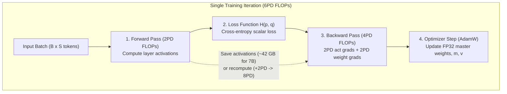
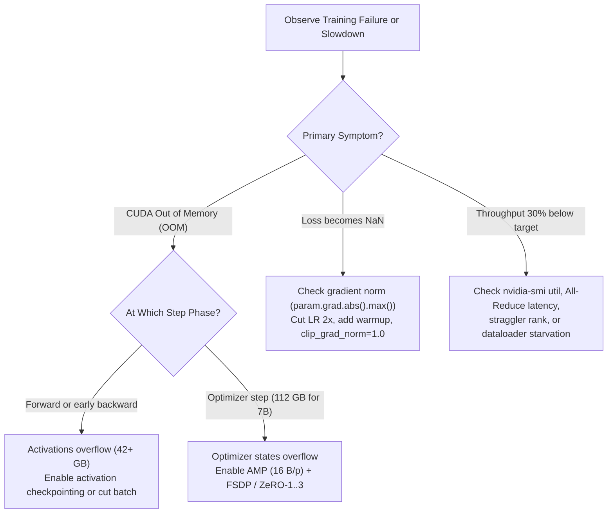

# 14.1 ML and deep learning fundamentals for infrastructure engineers

| Field | Value |
|---|---|
| Level | Basics |
| Priority tier | 2 |
| Lab venue | Nebius GPU + Local Python Verification Lab (`code/part14/ml_dl_fundamentals_lab.py`) |
| Part | Part 14: Distributed training and fine-tuning |
## Why this matters for AI infrastructure

Picture a team that asks for 64 GPUs to train a 7B model. The request sounds reasonable, since the checkpoint file is only 14 GB. Then the first training step fails with an out-of-memory error. A few days later, the same team doubles the GPU count and sees the loss curve improve no faster than before. Both surprises have one root cause. The team treated the training loop as a black box, a machine whose insides nobody needed to understand.

Training is only one part of a machine learning system. Around the optimizer sit business goals, data pipelines, feature stores, training clusters, checkpoint storage, serving engines and monitoring. An infrastructure engineer who cannot read the training loop struggles with every one of those pieces. Such an engineer cannot size the cluster, cannot explain a crash at step one, and cannot tell whether slow throughput is a model problem or a network regression. The rest of this chapter builds the mental model that prevents those three failures.

Three limits show up again and again, and the first is memory. Think of GPU memory as a single shelf. Weights alone for GPT-3 in 32-bit precision take 700 GB, which is almost nine times the memory of one 80 GB H100. A 7B model trained with Adam puts several things on that shelf at once: weights, gradients, optimizer moments, activations and workspace buffers. The total is larger than one GPU can hold, and the framework reports the overflow as `RuntimeError: CUDA out of memory`.

The second limit is compute, meaning the raw arithmetic a run needs. Count the work in one dense layer. The forward pass does one matrix multiplication, and the backward pass does two more. Those matrix multiplications are where almost all the time goes. One training step of GPT-3 at batch size 2,048 and sequence length 2,048 needs about 4.4 quintillion floating-point operations. Floating-point operations, or FLOPs, count the additions and multiplications on decimal numbers. At the A100 peak rate the table below uses, that single step takes almost four hours on one GPU. A full pretraining run on 500 billion tokens needs hundreds of zettaFLOPs, so a single machine is out of the question.

The third limit is quieter. The batch size and the learning rate look like statistical settings, but they decide how many GPU hours a run wastes. The batch is the group of examples the model looks at before each weight update. The learning rate sets how big each update is. Past the critical batch size, which section 4 explains in its critical batch part, extra GPUs buy almost no faster convergence. When you raise the global batch size, you also need a longer warmup and a larger learning rate. Warmup means starting the learning rate low and ramping it up. Skipping that step either slows progress or sends the loss to NaN, which means the training numbers have blown up.

The table below collects one worked number for each limit. You can read it as a lookup first, then come back to the sections that derive each row. The numbers look like facts you could memorize, but each one comes from a short calculation, and the sections show that calculation step by step.

| Constraint Domain | Model & Hardware Scenario | Mathematical Law or Breakdown | Physical Consequence |
|---|---|---|---|
| **The Memory Wall** | `GPT-3` (`175B` params) in `FP32` (`4 bytes/param`) on `1` `80 GB` `H100` (`HBM3`) | `175 x 10^9 x 4 bytes = 700 GB` weights alone | Exceeds a single `80 GB` `H100` by **`8.75x`** before gradients, optimizer states, or activations |
| **The Memory Wall** | `7B` model trained in `FP32` with `Adam` on `1` `80 GB` GPU | `28 GB` weights + `28 GB` gradients + `56 GB` optimizer states (`112 GB` static) + `42–80 GB` (`60–80 GB`) activations + `5–10 GB` buffers = **`180–190 GB`** total | Crashes with `RuntimeError: CUDA out of memory. Tried to allocate 2.45 GiB` (`79,456 MiB` used, `103 MiB` free out of `79,559 MiB`) |
| **The Compute Wall** | `GPT-3` `175B` single step at batch `2,048`, seq `2,048` (`4,194,304` tokens) | Forward `2PD = 2 x 175 x 10^9 x 2048 x 2048 ~= 1.46 x 10^18 FLOPs` (`1.4680 x 10^18` exact; `4.4040 x 10^18` for `6PD`) | Forward pass alone on `1` `A100` (`312 TFLOPS` peak `BF16`/`FP16` tensor rate): **`4,679.49 s` (`78 min`)**; on `128` `A100` GPUs: **`36.56 s`**. The full `6PD` step is three times longer. |
| **The Compute Wall** | `GPT-3` `175B` full pretraining run on `500B` tokens | `6PD = 6 x 175 x 10^9 x 500 x 10^9 = 5.25 x 10^23 FLOPs` (**`525.0 ZFLOPs`**) | Requires hundreds or thousands of GPUs running continuously across high-speed fabrics |
| **Hyperparameter Knobs** | Global batch scaling (`3.2M` tokens on `GPT-3` `175B`; `64` GPUs x `128` seq/GPU = `8,192` seqs) | Square-root LR scaling from base batch `32` (`1e-4`): `1e-4 x sqrt(8192 / 32) = 1.6e-3`; critical batch size `B_crit` limit | Exceeding `B_crit` wastes GPU-hours in curvature-dominated regime; missing warmup + LR scaling causes `NaN` divergence or `30%` throughput diagnosis errors (`20M` vs `32M tokens/sec`, `512` to `1,024` GPU scaling stalls) |

Before you approve a training cluster request, work out two numbers yourself: the static memory per parameter and the total training FLOPs. You do not need a spreadsheet for this. A couple of multiplications and one table lookup are enough, and they will catch most oversized or undersized requests before they reach a purchase order.

Here is how the sanity check looks in practice. Take the 7B request and write down the weights first. At 16 bits, the model weights take 14 GB, and the optimizer state for mixed-precision AdamW brings the static total to the 112 GB figure from section 3. Activations come on top of that, and they grow with batch size and sequence length. Once you have the static number, the question changes from whether the model fits to how much of the 80 GB GPU is left for activations. If the answer is almost none, you already know the request needs activation checkpointing, optimizer sharding or more GPUs before anyone runs a job.

## Prerequisites and outcomes

### Prerequisites
- The GPU parts from Part 4 come first: Streaming Multiprocessors, Tensor Cores, High Bandwidth Memory, NVLink and PCIe. CUDA and PyTorch runtime basics from Part 6 come up often too.
- Cluster networking from Part 9 matters here, including RoCEv2, InfiniBand and NCCL collective operations. Familiarity with checkpoint storage paths from Part 13 is also expected.

### Outcomes
Suppose a capacity review lands on your desk next week, and you must say whether 64 GPUs are enough. This chapter walks through the pieces you need for that answer, in order. It starts with the three kinds of AI and how teams move from simple rules to foundation models. It then derives the 6PD FLOPs law, the rule that counts the arithmetic of one training pass. Next it splits the memory of one training step into its five consumers, and it explains why mixed-precision AdamW uses 16 bytes per parameter. After that come the learning rate schedule, the critical batch size, and the loss and perplexity used to judge a model. The chapter ends by turning those pieces into capacity planning with Model FLOPs Utilization.

---

## 1. AI Taxonomy, ML Systems Design, and Model Selection

Picture a team that spends months building a deep model for a problem a SQL query or a small tree model could have solved. Product managers feel this mistake as blown cloud budgets and missed launch dates, and site reliability engineers inherit the fragile serving pipeline afterward. Before anyone provisions GPU racks, an infrastructure architect should ask what kind of model the workload actually needs. The answer might be symbolic rules, a classical tabular model that runs on CPUs, or a foundation model that needs an InfiniBand cluster. As statistician George Box observed, all models are wrong, but some are useful, because every model leaves out some real-world detail. The useful question is whether the detail left out matters for this job.

### 1.1 Symbolic AI vs Data-Driven ML vs Foundation Models

Imagine a bank that must explain to an auditor exactly why a loan was declined. A rules engine suits that job, because every decision traces back to a rule a person wrote. *Engineering AI Systems* divides artificial intelligence techniques into rule-based symbolic AI and data-driven non-symbolic or sub-symbolic AI. Symbolic systems rely on explicit human-authored rules and need no training dataset at all. They remain the right choice when the domain is well understood and the scope fits within a few hundred rules. They also excel when strict regulatory compliance demands complete audit traceability. Once rule counts grow into the thousands, however, human-maintained rule bases become brittle and contradictory, because each new rule can clash with an older one.

Next comes classical machine learning. Picture a fraud team with years of labeled transactions sitting in a large table. Classical data-driven machine learning learns patterns straight from that structured data. Supervised algorithms learn from labeled answers, and unsupervised algorithms look for groups without labels. According to *Designing Machine Learning Systems*, classical ML is appropriate when nine criteria hold. The system must have the capacity to learn, complex patterns must exist, and data must be available or collectible. The task must also be framed as a prediction on unseen data that shares the training distribution, which means new cases look like the old ones. The task should be repetitive, tolerate cheap wrong predictions, run at scale, and track patterns that change over time. Treat the nine criteria as a checklist. A task that fails several of them is usually a poor match for classical ML, however clever the model looks on paper.

Foundation models sit at the top of the taxonomy. Think of a student who reads a huge library before taking any exam. That first stage is self-supervised pretraining. The model creates its own training targets from unlabeled text, for example by predicting the next word, so nobody has to label billions of pages by hand. The second stage is supervised fine-tuning, where the model learns from labeled instruction examples that show it how to respond to people. This two-stage paradigm handles unstructured language, vision, audio, video, and multimodal tasks, and it usually runs across multi-node GPU clusters because the models are so large. For an infrastructure engineer, the practical meaning is simple. Foundation model work is a GPU and networking problem first and a data problem second.

| Category | Learning Paradigm & Data | When to Choose (*Engineering AI Systems* Ch. 3) | Execution & Infrastructure Profile |
|---|---|---|---|
| **1. Symbolic & Rule-Based AI** | Explicit human-authored rules (`if/else` knowledge base); no training dataset | Well-understood domain; well-defined scope (`a few hundred rules`, failing when rules grow into the `thousands`); strict regulatory compliance and `100%` audit traceability | CPU-bound rules engine; latency governed by **rule ordering**, **rule grouping** (cache locality), **conflict resolution** (`specificity`, `salience`, `chronological order`), **condition indexing/filtering**, pre-compilation, and thread parallelism (*Engineering AI Systems* ch 3.3.1) |
| **2. Classical Data-Driven ML** | **Supervised** (labeled input-target pairs), **Unsupervised** (unlabeled pattern discovery / clustering) | Large structured/tabular datasets where complex patterns exist (`9` criteria—capacity to learn, complex patterns, existing data, predictive framing, unseen data shares distribution, repetitive, cheap wrong predictions, at scale, changing patterns) | Often fits on CPU or single GPU (`scikit-learn`, `XGBoost`, `LightGBM`); fast training and sub-millisecond inference (`1 GB` to `16 GB` RAM) |
| **3. Foundation Models (`FMs`) & Deep Learning** | **Self-supervised pretraining** (models generate their own labels from massive unlabeled corpora, e.g., masked token or next-token prediction) followed by **supervised fine-tuning (`SFT`)** on labeled instruction datasets (*Engineering AI Systems* Ch. 3) | Unstructured modalities (**Language**, **Vision**, **Audio**, **Video**, **Multimodal**, and **Domain-specific** models such as `BloombergGPT` `50B` for finance, `NVIDIA Nemotron`, `BLOOM` [`1,000+` researchers], `OpenAI GPT-x`, `Google Gemini`, `Meta LLaMA`, `BERT-Large` `340M` params / `1.35 GB`) | Multi-GPU / multi-node accelerated clusters (`PyTorch`, `TensorFlow`, `Megatron-LM`, `DeepSpeed`) across cloud platforms (`AWS SageMaker`, `Azure ML`, `Google Vertex AI`, `IBM Watson Studio`, `MosaicML`) or on-prem GPU fabrics |

Read the table one column at a time. The first column names the category, and the second column says how the model learns. The third column tells you when the category is the right choice, and the fourth column tells you what the machines look like. Notice that the fourth column for the first row is a CPU story, while the fourth column for the last row is a cluster story. The jump in infrastructure cost follows from the jump in data type and model size, so a good architect reads the table from left to right and asks at each step whether the next column is still needed.

### 1.2 Research vs Production Systems and Latency vs Throughput

A model that tops an academic leaderboard can fail badly once it sits behind a live user-facing API. Picture a restaurant recommendation feature that the team just launched. The model that scored best in the paper is slow, and the first users notice the lag almost at once. Academic research usually optimizes one metric, state-of-the-art accuracy on a fixed benchmark. Production engineering has to satisfy several stakeholders at the same time. The ML engineers want a complex model for accuracy. The sales team wants expensive restaurants shown more often. Product managers want sub-100-millisecond latency so that users stay in the app. Platform SREs, the engineers who keep services reliable, want stable serving and rare model reloads. Executives watch net margin and customer retention. Each of those goals is reasonable, and they pull in different directions.

When business goals conflict, it is tempting to merge them into one training loss with weights. That shortcut becomes a trap. Suppose a newsfeed must balance quality and engagement. If you train one model on a blended loss, every change to the business weights forces a full retrain. The product team may change its mind every month, so the retrains never stop. Splitting the problem into two independent models avoids that cost. One model scores quality, and the other scores engagement. Engineers combine the two scores at serving time, so a weight change becomes a configuration change instead of a training job. Each model can also be updated on its own schedule.

Research and production also care about opposite things in the compute stack. A research team wants high training throughput, so it packs as many examples as possible into each batch. A production team wants low tail latency at inference time, which means the slowest few requests matter most. Batching helps both sides, but in different ways. Grouping online requests into batches raises GPU utilization and total throughput. The cost is that each request waits while the batch fills, and the larger matrix multiplication takes its own time, so per-request latency rises. Average latency hides this problem. An average can look healthy while a handful of requests take seconds. That is why production SLAs, the agreed service targets, are enforced at the 90th, 95th, or 99th percentile. A percentile tells you how fast the slowest one in ten, one in twenty, or one in a hundred requests finished.

Finally, every production ML platform has to meet four foundational requirements: reliability, scalability, maintainability and adaptability. Reliability deserves special attention. Traditional software crashes loudly, and the user sees an HTTP 500 error, which is the server's way of saying something went wrong. A broken ML model is worse, because it often fails silently. It returns HTTP 200, the code for success, along with garbage predictions. Monitoring therefore has to check the predictions themselves, not only the status codes. Scaling adds its own trap. The platform must handle larger model files and higher request volumes at the same time, and it must do that without an autoscaling failure that takes the service down.

| Production Dimension | Research vs Production Contrast | Concrete Numbers, Benchmarks & Business Impact |
|---|---|---|
| **Stakeholder & Latency SLAs** | Single static SOTA metric vs multi-stakeholder production trade-offs | Sales `10%` restaurant order fee; product `< 100 ms` SLA (`> 100 ms` causes `10%` of users to close app); Akamai (`2017`): `100 ms` delay hurts conversion by **`7%`**; Booking.com (`2019`): `30%` latency increase costs **`0.5%`** conversion; Google (`2016`): **`> 50%`** mobile users abandon pages taking **`> 3 seconds`** |
| **Customer Economics & Enterprise ROI** | Leaderboard accuracy vs acquisition/retention cost and resource efficiency | Acquiring a mobile user who makes an in-app purchase costs **`$86.61`**; acquiring a Lyft rider costs **`$158`**; customer acquisition is **`5 to 25x`** more expensive than retention; `0.1%` cloud resource efficiency saves millions vs `0.2%` CTR gain |
| **Decoupled Multi-Objective Ranking** | Monolithic loss `alpha * quality_loss + beta * engagement_loss` vs decoupled serving | Separate `quality_model` and `engagement_model` combined as `alpha * quality_score + beta * engagement_score` at serving time avoids Pareto retraining when `alpha` or `beta` changes |
| **Batching: Latency vs Throughput** | Unbatched (`1` query at a time) vs dynamic request batching | `1` query in `10 ms` = **`100 queries/sec`**; `1` query in `100 ms` = **`10 queries/sec`**; batching `10` queries in `10 ms` = **`1,000 queries/sec`** at `10 ms`; batching `50` queries in `20 ms` = **`2,500 queries/sec`** at `20 ms` |
| **Tail Latency Percentiles (`p50`, `p90`, `p99`)** | Arithmetic mean vs percentile SLAs across `10` requests `[100, 102, 100, 100, 99, 104, 110, 90, 3000, 95] ms` | Arithmetic mean = **`390.0 ms`** (`390 ms`), median **`p50 = 100.0 ms`** (`100 ms`), tail outlier **`p90 = 3,000.0 ms`** (`3,000 ms` / `3.0 s`) |
| **Four Systems Requirements & Maturity** | Reliability, Scalability, Maintainability, Adaptability | Scaling from `1 GB` RAM logistic regression to `100M`-param model needing `16 GB` RAM; `10,000` to `10M` daily requests; `8,000` per-customer enterprise models; Amazon Prime Day autoscaling crash cost **`$72M–$99M` per hour**; Algorithmia (`2020`): **`75%`** of orgs with `> 5` years maturity deploy in `< 30` days vs **`60%`** of beginners taking `> 30` days |

Look at the batching row as a worked case. A single query that takes 10 ms gives 100 queries per second, because one second holds 100 of those 10 ms slots. The same server handling a single query at a time cannot do better than that. Batching changes the arithmetic. If the server groups 10 queries into one 10 ms pass, the throughput becomes 1,000 queries per second at the same latency. The price of batching is visible in the 50-query row, where the latency rises to 20 ms to get 2,500 queries per second. Read the row as a trade. You buy throughput with a little latency, and the percentile target decides how much latency you can afford.

### 1.3 Taxonomy of ML Tasks, Algorithms, Ensembles, and the Four Adoption Phases

The way you frame a problem decides how often you retrain. Suppose a mobile operating system predicts which app a user will open next. One framing treats every app as a class, so the model has one output slot per app. Each time the app catalog changes, the output layer changes too, and the whole network must be retrained. A second framing treats the task as scoring. The model takes user features, context features and candidate app features as inputs, and it outputs one probability between zero and one for each candidate. The task is the same, but the second framing lets the system score a brand-new app on the day it appears. From the infrastructure side, the second framing also means fewer retraining jobs and a smaller bill.

Beyond problem framing, *Engineering AI Systems* and *Designing Machine Learning Systems* sort classical algorithms into families: classification, regression, clustering and ensembles. Ensembles deserve a closer look, because they often beat any single model. An ensemble combines several models, so their individual mistakes can cancel out. The key condition is that the models make different mistakes. Combining uncorrelated base learners reduces variance or bias, depending on how the learners are built. Here is a small example. Suppose three independent classifiers each reach 70 percent accuracy. A majority vote is right whenever at least two of the three classifiers are correct. Working through the cases by hand gives the 78.4 percent figure in the block below.

```text
Majority-Vote Ensemble of 3 Uncorrelated Classifiers (each 70% = 0.70 accurate, DMLS Ch. 6 Table 6-1):
  - All 3 correct:       0.7 x 0.7 x 0.7         = 0.343  (34.3%)
  - Exactly 2 correct:   3 x (0.7 x 0.7 x 0.3)   = 0.441  (44.1%)
  - Exactly 1 correct:   3 x (0.3 x 0.3 x 0.7)   = 0.189  (18.9%)
  - None (0) correct:    0.3 x 0.3 x 0.3         = 0.027  (2.7%)
  ---------------------------------------------------------------
  Ensemble Accuracy (>= 2 correct): 0.343 + 0.441 = 0.784 (78.4% accuracy, +8.4% gain)
```

The ensemble arithmetic depends on one assumption that real systems often break. The three classifiers must be uncorrelated, which means their mistakes must fall on different examples. If all three models fail on the same hard cases, the vote gives the same 70 percent answer you started with. That is why teams check the correlation of errors before they count on a vote. Diversity in the training data, the features or the model family is what buys the gain.

Teams that want to avoid over-engineering can move through four adoption phases in order. Think of each phase as a gate the next phase has to earn. In Phase 1 you start with plain non-ML heuristics, which are fixed rules that anyone can read. In Phase 2 you deploy the simplest ML models, such as logistic regression, gradient-boosted trees or nearest neighbors. The point is to validate the whole pipeline, from data to serving, before anything fancy is built. In Phase 3 you improve those simple models with feature engineering and ensembles. Only in Phase 4, when simple models plateau, do you move to deep neural networks and foundation models. Each phase answers a question the previous one left open.

| Task or Adoption Dimension | Core Algorithms, Framing & Mechanics (*Engineering AI Systems* ch 3.2.2) | Production Trade-Offs & Empirical Numbers |
|---|---|---|
| **Classification (*Engineering AI Systems* ch 3.2.2)** | Assigns static inputs to discrete classes (distinct from temporal *prediction/forecasting*): **binary** (`2` classes, e.g., spam, hotdog), **multiclass** (`>= 3` classes; **hierarchical classification** for high cardinality), **multilabel** (variable subset e.g. `[0, 1, 1, 0]` via multi-output sigmoid). Algorithms: **KNN** (`k` nearest by Euclidean distance), **Logistic Regression** (sigmoid `1 / (1 + exp(-z))` with `0.5` threshold), **Decision Trees**, **Random Forests**, **Naive Bayes**, **SVM**, **Neural Networks** (softmax output) | High-cardinality classification with `1,000` classes requires `>= 100` examples/class = **`>= 100,000`** labeled examples; reframing `N`-class next-app prediction as scalar `[0, 1]` regression avoids retraining when new apps arrive |
| **Regression (*Engineering AI Systems* ch 3.2.2)** | Predicts continuous values: **Linear Regression**, **Polynomial Regression** (`n`-th degree nonlinear trends), **Support Vector Regression (`SVR`)** (`epsilon`-insensitive buffer zone), **Decision Tree Regression**, **Random Forest Regression**, **Gradient Boosting Regression**, **Neural Network Regression** | Tree ensembles (`XGBoost`, `LightGBM`) dominate tabular regression on CPUs with minimal memory overhead |
| **Clustering (*Engineering AI Systems* ch 3.2.2)** | Unsupervised grouping via Euclidean or **Levenshtein edit distance** (strings), using **hard clustering** (single cluster) or **soft clustering** (probabilities): **K-Means** (`k` centroids, used in Netflix movie/show clustering), **DBSCAN** (`MinPts` and radius `epsilon` for **core**, **border**, and **noise** points), **Hierarchical Clustering** (**agglomerative** bottom-up vs **divisive** top-down) | Discovers structure in unlabeled data without human annotation cost |
| **Ensembles: Bagging, Boosting, Stacking** | **Bagging** (*bootstrap aggregating*, e.g., Random Forests) samples in parallel to **reduce variance**; **Boosting** (`GBM`, `XGBoost`, distributed `LightGBM`) trains sequentially on residual errors to **reduce bias**; **Stacking** trains a **meta-learner** on base predictions | **`20` of `22`** Kaggle winning solutions (`2021`, including a `33`-model winner) and all **`top 20` `SQuAD 2.0`** entries use ensembles; `3` uncorrelated `70%` classifiers reach **`78.4%`** |
| **Six Selection Tips & Seven Assumptions** | (1) Avoid SOTA trap, (2) start simple, (3) equal hyperparameter budgets, (4) learning curves for now vs later (Andrew Ng: high-variance improves with data, high-bias does not), (5) trade-offs (`FP` vs `FN`, latency vs accuracy, interpretability), (6) verify **7 assumptions**: **Prediction**, **IID**, **Smoothness**, **Tractability** `P(Z\|X)`, **Linear Boundaries**, **Conditional Independence**, **Normal Distribution** | Stanford HAI (`2019`): only **`13%`** of large enterprises mitigated fairness risks and **`19%`** worked on explainability; Geoffrey Hinton's surgeon survey: **`50%`** of `30` tech executives rejected a **`90%`**-cure black-box AI surgeon in favor of an **`80%`**-cure human surgeon |
| **Four Adoption Phases** | **Phase 1:** Non-ML heuristics `->` **Phase 2:** Simplest ML (`logistic regression`, `GBDT`, `KNN`) `->` **Phase 3:** Optimizing simple models `->` **Phase 4:** Complex models (`DNNs`, `FMs`) | Top-`3` English letters (`"e"`, `"t"`, `"a"`) give **`30%`** accuracy; Facebook used chronological newsfeed from **`2006–2011`**; Martin Zinkevich's rule: if ML gives a **`100%`** boost, a heuristic gets you **`50%`** of the way there |

Before you provision a multi-node GPU cluster for a new product feature, ask the modeling team for two baselines. The Phase 1 heuristic baseline shows what plain rules achieve. The Phase 2 simple model baseline shows what a cheap model achieves. If those two results already meet the target, the cluster may never be needed.

---

## 2. Deep Learning Mechanics and the 6PD Training FLOPs Law

Suppose an engineering team moves to Phase 4 and starts training a deep neural network or a Transformer foundation model. Their first capacity estimate uses the forward pass alone, and the cluster comes out three or four times too small. Engineers who estimate compute from the inference pass alone under-provision GPU nodes and miss delivery deadlines by months. To size a training cluster accurately, you must count both the forward pass and the two backward matrix multiplications, because training does all three.

Deep learning training is a loop, and the loop has three nested units. Think of studying for an exam with a stack of flashcards. The batch size is how many cards you study before you adjust what you remember, which in training means before the weights change. In other words, it is the number of training examples or tokens processed before one weight update. An iteration, also called a step, is one full cycle on one batch: a forward pass, a loss calculation, a backward pass and an optimizer update. An epoch is one complete pass over the entire training dataset. The arithmetic is simple. A dataset of 1,000 examples processed with a batch size of 100 requires 10 iterations to complete 1 epoch. Keep these three words straight, because the cluster math later depends on them.



### 2.1 Why Forward Is 2PD and Backward Is 4PD

Your capacity review asks how many floating-point operations one step costs. To answer it, start with the smallest useful piece, a dense linear layer inside a Transformer. Such a layer multiplies an input activation matrix by a weight matrix. Each output element is a dot product, which means multiplying an input row by a weight column and adding up the results. For every parameter and every token, that dot product does one multiplication and one addition. Engineers call the pair a multiply-accumulate, and it counts as two floating-point operations. Across P parameters and D tokens, the forward pass therefore costs 2PD FLOPs, where P is the parameter count and D is the number of tokens in the batch.

Now the backward pass, which sends the error from the loss back through the network. It relies on the chain rule of calculus, and for every linear layer the chain rule asks for two separate matrix multiplications. Both start from the upstream gradient, the error signal arriving from the layer above. The first multiplies that gradient by the transposed weight matrix. That gives the input activation gradients, and it is how the error reaches earlier layers. The second multiplies the transposed input activations by the upstream gradient. That gives the weight gradients the optimizer needs. Each of those two multiplications has the same operation count as the forward pass, so each costs 2PD FLOPs.

Add the two parts together. The forward pass costs 2PD and the backward pass costs 4PD, so the total is 6PD. That is the standard law for dense Transformer training. Activation checkpointing changes the bill. When memory is tight, the framework throws away the intermediate activations during the forward pass and recomputes them during backpropagation. The recomputation is one extra 2PD forward pass, so the total grows to 8PD. **Standard dense Transformer training costs 6PD FLOPs per token, and enabling full activation checkpointing raises that cost by one-third to 8PD FLOPs.**

```text
Dense Linear Layer Y = X * W (Weight matrix W of shape [d_in, d_out], P = d_in * d_out parameters, Input X of shape [D, d_in] tokens):

1. Forward Pass (1 GEMM: Y = X * W, shape [D, d_in] x [d_in, d_out] -> [D, d_out]):
   D * d_in * d_out = P * D multiply-accumulates (MACs) x 2 FLOPs/MAC
   F_forward            = 2 * P * D   FLOPs

2. Backward Pass (2 GEMMs via Chain Rule given upstream dL/dY of shape [D, d_out]):
   - Activation Gradients (dL/dX = dL/dY * W^T, shape [D, d_out] x [d_out, d_in] -> [D, d_in]):  2 * P * D FLOPs
   - Weight Gradients     (dL/dW = X^T * dL/dY, shape [d_in, D] x [D, d_out] -> [d_in, d_out]):  2 * P * D FLOPs
   F_backward           = 2PD + 2PD = 4 * P * D   FLOPs  (2x Forward)

3. Total Training Compute (Standard vs Full Activation Checkpointing):
   F_train_standard     = 2PD (forward) + 4PD (backward) = 6 * P * D   FLOPs
   F_train_checkpointed = 6PD + 2PD (recomputed forward) = 8 * P * D   FLOPs  (+33.33% compute; 30–50% slower backward in V13 Ch. 02; fits 10x larger models at ~20% overhead in Salimans & Bulatov 2017, DMLS Ch. 6)
```

The factor of two in 2PD deserves a moment of attention, because it trips up many estimates. One multiply-accumulate is one multiplication and one addition, and hardware counts each as a floating-point operation. A dense layer touches every weight once for every token in the batch. Multiply the number of weights by the number of tokens and you have the count of multiply-accumulates. Multiply that by two and you have the FLOP count. The arithmetic is the same whether the layer is small or large, which is why the formula scales so cleanly from one layer to a whole model.

### 2.2 Concrete Compute Scaling Across Dataset Scales

Suppose a planner asks why last year's model cost so much more to train than the one before it. The answer starts with data. The book *Designing Machine Learning Systems* traces how language model pretraining datasets have grown over the past decade. Early neural language benchmarks in 2013 trained on less than one billion tokens, while modern open-weight models train on trillions of tokens. A token is a chunk of text, often a whole word or a piece of one. Total training compute scales with the product of parameters and tokens. Doubling both model size and dataset size therefore quadruples the required GPU hours, because the two doublings multiply each other.

| Model & Workload Scenario | Parameters (`P`) | Tokens (`D`) | Forward (`2PD`) | Backward (`4PD`) | Total Standard (`6PD`) | With Checkpointing (`8PD`) | Hardware Timing & Corpus Context (`code/part14/ml_dl_fundamentals.py`) |
|---|---|---|---|---|---|---|---|
| **Historical Dataset Growth** | — | **`0.8B`** (`2013` One Billion Word) `->` **`10B`** (`2019` `GPT-2`) `->` **`500B`** (`2020` `GPT-3`) | — | — | Scales `625x` in token volume from `0.8B` to `500B` | — | Modern open-weights runs (`7B` to `70B`) train on **`1 trillion` (`1T`) to `2 trillion` (`2T`) tokens** |
| **`GPT-3` `175B` Single Step** (batch `2048`, seq `2,048`) | `175 x 10^9` | `4,194,304` (`4.19M`) | `1.468 x 10^18` (`~1.46e18`) | `2.936 x 10^18` | `4.404 x 10^18` | `5.872 x 10^18` | Forward pass only, `1.46e18` FLOPs on `1` `A100` (`312 TFLOPS`): **`4,679.49 s` (`~78 min`)**; on `128` `A100` GPUs: **`36.56 s` (`~37 s`)** |
| **`7B` Model Pretraining** (`1T` tokens) | `7 x 10^9` | `1.0 x 10^12` | `1.40 x 10^22` (`14.0 ZFLOPs`) | `2.80 x 10^22` (`28.0 ZFLOPs`) | **`4.20 x 10^22` (`42.0 ZFLOPs`)** | `5.60 x 10^22` (`56.0 ZFLOPs`) | On `64` `H100` GPUs (`989 TFLOPS` peak) at `50%` `MFU` (`494.50 TFLOPS/GPU`, `31.648 PFLOPS`): **`368.64 hours` (`15.36 days`)** |
| **`GPT-3` `175B` Full Run** (`500B` tokens) | `175 x 10^9` | `5.0 x 10^11` | `1.75 x 10^23` (`175.0 ZFLOPs`) | `3.50 x 10^23` (`350.0 ZFLOPs`) | **`5.25 x 10^23` (`525.0 ZFLOPs`)** | `7.00 x 10^23` (`700.0 ZFLOPs`) | Requires multi-node distributed training across hundreds or thousands of GPUs |
| **`70B` Model Pretraining** (`2T` tokens) | `70 x 10^9` | `2.0 x 10^12` | `2.80 x 10^23` (`280.0 ZFLOPs`) | `5.60 x 10^23` (`560.0 ZFLOPs`) | **`8.40 x 10^23` (`840.0 ZFLOPs`)** | `1.12 x 10^24` (`1,120.0 ZFLOPs` / `1.12 YFLOPs`) | On `512` `H100` GPUs (`989 TFLOPS` peak) at `45%` `MFU` (`445.05 TFLOPS/GPU`, `227.8656 PFLOPS`): **`1,024.0 hours` (`42.67 days`)** |

Read the 7B row as a walkthrough. The model has 7 x 10^9 parameters and sees 1.0 x 10^12 tokens during pretraining. Multiply the two, add the factor of six, and the total is 4.20 x 10^22 FLOPs, which the table writes as 42.0 ZFLOPs. The forward and backward columns split that same total, and the checkpointing column shows the extra forward pass. The timing column then converts the FLOPs into wall-clock time for 64 H100 GPUs at 50 percent MFU. The row is useful because every column comes from the same formula, so you can check any cell with a calculator.

Here is the rule of thumb that falls out of the table. Take your forward-pass estimate and multiply it by three for standard training. Multiply it by four when full activation checkpointing is on. The forward pass is the 2PD part, so three times it gives 6PD, and four times it gives 8PD. Keep this shortcut handy when a colleague quotes a forward-only number in a meeting.

---

## 3. Training Step Memory Anatomy and SGD vs AdamW

Here is a scene that repeats on many teams. An engineer opens a 7B model checkpoint, sees that it occupies 14 GB on disk in 16-bit precision, and assumes it will train on a single 80 GB H100. The job starts, and within seconds it crashes with an out-of-memory error. The mistake is treating training like inference. Inference stores static weights and a small key-value cache, which is the memory that holds past attention results during generation. Training dynamically allocates five distinct memory consumers in GPU HBM, the high-bandwidth memory on the GPU card. Those five consumers are model weights, gradients, optimizer states, forward activations, and temporary workspace buffers. Each one has its own size, and the peak depends on how they overlap in time.

### 3.1 Optimizer State Memory: Vanilla SGD vs Momentum SGD vs Mixed-Precision AdamW

Picture two optimizers competing for the same model. The first is plain SGD, and the second is SGD with momentum. The cost per parameter decides which one fits, because the optimizer is the component that remembers things between steps. After backpropagation produces the gradients, the optimizer uses them to move each parameter. Different algorithms keep different amounts of history per parameter. Vanilla Stochastic Gradient Descent, or SGD, subtracts the scaled gradient directly from each weight and keeps no history. In 32-bit precision it needs only 8 bytes per parameter, which is 4 bytes for the weight and 4 bytes for its gradient. Adding momentum introduces one 32-bit velocity buffer per parameter. Momentum is a running average of past gradients, so the updates keep moving in a steady direction. That buffer raises the static footprint to 12 bytes per parameter.

Adaptive optimizers such as Adam and AdamW often converge faster on Transformers, but they carry more history. Each parameter gets two 32-bit buffers. The first tracks the momentum, which is the average direction of recent gradients. The second tracks the variance, which is how large the recent gradients have been. Mixed precision adds one more twist. Forward and backward matrix multiplications run in 16-bit numbers, which are smaller and faster. The optimizer, however, cannot accumulate tiny updates directly into 16-bit weights without underflow. Underflow means a number is so small that it rounds to zero and the update disappears. So the framework keeps a 4-byte FP32 master copy of each weight for the optimizer to update. The full static state is then 2-byte working weights, 2-byte gradients, a 4-byte master weight, and two 4-byte moment buffers. **Mixed-precision AdamW always consumes 16 bytes of static GPU memory per parameter, which equals 112 GB for a 7B model before allocating any activations.**

```text
Static Memory Breakdown per Parameter Across Optimizers (V13 Ch. 01–02, EAS 3.3.2):

1. Vanilla SGD in FP32 (0 optimizer states):
   W_{t+1} = W_t - lr * g_t
   4 B (FP32 weight) + 4 B (FP32 grad) + 0 B (state)                          =  8 bytes / parameter

2. SGD with Momentum in FP32 (1 state buffer: velocity v_t):
   4 B (FP32 weight) + 4 B (FP32 grad) + 4 B (FP32 velocity v_t)              = 12 bytes / parameter

3. Pure FP32 Adam / AdamW (2 state buffers: momentum m_t, variance v_t):
   4 B (FP32 weight) + 4 B (FP32 grad) + 4 B (FP32 m_t) + 4 B (FP32 v_t)      = 16 bytes / parameter

4. Mixed-Precision (AMP BF16/FP16 + FP32 Master Weights) AdamW:
   Why FP32 master weights? FP16 dynamic range is ~10^-5 to 10^4 (vs FP32 10^-38 to 10^38), so small updates lr * g_t underflow to 0.0 in FP16.
   - BF16 / FP16 Working Weights:     2 bytes
   - BF16 / FP16 Gradients:           2 bytes
   - FP32 Master Weights:             4 bytes
   - FP32 Adam First Moment (m_t):    4 bytes (controlled by beta_1)
   - FP32 Adam Second Moment (v_t):   4 bytes (controlled by beta_2)
   -------------------------------------------------------------------------
   TOTAL STATIC TRAINING STATE:      16 bytes / parameter
```

| Optimizer Configuration | Weights | Gradients | Master Weights | Optimizer States (`m`, `v`) | Total Bytes / Param | `7B` Static State | `70B` Static State | `175B` Static State |
|---|---|---|---|---|---|---|---|---|
| **Vanilla `SGD` (`FP32`)** | `4 B` (`FP32`) | `4 B` (`FP32`) | `0 B` | `0 B` (`0` states) | **`8 B / param`** | **`56.0 GB`** | `560.0 GB` | `1,400.0 GB` |
| **`SGD` + Momentum (`FP32`)** | `4 B` (`FP32`) | `4 B` (`FP32`) | `0 B` | `4 B` (`1` state: `v_t`) | **`12 B / param`** | **`84.0 GB`** | `840.0 GB` | `2,100.0 GB` |
| **Pure `FP32` `Adam` / `AdamW`** | `4 B` (`FP32`) | `4 B` (`FP32`) | `0 B` | `8 B` (`4 B` `m_t` + `4 B` `v_t`) | **`16 B / param`** | **`112.0 GB`** | `1,120.0 GB` | `2,800.0 GB` |
| **Mixed-Precision `AdamW` (`BF16`/`FP16` + `FP32` Master)** | `2 B` (`BF16`) | `2 B` (`BF16`) | `4 B` (`FP32`) | `8 B` (`4 B` `m_t` + `4 B` `v_t`) | **`16 B / param`** | **`112.0 GB`** (`14+14+28+28+28`) | **`1,120.0 GB`** (`~1.2 TB` with buffers) | **`2,800.0 GB`** (`2.8 TB`) |

Read the table row by row, and notice what changes between rows. The weights and gradients stay in 32-bit precision for the first two rows, so the difference between plain SGD and momentum is one extra buffer. The mixed-precision row changes the story. It halves the weight and gradient bytes, but it adds a 32-bit master copy and keeps the two Adam moment buffers. The total lands back at 16 bytes per parameter, which is why the mixed-precision row and pure FP32 Adam show the same static size. Mixed precision is a speed and activation-memory decision. It does not make the optimizer state smaller.

### 3.2 Timeline of the Five Memory Consumers Across a 7B Training Step

Static state is only part of the story. Suppose a job runs the forward pass fine and then dies in the backward pass. Where did the memory go? During the forward pass, PyTorch must keep intermediate layer activations in GPU memory, because the backward weight-gradient formula multiplies those exact forward activations by the upstream gradients. On top of that, the CUDA runtime reserves several gigabytes of workspace buffers for cuBLAS matrix kernels, NCCL communication staging and allocator fragmentation. cuBLAS is NVIDIA's matrix library, NCCL is the library that moves data between GPUs, and fragmentation means free memory is split into pieces too small to use.

Tracing the memory through the four phases of one step explains why a job crashes at one particular line. Think of the step as a relay in which each phase hands a bundle of memory to the next. If the job runs out of memory during the forward pass or early in the backward pass, the intermediate activations have overflowed HBM. You can fix that activation overflow by enabling activation checkpointing, enabling Automatic Mixed Precision (AMP), or reducing the micro-batch size. The micro-batch is the slice of the batch that runs on one GPU at a time. Sometimes a job survives the backward pass with activation checkpointing enabled, yet crashes inside `optimizer.step()`. In that case the 112 GB AdamW state peak has exceeded single-GPU memory. The fix is to shard the optimizer states across GPUs with ZeRO or FSDP, which split that state among the data-parallel ranks.

| Step Phase (`7B` Transformer: `32` layers, `hidden_dim = 4096`, `batch_size = 4`, `seq_len = 2048`) | Active Memory Components in `VRAM` | Peak Memory Total | Status on `1` `80 GB` `H100` & Engineering Takeaway |
|---|---|---|---|
| **Stage 1 — Forward Pass (`FP32`)** | `28.0 GB` `FP32` weights + `42.0 GB` saved forward activations (`32 x 4 x 4096 x 4 x 2048 ~= 42.0 GB`; up to `60–80 GB` on `120`-layer deeper variants) | **`70.0 GB`** (`87.5%` of `80 GB` `H100`) | Fits barely during forward, leaving almost no headroom before backward starts |
| **Stage 2 — Backward Without Activation Checkpointing** | `28.0 GB` weights + `42.0 GB` saved forward activations + `28.0 GB` newly allocated gradients | **`98.0 GB`** | **Immediate `OOM`** (`98.0 GB > 80 GB`) as gradients allocate alongside saved activations |
| **Stage 3 — Backward With Activation Checkpointing** | `28.0 GB` weights + **`10.0 GB`** (`5–10 GB`) recomputed layer-boundary activations + `28.0 GB` gradients | **`66.0 GB`** | **Fits in `80 GB`** during backward, at the cost of `30–50%` slower backward compute |
| **Stage 4 — Optimizer Step (`FP32` `Adam`)** | `28.0 GB` weights + `28.0 GB` gradients + `28.0 GB` momentum (`m_t`) + `28.0 GB` variance (`v_t`) + `5–15 GB` workspace buffers | **`112.0 GB`** static (`180–190 GB` unoptimized total) | **Immediate `OOM`** on `optimizer.step()` without **`ZeRO-1` / `FSDP`** optimizer-state sharding |
| **Effect of Automatic Mixed Precision (`AMP`)** | `14.0 GB` `FP16` weights + `21.0 GB` `FP16` activations + `14.0 GB` `FP16` gradients + `2.0 GB` `FP32` loss/normalizations | **`51.0 GB`** theoretical (**`48.2 GB`** vs **`78.5 GB`** measured) | `python train.py --use_amp True` cuts memory from `78.5 GB` to `48.2 GB` and boosts speed from **`1,000` to `1,280 tokens/sec` (`1.28x` speedup)** |

Read the stages in order, because each one shows what the previous stage left behind. Stage 1 fits, but only barely, since the saved activations take most of the room. Stage 2 is the crash that surprises people. The gradients arrive while the activations are still stored, and the sum passes 80 GB. Stage 3 shows why activation checkpointing matters. Recomputing the activations keeps only a thin slice of them in memory, so the same backward pass fits. Stage 4 is where the optimizer state arrives, and that is the stage that needs sharding rather than a smaller batch. The table is the map. The stack trace tells you which stage was running when the job died.

When a run dies with a CUDA out-of-memory error, start with the stack trace, the list of function calls printed at the crash. Read it from the bottom up to find your own code. Then ask one question. Did the crash happen while allocating activations inside `backward()`, or while allocating optimizer state inside `optimizer.step()`? The answer tells you which fix to try first.

---

## 4. Optimization Dynamics: Learning Rate Schedules, Critical Batch Size, and Loss/Perplexity

Picture a training job that runs fine on one GPU and then misbehaves on 64. An infrastructure engineer who scales a job from 1 GPU to 64 GPUs often sees one of two failures. Either the loss suddenly explodes into NaN values after a few hundred steps, or the 64-GPU cluster converges no faster than 16 GPUs. Both failures stem from the coupling between global batch size, gradient noise, and the learning rate schedule. Each of the three settings pushes on the others, so changing one without the rest often breaks the run.

### 4.1 Linear Warmup, Cosine Decay, and Batch-Size LR Scaling

Imagine you launch a run and the loss jumps off the chart within the first few steps. The likely culprit is the learning rate, the number that sets how far each weight moves per update. A hyperparameter is a setting you choose before training starts, and the learning rate is the most sensitive one in deep learning. The reason is timing. At step zero the model weights are random and the AdamW variance estimates are not yet calibrated. A large peak learning rate on step one causes huge parameter jumps and immediate divergence. Later in training the opposite problem appears. A learning rate that stays high at the end makes the optimizer bounce around the walls of the loss valley instead of settling at the bottom.

Modern foundation model training handles both ends with two pieces, linear warmup and cosine annealing decay. Warmup is the slow start. During the first few thousand warmup steps the learning rate ramps linearly from zero up to its peak. That ramp gives AdamW time to calibrate its second-moment variance buffers before the large updates arrive. After warmup, cosine decay takes over. The learning rate follows a smooth cosine curve down toward a minimum floor, typically one-tenth of the peak rate. The curve starts flat, falls fastest in the middle, and flattens again near the floor, so the optimizer takes gentle steps at the very end.

Now consider what happens when you add GPUs. In data parallelism, each GPU processes its own micro-batch, and the gradients are averaged across all of them. The global batch size is therefore the per-GPU micro-batch size multiplied by the GPU count. Each global step now averages gradients over many more examples, so the gradient estimate becomes less noisy. The model also takes far fewer steps per epoch, which sounds like a win. The catch is that a steadier gradient does not automatically mean a safe learning rate. To keep training stable with AdamW, engineers scale the peak learning rate by the square root of the batch-size multiplier and extend the warmup. The square-root rule is a heuristic, a starting point, and the next paragraphs show how it is applied.

```text
1. Linear Warmup (0 <= t <= W) and Cosine Annealing Decay (W < t <= T):
   Warmup:          lr(t) = lr_peak * (t / W)
   Cosine Progress: p     = (t - W) / (T - W)
   Cosine Decay:    lr(t) = lr_min + 0.5 * (lr_peak - lr_min) * (1 + cos(pi * p))

   Worked Schedule (T = 100,000 total steps, W = 2,000 warmup steps, lr_peak = 3.0e-4 [0.0003], lr_min = 3.0e-5 [0.00003]):
   - Step t = 0:       lr(0)      = 0.0
   - Step t = 1,000:   lr(1000)   = 3.0e-4 * (1000 / 2000) = 1.5e-4  (50% warmup)
   - Step t = 2,000:   lr(2000)   = 3.0e-4                           (warmup peak)
   - Step t = 26,500:  progress   = 24,500 / 98,000 = 0.25           (quarter cosine decay)
   - Step t = 51,000:  progress   = (51000 - 2000) / 98000 = 49,000 / 98,000 = 0.5 -> cos(0.5 * pi) = 0 -> lr(51000) = 3.0e-5 + 0.5 * 2.7e-4 = 1.65e-4
   - Step t = 75,500:  progress   = 73,500 / 98,000 = 0.75           (three-quarter cosine decay)
   - Step t = 100,000: progress   = 1.0 -> cos(pi) = -1              -> lr(100000) = 3.0e-5

2. Global Batch Size & Learning-Rate Scaling (DMLS Ch. 6, V21 Ch. 07):
   - Step Compression Example (DMLS Ch. 6): 1 machine with batch 1,000 takes 1,000,000 (1M) steps/epoch; 1,000 machines with batch 1,000 have global batch 1,000,000 (1M) and take only 1,000 steps/epoch (GPT-3 175B uses a 3.2M-token global batch).
   - Square-Root vs Linear Scaling (V21 Ch. 07): Scaling from base batch B_base = 32 (lr_base = 1e-4) to 64 GPUs at 128 sequences/GPU (B_global = 8,192, a 256x batch increase):
     * Square-Root Rule: lr_scaled = 1e-4 * sqrt(8192 / 32) = 1e-4 * sqrt(256) = 1e-4 * 16 = 1.6e-3
     * Linear Rule:      lr_scaled = 1e-4 * (8192 / 32)     = 1e-4 * 256       = 2.56e-2 (often destabilizes AdamW without long warmup)
```

Think of the schedule as a curve you can sketch on paper before you launch. The warmup is a straight line from zero up to the peak, and the cosine decay is a smooth arc from the peak down to the floor. The worked values above are points on that curve. Step 1,000 sits halfway up the warmup line, so its rate is half the peak. Step 51,000 sits at the midpoint of the decay, where the cosine equals zero and the rate is halfway between the peak and the floor. Step 100,000 is the end of the run, where the rate rests on its minimum. When a run's learning rate looks wrong in the dashboard, comparing the logged value with these points is the fastest way to see whether the scheduler is doing what you asked.

### 4.2 Critical Batch Size, Gradient Noise Scale, and Parallel Regimes

Someone in a planning meeting suggests an obvious shortcut. A run that takes 30 days could finish in 30 minutes if you multiply the GPU count and the global batch size by 1,440. The arithmetic looks clean, and it is wrong. As McCandlish and colleagues showed, increasing the global batch size reduces stochastic gradient noise only up to a physical threshold, called the critical batch size. Stochastic gradient noise is the randomness in each batch's gradient estimate, caused by sampling only some of the data. The critical batch size is proportional to the gradient noise scale, which measures the ratio of per-sample gradient variance to the squared norm of the true gradient. In plain words, it measures how much batch-to-batch noise hides the true direction of learning.

Think of the batch size as a lens on the gradient. Below the critical batch size, the gradient is noisy, so a bigger batch helps a lot. In that noise-dominated regime, doubling the batch size cuts the required number of optimization steps nearly in half. At the critical batch knee, where the global batch size equals the critical batch size, training needs twice the minimum steps and twice the minimum compute. That knee yields 50 percent parallel scaling efficiency. Pushing the global batch size far beyond the critical batch size enters the curvature-dominated regime. The batch gradient is already accurate there, so more samples add little. Adding 8 times more GPUs barely reduces the step count, while the total GPU compute grows 9 times. The cluster stays busy, but much of that extra work buys very little progress.

```text
McCandlish et al. (2018, DMLS Ch. 6) Critical Batch Size Scaling Laws:
  Gradient Noise Scale:                 B_noise   = tr(Sigma) / |G|^2   (where B_crit ~= B_noise)
  Relative Optimization Steps Required: S / S_min = 1 + (B_crit / B)
  Relative Total Data / Compute Cost:   E / E_min = 1 + (B / B_crit)
  Parallel Step Scaling Efficiency:     eta(B)    = 1 / (1 + B / B_crit)
```

| Global Batch Size (`B`) vs `B_crit` (Example `B_crit = 2,048,000` tokens) | Step Ratio (`S / S_min`) | Data & FLOP Cost (`E / E_min`) | Step Scaling Efficiency (`eta`) | Physical Training Regime (`code/part14/ml_dl_fundamentals.py`) |
|---|---|---|---|---|
| **`B = 0.25 x B_crit` (`512,000` tokens)** | `5.00x` (`5.0x`) | `1.25x` | **`80.0%`** | **Noise-Dominated (Linear Scaling):** Doubling `B` cuts required steps nearly in half (`~2x` speedup) with minimal wasted FLOPs |
| **`B = 1.00 x B_crit` (`2,048,000` tokens)** | **`2.00x`** (`2.0x`) | **`2.00x`** (`2.0x`) | **`50.0%`** | **Critical Batch Knee (`B = B_crit`):** Requires `2x` minimum steps and `2x` minimum compute; optimal cost/time knee for cluster sizing |
| **`B = 8.00 x B_crit` (`16,384,000` tokens)** | `1.125x` | **`9.00x`** (`9.0x`) | **`11.11%`** (`~11%`) | **Curvature-Dominated (Diminishing Returns):** Moving from `1x` to `8x` `B_crit` gives only `2.0 / 1.125 = 1.78x` step speedup while burning `9.0 / 2.0 = 4.5x` (`9.0x` total) GPU FLOPs |

Read the table around the knee. Below the critical batch size, the step ratio falls quickly as the batch grows, and the efficiency stays high. At the knee, the efficiency is exactly half, which makes it a convenient planning point. Above the knee, the step ratio barely moves, but the cost ratio keeps climbing. That asymmetry is why cluster planners aim for the knee rather than the largest batch the hardware can hold. The largest batch looks faster on the dashboard, yet it spends the budget on arithmetic that the optimizer no longer needs.

What do you do once the global batch reaches the critical batch size? Adding more GPUs through data parallelism alone now wastes compute, so the batch must stay at or below the critical batch size. You then scale across more GPUs with other forms of parallelism. Tensor Parallelism splits the weight matrices inside each layer across GPUs that share a server. NVLink is the fast link between those GPUs. Pipeline Parallelism places groups of consecutive layers on different machines, and InfiniBand is the high-speed network between them. **Keep Tensor Parallelism strictly within a single node's NVLink domain, and use Pipeline Parallelism with enough micro-batches to shrink the pipeline bubble across InfiniBand.**

Here is the pipeline bubble in plain terms. Each stage of a pipeline waits while the first micro-batch travels through the earlier stages, and that waiting time is the bubble. Splitting the mini-batch into more micro-batches fills the gaps, because more pieces of work can overlap. The bubble fraction formula captures this trade. Raising the micro-batch count from 4 to 16 shrinks the idle share from 42.86 percent to 15.79 percent, and it does so without changing the model. The cost is memory for the extra in-flight micro-batches, so the choice is a balance rather than a rule.

| Parallelism & Synchronization Strategy | Execution & Communication Mechanics | Hardware Bandwidth & Bubble Math |
|---|---|---|
| **Synchronous vs Asynchronous Data Parallel SGD** | **Synchronous SGD** waits at an `All-Reduce` barrier for every worker to finish its mini-batch (exact mini-batch SGD, vulnerable to the **straggler problem** across `N` workers). **Asynchronous SGD** (`Hogwild!`) updates weights immediately per worker, risking **gradient staleness** unless updates are sparse | Inter-node Data Parallelism (`DDP` / `FSDP`) runs over **`50 GB/s`** InfiniBand once per micro-batch step |
| **Tensor Parallelism (`TP`)** | Splits weight matrices *inside* each layer (`column-parallel` first MLP matrix + `row-parallel` second MLP matrix in `Megatron-Core`, e.g., `Llama-70B` with `80` layers, `hidden_size = 8192`, `64` attention heads, `tensor_model_parallel_size = 8`) | Executes `2` `All-Reduce` collectives *per layer* in forward and backward; **must stay inside a single node's `900 GB/s` `NVLink` domain**, never across `50 GB/s` inter-node InfiniBand |
| **Pipeline Parallelism (`PP`)** | Places consecutive layer groups (`p` stages) on different machines (`pipeline_model_parallel_size = 2` or `4`) and splits each mini-batch into `m` micro-batches (`GPipe`, `1F1B`) so stage `2` computes micro-batch `1` while stage `1` computes micro-batch `2` | **Pipeline Bubble Fraction = `(p - 1) / (m + p - 1)`**: for `p = 4` stages and `m = 4` micro-batches, bubble is `3 / 7 =` **`42.86%`** (`0.4286`); increasing to `m = 16` micro-batches shrinks the bubble to `3 / 19 =` **`15.79%`** (`0.1579`) |

### 4.3 Cross-Entropy Loss, Perplexity, and Production Offline Evaluation

Picture a pretraining dashboard. One chart shows cross-entropy loss sliding downward over several weeks, and another shows perplexity. Teams also see a worrying pattern. A model reports above 95 percent accuracy in offline validation, then fails in production. Once deployed, such models often do poorly on minority user groups, or they do no better than a trivial guess that always picks the majority class. Understanding how cross-entropy loss maps to perplexity, and how offline evaluation catches hidden failures, is essential before any checkpoint is promoted to production.

The loss the model minimizes is cross-entropy. For classification, and for autoregressive language modeling that predicts the next token one step at a time, the training objective is cross-entropy between the true answer and the model's predicted distribution. The model outputs a softmax distribution, which is a set of probabilities that add up to one. Cross-entropy measures how much probability the model puts on the true answer. Perplexity is defined simply as the exponential of the natural-log cross-entropy loss. Intuitively, perplexity measures the effective branching factor of the model's uncertainty, which is how many choices it is still weighing. A perplexity of 50,000 at step zero means the model is choosing uniformly among 50,000 vocabulary tokens. A converged perplexity near 7.39 means the model has narrowed the next token down to roughly 7 equally likely candidates.

```text
Cross-Entropy Loss and Perplexity Definitions (DMLS Ch. 2, code/part14/ml_dl_fundamentals.py):
  Cross-Entropy Loss (nats):   H(p, q) = - sum_i  p_i * ln(q_i)
  Cross-Entropy Loss (bits):   H_bits  = - sum_i  p_i * log2(q_i) = H(p, q) / ln(2)
  Perplexity (PPL):            PPL     = exp( H(p, q) )

Worked Example 1 — DMLS Ch. 2 4-Class Topic Classification ([tech, entertainment, finance, politics]):
  Ground truth p = [0, 0, 0, 1] (politics), Model prediction q = [0.45, 0.2, 0.02, 0.33]
  H(p, q) = -(0 + 0 + 0 + 1 * ln(0.33)) = -ln(0.33) = 1.108663 nats  (1.599462 bits)
  PPL     = exp(1.108663) = 3.030303   (= 1 / 0.33, effective branching factor of ~3.03 choices)

Worked Example 2 — LLM Vocabulary Guessing vs Converged Pretraining (V = 50,000 tokens):
  - Step 0 Uniform Guessing (q_i = 1 / 50,000):  loss = ln(50,000) = 10.819778 nats -> PPL = exp(10.819778) = 50,000.0
  - Mid-Convergence         (loss = 2.50 nats):  PPL  = exp(2.50)  = 12.182494 (12.18)
  - Strong Convergence      (loss = 2.00 nats):  PPL  = exp(2.00)  =  7.389056 (7.39)
```

Reading the loss as a perplexity makes the numbers easier to feel. The four-class example has a loss that converts to a perplexity of about three, which means the model was effectively choosing among about three candidates for the true label. The uniform guess at step zero has a perplexity equal to the full vocabulary size, so the model is weighing every token as equally likely. Watching the perplexity fall from that vocabulary-sized value toward the converged value tells you that the model has learned to rule out most of the vocabulary. The loss curve and the perplexity curve carry the same information, but perplexity is the number most people can reason about quickly.

Before a checkpoint goes anywhere near users, *Designing Machine Learning Systems* asks the team to compare it against five baselines. A baseline is a simple reference point that the candidate has to beat. The five are random guessing, simple heuristics, the zero-rule majority baseline, human performance and existing production solutions. The zero-rule baseline means always predicting the most common class. If a shiny model cannot beat that, it has not earned its GPUs. Beyond baselines, the team runs five behavioral and subgroup checks. Perturbation tests add noise to inputs and watch what happens to the output. Invariance tests change a sensitive attribute and expect the output to stay the same. Directional tests check that a prediction moves the right way when an input changes. Calibration checks whether a predicted probability matches how often the event really happens, and Platt scaling is one way to fix it. Slice-based evaluation splits the results by subgroup, so a minority group cannot hide behind a strong average.

| Evaluation Method | Purpose & Mechanism | Concrete Corpus Examples & Numbers |
|---|---|---|
| **1. Five Production Baselines** | Prevent shipping complex models that fail to beat trivial rules | **(i) Random baseline (`90%` `NEGATIVE` / `10%` `POSITIVE`):** uniform random (`50%/50%`) gets `F1 = 0.167`, `Accuracy = 0.50` (`50%`); label-distribution random (`90%` NEG / `10%` POS) gets `F1 = 0.10`, `Accuracy = 0.82` (`82%`); if `90%` are `POSITIVE`, random guessing at `90%` gets `F1 = 0.90`, `Accuracy = 0.80`. **(ii) Simple heuristic:** reverse-chronological feed. **(iii) Zero-rule baseline:** always predict most common class (most-used phone app gives **`70%`** accuracy; predicting `90%` majority class gives **`90%`** accuracy / `0.90`). **(iv) Human baseline.** **(v) Existing solutions.** |
| **2. Perturbation & Invariance Tests** | Verify noise robustness and fairness invariance | **Perturbation:** inject microphone background chatter/clipping on `2`-second hospital cough recordings. **Invariance:** outputs must not change when sensitive attributes change (Berkeley mortgage study: **`1.3 million`** creditworthy Black and Latino applicants rejected between **`2008` and `2015`**; deleting race identifiers reversed rejections). |
| **3. Directional & Calibration Tests** | Verify monotonic expectations and true probability calibration | **Directional:** increasing house lot size must never decrease predicted price. **Calibration:** a model predicting `70%` win rate that wins `60%` of `1,000` games (or `10%` ad CTR getting `5%` clicks, or recommender showing `100%` romance instead of `80%` romance / `20%` comedy) is miscalibrated; measure with `sklearn.calibration.calibration_curve` and fix via **Platt scaling** (`CalibratedClassifierCV`). |
| **4. Slice-Based Evaluation** | Expose minority-group failures hidden by aggregate metrics (discovered via heuristics, error analysis such as a half-hidden mobile button, and **Slice Finder**) | Dataset with `90%` majority and `10%` minority: **Model A** (`98%` majority, `80%` minority) scores **`96.2%`** overall; **Model B** (`95%` majority, `95%` minority) scores **`95.0%`** overall—aggregate accuracy hides Model A's `80%` minority failure. |
| **5. Simpson's Paradox** | Subgroup winners reverse when aggregated across unequal group sizes | **Kidney stone example** (Charig et al. `1986` kidney stone study): **Model A** beats **Model B** in **Group A** (`81/87 = 93%` [`93.10%`] vs `234/270 = 87%` [`86.67%`]) *and* in **Group B** (`192/263 = 73%` [`73.00%`] vs `55/80 = 69%` [`68.75%`]), yet loses overall (**`273/350 = 78%` [`78.0%`] vs `289/350 = 83%` [`82.57%`]**). **Berkeley admissions example** (Berkeley `1973` admissions across **`12,763`** applicants): men had **`44%`** (`8,442`) aggregate admission vs **`35%`** (`4,321`) for women despite women having higher admission rates in **`4` of `6`** departments `A..F`. |

The slice table shows why a single number can mislead. Look at the Model A and Model B row. Model A wins the headline with 96.2 percent overall, yet it fails the minority slice at 80 percent. Model B is more even across both groups. A planner who reads only the headline would ship Model A. A reviewer who reads the slices would ask for a fix before launch. The same logic applies to the Simpson's paradox row, where the group results point one way and the combined result points the other. Always look at the groups before you trust the total.

In practice, a deployment gate should look at each slice separately. A single aggregate accuracy or perplexity number can pass while one group quietly fails. A release should therefore wait until every important slice clears its bar, not just the overall score.

---

## 5. Training Time, Model FLOPs Utilization, Experiment Tracking, and AutoML

Suppose leadership asks how many H100 nodes are needed to train a 70B foundation model on 2 trillion tokens in 45 days. The tempting first answer divides the total FLOPs by the GPU datasheet peak. That answer underestimates the cluster size by more than half. No distributed cluster runs at 100 percent of datasheet Tensor Core peak. Network collectives, which are the group operations that exchange data across GPUs, take wall-clock time. So do pipeline bubbles, the idle gaps where one stage waits for its neighbors. Activation recomputation and normalization kernels that are limited by memory bandwidth add to the total as well.

### 5.1 Capacity Planning: Achieved TFLOPS, MFU, and Training Duration

Platform engineers close that gap by measuring real throughput and comparing it with the peak. The metric is Model FLOPs Utilization, or MFU. It is the ratio of useful 6PD mathematical operations achieved per second per GPU to the GPU's datasheet dense Tensor Core peak. The numerator deliberately uses 6PD and not 8PD. Time spent recomputing activations therefore counts as overhead and does not raise the score. The sources behind this chapter put MFU for well-tuned multi-node LLM training between 35 and 55 percent. Published runs agree: the PaLM paper reports 46.2 percent, and the Llama 3 paper reports 38 to 43 percent for its 405B model. **Never size a cluster from datasheet peak TFLOPS alone. Multiply the peak by a realistic MFU first.** At an MFU of 0.35 to 0.55, a plan built on the peak rate runs roughly two to three times longer than promised. Write the MFU assumption next to the cluster request, so a reviewer can see how the number was chosen.

```text
Cluster Capacity Planning & MFU Equations (code/part14/ml_dl_fundamentals.py):
  Achieved TFLOPS / GPU   = (6 * P * tokens_per_sec_cluster) / (num_gpus * 10^12)
  MFU                     = Achieved TFLOPS / GPU  /  Hardware Peak TFLOPS / GPU
  Training Time (seconds) = (6 * P * D) / (num_gpus * Hardware_Peak_FLOPS * MFU)

Worked Example 1 — 70B Model on 2 Trillion (2 x 10^12) Tokens Across 512 H100 GPUs (989 TFLOPS BF16 peak) at 45% (45.0%) MFU:
  - Total 6PD Training Compute:  6 * (70 * 10^9) * (2 * 10^12) = 8.40 x 10^23 FLOPs (840.0 ZFLOPs)
  - Achieved Compute per GPU:    989.0 * 0.45                  = 445.05 TFLOPS/GPU
  - Aggregate Cluster Compute:   512 * 445.05 TFLOPS           = 227,865.6 TFLOPS = 227.8656 PFLOPS
  - Cluster Token Throughput:    227.8656 x 10^15 / (4.2e11)   = 542,537.14 tokens/sec (1,059.64 tokens/sec/GPU)
  - Wall-Clock Training Time:    8.40 x 10^23 / 2.278656e17    = 3,686,383.30 seconds = 1,024.0 hours = 42.67 days

Worked Example 2 — 7B Model on 1 Trillion (1 x 10^12) Tokens Across 64 H100 GPUs (989 TFLOPS peak) at 50% (50.0%) MFU:
  - Total 6PD Training Compute:  6 * (7 * 10^9) * (1 * 10^12)  = 4.20 x 10^22 FLOPs (42.0 ZFLOPs)
  - Achieved Compute per GPU:    989.0 * 0.50                  = 494.50 TFLOPS/GPU (31.648 PFLOPS across 64 GPUs)
  - Wall-Clock Training Time:    4.20 x 10^22 / (31.648 x 10^15) = 1,327,098.08 seconds = 368.64 hours = 15.36 days
```

Walk through Worked Example 1 in the order a planner would. First, compute the total 6PD compute, which is the work the cluster must finish. Second, compute the achieved compute per GPU by multiplying the datasheet peak by the MFU. Third, multiply the per-GPU rate by the GPU count to get the cluster rate. Finally, divide the work by the cluster rate to get the time. Each step uses the output of the previous one, so a mistake early in the chain carries through to the final date. Keep the MFU assumption visible in the request, because it moves the answer more than any other input in the chain.



### 5.2 Experiment Tracking, Data Versioning, Debugging, and AutoML

Picture a run that has been going for two days when the loss curve goes flat, and nobody remembers which learning rate it used. Distributed training runs cost thousands of GPU hours and often fail silently, so disciplined experiment tracking and pre-flight debugging are mandatory. A tiny hyperparameter change, such as a learning rate of 0.003 versus 0.002, can separate state-of-the-art convergence from a flat loss curve. Versioning multi-terabyte datasets is also harder than versioning source code in Git. Binary files cannot be line-diffed, merging two datasets does not merge their models, and privacy laws require deleting user records across historical snapshots.

Before you launch any multi-node job, *Designing Machine Learning Systems* prescribes three debugging steps. Each one is cheap and catches a class of bug that would otherwise waste a cluster. First, start with a simple architecture, so that you know what each part does. Second, lock all random seeds, so that a change in the result comes from your code and not from chance. Third, overfit a single batch until the loss is near zero. A model that cannot memorize one small batch has a bug, such as a broken loss or a missing reset of the gradients. If a model cannot memorize ten images or a hundred sentence pairs on one GPU, launching it across 512 GPUs will only burn money faster.

| Operational Discipline (*Engineering AI Systems* ch 3.3.2) | Core Practices & Mechanisms | Key Tools, Benchmarks & Warnings |
|---|---|---|
| **Experiment Tracking & Telemetry** | Log `6` streams: (i) train/val loss curves, (ii) task metrics (`F1`, `accuracy`, `perplexity`), (iii) sample predictions, (iv) speed (`steps/sec`, `tokens/sec`), (v) system metrics (`GPU memory`, `GPU/CPU util`), (vi) dynamic norms (`lr`, **gradient norms** under clipping, **weight norms** under `L1` Lasso, `L2` Ridge, `ElasticNet`, or `dropout` regularization) | `MLflow`, `Weights & Biases`; diffs as small as `lr = 0.003` vs `lr = 0.002` alter convergence; `CUDA` atomic operation nondeterminism requires seed locking |
| **Data Versioning (`DVC` vs `Git`)** | Tracks directory checksums and file additions/removals instead of line-by-line diffs | Datasets cannot be duplicated locally; `1,000,000`-character binary lines cannot be line-diffed; merging dataset `X` (model `A`) + dataset `Y` (model `B`) into `Z` yields no merged model; `GDPR` right-to-erasure requires deleting user records across versions |
| **Three Preventive Debugging Rules** | (1) **Start simple** (`1` `RNN` layer before stacking; `BERT` `MLM` loss before adding `NSP`), (2) **Overfit a single batch**, (3) **Set all random seeds** (`Python`, `NumPy`, `PyTorch` CPU/CUDA) | Overfit `10` images to **`100%`** accuracy or `100` translation sentence pairs to **`~100` `BLEU`**; failure exposes broken loss signs or missing `model.train()` / `zero_grad()` |
| **Soft AutoML (Hyperparameter Tuning)** | Tunes user-supplied hyperparameters (`lr`, `batch_size`, hidden layers/units, `dropout`, `Adam` `beta_1`/`beta_2`, quantization `32`/`16`/`8`-bit) on the **validation split** | **Warning:** Never tune on the **test split**; replaces *"Graduate Student Descent (`GSD`)"* with coarse-to-fine random search (NVIDIA `Milano`), grid search, and Bayesian optimization (`Ray Tune`, `Keras Tuner`, `auto-sklearn`); `Melis et al. 2018` proved tuned simple models beat untuned complex ones |
| **Hard AutoML (`NAS` & Learned Optimizers)** | **Neural Architecture Search (`NAS`)** combines a search space (`ReLU`/`Sigmoid`/`Tanh`, convolutions, skip connections, continuous `DARTS`), performance estimation (avoiding training `1,000` candidates to convergence), and search strategy (RL `Zoph & Le 2016`, evolution `Real et al. 2019`); **Learned optimizers** (`Metz et al. 2020`) replace hand-crafted `SGD`/`Momentum`/`Adam`/`RMSprop` with a meta-trained network | At `TensorFlow Dev Summit 2018`, Jeff Dean framed AutoML as replacing **`100`** ML researchers with **`100x`** compute; `NAS` produced `EfficientNet` (**`up to 10x`** better efficiency) |

This table lists the habits that keep a long run honest. Experiment tracking records what you changed, so a later comparison is meaningful. Data versioning records which data produced which model, so a retraining run can be reproduced. The three debugging rules come before any cluster time is spent. The soft AutoML row covers the tuning loop, and it carries the one warning that matters most: the test split is for the final report, not for choosing settings.

Make this check a habit. Before you schedule a multi-node job, confirm on one GPU that the new architecture can overfit a single batch. The check is quick compared with a cluster job, and a multi-node run that fails on step one can waste hours of cluster time.

---

## Commands and configurations that matter

When a training job stalls or crashes, the first question is where the memory and the time went. The commands below show live GPU memory and utilization, memory use in each phase of a step, and a launch template that restarts a failed multi-node job. Read them as templates. Each one answers one question, and the health ranges in the table after the first block show what a good reading looks like. The commands below were not run on live hardware.

### 1. Live GPU Memory & Utilization Telemetry

```bash
# Poll GPU memory (used, free, total) and compute utilization every 2 seconds (untested here)
nvidia-smi --query-gpu=index,memory.used,memory.free,memory.total,utilization.gpu --format=csv -l 2

# Inspect per-process GPU memory allocation to catch single-GPU launch bugs on multi-GPU nodes (untested here)
nvidia-smi --query-compute-apps=index,pid,process_name,used_memory --format=csv
nvidia-smi pmon -c 5
```

Each command answers a different question. The first query prints memory and utilization every two seconds, so you can watch a run settle after step one. The second command lists which processes hold GPU memory, which helps you catch a launch that put every process on the first GPU. The `pmon` command adds a per-process view over a short window. Use the first command to see whether the job is healthy and the others to find out who is using the memory when it is not.

| `nvidia-smi` Metric | Healthy Production Range | Unhealthy Readings & Root-Cause Diagnosis |
|---|---|---|
| **Memory Used / Total (`%`)** | **`70–90%`** steady working set after step `1` | **`> 95%`** leaves no headroom for temporary `NCCL`/`cuBLAS` buffers (`OOM` risk); **`< 30%`** indicates micro-batch under-sizing; linear growth after step `5` indicates a tensor history leak (accumulating `loss` instead of `loss.item()`) |
| **GPU Utilization (`%`)** | **`80–95%`** sustained during step loop | **`< 50%`** indicates CPU dataloader starvation or inter-node network bottleneck; **`100%`** static with zero step progress indicates a deadlocked `NCCL` collective |

### 2. PyTorch Memory Phase Profiler & AMP + Gradient Clipping Loop

```python
# Instrument exact VRAM high-water marks across the 4 training step phases (untested here)
import torch
from torch.amp import GradScaler, autocast
from torch.profiler import ProfilerActivity, profile

def log_memory(phase_name: str) -> None:
    allocated = torch.cuda.memory_allocated() / 1e9
    reserved = torch.cuda.memory_reserved() / 1e9
    print(f"{phase_name:22s}: allocated={allocated:6.2f} GB, reserved={reserved:6.2f} GB")

def run_profiled_training_step(model, dataloader, optimizer, compute_loss):
    scaler = GradScaler()
    with profile(
        activities=[ProfilerActivity.CPU, ProfilerActivity.CUDA],
        record_shapes=True,
        profile_memory=True,
    ) as prof:
        for inputs, labels in dataloader:
            log_memory("start")
            optimizer.zero_grad(set_to_none=True)

            # 1. Forward pass + 2. Loss computation in mixed precision (2PD FLOPs)
            with autocast(device_type="cuda", dtype=torch.bfloat16):
                outputs = model(inputs)
                log_memory("after_forward")
                loss = compute_loss(outputs, labels)
                log_memory("after_loss")

            # 3. Backward pass (4PD FLOPs) + gradient norm clipping (V21 Ch. 07 NaN guard)
            scaler.scale(loss).backward()
            log_memory("after_backward")
            scaler.unscale_(optimizer)
            grad_norm = torch.nn.utils.clip_grad_norm_(model.parameters(), max_norm=1.0)

            # 4. Optimizer step (reads FP32 master weights, m_t, v_t -> 16 B/param)
            scaler.step(optimizer)
            scaler.update()
            log_memory("after_optimizer_step")
            break

    print(prof.key_averages().table(sort_by="cuda_memory_usage", row_limit=10))
```

This script logs memory at four points inside one step, which lines up with the four phases in section 3.2. The `log_memory` calls print allocated and reserved memory, and the difference between them is the memory PyTorch has cached but not yet handed out. The profiler table at the end sorts the operations by memory use, so the largest consumers appear first. Run it on a small batch on one GPU before you trust it on a cluster. The `break` after the first batch keeps the output short, and it also means the script measures a single step.

### 3. Megatron-Core 3D Parallelism & Elastic Multi-Node Launch

```python
# Megatron-Core Llama-70B configuration keeping Tensor Parallelism inside 1 NVLink node (untested here)
from megatron.core.transformer.transformer_config import TransformerConfig

config = TransformerConfig(
    num_layers=80,
    hidden_size=8192,
    num_attention_heads=64,
    tensor_model_parallel_size=8,      # Shard intra-layer matrices across 8 GPUs on 1 node (900 GB/s NVLink)
    pipeline_model_parallel_size=2,    # Split 80 layers into 2 pipeline stages across nodes (50 GB/s InfiniBand)
)
```

```bash
# Launch elastic multi-node training with bounded restarts and NCCL flight-recorder diagnostics (untested here)
export TORCH_NCCL_ASYNC_ERROR_HANDLING=1
export NCCL_DEBUG=INFO
torchrun --nnodes=8 --nproc_per_node=8 --max-restarts=3 \
    --rdzv_id=job_1401 --rdzv_backend=c10d --rdzv_endpoint=master-0:29500 \
    train.py --batch-size 128 --lr 1.6e-3 --warmup-steps 2000 --clip-grad-norm 1.0
```

The config and the launch command are two halves of one plan. The config keeps the heavy tensor sharding inside one node, where NVLink is fast, and it splits the layers across two nodes over InfiniBand. The launch command starts one process per GPU and allows a bounded number of restarts, so a single crashed worker does not end the job. The environment variables turn on the error handling and the NCCL logs that you will need when a collective stalls. Check that the per-node GPU count and the tensor parallel size agree before you launch, since a mismatch fails in confusing ways.

---

## How it fails

Picture a job that died in the middle of the night, with nobody awake to watch it. Most failed training jobs fall into one of five patterns: activation memory runs out, optimizer memory runs out, ranks are launched unevenly, the loss diverges, or a collective stalls. The table gives the symptom, the check, the cause and the fix for each. Use it as a map. Find the symptom in the left column, run the check, and only then apply the fix.

| Failure Mode & Symptom | Diagnostic Commands & Evidence | Root Cause | Production Resolution |
|---|---|---|---|
| **1. `CUDA out of memory` Immediately After Forward or Early Backward:** `RuntimeError: CUDA out of memory. Tried to allocate 2.45 GiB` (`79,456 MiB` used / `103 MiB` free) | `log_memory("after_forward")` shows `~70 GB` (`28 GB` weights + `42 GB` activations for `7B`); `prof.key_averages().table(sort_by="cuda_memory_usage")` shows `aten::_backward` at `42.1 GB` | Intermediate forward activations (`32 x 4 x 4096 x B x S`) plus `28 GB` backward gradients require `98 GB > 80 GB` `HBM3` | Enable **activation (gradient) checkpointing** (`~66 GB` peak, saving `~40%` activation memory at `~30–33.3%` extra compute) and **Automatic Mixed Precision (`AMP`)** (`51 GB` theoretical / `48.2 GB` measured), or reduce micro-batch size with gradient accumulation |
| **2. `CUDA out of memory` Specifically During `optimizer.step()`:** Forward and backward succeed (with checkpointing), but step crashes inside `aten::addmm` / Adam update | `log_memory("after_backward")` fits (`~66 GB`), then crashes on `optimizer.step()` allocating `28 GB` `m_t` + `28 GB` `v_t` | `AdamW` requires `16 bytes/param` (`112 GB` static state for `7B` or `1,120 GB` for `70B`) simultaneously in `VRAM` during the parameter update | Shard optimizer states across data-parallel ranks using **`ZeRO-1` / `FSDP`** (`112 / N GB` per GPU), enable `AMP`, or use `8-bit Adam` / CPU optimizer offload |
| **3. Unbalanced Multi-GPU Memory & Idle Ranks:** `nvidia-smi` shows GPU `0` at `89%` memory (`68+ GB` or `OOM`), while GPUs `1` and `2` sit at `45%` and `52%` memory with low utilization | `nvidia-smi pmon` and `nvidia-smi --query-compute-apps=index,name,used_memory --format=csv`; rerun with `NCCL_DEBUG=TRACE` | Script was launched with `torchrun` or `DataParallel` (`DP`), or model/dataloader was not wrapped in `DistributedDataParallel` (`DDP`) + `DistributedSampler`, concentrating master tensors or unsharded batches on `rank 0` | Wrap model in `DDP(model, device_ids=[local_rank])` after `torch.cuda.set_device(local_rank)`, shard dataset via `DistributedSampler`, and never gather full-batch outputs onto `cuda:0` |
| **4. Model Divergence (`loss = NaN` After `1,000` Steps):** Training loss decreases initially, then suddenly spikes and prints `NaN` at step `~1,000` | Print per-layer gradient magnitudes `max(p.grad.abs().max() for p in model.parameters())` and current learning rate `scheduler.get_last_lr()` | (a) Global batch size was scaled up across `64+` GPUs using aggressive linear LR scaling without sufficient **linear warmup** (`W = 2,000` steps); (b) `FP16` gradient overflow without `GradScaler` or `BF16`; or (c) corrupted data sample | Cut peak learning rate by `2x`, use `BF16` or `GradScaler`, enforce **gradient norm clipping** (`clip_grad_norm_(model.parameters(), 1.0)`), add linear LR warmup, and inspect the offending batch |
| **5. Throughput `30%` Below Target (`8 hours` Instead of `6 hours` / Epoch, `20M` vs `32M tokens/sec`):** Job runs without crashing, but `MFU` drops from `45%` to `< 30%`; or fault recovery restarts at step `5243 -> 5000` | Compare per-rank iteration times (`dist.all_gather`), run `nccl-tests` (`all_reduce_perf`), check `nvidia-smi dmon` for thermal throttling, and inspect `ibstat` / `perfquery` | (a) **Tensor Parallelism (`TP`)** accidentally configured across nodes over `50 GB/s` InfiniBand instead of inside `1` node's `900 GB/s` `NVLink`; (b) a single **straggler GPU** thermal-throttling or stalling `All-Reduce`; or (c) excessive synchronous checkpointing / small micro-batch size | Restrict `tensor_model_parallel_size <= 8` (`intra-node NVLink`), increase micro-batch count `m` to shrink the `(p-1)/(m+p-1)` pipeline bubble, drain straggler nodes, and use asynchronous checkpointing |

Read the table in the order a job fails. Failures 1 and 2 are both memory failures, but they happen at different points in the step, so the stack trace tells you which row to read. Failure 3 is a placement mistake that shows up in nvidia-smi as a lopsided memory picture. Failure 4 is the numerical one, and it usually appears well after the job starts. Failure 5 is the slow one, where nothing crashes but the cluster quietly delivers less than it was paid for. Matching the symptom to the row is the first half of the diagnosis, and the diagnostic column is the second half.

---

## Hands-on lab

Suppose you have just cloned the handbook repository and want proof that the arithmetic in this chapter is right before you trust it in a capacity review. This verification lab answers that question. It runs on any Nebius GPU VM or local workstation and uses only the Python 3 standard library. It executes `code/part14/ml_dl_fundamentals_lab.py`, which imports `code/part14/ml_dl_fundamentals.py` to validate all 26 quantitative checks from this chapter. Those checks cover 6PD FLOPs accounting, 16-byte-per-parameter AdamW memory anatomy, linear warmup and cosine decay schedules, and critical batch size efficiency. They also verify cross-entropy and perplexity math, ensemble and Simpson's paradox evaluations, and MFU cluster capacity planning. Read the output as a list of claims that each passed a calculation.

### Run the Verification Lab (`tested locally`)

```bash
python3 -B code/part14/ml_dl_fundamentals_lab.py
```

```text
  [PASS] 1. Forward pass requires 2PD FLOPs, backward pass requires 4PD FLOPs (2PD activation grad + 2PD weight grad = 2x forward), and total training is 6PD FLOPs
  [PASS] 2. Full activation checkpointing adds one extra forward pass during backward, raising total FLOPs from 6PD to 8PD (+33.33% compute overhead)
  [PASS] 3. V13 Ch. 01 GPT-3 175B single step (batch 2048, seq 2048 = 4,194,304 tokens) at 1.46e18 FLOPs takes 4,679.49 s (~78 min) on 1 A100 (312 TFLOPS) vs 36.56 s (~37 s) on 128 A100s
  [PASS] 4. DMLS Ch. 2 dataset scaling: 0.8B tokens (2013 One Billion Word) -> 10B (GPT-2) -> 500B (GPT-3 175B), requiring 6PD = 5.25e23 FLOPs (525.0 ZFLOPs)
  [PASS] 5. Static memory per parameter is 8 B for vanilla FP32 SGD, 12 B for FP32 SGD with momentum, and 16 B for both FP32 AdamW and mixed-precision AdamW
  [PASS] 6. Mixed-precision AdamW 16 B/param for a 7B model equals 14 GB BF16 weights + 14 GB BF16 grads + 28 GB FP32 master weights + 28 GB FP32 momentum m + 28 GB FP32 variance v = 112.0 GB (vs 56.0 GB vanilla SGD)
  [PASS] 7. Mixed-precision AdamW 16 B/param scales to 1,120.0 GB (~1.2 TB) for 70B parameters and 2,800.0 GB for 175B parameters
  [PASS] 8. V13 Ch. 02 7B step anatomy: 70.0 GB forward (87.5% of 80 GB H100), 98.0 GB backward without checkpointing (OOM), 66.0 GB with checkpointing, and 51.0 GB with AMP (48.2 GB measured, 1,280 vs 1,000 tokens/s = 1.28x speedup)
  [PASS] 9. Linear warmup from step 0 to warmup_steps = 2,000 scales LR linearly from 0.0 to 1.5e-4 at midpoint (step 1,000) and 3.0e-4 at peak (step 2,000)
  [PASS] 10. Cosine decay from step 2,000 to 100,000 hits exact midpoint 1.65e-4 at step 51,000 (progress = 0.5) and min_lr = 3.0e-5 at step 100,000
  [PASS] 11. Cosine decay at quarter progress (step 26,500) and three-quarter progress (step 75,500) matches exact trigonometric schedule
  [PASS] 12. V21 Ch. 07 square-root LR scaling from batch 32 (base_lr = 1e-4) to global batch 8,192 (128/GPU x 64 GPUs) multiplies LR by 16x to 1.6e-3
  [PASS] 13. At B = B_crit (e.g., 2,048,000 tokens), training requires 2.0x minimum steps and 2.0x minimum tokens (50.0% parallel scaling efficiency)
  [PASS] 14. In noise-dominated small-batch regime (B = 0.25 * B_crit = 512,000 tokens), parallel scaling efficiency is 80.0% (1.25x data cost, 5.0x step ratio)
  [PASS] 15. In curvature-dominated large-batch regime (B = 8 * B_crit = 16,384,000 tokens), steps drop to 1.125x S_min but compute/data cost balloons 9.0x (11.11% efficiency)
  [PASS] 16. V21 Ch. 07 & DMLS Ch. 6 pipeline bubble fraction (p - 1)/(m + p - 1) for p = 4 stages drops from 3/7 = 42.86% at m = 4 micro-batches to 3/19 = 15.79% at m = 16 micro-batches
  [PASS] 17. DMLS Ch. 2 politics classification cross-entropy for p = [0, 0, 0, 1] and q = [0.45, 0.2, 0.02, 0.33] equals -ln(0.33) = 1.108663 nats and perplexity exp(loss) = 3.030303 (1 / 0.33)
  [PASS] 18. Uniform random guessing over a 50,000-token vocabulary yields cross-entropy loss ln(50,000) = 10.819778 nats and perplexity exp(loss) = 50,000.0
  [PASS] 19. Cross-entropy loss 2.50 nats corresponds to perplexity exp(2.50) = 12.182494, and loss 2.00 nats corresponds to perplexity exp(2.00) = 7.389056
  [PASS] 20. DMLS Ch. 6 Table 6-1 majority-vote ensemble of 3 uncorrelated classifiers (70% accuracy each) achieves 0.343 + 0.441 = 0.784 (78.4%) accuracy
  [PASS] 21. DMLS Ch. 6 Table 6-2 random baselines on 90%-NEGATIVE / 10%-POSITIVE data yield F1 = 0.167 / Acc = 0.50 (uniform) vs F1 = 0.10 / Acc = 0.82 (label-distribution) vs Acc = 0.90 (zero-rule)
  [PASS] 22. DMLS Ch. 6 Table 6-3 & 6-4: Model A (96.2% overall) hides an 80% minority slice vs Model B (95.0% uniform), and Simpson's paradox reverses subgroup winners (93%/73% vs 87%/69%) into overall 78% vs 83%
  [PASS] 23. Training 70B parameters on 2T tokens (6PD = 8.40e23 FLOPs) across 512 H100 GPUs (989 TFLOPS peak) at 45% MFU (445.05 TFLOPS/GPU, 227.8656 PFLOPS cluster) takes 42.67 days (1,024.0 hours)
  [PASS] 24. Achieving 542,537.14 tokens/s across 512 GPUs (1,059.64 tokens/s/GPU) on a 70B model corresponds to exactly 445.05 TFLOPS/GPU and 45.0% MFU on H100 (989 TFLOPS peak)
  [PASS] 25. Training 7B parameters on 1T tokens (6PD = 4.20e22 FLOPs) across 64 H100 GPUs at 50% MFU (494.50 TFLOPS/GPU, 31.648 PFLOPS cluster) completes in 15.36 days (368.64 hours)
  [PASS] 26. DMLS Ch. 1 latency vs batching & percentiles: batching 50 queries at 20 ms yields 2,500 qps (vs 100 qps unbatched at 10 ms), and [100..3000 ms] has mean 390.0 ms, p50 = 100.0 ms, p90 = 3,000.0 ms

Summary: 26 passed, 0 failed
```

If one of the checks fails after you change a number in the chapter, do not edit the expected value first. Find the formula the check uses, recompute it by hand, and decide which side is wrong. A failing check is a signal that either the prose or the code has drifted, and the lab is the only place that can tell you which one. The summary line at the end of the output counts the passes and the failures, so a clean run ends with zero failures.

---

## Common first mistakes

1. Sizing GPU memory from the checkpoint file size is the most common error. A 7B model weighs 14 GB in BF16 on disk, which lures engineers into thinking it fits easily on one 80 GB H100. The real question is the 16-byte-per-parameter AdamW high-water mark plus activations. During training, mixed-precision AdamW requires 112 GB of static state plus 42 to 80 GB of activations. That footprint crashes a single GPU unless mixed precision, activation checkpointing and optimizer sharding are all enabled.
2. Using forward-only 2PD FLOPs when estimating training cluster GPU hours is the second mistake. Backpropagation requires two matrix multiplications per linear layer, so it costs twice as many FLOPs as the forward pass. An estimate built from 2PD underestimates training duration by 3x for standard runs and by 4x with full activation checkpointing. Teams then discover the gap when the invoice arrives.
3. Scaling global batch size across hundreds of GPUs without checking the critical batch size is the third mistake. The learning rate schedule has to move with it. Pushing the global batch size far past the critical batch size burns 9x more GPU FLOPs for a tiny step reduction. Scaling the batch size without linear warmup and gradient clipping also triggers sudden NaN loss divergence.
4. Tuning hyperparameters on the test split, or trusting aggregate accuracy without baselines and data slicing, is the fourth mistake. Tuning on the test split leaks evaluation data into model selection, so the final score is no longer honest. Celebrating an aggregate accuracy score that fails to beat a zero-rule baseline, or that hides a minority-group regression, ships broken models into production.
5. Forgetting to clear gradients during training, or leaving gradient tracking on during validation, is the fifth mistake. Omitting `optimizer.zero_grad(set_to_none=True)` corrupts weight updates across steps, because old gradients stack up on new ones. Leaving gradient tracking enabled without `torch.no_grad()` and `model.eval()` during validation allocates tens of gigabytes of activations and can crash the validation loop.

---

## Exercises

Each exercise starts from one realistic scenario. Work each one on paper first, then check your numbers against the reference block that follows the list.

1. Scenario: a colleague prices a 7B pretraining run on 1 trillion tokens using the forward pass alone. What are the forward, backward and total FLOPs for that run? What is the total with activation checkpointing? Repeat both questions for GPT-3 175B on 500 billion tokens. How long does one GPT-3 step take on one A100? How long does it take on 128 A100 GPUs?
2. Scenario: a 7B job fits during the forward pass and crashes later. Add up the memory in each phase of the step. Which phase fails first? Then compare the static memory per parameter for vanilla SGD. Compare it for momentum SGD too. Last, compare it for mixed-precision AdamW.
3. Scenario: a run has 100,000 steps and 2,000 warmup steps. What is the learning rate at step 0? What is it at step 1,000? What is it at step 2,000? What is it at step 51,000? What is it at step 100,000? Next, scale the rate from a base batch of 32 to a global batch of 8,192. Use the square-root rule first. Then use the linear rule.
4. Scenario: a cluster has a critical batch size of 2,048,000 tokens. What is the step ratio when the batch is 0.25 times that size? What is the scaling efficiency at the same size? Repeat both questions at 1.0 times that size. Repeat them again at 8.0 times that size. Then find the pipeline bubble for 4 stages with 4 micro-batches. Find it again with 16 micro-batches.
5. Scenario: a team reports a loss of 2.50 nats on a 50,000-token vocabulary. What is the perplexity for that loss? How does it compare with the loss of uniform guessing? Next, reproduce the 78.4 percent accuracy of a majority vote over three classifiers. Each classifier is 70 percent accurate. Last, explain how two models can show 96.2 and 95.0 percent overall accuracy and still differ by slice.
6. Scenario: leadership asks how long a 70B model takes to train on 2 trillion tokens. The cluster has 512 H100 GPUs running at 45 percent MFU. What is the achieved TFLOPS per GPU? What is the tokens per second for the cluster? How many days does the run take? Repeat the training question for a 7B model. This time the cluster has 64 GPUs running at 50 percent MFU. Last, compute the mean latency and the 90th-percentile latency of the serving benchmark.

```text
Exercise Input Parameters & Expected Verification Targets (code/part14/ml_dl_fundamentals_lab.py):
  - Ex 1 (FLOPs):      2PD / 4PD / 6PD / 8PD (+33.33%, ZFLOPs = 10^21): 7B@1T (10^12) -> 14.0 / 28.0 / 42.0 / 56.0; GPT-3 175B@500B (5e11) -> 175.0 / 350.0 / 525.0 / 700.0; 70B@2T (2e12) -> 280.0 / 560.0 / 840.0 / 1,120.0. GPT-3 step (batch 2048, seq 2048 = 4,194,304 tok, 1.46e18 FLOPs): 1 A100 (312 TFLOPS) = 4,679.49 s (78 min) vs 128 A100s = 36.56 s (~37 s).
  - Ex 2 (Memory):     Vanilla FP32 SGD (8 B/p: 56.0 / 560.0 / 1,400.0 GB); Momentum FP32 SGD (12 B/p: 84.0 / 840.0 / 2,100.0 GB); Mixed-Precision AdamW (16 B/p: 112.0 [14+14+28+28+28] / 1,120.0 / 2,800.0 GB). V13 Ch. 02 7B peaks: fwd 70.0 GB (87.5% of 80 GB), bwd uncheckpointed 98.0 GB, bwd checkpointed 66.0 GB (10.0 GB act), opt 112.0 GB, AMP 51.0 GB (14+21+14+2 GB; 48.2 GB vs 78.5 GB measured; 1,000 -> 1,280 tok/s = 1.28x).
  - Ex 3 (LR):         T=100,000, W=2,000, lr_peak=3.0e-4, lr_min=3.0e-5 -> lr(0)=0.0, lr(1000)=1.5e-4, lr(2000)=3.0e-4, lr(51000)=1.65e-4, lr(100000)=3.0e-5. Batch 32 (1.0e-4) -> 8,192 (64 GPUs x 128): sqrt = 1.6e-3 (16x), linear = 2.56e-2 (256x).
  - Ex 4 (B_crit/PP):  B_crit = 2,048,000: B=512,000 (0.25x) -> S/S_min=5.0x, E/E_min=1.25x, eta=80.0%; B=2,048,000 (1.0x) -> 2.0x, 2.0x, 50.0%; B=16,384,000 (8.0x) -> 1.125x, 9.0x, 11.11%. Bubble (p-1)/(m+p-1) at p=4: m=4 -> 3/7 = 42.86% (0.4286), m=16 -> 3/19 = 15.79% (0.1579).
  - Ex 5 (Loss/Eval):  p=[0,0,0,1], q=[0.45,0.2,0.02,0.33] -> H = -ln(0.33) = 1.108663 nats (1.599462 bits), PPL = 3.030303. V=50,000: step 0 loss=10.819778, PPL=50,000.0; loss 2.50 -> PPL 12.182494; loss 2.00 -> PPL 7.389056. Table 6-1 (3 x 70%): 0.343 + 0.441 = 0.784 (78.4%), 0.189, 0.027. Table 6-2 (90% NEG / 10% POS): uniform F1=0.167/Acc=0.50, label-dist F1=0.10/Acc=0.82, zero-rule Acc=0.90. Table 6-3: Model A 96.2% (98%/80%) vs Model B 95.0% (95%/95%). Table 6-4: Model A 81/87 (93%) & 192/263 (73%) -> 273/350 (78%) vs Model B 234/270 (87%) & 55/80 (69%) -> 289/350 (82.57% / 83%).
  - Ex 6 (MFU/SLA):    70B@2T on 512 H100s (989 TFLOPS) at 45% MFU -> 445.05 TFLOPS/GPU, 227.8656 PFLOPS, 542,537.14 tok/s (1,059.64 tok/s/GPU), 1,024.0 h (42.67 d). 7B@1T on 64 H100s at 50% MFU -> 494.50 TFLOPS/GPU, 31.648 PFLOPS, 368.64 h (15.36 d). Latencies [100, 102, 100, 100, 99, 104, 110, 90, 3000, 95] ms -> mean=390.0 ms, p50=100.0 ms, p90=3,000.0 ms; throughput: 1@10ms=100 qps, 1@100ms=10 qps, 10@10ms=1,000 qps, 50@20ms=2,500 qps.
```

Use the reference block as a check, not as a shortcut. Work each exercise on paper before you open it. If your answer matches to the displayed precision, the method is right. If it does not, retrace the chain in order, because the usual slip is a unit error such as tokens versus sequences or GB versus GiB.

---

## Interview angles

A senior infrastructure interview often starts with a whiteboard and one question about memory or scaling. Interviewers want to see you derive the number out loud, not recite it from memory. Four typical questions follow, and each comes with a model answer you can compare against your own.

1. Walk through why mixed-precision AdamW requires 16 bytes per parameter of static GPU memory, and why a 7B model still overflows a single 80 GB H100. Start with the working copies. In mixed-precision AdamW, forward and backward matrix multiplications use 2-byte working weights and produce 2-byte gradients. Next, add the optimizer state. Because 16-bit floats lack the precision to accumulate small updates without underflow, the optimizer keeps a 4-byte FP32 master copy of the weights. It also stores a 4-byte FP32 first-moment momentum buffer and a 4-byte FP32 second-moment variance buffer, which totals 16 bytes per parameter. For 7B parameters, that static state alone requires 112 GB. Adding 42 to 80 GB of activations plus buffers pushes the total near 190 GB. The fixes follow from the pieces. Activation checkpointing and mixed precision shrink the activation peak, and FSDP or ZeRO shards the 112 GB optimizer peak across GPUs.
2. Explain why training a dense Transformer costs 6PD FLOPs instead of 2PD, and how to convert observed tokens per second per GPU into Model FLOPs Utilization. Begin with the forward pass. Every dense linear layer performs one multiply-accumulate, or 2 FLOPs per parameter per token, which costs 2PD FLOPs. During backpropagation, the chain rule requires two matrix multiplications of identical size. One computes the input activation gradients and the other computes the weight gradients. Those two backward passes cost 4PD FLOPs, bringing standard training to 6PD FLOPs, or 8PD with full activation checkpointing. Multiplying 6P by the observed tokens per second per GPU gives achieved FLOPs per second per GPU. Dividing that achieved rate by the GPU datasheet Tensor Core peak gives MFU.
3. Explain what happens when a team tries to cut training time by 8x by scaling global batch size from 1x to 8x the critical batch size. Up to the critical batch size, which the gradient noise scale governs, averaging more samples reduces stochastic gradient variance and cuts the required steps nearly linearly. At the critical batch knee, training requires twice the minimum steps and twice the minimum compute for 50 percent scaling efficiency. Pushing the global batch size to 8 times the critical batch size enters the curvature-dominated regime, where the batch gradient is already accurate. That jump cuts steps by less than 2x while burning 4.5x more cluster GPU hours. Instead, keep the global batch size at or below the critical batch size, and scale Tensor Parallelism inside NVLink nodes and Pipeline Parallelism across InfiniBand nodes.
4. What questions should you ask when an engineer reports 96.2 percent overall accuracy and an F1 score of 0.90 on a new classifier? Start by asking for the class distribution and the random and zero-rule baselines. A dataset with 90 percent positive or negative labels lets trivial guessing reach 0.90 F1 or 90 percent accuracy. Next, verify that hyperparameter tuning happened strictly on the validation split rather than the test split. Then inspect per-slice accuracy across minority subgroups, so that aggregate accuracy is not masking an 80 percent minority failure or a Simpson's paradox reversal. Finally, verify that the model passed the perturbation, invariance, directional and Platt calibration checks while meeting its p99 latency SLA.

A good interview answer does three things. It names the formula, it works through the numbers in order, and it says what would change the conclusion. Candidates who only quote the final figure leave the interviewer unsure whether they understand the mechanism. Candidates who walk the chain, and who say which assumption they would check first, usually sound like engineers who have debugged a real run.

---

## Checkpoint questions (20)

<details>
<summary>**1. How does Engineering AI Systems (Ch. 3) distinguish Symbolic AI, Classical Data-Driven ML, and Foundation Models, and when is Symbolic AI still preferred?**</summary>

Symbolic AI uses explicit predefined rules in an if-else knowledge base. It is preferred when the domain is well understood, the scope fits within a few hundred rules, and strict regulatory auditability is mandatory. Classical data-driven ML trains statistical algorithms such as KNN, logistic regression, decision trees, random forests, and SVMs on structured features. Foundation models are massive neural networks pretrained via self-supervised learning on unlabeled corpora and adapted via supervised fine-tuning.
</details>

<details>
<summary>**2. What are the five key differences between ML in research and ML in production?**</summary>

First, research optimizes single-objective state-of-the-art benchmark accuracy. Production instead balances conflicting stakeholder requirements including revenue, sub-100-millisecond latency, stability, and margin. Second, research prioritizes high training throughput, whereas production prioritizes low inference tail latency at the 90th and 99th percentiles. Third, research datasets are clean and static, whereas production data is noisy, privacy-sensitive, and constantly shifting. Fourth and fifth, fairness and interpretability are often optional in research leaderboards, yet mandatory in production to prevent discrimination and pass audits.
</details>

<details>
<summary>**3. Why can batching online queries increase both latency and throughput simultaneously, and why must SLAs use percentiles instead of average latency?**</summary>

Processing 1 query in 10 ms yields 100 queries per second. Grouping 50 queries into a 20 ms batch increases per-query latency to 20 ms plus queue wait time while boosting throughput 25-fold to 2,500 queries per second. Arithmetic average latency hides severe tail outliers because a single 3,000 ms request among nine 100 ms requests skews the mean to 390.0 ms. By contrast, the median p50 of 100.0 ms and p90 of 3,000.0 ms cleanly separate typical performance from tail stalls.
</details>

<details>
<summary>**4. Why should a multi-objective system decouple objectives into separate models rather than training one model on a combined weighted loss?**</summary>

Combining losses at training time requires retraining the entire model from scratch whenever product managers adjust the business weights. Training separate quality and engagement models lets engineers combine their predicted scores at serving time. That decoupling allows instant weight tuning without retraining and lets each model be updated on its own maintenance schedule.
</details>

<details>
<summary>**5. Why is framing next-app recommendation as regression or scalar scoring superior to framing it as N-class classification?**</summary>

In N-class classification, the output softmax layer has a fixed dimension N. Adding a single new app therefore requires changing the network architecture and retraining the model. In regression or scalar scoring framing, the model takes user, context, and candidate app features as input and outputs a single probability. That design allows newly added apps to be scored zero-shot without retraining.
</details>

<details>
<summary>**6. Prove why a dense Transformer training step requires 2PD FLOPs for the forward pass, 4PD FLOPs for the backward pass, 6PD total standard FLOPs, and 8PD FLOPs with full activation checkpointing.**</summary>

Each parameter in a linear layer performs one multiply and one add—2 FLOPs—per token across P parameters and D tokens. The forward pass therefore costs 2PD FLOPs. During backpropagation, each layer computes two matrix multiplications of that same size: 2PD FLOPs for input activation gradients and 2PD FLOPs for weight gradients. Summing those gives 4PD backward FLOPs and 6PD standard training FLOPs. Full activation checkpointing discards forward activations and recomputes them via one extra 2PD forward pass during backward, raising total compute by 33.33 percent to 8PD FLOPs.
</details>

<details>
<summary>**7. How long does a single GPT-3 (175B) training step take on 1 NVIDIA A100 versus 128 A100 GPUs?**</summary>

```text
GPT-3 175B Single Step Timing (batch = 2048, seq = 2048 -> 4,194,304 tokens, 1.46 x 10^18 FLOPs):
  - Single A100 GPU (312 TFLOPS): 1.46 x 10^18 / (312 x 10^12) = 4,679.49 seconds (~4,679 s or 78 minutes)
  - 128 A100 GPUs:                4,679.49 s / 128             =    36.56 seconds (~37 seconds per step)
```
</details>

<details>
<summary>**8. Compare the static memory per parameter and 7B-model static footprint for vanilla FP32 SGD, momentum FP32 SGD, and mixed-precision AdamW.**</summary>

```text
Static Memory per Parameter and 7B Footprint:
  - Vanilla FP32 SGD (0 states):       4 B weights + 4 B grads                           =  8 B/param (56.0 GB for 7B)
  - Momentum FP32 SGD (1 state):       4 B weights + 4 B grads + 4 B velocity            = 12 B/param (84.0 GB for 7B)
  - Mixed-Precision AdamW (2 moments): 2 B BF16 W + 2 B BF16 g + 4 B FP32 W + 4 B m + 4 B v = 16 B/param (112.0 GB for 7B, 1,120.0 GB for 70B, 2,800.0 GB for 175B)
```
</details>

<details>
<summary>**9. In the 7B Transformer step timeline, what are the exact memory totals during forward, uncheckpointed backward, checkpointed backward, optimizer step, and AMP?**</summary>

```text
V13 Ch. 02 7B Transformer Step Memory Totals (32 layers, batch = 4, seq = 2048):
  - Forward Pass (FP32):                     28.0 GB weights + 42.0 GB activations                  =  70.0 GB (87.5% of 80 GB H100)
  - Backward Without Activation Checkpoint:  28.0 GB weights + 42.0 GB activations + 28.0 GB grads  =  98.0 GB (OOM on 80 GB)
  - Backward With Activation Checkpointing:  28.0 GB weights + 10.0 GB activations + 28.0 GB grads  =  66.0 GB (Fits)
  - Optimizer Step (FP32 Adam):              28.0 GB W + 28.0 GB g + 28.0 GB m_t + 28.0 GB v_t      = 112.0 GB (OOM without ZeRO-1/FSDP)
  - With AMP (FP16/FP32):                    14.0 GB W + 21.0 GB act + 14.0 GB g + 2.0 GB loss/norm =  51.0 GB (48.2 GB vs 78.5 GB measured; 1,000 -> 1,280 tok/s = 1.28x speedup)
```
</details>

<details>
<summary>**10. Write the formulas for linear warmup and cosine annealing decay, and evaluate lr(t) at steps 1,000 and 51,000.**</summary>

```text
Linear Warmup (0 <= t <= W = 2,000) and Cosine Decay (W < t <= T = 100,000, lr_peak = 3.0e-4, lr_min = 3.0e-5):
  - Linear Warmup: lr(t) = lr_peak * (t / W)
    At t = 1,000:  lr(1000) = 3.0e-4 * (1000 / 2000) = 1.5e-4
  - Cosine Decay:  lr(t) = lr_min + 0.5 * (lr_peak - lr_min) * (1 + cos(pi * (t - W) / (T - W)))
    At t = 51,000 (progress = 49,000 / 98,000 = 0.5, cos(0.5 * pi) = 0): lr(51000) = 3.0e-5 + 0.5 * 2.7e-4 = 1.65e-4
```
</details>

<details>
<summary>**11. How do you scale a base learning rate of 1e-4 at batch size 32 when scaling data parallelism across 64 GPUs at 128 sequences per GPU?**</summary>

```text
Square-Root Learning Rate Scaling Heuristic (V21 Ch. 07):
  global_batch_size = 64 GPUs * 128 sequences/GPU = 8,192
  lr_scaled         = lr_base * sqrt(global_batch_size / base_batch_size) = 1e-4 * sqrt(8192 / 32) = 1e-4 * 16 = 1.6e-3
```
</details>

<details>
<summary>**12. What is the Critical Batch Size, and what happens to step count and total compute cost when global batch size equals 1x versus 8x the critical batch size?**</summary>

The critical batch size is the batch size where stochastic gradient noise equals true gradient signal, governed by the gradient noise scale. At 1x the critical batch size, training requires 2.0x the minimum steps and 2.0x the minimum compute, giving 50.0 percent parallel scaling efficiency. At 8x the critical batch size, required steps drop to only 1.125x the minimum while total compute balloons to 9.0x the minimum. That jump drops parallel scaling efficiency down to 11.11 percent.
</details>

<details>
<summary>**13. Contrast Synchronous SGD and Asynchronous SGD in data-parallel training, and explain why Tensor Parallelism must stay inside a single node.**</summary>

Synchronous SGD waits at an All-Reduce barrier for all workers every step, preserving exact mini-batch math but suffering from straggler slowdowns. Asynchronous SGD updates weights immediately without waiting, avoiding stragglers at the cost of stale gradients. Tensor Parallelism shards weight matrices inside every Transformer layer and executes two All-Reduce collectives per layer per step. Because of that per-layer synchronization, Tensor Parallelism must stay within a single node's 900 GB/s NVLink domain rather than crossing 50 GB/s InfiniBand links.
</details>

<details>
<summary>**14. What is the pipeline parallelism bubble formula, and what is the bubble fraction for 4 stages with 4 versus 16 micro-batches?**</summary>

```text
Pipeline Bubble Fraction = (p - 1) / (m + p - 1)
  - For p = 4 stages, m = 4 micro-batches:  (4 - 1) / (4 + 4 - 1)  = 3 / 7  = 42.86% (0.4286)
  - For p = 4 stages, m = 16 micro-batches: (4 - 1) / (16 + 4 - 1) = 3 / 19 = 15.79% (0.1579)
```
</details>

<details>
<summary>**15. Define cross-entropy loss and perplexity, and compute both for the 4-class politics example.**</summary>

```text
Cross-Entropy and Perplexity (p = [0, 0, 0, 1], q = [0.45, 0.2, 0.02, 0.33]):
  H(p, q) = -sum_i p_i * ln(q_i) = -ln(0.33) = 1.108663 nats (1.599462 bits)
  PPL     = exp(H(p, q))         = exp(1.108663) = 3.030303 (= 1 / 0.33)
```
</details>

<details>
<summary>**16. Why does a majority-vote ensemble of 3 uncorrelated classifiers with 70 percent accuracy each achieve 78.4 percent accuracy, and how do Bagging, Boosting, and Stacking differ?**</summary>

With three uncorrelated 70 percent classifiers, all three are correct 34.3 percent of the time and exactly two are correct 44.1 percent of the time. Majority vote therefore succeeds 78.4 percent of the time, whereas 100 percent correlated classifiers would remain at 70.0 percent. Bagging trains parallel models on bootstrap samples to reduce variance, Boosting trains sequential models on reweighted errors to reduce bias, and Stacking trains a meta-learner on base predictions.
</details>

<details>
<summary>**17. On a binary classification task with 90 percent NEGATIVE and 10 percent POSITIVE labels, what are the F1 and Accuracy of uniform random guessing, label-distribution random guessing, and the zero-rule baseline?**</summary>

```text
DMLS Ch. 6 Table 6-2 Baselines (90% NEGATIVE / 10% POSITIVE):
  - Uniform Random (50% POS / 50% NEG):            F1 = 0.167, Accuracy = 0.50 (50%)
  - Label-Distribution Random (10% POS / 90% NEG): F1 = 0.10,  Accuracy = 0.82 (82%)
  - Zero-Rule Baseline (Always Predict NEGATIVE):  Accuracy = 0.90 (90%)
```
</details>

<details>
<summary>**18. Explain how Simpson's paradox and slice-based evaluation can cause an inferior or biased model to win on aggregate metrics.**</summary>

In slice-based evaluation with 90 percent majority and 10 percent minority data, Model A can score 96.2 percent overall while dropping to 80 percent on the minority slice. Model B scores 95.0 percent across both groups and is therefore fairer despite its lower aggregate score. Under Simpson's paradox, Model A can beat Model B in Group A and in Group B simultaneously. Yet Model A still loses when combined across all 350 samples because it was evaluated predominantly on the harder subgroup.
</details>

<details>
<summary>**19. What are the three core debugging practices recommended for debugging ML systems, and why is data versioning fundamentally harder than code versioning?**</summary>

The three debugging practices are starting with a simple architecture, overfitting a single batch to near-zero loss, and locking all random seeds. Data versioning is harder than Git code versioning because multi-terabyte datasets cannot be duplicated locally and binary records cannot be line-diffed. Furthermore, merging two dataset versions does not produce a merged trained model, and GDPR erasure requires deleting user records from historical snapshots.
</details>

<details>
<summary>**20. Calculate the total 6PD FLOPs, achieved TFLOPS per GPU, cluster token throughput, and wall-clock training days for a 70B model trained on 2T tokens across 512 H100 GPUs at 45 percent MFU.**</summary>

```text
70B Model on 2T Tokens Across 512 H100 GPUs (989 TFLOPS peak) at 45% MFU:
  - Total 6PD FLOPs:      6 * 70e9 * 2e12                    = 8.40 x 10^23 FLOPs (840.0 ZFLOPs)
  - Achieved TFLOPS/GPU:  989.0 * 0.45                       = 445.05 TFLOPS/GPU (227.8656 PFLOPS across 512 GPUs)
  - Cluster Throughput:   227.8656e15 / (6 * 70e9)           = 542,537.14 tokens/sec (1,059.64 tokens/sec/GPU)
  - Wall-Clock Duration:  8.40e23 / (227.8656e15)            = 3,686,383.30 seconds = 1,024.0 hours = 42.67 days
```
</details>

---

## Sources and review notes

The table lists the sources behind this chapter. The planning files used to build it are `planning/coverage/chapters/14-01.md` and `planning/ledgers/14-01.md`.

| Source | What was read and used |
|---|---|
| *Designing Machine Learning Systems* (`designing-machine-learning-systems`, Chip Huyen, Ch. 1, Ch. 2, Ch. 6) | **Ch. 1 (`Overview of Machine Learning Systems`):** Holistic ML systems vs algorithms (`MLOps` + systems design); `9` criteria for when to use ML (`learn`, `complex patterns` vs zip-code lookup table / Software 2.0, `existing data` / zero-shot / continual learning, `predictive framing`, `unseen data`, `repetitive`, `cheap wrong predictions`, `at scale`, `changing patterns`); enterprise vs consumer ML (`0.1%` efficiency vs `0.2%` CTR; `$86.61` app user / `$158` Lyft rider CAC, `5 to 25x` retention; `2020` Algorithmia survey); Table 1-1 (`5` research vs production diffs: stakeholders [`10%` restaurant fee, `< 100 ms` SLA losing `10%` users], priority, data, fairness [`13%` HAI `2019`], interpretability [`19%` HAI `2019`; Hinton's `90%` AI vs `80%` human surgeon where `50%` of `30` execs chose human]); batching latency/throughput (`10 ms -> 100 qps`, `100 ms -> 10 qps`, batch `10@10ms -> 1,000 qps`, batch `50@20ms -> 2,500 qps`; Akamai `100 ms -> 7%` drop, Booking.com `30% -> 0.5%` cost, Google `> 3 s -> > 50%` abandonment); tail latency `[100, 102, 100, 100, 99, 104, 110, 90, 3000, 95] ms` (`mean = 390 ms`, `p50 = 100 ms`, `p90 = 3,000 ms`); `BERT-Large` `340M` params / `1.35 GB`. **Ch. 2 (`Introduction to Machine Learning Systems Design`):** `Netflix` `take-rate`; Algorithmia `2020` (`75%` of `> 5`-yr teams deploy in `< 30` days vs `60%` beginners `> 30` days); `4` requirements (**Reliability**, **Scalability** [`1 GB -> 100M-param 16 GB`, `10,000 -> 10M` daily requests, `8,000` models, Prime Day `$72M–$99M`/hr outage], **Maintainability**, **Adaptability**); `6`-step lifecycle; framing (binary, multiclass, `>= 100` examples/class = `100,000` for `1,000` classes, hierarchical, multilabel, next-app regression reframing); cross-entropy `H(p, q)` (`-ln(0.33) = 1.108663`); decoupled `alpha * quality_score + beta * engagement_score`; dataset scaling (`0.8B` [`2013`] `->` `10B` [`GPT-2`] `->` `500B` [`GPT-3`]). **Ch. 6 (`Model Development and Offline Evaluation`):** `6` selection tips & `7` assumptions (`Prediction`, `IID`, `Smoothness`, `Tractability P(Z\|X)`, `Boundaries`, `Conditional independence`, `Normal`); Ensembles (`20/22` Kaggle `2021` incl. `33`-model winner, top `20` `SQuAD 2.0`, Table 6-1 `3 x 70% -> 78.4%`, Bagging, Boosting, Stacking); Tracking/versioning (`MLflow`, `W&B`, `DVC`, `GDPR`, `CUDA` atomics); Debugging (`3` recipes: start simple, overfit `1` batch [`10` images `100%`, `100` pairs `~100` `BLEU`], lock seeds); Distributed training (checkpointing `10x` model at `20%` cost, sync vs async SGD, `B_crit` [`McCandlish et al. 2018`, `1,000 x 1,000 = 1M` batch, `GPT-3` `3.2M`], `GPipe`); Soft & Hard AutoML (`NAS` `100x` compute at `TF Dev Summit 2018`, `EfficientNet` `10x`, learned optimizers `Metz et al. 2020`); `4` adoption phases (`Zinkevich` `50%` rule); Offline evaluation (`5` baselines Table 6-2 `F1 = 0.167/0.10`, `Acc = 0.50/0.82/0.90`, perturbation, invariance [`1.3M` applicants `2008–2015`], directional, Platt calibration, Table 6-3 `96.2% vs 95.0%`, Table 6-4 Simpson's paradox `81/87 (93%) & 192/263 (73%) -> 273/350 (78%)` vs `234/270 (87%) & 55/80 (69%) -> 289/350 (83%)`, Table 6-5 Berkeley `1973` `12,763` applicants `44%` [`8,442`] vs `35%` [`4,321`] across `4` of `6` depts) |
| *Engineering AI Systems: Architecture and DevOps Essentials* (`engineering-ai-systems-architecture-and-devops-essentials`, Bass, Lu, Weber, Zhu, Ch. 3) | **Ch. 3 (`3. AI Background`):** George Box & Ingo Weber quotes; `3.1 Terminology` (supervised, unsupervised, self-supervised learning; train/val/test sets; overfitting vs underfitting; loss function; `F1` score); `3.2.1 Selecting a Category` (**Symbolic AI** [`few hundred rules` vs `thousands`], **ML models** across `SageMaker`, `Azure ML`, `Vertex AI`, `Watson Studio`, `SAS`, `RapidMiner`, `KNIME`, `TensorFlow`, `PyTorch`, `scikit-learn`, and **Foundation Models** [`BloombergGPT` `50B`, `NVIDIA Nemotron`, `BLOOM` `1,000+` researchers, `MosaicML`, `GPT-x`, `Gemini`, `LLaMA`]); `3.2.2 Choosing a Model Type` (Classification vs temporal Prediction, `KNN`, `Logistic Regression` [`0.5` threshold], `Decision Tree`, `Random Forest`, `Naive Bayes`, `SVM`, `Neural Network`; Regression: `Linear`, `Polynomial`, `SVR`, `Decision Tree`, `Random Forest`, `Gradient Boosting`, `Neural Network`; Clustering: Euclidean vs **Levenshtein edit distance**, hard vs soft, `K-Means` [Netflix], `DBSCAN` [`MinPts`, `epsilon`, core/border/noise], `Hierarchical` [agglomerative vs divisive]); `3.3.1 Symbolic AI Execution` (`8` rule practices + `4` engine configs: ordering, grouping, conflict resolution, indexing, pre-compilation, parallelism); `3.3.2 ML Hyperparameters` (`1,000` examples / `100` batch = `10` iterations/epoch, `L1` Lasso, `L2` Ridge, `ElasticNet`, `dropout`, `ReLU`/`Sigmoid`/`Tanh`, `SGD`/`Adam`/`RMSprop`); `3.4–3.6` Summary & Discussion Questions |
| NVIDIA Zero-to-Hero Volume 13 (`nvidia-zero-to-hero/volume-13/chapter-01-why-distributed-training-exists.md` / `chapter-01-why-distributed-training-exists.md`, `nvidia-zero-to-hero/volume-13/chapter-02-training-memory-and-compute-anatomy.md` / `chapter-02-training-memory-and-compute-anatomy.md`) | **`V13 Ch. 01`:** `80 GB` `H100` `HBM3` vs `70B` Llama-3 (`140 GB` weights / `1.2 TB` training state) and `175B` (`175,000,000,000` params) `GPT-3` (`700 GB` `FP32` weights = `8.75x` GPU capacity); `7B` breakdown (`28 GB` weights + `28 GB` grads + `56 GB` Adam states + `60–80 GB` activations + `5–10 GB` buffers = `180–190 GB`, failing with `79,456 MiB` used / `103 MiB` free of `79,559 MiB` and `Tried to allocate 2.45 GiB`); `1.46 x 10^18` FLOPs step taking `4,679.49 s` (`~4,679 s` = `78 min`) on `1` `A100` (`312 TFLOPS`) vs `36.56 s` (`~37 s`) on `128` `A100` GPUs; `nvidia-smi` signals (`70–90%` memory, `80–95%` util) and unbalanced GPU `0` (`89%`) vs GPUs `1–2` (`45%/52%`). **`V13 Ch. 02`:** `5` memory consumers across `7B` step (`32` layers, `hidden_dim = 4096`, `batch = 4`, `seq = 2048`): `70.0 GB` forward (`28 GB` + `42 GB` = `87.5%` of `80 GB`), `98.0 GB` backward uncheckpointed (`OOM`), `66.0 GB` checkpointed (`10.0 GB` recomputed activations, `30–50%` slower backward), `112.0 GB` optimizer step (`OOM` without `ZeRO-1`), `51.0 GB` `AMP` (`14+21+14+2 GB`, `48.2 GB` vs `78.5 GB` measured, `1,000 -> 1,280 tokens/sec` = `1.28x` speedup); `FP16` (`10^-5..10^4`) vs `FP32` (`10^-38..10^38`) dynamic range; `torch.profiler` + `log_memory` |
| NVIDIA Zero-to-Hero Volume 21 (`nvidia-zero-to-hero/volume-21/chapter-07-multi-node-distributed-training.md` / `chapter-07-multi-node-distributed-training.md`) | **`V21 Ch. 07`:** Multi-node physical boundaries (`900 GB/s` intra-node `NVLink` for `TP` vs `50 GB/s` inter-node InfiniBand for `DP`/`PP`); `batch_size_per_gpu = 128` x `64` GPUs = `8,192` global batch with square-root LR scaling `1e-4 x sqrt(8192 / 32) = 1.6e-3`; pipeline bubble fraction `(p - 1) / (m + p - 1)` across `4` stages (`0/3`, `1/3`, `2/3` idle fractions) and `4` micro-batches; `Megatron-Core` `TransformerConfig` for `Llama-70B` (`80` layers, `hidden_size = 8192`, `64` heads, `TP = 8`, `PP = 2`); `torchrun --max-restarts=3` fault recovery at step `5243 -> 5000`; `tps_gpu` and `peak_tflops_per_gpu`, `GNNs`, `p95` and `p99.9` (`99.9`%), `4.0B` examples, cross-referenced with Chapter `11.1`; troubleshooting `30%` throughput drop (`20M` vs `32M tokens/sec`, `8 hours` vs `6 hours`), stragglers, `All-Reduce` deadlocks, and `loss = NaN` divergence after `1,000` steps via `2x` LR cut and `clip_grad_norm = 1.0` |

### Inferences and Unverified Claims Note
- All multi-GPU and multi-node CLI commands and PyTorch profiler blocks are production reference patterns from the cited sources. They are marked untested here because they were not executed on live GPU hardware in this build environment.
- All 26 mathematical derivations and scaling calculations are verified locally by `code/part14/ml_dl_fundamentals.py` and `code/part14/ml_dl_fundamentals_lab.py`.


The 35 to 55 percent MFU range is checked against the PaLM paper (46.2 percent) and the Llama 3 paper (38 to 43 percent for the 405B model).
