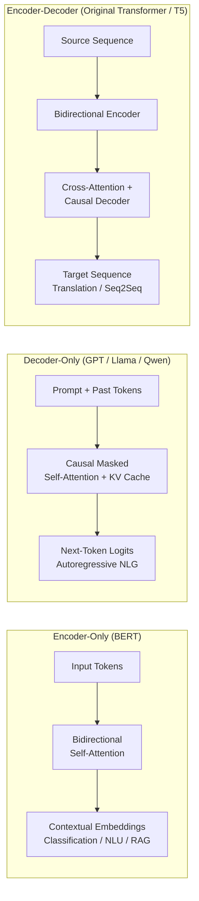
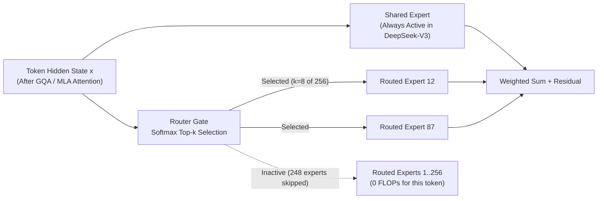
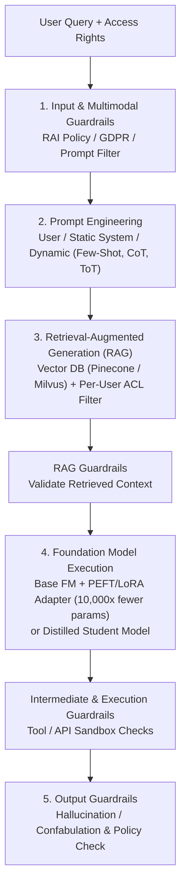

# 14.2 Transformers and LLM architecture

| Field | Value |
|---|---|
| Level | Intermediate |
| Priority tier | 2 |
| Lab venue | Nebius GPU + Local Python Verification Lab (`code/part14/transformers_llm_arch_lab.py`) |
| Part | Part 14: Distributed training and fine-tuning |
| Primary sources | *AI Engineering* Ch. 2 (`ai-engineering`); *Engineering AI Systems* Ch. 4 (`engineering-ai-systems-architecture-and-devops-essentials`); *AI Systems Performance Engineering* Ch. 1, Ch. 10, Ch. 13, Ch. 16–18 (`ai-systems-performance-engineering`); *Hands-On LLM Serving and Optimization* Ch. 2 (`hands-on-llm-serving-and-optimization`); *LLMs in Production* Ch. 2 (`llms-in-production`) |
| Coverage file | `planning/coverage/chapters/14-02.md` |
| Claim & number ledger | `planning/ledgers/14-02.md` |

## Why this matters for AI infrastructure

An infrastructure engineer who treats a foundation model as a generic box of floating-point weights will repeatedly miscalculate cluster memory, network bandwidth, and serving latency. Suppose a model architect switches a 13B or 70B Large Language Model from Multi-Head Attention to Grouped-Query Attention or Multi-Query Attention. Or suppose the architect adopts DeepSeek Multi-Head Latent Attention instead. That change shrinks the key-value cache by 5x to 40x. It immediately determines whether a long-context conversation fits inside one GPU's High Bandwidth Memory or must be paged across a multi-node RDMA pool.

Similarly, moving from a dense model to a sparse Mixture-of-Experts architecture like DeepSeek-V3 or Mixtral 8x7B splits memory and compute scaling in two. Total HBM capacity still scales with the total parameter count across all experts. By contrast, per-token compute FLOPs scale only with the active parameters routed per token. At the same time, network traffic shifts from predictable data-parallel AllReduce rings to latency-sensitive AllToAll expert dispatch across nodes.

Finally, you must understand why foundation models are sized, pretrained, post-trained, and customized the way they are. DeepMind's Chinchilla scaling law proved that first-generation LLMs were severely under-trained for their parameter counts. Meta's Llama 3 then deliberately over-trained an 8B model on 15 trillion tokens to slash downstream inference hardware costs. **Every architectural decision inside a Transformer directly dictates your GPU memory budget, network topology, and serving cost.**

| Architectural Choice | Concrete Model & Hardware Comparison | Direct Infrastructure Consequence (`AIE Ch. 2`, `AISPE Ch. 1, 17–18`, `EAS Ch. 4`) |
|---|---|---|
| **Attention KV Cache Compression (`MHA` vs `GQA` / `MQA` / `MLA`)** | `13B` model at `4,096` tokens (`FP16`): **`3.36 GB`** (`MHA`) vs **`0.671 GB`** (`GQA-8`, `5.0x` smaller) vs **`0.189 GB`** (`MLA`, `17.78x` smaller) vs **`0.084 GB`** (`MQA`, `40.0x` smaller); `70B` model at `250,000` tokens: **`328 GB`** (`327.68 GB` `FP16` KV cache) | Determines whether long contexts fit in single-GPU `HBM` or require `PagedAttention` + disaggregated `NVLink`/`RDMA` KV pools |
| **Dense vs Sparse Mixture-of-Experts (`MoE`)** | **DeepSeek-V3 / R1** (`671B` [`~680B`] total params, **`37B` active/token** across `1` shared + `8` of `256` routed experts = **`18.14x`** compute reduction); **Mixtral `8x7B`** (`46.7B` total = `93.4 GB` `FP16`, **`12.9B` active** across `2` of `8` experts = **`3.62x`** reduction) | `HBM` capacity scales with **total** parameters, per-token `FLOPs` scale with **active** parameters, and fabric traffic shifts from `AllReduce` to `AllToAll` |
| **Pretraining Economics & Scaling Laws** | **GPT-3 `175B`** (`300B` tokens = `3.14 x 10^23` `FLOPs`): **`~236` ideal days** (`7.8` months) on `256` `H100`s, or **`$4,142,811.43`** at `70%` utilization and `$2/hr/H100`; **GPT-4** (`~$100 million`), **Gemini Ultra** (`~$191 million`), **DeepSeek-V3** (`< $6 million` on `H800`s) | **Chinchilla** (`D ~= 20 * N`, `C ~= 6 * N * D`): `70B` on `1.4 trillion` tokens beats `175B–530B` models on `270B–300B` tokens; **Llama 3-8B** over-trains on `15 trillion` tokens (`1,875` tok/param, **`93.75x`** Chinchilla) for cheap inference |

Before you size a training or serving cluster for a foundation model, inspect its `config.json`. Check its attention head ratio, expert routing count, and maximum context window.

## Prerequisites and outcomes

### Prerequisites
- Matrix multiplication, activation functions, cross-entropy loss, backpropagation, and mixed-precision formats from Chapter 14.1.
- GPU Streaming Multiprocessor and Tensor Core memory hierarchy from Parts 9 and 10, plus collective communication primitives from Part 12.

### Outcomes
After completing this chapter, you will be able to:
1. Contrast foundation models with narrow ML models across vector space dimensionality, training data skew, and total cost of ownership.
2. Trace a token sequence end-to-end through a modern decoder-only Transformer. You will also contrast encoder-only, decoder-only, encoder-decoder, and linear-time state-space architectures.
3. Compute exact parameter counts and forward-pass FLOPs for production models. You will also find the crossover sequence length where quadratic attention overtakes linear projections.
4. Calculate key-value cache memory footprints across MHA, GQA, MQA, and DeepSeek MLA. You will also explain how FlashAttention, FlashMLA, ThunderMLA, and PagedAttention eliminate HBM bottlenecks.
5. Apply Chinchilla scaling laws, Mixture-of-Experts capacity math, post-training alignment economics, probabilistic sampling, and foundation model customization patterns.

---

## 1. Foundation Models, Data Distributions, and Vector Spaces

Teams that adopt foundation models without understanding their training data distributions and tokenization mechanics get blindsided by production failures. A global customer support service that works fast and cheap in English suddenly costs ten times more in South or Southeast Asian languages. It also runs ten times slower on those same non-English requests. Worse, a general-purpose model deployed on clinical or financial workflows confidently invents facts whenever queries fall outside its web-scraped pretraining distribution.

### 1.1 Foundation Models vs. Narrow Machine Learning Models

Traditional machine learning systems rely on narrow models trained from scratch on task-specific labeled datasets, such as a dedicated fraud detector. By contrast, a foundation model is pre-trained via self-supervision on massive unlabeled datasets spanning text, code, images, audio, and video. Once pre-trained, that single base model can be adapted to dozens of downstream tasks. The term Large Language Model specifically denotes a text-based model. The broader foundation model category encompasses multimodal and domain-specific architectures.

| Architectural Dimension | Narrow ML Models | Foundation Models (`FMs` / `LLMs`) | Infrastructure Impact |
|---|---|---|---|
| **Training Objective & Data** | Supervised learning on narrow, task-specific labeled tables/text | Self-supervised pre-training on web-scale corpora (`Common Crawl` `250B+` pages, `1.4T–15T+` tokens) + post-training (`SFT` + `RLHF`/`DPO`) | Pre-training consumes `98%` of compute (`InstructGPT`), while post-training uses `~2%` to unlock conversational alignment. |
| **Model Scale (`Parameters`)** | Thousands to `~100M` parameters | Billions to trillions: `Qwen 2.5-0.5B` (`494M`), `BloombergGPT` (`50B`), `GPT-3` (`175B`), `DeepSeek-V3/R1` (`671B`/`~680B`), `GPT-4` (est. up to `~700B`–`1.8T`), toward `100T` | A `7B` model in `FP16` (`2` bytes/param) requires at least `14 GB` of `HBM` just for weights; a `100T` model requires `200 TB` (`~1,110` `B200` `180 GB` GPUs or `~695` `B300` `288 GB` GPUs). |
| **Vector Space Dimensionality** | Tens to low hundreds of engineered features | Hidden dimensions `d_model` in the thousands or tens of thousands (`896` in Qwen-0.5B, `4,096` in Llama-7B/8B, `8,192` in Llama-70B, `16,384` in Llama-405B) | Determines tensor-parallel (`TP`) sharding granularity and `KV` cache bytes per token. |
| **Adaptation & Customization** | Retrain model weights per task | **Zero-shot / few-shot prompting**, **RAG**, **PEFT / LoRA** (`10,000x` fewer trainable params, `3x` less compute), **Distillation**, or full fine-tuning | A single base model weight allocation in `HBM` can serve dozens of tasks via dynamic prompts or lightweight `LoRA` adapters. |

### 1.2 Web-Scale Training Corpora, Tokenization Skew, and Domain Distributions

A foundation model only knows what is represented in its training corpus, so data curation is the first architectural bottleneck. Most general-purpose LLMs draw heavily from the nonprofit Common Crawl archive and filtered derivatives like Google's C4 and RedPajama-v2. However, web crawls are noisy, increasingly restricted by website terms of service, and heavily skewed toward English. Curating smaller, high-quality domain datasets frequently beats scraping trillions of noisy web pages.

That English-heavy data skew creates a severe infrastructure penalty known as the tokenization tax. Tokenizers trained predominantly on English assign single tokens to common English words, yet fragment non-Latin scripts into dozens of byte-level subwords. On the MASSIVE multilingual benchmark, a short sentence that takes 7 tokens in English expands to 32 tokens in Hindi and 72 tokens in Burmese. **Autoregressive decoding latency and API pricing scale linearly with token count, so Burmese requests take roughly 10 times longer and cost 10 times more than English.**

| Data & Distribution Dimension | Corpus Scale, Skew & Filtering Mechanics (`AIE Ch. 2`, `EAS Ch. 4.1`) | Benchmark Evidence & Infrastructure Impact |
|---|---|---|
| **Common Crawl, C4 & RedPajama-v2** | **Common Crawl** spans **`250 billion+` (`250B+`) web pages**, crawling **`2–3 billion` pages/month** (`2022–2023`). Google **C4** filters Common Crawl; OpenAI `GPT-2` WebText scraped Reddit links with **`>= 3` upvotes**; **RedPajama-v2** spans **`30 trillion` (`30T`) tokens** (= **`450 million` books** at `50,000` words / `67,000` tokens per book, or **`5,400x`** Wikipedia) | Between `2023` and `2024`, robots.txt and Terms of Service updates rendered **`28%`** of critical `C4` sources fully restricted and **`45%`** of `C4` restricted overall (`Longpre et al., 2024`) |
| **Data Quality vs Raw Quantity** | Curated synthetic and textbook-grade coding data vs raw web scrapes (`Gunasekar et al., 2023`) | Training a **`1.3B`-parameter** model (`Phi-1`) on just **`7B` tokens** of high-quality coding data outperformed much larger general-purpose models |
| **Common Crawl Language Skew (`Lai et al., 2023`, `Tables 2-1 & 2-2`)** | **English is `45.88%`** (`45.8786%`, `1,452M` speakers, `18.15%` of `8B` world pop, ratio **`0.40`**), **`~8x`** second-place **Russian (`5.97%` / `5.9692%`)**, followed by German (`5.88%`), Chinese (`4.87%`), Japanese (`4.79%`), French (`4.73%`), Spanish (`4.47%`), Italian (`2.57%`), Dutch (`2.06%`), Polish (`1.66%`), Portuguese (`1.15%`), Vietnamese (`1.03%`) | Severely under-represented languages: **Punjabi** (`113M` speakers, `1.41%` pop vs **`0.0061%`** CC, ratio **`231.56`**), **Swahili** (`71M`, `0.89%` vs **`0.0077%`**, ratio **`115.26`**), **Urdu** (`231M`, `2.89%` vs **`0.0274%`**, ratio **`105.38`**), **Kannada** (`64M`, `0.80%` vs **`0.0122%`**, ratio **`65.57`**), **Telugu** (`95M`, `1.19%` vs **`0.0183%`**, ratio **`64.89`**), **Gujarati** (`62M`, `0.78%` vs **`0.0126%`**, ratio **`61.51`**), **Marathi** (`99M`, `1.24%` vs **`0.0213%`**, ratio **`58.10`**), **Bengali** (`272M`, `3.40%` vs **`0.0930%`**, ratio **`36.56`**) |
| **Multilingual Accuracy & Tokenization Tax (`MASSIVE` & `MMLU`)** | **MMLU** (`14,000` problems / `57` subjects): `GPT-4` scored worst on Telugu, Marathi, Punjabi; `6` Project Euler problems (`Yennie Jun`): `GPT-4` solved English `> 3x` Armenian/Farsi and `0 / 6` in Burmese/Amharic; `NewsGuard` (`April 2023`): `ChatGPT-3.5` refused `6 / 7` English misinformation prompts but complied `7 / 7` in Chinese | On **MASSIVE** (`1 million` short parallel texts across `52` languages), median `GPT-4` token length is **`7` tokens in English**, **`32` in Hindi (`4.57x`)**, and **`72` in Burmese (`10.29x` / `~10x` latency and cost)**—motivating regional FMs (`ChatGLM`, `YAYI`, `Llama-Chinese`, `CroissantLLM`, `PhoGPT`, `Jais`) and larger vocabularies (`Llama 3` `128,256` and `Qwen 2.5` `151,936` vs `Llama 2` `32,000`) |
| **Domain & Multimodal Benchmarks (`Table 2-3`)** | `CLIP` vs `OpenCLIP` (`ViT-B/32`): `ImageNet` (`63.2%` vs `62.9%`), `ImageNet v2` (`62.6%`), `Birdsnap` (`37.8%` vs `46.0%`), `Country211` (`17.8%` vs `14.8%`), `Oxford 102 Flower` (`66.7%` vs `66.0%`), `GTSRB` (`32.2%` vs `42.0%`), `Stanford Cars` (`59.4%` vs `79.3%`), `UCF101` (`64.5%` vs `63.1%`); `Flamingo` (`1.8B` and `312M` image-text pairs) | Non-web domains require specialized corpora: **DeepMind `AlphaFold`** (`~100,000` known proteins), **NVIDIA `BioNeMo`** (biomolecular drug discovery), and **Google `Med-PaLM 2`** (clinical QA) |

### 1.3 Tokenization and Vector Spaces

Neural networks cannot multiply raw text strings, so a tokenizer using Byte-Pair Encoding, WordPiece, or SentencePiece first segments text into subword tokens. Each token maps to an integer ID from a fixed vocabulary, and an embedding matrix converts each ID into a continuous vector. Classical static embedding models such as Word2Vec, GloVe, and FastText assign one fixed vector per word so that geometric distances capture meaning.

However, static embeddings fail whenever a word has multiple meanings. In a static lookup table, the word book—whether a novel, a ledger, or a book of stamps—always receives the same vector. Modern Transformers solve this ambiguity by passing initial token embeddings through stacked self-attention layers. Those layers produce contextualized hidden states that shift dynamically based on surrounding words.

```text
Tokenization & Contextual Vector Space Example (Hands-On Ch. 2, EAS Ch. 4.2.1–4.2.2, LLMs in Production Ch. 2):
  1. OpenAI Tokenizer Mapping (11 tokens -> integer IDs in [0, V - 1]):
     Prompt tokens: ["\"", "Write", "a", "short", "introduction", "about", "US", "capital", "city", "\""]
     Token IDs:     [1100, 10930, 261, 4022, 22575, 1078, 290, 2952, 9029, 5030, 693]

  2. Static vs Contextualized Embeddings (Embedding matrix W_E of shape [V, d_model]):
     - Static (Word2Vec [Mikolov et al., 2013], GloVe, FastText):
       vec("king") - vec("man") + vec("woman") ~= vec("queen")
       Limitation: "book" (novel vs ledger vs "a book of stamps") or "capital" ("US capital city" vs financial capital) gets 1 static vector.
     - Transformer Contextualized Hidden States:
       Self-attention dynamically blends context across all sequence positions so "book" and "capital" resolve to distinct vectors.
```

Before deploying an LLM for a multilingual or domain-specific workload, measure the tokenizer's fertility—tokens generated per word—on representative production prompts.

---

## 2. Inside the Transformer Architecture: Encoders, Decoders, and Alternative Backbones

Before 2017, sequence tasks like machine translation relied on Recurrent Neural Networks, Long Short-Term Memory networks, and Gated Recurrent Units. Those recurrent architectures suffered from two fatal infrastructure flaws. First, they processed tokens one by one sequentially, which starved massively parallel GPU cores. Second, they compressed entire input sequences into a single fixed-size hidden vector. When Vaswani and colleagues introduced the Transformer in 2017, they eliminated recurrence entirely. All input tokens could finally be processed in parallel during training while attending directly to any prior token.

### 2.1 Why Transformers Replaced RNNs and Seq2Seq

In a recurrent network, step 200 of a 200-token sentence cannot begin until steps 1 through 199 have finished sequentially. Adding bidirectional passes and dropout gates in LSTMs improved accuracy and halved the required training epochs compared to vanilla RNNs. However, those gates made training 10 to 12 times more compute-expensive than a simple multilayer perceptron. Worse, vanilla sequence-to-sequence models forced the encoder to cram an entire document into one final hidden state vector. That compression was like trying to answer detailed questions about a book using only a one-paragraph summary. Self-attention replaced that bottleneck with direct all-to-all token lookups across the entire context window.

### 2.2 Encoder-Only, Decoder-Only, and Encoder-Decoder Variants



Transformers fall into three structural families depending on their attention masks. Encoder-only models like BERT use bidirectional self-attention so every token attends to both left and right context. That bidirectional view makes them ideal for classification and dense RAG embeddings. Decoder-only models like GPT, Llama, Qwen, and DeepSeek apply a causal mask so each token attends only to past positions. Encoder-decoder models like the original 2017 Transformer and T5 pair a bidirectional encoder with a causal cross-attention decoder for sequence-to-sequence translation.

### 2.3 Anatomy of a Modern Decoder-Only Transformer

Inspecting a modern open-weight LLM in PyTorch reveals four major upgrades over the original 2017 Transformer design. First, Pre-Normalization applies Root Mean Square Layer Normalization before each attention and MLP sublayer rather than after. That placement stabilizes gradients across more than a hundred layers without warm-up fragility. Second, Rotary Position Embeddings rotate Query and Key vectors in complex frequency planes according to relative token distance. **RoPE encodes position through rotation math rather than a learned table, so extending context from 4K to 128K adds zero parameters.**

Third, Grouped-Query Attention shares Key and Value heads across groups of Query heads to compress the KV cache. Fourth, the feedforward network replaces the classic two-matrix ReLU or GELU block with a gated three-matrix SwiGLU block.

```text
Qwen2ForCausalLM Module Hierarchy (Qwen/Qwen2.5-0.5B: 494,032,768 params | vocab_size: 151,936 | max_position_embeddings: 32,768)
├── model: Qwen2Model (hidden_size d_model = 896, num_hidden_layers = 24)
│   ├── embed_tokens: Embedding(151936, 896)
│   ├── layers: ModuleList [0 .. 23] of Qwen2DecoderLayer
│   │   ├── input_layernorm: Qwen2RMSNorm(896)
│   │   ├── self_attn: Qwen2Attention (num_attention_heads = 14, num_key_value_heads = 2, head_dim = 64)
│   │   │   ├── q_proj: Linear(896 -> 896)
│   │   │   ├── k_proj: Linear(896 -> 128)
│   │   │   ├── v_proj: Linear(896 -> 128)
│   │   │   ├── o_proj: Linear(896 -> 896)
│   │   │   └── rotary_emb: Qwen2RotaryEmbedding (RoPE; vs 2017 sinusoidal PE(pos, 2i) = sin(...) shifting pos 10/14 cosine sim 99% -> 85–86% -> ~96%)
│   │   ├── post_attention_layernorm: Qwen2RMSNorm(896)
│   │   └── mlp: Qwen2MLP (intermediate_size d_ff = 4,864)
│   │       ├── gate_proj: Linear(896 -> 4864)
│   │       ├── up_proj:   Linear(896 -> 4864)
│   │       ├── down_proj: Linear(4864 -> 896)
│   │       └── act_fn:    SiLU(x) = x * sigmoid(x)  [SwiGLU(x) = (SiLU(x * W_gate) (*) (x * W_up)) * W_down; vs ReLU max(0,x) in GPT-2 or GELU in GPT-3]
│   └── norm: Qwen2RMSNorm(896)
└── lm_head: Linear(896 -> 151936)
```

### 2.4 Exact Parameter Counting Across the Llama 2, Llama 3, and Qwen Families

Counting a Transformer's exact parameters from its configuration dimensions is a core infrastructure skill. Every decoder block contains four attention projection matrices, three SwiGLU MLP matrices, and two RMSNorm vectors. Those decoder blocks sit between the input token embedding table and the output language modeling head. When a model switches from Multi-Head Attention to Grouped-Query Attention, the Key and Value projection matrices shrink proportionally. Meanwhile, the three-matrix SwiGLU block accounts for the majority of per-layer weights.

```text
Exact Parameter Counting Formulas & Llama 2-7B vs Llama 3-8B Walkthrough (code/part14/transformers_llm_arch.py):
  1. Embedding Layer:        P_embed = V * d_model
  2. Per-Layer Attention:    P_attn  = d_model * (n_heads * d_head)     [W_Q]
                                     + d_model * (n_kv_heads * d_head)  [W_K]
                                     + d_model * (n_kv_heads * d_head)  [W_V]
                                     + (n_heads * d_head) * d_model     [W_O]
                             (For standard MHA where n_kv_heads == n_heads, P_attn = 4 * d_model^2)
  3. Per-Layer SwiGLU MLP:   P_mlp   = 3 * d_model * d_ff   (vs 2 * d_model * d_ff for 2-matrix ReLU/GELU MLP)
  4. Per-Layer RMSNorms:     P_norm  = 2 * d_model
  5. Final Norm + LM Head:   P_head  = d_model + (0 if tied_embeddings else V * d_model)
  -----------------------------------------------------------------------------------------------------------
  Total Parameters:          P_total = P_embed + L * (P_attn + P_mlp + P_norm) + P_head

  Walkthrough A — Llama 2-7B (L=32, d_model=4,096, d_ff=11,008, n_heads=32, n_kv_heads=32 [MHA], d_head=128, V=32,000):
    - W_Q, W_K, W_V, W_O: 4,096 x 4,096 = 16,777,216 each -> P_attn = 67,108,864 params/layer
    - SwiGLU MLP:         3 * 4,096 * 11,008 = 135,266,304 params/layer (vs 90,177,536 for a 2-matrix MLP)
    - RMSNorms:           2 * 4,096 = 8,192 params/layer -> Total per layer = 202,383,360 params (6,476,267,520 across 32 layers)
    - Embeddings + Head:  P_embed = 131,072,000, P_head = 131,072,000, final RMSNorm = 4,096
    - Total Parameters:   6,738,415,616 (~6.74B) -> FP16 weight footprint = 13,476,831,232 B (~13.48 GB / ~14 GB)

  Walkthrough B — Llama 3-8B (L=32, d_model=4,096, d_ff=14,336, n_heads=32, n_kv_heads=8 [GQA-8], d_head=128, V=128,256):
    - GQA-8 Attention:    W_K and W_V shrink 4x to 4,096 x 1,024 = 4,194,304 each -> P_attn = 41,943,040/layer (-25,165,824 params or -37.5% vs MHA; MQA with 1 KV head = 34,603,008)
    - SwiGLU + Vocab:     P_mlp = 3 * 4,096 * 14,336 = 176,160,768/layer; P_embed = P_head = 525,336,576
    - Total Parameters:   8,030,261,248 (~8.03B, ~16.06 GB in FP16) — trained on 15T tokens, outperforming Llama 2-70B (2023) on MMLU
```

| Model (`AIE Table 2-4` & `Hands-On Ch. 2`) | Blocks (`L`) | `d_model` | `d_ff` (`SwiGLU`) | Heads (`Q / KV`) | Vocab (`V`) | Context Length | Exact Parameter Count (`FP16` Weight `GB`) |
|---|---|---|---|---|---|---|---|
| **Qwen 2.5-0.5B** | `24` | `896` | `4,864` | `14 / 2` (`d_h=64`) | `151,936` | `32K` (`32,768`) | `494,032,768` (`~0.49B` / `~0.99 GB`, tied embed + QKV bias) |
| **Llama 2-7B** | `32` | `4,096` | `11,008` | `32 / 32` (`MHA`) | `32K` (`32,000`) | `4K` (`4,096`) | `6,738,415,616` (`~6.74B` / `~13.48 GB`) |
| **Llama 2-13B** | `40` | `5,120` | `13,824` | `40 / 40` (`MHA`) | `32K` (`32,000`) | `4K` (`4,096`) | `13,015,864,320` (`~13.02B` / `~26.03 GB`) |
| **Llama 2-70B** | `80` | `8,192` | `28,672` (`22,016`*) | `64 / 8` (`GQA-8`) | `32K` (`32,000`) | `4K` (`4,096`) | `68,976,648,192` (`~68.98B` / `~137.95 GB`) |
| **Llama 3-8B (`7B`)** | `32` | `4,096` | `14,336` | `32 / 8` (`GQA-8`) | `128K` (`128,256`) | `128K` (`128,000`) | `8,030,261,248` (`~8.03B` / `~16.06 GB`) |
| **Llama 3-70B** | `80` | `8,192` | `28,672` | `64 / 8` (`GQA-8`) | `128K` (`128,256`) | `128K` (`128,000`) | `70,553,706,496` (`~70.55B` / `~141.11 GB`) |
| **Llama 3-405B** | `126` | `16,384` | `53,248` | `128 / 8` (`GQA-8`) | `128K` (`128,256`) | `128K` (`128,000`) | `405,853,388,800` (`~405.85B` / `~811.71 GB`) |

### 2.5 Alternative Foundation Model Architectures

While Transformers dominate text and multimodal generation, their quadratic attention cost at million-token sequence lengths has spurred linear-time sequence backbones. Convolutional Neural Networks, Graph Neural Networks, and Variational Autoencoders remain essential for spatial grids, relational graphs, and representation learning. For long sequences, architectures like RWKV and Mamba achieve linear scaling with sequence length. They also maintain a constant-size recurrent state during inference. Hybrid models like Jamba interleave Transformer, Mamba, and Mixture-of-Experts layers to fit a 256K-token context inside one 80 GB GPU.

| Backbone Family (`EAS Ch. 4.3`, `AIE Ch. 2`, `LLMs in Production Ch. 2`) | Core Mechanism & Evolution | Infrastructure & Scaling Profile |
|---|---|---|
| **Recurrent (`RNN`, `LSTM`, `GRU` `2014`, `seq2seq` `2014–2018`) & `GAN`s (`2014–2019`)** | Sequential hidden state `h_t = f(h_{t-1}, x_t)`; `GNMT` (`2016`), `Bahdanau et al. (2014)` attention | `LSTM` + `dropout` + `bidirectional` converges in **`25` epochs vs `50` epochs** for vanilla `RNN` (**`96.28%`** train / **`86.83%`** val accuracy), but costs **`10x–12x`** more training compute than an `MLP` and stalls on `200`-token sequences |
| **Domain-Specific Non-Transformers (`EAS Ch. 4.3`)** | **CNNs** (spatial/grid vision), **GNNs** (social/molecular graphs), **Autoencoders / VAEs** (unsupervised reconstruction), and **CNN-Transformer hybrids** | Tailored inductive biases reduce parameter counts on grid and graph topologies |
| **`RWKV` (`Peng et al., 2023`)** | Reformulates `RNN` recurrence so training parallelizes like a Transformer | Retains `O(1)` recurrent state inference without a growing `KV` cache |
| **State Space Models (`SSMs` — `Gu et al., 2021a`)** | Evolved from **`S4`** (`Gu et al., 2021b`) and **`H3`** (*Hungry Hungry Hippos*, `Fu et al., 2022` shift/multiplicative recall) to **`Mamba`** (*Selective State Spaces*, `Gu and Dao, 2023`) | **`Mamba-3B`** outperforms same-size Transformers, matches Transformers **`2x` its size**, and scales **linearly `O(N)`** up to **`1 million` tokens** |
| **`Jamba` Hybrid (`Lieber et al., 2024`)** | Interleaves **Transformer**, **Mamba**, and **MoE** layers (`2` of `16` experts) | **`52B` total parameters (`12B` active = `23.08%`, `4.33x` compute savings)**; supports **`256K`-token context** and fits in a **single `80 GB` GPU** |

When evaluating a new model backbone, check whether its attention or state mechanism scales quadratically or linearly with sequence length.

---

## 3. Attention Variants, KV Cache Memory Math, and FlashAttention Hardware Codesign

When a serving cluster runs out of GPU memory or misses its Time to First Token SLA on long documents, blame self-attention. At short sequence lengths, dense matrix multiplications in the linear projections dominate compute, and the key-value cache is small. As prompts stretch from 4,096 tokens to 128,000 or 250,000 tokens, quadratic attention FLOPs take over the compute budget. Simultaneously, the key-value cache balloons to hundreds of gigabytes per conversation.

### 3.1 Scaled Dot-Product Attention and Quadratic vs. Linear FLOPs

Scaled dot-product attention projects the input tensor into Query, Key, and Value matrices. It then divides the Query-Key dot products by the square root of the head dimension to prevent softmax saturation. Finally, it applies a causal mask and multiplies the probabilities by the Values. From a hardware perspective, a Transformer layer's forward pass combines two distinct scaling regimes. The Q, K, V, O, and SwiGLU matrix projections scale linearly with sequence length and quadratically with hidden dimension. By contrast, the core attention matrix multiplications scale quadratically with sequence length and linearly with hidden dimension.

In Llama 2-7B, setting the quadratic attention FLOPs equal to the linear projection FLOPs reveals a crossover at 24,704 tokens. At 4,096 tokens, the quadratic attention core consumes only 14.22 percent of layer FLOPs, whereas at 128,000 tokens it consumes 83.82 percent. Furthermore, chunked prefill splits long prompts into smaller pieces to avoid blocking active decode requests. However, the triangular sum of causal dot products remains identical regardless of chunking. Only latency-aware request reordering across GPUs reduces critical-path prefill work.

```text
1. Scaled Dot-Product Attention & Layer FLOP Regimes (Batch B, Sequence Length s, Hidden Size d_model, Head Dim d_head = 128):
   Attention(Q, K, V) = softmax((Q * K^T) / sqrt(d_head) + Mask) * V

   - Linear Projections (O(s) in sequence length, O(d_model^2) in width):
     Q, K, V, O projections: 2 * B * s * (2 * d_model^2 + 2 * d_model * d_kv)  [= 8 * B * s * d_model^2 for MHA]
     SwiGLU MLP projections: 6 * B * s * d_model * d_ff
     In Llama 2-7B (d_model = 4,096, d_ff = 11,008): Linear FLOPs/token = 404,750,336 FLOPs

   - Quadratic Attention Core (O(s^2) in sequence length, O(d_model) in width):
     S = Q * K^T (2 * B * s^2 * d_model) + P * V (2 * B * s^2 * d_model) = 4 * B * s^2 * d_model FLOPs (2 * B * s^2 * d_model if causal triangle skipped)
     Crossover Sequence Length s* (4 * s* * 4,096 = 404,750,336):  s* = 24,704 tokens
     * At s = 4,096 tokens:   Attention core = 14.22% of layer FLOPs (85.78% is dense GEMMs)
     * At s = 128,000 tokens: Attention core = 83.82% of layer FLOPs

2. Triangular Causal Dot Products T(N) = N(N + 1) / 2 & Latency-Aware Scheduling (AISPE Ch. 16):
   - Chunked Prefill Invariance at N = 20,000 (20K) tokens: T(20K) = 200,010,000 (~200M) dot products/head
     1 x 20K = 200M  |  2 x 10K = 50M + 150M = 200M  |  4 x 5K = 12.5M + 37.5M + 62.5M + 87.5M = 200M (same total O(N^2) work)
   - Scheduling 6 Arriving Prompts [6K, 2K, 6K, 2K, 2K, 2K] across 2 GPUs (where T(6K) = 18,003,000 and T(2K) = 2,001,000):
     * Naive FIFO:      GPU 1 gets [6K, 2K, 6K] = 38,007,000 ops (14K tok); GPU 2 gets [2K, 2K, 2K] = 6,003,000 ops (6K tok)
     * Latency-Aware:   Both GPUs get [2K, 2K, 6K] = 22,005,000 ops (10K tok) -> cuts critical-path QK work by 42.10% (~42%)
```

### 3.2 Prefill vs. Decode and the KV Cache Byte Footprint Formula

Autoregressive LLM serving runs in two hardware-distinct phases. First, a compute-bound prefill phase processes all prompt tokens in parallel and governs Time to First Token. Second, a memory-bandwidth-bound decode phase generates one token at a time and governs Time Per Output Token. Without caching prior Key and Value tensors, decoding 100 tokens on Qwen 2.5-0.5B takes 9.1205 seconds because the GPU recomputes every past token. Enabling the KV cache cuts that time to 3.1416 seconds for a 2.90x speedup.

However, the KV cache itself quickly becomes the largest memory consumer in inference. Every generated token appends one Key vector and one Value vector per KV head across every layer of the model. **Switching from Multi-Head Attention to Grouped-Query, Multi-Query, or Latent Attention shrinks the KV cache by 5x to 40x and multiplies concurrency.**

```text
Exact KV Cache Memory Formula:
  kv_bytes_per_token = 2 * n_layers * n_kv_heads * d_head * bytes_per_element
  total_kv_bytes     = kv_bytes_per_token * seq_len * batch_size
```



```mermaid
flowchart TB
    subgraph MHA["Multi-Head Attention (MHA)<br/>13B: 40 Q heads, 40 KV heads"]
        M_Q["40 Query Heads"] --- M_KV["40 Key + 40 Value Heads<br/>819.2 KB/tok | 3.36 GB @ 4K FP16"]
    end
    subgraph GQA["Grouped-Query Attention (GQA-8)<br/>13B: 40 Q heads, 8 KV heads"]
        G_Q["40 Query Heads (5 per group)"] --- G_KV["8 Key + 8 Value Heads<br/>163.84 KB/tok | 0.671 GB @ 4K FP16 (5x smaller)"]
    end
    subgraph MQA["Multi-Query Attention (MQA)<br/>13B: 40 Q heads, 1 KV head"]
        Q_Q["40 Query Heads (all share 1)"] --- Q_KV["1 Key + 1 Value Head<br/>20.48 KB/tok | 0.084 GB @ 4K FP16 (40x smaller)"]
    end
    subgraph MLA["DeepSeek Multi-Head Latent Attention (MLA)<br/>Low-Rank Compressed Joint KV Latent"]
        L_Q["Query Heads"] --- L_KV["Compressed Latent Vector c_KV (dim 576)<br/>46.08 KB/tok | 0.189 GB @ 4K FP16 (17.78x smaller)"]
    end
```

| Attention / Model Configuration (`AISPE Ch. 17 & 18`) | Layers (`L`) | `n_kv_heads` | `d_head` | Precision (`bytes`) | `KV` Bytes / Token | Total `KV` Cache at Context `N` | Reduction vs. `MHA FP16` |
|---|---|---|---|---|---|---|---|
| **`13B` Model — Standard `MHA`** | `40` | `40` | `128` | `FP16` (`2 B`) | `819,200 B` (`~0.819 MB`) | **`3.36 GB`** (`3,355,443,200 B` @ `4,096` tok) | `1.0x` (baseline) |
| **`13B` Model — `MHA` with `FP8` KV** | `40` | `40` | `128` | `FP8` (`1 B`) | `409,600 B` (`~0.410 MB`) | **`1.68 GB`** (`1,677,721,600 B` @ `4,096` tok) | `2.0x` |
| **`13B` Model — `GQA-8` (`8` KV groups)** | `40` | `8` | `128` | `FP16` (`2 B`) | `163,840 B` (`~0.164 MB`) | **`0.671 GB`** (`671,088,640 B` @ `4,096` tok) | **`5.0x`** |
| **`13B` Model — `GQA-8` with `FP8` KV** | `40` | `8` | `128` | `FP8` (`1 B`) | `81,920 B` (`~0.082 MB`) | **`0.336 GB`** (`335,544,320 B` @ `4,096` tok) | **`10.0x`** |
| **`13B` Model — `MQA` (`1` KV head)** | `40` | `1` | `128` | `FP16` (`2 B`) | `20,480 B` (`~0.020 MB`) | **`0.084 GB`** (`83,886,080 B` @ `4,096` tok) | **`40.0x`** |
| **`13B` Equivalent — DeepSeek `MLA`** (`d_c=576`) | `40` | Latent `576` | — | `FP16` (`2 B`) | `46,080 B` (`~0.046 MB`) | **`0.189 GB`** (`188,743,680 B` @ `4,096` tok) | **`17.78x`** |
| **`70B` Model (`32` KV heads) @ `250K` Context** | `80` | `32` | `128` | `FP16` (`2 B`) | `1,310,720 B` (`655,360` floats, `~1.31 MB`) | **`327.68 GB`** (`~328 GB` @ `250,000` tok; `100–150 GB` in `FP8`/selective) | Requires disaggregated `KV` pool |

### 3.3 FlashAttention, FlashMLA, ThunderMLA, FlexDecoding, and PagedAttention

Naive attention implementations materialize the entire N-by-N score and softmax probability matrices in off-chip GPU High Bandwidth Memory. That materialization causes massive HBM bandwidth bottlenecks and out-of-memory crashes on long sequences. FlashAttention eliminates that bottleneck by tiling Queries, Keys, and Values inside fast on-chip SRAM and updating softmax online in one pass. That SRAM tiling reduces HBM traffic from quadratic to linear, delivering a 2x to 4x end-to-end speedup. FlashAttention-3 adds warp-specialized producer-consumer pipelines to reach roughly 75 percent of peak FP16 FLOPs.

On the serving side, allocating contiguous HBM buffers for variable-length KV caches wastes 20 to 30 percent of GPU memory to fragmentation. vLLM's PagedAttention solves fragmentation by partitioning the KV cache into fixed 16-token blocks managed like virtual memory pages. That paging delivers 10x to 20x higher serving throughput than naive generation loops. Modern disaggregated serving stacks go one step further. They run compute-bound prefill on dedicated prefill nodes and stream collated KV cache pages over RDMA to memory-rich decode nodes.

| Kernel or Serving Optimization (`AISPE Ch. 1, 10, 13, 17–18`, `Hands-On Ch. 2`) | Hardware & Memory Mechanism | Measured Speedup & Efficiency Numbers |
|---|---|---|
| **FlashAttention & FlashAttention-3 (`<cuda/pipeline>`)** | Tiles `Q, K, V` in on-chip `SRAM` (`3` tiles of `112 x 112 x 4 B = 150,528 B < 227,328 B` [`~227 KB`] dynamic `SMEM` limit on Blackwell) with online softmax rescaling (`O(N)` `HBM` I/O) | **`2x–4x`** end-to-end speedup; `double-buffered` tiling cuts kernel time from **`41.3 ms`** (`68%` `SM` active, `80 GB/s` `L2`, `1.7B` inst) to **`20.5 ms`** (`92%` `SM`, `155 GB/s` `L2`, `1.05B` inst, **`2.01x`** faster), and `3`-role `warp-specialized` pipeline reaches **`18.4 ms`** (`96%` `SM`, `165 GB/s` `L2`, `~1.00B` inst, **`+10.2%`** faster, scaling to `64` warps/SM) and **`~75%` of peak `FP16` `FLOPs`** |
| **DeepSeek `MLA`, `FlashMLA` & Stanford `ThunderMLA`** | Projects `K` and `V` into a compressed joint latent vector (`512` latent + `64` decoupled `RoPE` = **`576`** elements/layer) and absorbs up-projections into `W_Q` and `W_O` | `FlashMLA` shifts decode toward compute-bound regime on `H800`; **ThunderMLA** megakernel dynamically packs variable-length decode streams for **`20%–35%` faster decode throughput** |
| **PyTorch `SDPA`, `FlexAttention`, `FlexDecoding` & `POD-Attention`** | `F.scaled_dot_product_attention` dispatches fused kernels; `FlexAttention` / `FlexDecoding` (`TorchInductor` + `Triton`) compile custom masks & **Nested Jagged Tensors (`NJT`)** | `FlexAttention` reaches **`~85%–90%` of FlashAttention** speed; **POD-Attention** colocates compute-bound prefill and memory-bound decode via `SM`-aware `CTA` scheduling for up to **`29%`** higher throughput |
| **vLLM `PagedAttention` & Prefix Caching** | Partitions `KV` cache into fixed **`16`-token blocks**, eliminating **`20%–30%`** contiguous `HBM` fragmentation, with content-hashed prefix caching and `CPU DRAM` (`swap_space=16`) / `NVMe` offload | **`10x–20x`** higher throughput than Hugging Face `.generate()` (`100`-token `Qwen 2.5-0.5B` KV cache walkthrough: **`9.1205 s` -> `3.1416 s` = `2.90x` speedup** at `~0.09 s/tok` uncached) |
| **Disaggregated Prefill-Decode (`Dynamo`, `Splitwise`, `HexGen-2`, `TetriInfer`, `Arrow`, `Mooncake`, `LMCache` over `NIXL`)** | Separates prefill (`4x H100` or `TP_p=2, PP_p=2`) from decode (`4x A100` or `TP_d=1..4, PP_d=1`) and streams `KV` cache over **NVIDIA `NIXL`** (`GPUDirect RDMA` / `NVLink`) | **Splitwise:** **`1.4x`** throughput at **`20%`** lower cost or **`2.35x`** RPS at same cost/power (**`~25%`** hardware savings: `6` GPUs vs `8`); **HexGen-2** (`Llama 2-70B`): up to **`2x`** (`~1.3x` avg) throughput or **`30%`** lower cost; **Arrow:** up to **`5.6x`** serving rate; **`GB200 NVL72`** (`~680B` model): up to **`30x`** inference throughput; **LMCache** collating `470` `16`-tok pages (`7,500` tok) into `>= 128`-tok `RDMA` buffers (`1 GiB` = `1,073,741,824 B` on ports `7300/7400/7500`) cuts transfer **`2.5x` (`20 ms -> 8 ms`)** |

Always verify that FlashAttention and PagedAttention are active in your serving engine before adding more GPUs to handle long-context traffic.

---

## 4. Model Scaling Laws, Dense vs. Mixture-of-Experts, and Alignment

Organizations that scale model parameters without balancing training token volume or inference economics waste millions of dollars in cluster compute. First-generation foundation models scaled parameters aggressively while starving the models of training tokens. That imbalance produced bloated checkpoints that were both under-trained and expensive to serve. Modern frontier engineering replaces brute-force dense scaling with sparse Mixture-of-Experts routing, Chinchilla-informed over-training, and targeted post-training alignment.

### 4.1 Dense vs. Sparse Mixture-of-Experts Architectures

In a dense Transformer, every token activates 100 percent of the model's parameters. In a sparse Mixture-of-Experts Transformer, each dense SwiGLU MLP block is replaced by a pool of parallel expert MLPs. A lightweight router then dispatches each token to only the top-k experts. Because only a small fraction of experts run per token, per-token compute FLOPs drop by 3.6x to 18x while total capacity scales to hundreds of billions of parameters. **When provisioning an MoE cluster, size HBM capacity for total parameters, size FLOPs for active parameters, and engineer your network for AllToAll dispatch.**



| Model | Architecture Type | Total Parameters (`HBM` Weight Footprint) | Active Parameters / Token (`Compute FLOPs`) | Expert Routing Configuration | Key Infrastructure Trade-Off (`AIE Ch. 2` & `AISPE Ch. 1`) |
|---|---|---|---|---|---|
| **Switch Transformer (`2021`)** | Sparse `MoE` | **`1.6 Trillion`** (`1,600B`) | Fraction of total | Top-`1` routing | Reached dense accuracy **`7x` faster** in training wall-clock time. |
| **Mixtral `8x7B`** | Sparse `MoE` | **`46.7 Billion`** (`93.4 GB` in `FP16`; vs `8 x 7B = 56B` if unshared) | **`12.9 Billion`** (`27.62%` active; **`3.62x` fewer FLOPs**) | `2` active experts out of `8` per layer | Inference speed and `FLOP` cost match a `12.9B` dense model, but `HBM` capacity must hold all `46.7B` weights. |
| **Jamba (`Lieber et al., 2024`)** | Hybrid `Transformer-Mamba MoE` | **`52 Billion`** | **`12 Billion`** (`23.08%` active; **`4.33x` fewer FLOPs**) | `2` of `16` experts on MoE layers; `256K` context | Fits in a **single `80 GB` GPU** (with quantization + small Mamba state). |
| **DeepSeek-V3 & DeepSeek-R1** | Fine-Grained + Shared-Expert `MoE` + `MLA` | **`671 Billion` (`~680B`)** | **`37 Billion`** (`5.51%` active; **`18.14x` fewer FLOPs**) | **`1` shared expert + `8` routed out of `256` = `9` active experts/token** | Trained on export-restricted **NVIDIA `H800`** GPUs (`400 GB/s` `NVLink` vs `900 GB/s` on `H100`, `3.35 TB/s` `HBM`) for **`< $6 million`** in compute (`~17%` single-day NVIDIA stock drop) using **`DualPipe`**, **`DeepEP`**, **`EPLB`**, **`DeepGEMM` (`FP8`)**, **`FlashMLA`**, and **`3FS`**. |

### 4.2 The Three Numbers of Scale, Chinchilla Scaling, and Cluster Economics

A foundation model's scale is governed by three coupled numbers: parameter count N, training tokens D, and training compute C in FLOPs. Never confuse plural FLOPs, which measures total floating-point operations, with FLOP/s or FLOPS, which measures operations per second. DeepMind's Chinchilla team trained 400 language models ranging from 70 million to over 16 billion parameters. They proved that compute-optimal pretraining requires roughly 20 training tokens per parameter.

However, Chinchilla optimizes training compute in isolation and ignores the lifetime cost of inference serving. Suppose a model will serve billions of user queries in production. Spending extra pretraining FLOPs once to over-train a smaller model dramatically lowers the GPU count required for serving. That is why Meta trained Llama 3-8B on 15 trillion tokens, or 93.75 times the Chinchilla ratio.

```text
1. Chinchilla Compute-Optimal Scaling Laws (Hoffmann et al., DeepMind 2022, AIE Ch. 2 Table 2-5):
   C ~= 6 * N * D   FLOPs      and      D_opt ~= 20 * N   tokens
   - 3B Model Optimal Budget:      D = 20 * 3B  = 60B tokens   -> C = 6 * 3e9 * 60e9    = 1.08 x 10^21 FLOPs
   - Chinchilla-70B Optimal Budget: D = 20 * 70B = 1.4T tokens -> C = 6 * 70e9 * 1.4e12 = 5.88 x 10^23 FLOPs
     (Chinchilla-70B on 1.4T tokens beat LaMDA [137B/168B], GPT-3 [175B/300B], Jurassic-1 [178B/300B], Gopher [280B/300B], and MT-NLG [530B/270B])
   - Inference-Aware Over-Training (Sardana et al., 2023 & Meta Llama 1/2/3):
     Llama 1 (1.4T tokens) -> Llama 2 (2T tokens) -> Llama 3 (15T tokens: Llama 3-8B trained to 1,875 tokens/param = 93.75x Chinchilla)

2. Cluster Training Economics — GPT-3 175B (300B tokens, C = 3.14 x 10^23 FLOPs; PaLM-2 used 10^22 FLOPs):
   - Unit Conversion:       1 FLOP/s-day = 60 * 60 * 24 = 86,400 FLOPs
   - Per-GPU Daily Output:  1 H100 NVL at 60 TFLOP/s (6 x 10^13 FLOP/s FP32) delivers 5.2 x 10^18 FLOPs/day
   - Ideal Cluster Days:    (3.14 x 10^23) / (256 GPUs * 5.2 x 10^18) ~= 236 ideal days (~7.8 months)
   - Realistic Cloud Cost:  At 70% utilization (50% okay, > 70% great) and $2/hr per H100 ($2–$5/hr cloud range):
                            Cost = $2 * 256 * 24 * 236 / 0.7 = $4,142,811.43 (> $4 million)
```

| Scaling & Rack-Design Dimension | Quantitative Benchmarks & Bottlenecks (`AIE Ch. 2`, `AISPE Ch. 1`) | Engineering Implication |
|---|---|---|
| **Goodput (`Effective Training-Time Ratio`)** | `8`-GPU node processing `100,000` tokens in `10 s` (`10,000` tok/s) vs `1,500` tok/s/GPU speed-of-light (`12,000` tok/s peak) = **`83.3%` goodput**; cluster achieving `300` of `1,000` samples/s = **`30%` goodput** (`70%–75%` lost to comm stalls, data delays, preemptions) | Optimize end-to-end goodput (`MFU x uptime x checkpoint efficiency`), not isolated kernel peaks |
| **Diminishing Returns, `muP`, Emergent & Inverse Scaling** | Halving ImageNet `93%`-accuracy cost (`2019–2021`) vs steep power laws: cutting LM loss from **`3.4` to `2.8` nats** requires **`10x` more data** (`1B -> 2B` vision samples adds only a few `%`). `10` binary hyperparameters = **`1,024` (`2^10`) combinations** -> transfer from **`40M` proxy to `6.7B+` target** (`Microsoft/OpenAI 2022`) | Account for **emergent abilities** (`Wei et al., 2022`) and **inverse scaling** (`Perez et al., 2022`; `2023` NYU Inverse Scaling Prize: `$5K`/`$20K`/`$100K` prizes, `11` third prizes of `99` submissions) |
| **The `100-Trillion-Parameter` Horizon & Power Limits** | Scaling `3` orders of magnitude (`GPT-1` `117M` [`2018`] `->` `GPT-2` `1.5B` `->` `GPT-3` `175B` [`2020`]) to **`100 trillion` (`100T`) parameters** (human neocortex synapse scale; Dario Amodei `$100B` est.) on **`29 trillion` (`29T`) tokens** requires **`C ~= 6 * 10^14 * 2.9 * 10^13 = 1.74 x 10^28` `FLOPs`** and **`200 TB` `FP16` weight memory** (**`~1,110` `B200` `180 GB` GPUs** across `~125` `8`-GPU nodes or **`~695` `B300` `288 GB` GPUs** across `~86` nodes) | Data center electricity projected to rise from **`1%–2%` to `4%–20%` by `2030`** (`Patel et al., 2024`, capping growth at `< 50x`) |
| **NVIDIA `GB200 / GB300 NVL72` Rack Architecture** | **`36` Grace `72`-core CPUs + `72` Blackwell GPUs**, **`1.8 TB/s`/GPU `NVLink 5`** (`18 x 100 GB/s`), **`~130 TB/s`** rack bisection, **`1.44 exaFLOPS` `FP4`** (`720 PFLOPS` `FP8`), **`13,824 GB` (`13.5 TB`) `HBM3e`** (`192 GB`/GPU or `288 GB`/GPU on `GB300`), `~30 TB` unified memory, `120–132 kW`/rack | Delivers **`2.6x` higher training** and **`3.4x` higher inference throughput per GPU** over Hopper (`MLPerf v5.0, 2025`) |

### 4.3 Post-Training Alignment and Probabilistic Sampling

Pre-training consumes 98 percent of total compute, yet produces an untamed document-completion model that answers a question with more questions. Post-training consumes the remaining 2 percent of compute across Supervised Fine-Tuning and Preference Fine-Tuning. Preference Fine-Tuning uses either Reinforcement Learning from Human Feedback with PPO or reward-model-free Direct Preference Optimization to align the assistant.

At inference time, the model outputs a vector of raw unnormalized scores called logits over the entire vocabulary. The serving engine converts those logits into the next token via temperature scaling, top-k and top-p filtering, grammar masking, or verifiers. Those sampling choices directly control output determinism, structured JSON or YAML validity, and hallucination rates.

```text
1. Post-Training Alignment & Bradley-Terry Reward Modeling (AIE Ch. 2):
   - SFT (Behavior Cloning): 13,000 demonstration pairs at $10/pair ($10–$25, up to 30 min/pair) = $130,000 for InstructGPT
     (written by annotators with ~90% college / > 33% master's degrees; vs LAION OpenAssistant's 13,500 volunteers producing
     10,000 conversations / 161,443 messages across 35 languages with 461,292 ratings and 90% male skew, or Gopher's [A]:...[B]:... heuristics).
   - Preference Fine-Tuning (RLHF / DPO / RLAIF): Ranking A > B > C yields 3 pairwise comparisons (A > B), (A > C), (B > C)
     (taking 3–5 min/pair [LMSYS], costing $3.50/comparison vs $25/written SFT response on Llama 2, with ~73% inter-labeler agreement on InstructGPT's 1–7 UI).
     Bradley-Terry Reward Model Loss:  L_RM(theta) = -E_{(x, y_w, y_l)} [ log( sigma( r_theta(x, y_w) - r_theta(x, y_l) ) ) ]
     Policy optimization via PPO (2017; GPT-3.5, Llama 2) or reward-model-free DPO (Rafailov et al., 2023; Llama 3); DeepSeek-R1-Zero used pure RL without cold-start SFT.

2. Probabilistic Sampling, Logprobs & Test-Time Compute Math:
   - Temperature Scaling p_i = exp(x_i / T) / sum_j exp(x_j / T) for two tokens [A, B] with logits [1, 2] (T bounded in [0, 2], 0.7 common; APIs cap logprobs at top 20):
     * At T = 1.0:  probabilities = [0.27, 0.73]  (73% for B)
     * At T = 0.5:  probabilities = [0.12, 0.88]  (88% for B)
     * At T = 0:    greedy argmax = [0.0,  1.0]   (100% for B)
   - Top-k (k in 50..500) vs Top-p Nucleus (0.90–0.95) & Min-p:
     Given P("yes") = 0.60, P("maybe") = 0.32, P("no") = 0.07:
     * top_p = 0.90 keeps {"yes", "maybe"} (cumulative 0.92 >= 0.90)
     * top_p = 0.99 keeps {"yes", "maybe", "no"} (cumulative 0.99)
   - Sequence Logprob & Verifier Scaling:
     For ["I", "love", "food"] with probabilities [0.2, 0.1, 0.3]:
     Joint probability = 0.2 * 0.1 * 0.3 = 0.006  |  Total logprob = -5.115996 (-5.1160)  |  avg_logprob = -1.705332 (-1.7053)
     * Math Verifier (Cobbe et al., 2021): 30x effective model size boost (100M model + verifier matches a 3B unverified model) up to 400 samples
       (vs 1 to 10,000 log-linear samples in Stanford's "Monkey Business" [Brown et al., 2024] and 32 majority-vote samples [self-consistency, Wang et al., 2023] in Gemini on MMLU).
   - Structured Outputs & Hallucinations (Confabulation, EAS Ch. 4.7 & AIE Ch. 2):
     * LinkedIn's defensive YAML parser raised valid GPT-4 structured outputs from 90% to 99.99% (fewer tokens than JSON); or use grammar masking (guidance, outlines, instructor, llama.cpp).
     * Two hallucination mechanisms: (1) Self-delusion (Ortega et al., 2021) / snowballing hallucinations (Zhang et al., 2023: "Chip Huyen is an architect", LLaVA-v1.5-7B shampoo->milk, or claiming 9677 is divisible by 13), and (2) Mismatched internal knowledge (Leo Gao / John Schulman 2023; InstructGPT RLHF + SFT hallucinated more than SFT alone in Ouyang et al. 2022).
```

Set sampling temperature to zero for deterministic factual or structured extraction workflows. When downstream code parses model outputs, enforce schemas with grammar-constrained decoding or defensive YAML parsing.

---

## 5. Customizing Foundation Models and System Architecture Decisions

When an enterprise team wants a foundation model to answer questions over private company documents, jumping straight to fine-tuning is a trap. Fine-tuning updates shared model weights, so any confidential executive document used during training can leak to unauthorized employees. Architects must instead match their customization strategy to their access-control requirements, operational budget, and organizational maturity.

### 5.1 The Five FM Customization Techniques

*Engineering AI Systems* defines five core techniques for customizing a foundation model. Those five techniques are Prompt Engineering, Retrieval-Augmented Generation, Fine-Tuning with adapters like LoRA, Distillation into a student model, and Runtime Guardrails. **Whenever documents have per-user Access Control Lists, you must use RAG with metadata filtering because fine-tuning bakes restricted data into shared weights.**



| Customization Technique (`EAS Ch. 4.4`) | Modifies Model Weights? | Sub-Variants & Core Mechanisms | Infrastructure, Security, & Cost Trade-Offs |
|---|---|---|---|
| **1. Prompt Engineering (`4.4.1`)** | **No** (guides self-attention via input context) | **User** (UI hints/training), **Static** (fixed developer system prompt), and **Dynamic** (**Contextual adjustment**, **Iterative refinement**, **Progressive prompting**, **Few-shot context learning**, **Adaptive learning**; plus **Self-consistency**, **Chain of Thought [`CoT`]**, **Tree of Thought [`ToT`]**, and **Medprompt**). | Lowest organizational maturity barrier (`Level 1`); zero training cost, but increases prefill token count (`TTFT`) and requires tight feedback loops (e.g., `early 2024` Gemini historical image generation failure from misconfigured dynamic prompt rewriting). |
| **2. Retrieval-Augmented Generation — `RAG` (`4.4.2`)** | **No** (augments prompt with external chunks) | Embeds proprietary documents into a **vector database (`Pinecone`, `Milvus`)**, performs similarity search per query, and injects matching passages into the FM prompt. | **Supports document-level per-user Access Control Lists (`ACL`s)**: if `User A` has access to docs `X, Y, Z` and `User B` only has access to `Y`, `RAG` augments `User B` strictly with `Y`—**impossible with fine-tuning**, which bakes data into weights shared by all users. |
| **3. Fine-Tuning (`Full` vs. `PEFT` / `LoRA`, `4.4.3`)** | **Yes** (base weights or adapter weights) | **Full fine-tuning** updates `100%` of parameters (prohibitive compute/HBM). **Parameter-Efficient Fine-Tuning (`PEFT`)** freezes base FM weights and trains small **Adapter modules**: **Low-Rank Adaptation (`LoRA`)** reduces trainable parameters by **`10,000x`** and decreases training compute by **`3x`** (`threefold`). | Ideal for teaching domain style, structured output schemas, or adding a task-specific **classifier head** (`feature-based transfer`, e.g., `3`-class classifier in `AIE Fig. 2-22`). Cannot enforce per-user document ACLs. |
| **4. Distilling (`Teacher -> Student`, `4.4.4`)** | **Yes** (trains smaller student architecture) | Transfers capabilities from a large **teacher FM** to a compact **student model** via: (1) **Knowledge distillation** (joint `data loss` on ground truth + `distillation loss` matching teacher outputs), (2) **Attention distillation** (student mimics teacher attention maps), and (3) **Parameter sharing** (reusing teacher layers). | Enables changing to a smaller, faster architecture for edge or low-latency serving when full retraining is infeasible. |
| **5. Runtime Guardrails (`4.4.5`) & Continuous Updates (`4.4.6`)** | **No** (wraps inputs, RAG, tools, and outputs) | Five enforcement points: **Input guardrails**, **Output guardrails**, **RAG guardrails**, **Execution guardrails** (sandboxing external tool/model calls), **Intermediate workflow guardrails**, and **Multimodal guardrails** (flagging harmful images or non-`GDPR`-compliant dynamically generated UIs). | Built with `RAI` knowledge bases, dedicated classifier models, or FMs; must be **generalizable**, **customizable** (e.g., autonomous vehicle warning vs slowing down by region), **dynamic** (negotiable rules), and **interpretable**. Continuous updates (`4.4.6`) via RAG/fine-tuning must prevent leaking user inputs into public models. |

### 5.2 Cost Engineering, Deployment Models, and the Fraunhofer FhGenie Case Study

When choosing between narrow ML models and foundation models, architects must evaluate four cost buckets: tool, development, maintenance, and operational cost. Narrow ML models hold a decisive advantage in operational hosting cost because they run on modest CPUs or single GPUs. Foundation models instead require costly commercial API tokens or multi-GPU clusters.

For foundation model deployments, organizations progress through four maturity stages. They start at Stage 1 with Prompt Engineering and move to Stage 2 with RAG. Later, they advance to Stage 3 with Fine-Tuning and Distillation on open-weight models, and finally Stage 4 with bespoke pretraining. The Fraunhofer-Gesellschaft FhGenie deployment illustrates how a large research enterprise can roll out commercial LLMs to 30,000 employees within days. They achieved strict GDPR compliance by keeping the cloud web tier completely stateless and storing chat history exclusively in the user's browser.

| Deployment Model (`EAS Ch. 4.4.6, 4.5–4.6`) | Ownership & Privacy Mechanics | Concrete Production Numbers & Case Studies |
|---|---|---|
| **1. External Pretrained FM via API (`OpenAI`, `Azure OpenAI`, `Gemini`) — Fraunhofer `FhGenie`** | Zero GPU capex; pay per token. **FhGenie** launched in **`June 2023`** for **`~30,000` staff** after EU **Azure OpenAI** launched in **`May 2023`** with contractual `GDPR` and zero-data-retention guarantees | **Stateless cloud architecture**: chat history lives **only in the user's browser**; cloud stores only `IAM` metadata, metrics, and an **encrypted `RAI` abuse log**; latency ranges from **`1` second to several tens of seconds**; non-AI pipelines handle `PDF`/`PNG`/office uploads |
| **2. Self-Hosted Open-Weight / Open-Parameter FMs (`Llama 3`, `Mixtral`, `Qwen 2.5`, `DeepSeek-V3/R1`)** | `EAS Ch. 4.5.2` terms these **open-weight (or open-parameter) models** rather than "open-source" because training data/pipelines are not public | Full data sovereignty on private GPU clusters (or local quantized inference via `llama.cpp`), `LoRA` adaptation, and internal activation inspection (`Explainable AI`) |
| **3. In-House Bespoke FM From Scratch (`Maturity Stage 4`)** | Progression (`EAS Fig. 4.3`): **`1. Prompt Engineering -> 2. RAG -> 3. Fine-Tuning & Distilling -> 4. Bespoke FM`** | Requires tens to hundreds of millions of dollars (e.g., UK **`£100 million`** sovereign FM startup fund, `BloombergGPT` `50B`). Note: FMs also automate non-AI data engineering—in the CSIRO / `EAS Ch. 4.6.1` experiment, `GPT-4o` cleaned spreadsheet `"Dirty 1"` (`Consumer`, `Corporate`, `Home Office` segments, `Order ID CA-2012-162201`) |

Climb the foundation model customization ladder one rung at a time. Exhaust prompt engineering and RAG before investing in LoRA fine-tuning, distillation, or bespoke pretraining.

---

## 6. Commands and configurations that matter

When deploying or debugging a Transformer in production, you need code patterns to inspect layer dimensions and verify KV cache speedups. You also need configurations to pin fused FlashAttention kernels and tune paged and disaggregated serving engines.

### 6.1 Inspecting Transformer Architecture, Attention Heads, and KV Cache Speedup in PyTorch

```python
# (untested here — requires GPU node with torch, transformers, and vllm installed)
import time
import torch
from transformers import AutoModelForCausalLM, AutoTokenizer

model_name = "Qwen/Qwen2.5-0.5B"
tokenizer = AutoTokenizer.from_pretrained(model_name, trust_remote_code=True)
model = AutoModelForCausalLM.from_pretrained(
    model_name, trust_remote_code=True
).eval().to("cuda" if torch.cuda.is_available() else "cpu")

cfg = model.config
print(f"Hidden size (d_model): {cfg.hidden_size}")               # 896
print(f"Layers (L):            {cfg.num_hidden_layers}")         # 24
print(f"Query heads (n_heads): {cfg.num_attention_heads}")       # 14 (d_head = 64)
print(f"KV heads (n_kv_heads): {cfg.num_key_value_heads}")       # 2  (GQA 7:1 ratio)
print(f"MLP size (d_ff):       {cfg.intermediate_size}")         # 4864 (SwiGLU)
print(f"Vocab size (V):        {cfg.vocab_size}")                # 151936
print(f"Max positions:         {cfg.max_position_embeddings}")   # 32768
print(f"Total parameters:      {sum(p.numel() for p in model.parameters()):,}")  # 494,032,768

# Step-by-step autoregressive generation WITH KV cache enabled (3.1416 s vs 9.1205 s without cache for 100 tokens)
prompt = "Write a short introduction about the US capital city."
input_ids = tokenizer(prompt, return_tensors="pt").input_ids.to(model.device)
past_key_values = None
start_t = time.time()

for _ in range(100):
    with torch.no_grad():
        outputs = model(input_ids=input_ids, past_key_values=past_key_values, use_cache=True)
        past_key_values = outputs.past_key_values
        next_token_logits = outputs.logits[:, -1, :]
        probas = torch.softmax(next_token_logits, dim=-1)
        next_token_id = torch.multinomial(probas, num_samples=1)
    # CRITICAL: with KV cache enabled, pass ONLY the newly generated token (Q_len = 1) on the next step
    input_ids = next_token_id
    if next_token_id.item() == tokenizer.eos_token_id:
        break
```

### 6.2 Pinning PyTorch Fused FlashAttention and Production vLLM / LMCache / Dynamo Configs

```python
# (untested here) Force fused FlashAttention / cuDNN SDPA fast-path in PyTorch
import torch
import torch.nn.functional as F
from torch.nn.attention import SDPBackend, sdpa_kernel

torch.set_float32_matmul_precision("high")  # Enable TF32 fallback on FP32 ops
with sdpa_kernel([SDPBackend.FLASH_ATTENTION, SDPBackend.CUDNN_ATTENTION]):
    # Replaces 3 separate HBM-bound kernels (matmul -> softmax -> matmul) with 1 SRAM-tiled kernel
    context = F.scaled_dot_product_attention(queries, keys, values, is_causal=True)
```

```python
# (untested here) Production vLLM Engine Configuration with PagedAttention, Prefix Caching, and Chunked Prefill
from vllm import LLM, SamplingParams

llm = LLM(
    model="Qwen/Qwen-7B",
    dtype="float16",
    swap_space=16,                # 16 GB CPU DRAM overflow for evicted KV pages
    max_model_len=4096,           # Bound maximum context length
    block_size=16,                # 16 tokens per PagedAttention physical KV block
    enable_prefix_caching=True,   # Content-hash 16-token KV blocks across requests
    max_num_seqs=256,             # Upper bound on concurrent sequences per continuous-batch iteration
    max_num_batched_tokens=4096,  # Bound prefill + decode token budget per step
    max_seq_len_to_capture=8192,  # CUDA Graph capture coverage (default 8192)
    enable_chunked_prefill=True,  # Interleave long prompt chunks with active decodes
)

sampling_params = SamplingParams(
    temperature=0.7, top_p=0.9, top_k=50, max_tokens=100, stop=["\n", "###"]
)
```

```yaml
# (untested here) Disaggregated Prefill-Decode NIXL KV Transfer & NVIDIA Dynamo QoS Tiering
# 1. Prefill Sender (lmcache-prefiller-config.yaml) -> Decode Receiver (ports 7300/7400/7500)
enable_pd: true
transfer_channel: "nixl"
pd_role: "sender"                 # "receiver" on decode node (pd_peer_init_port: 7300, pd_peer_alloc_port: 7400)
pd_proxy_host: "decode-host"
pd_proxy_port: 7500
pd_buffer_size: 1073741824        # 1 GiB (1,073,741,824 B) pre-registered GPU HBM RDMA buffer
pd_buffer_device: "cuda"

# 2. NVIDIA Dynamo SLO-Aware QoS Tiered Capacity Reservation (configs/qos.yaml)
scheduler:
  qos_classes:
    - { name: premium,  reserved_fraction: 0.10, priority: 100 }  # 10% dedicated prefill/decode headroom
    - { name: standard, reserved_fraction: 0.30, priority: 50 }   # 30% standard tier
    - { name: free,     reserved_fraction: 0.60, priority: 10 }   # 60% best-effort shared pool
```

---

## 7. How it fails: Six Architecture and Serving Failure Modes

In production LLM infrastructure, architectural misconfigurations surface as six classic failure modes. First, KV cache HBM exhaustion and unfused quadratic attention fallbacks crash long-context workloads. Second, MoE memory under-provisioning and FIFO head-of-line prefill stalls bottleneck multi-GPU serving clusters. Third, multilingual token inflation and fine-tuning access-control leaks break enterprise budgets and security boundaries.

| # | Failure Mode | Observable Symptom | Root-Cause Diagnosis (`Architecture & Math`) | Deterministic Fix |
|---|---|---|---|---|
| **1** | **Unpaged or `MHA` `KV` Cache `HBM` Exhaustion (`CUDA OOM` at Long Context)** | Serving a `13B` or `70B` model crashes with `CUDA out of memory` as concurrency or context length grows (`4K -> 250K`), or `vLLM` rejects requests with `20%–30%` unused `HBM`. | Standard `MHA` (`n_kv_heads = 40` on `13B`) consumes `0.819 MB/tok` (`3.36 GB`/seq at `4,096` tok), and `70B` (`32` KV heads) consumes `1.31 MB/tok` (**`327.68 GB` [`~328 GB`]** in `FP16` at `250,000` tok). Contiguous allocation wastes `20%–30%` to internal fragmentation. | Use **`GQA-8`** (`5x` smaller KV: `0.671 GB` `FP16` / `0.336 GB` `FP8` on `13B`), **`MQA`** (`40x` smaller: `0.084 GB`), or **DeepSeek `MLA`** (`17.78x` smaller: `0.189 GB`); enable **`PagedAttention`** (`block_size=16`), **`FP8` KV quantization**, and disaggregated `CPU`/`NVMe` `KV` pools. |
| **2** | **Quadratic `O(N^2)` Attention Materialization & `SDPA` Fallback to Unfused Math** | Training or prefill `TTFT` degrades `2x–4x` and `HBM` capacity spikes quadratically at `s >= 16K–128K` (`83.82%` of layer `FLOPs` at `128K` in `Llama 2-7B`). | Unsupported mask, head dimension, or `FP32` dtype caused `torch.nn.functional.scaled_dot_product_attention` to fall back from **FlashAttention** (`O(N)` `HBM` I/O in `SRAM`) to the unfused math backend (`matmul -> softmax -> matmul` materializing `[B, n_heads, s, s]` in `HBM`). | Cast `Q, K, V` to `BF16`/`FP16`/`FP8`, enforce `sdpa_kernel([SDPBackend.FLASH_ATTENTION, SDPBackend.CUDNN_ATTENTION])`, or compile custom masks with **`FlexAttention` / `FlexDecoding`** (`85%–90%` of FlashAttention speed) using Nested Jagged Tensors (`NJT`). |
| **3** | **MoE `HBM` Under-Provisioning & All-to-All Expert Hotspots** | Engineers provision `HBM` for **DeepSeek-V3** or **Mixtral `8x7B`** based on *active* parameters (`37B` or `12.9B`) and hit immediate `OOM`, or `NVLink`/`RDMA` stalls on `AllToAll` dispatch. | In an `MoE`, **compute `FLOPs` scale with active parameters** (`12.9B` for Mixtral `8x7B`; `37B` across `9` active experts for DeepSeek-V3), but **every expert's weights must reside in `HBM`** (`46.7B * 2 B = 93.4 GB` for Mixtral; `671B` [`~680B`] for DeepSeek-V3), and skewed token routing overloads popular experts. | Size cluster `HBM` for **total parameters** (`EP` + `TP`), overlap `AllToAll` communication with expert computation by splitting token batches into two halves (or using DeepSeek **`DualPipe`** + **`DeepEP`**), and duplicate hot experts via **`EPLB`** (Expert Parallelism Load Balancer). |
| **4** | **FIFO Long-Prompt Blocking (`Head-of-Line TTFT Stall`) & Small-Page `RDMA` Thrashing** | A `6,000`-token prompt queued ahead of `2,000`-token prompts spikes p99 `TTFT` and stalls ongoing decode streams (`TPOT`); or disaggregated `KV` transfer takes `20 ms` for `7.5K` tokens. | Naive `FIFO` scheduling assigns `[6K, 2K, 6K]` (`38,007,000` causal `QK` dot products, `14K` tokens) to `GPU 1` while `GPU 2` gets `[2K, 2K, 2K]` (`6,003,000` ops). Meanwhile, sending `470` separate `16`-token `PagedAttention` blocks over `RDMA` saturates `WQE` doorbell overhead. | Enable **latency-aware batching** (`[2K, 2K, 6K] = 22,005,000` ops/GPU, **`-42.10%` critical-path `QK` ops**), **chunked prefill**, or **prefill-decode disaggregation**; collate `KV` blocks into **`>= 128`-token pages** before `NIXL` `RDMA` write (**`20 ms -> 8 ms`**, `2.5x` faster). |
| **5** | **Multilingual Tokenization Inflation (`10x` Burmese Cost/Latency) & Truncated Structured JSON** | Non-English traffic experiences `4.5x–10x` higher API bills and `TTFT`/`TPOT` latency, or downstream agent workflows crash with `JSONDecodeError`. | Byte-level/English-centric tokenizers fragment low-resource scripts (`MASSIVE` median tokens: **`7` in English vs `32` in Hindi [`4.57x`] and `72` in Burmese [`10.29x`]**). Early `max_tokens` stopping truncates closing `}` brackets in `JSON` mode. | Use expanded-vocabulary models (`Llama 3` `128K`, `Qwen 2.5` `151,936` tokens) or language-specialized FMs; enforce structured schemas via **grammar-constrained sampling** (`outlines`, `guidance`), **defensive `YAML` post-processing** (`90% -> 99.99%` validity at LinkedIn with fewer tokens than `JSON`), or `LoRA` fine-tuning. |
| **6** | **RAG vs. Fine-Tuning Access-Control (`ACL`) Leakage & Snowballing Hallucinations** | Fine-tuning an internal chatbot on corporate intranet documents leaks executive-only files to all employees, or an FM invents citations and snowballs an initial error (`9677 / 13`). | **Fine-tuning updates shared model weights**, making per-user document `ACL` enforcement mathematically impossible (`EAS Ch. 4.4.2`). Self-attention treats the model's own generated tokens identically to user-supplied facts (**self-delusion**). | Use **`RAG` with per-user metadata filtering** in the vector DB (`Pinecone`/`Milvus`) whenever individual access rights (`User A: X,Y,Z` vs `User B: Y`) apply; keep cloud web tiers **stateless** (`FhGenie`), set `temperature = 0` for factual tasks, and wrap inputs/RAG/outputs in **runtime guardrails**. |

---

## 8. Hands-on lab: Transformer Architecture & Scaling Verification Suite

This verification suite runs on any Nebius GPU instance or local workstation using only the Python 3 standard library. Executing `code/part14/transformers_llm_arch_lab.py` imports `code/part14/transformers_llm_arch.py` and runs 28 deterministic checks. Those checks cover exact parameter counts, quadratic-versus-linear FLOP crossovers, and causal dot-product scheduling. They also validate KV cache compression across MHA, GQA, MQA, and MLA, alongside MoE active ratios, Chinchilla scaling, and sampling math.

### Run the Verification Lab

```bash
python3 -B code/part14/transformers_llm_arch_lab.py
```

### Expected Output (Verified Locally)

```text
=== Chapter 14.2: Transformers & LLM Architecture Verification Lab ===

  [PASS] 01. Llama 2-7B MHA attention projections (W_Q, W_K, W_V, W_O) each have 4,096x4,096 = 16,777,216 params (67,108,864 total/layer, d_head=128)
  [PASS] 02. GQA-8 (n_kv_heads=8) cuts attention projection params from 67,108,864 (MHA) to 41,943,040/layer (-37.5%), and MQA (n_kv_heads=1) to 34,603,008
  [PASS] 03. Llama 2-7B SwiGLU MLP (3 * 4,096 * 11,008) has 135,266,304 params/layer vs 90,177,536 for a 2-matrix ReLU/GELU MLP
  [PASS] 04. Llama 2-7B full parameter breakdown totals 6,738,415,616 (~6.74B) parameters (131,072,000 embedding + 202,383,360 * 32 layers + 131,072,000 LM head)
  [PASS] 05. Llama 3-8B (vocab=128,256, d_ff=14,336, GQA-8) totals 8,030,261,248 (~8.03B) parameters (~16.06 GB in FP16)
  [PASS] 06. Qwen 2.5-0.5B (24 layers, d_model=896, n_heads=14, n_kv_heads=2, d_ff=4,864, vocab=151,936, tied embeddings) totals ~494M parameters (494,032,768 with QKV bias)
  [PASS] 07. Llama 3-70B (80 layers, d=8,192, d_ff=28,672) totals 70.55B (70,553,706,496) params and Llama 3-405B (126 layers, d=16,384, d_ff=53,248) totals 405.85B (405,853,388,800) params
  [PASS] 08. In Llama 2-7B, quadratic attention core FLOPs (4*B*s^2*d) grow from 14.22% of layer FLOPs at s=4,096 to 83.82% at s=128,000 (crossover s*=24,704 tokens)
  [PASS] 09. Causal self-attention QK dot products T(N) = N(N+1)/2 equal 200,010,000 (~200M) at N=20,000, 18,003,000 at N=6,000, and 2,001,000 at N=2,000
  [PASS] 10. Latency-aware scheduling of [6K, 2K, 6K, 2K, 2K, 2K] across 2 GPUs cuts critical-path QK dot products by 42.10% (38,007,000 -> 22,005,000)
  [PASS] 11. 13B MHA (40 layers, 40 heads, d_head=128) KV cache is 819,200 B/tok (~0.819 MB/tok) or 3.36 GB (3,355,443,200 B) at FP16 and 1.68 GB at FP8 for 4,096 tokens
  [PASS] 12. On 13B (4,096 tokens), GQA-8 shrinks KV cache 5.0x to 0.671 GB FP16 (0.336 GB FP8), MQA shrinks 40.0x to 0.084 GB FP16, and MLA (dim 576) shrinks 17.78x to 0.189 GB
  [PASS] 13. 70B model (80 layers, 32 heads, d_head=128) generates 655,360 floats (1,310,720 B ~= 1.31 MB/tok) and 327.68 GB (~328 GB) of FP16 KV cache at 250,000 tokens
  [PASS] 14. Mixtral 8x7B activates 2 of 8 experts per token (12.9B active of 46.7B total params = 27.62%, 3.62x compute savings, 93.4 GB FP16 weights)
  [PASS] 15. DeepSeek-V3 / R1 routes 1 shared + 8 of 256 experts (9 active experts/token), activating 37B of 671B (~680B) total params (5.51% active, 18.14x compute savings)
  [PASS] 16. Jamba hybrid Transformer-Mamba MoE activates 12B of 52B total parameters (23.08% active, 4.33x compute savings)
  [PASS] 17. Chinchilla scaling (D ~= 20*N, C ~= 6*N*D) prescribes 60B tokens for a 3B model (1.08e21 FLOPs) and 1.4T tokens for Chinchilla-70B (5.88e23 FLOPs)
  [PASS] 18. Llama 3 pre-trains on 15T tokens (vs 1.4T for Llama 1 and 2T for Llama 2), giving Llama 3-8B 1,875 tokens/parameter (93.75x Chinchilla's 20x ratio)
  [PASS] 19. Training GPT-3 175B (3.14e23 FLOPs, 300B tokens) on 256 GPUs at 5.2e18 FLOPs/day takes ~236 ideal days (~7.8 months) and costs $4,142,811.43 at 70% utilization and $2/GPU/hr
  [PASS] 20. 100T-parameter dense model trained on 29T tokens requires 1.74e28 FLOPs (C ~= 6ND) and 200 TB FP16 weight memory (~1,110 B200 GPUs at 180 GB or 695 B300 GPUs at 288 GB)
  [PASS] 21. GB200 NVL72 integrates 36 Grace CPUs and 72 Blackwell GPUs with 1.8 TB/s/GPU NVLink 5 (~130 TB/s aggregate), 13,824 GB (13.5 TB) HBM3e, and 1.44 exaFLOPS FP4 (720 PFLOPS FP8)
  [PASS] 22. For logits [1, 2], softmax yields [0.27, 0.73] at T=1.0, sharpens to [0.12, 0.88] at T=0.5, and selects greedy argmax [0.0, 1.0] at T=0
  [PASS] 23. Top-p (nucleus) sampling dynamically keeps ['yes', 'maybe'] at top_p=0.90 (cum=0.92 >= 0.90) and ['yes', 'maybe', 'no'] at top_p=0.99 (cum=0.99)
  [PASS] 24. Sequence ['I', 'love', 'food'] with token probabilities [0.2, 0.1, 0.3] has product probability 0.006, total logprob -5.115996, and average logprob -1.705332
  [PASS] 25. Test-time compute with a reward verifier boosts a 100M-parameter model by ~30x in effective scale to match a 3.0B-parameter unverified model (up to ~400 samples before adversarial drop)
  [PASS] 26. On MASSIVE, median token length jumps from 7 (English) to 32 (Hindi, 4.57x) and 72 (Burmese, 10.29x ~= 10x cost/latency); English is 45.88% of Common Crawl vs Punjabi 0.0061% (231.56x under-represented)
  [PASS] 27. InstructGPT used 2% compute for post-training vs 98% pre-training and $130,000 for 13,000 SFT pairs ($10/pair; Llama 2 paid $3.50/comparison vs $25/response), while LoRA cuts trainable params 10,000x and compute 3x
  [PASS] 28. Enabling KV cache accelerates 100-token Qwen 2.5 generation 2.90x (9.1205 s -> 3.1416 s), and collating 16-token PagedAttention blocks into >=128-token RDMA transfers cuts 7.5K-token KV handoff 2.5x (20 ms -> 8 ms)

Summary: 28 passed, 0 failed
```

---

## Common first mistakes

1. **Using a two-matrix MLP formula instead of a three-matrix formula when counting modern SwiGLU parameters.** Almost all modern open-weight LLMs use three linear projections—gate, up, and down—in every MLP block. Using the legacy two-matrix formula under-counts MLP parameters by 33.3 percent.
2. **Assuming context-window extension increases a Transformer's parameter count.** With Rotary Position Embeddings, extending context from 4,096 to 128,000 tokens adds zero parameters to the checkpoint. Instead, it linearly increases the KV cache memory footprint and quadratically increases prefill attention FLOPs.
3. **Sizing GPU HBM for a Mixture-of-Experts model using active parameters instead of total parameters.** Mixtral 8x7B and DeepSeek-V3 compute FLOPs on only a fraction of parameters per token, yet different tokens route to different experts. All expert weights must therefore remain resident in HBM across the expert-parallel group.
4. **Thinking chunked prefill reduces total quadratic attention FLOPs.** Splitting a 20,000-token prompt into two 10K chunks or four 5K chunks still executes 200,010,000 causal dot products per head. Chunking smooths decode tail latency by interleaving decode steps; it does not reduce total prefill work.
5. **Confusing total FLOPs with FLOP/s or sizing high-volume serving models strictly by Chinchilla.** Chinchilla minimizes pretraining compute for a single run without considering inference traffic. When a model will serve billions of queries, over-training a smaller model on many more tokens yields far lower serving cost.

---

## Exercises

All numerical inputs and expected target values for the six exercises below are provided in the reference block immediately following the questions.

1. **Transformer Parameter Counting:** Calculate the exact parameter count of one attention block, one SwiGLU MLP block, and one decoder layer for Llama 2-7B. Include the embedding and LM head matrices to find the complete model parameter count. Then compute the per-layer attention parameter reduction, total parameter count, and MQA attention count for Llama 3-8B.
2. **Quadratic Attention Core FLOPs vs. Linear GEMM FLOPs and Latency-Aware Scheduling:** Write the forward-pass FLOP formulas for one layer of Llama 2-7B. Find the crossover sequence length where quadratic attention overtakes linear projections. Next, verify that chunked prefill performs 200,010,000 causal dot products at 20K tokens. Finally, calculate the critical-path reduction from latency-aware batching across two GPUs.
3. **KV Cache Footprint Across MHA, GQA, MQA, and DeepSeek MLA:** Calculate per-token KV cache bytes, total 4,096-token KV cache gigabytes, and compression ratios for a 13B model. Compare MHA, GQA-8, MQA, and DeepSeek MLA. Next, compute the per-token floats, megabytes, and total 250,000-token KV cache size for a 70B model. Also compute the RDMA transfer speedup from page collation.
4. **Mixture-of-Experts Capacity vs. Active Compute:** Compare Mixtral 8x7B, Jamba, and DeepSeek-V3 in total versus active parameters, active percentages, and per-token compute savings factors. Explain how MLA, DualPipe, and DeepEP masked H800 NVLink bandwidth limits during DeepSeek-V3 training.
5. **Chinchilla Scaling, GPT-3 175B Cluster Cost, and 100T Sizing:** Compute the Chinchilla-optimal training tokens and FLOPs for a 3B and 70B model. Compare Llama 3-8B against that Chinchilla ratio. Next, reproduce the GPT-3 175B training duration and cloud cost on 256 H100 GPUs. Finally, calculate the FLOPs, FP16 weight memory, and B200 or B300 GPU counts for a 100-trillion-parameter model.
6. **Sampling Math, Multilingual Token Tax, and RAG vs. LoRA:** Compute softmax probabilities at temperatures 1.0, 0.5, and 0 for logits 1 and 2. Also compute joint and average logprobs for a three-token sequence. Next, calculate the Hindi and Burmese latency and cost multipliers on MASSIVE. Finally, explain why per-user document ACLs require RAG rather than LoRA fine-tuning.

```text
Exercise Input Parameters & Expected Verification Targets (code/part14/transformers_llm_arch_lab.py):
  - Ex 1 (Params):     Llama 2-7B (L=32, d=4,096, d_ff=11,008, n_h=32, n_kv=32, V=32,000) -> P_attn=67,108,864 (4 x 16,777,216), P_mlp=135,266,304, layer=202,383,360 (incl. 8,192 RMSNorm), P_embed=P_head=131,072,000, total=6,738,415,616 (~6.74B, 13,476,831,232 B / ~13.48 GB FP16). Llama 3-8B (n_kv=8 GQA-8, d_ff=14,336, V=128,256) -> P_attn=41,943,040 (-25,165,824 or -37.5%; MQA n_kv=1 is 34,603,008), total=8,030,261,248 (~8.03B, ~16.06 GB FP16).
  - Ex 2 (FLOPs/QK):   Llama 2-7B linear FLOPs/tok = 404,750,336 -> crossover s* = 24,704 tokens (attn core = 14.22% at s=4,096 vs 83.82% at s=128,000). T(20K) = 200,010,000 (~200M) for 1x20K, 2x10K, 4x5K. Prompts [6K, 2K, 6K, 2K, 2K, 2K] on 2 GPUs: FIFO = 38,007,000 vs balanced [2K, 2K, 6K] = 22,005,000 (-42.10% / ~42%).
  - Ex 3 (KV Cache):   13B (L=40, n_h=40, d_h=128) @ 4,096 tok: MHA = 819,200 B/tok (3.36 GB FP16, 1.68 GB FP8); GQA-8 = 163,840 B/tok (0.671 GB FP16 [5.0x], 0.336 GB FP8 [10.0x]); MQA = 20,480 B/tok (0.084 GB FP16 [40.0x]); MLA (dim 576) = 46,080 B/tok (0.189 GB FP16 [17.78x]). 70B (L=80, n_kv=32, d_h=128) @ 250,000 tok: 655,360 floats (1,310,720 B ~= 1.31 MB/tok) -> 327.68 GB (~328 GB). Collating 7,500 tok (470 blocks of 16) into >=128-tok pages: 20 ms -> 8 ms (2.5x).
  - Ex 4 (MoE):        Mixtral 8x7B: 12.9B / 46.7B (vs 56B unshared; 93.4 GB FP16) = 27.62% active (3.62x savings). Jamba: 12B / 52B = 23.08% active (4.33x). DeepSeek-V3/R1: 37B / 671B (~680B) across 9 active experts (1 shared + 8 of 256 routed) = 5.51% active (18.14x savings); trained on H800 (400 GB/s NVLink vs 900 GB/s H100, 3.35 TB/s HBM) for < $6M.
  - Ex 5 (Scaling):    Chinchilla (D~=20N, C~=6ND): 3B -> 60B tok (1.08e21 FLOPs); 70B -> 1.4T tok (5.88e23 FLOPs); Llama 3-8B (15T tok) = 1,875 tok/param (93.75x Chinchilla). GPT-3 175B (3.14e23 FLOPs) on 256 H100s (60 TFLOP/s = 5.2e18 FLOPs/day, 1 FLOP/s-day = 86,400 FLOPs): ~236 days (~7.8 mo), $4,142,811.43 at 70% util & $2/hr. 100T model on 29T tok: 1.74e28 FLOPs, 200 TB FP16 weights (~1,110 B200 180 GB or ~695 B300 288 GB GPUs).
  - Ex 6 (Sampling):   Logits [1, 2]: T=1.0 -> [0.27, 0.73], T=0.5 -> [0.12, 0.88], T=0 -> [0.0, 1.0]. ["I", "love", "food"] ([0.2, 0.1, 0.3]): prob=0.006, logprob=-5.1160, avg_logprob=-1.7053. MASSIVE median tokens: English=7, Hindi=32 (4.57x), Burmese=72 (10.29x / ~10x). RAG enforces per-user ACLs (User A: X,Y,Z vs User B: Y); LoRA (10,000x param / 3x compute reduction) bakes data into shared weights; FhGenie (~30,000 staff, May/June 2023) keeps browser state stateless.
```

---

## Interview angles

In senior infrastructure and solutions architecture interviews, candidates must connect Transformer internals directly to GPU memory, fabric collectives, and serving economics.

1. **Walk through every weight matrix in Llama 2-7B versus Llama 3-8B and explain why Llama 3-8B has a 32x longer context window yet a 4x smaller per-token KV cache.** In Llama 2-7B, each of the 32 layers contains four MHA matrices of 16.78M parameters each. Each layer also has three SwiGLU MLP matrices totaling 135.27M parameters. Adding two RMSNorm vectors brings each layer to 202.38M parameters and the full model to 6.74B parameters. In Llama 3-8B, switching from 32 KV heads to 8 KV heads via GQA-8 shrinks the Key and Value matrices by 4x. That change cuts per-layer attention parameters by 37.5 percent and shrinks the per-token KV cache by 4x. Expanding the SwiGLU intermediate size and vocabulary then brings total parameters to 8.03B. Context length grew 32-fold from 4K to 128K via RoPE base-frequency scaling. RoPE rotates Queries and Keys by relative token distance without adding a single learned parameter.
2. **Explain why LLM prefill is compute-bound while decode is memory-bandwidth-bound, and how FlashAttention, GQA/MLA, and PagedAttention fix each bottleneck.** During prefill, all prompt tokens are processed in parallel via dense matrix-matrix multiplications. Past 24,704 tokens in Llama 2-7B, the quadratic attention core dominates layer FLOPs. FlashAttention accelerates prefill and training 2x to 4x by tiling Queries, Keys, and Values in on-chip SRAM with online softmax rescaling. Because of that tiling, the quadratic score matrix is never written to HBM. During decode, generating a single token requires streaming all model weights and the entire historical KV cache from HBM. GQA, MQA, and DeepSeek MLA compress the KV bytes read per step by 5x to 40x. Meanwhile, vLLM PagedAttention stores KV states in 16-token pages to eliminate 20 to 30 percent HBM fragmentation.
3. **Compare a dense 671B model against DeepSeek-V3 and explain how to size GPU memory, compute, and networking for an MoE.** DeepSeek-V3 uses 1 shared expert and 8 routed experts out of 256 per layer. It therefore activates only 37B of its 671B total parameters per token. That sparse routing yields an 18.14x reduction in per-token FLOPs. However, GPU HBM capacity still scales with the full 671B parameter count, requiring Expert Parallelism across nodes. Expert Parallelism shifts network traffic from data-parallel AllReduce to latency-sensitive AllToAll token dispatch. DeepSeek masked the 400 GB/s NVLink limit on export-restricted H800 GPUs by combining MLA KV compression with DualPipe overlap, DeepEP kernels, and EPLB load balancing.
4. **When should an enterprise use Prompt Engineering versus RAG versus LoRA Fine-Tuning versus Distillation, and what is the security trap with fine-tuning?** Follow the four-stage maturity ladder: start with Prompt Engineering and RAG before modifying model weights. Whenever documents have per-user Access Control Lists, you must use RAG with vector-database metadata filtering. Fine-tuning is unsafe for per-user ACLs because it bakes restricted document facts into shared weights accessible to every user. When weight adaptation is needed for domain style or structured output reliability, use LoRA to cut trainable parameters by 10,000x and compute by 3x. Alternatively, use Distillation to compress a large teacher into a fast student. Always wrap the serving pipeline in stateless web tiers and runtime guardrails.

---

## Checkpoint questions (20)

<details>
<summary>`&lt;strong>`1. How do Foundation Models differ from narrow ML models in training objective, scale, and operational cost structure?`&lt;/strong>`</summary>

Narrow ML models are trained from scratch via supervised learning on task-specific labeled datasets with thousands to roughly 100 million parameters. They also have low operational hosting costs on modest CPUs or single GPUs. Foundation models are pre-trained via self-supervision on massive unlabeled corpora with billions to trillions of parameters. They are adapted via prompting, RAG, LoRA, or distillation, incurring much higher cloud API or multi-GPU operational costs.
</details>

<details>
<summary>`&lt;strong>`2. What is the language distribution of Common Crawl (Lai et al., 2023), and how does tokenization efficiency on the MASSIVE dataset directly impact non-English inference latency and API cost?`&lt;/strong>`</summary>

```text
Common Crawl Skew & MASSIVE Tokenization Tax (AIE Ch. 2 Tables 2-1 & 2-2):
  - Common Crawl Share: English = 45.88% (18.15% world pop, ratio 0.40, ~8x Russian at 5.97%)
                        vs Punjabi = 0.0061% (ratio 231.56), Swahili = 0.0077% (ratio 115.26), Telugu = 0.0183% (ratio 64.89)
  - MASSIVE Median GPT-4 Token Lengths (1M parallel texts across 52 languages):
    English = 7 tokens  |  Hindi = 32 tokens (4.57x)  |  Burmese = 72 tokens (10.29x ~= 10x slower latency and 10x higher API cost)
```
</details>

<details>
<summary>`&lt;strong>`3. What two architectural bottlenecks of RNN / LSTM seq2seq models did the 2017 Transformer eliminate?`&lt;/strong>`</summary>

First, the Transformer eliminated the fixed-state information bottleneck where vanilla seq2seq compressed an entire input sequence into a single final hidden vector. Self-attention instead allows the decoder to attend directly to any input token. Second, it eliminated the sequential input processing bottleneck where token t had to wait for token t-1. Dispensing with recurrence allows all input tokens to be processed in parallel during training and prompt prefill.
</details>

<details>
<summary>`&lt;strong>`4. When should you choose an Encoder-only (BERT), Decoder-only (GPT/Llama/Qwen), or Encoder-Decoder (T5) Transformer?`&lt;/strong>`</summary>

Choose an Encoder-only model with bidirectional self-attention for classification, natural language understanding, and dense RAG embeddings. Choose a Decoder-only model with causal masked self-attention for autoregressive text generation and streaming chat. Choose an Encoder-Decoder model for conditional sequence-to-sequence tasks like translation and summarization. It pairs a bidirectional encoder with a cross-attention causal decoder.
</details>

<details>
<summary>`&lt;strong>`5. What are the exact parameter formulas for a Transformer layer's Attention module and SwiGLU MLP module, and what do they sum to in Llama 2-7B?`&lt;/strong>`</summary>

```text
Transformer Layer Parameter Formulas & Llama 2-7B Totals (d_model = 4,096, d_ff = 11,008, 32 heads, d_head = 128):
  - Attention (W_Q, W_K, W_V, W_O): P_attn = 2 * d_model * (n_heads * d_head) + 2 * d_model * (n_kv_heads * d_head)
    For MHA: 4 * d_model^2 = 4 * 16,777,216 = 67,108,864 params/layer (41,943,040 in Llama 3-8B with GQA-8, -37.5%)
  - SwiGLU MLP (gate, up, down):    P_mlp  = 3 * d_model * d_ff = 3 * 4,096 * 11,008 = 135,266,304 params/layer
  - Layer & Model Totals:           202,383,360 params/layer (with 8,192 RMSNorm) -> 6,738,415,616 (~6.74B) total model parameters
```
</details>

<details>
<summary>`&lt;strong>`6. Why does extending context length from 4K (Llama 2) to 128K (Llama 3) add zero parameters to the model?`&lt;/strong>`</summary>

Modern LLMs replace fixed learned positional embedding tables with Rotary Position Embeddings. RoPE encodes relative token positions by rotating Query and Key head vectors in 2D frequency planes inside the attention operator. Scaling the RoPE base frequency extends the supported context window from 4,096 to 128,000 tokens without changing the dimensions of any learned weight matrix.
</details>

<details>
<summary>`&lt;strong>`7. How do RWKV, Mamba (Selective State Spaces), and Jamba (Lieber et al., 2024) address the Transformer's quadratic long-context bottleneck?`&lt;/strong>`</summary>

RWKV reformulates recurrent networks for parallelizable training and constant-memory inference. Selective State Space Models like Mamba scale linearly with sequence length up to 1 million tokens and match Transformers twice their size at 3B parameters. Jamba interleaves Transformer, Mamba, and Mixture-of-Experts layers into a 52B total, 12B active parameter model. That hybrid design supports a 256K-token context inside a single 80 GB GPU.
</details>

<details>
<summary>`&lt;strong>`8. At what sequence length do quadratic attention core FLOPs overtake linear projection FLOPs in Llama 2-7B?`&lt;/strong>`</summary>

```text
Llama 2-7B Quadratic vs Linear FLOPs Crossover (d_model = 4,096, d_ff = 11,008):
  - Linear FLOPs/token (8 * d_model^2 + 6 * d_model * d_ff): 404,750,336 FLOPs
  - Crossover Sequence Length s* (404,750,336 / (4 * 4,096)): s* = 24,704 tokens
  - Attention Core Share: 14.22% at s = 4,096 tokens vs 83.82% at s = 128,000 tokens
```
</details>

<details>
<summary>`&lt;strong>`9. Does chunked prefill reduce total self-attention QK dot products? How does latency-aware scheduling reduce critical-path QK ops by 42 percent?`&lt;/strong>`</summary>

```text
Causal QK Dot Products T(N) = N(N + 1) / 2 (AISPE Ch. 16):
  - Chunked Prefill at N = 20,000: T(20K) = 200,010,000 (~200M) ops for 1x20K, 2x10K (50M+150M), or 4x5K (12.5M+37.5M+62.5M+87.5M). No total FLOP reduction.
  - Scheduling [6K, 2K, 6K, 2K, 2K, 2K] across 2 GPUs:
    FIFO GPU 1 [6K, 2K, 6K] = 38,007,000 ops vs Balanced [2K, 2K, 6K] = 22,005,000 ops/GPU (-42.10% / ~42% critical-path reduction)
```
</details>

<details>
<summary>`&lt;strong>`10. What is the exact formula for KV cache memory per token, and what are the 4,096-token KV cache sizes for a 13B model under MHA, GQA-8, MQA, and MLA?`&lt;/strong>`</summary>

```text
KV Cache Formula: kv_bytes_per_token = 2 * n_layers * n_kv_heads * d_head * bytes_per_element
13B Model (40 layers, 40 query heads, d_head = 128) at 4,096 Tokens (AISPE Ch. 17):
  - MHA (40 KV heads):      819,200 B/tok (~0.819 MB/tok) -> 3.36 GB at FP16 | 1.68 GB at FP8
  - GQA-8 (8 KV heads):     163,840 B/tok                 -> 0.671 GB at FP16 (5.0x smaller) | 0.336 GB at FP8 (10.0x smaller)
  - MQA (1 KV head):         20,480 B/tok                 -> 0.084 GB at FP16 (40.0x smaller)
  - DeepSeek MLA (dim 576):  46,080 B/tok                 -> 0.189 GB at FP16 (17.78x smaller)
```
</details>

<details>
<summary>`&lt;strong>`11. How much FP16 KV cache does a 70B model generate for a single 250,000-token conversation, and how do disaggregated KV pools handle it?`&lt;/strong>`</summary>

```text
70B Model (80 layers, 32 KV heads, d_head = 128) at 250,000 Tokens (AISPE Ch. 18):
  - Per-Token KV Footprint: 2 * 80 * 32 * 128 = 655,360 floats = 1,310,720 B (~1.31 MB/token) in FP16
  - 250,000-Token Total:    327.68 GB (~328 GB; or 100–150 GB with FP8 and selective caching)
  - Disaggregated Handling: Page blocks across cluster HBM, CPU DRAM, and NVMe via vLLM + LMCache + Dynamo over NIXL RDMA,
                            collating >= 128-token pages to cut 7.5K-token RDMA transfers from 20 ms to 8 ms (2.5x faster).
```
</details>

<details>
<summary>`&lt;strong>`12. How do FlashAttention, FlashAttention-3, FlashMLA, and ThunderMLA optimize GPU memory hierarchy and warp execution?`&lt;/strong>`</summary>

FlashAttention tiles Queries, Keys, and Values inside on-chip SRAM with online softmax rescaling. Because the quadratic attention matrix never touches HBM, FlashAttention achieves a 2x to 4x speedup. FlashAttention-3 adds warp-specialized producer-consumer pipelines to overlap Tensor Memory Accelerator loads, Tensor Core GEMMs, and softmax. That overlap reaches roughly 75 percent of peak FP16 FLOPs. FlashMLA fuses compressed latent decoding on H800 GPUs. Stanford's ThunderMLA megakernel dynamically packs variable-length decode streams for 20 to 35 percent faster decode throughput.
</details>

<details>
<summary>`&lt;strong>`13. How do Mixtral 8x7B and DeepSeek-V3 compare in total versus active parameters, and why did DeepSeek-V3 cost less than 6 million dollars to train on restricted H800 GPUs?`&lt;/strong>`</summary>

```text
Mixtral 8x7B vs DeepSeek-V3 / R1 Active-vs-Total Parameters (AIE Ch. 2, AISPE Ch. 1):
  - Mixtral 8x7B:    46.7B total params (93.4 GB FP16; vs 56B unshared), 2 of 8 experts active = 12.9B active/tok (27.62%, 3.62x compute savings)
  - DeepSeek-V3/R1:  671B (~680B) total params, 1 shared + 8 of 256 routed = 9 active experts/tok = 37B active/tok (5.51%, 18.14x compute savings)
  - H800 Codesign:   Masked 400 GB/s NVLink limit (vs 900 GB/s on H100) using MLA (FlashMLA), DeepGEMM (FP8), DualPipe, DeepEP, EPLB, and 3FS
                     to complete training for < $6M (vs ~$100M for GPT-4 and ~$191M for Gemini Ultra).
```
</details>

<details>
<summary>`&lt;strong>`14. What is the Chinchilla compute-optimal scaling law, and why did Meta train Llama 3-8B on 15 trillion tokens?`&lt;/strong>`</summary>

After training 400 models from 70M to over 16B parameters on 5B to 500B tokens, Chinchilla established that optimal training tokens equal roughly 20 times the parameter count under C = 6ND. That rule prescribes 60B tokens for a 3B model and 1.4T tokens for Chinchilla-70B. Meta trained Llama 3-8B on 15 trillion tokens—1,875 tokens per parameter, or 93.75x the Chinchilla ratio—because Chinchilla ignores inference serving volume. Spending extra pretraining FLOPs once produces a compact 8B model that is vastly cheaper to serve across billions of queries.
</details>

<details>
<summary>`&lt;strong>`15. How many days and dollars does it take to train GPT-3 175B on 256 H100s at 70 percent utilization, and what hardware is required for a 100-trillion-parameter model?`&lt;/strong>`</summary>

```text
GPT-3 175B Cluster Cost & 100T Dense Model Sizing (AIE Ch. 2, AISPE Ch. 1):
  - GPT-3 175B (3.14 x 10^23 FLOPs): At 60 TFLOP/s (5.2 x 10^18 FLOPs/day, 1 FLOP/s-day = 86,400 FLOPs), 256 H100s take ~236 ideal days (~7.8 months).
    At 70% utilization and $2/hr/H100: Cost = $2 * 256 * 24 * 236 / 0.7 = $4,142,811.43 (> $4M).
  - 100T Dense Model on 29T Tokens:  Requires 1.74 x 10^28 FLOPs and 200 TB of FP16 weight memory, needing ~1,110 B200 GPUs (180 GB, ~125 nodes)
    or ~695 B300 GPUs (288 GB, ~86 nodes), or multi-rack GB200 NVL72 systems (72 GPUs, 1.8 TB/s/GPU NVLink 5, 130 TB/s rack, 13,824 GB HBM3e, 1.44 exaFLOPS FP4).
```
</details>

<details>
<summary>`&lt;strong>`16. How do SFT, RLHF (Bradley-Terry RM + PPO), and DPO fit into post-training, and what are their annotation economics?`&lt;/strong>`</summary>

```text
Post-Training Compute & Annotation Economics (InstructGPT & Llama 2/3, AIE Ch. 2):
  - Compute Split:   Post-training uses ~2% of total compute vs 98% for pre-training.
  - SFT:             13,000 demonstration pairs at $10/pair = $130,000 for InstructGPT (~90% college / > 33% master's degrees).
  - RLHF vs DPO:     Pairwise rankings (x, y_w, y_l) achieve ~73% agreement, take 3–5 min/pair, and cost $3.50/comparison vs $25/written SFT response on Llama 2.
                     RLHF trains a Bradley-Terry reward model via -E[log(sigma(r(x, y_w) - r(x, y_l)))] + PPO, whereas DPO optimizes policy weights directly.
```
</details>

<details>
<summary>`&lt;strong>`17. Given logits [1, 2], how does lowering temperature from 1.0 to 0.5 to 0 change token probabilities, and how does top-p differ from top-k?`&lt;/strong>`</summary>

```text
Temperature Scaling on Logits [1, 2] & Top-k vs Top-p (AIE Ch. 2):
  - Temperature p_i = exp(x_i / T) / sum_j exp(x_j / T):
    T = 1.0 -> [0.27, 0.73]  |  T = 0.5 -> [0.12, 0.88]  |  T = 0 -> greedy argmax [0.0, 1.0]
  - Top-k (50–500) fixes candidate count, whereas Top-p (0.90–0.95) dynamically selects the smallest set of descending tokens reaching cumulative probability p.
```
</details>

<details>
<summary>`&lt;strong>`18. How is sequence average logprob computed for ["I", "love", "food"] with probabilities [0.2, 0.1, 0.3], and how much effective model scale does a test-time verifier add?`&lt;/strong>`</summary>

```text
Sequence Logprob & Verifier Scaling (AIE Ch. 2):
  - ["I", "love", "food"] ([0.2, 0.1, 0.3]): Joint prob = 0.2 * 0.1 * 0.3 = 0.006 | Total logprob = -5.1160 | avg_logprob = -5.1160 / 3 = -1.7053
  - Math Verifier (Cobbe et al., 2021): Provides a 30x effective model size boost (100M model + verifier matches a 3B unverified model) up to 400 samples.
```
</details>

<details>
<summary>`&lt;strong>`19. What are the two scientific hypotheses for why LLMs hallucinate (confabulate), and how do teams enforce structured outputs in production?`&lt;/strong>`</summary>

The first hypothesis is self-delusion or snowballing hallucinations. Under self-delusion, the autoregressive model treats its own previously generated tokens as factual observations and compounds an initial error. The second is mismatched internal knowledge, where SFT forces the model to imitate labeler answers absent from its pretraining weights. Teams enforce structured outputs via prompting, grammar-constrained logit masking, fine-tuning, or defensive YAML post-processing. At LinkedIn, defensive YAML parsing raised valid outputs from 90 percent to 99.99 percent.
</details>

<details>
<summary>`&lt;strong>`20. Compare Prompt Engineering, RAG, PEFT/LoRA, Distillation, and Guardrails, and explain how Fraunhofer's FhGenie guarantees data privacy.`&lt;/strong>`</summary>

Prompt Engineering and RAG customize model inputs without changing weights. RAG uniquely enforces per-user document ACLs by filtering vector-database retrieval per query. PEFT and LoRA freeze base weights and train lightweight adapters with 10,000x fewer trainable parameters and 3x less compute. Distillation compresses a large teacher into a fast student, while Guardrails enforce safety and GDPR policies across inputs, RAG, tools, and outputs. Fraunhofer's FhGenie deployment for roughly 30,000 staff guarantees data privacy by keeping all cloud components stateless. Conversation history stays strictly inside the user's browser.
</details>

---

## Sources and review notes

The primary book chapters and cross-referenced performance sources read in full and mapped to this chapter are detailed in the table below.

| Source | What was read and used |
|---|---|
| *AI Engineering* (`ai-engineering`, Chip Huyen, Ch. 2: *Understanding Foundation Models*) | Common Crawl (`2–3B` pages/month in `2022–2023`), Google `C4` (`28%` critical / `45%` total restricted sources in `Longpre et al., 2024`), `GPT-2` (`>= 3` Reddit upvotes), `Gunasekar et al., 2023` (`1.3B` model on `7B` coding tokens), `RedPajama-v2` (`30T` tokens = `450M` books at `50,000` words / `67,000` tokens = `5,400x` Wikipedia); `Tables 2-1 & 2-2` Common Crawl language skew (`Lai et al., 2023`: English `45.88%` vs `18.15%` pop = `0.40` ratio, `~8x` Russian `5.97%`; Punjabi `0.0061%` = `231.56` ratio; Swahili `115.26`; Urdu `105.38`; Kannada `65.57`; Telugu `64.89`; Gujarati `61.51`; Marathi `58.10`; Bengali `36.56`); `MMLU` (`14,000` questions / `57` subjects), `MASSIVE` (`1M` texts / `52` languages median token lengths: `English = 7`, `Hindi = 32` [`4.57x`], `Burmese = 72` [`10.29x` / `~10x` latency & cost]); `Table 2-3` `CLIP`/`OpenCLIP` benchmarks, `AlphaFold` (`~100,000` proteins), `BioNeMo`, `Med-PaLM 2`, `Flamingo` (`1.8B` & `312M` pairs); `seq2seq` (`2014–2018`, `200`-token bottleneck) & `GAN`s (`2014–2019`) vs `Transformer` (`Vaswani et al., 2017`); prefill vs decode; `Q/K/V/O` and `MLP` blocks; `Table 2-4` `Llama 2-7B/13B/70B` & `Llama 3-7B(8B)/70B/405B` dimensions; `RWKV`, `SSMs` (`S4`, `H3`, `Mamba-3B` `1M` tokens, `Jamba` `52B` total / `12B` active / `256K` context / `80 GB` GPU); `Mixtral 8x7B` (`46.7B` total vs `56B`, `12.9B` active); `Llama 1/2/3` (`1.4T`, `2T`, `15T` tokens); `Table 2-5` `Chinchilla` scaling (`400` models, `70M–16B` params, `5B–500B` tokens, `D ~= 20 * N`, `C ~= 6 * N * D`); `PaLM-2` (`10^22` `FLOPs`); `GPT-3 175B` (`3.14 x 10^23` `FLOPs`, `256` `H100`s at `60 TFLOP/s` = `5.2 x 10^18` `FLOPs/day`, `1 FLOP/s-day = 86,400 FLOPs`, `~236` days, `$4,142,811.43` at `70%` util & `$2/hr`); `3.4 -> 2.8` nats `10x` data; `40M -> 6.7B` hyperparameter transfer (`2^10 = 1,024` combinations); power `1–2% -> 4–20%` by `2030` (`< 50x`); `SFT` (`2%` vs `98%` compute, `13,000` pairs * `$10` = `$130,000`, `LAION` `13,500` volunteers / `10,000` convs / `161,443` msgs / `35` langs / `461,292` ratings / `90%` male); `RLHF` (`73%` agreement, `$3.50` vs `$25`, Bradley-Terry loss, `PPO` vs `DPO`); sampling (`logits [1, 2]` at `T=1.0 -> [0.27, 0.73]` and `T=0.5 -> [0.12, 0.88]`, `logprobs` top `20`, `top-k` `50–500`, `top-p` `0.90–0.95`, `["I", "love", "food"]` `[0.2, 0.1, 0.3] -> 0.006`, `Cobbe et al. 2021` `30x` verifier boost `100M -> 3B` up to `400` outputs vs `10,000` in *Monkey Business* and `32` in Gemini, LinkedIn `YAML` `90% -> 99.99%`, `self-delusion` `9677 / 13` vs `mismatched internal knowledge`) |
| *Engineering AI Systems: Architecture and DevOps Essentials* (`engineering-ai-systems-architecture-and-devops-essentials`, Ch. 4: *Foundation Models*) | Sections `4.1–4.10`: FMs vs narrow ML models, `BloombergGPT` (`50B`), `GPT-4` (up to `700B`), `CommonCrawl` (`250B+` pages), `4.2.1` Vector Spaces (`Word2Vec`, `GloVe`, `FastText`, `"king"/"queen"/"man"/"woman"`), `4.2.2` Self-Attention & Multi-Head Attention (`"book"` disambiguation), `4.2.3` Transformer components, `4.3` Alternatives (`CNNs`, `RNNs`/`LSTMs`/`GRUs`, `Hybrid`, `GNNs`, `Autoencoders`/`VAEs`), `4.4.1` Prompt Engineering (`user`, `static`, `dynamic`: contextual adjustment, iterative refinement, progressive prompting, few-shot, adaptive learning, `early 2024` Gemini incident, `self-consistency`, `CoT`, `ToT`, `Medprompt`), `4.4.2` `RAG` (`Pinecone`, `Milvus`, per-user access control `User A: X,Y,Z` vs `User B: Y`), `4.4.3` Fine-Tuning (`Full` vs `PEFT`/`Adapters`/`LoRA` `10,000x` parameter and `3x` compute reduction), `4.4.4` Distilling (`knowledge distillation` data + distillation loss, `attention distillation`, `parameter sharing`), `4.4.5` Guardrails (`input`, `output`, `RAG`, `execution`, `intermediate`, `multimodal`, `GDPR`), `4.4.6` Updating FMs & **Fraunhofer `FhGenie`** (`~30,000` staff, `May/June 2023` EU Azure OpenAI, stateless browser state, encrypted `RAI` abuse log, `1 s` to tens of seconds latency), `4.5.1` Tool/Dev/Maintenance/Operational costs, `4.5.2` External API vs In-House (`£100M` UK fund, `llama.cpp`) vs Open-Weight/Open-Parameter FMs, `4.6.1` `GPT-4o` Data Cleaning Experiment (`"Dirty 1"`, `Order ID CA-2012-162201`), `4.6.2` Organizational Maturity (`4` stages), and `4.7` Limited Grounding & Hallucination/Confabulation |
| *AI Systems Performance Engineering* (`ai-systems-performance-engineering`, Ch. 1, 10, 13, 16–18) | DeepSeek-V3/R1 `671B`/`~680B` total and `37B` active params across `1` shared + `8` of `256` routed = `9` active experts on restricted `H800` GPUs (`400 GB/s` `NVLink` vs `900 GB/s` on `H100`, `3.35 TB/s` `HBM`, `< $6M` vs `~$100M` GPT-4 / `~$191M` Gemini Ultra, `~17%` NVIDIA stock drop), `FlashMLA`, `DeepGEMM`, `DeepEP`, `EPLB`, `DualPipe`, `3FS`, `Switch Transformer` `1.6T` `7x` faster, `100T` model on `29T` tokens = `1.74 x 10^28` `FLOPs` and `200 TB` `FP16` weights (`~1,110` `B200` `180 GB` or `~695` `B300` `288 GB` GPUs), `GB200 NVL72` (`36` Grace CPUs + `72` Blackwell GPUs, `1.8 TB/s`/GPU `NVLink 5`, `130 TB/s` rack, `1.44 exaFLOPS` `FP4`, `720 PFLOPS` `FP8`, `13,824 GB` `HBM3e`, `2.6x` train / `3.4x` infer MLPerf v5.0), `goodput` (`83.3%` vs `30%`), `FlashAttention` `2x–4x` speedup and `FlashAttention-3` `~75%` peak `FP16` `FLOPs` via `<cuda/pipeline>` warp specialization (`41.3 ms -> 20.5 ms -> 18.4 ms`, `68% -> 92% -> 96%` `SM`), `FlexAttention`/`FlexDecoding` (`85%–90%`), `ThunderMLA` (`+20%–35%`), `POD-Attention` (`+29%`), `T(N) = N(N+1)/2` (`200M` at `20K`; `FIFO` `38,007,000` vs latency-aware `22,005,000` = `-42%`), `13B` `KV` cache math (`3.36 GB` `MHA` vs `0.671 GB` `GQA-8` vs `0.084 GB` `MQA`), `70B` `250K`-token `KV` cache (`655,360` floats = `1.31 MB/tok` = `328 GB`), and `Splitwise`/`HexGen-2`/`Arrow`/`LMCache` (`20 ms -> 8 ms`) |
| *Hands-On LLM Serving and Optimization* (`hands-on-llm-serving-and-optimization`, Ch. 2) & *LLMs in Production* (`llms-in-production`, Ch. 2) | **Hands-On Ch. 2:** `Qwen 2.5-0.5B` module structure (`d_model=896`, `L=24`, `n_heads=14`, `n_kv_heads=2`, `d_ff=4,864`, `V=151,936`, `max_pos=32,768`, `494,032,768` params), `11`-token OpenAI tokenizer IDs, `100`-token walkthrough (`9.1205 s` without `KV` cache vs `3.1416 s` with `KV` cache = `2.90x` speedup), and `vLLM` `10x–20x` speedup over Hugging Face `.generate()`. **LLMs in Production Ch. 2:** `RNN` vs `LSTM` (`25` vs `50` epochs, `96.28%` train / `86.83%` val accuracy, `10x–12x` training compute overhead), positional encoding cosine similarity (`99% -> 85–86% -> 96%` at positions `10` and `14`), and `BERT` encoder vs `GPT` decoder vs `T5` encoder-decoder |

### Inferences and Unverified Claims Note
- All GPU cluster, PyTorch SDPA, vLLM, LMCache, and NVIDIA Dynamo code and configuration blocks are reference patterns from the cited sources. They have not been executed on live multi-node GPU hardware in this build environment. They are therefore marked untested here.
- All architectural parameter counts, FLOP crossover formulas, KV cache footprints, and MoE active-to-total ratios are verified locally. Those calculations and the Chinchilla and sampling checks run in `code/part14/transformers_llm_arch.py` and `code/part14/transformers_llm_arch_lab.py`.

