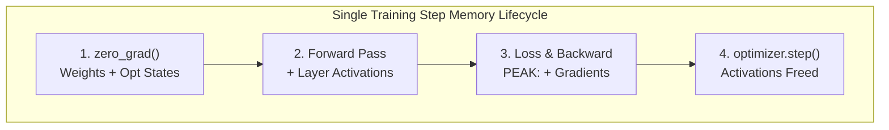
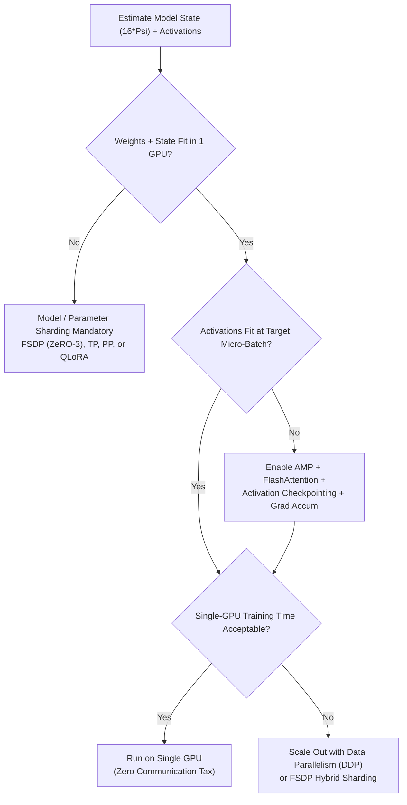
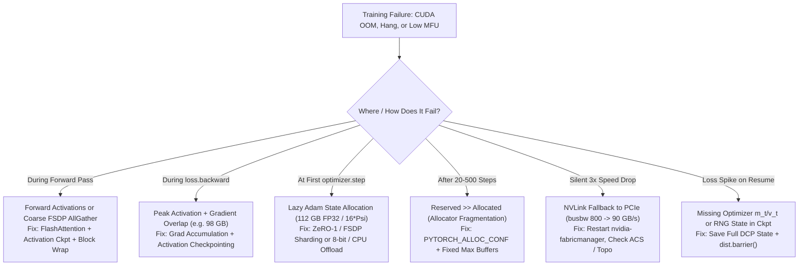

# 14.3 Training memory and compute anatomy

| Field | Value |
|---|---|
| Level | Intermediate |
| Priority tier | 2 |
| Lab venue | Nebius GPU + Local Python Verification Lab (`code/part14/training_memory_compute_lab.py`) |
| Part | Part 14: Distributed training and fine-tuning |
| Primary sources | NVIDIA Zero-to-Hero Volume 13 (`chapter-01-why-distributed-training-exists.md`, `chapter-02-training-memory-and-compute-anatomy.md`, `chapter-08-nccl-collectives-and-communication-paths.md`, `chapter-12-volume-13-summary.md`, `index.md`, `labs/lab-01..04`); Legacy Volume 05 (`01-ai-workloads-training-masterclass.md`); *Distributed AI Systems* (`distributed-ai-systems`, Ch. 1); *AI Systems Performance Engineering* (`ai-systems-performance-engineering`, Ch. 13) |
| Coverage file | `planning/coverage/chapters/14-03.md` |
| Claim & number ledger | `planning/ledgers/14-03.md` |

## Why this matters for AI infrastructure

An infrastructure engineer often receives a request to train a large language model on a single GPU node. Five minutes after the job starts, the training script crashes with an out-of-memory error. Model parameter counts have grown exponentially over the last five years. Single-GPU high-bandwidth memory and compute throughput have grown only linearly. **Distributed training exists because modern models exceed both the memory capacity and the compute throughput of any single accelerator.**

Even storing the raw weights of a frontier model overwhelms a single GPU before a single token of data enters the network. Training adds gradients, optimizer states, forward activations, and workspace buffers on top of those weights. Compute hits an equally hard physical wall during training. A single pass of a 175B parameter model takes well over an hour on one A100 GPU.

```text
Memory and Compute Physical Walls:
  Single GPU HBM capacities:
    NVIDIA H100:                               80 GB
    NVIDIA H200:                              141 GB
    NVIDIA B200:                              192 GB

  Full-precision FP32 weight storage (4 bytes/parameter):
    70B model weights (70B x 4 bytes):        280 GB
    GPT-3 175B weights (175B x 4 bytes):      700 GB (8.75x an 80 GB H100)

  Llama-3-70B in 16-bit BF16 mixed precision:
    BF16 weights alone (2 bytes/parameter):   140 GB
    Mixed-precision AdamW static state:        16 bytes/parameter = 1,120 GB (~1.12 TB)
    Total training memory with activations:  > 1.2 TB

  Compute wall for GPT-3 (175B parameters, batch size 2048, sequence length 2048):
    Pass FLOPs (2 x 175 x 10^9 x 2048 x 2048): 1.46 x 10^18 FLOPs (1.468 x 10^18 exact)
    1x NVIDIA A100 (312 TFLOPS):               4,679 seconds (~78 minutes per pass)
    128x NVIDIA A100 GPUs:                     78 minutes / 128 ~= 37 seconds (36.56 s)
    7B model on 1 trillion tokens:             ~2 weeks on 8x A100 (80 GB) GPUs
```

Sizing a cluster or diagnosing a memory crash requires accounting for every byte and every floating-point operation across the training step. You must track four quantitative subsystems across every job:

1. Static model state requires 16 bytes per parameter under mixed-precision AdamW. By contrast, on-disk checkpoints omit gradients and store 14 bytes per parameter.
2. Dynamic transformer activations grow with sequence length and micro-batch size. They cause peak memory pressure during the backward pass when activations and gradients coexist.
3. Gradient accumulation and CUDA caching allocator tuning via `PYTORCH_ALLOC_CONF` control dynamic memory peaks and prevent block fragmentation during long runs.
4. Compute efficiency depends on separating Model FLOPs Utilization from Hardware FLOPs Utilization. It also requires overlapping collective communication with backward computation.

Before you provision a multi-node cluster, calculate both the static parameter state and the dynamic activation footprint for a single training step.

## Prerequisites and outcomes

### Prerequisites
- Familiarity with neural network forward and backward propagation, matrix multiplications, and transformer self-attention from earlier chapters in Part 14.
- Understanding of GPU HBM capacity, Tensor Core number formats, and NVLink, PCIe, InfiniBand, and RoCEv2 topologies from earlier parts.
- Basic familiarity with `nvidia-smi` and PyTorch tensors.

### Outcomes
After completing this chapter, you will be able to:
1. Calculate the static and dynamic GPU memory footprint of any dense or Mixture-of-Experts transformer across FP32, mixed-precision, and pure BF16 setups.
2. Predict which phase of the training loop will trigger an out-of-memory crash first. You will also select the right fix from mixed precision, FlashAttention, activation checkpointing, gradient accumulation, `PYTORCH_ALLOC_CONF`, or FSDP.
3. Compute per-step FLOPs, Model FLOPs Utilization, and Hardware FLOPs Utilization from observed throughput. You will also decompose iteration time across compute and NCCL collectives.
4. Choose between single-GPU optimization, DDP, FSDP, Tensor Parallelism, Pipeline Parallelism, and Expert Parallelism using quantitative memory and bandwidth thresholds.

---

## 1. The Five GPU Memory Consumers and Precision Formats

When a training script crashes with a CUDA out-of-memory error, engineers often blame the model weights alone. In reality, five distinct consumers compete for GPU HBM during every training iteration. If you only budget for the parameter file size on disk, your job will crash before completing its first step.

The five consumers divide into static model state, dynamic intermediate tensors, and runtime scratchpads:
1. Model weights hold the learnable parameters of the neural network.
2. Gradients store the partial derivatives of the loss with respect to every learnable parameter. They match the shape of the trainable weights.
3. Optimizer states maintain per-parameter history buffers across steps. Examples include momentum, variance, and master weights in Adam and AdamW.
4. Forward activations hold intermediate layer outputs computed during the forward pass. They must remain in memory until the backward pass consumes them.
5. Workspace and temporary buffers include cuBLAS and cuDNN scratchpads, NCCL communication buckets, and free blocks held inside the PyTorch CUDA caching allocator.

```text
Typical Workspace and Operational Overhead on an 80 GB GPU:
  PyTorch runtime and CUDA context overhead:    1-2 GB
  NCCL collective communication buckets:        2-5 GB per GPU
  Host OS system RAM reservation:               5-10 GB
  Total GPU workspace & allocator overhead:     5-15 GB
```

### 1.1 Numerical Precision Formats

Storing every tensor in 32-bit floating point wastes half of your HBM capacity and leaves modern Tensor Cores underutilized. Choosing the wrong 16-bit format, however, can cause small gradients to underflow to zero and stall model convergence. Understanding the bit layout of each numerical format tells you why modern training pipelines standardize on BF16 and FP8.

| Format | Bytes / Value | Bit Layout (`Sign / Exp / Mantissa`) | Dynamic Range & Numeric Behavior | Primary Infrastructure Usage |
|---|---|---|---|---|
| **FP32** | `4.0` | `1 / 8 / 23` (`32`-bit) | `~10^-38` to `10^38`; full single precision | Master weights, AdamW moment states (`m_t, v_t`), loss and LayerNorm reductions |
| **TF32** | `4.0` (storage) | `1 / 8 / 10` (`19`-bit compute in `32`-bit storage) | Same `8`-bit exponent range as FP32; Tensor Core math | Default fast FP32 matmul mode (`torch.set_float32_matmul_precision('high')`) |
| **BF16** | `2.0` | `1 / 8 / 7` (`16`-bit bfloat) | Same `8`-bit exponent range as FP32 (`~10^-38` to `10^38`); no `GradScaler` needed | **Preferred LLM training format** on A100, H100, B200, and GB300 for weights, grads, and activations |
| **FP16** | `2.0` | `1 / 5 / 10` (`16`-bit float) | Narrow `5`-bit exponent (`~10^-5` to `65,504` / `~10^4`); underflows on small gradients | Mixed-precision training with `torch.amp.GradScaler`; FP16 inference |
| **FP8 E4M3** | `1.0` | `1 / 4 / 3` (`8`-bit float) | Higher mantissa precision, narrower range (`[-448, 448]`) | Forward pass weights and activations on Hopper (`H100`/`H200`) and Blackwell |
| **FP8 E5M2** | `1.0` | `1 / 5 / 2` (`8`-bit float) | Wider `5`-bit exponent range (matches FP16 range) | Backward pass gradient storage and communication in FP8 training |
| **MXFP8** | `~1.0` | `E4M3` + `32`-value shared block scale | Microscaling block format for sub-tensor dynamic range | Native Blackwell (`B200`/`GB200`/`GB300`) FP8 training and inference |
| **INT8** | `1.0` | `8`-bit integer (`[-128, 127]`) | Fixed-point; requires per-channel or per-token scale factors | Quantized inference (`SmoothQuant`, `W8A8`) and 8-bit optimizer states (`bitsandbytes`) |
| **INT4 / NVFP4** | `0.5` (`~0.5`) | `4`-bit integer or `E2M1` + `16`-value block scale | Extreme compression; NVFP4 adds microscaling on Blackwell | QLoRA NF4 and INT4 frozen base weights (`3.5 GB` for `7B`); Blackwell NVFP4 inference |

Why do infrastructure teams prefer BF16 over FP16 for large language model training? FP16 allocates only five exponent bits. Small gradient updates therefore frequently underflow to zero unless you wrap the backward pass in `torch.amp.GradScaler`. BF16 keeps all eight exponent bits of FP32. It trades three bits of mantissa precision for drop-in numerical stability without dynamic loss scaling.

### 1.2 Optimizer State Math

Many engineers are surprised when the optimizer consumes three times as much memory as the model weights and gradients combined. This memory bloat happens because adaptive optimizers track per-parameter historical statistics across every step. Comparing the update rule for Stochastic Gradient Descent against Adam and AdamW reveals where those extra gigabytes go.

```text
SGD update rule (eta is scalar learning rate):
  w_{t+1} = w_t - eta * g_t

Adam / AdamW update rule (beta_1 = 0.9, beta_2 = 0.999, eta, epsilon, lambda are scalars):
  m_t     = beta_1 * m_{t-1} + (1 - beta_1) * g_t
  v_t     = beta_2 * v_{t-1} + (1 - beta_2) * (g_t)^2
  m_hat_t = m_t / (1 - beta_1^t)
  v_hat_t = v_t / (1 - beta_2^t)
  w_{t+1} = w_t - eta * ( m_hat_t / (sqrt(v_hat_t) + epsilon) + lambda * w_t )
```

In plain SGD, the learning rate is a single scalar that adds zero per-parameter memory. Once the gradient is computed, SGD updates the weight tensor in place without storing historical buffers.

In Adam and AdamW, the optimizer must persist two full-sized state tensors across every step. The first moment tracks the exponential moving average of the gradients, and the second moment tracks the exponential moving average of the squared gradients. Together, these two buffers equal twice the parameter count in optimizer state alone.

| Optimizer | Stored Per-Parameter Tensors | State Multiplier (Tensors / Param) | FP32 State Bytes / Param | Mixed-Precision Static Total (`Weights + Grads + Opt`) |
|---|---|---|---|---|
| **SGD (no momentum)** | Scalar learning rate `eta` only | `~0x` | `0 B` (`+4 B` if FP32 master weights) | `4 B` (pure BF16) or `8 B` (with FP32 master copy) |
| **Adafactor** | Factorized row and column second-moment statistics | `~0.5x` | `~2 B` | `~6–10 B` |
| **SGD+Momentum / Nesterov** | Velocity / momentum buffer `v_{t-1}` | `1x` | `4 B` | `12 B` (`2B W + 2B G + 4B Master + 4B v`) |
| **Adagrad / RMSProp** | Accumulated squared gradients / second moment `v_{t-1}` | `1x` | `4 B` | `12 B` |
| **Lion** | First moment `m_{t-1}` only (`sign`-based update) | `1x` | `4 B` | `12 B` |
| **Adam / AdamW / LAMB / Nadam / SparseAdam / AdaBelief** | First moment `m_{t-1}` (`1x`) + second moment `v_{t-1}` (`1x`) | **`2x`** | **`8 B` (`+4 B` FP32 master = `12 B`)** | **`16 B` (`2B W + 2B G + 4B Master + 4B m + 4B v`)** |
| **AMSGrad** | `m_{t-1}` (`1x`) + `v_{t-1}` (`1x`) + historical max `v_max` (`1x`) | `3x` | `12 B` (`+4 B` FP32 master = `16 B`) | `20 B` |
| **Shampoo** | Left and right preconditioner matrices per layer | `> 2x` (varies) | `> 8 B` | `> 16 B` |

### 1.3 The 16-Byte Static Memory Rule vs Checkpoint and Pure-BF16 Baselines

When teams estimate memory for a model with Psi parameters, three different accounting conventions appear across textbooks, papers, and production runbooks. Mixing up these conventions leads to severe cluster under-provisioning. You must distinguish production mixed-precision AdamW, pure FP32 Adam, and the pure BF16 teaching baseline.

```text
Convention 1 — Production Mixed-Precision AdamW (BF16 forward/backward + FP32 master weights & states):
  BF16 Model Weights (w_t):        2 * Psi bytes
  BF16 Gradients (g_t):            2 * Psi bytes
  FP32 Master Weights (w_master):  4 * Psi bytes   \
  FP32 Adam First Moment (m_t):    4 * Psi bytes    |-- 12 * Psi bytes FP32 Optimizer State
  FP32 Adam Second Moment (v_t):   4 * Psi bytes   /
  -------------------------------------------------------------------------
  Total In-Memory Static State:   16 * Psi bytes  (e.g., 7B = 112 GB; 70B = 1,120 GB [~1.12 TB])
  On-Disk Checkpoint State:       14 * Psi bytes  (omits 2*Psi gradients; 7B = 98 GB; 70B = 980 GB [~1 TB])

Convention 2 — Pure FP32 Adam (no master copy needed because weights are already FP32):
  FP32 Model Weights:              4 * Psi bytes  (28 GB for 7B)
  FP32 Gradients:                  4 * Psi bytes  (28 GB for 7B)
  FP32 Adam m_t + v_t:             8 * Psi bytes  (28 GB + 28 GB = 56 GB for 7B)
  -------------------------------------------------------------------------
  Total In-Memory Static State:   16 * Psi bytes  (112 GB for 7B; + 60-80 GB act + 5-10 GB buf = 180-190 GB)

Convention 3 — Pure BF16 Adam Teaching Baseline (no FP32 master weights, m_t and v_t stored in BF16):
  BF16 Model Weights:              2 * Psi bytes  (14 GB for 7B)
  BF16 Gradients:                  2 * Psi bytes  (14 GB for 7B)
  BF16 Adam m_t + v_t:             4 * Psi bytes  (28 GB for 7B)
  -------------------------------------------------------------------------
  Total In-Memory Static State:    8 * Psi bytes  (56 GB fixed for 7B; + 8-16 GB act = 64-72 GB peak)
```

Notice a critical architectural insight in the breakdown above. **Both pure FP32 Adam and production mixed-precision AdamW consume 16 bytes per parameter of static state.** Mixed precision saves two bytes per parameter on the weights and two bytes per parameter on the gradients. That four-byte saving equals the four-byte FP32 master weight copy required to prevent small AdamW updates from rounding to zero when added to BF16 weights.

The true memory win of Automatic Mixed Precision is that forward and backward activations are cut in half while Tensor Core throughput doubles.

| Model Size (`Psi`) | FP32 Weights (`4Psi`) | BF16 Weights (`2Psi`) | Pure BF16 Adam + Act (*Distributed AI Systems* Baseline) | Mixed-Precision AdamW Static (`16Psi`) | Mixed-Precision AdamW Checkpoint (`14Psi`) | BF16 Inference (`Weights + KV Cache`) |
|---|---|---|---|---|---|---|
| **`1B`** | `4 GB` | `2 GB` | `~8 GB` | `16 GB` | `14 GB` | `2–4 GB` |
| **`7B`** | `28 GB` | `14 GB` | `~60–70 GB` (`64–72 GB`) | `112 GB` | `98 GB` | `14–20 GB` |
| **`13B`** | `52 GB` | `26 GB` | `~110–130 GB` (`72 GB` base + `18%` buffer = `85 GB`) | `208 GB` | `182 GB` | `26–35 GB` |
| **`70B`** | `280 GB` | `140 GB` | `~600–700 GB` | `1,120 GB` (`~1.12 TB`; `> 1.2 TB` w/ act) | `980 GB` (`~1.0 TB`) | `140–180 GB` (`20–40 GB` KV cache at `b=32, s=2048`) |
| **`175B` (`GPT-3`)** | `700 GB` (`8.75x` `80 GB`) | `350 GB` | `~1.5–1.8 TB` | `2,800 GB` (`2.8 TB`) | `2,450 GB` (`2.45 TB`) | `350–450 GB` |

:::info Operational Safety Margin
Never size GPU count by dividing static model bytes by physical HBM capacity alone. PyTorch contexts, NCCL buckets, and allocator splits require a 10% to 20% minimum safety margin, and 20% to 30% is safer in production. As shown in the table above, a 13B BF16 setup with a 72 GB base footprint reaches 85 GB once an 18% buffer is added.
:::

When you size a training cluster, always start with the mixed-precision AdamW static budget. Then add a generous safety margin for runtime buffers.

---

## 2. Dynamic Memory Anatomy: Activations, FlashAttention, and the Step Timeline

A model whose static weights and optimizer states fit inside GPU memory can still crash when you increase the batch size or sequence length. Static model state depends only on the parameter count. **Dynamic activation memory is independent of parameter count at a single layer and scales with micro-batch size, sequence length, hidden dimension, and layer count.**

### 2.1 Why Backpropagation Requires Stored Forward Activations

Why can the GPU not discard intermediate layer outputs as soon as the forward pass moves to the next layer? During the backward pass, the chain rule requires those exact forward-pass tensors to compute weight gradients. Without them, autograd cannot calculate how much each weight contributed to the loss.

```text
Two-layer forward pass:
  z     = W_1 * x
  h     = sigma(z)
  y_hat = W_2 * h

Chain-rule backward gradients:
  grad_{W_2} L = (dL / dy_hat) * (dy_hat / dW_2) = (dL / dy_hat) * h^T
  grad_{W_1} L = (dL / dy_hat) * (dy_hat / dh) * (dh / dz) * (dz / dW_1)
               = (dL / dy_hat) * W_2^T * sigma'(z) * x^T
```

To compute the gradient for the second layer during `loss.backward()`, autograd must read the activation output computed during the forward pass. To compute the gradient for the first layer, autograd needs the layer input and the derivative of the activation function. Whether PyTorch saves the post-activation output or the pre-activation input depends on the mathematical form of that derivative:

- Sigmoid, Tanh, and Softplus have derivatives that can be written purely in terms of the post-activation output. PyTorch therefore stores only the output tensor and discards the pre-activation input.
- ReLU, Leaky ReLU, ELU, GELU, Swish, SiLU, Mish, and gated linear units have derivatives that explicitly require the pre-activation input. Modern large language models using SwiGLU or GELU must retain these pre-activation tensors across all transformer blocks during the forward pass.

```text
Activation Derivative Storage Rules:
  Output h only: Sigmoid (sigma'(z) = h*(1 - h)), Tanh (1 - h^2), Softplus
  Input z required: ReLU (z > 0 mask), Leaky ReLU, ELU, GELU (c ~= 0.044715),
                    Swish / SiLU (z * sigma(z)), Mish, SwiGLU, GeGLU, ReGLU
```

### 2.2 Exact Transformer Activation Memory Formula

When training a transformer at long context lengths, standard self-attention causes activation memory to explode quadratically with sequence length. We can predict this byte cost using the Megatron-LM derivation by Korthikanti et al. for an L-layer transformer trained in mixed precision.

Each transformer layer stores two categories of intermediate activations during the forward pass:
1. Non-attention linear, LayerNorm, MLP, and residual activations consume `34 * s * b * h` bytes per layer.
2. Materialized attention score matrices, softmax outputs, and dropout masks consume `5 * a * b * s^2` bytes per layer.

```text
Transformer Activation Memory Breakdown (BF16/FP16, 2 bytes/element):
  Non-attention per layer (34*s*b*h bytes):
    Self-attention LayerNorm input:   2*s*b*h
    Q, K, V projection inputs/outputs:6*s*b*h
    Attention output proj + dropout:  2*s*b*h + 1*s*b*h
    Post-attention LayerNorm input:   2*s*b*h
    MLP up/gate/activation inputs:    16*s*b*h to 18*s*b*h
    MLP dropout + residual inputs:    1*s*b*h + 2*s*b*h

  Materialized attention matrix per layer (5*a*b*s^2 bytes):
    Q * K^T score matrix (BF16):      2*a*b*s^2
    Softmax probabilities (BF16):     2*a*b*s^2
    Attention dropout mask (1 byte):  1*a*b*s^2

  Total Equations across L layers:
    A_layer (standard)       = s * b * h * (34 + 5 * a * s / h)   bytes
    A_total (standard, L)    = L * s * b * h * (34 + 5 * a * s / h)   bytes
    A_total (FlashAttention) = L * (34 * s * b * h)   bytes
    A_total (Full Checkpt)   = L * (2 * s * b * h) + 34 * s * b * h   bytes
```

Evaluating these equations on a 7B parameter transformer shows how fast activation memory grows. Our verification module `code/part14/training_memory_compute.py` tests both a short-context and a long-context operating point.

| Configuration (`7B`, `L=32, h=4096, a=32`) | Non-Attention (`34sbh` / layer) | Attention Matrix (`5abs^2` / layer) | Standard Total (`L` layers) | With FlashAttention / SDPA | With Full Activation Checkpointing |
|---|---|---|---|---|---|
| **Short context (`b = 4, s = 2048`)** | `1,140,850,688 B` (`1.141 GB`/layer) | `2,684,354,560 B` (`2.684 GB`/layer) | **`122.4066 GB`** (`3.825 GB`/layer) | **`36.5072 GB`** (**`70.18%` savings**) | **`3.2883 GB`** (**`97.31%` savings**) |
| **Long context (`b = 2, s = 8192`)** | `2,281,701,376 B` (`2.282 GB`/layer) | `21,474,836,480 B` (`21.475 GB`/layer) | **`760.2092 GB`** (`23.757 GB`/layer) | **`73.0144 GB`** (**`90.40%` savings**) | **`6.5767 GB`** (**`99.13%` savings**) |

Look closely at the long-context row in the table above. Because the materialized attention matrix scales with sequence length squared, attention scores alone reach 687.1948 GB across all layers. Using `torch.nn.functional.scaled_dot_product_attention` dispatches to FlashAttention. That kernel fuses the attention math inside on-chip SRAM tiles without writing the attention matrix to HBM. FlashAttention slashes activation memory by more than 70% at short context and over 90% at long context while accelerating wall-clock speed.

Combining FlashAttention with full activation checkpointing via `torch.utils.checkpoint` saves only the layer-boundary input tensor per block plus one active layer for recomputation. That combination drops total activation memory to 3.2883 GB at short context in exchange for one extra forward pass of compute.

```text
Full Activation Checkpointing Math on 7B (L=32, b=4, s=2048, h=4096):
  32 layer-boundary tensors (32 * 2*s*b*h):  2.1475 GB
  1 active layer recomputation (34*s*b*h):   1.1409 GB
  Total checkpointed activation memory:      3.2883 GB (97.31% savings vs 122.41 GB)
  Backward compute overhead:                 ~30-33% (up to 30-50% slower backward pass)
```

### 2.3 The Training Step Memory Timeline and High-Water Mark

Knowing the total size of weights, activations, and gradients is not enough to predict when a job will crash. Memory usage rises and falls across the five phases of a training step, and a crash happens the instant the transient high-water mark crosses physical HBM capacity. Tracing the step lifecycle shows why most out-of-memory errors strike during `loss.backward()` or on the very first call to `optimizer.step()`.

```python
for x_batch, y_batch in dataloader:
    optimizer.zero_grad(set_to_none=True)  # 1. Release gradient tensors (set_to_none=True avoids zero-fill)
    y_hat = model(x_batch)                 # 2. Forward pass: compute and store layer activations
    loss = criterion(y_hat, y_batch)       # 3. Loss computation: logits -> scalar loss
    loss.backward()                        # 4. Backward pass: PEAK MEMORY (activations + gradients coexist)
    optimizer.step()                       # 5. Optimizer step: activations freed; update weights & m_t, v_t
```



During the forward pass, each layer writes its activations to HBM so the backward pass can use them later. When `loss.backward()` begins, autograd walks backward from the final layer to the first layer. It allocates gradient tensors while earlier layers still hold their forward activations in memory. **Peak GPU memory occurs during the backward pass because stored forward activations and newly computed gradients coexist in HBM.**

As each layer finishes its backward computation, PyTorch frees its saved forward activations. By the time `optimizer.step()` executes in steady state, the forward activations are gone. The only exception is Step 1 of training, when PyTorch lazily allocates the Adam momentum and variance buffers inside the first `optimizer.step()` call.

```text
Timeline 1 — Steady-State Pure BF16 Adam on 7B Model (DAI Ch. 1 Fig 1.4, after Step 1 warmup):
  Fixed static state at step start: 14 GB BF16 weights + 28 GB BF16 m_t, v_t = 42 GB (56 GB with 14 GB grads)
  Forward pass (model(x_batch)):    14 GB weights + 28 GB opt + 12 GB activations = 54 GB
  Backward pass (loss.backward()):  14 GB weights + 28 GB opt + 12 GB act + 14 GB grads = 68 GB PEAK (64-72 GB for 8-16 GB act)
  Optimizer step (optimizer.step()):14 GB weights + 28 GB opt + 14 GB grads (12 GB act freed) = 56 GB

Timeline 2 — Cold-Start / Unsharded FP32 vs AMP on 7B Model (V13 Ch. 2, b=4, s=2048):
  Forward pass (FP32):              28 GB weights + 42 GB activations = 70 GB (87.5% of 80 GB H100)
  Backward without checkpointing:   28 GB weights + 42 GB act + 28 GB grads = 98 GB (OOM on 80 GB H100)
  Backward with checkpointing:      28 GB weights + 28 GB grads + 4-10 GB (5-10 GB) recomputed act = 60-66 GB (30-50% slower bwd)
  First optimizer.step() (FP32):    28 GB weights + 28 GB grads + 28 GB m_t + 28 GB v_t = 112 GB (OOM on 80 GB H100)
  With AMP (FP16/BF16):             14 GB weights + 21 GB act + 14 GB grads + 2 GB FP32 loss/norm = 51 GB
  Measured AMP benchmark gain:      VRAM drops from 78.5 GB to 48.2 GB; speed rises from 1,000 to 1,280 tokens/sec (+28.0%)
```

Always enable BF16 mixed precision and FlashAttention before tuning any other memory knob. They cut activation memory while making every step faster.

---

## 3. Gradient Accumulation, CUDA Allocator Internals, and Compute

### 3.1 Gradient Accumulation and PyTorch Caching Allocator Tuning

Even with FlashAttention enabled, your desired training batch size may still overflow GPU memory during the backward pass. Shrinking the global batch size to fit in memory changes optimization dynamics and hurts model convergence. **Gradient accumulation decouples physical GPU memory from the algorithmic batch size by splitting each step into smaller sequential micro-batches.**

Instead of updating weights after every micro-batch, the training loop runs K forward and backward micro-steps and accumulates the gradients in place. Only after K micro-steps does the loop call `optimizer.step()` and `optimizer.zero_grad(set_to_none=True)`. Peak activation memory drops by a factor of K while the global token batch size stays unchanged.

```text
Gradient Accumulation Equations (micro-batch b_micro, K = grad_accum_steps, DP_world_size GPUs):
  Per-GPU Effective Batch (samples) = b_micro * K
  Global Batch Size (samples)       = b_micro * K * DP_world_size
  Global Batch Size (tokens)        = s * b_micro * K * DP_world_size
  Peak Activation Memory            = A_total(b_micro) = (1 / K) * A_total(b_micro * K)

Worked Example (7B model, s = 4096, DP_world_size = 8, b_micro = 2, K = 8):
  Per-GPU effective batch:            2 * 8 = 16 sequences
  Global batch size:                  16 * 8 = 128 sequences (524,288 tokens/step)
  Activation memory reduction (8.0x): 89.1288 GB down to 11.1411 GB per GPU
```

Sometimes a training job runs smoothly for dozens of steps and then crashes with an out-of-memory error even though peak active tensors fit well inside HBM. This delayed crash happens when variable sequence lengths or Mixture-of-Experts dynamic token routing splinter the PyTorch CUDA caching allocator. PyTorch avoids slow blocking `cudaMalloc` and `cudaFree` calls by holding a pool of reserved memory via `torch.cuda.memory_reserved()`. Active tensors then draw blocks from that pool via `torch.cuda.memory_allocated()`. When variable-sized tensors are freed and reallocated, large contiguous blocks break into unusable fragments.

Two production fixes eliminate allocator fragmentation. First, pre-allocate fixed maximum-size buffers for dynamic layers such as Mixture-of-Experts experts. Second, configure `PYTORCH_ALLOC_CONF` to control block splitting and bucket rounding:

```bash
export PYTORCH_ALLOC_CONF=max_split_size_mb:256,roundup_power2_divisions:[256:1,512:2,1024:4,>:8],backend:cudaMallocAsync
```

Each parameter in `PYTORCH_ALLOC_CONF` targets a specific allocator bottleneck:
- Setting `max_split_size_mb:256` prevents the allocator from splitting large free blocks. This preserves contiguous regions for transformer layers.
- Setting `roundup_power2_divisions:[256:1,512:2,1024:4,>:8]` rounds allocation requests into fixed power-of-two sub-buckets. Slightly different tensor sizes then reuse the same cached block without external fragmentation.
- Setting `backend:cudaMallocAsync` switches to the CUDA driver stream-ordered asynchronous allocator. This avoids cross-stream host synchronizations and enables shared pools across CUDA Graphs.

```text
PYTORCH_ALLOC_CONF Sub-Bucket Rounding Math (PYTORCH_CUDA_ALLOC_CONF in older releases):
  Range [512 MB, 1024 MB] configured with :2 divisions:
    Span of 512 MB split into 2 steps of 256 MB -> buckets at [512 MB, 768 MB, 1024 MB]
    600 MB request rounds up to 768 MB (168 MB or 21.88% internal padding, 0% external fragmentation)

  Range [1024 MB, 2048 MB] configured with :4 divisions:
    Span of 1024 MB split into 4 steps of 256 MB -> buckets at [1024, 1280, 1536, 1792, 2048 MB]
    1,100 MB request rounds up to 1,280 MB (180 MB or 14.06% internal padding)
```

### 3.2 Compute Anatomy: Forward vs Backward FLOPs, MFU, and HFU

Monitoring GPU utilization with `nvidia-smi` often misleads infrastructure teams into thinking a slow job is running efficiently. A GPU can report full utilization while spending most of its time stalled on memory-bandwidth-bound element-wise kernels or waiting on network collectives. To measure true hardware efficiency, you must count the useful floating-point operations completed per token and compute Model FLOPs Utilization.

Matrix multiplications dominate dense transformer compute. Multiplying an activation matrix by a weight matrix performs one multiply and one accumulate per parameter per token. Summing across all dense parameters gives two FLOPs per parameter per token in the forward pass. During the backward pass, each linear layer must compute gradients with respect to both the layer inputs and the layer weights, requiring four FLOPs per parameter per token.

```text
Per-Token FLOP Rules for a Dense Transformer (Psi parameters):
  Forward Pass FLOPs per token:               F_fwd   = 2 * Psi
  Backward Pass Input-Grad FLOPs (dL/dX):     F_bwd_x = 2 * Psi
  Backward Pass Weight-Grad FLOPs (dL/dW):    F_bwd_w = 2 * Psi
  --------------------------------------------------------------------------------
  Total Backward Pass FLOPs per token:        F_bwd   = 4 * Psi   (2x forward pass)
  Standard Model Training FLOPs per token:    F_model = 6 * Psi   (forward + backward)
  Hardware FLOPs with Full Checkpointing:     F_hw    = 8 * Psi   (2*Psi fwd + 2*Psi recompute + 4*Psi bwd)

Utilization Definitions (for GPU peak Tensor Core throughput P_peak):
  Achieved Model FLOPs/sec/GPU = 6 * Psi * (tokens / sec / GPU)
  MFU (%)                      = (6 * Psi * tokens_per_sec_per_gpu) / P_peak * 100%
  HFU (%)                      = (8 * Psi * tokens_per_sec_per_gpu) / P_peak * 100% = (4 / 3) * MFU (with full ckpt)
```

Model FLOPs Utilization compares only the algorithmic work per token against the GPU peak Tensor Core specification. Hardware FLOPs Utilization includes the extra forward recomputation pass added by full activation checkpointing. Published large-scale training runs typically achieve 35% to 55% MFU.

```text
Worked MFU and HFU Benchmarks on NVIDIA H100 SXM (P_peak = 989 TFLOPS BF16, vs 312 TFLOPS on A100):
  1. Llama-3-70B (Psi = 70B) at 940 tokens/sec/GPU:
     Per-token work: 140 GFLOPs fwd + 280 GFLOPs bwd = 420 GFLOPs model (560 GFLOPs hardware w/ full ckpt)
     Achieved Model TFLOPS:    394.80 TFLOPS -> MFU = 39.92% (~= 40%)
     Achieved Hardware TFLOPS: 526.40 TFLOPS -> HFU = 53.23% (1.3333 * MFU)

  2. 7B Model (Psi = 7B) at 10,500 tokens/sec/GPU:
     Per-token work: 42 GFLOPs model (56 GFLOPs hardware w/ full ckpt)
     Achieved Model TFLOPS:    441.0 TFLOPS  -> MFU = 44.59%
     Achieved Hardware TFLOPS: 588.0 TFLOPS  -> HFU = 59.45%

  3. MLPerf Structured Iteration Log Breakdown (:::MLL JSON prefix, AISPE Table 13-6):
     Forward pass compute:     10.5 ms (43.8%) \
     Backward pass compute:     9.0 ms (37.5%)  |-- Total Compute = 19.5 ms (81.3%)
     AllReduce gradient sync:   4.0 ms (16.7%, roughly one-sixth of the step)
     Data-loading / other:      0.5 ms (2.1%)
     Total step wall time:     24.0 ms (100.0%)
```

Track MFU rather than raw `nvidia-smi` utilization on every training run. MFU directly measures how fast your cluster converts electricity into trained tokens.

---

## 4. From Single-GPU Limits to Distributed Parallelism and Collectives

### 4.1 Decision Framework: Training vs Inference vs Serving and When to Distribute

Adding multi-GPU or multi-node distribution introduces network serialization, collective synchronization, and partial-failure blast radius. Before you split a workload across multiple accelerators, distinguish the resource profiles of training, batch inference, and online serving. Each phase stresses a different hardware bottleneck.

| Dimension | Training (Learning Phase) | Inference (Prediction / Generation) | Serving (Production System) |
|---|---|---|---|
| **Primary Goal** | Learn parameters `w_t` iteratively over epochs | Generate predictions or autoregressive tokens | Provide HA, multi-tenant, SLA-bound API access |
| **Memory Profile** | **Highest (`16Psi` static + `O(L*s*b*h)` activations)** | Medium (`2Psi` weights + dynamic KV cache) | Variable (multi-model pools, dynamic batch queues) |
| **Compute Pattern** | Iterative Forward + Backward + Opt (`6Psi–8Psi`/tok) | Single forward pass (Prefill compute-bound + Decode memory-bound) | Request-driven continuous batching (`vLLM`, `SGLang`) |
| **Communication** | Frequent collective sync (`AllReduce`, `AllGather`, `ReduceScatter`) | Minimal (TP `AllReduce` or EP `AlltoAll` if model > 1 GPU) | API-level routing, load balancing, disaggregated KV transfer |
| **Latency & Metric** | Hours to weeks; measured in **samples/sec or tokens/sec/GPU (MFU)** | Milliseconds to seconds; **tokens/sec** | Milliseconds (TTFT, TPOT); **requests/sec (QPS)** |

Even during inference, extreme context lengths can force multi-GPU sharding. For example, `meta-llama/Llama-4-Scout-17B-16E-Instruct` uses 17B active parameters across 16 experts and supports a massive context window. At full context length, the KV cache alone exceeds a terabyte of memory for a single sequence.

```text
Long-Context Inference KV Cache Pressure (DAI Ch. 1):
  Model:                  meta-llama/Llama-4-Scout-17B-16E-Instruct (17B active, 16 experts)
  Maximum context window: 10 million tokens
  Single-sequence KV cache: > 1 TB of HBM
```



### 4.2 The Distributed AI Stack, Process Groups, and NCCL Collectives

When a training job scales beyond one GPU, every gradient synchronization call traverses a six-layer hardware and software stack. A misconfiguration at any layer can silently drop throughput by an order of magnitude. Understanding how PyTorch maps logical process groups onto physical network links is essential for cluster debugging.

1. The framework layer runs PyTorch `torch.distributed`, DDP, FSDP, Megatron-LM, or DeepSpeed.
2. The gradient bucketing layer groups small parameter gradients into contiguous buckets via `bucket_cap_mb`. This allows NCCL to launch fewer large collectives overlapped with backward compute.
3. The collective operations layer exposes primitives such as AllReduce, AllGather, Broadcast, Reduce, Gather, Scatter, ReduceScatter, and AlltoAll.
4. The data transfer backend layer dispatches GPU collectives to NCCL, CPU collectives to Gloo, or HPC messaging to MPI and UCX.
5. The network topology layer selects between logical Ring algorithms and Double Binary Tree algorithms across Fat-Tree, Rail-Optimized, or Dragonfly fabrics.
6. The physical link layer moves bytes over intra-node NVLink and PCIe or inter-node InfiniBand and RoCEv2 with GPUDirect RDMA and SHARP.

```text
Process Group Rank Variables and Physical Interconnect Specs:
  WORLD_SIZE:     Total GPU processes across the job (e.g., 2 nodes x 4 GPUs = 8)
  RANK:           Global rank 0 .. WORLD_SIZE - 1 (Node 1 runs RANK = 4..7)
  LOCAL_RANK:     Node-local GPU index 0 .. nproc_per_node - 1 (bound via torch.cuda.set_device(local_rank))

  Intra-node and inter-node link rates:
    PCIe Gen4 x16:      ~32 GB/s per direction
    NVLink 4 (H100):    450 GB/s per direction (900 GB/s bidirectional)
    NVLink 5 (B200):    1.8 TB/s bidirectional (GB200 / GB300)
    512-GPU hop count:  512 sequential Ring hops vs 9 Double Binary Tree hops
```

Every distributed training paradigm relies on a specific combination of the eight collective primitives in `torch.distributed`:

| Collective | Communication Pattern | Per-Rank Data Volume / Cost | Primary Distributed Training & Inference Use Case |
|---|---|---|---|
| **Broadcast** | `1 -> All` (root copies identical tensor to all ranks) | `O(size)` independent of `WORLD_SIZE` | Distributing initial weights, hyperparameters, or RNG seeds from `rank 0` |
| **Reduce** | `All -> 1` (aggregates via `SUM`/`MAX`/`MIN` to root only) | `1` step (avoids Broadcast half of AllReduce) | Aggregating loss, accuracy, or gradient norms to `rank 0` for logging |
| **Gather** | `All -> 1` (concatenates `N` values/rank onto root) | Root receives `WORLD_SIZE * N` (bottlenecks `rank 0`) | Centralizing validation predictions or small state dicts on `rank 0` |
| **Scatter** | `1 -> All` (root slices list of tensors across ranks) | Root sends `WORLD_SIZE * N` (`DistributedSampler` preferred) | Partitioning rank-specific inputs or shards from `rank 0` |
| **AllReduce** | `All -> All` (Reduce + Broadcast; mathematically ReduceScatter + AllGather) | Ring moves **`2 * (N-1)/N * size`** per GPU in `N-1` steps (vs `2*(N-1)` for naive Reduce+Broadcast) | **DDP gradient synchronization** (`49.0 GB` moved in **`~54 ms`** on `8xH100` NVLink for `28 GB` `7B` FP32 grads; **`55.9 GB` in `~2.2 s`** on `512` GPUs at `25 GB/s` IB) |
| **AllGather** | `All -> All` (every rank receives concatenated `WORLD_SIZE * N` array) | Total cluster movement scales as `WORLD_SIZE^2 * N` | **FSDP / ZeRO-3 weight reconstruction** before each layer's forward and backward pass; TP activation gathering |
| **ReduceScatter** | `All -> All` (reduces across ranks and scatters `1/N` chunk to each rank) | Each rank sends `WORLD_SIZE * N` and keeps its `N` shard | **FSDP / ZeRO-2/3 gradient reduction + sharding** during the backward pass |
| **AlltoAll** | `All -> All` (every rank sends a distinct chunk `chunk[i]` to each rank `i`) | `WORLD_SIZE^2 * chunk_size` (requires NCCL GPU backend; unsupported on Gloo) | **Mixture-of-Experts (MoE) Expert Parallelism token routing** and Sequence/Context Parallelism transpositions |

As the amount of computation per step increases, the relative overhead of collective synchronization shrinks. We can see this effect clearly in multi-GPU scaling benchmarks from *Distributed AI Systems*:

```text
Multi-GPU Scaling and Distributed Inference Benchmarks (DAI Ch. 1):
  ResNet18 on FashionMNIST (3 epochs, light compute per step):
    1 GPU: 8.78 s (1.00x) | 2 GPUs: 5.91 s (1.48x) | 4 GPUs: 3.69 s (2.38x)
    6 GPUs: 2.92 s (3.01x) | 8 GPUs: 2.44 s (3.60x speedup)

  ResNet18 on CIFAR-10 (20 epochs, heavier compute amortizes AllReduce):
    1 GPU: 73.00 s (1.00x) | 2 GPUs: 46.47 s (1.57x) | 4 GPUs: 27.72 s (2.63x)
    6 GPUs: 21.24 s (3.44x) | 8 GPUs: 18.20 s (4.01x speedup)

  Distributed Inference (1,000 requests on 2 GPUs vs 1 GPU baseline):
    Single-GPU baseline:                      1.85 s (541.00 req/s, 1.00x)
    Static DistributedSampler data-splitting: 0.98 s (1,025.45 req/s, 1.89x speedup)
    Dynamic round-robin queue splitting:      1.22 s (819.09 req/s, 1.51x speedup)
```

Choose the simplest parallelism strategy whose static state and activations fit inside GPU memory. Every additional collective across nodes trades compute efficiency for memory capacity.

---

## 5. Commands and configurations that matter

### 5.1 Live GPU Memory, Topology, and Collective Bandwidth Diagnostics

When a training run crashes or stalls on a multi-GPU cluster, guessing at configuration flags wastes hours of compute time. Use these diagnostic commands on Nebius GPU nodes or Slurm and Kubernetes training pods. They inspect HBM high-water marks, NVLink versus PCIe topology, and NCCL collective bus bandwidth. These cluster commands are marked `untested` on live hardware in this local build environment.

```bash
# 1. Poll GPU memory used, free, total, and SM utilization every 2 seconds (V13 Ch. 01 & Ch. 02)
# Healthy working set: 70-90% memory used, 80-95% GPU utilization, flat memory after Step 2 warmup
nvidia-smi --query-gpu=index,memory.used,memory.free,memory.total,utilization.gpu --format=csv -l 2

# 2. Record 10-second memory timeline to CSV to detect fragmentation climbs (e.g., 28000 -> 35200 -> 42000 MiB)
nvidia-smi --query-gpu=index,memory.used,memory.reserved --format=csv -l 10 > memory_timeline.csv

# 3. Verify GPU-to-GPU interconnect matrix (expect NV# for NVLink; PIX/PXB/SYS indicates PCIe fallback)
nvidia-smi topo -m
systemctl status nvidia-fabricmanager
nvidia-smi -q -d ECC

# 4. Tune PyTorch CUDA caching allocator to prevent variable-shape / MoE fragmentation (AISPE Ch. 13)
export PYTORCH_ALLOC_CONF=max_split_size_mb:256,roundup_power2_divisions:[256:1,512:2,1024:4,>:8],backend:cudaMallocAsync

# 5. Production NCCL environment variables for multi-node InfiniBand / RoCEv2 debugging (V05 Ch. 01 & V13 Ch. 08)
export OMP_NUM_THREADS=4
export NCCL_DEBUG=INFO
export NCCL_DEBUG_SUBSYS=INIT,ENV
export NCCL_IB_HCA=mlx5_0,mlx5_1
export NCCL_IB_DISABLE=0
export NCCL_SOCKET_IFNAME=eth0
export NCCL_NET_GDR_LEVEL=5
export NCCL_MIN_NCHANNELS=8

# 6. Benchmark single-node (8 GPUs, 8 B to 128 MB) and multi-node (16 GPUs, 8 B to 8 GB) All-Reduce busbw (Lab 02 & V05)
./build/all_reduce_perf -b 8 -e 128M -f 2 -g 8
mpirun -np 16 -hostfile my_hosts -x NCCL_DEBUG=INFO -x LD_LIBRARY_PATH \
  /path/to/nccl-tests/build/all_reduce_perf -b 8 -e 8G -f 2 -g 1

# 7. Launch DDP, FSDP (FULL_SHARD), and deterministic checkpoint resume jobs (Labs 01, 03, 04)
torchrun --nproc_per_node=2 train.py --epochs 5 --batch-size 32
torchrun --nproc_per_node=4 train_fsdp.py --sharding-strategy FULL_SHARD
torchrun --nproc_per_node=4 train.py --resume-from ./checkpoints/epoch_3.pt

# 8. Profile timeline with Nsight Systems to verify compute/NCCL overlap and spot dataloader gaps (V05 Ch. 01)
nsys profile -t cuda,nvtx,osrt -s cpu -o my_profile_report --force-overwrite true python train.py --config config.yaml
```

### 5.2 Per-Phase Memory Instrumentation, AMP, FSDP Block Wrapping, and DCP

To pinpoint the exact phase where allocated or reserved VRAM spikes, instrument each stage of the step in Python. The template below enables TF32 matmul precision, BF16 mixed precision, and transformer-block FSDP wrapping with `use_orig_params=True`. It also configures activation checkpointing and PyTorch Distributed Checkpoint.

```python
import functools
import torch
import torch.nn as nn
import torch.distributed as dist
import torch.distributed.checkpoint as dcp
from torch.profiler import profile, ProfilerActivity
from torch.distributed.fsdp import (
    FullyShardedDataParallel as FSDP,
    CPUOffload,
    ShardingStrategy,
    BackwardPrefetch,
    MixedPrecision,
)
from torch.distributed.fsdp.wrap import transformer_auto_wrap_policy
from torch.distributed.algorithms._checkpoint.checkpoint_wrapper import (
    apply_activation_checkpointing,
    checkpoint_wrapper,
)

def log_memory(phase_name: str) -> None:
    allocated_gb = torch.cuda.memory_allocated() / 1e9
    reserved_gb = torch.cuda.memory_reserved() / 1e9
    peak_gb = torch.cuda.max_memory_allocated() / 1e9
    print(f"{phase_name:22s}: allocated={allocated_gb:.2f}GB, reserved={reserved_gb:.2f}GB, peak={peak_gb:.2f}GB")

# Enable TF32 Tensor Core math for eligible FP32 GEMMs on Ampere/Hopper/Blackwell (AISPE Ch. 13)
torch.set_float32_matmul_precision("high")

# Wrap at transformer-block granularity (min_num_params=1e8) so FSDP materializes only 1 block at a time
auto_wrap_policy = functools.partial(
    transformer_auto_wrap_policy,
    transformer_layer_cls={nn.TransformerEncoderLayer, nn.TransformerDecoderLayer},
    min_num_params=int(1e8),
)

def configure_fsdp_with_activation_checkpointing(model: nn.Module) -> FSDP:
    compiled_model = torch.compile(model, mode="reduce-overhead")
    apply_activation_checkpointing(
        compiled_model,
        checkpoint_wrapper_fn=checkpoint_wrapper,
        check_fn=lambda m: isinstance(m, (nn.TransformerEncoderLayer, nn.TransformerDecoderLayer)),
    )
    return FSDP(
        compiled_model,
        auto_wrap_policy=auto_wrap_policy,
        sharding_strategy=ShardingStrategy.HYBRID_SHARD,  # or ShardingStrategy.FULL_SHARD (ZeRO-3)
        cpu_offload=CPUOffload(offload_params=False),
        use_orig_params=True,
        mixed_precision=MixedPrecision(
            param_dtype=torch.bfloat16,
            reduce_dtype=torch.bfloat16,
            buffer_dtype=torch.bfloat16,
        ),
        backward_prefetch=BackwardPrefetch.BACKWARD_PRE,
    )
```

When you profile operator-level memory on an unsharded 7B FP32 step using `torch.profiler.profile`, the profiler summary table identifies which ATen kernels allocate the largest tensors. Similarly, DeepSpeed ZeRO-3 and TorchTitan SimpleFSDP provide declarative settings to shard parameters and overlap prefetching:

```text
PyTorch Profiler Operator Memory Breakdown on Unsharded 7B FP32 Step (V13 Ch. 2):
  aten::linear:      28.4 GB (weight loading)
  aten::t:            5.6 GB (matrix transposition)
  aten::mm:          10.2 GB (activation matmuls)
  aten::div:          128 MB (loss normalization)
  aten::_backward:   42.1 GB (backward activations and gradients)
  aten::addmm:       28.0 GB (Adam state interaction)

DeepSpeed ZeRO-3 Reference JSON Settings (V05 Ch. 1):
  "stage": 3
  "reduce_bucket_size": 5e8
  "stage3_prefetch_bucket_size": 5e7
  "stage3_param_persistence_threshold": 1e5
  "train_batch_size": 1024
  "train_micro_batch_size_per_gpu": 8

TorchTitan SimpleFSDP + DTensor + Selective Checkpointing Gains (AISPE Ch. 13):
  Memory reduction vs eager FSDP2:     up to 28%
  Throughput speedup vs eager FSDP2:   up to 69%
```

Always wrap FSDP at transformer-block granularity rather than around the top-level model. Block wrapping ensures that each AllGather materializes only a single layer at a time.

---

## 6. How it fails

When a distributed training run crashes with an out-of-memory error, hangs silently, or drops in speed, the phase where the failure happens reveals the root cause. Use the decision tree and symptom table below to isolate the fault quickly.



| Failure Mode | Symptom / Error Signature | Root Cause | Exact Diagnostic Command / Check | Production Resolution |
|---|---|---|---|---|
| **1. Peak Backward OOM (Activations + Grads)** | `RuntimeError: CUDA out of memory. Tried to allocate 2.45 GiB on CUDA device 0 (79.45 GiB allocated, 103 MiB free)` during `loss.backward()` on Step 1 | Forward activations (`42 GB` FP32 or `5abs^2` attention matrices) coexist in HBM with newly materialized gradients (`28 GB`) and weights (`28 GB` = `98 GB > 80 GB`) | Call `log_memory("after_forward")` vs `log_memory("after_backward")` and check `prof.key_averages()` (`aten::_backward` at `42.1 GB`) | Enable BF16 AMP (`98 -> 51 GB`), FlashAttention / SDPA (`70–90%` activation cut), activation checkpointing (`60–66 GB`), and gradient accumulation |
| **2. First `optimizer.step()` Lazy AdamW OOM** | Forward and backward complete on Step 1, then `optimizer.step()` crashes with `CUDA out of memory` | PyTorch Adam and AdamW lazily allocate FP32 `m_t` (`4Psi`) and `v_t` (`4Psi`) on the **first** call to `optimizer.step()`, jumping `7B` static state to `112 GB` | Inspect stack trace pointing to `torch/optim/adamw.py` (`torch.zeros_like(p, memory_format=torch.preserve_format)`) | Shard optimizer states across GPUs with ZeRO-1 or FSDP (`SHARD_GRAD_OP` or `FULL_SHARD`, cutting `112 GB` to `112 / N GB`), or offload optimizer to CPU |
| **3. Multi-Step Caching Allocator Fragmentation** | Job runs `30–500` steps, `memory.reserved` climbs (`28 GB -> 40 GB -> 50 GB`) while `memory.allocated` stays flat, then crashes with random `CUDA OOM` | Variable sequence lengths or MoE dynamic token counts leave non-contiguous free holes inside the PyTorch caching allocator pool | Compare `torch.cuda.memory_allocated()` vs `torch.cuda.memory_reserved()` and dump `torch.cuda.memory._dump_snapshot('memory_snapshot.pkl')` | Set `PYTORCH_ALLOC_CONF=max_split_size_mb:256,roundup_power2_divisions:[256:1,512:2,1024:4,>:8],backend:cudaMallocAsync` and pre-allocate max-size MoE buffers |
| **4. Unbalanced GPU 0 OOM or Coarse FSDP Wrap** | `GPU 0` hits `89–100%` VRAM and OOMs while `GPUs 1..7` sit at `45–52%` VRAM; or FSDP uses as much peak memory as DDP | Rank `0` gathered a `FULL_STATE_DICT` checkpoint onto `cuda:0`, or FSDP wrapped the entire model as one unit instead of per-transformer-block | Run `nvidia-smi pmon` and inspect FSDP module print structure (`auto_wrap_policy`) | Wrap FSDP with `transformer_auto_wrap_policy` (so only `1` block is AllGathered at a time) and save checkpoints via `torch.distributed.checkpoint` (`SHARDED_STATE_DICT`) |
| **5. Silent NVLink Fallback to PCIe (3x Slowdown)** | Throughput drops from **`950 tokens/sec` to `310 tokens/sec`** after a reboot; `all_reduce_perf` `busbw` drops from **`~800 GB/s` to `90 GB/s`** (`20–90 GB/s`) with `NCCL INFO Using PCIe interface` | `nvidia-fabricmanager` stopped after reboot, BIOS ACS (Access Control Services) is enabled, or `NCCL_P2P_DISABLE=1` forced traffic through PCIe/CPU root complex | Run `nvidia-smi topo -m` (look for `PIX`/`PXB` instead of `NV#`), `systemctl status nvidia-fabricmanager`, and `dmesg -T` for PCIe AER or `Xid 48/63/79` errors | Run `sudo systemctl restart nvidia-fabricmanager`, disable PCIe ACS in BIOS, `unset NCCL_P2P_DISABLE`, and re-verify `busbw` with `all_reduce_perf` |
| **6. Post-Resume Loss Spike or NCCL Watchdog Hang** | Resumed job from `./checkpoints/epoch_3.pt` exhibits an immediate loss spike or silent divergence; or surviving ranks hang for `30 min` with `NCCL WARN Watchdog caught network down` | Checkpoint saved only `model.state_dict()` (omitting Adam `m_t, v_t`, LR scheduler, or RNG state), or one rank OOM-died / had unused DDP parameters | Diff epoch `4–5` resumed loss against an uninterrupted `5`-epoch control run (Lab 04); check remote `dmesg -T \| grep -i oom` and `NCCL_DEBUG=TRACE` | Always save and load `(model, optimizer, scheduler, rng_state)` behind `dist.barrier()`, and pass `find_unused_parameters=True` (or fix dead branches) in DDP |

Log both allocated and reserved GPU memory after every phase on Step 1 and Step 2. That log immediately tells an activation spike apart from allocator fragmentation.

---

## 7. Hands-on lab

### Lab Venue and Objectives

This verification lab runs in any local Python 3 environment or on a Nebius GPU workstation using `code/part14/training_memory_compute.py` and `code/part14/training_memory_compute_lab.py`. It requires only the Python standard library and has zero external dependencies. The multi-GPU cluster commands in Section 5.1 are marked `untested` on live hardware.

The lab deterministically verifies all 26 quantitative models covered in Chapter 14.3. It tests precision byte sizes, optimizer state multipliers, the 16-byte static memory rule, and step memory timelines. It also validates transformer activation formulas, FlashAttention and checkpointing savings, gradient accumulation, `PYTORCH_ALLOC_CONF` rounding, MFU and HFU math, and NCCL collective scaling.

### Step 1: Run the Verification Lab (`tested locally`)

```bash
python3 -B code/part14/training_memory_compute_lab.py
```

### Expected Output (`26 passed, 0 failed`)

```text
=== Chapter 14.3 Lab: Training Memory and Compute Anatomy ===
  [PASS] 1. Precision format byte sizes: FP32=4B, BF16=2B, FP16=2B, FP8 (E4M3/E5M2/MXFP8)=1B, INT8=1B, INT4/NVFP4=0.5B (DAI Ch. 01)
  [PASS] 2. Optimizer state multipliers: SGD=0x, SGD+Momentum/RMSProp/Lion=1x, Adafactor=0.5x, Adam/AdamW/LAMB=2x, AMSGrad=3x (DAI Ch. 01)
  [PASS] 3. V13 Ch. 01 & Ch. 02 7B pure FP32 Adam static state: 28 GB weights + 28 GB grads + 28 GB m + 28 GB v = 112 GB (56 GB optimizer state)
  [PASS] 4. Mixed-precision (BF16 + FP32 master weights) AdamW 16*Psi rule on 7B: 14 GB weights + 14 GB grads + 28 GB master + 28 GB m + 28 GB v = 112 GB
  [PASS] 5. Mixed-precision AdamW on 70B (Llama-3-70B, V05 Ch. 01 & V13 Ch. 01): 140 GB BF16 weights + 140 GB grads + 840 GB FP32 optimizer = 1,120 GB (~1.12 TB) training, 980 GB checkpoint
  [PASS] 6. Mixed-precision AdamW on 13B (DAI Ch. 01) and 175B GPT-3 (V05 Ch. 01): 13B = 26 GB weights / 208 GB total; 175B = 350 GB weights / 2,800 GB (2.8 TB) total
  [PASS] 7. DAI Ch. 01 Fig 1.4 7B pure-BF16 Adam timeline: 56 GB fixed (14W + 14G + 28Opt), 54 GB forward, 68 GB backward peak (12 GB act), 56 GB optimizer step (64-72 GB range)
  [PASS] 8. V13 Ch. 02 7B scenarios: 70 GB forward (87.5% of 80 GB H100), 98 GB backward no-ckpt (OOM), 60-66 GB with ckpt, 51 GB AMP (78.5 -> 48.2 GB, 1,000 -> 1,280 tok/s = +28%)
  [PASS] 9. Transformer activation formula s*b*h*(34 + 5*a*s/h) for 7B (L=32, b=4, s=2048, h=4096, a=32): 3,825,205,248 B/layer = 122.4066 GB total (V13 Ch. 02, Korthikanti et al.)
  [PASS] 10. FlashAttention / SDPA removes the 5*a*b*s^2 attention matrix on 7B (b=4, s=2048), cutting activations from 122.4066 GB to 36.5072 GB (70.18% savings)
  [PASS] 11. Full activation checkpointing on 7B (b=4, s=2048) stores only layer boundaries + 1 active layer = 3.2883 GB (97.31% savings vs 122.4066 GB standard)
  [PASS] 12. Long-context 7B (L=32, b=2, s=8192, h=4096, a=32): attention matrix explodes to 687.1948 GB (760.2092 GB total); FlashAttention cuts to 73.0144 GB (90.40% savings), full ckpt to 6.5767 GB (99.13% savings)
  [PASS] 13. Gradient accumulation (b_micro=2, accum=8, DP=8, s=4096): global batch = 128 samples (524,288 tokens) while cutting peak activation memory 8.0x (89.1288 -> 11.1411 GB)
  [PASS] 14. AISPE Ch. 13 PYTORCH_ALLOC_CONF roundup_power2_divisions:[256:1,512:2,1024:4,>:8]: a 600 MB request in [512, 1024] with 2 divisions rounds up to 768 MB (168 MB / 21.88% internal fragmentation)
  [PASS] 15. PYTORCH_ALLOC_CONF in [1024, 2048] MB with 4 divisions (256 MB step): a 1,100 MB request rounds up to 1,280 MB (180 MB / 14.06% internal fragmentation)
  [PASS] 16. V13 Ch. 01 GPT-3 175B single-GPU vs 128-GPU scaling: 700 GB FP32 weights (8.75x 80 GB H100), 1.46e18 FLOPs / 312 TFLOPS = 4,679 s (~78 min) on 1 A100 vs 37 s on 128 A100s
  [PASS] 17. Dense 70B transformer FLOPs per token: 140 GFLOPs forward (2*Psi) + 280 GFLOPs backward (4*Psi) = 420 GFLOPs model (6*Psi) and 560 GFLOPs hardware with activation checkpointing (8*Psi)
  [PASS] 18. Llama-3-70B on H100 (989 TFLOPS) at 940 tokens/sec/GPU achieves 394.80 model TFLOPS (39.92% ~ 40% MFU) and 526.40 hardware TFLOPS (53.23% HFU with full activation checkpointing)
  [PASS] 19. 7B model on H100 (989 TFLOPS) at 10,500 tokens/sec/GPU achieves 441.0 model TFLOPS (44.59% MFU) and 588.0 hardware TFLOPS (59.45% HFU)
  [PASS] 20. AISPE Ch. 13 Table 13-6 MLPerf 24.0 ms iteration breakdown: 10.5 ms forward (43.8%) + 9.0 ms backward (37.5%) = 19.5 ms compute (81.3%), 4.0 ms all-reduce (16.7%), 0.5 ms other (2.1%)
  [PASS] 21. V13 Ch. 08 Ring vs Tree All-Reduce for 28 GB FP32 gradients (7B model): 8 GPUs over NVLink (900 GB/s) moves 49.0 GB in ~54 ms; 512 GPUs over IB (25 GB/s) moves 55.9 GB in ~2.2 s (Tree cuts 512 hops to 9 hops)
  [PASS] 22. DAI Ch. 01 FashionMNIST & CIFAR-10 DDP scaling: FashionMNIST 1->8 GPUs drops 8.78 s to 2.44 s (3.60x speedup); CIFAR-10 20 epochs drops 73.00 s to 18.20 s (4.01x speedup)
  [PASS] 23. V13 Ch. 08 & Lab 02 interconnect gap: NVLink 4 delivers 450 GB/s per direction (900 GB/s bidirectional) vs PCIe Gen4 x16 at 32 GB/s per direction (node reboot fallback drops 950 -> 310 tok/s and 800 -> 90 GB/s)
  [PASS] 24. AISPE Ch. 13 SimpleFSDP + TorchTitan compiler optimizations reduce memory usage by up to 28% and improve training throughput by up to 69% over eager FSDP2
  [PASS] 25. DAI Ch. 01 13B BF16 model safety margin: 72 GB base footprint + 18% safety margin (10-20% buffer for 2-5 GB comm buffers + 1-2 GB PyTorch) reaches 85 GB, exceeding a single 80 GB A100
  [PASS] 26. Input validation rejects non-positive parameter counts, invalid memory modes, and non-positive transformer/allocator dimensions

Summary: 26 passed, 0 failed
```

---

## Common first mistakes

1. **Sizing training VRAM from weight file size instead of full static state plus activations:** Seeing a 14 GB `.safetensors` file for a 7B BF16 model and assuming it fits on a small GPU ignores gradients and optimizer state. In mixed-precision AdamW, those buffers bring static state to 112 GB before activations.
2. **Expecting Data Parallelism to reduce per-GPU model memory:** DDP replicates the entire static model state on every GPU and only splits the batch. If a model runs out of memory at micro-batch size one with activation checkpointing enabled, adding more GPUs with DDP will still crash. You must shard state using FSDP, Tensor Parallelism, or Pipeline Parallelism.
3. **Wrapping an entire model in a single top-level FSDP call:** Without a block-level `transformer_auto_wrap_policy`, FSDP forward AllGather materializes all layers simultaneously on every GPU. That mistake adds collective communication overhead with zero peak memory savings.
4. **Assuming `torch.autocast` converts stored model weights to BF16:** `torch.amp.autocast` only casts eligible forward operations on the fly while leaving FP32 parameters and optimizer states in memory. In addition, calling `time.time()` or `tensor.item()` inside the step loop forces a full CPU-GPU stream synchronization.
5. **Comparing NCCL `algbw` instead of `busbw` against hardware link specs:** The `algbw` metric divides tensor size by time without the ring multiplier, whereas `busbw` normalizes for hardware link comparison. Meanwhile, `nvidia-smi` reports full utilization whenever at least one streaming multiprocessor is active, even if the GPU is stalled waiting on an NCCL collective.

---

## Exercises

1. **Static Training Memory vs Checkpoint Footprint:**
   - **(a)** Using `calculate_static_training_memory()`, compute the BF16 weights, BF16 gradients, FP32 master weights, and FP32 AdamW moments. Also compute the total static training memory and on-disk checkpoint size under `"mixed_bf16_fp32_adamw"`. Evaluate all four model sizes in the table below.
   - **(b)** Using `evaluate_dai_7b_memory_timeline()`, compute the forward pass, backward peak, and optimizer step memory usage for the pure-BF16 Adam baseline. State the peak range across the activation budget shown below.
2. **Transformer Activation Scaling, FlashAttention, and Activation Checkpointing:**
   - **(a)** Using `calculate_transformer_activation_memory()`, compute the per-layer non-attention bytes, per-layer attention matrix bytes, and standard total activation memory. Then compute the FlashAttention total and full activation checkpointing total for the short-context workload.
   - **(b)** Repeat the calculation for the long-context workload. Explain why the attention score matrix grows eightfold per layer even though the micro-batch size was cut in half.
3. **Gradient Accumulation and `PYTORCH_ALLOC_CONF` Sub-Bucket Rounding:**
   - **(a)** Using `size_gradient_accumulation_and_batch()`, calculate the per-GPU effective batch size, global batch size in samples and tokens, and peak activation memory reduction.
   - **(b)** Using `simulate_cuda_allocator_rounding()`, compute the bucket boundaries, step size, rounded allocation size, and internal padding for both allocation requests listed below.
4. **Step Compute FLOPs, GPT-3 Scaling, MFU, and HFU:**
   - **(a)** Using `evaluate_gpt3_175b_step_scaling()`, calculate the FP32 weight memory, H100 overflow factor, pass FLOPs, single-GPU A100 step duration, and multi-GPU A100 step duration.
   - **(b)** Using `calculate_training_step_flops_and_mfu()`, compute the forward, backward, model, and hardware GFLOPs per token. Then compute the achieved TFLOPS, MFU, and HFU on H100 for both models in the parameter block below.
5. **MLPerf Step Breakdown and NCCL Ring vs Tree AllReduce Cost:**
   - **(a)** Using `evaluate_mlperf_step_timing_breakdown()`, compute the total step time, total compute time, and percentage share of forward, backward, AllReduce, and other overhead.
   - **(b)** Using `evaluate_ring_allreduce_vs_tree_cost()`, compute the per-GPU data moved and transfer time for the 7B gradient tensor across single-node NVLink and multi-node InfiniBand. Compare the hop count of a Ring versus a Binary Tree at cluster scale.
6. **End-to-End OOM Triage on 7B Scenarios:**
   - Using `evaluate_v13_ch02_7b_scenarios()`, compare the FP32 forward memory, FP32 backward memory without checkpointing, FP32 backward memory with checkpointing, FP32 Adam optimizer peak, and AMP total. Include the measured memory and throughput before and after enabling AMP.

```text
Exercise Input Parameters Reference:
  Ex 1a: Models = 7B, 13B, 70B, 175B | Mode = "mixed_bf16_fp32_adamw" (16*Psi training, 14*Psi ckpt)
  Ex 1b: 7B pure-BF16 Adam (8*Psi = 56 GB fixed) | Activations = 12 GB (range 8-16 GB)
  Ex 2a: 7B (L=32, h=4096, a=32) | Short context: b=4, s=2048
  Ex 2b: 7B (L=32, h=4096, a=32) | Long context:  b=2, s=8192 (attention grows 8.0x: 2.684 -> 21.475 GB/layer)
  Ex 3a: s=4096, b_micro=2, grad_accum_steps=8, dp_world_size=8, act_per_micro=11.1411 GB
  Ex 3b: roundup_power2_divisions:[256:1,512:2,1024:4,>:8] | Requests = 600 MB and 1,100 MB
  Ex 4a: GPT-3 175B | b=2048, s=2048 | 80 GB H100 | 1x vs 128x A100 (312 TFLOPS)
  Ex 4b: H100 (989 TFLOPS) | Llama-3-70B at 940 tokens/sec/GPU | 7B model at 10,500 tokens/sec/GPU
  Ex 5a: MLPerf timings: forward=10.5 ms, backward=9.0 ms, AllReduce=4.0 ms, other=0.5 ms
  Ex 5b: 28 GB FP32 gradients (7B) | 8 GPUs on NVLink (900 GB/s) vs 512 GPUs on InfiniBand (25 GB/s)
```

---

## Interview angles

1. **Walk me through why a 70B or 175B model cannot be trained on a single 80 GB H100 GPU, and explain where every byte goes during a mixed-precision AdamW step.**
   - *Strong answer:* Start with the 16-byte-per-parameter static memory proof. In mixed-precision AdamW, each parameter requires BF16 weights, BF16 gradients, FP32 master weights, FP32 momentum, and FP32 variance. For Llama-3-70B, static state alone is 1,120 GB, which is 14 times larger than an 80 GB H100. For GPT-3 175B, FP32 weights alone are 700 GB and mixed-precision state is 2.8 TB. Even on a 7B model, static state is 112 GB. That footprint overflows an 80 GB GPU at `optimizer.step()` unless you shard optimizer states via ZeRO-1 or FSDP, use 8-bit or pure-BF16 states, or apply LoRA or QLoRA.
2. **Why does peak GPU memory usually occur during `loss.backward()` rather than during the forward pass or `optimizer.step()`, and when does `optimizer.step()` become the failure point instead?**
   - *Strong answer:* Once AdamW states are initialized after Step 1, they remain in HBM permanently. During the forward pass, the GPU holds weights, optimizer states, and all saved forward activations. During `loss.backward()`, autograd must keep those forward activations in memory while materializing gradients, hitting the step high-water mark. As each layer finishes backprop, its forward activations are freed before `optimizer.step()`. The exception is Step 1, when PyTorch lazily allocates Adam momentum and variance inside the first `optimizer.step()`. An unsharded 7B FP32 job with activation checkpointing can therefore survive forward at 70 GB and backward at 60 to 66 GB only to crash at 112 GB during `optimizer.step()`.
3. **You want to fit a training job that currently needs 98 GB into an 80 GB H100. Compare Automatic Mixed Precision, FlashAttention, Activation Checkpointing, Gradient Accumulation, and FSDP.**
   - *Strong answer:* Apply optimizations in order of lowest compute and communication tax first. First, enable BF16 Mixed Precision and FlashAttention. They accelerate training by 28% while cutting memory from 98 GB to 51 GB and eliminating the quadratic attention matrix. Second, use Gradient Accumulation to divide activation memory by K while keeping the global batch size constant. Third, enable Selective or Full Activation Checkpointing. That trades roughly one-third extra backward compute to drop activation memory from 36.51 GB to 3.29 GB. Fourth, use FSDP or ZeRO sharding once the static state itself exceeds HBM.
4. **What is the difference between MFU and HFU, and why can `nvidia-smi` report 100 percent GPU utilization while MFU is only 18 percent?**
   - *Strong answer:* MFU compares achieved useful algorithmic work of six FLOPs per parameter per token against the GPU peak Tensor Core spec. HFU includes activation checkpointing recomputation at eight FLOPs per parameter per token, making HFU equal to four-thirds of MFU. The `utilization.gpu` metric in `nvidia-smi` only measures the fraction of time at least one kernel is active on any streaming multiprocessor. If a job runs tiny memory-bound kernels or spins inside an NCCL AllReduce waiting on a congested RoCEv2 link or PCIe fallback, `nvidia-smi` shows 100% while Tensor Cores sit idle at 18% MFU. Diagnose this with `nsys profile` and `ncu --metrics sm__throughput.avg.pct_of_peak_sustained_elapsed`.

---

## Checkpoint questions (20)

<details>
<summary>**1. Why cannot a single 80 GB H100 GPU hold GPT-3 (175B) or Llama-3 (70B) for training, even before loading a single batch of data?**</summary>

Stored in FP32, GPT-3 175B weights alone require 700 GB, exceeding an 80 GB H100 by 8.75x. A 70B model in FP32 requires 280 GB, which also exceeds a 141 GB H200 and a 192 GB B200. Even in mixed-precision BF16 and FP32 AdamW, Llama-3-70B requires 140 GB for weights and 140 GB for gradients. Adding 840 GB for FP32 master weights and moments brings static state to 1,120 GB before activations.
</details>

<details>
<summary>**2. How long would a single forward pass of GPT-3 (175B) at batch size 2048 and sequence length 2048 take on 1 A100 GPU (312 TFLOPS) versus 128 A100 GPUs?**</summary>

The pass requires `2 x 175 x 10^9 x 2048 x 2048 ~= 1.46 x 10^18` FLOPs, or `1.468 x 10^18` exact. At 312 TFLOPS, a single A100 takes 4,679 seconds, or roughly 78 minutes per pass. Across 128 A100 GPUs, the same step drops to 37 seconds, or 36.56 seconds exact.
</details>

<details>
<summary>**3. What are the five distinct consumers of GPU VRAM during a training step?**</summary>

1. Model weights stored in BF16, FP16, or FP32.
2. Gradients matching the trainable parameter dimensions.
3. Optimizer states, which take 12*Psi bytes in mixed-precision AdamW for FP32 master weights, momentum, and variance, or 8*Psi bytes in pure FP32.
4. Forward activations retained for backpropagation, which scale with layer count, sequence length, micro-batch size, and hidden dimension.
5. Temporary and workspace buffers, including PyTorch runtime contexts, NCCL buckets, cuBLAS workspaces, and allocator fragmentation. Those buffers total 5 to 15 GB on an 80 GB GPU.
</details>

<details>
<summary>**4. Why is BF16 preferred over FP16 for training large language models, and what roles do FP8 E4M3, FP8 E5M2, MXFP8, and NVFP4 play?**</summary>

BF16 preserves the eight-bit exponent range of FP32 and avoids the gradient underflow that requires `GradScaler` in FP16. In FP8 training, FP8 E4M3 provides higher mantissa precision for forward weights and activations. Meanwhile, FP8 E5M2 provides a wider exponent range for backward gradients. Blackwell GPUs add microscaling block formats with MXFP8 using a 32-value block scale and NVFP4 using a 16-value block scale.
</details>

<details>
<summary>**5. How do the optimizer state memory multipliers compare across SGD, Adafactor, SGD+Momentum/RMSProp/Lion, Adam/AdamW/LAMB, and AMSGrad?**</summary>

Relative to parameter count Psi, SGD without momentum uses 0x state tensors because the learning rate is a scalar. Adafactor uses roughly 0.5x via factorized row and column second moments. SGD with Momentum, Nesterov, Adagrad, RMSProp, and Lion use 1x state tensor per parameter. Adam, AdamW, LAMB, Nadam, SparseAdam, and AdaBelief use 2x state tensors per parameter for first and second moments. AMSGrad uses 3x state tensors per parameter by adding the historical maximum second moment.
</details>

<details>
<summary>**6. Why do both pure FP32 Adam and mixed-precision (BF16 + FP32 master weights) AdamW require 16*Psi bytes of static training memory, while a mixed-precision checkpoint on disk requires 14*Psi bytes?**</summary>

In pure FP32 Adam, weights, gradients, momentum, and variance each take 4*Psi bytes, totaling 16*Psi bytes, or 112 GB for a 7B model. In mixed-precision AdamW, storing weights and gradients in BF16 saves 4*Psi bytes. That saving is offset by the 4*Psi byte FP32 master weight copy needed for numerical precision during small updates. When writing a checkpoint to disk, the 2*Psi byte gradients are omitted. That leaves 14*Psi bytes, or 98 GB for 7B and 980 GB for 70B.
</details>

<details>
<summary>**7. Which activation functions allow PyTorch autograd to store only the post-activation output h, and which require storing the pre-activation input z?**</summary>

Sigmoid, Tanh, and Softplus have derivatives that can be computed directly from the post-activation output h, so PyTorch discards z. ReLU, Leaky ReLU, ELU, GELU, Swish, SiLU, Mish, and gated linear units like SwiGLU, GeGLU, and ReGLU have derivatives that explicitly depend on the pre-activation input z or its sign mask. PyTorch must therefore store z during the forward pass.
</details>

<details>
<summary>**8. What is the formula for per-layer transformer activation memory in mixed precision, and how much memory do FlashAttention and full activation checkpointing save on a 7B model (L=32, b=4, s=2048, h=4096, a=32)?**</summary>

Per layer, standard activation memory is `A_layer = s * b * h * (34 + 5 * a * s / h)` bytes. Here `34 * s * b * h` is 1.1409 GB of linear and MLP activations and `5 * a * b * s^2` is 2.6844 GB of attention matrices. Standard total across all layers is 122.4066 GB. FlashAttention or SDPA removes the attention matrix term, cutting activations to 36.5072 GB for 70.18% savings. Full activation checkpointing stores only layer boundaries plus one active layer, dropping activations to 3.2883 GB for 97.31% savings.
</details>

<details>
<summary>**9. Walk through the memory numbers at each stage of the training loop for the *Distributed AI Systems* Ch. 1 7B pure-BF16 Adam baseline (14 GB weights, 14 GB grads, 28 GB optimizer states, 12 GB activations).**</summary>

1. Before forward at `zero_grad`, HBM holds 14 GB weights and 28 GB optimizer states for 42 GB. Fixed static memory is 56 GB once gradients are counted.
2. After the forward pass, HBM holds weights, optimizer states, and 12 GB activations, totaling 54 GB.
3. During `loss.backward()`, adding 14 GB gradients while activations are still present reaches the 68 GB peak. Across 8 to 16 GB activation budgets, the peak ranges from 64 to 72 GB.
4. During `optimizer.step()`, the activations have been freed, leaving 56 GB.
</details>

<details>
<summary>**10. In the V13 Ch. 2 7B model benchmark, how do FP32 without checkpointing, FP32 with activation checkpointing, and AMP compare in memory usage and training speed?**</summary>

FP32 forward pass uses 28 GB weights and 42 GB activations, totaling 70 GB or 87.5% of an 80 GB H100. FP32 backward without checkpointing adds 28 GB gradients to reach 98 GB, causing an out-of-memory crash. FP32 backward with activation checkpointing reduces active activations to 4 to 10 GB and fits backward in 60 to 66 GB at 30% to 50% slower backward compute. However, it still crashes at 112 GB during the FP32 Adam step. AMP in FP16 or BF16 uses 51 GB total, dropping measured VRAM from 78.5 GB to 48.2 GB. It also raises speed from 1,000 to 1,280 tokens/sec, a 28.0% gain.
</details>

<details>
<summary>**11. How does gradient accumulation affect global batch size, peak activation memory, and static model memory?**</summary>

With micro-batch size `b_micro`, K accumulation steps, and DP data-parallel ranks, the global batch size is `b_micro * K * DP` samples. Peak activation memory scales only with `b_micro` and shrinks by a factor of K, such as dropping from 89.13 GB to 11.14 GB for K = 8. Static model memory of 16*Psi bytes remains completely unchanged.
</details>

<details>
<summary>**12. How does PYTORCH_ALLOC_CONF=max_split_size_mb:256,roundup_power2_divisions:[256:1,512:2,1024:4,>:8],backend:cudaMallocAsync prevent memory fragmentation, and what size does it allocate for a 600 MB request?**</summary>

The `max_split_size_mb:256` flag keeps free blocks up to 256 MB intact, and `backend:cudaMallocAsync` uses stream-ordered asynchronous allocation. Meanwhile, `roundup_power2_divisions` rounds variable-sized requests into fixed sub-buckets so blocks are reused without splitting. In the 512 to 1024 MB range with two divisions, the span is split into 256 MB steps. A 600 MB request therefore rounds up to 768 MB with 168 MB or 21.88% internal padding.
</details>

<details>
<summary>**13. Why does the backward pass require 4*Psi FLOPs per token compared to 2*Psi FLOPs per token for the forward pass, and how do MFU and HFU relate when full activation checkpointing is enabled?**</summary>

In the forward pass, each linear layer computes one matrix multiplication of 2*Psi FLOPs per token. During backpropagation, each layer must compute two matrix multiplications for input gradients and weight gradients. That requires 4*Psi FLOPs per token and brings standard model work to 6*Psi FLOPs per token. Full activation checkpointing adds one extra forward recomputation pass of 2*Psi FLOPs per token for 8*Psi hardware FLOPs per token, so `HFU = (8 / 6) * MFU = 1.3333 * MFU`.
</details>

<details>
<summary>**14. For Llama-3-70B trained on H100 GPUs (989 TFLOPS peak BF16) at 940 tokens/sec/GPU with full activation checkpointing, what are the achieved model TFLOPS, MFU, hardware TFLOPS, and HFU?**</summary>

Model FLOPs per token at 6*Psi is 420 GFLOPs, yielding `420 GFLOPs x 940 tok/s = 394.80 TFLOPS` and `394.80 / 989 = 39.92%` MFU. Hardware FLOPs per token at 8*Psi is 560 GFLOPs, yielding `560 GFLOPs x 940 tok/s = 526.40 TFLOPS` and `526.40 / 989 = 53.23%` HFU.
</details>

<details>
<summary>**15. In the *AI Systems Performance Engineering* Ch. 13 MLPerf 24.0 ms training step breakdown, what percentage of the iteration is spent in forward compute, backward compute, AllReduce communication, and other overhead?**</summary>

Forward pass takes 10.5 ms, or 43.8%. Backward pass takes 9.0 ms, or 37.5%, bringing total compute to 19.5 ms or 81.3%. AllReduce gradient synchronization takes 4.0 ms, or 16.7%. Other overhead takes 0.5 ms, or 2.1%.
</details>

<details>
<summary>**16. How do the eight PyTorch/NCCL collective operations map to DDP, FSDP (ZeRO-3), and Mixture-of-Experts (MoE) Expert Parallelism?**</summary>

DDP uses Broadcast at initialization to sync weights from rank 0. During `loss.backward()`, it uses bucketed AllReduce across 25 MB default buckets to average gradients. FSDP and ZeRO-3 decompose AllReduce into AllGather and ReduceScatter. AllGather reconstructs unsharded parameters before each block, and ReduceScatter reduces and shards gradients during backward. MoE Expert Parallelism uses AlltoAll on the NCCL backend to route tokens dynamically to their assigned expert GPUs and back. Reduce, Gather, and Scatter handle centralized rank 0 logging, prediction collection, and shard distribution.
</details>

<details>
<summary>**17. Compare the Ring AllReduce and Tree AllReduce cost for a 28 GB FP32 gradient tensor (7B model) at 8 GPUs (single-node NVLink, 900 GB/s) versus 512 GPUs (64 nodes over InfiniBand, 25 GB/s).**</summary>

On 8 GPUs over NVLink at 900 GB/s, Ring AllReduce moves `2 x (7/8) x 28 GB = 49.0 GB` per GPU in 54.44 ms, or roughly 54 ms. Hop latency across 8 GPUs is negligible under 0.1 ms. On 512 GPUs over InfiniBand at 25 GB/s, Ring AllReduce moves `2 x (511/512) x 28 GB ~= 55.9 GB` per GPU in roughly 2.2 seconds, but incurs 512 sequential ring hops. Switching to a Double Binary Tree cuts the hop count from 512 to 9 hops.
</details>

<details>
<summary>**18. How does DDP overlap gradient communication with backward computation, and how does FSDP with torch.compile achieve the same overlap?**</summary>

DDP packs parameters in reverse layer order into 25 MB buckets via `bucket_cap_mb`. It launches an asynchronous AllReduce on each bucket as soon as its gradients finish during `loss.backward()`. TorchDynamo inserts graph breaks at bucket boundaries to preserve this overlap. In FSDP, wrapping at transformer-block granularity with `transformer_auto_wrap_policy`, `use_orig_params=True`, and `BackwardPrefetch.BACKWARD_PRE` compiles each block into a fused graph. That setup overlaps the next block's AllGather and ReduceScatter with current compute.
</details>

<details>
<summary>**19. What is the difference between algbw and busbw in nccl-tests (all_reduce_perf), and what causes an 8-GPU H100 node to drop from ~800 GB/s to ~90 GB/s after a reboot?**</summary>

The `algbw` metric is simply message size divided by time. By contrast, `busbw = algbw * 2 * (N - 1) / N` normalizes for the ring multiplier so it can be compared directly against hardware link specs such as 900 GB/s bidirectional NVLink 4. A drop from 800 GB/s to 90 GB/s and from 950 to 310 tokens/sec after a reboot indicates that NCCL silently fell back from NVLink to PCIe. That fallback happens when `nvidia-fabricmanager` is stopped, BIOS ACS is enabled, or `NCCL_P2P_DISABLE=1` is set.
</details>

<details>
<summary>**20. Besides model weights (model.state_dict()), what three state components must a distributed training checkpoint save and restore to guarantee a reproducible, spike-free resume?**</summary>

1. Optimizer state via `optimizer.state_dict()`, including Adam momentum, variance, and FP32 master weights. Omitting them restarts Adam cold and causes a severe loss spike.
2. Learning-rate scheduler state via `scheduler.state_dict()` to preserve the warmup and decay step counter.
3. Random Number Generator states across Python, NumPy, PyTorch, and CUDA along with the `DistributedSampler` epoch via `sampler.set_epoch(epoch)`.
</details>

---

## Sources and review notes

### Primary Sources (Read in Full and Migrated)

| Source | What was read and used |
|---|---|
| Migrated from `nvidia-devops`: `nvidia-zero-to-hero/volume-13/chapter-02-training-memory-and-compute-anatomy.md` | Five memory consumers; `7B` FP32 step timeline (`28 GB` weights + `42 GB` act = `70 GB` forward = `87.5%` of `80 GB` H100, `98 GB` backward OOM, `60–66 GB` with ckpt at `5–10 GB` recomputed peak and `30–50%` slower bwd, `112 GB` FP32 Adam step, `5–15 GB` buffer overhead); `torch.profiler` operator table (`aten::linear` `28.4 GB`, `aten::t` `5.6 GB`, `aten::mm` `10.2 GB`, `aten::div` `128 MB`, `aten::_backward` `42.1 GB`, `aten::addmm` `28.0 GB`); AMP breakdown (`51 GB`, `78.5 -> 48.2 GB`, `1,000 -> 1,280 tok/s`); `log_memory()`; `nvidia-smi` timeline (`28000 -> 35200 -> 42000 MiB`). |
| Migrated from `nvidia-devops`: `nvidia-zero-to-hero/volume-13/chapter-01-why-distributed-training-exists.md` | Llama-3 `70B` (`140 GB` weights, `> 1.2 TB` training state vs `80 GB` H100); GPT-3 `175B` (`700 GB` FP32 weights = `8.75x` `80 GB` H100); `7B` FP32 breakdown (`28+28+56+60..80+5..10 = 180–190 GB`); `CUDA out of memory` (`2.45 GiB` / `79.45 GiB` / `103 MiB`); GPT-3 `175B` compute scaling (`1.46 x 10^18` FLOPs `/ 312 TFLOPS = 4,679 s ~= 78 min` on `1` A100 vs `37 s` on `128` A100s); `nvidia-smi` monitoring (`70–90%` mem, `80–95%` util, straggler `45%` vs `87–91%`, GPU 0 `89%` vs `45–52%`). |
| Migrated from `nvidia-devops`: `nvidia-zero-to-hero/volume-13/chapter-08-nccl-collectives-and-communication-paths.md` | Ring vs Double Binary Tree topologies; `28 GB` `7B` FP32 gradient cost (`8` GPUs on `900 GB/s` NVLink moves `49 GB` in `~54 ms` with `8` hops `< 0.1 ms`; `512` GPUs on `25–50 GB/s` IB moves `55.9 GB` in `~2.2 s` at `25 GB/s`, Tree cuts `512` hops to `9` hops); PCIe Gen4 x16 `32 GB/s` vs NVLink 4 `450 / 900 GB/s`; MoE All-to-All skew (`25%` throughput at `40–50%` util); reboot fallback (`950 -> 310 tok/s`, `800 -> 90 GB/s`). |
| Migrated from `nvidia-devops`: `nvidia-zero-to-hero/volume-13/chapter-12-volume-13-summary.md` & `nvidia-zero-to-hero/volume-13/index.md` | Strategy comparison matrix across Single GPU, DDP, FSDP/ZeRO, TP, PP, and EP; MFU vs HFU; `ncu --metrics sm__throughput.avg.pct_of_peak_sustained_elapsed`; `Xid 48` / `Xid 63` ECC draining; NVLink bridge `20 GB/s` vs `400 GB/s` `nvidia-smi topo -m` recovery. |
| Migrated from `nvidia-devops`: `nvidia-zero-to-hero/volume-13/labs/lab-01-run-multi-gpu-ddp-training.md` & `nvidia-zero-to-hero/volume-13/labs/lab-02-benchmark-nccl-collectives.md` | `torchrun --nproc_per_node=2 train.py --epochs 5 --batch-size 32`; `RANK` / `LOCAL_RANK` / `WORLD_SIZE`; `80–95%` DDP scaling efficiency; `Xid 79`/`Xid 13`; `./build/all_reduce_perf -b 8 -e 128M -f 2 -g 8`; `busbw = algbw * 2 * (N-1)/N`; BIOS ACS and `NCCL_P2P_DISABLE=1` failure injection. |
| Migrated from `nvidia-devops`: `nvidia-zero-to-hero/volume-13/labs/lab-03-test-sharded-training-with-fsdp.md` & `nvidia-zero-to-hero/volume-13/labs/lab-04-recover-a-distributed-training-job.md` | `torchrun --nproc_per_node=4 train_fsdp.py --sharding-strategy FULL_SHARD`; `1/N` memory scaling; `auto_wrap_policy` coarse-wrapping pitfall; `FULL_STATE_DICT` vs `SHARDED_STATE_DICT` DCP; `torchrun --nproc_per_node=4 train.py --resume-from ./checkpoints/epoch_3.pt`; saving `(model, optimizer, scheduler, rng_state)` behind `dist.barrier()`. |
| Migrated from `nvidia-devops`: `volume-05/01-ai-workloads-training-masterclass.md` | Arithmetic intensity; RoCEv2 PFC/ECN drop (`45% -> < 15%` MFU on `128`-node DGX H100); mixed-precision Adam `16 bytes/param` (`~1.1 TB` for `70B`, `2.8 TB` for `175B`); DeepSpeed ZeRO-3 JSON config; 3D/4D parallelism (`TP=8, PP=16, DP=N`); `NCCL_NET_GDR_LEVEL=5`, `NCCL_MIN_NCHANNELS=8`; `mpirun -np 16` `all_reduce_perf` up to `400 GB/s` `3.2 Tbps` NDR IB; `35–55%` MFU; `nsys` `18%` MFU dataloader diagnosis. |
| *Distributed AI Systems* (`distributed-ai-systems`, Ch. 1: *Introduction to Modern Distributed AI*) | Table 1.1 frontier growth (`1.6T–10T`); `70B` FP32 `280 GB` vs `141 GB` H200 and `192 GB` B200; precision byte/bit table (`7B` = `28 / 14 / 7 / 3.5 GB`); `15`-optimizer multiplier table (`0x` to `3x`); activation chain-rule derivation (`Sigmoid`/`Tanh`/`Softplus` `h` vs `ReLU`/`GELU` `c ~= 0.044715`/`Swish`/`SwiGLU` `z`); Fig 1.4 `7B` BF16 Adam timeline (`54 -> 68 -> 56 GB`, `64–72 GB` range); `Llama-4-Scout-17B-16E-Instruct` `10M` context `> 1 TB` KV cache; `13B` `72 -> 85 GB` (`10–20%` and `20–30%` buffer); `7B` `1T` tokens = `8x A100` for `2 weeks`; FashionMNIST (`8.78 -> 2.44 s`, `3.60x`) and CIFAR-10 (`73.00 -> 18.20 s`, `4.01x`); distributed inference (`1.85 -> 0.98 s` / `1,025.45 req/s` `1.89x` and `1.22 s` / `819.09 req/s` `1.51x`); `6`-layer stack and `8` collectives. |
| *AI Systems Performance Engineering* (`ai-systems-performance-engineering`, Ch. 13: *Profiling, Tuning, and Scaling PyTorch*) | Table 13-1 profiling tools; `torch.compile` modes; SDPA / FlashAttention, FlexAttention, FlexDecoding, Context Parallel, `torchao`; CUDA Streams & CUDA Graph Trees; `PYTORCH_ALLOC_CONF` (`600 MB -> 768 MB`, `1,100 MB -> 1,280 MB`); selective activation checkpointing; ZeRO-Infinity, SuperOffload (`STV`, `GraceAdam` ARM SVE); FSDP `HYBRID_SHARD` / `FULL_SHARD` (`min_num_params=1e8`, `use_orig_params=True`); NCCL MemPool (`1.8 TB/s` NVLink 5); DDP `25 MB` buckets; SimpleFSDP + TorchTitan (`28%` mem reduction, `69%` speedup); PyTorch HUD `5%` CI; Table 13-6 MLPerf `24.0 ms` breakdown (`10.5 / 9.0 / 4.0 / 0.5 ms`). |

### Inferences and Unverified Claims Note

Multi-GPU and multi-node CLI invocations such as `nvidia-smi`, `torchrun` (`DistributedDataParallel` vs `ZeRO-1/2/3`, `B_global`, `-bit/pure-` precision modes, `84` GB / `73.01` GB / `760.21` GB footprints, `num_workers=4`, `pin_memory=True`, `persistent_workers=True`, `prefetch_factor`, `DALI`, `max-autotune` and `max-autotune-no-cudagraphs`, `HTA`, `TorchBench`, `TorchEval`, `ExecuTorch`, `ncclMemAlloc`, `NCCL_NET=UCX`, cross-referenced with Chapters `14.1` and `14.2`), `all_reduce_perf`, `mpirun`, `nsys`, and `ncu` are reference operational commands from the cited sources. They are marked `untested` on live hardware because no physical multi-GPU NVLink or InfiniBand cluster is attached to this build environment. All quantitative formulas and numerical models in `code/part14/training_memory_compute.py` and `code/part14/training_memory_compute_lab.py` are deterministically verified locally.

