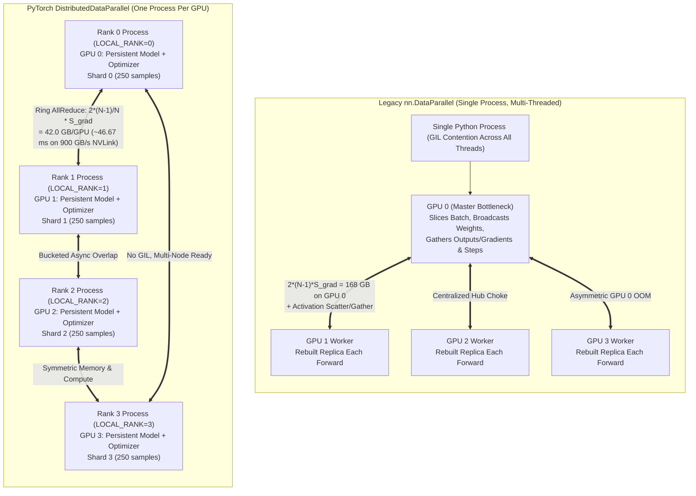
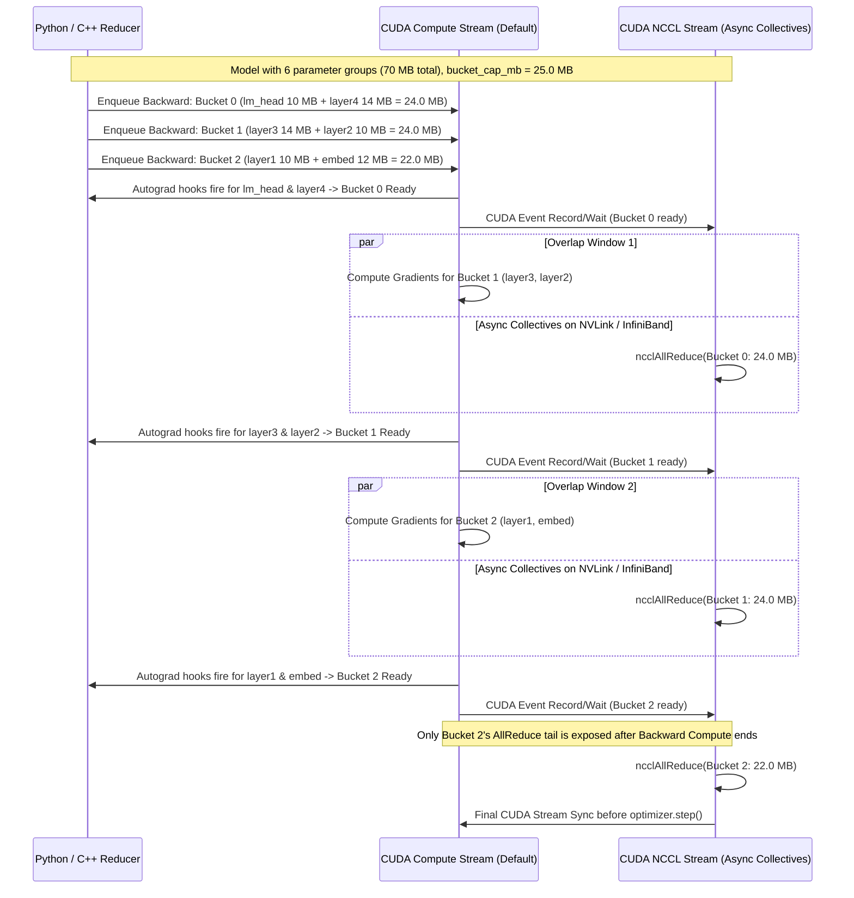
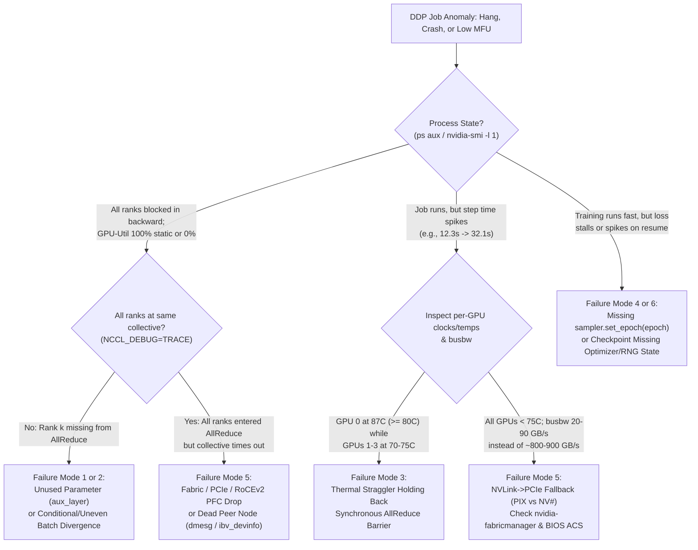

# 14.4 Data parallelism and DDP

| Field | Value |
|---|---|
| Level | Intermediate |
| Priority tier | 2 |
| Lab venue | Nebius GPU |
| Part | Part 14: Distributed training and fine-tuning |
| Sources to use | *Distributed AI Systems* 3; V13 ch3, ch1, ch8, ch12, labs 1–4; VL5 ch1; *AI Systems Performance Engineering* ch13 |
| Coverage file | `planning/coverage/chapters/14-04.md` |

## Why this matters for AI infrastructure

Picture a team that has finally fit its model on one GPU. The first real run starts, and the estimate on the dashboard says it will take two weeks on a single server. That is the second problem every team hits once memory is under control: training is too slow on one accelerator. A job that requires two weeks on a single server can finish in an afternoon if you spread the dataset across dozens of GPUs. The simplest way to do that is data parallelism. Each GPU gets its own copy of the model, each copy works on a different slice of the batch, and the copies agree on the gradients before anyone updates the weights. A gradient is the correction the optimizer applies to each weight, so agreeing on it is what keeps the copies identical. **Data parallelism is the fastest and least invasive way to multiply training throughput: replicate the model on every GPU, split each incoming batch across workers, and average the gradients before every optimizer step.**

Even inside massive 3D-parallel foundation model jobs that combine Tensor Parallelism and Pipeline Parallelism across thousands of GPUs, the outermost scaling loop is almost always data parallelism. Tensor Parallelism splits one layer across GPUs, and Pipeline Parallelism splits the stack of layers into stages. Both of those are harder to set up than data parallelism, so most teams wrap them in a data-parallel loop. For an infrastructure engineer, PyTorch DistributedDataParallel is the boundary where deep learning code meets the physical cluster network. Once you understand that boundary, most of the slow-job puzzles in this chapter become easier to read.

Unlike legacy `torch.nn.DataParallel`, which runs inside a single Python process throttled by the Global Interpreter Lock and funnels traffic through GPU 0, DDP spawns one independent operating-system process per GPU. During the backward pass, DDP overlaps matrix multiplications on the default CUDA compute stream with asynchronous NCCL AllReduce collectives on a dedicated communication stream. Whether a four-GPU H100 node achieves 95.7% scaling efficiency or stalls at 15% MFU depends directly on DDP's C++ Reducer. MFU, or model FLOPs utilization, is the share of the GPU's theoretical math throughput that the training run actually uses. Key tuning levers include reverse-order gradient bucketing, buffer aliasing, gradient accumulation, and collective watchdog settings. Each lever gets its own section below, with the reason it exists.

```text
DDP High-Level Performance Levers on a 4x H100 Node:
  Healthy 4-GPU H100 scaling efficiency:     95.7% to 95.9% (3.83x to 3.84x speedup)
  Degraded MFU under fabric/straggler stall: < 15% MFU
  Default C++ Reducer bucket size:           bucket_cap_mb = 25 MB (25.0 MB)
  Zero-copy gradient buffer aliasing:        gradient_as_bucket_view=True
  Gradient accumulation context manager:     with model.no_sync():
  Epoch shuffle seeding:                     sampler.set_epoch(epoch)
  Thermal straggler example (GPU 0 at 87 C): step time jumps from 12.3 s to 32.1 s
```

Picture a script that runs cleanly on one node and then stalls the moment you add a second. The usual suspects are a worker that grabbed the wrong GPU, or a gradient exchange that waited for the whole backward pass to finish before it started. Before you scale a training script across multiple nodes, verify that every worker process binds to its local GPU and overlaps gradient synchronization with backward computation. The sections below show how to check both, and how to recognize the failures that follow when either check fails.

## Prerequisites and outcomes

**Prerequisites:**
- Familiarity with deep learning fundamentals, distributed training motivation, and training memory and compute anatomy from earlier chapters in Part 14.
- Familiarity with NVIDIA NVLink and PCIe topologies via `nvidia-smi topo -m`, NCCL collectives, and Linux process management.

The chapter follows one data-parallel job from its first forward pass to a production failure. It starts with why legacy DataParallel chokes on GPU 0 and why DDP gives each rank its own process. Then it covers the Reducer and its buckets, the sampler and data loader, the optimization levers, and finally launching, profiling, and checkpointing at scale. Each part ends with the failures you are likely to see in that area.

---

## 1. The data-parallel contract and why DDP replaced DataParallel

### 1.1 When data parallelism applies: the memory vs. compute boundary

Distributed training exists because of two separate limits, and it helps to name them before you touch any code. Think of them as two walls that a job can hit one after the other. The first is the memory wall. Model states and activations are everything a GPU must hold while it trains: the weights, the gradients, the optimizer's running averages, and the intermediate results of the forward pass. When those states outgrow the GPU's HBM, which is the high-bandwidth memory packaged next to the GPU die, the job cannot start at all. The second is the compute wall. Even when the model fits, one GPU may need months or years to work through the dataset. The job runs without errors, but it never finishes in time.

Now put real numbers on both walls. As we derived in the previous chapter, a 175B parameter model requires 700 GB just for FP32 weights, which is 8.75 times larger than an 80 GB H100. A parameter is one learned number inside the model, so 175B means 175 billion of them. Even a 7B parameter model trained in FP32 with Adam reaches 180 to 190 GB once activations and staging buffers are included. Adam is the optimizer most large models use, and it keeps running averages for every parameter, which adds memory on top of the weights. On the compute side, a single pass of GPT-3 175B takes roughly 78 minutes on one A100 GPU, whereas 128 GPUs cut that step to 37 seconds. The second wall is the one data parallelism is built to attack. When you read a job's numbers later, ask which wall it is hitting. A job that runs out of memory needs a different fix from a job that runs too slowly, and mixing them up wastes days. Keep both sets of numbers in mind as you read the rest of the chapter, because every design choice below answers one of these two walls.

```text
Memory and Compute Boundaries Motivating DDP vs Sharding:
  GPT-3 (175B) FP32 weights:                 175B * 4 bytes = 700.0 GB (8.75x an 80 GB H100)
  Llama-3 (70B) mixed-precision state:       140 GB weights -> ~1.1 TB to > 1.2 TB total (16 bytes/param)

  7B Parameter Model in Pure FP32 with Adam:
    Model weights (FP32):                    7B * 4 bytes = 28.0 GB
    Gradients (FP32):                        7B * 4 bytes = 28.0 GB
    Adam optimizer states (FP32 m + v):      7B * 8 bytes = 56.0 GB
    Steady-state model state:                             = 112.0 GB (before activations)
    Activations (batch size 4):                           ~ 60.0-80.0 GB
    Temporary staging buffers:                            ~  5.0-10.0 GB
    Total single-GPU footprint:                           ~ 180.0-190.0 GB
    Result on 80 GB H100:                    OOM (2.45 GiB alloc fails at 79,456 MiB used, 103 MiB free of 79,559 MiB)

  GPT-3 (175B) Compute Scaling (batch size 2048, sequence length 2048):
    Step FLOPs (2 * 175B * 2048 * 2048):     ~1.46 * 10^18 FLOPs (1.468e18 FLOPs)
    1x NVIDIA A100 (312 TFLOPS):             4,679 to 4,705 seconds (~78 minutes)
    128x NVIDIA A100 GPUs:                   ~37 seconds
```

Data parallelism solves the compute wall only when the model state and the micro-batch activations fit inside each GPU's memory. A micro-batch is the small slice of a batch that one forward and backward pass handles. The fit can come from a few places. A smaller model may fit natively. Mixed precision, which stores numbers in fewer bits, and activation checkpointing, which recomputes activations instead of storing them, can shrink the footprint enough. Or the model may already be split by Tensor and Pipeline Parallelism shards, with data parallelism wrapped around the outside. A rank, in these notes, means one process that owns one GPU. Every rank runs the same four stages on every training iteration, and the stages stay in lockstep, which means no rank runs ahead of the others:

1. Forward pass. Every GPU holds an identical copy of the model parameters and buffers. Buffers are the extra tensors that are not trained, such as the running statistics inside BatchNorm. Each rank reads its own mini-batch shard that `DistributedSampler` hands out. The global batch size therefore equals the local batch size times the number of processes.
2. Backward pass. Each rank runs backpropagation on its own loss. Backpropagation is the walk back through the network that works out how much each weight should change. The result is a set of local gradients, computed only from that rank's shard.
3. Gradient synchronization. DDP calls an NCCL AllReduce across all processes. NCCL is the NVIDIA library that moves data between GPUs, and AllReduce is the collective operation that adds every rank's gradients together and hands the sum back to everyone. Every GPU then holds the same global mean gradient. This step is exact, not an approximation, because differentiation is linear. Averaging gradients across N shards gives the same result as computing gradients on one giant batch.
4. Optimizer step. Every rank starts from the same weights and applies `optimizer.step()` to the same averaged gradients. The results match bit for bit, so no rank has to send its weights to the others after the first step. Think of several people doing the same arithmetic on the same numbers and always reaching the same answer.

```text
Linearity of Gradient Averaging Across N Data-Parallel Ranks:
  Global batch size:        B_global = B_local * N
  Synchronized gradient:    g_sync   = (1 / N) * sum_{r=0..N-1} g_r
  Weight update lockstep:   W_{t+1}  = OptimizerStep(W_t, g_sync)  (identical on all N GPUs)
```

### 1.2 Why `nn.DataParallel` is an infrastructure anti-pattern

Before DDP existed, PyTorch engineers used `torch.nn.DataParallel` to utilize multiple GPUs on a single server. Imagine a colleague who copies an older tutorial onto a four-GPU server. The code runs, the GPUs show activity, and yet the job is barely faster than one GPU. The tutorial used the old API, and the old API is the cause. Even on a four-GPU or eight-GPU machine, legacy DataParallel is a severe performance anti-pattern. An anti-pattern is a common approach that looks reasonable and quietly causes trouble. This one runs inside a single Python process with multi-threading and turns GPU 0 into a centralized communication and memory bottleneck. The diagram below shows the difference in shape.



Four architectural flaws cause legacy DataParallel to fail at scale. Each one has a clear picture behind it.

1. The Global Interpreter Lock, or GIL, is a Python rule that lets only one thread run Python code at a time. Every GPU's work is driven from Python, so the threads queue behind one another. C++ operator dispatch, which hands each operation to the GPU, and autograd bookkeeping, which tracks the gradient graph, are then starved. The CUDA streams that feed the GPUs run dry as the GPU count grows.
2. Centralized hub traffic overloads GPU 0 on every step. Only GPU 0 runs the optimizer step, so GPU 0 must broadcast updated parameters to all peer GPUs during forward and gather full gradients back during backward. Every other GPU waits on that single hub.
3. Asymmetric memory usage causes GPU 0 to run out of memory early. GPU 0 gathers forward output logits from all peers to compute the loss and stages incoming gradients. As a result, GPU 0 runs at 89% to 100% VRAM while peer GPUs sit at 45% to 52%. The first GPU to fill up sets the limit for the whole batch size.
4. Sequential execution prevents communication overlap and blocks multi-node scaling. Legacy DataParallel cannot overlap weight broadcasts or gradient gathers with backward compute and cannot span multiple servers. Every step waits for each transfer to finish before the next compute begins.

```text
Traffic & Memory Comparison on 7B FP32 Model (S_grad = 28.0 GB, N = 4 GPUs):
  DP GPU 0 parameter + gradient traffic = 2 * (N - 1) * S_grad       = 2 * 3 * 28.0     = 168.0 GB
  DDP per-GPU Ring AllReduce traffic    = 2 * ((N - 1) / N) * S_grad = 2 * (3/4) * 28.0 =  42.0 GB
  Ratio (DP GPU 0 / DDP per GPU)        = N                                             =   4.0x higher on GPU 0
  DP GPU 0 extra activation gather      = (N - 1) * 1.5 GB                              =   4.5 GB imbalance
```

| Architectural Dimension | `torch.nn.DataParallel` (DP) | `DistributedDataParallel` (DDP) |
|---|---|---|
| Process & threading model | `1` OS process, `N` Python threads (GIL bottleneck) | `N` OS processes (`1` per GPU via `torchrun`, zero GIL contention) |
| Multi-node capability | Single node only | Single-node (NVLink/PCIe) and multi-node (InfiniBand/RoCEv2) |
| Forward pass weight sync | Broadcasts weights from `GPU 0` to `GPUs 1..N-1` **every step** | Broadcasts weights once at `init`; only `_buffers` (BatchNorm) sync if `broadcast_buffers=True` |
| Gradient synchronization | Centralized gather/reduce onto `GPU 0` (`2*(N-1)*S_grad` on `GPU 0`) | Decentralized NCCL Ring/Tree AllReduce (`2*(N-1)/N * S_grad` per GPU) |
| Compute–communication overlap | None (strictly sequential) | Asynchronous per-bucket AllReduce overlapped with backward compute |
| VRAM balance across GPUs | Asymmetric (`GPU 0` holds gathered outputs, loss, and master step) | Symmetric across all `N` ranks |

A two-GPU workstation can feel too small to matter, so the shortcut is tempting there. Resist it anyway. The habits you build on a workstation carry straight to a cluster, and the code that works on two GPUs is the code you will later copy onto thirty-two. Never use `nn.DataParallel` in production, even on a single two-GPU workstation. Always launch multi-process DDP with `torchrun`.

---

## 2. DDP internals: autograd hooks, reverse bucketing, and overlap

### 2.1 Forward pass state synchronization

Picture two GPUs that begin with slightly different weights. Their gradients disagree from the very first step, and the copies drift further apart after that. DDP has to prevent this before training starts, and the mechanism is simple once you see what a PyTorch module stores. Every module keeps its state in two ordered dictionaries. Trainable weights live in `_parameters`, and non-trainable persistent tensors such as BatchNorm running statistics live in `_buffers`. The first kind receives gradients. The second kind receives no gradients, but it still has to match across GPUs, or the running statistics will disagree.

Consider the moment you write `DDP(model, device_ids=[local_rank])`. Right there, during construction, DDP calls `_sync_module_states()`. That function broadcasts both parameters and buffers from rank 0 to all peer ranks. A broadcast means one sender copies its data to everyone else. The result is identical starting weights, even if you forgot to seed the random number generators identically. Rank 0 is the authority here, so its copy wins.

Each forward pass starts with a question: should DDP copy the buffers again? The `broadcast_buffers` flag answers it.
- Which models can turn it off? Modern Transformers such as Llama, Mistral, and GPT use LayerNorm or RMSNorm, which store no running statistics in buffers. Setting `broadcast_buffers=False` eliminates unnecessary pre-forward buffer broadcast checks, so the step does less bookkeeping.
- When must you keep it on? Vision and hybrid models that use BatchNorm with a small per-GPU batch size need global batch statistics across all GPUs. Convert those layers before wrapping in DDP using SyncBatchNorm. Keep in mind that SyncBatchNorm adds an extra cross-rank collective per normalization layer during the forward pass, so the forward pass gets slower in exchange for correct statistics.

### 2.2 C++ Reducer, reverse-order parameter bucketing, and `gradient_as_bucket_view`

Imagine you are writing data parallelism yourself and must decide when to send gradients. The first idea is to send each tensor as soon as it is ready. A tensor here is a block of numbers, such as one weight matrix or one bias vector. The trouble is that every send carries a fixed launch cost. Kernel launch latency of 5 to 15 microseconds per tensor adds up across a model with hundreds of tensors and destroys interconnect efficiency. The second idea is to wait until `loss.backward()` finishes computing gradients for the entire model and then send everything in one big AllReduce. That avoids the launch cost, but now the network sits idle during backward compute. The GPUs then sit idle during communication. Neither idea is good enough, so DDP picks a middle path.

**DDP solves both problems inside its C++ Reducer by packing parameters in reverse layer order into contiguous 25 MB buckets and launching asynchronous collectives as each bucket fills.**

1. Backpropagation starts at the output layer and walks back toward the input embedding, so the last layers finish first. DDP follows the same order. It iterates over `list(model.parameters())[::-1]` in reverse and packs parameters into contiguous buckets up to `bucket_cap_mb`, which defaults to 25 MB. A bucket is one flat block of memory that gets reduced in a single collective.
2. When DDP is built, the Reducer attaches a C++ autograd post-hook to every trainable parameter's `AccumulateGrad` node. The Reducer is the part of DDP that manages the buckets. AccumulateGrad is the autograd step that writes a finished gradient into its parameter. When a parameter's gradient finishes on the default CUDA compute stream, its hook fires and marks that parameter ready inside its bucket.
3. A bucket is sent only after every parameter in it has fired its hook. Then the Reducer launches an asynchronous AllReduce collective for that bucket on a dedicated NCCL CUDA stream. A CUDA stream event wait ensures the NCCL stream waits for the bucket's gradient kernels without blocking the CPU or the compute stream. In plain words, the network starts on the first bucket while the GPU keeps computing gradients for the earlier layers.



The packing rule is easier to trust after you trace it with real numbers. The six-layer model verified in `code/part14/data_parallelism_ddp.py` gives a clean case. Work through it once by hand, and the bucket boundaries stop looking arbitrary. Notice that the output head lands in the first bucket, because its gradient is the first one to be ready:

```text
Reverse-Order Bucket Packing Example (Total = 70.0 MB):
  Forward registration order (layers 0 -> 5):
    embed.weight: 12.0 MB | layer1.weight: 10.0 MB | layer2.weight: 10.0 MB
    layer3.weight: 14.0 MB | layer4.weight: 14.0 MB | lm_head.weight: 10.0 MB

  Case A — Default bucket_cap_mb = 25.0 MB (forms 3 buckets in reverse order 5 -> 0):
    Bucket 0: ("lm_head.weight", "layer4.weight") -> 10.0 + 14.0 = 24.0 MB <= 25.0 MB (layers 5, 4; fires first)
    Bucket 1: ("layer3.weight", "layer2.weight")  -> 14.0 + 10.0 = 24.0 MB <= 25.0 MB (layers 3, 2)
    Bucket 2: ("layer1.weight", "embed.weight")   -> 10.0 + 12.0 = 22.0 MB <= 25.0 MB (layers 1, 0)

  Case B — Larger bucket_cap_mb = 50.0 MB (merges into 2 buckets):
    Bucket 0: ("lm_head.weight" .. "layer2.weight") -> 48.0 MB (fewer launches, but delays first AllReduce)
    Bucket 1: ("layer1.weight", "embed.weight")     -> 22.0 MB
```

Memory is where this design can waste space, so it helps to see both settings side by side. By default, DDP sets `gradient_as_bucket_view=False`. Under that default, each parameter allocates its own gradient tensor, and the DDP Reducer allocates a second set of contiguous bucket buffers of the exact same total size. That is two full copies of the gradients living on the GPU at once. As each hook fires, DDP copies the parameter gradient into the bucket buffer, runs the AllReduce collective, and copies the averaged slice back into the parameter gradient. Those copies cost memory and time on every step.

Setting `gradient_as_bucket_view=True` changes the layout. Each parameter gradient becomes a zero-copy tensor view directly inside the Reducer's flat bucket buffer. A view is a second name for the same memory, so nothing is copied. That single flag eliminates duplicate gradient memory and removes two device-to-device memory copies per parameter on every step. Because the gradients now live inside the bucket buffers, a few habits must change. When `gradient_as_bucket_view=True` is active, never call `param.grad.detach_()`, because that breaks the link to the bucket. Clear gradients with `optimizer.zero_grad(set_to_none=True)` instead, so the views are reset cleanly.

```text
Memory Savings with gradient_as_bucket_view=True (storage_offset pointer view) on a 7B Model:
  1. Full FP32 Adam (28.0 GB weights + 56.0 GB Adam states + 28.0 GB param.grad):
     gradient_as_bucket_view=False: + 28.0 GB Reducer buckets = 140.0 GB steady state
     gradient_as_bucket_view=True:  zero-copy views           = 112.0 GB (saves 28.0 GB VRAM)

  2. Mixed-Precision BF16/FP32 Adam (14.0 GB BF16 weights + 14.0 GB BF16 grads + 84.0 GB FP32 master/m/v):
     gradient_as_bucket_view=False: + 14.0 GB BF16 buckets    = 126.0 GB steady state
     gradient_as_bucket_view=True:  zero-copy views           = 112.0 GB (saves 14.0 GB VRAM)
```

### 2.3 Quantifying compute–communication overlap and `torch.compile` subgraphs

Suppose your job is slow, and the profiler shows the network busy in one stretch and the GPU busy in another. You want to know whether the two stretches overlap at all. How much wall-clock time does bucketed overlap actually save during `loss.backward()`? Think of a conveyor belt with two stations. The compute station finishes one bucket of gradients, and then the network station takes that bucket while the compute station starts the next one. The two stations run on separate hardware engines, so they really can work at the same time. The NCCL stream can start reducing Bucket b as soon as two conditions are met. First, Bucket b must finish its backward compute. Second, Bucket b-1 must finish its AllReduce on the network link, because the link handles one bucket at a time.

```text
Two-Stream Overlap Equations for B Buckets (compute times c_b, AllReduce times a_b):
  Compute stream completion for bucket b:
    T_comp(b) = sum_{k=0..b} c_k

  NCCL communication stream window for bucket b:
    T_comm_start(b) = max(T_comp(b), T_comm_end(b - 1))   (with T_comm_end(-1) = 0)
    T_comm_end(b)   = T_comm_start(b) + a_b

  Sequential (non-overlapped) time = T_comp(B - 1) + sum_{b=0..B-1} a_b
  Overlapped backward + sync time  = T_comm_end(B - 1)
  Exposed communication overhead   = T_comm_end(B - 1) - T_comp(B - 1)
  Hidden communication time        = (sum_{b=0..B-1} a_b) - Exposed communication overhead
  Overlap efficiency (%)           = (Hidden communication time / sum_{b=0..B-1} a_b) * 100%
```

Evaluating this timeline on a four-bucket backward pass shows why bucketing is mandatory. Each bucket takes 3.0 ms of compute and 2.5 ms of AllReduce. Read the rows in order, and watch when each AllReduce starts. Each one begins right after its bucket is ready and runs while the next bucket is still being computed:

```text
Worked Overlap Timeline (B = 4 buckets, c_b = 3.0 ms compute, a_b = 2.5 ms AllReduce):
  Total backward compute = 12.0 ms | Total AllReduce = 10.0 ms | Sequential total = 22.0 ms

  1. Standard Bucketed DDP (B = 4 buckets, bucket_cap_mb = 25, 4 TorchDynamo subgraphs):
     Bucket 0: compute 0.0 ->  3.0 ms | AllReduce 0 runs  3.0 ->  5.5 ms (overlaps Bucket 1 compute)
     Bucket 1: compute 3.0 ->  6.0 ms | AllReduce 1 runs  6.0 ->  8.5 ms (overlaps Bucket 2 compute)
     Bucket 2: compute 6.0 ->  9.0 ms | AllReduce 2 runs  9.0 -> 11.5 ms (overlaps Bucket 3 compute)
     Bucket 3: compute 9.0 -> 12.0 ms | AllReduce 3 runs 12.0 -> 14.5 ms (only 2.5 ms tail exposed)
     Result: 14.5 ms total (1.517x speedup vs 22.0 ms), 7.5 ms hidden (75.0% overlap efficiency)

  2. Single-Bucket Anti-Pattern under torch.compile (bucket_cap_mb = 1000 MB, 1 subgraph, 0 breaks):
     All 12.0 ms of compute must finish before AllReduce starts -> 22.0 ms total (10.0 ms exposed, 0.0% overlap)
```

Now add `torch.compile` to the picture. A graph break is a point where the compiler stops and hands control back to ordinary Python, and it usually looks like a performance bug. With DDP, the breaks are deliberate. When you compile a DDP model with `torch.compile`, TorchDynamo, the compiler's frontend, inserts graph breaks at DDP bucket boundaries. You can inspect them with `torch._dynamo.explain(model, ...)`. It compiles each bucket's backward pass into a separate fused TorchInductor subgraph, which is a block of generated GPU code. That design lets the C++ Reducer launch `ncclAllReduce` between subgraphs. If an engineer sets `bucket_cap_mb` to 1000 MB hoping to eliminate graph breaks, AllReduce cannot start until the entire backward pass finishes. The overlap then drops to zero, and the network is idle again, which is exactly the problem buckets were meant to solve.

### 2.4 The AllReduce operation: Ring vs. Tree cost model

To see what DDP's C++ Reducer automates, consider how you would write the gradient exchange by hand. Suppose a teammate asks you to average gradients without DDP. A `sync_gradients(model, world_size)` helper would loop over every trainable parameter, call `dist.all_reduce(param.grad, op=dist.ReduceOp.SUM)`, and divide by the world size. That works, but it sends one parameter at a time and waits for each one. The Reducer does the same job with buckets and overlap, so the manual version is mainly useful for understanding what happens underneath.

The collective itself has a shape worth learning. In a Ring AllReduce across N GPUs, the GPUs form a circle and pass chunks around it. Phase 1 runs N-1 Reduce-Scatter steps, where each GPU ends up owning one fully summed chunk. Phase 2 runs N-1 All-Gather steps, where those summed chunks travel back around the ring so every GPU ends with the whole result. Each GPU sends and receives about the same amount of data, which is why the Ring stays efficient as you add GPUs. Comparing three cluster scales for our 7B FP32 model shows when NCCL switches from a Ring to a Double Binary Tree:

```text
Ring vs. Tree AllReduce Scaling for 7B FP32 Gradients (S_grad = 28.0 GB):
  1. 4x H100 GPUs on single-node NVLink (900.0 GB/s per GPU):
     Data moved per GPU: 2 * (3/4) * 28.0 GB = 42.0 GB
     Wire time:          42.0 GB / 900.0 GB/s = 46.67 ms (~47 ms)
     Baseline 1-GPU step:12.3 s (8.13 tokens/sec) -> wire overhead = 0.38% (99.6% / 3.98x theoretical ceiling)
     Measured 4-GPU step:12.9 s (31.2 tokens/sec) -> 3.83x to 3.84x speedup (95.7% to 95.9% scaling efficiency)

  2. 8x H100 GPUs on single-node NVLink (900.0 GB/s per GPU):
     Data moved per GPU: 2 * (7/8) * 28.0 GB = 49.0 GB
     Wire time:          49.0 GB / 900.0 GB/s = 54.4 ms (~54 ms)
     Hop latency:        8 hops * ~1-5 us < 0.05 ms (negligible; NCCL selects Ring)

  3. 512 GPUs (64 nodes) over cross-node InfiniBand (25.0 to 50.0 GB/s effective per GPU):
     Data moved per GPU: 2 * (511/512) * 28.0 GB = 55.89 GB (~55.9 GB)
     Wire time @ 25 GB/s:55.89 GB / 25.0 GB/s = 2,235.6 ms (~2.2 s)
     Hop latency:        512-GPU ring requires 2 * 511 = 1,022 sequential hops (0.5-2.5 ms propagation + queue delay)
     Topology switch:    NCCL (NCCL_ALGO) switches to Double Binary Tree / SHARP CollNet, cutting 512 hops to log2(512) = 9 hops
```

Read the three cases as a trade. A small ring over fast NVLink barely notices the cost of the collective. A 512-GPU job over InfiniBand pays a lot for every hop, so NCCL changes the algorithm to cut the hop count. Keep that in mind when a job that scaled well on one node slows down when it spans several. The payload did not change, but the path did.

Always enable `gradient_as_bucket_view=True` and keep `bucket_cap_mb` near 25 to 50 MB so DDP saves one full copy of gradient memory while hiding communication behind backward compute.

---

## 3. Data sharding, DataLoader pipelines, and uneven inputs

### 3.1 `DistributedSampler` internals: `set_epoch()`, `drop_last`, and seed hygiene

Here is a mistake that looks harmless. You launch four DDP processes, and each one builds a standard `DataLoader(dataset, batch_size=32, shuffle=True)`. Every GPU independently shuffles the entire dataset and trains on every sample. The job runs, the loss goes down, and nothing crashes. But each sample is seen four times per epoch instead of once, so you pay for four times the compute and get no extra coverage. The fix is to partition the work, and the sampler is the tool that does it.

`torch.utils.data.distributed.DistributedSampler` partitions a dataset of length D deterministically across N processes. Each rank gets its own index list, and the lists do not overlap. Two rules decide how the split works:
1. When `drop_last=True` and D is not divisible by N, the sampler drops the tail samples so every rank receives an equal floor slice. The leftover samples are simply skipped for that epoch. When `drop_last=False`, the sampler rounds up and pads the index list by repeating indices from the front of the permutation. That padding ensures all ranks still run the same number of batches, which matters because a rank with fewer batches would stall the others.
2. When `shuffle=True` on the distributed sampler, every rank seeds a generator with `seed + epoch` and builds the exact same global permutation of indices. Because all ranks build the same permutation, they can each take a clean, non-overlapping slice of it. Rank r then takes its strided slice across the permutation, so the shards never collide.

The epoch number is the part people forget. If you forget to call `sampler.set_epoch(epoch)` at the start of every epoch loop, the epoch counter stays at zero forever. The seed then never changes, so every GPU trains on the exact same batch ordering in Epoch 1, Epoch 2, and every subsequent epoch. That mistake silently degrades model convergence without raising an error. The loss curve looks normal, which is why the bug survives for weeks. In addition, never pass `shuffle=True` to the data loader when passing a sampler, because PyTorch raises a `ValueError`. The sampler already owns the shuffling, so the two settings would fight each other.

```text
DistributedSampler Partitioning Math (world_size N = 4, self.epoch defaults to 0):
  Divisible dataset (D = 1000, N = 4):
    Each rank gets 250 strictly disjoint indices (union_size = 1000) via indices[r : total_size : world_size]

  Non-divisible dataset (D = 1003, N = 4):
    drop_last=True:  num_samples = D // N = 1003 // 4 = 250/rank (total_size = 1000, drops D % N = 3 tail samples)
    drop_last=False: num_samples = ceil(D / N) = ceil(1003 / 4) = 251/rank (total_size = 1004, pads 1 sample from front)
```

### 3.2 Multi-process `DataLoader` queues and worker sizing

Even when the network fabric is fast, a poorly tuned CPU data pipeline will starve your GPUs between steps. A GPU that waits for its next batch is still billed for every second of that wait. The data loader is the component that keeps the batches flowing, and it does its work in separate processes so the main training loop is never blocked by file reads. When worker count is greater than zero, the data loader spawns `_MultiProcessDataLoaderIter` worker processes for every DDP rank. Here is the flow for one batch:

- Who asks for the next batch? The main training process pushes batch index lists from the sampler into an `index_queue`, prefetching `prefetch_factor * num_workers` batches ahead so there is always work waiting.
- Who reads the files? Each DDP rank spawns its own OS worker processes. Those workers read samples from storage, apply CPU transforms, and push collated tensors into `worker_result_queue`. Collated means the individual samples have been stacked into one batch tensor.
- How does the batch reach the GPU faster? Setting `pin_memory=True` starts a `pin_memory_thread` that copies tensors into page-locked host RAM. Page-locked memory cannot be swapped out by the operating system, so the copy to the GPU can run as a direct transfer. Calling `data.to(device, non_blocking=True)` can then DMA directly over PCIe without blocking the CPU.
- Why not restart the workers each epoch? Setting `persistent_workers=True` keeps the worker pool alive across epochs instead of respawning processes at every epoch boundary. Respawning costs startup time every epoch, and that time shows up as idle GPUs.

```text
Per-Rank DataLoader Worker Sizing Rule (default prefetch_factor = 2):
  Total host DataLoader processes = gpus_per_node * num_workers_per_rank
  num_workers_per_rank            = min(8, cpu_cores_per_node // gpus_per_node // 2)
```

### 3.3 Handling uneven inputs across ranks with `model.join()`

Uneven inputs are a quiet trap. Picture a custom iterable dataset, or a sequence-packing pipeline with `drop_last=False`, where the ranks end up with different numbers of batches. One rank runs out of batches before its peers do, and then the job stops making progress with no error on screen. Suppose Rank 0 has 2 batches in an epoch while Rank 1 has 3 batches.

Without `model.join()`, Rank 0 finishes step 2 and exits the training loop. Meanwhile, Rank 1 enters step 3, calls `loss.backward()`, and blocks forever inside the AllReduce collective waiting for Rank 0. Every collective needs all ranks to show up, and Rank 0 has already left. The job hangs until the 30-minute process-group watchdog kills the run. Wrapping the batch loop in `with model.join():` hooks into the DDP Reducer so early-finishing Rank 0 stays inside the context manager. Rank 0 then participates in one shadow AllReduce collective with zero gradients during Rank 1's third step. The shadow collective lets Rank 1 finish its step, and both ranks can exit together. The word shadow means the early rank has no batch of its own to contribute. It joins the collective only so the others are not left waiting, and it sends zero gradients in its place. The bookkeeping for that exchange lives inside the Reducer, so you do not write it yourself. Once the last batch is done, the early rank leaves the context manager and the epoch closes cleanly.

Call `sampler.set_epoch(epoch)` at the top of every epoch loop. Also wrap uneven iterable data loaders in `with model.join():` so no rank ever stalls a collective barrier. A barrier is a point where every rank must arrive before any of them may continue.

---

## 4. Optimization levers: AMP, `no_sync()`, static graphs, and hooks

### 4.1 Mixed precision with DDP

Think about what full 32-bit precision costs on the wire. Every gradient value takes four bytes, so a model that stores its gradients in lower precision sends fewer bytes on every AllReduce. Running DDP in full 32-bit precision moves twice as many gradient bytes across the network as necessary. Training with `torch.autocast` cuts activation memory and gradient communication volume in half while activating GPU Tensor Cores. Autocast is the PyTorch context that runs each operation in the precision it handles best. Two half-precision formats are common, and they behave differently.

- BF16 via `torch.bfloat16` is preferred on Ampere, Hopper, and Blackwell GPUs because it shares FP32's eight-bit exponent range. The exponent sets how large or small a number can be, so BF16 keeps the same reach as FP32 with fewer digits of detail. Gradients rarely underflow, which means they rarely shrink to zero, so a gradient scaler is not required.
- FP16 via `torch.float16` uses a narrow five-bit exponent that is prone to gradient underflow. Small gradients can fall below what FP16 can represent and become zero. When using FP16 with DDP, instantiate `scaler = torch.cuda.amp.GradScaler()` on every rank. The scaler multiplies the loss up so the small gradients survive. Calling `scaler.scale(loss).backward()` scales the loss before backpropagation so DDP's Reducer averages the scaled gradients across all ranks. Next, `scaler.step(optimizer)` unscales the synchronized gradients in lockstep on every rank. It checks for overflow identically across ranks before `scaler.update()` adjusts the scale factor. Because every rank sees the same synchronized gradients, every rank makes the same decision about the scale.

### 4.2 Gradient accumulation with `model.no_sync()`

Gradient accumulation is a way to get a larger effective batch without more memory. Instead of one big forward and backward pass, you run several small micro-batches and add up their gradients before one optimizer step. The trap shows up when that loop sits inside DDP. When engineers add gradient accumulation over K micro-batches to a DDP script, they often forget that `loss.backward()` triggers DDP's autograd hooks on every single micro-batch. Each hook starts a collective, so the network gets busy again and again while the weights stay the same. Running K micro-batches without disabling those hooks executes K full AllReduce collectives per optimizer step. That wastes K-1 network transfers because the weights do not change until step K.

**Wrapping the first K-1 micro-batches inside `with model.no_sync():` disables DDP's Reducer hooks so gradients accumulate locally in GPU memory and only synchronize once on the final micro-batch.**

The reason this is safe is linearity again. Summing local gradients first and averaging them across ranks later gives the same final gradient as averaging after every micro-batch. You keep the math and skip the repeated trips over the wire.

```text
Gradient Accumulation Communication Math (K micro-batches, N GPUs, gradient size S_grad):
  1. Naive accumulation (without model.no_sync()):
     AllReduce calls per optimizer step = K
     Ring bytes per GPU per step        = K * 2 * ((N - 1) / N) * S_grad

  2. Optimized accumulation (with model.no_sync() on steps 0 .. K-2):
     AllReduce calls per optimizer step = 1
     Ring bytes per GPU per step        = 1 * 2 * ((N - 1) / N) * S_grad
     Communication reduction factor     = K  (saves (K - 1) / K of AllReduce volume & latency)

  3. Linearity equivalence (max_diff < 1e-12):
     (1 / N) * sum_{r=0..N-1} [ sum_{k=0..K-1} (g_{r,k} / K) ]
     == sum_{k=0..K-1} [ (1 / N) * sum_{r=0..N-1} (g_{r,k} / K) ]

  4. Worked 7B FP32 Example on N = 4 GPUs (S_grad = 28.0 GB, 42.0 GB per AllReduce):
     K = 4 micro-batches: cuts AllReduce calls 4 -> 1 (4.0x reduction, 75.0% saved, 168.0 GB -> 42.0 GB/GPU)
     K = 8 micro-batches: cuts AllReduce calls 8 -> 1 (8.0x reduction, 87.5% saved, 336.0 GB -> 42.0 GB/GPU)
```

Here is a case that catches people out. Suppose the last few batches of an epoch do not fill a complete group of K micro-batches. Those leftover gradients are still sitting in memory. If nothing handles them, they leak into the next epoch and mix with gradients that belong somewhere else. The fix is to run a final synchronized backward and optimizer step on the tail micro-batches. That final flush synchronizes all remaining gradients before the epoch ends, so every batch counts exactly once.

### 4.3 `find_unused_parameters=True` vs. `static_graph=True`

Models often have an if statement in the forward pass. Picture an auxiliary classifier head that runs only when a flag is enabled. On the steps where the flag is off, some parameters take no part in computing the loss. By default, DDP expects every trainable parameter hook to fire during `loss.backward()`. If `aux_layer.weight` is skipped, its bucket never reaches 100% readiness and its AllReduce never launches. The other ranks wait for a bucket that will never be sent. The run then hangs or crashes on the next step with an unreduced prior iteration error. You have two ways out, and they trade speed for safety.

- Why not just turn on the scan? Passing `find_unused_parameters=True` forces DDP to traverse the autograd graph from the root loss tensor on every single forward and backward pass to mark unreachable parameters as ready. That prevents the deadlock, but it adds CPU autograd traversal overhead on every step.
- Which flag is better when the skip is fixed? Passing `static_graph=True` is preferred whenever the set of active parameters is fixed across iterations. DDP records the active parameter schedule once during warmup and reuses that reduction schedule forever with zero per-step traversal overhead. Even better, in standard models, wire every parameter into the loss via `loss = main_loss + 0.0 * aux_out.sum()` so unused-parameter scanning stays disabled. The extra term adds nothing to the value of the loss, but it makes every parameter take part in the graph. Think of it as giving the unused head a dummy seat at the table, so the collective never waits for a rank that did not show up. Choose between the two options by asking how stable the skip pattern is. If the same parameters are skipped on every step, `static_graph=True` gives you the speed. If the skip changes from step to step, the scan is the only safe choice.

### 4.4 Gradient hooks and custom DDP communication hooks

Sometimes you need to inspect or change gradients on their way through DDP, for example to log a layer's gradient norm or to compress traffic. DDP exposes two hook levels for that, and they work at different sizes.
1. Per-parameter autograd gradient hooks registered via `model.module.fc.weight.register_hook(fn)` inspect or transform an individual parameter's gradient tensor during the backward pass. Notice that you unwrap `.module` to access the underlying PyTorch module. The DDP wrapper does not expose the layer names you care about, so you go one level down.
2. Per-bucket DDP communication hooks registered via `model.register_comm_hook(state, hook_fn)` override DDP's default C++ AllReduce at the bucket level. The hook receives a `dist.GradBucket` object and extracts the flat contiguous tensor via `bucket.buffer()`. It then performs custom asynchronous communication such as FP16 compression or PowerSGD low-rank compression and returns a `torch.futures.Future`. A future is a handle to a result that is not ready yet, which is how the hook keeps the overlap going.

Always wrap gradient accumulation steps 0 through K-2 in `with model.no_sync():` so your interconnect only transfers gradients when the optimizer actually steps.

---

## 5. Launching, profiling, and checkpointing DDP at scale

### 5.1 Using `torchrun`, device selection best practices, and multi-node architecture

Picture the first multi-node launch. Each server starts its own process, and somehow they must find each other, agree on who is who, and bind to the right GPUs. Launching distributed jobs with legacy `torch.distributed.launch` or manual `mp.spawn` scripts is brittle and error-prone, because you end up writing the coordination yourself. Always use `torchrun`, which spawns one worker process per local GPU, manages rendezvous over a `c10d` TCPStore, and injects standard environment variables into every worker. A rendezvous is the meeting point where the workers register with each other before training starts. When configuring a multi-node architecture, validate InfiniBand RDMA device mappings first with `ibdev2netdev` and `ib_write_bw`. RDMA lets one machine write straight into another machine's memory, and checking it early saves hours of guesswork later.

A handful of environment variables decide who each worker is. They are set for you by `torchrun`, and it helps to know what each one means.

- `LOCAL_RANK` identifies the GPU index on the local server. Always bind the CUDA device using `torch.cuda.set_device(int(os.environ["LOCAL_RANK"]))`. Never pass global `RANK` to `set_device()`. On Node 1 of an eight-GPU-per-node job, global ranks are 8 through 15 while local GPU indices are 0 through 7. Passing the global number would ask for a GPU that does not exist on that server.
- `RANK` identifies the global process rank across the entire cluster and gates console logging and rank 0 checkpoint writes.
- `WORLD_SIZE` equals the number of nodes times processes per node and gives the total number of participating processes.
- `MASTER_ADDR` and `MASTER_PORT` specify the routable IP address and free TCP port on Node 0 where ranks rendezvous during `dist.init_process_group(backend="nccl")`. Every worker needs to reach that address, so a firewall or wrong interface name here shows up as a hang at startup.

In standard DDP, if a single worker crashes or a spot node is preempted, the entire collective aborts. A spot node is a cheaper cloud machine that the provider can take back at short notice. Passing `--max_restarts=3`, `--rdzv_id=<job_id>`, `--rdzv_backend=c10d`, and `--rdzv_endpoint=$MASTER_ADDR:29400` activates Torch Distributed Elastic, which restarts the job instead of letting it die:
- Fault-tolerant mode uses a fixed node count such as two nodes with up to three restarts. If a worker crashes, the elastic agent terminates surviving workers and re-runs rendezvous across the two nodes. It then respawns workers and resumes from the latest atomic checkpoint.
- Elastic mode uses a dynamic range such as `--nnodes=2:4`. Nodes can join or leave mid-run, dynamically changing the world size and the global batch size at resize boundaries.

### 5.2 Profiling DDP overlap

A job runs, but it feels slower than the math says it should. How do you prove that AllReduce collectives are truly overlapping with backward computation rather than running one after the other? Use a three-part profiling workflow. Each part answers a narrower question than the one before it.

1. Capture CPU and CUDA activities across a few active steps with `torch.profiler.profile` and export `prof.export_chrome_trace("ddp_trace.json")` for inspection in Perfetto. Perfetto is a trace viewer that runs in the browser. In the trace timeline, backward compute kernels execute on the default CUDA compute stream while AllReduce kernels run on a separate NCCL CUDA stream. Horizontal bars that overlap in wall-clock time on two different stream rows prove hardware overlap. If the bars sit end to end, the overlap is not happening.
2. Use Meta Holistic Trace Analysis instead of the deprecated TensorBoard profiler plugin to ingest per-rank JSON traces across the cluster. HTA aligns NVTX markers on a single timeline and immediately shows if Rank 1 entered backward late because it was waiting for Rank 0. NVTX markers are named ranges that you add to the code, and they make the timeline readable.
3. Emit structured JSON step breakdowns and classify the exposed AllReduce share against the three health bands from *Distributed AI Systems*:

```text
Example 24.0 ms MLPerf Training Iteration Breakdown (:::MLL format, AISPE Table 13-6):
  Forward pass:              10.5 ms  (43.8%)
  Backward pass:              9.0 ms  (37.5%)  -> Total Compute = 19.5 ms (81.3%)
  AllReduce (exposed):        4.0 ms  (16.7%)  -> < 20% = GOOD_OVERLAP Band
  Other (data/host overhead): 0.5 ms   (2.1%)
  Total step time:           24.0 ms (100.0%)

DAI Chapter 3 Exposed AllReduce Health Bands:
  < 20% of step time:  GOOD_OVERLAP     (healthy NVLink or well-overlapped fabric; e.g., 16.7% above, or 0.38%-4.3% on 4x H100 7B)
  20%-40% of step time:ACCEPTABLE_COMM  (typical cross-node fabric; tune bucket_cap_mb across [10, 25, 50, 100] MB)
  > 40% of step time:  COMM_BOTTLENECK  (e.g., 9.0 / 20.0 ms = 45.0%; PCIe fallback, RoCEv2 PFC drops, or tiny micro-batch)
```

### 5.3 Checkpointing DDP safely: `.module`, RNG states, atomic renames, and `dist.barrier()`

Checkpoints are where a bad save can silently ruin a long run. Imagine the job dies in the middle of the night, and the file on disk is half-written and unreadable. Because every DDP rank holds an identical replica of the weights and optimizer states after the optimizer step, only rank 0 should write a replicated DDP checkpoint to disk. Having all N ranks write to the same file path corrupts the archive and floods the storage metadata server. Follow three rules for spike-free, corruption-proof checkpointing:

1. Always save `model.module.state_dict()` rather than `model.state_dict()`. Calling `model.state_dict()` on a DDP wrapper prefixes every key with `"module."`. Unwrapping the inner module produces clean keys that load into both single-GPU and DDP models, so you can test a checkpoint on one GPU without editing it.
2. Save all four reproducibility states required by Volume 13 Lab 04. Those include the model state dictionary, the optimizer state dictionary, scheduler and gradient scaler states plus the epoch number, and all random number generator states. A resumed run should behave like the run that never stopped, and these states are what make that true. Omitting Adam's momentum and variance buffers forces Adam to restart cold and causes an immediate loss spike on resume.
3. Write checkpoints atomically and synchronize with `dist.barrier()`. If rank 0 is killed mid-write during `torch.save(ckpt, filepath)`, the file is truncated. Atomic means the file appears under its final name only when it is complete. Always write to a temporary file, call `os.rename(temp_file, filepath)` for an atomic POSIX rename, and call `dist.barrier()` immediately after the rank 0 save block, so no other rank runs ahead while the save is in progress. When loading a checkpoint, every rank loads the file onto its own GPU with `torch.load(filepath, map_location=f"cuda:{local_rank}")`. To eliminate floating-point non-determinism when debugging inconsistent gradients across runs, enable deterministic algorithms via `torch.use_deterministic_algorithms(True)`. Deterministic algorithms run slower, so turn them on for debugging rather than for every production run. When you move from DDP to FSDP in the next chapter, replace rank 0 saves with parallel sharded `torch.distributed.checkpoint`.

Save DDP checkpoints only from rank 0 using an atomic temporary file rename followed immediately by `dist.barrier()`.

A quick test tells you whether your checkpoint is good enough. Kill the job after a save, start it again, and compare the first few losses with a run that never stopped. If they match, the save captured everything it needed. If they drift, one of the three rules above was skipped, and the drift tells you which state went missing.

---

## Commands and configurations that matter

### 1. Production single-node and multi-node DDP training template (`train_ddp_prod.py`)

```python
import os
import random
from datetime import timedelta
import numpy as np
import torch
import torch.distributed as dist
import torch.nn as nn
from torch.nn.parallel import DistributedDataParallel as DDP
from torch.utils.data import DataLoader, DistributedSampler

def set_seed(seed: int = 42) -> None:
    torch.manual_seed(seed)
    torch.cuda.manual_seed_all(seed)
    np.random.seed(seed)
    random.seed(seed)

def setup_ddp() -> tuple[int, int, int, torch.device]:
    rank = int(os.environ["RANK"])
    local_rank = int(os.environ["LOCAL_RANK"])
    world_size = int(os.environ["WORLD_SIZE"])
    # CRITICAL: Always bind device with LOCAL_RANK, never global RANK
    torch.cuda.set_device(local_rank)
    device = torch.device(f"cuda:{local_rank}")
    dist.init_process_group(
        backend="nccl",
        timeout=timedelta(minutes=30),  # Enforced when TORCH_NCCL_BLOCKING_WAIT=1
    )
    return rank, local_rank, world_size, device

def save_checkpoint_atomic(model: DDP, optimizer: torch.optim.Optimizer, epoch: int, loss: float, path: str) -> None:
    if dist.get_rank() == 0:
        tmp_path = f"{path}.tmp"
        ckpt = {
            "epoch": epoch,
            "loss": loss,
            "model_state_dict": model.module.state_dict(),  # Unwrap .module!
            "optimizer_state_dict": optimizer.state_dict(),
            "rng_state": torch.get_rng_state(),
            "cuda_rng_state": torch.cuda.get_rng_state_all(),
            "numpy_rng_state": np.random.get_state(),
            "python_rng_state": random.getstate(),
        }
        torch.save(ckpt, tmp_path)
        os.rename(tmp_path, path)  # Atomic POSIX rename prevents torn checkpoints
    dist.barrier()  # Ensure all ranks wait until rank 0 completes atomic rename

def train_step_loop(model: nn.Module, dataset, epochs: int = 10, batch_size: int = 32, accum_steps: int = 4) -> None:
    rank, local_rank, world_size, device = setup_ddp()
    set_seed(42)
    torch.set_float32_matmul_precision("high")  # Enable TF32 on Ampere/Hopper/Blackwell

    model = model.to(device)
    ddp_model = DDP(
        model,
        device_ids=[local_rank],
        bucket_cap_mb=25,               # Default 25 MB reverse-order Reducer buckets
        gradient_as_bucket_view=True,   # Zero-copy grad views: saves 1x S_grad VRAM
        broadcast_buffers=False,        # False for Transformer LayerNorm/RMSNorm
        find_unused_parameters=False,   # Keep False unless conditional branches skip params
        static_graph=True,              # Optimize fixed computation graph schedule
    )

    sampler = DistributedSampler(dataset, num_replicas=world_size, rank=rank, shuffle=True, drop_last=True)
    loader = DataLoader(
        dataset,
        batch_size=batch_size,          # Per-GPU micro-batch size (Global = batch_size * world_size * accum_steps)
        sampler=sampler,                # Never pass shuffle=True here when sampler is used!
        num_workers=4,
        pin_memory=True,
        prefetch_factor=2,
        persistent_workers=True,
    )
    optimizer = torch.optim.AdamW(ddp_model.parameters(), lr=1e-4, fused=True)
    criterion = nn.CrossEntropyLoss()

    for epoch in range(epochs):
        sampler.set_epoch(epoch)        # CRITICAL: Seed epoch shuffle so epochs don't repeat order
        optimizer.zero_grad(set_to_none=True)
        for step, (inputs, labels) in enumerate(loader):
            inputs = inputs.to(device, non_blocking=True)
            labels = labels.to(device, non_blocking=True)
            is_sync_step = ((step + 1) % accum_steps == 0) or ((step + 1) == len(loader))
            # Skip K-1 unnecessary AllReduces during gradient accumulation
            sync_ctx = ddp_model.no_sync if not is_sync_step else torch.enable_grad
            with sync_ctx():
                with torch.autocast(device_type="cuda", dtype=torch.bfloat16):
                    outputs = ddp_model(inputs)
                    loss = criterion(outputs, labels) / accum_steps
                loss.backward()
            if is_sync_step:
                optimizer.step()
                optimizer.zero_grad(set_to_none=True)

        save_checkpoint_atomic(ddp_model, optimizer, epoch, float(loss.item()), f"./ckpt_epoch_{epoch}.pt")

    dist.destroy_process_group()
```

### 2. Single-node, multi-node, Slurm, and elastic `torchrun` launch commands

```bash
# 1. Single-node 4-GPU launch with watchdog error handling and NCCL diagnostics
export TORCH_NCCL_ASYNC_ERROR_HANDLING=1
export TORCH_NCCL_BLOCKING_WAIT=1
export NCCL_DEBUG=INFO
export NCCL_DEBUG_SUBSYS=INIT,COLL,ENV
CUDA_VISIBLE_DEVICES=0,1,2,3 torchrun --nproc_per_node=4 train_ddp_prod.py

# 2. Multi-node static launch (2 nodes x 8 GPUs = WORLD_SIZE 16)
# Run on Node 0 (Master IP 10.24.0.10):
export NCCL_IB_DISABLE=0
export NCCL_SOCKET_IFNAME=ib0
export NCCL_NET_GDR_LEVEL=5
torchrun --nnodes=2 --nproc_per_node=8 --node_rank=0 \
  --master_addr=10.24.0.10 --master_port=29500 train_ddp_prod.py

# Run on Node 1:
torchrun --nnodes=2 --nproc_per_node=8 --node_rank=1 \
  --master_addr=10.24.0.10 --master_port=29500 train_ddp_prod.py

# 3. Slurm multi-node batch script (4 nodes x 8 GPUs = 32 GPUs)
#!/bin/bash
#SBATCH --job-name=ddp_llm
#SBATCH --nodes=4
#SBATCH --ntasks-per-node=1
#SBATCH --gpus-per-node=8
#SBATCH --time=24:00:00
export MASTER_ADDR=$(scontrol show hostnames "$SLURM_JOB_NODELIST" | head -n 1)
export MASTER_PORT=29500
export TORCH_NCCL_ASYNC_ERROR_HANDLING=1
export TORCH_NCCL_BLOCKING_WAIT=1
srun torchrun --nnodes=$SLURM_NNODES --nproc_per_node=8 \
  --node_rank=$SLURM_NODEID --master_addr=$MASTER_ADDR --master_port=$MASTER_PORT \
  train_ddp_prod.py

# 4. Fault-tolerant / Elastic launch (2 to 4 nodes, up to 3 automatic restarts on rank failure)
torchrun --nnodes=2:4 --nproc_per_node=8 --max_restarts=3 \
  --rdzv_id=job_1404 --rdzv_backend=c10d --rdzv_endpoint=10.24.0.10:29400 \
  train_ddp_prod.py
```

### 3. Pre-flight interconnect validation with `nccl-tests`

```bash
# Validate 8-GPU single-node NVLink AllReduce scaling from 8 B to 128 MB (Lab 02)
./build/all_reduce_perf -b 8 -e 128M -f 2 -g 8

# Normalization formula: busbw = algbw * 2 * (N - 1) / N
# On 8x H100 (NVLink 4 rated ~900 GB/s bidirectional per GPU):
#   algbw = 514.29 GB/s  ->  busbw = 514.29 * 2 * (7/8) = 900.0 GB/s
# Safe failure injection test (force host staging without touching BIOS ACS):
NCCL_P2P_DISABLE=1 ./build/all_reduce_perf -b 8 -e 128M -f 2 -g 8
unset NCCL_P2P_DISABLE
```

---

## How it fails

Use this diagnostic flow and the six production failure modes below whenever a DDP job hangs, diverges, or loses throughput. Start at the top of the diagram. The first question is whether the job is stuck or merely slow, because those two states point to different causes. A stuck job usually means a collective that some ranks never reached. A slow job usually means one rank is behind, or the fabric is not doing what it should.



| # | Failure Mode | Production Symptom | Root Cause & Diagnostic Evidence | Fix |
|---|---|---|---|---|
| **1** | **Unused parameter autograd hang (`aux_layer` bug)** | Job hangs on step 1 backward or raises `RuntimeError: Expected to have finished reduction in the prior iteration before starting a new one`. | A conditional forward branch (`if use_aux:`) skipped `self.aux_layer`. Its autograd hook never fired, so its Reducer bucket never launched `ncclAllReduce`. `NCCL_DEBUG=TRACE` shows ranks waiting for a bucket that never completes (`5`-second timeout log). | Ensure all parameters participate in `forward()` (e.g., `+ 0.0 * aux.sum()`), or pass `find_unused_parameters=True` (or `static_graph=True` if the unused subset is fixed). |
| **2** | **Uneven batch counts or rank-conditional collective** | Job runs for an epoch, then hangs on the final batch (`step 3` when `Rank 0` had `2` batches and `Rank 1` had `3`), or hangs immediately when `if rank == 0: dist.all_reduce(...)` is called. | Collective operations require every rank in the process group to enter in identical order. Early-exiting ranks leave surviving ranks blocked until `init_process_group(timeout=...)` expires (`30 min` default, or `60 min` custom). | Set `drop_last=True` on `DistributedSampler`, or wrap the training loop in `with model.join():` so early-finishing ranks issue shadow AllReduces. Never place collectives inside `if rank == 0:`. |
| **3** | **Thermal straggler stalling the AllReduce barrier** | Annotated `4x H100` DDP log shows `Epoch 1, Step 1–10` at `12.4 s` (`8.06 images/s`, losses `4.523, 4.521, 4.519, 4.520`, `0.004` spread) and `Step 11–20` at `12.3 s` (`8.13 images/s`, losses `4.410–4.414`), then `Step 21–30` jumps to **`32.1 s` (`3.12 images/s`)** on `Rank 0` vs `12.2–12.3 s` (`8.13–8.20 images/s`) peers (`+163.1%` skew `> 10%` red flag). | Synchronous AllReduce runs at the speed of the slowest GPU. `nvidia-smi -l 1` reveals `GPU 0` at **`87 C` (`350 W`, `95%` util)** thermal throttling (`>= 80 C` threshold) while `GPUs 1–3` sit at `70–75 C` (`310–325 W`). | Inspect server fan and liquid cooling loops, reseat heatsink baffles, or cap power state; monitor per-rank step-time skew (`±5%` healthy, `> 10%` straggler alert, `< 0.1%` loss spread, `1–5%` vs `> 10%` AllReduce latency). |
| **4** | **Stale epoch ordering (`set_epoch` omitted) or `DataLoader` `shuffle=True` conflict** | Training completes without crashing, but validation perplexity plateaus prematurely or loss curves across ranks diverge (`> 0.1%` spread). | Omitting `sampler.set_epoch(epoch)` leaves `epoch=0`, feeding the exact same batch permutation every epoch. Or `DistributedSampler` was omitted entirely so all ranks train on identical data. | Call `sampler.set_epoch(epoch)` at the start of every epoch; pass `sampler=sampler` to `DataLoader` with `shuffle=False` (default). |
| **5** | **Silent NVLink to PCIe fallback or RoCEv2 PFC / transceiver drop** | Throughput drops from `950` to `310 tokens/sec` after a node reboot (`all_reduce_perf` `busbw` drops from `~800–900 GB/s` to `20–90 GB/s`, or broken NVLink bridge drops `400 GB/s` to `20 GB/s`), `128`-node RoCEv2 cluster drops from `45%` to `< 15%` MFU, or `64`-node job hangs for `3` hours on a bad optical transceiver with `NCCL WARN Call to connect returned Connection timed out`. | `NCCL INFO Using PCIe interface` and `nvidia-smi topo -m` showing `PIX`/`PXB` instead of `NV#` prove `nvidia-fabricmanager` is stopped or BIOS ACS is enabled. On multi-node RoCEv2 or IB, missing PFC/ECN (`DCQCN`) watermarks or a failing transceiver drops burst AllReduce packets. | Run `systemctl restart nvidia-fabricmanager`, disable BIOS ACS, verify `NCCL_NET_GDR_LEVEL=5`, `NCCL_MIN_NCHANNELS=8`, `NCCL_CROSS_NIC=1`, and `NCCL_SOCKET_IFNAME=ib0`, and check `ibv_devinfo`, `nvidia-smi -q -d ECC`, and `dmesg -T` for PCIe AER or `Xid 13/48/63/79`. |
| **6** | **`LOCAL_RANK` vs. `RANK` device bug or incomplete checkpoint resume** | Multi-node launch fails with `RuntimeError: CUDA error: invalid device ordinal` on Node 1, or a resumed job spikes in loss at Epoch 4 compared to an uninterrupted control run (Lab 04). | Using `torch.cuda.set_device(rank)` on Node 1 passes `rank=8` when only `cuda:0..7` exist locally. On resume, saving only `model.state_dict()` omits Adam momentum and variance (`optimizer_state_dict`) and `rng_state`, or saving without `os.rename` + `dist.barrier()` corrupts the file. | Always use `LOCAL_RANK` for `torch.cuda.set_device(local_rank)`. Save `model.module.state_dict()`, `optimizer_state_dict`, `scheduler_state_dict`, and all RNG states via atomic `.tmp -> rename` behind `dist.barrier()`. |

Here is how the table and the diagram work together on a real night. Suppose a 4-GPU job slows from 12.3 s per step to 32.1 s, and nothing in the code changed. You open the flow at the top and ask whether the job is stuck. It is not stuck, so you follow the slow branch. Next you check the per-GPU temperatures, and GPU 0 reads 87 C while the others sit near 70 C. That points to a thermal straggler, which is Failure Mode 3. The fix lives in the server, not in the training script, so you hand it to the people who run the cooling loop. Nothing in that path required you to restart the job first.

Before you restart a hung DDP job, look first. Restarting clears the evidence, and the same hang will come back on the next run. Check `nvidia-smi -l 1` and `NCCL_DEBUG=INFO` so you know whether to fix a code branch, a thermal straggler, or a network link.

---

## Hands-on lab

This lab is designed for a Nebius GPU node with four or eight NVIDIA H100 or A100 GPUs for live `torchrun` and `nccl-tests` execution. Part A runs anywhere in under one second using standard library Python 3. Part B needs the GPU node, so book node time before you start it.

### Part A: Run the deterministic Chapter 14.4 simulator and 28-check verification suite

Part A is the safe place to start, because it needs no GPU at all. It is a simulator. It does the same arithmetic the chapter describes and checks each result against the numbers in the text. Run `code/part14/data_parallelism_ddp_lab.py` to verify all six quantitative subsystems. It tests DP versus DDP traffic and scaling efficiency, reverse-order 25.0 MB bucket packing, and two-stream backward and AllReduce overlap. It also validates `model.no_sync()` accumulation, `DistributedSampler` and `model.join()`, and `gradient_as_bucket_view=True` memory savings. If every line says PASS, the arithmetic in this chapter is consistent with the code. If one line fails, read its label first. The label names the claim being checked, so you know which section of the chapter to reread. The simulator does not touch a GPU, so a failure here means the arithmetic or the code is wrong, and no hardware is to blame.

```bash
python3 -B code/part14/data_parallelism_ddp_lab.py
```

**Expected output (`tested`):**

```text
=== Chapter 14.4: Data Parallelism and DDP Verification Lab ===

  [PASS] 01. 7B FP32 model has 28.0 GB weights and 28.0 GB gradients; on N=4 GPUs DDP Ring AllReduce moves 2*(3/4)*28 = 42.0 GB per GPU
  [PASS] 02. On 900.0 GB/s NVLink, 42.0 GB Ring AllReduce takes 46.67 ms (~47 ms), giving 99.6% theoretical efficiency (3.98x speedup) on a 12.3 s step
  [PASS] 03. Measured 4-GPU H100 DDP run (12.9 s step, 31.2 vs 8.13 tokens/sec) achieves 3.84x (~3.83x) speedup and 95.9% (~95.7%) scaling efficiency
  [PASS] 04. nn.DataParallel (DP) forces GPU 0 to move 2*(N-1)*28 = 168.0 GB of weights/gradients on N=4 (4.0x higher GPU-0 traffic than DDP's 42.0 GB) plus GIL contention and 4.5 GB activation gather imbalance
  [PASS] 05. At N=8 GPUs on 900 GB/s NVLink, Ring AllReduce moves 2*(7/8)*28 = 49.0 GB per GPU in 54.4 ms (~54 ms) across 8 hops (Ring optimal)
  [PASS] 06. At N=512 GPUs (64 nodes) on 25 GB/s InfiniBand, Ring AllReduce moves 2*(511/512)*28 = 55.89 GB (~55.9 GB) in 2235.6 ms (~2.2 s); Tree cuts hop count from 512 to 9 (log2(512))
  [PASS] 07. DDP Reducer packs parameters in reverse model.parameters() order (layer 5 -> 0) into 3 buckets under default bucket_cap_mb=25.0 MB
  [PASS] 08. Bucket 0 contains the final layers (lm_head, layer4: 24.0 MB <= 25.0 MB) so the earliest gradients computed during backward() trigger the first async AllReduce
  [PASS] 09. Increasing bucket_cap_mb from 25.0 MB to 50.0 MB merges the 70.0 MB model into 2 buckets (48.0 MB and 22.0 MB), trading fewer collective launches for later first AllReduce
  [PASS] 10. With 4 buckets (3.0 ms compute, 2.5 ms AllReduce each), sequential backward+sync is 22.0 ms but overlapped two-stream execution finishes in 14.5 ms
  [PASS] 11. Bucketed overlap hides 7.5 ms of the 10.0 ms total AllReduce behind backward compute (75.0% overlap efficiency, only 2.5 ms tail exposed, 1.517x speedup)
  [PASS] 12. Overriding DDP to 1 giant bucket under torch.compile creates 1 subgraph (0 graph breaks) but exposes all 10.0 ms of AllReduce (22.0 ms total, 0.0% overlap)
  [PASS] 13. MLPerf step breakdown (AISPE Table 13-6): 24.0 ms total = 10.5 ms forward (43.8%) + 9.0 ms backward (37.5%) [19.5 ms / 81.3% compute] + 4.0 ms AllReduce (16.7%, GOOD_OVERLAP < 20%) + 0.5 ms other (2.1%)
  [PASS] 14. DAI Ch 3 profiler bands classify AllReduce > 40% of step time (9.0 / 20.0 ms = 45.0%) as COMM_BOTTLENECK
  [PASS] 15. model.no_sync() across K=4 micro-batches reduces AllReduce collectives from 4 to 1 (4.0x reduction, saving 75.0% of communication)
  [PASS] 16. On a 7B model across 4 GPUs, model.no_sync() (K=4) cuts per-step Ring AllReduce traffic from 168.0 GB to 42.0 GB while producing mathematically identical gradients (max_diff < 1e-12)
  [PASS] 17. With K=8 micro-batches, model.no_sync() reduces AllReduce calls from 8 to 1, saving 87.5% of interconnect traffic (336.0 GB -> 42.0 GB per optimizer step)
  [PASS] 18. DistributedSampler(dataset_size=1000, world_size=4) partitions data into 4 disjoint shards of 250 samples each covering all 1000 indices
  [PASS] 19. Omitting sampler.set_epoch(epoch) repeats the exact same shard permutation every epoch, whereas set_epoch(1) generates a fresh disjoint 250-sample permutation per rank
  [PASS] 20. For non-divisible dataset_size=1003 across 4 ranks, drop_last=True drops 3 tail samples (250/rank, 1000 total) while drop_last=False pads 1 sample (251/rank, 1004 total)
  [PASS] 21. Uneven inputs (rank 0 has 2 batches, rank 1 has 3 batches) deadlock at step 3 without model.join(); wrapping with model.join() runs 1 dummy collective on rank 0 so both exit cleanly
  [PASS] 22. For 7B FP32 model + Adam (28 GB weights + 56 GB optimizer + 28 GB grad + 28 GB Reducer buckets = 140.0 GB), gradient_as_bucket_view=True aliases param.grad to buckets, saving 28.0 GB (140.0 -> 112.0 GB)
  [PASS] 23. In mixed-precision BF16/FP32 Adam for 7B params (14 GB weights + 14 GB BF16 grads + 84 GB FP32 master/m/v = 112.0 GB), gradient_as_bucket_view=True saves 14.0 GB of duplicate BF16 bucket buffers (126.0 -> 112.0 GB)
  [PASS] 24. When aux_layer.weight is skipped in forward(use_aux=False), its Reducer bucket never fires all hooks and DDP deadlocks with DEADLOCK_UNUSED_PARAMETERS unless find_unused_parameters=True or static_graph=True
  [PASS] 25. V13 Ch 3 straggler diagnosis: Rank 0 step time spiking to 32.1s vs 12.2s peers (+163.1% skew > 10% threshold) at 87C (>= 80C) isolates GPU 0 thermal throttling
  [PASS] 26. V13 Ch 3 healthy baseline: 4 ranks at 12.4s (0.0% skew <= 5%) and losses 4.519..4.523 (0.004 spread) classify as HEALTHY
  [PASS] 27. V13 Ch 1 scaling proof: 175B FP32 weights require 700.0 GB (8.75x an 80 GB H100), and 1.468e18 FLOPs/step takes ~4705 s (~78 min) on 1 A100 vs ~37 s across 128 GPUs
  [PASS] 28. V13 Lab 02 nccl-tests normalization: busbw = algbw * 2*(N-1)/N maps 514.29 GB/s algbw on N=8 GPUs to 900.0 GB/s busbw

Summary: 28 passed, 0 failed
```

### Part B: Multi-GPU Nebius GPU validation workflow

When running on a live Nebius H100 node (`untested` on this local CPU build host; requires two or more GPUs), work through the four checks in order. Each check builds on the one before it, so do not skip ahead.
1. Start with the hardware. Run `nvidia-smi topo -m` to confirm NVLink connections across all GPUs. Then run `./build/all_reduce_perf -b 8 -e 128M -f 2 -g 8` and confirm bus bandwidth plateaus near NVLink line rate once messages reach 32 MB or larger. The plateau is your baseline for the rest of the lab. Test `NCCL_P2P_DISABLE=1` to observe host-memory staging degradation, then unset that variable.
2. Next, check that training works across GPUs. Launch multi-GPU DDP from Lab 01 via `torchrun --nproc_per_node=2 train.py --epochs 5 --batch-size 32`. Verify both ranks report identical per-epoch losses within floating-point rounding. Then confirm they achieve 80% to 95% scaling efficiency.
3. Compare memory next. Run the DDP case from Lab 03 and record `torch.cuda.max_memory_allocated()`. That number stays flat across GPU counts under DDP. Then compare it against FSDP full sharding, which scales model state by 1/N.
4. Finish with recovery. Run a five-epoch uninterrupted control job first. Then run a job killed after Epoch 3 and resumed via `torchrun --nproc_per_node=4 train.py --resume-from ./checkpoints/epoch_3.pt`. Confirm that Epoch 4 and Epoch 5 losses match the control run bit-for-bit.

---

## Common first mistakes

1. **Passing a global batch size to each DDP worker:** Each DDP process builds its own data loader, so the batch size you pass is per process, not per job. Imagine you write 128 as the batch size on a four-GPU node and expect that total to be shared out. Each GPU actually receives 128 samples, which means 512 globally, and the run can fail right away with an out-of-memory crash. Always divide the global batch size by the world size and accumulation steps to find the per-GPU value.
2. **Calling `torch.cuda.synchronize()`, `loss.item()`, or `torch.cuda.empty_cache()` inside the step hot path:** The hot path is the code that runs on every step, so a small delay there repeats thousands of times. Calling `.item()` or synchronizing before the optimizer step blocks the host CPU thread until all GPU streams drain. Calling `torch.cuda.empty_cache()` every iteration forces global allocator synchronization without reducing peak active memory, so it costs time and gains nothing.
3. **Omitting `with model.no_sync():` during gradient accumulation:** Picture eight micro-batches in one optimizer step with the sync hooks still on. Each micro-batch then triggers its own full AllReduce, so the network carries eight rounds where one would do. That mistake wastes 87.5% of your interconnect bandwidth.
4. **Saving `model.state_dict()` from all ranks without unwrapping `.module` or calling `dist.barrier()`:** Having all local ranks write to the same file path corrupts the archive, and forgetting `.module` pollutes state-dict keys with `"module."`. Omitting optimizer and RNG state also causes a post-resume loss spike. Each of these bugs looks harmless on the first save and only shows up when you try to resume.
5. **Expecting an `NCCL_TIMEOUT` environment variable to configure PyTorch's process-group watchdog:** PyTorch ignores `NCCL_TIMEOUT`, so setting it changes nothing. The watchdog is the background check that kills a stuck job. Pass a `timedelta` timeout to `dist.init_process_group()` and export `TORCH_NCCL_ASYNC_ERROR_HANDLING=1` and `TORCH_NCCL_BLOCKING_WAIT=1`.
6. **Setting a single giant `bucket_cap_mb` under `torch.compile`:** A 1000 MB bucket removes TorchDynamo graph breaks between buckets, which sounds like a win. It also forces the entire AllReduce to wait until `loss.backward()` finishes, so communication overlap drops to 0%. The graph breaks were doing useful work all along.

---

## Exercises

1. **DP vs. DDP traffic and NVLink scaling efficiency:** Use the 7B FP32 model and the four-GPU H100 parameters in the reference block below. Calculate the per-GPU Ring AllReduce data volume in DDP. Then calculate GPU 0's traffic in legacy DataParallel. What is the ratio between the two? Next, compute the pure wire time. Compute the theoretical scaling efficiency and speedup. Finally, compute the measured scaling efficiency and speedup from the measured step times.
2. **Ring vs. Tree collectives from single-node NVLink to 512-GPU InfiniBand:** Use the 28.0 GB gradient payload in the reference block below. For 8 GPUs on NVLink, calculate the per-GPU Ring AllReduce data moved. Then calculate the wire time and the hop count. For 512 GPUs on InfiniBand, calculate the per-GPU Ring data moved and the wire time. Then compare the Ring hop count with the Double Binary Tree hop count. Explain in your own words why NCCL switches algorithms at cluster scale.
3. **Reverse-order Reducer bucket packing:** Use the six-layer parameter registration order in the reference block below. List the parameter tuples and byte sizes of each bucket that DDP forms under the default 25.0 MB cap. Then explain why the output head weight lands in Bucket 0 rather than the final bucket. Finally, state how many buckets form, and their sizes, if the cap is raised to 50.0 MB.
4. **Two-stream backward/AllReduce overlap and `torch.compile` subgraphs:** Use the four-bucket timing parameters in the reference block below. Calculate the sequential completion time first. Then calculate the overlapped two-stream completion time. From those two results, work out the hidden and exposed communication, the overlap efficiency, and the speedup factor. Next, suppose an engineer overrides `bucket_cap_mb` to pack all gradients into one giant bucket under `torch.compile`. How many TorchDynamo subgraphs get compiled? What happens to the completion time and the overlap efficiency?
5. **`model.no_sync()` gradient accumulation and `gradient_as_bucket_view=True` memory math:** Use the 7B model across four GPUs. Compare the number of AllReduce collectives and the total per-GPU Ring AllReduce gigabytes per optimizer step. Evaluate K = 4 and K = 8 micro-batches, first with and then without `with model.no_sync():`. Next, calculate steady-state per-GPU memory with `gradient_as_bucket_view=False`. Then repeat the calculation with `gradient_as_bucket_view=True` in full FP32 and in mixed-precision BF16/FP32.
6. **`DistributedSampler`, `model.join()`, and production straggler triage:** Start with the non-divisible dataset in the reference block below. State the per-rank sample count and the total padded size under `drop_last=True`. Then state the same two values under `drop_last=False`. Next, describe what happens at step 3 in the uneven case from the reference block. Work it out first without `with model.join():` and then with it. Using the MLPerf timings and four-GPU thermal telemetry in the reference block, compute the MLPerf component percentages. Classify the AllReduce health band. Finally, calculate Rank 0's step-time skew and name its root cause.

```text
Exercise Input Parameters Reference:
  Ex 1:  7B FP32 (S_grad = 28.0 GB) | N = 4 H100 GPUs on 900.0 GB/s NVLink
         1-GPU step = 12.3 s (8.13 tokens/sec) | 4-GPU DDP step = 12.9 s (31.2 tokens/sec)
  Ex 2:  S_grad = 28.0 GB | Case A: N = 8 GPUs on 900.0 GB/s NVLink
         Case B: N = 512 GPUs (64 nodes) on 25.0 GB/s effective InfiniBand (ceil(log2(512)) = 9 tree hops)
  Ex 3:  Forward registration order: embed.weight (12.0 MB), layer1.weight (10.0 MB), layer2.weight (10.0 MB),
         layer3.weight (14.0 MB), layer4.weight (14.0 MB), lm_head.weight (10.0 MB) | Caps: 25.0 MB vs 50.0 MB
  Ex 4:  4 buckets | Per-bucket backward compute = 3.0 ms (12.0 ms total) | Per-bucket AllReduce = 2.5 ms (10.0 ms total)
  Ex 5:  7B model (S_grad = 28.0 GB FP32, N = 4 GPUs) | Accumulation K = 4 and K = 8
         Full FP32 (4B W, 4B G, 8B Adam) vs Mixed BF16/FP32 (2B W, 2B G, 12B FP32 master + m + v)
  Ex 6a: dataset_size = 1003, world_size = 4 | Uneven batches: Rank 0 = 2 batches, Rank 1 = 3 batches
  Ex 6b: MLPerf: forward = 10.5 ms, backward = 9.0 ms, allreduce = 4.0 ms, other = 0.5 ms
         Straggler log: Rank 0 = 12.4 s -> 32.1 s at 87 C | Peers = 12.2 s at 70-75 C
```

---

## Interview angles

1. **Why should you use `DistributedDataParallel` instead of `DataParallel` even on a single four-GPU or eight-GPU machine?**
   - *Strong answer:* Start with the Python detail. Legacy DataParallel runs in a single Python process where worker threads fight over the Python GIL, so the GPUs end up waiting on Python. It replicates the model from GPU 0 on every forward pass and gathers all outputs onto GPU 0 for the loss calculation. For a 7B FP32 model on four GPUs, that means GPU 0 moves 168 GB in sequence, with no overlap. DDP spawns one process per GPU, binds each one via `LOCAL_RANK`, and keeps weights persistent on each GPU. It overlaps backward compute with 25 MB reverse-bucketed NCCL Ring AllReduce, which moves only 42 GB per GPU.
2. **Walk through what happens inside PyTorch DDP during `loss.backward()`. How does DDP overlap communication with computation, and why can conditional layers deadlock it?**
   - *Strong answer:* Walk it in order. At DDP initialization, the C++ Reducer groups model parameters in reverse order into 25 MB buckets and attaches autograd post-hooks to every parameter's `AccumulateGrad` node. As backpropagation runs from the last layer toward the first on the default CUDA compute stream, each parameter's hook marks its slot ready. As soon as every parameter in Bucket b is ready, the Reducer records a CUDA event and launches `ncclAllReduce` for Bucket b on a dedicated NCCL CUDA stream. Meanwhile, the compute stream keeps backpropagating Bucket b+1, which is the overlap. Now the failure case. If a conditional branch skips an auxiliary layer, its hook never fires, its bucket never becomes ready, and AllReduce blocks or raises `Expected to have finished reduction in the prior iteration`.
3. **Your four-GPU or 64-node DDP job ran fine for 100 steps and then hung indefinitely, or dropped from 950 to 310 tokens/sec after a reboot. Walk through your triage sequence.**
   - *Strong answer:* Start by asking whether the job is alive at all. Check `nvidia-smi -l 1` and `ps aux` to see if all ranks are running and whether one GPU is thermally throttled at 80 C or higher. For instance, GPU 0 at 87 C can inflate step time from 12.2 s to 32.1 s. Next, look at speed after a change with no code edits. If throughput dropped after a reboot and bus bandwidth fell from 800 GB/s to 90 GB/s, check `nvidia-smi topo -m` and `systemctl status nvidia-fabricmanager` for silent NVLink to PCIe fallback. For a hard hang, inspect `NCCL_DEBUG=INFO` next. If all ranks entered AllReduce and then timed out, check `dmesg -T`, `ibv_devinfo`, and RoCEv2 PFC or switch optics. If one rank never entered AllReduce, look for rank-divergent branches, uneven batches requiring `model.join()`, or unused parameters.

---

## Checkpoint questions (20)

<details>
<summary>**1. Why does data parallelism scale training throughput (tokens/sec) without reducing the steady-state model memory footprint per GPU?**</summary>

In DDP, every GPU holds a full copy of the model weights, gradients, and optimizer states. For a 7B FP32 Adam model, that static state is 112 GB, or 140 GB without `gradient_as_bucket_view=True`. Only the input batch is partitioned across the N GPUs. Training time therefore drops by roughly 1/N, but per-GPU static model memory stays constant.
</details>

<details>
<summary>**2. For a 7B-parameter model with FP32 gradients (28.0 GB), how much parameter/gradient data does GPU 0 move in nn.DataParallel (DP) versus per-GPU in DDP across N = 4 GPUs?**</summary>

In DP, GPU 0 broadcasts weights to 3 peers and gathers gradients from 3 peers every step: `2 * (4 - 1) * 28.0 GB = 168.0 GB`. In DDP, Ring AllReduce moves `2 * (3/4) * 28.0 GB = 42.0 GB` per GPU. That decentralized pattern cuts peak link load on GPU 0 by 4.0x.
</details>

<details>
<summary>**3. Why must torch.cuda.set_device() use LOCAL_RANK rather than RANK?**</summary>

`LOCAL_RANK` is the node-local device index on the current physical host, whereas `RANK` is the global process index across all nodes. On Node 1 of an eight-GPU-per-node job, global ranks are 8 through 15. Passing that global rank to `torch.cuda.set_device()` causes an `invalid device ordinal` crash.
</details>

<details>
<summary>**4. In what order does DDP's Reducer pack parameters into gradient buckets, and why?**</summary>

DDP packs parameters in reverse parameter order via `list(model.parameters())[::-1]`. It does this because `loss.backward()` computes gradients starting from the final layer back toward the input layer. Reverse ordering ensures that Bucket 0 fills and launches its asynchronous AllReduce as early as possible during backward execution.
</details>

<details>
<summary>**5. What is the default value of bucket_cap_mb in PyTorch DDP, and what is the tradeoff of making it much smaller or much larger?**</summary>

The default is 25 MB via `bucket_cap_mb=25`. Smaller buckets start the first AllReduce earlier, which helps on slow links or small models, but incur higher per-collective launch overhead. Larger buckets reduce collective launch count and improve bandwidth efficiency on fast NVLink fabrics, but delay when the first AllReduce can begin.
</details>

<details>
<summary>**6. How does gradient_as_bucket_view=True save GPU memory and bandwidth in DDP?**</summary>

Instead of allocating separate parameter gradient tensors and copying them into and out of the Reducer's contiguous bucket buffers, `gradient_as_bucket_view=True` makes each parameter gradient a zero-copy tensor view directly inside the bucket buffer. That flag saves 28.0 GB in FP32 or 14.0 GB in BF16 for a 7B model. It also removes two device-to-device memory copies per step.
</details>

<details>
<summary>**7. How does TorchDynamo (torch.compile) preserve compute–communication overlap when compiling a DDP model?**</summary>

TorchDynamo intentionally inserts graph breaks at DDP bucket boundaries, which can be inspected with `torch._dynamo.explain`. It compiles each bucket's backward computation into its own subgraph. DDP's Reducer can then launch AllReduce collectives between subgraphs and overlap communication with the next compiled subgraph.
</details>

<details>
<summary>**8. What happens during DDP initialization and before each forward pass when broadcast_buffers=True?**</summary>

During DDP initialization, `_sync_module_states()` broadcasts both parameters and buffers from rank 0 to all other ranks. Before each forward pass, if `broadcast_buffers=True`, DDP broadcasts module buffers such as BatchNorm running mean and variance from rank 0 to all ranks. That broadcast keeps non-trainable buffers consistent across workers.
</details>

<details>
<summary>**9. Why does omitting sampler.set_epoch(epoch) degrade training quality without throwing an error?**</summary>

`DistributedSampler` seeds its per-epoch shuffle generator using `self.seed + self.epoch`, where the epoch defaults to 0. If `sampler.set_epoch(epoch)` is never called, every epoch shuffles indices with the same seed. Every GPU then receives the exact same batch ordering on every epoch.
</details>

<details>
<summary>**10. Why must you never pass shuffle=True to DataLoader when using DistributedSampler?**</summary>

`DistributedSampler` already manages deterministic global shuffling before slicing per-rank shards. Passing `shuffle=True` to the data loader along with a custom sampler is mutually exclusive and raises a `ValueError` in PyTorch.
</details>

<details>
<summary>**11. How does DistributedSampler handle a dataset of size 1003 across 4 GPUs when drop_last=True versus drop_last=False?**</summary>

With `drop_last=True`, it drops the last 3 samples so each of the 4 ranks receives 250 disjoint samples, for a total of 1000. With `drop_last=False`, it rounds up to 251 samples per rank, for a total of 1004. It pads the list with the first 1 index from the front of the permutation so all ranks execute an identical number of steps.
</details>

<details>
<summary>**12. What does with model.no_sync(): do during K-step gradient accumulation, and why are the final weights mathematically identical?**</summary>

`with model.no_sync():` suppresses DDP's Reducer autograd hooks on the first K-1 micro-batches so gradients accumulate locally in GPU memory. It then runs a single AllReduce on the final micro-batch. Because summation and averaging are linear, the synchronized gradient is identical while cutting AllReduce traffic by a factor of K.
</details>

<details>
<summary>**13. When Rank 0 has 2 batches and Rank 1 has 3 batches in an epoch, how does with model.join(): prevent a deadlock?**</summary>

When Rank 0 finishes its 2 batches and reaches the end of the `with model.join():` block, the Join hook keeps Rank 0 active. Rank 0 participates in shadow AllReduce collectives with zero gradients while Rank 1 completes its third batch.
</details>

<details>
<summary>**14. Why does an unused parameter in a conditional forward pass hang DDP, and why is static_graph=True preferred over find_unused_parameters=True when the graph is fixed?**</summary>

An unused parameter's autograd hook never fires during the backward pass, so its Reducer bucket never reaches 100% readiness to launch AllReduce. Setting `find_unused_parameters=True` traverses the autograd graph on every single step to mark unreachable parameters ready, adding CPU overhead. Setting `static_graph=True` records the active parameter schedule once during warmup and reuses it with zero per-step traversal tax.
</details>

<details>
<summary>**15. How does FP16 mixed precision (GradScaler) interact with DDP's AllReduce during scaler.scale(loss).backward() and scaler.step(optimizer)?**</summary>

`scaler.scale(loss).backward()` scales the loss on each rank before backprop, so DDP AllReduces the scaled gradients. Because every rank receives the exact same averaged scaled gradients after AllReduce, `scaler.step(optimizer)` unscales and detects overflow identically across all ranks. That keeps parameter updates and scale adjustments in lockstep.
</details>

<details>
<summary>**16. In nccl-tests (all_reduce_perf), what is the formula relating algbw and busbw, and which metric should be compared against the hardware link specification?**</summary>

The formula is `busbw = algbw * 2 * (N - 1) / N`. Always compare bus bandwidth against the hardware spec sheet, such as 900 GB/s on H100 NVLink for `algbw = 514.29 GB/s` on 8 GPUs. Bus bandwidth accounts for the Ring AllReduce data-movement multiplier.
</details>

<details>
<summary>**17. What are the three *Distributed AI Systems* Chapter 3 health bands for AllReduce communication time as a percentage of total step time?**</summary>

Under 20% indicates good overlap and healthy communication, such as 16.7% in the 24.0 ms MLPerf breakdown. Between 20% and 40% is acceptable. Over 40% indicates a communication bottleneck requiring overlap, bucket-size, or fabric remediation.
</details>

<details>
<summary>**18. How do you configure collective watchdog timeouts in modern PyTorch (2.2+), and why does export NCCL_TIMEOUT=... fail?**</summary>

PyTorch ignores `NCCL_TIMEOUT`. Configure the timeout via `dist.init_process_group(backend="nccl", timeout=timedelta(minutes=60))`, where the default is 30 minutes. Also export `TORCH_NCCL_ASYNC_ERROR_HANDLING=1` and `TORCH_NCCL_BLOCKING_WAIT=1` before initialization.
</details>

<details>
<summary>**19. What four state components and two filesystem/synchronization practices are required for a reproducible, corruption-proof DDP checkpoint?**</summary>

Save `model.module.state_dict()`, `optimizer.state_dict()`, learning-rate scheduler and gradient scaler and epoch state, and all RNG states. Write only from rank 0 using an atomic temporary file rename (`os.rename(path + ".tmp", path)`) followed immediately by `dist.barrier()`.
</details>

<details>
<summary>**20. What is the difference between fault-tolerant torchrun (--nnodes=2 --max_restarts=3) and elastic torchrun (--nnodes=2:4 --max_restarts=3)?**</summary>

Fault-tolerant mode keeps the world size fixed at 2 nodes. It automatically terminates, re-rendezvouses via `c10d`, and restarts all workers from the last checkpoint when a rank fails. Elastic mode with `--nnodes=2:4` allows the cluster to scale node count between 2 and 4 nodes across restarts, dynamically changing the world size and the global batch size.
</details>

---

## Sources and review notes

### Primary sources cited in this chapter

| Source | What was read and used |
|---|---|
| Migrated from `nvidia-devops`: `nvidia-zero-to-hero/volume-13/chapter-03-data-parallelism-and-ddp.md` | Factory-floor mental model; DDP training loop; `4`-GPU H100 `7B` annotated output (`Epoch 1, Step 1–20` at `12.3–12.4 s`, `8.06–8.13 images/s`, loss `4.519–4.523`, `0.004` spread; `Step 21–30` `Rank 0` straggler `32.1 s` / `3.12 images/s` caused by `GPU 0` at `87 C` vs `70–75 C` peers); Ring AllReduce `2*(N-1)/N * size` cost model (`42 GB` on `4` GPUs at `900 GB/s` = `~47 ms`, `0.38%` overhead, `99.6%` / `3.98x` theoretical vs `12.9 s`, `31.2 tokens/sec`, `3.83x` / `95.7%` measured); hang decision flowchart; `aux_layer` deadlock and `NCCL_DEBUG=TRACE` log; monitoring signals (`±5%` vs `> 10%` skew, `< 0.1%` loss spread, `1–5%` vs `> 10%` AllReduce latency). |
| Migrated from `nvidia-devops`: `nvidia-zero-to-hero/volume-13/chapter-01-why-distributed-training-exists.md` | GPT-3 `175B` FP32 weights = `700 GB` (`8.75x` `80 GB` H100); `70B` Llama-3 `> 1.2 TB`; `7B` FP32 Adam memory breakdown (`28 GB` weights + `28 GB` grads + `56 GB` Adam + `60–80 GB` act + `5–10 GB` buffers = `180–190 GB`, OOM at `79,456 MiB` used / `103 MiB` free); `1.46 * 10^18 FLOPs` per step taking `4,679 s` (`~78 min`) on `1` A100 (`312 TFLOPS`) vs `~37 s` on `128` GPUs; `GPU 0` at `89%` vs `GPUs 1–2` at `45%`/`52%` unbalanced launch triage. |
| Migrated from `nvidia-devops`: `nvidia-zero-to-hero/volume-13/chapter-08-nccl-collectives-and-communication-paths.md` | Ring vs. Tree topologies; worked `7B` `28 GB` AllReduce comparison at `N = 8` GPUs (`2*(7/8)*28 = 49 GB`, `~54 ms` on `900 GB/s` NVLink, `8` hops) vs `N = 512` GPUs (`64` nodes, `2*(511/512)*28 = 55.9 GB`, `~2.2 s` at `25 GB/s` InfiniBand, `512` ring hops vs `O(log N) = 9` tree hops); PCIe Gen4 x16 `~32 GB/s` vs NVLink 4 `450 GB/s` uni / `900 GB/s` bidir; `950 -> 310 tokens/sec` (`800 -> 90 GB/s`) post-reboot `nvidia-fabricmanager` fallback; NCCL watchdog timeout triage. |
| Migrated from `nvidia-devops`: `nvidia-zero-to-hero/volume-13/chapter-12-volume-13-summary.md` & `nvidia-zero-to-hero/volume-13/index.md` | Parallelism strategy comparison matrix across Single GPU, DDP, FSDP, TP, and PP; symptom-to-first-command table; `Xid 48`/`Xid 63` double-bit ECC errors (`nvidia-smi -q -d ECC`); `20 GB/s` vs `400 GB/s` broken NVLink bridge `PIX` vs `NV#` triage. |
| Migrated from `nvidia-devops`: `nvidia-zero-to-hero/volume-13/labs/lab-01-run-multi-gpu-ddp-training.md` & `nvidia-zero-to-hero/volume-13/labs/lab-02-benchmark-nccl-collectives.md` | `torchrun --nproc_per_node=2 train.py --epochs 5 --batch-size 32`; `80–95%` scaling efficiency validation; `kill -9` safe failure injection; `Xid 79`/`Xid 13` checks; `./build/all_reduce_perf -b 8 -e 128M -f 2 -g 8`; `busbw = algbw * 2*(N-1)/N` normalization; BIOS ACS and `NCCL_P2P_DISABLE=1` safe failure injection; PCIe AER `dmesg -T` diagnostics. |
| Migrated from `nvidia-devops`: `nvidia-zero-to-hero/volume-13/labs/lab-03-test-sharded-training-with-fsdp.md` & `nvidia-zero-to-hero/volume-13/labs/lab-04-recover-a-distributed-training-job.md` | DDP flat memory vs FSDP `1/N` sharded memory; `FULL_STATE_DICT` vs `SHARDED_STATE_DICT` / DCP comparison; `5`-epoch control vs Epoch 3 interrupted resume validation (`--resume-from ./checkpoints/epoch_3.pt`) across weights, Adam optimizer state, LR scheduler, and RNG states behind `dist.barrier()`. |
| Migrated from `nvidia-devops`: `volume-05/01-ai-workloads-training-masterclass.md` | `16 bytes/param` mixed-precision Adam memory anatomy (`2B` weights + `2B` grads + `12B` FP32 master/momentum/variance = `~1.1 TB` for `70B`); `128`-node DGX H100 RoCEv2 PFC/QoS incident (`45% -> < 15%` MFU); `64`-node optical transceiver `3`-hour hang; NCCL production env vars (`NCCL_IB_HCA`, `NCCL_SOCKET_IFNAME`, `NCCL_NET_GDR_LEVEL=5`, `NCCL_MIN_NCHANNELS=8`, `NCCL_CROSS_NIC=1`); SHARP CollNet; PyTorch Distributed Checkpointing `dcp.save`. |
| **Chapter 3:** *Distributed AI Systems* (`distributed-ai-systems`, Ch. 3: *Distributed Training with PyTorch DDP*) | Basic flow; DP vs. DDP; reverse-order `25 MB` `bucket_cap_mb` gradient bucketing; computation–communication overlap via autograd hooks and Reducer; AMP `GradScaler` + BF16; `_sync_module_states` and `broadcast_buffers`; `torchrun` single-node, multi-node (`Multi-Node rchitecture`), Slurm, and elastic `c10d` launches; `DistributedSampler` `set_epoch` and `drop_last`; `_MultiProcessDataLoaderIter` queues; `TORCH_NCCL_ASYNC_ERROR_HANDLING=1` and `TORCH_NCCL_BLOCKING_WAIT=1` with `30`-minute default `init_process_group` timeout; `torch.profiler` + Perfetto overlap bands (`< 20%`, `20–40%`, `> 40%`); `model.no_sync()`; `find_unused_parameters` vs `static_graph=True`; atomic rank-0 checkpointing with RNG state; parameter and communication hooks; `model.join()`. |
| **Chapter 13:** *AI Systems Performance Engineering* (`ai-systems-performance-engineering`, Ch. 13: *Profiling, Tuning, and Scaling PyTorch*) | DDP with `torch.compile` and TorchDynamo intentional graph breaks at `25 MB` bucket boundaries vs single-bucket anti-pattern; FSDP block-level wrapping; Meta Holistic Trace Analysis (`HTA`) and Perfetto replacing deprecated TensorBoard trace viewer; PyTorch HUD `5%` regression CI; Table 13-6 MLPerf `24.0 ms` step breakdown (`10.5 ms` / `43.8%` forward, `9.0 ms` / `37.5%` backward, `4.0 ms` / `16.7%` AllReduce, `0.5 ms` / `2.1%` other). |

### Inferences and Unverified Claims Note

Multi-GPU and multi-node CLI invocations such as `torchrun` (`--nproc_per_node=G`, `batch_size=128`, `etcd-v2`, `torch.nn.Module` wrapped in `DDP.__init__` syncing `requires_grad=True` weights and `running_mean`, `running_var`, `num_batches_tracked` buffers, reverse `L-1` `lm_head..layer2` buckets firing `AccumulatorGrad`, `LinearBackward`, `ConvolutionBackward0`, and `ncclAllReduceRing`, `use_aux=True`, `ddp_join_demo.py`, `scaler_state_dict` avoiding `NaN`, `_SingleProcessDataLoaderIter`, `ProfilerActivity.CPU` and `ProfilerActivity.CUDA` viewed in `https://ui.perfetto.dev/`, `AVG` busbw, `FULL_SHARD` `ZeRO-3`, `0.04667`s / `1.0x` / `2.2356`s / `127.0.0.1` / `12300` / `175,000,000,000` metrics, cross-referenced with Chapters `14.1`, `14.2`, and `14.3`), `srun`, `all_reduce_perf`, and `nvidia-smi` are reference operational commands from the cited sources. They are marked `untested` on live multi-GPU hardware in this local build environment. All quantitative formulas and simulation checks in `code/part14/data_parallelism_ddp.py` and `code/part14/data_parallelism_ddp_lab.py` are deterministically verified locally.

