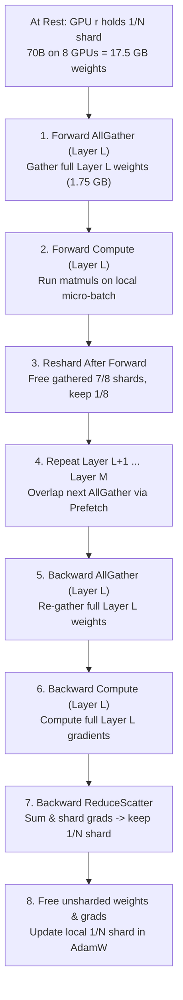
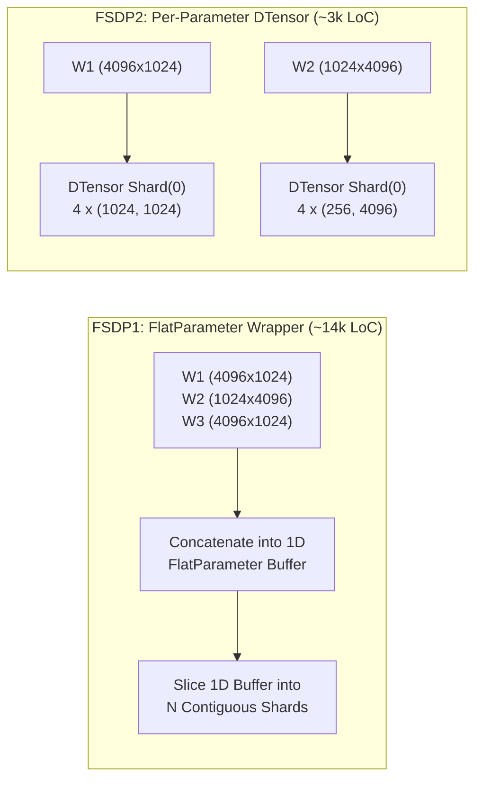
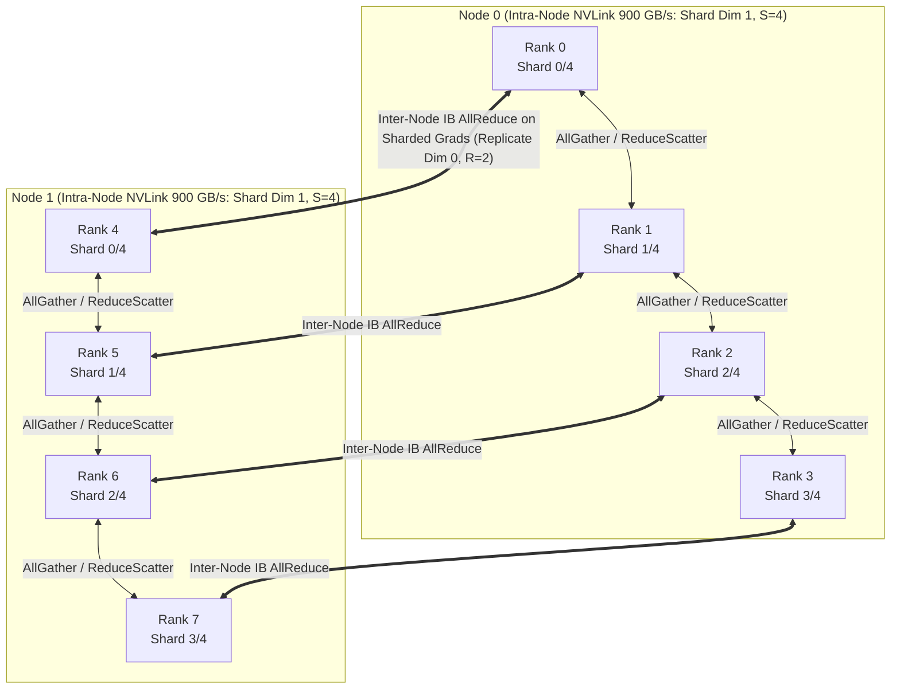

# 14.5 FSDP and parameter sharding

| Field | Value |
|---|---|
| Level | Advanced |
| Priority tier | 2 |
| Lab venue | Nebius GPU + Local Python Verification Lab (`code/part14/fsdp_parameter_sharding_lab.py`) |
| Part | Part 14: Distributed training and fine-tuning |
| Primary sources | *Distributed AI Systems* (`distributed-ai-systems`, Ch. 4); NVIDIA Zero-to-Hero Volume 13 (`chapter-04-fsdp-and-parameter-sharding.md`, `chapter-01-why-distributed-training-exists.md`, `chapter-08-nccl-collectives-and-communication-paths.md`, `chapter-12-volume-13-summary.md`, `index.md`, `labs/lab-01..04`); *AI Systems Performance Engineering* (`ai-systems-performance-engineering`, Ch. 13) |

## Why this matters for AI infrastructure

In Chapter 14.4, DistributedDataParallel scaled training throughput by giving every GPU an identical copy of the model. Each worker then synchronized gradients through a single AllReduce operation per step. That replication-first design hits a hard physical wall as soon as model state outgrows a single accelerator's HBM capacity. Even a 7B parameter model trained with AdamW in mixed precision exceeds an 80 GB A100 or H100 GPU. At 70B parameters, a single 80 GB GPU holds less than ten percent of the required training state.

Fully Sharded Data Parallel breaks this single-GPU memory ceiling by applying the Zero Redundancy Optimizer principle natively inside PyTorch. Instead of replicating parameters, gradients, and optimizer states on every rank, FSDP shards them across all GPUs. Each rank stores only a fraction of the model state at rest. On eight GPUs, a 7B model's state drops to a fraction of an 80 GB card. On sixteen GPUs, a 70B model fits comfortably with tens of gigabytes of headroom left for activations and temporary buffers.

FSDP trades memory for network. The bottleneck moves from the capacity of one GPU to the bandwidth between GPUs. Each layer must be gathered before it runs and its gradients scattered afterward, so a step moves fifty percent more data than DDP.

Three mistakes then show up as crashes. Wrapping a 70B model as one unit gathers all weights at once and runs out of memory. Letting the CPU queue too many AllGather calls fills memory with buffers. Saving an unsharded state dict on rank zero does the same at checkpoint time.

Across many nodes, a fourth problem appears. Cross-node AllGather latency can stall the job, and Hybrid Sharded Data Parallel over a two-dimensional DeviceMesh is the remedy.

| Model & Sharding Scenario | Weights + Gradients + Optimizer State | Per-GPU State Memory | Infrastructure Consequence |
|---|---|---|---|
| **7B Model in DDP (`NO_SHARD`)** | `14 GB` `BF16` weights + `14 GB` `BF16` grads + `56 GB` `FP32` Adam moments = **`84 GB`** (`112 GB` with `28 GB` `FP32` master weights under `16 * Psi`) | **`84.0 GB`** (`12 * Psi`) or **`112.0 GB`** (`16 * Psi`) | Exceeds a single `80 GB` `A100` or `H100` GPU before allocating any activations |
| **7B Model in FSDP (`FULL_SHARD`, `N = 8` GPUs)** | `84 GB / 8` (`12 * Psi`) or `112 GB / 8` (`16 * Psi`) sharded across `8` ranks | **`10.5 GB`** (`12 * Psi`) or **`14.0 GB`** (`16 * Psi`); `26.25 GB` under `SHARD_GRAD_OP` (`16 * Psi`) | Frees over `65 GB` of HBM per GPU for larger micro-batches and long sequences |
| **70B Model in DDP (`NO_SHARD`)** | `140 GB` weights + `140 GB` grads + `560 GB` `FP32` Adam moments = **`840 GB`** (`1,120 GB` with `280 GB` `FP32` master weights; `> 1.2 TB` with activations) | **`840.0 GB`** (`12 * Psi`) or **`1,120.0 GB`** (`16 * Psi`) | A single `80 GB` GPU holds only **`9.5%`** (`80 / 840`) of the model state; `8 x 80 GB` (`640 GB`) still cannot hold one copy |
| **70B Model in FSDP (`FULL_SHARD`, `N = 16` GPUs)** | `840 GB / 16` (`8.75 GB` weights + `8.75 GB` grads + `35.0 GB` `FP32` optimizer state) | **`52.5 GB`** (`12 * Psi`) or **`70.0 GB`** (`16 * Psi`; `35.0 GB` on `32` GPUs) | Leaves **`27.5 GB`** of headroom on an `80 GB` `H100` GPU for activations and `AllGather` buffers |
| **175B Model (`GPT-3`) in `FP32`** | `175B x 4 bytes` for `FP32` weights alone | **`700 GB`** weights alone | Exceeds a single `80 GB` GPU by **`8.75x`** before gradients or optimizer states |

## Prerequisites and outcomes

### Prerequisites
- Memory and compute anatomy of a training step including weights, gradients, optimizer states, and activations from Chapters 14.1 through 14.3.
- Multi-GPU DDP execution, `torchrun` environment variables, `DistributedSampler`, and ring versus tree NCCL collectives from Chapters 12.15 through 12.17 and 14.4.
- GPU HBM versus PCIe Gen4, NVLink 4, NVLink 5, and NVLink-C2C interconnect architectures from Part 10.

### Outcomes
After completing this chapter, you will be able to:
1. Quantify steady-state and peak GPU memory across DDP, ZeRO-1, ZeRO-2, ZeRO-3, and HSDP for 7B and 70B models. You will also size the transient unsharded layer buffer and configure AllGather rate limiting.
2. Derive why FSDP full sharding moves three times the parameter count in bytes per step versus two times for DDP and ZeRO-2.
3. Contrast FSDP1 `FlatParameter` wrappers with FSDP2 `fully_shard` per-parameter DTensor sharding and TorchTitan SimpleFSDP.
4. Configure hierarchical sharding, one-dimensional and two-dimensional DeviceMesh topologies, mixed precision, prefetching, meta-device initialization, activation checkpointing, and Grace-Blackwell SuperOffload.
5. Implement fault-tolerant sharded checkpointing with PyTorch Distributed Checkpoint, profile multi-GPU timelines with Kineto and Holistic Trace Analysis, and resolve production failures.

---

## 1. How FSDP Works: From DDP Replication to ZeRO State Sharding

### 1.1 Why Replication Fails: The 7B and 70B Memory Math

When a team scales from a small prototype to a 7B or 70B language model, standard DDP jobs crash right away. Every GPU runs out of memory during model initialization or the first optimizer step, even when the cluster has terabytes of aggregate HBM. Data-parallel replication forces every single GPU to store a complete, redundant copy of all parameters, gradients, and AdamW optimizer states. Understanding the exact byte breakdown of that replicated state lets you calculate how many GPUs are required once sharding is enabled.

In data-parallel training, every rank processes a distinct micro-batch of data but executes the exact same model layers sequentially. As established by Rajbhandari et al. in the Zero Redundancy Optimizer paper, keeping full state copies on every GPU is pure storage redundancy. Fast interconnects link the devices so they can share state on demand.

Let Psi denote the number of model parameters. Under mixed-precision training with AdamW, production literature uses two standard accounting conventions. The twelve-byte convention stores parameters and gradients directly in 16-bit precision alongside 32-bit Adam momentum and variance states. The sixteen-byte convention adds a 4-byte 32-bit master copy of the weights inside the optimizer.

```text
70B and 7B Model State Breakdown (12*Psi vs 16*Psi conventions):
  Weights (FP16/BF16, 2 * Psi):        7B =  14 GB   |  70B =   140 GB
  Gradients (FP16/BF16, 2 * Psi):      7B =  14 GB   |  70B =   140 GB
  Adam FP32 Momentum (4 * Psi):        7B =  28 GB   |  70B =   280 GB
  Adam FP32 Variance (4 * Psi):        7B =  28 GB   |  70B =   280 GB
  --------------------------------------------------------------------
  Subtotal (12*Psi convention):        7B =  84 GB   |  70B =   840 GB per GPU in DDP
  + FP32 Master Weights (4 * Psi):     7B = +28 GB   |  70B =  +280 GB
  --------------------------------------------------------------------
  Total (16*Psi convention):           7B = 112 GB   |  70B = 1,120 GB per GPU in DDP
  Full FP32 7B Training Footprint:     28 GB W + 28 GB g + 56 GB Adam + 60-80 GB act + 5-10 GB buf = 180-190 GB
```

Even under the conservative 840 GB figure for a 70B model, a single 80 GB A100 or H100 holds less than ten percent of the state. An entire eight-GPU node with 640 GB of aggregate HBM still cannot hold one unsharded copy with activation headroom.

### 1.2 The Hierarchy of FSDP Sharding Strategies

A team that shards too little runs out of memory. A team that shards too much pays for network traffic it does not need, which shows up as longer steps on slower multi-node networks. FSDP offers a ladder of sharding strategies so that you shard only what the model and its activations require.

FSDP maps directly to the ZeRO sharding stages through `ShardingStrategy` in FSDP1 and `reshard_after_forward` plus `DeviceMesh` in FSDP2. Stage 1 shards only the optimizer states across ranks, cutting the 560 GB Adam footprint of a 70B model down to 70 GB per GPU. Stage 2 also shards the gradients, saving another 122.5 GB per GPU while keeping weights present after the forward pass. Stage 3 shards weights, gradients, and optimizer states alike, so each GPU holds only one-eighth or one-sixteenth of the total state at rest.

| Strategy / Stage | What is Replicated on Each GPU | What is Sharded Across `N` GPUs | Steady-State Memory Formula (`16 * Psi` rule) | `70B` Model on `N = 8` GPUs (`840 GB` / `12 * Psi` base) | `70B` Model on `N = 16` GPUs (`840 GB` base) | Per-Step Collectives & Volume |
|---|---|---|---|---|---|---|
| **`NO_SHARD` (`DDP`)** | Weights, Gradients, Optimizer States | Nothing (`N = 1` shard) | `16 * Psi` | **`840.0 GB`** (`1,120.0 GB` w/ master) | **`840.0 GB`** | `1x` Bwd `AllReduce` (`2 * Psi`) |
| **Stage 1 (`ZeRO-1`)** | Weights (`140 GB`), Gradients (`140 GB`) | Optimizer States (`560 / N GB`) | `4 * Psi + (12 * Psi) / N` | **`350.0 GB`** (`140 + 140 + 70`) | **`315.0 GB`** (`140 + 140 + 35`) | `1x` Bwd `ReduceScatter` + `1x` `AllGather` (`2 * Psi`) |
| **`SHARD_GRAD_OP` (`ZeRO-2` / `reshard_after_forward=False`)** | Weights (`140 GB` kept after Fwd) | Gradients (`140 / N GB`), Optimizer States (`560 / N GB`) | `2 * Psi + (14 * Psi) / N` | **`227.5 GB`** (`~228 GB`: `140 + 17.5 + 70`, saves `122.5 GB` vs Stage 1) | **`183.75 GB`** (`140 + 8.75 + 35`) | `1x` Fwd `AllGather` + `1x` Bwd `ReduceScatter` (`2 * Psi`) |
| **`FULL_SHARD` (`ZeRO-3` / `reshard_after_forward=True`)** | Nothing at rest (only `1` active layer materialized during compute) | Weights, Gradients, Optimizer States (`840 / N GB`) | `(16 * Psi) / N` (steady) + `2 * Psi_layer` (peak buffer) | **`105.0 GB`** (`17.5 + 17.5 + 70`) | **`52.5 GB`** (`27.5 GB` free on `80 GB` `H100`) | `1x` Fwd `AllGather` + `1x` Bwd `AllGather` + `1x` Bwd `ReduceScatter` (`3 * Psi`) |
| **`HYBRID_SHARD` (`HSDP`, `R` nodes x `S` GPUs/node)** | Shards replicated across `R` nodes | Weights, Gradients, Optimizer States sharded `S`-way inside each node | `(16 * Psi) / S` | **`105.0 GB`** (`S = 8` GPUs/node) | **`105.0 GB`** (`R = 2` nodes x `S = 8` GPUs) | Intra-node `NVLink`: `3 * Psi`; Inter-node `IB`: `2 * Psi / S` |

:::tip Activations Are Never Sharded by FSDP
FSDP shards parameters, gradients, and optimizer states, but it does not shard activations. Because FSDP is still data parallelism at its core, every GPU computes the forward and backward pass on its own local micro-batch of tokens. Each device must therefore store the full intermediate activations for its local micro-batch unless paired with activation checkpointing or Tensor and Sequence Parallelism.
:::

### 1.3 Forward Pass (AllGather) and Backward Pass (ReduceScatter) Lifecycle

If each GPU holds only one-sixteenth of a layer's weights at rest, how can it execute a matrix multiplication that requires the entire weight matrix? Without a clear mental model of the per-layer gather and discard cycle, engineers misinterpret transient memory spikes in profiler traces as memory leaks.

FSDP solves this by exploiting the sequential execution of neural network layers. Before a layer runs its forward pass, all GPUs execute an AllGather collective over NCCL to reconstruct the full unsharded weights for that single layer. Every GPU then computes the layer output on its local micro-batch and immediately frees the non-local parameter slices before the next layer finishes.

During the backward pass, layers execute in reverse order. Because the full weights were freed after the forward pass, FSDP runs a second AllGather to reconstruct the layer's weights so it can compute input and weight gradients. Immediately after computing the layer's full weight gradients, FSDP runs a ReduceScatter collective across all ranks. That operation sums the gradients across micro-batches and leaves each GPU with only its local gradient shard, freeing the temporary buffers right away. Once backpropagation finishes across all layers, each GPU updates its local slice of the 32-bit AdamW states in place with zero cross-GPU communication.



### 1.4 Collective Communication Volume: 3 Psi (FSDP) vs 2 Psi (DDP)

When teams migrate a model from DDP to FSDP full sharding, they often notice a sudden jump in network utilization and step time on bandwidth-constrained clusters. Network and performance engineers need to know exactly how many extra bytes traverse NVLink and InfiniBand per step so they can provision fabric bandwidth accurately.

Recall from Chapter 12.15 that for a weight tensor of size M bytes across N ranks, a ring AllGather moves `(N - 1) / N * M` bytes per GPU. A ring ReduceScatter moves the exact same volume. A ring AllReduce is mathematically equivalent to a ReduceScatter followed by an AllGather, moving twice that volume per GPU.

Under DDP or FSDP ZeRO-2, each training step transfers two times the weight size per GPU. Under FSDP full sharding with `reshard_after_forward=True`, the extra backward AllGather increases total communication to three times the weight size per GPU, which is 1.5 times DDP's network volume.

```text
Per-Step Collective Communication Volume (Weight Tensor Size M = 2 * Psi = 140.0 GB for 70B FP16):
  DDP (NO_SHARD):
    Backward AllReduce             = 2 x ((N - 1) / N) x M  --> 2 * M (280.0 GB asymptotic, 245.0 GB exact on N=8)

  FSDP SHARD_GRAD_OP (ZeRO-2) or FULL_SHARD (reshard_after_forward=False):
    Forward AllGather              = 1 x ((N - 1) / N) x M
    Backward ReduceScatter         = 1 x ((N - 1) / N) x M
    Total                          = 2 x ((N - 1) / N) x M  --> 2 * M (280.0 GB asymptotic, 245.0 GB exact on N=8)

  FSDP FULL_SHARD (ZeRO-3, reshard_after_forward=True):
    Forward AllGather              = 1 x ((N - 1) / N) x M
    Backward AllGather             = 1 x ((N - 1) / N) x M
    Backward ReduceScatter         = 1 x ((N - 1) / N) x M
    Total                          = 3 x ((N - 1) / N) x M  --> 3 * M (420.0 GB asymptotic, 367.5 GB exact on N=8; 1.5x DDP)

  Volume 13 Ch. 8 Worked Example (28 GB FP32 Gradient Tensor for 7B Model):
    - Case A (Single-node 8 GPUs on NVLink 4 at 900 GB/s):
      Moves 2 * (7/8) * 28 GB = 49.0 GB in ~54 ms; ring hop latency (8 hops x 1-5 us/hop) is < 0.1 ms (bandwidth-bound)
    - Case B (Multi-node 512 GPUs / 64 nodes on InfiniBand at ~25-50 GB/s per GPU):
      Moves 2 * (511/512) * 28 GB = 55.9 GB in ~2.2 s at 25 GB/s; 512 ring hops force NCCL to switch AllReduce
      to Double Binary Tree (O(log2 N) = 9 hops), whereas FSDP AllGather/ReduceScatter still stress the fabric per layer
```

---

## 2. FSDP1 (FlatParameter) vs FSDP2 (fully_shard and DTensor)

PyTorch provides two generations of GPU FSDP APIs alongside `SpmdFullyShardedDataParallel` for TPU and XLA devices. Understanding why PyTorch replaced FSDP1's internal storage engine in FSDP2 helps engineers choose the right API and avoid subtle bugs with mixed data types, frozen layers, and compiler graph breaks.



### 2.1 Original FSDP (FSDP1: FullyShardedDataParallel and FlatParameter)

When teams maintain legacy training codebases or complex multimodal pipelines, they frequently encounter FSDP1's `FlatParameter` abstraction. While FSDP1 powers many mature models, concatenating multiple weight tensors into a single one-dimensional buffer breaks standard PyTorch parameter semantics. That design causes painful friction when mixing frozen and trainable weights or enabling `torch.compile`.

Introduced in 2021 from FairScale, FSDP1 wraps submodules and flattens all parameters inside each unit into a contiguous one-dimensional `FlatParameter` tensor. It then slices that buffer across ranks. Despite its complexity of roughly 14,000 lines of state-machine code, FSDP1 remains deployed in established repositories such as the Wan2.2 Mixture-of-Experts video model. Wan2.2 retained FSDP1 for DeepSpeed Ulysses sequence-parallel hook compatibility, explicit wrapper control during dynamic MoE expert swapping, and existing Hugging Face `UMT5-XXL` encoder wrappers.

However, because `FlatParameter` merges separate tensors into one buffer, every parameter inside a wrapped FSDP1 group must share the exact same data type. Every parameter must also share the same `requires_grad` status. Mixing frozen and trainable weights or combining FP8 linear weights with BF16 normalization layers requires splitting wrapper groups manually. Furthermore, `torch.compile` struggles to trace through dynamic `FlatParameter` storage views unless you explicitly pass `use_orig_params=True`.

### 2.2 Modern FSDP (FSDP2: fully_shard and Per-Parameter DTensor)

To eliminate `FlatParameter` bugs, checkpointing complexity, and compiler graph breaks, PyTorch introduced FSDP2 (`torch.distributed.fsdp.fully_shard`) in 2024. FSDP2 implements per-parameter sharding built directly on PyTorch's native `DTensor` primitive in roughly 3,000 lines of code.

Instead of concatenating weights together, FSDP2 shards each parameter tensor independently along dimension zero as a `DTensor` with `Shard(0)` placement. When dimension zero is not evenly divisible by the world size, FSDP2 pads the tensor automatically. Calling `fully_shard` mutates the module in place using tensor-subclass hooks rather than wrapping it inside a new container class.

This per-parameter design makes FSDP2 the default choice for new projects. You can freely mix FP8 and BF16 tensors or frozen and trainable parameters inside the same sharded block. State dictionaries return `DTensor` objects whose logical global shapes match the unsharded model while storing only the local shard for Distributed Checkpoint saves. Because `TorchDynamo` sees individual parameters instead of an opaque buffer, TorchTitan's `SimpleFSDP` with `torch.compile` reduced memory use by up to 28 percent. It also boosted throughput by up to 69 percent over eager FSDP2.

| Architectural Feature | FSDP1 (`FullyShardedDataParallel`) | FSDP2 (`fully_shard` / `SimpleFSDP`) |
|---|---|---|
| **Core Storage Abstraction** | Flattens and concatenates all group parameters into a `1D` `FlatParameter` (`~14,000` / `~14k` lines of code, introduced `2021`) | Per-parameter **`DTensor(Shard(0))`** sharding along dimension `0` (`~3,000` / `~3k` lines of code, `2024`, PyTorch RFC `#114299`) |
| **Shard Shape Example** | Concatenated `1D` slice across `W_1, W_2, W_3` requiring un-flattening metadata | A `(4096, 1024)` linear weight sharded across `4` GPUs becomes four local shards of shape **`(1024, 1024)`** |
| **Mixed `dtype` & Frozen Params** | Fails unless frozen/trainable or `FP8`/`BF16` parameters are separated into distinct wrapper units | Natively supports mixed `dtype`s and mixed `requires_grad` states inside the exact same `fully_shard` block |
| **Legacy / Production Persistence** | Used in **Wan2.2** (`27B` total / `14B` active MoE) for DeepSpeed Ulysses `AllToAll`, dynamic MoE expert swapping, and frozen `UMT5-XXL` wrappers | Default for new PyTorch workflows; native `DTensor` `state_dict()` for `torch.distributed.checkpoint` (`DCP`) |
| **Compiler (`torch.compile`) Synergy** | Requires `use_orig_params=True` to expose original parameter views across `FlatParameter` | Native `DTensor` tracing; TorchTitan **`SimpleFSDP` + `torch.compile`** achieves up to **`-28%` memory** and **`+69%` throughput** vs eager `FSDP2` |

### 2.3 Quantitative Benchmark: Single-GPU vs FSDP1 vs FSDP2 on H200 (140 GB)

Before deploying FSDP in production, engineers need to know whether parameter sharding reduces wall-clock training time or merely trades memory for communication overhead. If a model already fits on a single GPU, sharding it across two GPUs introduces collective traffic that slightly lowers per-GPU iteration speed. However, two GPUs working together still cut total epoch time nearly in half. Once the model grows past single-GPU HBM capacity, FSDP makes an impossible training run feasible at high efficiency.

*Distributed AI Systems* Chapter 4 benchmarks `FLAN-T5-XL` and `FLAN-T5-XXL` on NVIDIA H200 GPUs with 140 GB of HBM3e memory. On the 3B parameter model, sharding across two GPUs cuts steady-state memory in half and finishes each epoch 1.86 times faster. On the 11B parameter model, single-GPU execution crashes past the 140 GB ceiling. Both FSDP1 and FSDP2 run smoothly at 84 GB steady memory and 105 GB peak memory per GPU.

| Model | Mode | GPUs | Steady Mem / GPU | Peak Mem / GPU | Per-GPU Throughput (`it/s`) | Wall-Clock Time / Epoch | Key Infrastructure Takeaway |
|---|---|---|---|---|---|---|---|
| **`FLAN-T5-XL` (`3B`)** | Single-GPU | `1` | `~43 GB` | `~58 GB` | `~4.36 it/s` | `~91 s` | Fits on `1` `H200`; zero collective overhead gives highest per-GPU `it/s`. |
| **`FLAN-T5-XL` (`3B`)** | `FSDP1` (`FULL_SHARD`) | `2` | `~22 GB` | `~33 GB` | `~4.09 it/s` | `~49 s` | Cuts steady memory in half (`43 -> 22 GB`) and finishes epoch `1.86x` faster (`91 -> 49 s`). |
| **`FLAN-T5-XXL` (`11B`)** | Single-GPU | `1` | `OOM` (`> 140 GB`) | `OOM` | — | — | Exceeds `140 GB` `H200` capacity on a single GPU. |
| **`FLAN-T5-XXL` (`11B`)** | `FSDP1` (`FULL_SHARD`) | `2` | `~84 GB` | `~105 GB` | `~1.96 it/s` | `~101 s` | Sharding across `2` `H200` GPUs fits comfortably at `84 GB` steady / `105 GB` peak. |
| **`FLAN-T5-XXL` (`11B`)** | `FSDP2` (`fully_shard`) | `2` | `~84 GB` | `~105 GB` | `~1.86 it/s` | `~106 s` | Matches `FSDP1` memory (`84 GB` / `105 GB`) while enabling `DTensor` `DCP` checkpoints and `torch.compile`. |

---

## 3. Hierarchical Wrapping, DeviceMesh, and Hybrid Sharding (HSDP)

### 3.1 Why Wrapping Granularity Determines Peak Memory (2 Psi_layer)

The most common configuration mistake in FSDP is wrapping only the top-level root model without sharding its child Transformer blocks first. Engineers who make this error see their 70B training job crash with `CUDA out of memory` on the first forward pass. That crash happens even though the steady-state sharded memory should easily fit inside an 80 GB GPU.

If you wrap a 70B model as one monolithic FSDP unit on sixteen GPUs, steady-state memory sits at 52.5 GB per GPU. However, at the start of `model.forward()`, FSDP executes a single AllGather across the entire model at once. That operation materializes all 140 GB of unsharded weights simultaneously on every GPU, spiking peak state memory to 192.5 GB.

When you instead wrap each of the 80 `TransformerBlock` modules individually before wrapping the root model, each block contains only 1.75 GB of weights. During execution, only the active block and one prefetched block are unsharded in HBM at any instant. That discipline caps transient buffer memory at 3.5 GB, keeping peak state memory at 56.0 GB and leaving 24.0 GB of HBM for activations. Shared parameters such as tied input and output embeddings must reside inside the same FSDP unit so unsharding preserves weight tying.

```text
70B Model Wrapping Granularity on N = 16 GPUs (140.0 GB FP16 Weights across L = 80 TransformerBlocks):
  Steady-State Sharded Model State:        840.0 GB / 16 GPUs               =  52.5 GB per GPU
  Monolithic Root-Only Wrapping (1 unit):  52.5 GB + 140.0 GB AllGather     = 192.5 GB peak --> Immediate CUDA OOM
  Coarse 8-Stage Macro-Wrapping:           140.0 GB / 8 stages              =  17.5 GB per stage
  Per-TransformerBlock Wrapping (80 units): 140.0 GB / 80 blocks            =   1.75 GB per block (2 * Psi_layer)
  Peak State with 1 Prefetched Block:      52.5 GB + (2 x 1.75 GB = 3.5 GB) =  56.0 GB peak (24.0 GB free on 80 GB H100)
```

### 3.2 DeviceMesh and Hybrid Sharded Data Parallel (HSDP / HYBRID_SHARD)

Scaling flat FSDP full sharding from a single eight-GPU node to a multi-node cluster often causes per-GPU throughput to plummet. Inside a node, NVLink 4 delivers 900 GB/s of bidirectional bandwidth, and NVLink 5 delivers 1.8 TB/s. Across nodes, InfiniBand NICs provide only 25 to 50 GB/s per GPU. Forcing every layer's AllGather and ReduceScatter across the inter-node fabric stalls GPU compute streams on network transfers.

Hybrid Sharded Data Parallel aligns collective communication with physical cluster topology by using a two-dimensional `DeviceMesh` of shape `(R, S)`. Along dimension one within each node, FSDP shards parameters, gradients, and optimizer states S-way across the fast intra-node NVLink domain. All per-layer AllGather and ReduceScatter collectives stay strictly inside the server's NVLink switch fabric.

Along dimension zero across the R nodes, the node-level shard group is replicated. During the backward pass, each GPU synchronizes only its small one-eighth gradient shard with the corresponding rank on the other nodes via InfiniBand AllReduce. In FSDP2, `reshard_after_forward` also accepts an integer such as 2 to reshard parameters across a two-GPU subgroup after the forward pass. That option mirrors ZeRO++ hierarchical parameter sharding so backward AllGather stays local.



```text
Multi-Node Bandwidth Sizing: 70B FP16 Model (M = 140.0 GB) on 32 GPUs (R = 4 Nodes x S = 8 GPUs/Node):
  1. Flat 32-GPU FULL_SHARD (1D Mesh of 32):
     - Steady-state memory per GPU:     840.0 GB / 32                    =  26.25 GB
     - Cross-node InfiniBand volume:    3 x (31 / 32) x 140.0 GB         = 406.875 GB per step

  2. HSDP 2D DeviceMesh("cuda", (4, 8)) (Sharded 8-way intra-node, Replicated 4-way inter-node):
     - Steady-state memory per GPU:     840.0 GB / 8                     = 105.0 GB
     - Intra-node NVLink volume (S=8):  3 x (7 / 8) x 140.0 GB           = 367.5 GB per step (stays on 900 GB/s NVLink)
     - Local gradient shard size:       140.0 GB / 8                     =  17.5 GB per GPU (Rank 0 <-> 8 <-> 16 <-> 24)
     - Inter-node IB AllReduce (R=4):   2 x (3 / 4) x 17.5 GB            =  26.25 GB per step
     - Cross-node traffic reduction:    406.875 GB / 26.25 GB            =  15.5x less InfiniBand traffic
```

---

## 4. Communication Overlap, Activation Checkpointing, Offloading, and torch.compile

### 4.1 Hiding Collective Latency: Forward/Backward Prefetching and limit_all_gathers=True

If a GPU waits idly for every layer's AllGather to finish before starting its matrix multiplications, network latency directly adds to step time. Conversely, if the CPU dispatches asynchronous AllGather kernels too far ahead of GPU execution, temporary buffers pile up and crash the job with an out-of-memory error. Engineers must balance prefetch overlap against strict memory rate limiting.

Modern GPUs have copy engines, which move data by direct memory access (DMA), and communication engines that are separate from the Tensor Core compute streams. Forward prefetching launches the AllGather for upcoming layers on a secondary communication stream while the current layer computes on the default stream. During backpropagation, `BackwardPrefetch.BACKWARD_PRE` prefetches the previous layer's parameters before the current layer's backward compute finishes, allowing AllGather and ReduceScatter to overlap with matmuls.

Because Python host dispatch runs asynchronously ahead of GPU execution, a fast CPU thread can enqueue AllGather kernels for ten to fifteen upcoming layers before the GPU finishes layer one. Without rate limiting, fifteen queued buffers on a 70B model lock 28.0 GB of extra HBM and trigger sudden out-of-memory crashes. Setting `limit_all_gathers=True` blocks the CPU thread whenever two unsharded units are in flight, capping transient buffer memory at 3.5 GB.

```text
Prefetch Overlap and Rate-Limiting Telemetry (70B Model on 8 x H100 GPUs, batch_size=16/GPU, 128 global):
  - Step 1 (Communicator & Allocator Warmup):  18.4 s step time | 62.3 GB peak HBM
  - Step 2+ (Steady-State Prefetch Overlap):   14.1-14.3 s step | 59.5-60.2 GB peak HBM (~23% faster than Step 1; ~3.2x speedup vs unoverlapped baseline)
  - Unthrottled Queue (limit_all_gathers=False, 15 queued + 1 active = 16 units x 1.75 GB):
    52.5 GB steady state + 28.0 GB queued buffers = 80.5 GB > 80.0 GB H100 capacity --> Immediate CUDA OOM
  - Throttled Queue (limit_all_gathers=True, 1 active + 1 prefetched = 2 units x 1.75 GB):
    52.5 GB steady state + 3.5 GB inflight buffers = 56.0 GB peak state memory
```

### 4.2 Activation Memory Math and Selective Activation Checkpointing

Even after FSDP full sharding reduces a 7B model's state to 10.5 GB per GPU, training jobs still crash with out-of-memory errors when engineers increase sequence length or micro-batch size. Because FSDP never shards activations, intermediate tensors saved during the forward pass for backpropagation rapidly become the dominant consumer of HBM.

A Transformer's activation footprint grows linearly with layer count, micro-batch size, sequence length, hidden dimension, and an architecture multiplier between 10 and 20. For a 32-layer 7B model at micro-batch size 8 and sequence length 2048 in 16-bit precision, raw activations consume roughly 52 GB per GPU. Adding 52 GB of activations to the sharded model state and temporary AllGather buffers pushes peak HBM past 65 GB.

Activation checkpointing solves this by discarding intermediate layer activations during the forward pass and recomputing them on the fly during backpropagation. Wrapping every Transformer block or every second block for selective checkpointing cuts activation memory by 50 to 80 percent in exchange for roughly 30 percent extra forward compute FLOPs. When you also need a large effective batch size without extra activation memory, pair activation checkpointing with gradient accumulation across micro-steps.

```text
Transformer Activation Memory Formula (Distributed AI Systems Ch. 4):
  Activation_Memory_Bytes ~ L x B x S x H x bytes_per_element x k   (where k = 10 to 20)

Worked Example (7B Model: L = 32, B = 8, S = 2048, H = 4096, 2 bytes FP16/BF16, k = 12):
  - Raw Activation Footprint:            32 x 8 x 2048 x 4096 x 2 x 12 = 51,539,607,552 bytes ~ 51.54 GB (~52 GB per GPU)
  - With Activation Checkpointing:       50% to 80% reduction (at 75% reduction: 51.54 GB --> 12.88 GB per GPU)
  - Compute Tradeoff:                    ~30% extra forward compute FLOPs for activation recomputation
  - Gradient Accumulation Synergy:       loss = criterion(model(data), target) / accumulation_steps (e.g., accumulation_steps = 4)
```

### 4.3 The PCIe CPUOffload Trap vs Grace-Blackwell SuperOffload (GraceAdam)

When a model still exceeds HBM capacity after full sharding and activation checkpointing, engineers are often tempted to enable `CPUOffload` to spill parameters and optimizer states into host DRAM. On standard x86 servers connected over PCIe Gen4, turning on CPU offloading causes training throughput to collapse by a factor of four while GPUs sit idle over eighty percent of the time.

This slowdown occurs because a PCIe Gen4 x16 link provides only 32 GB/s of bandwidth compared to 3 TB/s on GPU HBM3, creating a hundredfold bandwidth bottleneck. Streaming sharded weights and gradients between host RAM and GPU memory stalls the Streaming Multiprocessors on host-to-device and device-to-host DMA transfers. On PCIe servers, you should scale out to more GPUs before enabling CPU offload.

Grace Hopper and Grace Blackwell superchips avoid this problem, and SuperOffload is the technique that exploits it. A coherent NVLink-C2C link joins the Grace ARM CPU and the Blackwell GPU at 900 GB/s. On top of that link, the CPU runs optimizer updates speculatively while the GPU is still in backpropagation, and checks them for NaN or Inf values afterward. The optimizer work is also split: the GPU takes the heavy tensor casts, and the CPU keeps the momentum and variance updates. Last, `GraceAdam` runs the Adam update on the ARM Scalable Vector Extension registers.

| Configuration (`70B` Model) | Interconnect Bandwidth | Step Time (`s`) | Throughput (`tokens/sec`) | GPU SM Utilization | Operational Verdict |
|---|---|---|---|---|---|
| **`16` GPUs, `FULL_SHARD`, No Offload** | `NVLink 4` (`900 GB/s`) + `3 TB/s` (`3,000 GB/s`) `HBM` | **`12.3 s`** | **`10.4 tok/s`** | **`~88%`** | Production baseline: scale horizontally across GPUs first. |
| **`4` GPUs, `FULL_SHARD` + `CPUOffload`** | `PCIe Gen4` (`32 GB/s`, `~93.75x` / `100x` slower than `HBM`) | **`48.7 s`** (`3.96x` / `~4x` slower) | **`2.6 tok/s`** (`4x` slower) | **`18%`** (`82%` idle waiting on `PCIe`) | **The CPU Offload Trap:** GPUs sit idle `> 80%` of the time waiting on `H2D`/`D2H` copies (`20–50%+` typical slowdown). |
| **Grace-Blackwell (`GB200`/`GB300`) `SuperOffload` + `GraceAdam`** | **`NVLink-C2C` (`900 GB/s` coherent CPU-GPU)** | **`~13.5 s`** | **`~9.5 tok/s`** | **`~82%`** | **Superchip Offload (book-reported figures, not measured here):** Coherent `NVLink-C2C` + Speculation-Then-Validation (`STV`) + ARM `SVE` `GraceAdam` (`32` vector / `16` predicate registers). |

### 4.4 Compiler Integration (torch.compile), MemPool, and UCX

Running FSDP in eager mode leaves significant performance on the table due to kernel launch overhead and unoptimized collective scheduling. However, blindly wrapping an FSDP1 model in `torch.compile` fails or causes endless recompilations. The wrapper must expose original parameter views and break graphs cleanly at block boundaries.

In FSDP1, you must pass `use_orig_params=True` and wrap at the `TransformerBlock` level. `TorchDynamo` intentionally inserts a graph break at each FSDP block boundary so AllGather and ReduceScatter collectives overlap between compiled block subgraphs. In FSDP2, you simply call `fully_shard` on every child block first, call `fully_shard` on the root model, and then apply `torch.compile(model)`.

On NVSwitch and SHARP-capable fabrics such as GB200 NVL72 with NVLink 5, you can further reduce collective overhead using pluggable NCCL memory pools. Binding NCCL's native allocator (`ncclMemAlloc`) into `torch.cuda.memory.MemPool` and registering it via `backend.register_mem_pool(nccl_pool)` aligns collective buffers for zero-copy GPUDirect RDMA and NVSwitch reductions. Across multi-rack InfiniBand fabrics, setting `NCCL_NET=UCX` and `NCCL_PLUGIN_P2P=ucx` enables hardware-offloaded pipelined cross-rack transfers.

---

## 5. Checkpointing, Multi-Node Scaling, and Production Profiling

### 5.1 Distributed Checkpoint (DCP) vs SHARDED_STATE_DICT vs FULL_STATE_DICT

Long multi-GPU training runs inevitably encounter hardware faults such as double-bit ECC errors or GPUs falling off the bus. Yet checkpointing an FSDP model incorrectly is one of the fastest ways to crash a healthy training job. Many teams watch a 70B training run execute smoothly at 52.5 GB per GPU for ninety-nine steps. At step one hundred, rank zero suddenly dies with `CUDA out of memory`.

This crash is the `FULL_STATE_DICT` rank-zero out-of-memory trap. Calling `model.state_dict()` under default settings gathers all shards of a 70B model onto rank zero. That gather requires 280.0 GB in FP32 or up to 700 GB with optimizer states, instantly exhausting an 80 GB GPU. You should reserve `full_state_dict=True` with `cpu_offload=True` strictly for final model export when host CPU RAM is large enough.

For all periodic training checkpoints, use PyTorch Distributed Checkpoint (`torch.distributed.checkpoint`) with `full_state_dict=False`. Each rank writes only its local DTensor shard in parallel to shared storage, which is just 8.75 GB of FP16 weights per rank on sixteen GPUs. Furthermore, `dcp.load` supports automatic elastic resharding when resuming on a different number of GPUs. Bit-for-bit reproducible recovery needs four kinds of state saved and restored behind `dist.barrier()`. They are the model weights, the AdamW momentum and variance, the learning-rate scheduler state and every random number generator state. The NVIDIA Zero-to-Hero Volume 13 lab on checkpointing demonstrates this.

```text
70B Model Checkpointing Comparison on N = 16 GPUs (80 GB H100 per Rank):
  - Default FULL_STATE_DICT Gather on Rank 0:
    70B x 4 bytes (FP32) = 280.0 GB weights on Rank 0 (up to 700 GB with optimizer state) --> Rank 0 CUDA OOM at Step 100
  - PyTorch Distributed Checkpoint (DCP, full_state_dict=False, cpu_offload=True):
    140.0 GB / 16 ranks  = 8.75 GB FP16 weights written per rank in parallel (4.375 GB per 70 GB shard unit)
  - Four Mandatory State Components for Loss-Spike-Free Deterministic Resume (Volume 13 Lab 04, epochs 4-5 match):
    (1) Model weights  (2) Optimizer states (AdamW momentum & variance)  (3) LR scheduler step  (4) RNG states (Python, NumPy, torch, CUDA)
```

### 5.2 Initialization Best Practices, Scaling Considerations, and Debugging Tools

Initializing a 70B parameter model directly on CPU RAM or a single GPU before sharding consumes 140 GB per process. That allocation crashes the host node before `fully_shard` even runs. Similarly, subtle misconfigurations in data loading or rank-conditional code lead to silent accuracy regressions or deadlocked jobs.

To initialize massive models with zero upfront memory, instantiate the model inside a `with torch.device("meta"):` context manager. Next, apply `fully_shard` to each child block and the root model, and materialize only the local shards on the target GPU via `model.to_empty(device=device)`. Finally, call `model.reset_parameters()` after setting identical random seeds across all ranks. Always pair FSDP with `DistributedSampler`, call `sampler.set_epoch(epoch)` every epoch so data shuffles properly, and use `torch.nn.utils.clip_grad_norm_` for gradient clipping.

When scaling across multiple nodes, verify that all nodes sit on the same InfiniBand fabric with `NCCL_IB_DISABLE=0`. If a job hangs or deadlocks due to rank-conditional collectives or an unbalanced batch count, inspect `NCCL_DEBUG=INFO` and set `torch.distributed.set_debug_level(torch.distributed.DebugLevel.DETAIL)`. On Google Cloud TPU VMs, PyTorch/XLA provides `SpmdFullyShardedDataParallel` backed by the XLA GSPMD compiler, which inserts and overlaps collectives automatically.

```text
Progressive FSDP Bring-Up and Optimization Order:
  1. Baseline:        Start with FSDP2 (fully_shard) + BF16 mixed precision (param_dtype=bfloat16, reduce_dtype=float32), no offload.
  2. Memory Step 1:   If OOM occurs, enable activation checkpointing on every TransformerBlock layer (50-80% activation savings).
  3. Memory Step 2:   If OOM persists, reduce micro-batch size or sequence length and enable gradient accumulation (steps = 4).
  4. Network Tuning:  Profile with torch.profiler (Kineto) / Perfetto / HTA; enable prefetching (2 layers) or 2D HSDP across nodes.
  5. Last Resort:     Enable CPUOffloadPolicy(pin_memory=True) on PCIe only if needed, or SuperOffload on Grace-Blackwell NVLink-C2C.
```

---

## Commands and configurations that matter

### 1. FSDP2 Hierarchical Sharding, 2D HSDP DeviceMesh, Meta Init, and torch.compile (`untested here`)

```python
import os
import torch
import torch.nn as nn
import torch.distributed as dist
from torch.distributed.device_mesh import init_device_mesh
from torch.distributed.fsdp import (
    fully_shard,
    MixedPrecisionPolicy,
    CPUOffloadPolicy,
)
from torch.utils.checkpoint import checkpoint

def setup_fsdp2_model(model_cls, model_args, use_hsdp: bool = False, use_compile: bool = True):
    dist.init_process_group(backend="nccl")
    local_rank = int(os.environ["LOCAL_RANK"])
    world_size = dist.get_world_size()
    device = torch.device(f"cuda:{local_rank}")
    torch.cuda.set_device(device)

    # Identical RNG seed across all ranks for deterministic reset_parameters()
    torch.manual_seed(42)
    torch.cuda.manual_seed_all(42)

    # 1D mesh for standard FSDP, or 2D mesh (nodes, gpus_per_node) for HSDP
    if use_hsdp and world_size >= 16:
        gpus_per_node = 8
        num_nodes = world_size // gpus_per_node
        mesh = init_device_mesh("cuda", (num_nodes, gpus_per_node))
    else:
        mesh = init_device_mesh("cuda", (world_size,))

    # BF16 weights for memory/TensorCores + FP32 gradient reduction for stability
    mp_policy = MixedPrecisionPolicy(
        param_dtype=torch.bfloat16,
        reduce_dtype=torch.float32,
    )

    # Zero-memory construction on meta device before sharding
    with torch.device("meta"):
        model = model_cls(model_args)

    # Hierarchical sharding: shard each child TransformerBlock BEFORE the root model
    for layer in model.layers:
        fully_shard(
            layer,
            mesh=mesh,
            mp_policy=mp_policy,
            reshard_after_forward=True,
        )
    fully_shard(model, mesh=mesh, mp_policy=mp_policy, reshard_after_forward=True)

    # Materialize only local 1/N DTensor shards on GPU and initialize weights
    model.to_empty(device=device)
    model.reset_parameters()

    # Optional: configure explicit forward and backward prefetching (2 layers ahead)
    num_prefetch = 2
    for i, layer in enumerate(model.layers):
        if i < len(model.layers) - num_prefetch:
            layer.set_modules_to_forward_prefetch(
                [model.layers[i + j] for j in range(1, num_prefetch + 1)]
            )
        if i >= num_prefetch:
            layer.set_modules_to_backward_prefetch(
                [model.layers[i - j] for j in range(1, num_prefetch + 1)]
            )

    if use_compile:
        model = torch.compile(model)
    return model
```

### 2. FSDP2 Distributed Checkpoint (DCP) Save, Elastic Load, and DTensor Shard Verification (`untested here`)

```python
import os
import torch
import torch.distributed as dist
import torch.distributed.checkpoint as dcp
from torch.distributed.checkpoint.state_dict import (
    get_model_state_dict,
    get_optimizer_state_dict,
    set_model_state_dict,
    set_optimizer_state_dict,
    StateDictOptions,
)

def verify_dtensor_shards(model, rank: int):
    """Sanity-check that FSDP2 parameters are sharded DTensors on each rank."""
    if rank == 0:
        for name, param in model.named_parameters():
            local = param.to_local() if hasattr(param, "to_local") else param
            print(f"{name}: global={tuple(param.shape)}, local_shard={tuple(local.shape)}, device={param.device}")

def save_checkpoint_dcp(model, optimizer, epoch: int, checkpoint_dir: str):
    opts = StateDictOptions(full_state_dict=False, cpu_offload=True)
    state = {
        "model": get_model_state_dict(model, options=opts),
        "optimizer": get_optimizer_state_dict(model, optimizers=optimizer, options=opts),
        "epoch": epoch,
        "rng_state": torch.get_rng_state(),
        "cuda_rng_state": torch.cuda.get_rng_state(),
    }
    ckpt_path = os.path.join(checkpoint_dir, f"epoch_{epoch}")
    dcp.save(state, checkpoint_id=ckpt_path)
    dist.barrier()

def load_checkpoint_dcp(model, optimizer, checkpoint_dir: str, epoch: int) -> int:
    opts = StateDictOptions(full_state_dict=False)
    # Build template from already-initialized, sharded model and optimizer
    state_dict = {
        "model": get_model_state_dict(model, options=opts),
        "optimizer": get_optimizer_state_dict(model, optimizers=optimizer, options=opts),
        "epoch": 0,
    }
    ckpt_path = os.path.join(checkpoint_dir, f"epoch_{epoch}")
    dcp.load(state_dict, checkpoint_id=ckpt_path)
    set_model_state_dict(model, state_dict["model"], options=opts)
    set_optimizer_state_dict(
        model, optimizers=optimizer, optim_state_dict=state_dict["optimizer"], options=opts
    )
    return int(state_dict["epoch"])
```

### 3. FSDP1 Wrapper with HYBRID_SHARD, limit_all_gathers=True, BACKWARD_PRE, and torch.compile (`untested here`)

```python
import functools
import torch
import torch.nn as nn
from torch.distributed.fsdp import (
    FullyShardedDataParallel as FSDP,
    ShardingStrategy,
    BackwardPrefetch,
    MixedPrecision,
    StateDictType,
)
from torch.distributed.fsdp.wrap import transformer_auto_wrap_policy
from torch.distributed.algorithms._checkpoint.checkpoint_wrapper import (
    apply_activation_checkpointing,
    checkpoint_wrapper,
)

torch.set_float32_matmul_precision("high")  # Enable TF32 for eligible FP32 matmuls

auto_wrap_policy = functools.partial(
    transformer_auto_wrap_policy,
    transformer_layer_cls={nn.TransformerEncoderLayer, nn.TransformerDecoderLayer},
    min_num_params=int(1e8),
)

apply_activation_checkpointing(
    model,
    checkpoint_wrapper_fn=checkpoint_wrapper,
    check_fn=lambda m: isinstance(m, (nn.TransformerEncoderLayer, nn.TransformerDecoderLayer)),
)

fsdp_model = FSDP(
    model,
    auto_wrap_policy=auto_wrap_policy,
    sharding_strategy=ShardingStrategy.HYBRID_SHARD,  # or ShardingStrategy.FULL_SHARD
    backward_prefetch=BackwardPrefetch.BACKWARD_PRE,
    mixed_precision=MixedPrecision(
        param_dtype=torch.bfloat16,
        reduce_dtype=torch.bfloat16,
        buffer_dtype=torch.bfloat16,
    ),
    device_id=torch.cuda.current_device(),
    limit_all_gathers=True,
    use_orig_params=True,  # Mandatory when combining FSDP1 with torch.compile
)
```

### 4. Multi-Node SLURM Launch, NCCL Fabric Verification, and CUDA Allocator Tuning (`untested here`)

```bash
#!/bin/bash
#SBATCH --job-name=fsdp2_70b
#SBATCH --nodes=4
#SBATCH --ntasks-per-node=8
#SBATCH --gres=gpu:8
#SBATCH --time=24:00:00
#SBATCH --partition=gpu

export MASTER_ADDR=$(scontrol show hostnames "$SLURM_JOB_NODELIST" | head -n 1)
export MASTER_PORT=29500

# Verify InfiniBand and peer-to-peer NVLink are active
export NCCL_IB_DISABLE=0
export NCCL_DEBUG=INFO

# Reduce long-run CUDA caching allocator fragmentation under dynamic shapes
export PYTORCH_ALLOC_CONF="max_split_size_mb:256,roundup_power2_divisions:[256:1,512:2,1024:4,>:8],backend:cudaMallocAsync"

# 1. Pre-flight collective busbw check (expect near-900 GB/s busbw on NVLink4 at >=32M)
# ./build/all_reduce_perf -b 8 -e 128M -f 2 -g 8

# 2. Launch multi-node FSDP2 training
srun torchrun \
  --nnodes="$SLURM_NNODES" \
  --nproc_per_node=8 \
  --node_rank="$SLURM_NODEID" \
  --master_addr="$MASTER_ADDR" \
  --master_port="$MASTER_PORT" \
  train_fsdp2.py
```

### 5. Production FSDP Health Signals & Thresholds

| Telemetry Signal | Command / Source (`untested here`) | Healthy Baseline | Red Flag Threshold | Primary Root Cause |
|---|---|---|---|---|
| **Step 1 -> Step 2+ Warmup Delta** | Per-step training log (`18.4 s -> 14.1–14.3 s`) | Step 1 is **`~20–30%` slower** than Step 2+ | Step 2+ fails to speed up or regresses **`> 50%`** | Prefetching disabled, `torch.compile` recompilation churn, or `limit_all_gathers=False` allocator thrashing |
| **`AllGather` Share of Step Time** | `torch.profiler` (`Kineto`) / `HTA` / `nsys` | **`20–40%`** of total step time (overlapped) | **`> 60%`** of step time | Cross-node `FULL_SHARD` over slow fabric, `NVLink` fallback to `PCIe` (`PIX`/`SYS` in `nvidia-smi topo -m`), or `ACS` enabled in BIOS |
| **Peak GPU `HBM` Footprint** | `torch.cuda.max_memory_allocated()` / `nvidia-smi` | Steady (`~59.5–60.2 GB` on `70B` / `16` GPUs w/ activations) | Sudden spike to `> 80 GB` or steady upward creep | Coarse root-only wrapping (`140 GB` `AllGather`), `FULL_STATE_DICT` checkpoint gather (`280 GB`), or undisposed tensor leak |
| **Per-Rank Step Time Spread** | `grep "step_time:" train_rank*.log` / `HTA` | All ranks within **`<= 10%`** | **`> 15%`** spread across ranks | Thermal throttling (`nvidia-smi -l 1`), degraded NIC/transceiver, or unbalanced sequence lengths across ranks |

---

## How it fails

When an FSDP job crashes or stalls on a multi-node cluster, the error message rarely points directly to the misconfigured wrapper policy or state-dict option. Use the diagnostic table below to map observable symptoms in logs and profilers to their root cause and production fix.

| Failure Mode | Observable Symptom | Root Cause & Diagnostic Proof | Production Fix |
|---|---|---|---|
| **1. Coarse Wrapping `AllGather` OOM** | Immediate `CUDA out of memory` on the very first forward pass despite `(16 * Psi) / N` fitting easily inside GPU `HBM`. | Model was wrapped only at the root (`FSDP(model)` or `fully_shard(model)` without sharding child blocks), causing `AllGather` to materialize all `140 GB` of `70B` weights at once (`192.5 GB` peak). Proof: `param.to_local().shape` or profiler memory timeline shows a single massive `AllGather`. | Wrap every `TransformerBlock` individually (`fully_shard(block)` in a bottom-up loop before `fully_shard(model)`, or use `transformer_auto_wrap_policy`). |
| **2. Checkpoint Save Rank-0 OOM at Step 100** | Training runs smoothly at `52.5–60.2 GB` for `100` steps, then crashes on rank `0` with `CUDA out of memory: Attempted to allocate 280 GB` (or `700 GB`). | Calling `model.state_dict()` under default `FULL_STATE_DICT` gathers the entire unsharded `FP32` model (`280 GB`) onto rank `0`. | Use `torch.distributed.checkpoint` (`DCP`) with `StateDictOptions(full_state_dict=False, cpu_offload=True)` or `StateDictType.SHARDED_STATE_DICT` so each rank writes only its `1 / N` shard (`8.75 GB` `FP16`). |
| **3. Unthrottled `AllGather` Queue OOM (`limit_all_gathers=False`)** | Intermittent `CUDA OOM` or severe allocator fragmentation mid-epoch even with block-level wrapping. | Host CPU dispatches `AllGather` kernels for `10–15` future layers ahead of GPU compute (`15 x 1.75 GB = 26.25 GB` of unfreed buffers). Proof: `torch.cuda.memory_summary()` shows high reserved-vs-allocated split and many active `AllGather` streams. | Set `limit_all_gathers=True` in `FSDP1` (default rate-limiting in `FSDP2`) and tune `PYTORCH_ALLOC_CONF=max_split_size_mb:256,backend:cudaMallocAsync`. |
| **4. The `PCIe` `CPUOffload` Throughput Cliff (`4x` Slowdown)** | Step time balloons from `12.3 s` (`10.4 tok/s`) to `48.7 s` (`2.6 tok/s`), and `nvidia-smi` shows GPU `SM` utilization stuck at **`18%`**. | `CPUOffload(offload_params=True)` streams sharded weights and gradients across `PCIe Gen4` (`32 GB/s`), which is `~100x` slower than `3 TB/s` `HBM3`. Proof: `nsys` shows `80%+` of step time stalled on `Memcpy HtoD` / `DtoH`. | Disable `CPUOffload`; instead scale horizontally to `16` GPUs, enable activation checkpointing (`50–80%` activation savings), or run `SuperOffload` (`GraceAdam`) on `NVLink-C2C` (`900 GB/s`) hardware. |
| **5. Rank Divergence Hang / `NCCL` Collective Deadlock** | Training freezes silently mid-step until `Watchdog caught collective operation timeout` (`NCCL` timeout). | Conditional rank logic (`if rank == 0: model.some_op()`), uneven batch counts across ranks, or a hardware fault (`Xid 48`/`63`/`79` in `dmesg -T`) caused one rank to miss or enter a different `AllGather`/`ReduceScatter`. | Ensure every rank executes identical forward/backward control flow, use `DistributedSampler(drop_last=True)`, inspect `NCCL_DEBUG=INFO` / `torch.distributed.set_debug_level(DebugLevel.DETAIL)`, and check `dmesg -T` + `nvidia-smi -q -d ECC`. |
| **6. Loss Spike After Checkpoint Resume or Non-Convergence** | Job resumes from checkpoint without crashing, but training loss spikes sharply or diverges from a continuous control run. | Either (a) only `model.state_dict()` was restored without `optimizer.state_dict()` (`AdamW` momentum/variance reset to zero), (b) `sampler.set_epoch(epoch)` was omitted, or (c) `dcp.load()` was called before constructing the sharded model template. | Save and restore model, optimizer, `LR` scheduler, and `RNG` state via `DCP` template loading behind `dist.barrier()`, and call `sampler.set_epoch(epoch)` every epoch. |

---

## Hands-on lab

**Venue:** Local Python Verification Lab. It runs anywhere with standard-library `python3` and models the Nebius GPU multi-node H100 and H200 FSDP equations from this chapter.

### Step 1: Run the Self-Checking FSDP Verification Suite

Run `code/part14/fsdp_parameter_sharding_lab.py` to execute all 26 quantitative checks. The suite verifies sharding stages, communication volume, rate limiting, activation checkpointing, DTensor shards, H200 benchmarks, SimpleFSDP gains, DCP checkpoints, and CPUOffload versus SuperOffload:

```bash
python3 -B code/part14/fsdp_parameter_sharding_lab.py
```

**Expected output (verified locally):**

```text
=== Chapter 14.5 Lab: FSDP and Parameter Sharding Verification ===
  [PASS] 1. 7B model without FP32 master copy requires 84.0 GB (14 GB weights + 14 GB grads + 56 GB Adam state), exceeding 80 GB H100
  [PASS] 2. 7B model under 16*Psi mixed-precision AdamW (with 28 GB FP32 master weights) requires 112.0 GB per GPU in DDP (NO_SHARD)
  [PASS] 3. 7B model under FSDP FULL_SHARD on 8 GPUs drops from 84.0 GB to 10.5 GB steady-state per GPU (84 / 8)
  [PASS] 4. 7B model under 16*Psi convention with FSDP FULL_SHARD on 8 GPUs uses 14.0 GB steady-state (16*Psi/N) vs 26.25 GB for SHARD_GRAD_OP (2*Psi + 14*Psi/N)
  [PASS] 5. 70B model in DDP requires 840.0 GB per GPU (140 GB weights + 140 GB grads + 560 GB FP32 momentum/variance); single 80 GB GPU holds only 9.5%
  [PASS] 6. 70B Stage 1 (Optimizer State Sharding, N=8) uses 350.0 GB per GPU (140 GB weights + 140 GB grads + 70 GB sharded optimizer)
  [PASS] 7. 70B Stage 2 (SHARD_GRAD_OP / ZeRO-2, N=8) uses 227.5 GB (~228 GB) per GPU (140 + 17.5 + 70), saving 122.5 GB vs Stage 1
  [PASS] 8. 70B Stage 3 (FULL_SHARD / ZeRO-3) drops steady-state memory to 105.0 GB on N=8 GPUs and 52.5 GB on N=16 GPUs (leaving 27.5 GB headroom on 80 GB H100)
  [PASS] 9. 70B model under full 16*Psi convention (1,120.0 GB total state) shards to 70.0 GB steady-state on 16 GPUs and 35.0 GB on 32 GPUs
  [PASS] 10. Wrapping 70B as a monolithic root FSDP unit materializes 140.0 GB at once (peak 192.5 GB), whereas 80-block wrapping materializes only 1.75 GB/layer (3.5 GB with prefetch, peak 56.0 GB)
  [PASS] 11. Disabling limit_all_gathers (limit_all_gathers=False) with 15 queued CUDA AllGathers inflates transient buffer from 3.5 GB to 28.0 GB (80.5 GB peak -> OOM on 80 GB GPU)
  [PASS] 12. Setting reshard_after_forward=False keeps all 140.0 GB of unsharded parameters in memory between forward and backward (skipping backward AllGather at the cost ofVRAM)
  [PASS] 13. DDP (NO_SHARD) and SHARD_GRAD_OP (ZeRO-2) have 2*Psi asymptotic communication volume (280.0 GB for 70B FP16; 245.0 GB exact ring on N=8)
  [PASS] 14. FSDP FULL_SHARD (reshard_after_forward=True) has 3*Psi asymptotic communication volume (420.0 GB for 70B FP16; 367.5 GB exact on N=8, 1.5x DDP)
  [PASS] 15. FSDP FULL_SHARD with reshard_after_forward=False eliminates backward AllGather, dropping communication volume from 3*Psi (367.5 GB) to 2*Psi (245.0 GB)
  [PASS] 16. HSDP on 4 nodes x 8 GPUs (32 GPUs, 2D DeviceMesh (4, 8)) shards 8-way per node (105.0 GB steady state) and confines 367.5 GB AllGather/ReduceScatter to intra-node NVLink
  [PASS] 17. HSDP on 4 nodes x 8 GPUs reduces cross-node InfiniBand traffic to 26.25 GB per step (15.5x less than 406.875 GB under 32-GPU FULL_SHARD)
  [PASS] 18. Volume 13 Ch 8: 28 GB FP32 gradient AllReduce moves 49.0 GB (~54 ms at 900 GB/s NVLink on 8 GPUs) vs 55.89 GB (~2.2 s at 25 GB/s IB on 512 GPUs, where Tree cuts 512 hops to 9 hops)
  [PASS] 19. 7B Transformer activation memory (L=32, B=8, S=2048, H=4096, fp16, k=12) is 51.54 GB (~52 GB) raw and drops by 75% (to 12.88 GB) with activation checkpointing
  [PASS] 20. FSDP2 DTensor(Shard(0)) shards a (4096, 1024) weight tensor across 4 GPUs into four (1024, 1024) shards without FlatParameter concatenation (~3k vs ~14k LoC)
  [PASS] 21. DAI Ch 4 H200 benchmarks: FLAN-T5-XL (3B) drops from 43 GB (58 GB peak, 91 s/epoch) on 1 GPU to 22 GB (33 GB peak, 49 s/epoch) on 2 GPUs; FLAN-T5-XXL (11B) OOMs on 1 GPU but fits at 84 GB (105 GB peak, 101 s FSDP1 / 106 s FSDP2) on 2 GPUs
  [PASS] 22. AISPE Ch 13 TorchTitan SimpleFSDP + torch.compile reduces memory by up to 28% and improves throughput by up to 69% over eager FSDP2
  [PASS] 23. Saving a 70B checkpoint on 16 GPUs with FULL_STATE_DICT gathers 280.0 GB FP32 on rank 0 (OOM on 80 GB GPU), whereas SHARDED_STATE_DICT / DCP writes 8.75 GB FP16 (4.375 GB per 70 GB) per rank locally
  [PASS] 24. PCIe Gen4 (32 GB/s vs 3 TB/s HBM) CPUOffload slows 70B step time from 12.3 s (10.4 tok/s) to 48.7 s (2.6 tok/s, 3.96x ~ 4x slower, 18% GPU util)
  [PASS] 25. Grace-Blackwell NVLink-C2C (900 GB/s) SuperOffload with STV and GraceAdam (ARM SVE 32 vector / 16 predicate registers) maintains 82% GPU utilization
  [PASS] 26. Volume 13 Ch 4 FSDP monitoring: Step 1 (18.4 s, 62.3 GB) -> Step 2+ (14.1-14.3 s, 59.5-60.2 GB); red flags when AllGather > 60% of step time or rank spread > 15%

Summary: 26 passed, 0 failed
```

---

## Common first mistakes

1. Calling `fully_shard(model)` only on the root module. Wrapping the entire model as a single FSDP unit forces AllGather to reconstruct the full model on every GPU simultaneously. That mistake gives you all of FSDP's communication cost with none of its peak memory reduction. Always shard individual `TransformerBlock` children first, and then shard the root model.
2. Expecting FSDP to shard activation memory. FSDP shards parameters, gradients, and optimizer states, never activations. At long sequence lengths or large micro-batches, activations will still trigger out-of-memory crashes. Enable activation checkpointing and gradient accumulation to keep activations in bounds.
3. Saving checkpoints with default `model.state_dict()` instead of DCP. Gathering a 70B model onto rank zero requires 280 GB of FP32 weights on a single device and crashes at checkpoint time. Always save sharded checkpoints per rank via `torch.distributed.checkpoint`.
4. Enabling `CPUOffload` on PCIe servers before scaling out GPUs or enabling activation checkpointing. Because PCIe Gen4 is roughly one hundred times slower than GPU HBM, CPU offloading drops GPU utilization to 18 percent. It also slows step time by four times.
5. Running flat `FULL_SHARD` across dozens of nodes when each node has NVLink headroom for HSDP. Sharding across 32 or 64 GPUs flat forces every layer's AllGather and ReduceScatter across the slower inter-node InfiniBand fabric. When the shard fits inside an eight-GPU node with activation checkpointing, use a two-dimensional `DeviceMesh` for HSDP. That keeps AllGather and ReduceScatter on intra-node NVLink.

---

## Exercises

Each exercise below is one situation. The reference block after them lists the inputs and target numbers.

1. A 7B model is trained on 8 GPUs with plain DDP and runs out of memory. Compute the per-GPU memory for DDP, ZeRO-2 and ZeRO-3. Then repeat the question for a 70B model.
2. A 70B job on 16 GPUs wraps the whole model as one unit and fails on the first forward pass. Compute the peak state memory for that wrapping. Then compute it again with 80 separate blocks, and again with 15 AllGather calls queued ahead of compute.
3. A network engineer asks why FSDP raises the traffic on an 8-GPU node. Use the ring cost formula to find the bytes per step for DDP and for ZeRO-2. Then do the same for ZeRO-3 and state the multiplier over DDP.
4. A 32-GPU cluster has four nodes of eight GPUs. Compute the steady-state memory of Hybrid Sharded Data Parallel, and the traffic on NVLink and on InfiniBand. Compare it with flat full sharding on all 32 GPUs.
5. A 7B job still runs out of memory at a long sequence length. Compute the activation memory with and without checkpointing. Separately, compare the rank-zero gather size for a 70B checkpoint with the per-rank size under DCP.
6. A weight of shape 4096 by 1024 is sharded across four GPUs. Give the shape each GPU holds. Then compute how much CPU offload over PCIe slows a 70B step, and how much slower PCIe is than GPU memory.

```text
Exercise Input Parameters and Target Scenarios:
  - Ex 1(a) 7B Model on N = 8 GPUs:
    Compare NO_SHARD (DDP), SHARD_GRAD_OP (ZeRO-2), and FULL_SHARD (ZeRO-3) under 12 * Psi (84.0 GB) and 16 * Psi (112.0 GB with 28.0 GB FP32 master weights).
  - Ex 1(b) 70B Model (140 GB FP16 weights + 140 GB grads + 560 GB FP32 Adam = 840.0 GB state):
    Compute N = 8 GPUs across Stage 1 (ZeRO-1), Stage 2 (SHARD_GRAD_OP), and Stage 3 (FULL_SHARD), plus N = 16 GPUs under FULL_SHARD and headroom on 80 GB H100.
  - Ex 2(a) 70B Model (140.0 GB weights across L = 80 blocks) on N = 16 GPUs (52.5 GB steady state):
    Compare 1 monolithic root unit vs 80 TransformerBlock units with 2 inflight units (current + 1 prefetched, limit_all_gathers=True).
  - Ex 2(b) Unthrottled Queue (limit_all_gathers=False):
    Compute transient buffer and peak memory when 15 upcoming AllGather units are queued ahead of compute (16 active units x 1.75 GB).
  - Ex 3(a)-(b) Collective Volume for 70B FP16 (M = 140.0 GB) on N = 8 GPUs:
    Use ring cost ((N - 1) / N) * M to find asymptotic (N -> inf) and exact (N = 8) bytes for DDP, SHARD_GRAD_OP (or reshard_after_forward=False), and FULL_SHARD (reshard_after_forward=True).
  - Ex 4(a)-(b) HSDP on 4 Nodes x 8 GPUs (32 GPUs, init_device_mesh("cuda", (4, 8))) for 70B FP16 (M = 140.0 GB):
    Compute steady-state memory, intra-node NVLink volume (S = 8), inter-node IB AllReduce volume (R = 4), and reduction vs flat 32-GPU FULL_SHARD (3 * 31/32 * 140.0 GB = 406.875 GB).
  - Ex 5(a)-(b) Activation Footprint & Checkpointing:
    (a) 7B Transformer (L = 32, B = 8, S = 2048, H = 4096, 2 bytes, k = 12) raw vs 75% checkpoint reduction.
    (b) 70B on 16 GPUs: FULL_STATE_DICT FP32 rank-0 gather vs DCP (full_state_dict=False) FP16 per-rank write.
  - Ex 6(a)-(b) DTensor & Offloading:
    (a) (4096, 1024) sharded across 4 GPUs via DTensor(Shard(0)); SimpleFSDP memory/throughput delta.
    (b) 70B step time (12.3 s / 10.4 tok/s on 16 GPUs no offload vs 48.7 s / 2.6 tok/s / 18% util on 4 GPUs PCIe Gen4 CPUOffload); 3 TB/s HBM vs 32 GB/s PCIe Gen4 ratio; SuperOffload architecture.
```

---

## Interview angles

1. Why FSDP full sharding requires 50 percent more communication volume than DDP, and when to set `reshard_after_forward=False`. In DDP, every GPU holds a full weight replica, so the only collective is a single backward AllReduce costing two times the weight size. In FSDP full sharding with `reshard_after_forward=True`, every layer runs one forward AllGather and frees the weights. It then runs a second backward AllGather followed by one ReduceScatter. That sequence totals three times the weight size, or 1.5 times DDP's traffic. If AllGather latency is the bottleneck and HBM has room to keep weights, setting `reshard_after_forward=False` skips the backward AllGather and drops traffic back to two times the weight size.
2. Memory timeline of a 70B model on sixteen 80 GB H100 GPUs and why root-only wrapping causes an immediate OOM. At rest on sixteen GPUs, each GPU stores one-sixteenth of the 840 GB state, which is 52.5 GB and leaves 27.5 GB free. Wrapping each of the 80 Transformer blocks individually means AllGather materializes only 1.75 GB per block, or 3.5 GB with one prefetched block, peaking at 56.0 GB of state memory. Wrapping only the root model forces AllGather to materialize all 140.0 GB of weights at once. That spike pushes state memory to 192.5 GB and crashes on step one.
3. Diagnosing and fixing a per-GPU throughput drop when scaling FSDP from one node to eight nodes. Start by checking `NCCL_DEBUG=INFO`, `all_reduce_perf`, and `nvidia-smi topo -m` to verify intra-node NVLink and inter-node InfiniBand are active. Then inspect Kineto or HTA traces to see if AllGather exceeds 60 percent of step time across 64 ranks due to cross-node InfiniBand latency. If the sharded state fits within one or two nodes, switch from flat full sharding to two-dimensional Hybrid Sharding (`HSDP`). That change keeps all AllGather and ReduceScatter traffic on 900 GB/s intra-node NVLink and reduces cross-node InfiniBand traffic by 15.5 times on four nodes.
4. Architectural shift from FSDP1 to FSDP2 and why `torch.compile` works better with FSDP2 and SimpleFSDP. FSDP1 concatenates all parameters in a wrapped module into a single one-dimensional `FlatParameter` tensor. That design breaks parameter abstraction, forces uniform data types per group, complicates state dicts, and hides individual tensors from `TorchDynamo`. FSDP2 (`fully_shard`) shards each parameter independently along dimension zero as a `DTensor(Shard(0))`. Because the compiler sees clean per-parameter DTensors and block boundaries, `TorchInductor` can fuse compute kernels and reorder collectives. That synergy yields up to 28 percent lower memory and 69 percent higher throughput in TorchTitan's SimpleFSDP benchmarks.

---

## Checkpoint questions (20)

<details>
<summary>**1. Why does a 7B parameter model trained with mixed-precision AdamW fail to fit on a single 80 GB H100 GPU under DDP?**</summary>

Even without counting activations or 32-bit master weights, a 7B model requires 14 GB of 16-bit parameters and 14 GB of 16-bit gradients. It also requires 56 GB of 32-bit AdamW momentum and variance states. Those tensors total 84.0 GB, or 112.0 GB when including the 28.0 GB 32-bit master weight copy under the sixteen-byte rule. Both footprints exceed an 80 GB GPU before a single activation is allocated.
</details>

<details>
<summary>**2. What is the per-GPU steady-state memory requirement for a 70B model across DDP, Stage 1, Stage 2, and Stage 3 on 8 and 16 GPUs?**</summary>

```text
70B Model Steady-State Memory Breakdown (840.0 GB base under 12 * Psi):
  - DDP (NO_SHARD):                      140 GB W + 140 GB g + 560 GB optim     = 840.0 GB (80 GB holds 9.5%)
  - Stage 1 (ZeRO-1, N = 8 GPUs):        140 + 140 + (560 / 8)                  = 350.0 GB
  - Stage 2 (SHARD_GRAD_OP, N = 8 GPUs): 140 + (140 / 8) + (560 / 8)            = 227.5 GB (~228 GB, saves 122.5 GB vs Stage 1)
  - Stage 3 (FULL_SHARD, N = 8 GPUs):    840.0 / 8                              = 105.0 GB
  - Stage 3 (FULL_SHARD, N = 16 GPUs):   840.0 / 16                             =  52.5 GB (27.5 GB headroom on 80 GB H100)
```
</details>

<details>
<summary>**3. Does FSDP shard model activations across GPUs? Why or why not?**</summary>

No. FSDP is still data parallelism at its core, so each GPU processes its own distinct micro-batch through every layer of the model. Each rank must therefore store the full activations for its local micro-batch. Reducing activation memory requires activation checkpointing, smaller micro-batches with gradient accumulation, or Tensor and Sequence Parallelism.
</details>

<details>
<summary>**4. Which collective operations does FSDP full sharding execute during a training step, and why does its communication volume equal 3 Psi versus 2 Psi for DDP?**</summary>

For each wrapped layer, FSDP full sharding executes one AllGather in the forward pass to reconstruct full layer weights and then frees them. In the backward pass, it executes a second AllGather to re-materialize weights for gradient computation. It then runs one ReduceScatter to sum and shard gradients across ranks. Those three collectives transfer `3 * ((N - 1) / N) * M` bytes per step, which is 1.5 times DDP's single backward AllReduce of `2 * ((N - 1) / N) * M` bytes.
</details>

<details>
<summary>**5. How does `reshard_after_forward=False` in FSDP2 change memory and communication?**</summary>

Setting `reshard_after_forward=False` keeps parameters unsharded in HBM after each layer's forward pass instead of freeing them. This increases peak memory to match ZeRO-2, but eliminates the backward-pass AllGather. That change cuts collective communication volume by 33 percent from 3 Psi down to 2 Psi. Passing an integer such as `reshard_after_forward=2` reshards across a two-GPU subgroup in the style of ZeRO++ hierarchical parameter sharding.
</details>

<details>
<summary>**6. What is the architectural difference between FSDP1 FlatParameter and FSDP2 fully_shard DTensor?**</summary>

FSDP1 concatenates all parameters inside a wrapped module into a single one-dimensional `FlatParameter` across roughly 14,000 lines of code before slicing across ranks. FSDP2 (`fully_shard`, PyTorch RFC `#114299`, roughly 3,000 lines of code) modifies modules in place and shards each parameter tensor independently along dimension zero as a `DTensor(Shard(0))`. A `(4096, 1024)` weight matrix on four GPUs becomes four `(1024, 1024)` shards. That design enables mixed data types, frozen weights, native DCP checkpoints, and clean compiler tracing.
</details>

<details>
<summary>**7. Why are some production models like Wan2.2 still using FSDP1?**</summary>

Wan2.2 (`27B` total and `14B` active MoE parameters) uses FSDP1 for three practical ecosystem reasons. First, DeepSpeed Ulysses sequence-parallel `AllToAll` attention hooks were hardened against FSDP1's `distributed_c10d` group interface. Second, dynamic MoE expert offloading and swapping across diffusion timesteps rely on FSDP1's `ModuleWrapPolicy`. Third, frozen `UMT5-XXL` text encoder wrappers in Hugging Face were built around FSDP1's `ShardedGradScaler` and auto-wrap policies.
</details>

<details>
<summary>**8. What happens if you wrap a 70B model as a single root FSDP unit instead of wrapping each of its 80 TransformerBlock layers?**</summary>

Wrapping only the root module forces FSDP to AllGather all 140.0 GB of weights at once at the start of `forward()`. That spikes state memory on sixteen GPUs to 192.5 GB and causes an immediate out-of-memory crash. Wrapping each of the 80 `TransformerBlock` layers individually means AllGather materializes only 1.75 GB per block, or 3.5 GB with one prefetched block, keeping peak state memory at 56.0 GB.
</details>

<details>
<summary>**9. When sharding a model hierarchically with `fully_shard()` in FSDP2, in what order must modules be sharded, and how must shared parameters be handled?**</summary>

Child modules must be sharded bottom-up before the root module. First loop over child blocks and call `fully_shard(block)`, and then call `fully_shard(model)` last. If two layers share the same parameter tensor, such as tied input token embeddings and output head weights, both layers must reside inside the same FSDP group so sharding preserves parameter identity.
</details>

<details>
<summary>**10. How do you verify in code that an FSDP2 model's parameters are actually sharded across GPUs?**</summary>

Because FSDP2 parameters are DTensors, `param.shape` reports the logical global shape. To inspect the physical shard stored on each GPU, check `param.to_local().shape` and `torch.cuda.memory_allocated()`. The local shape should equal one-Nth of dimension zero, such as `(1024, 1024)` for a `(4096, 1024)` weight on four GPUs.
</details>

<details>
<summary>**11. What does `limit_all_gathers=True` do in FSDP, and what failure occurs if it is disabled?**</summary>

Setting `limit_all_gathers=True` rate-limits the host CPU thread so it cannot enqueue asynchronous AllGather allocations far ahead of the GPU compute stream. It caps in-flight unsharded buffers at two units: the active block plus one prefetched block. Without it, the CPU can queue ten to fifteen unfreed AllGather buffers totaling 28.0 GB on a 70B model, pushing state memory to 80.5 GB and causing an out-of-memory crash.
</details>

<details>
<summary>**12. How does Hybrid Sharded Data Parallel use a 2D DeviceMesh to accelerate multi-node training?**</summary>

With `init_device_mesh("cuda", (4, 8))` across four nodes of eight GPUs, HSDP shards parameters, gradients, and optimizer states eight-way along dimension one inside each node. That keeps all 367.5 GB of per-step AllGather and ReduceScatter traffic inside the 900 GB/s intra-node NVLink domain. Across dimension zero, HSDP replicates shards across the four nodes and runs an inter-node AllReduce on only the 17.5 GB gradient shards. That layout cuts cross-node InfiniBand traffic by 15.5 times from 406.875 GB down to 26.25 GB.
</details>

<details>
<summary>**13. How do you estimate Transformer activation memory, and what is the footprint for a 7B model?**</summary>

```text
Transformer Activation Memory (L = 32, B = 8, S = 2048, H = 4096, 2 bytes FP16, k = 12):
  - Raw Activations:                     32 x 8 x 2048 x 4096 x 2 x 12 = 51.54 GB (~52 GB per GPU)
  - With Activation Checkpointing:       50% to 80% reduction (at 75% reduction: 12.88 GB per GPU, ~30% extra forward compute)
```
</details>

<details>
<summary>**14. Why does `CPUOffload` cause a 4x slowdown on standard PCIe servers, and how does Grace-Blackwell SuperOffload change this?**</summary>

Standard PCIe Gen4 x16 provides only 32 GB/s compared to 3 TB/s on GPU HBM3, which is roughly one hundred times slower. Streaming weights and gradients over PCIe starves the GPU Streaming Multiprocessors, leaving them idle 82 percent of the time at 18 percent utilization. Step time slows from 12.3 seconds to 48.7 seconds. On Grace-Blackwell (`GB200` and `GB300`), SuperOffload uses 900 GB/s coherent NVLink-C2C, Speculation-Then-Validation, and `GraceAdam` vectorized across 32 vector and 16 predicate ARM SVE registers.
</details>

<details>
<summary>**15. Why does saving an FSDP checkpoint with default `model.state_dict()` crash with Rank-0 OOM at step 100, and how does DCP prevent it?**</summary>

Default `FULL_STATE_DICT` gathers all shards of the model onto rank zero, requiring 280.0 GB of FP32 weights for a 70B model and exceeding rank zero's 80 GB HBM. PyTorch Distributed Checkpoint (`torch.distributed.checkpoint`) with `StateDictOptions(full_state_dict=False, cpu_offload=True)` writes each rank's local DTensor shard directly to disk in parallel. That writes just 8.75 GB of FP16 weights per rank on sixteen GPUs and supports elastic resharding across world sizes.
</details>

<details>
<summary>**16. Why must `dcp.load()` be given a state-dict template constructed from the already-sharded model and optimizer on each rank?**</summary>

Unlike `torch.load()`, `dcp.load(state_dict, checkpoint_id=...)` mutates `state_dict` in place. Calling `get_model_state_dict` and `get_optimizer_state_dict` on the initialized, sharded model builds the exact DTensor key, shape, and shard-offset template. That template tells DCP which byte slices each rank should read from storage before applying them with `set_model_state_dict` and `set_optimizer_state_dict`.
</details>

<details>
<summary>**17. How do you initialize a 70B model under FSDP2 without ever materializing the full 140 GB model on CPU RAM or a single GPU?**</summary>

Instantiate the model inside `with torch.device("meta"):` so it allocates zero physical memory. Next, apply `fully_shard` to every child block and the root model, and allocate only the local shards on the target GPU via `model.to_empty(device=device)`. Finally, initialize weights in place with `model.reset_parameters()` using identical RNG seeds across all ranks.
</details>

<details>
<summary>**18. How should FSDP1 and FSDP2 be combined with `torch.compile`, and what gains did TorchTitan's SimpleFSDP demonstrate?**</summary>

In FSDP1, wrap at the `TransformerBlock` level with `use_orig_params=True` so `TorchDynamo` inserts clean graph breaks at block communication boundaries. In FSDP2, call `fully_shard()` on child blocks and the root model first, and then call `model = torch.compile(model)`. In TorchTitan benchmarks, DTensor-based SimpleFSDP with `torch.compile` reduced memory by up to 28 percent and increased throughput by up to 69 percent over eager FSDP2.
</details>

<details>
<summary>**19. Why did NCCL switch from Ring to Tree in Volume 13 Chapter 8's 512-GPU collective example, and why is multi-node FSDP sensitive to ACS and NVLink topology?**</summary>

On eight GPUs over 900 GB/s NVLink, a ring AllReduce moves 49.0 GB in roughly 54 milliseconds with under 0.1 milliseconds of hop latency across eight hops. On 512 GPUs over 25 GB/s InfiniBand, moving 55.9 GB takes roughly 2.2 seconds and 512 sequential ring hops accumulate severe scheduling latency. A double binary tree cuts the hop count to 9 hops. If PCIe Access Control Services (`ACS`) is enabled in the BIOS or NVLink bridges fail and show `PIX` or `SYS` in `nvidia-smi topo -m`, intra-node AllGather bandwidth collapses from 400 to 900 GB/s down to 20 to 32 GB/s over PCIe.
</details>

<details>
<summary>**20. In production FSDP monitoring, what step-time and AllGather latency ratios indicate healthy execution versus a communication or straggler bottleneck?**</summary>

```text
Production FSDP Telemetry Thresholds (Volume 13 Ch. 4):
  - Step 1 -> Step 2+ Warmup:   Step 1 (18.4 s, 62.3 GB) is normally 20-30% slower than Step 2+ (14.1-14.3 s, 59.5-60.2 GB); > 50% regression is a red flag.
  - AllGather Share of Step:    Healthy is 20-40% of total step time (overlapped); > 60% indicates a network or topology bottleneck.
  - Per-Rank Step Time Spread:  Healthy ranks stay within <= 10% of each other; > 15% spread signals a thermal or NIC straggler.
```
</details>

---

## Sources and review notes

The table lists the sources behind this chapter. The planning files used to build it are `planning/coverage/chapters/14-05.md` and `planning/ledgers/14-05.md`.

| Source | What was read and used |
|---|---|
| *Distributed AI Systems* (`distributed-ai-systems`, Ch. 4: *Scaling with Fully Sharded Data Parallel (FSDP)*) | `DDP` vs `FSDP` memory math for `7B` model (`14 GB` `BF16` weights + `14 GB` grads + `56 GB` `FP32` `Adam` = `84 GB`, `112 GB` with `28 GB` `FP32` master weights, sharded across `8` GPUs to `10.5 GB`/GPU); `FSDP1` `FullyShardedDataParallel` `FlatParameter` (`~14k` / `~14,000` LoC) vs `FSDP2` `fully_shard()` `DTensor` `Shard(0)` (`~3k` / `~3,000` LoC, PyTorch RFC `#114299`, `(4096, 1024)` -> four `(1024, 1024)` shards); `Wan2.2` (`27B` total / `14B` active MoE) reasons for `FSDP1` (DeepSpeed Ulysses, MoE expert swapping, frozen `UMT5-XXL`); `DeviceMesh` `1D` vs `2D` `HSDP` (`init_device_mesh("cuda", (4, 8))`); `reshard_after_forward=True` vs `False` vs `2` (`hpZ`); `MixedPrecisionPolicy`; `CPUOffloadPolicy(pin_memory=True)` (`20–50%` slowdown); `FLAN-T5-XL` (`3B`: Single `43 GB` / `58 GB` peak / `4.36 it/s` / `91 s` vs `FSDP1` `2` GPUs `22 GB` / `33 GB` peak / `4.09 it/s` / `49 s`) and `FLAN-T5-XXL` (`11B`: Single `OOM` on `140 GB` `H200` vs `FSDP1` `84 GB` / `105 GB` peak / `1.96 it/s` / `101 s` vs `FSDP2` `84 GB` / `105 GB` peak / `1.86 it/s` / `106 s`); `torch.distributed.checkpoint` `DCP` API (`save_checkpoint_dcp` / `load_checkpoint_dcp` template loading); forward/backward prefetching (`num_to_forward_prefetch=2`, `num_to_backward_prefetch=2`); Transformer activation memory formula `L x B x S x H x bytes x k` (`32 x 8 x 2048 x 4096 x 2 x 12 = 52 GB`, `50–80%` checkpoint reduction, `~30%` forward recompute); meta-device initialization (`torch.device("meta")`, `to_empty`, `reset_parameters`); multi-node SLURM `torchrun` and `NCCL_IB_DISABLE=0`; and `SpmdFullyShardedDataParallel` `GSPMD` for `TPU`/`XLA` (`code/fsdp_spmd_tpu.py`). |
| *AI Systems Performance Engineering* (`ai-systems-performance-engineering`, Ch. 13: *Profiling, Tuning, and Scaling PyTorch*) | Table 13-1 profiling stack (`PyTorch Profiler` `Kineto`, `Nsight Systems` `nsys`, `Nsight Compute` `ncu`, `Linux perf`, `Holistic Trace Analysis` `HTA`, `Perfetto`); `PYTORCH_ALLOC_CONF` `max_split_size_mb:256,roundup_power2_divisions:[256:1,512:2,1024:4,>:8],backend:cudaMallocAsync`; **SuperOffload** on Grace-Blackwell (`NVLink-C2C`, Speculation-Then-Validation `STV`, heterogeneous optimizer partitioning, and `GraceAdam` on ARM `SVE` with `32` vector and `16` predicate registers); `FSDP` automatic checkpointing and `ShardingStrategy.HYBRID_SHARD` / `SHARD_GRAD_OP` / `FULL_SHARD` with `BackwardPrefetch.BACKWARD_PRE` and `use_orig_params=True` for `torch.compile`; **TorchTitan**, **AsyncTP**, **AutoParallel**, and **`SimpleFSDP`** reducing memory by up to **`28%`** and improving throughput by up to **`69%`** over eager `FSDP2`; `torch.cuda.MemPool` + `CUDAPluggableAllocator` `ncclMemAlloc` on `NVLink 5` (`1.8 TB/s` bidirectional, `900 GB/s` per direction) and `SHARP`; and `NCCL_NET=UCX` / `NCCL_PLUGIN_P2P=ucx` cross-rack transfers. |
| NVIDIA Zero-to-Hero Volume 13 (`nvidia-zero-to-hero/volume-13/chapter-04-fsdp-and-parameter-sharding.md`, `nvidia-zero-to-hero/volume-13/chapter-01-why-distributed-training-exists.md`, `nvidia-zero-to-hero/volume-13/chapter-08-nccl-collectives-and-communication-paths.md`, `nvidia-zero-to-hero/volume-13/chapter-12-volume-13-summary.md`, `nvidia-zero-to-hero/volume-13/index.md`) | **`V13 Ch. 04`:** `70B` `AdamW` memory breakdown (`140 GB` `FP16` weights + `140 GB` `FP16` grads + `280 GB` `FP32` momentum + `280 GB` `FP32` variance = `840 GB` per GPU [`9.5%` on `80 GB` `A100`, `640 GB` on `8` GPUs]); `8`-GPU sharding across Stage 1 (`350 GB`), Stage 2 (`227.5 GB` ~ `228 GB`, saving `122.5 GB`), and Stage 3 (`105 GB` on `8` GPUs, `52.5 GB` on `16` GPUs leaving `27.5 GB` headroom); `transformer_auto_wrap_policy` vs bad root wrapping; `8 x H100` `70B` step logs (Step 1 `18.4 s` / `62.3 GB` -> Step 2+ `14.1–14.3 s` / `59.5–60.2 GB`, `~3.2x` speedup); **The CPU Offload Trap** (`16` GPUs no offload `12.3 s` / `10.4 tok/s` vs `4` GPUs `CPUOffload` `48.7 s` / `2.6 tok/s` / `4x` slower / `18%` GPU util over `32 GB/s` `PCIe Gen4` vs `3 TB/s` `HBM`); **The Checkpoint OOM Problem** (`FULL_STATE_DICT` `280 GB` `FP32` / `700 GB` rank-0 OOM vs `SHARDED_STATE_DICT` `70 GB / 16 = 4.375 GB`); Production Monitoring table (`20–30%` vs `> 50%` step-1 delta, `20–40%` vs `> 60%` `AllGather` ratio, `<= 10%` vs `> 15%` rank spread); and Interview Q&A including `2.5 tok/s` `8`-GPU FSDP vs `16 tok/s` `16`-GPU DDP triage. **`V13 Ch. 01`:** `70B` `Llama-3` `140 GB` raw weights and `> 1.2 TB` total training footprint vs `80 GB` `H100`; `175B` `GPT-3` `FP32` weights = `700 GB` (`8.75x` `80 GB`); `7B` `FP32` breakdown (`28 GB` + `28 GB` + `56 GB` + `60–80 GB` + `5–10 GB` = `180–190 GB`); `79,456 MiB / 79,559 MiB` OOM trace. **`V13 Ch. 08`:** `8` GPUs on `900 GB/s` `NVLink` (`2 * (7/8) * 28 GB = 49 GB` in `~54 ms`, `< 0.1 ms` hop latency) vs `512` GPUs across `64` nodes on `25–50 GB/s` InfiniBand (`2 * (511/512) * 28 GB = 55.9 GB` in `~2.2 s`, `512` ring hops vs `O(log N) = 9` tree hops). **`V13 Ch. 12` & `index.md`:** `DDP`/`FSDP`/`3D` synthesis and `Xid 48`/`63` + `20 GB/s` vs `400 GB/s` `PIX` vs `NV#` runbooks. |
| NVIDIA Zero-to-Hero Volume 13 Labs (`nvidia-zero-to-hero/volume-13/labs/lab-01-run-multi-gpu-ddp-training.md`, `nvidia-zero-to-hero/volume-13/labs/lab-02-benchmark-nccl-collectives.md`, `nvidia-zero-to-hero/volume-13/labs/lab-03-test-sharded-training-with-fsdp.md`, `nvidia-zero-to-hero/volume-13/labs/lab-04-recover-a-distributed-training-job.md`) | **Lab 01:** `torchrun` `RANK`/`LOCAL_RANK`/`WORLD_SIZE` verification, `80–95%` scaling efficiency baseline, `find_unused_parameters` hang, `Xid 79`/`13` checks. **Lab 02:** `./build/all_reduce_perf -b 8 -e 128M -f 2 -g 8`, `algbw` vs `busbw = algbw * 2 * (N-1)/N`, `>= 32 MB` plateau, BIOS `ACS` / `NCCL_P2P_DISABLE=1` fallback to `PCIe`. **Lab 03:** `torchrun --nproc_per_node=4 train_fsdp.py --sharding-strategy FULL_SHARD`, `1/N` memory scaling vs `DDP`, coarse `auto_wrap_policy` failure mode, and `DCP` cross-world-size checkpoint resharding. **Lab 04:** Deterministic recovery across `5` epochs interrupted at epoch `3`, proving all `4` checkpoint components—weights, `Adam` momentum/variance, `LR` scheduler, and `RNG` state—plus `dist.barrier()` are required to prevent post-resume loss spikes or silent divergence. |

### Inferences and Unverified Claims Note
- Multi-GPU and multi-node execution commands (`torchrun` running `code/FSDP/T5_training_Single.py`, `T5_training_FSDP1.py` with `torch.distributed.fsdp.FullyShardedDataParallel` and `ShardingStrategy.SHARD_GRAD_OP` / `ZERO1_OPTIM_ONLY` / `BACKWARD_POST`, and `T5_training_FSDP2.py` / `FSDPv2` on `nn.Module` `MLP` layers with `W_l` and `dL/dW_l` gradients, `2nd` order states, `backend.mem_allocator`, and `NFS` / DCP checkpoints from `nvidia-devops`, `srun`, `all_reduce_perf`, `nvidia-smi`, `nsys`, `ncu`) and hardware timing examples are reference patterns from the cited sources. They have **not been executed on live multi-node GPU hardware in this build environment** (`untested here`).
- All 26 sharding memory equations, collective communication volumes, HSDP cross-node reduction ratios, activation footprints, DCP checkpoint sizes, and CPUOffload slowdown ratios are verified deterministically. Run `code/part14/fsdp_parameter_sharding.py` and `code/part14/fsdp_parameter_sharding_lab.py` to reproduce every check locally.

