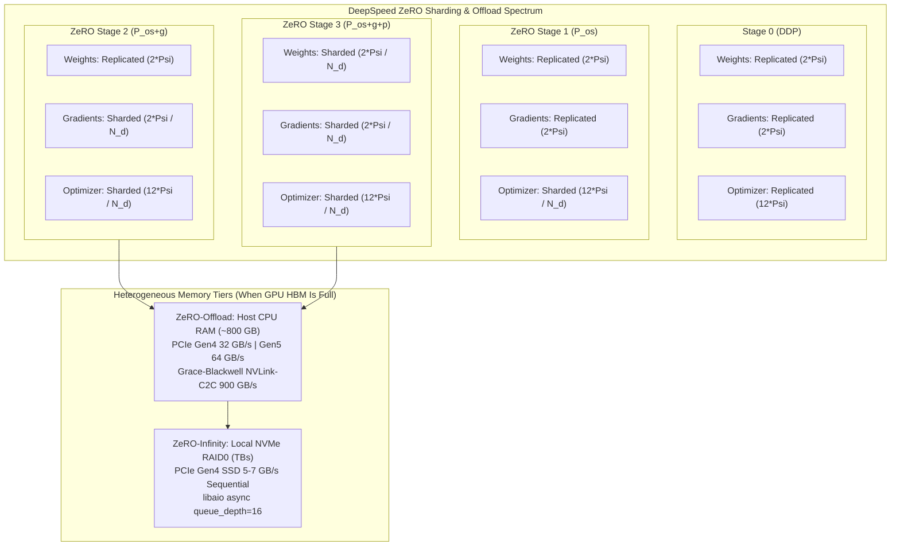
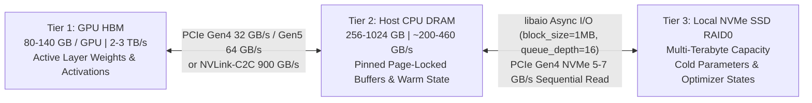
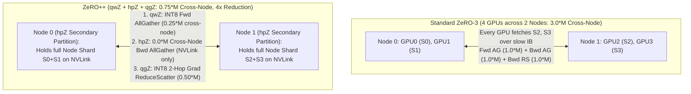
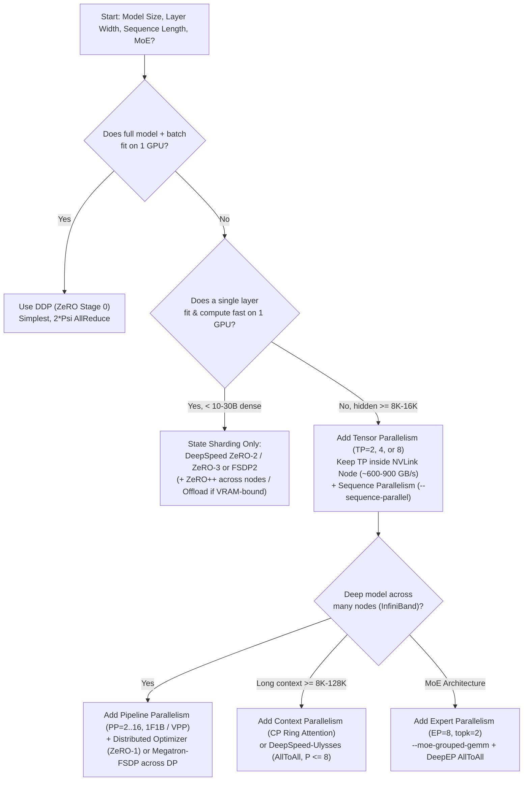

# 14.6 DeepSpeed and ZeRO

| Field | Value |
|---|---|
| Level | Advanced |
| Priority tier | 2 |
| Lab venue | Nebius GPU + Local Python Verification Lab (`code/part14/deepspeed_zero_lab.py`) |
| Part | Part 14: Distributed training and fine-tuning |
| Primary sources | *Distributed AI Systems* (`distributed-ai-systems`, Ch. 5); NVIDIA Zero-to-Hero Volume 13 (`chapter-05-deepspeed-and-zero.md`, `chapter-01-why-distributed-training-exists.md`, `chapter-08-nccl-collectives-and-communication-paths.md`, `chapter-12-volume-13-summary.md`, `index.md`, `labs/lab-01..04`); *AI Systems Performance Engineering* (`ai-systems-performance-engineering`, Ch. 13) |

## Why this matters for AI infrastructure

A team launches a 30B model with standard DistributedDataParallel on 80 GB GPUs. Every GPU keeps a full copy of the weights, gradients and AdamW states, so the job fails at initialization. Microsoft Research built the Zero Redundancy Optimizer, called ZeRO, and the DeepSpeed engine to remove that duplication. PyTorch FSDP2 later offered the same idea natively, and `fully_shard()` matches ZeRO Stage 3 on GPU memory. DeepSpeed stays in wide use because it adds offload tiers, communication compression and long-context support.

The ZeRO stages form a ladder. Stage 1 shards only the optimizer states across data-parallel ranks. Stage 2 also shards the gradients and moves the same number of bytes as DDP. Stage 3 shards the weights too, so memory shrinks in proportion to the GPU count, but collective traffic grows by fifty percent.

When Stage 3 still does not fit, ZeRO-Offload moves optimizer state into host CPU memory. ZeRO-Infinity goes further and pages to local NVMe drives. Both cross slow PCIe links and stall the GPU, unless the node has a coherent link such as the Grace-Blackwell NVLink-C2C.

Stage 3 also adds a weight AllGather to every layer, so multi-node jobs over InfiniBand tend to become network-bound. ZeRO++ quantizes weights and gradients and partitions weights inside each node, which cuts cross-node traffic by a factor of four. For long sequences, DeepSpeed-Ulysses replaces Ring Attention with two AllToAll transposes across attention heads.

One more distinction matters. ZeRO and FSDP2 shard storage at rest, and they assume a single layer still runs on one GPU after the AllGather. They do not replace Megatron-LM. When one matrix multiplication, the pipeline depth, the sequence activations or an expert router outgrows a GPU, you combine state sharding with Megatron computation sharding.

**Match the ZeRO stage, the offload tier and the compression setting to the interconnect bandwidth and the memory of each node.**

```text
Core DeepSpeed & ZeRO Architectural Pillars (2019/2020 Rajbhandari et al., DAI Ch. 5, V13 Ch. 5, AISPE Ch. 13):
1. Progressive State Sharding (ZeRO-1, ZeRO-2, ZeRO-3):
   - Mixed-precision AdamW (16 * Psi bytes/param): 2 B FP16/BF16 weights + 2 B FP16/BF16 grads + 12 B FP32 master/m/v.
   - 70B model requires 1,120 GB state (140 GB weights + 140 GB grads + 840 GB Adam; or 840 GB under 12 * Psi without separate FP32 master, and > 1.2 TB with activations vs 80 GB H100).
   - 10B FP32 model requires 160 GB per GPU in DDP (40 GB weights + 40 GB grads + 80 GB Adam m/v).
   - Across N_d = 8 GPUs:
     * ZeRO-1 (4 * Psi + 12 * Psi / N_d): 160 GB -> 90 GB for 10B FP32 (1.78x); 1,120 GB -> 385 GB for 70B (2.91x).
     * ZeRO-2 (2 * Psi + 14 * Psi / N_d): 160 GB -> 55 GB for 10B FP32 (~2.9x, 25 GB headroom on 80 GB GPU); 1,120 GB -> 262.5 GB for 70B (4.27x).
     * ZeRO-3 (16 * Psi / N_d): 160 GB -> 20 GB for 10B FP32 (8x); 1,120 GB -> 140 GB on 8 GPUs or 70 GB on 16 GPUs for 70B.
2. Heterogeneous Memory Hierarchy (ZeRO-Offload, ZeRO-Infinity, SuperOffload):
   - 70B under ZeRO-3 (12 * Psi = 840 GB) on 8 x 80 GB A100 GPUs needs 105 GB/GPU (25 GB per-GPU shortfall).
   - ZeRO-Offload uses ~800-850 GB CPU RAM (cutting GPU VRAM to 60 GB); ZeRO-Infinity uses PCIe Gen4 NVMe SSDs (5-7 GB/s read).
   - Over PCIe Gen4 x16 (32 GB/s) or Gen5 x16 (64 GB/s) vs HBM (2-3 TB/s), 70B on 8 x A100 drops from 8.5 tokens/sec (79 GB VRAM) to 0.4 tokens/sec (21x slower, 12% GPU util) on CPU offload, and 0.1 tokens/sec (65% CPU %iowait, 95% GPU idle) on NVMe.
   - Grace-Blackwell (GB200/GB300) SuperOffload uses coherent 900 GB/s NVLink-C2C (28.125x PCIe Gen4), Speculation-Then-Validation (STV), and ARM SVE GraceAdam (32 vector, 16 predicate registers).
3. Multi-Node Compression (ZeRO++) and Long-Context Attention (DeepSpeed-Ulysses):
   - ZeRO-3 increases per-step traffic from 2 * Psi (Stage 1/2) to 3 * Psi (1 fwd AllGather + 1 bwd AllGather + 1 bwd ReduceScatter).
   - ZeRO++ combines qwZ (INT8 weight AllGather, 2x), hpZ (intra-node secondary partition), and qgZ (INT8 hierarchical grad ReduceScatter) for a 4x cross-node reduction (3 * M -> 0.75 * M).
   - DeepSpeed-Ulysses (8K-128K+ context) uses two AllToAll 2D transposes between (B, S / P, H, d) and (B, S, H / P, d).
4. Two-Axis View (State Sharding vs Computation Sharding):
   - Single layer matrices (16K x 16K or 175B MLP 12,288 x 49,152 = 603,979,776 [> 600M] params / 1.2 GB FP16) require Megatron TP, PP, CP, and EP alongside state sharding.
```

## Prerequisites and outcomes

### Prerequisites
- Training memory anatomy including weights, gradients, optimizer states, activations, and mixed-precision accounting rules from Chapters 14.1 through 14.3.
- Familiarity with DDP AllReduce, FSDP1 versus FSDP2, and NCCL Ring versus Tree collectives including AllGather, ReduceScatter, and AllToAll from Chapters 12.15 through 12.17, 14.4, and 14.5.

### Outcomes
After completing this chapter, you will be able to:
1. Compute exact per-GPU static memory across ZeRO Stage 0, Stage 1, Stage 2, and Stage 3 for 7B to 70B models.
2. Derive why ZeRO Stage 1 and Stage 2 communicate twice the parameter count per step while Stage 3 communicates three times that volume. You will also calculate how ZeRO++ cuts cross-node traffic by four times.
3. Size and diagnose ZeRO-Offload on CPU, ZeRO-Infinity on NVMe with `libaio`, and Grace-Blackwell SuperOffload over NVLink-C2C.
4. Configure and validate production DeepSpeed JSON files including batch size identities, communication bucket thresholds, and asynchronous I/O settings.
5. Distinguish state sharding from Megatron computation sharding and design hybrid parallel configurations for dense and Mixture-of-Experts models.

---

## 1. The ZeRO Sharding Spectrum: Stage 0, Stage 1, Stage 2, and Stage 3

When engineers scale training with standard DDP, every GPU holds an identical copy of all model parameters, gradients, and optimizer states. That replication wastes massive amounts of high-bandwidth memory on tensors that sit idle during most of the training step. Microsoft's Zero Redundancy Optimizer paper solved this problem by observing a simple execution truth. Every GPU needs the active layer's weights during forward and backward compute. However, no GPU ever needs to store all parameters, gradients, and optimizer states simultaneously at rest.

### 1.1 Eliminating Redundancy Across Data-Parallel Ranks

ZeRO eliminates memory redundancy progressively across three distinct stages. Stage 0 corresponds to baseline DDP with full replication across all data-parallel ranks. Stage 1 partitions only the optimizer states across the data-parallel group. Each GPU stores and updates only its assigned shard of the AdamW moments. Stage 2 partitions both the gradients and the optimizer states while keeping model weights replicated on every device. Stage 3 partitions the model weights, gradients, and optimizer states across all ranks. It materializes full layer weights on the fly only when a layer executes.



Published ZeRO material counts the state of one parameter in more than one way, and mixing them gives wrong totals. The standard mixed-precision count is 16 bytes. It has 2 bytes for the 16-bit weight, 2 bytes for the gradient, and 12 bytes for the FP32 master weight, momentum and variance. A shorter 12-byte count leaves out the FP32 master copy. A pure FP32 run also totals 16 bytes, because weight and gradient take 4 bytes each and the two moments take 8. The worked examples below say which count they use.

```text
ZeRO Static Memory Accounting Conventions (Psi = parameter count, N_d = data-parallel GPUs):
1. Mixed-Precision 16 * Psi Convention (with FP32 master weights, DAI Ch. 5):
   - Parameters (FP16/BF16): 2 * Psi bytes | Gradients (FP16/BF16): 2 * Psi bytes
   - AdamW Optimizer State (FP32 master 4 * Psi + FP32 m 4 * Psi + FP32 v 4 * Psi): 12 * Psi bytes
   - Stage 0 (DDP):                  16 * Psi
   - Stage 1 (P_os, shard optim):     4 * Psi + (12 * Psi) / N_d
   - Stage 2 (P_os+g, shard g+opt):   2 * Psi + (14 * Psi) / N_d
   - Stage 3 (P_os+g+p, shard all):  (16 * Psi) / N_d
2. Mixed-Precision 12 * Psi Convention (without separate FP32 master weights, V13 Ch. 5 & DAI Ch. 5):
   - Parameters (2 * Psi) + Gradients (2 * Psi) + FP32 m/v (8 * Psi) = 12 * Psi bytes total
   - Totals: 84 GB for 7B, 360 GB for 30B, 840 GB for 70B.
3. Pure FP32 16 * Psi Convention (V13 Ch. 5 10B baseline):
   - Parameters (FP32, 4 * Psi) + Gradients (FP32, 4 * Psi) + FP32 m/v (8 * Psi) = 16 * Psi bytes (160 GB for 10B).
```

### 1.2 Side-by-Side Memory Math for 7B, 10B, 30B, and 70B Models

If you miscalculate static state memory before launching a job, you either waste money over-provisioning nodes or hit immediate out-of-memory crashes. By applying the stage formulas directly, you can find the exact ZeRO stage needed for your GPU memory capacity.

For a 10B model trained in pure FP32 on eight GPUs, both Stage 0 and Stage 1 overflow an 80 GB card. Moving to ZeRO Stage 2 drops per-GPU state to 55 GB, leaving comfortable headroom for activations without Stage 3 communication overhead. For a 70B model on eight GPUs, even ZeRO Stage 3 exceeds a single 80 GB card. That footprint forces either horizontal scaling to sixteen GPUs or memory offloading.

```text
Case 1: 70B Model in Mixed Precision (16*Psi = 1,120 GB total state) on N_d = 8 GPUs (DAI Ch. 5):
  - FP16 Parameters: 70B x 2 B = 140.0 GB
  - FP16 Gradients:  70B x 2 B = 140.0 GB
  - FP32 Adam State (master + m + v): 70B x 12 B = 840.0 GB
  -----------------------------------------------------------------------------------
  * Stage 0 (DDP):    140.0 + 140.0 + 840.0       = 1,120.0 GB / GPU (1.00x)
  * ZeRO Stage 1:     140.0 + 140.0 + (840.0 / 8) =   385.0 GB / GPU (2.91x reduction)
  * ZeRO Stage 2:     140.0 + (140.0 + 840.0) / 8 =   262.5 GB / GPU (4.27x reduction)
  * ZeRO Stage 3:     (140.0 + 140.0 + 840.0) / 8 =   140.0 GB / GPU (8.00x reduction; 70.0 GB on N_d=16)

Case 2: 10B Model in Pure FP32 (16*Psi = 160 GB total state) on N_d = 8 GPUs (Volume 13 Ch. 5):
  - FP32 Parameters: 10B x 4 B = 40.0 GB
  - FP32 Gradients:  10B x 4 B = 40.0 GB
  - FP32 Adam State (m + v): 10B x 8 B = 80.0 GB
  -----------------------------------------------------------------------------------
  * Stage 0 (DDP):    40.0 + 40.0 + 80.0          =   160.0 GB / GPU (1.00x, exceeds 80 GB GPU)
  * ZeRO Stage 1:     40.0 + 40.0 + (80.0 / 8)    =    90.0 GB / GPU (1.78x, still > 80 GB GPU)
  * ZeRO Stage 2:     40.0 + (40.0 + 80.0) / 8    =    55.0 GB / GPU (~2.9x [2.91x], 25 GB headroom on 80 GB GPU)
  * ZeRO Stage 3:     (40.0 + 40.0 + 80.0) / 8    =    20.0 GB / GPU (8.00x reduction)

Case 3: 7B Model in Mixed Precision (12*Psi = 84 GB total state) on N_d = 2 GPUs (DAI Ch. 5):
  - FP16 Parameters (14.0 GB) + FP16 Gradients (14.0 GB) + FP32 Adam m/v (56.0 GB)
  -----------------------------------------------------------------------------------
  * Stage 0 (DDP):    14.0 + 14.0 + 56.0          =    84.0 GB / GPU
  * ZeRO Stage 1:     14.0 + 14.0 + (56.0 / 2)    =    56.0 GB / GPU (optimizer drops 56 -> 28 GB)
  * ZeRO Stage 2:     14.0 + (14.0 / 2) + 28.0    =    49.0 GB / GPU (gradients drop 14 -> 7 GB)
  * ZeRO Stage 3:     (14.0 + 14.0 + 56.0) / 2    =    42.0 GB / GPU (7 + 7 + 28 GB)
```

| Model & Precision Convention | `N_d` GPUs | Stage 0 (`DDP`) | `ZeRO Stage 1` | `ZeRO Stage 2` | `ZeRO Stage 3` | Key Infrastructure Takeaway |
|---|---|---|---|---|---|---|
| **`70B` Mixed (`16 * Psi = 1,120 GB`)** | `8` | `1,120.0 GB` | `385.0 GB` (`2.91x`) | `262.5 GB` (`4.27x`) | **`140.0 GB`** (`8.0x`) | Needs `N_d = 16` (`70.0 GB`/GPU) or offload to fit `80 GB` `H100`. |
| **`70B` Mixed (`12 * Psi = 840 GB`)** | `8` | `840.0 GB` | `350.0 GB` (`2.40x`) | `227.5 GB` (`3.69x`) | **`105.0 GB`** (`8.0x`) | `25.0 GB` shortfall on `80 GB` GPU (`105 - 80 = 25 GB`). |
| **`30B` Mixed (`12 * Psi = 360 GB`)** | `16` | `360.0 GB` | `135.0 GB` (`2.67x`) | **`78.75 GB`** (`75.0 GB` w/ `8B` grad+opt) | **`22.5 GB`** (`16.0x`) | `ZeRO-2` fits on `80 GB` GPUs in `FP16` (`60 + 15 = 75 GB`), but OOMs if weights are `FP32` (`120 + 15 = 135 GB`). |
| **`10B` Pure `FP32` (`16 * Psi = 160 GB`)** | `8` | `160.0 GB` | `90.0 GB` (`1.78x`) | **`55.0 GB`** (`~2.9x`) | **`20.0 GB`** (`8.0x`) | `ZeRO-2` is the sweet spot: fits on `80 GB` GPU with `25 GB` activation headroom. |
| **`7B` Mixed (`12 * Psi = 84 GB`)** | `2` | `84.0 GB` | `56.0 GB` (`1.50x`) | `49.0 GB` (`1.71x`) | **`42.0 GB`** (`2.0x`) | Even `2` GPUs cut `7B` state from `84 GB` to `42 GB` (`10.5 GB` on `8` GPUs). |

### 1.3 Collective Communication Volume Across ZeRO Stages

Many engineers assume that sharding model state always increases network traffic. Jumping straight to ZeRO Stage 3 when Stage 2 already fits in memory adds unnecessary collective latency and slows down multi-node training. Understanding the exact collective breakdown explains why ZeRO Stage 1 and Stage 2 are free in communication volume compared to DDP.

In ZeRO Stage 1, parameters remain replicated on every GPU, so the forward pass requires zero network communication. During the backward pass, instead of running a full AllReduce on all gradients, Stage 1 runs a ReduceScatter. That single collective averages and delivers only the 1/N_d gradient shard whose optimizer state each rank owns. Each rank then steps its local optimizer shard and runs an AllGather to broadcast the updated weights back to all peers. Because one ReduceScatter plus one AllGather equals the exact byte volume of a single ring AllReduce, Stage 1 communicates the exact same volume as DDP.

ZeRO Stage 2 executes the exact same collectives as Stage 1: one ReduceScatter during backpropagation and one AllGather after the optimizer step. The only difference is lifetime management. As soon as a gradient bucket finishes its ReduceScatter during the backward pass, Stage 2 immediately frees the non-local gradient slices instead of holding them until the step ends.

ZeRO Stage 3 shards the model weights themselves at rest, which breaks this communication parity. Every layer must run an AllGather during the forward pass to materialize weights and then discard the non-local slices immediately after compute. During the backward pass, every layer must run a second AllGather to rematerialize weights before running a ReduceScatter on the gradients. **ZeRO Stage 1 and Stage 2 transfer 2M bytes per step just like DDP, whereas ZeRO Stage 3 transfers 3M bytes per step—a 50 percent increase in network traffic.**

```text
Per-Step Collective Volume Breakdown (M = 2 * Psi bytes for FP16/BF16 weights/gradients):
1. ZeRO Stage 1 (P_os) & ZeRO Stage 2 (P_os+g):
   - Forward pass:  0 communication (weights replicated on all N_d GPUs)
   - Backward pass: 1x ReduceScatter on gradients   = ((N_d - 1) / N_d) * M bytes
   - Optimizer end: 1x AllGather on updated weights = ((N_d - 1) / N_d) * M bytes
   - Total Volume:  2 * ((N_d - 1) / N_d) * M (~2 * M / 2 * Psi, identical to DDP AllReduce)
2. ZeRO Stage 3 (P_os+g+p):
   - Forward pass:  1x AllGather on weights         = ((N_d - 1) / N_d) * M bytes
   - Backward pass: 1x AllGather on weights         = ((N_d - 1) / N_d) * M bytes
   - Backward pass: 1x ReduceScatter on gradients   = ((N_d - 1) / N_d) * M bytes
   - Total Volume:  3 * ((N_d - 1) / N_d) * M (~3 * M / 3 * Psi, 1.5x / +50% over Stage 1/2, and 2x-3x higher effective latency on small layers)
3. Concrete 70B FP16 Example (M = 140.0 GB) on N_d = 8 GPUs:
   - Stage 1 & Stage 2: 280.0 GB asymptotic | 245.0 GB exact ring (2 * 7/8 * 140.0 GB)
   - Stage 3:           420.0 GB asymptotic | 367.5 GB exact ring (3 * 7/8 * 140.0 GB)
```

---

## 2. ZeRO-Offload, ZeRO-Infinity, and Grace-Blackwell SuperOffload

Sometimes even ZeRO Stage 3 exceeds available GPU memory. This happens when fine-tuning a 70B model on a single 8-GPU A100 node or on consumer 24 GB RTX 4090 cards. When engineers enable CPU or NVMe offloading blindly to avoid out-of-memory errors, training throughput often collapses by an order of magnitude. Host PCIe links are far slower than GPU HBM. You must calculate the exact host bus bottleneck before deciding whether to offload state or add more GPUs.

### 2.1 ZeRO-Offload: Extending Optimizer and Gradient State to Host CPU RAM

Consider a 70B model under the twelve-byte convention running with ZeRO-3 across eight 80 GB A100 GPUs. The total model state is 840 GB, which divides into 105 GB per GPU and leaves a 25 GB per-GPU shortfall. ZeRO-Offload resolves this shortfall by moving the FP32 AdamW optimizer states out of GPU HBM and into host CPU DRAM. It can also optionally offload gradients or Stage 3 parameters.

```text
70B Model (12 * Psi = 840.0 GB total state) on 8 x 80 GB A100 GPUs with ZeRO-3 (V13 Ch. 5):
  Per-GPU state needed: (70B x 12 bytes) / 8 = 105.0 GB
  Available per A100/H100 GPU:                 80.0 GB
  Per-GPU VRAM Shortfall:                      25.0 GB
```

During execution, forward and backward matrix multiplications stay on the GPU to run at high HBM bandwidth. As backpropagation produces gradients, DeepSpeed streams them over PCIe into page-locked host DRAM. The host CPU then runs the FP32 Adam update using AVX-vectorized `DeepSpeedCPUAdam`. DeepSpeed streams the updated 16-bit weights back to the GPU while overlapping transfers with computation.

However, PCIe Gen4 and Gen5 buses are thirty to one hundred times slower than GPU HBM. When ZeRO-2 offloads only optimizer states for a moderate model with heavy per-layer compute, throughput drops by a manageable twenty to forty percent. When ZeRO-3 offloads state for a 70B model on eight A100 GPUs over PCIe Gen4, the PCIe bus saturates. Training speed plunges by twenty-one times and GPU utilization drops to twelve percent.

| Offload Scenario & Interconnect | Hardware Bandwidth | Memory Footprint Breakdown | Measured Throughput & Utilization Impact (`DAI Ch. 5`, `V13 Ch. 5`) |
|---|---|---|---|
| **GPU HBM Baseline (No Offload)** | **`2–3 TB/s`** per GPU | `70B` needs `79 GB` GPU VRAM (when fitted) | **`8.5 tokens/sec`**, **`80–95%`** GPU utilization |
| **Moderate Model `ZeRO-2` CPU Offload** | `PCIe Gen4 x16` (**`32 GB/s`**) or `Gen5 x16` (**`64 GB/s`**) | `354.3M` params (`0.71 GB` `FP16`) uses **`3.41–3.52 GB`** peak GPU VRAM across steps `0–10` | **`20–40%` throughput reduction** when compute overlaps optimizer transfer |
| **`70B` `ZeRO-3` + CPU Offload (`8 x A100`)** | `PCIe Gen4 x16` (**`32 GB/s`**) | **`60 GB`** GPU VRAM + **`~800–850 GB`** host CPU RAM (swaps if host RAM is smaller) | Drops from `8.5` to **`0.4 tokens/sec`** (**`21.25x` ~ `21x` slower**), **`12%`** GPU utilization (`10–100x` slower when parameter offload saturates `PCIe`) |

### 2.2 ZeRO-Infinity: Three-Tier Memory Hierarchy with NVMe SSDs

When models reach hundreds of billions or trillions of parameters, even 512 GB or 1 TB of host CPU DRAM fills up completely. ZeRO-Infinity, introduced in 2021, adds a third storage tier by paging cold parameters and optimizer states onto local PCIe NVMe SSDs managed by the DeepSpeed Infinity Engine.



To keep the SSDs busy, ZeRO-Infinity needs three things from the Linux host. The `nvme_path` must point to a mounted directory with two to four times the model size in free space, never to a raw device like `/dev/nvme0n1p7`. The native asynchronous I/O library (`libaio-dev` or `libaio-devel`) must be installed, and the open-file limit raised with `ulimit -n 65535`. The asynchronous I/O block should use a 1 MB block size and a queue depth of 16.

Even with RAID0 striping across multiple drives, ZeRO-Infinity is a feasibility mechanism rather than a speed optimization. Modern PCIe Gen4 NVMe SSDs deliver only 5 to 7 GB/s of sequential read bandwidth per drive. Paging both parameters and optimizer states to NVMe runs 30 to 50 percent slower than CPU offload. Compared to pure GPU training, it runs 50 to 85 times slower and drops a 70B run to 0.1 tokens/sec.

### 2.3 Grace-Blackwell SuperOffload and GraceAdam

Classical CPU offloading crawls because a 32 GB/s PCIe Gen4 bus starves the GPU and forces synchronous stalls before the CPU optimizer steps. NVIDIA's Grace-Blackwell architecture and the 2025 SuperOffload framework transform offloading from a last-resort fallback into a high-throughput production tier.

The Grace ARM CPU and the Blackwell GPU do not cross a narrow PCIe bus. They talk over a cache-coherent NVLink-C2C interconnect at 900 GB/s. That link provides 28.125 times the bandwidth of PCIe Gen4 x16. It gives the GPU direct access to up to 512 GB of fast LPDDR5X host memory per Grace CPU.

SuperOffload also removes the synchronization barrier between GPU backpropagation and the CPU optimizer step using Speculation-Then-Validation. In standard ZeRO-Offload, the CPU must wait until the GPU finishes checking the entire backward pass for NaN or Inf gradient norms. Speculation-Then-Validation streams gradients over NVLink-C2C and starts the CPU optimizer update concurrently with GPU backpropagation. It rolls back only on the rare step where an overflow actually occurs.

Finally, SuperOffload partitions the optimizer update between GPU HBM and Grace LPDDR5X so both processors finish at the exact same instant. On the Grace CPU side, it executes GraceAdam, a custom AdamW kernel hand-vectorized for the ARM Scalable Vector Extension instruction set. Together, the fast link, Speculation-Then-Validation and GraceAdam let SuperOffload sustain over **80 percent GPU utilization**.

---

## 3. ZeRO++ and DeepSpeed-Ulysses: Multi-Node and Long-Context Scaling

When ZeRO Stage 3 scales beyond a single node, training jobs hit two new walls: slow cross-node network links and exploding long-context activation memory. Inside a node, NVLink provides 600 to 900 GB/s of bandwidth, whereas cross-node InfiniBand links deliver only 25 to 50 GB/s per NIC. Meanwhile, extending sequence lengths from 4K to 32K or 128K tokens causes single-GPU activation memory to overflow even when weights are sharded. DeepSpeed addresses multi-node collective bottlenecks with ZeRO++ and solves long-context activation scaling with DeepSpeed-Ulysses.

### 3.1 ZeRO++: Cutting Cross-Node Collective Volume by Four Times

Standard ZeRO Stage 3 transfers 3M bytes per step across the entire data-parallel group. That traffic saturates cross-node InfiniBand links on every forward and backward layer. Introduced by Wang et al. in 2023, ZeRO++ combines three orthogonal collective optimizations to slash cross-node communication volume by four times.



Quantized Weights (`qwZ`) compress the forward AllGather. Before transmitting its FP16 weight shard, each rank dynamically quantizes the 2-byte weights into block-based 1-byte INT8 tensors using `CUDAQuantizer`. That step cuts AllGather byte volume in half from 1.0M to 0.5M. Because the optimizer maintains unquantized FP32 master weights at rest, quantization errors do not accumulate across training steps.

Hierarchical Weight Partitioning (`hpZ`) eliminates cross-node traffic during the backward AllGather. Instead of discarding gathered weights completely after the forward pass, `hpZ` retains a secondary full-model weight partition across the 8 GPUs inside each node. During the backward pass, each GPU gathers weights purely inside its own node over fast 600 to 900 GB/s NVLink. That local collective drops cross-node backward AllGather traffic to zero.

Quantized Gradients (`qgZ`) replace the flat cross-node ring ReduceScatter with a two-hop hierarchical collective. It reduces gradients inside the node first and then transmits block-quantized INT8 gradients across nodes. That hierarchy cuts cross-node gradient volume in half from 1.0M to 0.5M.

| ZeRO++ Component | JSON Configuration Key | Cross-Node Byte Volume | Mechanism & Hardware Path (`DAI Ch. 5`, arXiv:`2306.10209`) |
|---|---|---|---|
| **Baseline `ZeRO-3`** | `"stage": 3` | **`3.0 * M`** (`420.0 GB` for `70B` `FP16`) | `1.0 * M` Fwd `AllGather` + `1.0 * M` Bwd `AllGather` + `1.0 * M` Bwd `ReduceScatter` |
| **1. Quantized Weights (`qwZ`)** | `"zero_quantized_weights": true` | Cuts each `AllGather` `1.0 * M -> 0.5 * M` (`0.25 * M` cross-node w/ `hpZ`; `2.0 * M` = `280.0 GB` if `qwZ` alone) | Block-based `FP16` (`2 B`) to `INT8` (`1 B`) dynamic quantization via `CUDAQuantizer` |
| **2. Hierarchical Partitioning (`hpZ`)** | `"zero_hpz_partition_size": 8` (or `2` in `2`-GPU/node demo) | **`0.0 * M`** cross-node Bwd `AllGather` | Secondary parameter partition across intra-node GPUs keeps backward `AllGather` on `600–900 GB/s` `NVLink` |
| **3. Quantized Gradients (`qgZ`)** | `"zero_quantized_gradients": true` | **`0.50 * M`** cross-node Bwd `ReduceScatter` | Two-hop intra-node + inter-node hierarchical `ReduceScatter` with `INT8` block quantization |
| **Combined `ZeRO++` (`qwZ + hpZ + qgZ`)** | All three enabled with `"fp16": {"enabled": true}` | **`0.75 * M`** (`105.0 GB` for `70B` `FP16`, **`4.0x` reduction**) | Slashes cross-node InfiniBand volume from `420.0 GB` to `105.0 GB` per step |

:::caution ZeRO++ Requires FP16 Due to CUDAQuantizer Dtype Constraints
As documented in *Distributed AI Systems* Chapter 5, DeepSpeed's `CUDAQuantizer` dequantizes INT8 buffers directly into FP16 tensors. Enabling `zero_quantized_weights` or `zero_quantized_gradients` alongside BF16 fails immediately with `RuntimeError: expected scalar type BFloat16 but found Half`. Always enable FP16 in your DeepSpeed JSON config when running ZeRO++.
:::

### 3.2 DeepSpeed-Ulysses vs Ring Attention for Long-Context Training

When sequence length grows to 32K or 128K tokens, single-GPU activation memory easily exceeds 40 GB for a 32-layer model. Sequence and context parallelism solve this problem by splitting the input sequence across multiple GPUs so each rank starts with a local sequence chunk.

Megatron Context Parallelism uses Ring Attention. It keeps queries local and rotates key-value chunks around a logical ring in multiple steps while accumulating partial softmax denominators. While Ring Attention scales to arbitrary GPU counts, it requires complex online-softmax bookkeeping and careful causal-mask load balancing.

DeepSpeed-Ulysses takes a much simpler transpose approach. Before the attention kernel runs, Ulysses executes an AllToAll collective (`all_to_all_seq_to_head`) that transposes the tensor from sequence-sharded to head-sharded layout. Each GPU now holds the full sequence for a subset of attention heads and runs unmodified standard FlashAttention locally. After attention completes, a second AllToAll collective (`all_to_all_head_to_seq`) transposes the output back to sequence-sharded layout.

| Feature | Ring Attention (Megatron Context Parallelism `CP`) | **DeepSpeed-Ulysses (`2D` `AllToAll` Transpose)** |
|---|---|---|
| **Core Mechanism & Tensor Shapes** | Keeps queries local `(B, S / P, H, d)` and rotates `K, V` chunks around a logical ring in `P` steps, accumulating partial softmax denominators (`lse`). | Runs `AllToAll` before attention to transpose `(B, S / P, H, d)` -> **`(B, S, H / P, d)`** (e.g., `(2, 8192, 32, 128)` -> `(2, 32768, 8, 128)` for `P = 4`), runs standard FlashAttention, and reverses `AllToAll`. |
| **Implementation Complexity** | High: requires custom online-softmax accumulation and causal-mask load balancing across ring steps. | **Low:** between `all_to_all_seq_to_head` and `all_to_all_head_to_seq`, each GPU runs unmodified self-attention on its `H / P` heads. |
| **Communication Volume & Sweet Spot** | Sends `K, V` around `P` ring hops overlapped with attention compute; scales to arbitrary `P` (`100K+` tokens across many nodes). | `1 / P` communication volume per link via simultaneous `AllToAll`; **wins for `P <= 8`** on high-bandwidth intra-node `NVLink` (`P` cannot exceed the number of attention/KV heads `H`). |

---

## 4. Beyond State Sharding: Combining ZeRO/FSDP with Megatron Computation Sharding

A pervasive mistake among infrastructure teams is assuming that ZeRO-3 or FSDP2 can replace Megatron-LM for frontier models. When engineers try to train a 175B dense model or a large Mixture-of-Experts model using ZeRO-3 alone, single layers overflow GPU memory during AllGather or suffer severe communication stalls. You must treat state sharding and computation sharding as two orthogonal axes that work together.

### 4.1 Why State Sharding Cannot Replace Computation Sharding

State sharding methods—including ZeRO, FSDP2, Megatron-FSDP, and the Megatron Distributed Optimizer—only partition model storage at rest. Whenever a layer executes, every GPU must still gather the entire layer's weight matrix via AllGather and compute that layer locally. Computation sharding methods in Megatron Core—including Tensor Parallelism, Pipeline Parallelism, Context Parallelism, and Expert Parallelism—split the active computation and activation memory across GPUs.

In a 7B model, a single MLP weight matrix contains 67.1 million parameters and occupies only half a gigabyte across the block in FP16. One GPU easily holds and multiplies that unsharded layer after an AllGather. In a 175B model, however, a single MLP matrix contains more than 600 million parameters and occupies 1.2 GB in FP16 alone. Applying 8-way Tensor Parallelism via `ColumnParallelLinear` and `RowParallelLinear` splits a massive matrix across 8 NVLink-connected GPUs. No single device ever holds or multiplies the full weight tensor.

```text
State Sharding vs Computation Sharding Layer Scale Comparison (DAI Ch. 5):
1. 7B Dense Model (hidden_size = 4096, ffn_hidden_size = 16384):
   - Single MLP matrix: 4096 x 16384 = 67.1M parameters (~270M across MLP block, ~500 MB in FP16).
   - Easily fits and executes on 1 GPU after a ZeRO-3 / FSDP2 AllGather.
2. 175B Dense Model (hidden_size = 12,288, ffn_hidden_size = 49,152) or 16K x 16K Projection:
   - Single MLP matrix: 12,288 x 49,152 = 603,979,776 (> 600M / ~604M) parameters = 1.2 GB in FP16 for one matrix.
   - With Tensor Parallelism (TP = 8) using ColumnParallelLinear (W = [W_0 | ... | W_7], 0 comm) + RowParallelLinear (W' = [W'_0; ...; W'_7], 1 AllReduce per block):
     A 16K x 16K matrix is split into eight 16K x 2K slices across intra-node NVLink.
```

### 4.2 Megatron Core Native State Sharders: Distributed Optimizer and Megatron-FSDP

When you use Megatron Core (`nvcr.io/nvidia/pytorch:25.04-py3` or `pip install --no-build-isolation megatron-core[mlm,dev] pybind11`), bolting external DeepSpeed ZeRO-3 onto the job requires keeping process groups strictly disjoint. Some teams use wrappers like Colossal-AI Gemini, but Megatron Core provides two native, topology-aware state sharders that integrate directly with its parallel process groups.

The first native sharder is the Megatron Distributed Optimizer (`--use-distributed-optimizer`), which is functionally equivalent to ZeRO Stage 1. It shards the FP32 master weights, momentum, and variance across the data-parallel group. It also copies gradients into contiguous buffers for overlapped ReduceScatter (`--overlap-grad-reduce`) and overlapped parameter AllGather (`--overlap-param-gather`). Across 8 data-parallel ranks, it reduces BF16 parameter and FP32 gradient memory from 18 bytes per parameter down to 7.5 bytes per parameter.

| Precision Configuration | Without Distributed Optimizer (`d = 1`) | With Distributed Optimizer (`d` DP GPUs) | At `d = 8` GPUs | Reduction at `d = 8` |
|---|---|---|---|---|
| **`fp16` params, `fp16` grads** | `20 bytes/param` (`2 + 2 + 16`) | `4 + 16 / d bytes/param` | **`6.0 bytes/param`** | **`3.33x`** |
| **`bf16` params, `fp32` grads** | `18 bytes/param` (`2 + 4 + 12`) | `6 + 12 / d bytes/param` | **`7.5 bytes/param`** | **`2.40x`** |
| **`fp32` params, `fp32` grads** | `16 bytes/param` (`4 + 4 + 8`) | `8 + 8 / d bytes/param` | **`9.0 bytes/param`** | **`1.78x`** |

The second native sharder is Megatron-FSDP (`--use-megatron-fsdp --data-parallel-sharding-strategy optim_grads_params`), which is equivalent to ZeRO Stage 3. Megatron-FSDP understands TP, PP, CP, and EP process groups natively and uses NCCL `userbuffer` registration to minimize GPU Streaming Multiprocessor consumption during collectives. As a result, it delivers 15 to 25 percent higher throughput and roughly 23 percent memory savings compared to PyTorch FSDP2. On Hopper, Ada, and Blackwell GPUs, you can pair Megatron-FSDP with FP8 hybrid training (`--fp8-format hybrid --fp8-amax-history-len 1024 --fp8-amax-compute-algo max`). Adding `--fp8-param-gather` gathers sharded weights in 1-byte FP8, cutting AllGather volume in half while delivering 1.5 to 2x GEMM speedups.

### 4.3 The Hybrid Parallelism Decision Framework

Hybrid parallelism works because each dimension attacks a different physical limit. State sharding via ZeRO or FSDP eliminates redundant optimizer storage across data-parallel replicas. Tensor Parallelism splits wide matrix multiplications inside a single high-bandwidth NVLink node. Pipeline Parallelism bounds active layer depth across nodes using 1F1B or interleaved Virtual Pipeline Parallelism (`--num-layers-per-virtual-pipeline-stage 2`). Finally, Context Parallelism or DeepSpeed-Ulysses shards long-sequence activations.

For a dense model under roughly 10B to 30B parameters, start with pure state sharding and add computation sharding only when needed. Keep Tensor Parallelism and Expert Parallelism groups inside one NVLink node and set `CUDA_DEVICE_MAX_CONNECTIONS=1`. Changing the TP or PP layout means resharding the checkpoint, which Megatron distributed checkpointing does up to 50 times faster than naive `torch.save`. Turn on communication overlap with `--overlap-grad-reduce`, `--overlap-param-gather` and `--tp-comm-overlap`. Use `offload_optimizer` and `offload_param` only after GPU memory is exhausted.

The remaining Megatron options are lookup material, not a recipe. They are `--sequence-parallel`, `--recompute-activations`, `--calculate-per-token-loss` and CUDA graphs.



| Model Architecture & Scale | Cluster Size | Topology (`TP`, `PP`, `CP`, `EP`, `DP`) | Key Flags, Micro-Batching & Sharding Mechanics (`DAI Ch. 5`) |
|---|---|---|---|
| **`70B` Dense (`H = 8192`, `L = 80`)** | `64` GPUs (`8` nodes x `8` GPUs) | **`TP = 4`** (intra-node `NVLink`), **`PP = 2`** (`40` layers/stage over IB), **`DP = 64 / (4 * 2) = 8`** | Each replica uses `4 * 2 = 8` GPUs; `ZeRO`/`FSDP` or `Distributed Optimizer` shards optimizer state `1/8` across `DP`, `1/4` layer compute, `1/2` depth per GPU |
| **`LLaMA-3 8B` Long-Context (`S = 8192`, `L = 32`, `H = 4096`, `ffn = 14336`, `32` heads, `8` GQA groups)** | `8 x 80 GB` GPUs | `TP = 1`, `PP = 1`, **`CP = 2`** (`4096` tokens/GPU), **`DP = 8 / (1 * 1 * 2) = 4`** | `--global-batch-size 128 --micro-batch-size 1` -> **`32` micro-batches/step** (`128 / 4`); uses `--fp8-format hybrid` (`E4M3` fwd / `E5M2` bwd) `--fp8-param-gather --use-distributed-optimizer` |
| **`GPT-3 175B` (`L = 96`, `H = 12288`, `96` heads, `S = 2048`)** | `128` GPUs (`16` nodes x `8` GPUs) | **`TP = 8`** (full intra-node `NVLink`), **`PP = 16`** (**`6` layers/stage**, `96 / 16`), **`DP = 128 / (8 * 16) = 1`** | Accumulates micro-batches across `--global-batch-size 1536` |
| **`Mixtral 8x7B` MoE (`L = 32`, `H = 4096`, `8` experts, `topk = 2`)** | `64` GPUs (`8` nodes x `8` GPUs) | **`EP = 8`** (`--expert-model-parallel-size 8`, `1` expert/GPU), `TP = 1`, **`PP = 4`** (**`8` layers/stage**) | Uses `--moe-grouped-gemm --moe-permute-fusion --sequence-parallel --use-distributed-optimizer` and `DeepEP` `AllToAll` routing |

---

## 5. Commands and configurations that matter

A wrong DeepSpeed JSON file, or a direct call to a PyTorch optimizer, can corrupt gradients without any error. Run the training loop through the DeepSpeed engine. Check the batch-size and bucket-size settings before a multi-node launch.

### 5.1 DeepSpeed Engine Initialization

Unlike PyTorch DDP, where you instantiate `torch.optim.AdamW` manually and wrap the module in `DistributedDataParallel`, DeepSpeed takes a declarative JSON configuration file. Calling `deepspeed.initialize()` builds the sharded optimizer, gradient scaler, and communication buckets automatically. For huge models like a 70B Transformer that exceed single-GPU or host memory at construction time, wrap model instantiation inside `deepspeed.zero.Init()`. That context manager partitions parameters immediately as each layer is allocated (`untested here`).

```python
import deepspeed
import torch

# For models larger than single-GPU RAM/VRAM (e.g., 70B), wrap model creation in
# deepspeed.zero.Init() so parameters are partitioned immediately at construction time:
with deepspeed.zero.Init(config_dict_or_path="ds_zero3_config.json"):
    model = build_transformer_model()

model_engine, optimizer, _, _ = deepspeed.initialize(
    model=model,
    model_parameters=model.parameters(),
    config="ds_zero3_config.json",
)

for batch in dataloader:
    loss = model_engine(batch["input_ids"], labels=batch["labels"])
    model_engine.backward(loss)  # Runs ReduceScatter + prefetches backward AllGather
    model_engine.step()          # Runs sharded optimizer step + clears gradients
```

### 5.2 Production DeepSpeed JSON Configurations

Every DeepSpeed configuration must satisfy a strict batch-size identity. The global training batch size must equal the product of the per-GPU micro-batch size, gradient accumulation steps, and data-parallel world size. Violating this identity causes `deepspeed.initialize()` to abort with an assertion error at startup.

```text
DeepSpeed Batch-Size Identity:
  train_batch_size == train_micro_batch_size_per_gpu x gradient_accumulation_steps x data_parallel_world_size
  Example (8 GPUs): 256 == 4 x 8 x 8
```

#### Configuration A: ZeRO Stage 2 Production Sweet Spot (`ds_zero2.json`)

```json
{
  "train_batch_size": 256,
  "train_micro_batch_size_per_gpu": 4,
  "gradient_accumulation_steps": 8,
  "bf16": { "enabled": true },
  "zero_optimization": {
    "stage": 2,
    "allgather_partitions": true,
    "allgather_bucket_size": 5e8,
    "overlap_comm": true,
    "reduce_scatter": true,
    "reduce_bucket_size": 5e8,
    "contiguous_gradients": true,
    "offload_optimizer": { "device": "none" }
  },
  "optimizer": {
    "type": "AdamW",
    "params": { "lr": 1e-4, "betas": [0.9, 0.999], "eps": 1e-8, "weight_decay": 0.01 }
  }
}
```

#### Configuration B: ZeRO Stage 3 with ZeRO-Infinity and ZeRO++ (`ds_zero3_infinity.json`)

```json
{
  "train_batch_size": 256,
  "train_micro_batch_size_per_gpu": 4,
  "gradient_accumulation_steps": 8,
  "fp16": { "enabled": true },
  "zero_optimization": {
    "stage": 3,
    "overlap_comm": true,
    "contiguous_gradients": true,
    "reduce_bucket_size": 5e8,
    "stage3_prefetch_bucket_size": 5e8,
    "stage3_param_persistence_threshold": 1e5,
    "stage3_max_live_parameters": 1e9,
    "sub_group_size": 1e9,
    "zero_quantized_weights": true,
    "zero_hpz_partition_size": 8,
    "zero_quantized_gradients": true,
    "offload_optimizer": {
      "device": "cpu",
      "pin_memory": true
    },
    "offload_param": {
      "device": "nvme",
      "nvme_path": "/mnt/nvme_raid0",
      "pin_memory": true,
      "buffer_count": 5,
      "buffer_size": 1e8
    }
  },
  "aio": {
    "block_size": 1048576,
    "queue_depth": 16,
    "thread_count": 2
  }
}
```

#### Key `zero_optimization` Bucket and Threshold Parameters

| Parameter | Default / Typical Value | Memory Footprint (`FP16`/`BF16`, `2 B/elem`) | Operational Meaning & Tuning Guidance |
|---|---|---|---|
| **`reduce_bucket_size`** | `5e8` (`500M` elements) | **`1.0 GB`** | Number of gradient elements batched together before launching a `ReduceScatter`. Larger values improve `NCCL` bus utilization (`busbw`) but consume more transient buffer VRAM. |
| **`allgather_bucket_size`** | `5e8` (`500M` elements) | **`1.0 GB`** | Number of parameter elements gathered per `AllGather` collective at the end of the `ZeRO-1`/`ZeRO-2` optimizer step. |
| **`stage3_prefetch_bucket_size`** | `5e8` (or `0.9 * H^2`) | **`1.0 GB`** | Size of the lookahead parameter buffer prefetched via asynchronous `AllGather` while the current layer computes in `ZeRO-3`. |
| **`stage3_param_persistence_threshold`** | `1e5` (`100K` elements, or `10 * H`) | **`0.2 MB`** | Parameters smaller than this threshold (e.g., `LayerNorm` weights/biases) are **kept replicated in GPU `HBM`** rather than partitioned and re-gathered on every pass, avoiding tiny latency-bound collectives. |
| **`stage3_max_live_parameters`** | `1e9` (`1B` elements) | **`2.0 GB`** | Hard upper bound on total unsharded parameter elements allowed to reside in GPU `HBM` simultaneously before DeepSpeed forces a wait/free (analogous to `FSDP`'s `limit_all_gathers=True`). |
| **`sub_group_size`** | `1e9` (`1B` elements) | **`2.0 GB`** | Number of parameters updated together in a single optimizer sub-step when offloading or sharding very large models. |

### 5.3 Launch, NVMe Pre-Flight, and Production Monitoring Commands

Before blaming DeepSpeed for slow step times, verify your NVMe mountpoints, benchmark raw NCCL bus bandwidth, and monitor the ratio of communication time to total step time.

```bash
# 1. Verify NVMe mountpoint (use a mounted directory, NEVER raw /dev/nvme0n1p7) and install libaio
lsblk -o NAME,SIZE,MOUNTPOINT | grep nvme
sudo apt install -y libaio-dev && ulimit -n 65535

# 2. Launch DeepSpeed across 8 GPUs (or via torchrun)
deepspeed --num_gpus=8 train.py --deepspeed --deepspeed_config ds_zero2.json

# 3. Benchmark NCCL All-Reduce / All-Gather busbw before blaming ZeRO-3 (Lab 02)
./build/all_reduce_perf -b 8 -e 128M -f 2 -g 8

# 4. Monitor ZeRO communication overlap and per-rank step time variance in production
watch -n 5 'grep "overlap" train.log | tail -1'
tail -n 100 train.log | awk '/step_time/ {print}'
```

| Production Signal | Healthy Range | Red Flag | Immediate Triage Action |
|---|---|---|---|
| **Communication % of step time** | **`15–30%`** | **`> 50%`** | Check `nvidia-smi topo -m` (`NV#` vs `PIX`), increase `reduce_bucket_size` / `stage3_prefetch_bucket_size`, or enable `ZeRO++` (`hpZ`, `qwZ`, `qgZ`) / switch to `Stage 2`. |
| **Per-rank step time variance** | **`< 5%`** | **`> 10%`** | Inspect straggler node via `nvidia-smi`, `iftop -n`, `iostat -dx 1`, and `dmesg -T` (`Xid 48`/`63`/`79`). |
| **GPU memory used / total** | **`70–90%`** (flat after warmup) | **`> 95%`** or climbing linearly | Lower `stage3_max_live_parameters` / `reduce_bucket_size` or enable activation checkpointing. |
| **GPU utilization (`%`)** | **`80–95%`** sustained | **`< 50%`** (`12%` on CPU offload, `5%` on NVMe) | Offload `PCIe` / `NVMe` thrashing or dataloader starvation (`iostat -x 1`). |

---

## 6. How it fails

When a multi-node DeepSpeed job hangs or drops to a fraction of its expected speed, guessing at configuration flags wastes hours of cluster time. Each failure mode leaves a distinct signature in NCCL logs, `iostat` disk metrics, or `nvidia-smi` topology tables.

### Failure Mode 1: ZeRO-3 AllGather Straggler Hang and Collective Timeout

A multi-GPU ZeRO-3 job runs cleanly for hours, then stalls during a layer AllGather and aborts (`untested here`).

```text
[14:23:40] Rank 0-7: Step 1-10 complete, avg loss: 4.52
[14:23:41] NCCL INFO All-Gather started for layer 15
[14:23:42] Rank 1..6: All-Gather done
[14:23:47] Rank 7: SLOW in All-Gather (5 second delay)
[14:24:00] NCCL WARN All-Gather timeout after 20 seconds
[14:24:00] Error: NCCL operation aborted
```

Because ZeRO-3 issues an AllGather on every layer in both forward and backward passes, every rank is tightly synchronized at layer granularity. One rank might suffer a five-second stall due to local disk I/O contention, CPU throttling, an InfiniBand link flap, or an uncorrectable ECC memory error. When that happens, the remaining ranks block waiting at the collective barrier until the watchdog aborts.

To diagnose and fix this stall, inspect the straggler node and configure the PyTorch process-group timeout properly. Remember that collective timeout is a PyTorch `dist.init_process_group` setting combined with `TORCH_NCCL_ASYNC_ERROR_HANDLING=1`. There is no `NCCL_TIMEOUT` environment variable in NCCL.

```bash
# In Python dist.init_process_group("nccl", timeout=datetime.timedelta(seconds=1200)) # or 3600
export NCCL_DEBUG=INFO
ssh node7 "nvidia-smi && iostat 1 3 && dmesg -T | grep -iE 'oom|xid'"
ibstat && ibdiagnet
```

### Failure Mode 2: ZeRO-Infinity NVMe Thrashing

Training a 70B model with ZeRO-Infinity on NVMe crawls at 0.1 tokens/sec. That rate is fifty to eighty-five times slower than GPU-only training, and GPUs sit idle ninety-five percent of the time.

```text
$ iostat -dx 1
avg-cpu:  %user   %nice %system %iowait
           15.0    0.0   20.0    65.0  <-- CPU stalled waiting on NVMe I/O!
Device             r/s     w/s    rMB/s    wMB/s
nvme0n1         8000   6000    2000     1500  <-- Disk pegged at max
nvme1n1         7800   5900    1900     1400
---
Diagnosis & Fix:
  - Combined NVMe throughput: ~3.9 GB/s read (2000 + 1900 MB/s) and ~2.9 GB/s write (1500 + 1400 MB/s) across nvme0n1 and nvme1n1.
  - Fix 1: Keep parameters in GPU HBM via ZeRO-3 and offload only optimizer states ("offload_optimizer": {"device": "nvme", "nvme_path": "/mnt/nvme_raid0", "pin_memory": true} or "device": "cpu").
  - Fix 2: Scale horizontally to 16 GPUs (52.5 GB/GPU under 12 * Psi, 70.0 GB/GPU under 16 * Psi).
```

This thrashing happens when both `offload_param` and `offload_optimizer` point to NVMe. Every forward and backward layer must then page parameters in and out over local PCIe SSDs. To fix it, keep parameters in GPU HBM via ZeRO-3 and offload only optimizer states, or scale out horizontally to sixteen GPUs.

### Failure Mode 3: Raw Device Path or File Descriptor Exhaustion in ZeRO-Infinity

ZeRO-Infinity crashes immediately at initialization with `NotADirectoryError`, a `libaio` initialization failure, or `OSError: [Errno 24] Too many open files`. This occurs when `nvme_path` points to a raw block device like `/dev/nvme0n1p7` instead of a mounted directory, or when `libaio-dev` is missing. It also happens when the default shell open-file limit is exhausted by DeepSpeed's per-rank swap files. Verify the mountpoint with `lsblk`, point `nvme_path` to a writable directory with ample free space, install `libaio-dev`, and run `ulimit -n 65535`.

### Failure Mode 4: ZeRO++ CUDAQuantizer BF16 vs FP16 Dtype Mismatch

Enabling `zero_quantized_weights` or `zero_quantized_gradients` alongside BF16 crashes on the very first AllGather with a `Half` versus `BFloat16` tensor type error. DeepSpeed's `CUDAQuantizer` dequantizes INT8 communication buffers exclusively to FP16 (`torch.float16`). Disable BF16 and enable FP16 when using ZeRO++ quantization, or use Megatron-FSDP with `--fp8-format hybrid --fp8-param-gather` on Hopper and Blackwell GPUs.

### Failure Mode 5: PCIe Fallback Crippling ZeRO-3 After Reboot

After a node reboot, ZeRO-3 throughput drops from 950 tokens/sec to 310 tokens/sec. Running `all_reduce_perf` reports a fraction of normal bus bandwidth alongside `NCCL INFO Using PCIe interface`. This happens when `nvidia-fabricmanager` fails to start after reboot or PCIe Access Control Services is enabled in BIOS. Either fault forces NVLink traffic to fall back to PCIe (`PIX` instead of `NV#` in `nvidia-smi topo -m`). Inspect `nvidia-smi topo -m`, restart `nvidia-fabricmanager`, verify `unset NCCL_P2P_DISABLE`, and confirm bandwidth recovery with `all_reduce_perf`.

---

## 7. Hands-on lab

This verification lab runs anywhere with standard-library `python3` and pairs with Nebius GPU clusters for live `deepspeed` and `nccl-tests` execution. The implementation lives in `code/part14/deepspeed_zero.py` and `code/part14/deepspeed_zero_lab.py`.

Run the deterministic verification suite locally:

```bash
python3 -B code/part14/deepspeed_zero_lab.py
```

**Expected output (verified locally):**

```text
=== Chapter 14.6 Lab: DeepSpeed and ZeRO Verification ===
  [PASS] 1. 70B mixed-precision 16*Psi Stage 0 (DDP) requires 1,120.0 GB per GPU (140 GB FP16 weights + 140 GB FP16 grads + 840 GB FP32 Adam master/m/v)
  [PASS] 2. 70B 16*Psi Stage 1 (4*Psi + 12*Psi/N_d) on N_d=8 uses 385.0 GB per GPU (140 + 140 + 105, 2.91x reduction)
  [PASS] 3. 70B 16*Psi Stage 2 (2*Psi + 14*Psi/N_d) on N_d=8 uses 262.5 GB per GPU (140 + 17.5 + 105, 4.27x reduction)
  [PASS] 4. 70B 16*Psi Stage 3 (16*Psi/N_d) on N_d=8 uses 140.0 GB per GPU (17.5 + 17.5 + 105, 8.0x reduction; 70.0 GB on N_d=16)
  [PASS] 5. V13 Ch 5 10B FP32 model on 8 GPUs: DDP = 160.0 GB (40 GB weights + 40 GB grads + 80 GB optimizer); Stage 1 = 90.0 GB (1.78x reduction)
  [PASS] 6. V13 Ch 5 10B FP32 model on 8 GPUs: Stage 2 = 55.0 GB (2.91x ~ 2.9x reduction, 25.0 GB headroom on 80 GB GPU); Stage 3 = 20.0 GB (8.0x reduction)
  [PASS] 7. DAI Ch 5 7B model (12*Psi = 84.0 GB) on 2 GPUs: DDP = 84.0 GB, Stage 1 = 56.0 GB (28 GB optim), Stage 2 = 49.0 GB (7 GB grads), Stage 3 = 42.0 GB (7+7+28)
  [PASS] 8. V13 Ch 5 30B model (360.0 GB 12*Psi) with ZeRO-2 on 16 GPUs uses 78.75 GB exact (60 GB FP16 weights + 3.75 GB grads + 15 GB optim; or 75.0 GB with 8B/param grad+optim vs 135.0 GB with 120 GB FP32 weights); 70B ZeRO-3 on 8 GPUs uses 105.0 GB (25.0 GB shortfall on 80 GB GPU)
  [PASS] 9. ZeRO Stage 1 and Stage 2 move 2*Psi (280.0 GB asymptotic, 245.0 GB exact on N=8 for 70B FP16) vs 3*Psi (420.0 GB asymptotic, 367.5 GB exact, 1.5x) for ZeRO Stage 3
  [PASS] 10. ZeRO++ qwZ (INT8 weight quantization) halves each AllGather volume (1.0*M -> 0.5*M), reducing total Stage 3 volume from 3.0*M (420.0 GB) to 2.0*M (280.0 GB)
  [PASS] 11. Full ZeRO++ (qwZ + hpZ + qgZ) cuts cross-node communication volume by 4.0x (from 3.0*M = 420.0 GB to 0.75*M = 105.0 GB for 70B FP16)
  [PASS] 12. V13 Ch 5 70B on 8 A100s: GPU-only runs at 8.5 tok/s (79 GB VRAM), whereas ZeRO-3 CPU Offload over PCIe Gen4 (32 GB/s vs Gen5 64 GB/s) drops to 0.4 tok/s (21.25x ~ 21x slower, 12% GPU util, 60 GB GPU / 800-850 GB CPU RAM)
  [PASS] 13. V13 Ch 5 & DAI Ch 5 ZeRO-Infinity NVMe offload (5-7 GB/s PCIe Gen4 SSD; iostat 2000+1900 MB/s rMB/s, 1500+1400 wMB/s, 8000+7800 r/s, 65% iowait) drops 70B throughput to 0.1 tok/s (95% GPU idle; 50-85x slower than GPU-only)
  [PASS] 14. AISPE Ch 13 Grace-Blackwell SuperOffload uses 900 GB/s NVLink-C2C (28.125x PCIe Gen4 32 GB/s), STV, and ARM SVE GraceAdam (32 vector / 16 predicate registers) to maintain 82% GPU utilization
  [PASS] 15. DeepSpeed batch identity: train_batch_size (256) == train_micro_batch_size_per_gpu (4) * gradient_accumulation_steps (8) * num_gpus (8)
  [PASS] 16. DeepSpeed bucket sizing (FP16, 2B/elem): reduce_bucket_size=5e8 (1.0 GB), allgather_bucket_size=5e8 (1.0 GB), stage3_prefetch_bucket_size=5e8 (1.0 GB), stage3_max_live_parameters=1e9 (2.0 GB), stage3_param_persistence_threshold=1e5, sub_group_size=1e9
  [PASS] 17. DAI Ch 5 ZeRO++ CUDAQuantizer requires FP16 (enabling BF16 with qwZ/qgZ triggers a dtype mismatch)
  [PASS] 18. DAI Ch 5 State vs Computation Sharding: 16K x 16K matrix split 8-way by TP gives 16K x 2K slices; 175B MLP matrix (12288 x 49152) has >600M params (~1.2 GB FP16)
  [PASS] 19. DAI Ch 5 DeepSpeed-Ulysses transposes (B=2, S/P=8192, H=32, d=128) to (B=2, S=32768, H/P=8, d=128) via 2x AllToAll (1/P communication volume vs Ring Attention for P <= 8)
  [PASS] 20. DAI Ch 5 Hybrid 70B on 64 GPUs (TP=4, PP=2 -> DP=8): Megatron Distributed Optimizer drops bf16_params/fp32_grads from 18 B/param to 6 + 12/8 = 7.5 B/param (2.4x reduction)
  [PASS] 21. DAI Ch 5 Megatron-FSDP delivers 15-25% higher throughput and ~23% memory savings vs PyTorch FSDP2 via NCCL userbuffers; FP8 hybrid (E4M3 fwd, E5M2 bwd, amax history 1024) gives 1.5-2x speedup and halves param AllGather
  [PASS] 22. DAI Ch 5 Real-World Configs: LLaMA-3 8B (8 GPUs, TP=1, PP=1, CP=2 -> DP=4, 32 micro-batches for GBS=128); GPT-3 175B (128 GPUs, TP=8, PP=16 -> DP=1, 6 layers/stage for 96 layers); Mixtral 8x7B (64 GPUs, EP=8, PP=4, topk=2)
  [PASS] 23. V13 Ch 8 NCCL Collectives: 28 GB FP32 gradient AllReduce moves 49.0 GB (~54 ms on 900 GB/s NVLink, 8 hops <0.1 ms) vs 55.9 GB (~2.2 s on 25 GB/s IB across 512 GPUs, where Tree cuts 512 hops to 9 hops)
  [PASS] 24. V13 Ch 5 Interview Tradeoff: 8 GPUs with ZeRO-3 (6x speedup = 75% efficiency) vs 16 GPUs with ZeRO-2 (15x speedup = 93.75% ~ 94% efficiency)
  [PASS] 25. V13 Ch 5 Production Monitoring & Troubleshooting: healthy communication is 15-30% of step time (>50% red flag), per-rank variance <5% (>10% red flag); Rank 7 slow AllGather (5 s delay -> 20 s timeout) & NVMe aio ulimit 65535 / block_size 1048576

Summary: 25 passed, 0 failed
```

---

## Common first mistakes

1. Creating an external PyTorch optimizer and stepping it alongside `model_engine.step()`. DeepSpeed builds and shards its own internal optimizer from the JSON configuration file. Calling `loss.backward()` or `optimizer.step()` directly bypasses ReduceScatter and corrupts sharded state. Always call `model_engine.backward(loss)` and `model_engine.step()`.
2. Jumping straight to ZeRO Stage 3 when ZeRO Stage 2 fits in HBM. Stage 2 shards seven-eighths of the mixed-precision state while keeping AllGather out of the forward and backward passes. Use Stage 2 whenever replicated weights fit in HBM with enough activation headroom.
3. Enabling ZeRO-Offload or ZeRO-Infinity for production pretraining instead of scaling horizontally. Over PCIe Gen4, ZeRO-3 CPU offload slows 70B training by twenty-one times, and NVMe parameter offload slows it by up to eighty-five times. Reserve PCIe and NVMe offload for memory-constrained fine-tuning, or use Grace-Blackwell SuperOffload over NVLink-C2C.
4. Expecting ZeRO-3 or FSDP2 to split a single gigantic layer across GPUs. ZeRO-3 only shards storage at rest and still materializes the full layer on every GPU during AllGather. When a single layer's weights or long-context activations overflow one GPU, combine state sharding with Megatron Tensor Parallelism and Context Parallelism.
5. Restoring a sharded checkpoint without optimizer states, LR scheduler, RNG state, or `dist.barrier()`. Resuming only `model.state_dict()` resets AdamW momentum and variance to zero. That omission causes immediate post-resume loss spikes or silent trajectory divergence.

---

## Exercises

Each exercise is one situation. The reference numbers are in the lab output above.

1. A 70B model uses the 16-byte mixed-precision count on 8 GPUs. Compute the per-GPU memory for ZeRO Stage 0, 1, 2 and 3. Then compute the Stage 3 memory on 16 GPUs.
2. A 10B model trains in pure FP32 on eight 80 GB GPUs. Find the stage that first fits. Then compute a 30B model with ZeRO-2 on 16 GPUs under the 12-byte count, once with FP32 weights and once with FP16 weights.
3. A 70B FP16 model runs on 8 GPUs. Compute the bytes each GPU sends per step under Stage 1, Stage 2 and Stage 3. After that, say how much `qwZ` alone changes the Stage 3 volume on 64 GPUs.
4. A cluster team asks why ZeRO++ needs FP16 and not BF16. Answer from the `CUDAQuantizer` behavior in Section 3.1, and name the error you would see.
5. A 70B model uses the 12-byte count with ZeRO-3 on eight 80 GB A100 GPUs. Compute the memory per GPU and the shortfall. Then give the slowdown for CPU offload and for NVMe offload over PCIe Gen4.
6. Compare NVLink-C2C at 900 GB/s with PCIe Gen4 x16 at 32 GB/s. Give the ratio. Then explain how SuperOffload keeps GPU utilization above 80 percent.
7. A job has a micro-batch of 4, 8 accumulation steps and 8 GPUs. What must `train_batch_size` be?
8. From Configuration B in Section 5.2, convert the four bucket and live-parameter settings to FP16 gigabytes. Then say what `stage3_param_persistence_threshold` does.
9. A layer has batch 2, sequence 32,768, 32 heads and head dimension 128 on four GPUs. Write the tensor shape on each GPU before and after `all_to_all_seq_to_head`. Then say what limits Ulysses parallelism.
10. A 70B model runs on 64 GPUs with 4-way TP and 2-way PP. Find the data-parallel degree. Then give the Distributed Optimizer bytes per parameter for each precision setup.

---

## Interview angles

1. "Why does ZeRO-2 have less communication overhead than ZeRO-3, even though both shard model state?"
   - Strong answer: "ZeRO-2 keeps model weights replicated on every GPU and shards only gradients and optimizer states. Because every GPU already holds the full weights, forward and backward passes require zero weight AllGather collectives. ZeRO-2 only runs a ReduceScatter on gradients during backward and an AllGather on updated weights after the optimizer step. That totals twice the parameter bytes, which is the exact same volume as DDP's AllReduce. ZeRO-3 additionally shards weights, so it must run an AllGather before every layer's forward pass and another before every backward pass. Combined with the gradient ReduceScatter, that increases collective volume by fifty percent to three times the parameter bytes and adds per-layer latency."
2. "You have a 50B-parameter model and two cluster options: 8 GPUs with ZeRO-3 or 16 GPUs with ZeRO-2. Which do you choose and why?"
   - Strong answer: "It depends on interconnect speed versus hardware budget. On a single eight-GPU NVLink node, ZeRO-3 fits the model on eight GPUs and cuts GPU rental cost in half. Fast intra-node NVLink absorbs the extra AllGather traffic to achieve a six-times speedup or 75 percent scaling efficiency. Across slower cross-node links, however, ZeRO-3's per-layer AllGather latency dominates. Running ZeRO-2 on sixteen GPUs avoids forward and backward weight AllGathers entirely and achieves a fifteen-times speedup or 94 percent scaling efficiency. I pick eight GPUs with ZeRO-3 on a single NVLink node for cost efficiency, or sixteen GPUs with ZeRO-2 across multi-node links."
3. "Walk through the memory math for a 30B model with AdamW using ZeRO-2 on 16 80 GB GPUs. Does it fit?"
   - Strong answer: "Under the twelve-byte mixed-precision breakdown, a 30B model requires 360 GB total state. If we mistakenly keep model weights in FP32 at 120 GB and shard the remaining 240 GB across sixteen GPUs at 15 GB per GPU, each GPU needs 135 GB and crashes with an OOM on an 80 GB card. If we store weights in FP16 or BF16 at 60 GB and shard gradients and optimizer states across sixteen GPUs, each GPU holds 15 GB to 18.75 GB of sharded state. Total model state is 75.0 GB to 78.75 GB per GPU, which fits inside 80 GB once we enable activation checkpointing."
4. "Why can't FSDP2 or ZeRO-3 replace Megatron-LM for frontier 175B+ or MoE models?"
   - Strong answer: "ZeRO-3 and FSDP2 shard storage at rest, not computation. Before computing a layer, each GPU must AllGather the entire layer's weight matrix. In a 175B model, a single MLP matrix has over six hundred million parameters and occupies 1.2 GB in FP16. One GPU must execute that full matrix multiplication locally. When a single layer's weights or long-context activations exceed one GPU's HBM or compute budget, state sharding alone is not enough. You must pair state sharding with Megatron Tensor Parallelism, Pipeline Parallelism, Context Parallelism, and Expert Parallelism."

---

## Checkpoint questions (20)

<details>
<summary>**1. What are the exact per-GPU static memory formulas for ZeRO Stage 0, Stage 1, Stage 2, and Stage 3 under the 16-byte mixed-precision AdamW convention?**</summary>

```text
Stage 0 (DDP):                                      16 * Psi
Stage 1 (shard optimizer states):                    4 * Psi + (12 * Psi) / N_d
Stage 2 (shard gradients and optimizer states):      2 * Psi + (14 * Psi) / N_d
Stage 3 (shard weights, gradients, and optimizer):  (16 * Psi) / N_d
```
</details>

<details>
<summary>**2. For a 70B model under the 16-byte convention on 8 GPUs, how much static memory does each GPU require in DDP, ZeRO-1, ZeRO-2, and ZeRO-3?**</summary>

```text
DDP (Stage 0): 140 GB weights + 140 GB grads + 840 GB Adam = 1,120.0 GB (1.0x)
ZeRO-1:        140 + 140 + (840 / 8)                       =   385.0 GB (2.91x reduction)
ZeRO-2:        140 + (140 + 840) / 8                       =   262.5 GB (4.27x reduction)
ZeRO-3:        1,120 / 8                                   =   140.0 GB (8.0x reduction; 70.0 GB on 16 GPUs)
```
</details>

<details>
<summary>**3. For Volume 13 Chapter 5's 10B pure-FP32 model on 8 80 GB GPUs, which ZeRO stage is the production sweet spot and why?**</summary>

```text
DDP:          160.0 GB (exceeds 80 GB GPU)
ZeRO Stage 1: 40 + 40 + (80 / 8) = 90.0 GB (1.78x reduction, still exceeds 80 GB)
ZeRO Stage 2: 40 + (40 + 80) / 8 = 55.0 GB (~2.9x reduction, 25.0 GB headroom on 80 GB GPU without Stage 3 weight AllGather)
ZeRO Stage 3: 160 / 8            = 20.0 GB (8.0x reduction, but adds 50% more collective communication)
```
</details>

<details>
<summary>**4. Why do ZeRO Stage 1 and Stage 2 have the same asymptotic communication volume as DDP, whereas ZeRO Stage 3 requires 50 percent more?**</summary>

In Stage 1 and Stage 2, weights remain replicated on all GPUs, so forward and backward passes need no parameter AllGather. Gradients are summed and sharded via one ReduceScatter. Updated weights are then broadcast after the optimizer step via one AllGather, totaling `2 * M` (`2 * Psi`). That volume is identical to DDP's AllReduce. In Stage 3, weights are sharded and discarded after each layer. That requires one forward AllGather, one backward AllGather, and one backward ReduceScatter for a total of `3 * M` (`3 * Psi`).
</details>

<details>
<summary>**5. How does `deepspeed.initialize()` handle optimizer creation differently from PyTorch DDP?**</summary>

DeepSpeed builds and wraps the sharded optimizer directly from the optimizer section of the DeepSpeed config passed to `deepspeed.initialize()`. Any external PyTorch optimizer created separately is ignored, and the training loop must invoke `model_engine.backward(loss)` and `model_engine.step()`.
</details>

<details>
<summary>**6. What happens when a 70B model runs on 8 80 GB A100 GPUs with ZeRO-3 and CPU Offload over PCIe Gen4?**</summary>

```text
Without offload: 840 GB / 8 = 105.0 GB/GPU (exceeds 80 GB by 25.0 GB)
With ZeRO-3 + CPU offload over PCIe Gen4 (32 GB/s vs 2-3 TB/s HBM):
  - Memory: 60 GB GPU VRAM + 800-850 GB host CPU DRAM
  - Speed:  Drops from 8.5 tokens/sec to 0.4 tokens/sec (21x slower), 12% GPU utilization
```
</details>

<details>
<summary>**7. How does ZeRO-Infinity extend ZeRO-Offload, and what Linux system prerequisites are required for NVMe offloading?**</summary>

ZeRO-Infinity adds a third memory tier on local NVMe SSDs (`5–7 GB/s` sequential read on PCIe Gen4). It requires a mounted filesystem directory in `nvme_path` with two to four times the model size in free space. It also requires the `libaio-dev` or `libaio-devel` library for asynchronous I/O (`block_size: 1048576`, `queue_depth: 16`, `thread_count: 2`) and raising open file limits via `ulimit -n 65535`.
</details>

<details>
<summary>**8. What `iostat -dx 1` metrics indicate NVMe thrashing in ZeRO-Infinity, and what is the fix?**</summary>

```text
NVMe Thrashing Signature (70B on ZeRO-Infinity):
  - %iowait: 65.0% | Throughput: 0.1 tokens/sec | GPU idle: 95%
  - nvme0n1 / nvme1n1: 8,000 / 7,800 r/s (2,000 / 1,900 MB/s read) and 6,000 / 5,900 w/s (1,500 / 1,400 MB/s write)
  - Fix: Keep parameters in GPU HBM and offload only optimizer states, or scale horizontally to 16 GPUs.
```
</details>

<details>
<summary>**9. How does Grace-Blackwell SuperOffload overcome the PCIe bottleneck of classical ZeRO-Offload?**</summary>

SuperOffload uses cache-coherent NVLink-C2C at 900 GB/s, which is 28.125 times faster than 32 GB/s PCIe Gen4. It pairs NVLink-C2C with Speculation-Then-Validation to overlap CPU optimizer updates with GPU backpropagation before NaN/Inf validation completes. Finally, it uses heterogeneous optimizer partitioning with GraceAdam vectorized on ARM SVE across thirty-two vector and sixteen predicate registers to sustain 82 percent GPU utilization.
</details>

<details>
<summary>**10. What are the three components of ZeRO++, and how much cross-node communication do they save?**</summary>

```text
1. qwZ (zero_quantized_weights):   INT8 weight AllGather (1.0 * M -> 0.5 * M)
2. hpZ (zero_hpz_partition_size):  Intra-node secondary weight partition (1.0 * M -> 0.0 * M cross-node Bwd AllGather)
3. qgZ (zero_quantized_gradients): 2-hop hierarchical INT8 grad ReduceScatter (1.0 * M -> 0.5 * M cross-node)
Combined ZeRO++ Cross-Node Volume: 3.0 * M -> 0.75 * M (4.0x reduction)
```
</details>

<details>
<summary>**11. Why does enabling ZeRO++ with BF16 enabled fail at runtime?**</summary>

DeepSpeed's `CUDAQuantizer` kernel for ZeRO++ dequantizes INT8 communication buffers directly to FP16 (`torch.float16`), not BF16. You must enable FP16 in the DeepSpeed config when running `qwZ` or `qgZ`.
</details>

<details>
<summary>**12. How does DeepSpeed-Ulysses parallelize long-context attention compared to Ring Attention?**</summary>

Before attention, each of the P GPUs holds a local sequence chunk of shape `(B, S / P, H, d)`. DeepSpeed-Ulysses runs an AllToAll (`all_to_all_seq_to_head`) to transpose the tensor to `(B, S, H / P, d)` so each GPU holds the full sequence for a subset of attention heads. It then computes standard FlashAttention locally and runs a second AllToAll (`all_to_all_head_to_seq`) to restore `(B, S / P, H, d)`. On intra-node NVLink, Ulysses achieves `1 / P` communication volume and lower complexity than Ring Attention.
</details>

<details>
<summary>**13. In a DeepSpeed JSON config, what do `reduce_bucket_size`, `stage3_prefetch_bucket_size`, `stage3_param_persistence_threshold`, and `stage3_max_live_parameters` control?**</summary>

```text
reduce_bucket_size (5e8 = 1.0 GB FP16):          Gradient elements batched per ReduceScatter
stage3_prefetch_bucket_size (5e8 = 1.0 GB FP16): Parameter elements prefetched ahead of active layer in ZeRO-3
stage3_param_persistence_threshold (1e5 = 0.2 MB): Small tensors kept unsharded on every GPU
stage3_max_live_parameters (1e9 = 2.0 GB FP16):  Max unsharded parameter elements allowed in HBM simultaneously
```
</details>

<details>
<summary>**14. Why can't FSDP2 or ZeRO-3 replace Megatron-LM's Tensor Parallelism when a single layer has a 16K by 16K or 12,288 by 49,152 weight matrix?**</summary>

ZeRO-3 and FSDP2 only shard storage at rest. During compute, one GPU must still gather the full layer matrix and multiply it locally. Megatron's Tensor Parallelism (`ColumnParallelLinear` and `RowParallelLinear`) splits the wide matrix across eight GPUs into smaller slices and computes the matrix multiplication in parallel with a single AllReduce per block.
</details>

<details>
<summary>**15. How does Megatron's Distributed Optimizer reduce per-GPU memory, and what are the exact bytes-per-parameter formulas?**</summary>

```text
fp16 params, fp16 grads: 20 B/param -> 4 + 16 / d B/param (6.0 B/param at d = 8, 3.33x reduction)
bf16 params, fp32 grads: 18 B/param -> 6 + 12 / d B/param (7.5 B/param at d = 8, 2.40x reduction)
fp32 params, fp32 grads: 16 B/param -> 8 +  8 / d B/param (9.0 B/param at d = 8, 1.78x reduction)
```
</details>

<details>
<summary>**16. What performance advantages does Megatron-FSDP achieve over PyTorch FSDP2, and why?**</summary>

In NVIDIA's benchmarks, `--use-megatron-fsdp` delivers 15 to 25 percent higher throughput and roughly 23 percent memory savings over PyTorch FSDP2. It achieves this by co-optimizing parameter bucketing and communication overlap around Megatron's parallel groups and using NCCL `userbuffer` registration to free GPU SMs from communication work.
</details>

<details>
<summary>**17. How does Hopper and Blackwell FP8 hybrid training accelerate sharded training?**</summary>

`--fp8-format hybrid` uses E4M3 in the forward pass and E5M2 in the backward pass with dynamic scaling tracked over `--fp8-amax-history-len 1024`. That setup delivers 1.5 to 2x GEMM speedups over BF16 while `--fp8-param-gather` gathers sharded weights in one-byte FP8 to cut AllGather communication volume in half.
</details>

<details>
<summary>**18. In a 64-GPU hybrid training setup for a 70B model with TP = 4 and PP = 2, how are the 64 GPUs partitioned and why is TP kept inside a node while PP spans nodes?**</summary>

Each model replica uses four-way TP times two-way PP, which equals eight GPUs and leaves eight data-parallel replicas across sixty-four GPUs. TP requires an AllReduce inside every attention and MLP layer, so it stays inside a single node's high-bandwidth NVLink domain. PP sends only point-to-point boundary activations across InfiniBand, and ZeRO or FSDP shards optimizer states across the data-parallel group.
</details>

<details>
<summary>**19. How do you diagnose a ZeRO-3 training hang where Rank 7 stalls in AllGather, and how do you configure collective timeouts in PyTorch?**</summary>

Enable `export NCCL_DEBUG=INFO` and inspect `node7` via `nvidia-smi`, `iftop -n`, `ibstat`, `ibdiagnet`, and `iostat`. In PyTorch, pass `timeout=datetime.timedelta(seconds=1200)` to `dist.init_process_group("nccl", timeout=...)` and set `TORCH_NCCL_ASYNC_ERROR_HANDLING=1` because there is no `NCCL_TIMEOUT` environment variable.
</details>

<details>
<summary>**20. In production ZeRO monitoring, what thresholds for communication percentage of step time and per-rank step time variance distinguish a healthy job from a bottlenecked job?**</summary>

```text
Communication % of step time: 15-30% healthy | > 50% red flag (network/collective bottleneck)
Per-rank step time variance:  < 5% healthy   | > 10% red flag (straggler rank or MoE routing skew)
```
</details>

---

## Sources and review notes

### Primary Sources Read in Full and Migrated

| Source Category | File or Book Chapter | Key Concepts, Equations & Quantitative Provenance Verified in Chapter 14.6 |
|---|---|---|
| **Book Corpus (`TOON-RAG`)** | *Distributed AI Systems* (`distributed-ai-systems`, Ch. 5: *Beyond State Sharding with DeepSpeed and Megatron*) | `ZeRO Stage 1`, `Stage 2`, and `Stage 3` memory layout and `deepspeed.initialize()` API (`5,248,000`-param demo `1.06–1.10 GB`); `7B` model on `2` GPUs (`84 GB` DDP -> `56 GB` Stage 1 -> `49 GB` Stage 2 -> `42 GB` Stage 3) and `70B` `16 * Psi` example on `8` GPUs (`140 GB` `FP16` params + `140 GB` grads + `840 GB` `FP32` `Adam` = `1,120 GB` DDP -> `385 GB` `ZeRO-1` -> `262.5 GB` `ZeRO-2` -> `140 GB` `ZeRO-3`); `ZeRO-Offload` (`354.3M` params `0.71 GB` `FP16`, `3.41–3.52 GB` GPU peak, `20–40%` slowdown over `32 GB/s` `PCIe 4.0` vs `2 TB/s` `HBM`); `ZeRO-Infinity` (`5–7 GB/s` `PCIe Gen4` `NVMe`, `libaio-dev`, `ulimit -n 65535`, `block_size: 1048576`, `queue_depth: 16`, `30–50%` slower than CPU offload); `ZeRO++` (`qwZ` `INT8` weights, `hpZ` intra-node partition, `qgZ` `INT8` grads, `CUDAQuantizer` requiring `FP16`); State vs Computation sharding (`16K x 16K` matrix -> `16K x 2K` on `TP=8`, `175B` `12,288 x 49,152` MLP = `> 600M` params / `1.2 GB` `FP16`); `TP`, `PP` (`1F1B`, `VPP`), `SP`/`CP` (Ring Attention), `DeepSpeed-Ulysses` (`2D` `AllToAll` transpose `(B, S/P, H, d) -> (B, S, H/P, d)` for `P <= 8`), and `EP` (`Mixtral 8x7B`, `--moe-grouped-gemm`, `DeepEP`); `Megatron Core`, `Megatron-FSDP` (`15–25%` higher throughput and `~23%` memory savings vs `PyTorch FSDP2` via `NCCL` `userbuffer`), `Distributed Optimizer` (`20 -> 4+16/d`, `18 -> 6+12/d = 7.5 B/param` [`2.4x` at `d=8`], `16 -> 8+8/d`), and `FP8` hybrid (`E4M3`/`E5M2`, `amax` history `1024`, `--fp8-param-gather`, `1.5–2x` speedup); production configs for `70B` (`64` GPUs `TP=4, PP=2, DP=8`), `LLaMA-3 8B` (`8` GPUs `CP=2, DP=4`), `GPT-3 175B` (`128` GPUs `TP=8, PP=16, DP=1`), and `Mixtral 8x7B` (`64` GPUs `EP=8, PP=4`) |
| **Book Corpus (`TOON-RAG`)** | *AI Systems Performance Engineering* (`ai-systems-performance-engineering`, Ch. 13: *Profiling, Tuning, and Scaling PyTorch*) | `SuperOffload` on Grace-Blackwell (`900 GB/s` coherent `NVLink-C2C`, Speculation-Then-Validation `STV`, heterogeneous optimizer partitioning, and `GraceAdam` vectorized on ARM `SVE` with `32` vector and `16` predicate registers); `PYTORCH_ALLOC_CONF`; `torch.cuda.MemPool` + `ncclMemAlloc` on `NVLink 5` (`1.8 TB/s` bidirectional); and TorchTitan `SimpleFSDP` `-28%` memory and `+69%` throughput |
| **Migrated `nvidia-devops` (`V13`)** | `nvidia-zero-to-hero/volume-13/chapter-05-deepspeed-and-zero.md` | `10B` `FP32` memory math across `8` GPUs (`40 GB` weights + `40 GB` grads + `80 GB` optimizer = `160 GB` `DDP` [`1x`] -> `90 GB` `ZeRO-1` [`1.78x`] -> `55 GB` `ZeRO-2` [`~2.9x`, `25 GB` headroom on `80 GB` GPU] -> `20 GB` `ZeRO-3` [`8x`]); `70B` `ZeRO-3` on `8` GPUs = `105 GB` (`25 GB` shortfall on `80 GB` GPU) -> `ZeRO-Offload` `60 GB` GPU + `~800–850 GB` CPU RAM over `PCIe Gen4` `32 GB/s` / `Gen5` `64 GB/s`, dropping speed from `8.5 tokens/sec` (`79 GB` GPU) to `0.4 tokens/sec` (`21x` slower, `12%` GPU util); DeepSpeed JSON config (`train_batch_size: 256`, `train_micro_batch_size_per_gpu: 4`, `gradient_accumulation_steps: 8`, `reduce_bucket_size: 5e8`, `allgather_bucket_size: 5e8`); `ZeRO-3` `Rank 7` `All-Gather` hang (`5 s` delay -> `20 s` timeout) and `dist.init_process_group` `timeout=datetime.timedelta(seconds=1200)` note; **The NVMe Thrashing Problem** (`iostat -dx 1` `65.0%` `%iowait`, `nvme0n1` `8000 r/s` / `6000 w/s` / `2000 rMB/s` / `1500 wMB/s`, `0.1 tokens/sec`, `95%` GPU idle); Production Monitoring table (`15–30%` vs `> 50%` comm %, `< 5%` vs `> 10%` step variance); Interview Q&A (`ZeRO-2` vs `ZeRO-3` comm, `50B` on `8` GPUs `ZeRO-3` `6x`/`75%` vs `16` GPUs `ZeRO-2` `15x`/`94%`, and `30B` `ZeRO-2` on `16` GPUs `360 GB` -> `135 GB` `FP32` vs `75 GB` `FP16`) |
| **Migrated `nvidia-devops` (`V13`)** | `nvidia-zero-to-hero/volume-13/chapter-01-why-distributed-training-exists.md` | `70B` `Llama-3` `140 GB` weights and `> 1.2 TB` training footprint vs `80 GB` `H100`; `175B` `GPT-3` `FP32` weights = `700 GB` (`8.75x` `80 GB`, `1.46 x 10^18` FLOPs/step = `78 min` on `1` `A100` at `312 TFLOPS` vs `37 s` on `128` `A100`s); `7B` `FP32` breakdown = `180–190 GB`; and `nvidia-smi` `79,456 MiB / 79,559 MiB` OOM trace |
| **Migrated `nvidia-devops` (`V13`)** | `nvidia-zero-to-hero/volume-13/chapter-08-nccl-collectives-and-communication-paths.md` | `NCCL` Ring vs Double Binary Tree collectives; `28 GB` `FP32` gradient `AllReduce` on `8` GPUs over `900 GB/s` `NVLink` (`49 GB` in `~54 ms`, `< 0.1 ms` hop latency) vs `512` GPUs across `64` nodes over `25–50 GB/s` InfiniBand (`55.9 GB` in `~2.2 s`, `512` ring hops vs `9` tree hops); MoE `All-to-All` router skew at `25%` throughput / `40–50%` GPU util; and `950 -> 310 tok/s` / `800 -> 90 GB/s` `nvidia-fabricmanager` reboot fallback |
| **Migrated `nvidia-devops` (`V13`)** | `nvidia-zero-to-hero/volume-13/chapter-12-volume-13-summary.md` & `nvidia-zero-to-hero/volume-13/index.md` | Volume 13 synthesis of `DDP`, `FSDP`/`ZeRO`, `3D` parallelism, `NCCL` ring vs tree, sharded checkpointing, symptom-to-command quick-reference table, and `Xid 48` / `Xid 63` `ECC` error + broken `NVLink` bridge `20 GB/s` vs `400 GB/s` `PIX` vs `NV#` runbooks |
| **Migrated `nvidia-devops` (`V13 Labs`)** | `nvidia-zero-to-hero/volume-13/labs/lab-01-run-multi-gpu-ddp-training.md`, `nvidia-zero-to-hero/volume-13/labs/lab-02-benchmark-nccl-collectives.md`, `nvidia-zero-to-hero/volume-13/labs/lab-03-test-sharded-training-with-fsdp.md`, `nvidia-zero-to-hero/volume-13/labs/lab-04-recover-a-distributed-training-job.md` | Lab 01 `torchrun` `RANK`/`LOCAL_RANK`/`WORLD_SIZE` verification, `80–95%` scaling efficiency; Lab 02 `./build/all_reduce_perf -b 8 -e 128M -f 2 -g 8`, `algbw` vs `busbw = algbw * 2 * (N-1)/N`, `>= 32 MB` plateau, BIOS `ACS` / `NCCL_P2P_DISABLE=1`; Lab 03 `FULL_SHARD` `1/N` memory scaling vs `DDP` and `DCP` resharding; Lab 04 deterministic recovery across `5` epochs interrupted at epoch `3` proving all `4` checkpoint components plus `dist.barrier()` are required |

### Inferences and Unverified Claims Note
- Multi-GPU and multi-node execution commands (`deepspeed`, `torchrun` with `ZeRO-1/2/3`, `FlatParameter` vs `DTensor`, `auto_wrap_policy`, `find_unused_parameters`, `5-second` timeout logs, `603.98M` (`603.98`) parameter MLP, `fp16/fp16`, `bf16/fp32`, and `fp32/fp32` Distributed Optimizer modes, `87.5` / `480` / `640` / `2502.19811` metrics, `all_reduce_perf`, `nvidia-smi`, `iostat`, `ibstat`, `ibdiagnet`) are reference patterns from the cited sources. Hardware timing examples on A100, H100, H200, and GB200/GB300 clusters have **not been executed on live multi-node GPU hardware in this build environment** (`untested here`).
- All ZeRO Stage 0, 1, 2, and 3 memory equations, collective communication volumes, and ZeRO++ cross-node reduction ratios are verified deterministically. The ZeRO-Offload, ZeRO-Infinity, and SuperOffload bandwidth calculations, DeepSpeed JSON config validations, DeepSpeed-Ulysses shape transposes, and Megatron hybrid parallelism calculations are tested by `code/part14/deepspeed_zero.py` and `code/part14/deepspeed_zero_lab.py` (`25 passed, 0 failed`).

