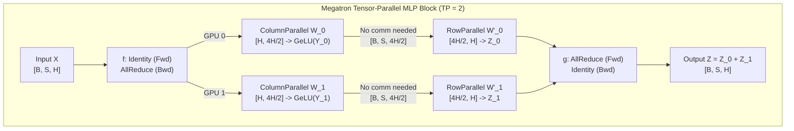
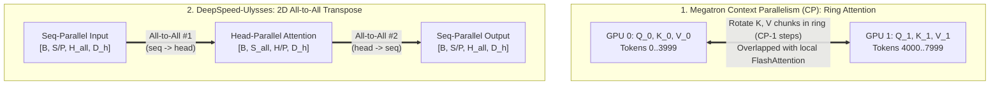
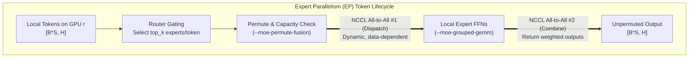
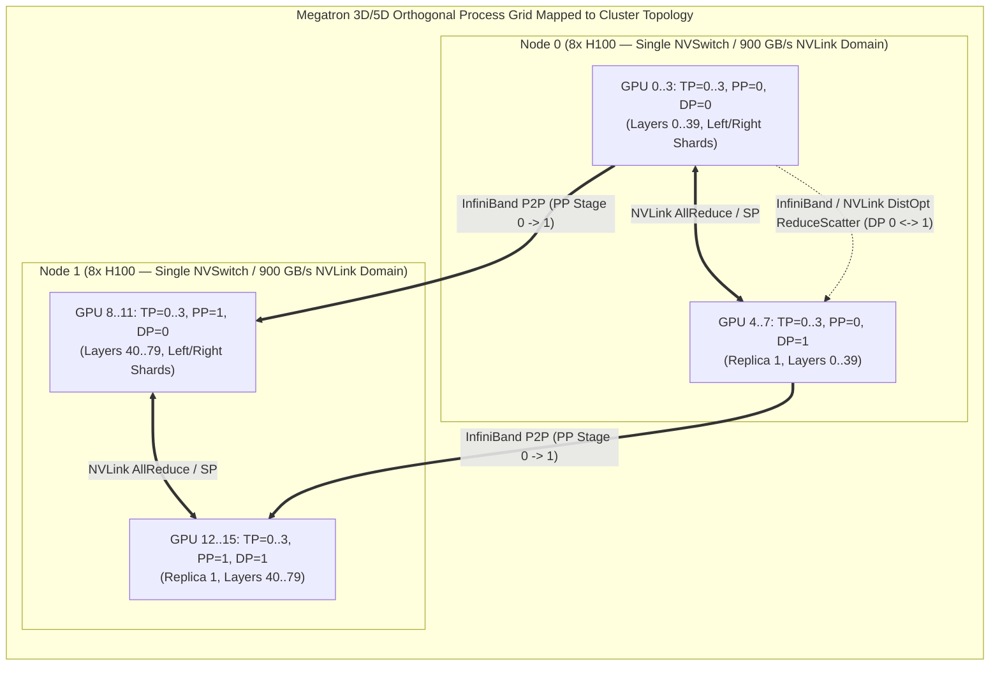
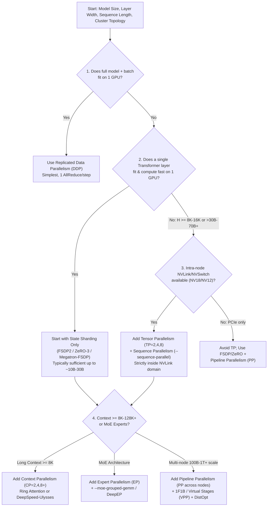

# 14.7 Tensor, pipeline and expert parallelism; Megatron

| Field | Value |
|---|---|
| Level | Advanced |
| Priority tier | 2 |
| Lab venue | Nebius GPU + Local Python Verification Lab (`code/part14/tp_pp_ep_megatron_lab.py`) |
| Part | Part 14: Distributed training and fine-tuning |
## Why this matters for AI infrastructure

A team trains a 175B model on a thousand GPUs with FSDP2 alone, and the memory math looks fine on paper. Then the job stalls on the network, or it runs out of memory inside a single layer. Here is why. State sharding, such as FSDP2 (PyTorch's fully sharded data parallel system) and DeepSpeed ZeRO, splits the weights, gradients and optimizer states across the cluster, so no single GPU keeps a full copy of everything. That saving is real. But the design still assumes that once an AllGather rebuilds one layer, a single GPU can hold and run that whole layer. An AllGather is a collective in which every GPU collects the pieces the other GPUs hold, so each one ends up with the full tensor. At frontier scale that assumption breaks, and the next paragraph shows how.

The first failure is size. A single projection matrix in a 175B model holds over 600 million parameters, which is 1.2 GB in half precision. Half precision stores each number in fewer bits than full precision, and the 1.2 GB figure already reflects that. When every pass has to gather full layers like this across hundreds of nodes, the InfiniBand links saturate. The network then becomes the bottleneck, and the GPUs spend their time waiting on it.

The second failure is activations, the intermediate values a layer keeps so the backward pass can compute gradients. At sequence lengths of 32K to 128K tokens, activations alone reach 40 GB to 52 GB per GPU, even with sharded weights. Sharding the weights does nothing for this memory, because the activations are produced fresh for every batch.

The third failure is time. One training step of a 175B model on a single GPU takes more than an hour, so the math itself has to be split across devices before a job can finish in any reasonable time.

```text
Physical Limits That Force Computation Sharding:
  1. Single-Layer Weight Matrix Growth:
     - 7B model MLP (4096 x 16384):     67,108,864 params (~134 MB FP16; ~270M params / ~500 MB paired)
     - 175B GPT-3 MLP (12288 x 49152):  603,979,776 params (> 600M params, ~1.2 GB in FP16/BF16)
     - 16K x 16K attention projection:  16,384 x 16,384 = 268,435,456 params (~537 MB)
     - 1T model mixed-precision state:  12 TB at 12 bytes/param (9.4x more than 16 x 80 GB H100 = 1.28 TB)
     - 100T model FP16 weights alone:   200 TB (~1,110 B200 180 GB GPUs across 125 nodes, or ~695 B300
                                        288 GB GPUs across 86 8-GPU nodes; C ~ 6ND = 1.74 x 10^28 FLOPs on 29T tokens)

  2. Inter-Node Collective Latency vs. Intra-Node NVLink:
     - 175B state (175B x 16 B = 2,800 GB) across 1024 H100 GPUs = 2.7 GB/GPU (2,800 / 1024)
     - 28 GB AllReduce on 512 GPUs (25 GB/s IB): moves 55.9 GB in ~2.2 s (512 ring hops vs 9 tree hops)
     - 28 GB AllReduce on 8 GPUs (900 GB/s NVLink): moves 49.0 GB in ~54 ms

  3. Single-Device Step Time (GPT-3 175B, batch_size = 2048, seq_len = 2048):
     - Step compute: 2 x 175B x 2048 x 2048 ~ 1.46 x 10^18 FLOPs (~6ND across forward + backward)
     - On 1 x A100 (312 TFLOPS): 4,679 seconds (~78 minutes) per step vs ~37 seconds across 128 GPUs
```

Think of the cluster as offering two kinds of splitting. You already know state sharding and data sharding. Megatron-LM and Megatron Core add a second kind, computation sharding, which sits beside them. **Computation sharding splits the math of a layer, while state sharding only splits where its weights are stored.**

Each parallelism dimension in this chapter uses a different hardware link, and that link decides whether the dimension is cheap or expensive. Tensor Parallelism splits individual matrix multiplications across the fast NVLink links inside one node. Sequence Parallelism and Context Parallelism split activations along the token dimension, which is the row of positions that a sequence occupies. Pipeline Parallelism cuts the model depth into stages placed on different nodes, so its traffic crosses InfiniBand. Expert Parallelism sends each token to the few sub-networks, called experts, that a router picks for it.

Before you launch a multi-node job, check which link each dimension will use. A dimension that sends heavy traffic over a slow link will stall the whole run, even when the GPUs themselves are fast.

## Prerequisites and outcomes

### Prerequisites
Before you read on, make sure the earlier chapters on memory and sharding feel familiar. The rest of this chapter builds on them, so a quick review now saves confusion later.

- Understanding of training memory anatomy from Chapters 14.1 through 14.3.
- Familiarity with NCCL collectives, ring and tree latency, and algorithmic versus bus bandwidth from Chapters 12.15 through 12.17 and 14.4.
- Working knowledge of FSDP2 and DeepSpeed ZeRO stages from Chapters 14.5 and 14.6.

```text
Prerequisite Memory Baselines (Chapters 14.1 - 14.3):
  - 7B FP32 training:    28 GB weights + 28 GB grads + 56 GB Adam + 60-80 GB activations + 5-10 GB buffers = 180-190 GB
  - 70B FP16 training:   140 GB weights + 140 GB grads + 840 GB FP32 master/mom/var = 1,120 GB (> 1.2 TB with activations)
  - 175B FP32 weights:   700 GB (8.75x the capacity of a single 80 GB H100 GPU)
```

### Outcomes
Suppose a senior engineer asks why the team cannot simply use FSDP2 for the 175B run, and you need an answer you can defend. This chapter builds that answer step by step. It starts by sorting every strategy with three questions, then works through Tensor, Sequence and Context Parallelism, then pipeline bubbles, then Expert Parallelism for Mixture-of-Experts models, and finally how Megatron Core combines all of them into one grid with the Distributed Optimizer and the FP8 Transformer Engine.

---

## 1. State Sharding vs. Computation Sharding: Why FSDP2 Cannot Replace Megatron

### 1.1 The Three Questions for Parallelism Classification

Imagine a colleague says a new setup shards the model across the whole cluster, and asks whether it will run well. State sharding and model parallelism both reduce the memory each GPU needs, so the two are easy to mix up. Mixing them up leads to cluster configurations that wait on slow cross-node links. A simple way to sort any strategy is to ask three plain questions about the math, the data samples and the device communication.

1. **Does it split computation?** Ask whether the math of one layer is divided across devices, or whether only the stored state is divided.
2. **Must a single sample cross devices?** Ask whether one input needs several GPUs working together, or whether one GPU can finish a sample alone once the weights are present.
3. **Does it introduce new device-to-device collaboration?** Ask whether the method needs collective or point-to-point coordination between ranks. A point-to-point message goes from one GPU to one other GPU, and a collective involves the whole group.

Read the table below with those three questions in mind. Data parallelism and state sharding answer No, No, Yes, because each GPU still runs the full layer on its own samples once the weights have arrived. Every computation-sharding row answers Yes to all three, because one sample is spread across several GPUs and those GPUs must talk while they work on it.

| Parallelism Strategy | Category | Sub-Category / What Is Sharded | Phase | Answers to Q1 / Q2 / Q3 | Primary Communication Collective | Representative Systems |
|---|---|---|---|---|---|---|
| **Data Parallel (DDP)** | Data | Replicated model, sharded batch | Training | No / No / Yes | AllReduce once per step, bucketed | PyTorch DDP, Horovod |
| **FSDP / FSDP2 (`fully_shard`)** | State | Full state sharding: weights, grads, opt | Training | No / No / Yes | AllGather in fwd/bwd + ReduceScatter in bwd | PyTorch FSDP2, SimpleFSDP |
| **ZeRO-1 / Distributed Optimizer** | State | Optimizer state sharding (`1 / d`) | Training | No / No / Yes | ReduceScatter grads + AllGather weights | DeepSpeed ZeRO-1, Megatron DistOpt |
| **ZeRO-2 (`SHARD_GRAD_OP`)** | State | Optimizer + gradient sharding | Training | No / No / Yes | AllGather in fwd + ReduceScatter in bwd | DeepSpeed ZeRO-2, PyTorch FSDP |
| **ZeRO-3 (`FULL_SHARD`)** | State | Parameter + grad + optimizer sharding | Training | No / No / Yes | 2x AllGather + 1x ReduceScatter (`3 * Psi`) | DeepSpeed ZeRO-3, Megatron-FSDP |
| **Tensor Parallelism (TP)** | Computation | Intra-layer width: hidden or head split | Train / Infer | **Yes / Yes / Yes** | AllReduce, or AllGather + ReduceScatter with SP | Megatron-LM, Megatron Core, vLLM, TRT-LLM |
| **Sequence Parallelism (SP)** | Computation | Sequence dimension for LayerNorm and Dropout | Training | **Yes / Yes / Yes** | AllGather in fwd + ReduceScatter in fwd with TP | Megatron Core (`--sequence-parallel`) |
| **Context Parallelism (CP)** | Computation | Full sequence and attention KV split | Train / Infer | **Yes / Yes / Yes** | Ring P2P or AllToAll transpose | Megatron Core (`--context-parallel-size`), vLLM |
| **Pipeline Parallelism (PP)** | Computation | Inter-layer depth across stages | Train / Infer | **Yes / Yes / Yes** | P2P send and recv of boundary activations | Megatron Core, GPipe, DualPipe |
| **Expert Parallelism (EP)** | Computation | Sparse conditional MoE expert sub-networks | Train / Infer | **Yes / Yes / Yes** | AllToAll token dispatch and combine | Megatron Core, DeepSpeed-MoE, DeepSeek-V3 |
| **Operator / SPMD Parallelism** | Computation | Generic compiler op-level tensor sharding | Train / Infer | **Yes / Yes / Yes** | Compiler-scheduled collectives | XLA GSPMD, JAX `jit`, PyTorch DTensor / AutoParallel |

### 1.2 Why FSDP2 Cannot Replace Megatron: The Single-Layer Compute and Activation Wall

Your team has just been given a thousand GPUs, and someone proposes using only FSDP2 because it worked well on a 7B model. The instinct is reasonable. A 7B model's layers are small enough that gathering each one is cheap. The mistake is to assume the same design scales in a straight line to a 175B model. It is common to treat FSDP2 and Megatron Core as competing tools where you only need one, but they solve different problems.

Suppose the team goes with pure FSDP2 or ZeRO-3 across all thousand GPUs. Every GPU must reconstruct each full layer before it multiplies by it. That design floods the inter-node network with global AllGather traffic on every layer, and it leaves the activations unsharded, so each GPU still holds the full activation memory for its own batch.

**State sharding and computation sharding operate on orthogonal axes.** Orthogonal means the two ideas work on different axes, so you can use both at once without one undoing the other. FSDP2 shards where parameters rest between layers, but one GPU still executes the full matrix multiplication for its local micro-batch. A micro-batch is the slice of the batch that one forward and backward pass handles. Megatron shards how the layer itself computes. No single GPU ever holds the full weight matrix, and no single GPU stores the full unsharded activations.

```text
Why State Sharding Hits a Wall on Frontier Layers (DAI Ch. 5 & V13 Ch. 7):
  1. 7B Model MLP Layer (4096 x 16384):
     - Single matrix: 67,108,864 params (~134 MB FP16; ~270M params / ~500 MB per paired block)
     - Fits easily in one GPU's HBM and L2/Tensor Core pipeline -> FSDP2 / ZeRO-3 alone is sufficient.

  2. 175B GPT-3 MLP Layer (hidden_size = 12288, ffn_hidden_size = 49152):
     - Single MLP weight matrix: 12,288 x 49,152 = 603,979,776 params (> 600M params = ~1.2 GB in FP16/BF16)
     - Or a 16K x 16K (16,384 x 16,384 = 268,435,456 params) attention projection:
       * Under FSDP2 on 8 GPUs: every GPU must AllGather the full 16K x 16K matrix and multiply it locally.
       * Under Megatron TP=8: each GPU permanently holds and multiplies only a 16K x 2K (16,384 x 2,048) slice.

  3. 175B GPT-3 State vs. Network Diameter on 1024 H100 GPUs (V13 Ch. 7 Worked Example):
     - Total mixed-precision Adam state (16 bytes/param): 175B x 16 B = 2,800 GB
     - Pure ZeRO-3 / FSDP across 1024 GPUs: 2,800 GB / 1024 = 2.7 GB/GPU for state alone.
     - Why pure ZeRO-3 still fails at 1024 GPUs: 2.7 GB/GPU is tiny, but ZeRO-3 must run cross-node
       AllGather across 1024 GPUs on EVERY forward and backward layer (96 layers x 2 = 192 global AllGathers/step),
       turning inter-node InfiniBand latency into an insurmountable bottleneck.
```

A useful rule of thumb follows from this. Use pure state sharding while one layer fits and computes quickly on one GPU. That keeps the design simple, and the network only has to move weights around. Add Megatron computation sharding once individual layers or sequences outgrow a single device. At that point, gathering the full layer on every GPU costs more than splitting the math would, and the split is the cheaper path.

---

## 2. Tensor Parallelism, Sequence Parallelism, and Context Parallelism

### 2.1 Megatron Tensor Parallelism: Pairing `ColumnParallelLinear` and `RowParallelLinear`

Picture a weight matrix so wide that one GPU cannot hold it, or cannot finish the multiply in time. The obvious fix is to cut the matrix into pieces, one per GPU. But if you cut every linear layer and then gather the results after each one, the GPUs have to talk after every projection. That extra collective doubles the network traffic in the naive design. It also stalls the work around non-linear activations such as GeLU or SwiGLU, because each GPU needs the complete result before it can apply them.

The 2019 Megatron-LM paper by Shoeybi et al. introduced a better pattern, demonstrated on an 8.3B Transformer. Tensor Parallelism solves the problem by pairing two splits. **Megatron splits the first linear layer by columns using `ColumnParallelLinear` and the second linear layer by rows using `RowParallelLinear`.** The middle activation is element-wise, which means it works on each number on its own. So GeLU applied to a column slice gives the same answer as the matching slice of GeLU applied to the whole. Each GPU applies GeLU or SwiGLU directly to its own column slice. Zero communication is needed between the two matrix multiplications, and the only collective comes at the end of the block.



Follow the four steps below. They trace the same pattern through an MLP block and then an attention block, and they end with a count of how many collectives each layer really costs. A rank, in this context, is one GPU's seat in the Tensor Parallel group.

1. First MLP projection (`ColumnParallelLinear`). The weight matrix is cut along its columns, with one block for each Tensor Parallel rank. Each GPU multiplies the same replicated input by its own column block, then applies GeLU or SwiGLU to the result. Nothing is sent between GPUs at this point, which is why this step is so cheap.
2. Second MLP projection (`RowParallelLinear`). The second weight matrix is cut along its rows, so each GPU already holds the activation slice that matches its rows. Each GPU multiplies its activation slice by its row block and gets a partial output of the full hidden shape. One AllReduce then adds the partial outputs together, so every GPU holds the same result before the residual connection.
3. Multi-Head and Grouped-Query Attention. The query, key and value projections use `ColumnParallelLinear` to divide the attention heads across GPUs, so each GPU works on its own heads. Softmax attention runs locally per head with no communication. The output projection uses `RowParallelLinear` and ends with one AllReduce, the same way the MLP does.
4. Total collectives per Transformer layer. Each layer runs two AllReduce operations in the forward pass and two in the backward pass. That totals four collectives per layer per step, and the count multiplies across every layer in the model. That multiplication is why the placement of Tensor Parallelism matters so much.

```text
Megatron Tensor Parallelism Block Algebra and Collective Count:
  1. MLP Block Shapes (Input X of shape [B, S, H], hidden expansion 4H, degree TP):
     - ColumnParallelLinear W = [W_0 | W_1]: each shard W_i has shape [H, 4H / TP]
       * GPU i computes Y_i = GeLU(X * W_i) of shape [B, S, 4H / TP]
       * Element-wise identity: GeLU([X * W_0 | X * W_1]) = [GeLU(X * W_0) | GeLU(X * W_1)] (0 communication)
     - RowParallelLinear W' stacked vertically: each shard W'_i has shape [4H / TP, H]
       * GPU i computes partial sum Z_i = Y_i * W'_i of shape [B, S, H]
       * Single AllReduce(SUM) produces Z = Z_0 + Z_1 on all TP ranks.

  2. Attention Head Partitioning:
     - GPT-3 175B (96 attention heads, TP = 8): 96 / 8 = 12 heads per GPU
     - Llama-3 8B GQA (32 query heads, 8 query groups): num_query_groups (8) must be divisible by TP

  3. Collectives per Layer per Step:
     - Forward pass (g operator):  1 AllReduce after Attention + 1 AllReduce after MLP = 2 AllReduces
     - Backward pass (f operator): 1 AllReduce before Attention + 1 AllReduce before MLP = 2 AllReduces
     - Total per layer:            4 AllReduces per step
     - 120-layer Transformer:      240 forward AllReduces (480 forward + backward, ~500 total with embeddings)
```

### 2.2 Why TP Must Stay Inside the NVLink Domain: Cross-Node Failure Math

Picture a job that runs well on one 8-GPU node. Someone decides to widen the Tensor Parallel group to 32 GPUs so the model fits, and the throughput falls off a cliff. The reason is that Tensor Parallelism sits on the critical path of every layer. The next layer cannot start until the current layer finishes its AllReduce. If that group now reaches across node boundaries over slower InfiniBand links, every layer waits on the network. GPU utilization drops on one side of the cluster, and total throughput collapses.

```text
Cross-Node TP=32 Misconfiguration vs. Intra-Node TP=8 + PP=4 (Volume 13 Ch. 6):
  Cluster: 2 nodes x 16 GPUs/node = 32 GPUs total (or 4 x 8-GPU NVLink domains)
  Model:   120-layer Transformer, 219 MB activation/gradient collective shard per AllReduce
  Links:   Intra-node NVLink = 900 GB/s (< 1 us latency)
           Inter-node InfiniBand = 200 Gbps (~25 GB/s effective, 2-5 us latency)

  Per-AllReduce Transfer Time (219 MB):
    - On NVLink (900 GB/s):     219 MB / 900 GB/s = 0.243 ms (~0.25 ms)
    - On InfiniBand (25 GB/s):  219 MB /  25 GB/s = 8.760 ms (~9.0 ms)  --> 36x slower per collective

  Cumulative Overhead Across 120 Layers (240 AllReduces):
    - Intra-node NVLink (TP=8): 240 x 0.25 ms =   60 ms overhead per pass
    - Cross-node IB (TP=32):    240 x 9.00 ms = 2160 ms (> 2.1 seconds wasted per pass)
    - Extreme multi-hop IB case (32 layers x 2-5 s/layer): 64-160 s communication vs 12 s compute (5-13x overhead)

  Observed Cluster Symptom (TP=32 across nodes):
    - Node 0 (GPUs 0-15): 85-90% utilization; Node 1 (GPUs 16-31): 8-12% utilization (stalled waiting)
    - Throughput collapses from 20 tokens/sec (expected) to 1.2 tokens/sec (16.7x slowdown)
    - Fix (--tensor-model-parallel-size 8 --pipeline-model-parallel-size 4): restores 18 tokens/sec (15x speedup).
```

:::warning Hardware Rule of Thumb for Tensor Parallelism
Never set `--tensor-model-parallel-size` larger than the number of GPUs in a single all-to-all NVSwitch or NVLink domain. Check the domain before you set the flag, because a flag that looks harmless can cross a slow link.
- On standard 8-GPU DGX or HGX nodes where `nvidia-smi topo -m` shows `NV18`, `NV12`, or `NV4`, keep TP at or below 8.
- On rack-scale NVIDIA GB200 or GB300 NVL72 systems, NVLink 5 spans all 72 Blackwell GPUs at 1.8 TB/s per GPU and 130 TB/s rack-wide. That fabric allows larger TP or EP groups inside the rack.
- If `nvidia-smi topo -m` shows `PIX`, `PXB`, or `SYS` over PCIe at 16 to 64 GB/s instead of NVLink, avoid TP. Use FSDP or ZeRO with Pipeline Parallelism instead.
:::

The warning is easier to follow once you know where to look. Run `nvidia-smi topo -m` on the node and read the matrix. A cell that says `NV18` means the two GPUs are joined by NVLink, which is the fast path that Tensor Parallelism needs. A cell that says `PIX`, `PXB` or `SYS` means the traffic has to take the slower PCIe route. A TP group whose cells are all NV keeps its AllReduce on the fast path. A TP group that touches a PCIe cell pays the slower price on every layer, even when the rest of the cluster is healthy. Check the matrix once per node type, and write the result down next to your launch script.

### 2.3 Sequence Parallelism: Sharding LayerNorm and Dropout Without Extra Bandwidth

Imagine you turn on Tensor Parallelism for a long-context run, and the memory per GPU drops by less than you expected. The reason is that Tensor Parallelism only splits the heavy matrix multiplications in the attention and MLP blocks. The rest of the layer stays as it was. LayerNorm, RMSNorm, Dropout and the residual additions remain replicated on every GPU in the group. LayerNorm and RMSNorm are normalization steps that keep the numbers in a stable range. When sequence lengths reach 8K to 32K tokens, those duplicated activations consume tens of gigabytes of high-bandwidth memory on every rank.

Korthikanti et al. introduced Sequence Parallelism in 2023. It removes this duplication when you turn on `--sequence-parallel`. **Sequence Parallelism replaces each Tensor Parallel AllReduce with a ReduceScatter followed by an AllGather along the token sequence dimension.** Why does that help? An AllReduce is mathematically equivalent to a ReduceScatter plus an AllGather. A ReduceScatter sums the partial results and leaves each GPU with one slice of that sum. The AllGather rebuilds the full result only when a later step needs it. Total network bytes transferred stay identical, while the non-TP activation memory drops by a factor of `1 / TP`.

```text
Mathematical Identity Underlying Sequence Parallelism (SP):
  AllReduce(Z)  ===  ReduceScatter(Z, dim=sequence)  followed by  AllGather(Z_shard, dim=sequence)

  Collective Volume Comparison (Activation tensor of size M = B * S * H * bytes across TP ranks):
    - Standard TP (1 AllReduce):              2 x ((TP - 1) / TP) x M bytes
    - SP (1 ReduceScatter + 1 AllGather):     1 x ((TP - 1) / TP) x M  +  1 x ((TP - 1) / TP) x M
                                            = 2 x ((TP - 1) / TP) x M bytes  (IDENTICAL network traffic)

  Per-GPU Sequence Shard Example (S = 2048, TP = 8):
    - ReduceScatter leaves each GPU with [B, S / TP, H] = 256 tokens per GPU (8x activation reduction)
    - Selective activation recomputation + SP: recovers 70-80% of full checkpointing memory savings
      while avoiding full checkpointing's 30-50% backward compute penalty.
```

Inside each layer, `RowParallelLinear` ends with a ReduceScatter along the sequence axis. Each GPU now holds a separate slice of the tokens, with no overlap between GPUs. LayerNorm, Dropout and the residual addition run locally on that smaller slice, with no communication needed. This works because normalization looks at one token at a time, across the hidden dimension. Before the next `ColumnParallelLinear` layer, an AllGather rebuilds the full sequence just in time for the matrix multiplication.

Pair this with selective activation recomputation. It only recomputes the cheap attention softmax and dropout intermediates, which take a lot of memory but little compute to rebuild. Together, the two techniques capture most of the memory savings of full checkpointing, at a fraction of the compute cost.

### 2.4 Context Parallelism vs. DeepSpeed-Ulysses for Long Contexts

Picture a training run on a 128K-token document with Sequence Parallelism switched on, and the attention activations still overflow memory. Sequence Parallelism only shards activations across the intra-node Tensor Parallel group, which is typically capped at 8 GPUs. When training on sequences of 32K, 128K or a million tokens, attention activations still overflow, so the sequence and the attention computation itself must be sharded across many more GPUs.

Two production designs solve long-context sharding in different ways. Megatron Context Parallelism uses Ring Attention. Each GPU keeps its own queries, and the key and value chunks rotate around a logical ring, one hop at a time. The communication overlaps with local FlashAttention, a fast attention kernel, so the GPU computes while the chunks move. DeepSpeed-Ulysses takes another route. It runs two AllToAll collectives. The first transposes the tensor from a sequence-parallel layout to a head-parallel layout just for the attention step, and the second transposes it back.



| Dimension | Megatron Context Parallelism (CP Ring Attention) | DeepSpeed-Ulysses (2D AllToAll Sequence Parallelism) |
|---|---|---|
| **Core Mechanism** | Splits sequence `[B, S, H]` into `[B, S / CP, H]` across CP GPUs (`32K / 4 = 8K` tokens/GPU). Queries `Q_i` stay local while `K_j, V_j` chunks rotate in `CP - 1` P2P steps. | Splits sequence `[B, S / P, num_heads, head_dim]` across P GPUs. Runs AllToAll (`seq -> head`) to form `[B, S, num_heads / P, head_dim]`, runs attention, then reverses AllToAll (`head -> seq`). |
| **Softmax Bookkeeping** | Requires blockwise online softmax log-sum-exp (`lse`) accumulation across ring stages and zig-zag token partitioning for causal load balance. | **Zero partial softmax complexity**: each GPU holds the full sequence `S` for its assigned heads `num_heads / P` and calls standard FlashAttention directly. |
| **Communication Pattern** | `CP - 1` point-to-point ring transfers of `K, V` per pass, overlapped with local attention compute; scales cleanly with GQA (`num_query_groups`). | `4` AllToAll collectives in forward (`Q, K, V` transpose + output reverse transpose) with volume `((P - 1) / P) * M` per tensor; cannot overlap with attention. |
| **Scaling Limit & Best Use Case** | **No head-count ceiling**: CP scales to `16, 32, 64+` across nodes for `100K-1M+` contexts when `S >> 8K`. | **Hard ceiling `P <= num_attention_heads`**: fastest for moderate degrees (`P <= 8`) inside a high-bisection NVLink domain. |

Keep Tensor Parallelism and Sequence Parallelism inside the NVLink domain. Add Context Parallelism once sequence lengths go past 8K tokens, because at that point the attention memory, not the matrix width, becomes the limit.

---

## 3. Pipeline Parallelism: Micro-batching, Bubble Math, 1F1B, Interleaved VPP, and DualPipe

### 3.1 Naive Pipeline vs. GPipe vs. 1F1B

Picture a model that is too deep or too large to fit inside one NVLink node. Its layers have to be spread across several nodes. Tensor Parallelism cannot do that job well, because it would stall on InfiniBand latency at every layer. Pipeline Parallelism solves the problem by assigning contiguous groups of layers to different stages. Each stage holds a run of consecutive layers. Adjacent stages pass only a single boundary activation tensor, which is the output at the cut, over point-to-point links.

Here is the catch. If Stage 0 processes an entire mini-batch before it passes activations to Stage 1, every other GPU sits idle while it waits for work. In a 4-stage pipeline, three out of four GPUs sit idle at any moment, wasting 75 percent of the cluster. To keep the stages busy, you split the mini-batch into smaller micro-batches. Then the stages can work on different micro-batches at the same time, like an assembly line where each station handles a different item.

```mermaid
gantt
    title Pipeline Parallelism Schedules (PP = 4 Stages, m = 8 Micro-batches)
    dateFormat X
    axisFormat %s
    section GPipe (All Fwd then All Bwd: High Memory = m activations)
        F1..F8 (Stage 0)            :0, 8
        Bubble (Wait)               :crit, 8, 14
        B1..B8 (Stage 0)            :14, 22
    section 1F1B (Steady-State 1 Fwd / 1 Bwd: Capped Memory = PP activations)
        Warmup F1..F4 (Stage 0)     :0, 4
        Steady 1F1B (B1,F5..B4,F8)  :active, 4, 12
        Cooldown B5..B8 + Bubble    :12, 19
```



Read the two gantt charts from left to right. Time runs along the horizontal axis, and each row is one part of the schedule. In the GPipe chart, all the forward blocks come first, then a gap labeled as a bubble, then all the backward blocks. The gap is time the stage spends waiting. GPipe's memory cost hides in the fact that every forward result must stay in memory until its backward block arrives. In the 1F1B chart, forward and backward blocks alternate through the middle section. The warm-up at the start and the cool-down at the end still show gaps, but the middle of the chart stays busy the whole time.

**The 1F1B schedule alternates one forward micro-batch and one backward micro-batch in steady state.** That rhythm caps activation memory at the number of pipeline stages, rather than at the total number of micro-batches. GPipe runs all forward micro-batches before any backward pass, so it must keep every micro-batch's activations alive until the backward passes arrive. 1F1B frees each micro-batch's activations as soon as that micro-batch's backward pass finishes, so the memory in use stays roughly flat no matter how many micro-batches the step contains.

```text
Pipeline Bubble & In-Flight Activation Memory Equations (PP stages, m micro-batches, v virtual stages):
  1. Example Stage Partitioning:
     - 32-layer model across PP = 4 stages: Layers 1-8 (GPU 0), 9-16 (GPU 1), 17-24 (GPU 2), 25-32 (GPU 3)
     - 96-layer GPT-3 175B across PP = 16 stages: 96 / 16 = 6 layers per stage

  2. Time-Fraction Pipeline Bubble Percentage (Volume 13 Ch. 6 & Ch. 7):
       Bubble % = (PP - 1) / (m + PP - 1)

     - PP = 4, m =  8 micro-batches:  (4 - 1) / ( 8 + 4 - 1) =  3 /  11 = 27.27% (~27% idle)
     - PP = 4, m = 16 micro-batches:  (4 - 1) / (16 + 4 - 1) =  3 /  19 = 15.79% (~16% idle)
     - PP = 4, m = 32 micro-batches:  (4 - 1) / (32 + 4 - 1) =  3 /  35 =  8.57% (~8% idle)
     - PP = 8, m = 16 micro-batches:  (8 - 1) / (16 + 8 - 1) =  7 /  23 = 30.43% (~30% idle — Bubble Starvation)
     - PP = 8, m = 64 micro-batches:  (8 - 1) / (64 + 8 - 1) =  7 /  71 =  9.86% (~10% idle)
     - PP = 8, m = 512 (global=2048, micro=4): (8 - 1) / (512 + 8 - 1) = 7 / 519 = 1.35% (~80 ms on a 6 s step)
     - PP = 16, m = 256 (GPT-3 175B on 1024 GPUs): (16 - 1) / (256 + 16 - 1) = 15 / 271 = 5.54% (~5.5% bubble)

  3. Bubble-to-Useful Compute Ratio (Narayanan et al., SC'21 & DAI Ch. 5):
     - Standard GPipe / 1F1B (v = 1):        Bubble Ratio = (PP - 1) / m
     - Interleaved 1F1B (v virtual stages):  Bubble Ratio = (PP - 1) / (m * v)
       --> Reduces pipeline bubble by a factor of v, at the cost of v times more P2P cross-stage transfers.

  4. Peak In-Flight Stored Micro-Batch Activations on Stage 0:
     - GPipe (all m forwards before any backward):  Stores all m micro-batches  (e.g., m = 256 micro-batches)
     - 1F1B (starts backward as soon as MB1 finishes Stage PP-1): Caps in-flight micro-batches at min(m, PP)
       (e.g., at PP = 16, m = 256, 1F1B stores at most 16 micro-batches vs GPipe's 256 -> 16x activation memory saving)
```

### 3.2 Virtual Pipeline Parallelism and Stage Imbalance

Picture a pipeline that runs plenty of micro-batches, yet the step still feels slow. Even then, a standard 1F1B pipeline loses time to warm-up bubbles and to uneven work across stages. The warm-up bubble is the idle time at the start, when the later stages have no work yet. If the first or last stage takes longer per micro-batch than the middle stages, every other GPU in the pipeline waits for the slowest stage on every step.

Three techniques remove these stalls.

1. Virtual Pipeline Parallelism (`--num-layers-per-virtual-pipeline-stage`). Instead of giving each GPU one large contiguous block of layers, Interleaved 1F1B gives each GPU `v` smaller, non-contiguous layer chunks. Each virtual stage finishes `v` times faster, so the work moves through the pipeline in smaller pieces. The warm-up and cool-down bubbles shrink by a factor of `1 / v`, while point-to-point transfers grow by `v`. You trade a little more traffic for a much shorter idle time.
2. Balancing the edge stages. Even splitting looks fair on paper. Suppose a 96-layer model gets 6 layers per stage across 16 stages. Stage 0 and Stage 15 still run about 40 percent slower than Stages 1 through 14, because the edges carry extra work. Stage 0 computes the 1.2 GB vocabulary embedding lookup. Stage 15 computes the final projection and the cross-entropy loss, which measures how far the predictions sit from the correct answers. Give the first and last stages fewer Transformer layers, and shard the vocabulary with `VocabParallelEmbedding`, and the stall goes away.
3. Bidirectional overlap with DeepSeek DualPipe. The DeepSeek-V3 Technical Report introduced DualPipe. It feeds micro-batches in from both ends of the pipeline at the same time. On each GPU, it pairs a forward chunk with a backward chunk, so the point-to-point and AllToAll transfers hide behind matrix math. That overlap pushes pipeline bubbles close to zero, even on bandwidth-constrained H800 clusters whose links are slower than the H100's.

```text
Virtual Stages, Edge-Stage Stragglers, and DualPipe:
  1. Interleaved 1F1B (32 layers across PP = 2 GPUs with v = 2 virtual stages):
     - Standard (v = 1):     GPU 0 hosts Layers 0-15; GPU 1 hosts Layers 16-31
     - Interleaved (v = 2):  GPU 0 hosts Layers 0-7 (VS 0) and Layers 16-23 (VS 2)
                             GPU 1 hosts Layers 8-15 (VS 1) and Layers 24-31 (VS 3)

  2. Stage 0 and Stage 15 Edge-Stage Straggler Math (96 layers, PP = 16, 6 layers/stage):
     - Vocab embedding / lm_head table: 50,000 vocab x 12,288 hidden x 2 bytes (BF16) = 1,228,800,000 B (~1.2 GB)
     - Impact: Stage 0 and Stage 15 take ~40% longer per micro-batch than middle Stages 1-14
     - Fix: Assign 5 layers to edge stages and 6-7 layers to middle stages + VocabParallelEmbedding + VPP

  3. H800 vs. H100 NVLink Bandwidth Context (AISPE Ch. 1):
     - H800 NVLink bandwidth: 400 GB/s (vs 900 GB/s NVLink and 3.35 TB/s HBM on H100)
     - DualPipe overlaps bidirectional P2P and AllToAll transfers behind GEMM compute.
```

Before you launch a pipeline-parallel job, check the micro-batch count. Keep it at least four to eight times the pipeline depth for each data-parallel group. Then balance the extra embedding work on the first and last stages, so neither edge becomes the slowest stage in the pipeline.

---

## 4. Expert Parallelism and Mixture-of-Experts Scaling

### 4.1 Sparse Routing, AllToAll Dispatch and Combine, and Capacity Factor

Imagine your team wants a much bigger model, but the compute budget only covers a dense model a fraction of that size. A dense Transformer activates every parameter for every token, so its compute cost tracks its total size directly. Mixture-of-Experts models break that link. They replace each dense feed-forward network with a pool of parallel expert sub-networks and a learned router. The router picks only a few active experts for each token. So the parameter count can grow while the work per token stays small.

**Expert Parallelism partitions the expert sub-networks across GPUs and uses dynamic AllToAll collectives to dispatch tokens to their selected experts and combine the results back.** Each GPU hosts some of the experts, so a token that starts on one GPU may need an expert that lives on another. That is why this traffic looks so different from a fixed AllReduce. The destination of each token is decided by the router at run time.



```text
Mixture-of-Experts Scaling and Capacity Factor Equations:
  1. Production MoE Architectures:
     - Mixtral 8x7B:          E = 8 experts/layer, top_k = 2 (--num-experts 8 --moe-router-topk 2)
     - DeepSeek-V3 (~671B-680B total, ~1,342 GB BF16, 37B active params/token):
       * 1 shared expert + 8 routed experts out of 256 = 9 active experts/token (4 routed experts/GPU at EP=64)
       * Trained for < $6M compute (vs ~$100M for GPT-4 and ~$191M for Gemini Ultra)
     - DeepSeek-V2 (236B):    ~472 GB BF16 weights
     - DeepSeek-V4-Pro (1.6T): ~3,200 GB BF16 weights
     - Switch Transformer:    1.6T parameters, trained 7x faster than an equivalent dense model
     - Dense vs. MoE scaling: Dense activates 100% of parameters (C ~ 6ND); MoE activates only top_k experts

  2. Expert Partitioning Examples:
     - 128 experts across EP = 16 GPUs: 128 / 16 = 8 local experts per GPU
     - Mixtral 8x7B (E = 8, EP = 8):   8 / 8 = 1 local expert per GPU

  3. Capacity Factor (CF) and Token Dispatch Math (Mixtral 8x7B: E=8, EP=8, top_k=2, B=2, S=4096):
     - Local tokens per GPU:            B x S = 2 x 4096 = 8,192 tokens/GPU
     - Dispatched tokens per GPU:       8,192 x top_k (2) = 16,384 token embeddings/GPU
     - Uniform expected tokens/expert:  (Total_Tokens_in_EP_Group x top_k) / E = 16,384 tokens/expert
     - Max Expert Capacity at CF=1.25:  ceil(1.25 x 16,384) = 20,480 tokens/expert

  4. Router Collapse Straggler Symptom (Volume 13 Ch. 8 Scenario 3):
     - Skewed routing: 80% of tokens routed to Expert 0 on GPU 0, only 2% to Expert 7 on GPU 7
     - Cluster impact: 25% of expected throughput with uniformly low 40-50% nvidia-smi utilization across all 8 GPUs
```

Follow one token through the flowchart above. It starts as a row of activations on its home GPU. The router scores the experts for that token and selects the top few. Before anything is sent, the framework permutes the tokens, which means it reorders them so that tokens bound for the same destination sit together. The first AllToAll delivers each group to the GPU that hosts its expert, and the expert feed-forward network runs on the group there. The second AllToAll sends the weighted outputs back to the home GPU, where the tokens are unpermuted into their original order. Those two AllToAll calls are the price of sparse routing for this block.

Expert Parallelism brings four problems that dense data or tensor parallelism never has. Each one shows up in the traffic or the timing, so it pays to know them before you see them.

1. Data-dependent, uneven message sizes. In an AllReduce, every GPU sends and receives the same predictable byte count. In an MoE AllToAll, the number of tokens sent between any two GPUs changes on every micro-batch, because the router decides it on the fly.
2. Router collapse and the hot-expert straggler. If an untrained or unstable router sends most of the batch to one popular expert, that GPU becomes a severe bottleneck. Every other GPU then sits idle at the synchronous AllToAll barrier, the point where all GPUs must wait for each other before they continue.
3. Capacity Factor and load balancing. The framework bounds memory and step time with a Capacity Factor ceiling, which caps how many tokens one expert may take. Overflow tokens are dropped or passed through on a residual path. Megatron Core prevents collapse using `--moe-router-load-balancing-type aux_loss`, Sinkhorn routing, or auxiliary-loss-free bias updates. DeepSeek's Expert Parallelism Load Balancer dynamically replicates hot experts, so a busy expert gets copies that share its load.
4. Kernel and transport acceleration. When one GPU hosts several experts, `--moe-grouped-gemm` fuses their separate matrix multiplications into one kernel, and `--moe-permute-fusion` fuses the token shuffle. DeepSeek's DeepEP provides low-latency NVLink and RDMA (remote direct memory access) AllToAll kernels. PyTorch Symmetric Memory uses one-sided NVSHMEM `triton.nvshmem.put()/get()` calls, which move data without waiting on the CPU, so `all_to_all_v` can be captured inside a CUDA Graph.

Keep a close eye on per-expert token histograms during MoE training. A skewed router does not announce itself with an error. It quietly turns a fast cluster into one that spends its time at the barrier.

---

## 5. Megatron Core Architecture, Hybrid 5D Parallelism, and FP8 Optimization

### 5.1 Orthogonal Process Groups and the Two-Axis View

Picture a 1024-GPU job that fails during startup because its process groups do not line up. At that scale, no single parallelism technique can handle width, depth, sequence length and batch throughput on its own. Megatron Core solves this by arranging the cluster into an orthogonal multi-dimensional grid, using `megatron.core.parallel_state`. A process group is the set of GPUs that take part in one collective. Every GPU belongs at the same time to a Tensor, Pipeline, Context, Expert and Data Parallel group, and each group is one line through the grid.

**The product of all dense parallelism degrees must equal the total number of GPUs in the job.** Tensor Parallelism is placed innermost, so its heavy collectives stay inside the NVLink node. In practice, the rank numbers of the GPUs in one Tensor Parallel group sit next to each other, so they land on the same node. If the grid and the hardware disagree about that, the heavy traffic leaves the node without anyone noticing.

```text
Megatron Multi-Dimensional World-Size Invariant:
  WorldSize = DP x TP x PP x CP      (for dense layers; MoE layers replace or combine TP/DP with EP)

  Rank Coordinate Mapping (for 3D grid with WorldSize = DP * TP * PP, e.g., WorldSize = 8, DP = 2, TP = 2, PP = 2):
    - In DAI Ch. 5's exercise indexing:
        dp_rank = rank // (tp * pp)
        tp_rank = (rank // pp) % tp
        pp_rank = rank % pp
    - In Megatron's hardware-aligned default order (TP innermost inside the NVLink node):
        tp_rank = rank % tp
        pp_rank = (rank // tp) % pp
        dp_rank = rank // (tp * pp)
      For WorldSize = 8 (DP = 2, PP = 2, TP = 2):
        * Rank 0 belongs to TP group [0, 1] (NVLink), PP group [0, 2] (P2P), and DP group [0, 4] (AllReduce/ReduceScatter).
```



Read the grid diagram with one question in mind. Which GPUs can talk over NVLink, and which must use InfiniBand? The GPUs in one half of Node 0 share the NVSwitch domain, so their tensor shards exchange data at the NVLink rate shown in the diagram. The P2P arrows between the nodes are the pipeline hand-offs, and they cross InfiniBand, so each one carries only the boundary activation for a micro-batch. The dashed line is the data-parallel reduction, which can travel over either fabric depending on where the two replicas sit. Once you can place each arrow on a link, you can predict which dimension will be slow before you run anything.

### 5.2 Worked Sizing Examples: 70B, 175B, and 1T Hybrid Configurations

Picture a planning meeting where someone asks how many GPUs a 175B or 1T model needs, and which layout to use. Start by calculating the total state memory floor, which is the smallest amount of memory the weights and optimizer state can occupy. Next, choose intra-node Tensor Parallelism to fit the single-layer matrices. Then choose inter-node Pipeline Parallelism to fit the model depth, and give the remaining GPUs to Data Parallelism. The worked block below walks through four production sizing derivations from the source texts, so you can see each step with real numbers.

```text
Four Canonical Multi-Node Sizing Derivations (DAI Ch. 5 & Volume 13 Ch. 6-7):
  1. 70B Dense Model on 8 GPUs (ZeRO State Sharding Baseline, DAI Ch. 5):
     - FP16/BF16 with FP32 Adam master weights, momentum, and variance (12 B/param optimizer):
       * 140 GB parameters + 140 GB gradients + 840 GB optimizer states = 1,120 GB (> 1 TB) total
         (840 GB without FP32 master weights)
     - On 8 GPUs:
       * DDP stores all 1,120 GB/GPU (impossible on 80 GB GPUs)
       * ZeRO-1 shards optimizer states: 140 + 140 + (840 / 8) = 385 GB/GPU (350 GB without master copy)
       * ZeRO-3 shards all three:        1,120 / 8 = 140 GB/GPU (105 GB without master copy)

  2. 70B Hybrid 3D + FSDP Configuration on 64 GPUs (8 Nodes x 8 GPUs/Node, DAI Ch. 5):
     - Model: hidden_size = 8192, 80 layers
     - Grid:  TP = 4 (intra-node NVLink), PP = 2 (80 / 2 = 40 layers/stage over IB), DP = 64 / (4 x 2) = 8
     - Result: 4 x 2 x 8 = 64 GPUs; each GPU stores 1/8 of optimizer state, computes 1/4 of each layer,
               and holds 1/2 of model depth.

  3. GPT-3 175B (96 Layers, H = 12288) on 1024 H100 GPUs (128 Nodes x 8 GPUs/Node, V13 Ch. 7):
     - Step 1 (State Floor): 175B x 16 bytes = 2,800 GB (2.7 GB/GPU across 1024 GPUs, but pure ZeRO-3 stalls on IB)
     - Step 2 (3D Grid):     TP = 8 (1 NVLink node), PP = 16 (96 / 16 = 6 layers/stage), DP = 1024 / (8 x 16) = 8
                             (8 x 16 x 8 = 1024 GPUs; on 128 GPUs / 16 nodes, TP = 8, PP = 16 gives DP = 1)
     - Step 3 (Per-GPU State): 175B / (8 x 16) = 1.367B (~1.37B) params/GPU
                               1.37B x 16 bytes = 21.875 GB (~22 GB) per GPU (fits inside 80 GB H100 with activations;
                               or 1.367B x 7.5 B = 10.25 GB with Distributed Optimizer at DP = 8)
     - Step 4 (Bubble):      global_batch_size = 2048, micro_batch_size = 1 -> m = 2048 / 8 = 256 micro-batches/DP
                             Bubble = (16 - 1) / (256 + 16 - 1) = 15 / 271 = 5.54% (~5.5%)

  4. 1-Trillion-Parameter (1T) Model on 1024 GPUs (16 Nodes x 64 GPUs/Node, V13 Ch. 6):
     - Grid: TP = 8 (intra-node NVLink), PP = 4 (cross-node pipeline stages), DP = 1024 / (8 x 4) = 32
             (8 x 4 x 32 = 1024 GPUs)
```

### 5.3 Megatron Distributed Optimizer, Megatron-FSDP, and FP8 Transformer Engine

Even after you split layers with Tensor and Pipeline Parallelism, replicating the full optimizer state across the Data Parallel group wastes a lot of memory. Optimizer state here means the FP32 master weights plus the Adam momentum and variance buffers. External frameworks such as DeepSpeed ZeRO, or Colossal-AI with its Gemini heterogeneous memory manager, can shard that state. Megatron Core also includes three native subsystems that work directly with its own model-parallel groups, so the sharding lines up with the layout you already chose.

1. Megatron Distributed Optimizer (`--use-distributed-optimizer`). This subsystem shards the FP32 master weights and the Adam momentum and variance buffers across the `d` Data Parallel ranks. It overlaps the gradient ReduceScatter with backpropagation using `--overlap-grad-reduce`, and it overlaps the parameter AllGather using `--overlap-param-gather`. The overlap matters because a transfer that hides behind compute costs the step almost nothing.
2. Megatron-FSDP (`--use-megatron-fsdp --data-parallel-sharding-strategy optim_grads_params`). This is NVIDIA's ZeRO-3 style implementation inside Megatron Core, and it knows about the TP, CP and EP groups. It coordinates parameter bucketing with Tensor Parallelism and registers NCCL userbuffers through `ncclMemAlloc`. Those buffers reduce how many Streaming Multiprocessors, the GPU's compute units, a collective takes, which leaves more of the GPU for math. Megatron-FSDP reaches 15 to 25 percent higher throughput and about 23 percent lower memory use than general-purpose PyTorch FSDP2.
3. FP8 Training with NVIDIA Transformer Engine (`--fp8-format hybrid`). FP8 is an 8-bit floating-point format. On Hopper, Ada and Blackwell GPUs it halves the memory bandwidth demand and doubles Tensor Core throughput, which gives a 1.5x to 2x GEMM speedup over BF16. A GEMM is a general matrix multiply, the core operation of training. The hybrid format uses E4M3 in the forward pass for more precision, and E5M2 in the backward pass for a wider dynamic range. Dynamic range is the span from the smallest to the largest value a format can hold. Meanwhile, `--fp8-param-gather` cuts parameter AllGather traffic in half.

| Precision Configuration | Memory per Parameter Without Distributed Optimizer | Memory per Parameter With Distributed Optimizer (`d` DP GPUs) | Concrete Value at `d = 8` DP Ranks |
|---|---|---|---|
| **FP16 params, FP16 grads** | **20 bytes/param**: 2B param + 2B grad + 16B FP32 opt | **`4 + 16 / d` bytes/param** | **6.0 bytes/param**, a 3.33x reduction |
| **BF16 params, FP32 grads** | **18 bytes/param**: 2B param + 4B grad + 12B FP32 master/mom/var | **`6 + 12 / d` bytes/param** | **7.5 bytes/param**, a **2.4x reduction** |
| **FP32 params, FP32 grads** | **16 bytes/param**: 4B param + 4B grad + 8B FP32 mom/var | **`8 + 8 / d` bytes/param** | **9.0 bytes/param**, a 1.78x reduction |

```text
Megatron-FSDP, TorchTitan SimpleFSDP, and FP8 Transformer Engine Reference Numbers:
  - Megatron-FSDP vs. PyTorch FSDP2 (DAI Ch. 5):   +15-25% training throughput, ~23% lower memory consumption
  - TorchTitan SimpleFSDP + torch.compile (Ch.13): up to 28% memory reduction and 69% throughput gain over eager FSDP2
  - AsyncTP (AISPE Ch. 13):                        overlaps TP collectives with SM-wave GEMMs
  - FP8 hybrid format (Transformer Engine):
    * Forward weights & activations: E4M3 (4 exponent bits, 3 mantissa bits)
    * Backward gradients:            E5M2 (5 exponent bits, 2 mantissa bits)
    * Delayed dynamic scaling:       --fp8-amax-history-len 1024 --fp8-amax-compute-algo max
    * FP8 parameter gathering:       --fp8-param-gather (1-byte FP8 vs 2-byte BF16 = 2x AllGather volume reduction,
                                     analogous to DeepSpeed ZeRO++ qwZ)
    * Speedup:                       1.5-2x GEMM speedup over BF16 on H100/H200/RTX 4090 (up to 6x vs A100);
                                     Blackwell B200/GB200 adds FP4 microscaling and achieves up to 2.6x per-GPU
                                     training and 3.4x per-GPU inference throughput over Hopper in MLPerf v5.0.
```

### 5.4 Decision Framework: Choosing Your Parallelism Strategy

Picture a teammate asking which parallelism to turn on for a new model. The answer is not to turn everything on at once. Use the decision tree below to add only the dimensions that your model size, sequence length and cluster topology actually require. Each question in the tree is a check you can run against your own setup, and each answer leads to the next check.



Start with the simplest state-sharding strategy that fits a single layer. Add Tensor, Pipeline, Context or Expert Parallelism only when a real hardware wall shows up. Every extra dimension adds network traffic and debugging time, and the wall may never appear for your model.

---

## Commands and configurations that matter

### 1. Hardware Topology, Single-GPU HBM Baseline, and NCCL Collective Microbenchmarks

Before you choose your parallelism degrees, look at three things on the node: the interconnect topology, the single-GPU memory bandwidth, and the bus bandwidth of multi-GPU collectives. If a node lacks NVLink or falls back to PCIe, you want to know that before you launch a multi-node job. Finding it at the start saves hours of debugging later, because the symptom of a slow link looks like a slow model.

```text
Hardware and Collective Baseline Reference Targets (DAI Ch. 2 & V13 Lab 02):
  - H100 compute capability:     9.0 (132 SMs, 80 GB HBM3, 989 TFLOPS BF16; 70B step: 860 TFLOP / 2.0 s = 430 TFLOPS = 43% MFU)
  - H200 / B200 HBM capacity:    141 GB (H200), 192 GB (B200)
  - Single-GPU HBM copy BW:      1.5-2 TB/s on A100, 2-3 TB/s on H100/H200 (1,980.45 GB/s on 64 MB 200-iteration copy test)
  - NCCL bus bandwidth formula:  busbw = algbw * 2 * (N - 1) / N  (plateaus at message sizes >= 32 MB)
  - 2-GPU 100 MB AllReduce test: 39.38 GB/s algbw = busbw (50 iterations)
```

```bash
# 1. Inspect GPU compute capability (9.0 on H100, 132 SMs), NVLink matrix, PCIe Gen/width, and IB NICs
nvidia-smi topo -m
nvidia-smi --query-gpu=name,memory.total,pcie.link.gen.max,pcie.link.width.max --format=csv
ibstat

# 2. Run standalone nccl-tests all_reduce_perf (8B to 128MB across 8 GPUs) and verify busbw plateau >= 32MB
./build/all_reduce_perf -b 8 -e 128M -f 2 -g 8

# 3. PyTorch AllReduce microbenchmark (100 MB per GPU, 50 iterations; n=2 -> 39.38 GB/s algbw = busbw)
torchrun --nproc_per_node=2 code/allreduce_microbench.py
```

### 2. Installing Megatron Core and Launching Production Pretraining Recipes

You can install Megatron Core with pip, or run it inside the NVIDIA NGC PyTorch container. The container ships with prebuilt cuDNN, NCCL and Transformer Engine libraries, so you skip a fragile build step on a fresh machine.

```bash
# Install Megatron Core or launch the NGC PyTorch container with cuDNN, NCCL, and Transformer Engine
pip install --no-build-isolation megatron-core[mlm,dev] pybind11
# docker run --gpus all -it nvcr.io/nvidia/pytorch:25.04-py3
```

Configuration A: Llama-3 8B Long-Context at 8K Sequence Length on 1 Node of 8 H100 GPUs with TP=1, PP=1, CP=2, and DP=4.

```bash
CUDA_DEVICE_MAX_CONNECTIONS=1 torchrun --nproc_per_node=8 pretrain_gpt.py \
  --use-mcore-models \
  --num-layers 32 \
  --hidden-size 4096 \
  --ffn-hidden-size 14336 \
  --num-attention-heads 32 \
  --group-query-attention \
  --num-query-groups 8 \
  --seq-length 8192 \
  --max-position-embeddings 8192 \
  --tensor-model-parallel-size 1 \
  --context-parallel-size 2 \
  --sequence-parallel \
  --fp8-format hybrid \
  --fp8-amax-history-len 1024 \
  --fp8-amax-compute-algo max \
  --fp8-param-gather \
  --use-distributed-optimizer \
  --overlap-grad-reduce \
  --overlap-param-gather \
  --micro-batch-size 1 \
  --global-batch-size 128 \
  --mock-data \
  --bf16
```

Read Configuration A in three groups. The model flags describe the network shape, the parallel flags describe the grid, and the optimizer flags decide how the state is sharded and overlapped. The CP flag is the one that makes this run a long-context run, and the FP8 flags are optional tuning on top of the same grid.

Configuration B: GPT-3 175B Scale with 96 Layers on 16 Nodes of 128 GPUs at TP=8, PP=16, DP=1, or 128 Nodes of 1024 GPUs at DP=8.

```bash
CUDA_DEVICE_MAX_CONNECTIONS=1 torchrun --nproc_per_node=8 --nnodes=16 \
  pretrain_gpt.py \
  --use-mcore-models \
  --num-layers 96 \
  --hidden-size 12288 \
  --num-attention-heads 96 \
  --seq-length 2048 \
  --tensor-model-parallel-size 8 \
  --pipeline-model-parallel-size 16 \
  --num-layers-per-virtual-pipeline-stage 2 \
  --sequence-parallel \
  --tp-comm-overlap \
  --use-distributed-optimizer \
  --overlap-grad-reduce \
  --overlap-param-gather \
  --micro-batch-size 1 \
  --global-batch-size 1536 \
  --mock-data \
  --bf16
```

Configuration B pushes the same idea further. Tensor Parallelism stays at 8 inside each node, and Pipeline Parallelism spreads the 96 layers across 16 stages. The 1024-GPU variant keeps the same stages and adds data-parallel replicas to fill the rest of the cluster. Notice that the grid is the same shape in both variants. Only the number of replicas changes.

Configuration C: Mixtral 8x7B MoE with 8 Experts and Top-2 Routing on 8 Nodes of 64 GPUs at EP=8, TP=1, and PP=4.

```bash
CUDA_DEVICE_MAX_CONNECTIONS=1 torchrun --nproc_per_node=8 --nnodes=8 \
  pretrain_gpt.py \
  --use-mcore-models \
  --num-layers 32 \
  --hidden-size 4096 \
  --num-experts 8 \
  --expert-model-parallel-size 8 \
  --moe-router-topk 2 \
  --moe-router-load-balancing-type aux_loss \
  --moe-grouped-gemm \
  --moe-permute-fusion \
  --tensor-model-parallel-size 1 \
  --pipeline-model-parallel-size 4 \
  --sequence-parallel \
  --use-distributed-optimizer \
  --overlap-grad-reduce \
  --overlap-param-gather \
  --micro-batch-size 1 \
  --global-batch-size 256 \
  --mock-data \
  --bf16
```

Configuration C shows how Expert Parallelism sits next to the other axes. The experts are spread across 8 GPUs, while Pipeline Parallelism covers the depth. The top-2 routing flag sends each token to two experts, and the load-balancing flag keeps the router from collapsing onto one of them.

Configuration D: Combining TP=4 with Megatron-FSDP Full Sharding.

```bash
CUDA_DEVICE_MAX_CONNECTIONS=1 torchrun --nproc_per_node=4 --nnodes=2 \
  --node_rank=0 --master_addr=node0 --master_port=29500 \
  code/train_megatron_mcore.py \
  --use-megatron-fsdp \
  --data-parallel-sharding-strategy optim_grads_params \
  --tensor-model-parallel-size 4 \
  --overlap-grad-reduce \
  --overlap-param-gather
```

:::tip Why `CUDA_DEVICE_MAX_CONNECTIONS=1` Matters for Megatron TP
Setting `CUDA_DEVICE_MAX_CONNECTIONS=1` makes CUDA keep its hardware work queue in strict launch order. Without it, NCCL communication kernels launched for `--tp-comm-overlap` can sit behind later compute kernels on separate queues and get starved. The flag costs nothing to try, so set it on every Megatron Tensor Parallel launch and check the overlap in your profile.
:::

---

## How it fails

Picture a multi-dimensional training job that slows down or crashes. The GPU utilization pattern and the spread of step times across ranks tell you quickly whether Tensor, Pipeline or Expert Parallelism is at fault. Use the table below as a lookup. Find the signal you see, then read down the column for the parallelism that matches it.

| Signal / Metric | Tensor Parallelism (TP) Indicator | Pipeline Parallelism (PP) Indicator | Expert Parallelism (EP) Indicator |
|---|---|---|---|
| **Communication Overhead** | Under `5%` of step time on intra-node NVLink; **`> 50-80%`** if accidentally crossing nodes over InfiniBand | Under `1-2%` on wire for P2P activations, but **`10-30%+` idle bubble** if `m` is too small | Spiky AllToAll latency (`5-30%+`) if router load balance collapses |
| **GPU Utilization (`nvidia-smi -l 1`)** | Smooth, constant `~85-95%` across all ranks inside the NVLink domain | **Sawtooth pattern**: fills during warmup, steady during 1F1B, drains during cooldown | **Uniformly low (`40-50%`) across all ranks** when one hot expert stalls the AllToAll barrier |
| **Per-GPU Step Time / Memory Variance** | Identical across TP ranks within `5%` | Varies by stage: Stage 0 holds PP in-flight activations; Stage 0 and `PP-1` carry `1.2 GB` vocab straggler | Skewed memory and GEMM time on ranks hosting overloaded experts |

### Failure Mode 1: Cross-Node Tensor Parallelism
- **Symptom.** A 2-node, 32-GPU cluster trains a 200B, 120-layer model with `--tensor-model-parallel-size 32`. Throughput drops from 20 tokens per second to 1.2 tokens per second, a 16.7x slowdown. Node 0 shows 85 to 90 percent utilization on GPUs 0 through 15, while Node 1 sits at 8 to 12 percent on GPUs 16 through 31. The idle node is waiting on the first one, and that is the clue.
- **Diagnosis.** Setting TP to 32 forces all 240 AllReduce operations per pass across the 25 GB/s InfiniBand link, instead of the 900 GB/s NVLink inside a node. Each 219 MB AllReduce jumps from 0.25 ms to 9 ms. That is 36x slower, and it wastes 2,160 ms per pass, compared with 60 ms on NVLink.
- **Fix.** Constrain TP to the NVLink node boundary with `--tensor-model-parallel-size 8`, and scale across nodes with `--pipeline-model-parallel-size 4`. That change restores 18 tokens per second, a 15x speedup.

### Failure Mode 2: Pipeline Bubble Starvation
- **Symptom.** A 70B model runs with `--pipeline-parallel-size 8 --global-batch-size 128 --micro-batch-size 1` and DP of 8. It reaches only 6.2 tokens per second instead of 10, and the utilization trace has a sawtooth shape.
- **Diagnosis.** With 8 stages and only 16 micro-batches per DP group, the pipeline bubble fraction is `7 / 23`, or 30.4 percent idle time. Stage 7 finishes forward micro-batch 8 and then sits idle for 7 time steps, waiting for backward micro-batch 1 to come back up the pipeline.
- **Fix.** Raise `--global-batch-size 512` so each DP group gets 64 micro-batches. That cuts the bubble to `7 / 71`, or 9.9 percent, and restores 9.7 tokens per second. You can also enable `--num-layers-per-virtual-pipeline-stage 2`.

### Failure Mode 3: Pipeline Stage Imbalance on Edge Stages
- **Symptom.** On a 96-layer model with 16 pipeline stages and 6 layers per stage, Nsight Systems timelines show Stage 0 and Stage 15 taking 40 percent longer per micro-batch than Stages 1 through 14.
- **Diagnosis.** Stage 0 runs the 1.2 GB vocabulary embedding lookup. Stage 15 runs the final projection and the cross-entropy loss on top of its 6 Transformer layers. That extra work stalls the 14 middle stages on every micro-batch, because they must wait for the edges.
- **Fix.** Assign 5 Transformer layers to Stage 0 and Stage 15, and 6 to 7 layers to the middle stages. You can also shard the vocabulary across TP with `VocabParallelEmbedding`, or enable interleaved virtual stages.

### Failure Mode 4: Monotonic Activation Memory Leak on the Final Pipeline Stage
- **Symptom.** A Megatron pipeline job trains cleanly for 200 steps. Then memory on only the last pipeline stage climbs steadily until it crashes with a CUDA out-of-memory error.
- **Diagnosis.** A static sizing error would crash on step 1, so a crash after 200 clean steps points elsewhere. Memory that grows only on the final stage means a Python callback is holding references to the output logits or the loss graph, without calling `.detach()`. That blocks 1F1B from freeing micro-batch activations, so they pile up step after step.
- **Fix.** Inspect `torch.cuda.memory_summary()` across steps on the final stage rank, and detach all logged tensors with `loss.detach().item()`.

### Failure Mode 5: MoE AllToAll Router Collapse
- **Symptom.** An MoE job with `--expert-model-parallel-size 8` runs at 25 percent of expected throughput. Meanwhile, `nvidia-smi` shows all 8 GPUs equally idle at 40 to 50 percent utilization.
- **Diagnosis.** Router collapse sends 80 percent of tokens to Expert 0 on GPU 0, and only 2 percent to Expert 7 on GPU 7. That skew overloads GPU 0, while GPUs 1 through 7 wait at the synchronous AllToAll barrier.
- **Fix.** Inspect the per-expert token histograms, and enable `--moe-router-load-balancing-type aux_loss` with a non-zero coefficient. Then set a Capacity Factor ceiling, and check how the small-message AllToAll routes.

```bash
python -c "import torch; print(torch.load('router_stats.pt')['tokens_per_expert'])"
NCCL_DEBUG=INFO NCCL_ALGO=Tree python train_moe.py 2>&1 | grep -i "alltoall"
```

### Failure Mode 6: Hang on Process-Grid Initialization or Post-Reboot PCIe Fallback
- **Symptom.** Launching a 1024-GPU Slurm job hangs at process-group initialization until the NCCL watchdog times out. Alternatively, collective bandwidth drops from 800 GB/s to 90 GB/s or 20 GB/s after a node reboot with `NCCL INFO Using PCIe interface`.
- **Diagnosis.** Either the product of `TP * PP * CP * DP` does not match `WORLD_SIZE`, or a remote rank crashed with an OOM or an Xid 48 or 63 ECC error. A reboot can also leave `nvidia-fabricmanager` stopped, so `nvidia-smi topo -m` shows `PIX` where it should show `NV#`. Check the arithmetic first, because it is the cheapest thing to rule out.
- **Fix.** Enable `TORCH_NCCL_ASYNC_ERROR_HANDLING=1` and `NCCL_DEBUG=INFO`, then verify `nvidia-fabricmanager` and the ECC status. Run a binary search with `all_reduce_perf` across pairs of nodes to isolate the broken one.

---

## Hands-on lab

### Venue and Scope
The lab you run here is a local Python check that needs no GPU, and it uses Python 3.10 or newer. The multi-GPU `torchrun` commands for Nebius GPU clusters appear as reference patterns. These lab steps were not run on a live cluster during the handbook build.

- Venue: the Local Python Verification Lab, which runs on standard Python 3.10+ without a GPU, plus reference multi-GPU commands for Nebius GPU clusters.
- Files: `code/part14/tp_pp_ep_megatron.py` and `code/part14/tp_pp_ep_megatron_lab.py`.

### Step 1: Run the Self-Checking Megatron 5D Parallelism Lab

Run the verification script below to check all 26 mathematical invariants. Think of each invariant as a small claim the chapter makes, such as a bubble percentage or a memory size, and the script recomputes it from scratch. The checks cover Tensor Parallelism, Sequence Parallelism, the cross-node failure math, Pipeline Parallelism bubbles, vocabulary stragglers, Context Parallelism, Expert Parallelism, the Distributed Optimizer and 5D grid sizing.

```bash
python3 -B code/part14/tp_pp_ep_megatron_lab.py
```

**Expected output (verified):**

```text
=== Chapter 14.7 Lab: Tensor, Pipeline, and Expert Parallelism; Megatron ===
  [PASS] 1. 175B single MLP weight matrix (12288 x 49152) has 603,979,776 params (>600M, ~1.2 GB in FP16) vs 7B (4096 x 16384 = 67,108,864 params)
  [PASS] 2. 16K x 16K attention weight matrix (16384 x 16384 = 268,435,456 params) splits across TP=8 into 16384 x 2048 slices per GPU
  [PASS] 3. GPT-3 175B TP=8 splits ColumnParallelLinear (12288, 49152) -> (12288, 6144), RowParallelLinear -> (6144, 12288), and 96 heads -> 12 heads/GPU
  [PASS] 4. Sequence Parallelism (SP) replaces each TP AllReduce with 1 AllGather + 1 ReduceScatter of identical collective volume while cutting non-TP activation memory by TP=8x (local_seq=256)
  [PASS] 5. Cross-node TP=32 on 120-layer model (240 AllReduces of 219 MB): NVLink takes ~0.243 ms (~0.25 ms, ~60 ms total) vs IB 8.76 ms (~9 ms, ~2160 ms total, 36x slower per collective)
  [PASS] 6. Constraining TP=8 within nodes + PP=4 across nodes restores training throughput from 1.2 tok/s to 18 tok/s (15x recovery vs 16.7x slowdown from 20 tok/s ideal)
  [PASS] 7. PP=4 bubble fraction (PP-1)/(m+PP-1) drops from 3/11 (27.3% ~ 27%) at m=8 to 3/19 (15.8% ~ 16%) at m=16 and 3/35 (8.6% ~ 8%) at m=32
  [PASS] 8. PP=8 bubble starvation (m=16 micro-batches: 7/23 = 30.4% ~ 30% bubble, 6.2 tok/s) drops to 7/71 = 9.9% (~10% bubble, 9.7 tok/s) when m=64
  [PASS] 9. PP=8 with global_batch=2048, micro_batch=4 (m=512 micro-batches) achieves 7/519 = 1.35% bubble (~80 ms on a 6 s step)
  [PASS] 10. 1F1B caps stage-0 in-flight micro-batches at PP=16 vs GPipe m=256 (16x activation memory saving: 8.0 GB vs 128.0 GB), and v=2 interleaved 1F1B halves bubble-to-useful ratio (PP-1)/(m*v)
  [PASS] 11. Stage 0/15 embedding/lm_head table for V=50,000, H=12,288 in BF16 (2B) is 1,228,800,000 bytes (~1.2 GB), explaining the ~40% stage straggler
  [PASS] 12. Context Parallelism (CP=4 on 32K sequence) shards sequence to 8192 tokens/GPU over 3 Ring Attention P2P rotation steps; DeepSpeed-Ulysses transposes (1, 8192, 32, 128) -> (1, 32768, 8, 128)
  [PASS] 13. Mixtral 8x7B (8 experts, EP=8, top_k=2) places 1 expert/GPU, dispatches 16,384 token embeddings/GPU, and sets expert capacity to 20,480 tokens at CF=1.25
  [PASS] 14. DeepSeek-V3 MoE (~671B-680B total, 37B active) uses 1 shared + 8 routed experts out of 256 (9 active experts/token) and places 4 routed experts/GPU at EP=64
  [PASS] 15. Megatron Distributed Optimizer on d=8 DP ranks drops bf16/fp32 memory from 18 B to 6 + 12/8 = 7.5 B/param (2.4x reduction), fp16/fp16 from 20 B to 6.0 B, and fp32/fp32 from 16 B to 9.0 B
  [PASS] 16. GPT-3 175B on 1024 H100s (TP=8, PP=16, DP=8): 6 layers/stage, 1.367B (~1.37B) params/GPU = 21.875 GB (~22 GB) state, m=256 micro-batches/DP, and 15/271 = 5.54% (~5.5%) bubble
  [PASS] 17. GPT-3 175B on 128 GPUs (16 nodes x 8 GPUs, TP=8, PP=16) yields DP=1 and m=1536 micro-batches
  [PASS] 18. Llama-3 8B with 8K context on 8 GPUs (TP=1, PP=1, CP=2) yields DP=4 and 32 micro-batches per DP group
  [PASS] 19. 70B Hybrid config on 64 GPUs (8 nodes x 8 GPUs, TP=4, PP=2) yields DP=8, 40 layers/stage, and TP within NVLink domain
  [PASS] 20. 1T parameter model (12 TB at 12 B/param vs 1.28 TB on 16x80GB H100s = 9.375x ~ 9.4x shortfall) on 1024 GPUs (TP=8, PP=4) yields DP=32
  [PASS] 21. 3D grid (WorldSize=8, DP=2, PP=2, TP=2) forms orthogonal groups: TP=[0,1], PP=[0,2], DP=[0,4]
  [PASS] 22. 70B memory example (DAI Ch 5): 140 GB FP16 params + 140 GB grads + 840 GB Adam state = 1120 GB (>1 TB); on 8 GPUs ZeRO-1 = 385 GB (140+140+105) and ZeRO-3 = 140 GB/GPU
  [PASS] 23. Megatron-FSDP benchmark gains (DAI Ch 5) & TorchTitan SimpleFSDP (AISPE Ch 13): 15-25% throughput and 23% memory savings (Megatron-FSDP), 28% memory and 69% throughput (SimpleFSDP)
  [PASS] 24. Single A100 (312 TFLOPS) GPT-3 175B step (1.46e18 FLOPs) takes ~4,679 s (~78 min) vs ~37 s on 128 GPUs (V13 Ch 1), and 70B on H100 (860 TFLOP / 2.0 s = 430 TFLOPS / 989 TFLOPS) achieves ~43% MFU (DAI Ch 2)
  [PASS] 25. NCCL Ring vs Tree (V13 Ch 8): 28 GB AllReduce moves 49.0 GB in ~54 ms on 8-GPU 900 GB/s NVLink vs 55.9 GB in ~2.2 s on 512-GPU 25 GB/s IB (512 ring hops vs 9 tree hops)
  [PASS] 26. GB200 NVL72 rack (AISPE Ch 1): 36 Grace CPUs + 72 Blackwell GPUs = 13,824 GB (13.5 TB) HBM3e (72 x 192 GB), 1.8 TB/s NVLink 5 per GPU (130 TB/s rack), up to 2.6x training and 3.4x inference per-GPU over Hopper in MLPerf v5.0
Summary: 26 passed, 0 failed
```

---

## Common first mistakes

1. Setting `--tensor-model-parallel-size` larger than the intra-node NVLink domain. Stretching TP to 16 or 32 across 8-GPU nodes forces every layer's AllReduce across InfiniBand, at 9 ms instead of 0.25 ms on NVLink. The result is a 15x to 16.7x throughput collapse. Keep TP at or below 8 on DGX and HGX nodes, and scale across nodes with PP and DP instead.
2. Enabling TP without `--sequence-parallel` on long-context runs. Without Sequence Parallelism, the LayerNorm and Dropout activations are duplicated on every TP GPU. Adding `--sequence-parallel` cuts those activations by `1 / TP`, and it adds no extra collective bytes.
3. Starving Pipeline Parallelism of micro-batches. Setting PP to 8 with only 16 micro-batches leaves the GPUs idle 30.4 percent of the time. Make sure the micro-batch count is at least 4 to 8 times the pipeline depth, or enable `--num-layers-per-virtual-pipeline-stage`.
4. Assuming equal layer counts mean equal stage times in Pipeline Parallelism. Stage 0, with its 1.2 GB embedding table, and Stage `PP-1`, with its output projection and loss, can run up to 40 percent slower than the middle stages. Rebalance the layers or interleave the stages to fix it.
5. Loading a checkpoint across different TP and PP topologies without resharding. A raw checkpoint saved at TP=4 and PP=2 has weight shard shapes that cannot be loaded directly into TP=8 and PP=1. Use Megatron's distributed checkpointing resharding tools instead.

---

## Exercises

Each exercise is one situation. The helper functions live in `code/part14/tp_pp_ep_megatron.py`, and the inputs are in the block after the list. Work through them in order, because later answers reuse the same grids and the same numbers.

1. A GPT-3 175B layer is split across 8 GPUs. Run `analyze_tensor_and_sequence_parallelism()`. What is the shape of the first MLP matrix on each GPU? What is the shape of the second matrix? How many attention heads does each GPU hold?
2. The same layer now runs with Sequence Parallelism. What is the local sequence length on each GPU? Explain why the network bytes stay the same.
3. A 200B model runs with TP across two nodes. Use `simulate_tp_cross_node_penalty()`. How long does one AllReduce take on NVLink? How long does it take on InfiniBand? What is the total over 120 layers?
4. A pipeline has 4 stages. Use `compute_pipeline_parallel_metrics()`. What is the bubble at 8 micro-batches? What is it at 16 and at 32? Then repeat the check for 8 stages.
5. A pipeline has 16 stages and 256 micro-batches. Compare the peak activation memory on Stage 0 under GPipe with the memory under 1F1B. How much do 2 virtual stages cut the bubble?
6. A 32K-token sequence is split over 4 GPUs. Run `analyze_context_parallelism_vs_ulysses()`. What is the local length on each GPU? How many ring steps does it take? What are the tensor shapes before and after the Ulysses AllToAll?
7. Mixtral 8x7B runs with expert parallelism. The job uses 8 GPUs. Use `analyze_expert_parallelism_moe()`. How many experts sit on each GPU? How many tokens does each expert receive? What is the capacity limit per expert?
8. DeepSeek-V3 runs on 64 expert-parallel GPUs. How many experts are active for each token? How many routed experts sit on each GPU?
9. A BF16 model with FP32 gradients uses the Distributed Optimizer. The job has 8 data-parallel ranks. How many bytes per parameter does each GPU need?
10. You want to check two grids with `validate_hybrid_5d_config()`. The first is GPT-3 175B on 1024 H100 GPUs. The second is a 70B model on 64 GPUs. What does the check report for each grid?

```text
Exercise Input Parameters:
  - Exercise 1 (GPT-3 175B Layer): hidden_size = 12288, ffn_hidden_size = 49152, num_attention_heads = 96,
                                   batch_size = 1, seq_len = 2048, BF16 (2 bytes), TP = 8 -> local_seq_len = 256
  - Exercise 2 (Cross-Node TP):    120 layers (240 AllReduces of 219 MB shards), 900 GB/s NVLink vs 25 GB/s IB,
                                   1.2 tok/s -> 18 tok/s recovery
  - Exercise 3 (Pipeline Math):    Bubble (PP - 1) / (m + PP - 1) for PP = 4 at m = 8, 16, 32 and PP = 8 at m = 16, 64, 512;
                                   Memory at PP = 16, m = 256 (0.5 GB/micro-batch), v = 2 virtual stages
  - Exercise 4 (Long Context):     B = 1, S = 32768, num_heads = 32, num_kv_heads = 8 (GQA), head_dim = 128, CP = P = 4, BF16
  - Exercise 5 (MoE Routing):      Mixtral 8x7B (E = 8, EP = 8, top_k = 2, B = 2, S = 4096, H = 4096, CF = 1.25);
                                   DeepSeek-V3 (1 shared + 8 routed of 256 experts, EP = 64)
  - Exercise 6 (5D Grid & DistOpt): bf16/fp32 (18 B unsharded) at d = 8 DP ranks (6 + 12 / 8);
                                    GPT-3 175B on 1024 H100s (TP = 8, PP = 16 -> DP = 8, 6 layers/stage, 1.37B params/GPU = 22 GB,
                                    m = 256, 5.5% bubble); 70B on 64 GPUs (TP = 4, PP = 2 -> DP = 8, 40 layers/stage)
```

---

## Interview angles

1. Why is the first Megatron linear layer split by columns while the second is split by rows?
   Splitting the first MLP matrix by columns partitions its output along the feature dimension. Each GPU then holds its own slice of the activations. Because GeLU or SwiGLU works on each number on its own, every GPU applies the activation to its slice with zero communication. Splitting the second matrix by rows lets each GPU multiply its local slice by its row block, producing a partial sum of full shape. Only one AllReduce is needed, at the end of the block, to add those partial sums together.
2. Why can't Tensor Parallelism cross node boundaries over InfiniBand, and how do you size a 175B or 1T model on 1,024 H100 GPUs?
   Tensor Parallelism runs four AllReduces per layer on the critical execution path, so every one of them is on the clock. A 219 MB shard across 240 AllReduces takes 0.25 ms per collective, or 60 ms in total, on 900 GB/s NVLink. On 25 GB/s InfiniBand the same work takes 9 ms per collective, or 2,160 ms in total. That slowdown is what drops throughput by 16.7x. A good answer keeps TP=8 inside each 8-GPU NVSwitch node, uses PP=16 across nodes for 175B or PP=4 for 1T, and gives the remaining GPUs to DP=8 or DP=32 with the Distributed Optimizer.
3. Why would activation memory climb steadily over hundreds of steps and crash only on the final pipeline stage?
   A static sizing error crashes on the first step, so a run that survives for hundreds of steps is telling you something else. Memory that climbs only on the last pipeline stage points to an evaluation or logging hook that keeps references to the output logits or the loss graph, without calling `.detach()`. That keeps 1F1B from freeing micro-batch activations on that stage. Verify it with `torch.cuda.memory_summary()` on the final stage rank, and detach all logged tensors.
4. Why is AllToAll in Expert Parallelism harder to optimize than AllReduce in DDP or TP?
   AllReduce sends a fixed, symmetric byte volume across every rank, and NCCL can schedule it cleanly over rings or trees. MoE AllToAll traffic is dynamic and data-dependent. The token counts between any two GPUs change on every micro-batch, because the router decides them. Small messages also suffer from latency and host synchronization gaps. A skewed router that sends 80 percent of tokens to one hot expert stalls the entire group at the barrier.

---

## Checkpoint questions (20)

<details>
<summary>**1. What are the three classification questions that distinguish computation sharding, state sharding, and data parallelism?**</summary>

1. **Does it split computation?**
2. **Must a single sample cross devices?**
3. **Does it introduce new device-to-device collaboration?**

Computation sharding methods like TP, PP, SP, CP, and EP answer **Yes / Yes / Yes**. State sharding methods like FSDP and ZeRO and data parallelism like DDP answer **No / No / Yes**. Under state and data sharding, each GPU still computes the full layer on independent samples once weights are gathered.
</details>

<details>
<summary>**2. Why can't PyTorch FSDP2 (`fully_shard`) or ZeRO-3 replace Megatron Core on 100B+ models?**</summary>

FSDP2 and ZeRO-3 only shard **storage at rest**. Before computing a layer, every GPU must AllGather the full layer weight matrix and multiply it on one GPU while firing cross-node AllGathers on every layer. Megatron TP splits the matrix multiplication itself so no single GPU ever holds or computes the full matrix.

```text
Single-Layer Matrix Size vs. TP=8 Slice:
  - GPT-3 175B MLP matrix:       12,288 x 49,152 = 603,979,776 params (~1.2 GB in FP16/BF16)
  - Attention projection:        16K x 16K (16,384 x 16,384 = 268,435,456 params) -> 16K x 2K per GPU at TP = 8
```
</details>

<details>
<summary>**3. How do `ColumnParallelLinear` and `RowParallelLinear` work together in a Megatron MLP block to require only one AllReduce in the forward pass?**</summary>

`ColumnParallelLinear` splits `W_1` by columns into `[H, 4H / TP]`. That produces feature-partitioned outputs `Y_i = X * W_{1,i}` on which GeLU executes element-wise with **zero communication**. `RowParallelLinear` splits `W_2` by rows into `[4H / TP, H]`, multiplying each local slice `GeLU(Y_i) * W_{2,i}` into a partial sum `Z_i` of shape `[B, S, H]`. Those partial sums are combined by **a single AllReduce** at the end of the block.
</details>

<details>
<summary>**4. How does Megatron partition Multi-Head Attention and Grouped-Query Attention across a Tensor Parallel group?**</summary>

The query, key, and value projections use `ColumnParallelLinear` to partition attention heads across GPUs. Attention softmax runs independently per head with zero communication, and the output projection uses `RowParallelLinear` followed by one AllReduce. Under GQA, `num_query_groups` must be divisible by TP.

```text
Attention Head Partitioning:
  - GPT-3 175B (96 heads, TP = 8): 96 / 8 = 12 heads per GPU
  - Formula:                       softmax(Q K^T / sqrt(d_k)) V runs locally per head
```
</details>

<details>
<summary>**5. How many AllReduce operations occur per Transformer layer per training step in standard Megatron TP, and why?**</summary>

Every Transformer layer executes **4 AllReduce operations per training step**. Two run in the forward pass via the `g` operator after the attention and MLP `RowParallelLinear` layers. Two run in the backward pass via the `f` operator before the attention and MLP `ColumnParallelLinear` layers. Across 120 layers, that equals 240 forward and 480 total AllReduces per step.
</details>

<details>
<summary>**6. Quantify why setting TP = 32 across two 16-GPU nodes caused a 16.7x slowdown.**</summary>

Stretching TP across nodes moved every 219 MB collective shard from intra-node NVLink to inter-node InfiniBand, making each AllReduce 36x slower. Constraining TP to 8 inside each node and using PP=4 across nodes restored throughput by 15x.

```text
Cross-Node TP = 32 vs. Intra-Node TP = 8 + PP = 4:
  - Intra-node NVLink (900 GB/s): 219 MB / 900 GB/s = 0.243 ms (~0.25 ms; 60 ms across 240 AllReduces)
  - Inter-node IB (25 GB/s):      219 MB /  25 GB/s = 8.76 ms  (~9 ms; 2,160 ms across 240 AllReduces -> 36x slower)
  - Throughput impact:            20 tok/s ideal -> 1.2 tok/s at TP=32 (16.7x slowdown) -> 18 tok/s at TP=8, PP=4 (15x speedup)
```
</details>

<details>
<summary>**7. How does Sequence Parallelism (`--sequence-parallel`) reduce activation memory by `1 / TP` without increasing network communication volume?**</summary>

Sequence Parallelism replaces each `RowParallelLinear` AllReduce with a **ReduceScatter along the sequence dimension**. Before the next block, it runs an **AllGather along the sequence dimension**. Total collective traffic is identical at `2 * ((TP - 1)/TP) * M` bytes. Meanwhile, LayerNorm, Dropout, and residual connections operate on `[B, S / TP, H]`, cutting their stored activation memory by `1 / TP`.
</details>

<details>
<summary>**8. What is Megatron's selective activation recomputation, and how does it improve upon full activation checkpointing?**</summary>

Full activation checkpointing recomputes an entire Transformer layer at a 30 to 50 percent backward compute penalty. Selective recomputation discards and recomputes **only the operations that take massive memory but minimal FLOPs**, specifically attention `Q K^T`, softmax, and dropout. Expensive `ColumnParallel` and `RowParallel` GEMM outputs remain in memory, recovering 70 to 80 percent of the memory savings for a fraction of the compute cost.
</details>

<details>
<summary>**9. Contrast Megatron Context Parallelism Ring Attention with DeepSpeed-Ulysses for 32K to 128K+ sequences.**</summary>

- **Ring Attention (CP).** Keeps `[B, S / CP, H]` queries local and rotates key and value chunks around a ring in `CP - 1` point-to-point steps overlapped with FlashAttention. It requires blockwise online softmax accumulation (`lse`) and has no head-count limit.
- **DeepSpeed-Ulysses.** Uses AllToAll before and after attention to transpose `[B, S / P, num_heads, head_dim]` into `[B, S, num_heads / P, head_dim]`. It executes standard full-sequence attention on local heads with zero partial softmax bookkeeping, bounded by `P <= num_attention_heads`.
</details>

<details>
<summary>**10. What is the pipeline bubble time-fraction formula for PP stages and `m` micro-batches, and what are the bubble percentages for PP = 4 and PP = 8?**</summary>

The time-fraction pipeline bubble is `(PP - 1) / (m + PP - 1)`. Increasing the number of micro-batches `m` amortizes the startup and drain bubbles across the step.

```text
Pipeline Bubble Percentages:
  - PP = 4: m = 8 -> 3/11 (27.3%); m = 16 -> 3/19 (15.8%); m = 32 -> 3/35 (8.6%)
  - PP = 8: m = 16 -> 7/23 (30.4% bubble starvation, 6.2 tok/s);
            m = 64 -> 7/71 (9.9%, 9.7 tok/s);
            m = 512 -> 7/519 (1.35%, ~80 ms on a 6 s step)
```
</details>

<details>
<summary>**11. How does the 1F1B schedule improve upon GPipe, and how does Interleaved 1F1B further reduce the bubble?**</summary>

GPipe runs all `m` forward passes before any backward pass, forcing Stage 0 to store activations for all `m` micro-batches. The 1F1B schedule alternates 1 forward and 1 backward pass in steady state. That caps in-flight stored micro-batches at `PP`, which saves 16x activation memory when `PP = 16` and `m = 256`. Interleaved 1F1B assigns `v` non-contiguous virtual stages per GPU via `--num-layers-per-virtual-pipeline-stage`. It shrinks the bubble-to-useful ratio from `(PP - 1) / m` to `(PP - 1) / (m * v)` at the cost of `v` times more point-to-point transfers.
</details>

<details>
<summary>**12. What makes the edge-stage straggler appear on Stage 0 and Stage `PP-1` of a balanced-layer-count pipeline, and how do you fix it?**</summary>

Even when every stage has 6 Transformer layers across 16 stages, Stage 0 also executes the 1.2 GB input vocabulary embedding table (`50,000 x 12,288 x 2B`). Stage 15 also executes the output projection and cross-entropy loss. That extra work makes Stages 0 and 15 about 40 percent slower than Stages 1 through 14. Fix it by placing fewer Transformer layers on Stage 0 and `PP-1`, sharding the vocabulary across TP, or enabling interleaved virtual stages.
</details>

<details>
<summary>**13. How does Expert Parallelism route tokens in Mixtral 8x7B and DeepSeek-V3, and what is the role of the Capacity Factor?**</summary>

A first AllToAll dispatches tokens to the GPUs hosting their router-selected experts. Local experts execute via `--moe-grouped-gemm`, and a second AllToAll combines the weighted outputs back. The Capacity Factor bounds memory and straggler delay by capping the maximum tokens processed per expert.

```text
MoE Routing and Capacity Factor Summary:
  - Mixtral 8x7B (8 experts, EP = 8, top_k = 2): 1 expert/GPU; CF = 1.25 caps 16,384 uniform tokens at 20,480 tokens
  - DeepSeek-V3 (~671B-680B total, 37B active):  1 shared + 8 routed experts out of 256 = 9 active experts/token
  - Capacity formula:                            ceil(CF * Total_Tokens * top_k / E)
```
</details>

<details>
<summary>**14. How did DeepSeek-V3 overcome the 400 GB/s NVLink constraint of H800 GPUs compared to 900 GB/s on H100?**</summary>

DeepSeek co-designed five components. **DualPipe** provides bidirectional pipeline parallelism that overlaps forward and backward compute with AllToAll and point-to-point communication. **DeepEP** supplies low-latency NVLink and RDMA AllToAll kernels, and **EPLB** handles redundant expert load balancing. Finally, **FlashMLA** accelerates Multi-Head Latent Attention and **DeepGEMM** accelerates FP8 matrix multiplications.
</details>

<details>
<summary>**15. What are the per-parameter memory formulas for Megatron's Distributed Optimizer (`--use-distributed-optimizer`) across `d` data-parallel ranks?**</summary>

The Distributed Optimizer shards the FP32 master weights, momentum, and variance across `d` Data Parallel ranks while keeping only the model parameters and gradients replicated per rank.

```text
Distributed Optimizer Bytes per Parameter Across d DP Ranks:
  - fp16 params, fp16 grads: 20 B unsharded -> 4 + 16 / d bytes/param (6.0 B at d = 8)
  - bf16 params, fp32 grads: 18 B unsharded -> 6 + 12 / d bytes/param (7.5 B at d = 8, a 2.4x reduction)
  - fp32 params, fp32 grads: 16 B unsharded -> 8 + 8 / d  bytes/param (9.0 B at d = 8)
```
</details>

<details>
<summary>**16. What is Megatron-FSDP (`--use-megatron-fsdp`), and why does it outperform standard PyTorch FSDP2 inside Megatron Core?**</summary>

Megatron-FSDP (`--data-parallel-sharding-strategy optim_grads_params`) is NVIDIA's native TP, CP, and EP-aware ZeRO-3 sharding implementation. It uses TP-coordinated parameter bucketing, aggressive AllGather and ReduceScatter overlap, and **NCCL userbuffer registration (`ncclMemAlloc`)** to reduce GPU Streaming Multiprocessor consumption during collectives. As a result, it delivers 15 to 25 percent higher throughput and about 23 percent memory savings compared to PyTorch FSDP2.
</details>

<details>
<summary>**17. How does Megatron's FP8 training (`--fp8-format hybrid`) manage dynamic range on Hopper and Blackwell Tensor Cores?**</summary>

The **hybrid FP8 format** uses E4M3 with 4 exponent and 3 mantissa bits for forward weights and activations, and E5M2 with 5 exponent and 2 mantissa bits for backward gradients. Transformer Engine tracks a rolling window of maximum absolute values via `--fp8-amax-history-len 1024 --fp8-amax-compute-algo max` to compute per-tensor dynamic scaling factors. Meanwhile, `--fp8-param-gather` halves AllGather traffic by transmitting parameters in FP8.
</details>

<details>
<summary>**18. Walk through the 3D parallelism math for GPT-3 175B with 96 layers on 1,024 H100 GPUs.**</summary>

We place TP=8 inside each 8-GPU NVLink node, PP=16 across nodes for 6 layers per stage, and DP=8 across the remaining ranks. Each GPU holds 1.37B parameters and runs 256 micro-batches per step with a 5.54 percent pipeline bubble.

```text
GPT-3 175B on 1,024 H100 GPUs (128 Nodes x 8 GPUs/Node, global_batch = 2048, micro_batch = 1):
  - Grid:           TP = 8, PP = 16 (96 / 16 = 6 layers/stage), DP = 1024 / (8 x 16) = 8 (8 x 16 x 8 = 1024 GPUs)
  - Per-GPU State:  175B / (8 x 16) = 1.367B (~1.37B) params/GPU
                    1.367B x 16 B = 21.875 GB (~22 GB) unsharded DP state (or 1.367B x 7.5 B = 10.25 GB with DistOpt)
  - Pipeline Bubble: m = 2048 / (8 x 1) = 256 micro-batches/DP -> (16 - 1) / (256 + 16 - 1) = 15 / 271 = 5.54% (~5.5%)
```
</details>

<details>
<summary>**19. Why does Megatron set `CUDA_DEVICE_MAX_CONNECTIONS=1` when running Tensor Parallelism with communication overlap (`--tp-comm-overlap`)?**</summary>

Setting `CUDA_DEVICE_MAX_CONNECTIONS=1` restricts CUDA to a single hardware work queue per context so that kernel launches across compute and communication streams execute in strict launch order. That prevents NCCL AllGather and ReduceScatter overlap kernels from being delayed behind later GEMM kernels on independent hardware queues.
</details>

<details>
<summary>**20. How does the NVIDIA GB200 and GB300 NVL72 rack architecture change the boundary between TP, EP, and PP?**</summary>

Traditional DGX and HGX servers have an 8-GPU NVSwitch domain at 900 GB/s NVLink 4 on H100, capping TP at 8. A **GB200 or GB300 NVL72 rack** connects 36 Grace CPUs and 72 Blackwell GPUs into a **single 72-GPU NVLink 5 domain** at 1.8 TB/s bidirectional per GPU and 130 TB/s rack-wide. That unified fabric allows larger TP and EP AllToAll groups to run at NVLink speed across the entire rack.

```text
GB200 / GB300 NVL72 Rack Specifications (AISPE Ch. 1):
  - Compute & Memory: 36 Grace CPUs + 72 Blackwell GPUs; 13,824 GB = 13.5 TB HBM3e on GB200 (288 GB/GPU on GB300)
  - Interconnect:     1.8 TB/s NVLink 5 per GPU (130 TB/s aggregate rack bandwidth)
  - MLPerf v5.0:      up to 2.6x training and 3.4x inference per-GPU speedup over Hopper
```
</details>

---

## Sources and review notes

### Primary Sources Read in Full and Migrated

The planning files used to build this chapter are `planning/coverage/chapters/14-07.md` and `planning/ledgers/14-07.md`. The term edge-stage straggler is this chapter's plain name for the effect that NVIDIA Zero-to-Hero Volume 13 Chapter 7 calls the Ghost Straggler.

| Source | What was read and used |
|---|---|
| *Distributed AI Systems* (`distributed-ai-systems`, Ch. 2 & Ch. 5) | Parallelism taxonomy and 3 classification questions; H100 80 GB / 989 TFLOPS BF16 (`70B` `860 TFLOP / 2.0 s = 430 TFLOPS = 43% MFU`, `1,980.45 GB/s` 64 MB HBM copy, `39.38 GB/s` 2-GPU 100 MB AllReduce), H200 141 GB, B200 192 GB; model weight footprints (`GPT-3 175B` `~350 GB`, `Llama-2 70B` `~140 GB`, `DeepSeek-V2 236B` `~472 GB`, `DeepSeek-V3 671B` `~1,342 GB`, `DeepSeek-V4-Pro 1.6T` `~3,200 GB`); ZeRO-1/2/3, ZeRO-Offload, ZeRO-Infinity, ZeRO++ (`qwZ`, `hpZ`, `qgZ`); single-layer wall (`7B` `4096 x 16384` vs `175B` `12288 x 49152` and `16K x 16K` -> `16K x 2K`); Megatron TP, SP, CP Ring Attention vs DeepSpeed-Ulysses, PP (`GPipe`, `1F1B`, VPP), EP (`--moe-grouped-gemm`, DeepEP); Megatron Core, Megatron-FSDP (`15-25%` throughput, `23%` memory savings), Distributed Optimizer (`20 -> 4+16/d`, `18 -> 6+12/d = 7.5 B` `2.4x`, `16 -> 8+8/d`), FP8 Transformer Engine, and `pretrain_gpt.py` recipes. |
| *AI Systems Performance Engineering* (`ai-systems-performance-engineering`, Ch. 1 & Ch. 13) | DeepSeek-V3 / R1 (`~680B` total / `37B` active MoE, `1` shared + `8` routed of `256` = `9` active/token on H800 `400 GB/s` NVLink vs H100 `900 GB/s` / `3.35 TB/s` HBM for `< $6M` vs GPT-4 `~$100M` and Gemini Ultra `~$191M`); FlashMLA, DeepGEMM, DeepEP, EPLB, DualPipe, 3FS; Switch Transformer `1.6T` `7x` speedup; `100T` model (`C ~ 6ND = 1.74 x 10^28 FLOPs` on `29T` tokens, `200 TB` FP16 weights on `1,110` B200 `180 GB` or `695` B300 `288 GB` GPUs); GB200/GB300 NVL72 (`36` Grace + `72` Blackwell, `1.8 TB/s` NVLink 5 / `130 TB/s` rack, `13,824 GB` = `13.5 TB` HBM3e / `30 TB` total, `1.44 EFLOPS` FP4 / `720 PFLOPS` FP8, `120-132 kW`, MLPerf v5.0 `2.6x` train / `3.4x` infer); Goodput `10,000 / 12,000 = 83.3%`; PyTorch Symmetric Memory (`NVSHMEM` / `triton.nvshmem`); TorchTitan, AsyncTP, AutoParallel, SimpleFSDP (`-28%` mem, `+69%` throughput); HTA; and MLPerf `24.0 ms` step (`10.5 ms` `43.8%` fwd, `9.0 ms` `37.5%` bwd, `4.0 ms` `16.7%` all-reduce, `0.5 ms` `2.1%` other). |
| `nvidia-zero-to-hero/volume-13/chapter-06-tensor-pipeline-and-expert-parallelism.md` | `1T` model `12 TB` at `12 B/param` vs `1.28 TB` on `16 x 80 GB` H100s (`9.4x` shortfall); TP vs PP vs EP mechanics; cross-node `TP = 32` failure (`219 MB` shard: `0.25 ms` / `60 ms` on `900 GB/s` NVLink vs `9 ms` / `2,160 ms` on `25 GB/s` IB, `36x` slower per collective, `1.2 tok/s` vs `20 tok/s` = `16.7x` slowdown, fixed by `TP = 8, PP = 4` -> `18 tok/s`); PP bubble formula `(PP - 1) / (m + PP - 1)` across `PP = 4` and `PP = 8`; `1T` 3D design on `1024` GPUs (`TP = 8, PP = 4, DP = 32`). |
| `nvidia-zero-to-hero/volume-13/chapter-07-megatron-lm-architecture.md` | Orthogonal TP/PP/DP process groups; GPT-3 `175B` `96`-layer sizing on `1024` H100 GPUs (`2,800 GB` state = `2.7 GB/GPU` pure ZeRO-3; `TP = 8, PP = 16, DP = 8` -> `6` layers/stage, `1.37B` params/GPU = `22 GB` state, `m = 256`, `15/271 = 5.5%` bubble); SP and selective recomputation (`70-80%` memory savings vs `30-50%` full recompute slowdown); hanging init with `TORCH_NCCL_ASYNC_ERROR_HANDLING=1`; Stage 0/15 Ghost Straggler (`50K x 12288 x 2B = 1.2 GB` vocab table, `~40%` slowdown); Stage `PP-1` activation leak. |
| `nvidia-zero-to-hero/volume-13/chapter-01-why-distributed-training-exists.md` | `70B` Llama-3 `140 GB` weights and `> 1.2 TB` training footprint vs `80 GB` H100; `175B` GPT-3 FP32 weights = `700 GB` (`8.75x` `80 GB`); `7B` FP32 = `28 + 28 + 56 + 60..80 + 5..10 = 180-190 GB`; `175B` single-step compute `2 x 175B x 2048 x 2048 = 1.46 x 10^18 FLOPs` taking `4,679 s` (`78 min`) on one `312 TFLOPS` A100 vs `37 s` on `128` GPUs. |
| `nvidia-zero-to-hero/volume-13/chapter-08-nccl-collectives-and-communication-paths.md` | NCCL Ring vs Tree collectives; `28 GB` AllReduce on `8` GPUs `900 GB/s` NVLink moves `49 GB` in `~54 ms` vs `512` GPUs `25-50 GB/s` IB moves `55.9 GB` in `~2.2 s` (`512` ring hops vs `9` tree hops); watchdog timeout, PCIe fallback (`nvidia-fabricmanager`, `800 GB/s -> 90 GB/s`), and MoE AllToAll router collapse (`25%` throughput at `40-50%` uniform GPU utilization). |
| `nvidia-zero-to-hero/volume-13/chapter-12-volume-13-summary.md` & `nvidia-zero-to-hero/volume-13/index.md` (`nvidia-devops`) | Volume 13 synthesis of DDP, `FSDP1` / FSDP2 (`HSDP`), TP/PP/EP (`MHA` `W_K`, `W_V`, `W_O`), Megatron-LM, NCCL, MFU vs HFU, symptom-to-command runbooks, `D2H` copies, `Xid 48`/`63` ECC and broken NVLink (`20 GB/s` vs `400 GB/s`, `PIX` vs `NV#`), and strategy comparison table. |
| `nvidia-zero-to-hero/volume-13/labs/lab-01..04` | `nvidia-zero-to-hero/volume-13/labs/lab-01-run-multi-gpu-ddp-training.md` (`torchrun` `RANK`/`LOCAL_RANK`/`WORLD_SIZE`, `80-95%` scaling, `find_unused_parameters` hang); `nvidia-zero-to-hero/volume-13/labs/lab-02-benchmark-nccl-collectives.md` (`all_reduce_perf`, `busbw = algbw * 2 * (N - 1)/N`, `>= 32 MB` plateau, BIOS ACS / `NCCL_P2P_DISABLE=1`); `nvidia-zero-to-hero/volume-13/labs/lab-03-test-sharded-training-with-fsdp.md` (`FULL_SHARD` `1/N` scaling, `auto_wrap_policy`, DCP resharding); `nvidia-zero-to-hero/volume-13/labs/lab-04-recover-a-distributed-training-job.md` (checkpoint/resume across `5` epochs interrupted at epoch `3` behind `dist.barrier()`). |

### Inferences and Unverified Claims Note
- Multi-GPU and multi-node execution commands (`torchrun`, `pretrain_gpt.py`, `all_reduce_perf`, `mpirun`, `nvidia-smi`, `nsys`) and cluster timing figures are reference patterns from the cited sources. They have **not been executed on live multi-node GPU hardware in this build environment** (`untested here`).
- All Tensor and Sequence Parallelism shard shapes and collective volumes, cross-node TP penalty ratios, Pipeline Parallelism bubble percentages, 1F1B versus GPipe activation memory savings, Context Parallelism Ring Attention versus DeepSpeed-Ulysses shapes, Expert Parallelism token routing and Capacity Factor ceilings, Megatron Distributed Optimizer formulas, and 3D and 5D process-grid configurations are verified deterministically by `code/part14/tp_pp_ep_megatron.py` and `code/part14/tp_pp_ep_megatron_lab.py`.

