# 14.8 PyTorch performance: profiling, tuning and scaling

| | |
|---|---|
| Level | Advanced |
| Priority tier | 2 |
| Lab venue | Nebius GPU |
| Part | Part 14: Distributed training and fine-tuning |
| Sources used | *AI Systems Performance Engineering* (Chris Fregly) Ch 13 |
| Coverage file | `planning/coverage/chapters/14-08.md` |
| Claim ledger | `planning/ledgers/14-08.md` |

## Why this matters for AI infrastructure

A distributed training or fine-tuning job rarely stalls in only one place. A single Mixture-of-Experts or dense Transformer iteration crosses Python frame evaluation, host data loading, and file system reads. It also traverses host-to-device memory copies, compiled GPU kernels, caching allocator buckets, and multi-GPU collective synchronizations. When an engineer tunes one layer in isolation without an end-to-end profile, the bottleneck simply moves somewhere else. Even worse, a localized change can trade a small compute speedup for a massive spike in reserved GPU memory that crashes a multi-node job hours after launch.

Chapter 10.20 built the hardware profiling foundations across DCGM, Nsight Systems, Nsight Compute, and the PyTorch profiler. **This chapter turns those diagnostics into an end-to-end PyTorch tuning and distributed scaling playbook.** You will learn how to correlate operator, timeline, Roofline, and host CPU profiles, and how to compile models with `torch.compile` and regional compilation. You will also eliminate launch overhead and allocator fragmentation with CUDA Graph Trees and `PYTORCH_ALLOC_CONF`. Finally, you will overlap superchip and fabric transfers with SuperOffload and Symmetric Memory, and enforce automated regression gates in continuous integration.

```text
End-to-End PyTorch Tuning Quantitative Highlights (ASP Ch. 13):
  - 64-expert MoE step profile:        138.0 ms total (60.5 ms forward + 58.3 ms backward + 19.2 ms optimizer)
  - torch.compile (max-autotune):      248.0 ms eager -> 173.0 ms compiled (75.0 ms saved, ~30% / 30.24% faster, 1.43x)
  - FireworksAI shared CUDA Graph pool: decreasing batch capture order [8, 4, 2, 1] reuses high-water-mark buffers
  - PYTORCH_ALLOC_CONF tuning:         roundup_power2_divisions rounds 600 MB to 768 MB; expandable_segments:True
                                       reduces reserved VRAM from 768 MB down to 600 MB (168 MB / 21.88% saved)
  - TorchTitan SimpleFSDP vs. FSDP2:   up to -28% peak memory (64.0 GB -> 46.08 GB) and +69% throughput (10,000 -> 16,900 tok/s)
  - PyTorch HUD CI regression gate:    fails the build on a >= 5% throughput regression sustained across 3 consecutive runs
```

Always profile across the full host, compiler, memory, and network stack before changing a single training flag.

## Prerequisites and outcomes

**Prerequisites:**
- Chapter 10.20 on Nsight Systems, Nsight Compute, and PyTorch profiler. Chapters 14.5 and 14.7 on DDP, ZeRO, FSDP2, and Tensor, Pipeline, and Expert Parallelism.
- Familiarity with PyTorch `nn.Module` training loops, CUDA streams, and distributed collectives.

**Outcomes — after completing this chapter, you will be able to:**
1. Instrument a PyTorch training step with `torch.profiler` and NVTX ranges. Reconcile the 138.0 ms MoE operator breakdown against Nsight Systems, Nsight Compute Roofline metrics, and Linux `perf` on Grace-Blackwell.
2. Select and debug `torch.compile` modes, apply `nested_compile_region()`, and persist TorchInductor Mega-Cache artifacts. Compose SDPA, FlexAttention, FlexDecoding, context parallelism, and `torchao`.
3. Overlap host-to-device copies and MoE experts across CUDA streams and events. Capture static CUDA Graphs and shared-pool CUDA Graph Trees in decreasing batch order. Tune `PYTORCH_ALLOC_CONF` alongside SuperOffload, `MemPool`, UCX, and PyTorch Symmetric Memory.
4. Scale `torch.compile` with DDP, block-wrapped FSDP, and TorchTitan primitives including AsyncTP, AutoParallel, and SimpleFSDP. Diagnose multi-GPU stragglers in HTA and Perfetto, and enforce TorchBench, PyTorch HUD, and MLPerf Logging CI gates.

---

## 1. Holistic PyTorch Profiling: From Operator Traces to Host and Interconnect PMUs

```mermaid
flowchart LR
  subgraph S1["1. Profile (138.0 ms MoE Step)"]
    P1["torch.profiler + NVTX\nmatmul 43ms, linear 35.5ms\ndispatch/combine 30.8ms"]
    P2["nsys nvtx_gpu_proj_sum\nFwd 60.5 + Bwd 58.3\n+ Opt 19.2 = 138.0 ms"]
    P3["ncu Roofline & Linux perf\n50%->85% FLOPS; 1.58 IPC\n45% py::forward"]
  end
  subgraph S2["2. Compile & Fuse (248 -> 173 ms)"]
    C1["torch.compile Modes\ndefault / reduce-overhead\nmax-autotune (-30.24%)"]
    C2["Regional Compile & Cache\nnested_compile_region\nTORCHINDUCTOR_CACHE_DIR"]
    C3["Attention & torchao\nSDPA / FlexAttention\nFP8/INT8 + 2:4 Sparsity"]
  end
  subgraph S3["3. Streams, Graphs & Memory"]
    M1["CUDA Streams & Graphs\nwait_event; Graph Trees\n[8, 4, 2, 1] Shared Pool"]
    M2["PYTORCH_ALLOC_CONF\nroundup_power2 (768 MB)\nexpandable_segments (600 MB)"]
    M3["SuperOffload & MemPool\nSTV + GraceAdam (SVE)\nncclMemAlloc + Symmetric Mem"]
  end
  subgraph S4["4. Distributed Scaling & CI"]
    D1["DDP & FSDP + compile\n25 MB buckets; 1e8 wrap\nHYBRID_SHARD / FULL_SHARD"]
    D2["TorchTitan & SimpleFSDP\nAsyncTP Wave Overlap\n-28% Mem, +69% Throughput"]
    D3["HTA, HUD & MLPerf (24 ms)\n8-Rank Trace Alignment\n>=5% x 3 Runs CI Gate"]
  end
  S1 --> S2 --> S3 --> S4
```



### 1.1 The 9-Tool PyTorch Profiling Ecosystem and NVTX Correlation

When a training step runs slowly, looking only at GPU kernel times leaves you blind to Python interpreter overhead, data loader stalls, and memory fragmentation. Conversely, looking only at a system timeline hides which PyTorch operator launched a slow kernel. Engineers waste days guessing at root causes when their profiling tools cannot talk to each other.

**NVIDIA Tools Extension markers provide the shared time-range anchors across all nine profiling tools in Table 13-1.** They link Python operators, C++ dispatchers, Linux kernel threads, and GPU hardware streams on one timeline. You can inject NVTX ranges automatically through `torch.profiler.record_function("train_step")` or explicitly with `torch.cuda.nvtx.range_push("forward")` and `range_pop()`.

| Tool | Scope | Key Features | Typical PyTorch Performance Use Case |
|---|---|---|---|
| **PyTorch profiler (Kineto)** | In-PyTorch op-level profiling across CPU and GPU | NVTX support, `record_shapes`, `profile_memory`, `with_stack`, `with_flops`, `CompiledFunction` graph-break markers | Attribute GPU kernel time to `aten::` operators; spot `torch.compile` graph breaks and eager fallbacks |
| **Nsight Systems (`nsys`)** | System-wide timeline across CPU, GPU, OS, and I/O | Unified timeline of CPU threads, DMA copy lanes, CUDA streams, NVTX projection (`nvtx_gpu_proj_sum`) | Detect DataLoader stalls, missing H2D and compute overlap, and NCCL stream serialization |
| **Nsight Compute (`ncu`)** | Per-kernel GPU hardware analysis | Hardware PM counters, source correlation, Roofline charts, SM occupancy and warp stall reasons | Determine why a hot kernel (`aten::matmul`) is memory-bound vs compute-bound and verify Tensor Core use |
| **PyTorch memory profiler** | GPU memory usage by operation | Memory snapshot timeline (`_dump_snapshot`), per-op peak memory, `memory_stats()`, `mem_get_info()` | Diagnose caching allocator fragmentation and identify which layers trigger peak VRAM spikes |
| **Linux `perf`** | Host CPU and superchip link PMU sampling | CPU cycles, instructions and IPC, cache and branch misses, DWARF call graphs, `nvidia_nvlink_c2c*` PMUs | Quantify Python interpreter overhead (`py::forward`), DataLoader CPU stalls, and NVLink-C2C fabric traffic |
| **Holistic Trace Analysis (HTA)** | Distributed multi-GPU trace aggregation | Browser-based Kineto multi-rank explorer built on Perfetto; idle time and overlap reports | Align 8+ GPU timelines, pinpoint straggler ranks, and verify DDP and FSDP communication overlap |
| **Chrome trace / Perfetto** | Offline web-based trace viewing | Interactive flame charts and Perfetto SQL query engine over exported `.json` traces, replacing deprecated TensorBoard plugin and legacy `chrome://tracing` | Sub-millisecond event filtering and cross-team trace sharing without local GPU software |
| **TorchEval** | Model quality and performance logging | Standardized distributed metrics API for throughput, latency, and validation loss | Verify that large-batch scaling, quantization, or AsyncTP optimizations do not degrade model convergence |
| **ExecuTorch** | Edge, mobile, and embedded runtime | Lightweight export (`.pte`), dynamic memory analysis, and runtime profiling hooks such as Optimum ExecuTorch | Profile and deploy PyTorch models on constrained edge and wearable devices such as smart glasses |

### 1.2 Reconciling `torch.profiler` (Table 13-2), `nsys` Projection (Table 13-3), and `ncu` Roofline (Table 13-4)

If you profile the very first step of a training run, your trace captures one-time JIT compilation, cuBLAS initialization, and memory allocator page faults. Those startup tasks hide steady-state execution. Furthermore, because the CPU launches GPU kernels asynchronously, host timestamps do not match when the GPU actually executes the work.

To capture a clean baseline, run five unprofiled warm-up iterations first so compiler and allocator caches settle. Then profile one steady-state step of our 64-expert Mixture-of-Experts causal language model. Sorting the Kineto operator table by total self CUDA time produces Table 13-2. Running `nsys stats --report=nvtx_gpu_proj_sum` projects asynchronous GPU execution intervals back onto the host NVTX ranges to produce Table 13-3.

```text
64-Expert MoE Profiling Setup (ASP Ch. 13 Tables 13-2, 13-3, and 13-4):
  - Model & Optimizer:  64-expert MoE causal LM, batch_size = 4, AdamW(..., lr=1e-4, fused=True)
  - Precision & Warmup: torch.autocast(device_type="cuda", dtype=torch.bfloat16) after 5 warm-up iterations
  - Commands:           prof.key_averages().table(sort_by="self_cuda_time_total", row_limit=10)
                        nsys stats --report=nvtx_gpu_proj_sum profile.nsys-rep
                        (or nsys recipe nvtx_gpu_proj_sum profile.nsys-rep)
```

| Table 13-2 `torch.profiler` Operation | Self CUDA Total (`ms`) | Calls | Share of `138.00 ms` Step | Architectural Role in the 64-Expert MoE Step |
|---|---|---|---|---|
| `aten::matmul` | `43.00 ms` | `128` | `31.16%` | `64` expert FFN GEMMs: `1` forward + `1` backward per expert = `128` calls |
| `aten::linear` | `35.50 ms` | `64` | `25.72%` | Attention projections and expert gating linear layers (`78.50 ms` = `56.88%` total GEMM with `matmul`) |
| `dispatch` | `18.70 ms` | `2` | `13.55%` | Custom C++/CUDA token-to-expert routing: `1` forward + `1` backward |
| `combine` | `12.10 ms` | `2` | `8.77%` | Custom C++/CUDA expert-output gather (`30.80 ms` = `22.32%` total routing with `dispatch`) |
| `aten::layer_norm` | `10.20 ms` | `16` | `7.39%` | Pre-attention and pre-FFN normalization layers |
| `aten::softmax` | `5.70 ms` | `4` | `4.13%` | Attention score and router gating probabilities |
| `aten::scatter` | `4.10 ms` | `16` | `2.97%` | Token index scatter across expert buffers |
| `aten::gather` | `3.60 ms` | `16` | `2.61%` | Token index gather across expert buffers |
| `aten::to` | `2.90 ms` | `8` | `2.10%` | Dtype and device tensor casts |
| `aten::add_` | `2.20 ms` | `64` | `1.59%` | In-place parameter and gradient updates: `1` per expert inside `optimizer_step` |
| **Total (`train_step`)** | **`138.00 ms`** | **`320`** | **`100.00%`** | **Matches `nsys` `nvtx_gpu_proj_sum` (`60.5 ms` fwd + `58.3 ms` bwd + `19.2 ms` opt = `138.0 ms`)** |

| Table 13-3 `nsys` NVTX Range | GPU Time (`ms`) | Self GPU Time (`ms`) | Child GPU Time (`ms`) | Instances (Calls) | CUPTI Host-to-GPU Projection Semantics |
|---|---|---|---|---|---|
| `train_step` | `138.0 ms` | `0.0 ms` | `138.0 ms` | `1` | Outer wrapper; `100%` of GPU work lies inside nested child NVTX ranges |
| `forward` | `60.5 ms` | `60.5 ms` | `0.0 ms` | `130` | `43.84%` of step; `130` device activities including kernels and memcpys with no deeper NVTX nesting |
| `backward` | `58.3 ms` | `58.3 ms` | `0.0 ms` | `130` | `42.25%` of step; `130` device activities mirrored in backward pass |
| `optimizer_step` | `19.2 ms` | `19.2 ms` | `0.0 ms` | `1` | `13.91%` of step; `1` host NVTX push/pop brackets all `64` asynchronous `aten::add_` launches |

Notice how the three profiling views fit together to guide optimization:

- **Operator versus phase attribution.** Table 13-2 shows that matrix multiplications and token routing consume nearly four-fifths of the 138.0 ms step. Table 13-3 uses CUPTI to project asynchronous GPU kernel timestamps onto the host NVTX intervals. It confirms the exact 138.0 ms total and groups all 64 per-expert `aten::add_` launches under a single optimizer step instance.
- **Kernel Roofline shift in Table 13-4.** Once the PyTorch profiler identifies `aten::matmul` as the top operator, we inspect it with Nsight Compute using `ncu --target-processes all --kernel-name-regex "matmul"`. Make sure `NVreg_RestrictProfilingToAdminUsers=0` is enabled on the host. The baseline kernel is memory-bound on HBM transfers. Even though some GPU kernels hide latency at 25 to 50 percent occupancy, warp stall reasons confirm memory dependency stalls here. Enable reduced precision via `torch.set_float32_matmul_precision('high')`, fuse prologue and epilogue operations, and raise arithmetic intensity. Those changes shift the kernel into the compute-bound Roofline regime.

```text
Table 13-4 Nsight Compute (ncu) Roofline Shift for Expert matmul:
  - Combined GEMM share (Table 13-2):    43.00 ms (matmul) + 35.50 ms (linear) = 78.50 ms (56.9% of 138.0 ms step)
  - Combined routing share (Table 13-2): 18.70 ms (dispatch) + 12.10 ms (combine) = 30.80 ms (22.3% of step)
  - Total GEMM + routing:                78.50 + 30.80 = 109.30 ms (79.2% of step; remaining 6 ops = 28.70 ms / 20.8%)
  - Baseline matmul kernel (Table 13-4): 50% peak FLOPS, 70% peak HBM bandwidth, 60% achieved SM occupancy -> Memory bound
  - Optimized matmul kernel (Table 13-4): 85% peak FLOPS, 40% peak HBM bandwidth, 80% achieved SM occupancy -> Compute bound
```

### 1.3 Host CPU and NVLink-C2C Interconnect Profiling with Linux `perf`

GPU profilers only show the symptom when the host CPU falls behind: empty idle gaps between GPU kernels on the timeline. They cannot tell you whether the CPU is stuck in Python frame evaluation, C++ operator dispatch, data loader workers, or file system reads.

Run Linux `perf stat` and `perf record -F 2000 -g --call-graph dwarf` on an ARM Neoverse V2 Grace-Blackwell node. Those commands expose the exact host CPU and NVLink-C2C superchip interconnect counters alongside your PyTorch process.

| `perf` Mode & Command | Measured Counter / Symbol | Value | Architectural Diagnosis & Mitigation Action |
|---|---|---|---|
| `perf stat` on Grace CPU | `CPUs utilized` / `task-clock` | `0.600` CPUs / `1,200.345 msec` (`1.234567890 s` elapsed) | Single Python control thread drives `60%` of `1` core while GPU executes heavy kernels |
| `perf stat` on Grace CPU | `cycles` / `instructions` (IPC) | `2,400,567,890` cycles (`~2.0 GHz`) / `3,800,123,456` insns (**`1.58` IPC**) | **`1.58` IPC is only `19.75%` of the `8.0` theoretical max IPC** of an ARM Neoverse V2 Grace core; host stalls on memory and dispatch |
| `perf stat` on Grace CPU | `cache-misses` / `branch-misses` | `12,345,678` (`0.32%`) / `4,567,890` (`0.12%`) | Low cache and branch miss rates confirm stalls come from interpreter dispatch and I/O waits, not L1/L2 thrashing |
| `perf report` (`-F 2000` DWARF) | `py::forward` (`python`) | **`45.0%`** of CPU samples | **Excess Python interpreter overhead**: wrap model or blocks in `torch.compile` |
| `perf report` (`-F 2000` DWARF) | `aten::matmul` (`python`) | **`20.5%`** of CPU samples | **C++ dispatcher and launch overhead across `128` GEMMs**: fuse via `torch.compile` or custom grouped GEMM |
| `perf report` (`-F 2000` DWARF) | `dataloader_iter_next` (`python`) | **`10.2%`** of CPU samples | **DataLoader worker starvation**: set `num_workers=4` per GPU, `persistent_workers=True`, pre-tokenize offline |
| `perf report` (`-F 2000` DWARF) | `ncclAllReduce` (`libnccl.so`) | **`8.7%`** of CPU samples | **Collective synchronization wait**: tune DDP `bucket_cap_mb` (default `25 MB`), overlap backward, or use FP8 compression |
| `perf report` (`-F 2000` DWARF) | `read` (`libc.so.6`) | **`5.3%`** of CPU samples | **Host file I/O syscalls**: pack small files into contiguous WebDataset, Arrow, or Parquet shards, `pin_memory=True`, `prefetch_factor=4` or `8`, NVIDIA DALI / Magnum IO |
| `perf stat -a -e nvidia_nvlink_c2c0_pmu_0/cycles/` | `nvidia_nvlink_c2c0_pmu_0/cycles` + host `cycles` / `cache-misses` | `3,567,890,123` C2C cycles, `45,678,901` CPU cycles, `7,890,123` misses (`2.345678901 s`) | Device-level link PMU under `/sys/bus/event_source/devices/nvidia_nvlink_c2c*` correlates coherent CPU-GPU traffic with host CPU activity; SM-level counters still require CUPTI or `ncu` |

Use the PyTorch profiler and Nsight Systems to find which phase and operator dominate step time. Then run Nsight Compute and Linux `perf` to see whether the bottleneck lives on the GPU SMs or the host CPU.

---

## 2. Compiler-Driven Optimization: `torch.compile`, Regional Compilation, Attention, and `torchao`

### 2.1 How the `torch.compile` Stack Cuts MoE Step Time by 30.24%

Our Linux `perf` profile showed that Python frame evaluation in `py::forward` and C++ dispatcher overhead across 128 expert GEMMs consume nearly two-thirds of host CPU cycles. Meanwhile, the GPU wastes high-bandwidth memory traffic writing and reading tiny intermediate tensors for layer normalization, softmax, and token routing between separate kernels.

Switching from eager execution to `torch.compile(model)` eliminates both bottlenecks through a three-stage compiler pipeline:

1. **TorchDynamo graph capture.** TorchDynamo intercepts Python bytecode evaluation via PEP 523 and traces PyTorch operations into an FX graph. It inserts shape guards or graph breaks around unsupported Python control flow or collective boundaries.
2. **AOTAutograd ahead-of-time backward capture.** AOTAutograd traces both the forward and backward computation graphs ahead of time so backward operators can be fused alongside forward operations.
3. **TorchInductor codegen and autotuning.** TorchInductor lowers the joint graph into fused OpenAI Triton kernels and cuBLASLt or cuDNN calls. It applies prologue fusion before a GEMM and epilogue fusion to keep activations and residual adds inside registers and SRAM rather than round-tripping to HBM. It also uses warp specialization to separate memory-producer warps from compute-consumer warps.

When benchmarking compiled GPU code, never use Python's `time.time()` without synchronization, which only measures asynchronous host launch overhead. Also avoid calling it inside a loop where synchronization stalls the pipeline. **Always measure steady-state GPU step times after warmup using `torch.cuda.Event(enable_timing=True)`.**

```text
MoE vs. Dense Step-Time Speedup Under torch.compile (ASP Ch. 13):
  - Eager step time (64-expert MoE):     248.0 ms
  - Compiled step time (64-expert MoE):  173.0 ms   (mode="max-autotune")
  - Time saved per step:                  75.0 ms   ((248.0 - 173.0) / 248.0 = 30.24% reduction, ~30% faster, 1.43x speedup)
  - Dense single-GEMM model speedup:      < 10%     (already Tensor-Core bound with minimal fusion opportunity)
```

Why does the 64-expert MoE model speed up by 30.24 percent? A dense model dominated by one huge matrix multiplication improves by less than 10 percent. A single large GEMM already saturates Tensor Cores in cuBLASLt, leaving little room for fusion. The MoE step launches hundreds of medium GEMMs alongside custom dispatch, combine, scatter, gather, and layer normalization kernels. That gives TorchInductor massive opportunity to fuse routing and activation epilogues and remove Python launch overhead.

### 2.2 Selecting `torch.compile` Modes (Table 13-5), Regional Compilation, and Mega-Cache

Different workloads need different trade-offs between compilation time, extra workspace memory, and steady-state speed. Turning on aggressive CUDA Graph capture on a model with dynamic token shapes can cause endless graph recaptures or out-of-memory crashes. Meanwhile, compiling an entire 60-layer Transformer from scratch can stall node startup for minutes.

Table 13-5 summarizes the four primary `torch.compile` modes so you can match the compiler backend to your workload.

| Mode (`torch.compile(model, mode=...)`) | Description & Target Workload | Compile Time | Extra Memory Overhead | CUDA Graphs Enabled? | Notable Compiler Features |
|---|---|---|---|---|---|
| **`"default"`** | Balanced optimization for large models where compile time and VRAM must stay moderate | Low to Medium | No | Optional on stable segments only | General operator fusion and basic TorchInductor heuristics |
| **`"reduce-overhead"`** | Minimizes Python and launch overhead for small batches or short iterations | Medium | **Yes**, for persistent workspace caching | **Yes, via CUDA Graph Trees** | Wraps compiled regions in CUDA Graph Trees; skips graphs automatically if dynamic shapes are detected |
| **`"max-autotune"`** | Maximizes steady-state speed for long training runs or high-volume serving | **High**, taking minutes on large LLMs | Maybe, when graphs are captured | **Yes**, by default on GPU | Exhaustive Triton tile-size and cuBLASLt autotuning plus CUDA Graphs |
| **`"max-autotune-no-cudagraphs"`** | Full kernel autotuning without CUDA Graph capture | High | No | **No** | Ideal for **dynamic token routing in MoE**, variable sequence lengths, or debugging issues masked by CUDA Graphs |

Pair your chosen compilation mode with three production compiler workflows:

1. **Regional compilation (`torch.compiler.nested_compile_region`).** Decorating the repeated TransformerBlock or MoEBlock with `@torch.compiler.nested_compile_region` tells PyTorch to compile the layer structure once. It then reuses the compiled artifact across all identical layers. That cuts cold-start compile time by an order of magnitude while preserving steady-state speed. It also automatically recompiles if input shape, dtype, device, stride, or globals change.
2. **PyTorch Mega-Cache (`save_cache_artifacts` and `TORCHINDUCTOR_CACHE_DIR`).** Set `export TORCHINDUCTOR_CACHE_DIR=/mnt/shared/inductor_cache` on a shared filesystem mounted at the exact same path across all nodes. You can also serialize artifacts programmatically with `torch.compiler.save_cache_artifacts()` and `torch.compiler.load_cache_artifacts(bytes_blob)`. Ensure identical CUDA, PyTorch, and Triton versions across all nodes sharing the cache.
3. **Debugging graph breaks (`explain()` and `TORCH_LOGS`).** Run `torch._dynamo.explain(model)(sample_input)` to inspect every graph break count, break reason, and fallback subgraph. Use `TORCH_LOGS="+dynamo,+inductor"` for verbose compiler logs and call `torch._dynamo.mark_dynamic(tensor, dim)` to declare variable batch or sequence dimensions upfront. Finally, set `TORCHINDUCTOR_UNIQUE_KERNEL_NAMES=1` and `TORCHINDUCTOR_BENCHMARK_KERNEL=1` to emit unique kernel names in Nsight Systems and Nsight Compute traces.

### 2.3 Optimized Attention (`SDPA`, `FlexAttention`, `FlexDecoding`, `context_parallel`) and `torchao`

General compiler fusion cannot rewrite the quadratic memory traffic of naive self-attention or automatically quantize weights to 8-bit and 4-bit formats with structured sparsity. To reach hardware Roofline limits on attention and low-precision GEMMs, compose `torch.compile` with four native PyTorch APIs:

- **Scaled Dot-Product Attention (`torch.nn.functional.scaled_dot_product_attention`).** SDPA automatically dispatches to FlashAttention-2, FlashAttention-3, Memory-Efficient Attention, or CuTe backends. It chooses the fastest kernel based on tensor dtype, head dimension, and masking.
- **FlexAttention and FlexDecoding (`torch.nn.attention.flex_attention`).** Some models use sliding windows, prefix LM masks, document masking, ALiBi, or soft-capping that standard SDPA cannot fuse. FlexAttention compiles a short Python `score_mod` or `mask_mod` function into a fused Triton kernel. It runs at FlashAttention speed without materializing the quadratic score matrix. FlexDecoding optimizes autoregressive token decoding with dynamic KV-cache layouts.
- **Long-context sharding (`torch.distributed.tensor.experimental.context_parallel()`).** For sequences of 128K to over 1 million tokens, context parallelism shards the sequence dimension across GPUs. It overlaps ring or all-gather communication with local SDPA compute.
- **PyTorch Architecture Optimization (`torchao`).** Built natively on `torch.compile`, `torchao` unifies FX-graph post-training quantization, quantization-aware training, `QConfigMapping`, and FP8, INT8, and INT4 casting under `torchao.quantization`. It also provides 2:4 semi-structured and block sparsity under `torchao.sparsity` and `torchao.pruning`. TorchInductor fuses the quantization scales and 2:4 sparse Tensor Core instructions directly into the surrounding compiled kernels.

Compile repeated blocks with regional compilation and persist the Inductor cache across nodes. Every job then gets fused Triton and FlashAttention speed without a multi-minute startup penalty.

---

## 3. Concurrency, CUDA Graphs, and Memory Hierarchy Tuning

### 3.1 Overlapping H2D Transfers and MoE Experts with CUDA Streams and Events

By default, PyTorch launches every operation onto the default CUDA stream. That forces host-to-device memory copies and independent MoE expert kernels to run one after another. Even though modern GPUs have dedicated DMA copy engines and abundant Streaming Multiprocessors, single-stream serialization leaves copy engines idle during compute and compute units idle during copies.

We can unlock concurrent execution using two multi-stream patterns:

1. **Dedicated transfer and compute streams with CUDA Events.** Create a non-default `transfer_stream = torch.cuda.Stream()` and a lightweight event `transfer_done = torch.cuda.Event(enable_timing=False)` to avoid timestamp overhead. While the compute stream runs step `i`, the transfer stream copies batch `i + 1` from pinned host memory using `batch.to(device, non_blocking=True)`. It then records `transfer_done.record(stream=transfer_stream)`. Calling `compute_stream.wait_event(transfer_done)` or `compute_stream.wait_stream(transfer_stream)` makes only the compute stream wait on the GPU hardware scheduler. That avoids blocking the host CPU thread like `torch.cuda.synchronize()` would.
2. **Parallel MoE expert streams.** Because tokens routed to different experts are independent, each expert can run on its own non-default CUDA stream and join via `wait_event()` before the combine step. Each expert must write strictly to its own disjoint slice of a preallocated output tensor. Validate multi-stream custom kernels with `compute-sanitizer --tool racecheck` and isolate ordering bugs with `CUDA_LAUNCH_BLOCKING=1`.

### 3.2 `CUDAGraph` Capture, CUDA Graph Trees, and the FireworksAI Shared Graph Pool

When individual GPU kernels finish in a few microseconds, the 5 to 15 microsecond CPU driver launch cost per kernel leaves empty gaps on the GPU timeline. Capturing an entire iteration into a `torch.cuda.CUDAGraph` replays all kernels with a single CPU launch. However, naive graph capture across multiple batch sizes multiplies memory usage or crashes on dynamic allocations.

**Pass a shared memory pool handle and capture CUDA Graphs in strictly decreasing order of batch size from 8 down to 4, 2, and 1.** The largest batch allocates the high-water-mark buffers once, and smaller batch graphs reuse that exact memory with zero extra VRAM.

```text
CUDA Graph Capture Rules and FireworksAI Shared Pool Pattern (ASP Ch. 13):
  1. Strict Capture Protocol:
     - Preallocate all inputs, outputs, intermediates, and optimizer states at worst-case dimensions
       (e.g., capture at worst-case spike batch size 96 if normal max batch size is 64).
     - Warm up on a dedicated non-default stream: capture_stream = torch.cuda.Stream()
     - Call torch.cuda.empty_cache() ONCE immediately prior to capture (never inside the training loop).
     - Call capture_stream.synchronize() both before entering and after exiting `with torch.cuda.graph(g, stream=capture_stream):`
       (any dynamic allocation inside capture raises "operation not permitted when stream is capturing").
     - Replay: static_input.copy_(new_batch) -> g.replay() -> static_output.clone() (if output must persist).

  2. CUDA Graph Trees (torch.compile mode="reduce-overhead"):
     - Organizes piecewise static subgraphs into a tree indexed by input shape, sharing one memory pool
       across forward and backward passes (the same piecewise capture principle used by vLLM).

  3. FireworksAI Decreasing-Batch Shared Pool ([8, 4, 2, 1]):
     - Create shared pool: pool = torch.cuda.graph_pool_handle()
     - Capture strictly in decreasing batch order: 8 -> 4 -> 2 -> 1
     - Batch size 8 allocates the maximum buffer (including PagedAttention block_tables);
       batch sizes 4, 2, and 1 reuse those exact preallocated segments with 0 additional VRAM overhead.
```

### 3.3 Tuning the CUDA Caching Allocator (`PYTORCH_ALLOC_CONF`), SuperOffload, `MemPool`, and Symmetric Memory

In Mixture-of-Experts and variable-length language models, the number of tokens routed to each expert changes on every step. Those fluctuating tensor sizes cause the PyTorch caching allocator to split large memory blocks into non-contiguous fragments. Reserved VRAM climbs steadily until the job crashes with an out-of-memory error even though total live tensor memory is constant.

First, preallocate fixed-size expert buffers sized to maximum token capacity. Second, tune `PYTORCH_ALLOC_CONF` using either power-of-two sub-bucket rounding or virtual-memory expandable segments:

```bash
# Pattern A: Power-of-two sub-bucket rounding + async allocator (ASP Ch 13)
export PYTORCH_ALLOC_CONF="max_split_size_mb:256,roundup_power2_divisions:[256:1,512:2,1024:4,>:8],backend:cudaMallocAsync"

# Pattern B: Expandable virtual-memory segments + proactive GC (768 MB -> 600 MB reserved VRAM)
export PYTORCH_ALLOC_CONF="expandable_segments:True,max_split_size_mb:128,garbage_collection_threshold:0.8"
```

```text
PYTORCH_ALLOC_CONF Bucket Rounding vs. Expandable Segments Math (ASP Ch. 13):
  1. Power-of-Two Sub-Bucket Rounding (roundup_power2_divisions:[256:1,512:2,1024:4,>:8]):
     - Divides each power-of-two interval [2^k, 2^(k+1)] of width 2^k into M equal sub-buckets of step 2^k / M.
     - For interval [512 MB, 1024 MB] (width = 512 MB), setting 512:2 creates 2 sub-buckets of step 512 / 2 = 256 MB:
       * Bucket boundaries: [512 MB, 768 MB, 1024 MB]
       * A 600 MB tensor allocation request rounds up to 768 MB (168 MB internal padding) so requests in [513, 768] MB
         reuse the exact same cached block without splitting.

  2. Expandable Virtual-Memory Segments (expandable_segments:True,max_split_size_mb:128,garbage_collection_threshold:0.8):
     - Uses CUDA virtual memory APIs (cuMemAddressReserve / cuMemMap) to stitch physical pages into a 600 MB segment:
       * Reduces reserved VRAM for the 600 MB request from 768 MB down to 600 MB (168 MB or 21.88% savings)
       * garbage_collection_threshold:0.8 proactively reclaims unused cached blocks once VRAM usage reaches 80%
       * max_split_size_mb:128 (or 256) prevents splitting contiguous blocks larger than that threshold.
```

Beyond caching allocator tuning, four memory and fabric mechanisms eliminate capacity and communication bottlenecks on modern clusters:

- **Selective Activation Checkpointing (`torch.utils.checkpoint`).** Recomputes intermediate TransformerBlock and expert FFN activations during backpropagation instead of storing them during the forward pass. Meanwhile, it leaves lightweight LayerNorm and embedding layers uncheckpointed.
- **SuperOffload and GraceAdam on Grace-Blackwell superchips.** DeepSpeed ZeRO-Infinity and GPUDirect Storage offload state over PCIe. Superchips like GH200, GB200, GB300, and Vera Rubin connect Grace ARM CPUs to Blackwell GPUs over coherent NVLink-C2C. SuperOffload uses Speculation-Then-Validation to run speculative CPU optimizer steps concurrently with GPU backpropagation. It also adds heterogeneous optimizer partitioning across CPU and GPU, superchip-aware dtype casts on the GPU, and GraceAdam vectorized for ARM Scalable Vector Extension registers.
- **Pluggable memory allocators (`CUDAPluggableAllocator` and `MemPool` with `ncclMemAlloc`).** Binding NCCL's `backend.mem_allocator` (`ncclMemAlloc` and `ncclMemFree`) into a `torch.cuda.memory.MemPool` via `backend.register_mem_pool(nccl_pool)` aligns collective buffers for zero-copy reductions. That alignment supports NVSwitch, GPUDirect RDMA, and in-network NVIDIA SHARP reductions across Blackwell NVLink 5 links, freeing GPU SMs for compute.
- **Peer-to-peer DMA with UCX and PyTorch Symmetric Memory.** Within an NVL72 rack, `torch.cuda.can_device_access_peer(i, j)` enables direct `cudaMemcpyPeerAsync` DMA, while cross-rack jobs set `NCCL_NET=UCX`, `NCCL_PLUGIN_P2P=ucx`, and `UCX_TLS=rc,self,gdr_copy,cuda_copy`. For latency-critical MoE AllToAll shuffles, PyTorch Symmetric Memory exposes a Partitioned Global Address Space across GPUs. Kernels issue one-sided `triton.nvshmem.put()` and `get()`, `all_to_all_v`, and `one_shot_all_reduce` directly on-device without CPU handshakes. That allows the entire MoE AllToAll to be captured inside a CUDA Graph.

```text
SuperOffload, GraceAdam, MemPool, and Blackwell NVLink 5 Specifications (ASP Ch. 13):
  - GraceAdam ARM SVE hardware:     32 vector registers and 16 predicate registers
  - Blackwell NVLink 5 bandwidth:   1.8 TB/s bidirectional (900 GB/s unidirectional) per GPU
  - Memory snapshot history limit:  torch.cuda.memory._record_memory_history(max_entries=100000)
                                    exported via _dump_snapshot('memory_snapshot.pkl')
```

Enable expandable segments in `PYTORCH_ALLOC_CONF` and preallocate fixed expert buffers before scaling dynamic MoE or long-context jobs.

---

## 4. Scaling Distributed Training (`DDP`, `FSDP`, `TorchTitan`, `SimpleFSDP`, `AsyncTP`) and CI Governance

### 4.1 Composing `torch.compile` with DDP and Block-Wrapped FSDP

Engineers often panic when they run `torch._dynamo.explain()` on a distributed DDP or FSDP model and see dozens of graph breaks around AllGather and ReduceScatter. If they try to remove those breaks by wrapping the entire model in a single root FSDP unit or a single giant DDP bucket, step times get dramatically worse.

**Graph breaks at distributed collective boundaries are intentional and essential for compute-communication overlap.**

- **DDP with `torch.compile`.** DistributedDataParallel groups gradients into 25 MB buckets by default via `bucket_cap_mb=25`. TorchDynamo compiles each bucket's backward computation into a separate fused subgraph and breaks between buckets. That break lets the NCCL AllReduce for bucket `k` run asynchronously while the GPU computes bucket `k + 1`. Merging all gradients into one monolithic bucket forces one giant exposed AllReduce at the very end of the step.
- **FSDP with `torch.compile`.** Always wrap at TransformerBlock granularity using `transformer_auto_wrap_policy` with `min_num_params=int(1e8)` (`100,000,000` parameters). Pass `use_orig_params=True` so the compiler sees unflattened per-module parameters, and enable `BackwardPrefetch.BACKWARD_PRE`. During execution, FSDP gathers only one block's weights at a time and runs that block's compiled subgraph. Meanwhile, it overlaps the next block's AllGather and ReduceScatter behind current compute.

| FSDP Sharding Strategy | Equivalent ZeRO Stage | Sharded State | Network vs Memory Trade-Off |
|---|---|---|---|
| `ShardingStrategy.FULL_SHARD` | **ZeRO Stage-3** | Parameters, gradients, and optimizer states across all ranks | Lowest per-GPU memory footprint; requires high-bandwidth multi-node fabric over NVLink or InfiniBand |
| `ShardingStrategy.HYBRID_SHARD` | **Hybrid ZeRO-3 intra-node + DDP inter-node** | Full shard within each node over NVLink, replicated across nodes | Higher throughput when inter-node bandwidth is slower than intra-node NVLink, at slightly higher per-node VRAM cost |
| `ShardingStrategy.SHARD_GRAD_OP` | **ZeRO Stage-2** | Gradients and optimizer states only, while weights stay materialized | Lower collective volume with no forward all-gather when network is slow or model weights fit comfortably in HBM |

### 4.2 TorchTitan, AsyncTP, AutoParallel, and SimpleFSDP

Traditional eager wrappers like FSDP2 hide parameter sharding behind C++ hooks that the compiler cannot reorder. To let the compiler optimize across both compute and communication, PyTorch's TorchTitan reference architecture builds distributed parallelism directly on DTensor primitives:

1. **SimpleFSDP.** SimpleFSDP expresses FSDP parameter sharding and selective activation checkpointing directly in a compiler-traceable DTensor graph. TorchInductor then buckets and reorders intermediate representation nodes to maximize overlap. Compared to eager FSDP2, SimpleFSDP cuts peak memory usage by up to 28 percent and boosts training throughput by up to 69 percent.
2. **Asynchronous Tensor Parallelism (AsyncTP).** Standard Tensor Parallelism places an AllGather or ReduceScatter directly on the critical path of every layer. AsyncTP uses `torch.compile` to decompose the GEMM and collective across dual CUDA streams with an SM-wave-aware schedule. It overlaps late-arriving AllGather chunks with the next SM wave's matrix multiplications.
3. **AutoParallel.** Building on the DTensor operator-strategy cost model, AutoParallel automatically searches and applies hybrid FSDP, TP, and PP sharding plans across a model graph. It selects the optimal plan using cluster memory and interconnect bandwidth constraints.

```text
TorchTitan SimpleFSDP and AsyncTP Quantitative Gains (ASP Ch. 13):
  1. SimpleFSDP vs. Eager FSDP2:
     - Peak memory reduction:     up to ~28% (e.g., 64.0 GB baseline -> 46.08 GB under SimpleFSDP)
     - Training throughput gain:  up to ~69% (e.g., 10,000 tokens/s baseline -> 16,900 tokens/s under SimpleFSDP)

  2. AsyncTP Dual-Stream SM-Wave Overlap Model:
     - Sequential TP layer time:  12.0 ms compute + 4.0 ms TP all_gather = 16.0 ms
     - Overlapped at 85% eff:     hides 0.85 x 4.0 ms = 3.4 ms -> 12.6 ms layer latency (21.25% step-time reduction)
```

### 4.3 Multi-GPU Profiling with HTA and Continuous Regression Gates (`PyTorch HUD` and `MLPerf` Table 13-6)

When a training job scales to dozens or thousands of GPUs, opening individual trace files by hand is impossible. Moreover, the legacy PyTorch TensorBoard profiler plugin is deprecated as of 2025. Without automated multi-rank trace alignment and continuous regression gates, a single straggler GPU or a bad pull request can silently burn thousands of GPU hours.

Modern distributed observability and governance rest on three pillars:

1. **Meta Holistic Trace Analysis and Perfetto.** Each rank records a Kineto JSON trace over a few steps using `torch.profiler.schedule(wait=1, warmup=1, active=3, repeat=1)` into a shared folder. HTA ingests all rank traces at once and aligns NVTX ranges on a unified Perfetto timeline. It splits GPU time into compute, communication, and idle time, and highlights straggler ranks that force peers to wait at collective barriers.
2. **TorchBench CI and PyTorch HUD regression rules.** Performance gains erode through software bit rot unless guarded in continuous integration. Run `torchbench run --model moe --iters 10 --batch-size 4 --json results.json` on dedicated hardware runners. That command checks throughput, peak allocated memory, data-loading latency, and `torch.allclose` numerical accuracy against `baseline.json`. Following the PyTorch HUD rule in `pytorch/test-infra`, fail the build only when throughput regresses by at least 5.0 percent across 3 consecutive runs. Always recalibrate baselines whenever migrating hardware such as B200 to GB300.
3. **Structured MLPerf Logging (`:::MLL`, Table 13-6).** Emit millisecond-timestamped `:::MLL` JSON lines that pair step timing with validation accuracy. As Table 13-6 shows, decomposing a 24.0 ms training step immediately reveals that gradient synchronization consumes one-sixth of total wall time while host overhead is only 2.1 percent.

```text
HTA 8-Rank Straggler Triage and PyTorch HUD CI Gate (ASP Ch. 13):
  - HTA 8-Rank Example (24.0 ms wall step):
    * Ranks 0-6 compute: [18.0, 19.5, 19.5, 19.5, 19.5, 19.5, 19.5] ms + 4.0 ms communication
    * Rank 7 (Straggler): 21.0 ms compute + 2.5 ms communication -> forces Rank 0 to sit idle for 2.0 ms at ncclAllReduce
  - PyTorch HUD CI Rule:
    * Fails build on >= 5.0% throughput regression sustained across 3 consecutive runs
    * Example against 10,000 tok/s baseline: [9400, 9450, 9800] passes (only 2 consecutive drops);
      [9400, 9450, 9480] fails CI (3 consecutive runs >= 5% below baseline).
```

| Table 13-6 MLPerf Step Component | Time per Iteration (`ms`) | Share of `24.0 ms` Step | Optimization Target Guided by the Breakdown |
|---|---|---|---|
| **Forward pass** (`forward_ms`) | `10.5 ms` | `43.8%` | `torch.compile`, BF16 and FP8 Tensor Cores, SDPA and FlexAttention (`19.5 ms` = `81.3%` total compute with backward) |
| **Backward pass** (`backward_ms`) | `9.0 ms` | `37.5%` | AOTAutograd epilogue fusion, selective activation checkpointing |
| **All-reduce grad sync** (`allreduce_ms`) | `4.0 ms` | **`16.7%` (`1/6` of step)** | **Primary scaling bottleneck**: overlap DDP and FSDP buckets, enable AsyncTP, `ncclMemAlloc` `MemPool` + SHARP, or delayed all-reduce slack |
| **Other overhead** (`other_ms`) | `0.5 ms` | `2.1%` | Host DataLoader (`num_workers`, `pin_memory=True`, `prefetch_factor`) and CUDA Graphs |
| **Total step time** (`step_time_ms`) | **`24.0 ms`** | **`100.0%`** | End-to-end iteration latency monitored across multi-day training runs |

Wrap distributed models at TransformerBlock boundaries so collectives overlap with compiled compute. Gate every production repository with a 3-run, 5-percent regression check.

---

## Commands and configurations that matter

### 5.1 Multi-Level Profiling CLI (`nsys`, `ncu`, and Grace-Blackwell `perf`)

Use the commands below to capture the Nsight Systems NVTX projection summary, the Nsight Compute Roofline metrics for matrix multiplication, and the Linux `perf` CPU and Grace-Blackwell NVLink-C2C hardware counters.

```bash
# 1. Nsight Systems trace capture + NVTX GPU projection summary (Table 13-3: 138.0 ms step)
nsys profile --output=profile --stats=true -t cuda,nvtx python train.py
nsys stats --report=nvtx_gpu_proj_sum profile.nsys-rep
# Or recipe equivalent for CI pipelines:
nsys recipe nvtx_gpu_proj_sum profile.nsys-rep

# 2. Nsight Compute Roofline profiling for expert matmul kernels (Table 13-4: 50% -> 85% FLOPS)
# Ensure non-root hardware counter access is enabled on the host:
# sudo modprobe nvidia NVreg_RestrictProfilingToAdminUsers=0
ncu --target-processes all \
  --kernel-name-regex "matmul" \
  --metrics gpu__time_duration.avg,gpu__dram_throughput.avg.pct_of_peak_sustained_elapsed,lts__throughput.avg.pct_of_peak_sustained_elapsed,sm__sass_thread_inst_executed_op_fp32_pred_on.sum,sm__warps_active.avg.pct_of_peak_sustained_active \
  --csv full -o matmul_roofline_report python train.py

# 3. Linux perf CPU IPC, DWARF 2000 Hz call-graph, and Grace-Blackwell NVLink-C2C PMU counters
perf stat -e cycles,instructions,cache-misses,branch-misses python train.py
perf record -F 2000 -g --call-graph dwarf -o perf.data python train.py
perf report --stdio -n -g -i perf.data
perf list | grep -i nvidia
perf stat -a -e nvidia_nvlink_c2c0_pmu_0/cycles/ -e cycles,cache-misses python train.py
```

### 5.2 Compiler Diagnostics, Caching Allocator (`PYTORCH_ALLOC_CONF`), and `NCCL-UCX`

Set these environment variables to inspect compiler graph breaks, share compiled Inductor caches across nodes, eliminate caching allocator fragmentation, and enable UCX RDMA transport.

```bash
# Compiler graph-break debugging, kernel benchmarking, and shared Mega-Cache directory
export TORCH_LOGS="+dynamo,+inductor"
export TORCHINDUCTOR_UNIQUE_KERNEL_NAMES=1
export TORCHINDUCTOR_BENCHMARK_KERNEL=1
export TORCHINDUCTOR_CACHE_DIR="/mnt/shared/torchinductor_cache"

# CUDA Caching Allocator Pattern A: Power-of-two sub-bucket rounding (600 MB -> 768 MB in [512, 1024] with 512:2)
export PYTORCH_ALLOC_CONF="max_split_size_mb:256,roundup_power2_divisions:[256:1,512:2,1024:4,>:8],backend:cudaMallocAsync"

# CUDA Caching Allocator Pattern B: Expandable segments + proactive GC (reduces reserved VRAM from 768 MB to 600 MB)
export PYTORCH_ALLOC_CONF="expandable_segments:True,max_split_size_mb:128,garbage_collection_threshold:0.8"

# Cross-rack / multi-node NCCL over Unified Communication X (UCX) with GPUDirect RDMA
export NCCL_NET=UCX
export NCCL_PLUGIN_P2P=ucx
export UCX_TLS=rc,self,gdr_copy,cuda_copy
```

### 5.3 End-to-End FSDP + `torch.compile` + Activation Checkpointing + NCCL `MemPool` Recipe

The Python script below enables TF32 Tensor Core precision and registers the NCCL `ncclMemAlloc` zero-copy `MemPool`. It then combines `torch.compile` in reduce-overhead mode with selective activation checkpointing and block-wrapped hybrid-sharded FSDP.

```python
import functools
import torch
import torch.nn as nn
import torch.distributed as dist
from torch.cuda.memory import CUDAPluggableAllocator, MemPool
from torch.distributed.distributed_c10d import _get_default_group
from torch.distributed.fsdp import (
    FullyShardedDataParallel as FSDP,
    BackwardPrefetch,
    CPUOffload,
    MixedPrecision,
    ShardingStrategy,
)
from torch.distributed.fsdp.wrap import transformer_auto_wrap_policy
from torch.distributed.algorithms._checkpoint.checkpoint_wrapper import (
    apply_activation_checkpointing,
    checkpoint_wrapper,
)

# 1. Enable TF32 for eligible FP32 matmuls on Hopper/Blackwell Tensor Cores
torch.set_float32_matmul_precision("high")  # {'highest' | 'high' | 'medium'}

# 2. Register NCCL native allocator (ncclMemAlloc) into a PyTorch MemPool for zero-copy NVSwitch/SHARP reductions
dist.init_process_group(backend="nccl")
local_rank = dist.get_rank() % torch.cuda.device_count()
torch.cuda.set_device(local_rank)
default_pg = _get_default_group()
nccl_backend = default_pg._get_backend(torch.device(f"cuda:{local_rank}"))
nccl_pool = MemPool(nccl_backend.mem_allocator)
nccl_backend.register_mem_pool(nccl_pool)

# 3. Compile with reduce-overhead (CUDA Graph Trees) and wrap at TransformerBlock granularity (min_num_params=1e8)
compiled_model = torch.compile(model, mode="reduce-overhead")
auto_wrap_policy = functools.partial(
    transformer_auto_wrap_policy,
    transformer_layer_cls={
        nn.TransformerEncoderLayer,
        nn.TransformerDecoderLayer,
        nn.MultiheadAttention,
    },
    min_num_params=int(1e8),
)
apply_activation_checkpointing(
    compiled_model,
    checkpoint_wrapper_fn=checkpoint_wrapper,
    check_fn=lambda m: isinstance(
        m, (nn.TransformerEncoderLayer, nn.TransformerDecoderLayer, nn.MultiheadAttention)
    ),
)

fsdp_model = FSDP(
    compiled_model,
    auto_wrap_policy=auto_wrap_policy,
    sharding_strategy=ShardingStrategy.HYBRID_SHARD,
    cpu_offload=CPUOffload(offload_params=True),
    use_orig_params=True,
    mixed_precision=MixedPrecision(
        param_dtype=torch.bfloat16,
        reduce_dtype=torch.bfloat16,
        buffer_dtype=torch.bfloat16,
    ),
    backward_prefetch=BackwardPrefetch.BACKWARD_PRE,
)
```

---

## How it fails

Use the symptom table below to diagnose the five most common PyTorch compiler, CUDA Graph, memory allocator, and distributed scaling failures in production.

| Failure Mode | Observable Symptom | Root Cause Diagnosis | Concrete Remediation |
|---|---|---|---|
| **1. Monolithic FSDP or DDP Bucket Destroying Overlap** | HTA or `nsys` shows a huge exposed `ncclAllReduce` or `ncclReduceScatter` gap at the end of `backward()` (`allreduce_ms >= 16.7%` of step) | Wrapping the entire model in a single root `FSDP(model)` instance or setting DDP `bucket_cap_mb` to multiple gigabytes compiles one monolithic graph with zero inter-block communication points | Wrap FSDP per `TransformerBlock` (`transformer_auto_wrap_policy`, `min_num_params=int(1e8)`, `use_orig_params=True`, `BACKWARD_PRE`) and keep DDP buckets near `25 MB` |
| **2. `CUDAGraph` Capture Crash or Stale Unsynced Reads** | Runtime error `"operation not permitted when stream is capturing"`, or silent NaN and corrupted outputs after `g.replay()` | Dynamic tensor creation inside `torch.cuda.graph()`, cross-stream activity on the default stream during capture, or reading `static_output` without stream sync | Warm up on a dedicated non-default `capture_stream`, preallocate buffers at worst-case size (`96` vs `64`), call `capture_stream.synchronize()` before and after capture, and sync or `clone()` after `g.replay()` |
| **3. MoE Dynamic-Routing Memory Fragmentation OOM** | Reserved VRAM (`memory_stats()`) climbs steadily across hours until `CUDA out of memory` despite constant model size | Variable token counts per expert allocate different tensor sizes every step, splitting `256 MB+` blocks into unusable fragments | Preallocate fixed max-token expert buffers and set `PYTORCH_ALLOC_CONF="expandable_segments:True,max_split_size_mb:128,garbage_collection_threshold:0.8"` (`768 MB -> 600 MB` reserved) |
| **4. Accidental CPU-GPU Synchronization and `time.time()` Profiling Bias** | `nsys` shows `cudaStreamSynchronize` stalls inside the training loop; GPU SM utilization drops with periodic gaps | Calling `.item()`, `print(tensor)`, synchronous `.to("cpu")` without `non_blocking=True`, or timing GPU blocks with Python's `time.time()` | Replace `time.time()` with `torch.cuda.Event(enable_timing=True)`, use `wait_event()` (`enable_timing=False`) across streams, and accumulate loss on-device before logging |
| **5. Silent Tensor Core Fallback to FP32** | `aten::matmul` takes `2x-4x` longer than expected; `ncu` reports `0%` Tensor Pipe activity (`sm__inst_executed_pipe_tensor`) | Running FP32 weights without `torch.autocast(device_type="cuda", dtype=torch.bfloat16)` and leaving `float32_matmul_precision` at `'highest'` | Enable `torch.set_float32_matmul_precision('high')` to allow TF32 on Tensor Cores and wrap `forward` and `loss` in `torch.autocast(..., dtype=torch.bfloat16)` |

---

## Hands-on lab

> **Verification status:** The companion Python lab (`code/part14/pytorch_performance_scaling_lab.py`) is **tested and verified locally** with 25 passed and 0 failed checks. The multi-GPU `nsys`, `ncu`, Grace-Blackwell `perf`, and FSDP snippets in Section 5 are **not run on live GPU hardware during handbook build**; run them on a Nebius H100, H200, or GB200 node when live hardware is attached.

Run the self-checking lab to verify every table from Tables 13-1 through 13-6, the 138.0 ms MoE step breakdown, and the `torch.compile` speedup. It also verifies `PYTORCH_ALLOC_CONF` rounding and expandable-segment savings, SimpleFSDP and AsyncTP scaling gains, HTA 8-rank straggler detection, and the PyTorch HUD CI gate.

```bash
python3 -B code/part14/pytorch_performance_scaling_lab.py
```

Expected output:

```text
=== Chapter 14.8 Lab: PyTorch Performance — Profiling, Tuning & Scaling (ASP Ch 13) ===
  [PASS] ASP Ch13 Table 13-1: 9 profiling & visualization tools (PyTorch Kineto, nsys, ncu, Memory Profiler, Linux perf, HTA, Perfetto, TorchEval, ExecuTorch)
  [PASS] ASP Ch13 Table 13-2 MoE Top-10 CUDA Ops: Sum == 138.00 ms; aten::matmul = 43.00 ms (128 calls, 64 experts x 2 passes) + aten::linear = 35.50 ms (64 calls) == 78.50 ms (56.9%)
  [PASS] ASP Ch13 Table 13-2 MoE routing kernels: dispatch (18.70 ms, 2 calls) + combine (12.10 ms, 2 calls) == 30.80 ms (22.3%)
  [PASS] ASP Ch13 Table 13-2 remaining ops: layer_norm=10.20 ms (16), softmax=5.70 ms (4), scatter=4.10 ms (16), gather=3.60 ms (16), to=2.90 ms (8), add_=2.20 ms (64) == 28.70 ms (20.8%)
  [PASS] ASP Ch13 Table 13-3 Nsight Systems nvtx_gpu_proj_sum: forward (60.5 ms) + backward (58.3 ms) + optimizer_step (19.2 ms) == train_step (138.0 ms child GPU time, 0.0 ms self)
  [PASS] ASP Ch13 Table 13-3 NVTX instances: forward=130, backward=130, optimizer_step=1 (brackets 64 aten::add_ launches via CUPTI projection)
  [PASS] ASP Ch13 Table 13-4 Nsight Compute matmul Roofline: Baseline (50% FLOPS, 70% mem BW, 60% occ, Memory bound) -> Optimized (85% FLOPS, 40% mem BW, 80% occ, Compute bound)
  [PASS] ASP Ch13 Linux perf stat on Grace-Blackwell: 0.600 CPUs, 1,200.345 msec task-clock (1.234567890 s), 2,400,567,890 cycles (~2.0 GHz), 3,800,123,456 instructions (1.58 IPC vs 8 max IPC on ARM Neoverse V2), 12,345,678 cache-misses (0.32%), 4,567,890 branch-misses (0.12%)
  [PASS] ASP Ch13 Linux perf report (-F 2000 --call-graph dwarf): py::forward=45.0%, aten::matmul=20.5%, dataloader_iter_next=10.2%, ncclAllReduce=8.7%, read=5.3% (89.7% top-5)
  [PASS] ASP Ch13 Grace-Blackwell NVLink-C2C PMU perf stat: nvidia_nvlink_c2c0_pmu_0/cycles = 3,567,890,123; CPU cycles = 45,678,901; cache-misses = 7,890,123; elapsed = 2.345678901 s
  [PASS] ASP Ch13 MoE torch.compile step time: Eager 248.0 ms -> Compiled 173.0 ms (75.0 ms saved, ~30% / 30.24% reduction, 1.43x speedup vs < 10% on single-GEMM dense models)
  [PASS] ASP Ch13 Table 13-5 torch.compile modes: default, reduce-overhead (CUDA Graph Trees), max-autotune (Triton autotune + CUDA Graphs), max-autotune-no-cudagraphs (dynamic shapes)
  [PASS] ASP Ch13 FireworksAI shared CUDA Graph pool & worst-case batch sizing: decreasing batch order (8, 4, 2, 1) reuses max buffer; worst-case capture batch 96 covers normal 64
  [PASS] ASP Ch13 PYTORCH_ALLOC_CONF roundup_power2_divisions (256:1, 512:2, 1024:4, >:8): 600 MB request in [512, 1024] with 512:2 (256 MB step) rounds up to 768 MB
  [PASS] ASP Ch13 PYTORCH_ALLOC_CONF expandable_segments:True,max_split_size_mb:128,garbage_collection_threshold:0.8: reduces reserved VRAM from 768 MB to 600 MB (168 MB / 21.88% saved)
  [PASS] ASP Ch13 SuperOffload / GraceAdam on ARM SVE & MemPool: 32 vector + 16 predicate registers; Blackwell NVLink 5 == 1.8 TB/s bidir (900 GB/s unidir); max_entries=100,000
  [PASS] ASP Ch13 TorchTitan SimpleFSDP, FSDP & DDP defaults: SimpleFSDP cuts memory by 28.0% (64.0 GB -> 46.08 GB) and boosts throughput by 69.0% (10,000 -> 16,900 tok/s); DDP bucket=25 MB; FSDP min_num_params=1e8
  [PASS] ASP Ch13 TorchTitan AsyncTP dual-stream SM-wave overlap: 12.0 ms compute + 4.0 ms TP all-gather (16.0 ms seq) hides 3.4 ms -> 12.6 ms (21.25% step reduction)
  [PASS] ASP Ch13 HTA 8-GPU trace aggregation: pinpoints straggler rank 7 (21.0 ms compute) and most-idle rank 0 (2.0 ms idle gap waiting on collective)
  [PASS] ASP Ch13 TorchBench CI (--iters 10 --batch-size 4) & PyTorch HUD regression gate: >= 5.0% drop sustained across 3 consecutive runs fails CI; 2-run dip recovers without false alarm
  [PASS] ASP Ch13 Table 13-6 MLPerf step breakdown: 24.0 ms total = 10.5 ms forward (43.8%) + 9.0 ms backward (37.5%) + 4.0 ms allreduce (16.7%) + 0.5 ms other (2.1%)
  [PASS] ASP Ch13 Table 13-6 MLPerf compute share: forward (10.5 ms) + backward (9.0 ms) == 19.5 ms (81.2% / 81.3% of 24.0 ms step); all-reduce is 1/6 (16.7%)
  [PASS] Rejects non-positive requested_mb in caching allocator rounding helper
  [PASS] Rejects non-positive eager_ms in torch.compile speedup helper
  [PASS] Rejects non-positive forward_ms in MLPerf breakdown helper
Summary: 25 passed, 0 failed (total 25)
```

---

## Common first mistakes

1. **Profiling iteration 0 without warm-up steps.** Capturing the PyTorch profiler or Nsight Systems on the first iteration records TorchInductor JIT compilation and cuBLAS handle initialization. It also captures initial caching allocator page faults rather than steady-state speed. Always run at least 5 unprofiled warm-up steps first.
2. **Calling `torch.cuda.empty_cache()` on every iteration.** Treating `empty_cache()` as a per-step cleanup forces synchronous CUDA driver `cuMemFree` calls and destroys caching allocator reuse. Call `empty_cache()` only once immediately before capturing a CUDA Graph.
3. **Using `mode="max-autotune"` on dynamic-shape MoE routing without graph guards.** When token counts per expert vary on every step, CUDA Graphs inside max-autotune or reduce-overhead trigger repeated graph recaptures or address errors. Start with `max-autotune-no-cudagraphs` or pad expert buffers to fixed capacities.
4. **Capturing shared-pool CUDA Graphs in increasing batch order.** If smaller batch sizes are captured first into a shared memory pool, each larger batch size must allocate new memory segments on top of the smaller buffers. Always capture in decreasing batch order from 8 down to 4, 2, and 1. The largest batch then establishes the high-water mark and smaller graphs reuse it.
5. **Trying to inspect SM warp occupancy with Linux `perf` on Grace-Blackwell.** Running `perf stat -e nvidia_nvlink_c2c0_pmu_0/cycles/` reads device-level interconnect counters exposed via `sysfs`. However, SM pipeline utilization, warp stall reasons, and HBM throughput require CUPTI and Nsight Compute.

---

## Exercises

1. **Reconciling `torch.profiler` (Table 13-2) and Nsight Systems `nvtx_gpu_proj_sum` (Table 13-3).** Use Tables 13-2 and 13-3 and the reference block below to calculate the combined GPU time and percentage of the 138.0 ms step spent in GEMM operations versus custom routing kernels. Explain why `aten::matmul` runs 128 times while `aten::add_` runs 64 times. Also explain why Nsight Systems reports 19.2 ms across 1 instance of the optimizer step.
2. **Roofline Shift (Table 13-4) and Grace-Blackwell `perf` Triage.** Use Table 13-4 and Section 1.3 to explain why the baseline matrix multiplication kernel is memory-bound and how the optimized metrics confirm a shift to compute-bound. Then state the architectural fix for each of the 5 `perf report` hotspots when Grace CPU IPC is 1.58 out of 8.0.
3. **`torch.compile` Modes (Table 13-5), Speedup Math, and Regional Compilation.** Compute the exact milliseconds saved, percentage reduction, and speedup factor when `torch.compile(model, mode="max-autotune")` lowers MoE step time from 248 ms to 173 ms. Explain why MoE gains about 30 percent while a dense single-GEMM model gains under 10 percent. Finally, explain how `@torch.compiler.nested_compile_region` and `TORCHINDUCTOR_CACHE_DIR` cut cold-start compile latency.
4. **CUDA Caching Allocator Rounding vs. Expandable Segments and Shared Graph Pools.** Under `PYTORCH_ALLOC_CONF` Pattern A in the block below, prove mathematically why a 600 MB request rounds up to 768 MB. Calculate the megabytes and percentage of reserved VRAM saved when switching to Pattern B. Then explain why FireworksAI captures shared-pool CUDA Graphs in decreasing batch order.
5. **Distributed Scaling with SimpleFSDP, AsyncTP, SuperOffload, `MemPool`, and Symmetric Memory.** Use the baseline values in the block below to calculate the new memory footprint and throughput under SimpleFSDP. Calculate the sequential versus overlapped layer latency under AsyncTP. Then explain how SuperOffload with GraceAdam, `ncclMemAlloc` `MemPool`, and PyTorch Symmetric Memory remove communication stalls.
6. **HTA Straggler Triage, MLPerf Step Breakdown (Table 13-6), and PyTorch HUD CI Gate.** From the 8-GPU HTA trace parameters below, identify the straggler rank and the rank with the largest idle gap. Verify the component shares of the 24.0 ms MLPerf step in Table 13-6. Finally, determine which of the two TorchBench CI run sequences fails the PyTorch HUD regression gate.

```text
Exercise Input Parameters:
  - Exercise 1 (Tables 13-2 & 13-3): 138.0 ms step; aten::matmul (43.00 ms, 128 calls) + aten::linear (35.50 ms, 64 calls);
                                     dispatch (18.70 ms, 2 calls) + combine (12.10 ms, 2 calls); aten::add_ (2.20 ms, 64 calls);
                                     optimizer_step = 19.2 ms (1 instance)
  - Exercise 2 (Roofline & perf):    Baseline (50% FLOPS, 70% mem BW, 60% occ) -> Optimized (85% FLOPS, 40% mem BW, 80% occ);
                                     Grace IPC 1.58 / 8.0; perf report: 45.0% py::forward, 20.5% aten::matmul,
                                     10.2% dataloader_iter_next, 8.7% ncclAllReduce, 5.3% read
  - Exercise 3 (torch.compile):      248 ms eager -> 173 ms compiled (~30% / 30.24% reduction vs < 10% dense)
  - Exercise 4 (Allocator & Graphs): Pattern A: max_split_size_mb:256, roundup_power2_divisions:[256:1,512:2,1024:4,>:8],
                                     backend:cudaMallocAsync (600 MB -> 768 MB); Pattern B: expandable_segments:True,
                                     max_split_size_mb:128, garbage_collection_threshold:0.8 (768 MB -> 600 MB);
                                     FireworksAI batch order: [8, 4, 2, 1]
  - Exercise 5 (Distributed Scaling): SimpleFSDP (-28% memory on 64.0 GB, +69% throughput on 10,000 tokens/s);
                                      AsyncTP (12.0 ms compute + 4.0 ms all_gather at 85% overlap efficiency);
                                      GraceAdam (32 vector / 16 predicate SVE registers); NVLink 5 (1.8 TB/s)
  - Exercise 6 (HTA, MLPerf & HUD):  HTA 24.0 ms step: Ranks 0-6 compute [18.0, 19.5, 19.5, 19.5, 19.5, 19.5, 19.5] ms + 4.0 ms comm,
                                     Rank 7 compute 21.0 ms + 2.5 ms comm; Table 13-6 (24.0 ms: 10.5 ms fwd, 9.0 ms bwd,
                                     4.0 ms all-reduce, 0.5 ms other); HUD CI baseline 10,000 tok/s (>= 5% x 3 runs):
                                     Sequence A [9400, 9450, 9800] tok/s vs Sequence B [9400, 9450, 9480] tok/s
```

---

## Interview angles

1. **We turned on `torch.compile` with FSDP and `torch._dynamo.explain()` shows dozens of graph breaks at AllGather and ReduceScatter. How do we eliminate those graph breaks?**
   Do not wrap the entire model in a single root FSDP unit or force `fullgraph=True` across distributed collectives. You want graph breaks at DDP 25 MB buckets and FSDP TransformerBlock boundaries with `min_num_params=int(1e8)` and `use_orig_params=True`. TorchDynamo compiles each block's compute into a fused subgraph and breaks at the shard boundary so NCCL AllGather and ReduceScatter run asynchronously between subgraphs. To trace collectives inside the compiler without manual wrapper breaks, use DTensor-based SimpleFSDP in TorchTitan. It achieves up to 28 percent lower memory and 69 percent higher throughput than eager FSDP2.
2. **Why did `torch.compile` speed up our 64-expert MoE training step by 30 percent, whereas our dense 70B layer benchmark only improved by 6 percent?**
   Dense layers are dominated by a few massive GEMMs that already saturate Tensor Cores via cuBLASLt, leaving under 10 percent room for fusion or dispatch removal. As Table 13-2 and `perf report` show, a 64-expert MoE step runs 128 expert `aten::matmul` calls, 64 `aten::linear` calls, and custom dispatch and combine routing. It also runs scatter, gather, layer normalization, and 64 `aten::add_` updates while `py::forward` consumes 45.0 percent of CPU samples. TorchInductor fuses prologue and epilogue elementwise ops into adjacent kernels and removes Python interpreter and launch overhead.
3. **How do you serve or train multiple batch sizes with CUDA Graphs without multiplying GPU memory consumption across every bucket?**
   Share a single memory pool handle across all graph variants via `torch.cuda.graph_pool_handle()`, or use `torch.compile(mode="reduce-overhead")` CUDA Graph Trees. Capture the graphs in strictly decreasing batch-size order from 8 down to 4, 2, and 1 following the FireworksAI pattern. Capturing batch size 8 first allocates the high-water-mark buffers in the shared pool. Subsequent captures for 4, 2, and 1 reuse those exact addresses without allocating extra VRAM.
4. **In an MLPerf or production distributed run, how do you prove whether scaling is bottlenecked by compute, gradient sync, or a single straggler GPU?**
   First, emit structured `:::MLL` JSON logs as in Table 13-6 to see the step split between forward and backward compute versus gradient AllReduce time. Second, capture scheduled Kineto traces across all ranks and load them into Meta's Holistic Trace Analysis or Perfetto. Aligning NVTX markers across all GPUs immediately distinguishes a global AllReduce bandwidth ceiling from a single straggler rank that enters backpropagation late and forces peers to sit idle.

---

## Checkpoint questions (20)

<details>
<summary>**1. Why are NVTX markers essential when using multiple profilers across the PyTorch stack (Table 13-1)?**</summary>

NVTX markers (`torch.profiler.record_function("train_step")` and `torch.cuda.nvtx.range_push("forward")` / `range_pop()`) inject low-overhead named time ranges on the host. Those ranges are ingested and aligned by the PyTorch profiler, Nsight Systems, Nsight Compute, Holistic Trace Analysis, and Perfetto. That enables exact cross-tool correlation of forward, backward, and optimizer step phases.
</details>

<details>
<summary>**2. Which visualization tools replaced the deprecated PyTorch TensorBoard profiler plugin and legacy chrome://tracing viewer?**</summary>

As of 2025, the PyTorch TensorBoard profiler plugin and legacy `chrome://tracing` are deprecated. Use **Perfetto** with its web UI and SQL query engine for single-trace timeline inspection. Use Meta's **Holistic Trace Analysis (HTA)** built on a Perfetto backend for multi-GPU and multi-node trace aggregation.
</details>

<details>
<summary>**3. In Table 13-2 (138.00 ms MoE step), which operations dominate GPU execution time and why are there 128 calls to `aten::matmul`?**</summary>

Matrix multiplications and token routing dominate the step. There are 128 `aten::matmul` calls because the model has 64 experts and each expert executes a matrix multiplication in both the forward and backward passes (`64 x 2 = 128`).

```text
Table 13-2 Dominant Operations (138.00 ms MoE Step):
  - GEMM operations:    aten::matmul (43.00 ms, 128 calls) + aten::linear (35.50 ms, 64 calls) = 78.50 ms (56.9%)
  - Routing operations: dispatch (18.70 ms, 2 calls) + combine (12.10 ms, 2 calls) = 30.80 ms (22.3%)
```
</details>

<details>
<summary>**4. How does Nsight Systems' `nvtx_gpu_proj_sum` report (Table 13-3) reconcile with Table 13-2, and why does `optimizer_step` show only 1 instance?**</summary>

`nsys stats --report=nvtx_gpu_proj_sum` uses CUPTI to project asynchronous GPU kernel execution intervals onto host-defined NVTX push and pop ranges, matching Table 13-2's 138.00 ms total. The optimizer step shows 1 instance because a single host NVTX push and pop pair brackets all 64 per-expert `aten::add_` kernel launches.

```text
Table 13-3 NVTX GPU Projection Breakdown:
  - forward:        60.5 ms (130 instances)
  - backward:       58.3 ms (130 instances)
  - optimizer_step: 19.2 ms (1 instance bracketing 64 aten::add_ launches of 2.20 ms self CUDA time + overhead)
  - train_step:     138.0 ms child GPU time (0.0 ms self)
```
</details>

<details>
<summary>**5. In Table 13-4 (`ncu` Roofline analysis), how do the metrics change between the Baseline and Optimized expert `matmul` kernel?**</summary>

Precision reduction with BF16 and TF32, kernel fusion, and increased arithmetic intensity shift the kernel from stalling on HBM memory transfers to saturating the compute Roofline.

```text
Table 13-4 Nsight Compute (ncu) Roofline Shift:
  - Baseline kernel:  50% peak FLOPS, 70% peak memory BW, 60% achieved SM occupancy -> Memory bound
  - Optimized kernel: 85% peak FLOPS, 40% peak memory BW, 80% achieved SM occupancy -> Compute bound
```
</details>

<details>
<summary>**6. What does `perf stat` reveal on the ARM Neoverse V2 Grace CPU during MoE training, and what are the 5 hotspots in `perf report`?**</summary>

`perf stat` shows that the Grace CPU achieves only 1.58 instructions per cycle out of its 8.0 theoretical maximum. Meanwhile, `perf report` attributes nearly 90 percent of CPU samples to five interpreter, dispatcher, data-loading, collective, and I/O functions.

```text
Grace-Blackwell Linux perf stat and perf report (-F 2000 --call-graph dwarf):
  - perf stat:   0.600 CPUs utilized (1,200.345 msec task-clock, 1.234567890 s elapsed),
                 2,400,567,890 cycles (~2.0 GHz), 3,800,123,456 instructions (1.58 IPC vs 8.0 max IPC),
                 12,345,678 cache misses (0.32%), 4,567,890 branch misses (0.12%)
  - perf report: 1. py::forward (45.0%), 2. aten::matmul (20.5%), 3. dataloader_iter_next (10.2%),
                 4. ncclAllReduce (8.7%), 5. read syscalls (5.3%)
```
</details>

<details>
<summary>**7. Which hardware counters can Linux `perf` sample on Grace-Blackwell (`nvidia_pmu`), and which counters still require CUPTI or Nsight Compute?**</summary>

Linux `perf` can sample device-level interconnect and fabric PMUs exposed under `/sys/bus/event_source/devices/nvidia_nvlink_c2c*`. However, SM-level kernel counters like Tensor pipeline utilization, warp stall reasons, and HBM bandwidth are not exposed to `perf`. They require CUPTI or Nsight Compute with `NVreg_RestrictProfilingToAdminUsers=0`.

```text
Grace-Blackwell NVLink-C2C PMU perf stat Output:
  - Command: perf stat -a -e nvidia_nvlink_c2c0_pmu_0/cycles/ -e cycles,cache-misses python train.py
  - Values:  3,567,890,123 C2C cycles, 45,678,901 host CPU cycles, 7,890,123 cache misses (2.345678901 s elapsed)
```
</details>

<details>
<summary>**8. How much faster is `torch.compile` on the MoE training step, and why must GPU timing use `torch.cuda.Event(enable_timing=True)` instead of `time.time()`?**</summary>

`torch.compile` fuses small routing and activation prologue and epilogue kernels in TorchInductor to cut MoE step time by 30.24 percent. Timing GPU code with Python's `time.time()` either measures only asynchronous host launch overhead when unsynchronized or forces expensive global CPU-GPU stalls. Using `torch.cuda.Event(enable_timing=True)` records hardware timestamps directly on the GPU stream.

```text
MoE torch.compile Speedup:
  - Eager: 248 ms -> Compiled: 173 ms (75 ms saved, 30.24% / ~30% reduction, 1.43x speedup)
```
</details>

<details>
<summary>**9. Compare the four `torch.compile` modes in Table 13-5 (`default`, `reduce-overhead`, `max-autotune`, `max-autotune-no-cudagraphs`).**</summary>

- **Default mode.** Low to Medium compile time, no extra memory, balanced fusion.
- **Reduce-overhead mode.** Medium compile time, extra workspace memory, uses CUDA Graph Trees to eliminate launch overhead on small batches and skips graphs on dynamic shapes.
- **Max-autotune mode.** High compile time, aggressive Triton and cuBLAS autotuning plus CUDA Graphs on GPU for maximum steady-state speed.
- **Max-autotune-no-cudagraphs mode.** High compile time, no extra graph memory; delivers full kernel autotuning without CUDA Graph capture for dynamic-shape workloads like MoE token routing or debugging.
</details>

<details>
<summary>**10. How do Regional Compilation (`nested_compile_region`) and PyTorch Mega-Cache (`save_cache_artifacts`) reduce compilation overhead?**</summary>

Calling `torch.compiler.nested_compile_region()` marks a repeated module such as a TransformerBlock. TorchDynamo and TorchInductor compile it once and reuse the compiled code across all layers, slashing cold-start compile time. Using `torch.compiler.save_cache_artifacts()` and `load_cache_artifacts()` along with `TORCHINDUCTOR_CACHE_DIR` persists compiled kernels to shared storage. Subsequent runs and multi-node workers reload precompiled artifacts without recompiling.
</details>

<details>
<summary>**11. When should you use `scaled_dot_product_attention`, `FlexAttention`, `FlexDecoding`, `context_parallel()`, and `torchao`?**</summary>

Use SDPA for standard causal or dense attention backed by FlashAttention. Use FlexAttention when custom score or mask modifications like sliding windows, document masks, or soft-capping need compiled FlashAttention-speed kernels. Use FlexDecoding for autoregressive KV-cache decoding, and use `context_parallel()` to shard long sequences across ranks during attention. Finally, use `torchao` for compiler-integrated FP8, INT8, and INT4 quantization and 2:4 or block sparsity.
</details>

<details>
<summary>**12. How do CUDA streams and `torch.cuda.Event(enable_timing=False)` overlap H2D transfers with compute without stalling the GPU?**</summary>

A dedicated transfer stream enqueues asynchronous pinned-memory copies via `.to(device, non_blocking=True)` for batch `i + 1`. It then records `transfer_done.record(stream=transfer_stream)` while the compute stream executes batch `i`. Calling `compute_stream.wait_event(transfer_done)` enforces a lightweight GPU-side stream dependency. That avoids blocking the host CPU thread or stalling other streams like `torch.cuda.synchronize()` does.
</details>

<details>
<summary>**13. What are the strict requirements for capturing a `torch.cuda.CUDAGraph`, and how does the FireworksAI `[8, 4, 2, 1]` shared pool pattern save VRAM?**</summary>

All buffers including inputs, outputs, intermediates, and optimizer states must be preallocated at their maximum dimensions, such as worst-case batch 96 versus normal 64. Warm up on a dedicated non-default capture stream, and call `capture_stream.synchronize()` before and after `with torch.cuda.graph(g, stream=capture_stream):`. FireworksAI passes a single shared pool across batch-size graphs and captures them in **decreasing batch order from 8 down to 4, 2, and 1**. Batch size 8 allocates the maximum buffer once, and batch sizes 4, 2, and 1 reuse that exact memory without extra allocations.
</details>

<details>
<summary>**14. How does `PYTORCH_ALLOC_CONF` work under both `roundup_power2_divisions` and `expandable_segments:True`?**</summary>

Under `roundup_power2_divisions`, the 512 MB to 1024 MB interval is split into sub-buckets that round a 600 MB request up to 768 MB for block reuse. Switching to `expandable_segments:True` stitches virtual memory pages to match the 600 MB request without rounding up.

```text
PYTORCH_ALLOC_CONF Memory Math:
  - Pattern A (roundup_power2_divisions:[256:1,512:2,1024:4,>:8]):
    * 512:2 splits [512 MB, 1024 MB] (512 MB span) into 2 sub-buckets of 256 MB -> [512 MB, 768 MB, 1024 MB]
    * Rounds a 600 MB request up to 768 MB
  - Pattern B (expandable_segments:True,max_split_size_mb:128,garbage_collection_threshold:0.8):
    * Allocates 600 MB via CUDA virtual memory stitching -> saves 168 MB (21.88%) of reserved VRAM and GCs at 80%
```
</details>

<details>
<summary>**15. What are the four architectural innovations in SuperOffload and GraceAdam on Grace-Blackwell superchips?**</summary>

Over coherent NVLink-C2C, SuperOffload introduces:
1. **Speculation-Then-Validation (STV)** to run speculative CPU optimizer updates concurrently with GPU backpropagation.
2. **Heterogeneous optimizer partitioning** between GPU SMs and CPU cores.
3. **Superchip-aware dtype conversions and copies** shifted toward the GPU.
4. **GraceAdam**, an Adam optimizer vectorized for ARM SVE's **32 vector registers and 16 predicate registers**.
</details>

<details>
<summary>**16. How do `CUDAPluggableAllocator` / `MemPool` (`ncclMemAlloc`), `NCCL-UCX`, and PyTorch Symmetric Memory accelerate multi-GPU communication?**</summary>

Registering NCCL's `backend.mem_allocator` (`ncclMemAlloc` and `ncclMemFree`) in `torch.cuda.memory.MemPool` aligns collective buffers for zero-copy reductions. It supports NVSwitch, GPUDirect RDMA, and in-network SHARP across 1.8 TB/s bidirectional and 900 GB/s unidirectional Blackwell NVLink 5 links. Across racks, `NCCL_NET=UCX`, `NCCL_PLUGIN_P2P=ucx`, and `UCX_TLS=rc,self,gdr_copy,cuda_copy` enable RDMA P2P. PyTorch Symmetric Memory exposes a cross-GPU PGAS for one-sided `triton.nvshmem.put()/get()` and `all_to_all_v`, removing host handshakes so MoE AllToAll shuffles can be captured inside CUDA Graphs.
</details>

<details>
<summary>**17. Why are graph breaks expected when combining `torch.compile` with DDP (`25 MB` buckets) and FSDP (`transformer_auto_wrap_policy`)?**</summary>

TorchDynamo intentionally breaks the graph at each DDP bucket (25 MB default) or FSDP TransformerBlock boundary (`min_num_params=int(1e8)`, `use_orig_params=True`). Each segment's compute is fused while AllReduce, AllGather, and ReduceScatter collectives execute between compiled subgraphs. That overlaps communication with the next block's or bucket's computation.
</details>

<details>
<summary>**18. What are TorchTitan, AsyncTP, AutoParallel, and SimpleFSDP, and what quantitative gains does SimpleFSDP achieve?**</summary>

TorchTitan is PyTorch's composable large-scale training suite built on DTensor. AsyncTP uses dual streams and SM-wave scheduling to overlap TP collectives with matmuls. AutoParallel automatically selects hybrid FSDP, TP, and PP sharding plans using DTensor cost heuristics. SimpleFSDP reimplements FSDP in a compiler-traceable DTensor graph with selective activation checkpointing. It **reduces memory usage by up to 28 percent** and **improves training throughput by up to 69 percent** versus eager FSDP2.
</details>

<details>
<summary>**19. How does PyTorch HUD and TorchBench CI prevent performance bit rot without false alarms?**</summary>

A TorchBench CI workflow (`torchbench run --model moe --iters 10 --batch-size 4 --json results.json`) runs on dedicated hardware runners. It checks throughput, `max_memory_allocated()`, data-loading latency, and `torch.allclose` numerical accuracy against `baseline.json`. To filter transient runner variance, PyTorch HUD (`pytorch/test-infra`) requires a **regression of at least 5 percent sustained across 3 consecutive runs** before failing the build.
</details>

<details>
<summary>**20. In the 24.0 ms MLPerf Logging (`:::MLL`) training step (Table 13-6), what are the exact component times and percentages, and what optimization does the breakdown point to?**</summary>

Gradient synchronization consumes one-sixth of every step while host overhead is only 2.1 percent. Therefore, optimization effort should target overlapping or compressing the 4.0 ms AllReduce via bucket tuning, AsyncTP, SHARP, or delayed all-reduce slack rather than tuning the host data loader.

```text
Table 13-6 MLPerf Logging (:::MLL) 24.0 ms Step Breakdown:
  - forward_ms:   10.5 ms (43.8%)
  - backward_ms:   9.0 ms (37.5%; forward + backward = 19.5 ms or 81.3% total compute)
  - allreduce_ms:  4.0 ms (16.7%, or 1/6 of the step)
  - other_ms:      0.5 ms (2.1%)
```
</details>

---

## Sources and review notes

### Primary Sources

| Source | What was read and used |
|---|---|
| Chris Fregly, *AI Systems Performance Engineering* (`ai-systems-performance-engineering`), O'Reilly, Ch. 13: *Profiling, Tuning, and Scaling PyTorch* | Read in full. Source for **Table 13-1** (`9` profiling and visualization tools: PyTorch profiler Kineto, Nsight Systems `nsys`, Nsight Compute `ncu`, PyTorch memory profiler, Linux `perf`, Holistic Trace Analysis HTA, Chrome trace/Perfetto, TorchEval, ExecuTorch); **Table 13-2** (`64`-expert MoE top-10 `self_cuda_time_total` ops summing to `138.00 ms` across `320` calls: `aten::matmul` `43.00 ms`/`128`, `aten::linear` `35.50 ms`/`64`, `dispatch` `18.70 ms`/`2`, `combine` `12.10 ms`/`2`, `aten::layer_norm` `10.20 ms`/`16`, `aten::softmax` `5.70 ms`/`4`, `aten::scatter` `4.10 ms`/`16`, `aten::gather` `3.60 ms`/`16`, `aten::to` `2.90 ms`/`8`, `aten::add_` `2.20 ms`/`64`); **Table 13-3** (`nsys` `nvtx_gpu_proj_sum`: `train_step` `138.0 ms` = `forward` `60.5 ms`/`130` + `backward` `58.3 ms`/`130` + `optimizer_step` `19.2 ms`/`1`); **Table 13-4** (`ncu` `matmul` Roofline shift: `50%` FLOPS / `70%` mem BW / `60%` occ -> `85%` FLOPS / `40%` mem BW / `80%` occ); Grace-Blackwell `perf stat` (`0.600` CPUs, `1,200.345 msec`, `2,400,567,890` cycles, `3,800,123,456` insns = `1.58` IPC vs `8` max IPC, `12,345,678` cache misses `0.32%`, `4,567,890` branch misses `0.12%`, `1.234567890 s`), `perf report` (`45.0%` `py::forward`, `20.5%` `aten::matmul`, `10.2%` `dataloader_iter_next`, `8.7%` `ncclAllReduce`, `5.3%` `read`), `nvidia_nvlink_c2c0_pmu_0/cycles` (`3,567,890,123` cycles, `45,678,901` CPU cycles, `7,890,123` misses, `2.345678901 s`); `torch.compile` MoE speedup (`248 ms -> 173 ms` = `30.24%` / `~30%` faster vs `< 10%` dense); **Table 13-5** (`default`, `reduce-overhead`, `max-autotune`, `max-autotune-no-cudagraphs`), `nested_compile_region()`, `save_cache_artifacts()`, SDPA, FlexAttention, FlexDecoding, `context_parallel()`, `torchao` (`2:4` sparsity); FireworksAI `[8, 4, 2, 1]` shared CUDA Graph pool, worst-case batch `96` vs `64`; `PYTORCH_ALLOC_CONF` (`600 MB -> 768 MB` rounding vs `768 MB -> 600 MB` `expandable_segments:True`); SuperOffload (`STV`, GraceAdam `32` vector / `16` predicate SVE regs), `ncclMemAlloc` `MemPool` (`1.8 TB/s` NVLink 5), UCX, Symmetric Memory; DDP (`25 MB` buckets), FSDP (`min_num_params=int(1e8)`), TorchTitan, SimpleFSDP (`-28%` mem, `+69%` throughput), AsyncTP, AutoParallel, HTA, TorchBench / PyTorch HUD (`>= 5%` x `3` runs), and **Table 13-6** (`24.0 ms` step: `10.5 ms` `43.8%` fwd, `9.0 ms` `37.5%` bwd, `4.0 ms` `16.7%` all-reduce, `0.5 ms` `2.1%` other). |

### Cross-References and Review Notes
- **Cross-reference to Chapter 10.20.** Chapter 10.20 covers the 4-layer hardware profiling Evidence Ladder across DCGM, Nsight Systems, Nsight Compute, and the PyTorch profiler. This chapter focuses on applying those profiles to PyTorch compiler tuning, memory allocator and superchip offload engineering, multi-GPU distributed scaling, HTA multi-rank trace alignment, and CI regression governance.
- **Labelled inferences and worked lab extensions.** The specific numerical inputs used in the companion lab's worked scaling examples (`FlashAttention-2/3`, `PTQ` and `QAT`, `GDS`, `D2H` copies, `reduce_scatter`, cross-referenced with Chapter `14.6`) are deterministic pedagogical models in `code/part14/pytorch_performance_scaling.py`. They apply SimpleFSDP, AsyncTP, and HTA mechanisms and percentages directly from *AI Systems Performance Engineering* Chapter 13.

