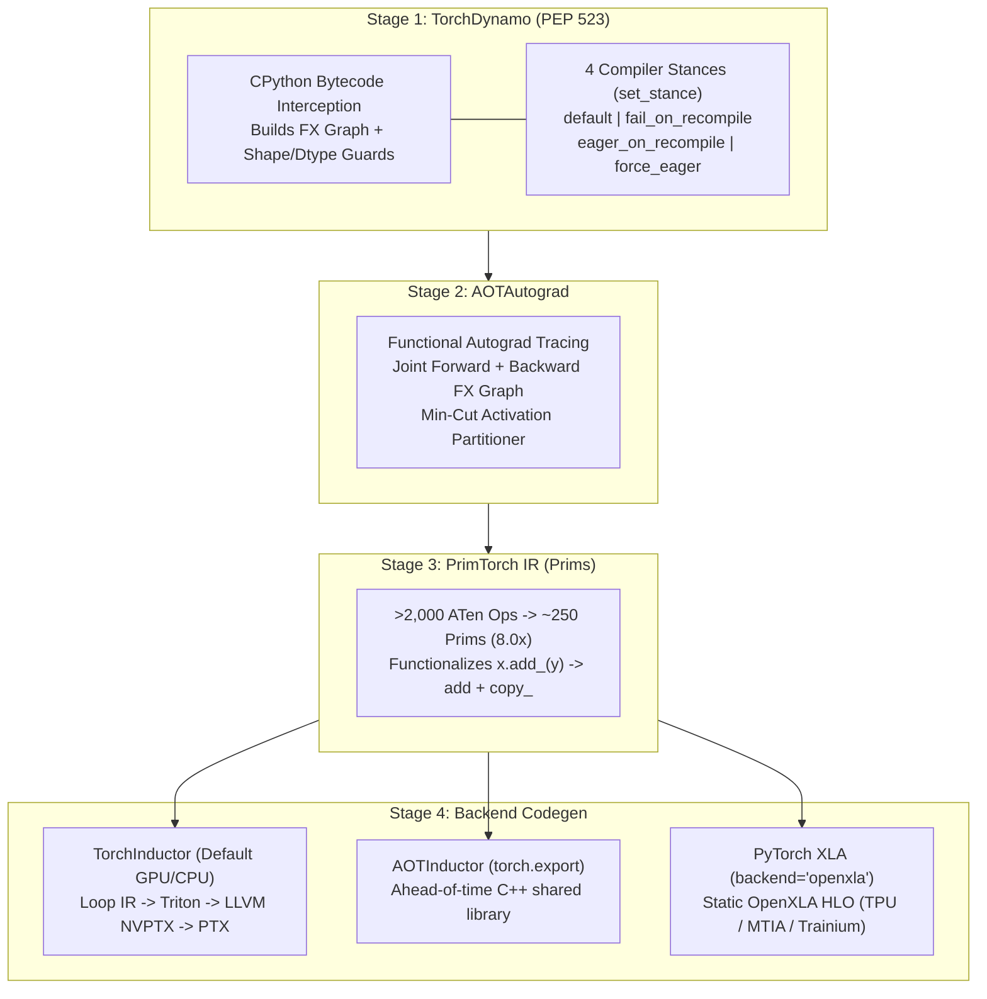

# 14.9 PyTorch compilers and kernels: torch.compile

| Field | Value |
|---|---|
| Level | Advanced |
| Priority tier | 2 |
| Lab venue | Nebius GPU + Local Python Verification Lab |
| Part | Part 14: Distributed training and fine-tuning |
| Primary sources | *AI Systems Performance Engineering* by Chris Fregly, Chapter 14; cross-reference Chapter 10.19 |
| Code | `code/part14/pytorch_compilers_torch_compile.py`, `code/part14/pytorch_compilers_torch_compile_lab.py` |
| Coverage file | `planning/coverage/chapters/14-09.md` |
| Claim & number ledger | `planning/ledgers/14-09.md` |

## Why this matters for AI infrastructure

Picture a training step that spends more time waiting than computing. In eager mode, the Python interpreter hands operators to the GPU one at a time. For each operator, the GPU reads a tensor from high-bandwidth memory (HBM), does one small piece of arithmetic, and writes the result straight back. The GPU sits idle between launches, and the memory bus carries the same tensors again and again.

Chapter 10.19 showed how OpenAI Triton, `torch.compile`, and OpenXLA lower Python operations to hardware instructions. Training asks more of a compiler than inference does, because the compiler has to plan the forward pass and the backward pass together. It also has to work with the gradient buckets of DDP and the parameter shards of FSDP, the two data-parallel schemes from Chapters 14.4 and 14.5.

The PyTorch 2.x compiler stack removes three training bottlenecks, one stage at a time. TorchDynamo removes Python dispatch overhead. It hooks into the CPython frame evaluation API defined in PEP 523, collects tensor operations into an FX graph, and attaches runtime guards on shapes and dtypes. The captured graph then goes to a compiler backend.

AOTAutograd and PrimTorch cut memory traffic. AOTAutograd traces the forward graph ahead of time to produce one joint forward-and-backward graph. A min-cut partitioner then decides which activations to save and which to recompute. PrimTorch reduces the more than 2,000 ATen operators to roughly 250 primitives and rewrites in-place changes as pure operations.

TorchInductor generates the kernels. It lowers the joint graph to a loop-level intermediate form and emits OpenAI Triton kernels, which compile to NVIDIA PTX through LLVM without calling `nvcc`. It compiles FlexAttention to 85 to 90 percent of FlashAttention speed. It also lets you register your own Triton kernels with `@torch.library.triton_op`.

```text
Summary of Key Compiler Gains (AI Systems Performance Engineering, Chapter 14):
- Eager vs Compiled Elementwise Block (batch = 4, seq_len = 2,048 -> 8,192 tokens, hidden_dim = 4,096, BF16 = 2 B):
  Single tensor size: 67,108,864 bytes (67.11 MB)
  5 forward ops + 5 backward ops: 10 eager kernels (24 HBM passes = 1.6106 GB) -> 2 compiled kernels (6 HBM passes = 0.4027 GB)
  Result: 4.0x HBM traffic reduction (75.0% bandwidth saved) and 5.0x fewer kernel launches (10 -> 2)
- PrimTorch IR Surface Reduction:
  > 2,000 (2,000+) ATen operators -> ~250 core primitive ops (8.0x reduction, 87.5% smaller operator surface)
- FlexAttention Efficiency:
  85%–90% (85.0%–90.0%) of modern FlashAttention performance in both forward and backward passes
- Triton Persistent GEMM Benchmark ([M=8192, N=8192, K=512]):
  matmul_kernel_persistent: 159.352 ms (4,312.421 Proton score) vs cuBLAS: 174.920 ms (3,928.623) -> 1.10x speedup (8.90% faster)
  Single 8,192 x 8,192 x 512 GEMM FLOPs: 2 * 8,192 * 8,192 * 512 = 68,719,476,736 FLOPs (68.72 GFLOPs)
```

:::note Benchmark context and cross-reference
The Triton Proton profiler numbers for the 8,192 by 8,192 by 512 matrix multiplication come verbatim from *AI Systems Performance Engineering* Chapter 14. The millisecond totals represent multi-iteration benchmark scopes or illustrative metric tables, so focus on their relative speedup ratios. See Chapter 10.19 for the lower-level GPU perspective on Triton and PTX.
:::

Before you tune distributed communications or buy faster interconnects, compile your training step so the GPUs stop stalling on Python overhead and redundant HBM round-trips.

## Prerequisites and outcomes

### Prerequisites
- GPU memory hierarchy: HBM, the L2 cache, shared memory, and registers. On Blackwell, also the 256 KB per SM of Tensor Memory and the Tensor Memory Accelerator (TMA) that copies tiles asynchronously. You should also know Triton SPMD programming from Chapter 10.19.
- Training memory anatomy from Chapters 14.1 and 14.3, plus DDP from Chapter 14.4 and FSDP from Chapter 14.5.

### Outcomes
After completing this chapter, you will be able to:
1. Trace the four-stage `torch.compile` training pipeline from TorchDynamo and AOTAutograd through PrimTorch and TorchInductor.
2. Estimate the memory-bandwidth savings from AOTAutograd, and combine compilation with DDP, per-block FSDP wrappers, Transformer Engine, and FlexAttention.
3. Handle dynamic shapes in variable-length LLM training with `mark_dynamic` and the 10 to 20 percent bucket-padding rule.
4. Find and remove graph breaks and guard recompilations with `explain`, the 11 `TORCH_LOGS` flags in Table 14-1, `tlparse`, and the Level 4 minifier.
5. Register custom Triton kernels that work with autograd, and keep persistent GEMMs within the 16-byte TMA alignment rule.
6. Profile kernels with Proton, and compare TorchInductor with OpenXLA.

---

## 1. The Four-Stage `torch.compile` Training Pipeline

Wrapping a model in `torch.compile` replaces step-by-step eager interpretation with a four-stage compilation pipeline. Each stage can fail on its own, and one unexpected graph break can quietly bring your training throughput back to eager speed. Figures 14-1 through 14-4 in *AI Systems Performance Engineering* Chapter 14 show how a model moves through the four stages.



### 1.1 Stage 1 — TorchDynamo: PEP 523 Frame Evaluation, FX Graph Capture, Guards, and Stances

Standard CPython evaluates Python frames one bytecode instruction at a time. That design forces PyTorch to launch tiny GPU kernels with high host overhead. TorchDynamo acts as the front-end tracer of `torch.compile`. It eliminates this overhead without forcing engineers to rewrite their Python classes.

TorchDynamo hooks into the CPython Frame Evaluation API introduced in PEP 523 to intercept Python bytecode safely at runtime. Whenever TorchDynamo encounters PyTorch tensor operations, it does not execute them eagerly. Instead, it appends each operation as a node in an FX Graph. Consider this simple function from Chapter 14 of the book:

```python
def f(x, y):
    z = x.sin() + y
    return z.sum()
```

TorchDynamo captures those operations into the following FX intermediate representation:

```text
graph():  # FX IR captured by TorchDynamo
    %x : Tensor = Placeholder[target=x]
    %y : Tensor = Placeholder[target=y]
    %sin : Tensor = torch.sin(%x)      # aten::sin
    %add : Tensor = torch.add(%sin, %y) # aten::add
    %sum : Tensor = torch.sum(%add)     # aten::sum
    return %sum
```

Along with the FX Graph, TorchDynamo emits fast runtime assertions called guards. Guards check every input property that affected the trace, including tensor shapes, dtypes, devices, strides, and Python constants. On subsequent calls, if all guards pass, PyTorch skips Python tracing and executes the cached compiled artifact directly. If a guard fails because a tensor shape or Python scalar changes, TorchDynamo invalidates the cache and triggers a recompilation. By default, TorchDynamo allows up to 8 recompiles per frame and 64 accumulated recompiles globally before falling back to eager mode.

You can control how strictly TorchDynamo responds to graph breaks and guard misses using `torch.compiler.set_stance`:

| Compiler Stance | Behavior on Graph Break or Guard Failure | Primary Infrastructure Use Case |
|---|---|---|
| `"default"` | Compiles supported regions into FX graphs; falls back to eager mode across breaks and recompiles on guard misses up to `recompile_limit = 8`. | Standard production training and inference runs. |
| `"fail_on_recompile"` | Raises an immediate runtime exception if a graph break, unsupported operation, or unexpected recompilation occurs. | Local debugging and CI regression gates to prevent pull requests from introducing graph breaks. |
| `"eager_on_recompile"` | Reuses cached compiled graphs when guards match, but runs in eager mode whenever a new input would trigger a recompilation. | Latency-sensitive workloads where mid-run JIT compilation spikes cannot be tolerated after warm-up. |
| `"force_eager"` | Ignores all `torch.compile` directives and executes everything in standard PyTorch eager mode. | A/B benchmarking and isolating numerical bugs without editing model decorators. |

### 1.2 Stage 2 — AOTAutograd: Joint Forward-Backward Graph Capture and Min-Cut Partitioning

In eager PyTorch training, the forward pass runs op by op while the C++ autograd engine records a dynamic backward tape. During `loss.backward()`, each backward operator launches separately without knowing what the forward pass or later backward ops will do. Unfused elementwise layers end up reading and writing huge activation tensors to HBM over and over again.

AOTAutograd replaces this dynamic tape during compilation. It runs the Dynamo-captured forward FX graph through PyTorch's autograd engine in functional mode ahead of time. This step produces a single **joint forward-and-backward FX graph** before any GPU kernel is generated. The joint graph contains both the forward operations and the exact gradient operations needed for `backward()`.

Because AOTAutograd sees the entire forward and backward dataflow graph ahead of time, it solves a **min-cut graph partitioning problem**. This algorithm splits the joint graph into a forward subgraph and a backward subgraph. Rather than saving every intermediate activation tensor to HBM or recomputing everything from scratch, the min-cut partitioner finds the minimum-memory cut of tensors to save across the pass boundary. It automatically recomputes cheap elementwise intermediates inside the fused backward kernel instead of reading and writing them to HBM. It also applies common-subexpression elimination, cross-boundary operator fusion, and buffer reuse while preserving exact eager autograd semantics.

```text
Worked Bandwidth Math (code/part14/pytorch_compilers_torch_compile.py):
- Workload: Transformer post-GEMM elementwise block (5 forward ops + 5 backward gradient ops = 10 eager kernels)
- Tensor dimensions: batch_size = 4, seq_len = 2,048 (8,192 tokens), hidden_dim = 4,096, dtype = BF16 (2 bytes/element)
- Single tensor size: 8,192 * 4,096 * 2 = 67,108,864 bytes (67.11 MB / 67.1089 MB)
- Eager execution (10 kernels):
  Forward: 5 ops * (1 input read + 1 output write) = 10 HBM passes
  Backward: 5 ops * (1 grad read + 1 grad write) + 4 saved forward activation reads = 14 HBM passes
  Total eager traffic: 24 HBM passes * 67,108,864 B = 1,610,612,736 B (1.6106 GB)
- Compiled with AOTAutograd + TorchInductor (2 kernels):
  Forward (1 fused kernel): 1 input read + 1 output write + 1 min-cut saved tensor write = 3 HBM passes
  Backward (1 fused kernel): 1 grad read + 1 min-cut saved tensor read + 1 grad write = 3 HBM passes
  Total compiled traffic: 6 HBM passes * 67,108,864 B = 402,653,184 B (0.4027 GB)
- Net savings: 4.0x reduction in HBM traffic (75.0% memory bandwidth saved) and 5.0x fewer kernel launches (10 -> 2)
```

### 1.3 Stage 3 — PrimTorch: Decomposing Over 2,000 ATen Ops to 250 Functional Primitives

PyTorch's C++ ATen operator library exposes more than 2,000 operators. Many of these operators overlap in functionality or mutate tensors in place. That huge surface makes it practically impossible to write a compiler backend that supports all 2,000 operators for every new GPU or custom ASIC.

PrimTorch solves this problem in two steps. First, it decomposes complex high-level ATen operators into a canonical core set of roughly 250 primitive operations. These primitives cover basic arithmetic, reductions, broadcast, reshape, and copy. That 8.0x reduction shrinks the operator surface by 87.5 percent. Backends like TorchInductor and OpenXLA only need to implement those 250 primitives.

Second, PrimTorch functionalizes the graph to eliminate in-place mutations and storage aliasing. In-place operations like `x.add_(y)` create hidden side effects that block loop reordering and kernel fusion. PrimTorch lowers every in-place mutation into a pure out-of-place functional operation. It then appends an explicit write-back node at the end of the graph:

```text
%z = aten::add(x, y)       # pure functional out-of-place addition
%copy = aten::copy_(x, %z) # explicit storage write-back into x
```

Intermediate nodes are now 100 percent free of side effects. TorchInductor's fusion planner and memory planner can safely reorder loops and fuse operations across the entire graph.

### 1.4 Stage 4 — TorchInductor, Compilation Modes, FlexAttention, and Distributed DDP / FSDP

Once the joint graph is decomposed into functional primitives, PyTorch still needs to generate fast device code without waiting on slow C++ compilers. TorchInductor is PyTorch's default compiler backend for NVIDIA GPUs, AMD GPUs, and CPUs.

TorchInductor lowers the ATen and PrimTorch FX Graph into a Python define-by-run loop-level IR. In this IR, tensor indexing is represented symbolically via SymPy expressions. For example, transposing a 2D tensor and adding a broadcast row is lowered into a single fused loop nest:

```python
def inner_fn(index: list[sympy.Expr]):
    i1, i0 = index                        # symbolic loop indices
    tmp0 = ops.load("x", i1 + i0 * size1) # coalesced/transposed x[i1, i0]
    tmp1 = ops.load("x", 2 * size1 + i0)  # broadcast row x[2, i0]
    return ops.add(tmp0, tmp1)            # fused register-level add

torchinductor.ir.Pointwise(
    device=torch.device("cuda"),
    dtype=torch.float32,
    inner_fn=inner_fn,
    ranges=[size0, size1],
)
```

For GPU targets, TorchInductor emits OpenAI Triton Python code for fusible pointwise, reduction, and epilogue blocks. It uses the Triton JIT compiler to lower those kernels directly to NVIDIA PTX via LLVM NVPTX without ever invoking `nvcc`. Large matrix multiplications are routed to cuBLAS, cuBLASLt, CUTLASS, or autotuned Triton persistent GEMM templates. Surrounding LayerNorm, residual add, and activation epilogues fuse directly into the GEMM. When you need C++-only production serving without a Python runtime, `torch.export()` paired with AOTInductor compiles the Inductor IR ahead of time into a standalone shared library.

You select the trade-off between compile time, CUDA Graph capture, and kernel autotuning via the `mode` argument:

| `torch.compile` Mode | CUDA Graphs Enabled | Triton / GEMM Autotuning | Compile Time | Best Training / Inference Scenario |
|---|---|---|---|---|
| `"default"` | No (`False`) | Basic heuristics (`False`) | Fast | Large-model training startup, variable shapes, and rapid iteration where compile overhead must stay low. |
| `"reduce-overhead"` | Yes (`True`) | Basic heuristics (`False`) | Medium | Small or medium models and fixed-shape decoding where CPU launch overhead dominates; requires static shapes. |
| `"max-autotune"` | Yes (`True`) | Exhaustive (`True`) | High | Long production training or static-shape inference runs that amortize benchmarking Triton and cuBLASLt/CUTLASS candidates. |
| `"max-autotune-no-cudagraphs"` | No (`False`) | Exhaustive (`True`) | High | Large-scale LLM training with dynamic sequence lengths where you want exhaustive kernel autotuning without CUDA Graph static-address constraints. |

Three library and distributed-training facts matter when you use TorchInductor.

First, the compiler does not swap standard linear modules for NVIDIA Transformer Engine kernels on its own. You instantiate the layers from `transformer_engine.pytorch.layers` in your model yourself. TorchInductor then fuses the operations around them.

Second, the SDPA flash and memory-efficient flags, together with FlexAttention, let TorchInductor compile custom attention score changes into fused Triton kernels. FlexAttention supports ALiBi, soft-capping, document masking, and block sparsity. It reaches 85 to 90 percent of FlashAttention performance in the forward and backward passes.

Third, DDP and FSDP produce deliberate graph breaks. TorchDynamo breaks the graph at collective communication boundaries, as Figure 14-5 of the book shows. The break lets the backward computation of the next shard overlap with NCCL communication of the current shard. When you combine FSDP with compilation, pass `use_original_params=True` and wrap each Transformer block as its own FSDP submodule. AOTAutograd and TorchInductor can then fuse the passes inside each shard.

When you train a large Transformer with variable sequence lengths, start with `"max-autotune-no-cudagraphs"` and per-block FSDP wrappers that set `use_original_params=True`.

---

## 2. Dynamic Shapes, Graph Breaks, and Compiler Diagnostics

### 2.1 Dynamic Shapes, `mark_dynamic`, and the 10 to 20 Percent Bucket-Padding Rule

LLM training and inference workloads often process batches with variable sequence lengths. In a purely static compiler, every new sequence length triggers a slow recompilation. Otherwise, you have to pad all inputs to the maximum context window and waste FLOPs on pad tokens. PyTorch solves this problem using SymPy symbolic shapes, but choosing the wrong dynamic setting can silently disable CUDA Graphs or trigger unnecessary recompiles.

How TorchDynamo handles changing sequence lengths depends on the dynamic setting you choose.

By default, TorchDynamo specializes on the shape it sees at step 1, such as 256 tokens. When the length changes to 512, that guard fails and one extra recompilation happens. In that second compile, TorchInductor turns the varying dimension into a SymPy symbol and emits a general kernel with a wider guard.

If you know a dimension will vary, call `torch._dynamo.mark_dynamic` before the first call to the compiled model. That dimension is symbolic from step 1, with no guard failure. Static dimensions such as the 4,096 hidden size stay specialized for fast vectorization.

Setting `dynamic=True` is a blunt choice. It makes every dimension symbolic up front. CUDA Graphs need fixed shapes and fixed memory addresses, so `dynamic=True` or unbucketed dynamic shapes turn off CUDA Graph capture. That removes the launch-overhead benefit of `reduce-overhead` mode.

Chapter 14 gives a rule of thumb for choosing between padding and symbolic shapes. If your sequence lengths vary by only 10 to 20 percent, pad them to one fixed size so TorchInductor can use static shapes and CUDA Graphs. If lengths range widely, say from 128 to 8,192 tokens, group inputs into a few buckets and pad each within 10 to 20 percent. The other option is to pair `mark_dynamic` with `max-autotune-no-cudagraphs`.

```text
Dynamic Shape Guard Progression Summary:
- dynamic=None (default) across steps (256, 512, 768, 1024):
  Step 1 (256): Compiles static guard (sequence_length <= 256)
  Step 2 (512): Guard fails -> 1 recompile (2 compiles total) -> symbolic s0 with expression z.size(0) = x.size(0) + y.size(0) and guard (sequence_length <= 1024)
- torch._dynamo.mark_dynamic(x, 1) before Step 1:
  Step 1 (256): Compiles symbolic s0 immediately -> 1 compile total, 0 guard failures (disables CUDA Graphs)
- Padding threshold:
  Variation <= 10%–20% (10.0%–20.0%) -> Pad to static shape to keep CUDA Graphs enabled
```

### 2.2 Diagnosing and Eliminating Graph Breaks with `torch._dynamo.explain()`

A graph break happens whenever TorchDynamo hits Python code that it cannot safely trace into the FX Graph. Every graph break forces execution to return to the slow Python interpreter. That interruption splits your model into fragmented subgraphs and prevents whole-graph kernel fusion or CUDA Graph capture. Common culprits include print statements, file I/O, data-dependent control flow on GPU tensors, dynamically growing Python lists, and unregistered C++ or CUDA extensions.

Chapter 14 demonstrates how to find and fix graph breaks using `torch._dynamo.explain()` on a toy function:

```python
import torch
import torch._dynamo as dynamo

def toy_example(a: torch.Tensor, b: torch.Tensor) -> torch.Tensor:
    x = a / (torch.abs(a) + 1)
    print("woo")          # Break Reason 1: side-effecting stdio print
    if b.sum() < 0:       # Break Reason 2: data-dependent Python jump
        b = -b
    return x * b

explanation = dynamo.explain(toy_example)(torch.randn(10), torch.randn(10))
print(explanation)
```

Running `dynamo.explain(toy_example)` produces this diagnostic report:

```text
Graph Count: 3
Graph Break Count: 2
Op Count: 5
Break Reasons:
  Break Reason 1:
    Reason: builtin: print [...ConstantVariable] False
    User Stack: <frame at toy_example: line 3, in toy_example>
  Break Reason 2:
    Reason: generic_jump TensorVariable()
    User Stack: <frame at toy_example: line 5, in toy_example>
```

Because of those 2 graph breaks, TorchDynamo chops 5 simple tensor operations into 3 separate subgraphs. We can eliminate both breaks and reduce the trace to 1 graph with 0 breaks using two standard patterns. First, guard trace-time side effects with `if not torch._dynamo.is_compiling():` so the print statement is skipped during capture. Second, replace the data-dependent Python branch with either `torch.where()` or `torch.cond()`:

```python
# Option A: Pure-tensor masking with torch.where() (simpler, zero aliasing restrictions)
def model_where(a: torch.Tensor, b: torch.Tensor) -> torch.Tensor:
    x = a / (torch.abs(a) + 1)
    if not torch._dynamo.is_compiling():
        print("do not print during tracing/compiling")
    b = torch.where(b.sum() < 0, -b, b)
    return x * b

# Option B: Structured control flow with torch.cond() (for expensive branch subgraphs)
def model_cond(a: torch.Tensor, b: torch.Tensor) -> torch.Tensor:
    x = a / (torch.abs(a) + 1)
    if not torch._dynamo.is_compiling():
        print("do not print during tracing/compiling")
    b = torch.cond(
        b.sum() < 0,         # 0-dim bool tensor predicate
        lambda b: -b,        # true_fn
        lambda b: b.clone(), # false_fn (clone() avoids aliasing; same shape/dtype required)
        (b,),                # operands tuple
    )
    return x * b
```

Sometimes a helper function uses a Python construct that TorchDynamo conservatively rejects, even though the function is 100 percent pure and free of side effects. In that case, you can decorate it with `@torch.compiler.allow_in_graph`. This escape hatch forces TorchDynamo to inline the call into the FX Graph without breaking. Use it carefully, because hidden side effects will silently produce wrong answers.

### 2.3 Compiler Logging (Table 14-1: 11 `TORCH_LOGS` Flags), `tlparse`, and `TORCHDYNAMO_REPRO_LEVEL=4`

When a compiled training job runs slower than expected or diverges numerically, guessing which compiler pass went wrong wastes hours. Setting the `TORCH_LOGS` environment variable lets you inspect every decision inside TorchDynamo, AOTAutograd, and TorchInductor without changing a line of model code. Table 14-1 in *AI Systems Performance Engineering* Chapter 14 defines the 11 core `TORCH_LOGS` flags:

| # | `TORCH_LOGS` Value | Stage / Subsystem | Diagnostic output (*AI Systems Performance Engineering*, Chapter 14, Table 14-1) |
|---|---|---|---|
| 1 | `graph_breaks` | TorchDynamo | Logs every graph break event, reason, and Python user stack line. |
| 2 | `dynamo` | TorchDynamo | Verbose bytecode-tracing logs from TorchDynamo. |
| 3 | `aot_graphs` | AOTAutograd | Verbose logging from AOTAutograd, including the captured joint forward and backward FX graphs. |
| 4 | `inductor` | TorchInductor | Verbose lowering, fusion, scheduling, and memory-planning logs from TorchInductor. |
| 5 | `graph_outputs` | TorchDynamo | Prints the compiled FX graph nodes and output tensors. |
| 6 | `graph_code` | TorchDynamo | Dumps the equivalent executable Python code for each FX graph produced by TorchDynamo. |
| 7 | `dynamic` | SymPy / Dynamic Shapes | Traces decisions around dynamic shapes and logs when and why tensor dimensions are marked symbolic. |
| 8 | `perf_hints` | TorchInductor | Logs missed performance optimizations such as `"PerfHint: CUDA Graph not used because input is mutated"` or `"PerfHint: fell back to eager for random op"`. |
| 9 | `output_code` | TorchInductor | Prints the exact generated source code including Triton kernels, C++ wrappers, and kernel launch grids. |
| 10 | `recompiles` | TorchDynamo Guards | Logs every recompilation trigger and the exact guard condition that failed. |
| 11 | `guards` | TorchDynamo Guards | Logs all generated guards on shape, dtype, stride, and constants along with their runtime evaluations. |

Three more workflows help with slow or numerically different compiled runs.

Setting `TORCH_COMPILE_DEBUG=1` writes a per-process debug directory with FX graphs, runnable Python code, Inductor IR dumps, and compiled PTX. Setting `TORCH_TRACE="/tmp/tracedir"` and running `tlparse` renders a stack-frame tree and a Perfetto timeline. The trace overhead is low enough for production runs.

If a compiled training step produces `NaN` values or disagrees with eager mode, export `TORCHDYNAMO_REPRO_AFTER="aot"` and `TORCHDYNAMO_REPRO_LEVEL=4`. Checking after AOTAutograd covers both the forward and backward passes. Level 4 runs every subgraph in eager and in compiled mode, compares the outputs, and starts the minifier on the first mismatch.

Random numbers also differ. TorchInductor fuses and reorders the Philox calls, which are the pseudo-random number generator behind dropout, so compiled dropout does not match eager mode unless you enable `fallback_random`. For bitwise determinism you must also stop cuBLAS from using non-deterministic split-K reductions, by exporting `CUBLAS_WORKSPACE_CONFIG=:4096:8` before Python starts.

```text
Compiler Debug Artifacts and Determinism Reference:
- TORCH_COMPILE_DEBUG=1 directory: /tmp/torchinductor_<user>_<pid>/... (.fx, fx_graph_runnable.py, output_code.py, PTX mma.sync / tcgen05)
- tlparse stack-frame tree output: [2/2] [2/3] .../torch/_dynamo/convert_frame.py
- PRNG parity flag: torch._inductor.config.fallback_random = True
- Deterministic cuBLAS workspace:
  CUBLAS_WORKSPACE_CONFIG=:4096:8 -> 8 buffers * 4,096 KB = 32,768 KB (32 MB workspace)
  CUBLAS_WORKSPACE_CONFIG=:16:8   -> 8 buffers * 16 KB    = 128 KB workspace
```

Before you launch any multi-hour compiled job, run `torch._dynamo.explain()` and `TORCH_LOGS="graph_breaks,recompiles,perf_hints"` on one training step.

---

## 3. OpenAI Triton Custom Kernels and `@torch.library.triton_op` Registration

Sometimes TorchInductor's built-in fusion rules cannot fuse a domain-specific operator like a custom sparse attention mask or quantized activation. Writing an unregistered C++ or CUDA extension for that operator causes a TorchDynamo graph break. Instead, Chapter 14 recommends writing the kernel in OpenAI Triton and registering it with PyTorch via `@torch.library.triton_op`.

### 3.1 Triton SPMD Programming Model vs CUDA SIMT

Writing raw CUDA requires managing individual thread indices, shared memory bank conflicts, and explicit synchronization barriers across hundreds of lines of C++. Unlike CUDA's thread-level Single-Instruction, Multiple-Thread model, OpenAI Triton uses a block-level Single-Program, Multiple-Data model.

In Triton, each program instance maps to one CUDA thread block, also called a Cooperative Thread Array. Every program instance operates on an entire vector of `BLOCK_SIZE` elements at once. Importantly, the block size is decoupled from the physical thread count. `BLOCK_SIZE` is the number of data elements processed per program instance, whereas the number of hardware CUDA threads per block equals `num_warps * 32`.

By default, Triton launches 4 warps, which equals 128 threads per block. On modern GPUs with larger register files and shared memory, Chapter 14 gives a clear scaling rule for compute-heavy kernels. Increase the warp count to 8 for 256 threads when the block size reaches 2,048. Increase it to 16 for 512 threads when the block size reaches 4,096. In 2025, NVIDIA also introduced Python-native libraries including cuTile, CuTe Python DSL, CUTLASS Python DSL, and cuPyNumeric. Even so, TorchInductor continues to use OpenAI Triton as its primary GPU backend.

```text
Triton SPMD Launch Geometry (vector_add_kernel on n_elements = 10,000):
- Program index and offsets: pid = tl.program_id(axis=0), offsets = pid * BLOCK_SIZE + tl.arange(0, BLOCK_SIZE)
- BLOCK_SIZE = 1,024, num_warps = 4 (128 threads):
  grid = cdiv(10000, 1024) = 10 programs (10,240 total slots; final 240 lanes masked off via offsets < n_elements)
  Elements per thread = 1,024 / 128 = 8.0 elements/thread
- BLOCK_SIZE = 2,048 -> scale to num_warps = 8 (256 threads, cdiv(10000, 2048) = 5 programs, 8.0 elements/thread)
- BLOCK_SIZE = 4,096 -> scale to num_warps = 16 (512 threads, cdiv(10000, 4096) = 3 programs, 8.0 elements/thread)
- Autotune search spaces: num_warps in {4, 8, 16}, num_stages in {2, 3, 4}
```

### 3.2 Registering Custom Triton Kernels for Training and Autograd

If you launch a raw `@triton.jit` kernel directly inside `forward()`, TorchDynamo treats the custom launch as an opaque side effect or breaks the graph. Even worse, AOTAutograd does not know how to differentiate a raw kernel during `backward()`. Chapter 14 shows the three-part pattern for registering a Triton kernel as a compiler-visible PyTorch operator with full autograd support:

```python
import torch
import triton
import triton.language as tl
from torch import Tensor
from torch.library import triton_op, wrap_triton

# 1. Define the SPMD Triton compute kernel
@triton.jit
def vector_add_kernel(
    x_ptr, y_ptr, out_ptr, n_elements,
    BLOCK_SIZE: tl.constexpr,
):
    pid = tl.program_id(0)
    start = pid * BLOCK_SIZE
    offsets = start + tl.arange(0, BLOCK_SIZE)
    mask = offsets < n_elements
    x = tl.load(x_ptr + offsets, mask=mask)
    y = tl.load(y_ptr + offsets, mask=mask)
    tl.store(out_ptr + offsets, x + y, mask=mask)

# 2. Register as a compiler-visible PyTorch operator via @triton_op + wrap_triton
@triton_op("my_triton_lib::vector_add", mutates_args=())
def vector_add(x: Tensor, y: Tensor) -> Tensor:
    assert x.device.type == "cuda" and y.device.type == "cuda"
    n = x.numel()
    out = torch.empty_like(x)
    grid_fn = lambda meta: (triton.cdiv(n, meta["BLOCK_SIZE"]),)
    wrap_triton(vector_add_kernel)[grid_fn](x, y, out, n, BLOCK_SIZE=1024)
    return out

# 3. Register backward pass for AOTAutograd training support
def setup_context(ctx, inputs, output):
    # Save any tensors or metadata required for backward()
    x, y = inputs
    ctx.save_for_backward(x, y)

def backward(ctx, grad_out: Tensor):
    # d(x + y)/dx = 1, d(x + y)/dy = 1
    return grad_out, grad_out

vector_add.register_autograd(backward, setup_context=setup_context)
```

Each piece of this registration serves a specific compiler stage. First, the `@triton_op` decorator declares the operator schema and tells PrimTorch and TorchInductor that no input arguments are mutated in place. That declaration enables FakeTensor shape propagation without allocating GPU memory during tracing. Second, `wrap_triton` exposes the Triton AST to TorchInductor so the compiler can fuse surrounding pointwise operations into the custom kernel. Third, `register_autograd` allows AOTAutograd to trace right through the custom op during joint forward-backward graph capture. This registration API is preferred over legacy `torch.autograd.Function` for compiler composability.

Wrap every custom training kernel with `@triton_op`, `wrap_triton`, and `register_autograd`. Then AOTAutograd and TorchInductor can fuse across the forward and backward passes.

---

## 4. Advanced Triton GEMM Kernels, Proton Profiling, and OpenXLA

### 4.1 TMA Tensor Descriptors, Warp Specialization, and `matmul_kernel_persistent`

Naive matrix multiplication kernels stall on HBM latency and waste cycles launching thousands of short-lived thread blocks. On Hopper and Blackwell, three techniques work together to keep the Tensor Cores busy.

The first is the tensor descriptor. Instead of manual pointer arithmetic, Triton stages 2D tiles into shared memory with `tl.make_tensor_descriptor`. On Hopper and Blackwell, descriptor loads become asynchronous bulk transfers on the Tensor Memory Accelerator (TMA). The call `tl.dot` becomes Blackwell `tcgen05` UMMA instructions, which accumulate results in 256 KB per SM of Tensor Memory. TMA has two strict alignment rules. Every leading stride must be a multiple of 16 bytes, and the innermost dimension must be contiguous with stride 1. A leading stride of 12 bytes makes descriptor creation fail.

The second is software pipelining with warp specialization. Setting `warp_specialize=True` inside `tl.range` splits the warps of a thread block into producers that run TMA transfers and consumers that run Tensor Core math. With several pipeline stages, keep the current tile alive until `tl.dot` finishes. Prefetch the next tile into a separate variable and swap the references at the end of the loop body. If you overwrite the current tile early or drop its reference, the compiler can move the next TMA copy past the current compute. The overlap between loading and computing then collapses without any error.

The third is the persistent GEMM. A standard 2D tiled GEMM launches one thread block per output tile. When the reduction dimension exceeds 1,024 or the matrices are very large, `matmul_kernel_persistent` launches a bounded 1D grid of at most 65,536 programs. Each program loops over several output tiles, stepping by the total number of programs:

```text
Persistent GEMM Loop and Grid Sizing (BLOCK_M=128, BLOCK_N=128, BLOCK_K=64, num_warps=8, num_stages=2, num_consumer_groups=2, num_buffers_warp_spec=3):
  A_desc = tl.make_tensor_descriptor(A_ptr, shape=[M, K], strides=[stride_am, stride_ak], block_shape=[BLOCK_M, BLOCK_K])
  grid = lambda META: (min(65536, MT * NT),)  # where MT = cdiv(M, BLOCK_M), NT = cdiv(N, BLOCK_N)
  tile_idx = pid
  while tile_idx < TILE_COUNT:                # TILE_COUNT = MT * NT
      pid_m = tile_idx // NT
      pid_n = tile_idx % NT
      for k in tl.range(0, K_tiles, num_stages=NUM_STAGES, warp_specialize=True):
          # prefetch-next (a_next = A_desc.load([m0, next_k])) -> compute-current (acc += tl.dot(a_cur, b_cur)) -> swap (a_cur = a_next)
      tile_idx += nprog                       # persistent stride (nprog = tl.num_programs(0))

- Case 1: [M=8192, N=8192, K=512]:
  MT = 64, NT = 64 -> TILE_COUNT = 64 * 64 = 4,096 output tiles, K_tiles = 512 / 64 = 8 iterations
  1D grid = min(65536, 4096) = 4,096 persistent programs (1 output tile per program)
- Case 2: [M=65536, N=65536, K=2048]:
  MT = 512, NT = 512 -> TILE_COUNT = 512 * 512 = 262,144 output tiles, K_tiles = 2048 / 64 = 32 iterations
  1D grid = min(65536, 262144) = 65,536 persistent programs (4 output tiles per program)
```

### 4.2 Triton Proton Profiler and PyTorch XLA (OpenXLA)

Standard Python timers cannot attribute execution time across autotuned Triton kernel launches. They also cannot correlate launches with hardware performance counters. To profile Triton kernels and emit NVTX ranges for NVIDIA Nsight Systems and Nsight Compute, Chapter 14 uses the Triton Proton profiler. You start the profiler with `proton.start("matmul", hook="triton")` and wrap regions using `proton.scope`. On the 8,192 by 8,192 by 512 matrix multiplication benchmark, Proton produces the following timing tree:

```text
168.314 ms 16331.291 ROOT
├─ 174.920 ms  3928.623 cublas [M=8192,N=8192,K=512]
├─ 165.349 ms  4156.033 matmul_kernel [M=8192,N=8192,K=512]
├─ 159.352 ms  4312.421 matmul_kernel_persistent [M=8192,N=8192,K=512]
└─ 174.671 ms  3934.214 torch [M=8192,N=8192,K=512]
```

| Kernel Implementation (`[M=8192, N=8192, K=512]`) | Proton Time (ms) | Proton Metric Score | Speedup / Time Saved vs cuBLAS (174.920 ms) |
|---|---|---|---|
| `cublas` (cuBLAS baseline) | 174.920 ms | 3,928.623 | 1.00x (0.000 ms saved, 0.00%) |
| `torch` (`torch.matmul`) | 174.671 ms | 3,934.214 | 1.00x (0.249 ms saved, 0.14% faster) |
| `matmul_kernel` (2D tiled Triton + TMA) | 165.349 ms | 4,156.033 | 1.06x (9.571 ms saved, 5.47% faster) |
| `matmul_kernel_persistent` (1D persistent Triton + TMA + TMEM + warp spec) | 159.352 ms | 4,312.421 | 1.10x (15.568 ms saved, 8.90% faster) |

Finally, when targeting non-NVIDIA accelerators, PyTorch XLA (`backend="openxla"`, Figure 14-6 in Chapter 14) lowers PyTorch graphs into OpenXLA StableHLO and HLO executables. This backend supports Google Cloud TPUs, Meta MTIA, and AWS Trainium or Inferentia via the AWS Neuron SDK:

| Compiler Dimension | TorchInductor (`backend="inductor"`, Default) | PyTorch XLA (`backend="openxla"`) |
|---|---|---|
| Primary Target Hardware | NVIDIA GPUs (Ampere, Hopper, Blackwell), AMD GPUs, x86/ARM CPUs | Google Cloud TPUs, Meta MTIA, AWS Trainium & Inferentia (AWS Neuron SDK) |
| Compilation Model | Incremental subgraph JIT compilation (falls back to eager on breaks) or AOTInductor export | Whole-program ahead-of-time static graph compilation cached per input shape signature |
| Dynamic Shape Behavior | Native SymPy symbolic shapes (`mark_dynamic`, range guards `s0 <= 1024`) | Static or bounded shapes; unseen shapes trigger expensive whole-program recompilation |
| Kernel Codegen Path | Python Loop IR -> OpenAI Triton -> LLVM NVPTX -> PTX + cuBLASLt/CUTLASS | PyTorch Lazy Tensor / FX -> XLA HLO IR -> target XLA hardware runtime |

When you write a pipelined Triton GEMM, check the 16-byte stride rule first, and keep the current tiles alive across `tl.dot` so the load-compute overlap survives.

---

## Commands and configurations that matter

### 1. Enabling Fast TF32 Matmuls, SDPA Flash/Mem-Efficient Paths, and `torch.compile` Modes

```python
# (untested here — production PyTorch 2.x compiler & hardware fast-path configuration from ASP Ch 14)
import torch
from torch.distributed.fsdp import FullyShardedDataParallel as FSDP

# 1. Enable TF32 Tensor Core fast paths and SDPA FlashAttention / Memory-Efficient kernels early
torch.set_float32_matmul_precision("high")       # maps FP32 matmuls to TF32/BF16 fast paths ('highest' for pure FP32)
torch.backends.cuda.matmul.allow_tf32 = True
torch.backends.cudnn.allow_tf32 = True
torch.backends.cuda.enable_flash_sdp(True)
torch.backends.cuda.enable_mem_efficient_sdp(True)
torch.backends.cuda.enable_math_sdp(True)

# 2. Preempt dynamic-shape recompilation on known varying sequence dimension (dim=1)
torch._dynamo.mark_dynamic(input_ids, 1)

# 3. For FSDP + torch.compile: wrap each Transformer block as an FSDP submodule with use_original_params=True
for idx, layer in enumerate(model.layers):
    model.layers[idx] = FSDP(layer, use_original_params=True)
model = FSDP(model, use_original_params=True)

# 4. Enforce strict graph capture in CI / dev, then compile with max-autotune (or max-autotune-no-cudagraphs)
torch.compiler.set_stance("fail_on_recompile")
compiled_model = torch.compile(model, mode="max-autotune-no-cudagraphs")
```

### 2. Inspecting Compiler Phases, Graph Breaks, `tlparse`, and the Level-4 Minifier (Table 14-1)

```bash
# (untested here — runtime diagnostic and minifier commands from ASP Ch 14)

# Log graph breaks, guard evaluations, and recompilation triggers during training
TORCH_LOGS="graph_breaks,guards,recompiles" python3 train.py

# Log missed optimization opportunities (e.g., mutated inputs disabling CUDA Graphs) and generated Triton code
TORCH_LOGS="perf_hints,output_code" python3 train.py

# Dump FX graphs (.fx), runnable FX Python code, Inductor IR, Triton kernels, and PTX to /tmp/torchinductor_*
TORCH_COMPILE_DEBUG=1 python3 train.py

# Capture low-overhead compilation trace logs and render stack-frame tree with tlparse
TORCH_TRACE="/tmp/tracedir" python3 train.py
tlparse /tmp/tracedir

# Isolate numerical discrepancies after AOTAutograd and auto-generate a minified repro script (Level 4)
TORCHDYNAMO_REPRO_AFTER="aot" TORCHDYNAMO_REPRO_LEVEL=4 python3 train.py

# Enforce bitwise determinism across cuBLAS split-K reductions (32 MB workspace = 8 x 4096 KB, or :16:8)
export CUBLAS_WORKSPACE_CONFIG=:4096:8
```

---

## How it fails

Even a single unguarded print statement or changing Python scalar can silently disable compilation speedups in production. Use the table below to map each failure symptom to its root cause, diagnostic command, and fix.

| # | Failure mode and symptom | Root cause | Diagnosis command or signal | Production fix |
|---|---|---|---|---|
| 1 | Silent eager fallback and modest speedup (`Graph Count: 3, Graph Break Count: 2`) | Side-effecting Python ops (`print("woo")`), growing Python lists, or data-dependent control flow (`if b.sum() < 0:`) interrupt TorchDynamo PEP 523 capture. | Run `torch._dynamo.explain(model)(*inputs)` or `TORCH_LOGS="graph_breaks"`; look for `builtin: print` and `generic_jump TensorVariable()`. | Guard prints with `if not torch._dynamo.is_compiling():`, replace Python lists with `torch.stack()`, and rewrite tensor conditionals with `torch.where()` or `torch.cond()`. |
| 2 | Recompilation storm and iteration stalls after warm-up (`hit_recompile_limit = 8`) | Passing changing Python scalars (step counter, learning rate float) or varying sequence lengths without `mark_dynamic` invalidates Dynamo guards until `recompile_limit = 8` (`accumulated = 64`) is exhausted. | Run `TORCH_LOGS="recompiles,guards"` or set `torch.compiler.set_stance("fail_on_recompile")` in CI to see which guard expression failed. | Wrap changing scalars in 0-D `torch.Tensor` objects, call `torch._dynamo.mark_dynamic(x, dim)` upfront, or bucket sequence lengths within 10%–20%. |
| 3 | CUDA Graphs disabled despite `mode="reduce-overhead"` or `"max-autotune"` | Enabling `dynamic=True` (or unbucketed varying shapes) or mutating model inputs in place violates CUDA Graph fixed-address and static-shape invariants. | Run `TORCH_LOGS="perf_hints"`; look for `"PerfHint: CUDA Graph not used because input is mutated"` or dynamic shape disabling logs. | Eliminate in-place input mutations (`x.add_()` -> `x = x + ...`), pad shapes varying by < 10%–20% to static buckets, or switch to `mode="max-autotune-no-cudagraphs"`. |
| 4 | Custom Triton kernel causes graph break or fails during `loss.backward()` | Launching a raw `@triton.jit` kernel directly inside `forward()` makes it opaque to TorchDynamo, or registering `@triton_op` without `register_autograd` blocks AOTAutograd. | `TORCH_LOGS="graph_breaks,aot_graphs"` shows a custom-op graph break or missing backward formula error during joint graph capture. | Wrap the kernel with `@torch.library.triton_op("ns::op", mutates_args=())`, launch via `wrap_triton(kernel)[grid]`, and register `op.register_autograd(backward, setup_context=setup_context)`. |
| 5 | Silent load/compute overlap collapse or TMA alignment error in pipelined Triton GEMM | Leading tensor stride is not a multiple of 16 bytes (or inner dim is non-contiguous) in `tl.make_tensor_descriptor`, or the `tl.range(..., num_stages=2)` loop overwrites `a_cur` before `tl.dot(a_cur, b_cur)` completes. | Triton compilation error on TMA descriptor alignment, or Triton Proton / Nsight Compute showing stalled TMA stages and 0% copy/compute overlap. | Ensure `stride * dtype_bytes % 16 == 0` and contiguous inner dim; strictly follow `prefetch-next (a_next) -> compute-current (tl.dot(a_cur, b_cur)) -> swap (a_cur = a_next)`. |
| 6 | Numerical mismatch between `torch.compile` and eager mode (or non-deterministic cuBLAS crash) | Fused Triton Philox PRNG order differs from eager dropout, fused BF16 accumulation changes rounding order, or `torch.use_deterministic_algorithms(True)` is called without `CUBLAS_WORKSPACE_CONFIG`. | Run `TORCHDYNAMO_REPRO_AFTER="aot" TORCHDYNAMO_REPRO_LEVEL=4` to isolate the failing stage and generate a minified reproducer. | Set `torch._inductor.config.fallback_random = True`, test with `torch.set_float32_matmul_precision("highest")`, and export `CUBLAS_WORKSPACE_CONFIG=:4096:8` (or `:16:8`). |

---

## Hands-on lab

**Venue:** Local Python 3 standard-library verification lab (`code/part14/pytorch_compilers_torch_compile_lab.py`) + Nebius GPU for live Triton and `torch.compile` execution.

Run the deterministic verification suite:

```bash
python3 -B code/part14/pytorch_compilers_torch_compile_lab.py
```

Expected output (`26 passed, 0 failed`):

```text
=== Chapter 14.9 Lab: PyTorch Compilers and Kernels: torch.compile (ASP Ch 14) ===
  [PASS] 1. 4-stage torch.compile pipeline order: TorchDynamo (PEP 523) -> AOTAutograd -> PrimTorch -> TorchInductor
  [PASS] 2. PrimTorch IR operator reduction: decomposes >2,000 ATen ops to ~250 primitive ops (8.0x / 87.5% reduction)
  [PASS] 3. Compilation modes: default, reduce-overhead, max-autotune, max-autotune-no-cudagraphs with exact CUDA Graph & autotune rules
  [PASS] 4. torch.compiler.set_stance supports 4 stances: default, fail_on_recompile, eager_on_recompile, force_eager
  [PASS] 5. FlexAttention reaches 85.0%-90.0% of FlashAttention performance in forward and backward passes
  [PASS] 6. AOTAutograd + TorchInductor kernel launch fusion: 10 eager kernels (5 fwd + 5 bwd) fuse into 2 kernels (1 fwd + 1 bwd)
  [PASS] 7. AOTAutograd min-cut partitioner HBM savings: 1.6106 GB eager (24 passes of 67.1089 MB) -> 0.4027 GB compiled (6 passes) = 4.0x (75.0% saved)
  [PASS] 8. dynamo.explain(toy_example): print('woo') + 'if b.sum() < 0:' -> Graph Count=3, Graph Break Count=2, Op Count=5
  [PASS] 9. Refactored model_where / model_cond: if not is_compiling() + torch.where/torch.cond -> Graph Count=1, Graph Break Count=0
  [PASS] 10. FSDP / DDP intentional communication breaks: 2 collective boundaries yield 3 subgraphs for compute-communication overlap
  [PASS] 11. Guard-failure recompilation budget: changing Python scalar hits recompile_limit=8 (accumulated=64) and falls back to eager; fail_on_recompile raises on step 2
  [PASS] 12. Dynamic shape guards & mark_dynamic: auto-dynamic takes 2 compiles (1 recompile, sequence_length <= 256 -> 1024); mark_dynamic takes 1 compile (0 recompiles) and disables CUDA Graphs
  [PASS] 13. Table 14-1 TORCH_LOGS: all 11 diagnostic flags registered and mapped cleanly by symptom selector
  [PASS] 14. Numerical accuracy repro & cuBLAS workspace: TORCHDYNAMO_REPRO_LEVEL=4 and CUBLAS_WORKSPACE_CONFIG=:4096:8 (32,768 KB = 32 MB) or :16:8 (128 KB)
  [PASS] 15. @triton_op registration & training autograd: wrap_triton + register_autograd(backward, setup_context=...) prevents graph breaks; missing autograd breaks training graph
  [PASS] 16. Triton SPMD vector_add_kernel (n_elements=10,000, BLOCK_SIZE=1,024): cdiv(10000, 1024) = 10 programs, 4 warps (128 threads, 8.0 elems/thread)
  [PASS] 17. Triton num_warps scaling & warp specialization: BLOCK_SIZE=2,048 -> 8 warps (256 threads); BLOCK_SIZE=4,096 -> 16 warps (512 threads), num_consumer_groups=2, num_buffers_warp_spec=3
  [PASS] 18. TMA tensor descriptor alignment & Blackwell TMEM: 16-byte leading stride + contiguous inner dim required; TMEM = 256 KB/SM
  [PASS] 19. matmul_kernel_persistent on [M=8192, N=8192, K=512] (128x128x64): MT=64, NT=64, TILE_COUNT=4,096 tiles, K_tiles=8, grid=4,096
  [PASS] 20. matmul_kernel_persistent 65,536 grid cap & K > 1,024 rule: 65536x65536 has 262,144 tiles capped at 65,536 programs (4 tiles/program)
  [PASS] 21. Proton profiler [M=8192,N=8192,K=512] timings & scores: persistent 159.352 ms (4312.421) < tiled 165.349 ms (4156.033) < torch 174.671 ms (3934.214) < cublas 174.920 ms (3928.623), ROOT 168.314 ms (16331.291)
  [PASS] 22. Proton speedup & single-GEMM FLOPs: persistent saves 15.568 ms (8.90% reduction, 1.10x speedup vs cuBLAS; tiled saves 5.47%); single 8192x8192x512 GEMM = 68.72 GFLOPs
  [PASS] 23. Rejects @triton_op qualname missing 'namespace::op_name'
  [PASS] 24. Rejects Triton BLOCK_SIZE not divisible by 32
  [PASS] 25. Rejects unknown symptom in Table 14-1 TORCH_LOGS selector
  [PASS] 26. Persistent matmul K==0 edge case: K=0 yields k_tiles == 0 (masked zero-store path) and force_eager stance runs 0 compilations

Summary: 26 passed, 0 failed
```

---

## Common first mistakes

1. Combining `reduce-overhead` mode with `dynamic=True` and expecting CUDA Graph speedups. The mode relies on CUDA Graph capture, which needs static tensor shapes and fixed device addresses. Passing `dynamic=True` turns capture off. Use `reduce-overhead` only with static or padded shapes within 10 to 20 percent variation. For widely varying lengths, use `default` or `max-autotune-no-cudagraphs` with `mark_dynamic`.
2. Assuming the compiler swaps in NVIDIA Transformer Engine kernels. It never replaces standard linear layers with Transformer Engine FP8 or BF16 kernels. You must build the model with `transformer_engine.pytorch.layers`, and then the compiler fuses around them.
3. Trying to remove the graph breaks that DDP and FSDP add at collective operations. Seeing them in `explain` output is expected. They let NCCL communication of one bucket or shard overlap with the backward computation of the next.
4. Warming up the autotuner on tiny toy tensors. Triton's autotuner and TorchInductor both cache the winning tile configuration by input shape. A 32 by 32 warm-up caches a configuration that is poor for production 8,192 by 8,192 shapes, and the first real batch then stalls on a fresh autotuning run.
5. Hardcoding undocumented inline PTX cache hints, such as non-coherent L1 no-allocate loads and 256B L2 prefetch strings. They can break silently across CUDA driver updates and GPU generations. Use Triton's portable `eviction_policy="evict_last"` and `cache_modifier` arguments instead.

---

## Exercises

1. PyTorch exposes over 2,000 ATen operators, and PrimTorch defines roughly 250 primitives. What is the reduction ratio, and what is the percentage reduction?
2. PrimTorch rewrites `x.add_(y)` into two lines of IR. Write those two lines, and explain why this rewrite has to happen before TorchInductor fuses kernels.
3. A Transformer block has batch size 4, sequence length 2,048, hidden size 4,096, and BF16 precision. How large is one activation tensor, in bytes and in megabytes?
4. Take a block with 5 forward operations and 5 backward operations, and call `evaluate_aot_autograd_fusion_savings()`. How many kernel launches and HBM passes happen eagerly and compiled? What is the traffic in GB, and what fraction of bandwidth is saved?
5. Run `torch._dynamo.explain(toy_example)` on the function from section 2.2. Report the graph count, the graph break count, and the op count. Which two break reasons does it print?
6. Refactor `toy_example` with `is_compiling()` and either `torch.where()` or `torch.cond()`. What are the new graph count and break count? Can CUDA Graphs be used when shapes are static?
7. Call `simulate_guard_recompilations()` for sequence lengths 256, 512, 768, and 1,024. How many compilations and guard failures happen by default, and how many after `mark_dynamic` on dimension 1? What are the first and the widened guard expression?
8. A developer passes a changing Python scalar step counter on each of 10 training steps. What happens under the default stance? What happens under `fail_on_recompile`?
9. Launch `vector_add_kernel` on 10,000 elements with block sizes 1,024, 2,048, and 4,096. For each block size, how many program instances are there, and how many warps would you use? How many threads per block and elements per thread result?
10. Name the three PyTorch library functions or decorators you need to register a custom Triton kernel for training. State the two alignment conditions a tensor must meet for `tl.make_tensor_descriptor`.
11. Call `plan_persistent_matmul_grid()` with 128 by 128 by 64 tiles on a matrix of M=8192, N=8192, K=512. Report the tile count, the K loop iterations, and the grid size. Then repeat with M=65536, N=65536, K=2048, and report the maximum output tiles per program.
12. Read the Proton benchmark for M=8192, N=8192, K=512. How many GFLOPs does one GEMM take? How many milliseconds does the persistent kernel save over cuBLAS, and what are the percentage reduction and the speedup factor?

---

## Interview angles

1. **"Walk me through the four stages of `torch.compile` in a training step. Why does training need AOTAutograd and PrimTorch before TorchInductor?"**
   - *Strong answer:* TorchDynamo intercepts Python bytecode through PEP 523 and captures the tensor operations into an FX graph with guards on shapes, dtypes, and constants. Training needs gradients, so AOTAutograd then traces that graph ahead of time into one joint forward-and-backward graph. Its min-cut partitioner chooses which activations to save and which to recompute. On the 5-operation BF16 block, this cuts HBM traffic from 1.6106 GB to 0.4027 GB, a 4.0x reduction. PrimTorch reduces the 2,000-plus ATen operators to roughly 250 primitives and turns in-place changes into pure operations. TorchInductor lowers those primitives to a loop-level IR and emits Triton kernels that compile to PTX without `nvcc`.
2. **"Your team enabled `reduce-overhead` on a fine-tuning job with variable sequence lengths. The first 8 steps were slower, and then the job matched eager mode. How do you diagnose and fix it?"**
   - *Strong answer:* Two things went wrong. Every new sequence length, or a changing Python scalar, broke a guard and forced a recompile, until the per-frame limit of 8 recompiles was reached and Dynamo fell back to eager mode. Also, `reduce-overhead` relies on CUDA Graphs, which need fixed shapes and addresses, so variable shapes turn replay off. Run `TORCH_LOGS="recompiles,guards,perf_hints"` and `torch._dynamo.explain()` to confirm. Then wrap changing scalars in 0-D tensors. If lengths vary by only 10 to 20 percent, pad to fixed buckets and keep CUDA Graphs. If they vary widely, call `mark_dynamic` on the sequence dimension and switch to `max-autotune-no-cudagraphs`.
3. **"`explain()` on our FSDP job and on a job with a custom Triton kernel shows several graph breaks. Which should we remove, and which should we keep?"**
   - *Strong answer:* Separate accidental breaks from deliberate ones. In user code like `toy_example`, a print and a data-dependent branch split 5 operations into 3 graphs. Guard the print with `is_compiling()` and rewrite the branch with `torch.where()` or `torch.cond()`. A raw Triton kernel launched in `forward()` also breaks the graph or autograd, so register it with `@triton_op`, `wrap_triton`, and `register_autograd`. The breaks that DDP and FSDP add at collective boundaries are deliberate. They let NCCL communication on one shard overlap with backward computation on the next, so keep them.
4. **"How can Triton's persistent GEMM beat cuBLAS, 159.352 ms against 174.920 ms, and what mistake silently destroys its pipelined overlap?"**
   - *Strong answer:* The kernel combines four ideas. A bounded 1D grid of persistent programs, capped at 65,536, lets each program loop over several output tiles, which saves launch overhead when K exceeds 1,024. Tensor descriptors use TMA bulk copies, which need 16-byte aligned leading strides and a contiguous inner dimension. The `tl.dot` call uses Blackwell `tcgen05` instructions that keep FP32 partial sums in 256 KB per SM of Tensor Memory. Warp specialization and multistage pipelining overlap the loads with the math. On the 8,192 by 8,192 by 512 benchmark this is 8.90 percent faster, a 1.10x speedup. The silent mistake is overwriting or dropping the current tile before `tl.dot` finishes. Prefetch the next tile, compute on the current one, and swap at the end.

---

## Checkpoint questions (20)

<details>
<summary>**1. What are the four stages of the `torch.compile` pipeline in exact execution order?**</summary>

1. **TorchDynamo:** Intercepts CPython bytecode via the PEP 523 Frame Evaluation API, extracts tensor operations into an FX Graph, and generates runtime guards.
2. **AOTAutograd:** Traces the forward FX Graph through functional autograd to capture a joint forward-and-backward FX graph. It also applies a min-cut activation checkpointing partitioner and fuses across the pass boundary.
3. **PrimTorch IR:** Decomposes over 2,000 ATen operators down to roughly 250 primitive ops and functionalizes in-place mutations.
4. **TorchInductor (or OpenXLA):** Lowers the primitive FX Graph into a Python loop-level IR with SymPy indexing. It then generates OpenAI Triton kernels lowered via LLVM NVPTX to PTX, or C++ and OpenXLA device code.
</details>

<details>
<summary>**2. How does TorchDynamo capture an FX Graph without requiring users to rewrite Python code, and what FX Graph does it produce for `def f(x, y): z = x.sin() + y; return z.sum()`?**</summary>

TorchDynamo hooks into CPython's PEP 523 Frame Evaluation API to inspect Python opcodes dynamically at runtime. For `f(x, y)`, it produces an FX Graph with two `Placeholder` inputs followed by `torch.sin`, `torch.add`, `torch.sum`, and `return`.
</details>

<details>
<summary>**3. What are the four compiler stances supported by `torch.compiler.set_stance()`, and when should each be used?**</summary>

1. **`"default"`:** Compiles supported regions and silently falls back to eager mode on graph breaks or after exhausting the recompile budget.
2. **`"fail_on_recompile"`:** Raises a hard error on any graph break, unsupported op, or guard recompile. This stance is ideal for local debugging and CI performance-regression gates.
3. **`"eager_on_recompile"`:** Uses cached compiled graphs when guards pass, but executes in eager mode instead of recompiling when a guard fails.
4. **`"force_eager"`:** Ignores all compile directives and runs everything in eager mode for A/B debugging without code changes.
</details>

<details>
<summary>**4. How does AOTAutograd optimize model training compared to PyTorch's eager autograd engine, and how much HBM traffic does it save on the 5-op BF16 elementwise block?**</summary>

Instead of executing backward operations one by one via a dynamic tape, AOTAutograd captures a joint forward-and-backward FX graph ahead of time. It uses a min-cut partitioner to minimize saved activations, reuses intermediate buffers, and fuses across forward and backward passes. On the 5-op forward and 5-op backward BF16 block, it fuses 10 eager kernels into 2 compiled kernels. HBM passes drop from 24 to 6, and traffic drops from 1.6106 GB to 0.4027 GB. That is a 4.0x reduction, or 75.0 percent of bandwidth saved.
</details>

<details>
<summary>**5. Why does PrimTorch IR reduce over 2,000 ATen operators to roughly 250 primitives, and how does it handle in-place mutations like `x.add_(y)`?**</summary>

Reducing over 2,000 ATen operators to roughly 250 core primitives is an 8.0x reduction, or 87.5 percent. It gives compiler backends a small, stable operator surface to implement. PrimTorch functionalizes in-place mutations into a pure functional addition followed by an explicit `aten::copy_` write-back. That step eliminates aliasing and side effects so downstream passes can fuse aggressively.
</details>

<details>
<summary>**6. How does TorchInductor represent `z = x.permute(1, 0) + x[2, :]` in its intermediate representation, and does it invoke `nvcc` to compile GPU kernels?**</summary>

TorchInductor lowers operations to a Python define-by-run loop-level IR (`Pointwise`) over `ranges=[size0, size1]` using SymPy index expressions. It lowers this IR to OpenAI Triton and compiles Triton directly to NVIDIA PTX via LLVM NVPTX without invoking `nvcc`.
</details>

<details>
<summary>**7. Compare the four `torch.compile` modes in terms of CUDA Graphs, kernel autotuning, and dynamic-shape compatibility.**</summary>

- **`"default"`:** No CUDA Graphs, heuristic tuning, fast compile time.
- **`"reduce-overhead"`:** Enables CUDA Graphs to eliminate CPU launch overhead, heuristic tuning; requires static shapes.
- **`"max-autotune"`:** Enables both exhaustive Triton and cuBLASLt/CUTLASS autotuning and CUDA Graphs. It has the highest compile time and requires static shapes for CUDA Graphs.
- **`"max-autotune-no-cudagraphs"`:** Enables exhaustive kernel autotuning without CUDA Graphs, making it ideal for variable-length LLM training.
</details>

<details>
<summary>**8. Does `torch.compile` automatically substitute NVIDIA Transformer Engine kernels, and what performance does FlexAttention achieve?**</summary>

- Transformer Engine: no. The compiler does not automatically replace standard PyTorch layers with TE kernels. You must explicitly instantiate TE layers in your model, and the compiler will fuse around them.
- **FlexAttention:** Compiled by TorchInductor into fused Triton kernels that reach 85 to 90 percent of FlashAttention performance in both passes.
</details>

<details>
<summary>**9. How does `torch.compile` handle dynamic shapes under `dynamic=None` vs `mark_dynamic` vs `dynamic=True`, and what is the 10 to 20 percent padding rule of thumb?**</summary>

- **`dynamic=None` (default):** Compiles step 1 with a static guard. On the first shape change, it triggers 1 extra recompile (2 compiles total) using SymPy symbolic shapes.
- **`mark_dynamic`:** Marks only the specified dimension symbolic before step 1, achieving 1 compile with 0 extra recompiles.
- **`dynamic=True`:** Forces all dimensions symbolic upfront and disables CUDA Graphs.
- **Rule of thumb:** If sequence lengths vary by only 10 to 20 percent, pad to a fixed length so static shapes and CUDA Graphs can be used. Otherwise, bucket inputs and use `mark_dynamic`.
</details>

<details>
<summary>**10. What does `explain(toy_example)` output, why do the two breaks happen, and how do `model_where` and `model_cond` reduce the graph count to 1?**</summary>

The explain call reports `Graph Count: 3`, `Graph Break Count: 2`, and `Op Count: 5`.
- **Break 1 (`builtin: print`):** The print call writes to stdio. Fix it by guarding with `if not torch._dynamo.is_compiling():`.
- **Break 2 (`generic_jump TensorVariable()`):** The conditional branches on a runtime GPU tensor value. Fix it by replacing the Python branch with `torch.where` or `torch.cond`, yielding 1 graph and 0 breaks.
</details>

<details>
<summary>**11. Why do DDP and FSDP intentionally cause graph breaks during compilation, and how should FSDP submodules be wrapped?**</summary>

DDP and FSDP intentionally break the graph at collective communication boundaries. Those breaks allow NCCL communication of one bucket or shard to overlap asynchronously with computation of the next subgraph. For FSDP, pass `use_original_params=True` and wrap each Transformer block in its own FSDP submodule so AOTAutograd and TorchInductor fuse passes within each shard.
</details>

<details>
<summary>**12. Name all 11 `TORCH_LOGS` options in Table 14-1 and state which ones diagnose missed CUDA Graphs, generated Triton source code, and guard failures.**</summary>

The 11 Table 14-1 flags are: `graph_breaks`, `dynamo`, `aot_graphs`, `inductor`, `graph_outputs`, `graph_code`, `dynamic`, `perf_hints`, `output_code`, `recompiles`, and `guards`.
- **Missed CUDA Graphs:** `perf_hints`.
- **Generated Triton code:** `output_code`.
- **Guard evaluations:** `guards` and `recompiles`.
</details>

<details>
<summary>**13. How do you isolate a numerical accuracy bug between eager mode and `torch.compile`, and how do you enforce bitwise determinism for cuBLAS matmuls?**</summary>

- **Isolating compiler bugs:** Export `TORCHDYNAMO_REPRO_AFTER="aot"` and `TORCHDYNAMO_REPRO_LEVEL=4` to run every post-AOTAutograd subgraph in both eager and compiled mode. The minifier runs automatically on the first numerical mismatch. Set `fallback_random = True` if PRNG ordering matters.
- **Enforcing cuBLAS determinism:** Enable deterministic algorithms in PyTorch and export `CUBLAS_WORKSPACE_CONFIG=:4096:8` (32,768 KB = 32 MB) or `:16:8` (128 KB). That workspace prevents non-deterministic split-K reductions.
</details>

<details>
<summary>**14. How does OpenAI Triton's SPMD programming model differ from CUDA's SIMT model, and how does `BLOCK_SIZE` relate to `num_warps` in `vector_add_kernel`?**</summary>

In CUDA SIMT, a kernel describes a single thread. In Triton SPMD, each program instance maps to an entire CUDA thread block operating on vectors of size `BLOCK_SIZE`. The block size (1,024 elements) is decoupled from the thread count (`num_warps * 32`). With 4 warps (128 threads), `vector_add_kernel` on 10,000 elements launches 10 programs where each thread processes 8.0 elements. Push `num_warps` to 8 (256 threads) at block size 2,048 and 16 (512 threads) at block size 4,096.
</details>

<details>
<summary>**15. How do you register a custom Triton kernel with PyTorch so the compiler can inline and fuse it in `forward()` and differentiate it in `backward()` without graph breaks?**</summary>

1. Decorate the Python wrapper with `@torch.library.triton_op("my_triton_lib::vector_add", mutates_args=())`.
2. Launch the JIT kernel inside the wrapper via `wrap_triton`.
3. Register the backward pass via `register_autograd(backward, setup_context=setup_context)`.
</details>

<details>
<summary>**16. What hardware instructions do `tl.make_tensor_descriptor` and `tl.dot` map to on NVIDIA Blackwell GPUs, and what are the exact descriptor alignment rules?**</summary>

- **Tensor descriptors:** Lower to hardware Tensor Memory Accelerator asynchronous transfers between HBM and shared memory.
- **Matrix dot products:** Lower to Blackwell `tcgen05` UMMA Tensor Core instructions accumulating FP32 results in 256 KB per SM of Tensor Memory.
- **Alignment rules:** Leading dimension strides must be multiples of 16 bytes, and the innermost dimension must be contiguous with a stride of 1.
</details>

<details>
<summary>**17. How does warp specialization work in Triton, and what rule prevents silent load/compute overlap collapse when `num_stages > 1`?**</summary>

- **Warp specialization:** Setting `warp_specialize=True` in `tl.range` partitions warps into producer warps for TMA memory prefetch and consumer warps for Tensor Core compute.
- **Overlap survival rule:** Keep the current tile references live across the loop body by prefetching the next tile, computing `tl.dot` on the current tile, and swapping references at the end. Overwriting or dropping the current tile early allows the compiler to reorder copies past compute, collapsing pipeline overlap.
</details>

<details>
<summary>**18. How does `matmul_kernel_persistent` structure its launch grid and tile loop, and when does it outperform standard 2D tiled GEMM?**</summary>

Instead of launching `MT * NT` separate thread blocks that exit after computing 1 output tile, `matmul_kernel_persistent` launches a 1D grid of `min(65536, MT * NT)` persistent programs. Each program starts at its program ID and steps by the total number of programs in a `while` loop across tiles. It outperforms non-persistent kernels when K exceeds 1,024. At 65,536 by 65,536, 262,144 tiles are capped at 65,536 programs or 4 tiles per program.
</details>

<details>
<summary>**19. In the Triton Proton benchmark for `[M=8192, N=8192, K=512]`, what are the exact timings (ms) and scores for `ROOT`, `cublas`, `torch`, `matmul_kernel`, and `matmul_kernel_persistent`?**</summary>

- **ROOT:** 168.314 ms (16,331.291).
- **cuBLAS:** 174.920 ms (3,928.623).
- **PyTorch matmul:** 174.671 ms (3,934.214).
- **2D tiled Triton:** 165.349 ms (4,156.033, 5.47% faster than cuBLAS).
- **1D persistent Triton:** 159.352 ms (4,312.421), saving 15.568 ms (8.90% reduction, 1.10x speedup vs cuBLAS).
</details>

<details>
<summary>**20. How do you activate the PyTorch XLA backend, which accelerators use it, and how does its dynamic-shape behavior differ from TorchInductor?**</summary>

- **Activation and targets:** Passing `backend="openxla"` to `torch.compile` targets Google Cloud TPUs, Meta MTIA, and AWS Trainium or Inferentia via the AWS Neuron SDK.
- **Difference from TorchInductor:** Whereas TorchInductor compiles subgraphs incrementally and handles dynamic shapes symbolically via SymPy, OpenXLA performs whole-program static ahead-of-time graph compilation cached per input shape signature. Encountering an unseen shape in OpenXLA triggers an expensive whole-graph recompilation, making fixed-size bucketing and padding mandatory.
</details>

---

## Sources and review notes

### Primary Sources (Read in Full and Mapped)

| Source | What was read and used |
|---|---|
| *AI Systems Performance Engineering* (`ai-systems-performance-engineering`) by Chris Fregly, Chapter 14 (Figures 14-1 to 14-4) | `torch.compile(model, mode="max-autotune")`; TorchDynamo PEP 523 bytecode capture, `torch.fx.GraphModule` / FX Graph IR (`Placeholder`, `aten::sin`, `aten::add`, `aten::sum`, `torch.nn.Linear`, `nn.TransformerEncoderLayer`, `torch.nn.attention.flex_attention`, `torch._dynamo.allow_in_graph`), guards, and `torch.compiler.set_stance` (`default`, `fail_on_recompile`, `eager_on_recompile`, `force_eager`); AOTAutograd (`torch.autograd.forward_ad`) joint forward-backward FX graph capture, min-cut partitioner, `CSE` common subexpression elimination, `6PD` FLOPs, and cross-pass fusion (`1.6106 GB -> 0.4027 GB`, 4.0x / 75.0% saved); PrimTorch IR decomposing `> 2,000` ATen ops to `~250` primitives (8.0x / 87.5% reduction) and functionalizing `x.add_(y) -> aten::add + aten::copy_`; TorchInductor `Pointwise` SymPy Loop IR, `torch.export()` + AOTInductor, OpenAI Triton (`triton.Config`, `tiled_gemm_kernel`, `pipelined_matmul` vs CUDA `threadIdx.x` on `sm_90` / `sm_100`) -> LLVM NVPTX -> PTX without `nvcc`, 4 modes, explicit Transformer Engine layers, `All-Reduce` / `all_reduce`, `Reduce-Scatter` / `reduce_scatter`, `All-Gather` / `all_gather`, and FlexAttention (85%–90% of FlashAttention). |
| *AI Systems Performance Engineering* by Chris Fregly, Chapter 14 (Figure 14-5, Table 14-1) | SymPy symbolic shapes (`z.size(0) = x.size(0) + y.size(0)`), guard progression (`sequence_length <= 256 -> sequence_length <= 1024`), `torch._dynamo.mark_dynamic(tensor, dim)` vs `dynamic=True`, and the 10%–20% padding rule; `torch._dynamo.explain()` on `toy_example` (`Graph Count: 3, Graph Break Count: 2, Op Count: 5` -> fixed to 1 graph via `if not torch._dynamo.is_compiling():` + `torch.where` or `torch.cond`), `torch.compiler.allow_in_graph`, `recompile_limit = 8`, `accumulated_recompile_limit = 64`, and intentional DDP / FSDP (`use_original_params=True`) communication breaks; Table 14-1 (11 `TORCH_LOGS` flags), `TORCH_COMPILE_DEBUG=1`, `TORCH_TRACE` + `tlparse`, `TORCHDYNAMO_REPRO_AFTER="aot"` + `TORCHDYNAMO_REPRO_LEVEL=4` minifier, `fallback_random=True`, and `CUBLAS_WORKSPACE_CONFIG=:4096:8` (or `:16:8`). |
| *AI Systems Performance Engineering* by Chris Fregly, Chapter 14 (Figure 14-6) | Triton SPMD vs CUDA SIMT (`vector_add_kernel` with `BLOCK_SIZE = 1,024`, `n_elements = 10,000` -> 10 programs, `num_warps = 4` [128 threads] -> 8 [256 threads] at `BLOCK_SIZE >= 2,048` -> 16 [512 threads] at `BLOCK_SIZE >= 4,096`), 2025 NVIDIA Python DSLs (cuTile, CuTe, CUTLASS, cuPyNumeric), `@torch.library.triton_op` + `wrap_triton` + `register_autograd`, `@triton.autotune` (`BLOCK_M=128, BLOCK_N=128, BLOCK_K=64, num_warps=8, num_stages=2, num_consumer_groups=2, num_buffers_warp_spec=3`), `tl.make_tensor_descriptor` (16-byte leading stride + contiguous inner dim -> TMA), `tl.dot` (Blackwell `tcgen05` UMMA + 256 KB/SM TMEM), `matmul_kernel_persistent` (`grid = min(65536, MT * NT)`, `K > 1,024`), Proton `[M=8192, N=8192, K=512]` benchmark (159.352 ms vs 174.920 ms cuBLAS), `eviction_policy="evict_last"`, and PyTorch XLA / OpenXLA (`backend="openxla"`). |
| Chapter 10.19 (*Triton language and compilers: OpenAI Triton, torch.compile, XLA*) | Internal handbook cross-reference for lower-level GPU/CUDA kernel execution, PTX instruction lowering, and hardware memory hierarchy details. |

### Inferences and Verification Notes

| Note Type | Details |
|---|---|
| Hardware runtime notes | All GPU/CUDA CLI and PyTorch/Triton snippets that require an NVIDIA GPU runtime (`torch.compile`, `@triton.jit`, `tlparse`, Proton) are marked `(untested here)` where not executed on live GPU hardware in this build environment. |
| Deterministic lab verification | All 26 mathematical models and compiler invariants are verified deterministically by `code/part14/pytorch_compilers_torch_compile_lab.py` (`26 passed, 0 failed`). |

