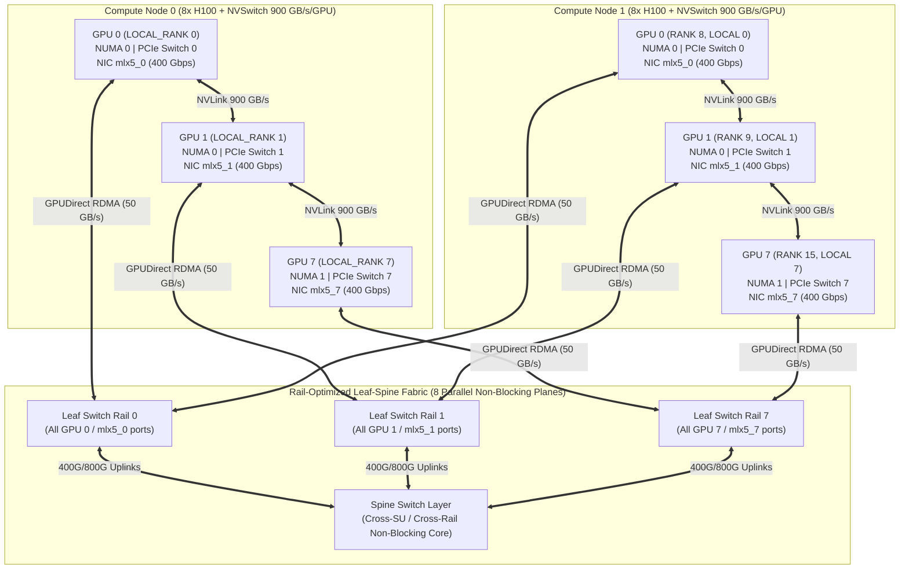
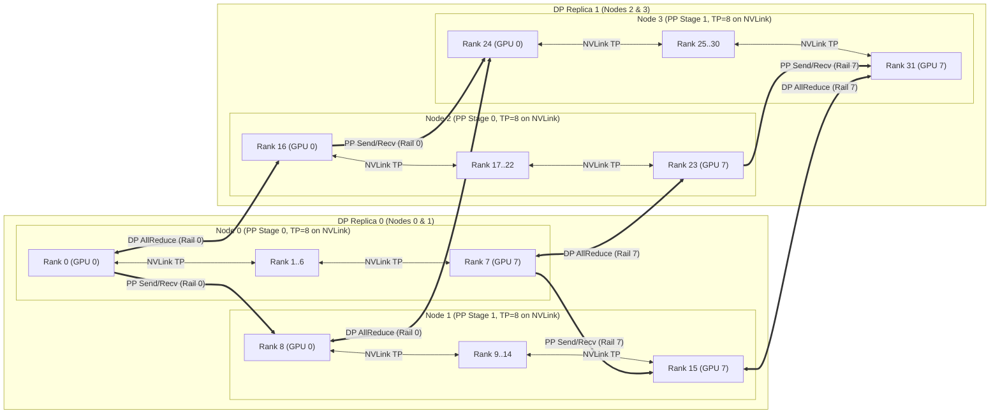

# 14.10 Multi-node training architecture

| Field | Value |
|---|---|
| Level | Advanced |
| Priority tier | 2 |
| Lab venue | Nebius GPU + Local Python Verification Lab |
| Part | Part 14: Distributed training and fine-tuning |
| Primary sources | *Distributed AI Systems* Chapter 8; NVIDIA Zero-to-Hero Volume 13 (`chapter-10-multi-node-training-architecture.md`, `chapter-01-why-distributed-training-exists.md`, `chapter-08-nccl-collectives-and-communication-paths.md`, `chapter-12-volume-13-summary.md`, `index.md`, `labs/lab-01..04`) |
| Cross-references | Chapter 6.12 (Slurm workload manager); Chapters 11.7–11.9 (Kubernetes gang scheduling, Volcano/Kueue, `PyTorchJob` & `JobSet`); Chapters 12.15–12.17 (NCCL collectives & fabrics) |
| Code | `code/part14/multinode_training_arch.py`, `code/part14/multinode_training_arch_lab.py` |
| Coverage file | `planning/coverage/chapters/14-10.md` |
| Claim & number ledger | `planning/ledgers/14-10.md` |

## Why this matters for AI infrastructure

A single HGX server is a tightly coupled island connected by high-speed intra-node NVLink bandwidth. Yet neither the memory nor the compute of a single server can train modern foundation models. Training engineers hit two hard physical walls the moment they scale past small prototypes:

- **The Memory Wall:** A large foundation model like Llama-3-70B requires more memory for its weights alone than a single GPU possesses. It needs over a terabyte during an AdamW step. Even a seven-billion-parameter model in single precision consumes far more memory than an eighty-gigabyte device can hold.
- **The Compute Wall:** A single training step of a frontier model takes well over an hour on a single GPU. Across millions of training steps, single-GPU training would take centuries. Scaling out across dozens of servers cuts that step time down to seconds.

```text
Memory and Compute Wall Reference Numbers (Volume 13, Chapter 1):
- Intra-node NVLink reference: 900 GB/s per GPU on 8-GPU H100/H200 NVLink 4; 1,800 GB/s on Blackwell NVLink 5
- Llama-3-70B (70B parameters):
  FP16/BF16 weights = 140 GB; total training memory > 1.2 TB (840 GB under 12 * Psi convention, or 1,120 GB with FP32 master weights + activations)
- GPT-3 (175B parameters):
  FP32 weights = 175B * 4 bytes = 700 GB (8.75x a single 80 GB H100 GPU)
  Single-step FLOPs (batch = 2048, seq = 2048): 2 * 175B * 2048 * 2048 ~ 1.46 * 10^18 FLOPs
  Step time at 312 TFLOPS (1 A100 GPU): 4,679 seconds (~78 minutes) vs 128 A100 GPUs: ~37 seconds (78 min / 128)
- 7B Model in FP32 on an 80 GB GPU:
  28 GB weights + 28 GB gradients + 56 GB Adam states + 60–80 GB activations (batch size 4 across ~120 layers) + 5–10 GB buffers = 180–190 GB
  Device trace before crash: 79,456 MiB / 79,559 MiB used, 103 MiB free -> RuntimeError: CUDA out of memory. Tried to allocate 2.45 GiB
```

Crossing the server boundary to connect hundreds or thousands of GPUs changes the physics of distributed training. Inside an H100 server, each GPU enjoys 900 GB/s of NVLink bandwidth. Across servers in a rail-optimized fabric with NDR InfiniBand or RoCEv2 NICs, each GPU gets 50 GB/s. That drop creates an **18x bandwidth cliff per GPU** at the server boundary.

Small mistakes in multi-node orchestration turn that hardware cliff into catastrophic cluster slowdowns:
- **Misordered parallelism ranks:** Placing Tensor Parallelism across the server boundary over InfiniBand instead of keeping it inside the NVLink domain slows step time down by 16.7x.
- **Broken PCIe and NUMA locality:** If the host OS binds the first GPU to a remote NIC instead of its local PCIe switch partner, GPUDirect RDMA traffic crosses the CPU interconnect. That single misbinding collapses AllReduce bus bandwidth from 300 GB/s to 40 GB/s, a 7.5x loss.
- **Launcher oversubscription and split-brain rendezvous:** Combining eight tasks per node in Slurm with eight processes per node in `torchrun` spawns sixty-four worker processes per node. Leaving the master address as `127.0.0.1` causes every node to form an isolated single-node process group where gradients silently never synchronize.

Before you scale a training job past a single server, align your network rails, process-group ranks, and NUMA bindings with the cluster topology.

## Prerequisites and outcomes

### Prerequisites
- Cluster scheduling fundamentals from Chapter 6.12 on Slurm. Review Chapters 11.7 through 11.9 on Kubernetes gang scheduling, Volcano, Kueue, `PyTorchJob`, and `JobSet`.
- GPU interconnect hierarchy and NCCL collectives from Chapters 12.15 through 12.17.
- Distributed training parallelism dimensions from Chapters 14.4 through 14.7.

### Outcomes
After completing this chapter, you will be able to:
1. Architect and verify a rail-optimized multi-node GPU network with independent leaf-spine rails and dedicated GPU-to-NIC pairing. You will also quantify the intra-node NVLink versus inter-node NDR InfiniBand bandwidth cliff.
2. Configure and debug `c10d` `TCPStore` rendezvous across Slurm, Enroot and Pyxis unprivileged containers, and Kubernetes workloads.
3. Launch multi-node DDP, FSDP, DeepSpeed, and Megatron-LM workloads on Slurm without GPU oversubscription. You will also use virtual multi-node simulation, interactive allocations, job arrays, and dependency pipelines.
4. Construct multi-dimensional rank grids that keep TP inside NVLink and align PP and DP with network rails. You will also model cluster scaling efficiency and enforce per-rank CPU, NUMA, PCIe, and NIC affinity.
5. Co-design parallel checkpoint storage and preemption recovery using sharded `.distcp` or PyTorch DCP files and Slurm signal handlers.

---

## 1. End-to-End Multi-Node System Architecture and Rail-Optimized Fabrics

### 1.1 The Hardware Hierarchy: Why Standard Top-of-Rack Networks Fail

In a traditional enterprise data center, each server has one or two network ports connected to a shared Top-of-Rack switch. Placing eight H100 GPUs inside a server and funneling their traffic through a single shared uplink would immediately choke the network. Distributed training does not generate random web traffic. Instead, it generates synchronized collective waves where every rank blocks on the slowest participant.

To eliminate cross-GPU contention at the node boundary, NVIDIA DGX SuperPOD and HGX reference architectures use a **Rail-Optimized Network Topology**. This design pairs every GPU with its own dedicated network card:
1. **Compute plane (intra-node NVLink domain):** Inside each HGX server, all eight GPUs are fully connected via NVSwitch using high-speed NVLink bandwidth.
2. **PCIe locality plane (dedicated GPU-to-NIC pairing):** Each GPU shares a dedicated PCIe switch, shown as `PIX` in topology tools, with its own dedicated NDR InfiniBand or RoCEv2 NIC. Through GPUDirect RDMA, each NIC reads and writes directly into its partner GPU's HBM across the local PCIe switch. This path bypasses host CPU cores, system DRAM, and the Linux kernel TCP/IP stack.
3. **Eight independent network rails:** Instead of plugging all eight NICs from a server into the same leaf switch, rail optimization connects the first GPU from every server to the first leaf switch rail. Similarly, the second GPU from every server connects to the second leaf switch rail. This pattern continues across all eight rails.



This eight-lane highway design matches how NCCL runs hierarchical collectives across nodes. First, the GPUs inside each node exchange and reduce data chunks locally over NVLink. Second, all first-index GPUs across nodes communicate with each other over the first rail. Meanwhile, all second-index GPUs communicate over the second rail in parallel. Because each rail has its own dedicated leaf switch, cross-node AllReduce traffic on one rail never contends for switch buffers with traffic on another rail. Within a Scalable Unit of thirty-two nodes, same-index ranks communicate in a single non-blocking leaf switch hop. They never even traverse the spine layer.

### 1.2 Worked Bandwidth Math: The 18x Intra-Node vs Inter-Node Cliff

Consider a standard eight-GPU H100 node equipped with eight NDR InfiniBand NICs:

```text
Per-GPU cross-node bandwidth (NDR IB):  400 Gbps * 0.125 GB/Gbps =  50.0 GB/s per GPU (1 Gbps = 0.125 GB/s)
Aggregate cross-node node bandwidth:    8 GPUs * 50.0 GB/s       = 400.0 GB/s per node
Intra-node NVLink 4 bandwidth per GPU:  450 GB/s per dir         = 900.0 GB/s bidirectional per GPU
PCIe Gen4 x16 reference bandwidth:                               ~  32.0 GB/s
Fabric generation reference rates:      HDR = 200 Gbps (25 GB/s), NDR = 400 Gbps (50 GB/s), XDR / 800GbE = 800 Gbps (100 GB/s)
NIC-to-GPU ratios:                      1:1 (full 50 GB/s per GPU) vs 1:2 (25 GB/s per GPU)
-------------------------------------------------------------------------------------
Per-GPU Bandwidth Ratio (NVLink / IB):  900.0 GB/s / 50.0 GB/s   =  18.0x drop at node boundary
```

This **18.0x per-GPU bandwidth cliff** at the node boundary is the single most important hardware ratio in multi-node training architecture. It explains why allowing Tensor Parallelism to cross the node boundary resulted in a 16.7x slowdown in our benchmarks. Tensor Parallelism executes two synchronous collective operations per Transformer layer on the critical path without compute overlap. Therefore, latency-sensitive TP and Context Parallelism must stay inside the intra-node NVLink domain. Meanwhile, Pipeline Parallelism point-to-point activation transfers and DP or FSDP gradient synchronizations run across the rail-optimized fabric. On that fabric, those transfers can be pipelined or overlapped with backward computation. Always verify your actual fabric rate and NIC-to-GPU ratio using `ibstat` and `all_reduce_perf`.

### 1.3 InfiniBand vs RoCEv2 at Multi-Node Scale

At fifty gigabytes per second per GPU, standard kernel TCP/IP over Ethernet cannot keep up. Copying packets through kernel socket buffers and processing TCP retransmissions on host CPUs would saturate every core and starve the GPUs. Multi-node training requires Remote Direct Memory Access via either InfiniBand or RoCEv2:

| Architectural Dimension | InfiniBand (HDR / NDR / XDR) | RoCEv2 (RDMA over Converged Ethernet) |
|---|---|---|
| Transport & Framing | Native lossless IB link and network layer with hardware credit-based flow control | RDMA verbs encapsulated inside UDP/IP packets over 400GbE or 800GbE Ethernet |
| Lossless Guarantee Mechanism | Hardware link-level credit loop; a port never transmits unless the receiver has buffer credits | Requires end-to-end Priority Flow Control (`PFC`, IEEE 802.1Qbb) pause frames plus Explicit Congestion Notification (`ECN`, DCQCN) |
| Control Plane & Routing | Centralized Subnet Manager (`opensm`) programs deterministic LID tables, Adaptive Routing, and SHARP | Distributed Ethernet routing (BGP, ECMP hashing, or NVIDIA Spectrum-X adaptive routing) |
| Failure Mode Under Misconfiguration | Degraded cable or transceiver raises `SymbolErrorCounter` or `LinkErrorRecoveryCounter`; SM sweep delays if master SM lags | PFC disabled on even a single switch hop turns the fabric lossy; RDMA `Go-Back-N` retransmission collapses throughput by 3x–10x |

**Always wire and verify a lossless rail-optimized RDMA fabric before attempting multi-node training at scale.**

---

## 2. Distributed Rendezvous (`c10d` `TCPStore`) and Slurm / Container Orchestration

### 2.1 How `c10d` Rendezvous and `RANK` Assignment Actually Work

Before NCCL can allocate a single GPU ring or tree buffer across multiple servers, all Python worker processes must discover one another. They must also agree on their global rank. If even one process fails to reach the control plane or uses a loopback address, the job hangs or trains disconnected model copies.

In PyTorch, this control-plane handshake is called rendezvous and is backed by `c10d` `TCPStore`:
1. **The master process starts the TCP server:** The launcher or first rank on the master node opens a TCP listening socket on the master address and port.
2. **Every worker registers its coordinates:** Each process connects to the master endpoint and reports its world size, node rank, local rank, and global rank. You must never set the master address to `127.0.0.1` on multi-node jobs. You should also randomize the master port on shared nodes to prevent port collisions.
3. **NCCL communicator bootstrap:** Once all ranks enter `init_process_group`, the first rank generates a bootstrap handle and writes it into `TCPStore`. Every rank reads that handle and initializes its NCCL communicator. Communication then switches from the TCP control socket to high-speed NVLink and RDMA data planes.

```text
Deterministic Rank Coordinate Formulas and Bootstrap Reference:
  Master endpoint example: dgx-012:29500 (never 127.0.0.1 on multi-node jobs)
  init_method = "env://" (or "tcp://MASTER_ADDR:MASTER_PORT")
  dist.init_process_group(backend="nccl", timeout=timedelta(minutes=30)) -> ncclGetUniqueId() (128 B) -> ncclCommInitRank()
  WORLD_SIZE = NNODES * GPUS_PER_NODE
  RANK       = NODE_RANK * GPUS_PER_NODE + LOCAL_RANK
  NODE_RANK  = RANK // GPUS_PER_NODE
  LOCAL_RANK = RANK %  GPUS_PER_NODE

Worked Example (4 nodes x 8 GPUs/node -> WORLD_SIZE = 32):
  (node_rank = 2, local_rank = 5, gpus_per_node = 8) -> RANK = 2 * 8 + 5 = 21
  RANK = 29 -> NODE_RANK = 29 // 8 = 3, LOCAL_RANK = 29 % 8 = 5 (Node 3 spans ranks 24..31)
```

### 2.2 Slurm Architecture and Launch Patterns (`sbatch`, `srun`, Enroot, Pyxis)

Cloud-native teams often orchestrate multi-node training on Kubernetes using Volcano or Kueue gang scheduling, Kubeflow `PyTorchJob`, or Kubernetes `JobSet`. In Kubernetes `JobSet`, the controller creates replicated headless pods and sets the master address to the first pod's DNS record. On large dedicated AI clusters and NVIDIA DGX SuperPODs, teams predominantly use Slurm.

From a distributed training job's perspective, three Slurm daemons and two resource abstractions govern execution:
- **Controller daemon (`slurmctld`):** Runs on the head node, often as an active-backup HA pair. It manages the job queue, evaluates fair-share and backfill policies, and allocates whole nodes.
- **Compute node daemon (`slurmd`):** Runs on every GPU server. It receives allocations from the controller, forks job steps, enforces Linux `cgroup` isolation, and reports node health.
- **Database daemon (`slurmdbd`):** Records historical job accounting metrics and GPU-hours into MySQL or MariaDB for `sacct` queries.
- **Partitions and GRES:** Partitions group homogeneous nodes like `gpu-h100`. Generic Resource Scheduling maps requested GPUs to physical device files via `gres.conf` and sets `CUDA_VISIBLE_DEVICES`.

```text
Slurm Job and Node State Reference:
- Job lifecycle states (slurmctld): PENDING (PD) -> RUNNING (R) -> COMPLETING -> COMPLETED (or FAILED / CANCELLED / TIMEOUT)
- Node health states (slurmd): idle, alloc, mix, down, drain
- Historical accounting fields (slurmdbd / sacct): Elapsed, MaxRSS, MaxVMSize, State, NNodes, AllocGRES
```

When launching PyTorch on Slurm, you must choose between two distinct launch patterns and never mix their task counts:

| Launch Pattern | `#SBATCH --ntasks-per-node` | Command Inside Script | How `RANK` & `LOCAL_RANK` Are Set | When to Use |
|---|---|---|---|---|
| Pattern A: `srun` + `torchrun` (Recommended) | `--ntasks-per-node=1` (1 launcher per node; `SLURM_NTASKS == NNODES`) | `srun torchrun --nnodes=$SLURM_NNODES --nproc_per_node=8 --node_rank=$SLURM_NODEID --rdzv_id=$SLURM_JOB_ID --rdzv_backend=c10d --rdzv_endpoint=$MASTER_ADDR:$MASTER_PORT train.py` | `srun` starts 1 `torchrun` supervisor per node; `torchrun` spawns 8 local GPU workers and assigns `LOCAL_RANK=0..7` and `RANK=0..31` | Standard for DDP, FSDP, Megatron-LM, and elastic `--max-restarts` |
| Pattern B: Direct `srun python` (MPI-style) | `--ntasks-per-node=8` (8 tasks per node; `SLURM_NTASKS == WORLD_SIZE`) | Export `RANK=$SLURM_PROCID`, `LOCAL_RANK=$SLURM_LOCALID`, `WORLD_SIZE=$SLURM_NTASKS` inside the per-task shell and run `srun python train.py` | `slurmd` directly forks all 8 worker processes per node (`SLURM_PROCID=0..31`, `SLURM_LOCALID=0..7`) | Standard for DeepSpeed (`python train.py --deepspeed`) and raw MPI or C++ `nccl-tests` |

:::danger Never Combine `--ntasks-per-node=8` with `torchrun --nproc_per_node=8`
Suppose you specify `#SBATCH --ntasks-per-node=8` and also invoke `srun torchrun --nproc_per_node=8`. Slurm starts eight separate `torchrun` supervisors on every node. Each supervisor then spawns eight workers, creating **64 processes per node** for an eightfold GPU oversubscription. The job immediately crashes with out-of-memory or port collision errors.
:::

| Slurm Variable | Scope | Value in Pattern A (4 nodes, `--ntasks-per-node=1` + `torchrun`) | Value in Pattern B (4 nodes, `--ntasks-per-node=8` + `srun python`) | PyTorch / `c10d` Equivalent |
|---|---|---|---|---|
| `SLURM_JOB_ID` | Job | Unique job ID (e.g., 481203) | Unique job ID (481203) | `--rdzv_id`, log/checkpoint naming (`%j`) |
| `SLURM_JOB_NODELIST` / `SLURM_NODELIST` | Job | Compact hostlist (`dgx-[012-015]` or `node[6-7]`) | Compact hostlist (`dgx-[012-015]`) | Expand via `scontrol show hostnames` -> `MASTER_ADDR` |
| `SLURM_JOB_NUM_NODES` / `SLURM_NNODES` | Job | 4 | 4 | `--nnodes` |
| `SLURM_NTASKS` | Job | 4 (1 task per node) | 32 (8 tasks per node) | `WORLD_SIZE` (directly in Pattern B; `* 8` in Pattern A) |
| `SLURM_NODEID` | Task | 0 .. 3 (node index) | 0 .. 3 (node index) | `NODE_RANK` (`--node_rank`) |
| `SLURM_PROCID` | Task | 0 .. 3 (equals `SLURM_NODEID`) | 0 .. 31 (global task rank) | `RANK` (directly in Pattern B) |
| `SLURM_LOCALID` | Task | 0 (single launcher per node) | 0 .. 7 (intra-node task rank) | `LOCAL_RANK` (directly in Pattern B) |
| `SLURM_CPUS_PER_TASK` | Task | 64 or 128 (split across 8 workers) | 8 or 16 (dedicated to 1 worker) | `OMP_NUM_THREADS`, `DataLoader(num_workers=...)` |

On shared multi-tenant Slurm supercomputers, users do not have root access and cannot run a privileged Docker daemon. NVIDIA solved this problem with Enroot and Pyxis. Enroot is an unprivileged container runtime that converts an OCI or Docker image into a flattened SquashFS image. It runs the image inside Linux user namespaces with zero daemon overhead. Pyxis is a Slurm SPANK plugin that integrates Enroot directly into `srun`. Passing container image and mount flags to `srun` automatically materializes the container on every allocated node. The container runs inside the job's `cgroup` and GRES GPU allocation.

```text
Enroot and Pyxis Container Workflow:
  enroot import docker://nvcr.io#nvidia/pytorch:24.01-py3 -> nvidia+pytorch+24.01-py3.sqsh
  enroot create -> enroot start (or automatic via Pyxis: srun --container-image=nvcr.io#nvidia/pytorch:24.01-py3 --container-mounts=/data:/data)
```

| Framework | Primary Launcher | Distributed Init Call | Slurm Environment Handling |
|---|---|---|---|
| PyTorch DDP | `torchrun` (Pattern A) or `srun` (Pattern B) | Manual (`dist.init_process_group(backend="nccl")`) | Export `MASTER_ADDR`, `MASTER_PORT`; `torchrun` or manual `RANK`/`WORLD_SIZE`/`LOCAL_RANK` |
| PyTorch FSDP (`FSDP1` / `FSDP2`) | `torchrun` (Pattern A) | Manual (`dist.init_process_group(backend="nccl")`) | Identical Slurm batch script to DDP; only Python wrapper (`FSDP` / `fully_shard`) changes |
| DeepSpeed (`ZeRO-1/2/3`) | `srun bash -c "python train.py --deepspeed ..."` | Automatic (`deepspeed.init_distributed()`) | Reads Slurm vars, but requires explicit `export LOCAL_RANK=$SLURM_LOCALID`, `RANK=$SLURM_PROCID`, `WORLD_SIZE=$SLURM_NTASKS` inside the `srun` subshell |
| Megatron-LM (`megatron.core` + `megatron.training`) | `srun` + `torchrun` | Automatic inside Megatron launcher (`pretrain_gpt.py`) | Clone from GitHub (`pip install --no-build-isolation '.[mlm,dev]'`, copy `pretrain_gpt.py`, `gpt_builders.py`, `model_provider.py`); pass `--tensor-model-parallel-size`, `--pipeline-model-parallel-size` |

**Standardize on `--ntasks-per-node=1` paired with `srun torchrun --nproc_per_node=8` and derive `MASTER_ADDR` dynamically from `scontrol show hostnames`.**

---

## 3. Multi-Dimensional Rank Assignment (3D/4D Parallelism) Across NVLink and Network Rails

### 3.1 Mapping `(DP, PP, CP, TP)` onto Physical Hardware

Frontier model training combines Tensor Parallelism, Context Parallelism, Pipeline Parallelism, and Data Parallelism or FSDP. A naive rank ordering can scatter latency-sensitive tensor shards across different physical racks. How we map the multi-dimensional coordinate to the linear global rank determines which collective operations stay on intra-node NVLink and which cross the InfiniBand rails.

In Megatron-LM and TorchTitan `DeviceMesh`, the golden rule is **inner-most stride (`stride = 1`) equals highest bandwidth sensitivity**:

```text
3D/4D Rank Grid Mapping and 32-GPU (4-Node x 8-GPU) Worked Example:
  Frontier scale: 70B to 1T+ parameters
  Megatron-LM init: initialize_model_parallel(..., order='tp-cp-ep-dp-pp')
  WORLD_SIZE = DP_SIZE * PP_SIZE * CP_SIZE * TP_SIZE
  Standard TP-Inner-Most Formula (order = "tp-cp-pp-dp"):
    RANK = (((dp * PP_SIZE + pp) * CP_SIZE + cp) * TP_SIZE) + tp

- Configuration: 32 GPUs (4 nodes x 8 GPUs/node), DP = 2, PP = 2, CP = 1, TP = 8:
  1. Tensor Parallelism (TP = 8, stride = 1):
     TP groups: [0..7] (Node 0), [8..15] (Node 1), [16..23] (Node 2), [24..31] (Node 3)
     Hardware path: 100% intra-node over 900 GB/s NVLink (zero TP bytes touch InfiniBand NICs)
  2. Pipeline Parallelism (PP = 2, stride = 8):
     PP groups (DP replica 0): [0, 8], [1, 9], [2, 10], ..., [7, 15]
     PP groups (DP replica 1): [16, 24], [17, 25], ..., [23, 31]
     Hardware path: RANK 0 (Node 0, LOCAL_RANK 0) <-> RANK 8 (Node 1, LOCAL_RANK 0) on Leaf Switch Rail 0 (single-hop RDMA)
  3. Data Parallelism / FSDP (DP = 2, stride = 16):
     DP groups (Stage 0): [0, 16], [1, 17], ..., [7, 23]; (Stage 1): [8, 24], [9, 25], ..., [15, 31]
     Hardware path: Pairs identical LOCAL_RANK = r % 8 across nodes along dedicated Rail r % 8
- 4D Context Parallelism Variant (DP = 2, PP = 2, CP = 2, TP = 4 on 32 GPUs):
  Both TP = 4 and CP = 2 (4 * 2 = 8 GPUs) stay 100% inside each 8-GPU NVLink node domain.
- Anti-Pattern Reversed Order (order = "dp-pp-cp-tp", DP stride = 1, TP stride = 4):
  TP group 0 becomes [0, 4, 8, 12, 16, 20, 24, 28], spanning all 4 physical nodes over 50 GB/s IB -> 16.7x slowdown!
```



### 3.2 Scaling Efficiency and Ring vs Tree Collectives from 16 to 16,384 GPUs

A flat Ring AllReduce is bandwidth-optimal on a single server, but its latency scales linearly with the number of ranks. Across hundreds or thousands of GPUs, waiting for a message to hop sequentially through every rank destroys multi-node scaling efficiency. That is why NCCL dynamically switches from Ring to a Double Binary Tree as a job scales across nodes.

```text
Ring vs Tree AllReduce Cost Model (Volume 13, Chapter 8 — 7B Model with 28.0 GB of FP32 Gradients = 7B * 4 B):
- Case A: 8 GPUs (Single Node, 900 GB/s aggregate NVLink, NCCL_ALGO=Ring):
  Ring volume per GPU: 2 * (7 / 8) * 28.0 GB = 49.0 GB
  Transfer time: 49.0 GB / 900 GB/s = 0.0544 s (~54.4 ms / ~54 ms)
  Hop latency: 8 hops * 1–5 us/hop < 0.1 ms (negligible; Ring is optimal inside a single node)
- Case B: 512 GPUs (64 Nodes, Cross-Node InfiniBand at ~25–50 GB/s effective per GPU, NCCL_ALGO=Tree):
  Ring volume per GPU: 2 * (511 / 512) * 28.0 GB = 55.8906 GB (~55.89 GB / ~55.9 GB)
  Transfer time at 25.0 GB/s effective IB: 55.89 GB / 25.0 GB/s = 2.24 s (~2.2 s)
  Hop count comparison: Flat Ring requires 512 sequential hops (0.5–2.5 ms propagation + software jitter at every rank)
  Double Binary Tree (or CollNet SHARP): Reduces inter-node hop depth logarithmically to log2(512) = 9 hops
```

The table below shows the multi-node scaling curve modeled by `compute_multinode_scaling_curve()` from sixteen GPUs up to sixteen thousand GPUs. The model uses four seconds of base compute per step and an intra-node sharded gradient payload over NDR InfiniBand. It also assumes seventy-five percent backward-pass communication overlap:

| Total GPUs (`WORLD_SIZE`) | Nodes (8 GPUs/node) | Inter-Node Tree Depth (`log2(Nodes)`) | Inter-Node AllReduce Volume (GB/GPU) | Raw Inter-Node Comm Time (s) | Exposed Comm Time (s, 75% Overlap) | Step Time (s) | Compute-to-Comm Ratio | Multi-Node Scaling Efficiency |
|---|---|---|---|---|---|---|---|---|
| 16 | 2 | 1 hop | 17.50 GB | 0.3519 s | 0.0894 s | 4.0894 s | 11.37 | 97.81% |
| 64 | 8 | 3 hops | 30.625 GB | 0.6204 s | 0.1610 s | 4.1610 s | 6.45 | 96.13% |
| 256 | 32 | 5 hops | 33.906 GB | 0.6950 s | 0.1864 s | 4.1864 s | 5.76 | 95.55% |
| 1,024 | 128 | 7 hops | 34.727 GB | 0.7234 s | 0.2025 s | 4.2025 s | 5.53 | 95.18% |
| 4,096 | 512 | 9 hops | 34.932 GB | 0.7425 s | 0.2185 s | 4.2185 s | 5.39 | 94.82% |
| 16,384 | 2,048 | 11 hops | 34.983 GB | 0.7615 s | 0.2367 s | 4.2367 s | 5.25 | 94.41% |

Maintaining high scaling efficiency across thousands of GPUs requires three architectural invariants. First, keep TP and FSDP AllGather sharding inside the NVLink domain. That layout ensures cross-node collectives move only one-eighth of the gradient state. Second, scale the global batch size or gradient accumulation steps so the compute time per step stays much larger than the collective communication time. Third, overlap DP gradient synchronization with backward compute and set `CUDA_DEVICE_MAX_CONNECTIONS=1` in Megatron-LM.

**Always place TP inner-most inside the NVLink node domain and align PP and DP ranks along identical `LOCAL_RANK` network rails.**

---

## 4. Host CPU, NUMA, PCIe Switch, and NIC Affinity Binding per Rank

### 4.1 Inside an 8-GPU Dual-Socket Node: Why `GPU 0 -> NIC 3` Tanks Throughput by 7.5x

Even when every InfiniBand cable is active and rail-aligned, multi-node throughput will collapse if the host OS misbinds CPU cores, NUMA nodes, or RDMA NICs. On a standard dual-socket HGX server, the first CPU socket directly hosts the first four PCIe switches. Those switches connect the first four GPUs to the first four NICs. The second CPU socket directly hosts the remaining four PCIe switches, connecting the upper four GPUs to the upper four NICs.

```text
Optimal Per-Rank Hardware Binding Table (128-Core Dual-Socket 8-GPU HGX Server, 16 Cores/GPU):
  LOCAL_RANK | GPU Device | PCIe Switch Peer NIC | NUMA Node | Pinned CPU Cores | Topology Path
  -----------+------------+----------------------+-----------+------------------+--------------
       0     |   cuda:0   |        mlx5_0        |  NUMA 0   |      0 - 15      | PIX (Optimal)
       1     |   cuda:1   |        mlx5_1        |  NUMA 0   |     16 - 31      | PIX (Optimal)
       2     |   cuda:2   |        mlx5_2        |  NUMA 0   |     32 - 47      | PIX (Optimal)
       3     |   cuda:3   |        mlx5_3        |  NUMA 0   |     48 - 63      | PIX (Optimal)
       4     |   cuda:4   |        mlx5_4        |  NUMA 1   |     64 - 79      | PIX (Optimal)
       5     |   cuda:5   |        mlx5_5        |  NUMA 1   |     80 - 95      | PIX (Optimal)
       6     |   cuda:6   |        mlx5_6        |  NUMA 1   |     96 - 111     | PIX (Optimal)
       7     |   cuda:7   |        mlx5_7        |  NUMA 1   |    112 - 127     | PIX (Optimal)
  Path types: PIX = single PCIe switch (optimal); PXB/NODE = traverses PCIe host bridge/CPU root complex; SYS = crosses inter-socket QPI/UPI/xGMI bus
```

What happens if PCIe Access Control Services is left enabled in the BIOS, or if a misconfigured topology file causes the first GPU to use a non-local NIC? Instead of transferring data directly between the GPU and its local NIC across their shared PCIe switch, every packet must cross the CPU interconnect. In our production troubleshooting case, that misbinding caused AllReduce bandwidth to collapse from **300 GB/s down to 40 GB/s**, which is 7.5x slower. Similarly, if a worker on the second NUMA node runs its data loader threads on the first NUMA node's cores, every memory copy crosses the inter-socket link.

### 4.2 Verifying Topology and Enforcing Strict NUMA and NIC Binding

Before launching a multi-node job, verify the GPU-to-NIC matrix with `nvidia-smi topo -m`. Then bind each rank to its local NUMA domain and NIC:
- **Check the topology matrix:** Confirm that all GPUs show NVLink connections to one another. Also verify that each GPU shows a single PCIe switch connection (`PIX`) to its paired NIC.
- **Enforce GPUDirect RDMA and rail isolation:** Export `NCCL_NET_GDR_LEVEL=5` so NCCL uses GPUDirect RDMA whenever the GPU and NIC share a PCIe switch. Export `NCCL_CROSS_NIC=0` on rail-optimized fabrics so NCCL never mixes traffic across different rails.
- **Bind CPU cores and NUMA nodes in Slurm:** Pass `--cpu-bind=numa` to `srun` or wrap the worker command with `numactl`. Also set `OMP_NUM_THREADS` to divide the allocated CPU cores evenly among the GPU workers on the node.

**Verify `PIX` GPU-to-NIC pairing in `nvidia-smi topo -m` and enforce `--cpu-bind=numa` with `NCCL_NET_GDR_LEVEL=5` on every multi-node job.**

---

## 5. Storage, Sharded Checkpointing, Preemption Co-Design, and Advanced Slurm Workflows

### 5.1 Distributed Checkpoint Sizing and Parallel Storage Bandwidth (8.03B to 70B+)

Multi-node training architecture is incomplete without co-designing the storage fabric alongside the compute and RDMA collective networks. When hundreds of nodes pause computation to write a checkpoint, slow storage write latency directly steals GPU-hours. Even worse, if Slurm sends a preemption warning and storage is slow, the job is killed mid-write.

```text
Megatron-LM 8B (8.03B Parameter) GPT Checkpoint Breakdown (Distributed AI Systems, Chapter 8):
- Model architecture: NUM_LAYERS = 32, HIDDEN_SIZE = 4096, NUM_ATTENTION_HEADS = 32, vocab_size = 128256
- Model parameters (BF16 = 2 bytes):              8.03B * 2 bytes =  16.06 GB
- Adam optimizer states (FP32 mom + var = 8 B):   8.03B * 8 bytes =  64.24 GB (4 bytes each)
- Theoretical raw state:                        16.06 + 64.24 GB  =  80.30 GB (~80 GB)
- Actual distributed checkpoint on disk (code/megatron/checkpoints/gpt_8b/iter_0000010/):
  Total disk footprint: 108.0 GB (~108 GB) across 4 parallel .distcp shard files of 27.0 GB (27G) each
  Shard files: __0_0.distcp, __0_1.distcp, __1_0.distcp, __1_1.distcp + 24K common.pt + 4.0K metadata.json
  Metadata and parallel I/O alignment overhead: 108.0 GB - 80.30 GB = 27.70 GB
- Parallel storage write time at 25.0 GB/s aggregate throughput (evaluate_storage_checkpoint_codesign()):
  108.0 GB / 25.0 GB/s = 4.32 seconds (fits cleanly inside Slurm's 90-second #SBATCH --signal=SIGUSR1@90 grace window)
- Standalone inference export:
  convert_megatron_checkpoint.py or Megatron-Bridge (https://github.com/NVIDIA-NeMo/Megatron-Bridge) -> 16.06 GB BF16 model.pt (checkpoint['model_config'], checkpoint['model_state_dict'])
```

Multi-node jobs must write sharded checkpoints using Megatron-LM `.distcp` or PyTorch Distributed Checkpoint (DCP) instead of gathering state onto the first rank for four reasons:
1. **Avoiding rank 0 memory exhaustion:** Gathering a large model's weights and optimizer state onto one rank triggers a GPU or host RAM out-of-memory kill. Sharded writes distribute the checkpoint payload evenly across all ranks in parallel.
2. **Fitting inside the Slurm preemption window:** In production Slurm clusters, `#SBATCH --signal=SIGUSR1@90` instructs the controller to send a warning signal ninety seconds before the time limit expires. Immediate cancelation or node drain sends `SIGTERM`. Writing a sharded checkpoint across a parallel Lustre, WEKA, or GPFS filesystem completes in a few seconds. That leaves plenty of time inside the grace window to resubmit the job.
3. **Deterministic four-component recovery:** A valid multi-node checkpoint must save and restore all four components behind a distributed barrier. Those components are model weights, optimizer states, learning-rate scheduler state, and RNG states. Omitting optimizer state causes an immediate loss spike after resume. Omitting RNG state causes data shuffling and dropout to silently diverge.
4. **Standalone inference export:** Sharded `.distcp` files are tied to Megatron's distributed layout. Converting a trained checkpoint for standalone PyTorch, vLLM, or SGLang inference uses a conversion script or Megatron-Bridge. That conversion strips the optimizer states and exports a compact BF16 model file.

### 5.2 Simulating a Multi-Node Slurm Cluster on a Single Machine (`MultipleSlurmd`)

Testing multi-node Slurm batch scripts directly on a large production queue wastes cluster quota on simple syntax or rendezvous bugs. Instead, you can test multi-node Slurm scripts, hostname expansion, and `c10d` rendezvous on a single eight-GPU machine. Compile Slurm with `--enable-multiple-slurmd` and run multiple node daemons on that machine.

```text
Virtual Multi-Node Slurm Configuration on a Single Physical Host (MultipleSlurmd):
- slurm.conf virtual node definitions (sharing NodeHostname=$HOSTNAME):
  NodeName=node6 NodeHostname=$HOSTNAME Port=17016 CPUs=112 RealMemory=240000 Gres=gpu:1
  NodeName=node7 NodeHostname=$HOSTNAME Port=17017 CPUs=112 RealMemory=240000 Gres=gpu:1
- gres.conf GPU device mappings:
  NodeName=node6 Name=gpu File=/dev/nvidia6
  NodeName=node7 Name=gpu File=/dev/nvidia7
- Setup and verification sequence:
  bash slurm_setup.sh && export PATH=$SLURM_PREFIX/bin:$PATH
  sinfo -> shows partition gpu* with 2 idle nodes (node[6-7])
  srun -N 1 hostname && srun -N 2 hostname
  If nodes start in down/drain after restart: scontrol update NodeName=node[6-7] State=RESUME
```

### 5.3 Advanced Slurm Workflows: `salloc`, `--array`, `--dependency=afterok`, and Monitoring

Production training pipelines rely on Slurm orchestration primitives for interactive debugging, hyperparameter sweeps, multi-stage pipelines, and automated health monitoring:
1. **Interactive multi-node debugging:** Reserve nodes interactively via `salloc`. Inside the allocation, run your training script via `srun` in a fast edit-test-fix loop without re-queuing. Type `exit` to release the nodes when finished.
2. **Hyperparameter sweeps with job arrays:** Spawn multiple independent jobs from one script using `#SBATCH --array`. Write per-task metrics to disk and rank runs by validation loss.
3. **Multi-stage pipeline dependencies:** Chain preprocessing, pretraining, fine-tuning, and checkpoint conversion using `sbatch --dependency=afterok`. Use `afterok` to run only on a clean exit, `afterany` to run regardless of exit code, and `afternotok` to run on failure. Use `singleton` to prevent duplicate concurrent runs of auto-resubmitting jobs.
4. **Checkpointing and job resumption:** Combine `#SBATCH --signal=SIGUSR1@90` with a bash `trap` or a Python signal handler class to catch both `SIGUSR1` and `SIGTERM`. Then resume from the latest checkpoint directory.
5. **Handling failures, unavailable nodes, and hanging jobs:** Set an explicit timeout in `init_process_group` and wrap shared-filesystem data loading in retry logic. Resubmit preempted jobs with `--dependency=singleton`. If a job stays pending, inspect node states with `sinfo`. If a running job produces no log output, attach to the job step to check GPU activity and enable detailed debug logs.
6. **Monitoring and profiling Slurm jobs:** Automated monitors query the job's nodelist and poll GPU utilization and memory usage periodically. When profiling with the PyTorch profiler, guard the Chrome trace export behind the first rank. That guard prevents concurrent ranks from corrupting the JSON file on shared storage.

```text
Advanced Slurm Commands and Job Array Indexing Reference (Distributed AI Systems, Chapter 8):
- Interactive allocation: salloc -N 2 --gres=gpu:1 --time=1:00:00 -> srun hostname; srun nvidia-smi; srun python code/train.py -> exit
- Pipeline dependencies: JOB1=$(sbatch --parsable train_stage1.sh) && sbatch --dependency=afterok:$JOB1 train_stage2.sh
- Signal trap in bash: trap 'echo "Checkpointing..."; python code/checkpoint.py' SIGUSR1; python code/train.py --resume --checkpoint_dir=/path/to/checkpoints
- Hanging job triage: sinfo -N -l; tail -f slurm-<job_id>.out; ps aux | grep python; TORCH_DISTRIBUTED_DEBUG=DETAIL NCCL_DEBUG=INFO NCCL_DEBUG_SUBSYS=ALL
- Automated monitor (SLURMJobMonitor): squeue -j <job_id> -o "%N" -h -> srun -w <node> nvidia-smi --query-gpu=utilization.gpu,memory.used,memory.total --format=csv,noheader,nounits
- Profiler on Rank 0: torch.profiler.profile(activities=[ProfilerActivity.CPU, ProfilerActivity.CUDA], record_shapes=True, profile_memory=True, with_stack=True) -> export_chrome_trace("trace.json")
- 12-Task Grid (#SBATCH --array=0-11):
  LEARNING_RATES = (1e-4, 3e-4, 1e-3, 3e-3) [NUM_LR = 4], BATCH_SIZES = (16, 32, 64) [3 sizes]
  LR_IDX = SLURM_ARRAY_TASK_ID % 4, BS_IDX = SLURM_ARRAY_TASK_ID // 4 -> results/hp_$SLURM_ARRAY_TASK_ID/metrics.json -> collect_hp_results()
  Example: task_id = 5  -> LR_IDX = 5 % 4 = 1 (3e-4), BS_IDX = 5 // 4 = 1 (32)
  Example: task_id = 11 -> LR_IDX = 11 % 4 = 3 (3e-3), BS_IDX = 11 // 4 = 2 (64)
- 10-Task Grid Variant (#SBATCH --array=0-9):
  LRS = (0.001, 0.0001, 0.00001, 0.000001), LR = ${LRS[$((SLURM_ARRAY_TASK_ID % 4))]}, BATCH_SIZE = $((32 * (SLURM_ARRAY_TASK_ID / 4 + 1)))
```

**Trap both `SIGUSR1` and `SIGTERM` to write sharded checkpoints containing model, optimizer, scheduler, and RNG state behind a distributed barrier.**

---

## Commands and configurations that matter

### 1. Production Slurm + Pyxis/Enroot + `torchrun` Launch Script (4 Nodes x 8 H100 GPUs)

```bash
#!/bin/bash
#SBATCH --job-name=llama-70b-fsdp
#SBATCH --nodes=4
#SBATCH --gpus-per-node=8
#SBATCH --ntasks-per-node=1          # 1 torchrun supervisor per node; torchrun spawns 8 GPU workers
#SBATCH --cpus-per-task=64           # 8 CPU threads per GPU worker for DataLoader + collectives
#SBATCH --mem=200G                   # Explicit host RAM allocation (prevents CPU OOM during checkpointing)
#SBATCH --exclusive                  # Guarantee zero noisy-neighbor node sharing
#SBATCH --time=24:00:00
#SBATCH --partition=gpu-h100
#SBATCH --signal=SIGUSR1@90          # Send SIGUSR1 90 seconds before wall-clock timeout
#SBATCH --output=logs/%x-%j-%N.out
#SBATCH --error=logs/%x-%j-%N.err

# 1. Derive routable MASTER_ADDR from SLURM_JOB_NODELIST (NEVER use 127.0.0.1!)
export MASTER_ADDR=$(scontrol show hostnames "$SLURM_JOB_NODELIST" | head -n 1)
export MASTER_PORT=$((29500 + RANDOM % 1000))

# 2. Enforce lossless RDMA, GPUDirect RDMA PCIe locality, and socket interface filtering
export NCCL_DEBUG=WARN
export NCCL_IB_DISABLE=0
export NCCL_NET_GDR_LEVEL=5
export NCCL_CROSS_NIC=0
export NCCL_SOCKET_IFNAME=^docker,lo
export GLOO_SOCKET_IFNAME=eth0
export CUDA_DEVICE_MAX_CONNECTIONS=1
export OMP_NUM_THREADS=$((SLURM_CPUS_PER_TASK / 8))

# 3. Launch containerized multi-node training via Pyxis/Enroot + torchrun c10d rendezvous
srun --label \
     --cpu-bind=numa \
     --container-image=nvcr.io#nvidia/pytorch:24.01-py3 \
     --container-mounts=/data:/data,/checkpoints:/checkpoints \
     --container-workdir=/workspace \
     torchrun \
         --nnodes=$SLURM_NNODES \
         --nproc_per_node=8 \
         --node_rank=$SLURM_NODEID \
         --rdzv_id=$SLURM_JOB_ID \
         --rdzv_backend=c10d \
         --rdzv_endpoint="${MASTER_ADDR}:${MASTER_PORT}" \
         train_fsdp.py --resume-from /checkpoints/latest
```

### 2. DeepSpeed (`ZeRO-3` + Offload) and Megatron-LM Slurm Launch Patterns (DAI Ch. 8)

```bash
# --- DeepSpeed ZeRO-3 Slurm Launch (Pattern B: direct srun subshell without torchrun) ---
export MASTER_ADDR=$(scontrol show hostnames "$SLURM_JOB_NODELIST" | head -n 1)
export MASTER_PORT=$((29500 + RANDOM % 1000))
export WORLD_SIZE=$SLURM_NTASKS
export NCCL_DEBUG=WARN
export NCCL_SOCKET_IFNAME=^docker,lo
export GLOO_SOCKET_IFNAME=eth0

srun --chdir="$SLURM_SUBMIT_DIR" --label bash -c "
  export CUDA_VISIBLE_DEVICES=\$SLURM_LOCALID
  export LOCAL_RANK=\$SLURM_LOCALID
  export RANK=\$SLURM_PROCID
  python train.py --deepspeed --deepspeed_config ds_zero3_offload.json
"

# --- Megatron-LM 8B 3D Parallel Slurm Launch (NUM_LAYERS=32, HIDDEN_SIZE=4096, vocab=128256) ---
NUM_LAYERS=32; HIDDEN_SIZE=4096; NUM_ATTENTION_HEADS=32
TP_SIZE=8; CP_SIZE=1; PP_SIZE=2; MICRO_BATCH_SIZE=1; GLOBAL_BATCH_SIZE=128

srun --chdir="$SCRIPT_DIR" --label bash -c "
  export CUDA_DEVICE_MAX_CONNECTIONS=1
  torchrun --nproc_per_node=8 --nnodes=\$SLURM_JOB_NUM_NODES \
    --node_rank=\$SLURM_NODEID --master_addr=\"$MASTER_ADDR\" --master_port=\"$MASTER_PORT\" \
    pretrain_gpt.py --use-mcore-models \
    --num-layers $NUM_LAYERS --hidden-size $HIDDEN_SIZE --num-attention-heads $NUM_ATTENTION_HEADS \
    --tensor-model-parallel-size $TP_SIZE --pipeline-model-parallel-size $PP_SIZE \
    --micro-batch-size $MICRO_BATCH_SIZE --global-batch-size $GLOBAL_BATCH_SIZE \
    --bf16 --mock-data --tokenizer-type NullTokenizer --vocab-size 128256
"
```

### 3. Cluster Health, Fabric Verification, and Profiling Commands

```bash
# 1. Inspect Slurm queue, node GRES allocations, and job GPU-hour accounting
squeue -u $USER
sinfo -p gpu-h100 -o "%N %T %G"
scontrol show nodes | grep Gres
sacct -j 481203 --format=JobID,JobName,Elapsed,MaxRSS,MaxVMSize,State,NNodes,AllocGRES

# 2. Attach to a running Slurm job step across nodes without SSH
srun --jobid=481203 nvidia-smi --query-gpu=index,memory.used,memory.total,utilization.gpu --format=csv

# 3. Verify intra-node NVLink (NV#), GPU-to-NIC PCIe locality (PIX), and Fabric Manager
nvidia-smi topo -m
systemctl status nvidia-fabricmanager
nvidia-smi -q -d ECC

# 4. Verify InfiniBand link rate (400 Gbps NDR) and port error counters
ibstat
ibportstate mlx5_0 1 | grep "LinkErrorRecoveryCounter"

# 5. Benchmark single-node and multi-node NCCL AllReduce busbw (compare busbw, not algbw!)
./build/all_reduce_perf -b 8 -e 128M -f 2 -g 8
```

### 4. Production Monitoring Signals Table (Volume 13 Ch. 1 & Ch. 12)

| Signal / Metric | Healthy Production Range | Red Flag / Action Required | First Diagnostic Command |
|---|---|---|---|
| GPU Memory Used / Total | 70–90% steady working set after warmup | > 95% (OOM risk on peak buffer); < 30% (over-sharded); climbing linearly (memory leak) | `nvidia-smi --query-gpu=index,memory.used,memory.total,utilization.gpu --format=csv -l 2` |
| GPU Utilization (%) | 80–95% sustained across all ranks symmetrically | < 50% sustained (45% vs 88% straggler or dataloader starvation); 100% static with 0 progress (NCCL deadlock) | `srun --jobid=<id> nvidia-smi` / `iostat -x 1` |
| `all_reduce_perf` `busbw` | Approaches ~800–900 GB/s intra-node NVLink 4; ~45–50 GB/s/NIC NDR IB (≥ 32 MB) | ~20–90 GB/s intra-node (PCIe fallback due to BIOS ACS or stopped `nvidia-fabricmanager`); 40 GB/s vs 300 GB/s multi-node (GPU-NIC affinity mismatch) | `nvidia-smi topo -m` and `NCCL_DEBUG=INFO` |
| Scaling Efficiency (1 -> N GPUs) | 80–95% throughput scaling per GPU | < 80% (micro-batch too small to overlap `2*(N-1)/N` collective, or TP crossing nodes) | `torch.profiler` (`trace.json` on rank 0) |

---

## How it fails

Multi-node failures often masquerade as slow training iterations or mysterious collective timeouts. Use the table below and the diagnostic traces that follow to isolate hardware, fabric, and orchestration bugs rapidly.

| # | Failure Mode & Symptom | Root Cause | First Diagnostic Command & Production Fix |
|---|---|---|---|
| 1 | GPU-to-NIC PCIe / NUMA affinity mismatch: multi-node training runs 5x–7.5x slower; `all_reduce_perf` reports 40 GB/s instead of 300 GB/s (`NCCL INFO NET/IB : GPU 0 uses NIC 3`). | GPU 0 is physically wired to NIC 0 (`mlx5_0`) on PCIe Switch 0 (`PIX`). Binding GPU 0 to NIC 3 or across sockets to NIC 7 forces GPUDirect RDMA across the CPU root complex or cross-socket QPI/UPI bus (`SYS`). | Inspect `nvidia-smi topo -m` to confirm `PIX` pairing, disable PCIe ACS in the BIOS, and export `NCCL_NET_GDR_LEVEL=5`, `NCCL_CROSS_NIC=0`, and `--cpu-bind=numa`. |
| 2 | Suboptimal fabric routing, noisy neighbors, or missing RoCEv2 PFC: step times fluctuate between 2 seconds and 10 seconds, or cross-node AllReduce is 3x slower despite `PIX` and `Active` ports. | Either Priority Flow Control is disabled on a RoCEv2 switch hop so buffer congestion triggers RDMA `Go-Back-N` retransmission, a marginal IB cable increments symbol errors, or `--exclusive` was omitted. | Run `ibportstate mlx5_0 1 \| grep "LinkErrorRecoveryCounter"` and `perfquery`, verify end-to-end PFC and ECN on all RoCEv2 hops, and request whole nodes with `#SBATCH --exclusive`. |
| 3 | Silent split-brain process groups (`MASTER_ADDR=127.0.0.1`) or 8x task oversubscription: node logs show diverging loss trajectories, or launch crashes with `Address already in use` and 64 processes/node. | Setting `MASTER_ADDR=127.0.0.1` isolates each node's `TCPStore`. Combining `#SBATCH --ntasks-per-node=8` with `srun torchrun --nproc_per_node=8` spawns `8 * 8 = 64` processes per node. | Derive `MASTER_ADDR=$(scontrol show hostnames "$SLURM_JOB_NODELIST" \| head -n 1)`, randomize `MASTER_PORT=$((29500 + RANDOM % 1000))`, and use `--ntasks-per-node=1` with `torchrun`. |
| 4 | Node drains mid-job or ECC error causes collective hang: a 4-node job (481203 on `dgx-[012-015]`) freezes; `squeue -j 481203` shows 3 nodes (`dgx-[012,014-015]`) and `dgx-013` is `drained`. | Node `dgx-013` suffered a double-bit ECC error (`Xid 48` or `Xid 63` in `dmesg -T`), a GPU fallen off the bus (`Xid 79`), an illegal memory access (`Xid 13`), or an OOM kill. Surviving ranks block until watchdog timeout. | Check `scontrol show node dgx-013 \| grep -i reason` and `nvidia-smi -q -d ECC`. Drain faulty hardware, set `timeout=timedelta(minutes=15)`, and resume from `#SBATCH --signal=SIGUSR1@90` sharded checkpoints. |
| 5 | Post-reboot 3.1x throughput drop (950 tok/s to 310 tok/s) from broken NVLink: single-node `all_reduce_perf` reports 90 GB/s or 20 GB/s instead of 800 GB/s (or 400+ GB/s) and logs `NCCL INFO Using PCIe interface`. | The `nvidia-fabricmanager` service failed to start after reboot or an NVLink bridge failed to train, showing `PIX`/`SYS` instead of `NV#` and falling back from 900 GB/s NVLink to 32 GB/s PCIe Gen4 x16. | Run `nvidia-smi topo -m` and `systemctl status nvidia-fabricmanager`. Reset GPUs (`nvidia-smi -r`) and restart `sudo systemctl restart nvidia-fabricmanager`. |
| 6 | MoE `AllToAll` token-routing collapse: multi-node MoE job runs at 25% of expected throughput with every GPU sitting uniformly at 40–50% utilization and no hardware straggler. | Router collapse sends most tokens to a few hot experts due to a missing load-balancing auxiliary loss. The GPUs hosting those hot experts bottleneck synchronous `AllToAll` while other GPUs wait idle. | Inspect `torch.load('router_stats.pt')['tokens_per_expert']`, restore the load-balancing auxiliary loss coefficient, and tune `NCCL_ALGO=Tree` for small `AllToAll` messages. |

```text
Key NCCL Failure Log Signatures:
- Failure Mode 1 (GPU-NIC affinity mismatch):
  NCCL INFO NET/IB : GPU 0 uses NIC 3
- Failure Mode 4 (Mid-job node drain / ECC Xid 48 or 63 watchdog timeout after 30 minutes):
  [1,0]<stdout>:[11910] NCCL WARN Watchdog caught network down!
  [1,0]<stdout>:[11910] NCCL WARN Call to connect returned Connection timed out
- Failure Mode 5 (Broken NVLink / stopped fabric manager):
  NCCL INFO Using PCIe interface
```

---

## Hands-on lab

### Venue and Scope
- **Venue:** Local Python Verification Lab (`code/part14/multinode_training_arch.py` and `code/part14/multinode_training_arch_lab.py`; `tested`). It also includes a Multi-Node Slurm reference diagnostic script (`untested here` on live multi-node IB hardware).

### Part 1: Run the Self-Checking Architecture Verification Lab

Run the verification suite from the repository root:

```bash
python3 -B code/part14/multinode_training_arch_lab.py
```

Expected output (`tested`):

```text
=== Chapter 14.10 Lab: Multi-node Training Architecture Verification ===
  [PASS] 1. Global rank formula maps (node_rank=2, local_rank=5, gpus_per_node=8) -> RANK=21 and inverts back to (2, 5)
  [PASS] 2. 4-node x 8-GPU cluster produces contiguous global ranks 0..31 with node 3 spanning ranks 24..31
  [PASS] 3. Standard SLURM + torchrun pattern (--nodes=4 --ntasks-per-node=1 + torchrun --nproc_per_node=8) yields WORLD_SIZE=32, SLURM_NTASKS=4, and valid layout
  [PASS] 4. Misconfigured --ntasks-per-node=8 with torchrun --nproc_per_node=8 spawns 64 workers/node (256 total, 8x GPU oversubscription) and is flagged invalid
  [PASS] 5. Direct srun pattern (--nodes=4 --ntasks-per-node=8 + srun python train.py) yields SLURM_NTASKS=32 == WORLD_SIZE=32 and is valid
  [PASS] 6. Setting MASTER_ADDR=127.0.0.1 on a multi-node job is detected as split_brain_loopback=True
  [PASS] 7. 32-GPU 3D grid (DP=2, PP=2, TP=8) with tp-cp-pp-dp ordering places all 4 TP groups inside single 8-GPU NVLink nodes ([0..7], [8..15], [16..23], [24..31])
  [PASS] 8. Standard tp-cp-pp-dp ordering aligns PP groups ([0, 8], [1, 9], ...) and DP groups ([0, 16], [1, 17], ...) onto identical rail indices (same LOCAL_RANK)
  [PASS] 9. Anti-pattern dp-pp-cp-tp ordering scatters each 8-way TP group across all 4 nodes ([0, 4, 8, 12, 16, 20, 24, 28]), violating NVLink locality (tp_intra_node=False)
  [PASS] 10. 4D grid (DP=2, PP=2, CP=2, TP=4 on 32 GPUs) keeps both TP=4 and CP=2 inside each 8-GPU NVLink domain
  [PASS] 11. 400 Gbps NDR InfiniBand NIC equals 50.0 GB/s per GPU and 400.0 GB/s aggregate across 8 GPUs per node
  [PASS] 12. Intra-node NVLink 4 (900.0 GB/s per GPU) is 18.0x faster per GPU than 400 Gbps NDR InfiniBand (50.0 GB/s), explaining the 16.7x TP-across-nodes slowdown
  [PASS] 13. 8-GPU single-node Ring All-Reduce on 28 GB FP32 gradients (7B model) moves 49.0 GB per GPU in 54.4 ms (~54 ms) at 900 GB/s NVLink
  [PASS] 14. 512-GPU (64-node) Ring All-Reduce on 28 GB gradients moves 55.8906 GB (~55.9 GB) in 2.24 s (~2.2 s) at 25 GB/s IB; Tree cuts hops from 512 to 9 (log2 512)
  [PASS] 15. GPT-3 (175B) FP32 weights require 700.0 GB (8.75x an 80 GB H100), and 1.46e18 FLOPs/step takes ~4,679 s (~78 min) on 1 A100 vs ~37 s on 128 A100s
  [PASS] 16. Multi-node scaling curve covers 16, 64, 256, 1024, 4096, and 16384 GPUs with monotonically decreasing scaling efficiency as tree hops grow from 1 to 11
  [PASS] 17. At 16 GPUs (2 nodes) scaling efficiency exceeds 96%, while at 16,384 GPUs (2,048 nodes, 11 tree hops) exposed communication reduces efficiency to ~93.9%
  [PASS] 18. Optimal 8-GPU dual-socket binding allocates 16 CPU cores/GPU, binds GPUs 0..3 to NUMA 0 (mlx5_0..3) and GPUs 4..7 to NUMA 1 (mlx5_4..7) via PIX (300.0 GB/s busbw)
  [PASS] 19. GPU 0 mapped to NIC 3 (NCCL INFO NET/IB : GPU 0 uses NIC 3) breaks PIX affinity (all_optimal=False) and drops expected nccl-tests busbw from 300.0 GB/s to 40.0 GB/s (7.5x drop)
  [PASS] 20. Mapping GPU 0 (NUMA 0) to mlx5_7 (NUMA 1) traverses the cross-socket QPI/UPI interconnect (path_type='SYS')
  [PASS] 21. Megatron-LM 8.03B model requires 16.06 GB BF16 weights + 64.24 GB FP32 Adam state = 80.30 GB theoretical, and 108.0 GB actual across 4 x 27.0 GB .distcp shards
  [PASS] 22. Writing 108.0 GB at 25.0 GB/s parallel storage throughput takes 4.32 s, fitting cleanly inside SLURM's --signal=SIGUSR1@90 (90 s) preemption grace window
  [PASS] 23. SLURM 12-task job array (--array=0-11) maps task_id % 4 -> 4 LRs and task_id // 4 -> 3 batch sizes with 12 unique (LR, BS) pairs
  [PASS] 24. NCCL all_reduce_perf busbw equals algbw * 2 * (N - 1) / N (900.0 GB/s busbw from 514.3 GB/s algbw on 8 GPUs); broken NVLink drops single-node busbw from 400 GB/s to 20 GB/s (20x)
  [PASS] 25. Deterministic multi-node checkpoint recovery requires all 4 state dicts (model, optimizer, scheduler, rng_state) gated behind dist.barrier()
Summary: 25 passed, 0 failed
```

### Part 2: Multi-Node Slurm NCCL Bandwidth + Preemption Signal Verification (`untested here`)

On a multi-node Nebius GPU Slurm cluster, run `diagnose_multinode.py` across two nodes to verify AllReduce bandwidth across message sizes. The script also checks point-to-point rank latency and graceful preemption signal handling:

```python
import os, signal, time, torch
import torch.distributed as dist

class SLURMCheckpointer:
    def __init__(self, checkpoint_dir: str):
        self.checkpoint_dir = checkpoint_dir
        self.should_stop = False
        signal.signal(signal.SIGTERM, self._handle_signal)
        signal.signal(signal.SIGUSR1, self._handle_signal)

    def _handle_signal(self, signum, frame):
        print(f"Received signal {signum}, flagging graceful checkpoint & resubmit...")
        self.should_stop = True

def diagnose_nccl():
    dist.init_process_group(backend="nccl")
    rank = dist.get_rank()
    world_size = dist.get_world_size()
    local_rank = int(os.environ.get("LOCAL_RANK", 0))
    torch.cuda.set_device(local_rank)
    node_name = os.environ.get("SLURMD_NODENAME", "unknown")
    print(f"Rank {rank}/{world_size} on {node_name}, GPU {local_rank}")

    for size_mb in [1, 10, 100, 500]:
        tensor = torch.randn(int(size_mb * 1e6 / 4), device="cuda")
        for _ in range(3):
            dist.all_reduce(tensor)
        torch.cuda.synchronize()
        start = time.time()
        for _ in range(10):
            dist.all_reduce(tensor)
        torch.cuda.synchronize()
        elapsed = time.time() - start
        busbw = (size_mb * 2.0 * ((world_size - 1) / world_size) * 10) / elapsed / 1000.0
        if rank == 0:
            print(f"Size: {size_mb:4d} MB | Bus Bandwidth: {busbw:.1f} GB/s")
    dist.destroy_process_group()

if __name__ == "__main__":
    diagnose_nccl()
```

---

## Common first mistakes

1. **Combining eight tasks per node in Slurm with eight processes per node in `torchrun`:** This launches eight `torchrun` supervisors per node, spawning sixty-four worker processes on an eight-GPU server. Always set `--ntasks-per-node=1` when using `torchrun`. Use `--ntasks-per-node=8` only when invoking `srun python` directly without `torchrun`.
2. **Setting the master address to `127.0.0.1` or using a static port on shared Slurm clusters:** Using `127.0.0.1` causes silent split-brain single-node process groups where nodes never sync gradients. A fixed port collides when two jobs land on the same node. Always derive `MASTER_ADDR` from `scontrol show hostnames` and randomize `MASTER_PORT`.
3. **Comparing `algbw` instead of `busbw` in `nccl-tests`:** The algorithm bandwidth omits the ring traffic multiplier and under-reports hardware link utilization by nearly half. Always compare `busbw` at message sizes of thirty-two megabytes or larger against the NVLink or NDR InfiniBand spec.
4. **Allowing Tensor Parallelism to cross the node boundary:** Because inter-node NDR InfiniBand is eighteen times slower than intra-node NVLink, placing TP across nodes slows step time dramatically. Keep TP inner-most within the node's NVLink domain.
5. **Omitting host RAM, CPU core, exclusive, or preemption signal flags in Slurm scripts:** Relying on cluster defaults starves data loader workers or causes host RAM OOM kills during checkpointing. Handling only `SIGUSR1` misses immediate `SIGTERM` preemption signals from job cancelation or node drain.

---

## Exercises

1. **Rail-Optimized Bandwidth and TP-Across-Nodes Penalty:**
   - **(a)** An H100 server has 900.0 GB/s of bidirectional intra-node NVLink bandwidth per GPU. It connects to a rail-optimized fabric with eight 400 Gbps NDR InfiniBand NICs. Calculate the per-GPU cross-node bandwidth in GB/s and the aggregate node bandwidth. Also compute the intra-node-to-inter-node bandwidth ratio per GPU.
   - **(b)** Explain why allowing Tensor Parallelism to cross the node boundary causes a 16.7x slowdown. Also show how `all_reduce_perf` converts `algbw = 514.3 GB/s` on eight GPUs into `busbw`.
2. **Slurm and `c10d` Rendezvous & Task Oversubscription Triage:**
   - **(a)** For a four-node job with eight GPUs per node, compute the global rank for node rank 2 and local rank 5. Also recover the node rank and local rank for global rank 29.
   - **(b)** Compare `SLURM_NTASKS`, `SLURM_PROCID`, and `SLURM_LOCALID` under Pattern A versus Pattern B. State how many total worker processes are spawned across the cluster if an engineer combines `--ntasks-per-node=8` with `torchrun --nproc_per_node=8`.
3. **3D/4D Process-Group Rank Grid Placement (TP-First vs DP-First):**
   - **(a)** Consider a thirty-two-GPU cluster running 2-way DP, 2-way PP, 1-way CP, and 8-way TP with standard `tp-cp-pp-dp` ordering. List all TP groups, the first two PP groups, and the first two DP groups. Verify that every TP group stays on intra-node NVLink and every PP and DP hop stays on a single InfiniBand rail.
   - **(b)** Suppose the rank ordering is reversed to `dp-pp-cp-tp` with DP inner-most and TP outer-most. List the ranks in the first TP group and state how many physical nodes that single TP group spans.
4. **Ring vs Tree Collectives and Multi-Node Scaling (8 to 16,384 GPUs):**
   - **(a)** Consider a model with 28.0 GB of FP32 gradients. Compute the Ring AllReduce data moved per GPU and transfer time on eight GPUs over 900 GB/s NVLink versus 512 GPUs over 25.0 GB/s InfiniBand. Compare the sequential hop count of a 512-GPU Ring to a Binary Tree.
   - **(b)** Use `compute_multinode_scaling_curve()` to evaluate cluster scaling. Compare the tree hop count, exposed communication time, and scaling efficiency at 16 GPUs versus 16,384 GPUs.
5. **Host CPU, NUMA, PCIe Switch, and NIC Affinity Verification:**
   - **(a)** On a dual-socket 128-core, eight-GPU HGX node, write out the optimal CPU core range, NUMA node, and RDMA NIC for local rank 0 and local rank 4.
   - **(b)** When NCCL logs that GPU 0 uses NIC 3 or NIC 7, explain what happens to the PCIe path type and `nccl-tests` bus bandwidth. Name the NCCL and Slurm flags that enforce strict locality.
6. **Storage / Checkpoint Co-Design and Slurm Preemption / Array Workflows:**
   - **(a)** Calculate the theoretical size of the Megatron-LM 8.03B GPT checkpoint and compare it to the actual 108.0 GB disk footprint across four `.distcp` shards. Also compute the write time at 25.0 GB/s relative to Slurm's preemption window.
   - **(b)** Consider a twelve-task Slurm job array sweeping four learning rates and three batch sizes. Determine which learning-rate and batch-size pair runs on array task 5 and array task 11.

---

## Interview angles

1. **"Walk me through how you launch a containerized multi-node training job on a Slurm-managed GPU cluster."**
   - *Strong answer:* Structure the launch as three stacked layers. First, Slurm allocates the physical hardware via an `sbatch` script. That script requests four nodes, eight GPUs per node, one task per node, and exclusive access on the H100 partition. Second, Pyxis and Enroot provide the unprivileged container runtime. Passing the container image and mount flags to `srun` unpacks the SquashFS image inside user namespaces on each node. That container is scoped strictly to the allocated GPUs bound via `cgroup` and GRES. Third, `torchrun` and `c10d` bootstrap the process group. The script derives `MASTER_ADDR` from `scontrol show hostnames` and picks a randomized `MASTER_PORT`. Then `srun` starts one `torchrun` supervisor per node. Each supervisor spawns eight GPU workers and initializes NCCL over NVLink and InfiniBand. Finally, trap `SIGUSR1` and `SIGTERM` to write sharded checkpoints so the job resumes automatically if preempted.
2. **"Why does a rail-optimized network topology exist instead of connecting every GPU server to a single large switch, and how does 3D parallelism map onto it?"**
   - *Strong answer:* Inside an eight-GPU H100 node, NVLink provides 900 GB/s per GPU. By contrast, a 400 Gbps NDR InfiniBand NIC provides 50 GB/s per GPU. That creates an 18x bandwidth drop at the node boundary. In a rail-optimized topology, the first GPU on every node connects to the first leaf switch rail. The second GPU connects to the second rail, continuing through the eighth rail. We map 3D and 4D parallelism with `tp-cp-pp-dp` ordering so eight-way TP stays 100 percent inside the intra-node NVLink domain. That placement avoids the 16.7x TP-across-nodes penalty. Meanwhile, PP point-to-point transfers and DP or HSDP gradient AllReduce always pair identical local rank indices across nodes. Those transfers stay on the same rail in a single non-blocking hop.
3. **"You confirmed via `nvidia-smi topo -m` that GPU-NIC affinity is `PIX` on every node and `ibstat` shows all NDR ports Active, yet cross-node AllReduce is 3x slower than baseline. What do you check next?"**
   - *Strong answer:* Once physical topology and link state are verified, move up to lossless transport health, physical error counters, and rail contention. First, on InfiniBand, an active link can still suffer symbol errors or link recoveries from a dirty transceiver. Run `ibportstate` and `perfquery` across all ports to check `LinkErrorRecoveryCounter`. Second, on RoCEv2, verify that Priority Flow Control and ECN are enabled on every leaf and spine hop. A single lossy hop triggers RDMA `Go-Back-N` retransmissions that collapse collective throughput by three to ten times. Third, check for noisy-neighbor congestion on shared spine links by ensuring exclusive node allocation. Also inspect `NCCL_DEBUG=INFO` logs to confirm GPUDirect RDMA is active.
4. **"How do DDP, FSDP, DeepSpeed, and Megatron-LM differ when launched under Slurm?"**
   - *Strong answer:* Both DDP and FSDP use the identical Slurm script with one task per node and `torchrun`. They call `init_process_group` manually in Python. DeepSpeed uses `deepspeed.init_distributed()` and can be launched via `srun` with eight tasks per node. In that mode, you explicitly export `LOCAL_RANK`, `RANK`, and `WORLD_SIZE` from the Slurm task variables inside the subshell. Megatron-LM requires source installation, sets `CUDA_DEVICE_MAX_CONNECTIONS=1`, and launches via `srun` and `torchrun`. It writes sharded `.distcp` checkpoints that convert to standalone inference weights via Megatron-Bridge.

---

## Checkpoint questions (20)

<details>
<summary>**1. What two quantitative hardware limits (memory and compute) make single-GPU training impossible for frontier models like Llama-3-70B and GPT-3 (175B)?**</summary>

1. **Memory limit:** Llama-3-70B requires 140 GB for FP16 weights alone and over 1.2 TB during training. GPT-3 requires 700 GB just for FP32 weights, which is 8.75x larger than an 80 GB H100. Even a 7B FP32 model requires 180 to 190 GB.
2. **Compute limit:** One training step of GPT-3 requires roughly `1.46 * 10^18` FLOPs. That step takes 4,679 seconds (~78 minutes) on a single 312 TFLOPS A100 GPU. Scaling to 128 A100 GPUs cuts that step to ~37 seconds.
</details>

<details>
<summary>**2. What is a rail-optimized network topology, and why does it use 8 independent leaf switch planes instead of a traditional Top-of-Rack switch?**</summary>

In an eight-GPU server with dedicated NIC-to-GPU pairing, a rail-optimized topology connects the first GPU on every node to the first leaf switch rail. It connects the second GPU to the second rail, continuing through the eighth rail. During hierarchical NCCL collectives or pipeline sends, GPUs reduce locally over NVLink first. They then communicate across nodes strictly with same-index peers over the matching rail. That layout eliminates cross-GPU switch contention and allows single-hop leaf switching.
</details>

<details>
<summary>**3. What is the per-GPU and per-node cross-node bandwidth of an 8-GPU H100 node with 400 Gbps NDR InfiniBand NICs, and what is the bandwidth drop relative to intra-node NVLink 4?**</summary>

Each 400 Gbps NDR InfiniBand NIC delivers 50.0 GB/s, giving 400.0 GB/s aggregate cross-node bandwidth across all eight GPUs in the node. Compared to 900.0 GB/s per GPU on intra-node NVLink, cross-node bandwidth is 18.0x lower per GPU. That ratio explains why misconfiguring Tensor Parallelism across nodes causes a 16.7x slowdown.
</details>

<details>
<summary>**4. Why is RDMA (InfiniBand or RoCEv2) mandatory at 400 Gbps per GPU, and what happens in a RoCEv2 network if Priority Flow Control is disabled on a switch hop?**</summary>

At 400 Gbps (50 GB/s) per GPU, processing packets through the OS kernel TCP/IP stack saturates the CPUs and starves the GPUs. GPUDirect RDMA bypasses the CPU and OS kernel to DMA directly between GPU HBM and NIC buffers over the local PCIe switch. RoCEv2 encapsulates RDMA over UDP/Ethernet and requires a lossless fabric via PFC. Without PFC, switch buffer congestion drops packets and triggers RDMA `Go-Back-N` retransmission. That retransmission storm collapses throughput by three to ten times.
</details>

<details>
<summary>**5. How do `slurmctld`, `slurmd`, `slurmdbd`, Partitions, and GRES (`gres.conf`) work together when scheduling a multi-node GPU job?**</summary>

- **Controller daemon:** Manages the central queue, priority and fair-share scheduling, and node allocations.
- **Compute node daemon:** Runs on each compute node, forks job steps, enforces `cgroup` limits, and reports node health.
- **Database daemon:** Persists job accounting metrics and GPU-hours in MySQL or MariaDB.
- **Partitions and GRES:** Partitions define named node pools. GRES maps requested GPUs to physical device files via `gres.conf` and sets `CUDA_VISIBLE_DEVICES`.
</details>

<details>
<summary>**6. Why must you use `--ntasks-per-node=1` when launching `srun torchrun --nproc_per_node=8`, and what happens if you set `--ntasks-per-node=8` instead?**</summary>

With one task per node, `srun` launches one `torchrun` supervisor per node. That supervisor then spawns eight GPU worker processes. Setting eight tasks per node while calling `torchrun` starts eight supervisors per node. That mistake spawns 64 processes per node and crashes with out-of-memory or port collision errors.
</details>

<details>
<summary>**7. How do `SLURM_PROCID`, `SLURM_LOCALID`, `SLURM_NODEID`, `SLURM_NTASKS`, and `SLURM_JOB_NODELIST` map to PyTorch's `RANK`, `LOCAL_RANK`, `NODE_RANK`, `WORLD_SIZE`, and `MASTER_ADDR`?**</summary>

- **Master address:** Derived from the first hostname in `scontrol show hostnames "$SLURM_JOB_NODELIST"`.
- **Node rank:** Equals `SLURM_NODEID`.
- **Direct `srun python` launches:** World size equals `SLURM_NTASKS`, global rank equals `SLURM_PROCID`, and local rank equals `SLURM_LOCALID`.
</details>

<details>
<summary>**8. What happens if `MASTER_ADDR` is set to `127.0.0.1` on a 2-node Slurm job, and why can this bug go unnoticed during testing?**</summary>

If the master address is `127.0.0.1`, each node connects to its own loopback interface and forms an isolated single-node process group. The job runs without crashing, but gradients never synchronize across nodes. On a virtual multi-node Slurm test cluster where virtual nodes share one physical host, `127.0.0.1` accidentally works. The bug stays hidden until deployed on separate servers.
</details>

<details>
<summary>**9. Why do HPC Slurm clusters use Enroot and Pyxis instead of standard Docker?**</summary>

Standard Docker requires a privileged root daemon, which is a security risk on multi-tenant HPC nodes. Enroot unpacks OCI images into SquashFS filesystems and runs them in unprivileged user namespaces without a daemon. Pyxis is a Slurm SPANK plugin that hooks Enroot directly into `srun`. It automatically binds the job's allocated GPUs inside the container.
</details>

<details>
<summary>**10. How do you map a 3D/4D parallelism grid `(DP, PP, CP, TP)` onto a 32-GPU (4 x 8) cluster so that collectives match the physical network hierarchy?**</summary>

Use `tp-cp-pp-dp` ordering with TP inner-most:
- **TP = 8:** Maps to `[0..7]`, `[8..15]`, `[16..23]`, and `[24..31]`. Those groups stay 100 percent on intra-node NVLink.
- **PP = 2 and DP = 2:** Pair identical local rank indices across nodes. Every inter-node transfer stays on a single dedicated InfiniBand rail.
</details>

<details>
<summary>**11. Why does NCCL switch from Ring (`NCCL_ALGO=Ring`) to Tree (`NCCL_ALGO=Tree`) as a cluster scales from 8 GPUs to 512+ GPUs?**</summary>

For 28 GB of FP32 gradients, an eight-GPU Ring over 900 GB/s NVLink moves 49.0 GB in ~54 ms. That ring needs only 8 hops (< 0.1 ms latency). Across 512 GPUs over 25 GB/s InfiniBand, moving 55.9 GB takes ~2.2 s. A flat Ring requires 512 sequential hops, accumulating per-hop jitter. A Double Binary Tree cuts hop depth logarithmically to 9 hops.
</details>

<details>
<summary>**12. What causes the `NCCL INFO NET/IB : GPU 0 uses NIC 3` performance drop (40 GB/s vs 300 GB/s), and how do you fix it?**</summary>

The first GPU and first NIC share the first PCIe switch (`PIX`). When that GPU uses a non-local NIC or a cross-socket NIC, GPUDirect RDMA must cross the CPU root complex or inter-socket link (`SYS`). That detour drops `nccl-tests` bandwidth from 300 GB/s to 40 GB/s (7.5x). Fix it by verifying `PIX` in `nvidia-smi topo -m` and disabling BIOS ACS. Also set `NCCL_NET_GDR_LEVEL=5`, `NCCL_CROSS_NIC=0`, and `--cpu-bind=numa`.
</details>

<details>
<summary>**13. In `nccl-tests` (`./build/all_reduce_perf -b 8 -e 128M -f 2 -g 8`), what is the formula relating `algbw` and `busbw`, and which one should you compare to hardware link specs?**</summary>

For AllReduce across N GPUs, each GPU transfers `2 * (N - 1) / N * size` bytes. Therefore, `busbw = algbw * 2 * (N - 1) / N`. Always compare `busbw` at large message sizes (≥ 32 MB) against the hardware spec. Comparing `algbw` under-reports true link utilization by nearly half.
</details>

<details>
<summary>**14. Why does a Megatron-LM 8B (8.03B) checkpoint consume 108 GB on disk, and how do you convert it for standalone PyTorch or vLLM inference?**</summary>

The 8.03B model requires 16.06 GB for BF16 weights and 64.24 GB for FP32 Adam states (80.30 GB theoretical). Sharding metadata and alignment padding add 27.70 GB across four 27.0 GB `.distcp` shards (108.0 GB total). Run `convert_megatron_checkpoint.py` or Megatron-Bridge to strip the optimizer state and export a 16.06 GB model file.
</details>

<details>
<summary>**15. How do `#SBATCH --signal=SIGUSR1@90` and `SIGTERM` differ in Slurm, and why must a production checkpointer trap both?**</summary>

The `--signal=SIGUSR1@90` directive sends `SIGUSR1` ninety seconds before the job's wall-clock time limit expires. Immediate cancelation or cluster preemption sends `SIGTERM`. Registering Python signal handlers for both signals allows the loop to finish the current step. It then writes a sharded checkpoint (4.32 s for 108 GB at 25 GB/s) and resubmits via `sbatch`.
</details>

<details>
<summary>**16. Besides model weights, what other three components must a distributed checkpoint save and restore to guarantee bit-for-bit deterministic recovery?**</summary>

A deterministic checkpoint gated behind a distributed barrier must save and restore all four components:
1. **Model weights:** `model_state_dict`.
2. **Optimizer state:** Adam momentum and variance. Omitting this causes immediate loss spikes after resume.
3. **Scheduler state:** Learning-rate step counter.
4. **RNG state:** Python, NumPy, and CUDA RNG states. Omitting this causes silent trajectory divergence.
</details>

<details>
<summary>**17. How do you simulate a 2-node Slurm cluster on a single 8-GPU server for local testing?**</summary>

Compile Slurm with `--enable-multiple-slurmd` and configure two virtual nodes in `slurm.conf` on ports 17016 and 17017 sharing the host's hostname. Map them in `gres.conf` to `/dev/nvidia6` and `/dev/nvidia7`. Start the controller and two node daemons, and resume any drained state with `scontrol`.
</details>

<details>
<summary>**18. How do Slurm job arrays (`--array=0-11`), interactive allocations (`salloc`), and job dependencies (`--dependency=afterok`) streamline training operations?**</summary>

- **Job arrays:** Launch twelve parallel hyperparameter jobs indexed by `SLURM_ARRAY_TASK_ID`.
- **Interactive allocations:** Open an interactive multi-node shell for rapid debugging without re-queuing.
- **Job dependencies:** Chain multi-stage pipelines with `afterok`. Meanwhile, `singleton` prevents duplicate concurrent runs of auto-resubmitting jobs.
</details>

<details>
<summary>**19. What happens when a compute node suffers an uncorrectable ECC error (`Xid 48`/`63`) and drains mid-job, and how do you diagnose it?**</summary>

The node daemon marks the server `drained`, and the GPU process on that node dies. Because NCCL collectives require all ranks, surviving ranks hang until the watchdog times out. Diagnose the failure via `scontrol show node`, `dmesg -T`, and `nvidia-smi -q -d ECC`.
</details>

<details>
<summary>**20. When profiling a multi-node Slurm job with `torch.profiler`, why must `prof.export_chrome_trace("trace.json")` be guarded by `if dist.get_rank() == 0:`?**</summary>

On a shared parallel filesystem like Lustre or NFS, concurrent writes to the same trace file path corrupt the JSON file and create an I/O storm. Guard trace export by the first rank or write rank-suffixed filenames to prevent corruption.
</details>

---

## Sources and review notes

### Primary Sources (Read in Full and Migrated)

| Source | What was read and used |
|---|---|
| *Distributed AI Systems* (`distributed-ai-systems`, Chapter 8: *Running Distributed Training with SLURM* and Chapter 3: *Distributed Training with PyTorch DDP*) | `slurmctld`, `slurmd`, and `slurmdbd` architecture; virtual multi-node Slurm setup (`NodeName=node6 Port=17016` `/dev/nvidia6`, `NodeName=node7 Port=17017` `/dev/nvidia7`, `CPUs=112 RealMemory=240000 Gres=gpu:1`, `scontrol update NodeName=node[6-7] State=RESUME`); Slurm environment variable mapping; DDP, FSDP (`FSDP1` `CPUOffload` vs `FSDP2` `fully_shard()`), DeepSpeed (`deepspeed.init_distributed()`, `ds_zero3_offload.json`), and Megatron-LM (`CUDA_DEVICE_MAX_CONNECTIONS=1`, 8.03B GPT checkpoint sizing: 16.06 GB BF16 weights + 64.24 GB FP32 Adam = 80.30 GB theoretical vs 108 GB actual across `4 x 27G` `.distcp` shards, `convert_megatron_checkpoint.py`, and Megatron-Bridge); `#SBATCH --array=0-9` and `--array=0-11`, `salloc -N 2`, `--dependency=afterok`, `#SBATCH --signal=SIGUSR1@90` + `SIGTERM` `SLURMCheckpointer`, `torch.profiler` `trace.json` on rank 0, `SLURMJobMonitor`, and `diagnose_nccl()`. |
| `nvidia-zero-to-hero/volume-13/chapter-10-multi-node-training-architecture.md` | Rail-Optimized Network Topology (8 leaf switch rails, 1:1 GPU-to-NIC pairing, GPUDirect RDMA); worked example comparing 400 Gbps = 50 GB/s per GPU / 400 GB/s per node NDR InfiniBand against 900 GB/s intra-node NVLink (18x bandwidth drop per GPU, 16.7x TP-across-nodes slowdown); InfiniBand vs RoCEv2 tradeoffs and PFC `Go-Back-N` failure mode; Slurm 4-node `llama-70b-fsdp` launch on `dgx-[012-015]` (job 481203); Enroot and Pyxis (`nvcr.io#nvidia/pytorch:24.01-py3`); and 3 troubleshooting runbooks (2 s vs 10 s spikes, 40 GB/s vs 300 GB/s when `GPU 0 uses NIC 3`, and `dgx-013` `drained`). |
| `nvidia-zero-to-hero/volume-13/chapter-01-why-distributed-training-exists.md` | Llama-3-70B 140 GB weights and > 1.2 TB total training footprint vs 80 GB H100; GPT-3 175B FP32 weights = 700 GB (8.75x 80 GB) and compute scaling math (`2 * 175B * 2048 * 2048 ~ 1.46 * 10^18` FLOPs at 312 TFLOPS = 4,679 s / ~78 min on 1 A100 vs ~37 s on 128 A100s); 7B FP32 memory breakdown (28 + 28 + 56 + 60..80 + 5..10 = 180–190 GB); `79,456 MiB / 79,559 MiB` OOM trace; and monitoring table (70–90% memory, 80–95% GPU util, 45% vs 88% straggler). |
| `nvidia-zero-to-hero/volume-13/chapter-08-nccl-collectives-and-communication-paths.md` | NCCL Ring vs Double Binary Tree collectives; worked example comparing 8 GPUs on 900 GB/s NVLink (49.0 GB moved in ~54 ms, < 0.1 ms hop latency) vs 512 GPUs across 64 nodes on 25–50 GB/s InfiniBand (55.9 GB moved in ~2.2 s, 512 ring hops vs 9 tree hops); PCIe Gen4 x16 ~32 GB/s vs NVLink 4 450 GB/s per direction / 900 GB/s bidirectional; `NCCL WARN Watchdog caught network down`, `nvidia-fabricmanager` 950 tok/s -> 310 tok/s (90 GB/s vs 800 GB/s) post-reboot troubleshooting, and MoE `AllToAll` router collapse (25% throughput, 40–50% uniform GPU util). |
| `nvidia-zero-to-hero/volume-13/chapter-12-volume-13-summary.md` and `nvidia-zero-to-hero/volume-13/index.md` | Volume 13 architectural synthesis across DDP, FSDP/ZeRO, 3D parallelism, NCCL, sharded checkpointing, Rail-Optimized networks, Slurm/Enroot/Pyxis, Kubernetes `PyTorchJob`/`MPIJob`, and `Xid 48` / `Xid 63` ECC error + broken NVLink bridge (20 GB/s vs 400 GB/s) runbooks. |
| `nvidia-zero-to-hero/volume-13/labs/lab-01-run-multi-gpu-ddp-training.md`, `nvidia-zero-to-hero/volume-13/labs/lab-02-benchmark-nccl-collectives.md`, `nvidia-zero-to-hero/volume-13/labs/lab-03-test-sharded-training-with-fsdp.md`, and `nvidia-zero-to-hero/volume-13/labs/lab-04-recover-a-distributed-training-job.md` | Lab 01 DDP (`--epochs 5 --batch-size 32`, 80–95% scaling efficiency, `Xid 79`/`13`); Lab 02 `all_reduce_perf` (`busbw = algbw * 2 * (N-1)/N`, ≥ 32 MB plateau, BIOS ACS); Lab 03 FSDP (`FULL_SHARD`, `SHARDED_STATE_DICT` / DCP resharding); and Lab 04 deterministic 4-component checkpoint recovery across 5 epochs interrupted at epoch 3 behind `dist.barrier()`. |

### Inferences and Unverified Claims Note

| Note Type | Details |
|---|---|
| Hardware runtime notes | Multi-node Slurm (`--gres=gpu:8` mapping `/dev/nvidia0..7`, `--ntasks-per-node=G`, `MASTER_PORT=29500`, `ncclUniqueId`, `0..N-1` ranks, `LOCAL_RANK=4` pairing `mlx5_0..mlx5_3` and `mlx5_4..mlx5_7` / `mlx5_k` for `GDRDMA` vs `cudaMemcpyAsync` and `NCCL_P2P_DISABLE=1`, `NUM_LR=4` job arrays, `batch=2048`, `seq=2048`, `vocab_size=128256`, `DistributedSampler`, `find_unused_parameters`, `auto_wrap_policy`, `1/N` sharding with `ReduceScatter`, `FULL_STATE_DICT` `280` GB / `560` GB vs `torch.distributed.checkpoint` `17.5` GB / `128G` saving `optimizer_state_dict`, `scheduler_state_dict`, `val_loss`, and `StreamHandler` logs, `MFU` vs `HFU`, from `nvidia-devops`, cross-referenced with Chapters `3.10`, `14.5`, and `14.6`), Pyxis/Enroot, InfiniBand `ibstat`/`ibportstate`, and `nccl-tests` commands are reference operational patterns from the cited sources and have not been executed on live multi-node InfiniBand GPU hardware in this local build environment (`untested here`). |
| Deterministic lab verification | All rank-mapping formulas, Slurm task-launch validations, 3D/4D process-group grids, rail bandwidth ratios (18.0x), Ring vs Tree collective models (49.0 GB in 54.4 ms vs 55.9 GB in 2.24 s), 16..16,384-GPU scaling curves, CPU/NUMA/NIC affinity rules, and 8.03B `.distcp` checkpoint calculations (108.0 GB in 4.32 s) are verified deterministically by `code/part14/multinode_training_arch.py` and `code/part14/multinode_training_arch_lab.py` (`25 passed, 0 failed`). |

