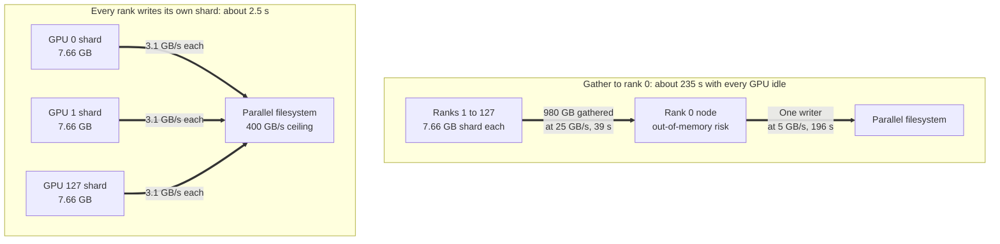
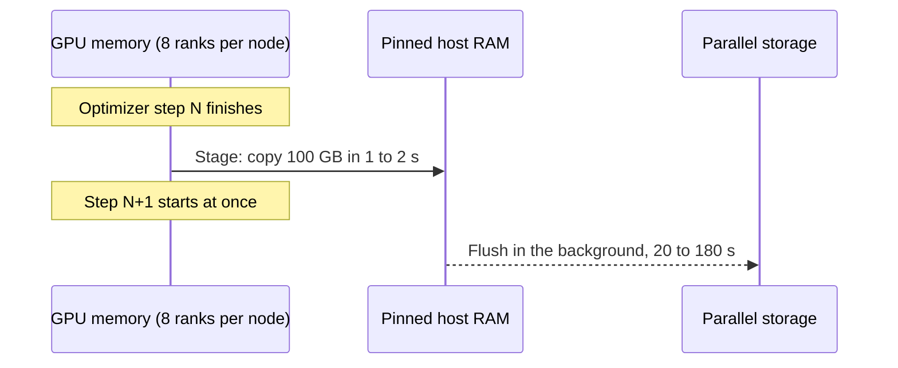
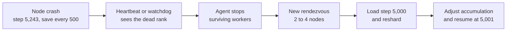

# 14.11 Checkpointing, fault tolerance and elastic training

| Field | Value |
|---|---|
| Level | Advanced |
| Priority tier | 2 |
| Lab venue | Nebius GPU + Local Python Verification Lab |
| Part | Part 14: Distributed training and fine-tuning |
| Cross-references | Chapter 6.12 (Slurm workload manager); Chapter 12.17 (`nccl-tests` and fabric benchmarking); Chapters 14.4–14.7 (DDP, FSDP, ZeRO, Megatron-LM); Chapter 14.10 (Multi-node training architecture) |
| Code | `code/part14/checkpoint_fault_tolerance.py`, `code/part14/checkpoint_fault_tolerance_lab.py` |
| Coverage file | `planning/coverage/chapters/14-11.md` |
| Claim & number ledger | `planning/ledgers/14-11.md` |

## Why this matters for AI infrastructure

A pretraining run is on day nineteen of thirty when a power supply trips on one node. The job stops. If the last saved checkpoint is from this morning, you lose a few hours of work. If the last good save is from three days ago, you lose three days on every GPU in the job. Checkpointing is how you decide which of those two outcomes you get.

Think of saving a long video game. You save often enough that a power cut costs little, but not so often that you spend your evenings watching the save screen. In training, the save screen is real: while a synchronous checkpoint writes, every GPU sits idle.

At scale the failures are certain, not unlucky. Suppose each GPU has a 99.9 percent chance of surviving a day. A job on 1,024 GPUs then has about a 36 percent chance of getting through one day without a single failure. This reliability figure is an assumption for the arithmetic. Real fleets also lose hosts, network cards, cables and switches, so observed failure rates are usually worse.

Three problems make checkpointing at this scale an engineering task.

- **Size.** A 70-billion-parameter model has a checkpoint close to one terabyte.
- **The pause.** A five-minute save every hour wastes about eight percent of the cluster.
- **Scattered state.** Under FSDP, ZeRO-3 or Megatron-LM, no GPU holds the whole model, so the shards must be saved and later reassembled, possibly on fewer GPUs.

**Save sharded and asynchronously, detect failures in seconds, and restart automatically, so a hardware failure costs minutes instead of days.**

This chapter owns the training side: what a checkpoint must contain, how often to save, how to survive failures and how to resume on a different number of GPUs. Chapter 13.7 owns the storage side: where the bytes go, striping, publication, retention and driver-level snapshots. Chapter 19.4 puts the two together in a capstone.

## Prerequisites and outcomes

### Prerequisites
- Memory and compute anatomy from chapters 14.1 to 14.3.
- Data and model parallelism from chapters 14.4 to 14.7.
- NCCL collectives and watchdogs from chapters 12.15 to 12.18, and multi-node orchestration from chapter 14.10.

### Outcomes
After this chapter you can do the following.
1. List what a checkpoint must contain to resume a run exactly, and size it without counting gradients.
2. Explain why every rank writes its own shard, and estimate the pause for both approaches.
3. Compute a checkpoint interval from the cluster failure rate and the blocking write time, and see what asynchronous saving changes.
4. Run two-phase asynchronous saves without exhausting host memory, and reshard a checkpoint onto a different GPU count.
5. Configure fast failure detection, elastic restarts and preemption handling that keep the global batch stable.

---

## 1. What a checkpoint must contain

A common first mistake is saving only the model weights. The job then resumes without any error, but the loss jumps or slowly drifts away from where an uninterrupted run would have been. To continue as if the crash never happened, the checkpoint needs five kinds of state.

1. **Model weights**, the learned parameters.
2. **Optimizer state**, which for Adam or AdamW is the running average of gradients and the running average of squared gradients. Without it the optimizer starts cold and the loss spikes.
3. **Learning-rate scheduler state**, so the resumed run is at the right point on the warmup and decay curve.
4. **Data loader state**, the position in the dataset, so the job neither repeats samples nor skips them.
5. **Random number generator state for every rank.** Dropout masks and shuffling depend on it. Each rank has its own CUDA generator, so saving only rank 0's state leaves every other rank on a different random stream.

Gradients are not part of a checkpoint. They are recomputed by the next backward pass, and a checkpoint is taken after the optimizer step, when they are no longer needed.

### 1.1 How big is it

Active training memory is larger than the checkpoint. With mixed precision, training holds 2 bytes of BF16 weights, 2 bytes of BF16 gradients, 4 bytes of FP32 master weights and 8 bytes for the two Adam moments, which is 16 bytes per parameter. The checkpoint leaves out the gradients.

| What is saved | Bytes per parameter | When it applies |
|---|---|---|
| BF16 weights, FP32 master weights, two FP32 Adam moments | 14 | A separate BF16 copy is saved with the FP32 master copy |
| FP32 master weights and two FP32 Adam moments | 12 | The BF16 copy is rebuilt from the master copy on load |

The planning figure in this chapter is 14 bytes per parameter. A 70-billion-parameter model is then 980 GB. Spread over 128 GPUs, each GPU writes a shard of about 7.66 GB. Frameworks differ in what they save, so check your own checkpoint directory before you plan capacity.

---

## 2. Why every rank writes its own shard

Under FSDP or ZeRO-3, each GPU holds only its own slice. If you ask for a full state dictionary, every shard is sent to rank 0 first and rank 0 writes one big file. For a small model this is fine. For a large one it is a bottleneck in two places: the network into rank 0 and the single writer out of it. It can also run rank 0 out of memory.



The worked numbers use the 980 GB checkpoint on 128 GPUs. They are assumed link and filesystem rates, not measurements.

```text
Gather to rank 0:
  Gather into one node at 25 GB/s:    980 / 25  =  39.2 s
  One writer at 5 GB/s:               980 / 5   = 196.0 s
  Total pause:                                    235.2 s

Every rank writes its shard:
  Shard per GPU:                      980 / 128 = 7.66 GB
  Writers would demand 128 x 5      = 640 GB/s, above the 400 GB/s ceiling
  Each GPU gets 400 / 128           = 3.125 GB/s
  Write time:                         7.66 / 3.125 = 2.45 s

Speedup: 235.2 / 2.45 = 96 times
```

The sharded write is limited by the filesystem, not by one writer. What decides that ceiling, how to stripe the directory and where to stage the bytes is covered in chapter 13.7. For training, the rule is simple: never gather a large model to rank 0, and write sharded with PyTorch Distributed Checkpoint.

---

## 3. How often to save: failure arithmetic and the Young-Daly interval

### 3.1 Why failures cluster at scale

A synchronous job is a chain. If any GPU, network card, cable or host fails, the collective stops and the whole job stops. With a per-GPU daily survival probability of 0.999 as an assumption, the chance that the whole fleet survives a day falls quickly with size.

| GPUs | All survive 24 hours | Expected failures per day | Implied MTBF |
|---|---|---|---|
| 8 | 99.2% | 0.008 | about 3,000 hours |
| 1,024 | 35.9% | 1.02 | about 23.4 hours |
| 2,048 | 12.9% | 2.05 | about 11.7 hours |
| 10,000 | 0.0045% | 10 | about 2.4 hours |
| 100,000 | 3.5 x 10 to the power of minus 44 | 100 | 14.4 minutes |

MTBF means mean time between failures. Measured clusters often see shorter MTBF than this table, because hosts, network cards and switches fail too. Use your own measured value when you have it.

### 3.2 Why an optimal interval exists

If you save every five minutes, you lose almost nothing on a crash, but the GPUs spend a large share of their time writing. If you save once a day, writing costs almost nothing, but a crash at hour 23 throws away a day. Somewhere between those two, the sum of write cost and expected lost work is smallest.

Young and Daly worked out where. The interval is the square root of twice the MTBF times the write time, minus the write time.

```text
T_opt = sqrt(2 * M * T_c) - T_c

M   = cluster MTBF, in seconds
T_c = blocking time to write one checkpoint, in seconds

Example A: M = 8 h = 28,800 s, T_c = 180 s
  sqrt(2 * 28,800 * 180) = sqrt(10,368,000) = about 3,220
  T_opt = 3,220 - 180 = 3,040 s, about 50.7 minutes

Example B: M = 6 h = 21,600 s, T_c = 240 s
  T_opt = 3,220 - 240 = 2,980 s, about 49.7 minutes
```

The result is the compute time between saves. Real failures arrive in bursts, for example when a cooling loop warms up or a firmware update reaches a rack, so teams round the answer down, often to 30 to 40 minutes.

The goodput below is the first-order estimate from the formulas, for M = 8 hours and T_c = 180 seconds. Goodput means the share of time spent on useful training after write overhead and expected lost work.

| Policy | Interval | Write overhead | Expected rework per crash | Goodput |
|---|---|---|---|---|
| Every 5 minutes | 300 s | 37.5% | 240 s | 62.0% |
| Young-Daly | 3,040 s | 5.6% | 1,610 s | 89.1% |
| Every 4 hours | 14,400 s | 1.2% | 7,290 s | 73.8% |
| Young-Daly, asynchronous (2 s pause) | 3,040 s | 0.07% | 1,521 s | 94.7% |

The last row is the reason to make the blocking part short. Chapter 19.4 and chapter 20.17 use this result and do not derive it again.

**Measure your MTBF and your blocking pause, apply the formula, then shorten the pause with asynchronous saving.**

---

## 4. Asynchronous checkpointing and host memory

A three-minute blocking write still leaves a thousand GPUs idle for several percent of every hour. And on a shared filesystem, a neighbour's large write can stretch your ninety-second save to twelve minutes. Asynchronous checkpointing takes the storage write off the training path in two phases.

1. **Stage.** Training pauses while each GPU copies its shard over PCIe into pinned host memory. About 100 GB across the eight GPUs of a node takes one to two seconds.
2. **Flush.** The GPUs go back to the next step. Background threads write the staged copy to storage while the GPUs compute.



PyTorch Distributed Checkpoint also caches the save plan, which is the shape and sharding metadata, so later saves skip recomputing it. The PyTorch team reports large speedups from this and from background threads. Treat the exact factor as workload dependent and measure it.

The new risk is host memory. While the flush runs, the staged copy sits in RAM next to your data loader workers. If the next save starts before the previous flush ends, two copies are staged, and the Linux out-of-memory killer can end the training process.

```text
Node with 512 GB RAM, 380 GB already used by the OS and data loader workers
  Free: 132 GB
  One staged 100 GB shard: fits
  Two overlapping 100 GB shards: need 200 GB, killed with
    Out of memory: Killed process 1234 (python)
```

Pinned memory is locked in RAM and cannot be swapped out, so a swap file does not help here. The fix is a rule: allow one save in flight, wait for the previous flush with the future that `dcp.async_save` returns, and check that free RAM exceeds the staged size before you enable asynchronous saves.

---

## 5. Resuming on a different number of GPUs, and checking what you load

Suppose a 64-GPU job loses two nodes and the scheduler restarts it on 48 GPUs. If the checkpoint is 64 raw per-rank files with no layout information, the resume fails at once with a shard-count mismatch, or worse, silently ignores some shards.

PyTorch Distributed Checkpoint and DeepSpeed Universal Checkpointing avoid this by separating the on-disk layout from the running process group. Next to the shard files, a metadata file records each tensor's global shape, type and the position of every slice. On load, each rank builds a template of the slice it now owns, and `dcp.load` reads exactly those byte ranges from the old shards.

```text
980 GB checkpoint, 64 GPUs to 48 GPUs
  Written by 64 ranks:  980 / 64 = 15.31 GB per shard
  Read by 48 ranks:     980 / 48 = 20.42 GB per rank, built from overlapping old shards
```

Two habits protect you from loading something bad. First, a load that completes is not proof the state is right, so validate before trusting a checkpoint: check the step number, the world size recorded at save time and that every expected key is present. Second, keep the last few good checkpoints, so a corrupt latest one does not end the run. Chapter 13.7 covers atomic publication, checksums and retention, which are the storage half of this.

**Use sharded saves with global metadata, so a restart on any GPU count can load the checkpoint, and validate it on load.**

---

## 6. Fault tolerance and elastic training

### 6.1 Why try and except cannot repair a broken NCCL group

New engineers sometimes wrap the training step in a Python try block to catch a failure and carry on. That fails at multi-GPU scale. Once a communicator exists, every collective needs every rank. If rank 7 dies from a page fault, falls off the bus or hits an uncorrectable ECC error, the other ranks block inside their collective kernels waiting for it. The communicator state is broken, and an exception handler cannot skip the dead rank. The whole process group must be torn down, formed again among healthy nodes and restored from the last checkpoint.

### 6.2 Detecting the failure quickly

How long does the job sit stuck before anything notices? PyTorch's NCCL process group has a default timeout of 10 minutes, set by the `timeout` argument of `init_process_group`. Chapter 12.18 describes the watchdog behind it. For up to ten minutes, a thousand GPUs draw power and do nothing.

Production stacks combine three layers.

1. **Bounded collective timeouts.** Set the process group timeout to a value that matches your slowest legitimate collective, and enable the Flight Recorder so each hung rank dumps the collective where it stopped.
2. **An application heartbeat.** Workers send a signal every 2 seconds, and a supervisor acts after four misses. That is 8 seconds, 75 times faster than the 600-second default.
3. **Scheduler signals.** Slurm can send a warning signal before a time limit or on preemption. A handler finishes the current step, writes a fast sharded checkpoint and resubmits the job.

When a failure is a hardware fault, the driver also leaves evidence. An uncorrectable double-bit ECC error shows as Xid 48 and a GPU that fell off the bus as Xid 79. Xid 63 is not a failure. It records that a memory row was remapped, which is the GPU repairing itself, and chapter 10.8 lists it as a tier 1 event to trend. Drain the node for Xid 48, 79 and 95, and read the full tiering in chapter 10.21.

### 6.3 Fault tolerant and elastic launch

Torch Distributed Elastic, behind `torchrun`, runs an agent on each node that watches local workers and uses a rendezvous store to re-form the group. It has two modes.

| Mode | Flag | On a failure | Effect on batch and learning rate |
|---|---|---|---|
| Fault tolerant, fixed size | `--nnodes=4 --max_restarts=3` | Stops survivors, waits for all four nodes to rejoin the rendezvous, restarts up to three times | World size is constant, so batch and schedule do not change |
| Elastic, variable size | `--nnodes=2:4 --max_restarts=3` | Re-forms at once with the surviving nodes, scales up again when nodes return | World size changes, so you must adjust accumulation or learning rate |



In elastic mode, fewer GPUs means a smaller global batch. With 32 GPUs and a micro-batch of 2, the batch is 64 sequences per step. At 24 GPUs it is 48, which changes gradient noise and can cause a loss spike. There are two ways to keep training stable.

- **Keep the global batch fixed with gradient accumulation.** For a target of 192 sequences, 32 GPUs use 3 accumulation steps and 24 GPUs use 4.
- **Scale the learning rate with the batch.** The square-root rule is a heuristic, not a law. Going from batch 32 to batch 8,192 is 256 times larger, which raises the learning rate 16 times, from 1e-4 to 1.6e-3.

The step arithmetic is simple. With a save every 500 steps and a crash at step 5,243, the launcher loads step 5,000, resumes at 5,001 and loses 243 steps, never more than 500.

### 6.4 Beyond disk checkpoints

Disk checkpoints are the durable fallback, but they are slow to reload at large scale. Two ideas reduce recovery time further. In-memory or peer checkpointing keeps a recent copy in the memory of other nodes, so a restart reads from a neighbour instead of storage. Fault-tolerant data parallel designs let healthy replica groups keep training while a failed group recovers, which PyTorch explores in its torchft project. Treat both as additions to a disk checkpoint, not replacements, and check the maturity of the tool before you depend on it.

**Combine elastic restarts, fast failure detection, metadata-based resharding and scheduler signal handlers so a node fault costs minutes.**

---

## Commands and configurations that matter

### 1. Saving the full state: sharded model and optimizer, plus per-rank state

The sharded model and optimizer go through Distributed Checkpoint. The state that belongs to one rank, such as its random generators and its data loader position, goes into a small per-rank file in the same directory. The whole directory is written under a temporary name and renamed only after every rank has finished.

```python
import os, random
import numpy as np
import torch
import torch.distributed as dist
import torch.distributed.checkpoint as dcp
from torch.distributed.checkpoint.state_dict import get_state_dict

def per_rank_state(loader, scheduler, step):
    """State that differs on every rank: RNG streams and the data loader position."""
    return {
        "step": step,
        "scheduler": scheduler.state_dict(),
        "dataloader": loader.state_dict(),          # for example torchdata StatefulDataLoader
        "rng": {
            "python": random.getstate(),
            "numpy": np.random.get_state(),
            "torch_cpu": torch.get_rng_state(),
            "torch_cuda": torch.cuda.get_rng_state(),  # this rank's own device
        },
    }

def save_checkpoint(model, optimizer, loader, scheduler, step, root):
    rank = dist.get_rank()
    tmp = os.path.join(root, f".step_{step}.tmp")
    final = os.path.join(root, f"step_{step}")
    model_sd, optim_sd = get_state_dict(model, optimizer)
    dcp.save({"model": model_sd, "optimizer": optim_sd}, checkpoint_id=tmp)
    torch.save(per_rank_state(loader, scheduler, step), os.path.join(tmp, f"rank_{rank}.pt"))
    dist.barrier()                                   # every rank has finished writing
    if rank == 0:
        os.replace(tmp, final)                       # atomic publish
    dist.barrier()
```

On resume, each rank reads its own `rank_<rank>.pt`, restores the generators, calls `loader.load_state_dict`, and loads the scheduler. If the world size changed, the per-rank files no longer match the ranks. In that case restore the data loader position from the global sample count and re-seed the generators from the step number, and accept that the run is no longer bit-for-bit identical to an uninterrupted one.

### 2. Asynchronous sharded save and resharding load

```python
import torch.distributed.checkpoint as dcp
from torch.distributed.checkpoint.state_dict import get_state_dict, set_state_dict

pending = None

def save_async(model, optimizer, path):
    global pending
    if pending is not None:
        pending.result()          # one save in flight: wait for the previous flush
    model_sd, optim_sd = get_state_dict(model, optimizer)
    pending = dcp.async_save({"model": model_sd, "optimizer": optim_sd}, checkpoint_id=path)

def load_resharded(model, optimizer, path):
    model_sd, optim_sd = get_state_dict(model, optimizer)
    state = {"model": model_sd, "optimizer": optim_sd}
    dcp.load(state, checkpoint_id=path)   # reads the byte ranges this rank now owns
    set_state_dict(model, optimizer,
                   model_state_dict=state["model"], optim_state_dict=state["optimizer"])
```

When you combine this with the atomic rename above, wait for `pending.result()` before the barrier and the rename, so you never publish a directory that is still being written.

### 3. Launching with torchrun and Slurm

```bash
# Fixed size, up to 2 restarts on one node
torchrun --nnodes=1 --nproc_per_node=2 --max_restarts=2 \
  --rdzv_id=elastic_one_node --rdzv_backend=c10d \
  --rdzv_endpoint=127.0.0.1:29400 train.py

# Elastic, 2 to 4 nodes, up to 3 restarts
torchrun --nnodes=2:4 --nproc_per_node=8 --max_restarts=3 \
  --rdzv_id=job_1411 --rdzv_backend=c10d \
  --rdzv_endpoint=$MASTER_ADDR:29400 train.py

# Read the global tensor metadata before resuming on a resized allocation
python3 -c "from torch.distributed.checkpoint import FileSystemReader; \
print(FileSystemReader('/checkpoints/step_5000').read_metadata())"

# Look for ECC errors, then drain a faulty node before the job is requeued
nvidia-smi -q -d ECC
scontrol update nodename=gpu-node-05 state=drain reason="GPU ECC errors Xid 48"
```

A slow restart is often a data loader or storage problem, not NCCL. Chapter 13.6 and chapter 14.12 give the triage path.

---

## How it fails

| # | Symptom | Cause | Check and fix |
|---|---|---|---|
| 1 | Resume fails with a size mismatch or unpickling error | The node was killed while `torch.save` wrote straight to the final file | List the file size, remove the truncated file, resume from the previous checkpoint and write to a temporary name before renaming |
| 2 | The job dies just as a save starts with an out-of-memory kill | Staged copies in pinned host memory plus data loader workers exceed RAM | `dmesg -T`, `free -m`; wait on the previous save before starting the next, lower DataLoader workers, free RAM first. Swap does not help for pinned memory |
| 3 | Resume on fewer GPUs fails with a shard-count mismatch | Per-rank files tied to the old world size | Read the metadata, then move to Distributed Checkpoint or DeepSpeed Universal Checkpointing |
| 4 | Loss spikes or drifts after a clean resume | Optimizer state, scheduler, data loader position or per-rank RNG state is missing, or ranks resumed from different steps | List the saved keys, require all five components and the same step on every rank, and gate saves behind a barrier |
| 5 | Save time jumps from 90 seconds to 12 minutes with no change in model | Noisy neighbour on shared storage, a degraded storage target, or a change that went back to a rank 0 gather | Check per-target health, confirm sharded save is still on, and stage to local NVMe as chapter 13.7 describes |
| 6 | A hung rank stalls a thousand GPUs until the watchdog fires | One rank died mid-collective, for example with Xid 48 or Xid 79 | Check `dmesg` and ECC, drain the node, shorten the timeout and heartbeat, launch with `--max_restarts` and a node range |
| 7 | A checkpoint loads without error but the model is wrong | Corrupted or partial data that no check caught | Validate step, world size, keys and checksums on load, and fall back to the previous checkpoint |

---

## Hands-on lab

**Venue:** any machine with Python 3. The lab in `code/part14/checkpoint_fault_tolerance.py` runs the arithmetic and the resume rules in this chapter. A multi-GPU fault-injection run on a Nebius GPU node is described below and needs real hardware.

```bash
python3 -B code/part14/checkpoint_fault_tolerance_lab.py
```

Expected output.

```text
=== Chapter 14.11 Lab: Checkpointing, Fault Tolerance, and Elastic Training Verification ===
  [PASS] 1. 70B model at 14 bytes/param (weights and optimizer state, no gradients) is 980.0 GB, 7.65625 GB per GPU on 128 GPUs
  [PASS] 2. Gather-to-rank-0 takes 39.2 s to gather at 25 GB/s plus 196.0 s to write at 5 GB/s = 235.2 s
  [PASS] 3. Ideal per-GPU shard write at 5 GB/s is 1.53 s, but 128 writers demand 640.0 GB/s and the 400 GB/s filesystem ceiling gives 3.125 GB/s each
  [PASS] 4. Every rank writing its own shard finishes in 2.45 s, 96.0 times faster than gathering
  [PASS] 5. Young-Daly with M = 28,800 s and Tc = 180 s gives sqrt(10,368,000) - 180 = 3,220 - 180 = 3,040 s (50.7 min)
  [PASS] 6. Young-Daly with M = 21,600 s and Tc = 240 s gives 3,220 - 240 = 2,980 s (49.7 min)
  [PASS] 7. At 99.9% daily reliability per GPU, 100,000 GPUs all survive 24 h with probability 3.5e-44 and fail 100 times a day (14.4 min MTBF); 1,024 GPUs over 30 days almost surely fail
  [PASS] 8. A 5 min pause per hour wastes 8.33%; goodput is 89.13% at the Young-Daly interval, 61.98% at 5 min and 73.77% at 4 h
  [PASS] 9. A 2 s device-to-host pause instead of a 180 s blocking write lifts goodput at the same interval to 94.66%
  [PASS] 10. A 100 GB node shard reaches pinned host RAM in 1.82 s and flushes in 20.0 s in the background, a 12.0x shorter pause than writing synchronously
  [PASS] 11. One in-flight 100 GB buffer fits in 132 GB of free host RAM
  [PASS] 12. Two overlapping 100 GB buffers need 200 GB against 132 GB free and trigger the Linux OOM killer
  [PASS] 13. A per-rank checkpoint written by 64 ranks fails on 48 ranks with a shard-count mismatch
  [PASS] 14. A metadata-driven checkpoint reshards 980 GB from 64 shards of 15.3125 GB to 48 shards of 20.4167 GB and the resume is complete
  [PASS] 15. Without optimizer state the Adam moments restart from zero and the loss spikes on resume
  [PASS] 16. Saving RNG state for rank 0 only leaves every other rank with different dropout and shuffling and no error is raised
  [PASS] 17. Without data loader state the resumed job replays or skips samples
  [PASS] 18. torchrun --nnodes=2:4 with 8 GPUs per node spans 16 to 32 GPUs and continues on 3 surviving nodes (24 GPUs)
  [PASS] 19. At 24 GPUs with micro-batch 2, 4 accumulation steps keep the global batch at 192; square-root scaling takes 1e-4 at batch 32 to 1.6e-3 at batch 8,192
  [PASS] 20. A crash at step 5,243 with a 500-step interval loads step 5,000, resumes at 5,001 and loses 243 steps
  [PASS] 21. A heartbeat detector (2.0 s interval, 4 missed) notices a dead rank in 8.0 s, 75.0 times faster than the 600 s default NCCL timeout
Summary: 21 passed, 0 failed
```

**Fault-injection runbook (needs a four-GPU node).** Run a five-epoch baseline, then run a second job that stops after epoch 3 and resumes. The epoch 4 and 5 losses of the resumed run should match the baseline. Then remove the optimizer state, then the per-rank RNG state, and watch each break the match in a different way. This runbook was not executed for this edit.

```bash
torchrun --nproc_per_node=4 train.py --epochs 5 --batch-size 32 --save-dir ./checkpoints_control
torchrun --nproc_per_node=4 train.py --epochs 3 --batch-size 32 --save-dir ./checkpoints
torchrun --nproc_per_node=4 train.py --epochs 5 --batch-size 32 --resume-from ./checkpoints/epoch_3
```

---

## Key takeaways

1. **Failures are certain at scale.** At an assumed 99.9 percent daily reliability per GPU, a 1,024-GPU job expects about one failure a day.
2. **A checkpoint is five kinds of state, without gradients.** Weights, optimizer, scheduler, data loader position and the random state of every rank.
3. **Never gather to rank 0.** Sharded writes on 128 GPUs finish about 96 times faster in the worked example.
4. **Derive the interval, then round down.** Young-Daly gives about 50 minutes for an 8-hour MTBF and a 180-second pause, and teams save every 30 to 40.
5. **Detect in seconds, not minutes.** The default NCCL timeout is 10 minutes, and a heartbeat can act in 8 seconds.

---

## Exercises

1. **Size and pause.** A 70-billion-parameter model trains on 128 GPUs and the checkpoint is 14 bytes per parameter. Calculate the total size and the shard per GPU. Then compare the gather-to-rank-0 pause with a sharded write capped at 400 GB/s, using 25 GB/s for the gather and 5 GB/s for one writer.
2. **Diagnose a drifting resume.** A job resumes from a checkpoint without error, but its loss is higher than before the crash and it keeps drifting. The checkpoint holds model weights, optimizer state and the scheduler. Name two missing pieces of state and say how you would confirm each from the saved keys.
3. **Choose an interval.** A cluster has an observed MTBF of 8 hours and a blocking write time of 180 seconds. Calculate the Young-Daly interval. Then explain why you would choose 35 minutes in production, and what the interval becomes if asynchronous saving shortens the pause to 5 seconds.
4. **Decide on host memory.** A node has 512 GB of RAM with 380 GB in use. Each asynchronous save stages 100 GB. State whether one save fits and whether two overlapping saves fit, give the dmesg line you would see if they do not, and name the rule that prevents it. Explain why a swap file is not the answer.
5. **Elastic resize.** A job with a global batch of 192 and a micro-batch of 2 per GPU shrinks from 32 to 24 GPUs. Give the accumulation steps before and after. Then, with a save every 500 steps and a crash at step 5,243, say which step loads and how many steps are lost, and compare detection by an 8-second heartbeat with the 10-minute default timeout.

---

## Checkpoint questions (20)

<details>
<summary>**1. Why are hardware failures a certainty rather than an edge case in large training runs?**</summary>

Synchronous collectives couple every GPU in a chain, so any single GPU, network card, cable or power supply failure stops the job. At an assumed 99.9 percent daily reliability per GPU, a 1,024-GPU job expects about one failure a day, and 100,000 GPUs expect about 100.
</details>

<details>
<summary>**2. What is the checkpoint pause, and how much time does a 5-minute pause each hour waste?**</summary>

It is the time the GPUs sit idle while state is written. Five minutes in every 60 wastes 8.33 percent of the cluster.
</details>

<details>
<summary>**3. Which five kinds of state does a checkpoint need to resume exactly?**</summary>

Model weights, optimizer state, scheduler state, data loader position, and the random number generator state of every rank. Gradients are not included.
</details>

<details>
<summary>**4. What happens if you save weights but forget the optimizer state, or the random state?**</summary>

Without optimizer state, Adam starts with zero moments on partly trained weights and the loss spikes. Without per-rank random state, dropout and shuffling differ from the uninterrupted run, so the trajectory drifts without any error.
</details>

<details>
<summary>**5. Why are gradients not part of the checkpoint?**</summary>

They are recomputed by the next backward pass. A checkpoint is taken after the optimizer step, so the gradients have already been used. This is why a mixed-precision checkpoint is 14 bytes per parameter and not 16.
</details>

<details>
<summary>**6. A resumed job saved the random state only on rank 0. What goes wrong?**</summary>

Each rank has its own CUDA generator. Ranks other than 0 start from a different random stream, so their dropout masks and sampling differ from the original run. The resume is quiet but not identical.
</details>

<details>
<summary>**7. Compare the pause of gathering a 980 GB checkpoint to rank 0 with a sharded write on 128 GPUs.**</summary>

Gathering takes 39.2 seconds into one node and 196 seconds to write, so 235.2 seconds. A sharded write has each GPU write 7.66 GB at about 3.1 GB/s under a 400 GB/s ceiling, which is 2.45 seconds, about 96 times faster.
</details>

<details>
<summary>**8. State the Young-Daly interval and compute it for M of 8 hours and a 180-second write.**</summary>

The interval is the square root of twice M times the write time, minus the write time. For 28,800 s and 180 s that is 3,220 minus 180, which is 3,040 seconds or about 50.7 minutes.
</details>

<details>
<summary>**9. Why does an optimal checkpoint interval exist at all?**</summary>

Saving often costs write time on every cycle, while saving rarely costs more lost work on each crash. The total of the two is smallest at an interval in between, which the formula finds.
</details>

<details>
<summary>**10. Why do teams round the Young-Daly interval down?**</summary>

The formula assumes failures arrive at a steady random rate. Real failures come in bursts, for example after a cooling problem or a bad firmware rollout, so a shorter interval is safer.
</details>

<details>
<summary>**11. How does two-phase asynchronous checkpointing work?**</summary>

First the GPUs copy their shards to pinned host memory, which pauses training for a second or two. Then training resumes and background threads flush the staged copy to storage.
</details>

<details>
<summary>**12. What new failure does asynchronous saving introduce, and how do you prevent it?**</summary>

Staged copies in host memory can exceed free RAM when saves overlap, and the Linux out-of-memory killer ends the process. Keep one save in flight, wait on the previous future, and confirm free RAM exceeds the staged size.
</details>

<details>
<summary>**13. Why is a swap file not a fix for async staging pressure?**</summary>

Pinned host memory is locked in RAM and cannot be swapped out. Swap would only help other pages, not the staged buffers.
</details>

<details>
<summary>**14. Why does a 64-rank per-rank checkpoint fail on 48 GPUs, and how does Distributed Checkpoint solve it?**</summary>

Each file is bound to the rank layout that wrote it. Distributed Checkpoint also writes global metadata with tensor shapes and slice positions, so each new rank reads exactly the byte ranges it now owns.
</details>

<details>
<summary>**15. Why build a template state dictionary before calling `dcp.load`?**</summary>

`dcp.load` fills an existing sharded state in place. The template tells it the keys, global shapes and which slice this rank owns, so each rank reads only what it needs.
</details>

<details>
<summary>**16. Why can an in-process exception handler not recover a distributed step after a rank dies?**</summary>

Every collective needs every rank. The survivors block in their collective kernels and the communicator state is broken. The group must be torn down, re-formed and restored from a checkpoint.
</details>

<details>
<summary>**17. What is the default NCCL process group timeout in PyTorch, and why does it matter?**</summary>

It is 10 minutes. A single hung rank leaves every other GPU idle for up to that long before the watchdog aborts, so teams set a tighter timeout and add a heartbeat.
</details>

<details>
<summary>**18. What is the difference between fault tolerant and elastic mode in torchrun?**</summary>

Fault tolerant mode restarts with a fixed number of nodes and waits for replacements, so world size does not change. Elastic mode re-forms with whatever nodes are available within a range, so the world size and the effective batch can change.
</details>

<details>
<summary>**19. A job shrinks from 32 to 24 GPUs and the loss spikes after the resize. Why, and what do you do?**</summary>

The global batch fell by a quarter, which changes gradient noise. Keep the batch constant by raising gradient accumulation from 3 to 4 steps, or scale the learning rate with a rule you have validated.
</details>

<details>
<summary>**20. Xid 63 appears in dmesg. Is the GPU failing?**</summary>

No. Xid 63 records that a memory row was remapped or a page retired, which means the GPU repaired itself. Trend its rate. Xid 48, 79 and 95 are the ones that call for draining the node.
</details>

---

## Sources and review notes

### Sources used

| Source | Used for |
|---|---|
| PyTorch documentation, `torch.distributed.init_process_group` | The NCCL default timeout of 10 minutes; chapter 12.18 agrees |
| PyTorch documentation, `torch.distributed.checkpoint` and `torchrun` | Sharded save and load with metadata, `async_save`, elastic launch flags |
| NVIDIA Xid catalog | Xid 48, 63, 79 and 95 meanings |
| Young and Daly, checkpoint interval formulas | The interval formula used in section 3 |
| *Distributed AI Systems* | Atomic checkpoint writes, elastic training patterns, heartbeat detector idea |
| NVIDIA training field notes (volumes 13 and 21 of the `nvidia-devops` repository) | Worked examples: 70B on 128 GPUs, MTBF of 8 and 6 hours, step 5,243 recovery. The rates and times are illustrative assumptions. |

### Corrections made in this revision

- The NCCL default timeout is 10 minutes, not 30.
- Gradients are not saved in a checkpoint. The payload is 14 bytes per parameter, so the 70B example is 980 GB, not 1,120 GB. All worked times were recomputed.
- Xid 63 is a row-remap record and a tier 1 event, not an uncorrectable error.
- The sample code now saves the data loader state and every rank's own random state. The earlier code saved only rank 0.
- The swap-file advice was removed, because pinned memory cannot be swapped.
- The goodput figures were recomputed from the formulas, and the fleet survival probability of 100,000 GPUs is 3.5 x 10 to the power of minus 44.
- Two off-topic lab checks (GPT-3 compute and NCCL ring arithmetic) were removed.

### Not verified here

The multi-GPU runbook and the torchrun commands were not run on live hardware for this edit. The torchft and in-memory checkpoint remarks in section 6.4 are pointers, and the chapter does not give numbers for them.
