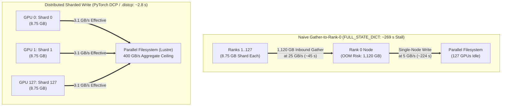
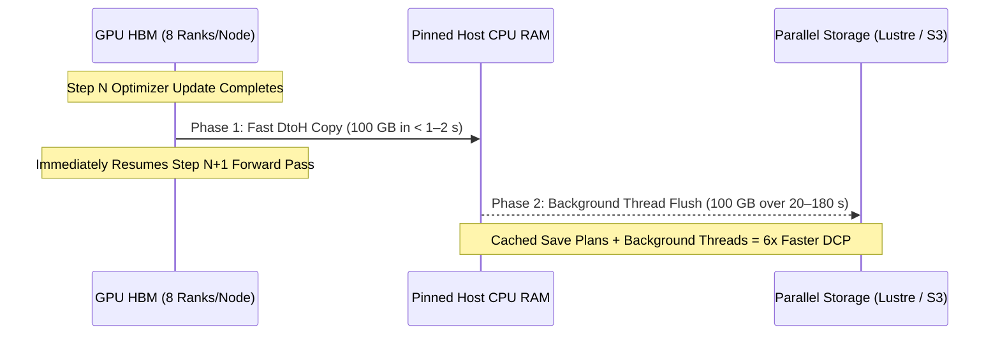
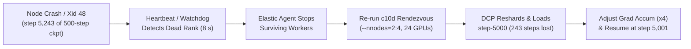

# 14.11 Checkpointing, fault tolerance and elastic training

| Field | Value |
|---|---|
| Level | Advanced |
| Priority tier | 2 |
| Lab venue | Nebius GPU + Local Python Verification Lab |
| Part | Part 14: Distributed training and fine-tuning |
| Primary sources | NVIDIA Zero-to-Hero Volume 13 (`chapter-09-checkpointing-and-recovery.md`, `chapter-01-why-distributed-training-exists.md`, `chapter-08-nccl-collectives-and-communication-paths.md`, `chapter-12-volume-13-summary.md`, `index.md`, `labs/lab-01..04`); Volume 21 (`chapter-04-storage-infrastructure-for-ai-pipelines.md`, `chapter-07-multi-node-distributed-training.md`); *Distributed AI Systems* (`distributed-ai-systems`, Chapters 3, 4, 8, and 11) |
| Cross-references | Chapter 6.12 (Slurm workload manager); Chapter 12.17 (`nccl-tests` and fabric benchmarking); Chapters 14.4–14.7 (DDP, FSDP, ZeRO, Megatron-LM); Chapter 14.10 (Multi-node training architecture) |
| Code | `code/part14/checkpoint_fault_tolerance.py`, `code/part14/checkpoint_fault_tolerance_lab.py` |
| Coverage file | `planning/coverage/chapters/14-11.md` |
| Claim & number ledger | `planning/ledgers/14-11.md` |

## Why this matters for AI infrastructure

When you play a long video game for a hundred hours, you save your progress periodically so a power outage does not force you back to the beginning. In distributed AI training, saving that progress is called checkpointing. On a small workstation, hardware crashes are rare enough to treat as bad luck. Across thousands of GPUs running for months, hardware failures are not a possibility. They are a mathematical certainty.

Consider a job training on a thousand GPUs for thirty days, or ten thousand GPUs for three months. Even if every individual GPU is 99.9 percent reliable each day, a hundred-thousand-GPU fleet suffers roughly one hundred device failures every twenty-four hours. If you have not saved your training state, a single overheated GPU, broken transceiver, or power supply fault wipes out millions of dollars of compute time.

```text
Scale, Memory, and Failure Reference Numbers (Volume 13 Ch. 1, Ch. 8, Ch. 9 & DAI Ch. 11):
- Llama-3-70B (70B parameters):
  FP16/BF16 weights = 140 GB; total training memory > 1.2 TB
  Checkpoint payload at 16 bytes/param (4B weights + 4B grads + 8B Adam) = 1,120 GB (~1.09 TB)
  Checkpoint payload at 14 bytes/param (omitting 2B BF16 gradients)      =   980 GB (~1.0 TB)
- GPT-3 (175B parameters):
  FP32 weights = 175B * 4 bytes = 700 GB (8.75x a single 80 GB H100 GPU)
  Single-step FLOPs (batch = 2048, seq = 2048): 2 * 175B * 2048 * 2048 ~ 1.46 * 10^18 FLOPs
  Step time at 312 TFLOPS (1 A100 GPU): 4,679 seconds (~78 minutes) vs 128 A100 GPUs: ~37 seconds
- 7B Model in FP32 on an 80 GB GPU:
  28 GB weights + 28 GB gradients + 56 GB Adam states + 60–80 GB activations + 5–10 GB buffers = 180–190 GB
  Device trace before crash: 79,456 MiB / 79,559 MiB used, 103 MiB free -> RuntimeError: CUDA out of memory (2.45 GiB)
- The Checkpoint Pause Penalty:
  Pausing 5 minutes every 60-minute hour to save wastes 5 / 60 = 8.33% (~8%) of total GPU cluster time
- Fleet Survival Probability at 99.9% Daily GPU Reliability:
  100,000 GPUs for 24 hours: 0.999^100,000 ~ 3.7 * 10^-44 survival probability (~100 failures/day, 14.4 min MTBF)
  1,024 GPUs for 30 days: > 99.9999% probability of at least one component failure
```

Saving state at foundation-model scale introduces three severe engineering challenges.
- **Massive payload size:** A seventy-billion-parameter model checkpoint exceeds one terabyte. Moving a terabyte to persistent storage across a shared network takes substantial time and bandwidth.
- **The checkpoint pause:** While GPUs wait for a synchronous checkpoint write to finish, they sit at zero percent compute utilization. Pausing for five minutes every hour wastes about eight percent of your entire GPU cluster budget.
- **Shattered state assembly:** Under FSDP, ZeRO-3, or Megatron-LM 3D parallelism, no single GPU holds the whole model. Every rank holds only a small puzzle piece. The cluster must save and reassemble those shards even if node failures shrink the cluster size upon restart.

**Production AI infrastructure requires sharded, asynchronous checkpointing paired with automated fault recovery so hardware failures cost seconds rather than days**.

## Prerequisites and outcomes

### Prerequisites
- Memory and compute scaling anatomy from Chapters 14.1 through 14.3.
- Distributed data and model parallelism mechanics across DDP, FSDP, DeepSpeed ZeRO, and Megatron-LM from Chapters 14.4 through 14.7.
- NCCL collective operations and multi-node Slurm and Kubernetes orchestration from Chapters 12.15 through 12.17 and Chapter 14.10.

### Outcomes
After completing this chapter, you will be able to achieve five engineering goals.
1. Architect a complete five-component LLM checkpoint and prove bit-for-bit deterministic recovery across interrupted training runs.
2. Quantify the two-order-of-magnitude speedup of distributed sharded checkpoint writes over naive rank-zero gathering. You will also size Lustre bandwidth ceilings and local NVMe staging tiers.
3. Calculate optimal checkpoint intervals using the Young-Daly formula and model net cluster goodput across synchronous and asynchronous saving regimes.
4. Implement two-phase asynchronous checkpointing and dynamic world-size resharding using PyTorch Distributed Checkpoint without triggering host CPU out-of-memory kills.
5. Configure fault-tolerant and elastic training with TorchElastic, heartbeat watchdogs, and Slurm preemption signal handlers that preserve global batch dynamics when cluster topology changes.

---

## 1. Checkpoint Anatomy and Sharded Parallel I/O

### 1.1 The Five Mandatory Components of a Deterministic Checkpoint

A common beginner mistake is saving only the neural network weights. If a job crashes halfway through training and resumes with only the model weights, training does not fail with an error message. Instead, the loss immediately spikes or silently diverges from the trajectory of an uninterrupted run.

To resume training as if the crash never happened, a checkpoint must capture five distinct state components across the cluster.
1. **Model weights:** The learned parameters of the neural network across all layers.
2. **Optimizer state:** First-moment momentum and second-moment variance buffers maintained by Adam or AdamW. Without these FP32 buffers, the optimizer restarts cold from zero momentum and causes an immediate loss spike.
3. **Learning rate scheduler state:** The exact step count on the warmup and cosine decay curve so the resumed job applies the right learning rate.
4. **Data loader state:** The exact cursor position in the training dataset so the job neither repeats already-seen batches nor skips unseen tokens.
5. **Random number generator state:** The RNG states for Python, NumPy, and every CUDA device. Saving these states keeps stochastic operations like dropout masks and data shuffling bit-for-bit reproducible.

```text
Checkpoint Payload Accounting Across Model Scales (Volume 13 Ch. 9, Volume 21 Ch. 4 & DAI Ch. 8):
1. Llama-3-70B under Mixed-Precision Adam (Volume 13 Ch. 9 — 16 bytes/param):
   - FP32 weights (4 B) + FP32 gradients (4 B) + FP32 Adam momentum & variance (8 B) = 16 bytes/param
   - Total payload = 70B * 16 bytes = 1,120 GB (~1.09 TB)
   - Across 128 H100 GPUs (FSDP): 1,120 GB / 128 = 8.75 GB per GPU shard (70.0 GB per 8-GPU node)

2. Llama-3-70B under BF16 + FP32 Master Weights (Volume 21 Ch. 4 — 14 bytes/param, omitting 2B BF16 gradients):
   - BF16 weights (2 B) + FP32 master weights (4 B) + FP32 Adam m & v (8 B) = 14 bytes/param
   - Total checkpoint payload = 70B * 14 bytes = 980 GB (~1.0 TB; active training memory = 16 B/param ~ 1.1 TB)
   - Across 64 H100 GPUs (ZeRO-3 / FSDP): 980 GB / 64 = 15.3125 GB (~15 GB) per GPU, ~122.5 GB (~122 GB) per 8-GPU node

3. Megatron-LM 8.03B GPT Model (DAI Ch. 8 — .distcp Shards):
   - BF16 weights (8.03B * 2 B = 16.06 GB) + FP32 Adam states (8.03B * 8 B = 64.24 GB) = 80.30 GB theoretical
   - Actual disk footprint = 108.0 GB across 4 x 27.0 GB .distcp shards + 24 KB common.pt + 4.0 KB metadata.json

4. ResNet-50 Reference Baseline (Volume 24 Project 3 — 25.6M parameters in FP32):
   - FP32 model_state_dict = 25.6M * 4 B ~ 100 MB (0.1 GB); Adam optimizer_state_dict ~ 200 MB
```

### 1.2 Why Gathering to Rank Zero Fails at Scale

In small DDP jobs where every GPU holds a full copy of a small model, only rank zero writes the checkpoint file while other ranks wait at a distributed barrier. When you move to a seventy-billion-parameter model sharded across 128 H100 GPUs with FSDP or ZeRO-3, gathering the full state dictionary onto rank zero creates an immediate network and storage bottleneck.



Let us compare the exact wall-clock pause of the naive gather-to-rank-zero approach against a distributed sharded write for our seventy-billion-parameter model across 128 H100 GPUs.

```text
Worked Example: 70B Model Checkpoint on 128 H100 GPUs (Volume 13 Ch. 9):
- Total checkpoint payload:  70B * 16 bytes = 1,120 GB (~1.09 TB)
- Per-GPU FSDP shard size:   1,120 GB / 128 = 8.75 GB per GPU

Approach A — Naive Gather-to-Rank-0 (FULL_STATE_DICT):
  1. Network gather to Node 0 at 25 GB/s inbound:  1,120 GB / 25 GB/s =  44.8 s (~45 s)
  2. Single-node write to storage at 5 GB/s:       1,120 GB /  5 GB/s = 224.0 s
  -------------------------------------------------------------------------------------
  Total Naive Checkpoint Pause:                    44.8 s + 224.0 s   = 268.8 s (~269 s / 4.5 minutes)

Approach B — Distributed Parallel Sharded Write (SHARDED_STATE_DICT / PyTorch DCP):
  1. Unconstrained per-GPU write at 5 GB/s:        8.75 GB / 5 GB/s   =   1.75 s
  2. Aggregate writer demand:                      128 GPUs * 5 GB/s  = 640.0 GB/s (exceeds 400 GB/s Lustre ceiling)
  3. Effective per-GPU rate under 400 GB/s cap:    400 GB/s / 128     =   3.125 GB/s (~3.1 GB/s per GPU)
  4. Realistic parallel write time:                8.75 GB / 3.125    =   2.80 s (~3 seconds)
  -------------------------------------------------------------------------------------
  Speedup of Sharded Parallel Write over Gather:   268.8 s / 2.80 s   =  96.0x (~2 orders of magnitude faster)
```

Even when throttled by the four-hundred-gigabyte-per-second aggregate bandwidth ceiling of the parallel filesystem, having every GPU write its own shard in parallel finishes in under three seconds. Gathering to rank zero stalls the cluster for four and a half minutes. It also risks crashing node zero with a CPU or GPU out-of-memory error.

### 1.3 Three-Tier Storage Architecture and Local NVMe Staging

On shared multi-tenant clusters or cloud environments where network storage throughput is modest, writing a terabyte directly to a shared NAS or object store still stalls the training loop. Production AI factories solve this by organizing storage into three distinct performance tiers.

| Storage Tier | Hardware Medium & Capacity | Typical Bandwidth & Latency | Role in Checkpointing & Data Pipeline |
|---|---|---|---|
| Tier 1: Hot Node Cache | Local PCIe Gen4/Gen5 NVMe SSDs (`8 x 3.84 TB` ~ `30 TB` or `8 x 7.68 TB` = `61 TB` per 8-node group) | `~7 GB/s` per Gen4 NVMe drive (`10–20 GB/s` node write; `< 1 ms` latency) | Fast local checkpoint staging (`~10 s` for `122 GB` per node) and hot epoch dataset cache |
| Tier 2: Warm Cluster Storage | Parallel File System or All-Flash NAS (Lustre, GPFS, WEKA, VAST, NetApp; `500 TB` to multi-PB) | `10 GB/s` (small NAS) up to `400+ GB/s` (Lustre parallel filesystem; `ms` latency) | Shared cluster-wide checkpoint repository (`~2.8 s` at `400 GB/s` or `~100 s` at `10 GB/s`) |
| Tier 3: Cold Cloud Archive | Object Storage (AWS S3, GCS; effectively unlimited capacity at `~$0.023/GB-month`, `$2,300/mo` for `100 TB`) | Scales with parallel multipart streams (`1 GB` chunks; `10–100+ ms` latency) | Durable long-term checkpoint backup (e.g., `~1 TB` every `8` hours = `21 TB/week` before pruning) |

**Always write sharded checkpoints in parallel from every rank and stage bursts through local NVMe or high-bandwidth Lustre rather than gathering to rank zero**.

---

## 2. Failure Mathematics and the Young-Daly Checkpoint Interval

### 2.1 Fleet Reliability Math: Why Failures Cluster at Scale

Hardware components fail for many reasons. Double-bit ECC memory flips occur from cosmic rays. Optical transceivers degrade over thermal cycles, PCIe buses drop, and power supplies suffer transients. If a single GPU has a daily reliability of 99.9 percent, a single-GPU workstation runs for nearly three years on average before seeing a fault.

When a synchronous training job spans thousands of GPUs, the cluster behaves as a series reliability system. If any single GPU, NIC, or host power supply fails, the collective communication ring breaks and the entire job halts.

| Cluster Scale (GPUs) | Daily Per-GPU Reliability | Probability All GPUs Survive 24 Hours | Expected Failures per 24 Hours | Implied Cluster MTBF |
|---|---|---|---|---|
| `8` GPUs (`1` node) | `99.9%` (`0.999`) | `99.20%` | `0.008` (`~1` per `125` days) | `~3,000` hours |
| `1,024` GPUs (`128` nodes) | `99.9%` (`0.999`) | `35.90%` (`> 99.9999%` fail in `30` days) | `1.02` failures/day | `~23.4` hours (or `8` h with NIC/switch faults) |
| `2,048` GPUs (`256` nodes) | `99.9%` (`0.999`) | `12.89%` | `2.05` failures/day | `~11.7` hours (or `6` h with fabric/PSU faults) |
| `10,000` GPUs (`1,250` nodes) | `99.9%` (`0.999`) | `0.0045%` (`4.5 * 10^-5`) | `10.0` failures/day | `~2.4` hours |
| `100,000` GPUs (`12,500` nodes) | `99.9%` (`0.999`) | `3.7 * 10^-44` (effectively zero) | `100.0` failures/day | `14.4` minutes (`864` seconds) |

### 2.2 The Young-Daly Optimal Checkpoint Interval Formula

Because every checkpoint write costs time, platform engineers face a fundamental optimization problem. If you save a checkpoint every five minutes, you lose very little progress when a node crashes. However, your GPUs spend a huge fraction of their life waiting on storage writes. If you save only once every twenty-four hours, your write overhead is tiny, but a crash at hour twenty-three wipes out an entire day of training.

John Daly formalized the mathematical balance between checkpoint write overhead and expected lost rework upon failure. Given a cluster Mean Time Between Failures and a checkpoint write cost in identical time units, the optimal interval between checkpoints is shown below.

```text
Young-Daly Optimal Checkpoint Interval Formula (Volume 13 Ch. 9):
  T_opt = sqrt(2 * M * T_c) - T_c

Where:
  M     = Observed Mean Time Between Failures (MTBF) of the cluster (in seconds)
  T_c   = Time required to write the checkpoint (blocking GPU pause, in seconds)
  T_opt = Optimal training compute interval between consecutive checkpoints (in seconds)

Worked Example 1 — 1,024-GPU Cluster (Volume 13 Ch. 9):
  Observed cluster MTBF (M):     8 hours = 28,800 seconds
  Checkpoint write time (T_c):   180 seconds (3 minutes)
  T_opt = sqrt(2 * 28,800 * 180) - 180
        = sqrt(10,368,000) - 180
        ~ 3,220 - 180 = 3,040 seconds (~50.7 minutes)

Worked Example 2 — 400B Model on 2,048 GPUs (Volume 13 Ch. 9 Interview Design):
  Observed cluster MTBF (M):     6 hours = 21,600 seconds
  Checkpoint write time (T_c):   240 seconds (4 minutes)
  T_opt = sqrt(2 * 21,600 * 240) - 240
        = sqrt(10,368,000) - 240
        ~ 3,220 - 240 = 2,980 seconds (~49.7 minutes, rounded to 30–40 min in production for safety margin)
```

Notice why the production recommendation rounds the fifty-minute theoretical optimum down to thirty or forty minutes. The Young-Daly derivation assumes failures arrive as a memoryless Poisson process with a constant average rate. In real data centers, failures cluster in time when a cooling loop warms up or a bad firmware rollout hits a rack.

| Checkpoint Policy (`M = 8 h = 28,800 s`, `T_c = 180 s`) | Interval `T` | Write Overhead Fraction `T_c / (T + T_c)` | Expected Lost Rework per Crash `(T + T_c) / 2` | Net Cluster Goodput |
|---|---|---|---|---|
| Over-frequent (every `5` min) | `300 s` | `37.50%` (`180 / 480`) | `240 s` (`4.0` min) | `61.98%` (wastes GPU-hours on I/O) |
| Young-Daly Optimal (`~50.7` min) | `3,040 s` | `5.59%` (`180 / 3,220`) | `1,610 s` (`26.8` min) | `88.82%` (maximum synchronous goodput) |
| Under-frequent (every `4` hours) | `14,400 s` | `1.23%` (`180 / 14,580`) | `7,290 s` (`121.5` min) | `74.06%` (heavy rework loss on crash) |
| Under-frequent (every `24` hours) | `86,400 s` | `0.21%` | Up to `24` hours lost | Unacceptable (> `3x` MTBF) |
| Asynchronous at `T_opt` (`2 s` DtoH pause) | `3,040 s` | `0.07%` (`2 / 3,042`) | `1,521 s` (`25.4` min) | `94.66%` (`+5.84%` goodput gain) |

**Size your checkpoint interval from your measured cluster MTBF and blocking write pause using the Young-Daly formula, and shrink the blocking pause with asynchronous saving**.

---

## 3. Asynchronous Checkpointing and Dynamic Resharding (PyTorch DCP)

### 3.1 Two-Phase Asynchronous Checkpointing and Host RAM Safety

Even at the Young-Daly optimum, a three-minute synchronous checkpoint write still leaves a thousand GPUs idle for 5.6 percent of every hour. Worse, shared parallel filesystems suffer from noisy-neighbor congestion. When another job on the cluster dumps a massive checkpoint at the same time, your ninety-second write can suddenly balloon to twelve minutes.

Asynchronous checkpointing eliminates this storage pause from the GPU critical path by splitting the save into two phases.
1. **Phase 1: Fast Device-to-Host staging copy.** Training pauses briefly while each GPU copies its local parameter and optimizer shard over PCIe into pinned host CPU RAM. Moving a hundred gigabytes across eight GPUs on a node takes under one to two seconds.
2. **Phase 2: Background CPU-to-Storage flush.** As soon as the host RAM copy completes, the GPUs immediately start the next forward pass. Meanwhile, background CPU threads or processes flush the staged host RAM buffer out to Lustre or object storage in parallel with GPU computation.



In PyTorch Distributed Checkpoint, cached save plans reuse tensor shape and sharding metadata across steps instead of recomputing them. Combining cached save plans with background I/O threads reduces Python GIL contention and delivers a **6x speedup** in checkpoint processing.

However, asynchronous checkpointing introduces a new failure mode on the host CPU. Because the checkpoint state sits buffered in system DRAM while the training job continues running, host memory consumption spikes. Suppose your data loader workers and pinned memory buffers already consume most of the node's RAM. Or suppose a slow storage target causes a new checkpoint to trigger before the previous background flush finishes. In either case, the Linux kernel Out-of-Memory killer terminates the training process. Always verify that free host RAM exceeds the staged shard footprint per node, throttle concurrent async saves to one in-flight buffer, or provision swap space as a safety cushion.

### 3.2 Dynamic Checkpoint Resharding Across World-Size Changes

Suppose your sixty-four-GPU FSDP job saves a sharded checkpoint and then loses two nodes to uncorrectable ECC memory errors. As we saw in Chapter 14.10, Slurm drains the faulty servers and requeues your job onto the forty-eight healthy GPUs that remain available.

If your script saved raw per-rank files without global tensor metadata, resuming on forty-eight GPUs immediately crashes.

```text
Naive Topology-Coupled Resume Failure (Volume 13 Ch. 9):
  RuntimeError: Number of shards in checkpoint (64) does not match world size (48)
  Host CPU OOM Log Signature (Volume 13 Ch. 9):
  [Node 3] dmesg: Out of memory: Killed process 1234 (python)

Dynamic Resharding Math for a 1,120 GB Checkpoint (64 GPUs -> 48 GPUs):
  Original 64-GPU layout (8 nodes x 8 GPUs):  1,120 GB / 64 = 17.5000 GB per rank shard
  Resumed 48-GPU layout  (6 nodes x 8 GPUs):  1,120 GB / 48 = 23.3333 GB per rank shard
```

PyTorch Distributed Checkpoint and DeepSpeed Universal Checkpointing solve this problem by decoupling the on-disk shard layout from the runtime process group. Alongside the `.distcp` shard files, DCP writes a global metadata file recording the logical tensor shapes, data types, and byte offsets of every slice. When the job restarts on forty-eight GPUs, each rank constructs an in-place sharded state dictionary template for its new one-forty-eighth slice of the model. Then `dcp.load` reads the metadata and pulls the exact byte ranges required from the sixty-four on-disk shards.

**Use PyTorch Distributed Checkpoint with cached save plans and asynchronous staging so checkpoints complete in under two seconds of GPU pause and reshard automatically across any GPU count**.

---

## 4. Fault Tolerance, TorchElastic, and Slurm Preemption Recovery

### 4.1 Why In-Process `try/except` Cannot Repair a Broken NCCL Ring

When software engineers first move to distributed training, they often try to wrap the training step inside a Python `try/except` block to catch exceptions and continue training. At multi-GPU scale, that pattern fails completely.

Once an NCCL communicator is initialized across a world of ranks, every collective operation requires every rank in the group to participate. Suppose rank seven suffers a GPU page fault, falls off the PCIe bus, or hits an uncorrectable double-bit ECC error. The Linux process on that node dies or stalls. The surviving ranks block inside their CUDA collective kernels waiting for rank seven's packets. Because the NCCL ring or tree state machine is now torn, the surviving processes cannot simply skip the dead rank in a Python exception handler. The entire process group must be torn down, re-formed through a fresh rendezvous among healthy nodes, and restored from the last verified checkpoint.

### 4.2 Fault-Tolerant vs Elastic Training with `torchrun` (TorchElastic)

PyTorch builds this fault-tolerant process lifecycle directly into `torchrun` via Torch Distributed Elastic. Instead of spawning static workers once and exiting on the first error, each node runs an elastic agent. That agent monitors local GPU processes and coordinates through a `c10d` or `etcd-v2` rendezvous store.



You can configure `torchrun` in two distinct resiliency modes.

| Resiliency Mode | `torchrun` Node Flag | Behavior on Worker or Node Failure | World Size & Hyperparameter Impact |
|---|---|---|---|
| Fault-Tolerant (Fixed Size) | `--nnodes=4 --nproc_per_node=8 --max_restarts=3` | Stops surviving workers, waits for all `4` nodes (or a replacement node from a spare pool) to rejoin `c10d` rendezvous, and restarts up to `3` times | `WORLD_SIZE` stays constant (`32` GPUs); global batch size and learning rate schedule remain unchanged |
| Elastic (Variable Size) | `--nnodes=2:4 --nproc_per_node=8 --max_restarts=3` | Immediately reforms the process group with the surviving nodes (`2`, `3`, or `4` nodes = `16..32` GPUs) without waiting for hardware repair; scales back up when nodes rejoin | `WORLD_SIZE` changes dynamically (`e.g., 32 -> 24` or `64 -> 48`); requires adjusting `gradient_accumulation_steps` or learning rate |

When running in elastic mode, changing the number of active GPUs changes the effective global batch size. If a job shrinks from thirty-two GPUs to twenty-four GPUs with a micro-batch of two sequences per GPU, the per-step batch drops from sixty-four to forty-eight sequences. Unless you adjust your training loop, that sudden batch-size drop alters gradient noise and causes a loss spike after resize. You have two mathematical levers to maintain training stability.
- **Keep global batch size constant via gradient accumulation:** Scale the gradient accumulation step count inversely with the world size. For a target global batch of 192 sequences with a micro-batch of 2, thirty-two GPUs use three accumulation steps, whereas twenty-four GPUs automatically switch to four accumulation steps.
- **Scale the learning rate with global batch size:** When scaling a cluster up or down without changing accumulation steps, adjust the learning rate using the square-root or linear scaling rule. Scaling from a 32-sequence baseline to 8,192 sequences across 64 GPUs increases the batch size by 256 times and scales the learning rate by 16 times.

```text
Elastic Batch, Learning-Rate, and Step Recovery Reference Math (Volume 21 Ch. 7 & DAI Ch. 3):
- Global batch preservation across resize (target global_batch = 192, micro_batch = 2):
  32 GPUs (4 nodes): 32 * 2 * 3 grad_accum_steps = 192 sequences
  24 GPUs (3 nodes): 24 * 2 * 4 grad_accum_steps = 192 sequences
- Square-root learning-rate scaling (Volume 21 Ch. 7):
  base_lr = 1e-4 at batch_size = 32; global_batch = 64 GPUs * 128 = 8,192
  scaled_lr = 1e-4 * sqrt(8,192 / 32) = 1e-4 * 16 = 1.6e-3
- Step-interval crash recovery (Volume 21 Ch. 7):
  Checkpoint interval = every 500 steps; cluster crashes at step 5,243
  Launcher loads step 5,000, resumes at step 5,001 -> only 243 steps lost (<= 500 max)
```

### 4.3 Fast Failure Detection: Heartbeat Watchdogs vs 30-Minute Timeouts

By default, PyTorch's NCCL process group timeout is thirty minutes, or 1,800 seconds. Suppose one rank hangs due to a dead NIC port or kernel deadlock. The remaining thousand GPUs sit idle at 100 percent static power draw for half an hour before the watchdog finally aborts the job.

```text
Watchdog and Preemption Timing Reference (Volume 13 Ch. 8, Ch. 12 & DAI Ch. 8, Ch. 11):
- Default NCCL / c10d watchdog timeout: 30 minutes (1,800 seconds)
  Log signature: [1,0]<stdout>:[11910] NCCL WARN Watchdog caught network down!
                 [1,0]<stdout>:[11910] NCCL WARN Call to connect returned Connection timed out
- Fast NCCL heartbeat & flight recorder environment variables:
  TORCH_NCCL_ASYNC_ERROR_HANDLING=1
  TORCH_NCCL_HEARTBEAT_TIMEOUT_SEC=120
  TORCH_NCCL_TRACE_BUFFER_SIZE=2000
- Application Heartbeat FailureDetector (DAI Ch. 11):
  Heartbeat interval = 1–5 s (2.0 s typical); threshold = 3–5 missed heartbeats (4 * 2.0 s = 8.0 s -> 225x faster than 1,800 s)
- Slurm Preemption Grace Period (DAI Ch. 8):
  #SBATCH --signal=SIGUSR1@90 (90 s warning before time limit) + SIGTERM (immediate preemption)
  Megatron-LM 8.03B checkpoint (108.0 GB across 4 x 27 GB .distcp shards) writes in 4.32 s at 25.0 GB/s
  Resubmit automatically via: sbatch --dependency=singleton train.slurm
```

To cut recovery time from thirty minutes to seconds, production training stacks combine three layers of detection.
1. **Bounded collective timeouts and NCCL heartbeat monitors:** Set a five-minute process group timeout and enable async error handling in PyTorch. Configure the NCCL heartbeat timeout and flight recorder ring buffer so hung ranks dump the exact collective where they stalled.
2. **Application-level heartbeat detector:** Workers emit lightweight heartbeats every two seconds. If a rank misses four consecutive heartbeats, the supervisor triggers an immediate abort and restart after eight seconds. That cuts detection latency by 225 times compared to the thirty-minute default timeout.
3. **Slurm preemption signals:** When a job approaches its wall-clock limit or is preempted by a higher-priority allocation, Slurm sends `SIGUSR1` or `SIGTERM`. A signal handler flags the loop at the end of the current step, writes a fast sharded checkpoint in under five seconds, and resubmits the job automatically.

**Combine `torchrun` elastic restarts with fast heartbeat timeouts, DCP metadata resharding, and Slurm signal traps so your cluster recovers from node faults in seconds**.

---

## Commands and configurations that matter

### 1. Atomic Checkpoint Save and Deterministic 5-Component Recovery

```python
import os, random, tempfile
import numpy as np
import torch
import torch.distributed as dist

def save_checkpoint_atomic(model, optimizer, scheduler, epoch: int, step: int, filepath: str) -> None:
    """Rank-0 atomic checkpoint write with all 5 deterministic state components (DAI Ch. 3 & V13 Lab 04)."""
    if dist.get_rank() == 0:
        temp_file = filepath + ".tmp"
        checkpoint = {
            "epoch": epoch,
            "step": step,
            "model_state_dict": model.module.state_dict() if hasattr(model, "module") else model.state_dict(),
            "optimizer_state_dict": optimizer.state_dict(),
            "scheduler_state_dict": scheduler.state_dict() if scheduler is not None else {},
            "rng_state": {
                "python": random.getstate(),
                "numpy": np.random.get_state(),
                "torch_cpu": torch.get_rng_state(),
                "torch_cuda": torch.cuda.get_rng_state_all(),
            },
        }
        torch.save(checkpoint, temp_file)
        os.rename(temp_file, filepath)  # POSIX atomic rename prevents half-written corrupted files
    dist.barrier()  # Ensure all ranks wait until atomic rename completes
```

### 2. FSDP2 Sharded & Asynchronous Checkpointing with PyTorch DCP (`dcp.save` / `dcp.async_save`)

```python
import os
import torch.distributed.checkpoint as dcp
from torch.distributed.checkpoint.state_dict import (
    StateDictOptions,
    get_model_state_dict,
    get_optimizer_state_dict,
    set_model_state_dict,
    set_optimizer_state_dict,
)

def save_checkpoint_dcp(model, optimizer, epoch: int, step: int, checkpoint_dir: str, async_mode: bool = True):
    """Saves sharded FSDP2 state dict with CPU offload and optional two-phase async background flush."""
    opts = StateDictOptions(full_state_dict=False, cpu_offload=True)
    state_dict = {
        "model": get_model_state_dict(model, options=opts),
        "optimizer": get_optimizer_state_dict(model, optimizers=optimizer, options=opts),
        "epoch": epoch,
        "step": step,
    }
    ckpt_path = os.path.join(checkpoint_dir, f"step_{step}")
    if async_mode:
        # Copies GPU shards to pinned Host RAM (< 2 s) and flushes to Lustre/S3 in background thread
        return dcp.async_save(state_dict, checkpoint_id=ckpt_path)
    dcp.save(state_dict, checkpoint_id=ckpt_path)
    return None

def load_checkpoint_dcp(model, optimizer, checkpoint_dir: str, step: int) -> int:
    """Loads and dynamically reshards a DCP checkpoint onto the current world size (e.g., 64 -> 48 GPUs)."""
    ckpt_path = os.path.join(checkpoint_dir, f"step_{step}")
    opts = StateDictOptions(full_state_dict=False)
    state_dict = {
        "model": get_model_state_dict(model, options=opts),
        "optimizer": get_optimizer_state_dict(model, optimizers=optimizer, options=opts),
        "epoch": 0,
        "step": 0,
    }
    dcp.load(state_dict, checkpoint_id=ckpt_path)  # Automatically reshards using global metadata
    set_model_state_dict(model, state_dict["model"], options=opts)
    set_optimizer_state_dict(model, optimizers=optimizer, optim_state_dict=state_dict["optimizer"], options=opts)
    return int(state_dict["step"])
```

### 3. Launching Fault-Tolerant and Elastic Training with `torchrun` and Slurm

```bash
# 1. Single-node fault-tolerant training (fixed 2 GPUs, up to 2 automatic restarts)
torchrun --nnodes=1 --nproc_per_node=2 --max_restarts=2 \
  --rdzv_id=elastic_one_node --rdzv_backend=c10d \
  --rdzv_endpoint=127.0.0.1:29400 \
  code/train_elastic_checkpoint.py

# 2. Multi-node elastic training (scales dynamically between 2 and 4 nodes, up to 3 restarts)
torchrun --nnodes=2:4 --nproc_per_node=8 --max_restarts=3 \
  --rdzv_id=job_1411 --rdzv_backend=c10d \
  --rdzv_endpoint=$MASTER_ADDR:29400 \
  code/train_elastic_checkpoint.py

# 3. Inspect PyTorch DCP global tensor metadata before resuming on a resized allocation
python -c "from torch.distributed.checkpoint import FileSystemReader; \
r = FileSystemReader('/checkpoints/step_5000'); print(r.read_metadata())"

# 4. Emergency 100 GB swap file creation if async checkpoint staging approaches host RAM limits
sudo fallocate -l 100G /swapfile && sudo chmod 600 /swapfile && sudo mkswap /swapfile && sudo swapon /swapfile
free -m

# 5. Query GPU ECC errors and drain a faulty node in Slurm before requeuing
nvidia-smi -q -d ECC
scontrol update nodename=gpu-node-05 state=drain reason="GPU ECC Errors (Xid 48/63)"
```

---

## How it fails

Use the symptom-to-fix table below to diagnose checkpoint corruption, host RAM exhaustion, world-size resharding failures, and silent trajectory divergence in production.

| # | Failure Mode & Symptom | Root Cause | First Diagnostic Command & Production Fix |
|---|---|---|---|
| 1 | Corrupted checkpoint on crash: resume fails with `RuntimeError: Error(s) in loading state_dict ... Unexpected key(s) ... size mismatch`. | A node crashed or received `SIGKILL` (`kill -9`) while `torch.save` was writing directly to the target filename, leaving a truncated file on disk. | Check file size with `ls -lh /checkpoints/model_step_1000.pt`, delete the truncated file (`rm -f`), resume from `model_step_900.pt`, and implement atomic writes (`temp_file = filepath + '.tmp'` then `os.rename`). |
| 2 | Host CPU OOM during asynchronous checkpointing: job crashes right as a save triggers with `[Node 3] dmesg: Out of memory: Killed process 1234 (python)`. | Async checkpointing copies GPU shards into host RAM (`100+ GB/node`). Triggering a second save before the first flushes—or insufficient free RAM—exceeds physical DRAM. | Run `dmesg -T \| grep -i oom` and `free -m`. Wait on the previous async save handle (`future.wait()`) before starting a new copy, reduce DataLoader `pin_memory` workers, or add a `100 GB` swap file (`fallocate -l 100G /swapfile`). |
| 3 | Resharding mismatch after cluster resize: after node drain, a 64-GPU job resumes on 48 GPUs and crashes with `RuntimeError: Number of shards in checkpoint (64) does not match world size (48)`. | Naive per-rank checkpoint files hard-code a 1:1 mapping to the 64-rank topology that wrote them, leaving shards 48..63 orphaned on a 48-GPU allocation. | Verify metadata with `FileSystemReader('/checkpoints/step_5000').read_metadata()` and switch to PyTorch DCP (`torch.distributed.checkpoint`) or DeepSpeed Universal Checkpointing so tensors reshard dynamically from 64 to 48 ranks. |
| 4 | Immediate loss spike or silent trajectory divergence after resume: checkpoint loads cleanly without error, but epoch 4 loss jumps from `1.34` to `1.95` or drifts (`1.0125` vs `0.9800` control). | Omitting `optimizer_state_dict` resets Adam momentum/variance (`m, v`) to zero (causing a loss spike); omitting `rng_state` or saving without `dist.barrier()` alters shuffling and dropout masks. | Inspect keys via `torch.load(path, map_location='cpu').keys()`. Gate saves behind `dist.barrier()` and restore all 5 components (`model`, `optimizer`, `scheduler`, `dataloader` step, and Python/NumPy/CUDA `rng_state`). |
| 5 | Checkpoint write latency jumps 8x (`90 seconds` to `12 minutes`) with no change to model size (`70B`) or GPU count (`128` GPUs). | Shared Lustre/NAS bandwidth ceiling is saturated by noisy-neighbor jobs, a storage target (`OST`/`OSS`) is degraded, or a code change accidentally reverted from sharded writes to `full_state_dict=True` rank-0 gather. | Check Lustre/NAS per-OST health and client throughput (`iostat -x 1`), verify `StateDictOptions(full_state_dict=False)` is still set, and stage shards to local NVMe (`/nvme/checkpoints`) before background flushing. |
| 6 | Uncorrectable ECC error (`Xid 48`/`63`) or fallen GPU (`Xid 79`) hangs 1,000+ GPUs for 30 minutes until `NCCL WARN Watchdog caught network down!`. | One rank dies mid-collective while surviving ranks block inside CUDA kernels until the default 30-minute (`1,800 s`) `c10d`/`NCCL` timeout expires. | Check `nvidia-smi -q -d ECC` and `dmesg -T`, drain the faulty node (`scontrol update nodename=... state=drain`), set `TORCH_NCCL_HEARTBEAT_TIMEOUT_SEC=120`, and launch with `torchrun --max_restarts=3 --nnodes=MIN:MAX`. |

---

## Hands-on lab

### Venue and Scope
- **Venue:** Local Python Verification Lab (`code/part14/checkpoint_fault_tolerance.py` and `code/part14/checkpoint_fault_tolerance_lab.py`; `tested`). It also includes a multi-GPU fault-injection and deterministic recovery runbook for Nebius GPU nodes (`untested here` on live multi-GPU hardware).

### Part 1: Run the Self-Checking Checkpointing & Fault Tolerance Lab

Run the verification suite from the repository root.

```bash
python3 -B code/part14/checkpoint_fault_tolerance_lab.py
```

Expected output (`tested`).

```text
=== Chapter 14.11 Lab: Checkpointing, Fault Tolerance, and Elastic Training Verification ===
  [PASS] 1. 70B model at 16 bytes/param (4B weights + 4B grads + 8B Adam) equals 1,120.0 GB (~1.09 TB) total and 8.75 GB/GPU across 128 H100 GPUs
  [PASS] 2. Naive gather-to-rank-0 takes 44.8 s (~45 s) network gather at 25 GB/s + 224.0 s disk write at 5 GB/s = 268.8 s (~269 s / 4.5 min)
  [PASS] 3. Ideal per-GPU sharded write at 5 GB/s takes 1.75 s, while 128 GPUs x 5 GB/s = 640.0 GB/s demand caps at 400 GB/s Lustre ceiling (3.125 GB/s/GPU)
  [PASS] 4. Realistic parallel sharded write completes in 2.8 s (8.75 GB / 3.125 GB/s), achieving a 96.0x (~2 orders of magnitude) speedup over 268.8 s gather
  [PASS] 5. Omitting 2 B/param BF16 gradients (14 bytes/param) yields 980.0 GB total (~15.3125 GB/GPU on 64 GPUs, 122.5 GB/node), writing in 10.0 s to local NVMe vs 98.0 s to 10 GB/s NAS
  [PASS] 6. Megatron-LM 8.03B model requires 16.06 GB BF16 weights + 64.24 GB FP32 Adam = 80.30 GB theoretical and 108.0 GB actual (4 x 27 GB .distcp shards), writing in 4.32 s at 25 GB/s
  [PASS] 7. Young-Daly on 1,024 GPUs (M = 8 h = 28,800 s, Tc = 180 s) gives sqrt(10,368,000) - 180 = 3,220 - 180 = 3,040.0 s (~50.7 min)
  [PASS] 8. Young-Daly for 400B model on 2,048 GPUs (M = 6 h = 21,600 s, Tc = 240 s) gives sqrt(10,368,000) - 240 = 3,220 - 240 = 2,980.0 s (~49.7 min)
  [PASS] 9. At 99.9% daily GPU reliability on 100,000 GPUs, 24h survival probability is 3.7 x 10^-44 with 100.0 expected failures/day (14.4 min fleet MTBF); 1,024 GPUs over 30 days has >99.9999% failure certainty
  [PASS] 10. Pausing 5 min per 60-min hour wastes 8.33% (~8%) of cluster time; Young-Daly T_opt = 3,040 s achieves 88.82% sync goodput vs 61.98% at 5-min intervals and 74.06% at 4-hr intervals
  [PASS] 11. Asynchronous checkpointing (2 s DtoH pause instead of 180 s sync write) boosts net training goodput at T_opt = 3,040 s from 88.82% to 94.66%
  [PASS] 12. Two-phase async checkpoint copies 100 GB GPU state to Host RAM in 1.82 s (< 2 s pause) and flushes in 20.0 s background thread (12.0x pause reduction; 6.0x DCP cached-plan speedup)
  [PASS] 13. Overlapping 2 in-flight 100 GB async buffers (200 GB needed vs 132 GB free RAM) triggers Linux OOM killer: '[Node 3] dmesg: Out of memory: Killed process 1234 (python)'
  [PASS] 14. Adding a 100.0 GB swap file (sudo fallocate -l 100G /swapfile; 232.0 GB total headroom) prevents the host OOM crash during burst staging
  [PASS] 15. Naive topology-coupled checkpoint fails on 64 -> 48 GPU resize with 'RuntimeError: Number of shards in checkpoint (64) does not match world size (48)'
  [PASS] 16. PyTorch DCP (FileSystemReader metadata) dynamically reshards 1,120.0 GB from 64 x 17.5 GB shards to 48 x 23.3333 GB shards and matches Lab 04 epochs 4-5 control losses
  [PASS] 17. Omitting optimizer_state_dict (Adam m, v buffers) causes an immediate epoch-4 loss spike on resume (1.9500 vs 0.9800 control) and fails deterministic recovery
  [PASS] 18. Omitting rng_state (Python/NumPy/CUDA RNGs) causes silent epoch 4-5 trajectory divergence (1.0125 vs 0.9800 control) without throwing an exception
  [PASS] 19. TorchElastic --nnodes=2:4 --nproc_per_node=8 --max_restarts=3 with c10d spans 16..32 GPUs and continues cleanly on 3 surviving nodes (24 GPUs)
  [PASS] 20. Scaling gradient_accumulation_steps to 4 at 24 GPUs (micro_batch=2) preserves target global batch size of 192; V21 sqrt LR rule scales 1e-4 at batch 32 to 1.6e-3 (16x) at batch 8,192 (64 x 128)
  [PASS] 21. Crashing at step 5,243 with a 500-step checkpoint interval loads step 5,000, resumes at step 5,001, and bounds lost work to 243 steps (<= 500 max)
  [PASS] 22. Heartbeat FailureDetector (2.0 s interval x 4 missed = 8.0 s) detects dead ranks 225.0x faster than the 30-minute (1,800.0 s) default NCCL watchdog timeout
  [PASS] 23. GPT-3 (175B) FP32 weights require 700.0 GB (8.75x an 80 GB H100), and 1.46e18 FLOPs/step takes 4,679 s (~78 min) on 1 A100 vs 37 s on 128 A100s
  [PASS] 24. 8-GPU NVLink Ring AllReduce on 28 GB FP32 gradients moves 49.0 GB in 54.4 ms (~54 ms), while 512-GPU IB moves 55.9 GB in 2.2 s (9 tree hops vs 512 ring hops)
  [PASS] 25. FSDP2 / ZeRO-3 shards a 7B model's 84.0 GB DDP parameter/gradient/optimizer state across 8 GPUs down to 10.5 GB/GPU (1/N reduction)
Summary: 25 passed, 0 failed
```

### Part 2: Nebius GPU Lab 04 Runbook — Control vs Interrupted Deterministic Recovery (`untested here`)

On a four-GPU Nebius node, run the five-epoch control baseline and interrupt a second run after epoch three. Then verify that resuming from `./checkpoints/epoch_3.pt` reproduces the exact epoch-four and epoch-five loss trajectory.

```bash
# 1. Run uninterrupted 5-epoch control baseline and log per-epoch losses
torchrun --nproc_per_node=4 train.py --epochs 5 --batch-size 32 --save-dir ./checkpoints_control

# 2. Run interrupted job (killed after epoch 3 checkpoint completes) and resume to epoch 5
torchrun --nproc_per_node=4 train.py --epochs 3 --batch-size 32 --save-dir ./checkpoints
torchrun --nproc_per_node=4 train.py --epochs 5 --batch-size 32 --resume-from ./checkpoints/epoch_3.pt

# 3. Clean up lingering torchrun workers and temporary checkpoint directories
pkill -f torchrun
rm -rf ./checkpoints/* ./checkpoints_control/*
```

---

## Key takeaways

1. **Failures are certain at scale:** Even at 99.9 percent daily per-GPU reliability, a 100,000-GPU cluster suffers roughly 100 failures per day. A 1,024-GPU thirty-day run is virtually guaranteed to experience a crash.
2. **Every deterministic checkpoint requires five state components:** You must save model weights, optimizer momentum and variance buffers, LR scheduler step, dataloader cursor, and Python, NumPy, and CUDA RNG states behind a distributed barrier. Omitting optimizer state spikes the loss, while omitting RNG state causes silent divergence.
3. **Never gather large checkpoints to rank zero:** For a 70B model on 128 GPUs, parallel sharded writes finish in 2.8 seconds on a 400 GB/s Lustre filesystem. That parallel approach is 96 times faster than the 268.8-second naive gather to rank zero.
4. **Optimize checkpoint intervals with the Young-Daly formula:** Balancing write overhead against expected rework yields a 50.7-minute optimal interval when cluster MTBF is 8 hours and write pause is 180 seconds.
5. **Pair asynchronous DCP saves with TorchElastic:** Two-phase async checkpointing cuts GPU pause time to under two seconds and runs 6 times faster with cached save plans. Meanwhile, PyTorch DCP metadata allows `torchrun` elastic jobs to reshard dynamically when nodes drain.

---

## Exercises

1. **70B Checkpoint Sizing and Naive Gather vs Sharded Parallel Write.**
   - **(a)** A 70B-parameter model trains on 128 H100 GPUs under mixed-precision Adam at 16 bytes per parameter. Calculate the total checkpoint payload in GB and the per-GPU shard size. Also compute the 980 GB payload and per-GPU and per-node shard sizes on 64 GPUs when 2-byte BF16 gradients are omitted.
   - **(b)** Compare the total checkpoint pause of gathering all 1,120 GB to rank zero against a distributed parallel write where each GPU writes at 5 GB/s up to a 400 GB/s Lustre aggregate ceiling. State the speedup factor.
2. **Fleet Reliability and Young-Daly Optimal Checkpoint Intervals.**
   - **(a)** At 99.9 percent daily reliability per GPU, calculate the probability that all 100,000 GPUs survive 24 hours without failure. Also find the expected number of failures per day and the fleet MTBF in minutes.
   - **(b)** Use Daly's formula to calculate the optimal checkpoint interval in seconds and minutes for a 1,024-GPU cluster with an 8-hour MTBF and 180-second write time. Repeat the calculation for a 400B model on 2,048 GPUs with a 6-hour MTBF and 240-second write time. Explain why engineers round 50 minutes down to 30 to 40 minutes in production.
3. **Two-Phase Asynchronous Checkpointing and Host CPU OOM Triage.**
   - **(a)** An 8-GPU node stages 100.0 GB of checkpoint shards from GPU HBM to pinned host RAM at 55.0 GB/s. It then flushes to storage in the background at 5.0 GB/s. Compute the blocking GPU pause time, the background flush duration, and the pause reduction factor relative to a synchronous write.
   - **(b)** Suppose the node has 512.0 GB of physical RAM and 380.0 GB is already used by the OS and DataLoader workers. A slow storage target causes 2 async checkpoints totaling 200.0 GB to overlap in flight. Explain what happens in `dmesg` and give two concrete mitigations.
4. **Dynamic Checkpoint Resharding and Deterministic Recovery.**
   - **(a)** A 64-GPU FSDP job with a 1,120.0 GB checkpoint loses two 8-GPU nodes to ECC errors and restarts on 48 GPUs. State the exact error thrown by a naive per-rank checkpoint loader. Also calculate the old 64-way and new 48-way per-rank shard sizes when dynamically resharded by PyTorch DCP.
   - **(b)** Consider the five-epoch control run versus the run interrupted at epoch 3. Explain what happens to epochs 4 and 5 if you omit the optimizer state, the RNG state, or the barrier and atomic rename.
5. **TorchElastic, Global Batch Preservation, and Fast Failure Detection.**
   - **(a)** Write the `torchrun` command to launch a multi-node elastic job spanning 2 to 4 nodes with 8 GPUs per node and up to 3 restarts using `c10d`. If the job shrinks from 32 GPUs to 24 GPUs with micro-batch 2 and target global batch 192, how must the gradient accumulation steps change? Also calculate the scaled learning rate when scaling from batch 32 to 8,192 sequences under the square-root rule.
   - **(b)** If a job checkpoints every 500 steps and crashes at step 5,243, which step is loaded, which step resumes, and how many steps are lost? Compare the failure detection latency of a 2.0-second heartbeat detector tripping after 4 missed heartbeats against the 30-minute default NCCL watchdog timeout.

---

## Checkpoint questions (20)

<details>
<summary>**1. Why are hardware failures considered a mathematical certainty rather than an edge case in large-scale LLM training?**</summary>

Because distributed collectives couple all GPUs in series, any single GPU, NIC, cable, or PSU failure halts the job. Even at 99.9 percent daily reliability per GPU, a 1,024-GPU 30-day run has over a 99.9999 percent chance of failure. At 100,000 GPUs, the cluster suffers roughly 100 failures every day for a 14.4-minute MTBF.
</details>

<details>
<summary>**2. What is the "Checkpoint Pause," and how much cluster time is wasted if a job pauses for 5 minutes every hour?**</summary>

The checkpoint pause is the wall-clock window during which GPUs sit at zero percent compute utilization waiting for state to be written to storage. Pausing for 5 minutes out of every 60-minute hour wastes 8.33 percent, or roughly 8 percent, of total cluster GPU time.
</details>

<details>
<summary>**3. What five components must a modern LLM checkpoint contain to guarantee deterministic resumption?**</summary>

A deterministic checkpoint must store five components.
1. **Model weights:** `model_state_dict`.
2. **Optimizer state:** `optimizer_state_dict` containing Adam momentum and variance buffers.
3. **DataLoader state:** The exact dataset and batch offset.
4. **Random Number Generator state:** Python, NumPy, and CUDA RNG states.
5. **Learning Rate Scheduler state:** `scheduler_state_dict`.
</details>

<details>
<summary>**4. What happens after checkpoint resume if you save `model_state_dict` but forget `optimizer_state_dict` or `rng_state`?**</summary>

- **Missing optimizer state:** Adam's momentum and variance buffers restart cold from zero on mid-training weights, causing an immediate loss spike upon resume.
- **Missing RNG state:** Data shuffling and dropout masks differ from what the uninterrupted run would have generated, causing silent trajectory divergence without throwing an error.
</details>

<details>
<summary>**5. For a 70B model on 128 H100 GPUs (16 bytes/param), how does the write time of a naive rank-0 gather compare to a distributed sharded write on a 400 GB/s Lustre filesystem?**</summary>

The total checkpoint payload is 1,120 GB, or 8.75 GB per GPU shard.
- **Naive rank-0 gather:** Gathering 1,120 GB over the network at 25 GB/s takes 44.8 seconds, and writing to disk from one node at 5 GB/s takes 224.0 seconds. The total pause is 268.8 seconds, or 4.5 minutes.
- **Distributed sharded write:** Concurrent demand from 128 GPUs caps at the 400 GB/s Lustre ceiling, giving 3.125 GB/s per GPU. Writing 8.75 GB per rank completes in 2.8 seconds, a 96.0x speedup.
</details>

<details>
<summary>**6. Why does a 70B mixed-precision AdamW checkpoint measure ~980 GB under the 14-bytes/param convention vs 1,120 GB under the 16-bytes/param convention?**</summary>

During active training, mixed-precision AdamW holds 2-byte BF16 weights, 2-byte BF16 gradients, 4-byte FP32 master weights, and 8-byte FP32 Adam moments for 16 bytes per parameter, or 1,120 GB. Because gradients are recomputed on every backward pass and do not need to be saved in a checkpoint, omitting the 2-byte BF16 gradients leaves 14 bytes per parameter. For 70B parameters, that equals 980 GB total, or 15.3 GB per GPU across 64 GPUs.
</details>

<details>
<summary>**7. How do Tier 1 (Local NVMe), Tier 2 (Lustre/NAS), and Tier 3 (S3 Object Storage) work together in a checkpointing pipeline?**</summary>

Each node flushes its local shards of roughly 122 GB over PCIe to Tier 1 local NVMe SSDs in about 10 seconds so training resumes immediately. Background processes then stream those shards to Tier 2 shared Lustre or NAS storage for cluster-wide access. Finally, periodic checkpoints are uploaded to Tier 3 S3 object storage using parallel 1 GB multipart streams for long-term durability.
</details>

<details>
<summary>**8. What is the Young-Daly formula for optimal checkpoint interval, and what interval does it prescribe for a 1,024-GPU cluster with an 8-hour MTBF and 180-second write time?**</summary>

The Young-Daly formula subtracts the checkpoint write time from the square root of twice the cluster MTBF times the write time. Substituting an MTBF of 28,800 seconds and a write time of 180 seconds yields 3,220 minus 180, which equals 3,040 seconds or 50.7 minutes.
</details>

<details>
<summary>**9. For a 400B model on 2,048 GPUs with a 6-hour MTBF and 4-minute (240 s) checkpoint write, what is the Young-Daly interval, and why should you round it down in production?**</summary>

With an MTBF of 21,600 seconds and a write time of 240 seconds, the formula gives 3,220 minus 240, which equals 2,980 seconds or 49.7 minutes. In production, engineers round this down to 30 to 40 minutes because real hardware failures cluster during thermal spikes or rack power events rather than following a memoryless exponential distribution.
</details>

<details>
<summary>**10. How does two-phase asynchronous checkpointing work, and what new failure mode does it introduce on the host CPU?**</summary>

Phase 1 performs a fast Device-to-Host copy from GPU HBM into pinned host CPU RAM in under two seconds, after which GPUs immediately resume the next forward pass. Phase 2 flushes the host RAM buffer to Lustre or S3 in background CPU threads. The new failure mode is a host CPU Out-of-Memory kill if buffered shards exceed free system RAM or if a new save triggers before the previous flush completes.
</details>

<details>
<summary>**11. What three optimizations in PyTorch Distributed Checkpoint (DCP) make asynchronous checkpointing roughly 6x faster?**</summary>

PyTorch DCP achieves a 6x speedup through three optimizations.
1. **Cached save plans:** Reusing tensor shape, dtype, and sharding metadata across checkpoints instead of recomputing them every step.
2. **Background I/O threads:** Moving storage writes off the main training thread to eliminate Python GIL contention.
3. **Incremental and staged saves:** Copying shards to pinned CPU memory and writing only required shard slices in parallel.
</details>

<details>
<summary>**12. Why does a naive sharded checkpoint fail with `RuntimeError: Number of shards in checkpoint (64) does not match world size (48)` after a node drain, and how does PyTorch DCP solve it?**</summary>

Naive per-rank checkpoints bind each file one-to-one to the world size that wrote it, leaving shards 48 through 63 without an owner when the job restarts on 48 GPUs. PyTorch DCP writes global tensor metadata alongside the shards. That metadata allows `dcp.load` to compute a new 48-way sharding plan of 23.33 GB per rank instead of 17.50 GB per rank and reshard on the fly.
</details>

<details>
<summary>**13. In FSDP2 with PyTorch DCP, why must you construct a template state dict via `get_model_state_dict` and `get_optimizer_state_dict` before calling `dcp.load`?**</summary>

Unlike `torch.load`, `dcp.load` mutates an existing sharded state dictionary in place. Calling `get_model_state_dict` and `get_optimizer_state_dict` on the already-initialized and sharded model tells DCP the exact keys, global shapes, and local shard placements this rank needs. Each rank then reads only its required byte slices from disk without gathering on rank zero.
</details>

<details>
<summary>**14. How do you prevent a crash mid-write from leaving a corrupted, half-written checkpoint file that breaks automated job recovery?**</summary>

Use atomic writes alongside checkpoint rotation. Write the checkpoint to a temporary `.tmp` file path, flush to disk, and invoke `os.rename` followed by `dist.barrier()`. Also retain the last two or three verified checkpoints before pruning older ones.
</details>

<details>
<summary>**15. Why can't an in-process Python `try/except` loop recover a distributed training step when a single GPU rank crashes?**</summary>

NCCL communicators require every participating rank to execute every collective in lockstep. When one rank dies with an ECC or bus error, the NCCL ring or tree state machine is broken and surviving ranks hang inside CUDA kernels until watchdog timeout. Recovery requires tearing down the process group, running a new rendezvous among healthy nodes, and loading the last checkpoint.
</details>

<details>
<summary>**16. What is the difference between fault-tolerant mode (`--nnodes=4 --max_restarts=3`) and elastic mode (`--nnodes=2:4 --max_restarts=3`) in `torchrun`?**</summary>

- **Fault-tolerant mode:** Restarts failed worker groups up to 3 times, but requires all 4 nodes and 32 GPUs to be present at rendezvous so the world size never changes.
- **Elastic mode:** Reforms the process group immediately with any available node count between 2 and 4 nodes when a server fails or rejoins. Training continues at reduced capacity without waiting for hardware repair.
</details>

<details>
<summary>**17. When an elastic training job shrinks from 32 GPUs to 24 GPUs, why can loss spike immediately after the resize even if the checkpoint loaded correctly, and how do you prevent it?**</summary>

Shrinking the world size from 32 to 24 reduces the effective global batch size by 25 percent, which increases gradient variance and alters the effective learning rate per token. Prevent this by scaling gradient accumulation steps inversely with the world size from 3 to 4 steps, or by adjusting the learning rate via the square-root or linear scaling rule.
</details>

<details>
<summary>**18. A checkpoint write that normally takes 90 seconds suddenly takes 12 minutes (8x slower) with no change to model size or GPU count. What are the top three causes to investigate?**</summary>

Investigate three storage and configuration causes.
1. **Shared filesystem contention:** Concurrent tenants on Lustre or NAS pushed aggregate demand past the storage bandwidth ceiling, throttling the per-writer rate.
2. **Degraded storage target:** A single slow or failing Lustre Object Storage Target is bottlenecking the ranks whose shards map to it.
3. **Accidental gather regression:** A code change switched from sharded DCP to a rank-zero full state dict gather.
</details>

<details>
<summary>**19. How does a heartbeat `FailureDetector` improve upon PyTorch's default 30-minute (`1,800 s`) NCCL collective timeout?**</summary>

Waiting 30 minutes to detect a dead rank wastes 500 GPU-hours on a 1,000-GPU cluster. A lightweight heartbeat detector sending signals every 2 seconds and tripping after 4 missed heartbeats detects dead workers in 8 seconds. That is 225 times faster and triggers an immediate checkpoint or elastic restart.
</details>

<details>
<summary>**20. How do Slurm's `#SBATCH --signal=SIGUSR1@90` and `SIGTERM` work together with `--dependency=singleton` for automated preemption recovery?**</summary>

The `--signal=SIGUSR1@90` directive sends `SIGUSR1` 90 seconds before the job's wall-clock time limit, while `scancel` or immediate preemption sends `SIGTERM`. Trapping both signals lets the checkpointer finish the current step, write a 108 GB sharded checkpoint in 4.32 seconds at 25 GB/s, and queue a singleton resubmission that starts automatically once the current allocation exits.
</details>

---

## Sources and review notes

### Primary Sources (Read in Full and Migrated)

| Source | What was read and used |
|---|---|
| `nvidia-zero-to-hero/volume-13/chapter-09-checkpointing-and-recovery.md` | 100-hour video game save analogy; 5-minute pause per hour = 8% (`8.33%`) wasted GPU cluster time; 5-component LLM checkpoint anatomy (model weights, optimizer state, dataloader state, RNG state, LR scheduler state); 70B model on 128 H100 GPUs worked example (`16 bytes/param` = `1,120 GB` / `~1.09 TB` total, `8.75 GB/GPU` shard; naive rank-0 gather `45 s` network at `25 GB/s` + `224 s` disk at `5 GB/s` = `269 s` / `4.5 min` vs parallel Lustre write `1.75 s` ideal at `5 GB/s` and `2.8 s` realistic under `400 GB/s` aggregate ceiling / `3.1 GB/s` per GPU); Young-Daly formula (`T_opt = sqrt(2 * M * T_c) - T_c`) worked examples on 1,024 GPUs (`M = 8 h = 28,800 s, T_c = 180 s -> 3,040 s / 50.7 min`) and 400B on 2,048 GPUs (`M = 6 h = 21,600 s, T_c = 240 s -> 2,980 s / 49.7 min`, rounded to `30–40 min`); two-phase synchronous vs asynchronous checkpointing (`100 GB` GPU-to-CPU-RAM copy in `< 2 s` / `< 1 s`); and 3 troubleshooting runbooks (corrupted checkpoint `size mismatch`, `[Node 3] dmesg: Out of memory: Killed process 1234` + `100G /swapfile`, and `64 -> 48` GPU resharding `FileSystemReader` metadata). |
| *Distributed AI Systems* (`distributed-ai-systems`, Chapters 3, 4, 8, and 11) | Ch. 3: Atomic checkpoint writes (`temp_file = filepath + '.tmp'`, `os.rename`, `dist.barrier()`), `FaultTolerantTrainer`, and Elastic Data Parallelism (`torchrun --nnodes=1 --nproc_per_node=2 --max_restarts=2 --rdzv_id=elastic_one_node --rdzv_backend=c10d --rdzv_endpoint=127.0.0.1:29400` and `--nnodes=2:4 --nproc_per_node=2 --max_restarts=3`, `etcd-v2`, `@record`, and global batch / LR dynamics on world-size changes). Ch. 4: FSDP2 sharded checkpointing (`7B` model `84 GB` DDP vs `10.5 GB` FSDP2 on 8 GPUs; FLAN-T5-XL `3B` `49 s` vs `91 s` and XXL `11B` on H200) via PyTorch DCP (`dcp.save`, `dcp.load`, `StateDictOptions(full_state_dict=False, cpu_offload=True)`). Ch. 8: `#SBATCH --signal=SIGUSR1@90` + `SIGTERM` `SLURMCheckpointer`, `--dependency=singleton`, and Megatron-LM `8.03B` `.distcp` sizing (`16.06 GB` + `64.24 GB` = `80.30 GB` theoretical vs `108 GB` actual across `4 x 27G` shards). Ch. 11: `100,000`-GPU daily reliability math (`0.999^100,000 ≈ 3.7 * 10^-44`, `~100` failures/day), `6x` faster async DCP (cached save plans, background threads, incremental saves), `FailureDetector` (`1–5 s` heartbeat, `3–5` missed), and `ElasticTrainer`. |
| `nvidia-zero-to-hero/volume-13/labs/lab-04-recover-a-distributed-training-job.md` and `nvidia-zero-to-hero/volume-13/labs/lab-03-test-sharded-training-with-fsdp.md` | Lab 04 deterministic 5-epoch control vs epoch-3 interrupted recovery (`torchrun --nproc_per_node=4 train.py --resume-from ./checkpoints/epoch_3.pt`), loss spike when `optimizer_state_dict` is missing, silent divergence when `rng_state` is missing, and `dist.barrier()` gating. Lab 03 FSDP `FULL_SHARD` vs `FULL_STATE_DICT` rank-0 OOM vs `SHARDED_STATE_DICT` / DCP cross-world-size resharding. |
| `nvidia-zero-to-hero/volume-13/chapter-01-why-distributed-training-exists.md`, `nvidia-zero-to-hero/volume-13/chapter-08-nccl-collectives-and-communication-paths.md`, `nvidia-zero-to-hero/volume-13/chapter-12-volume-13-summary.md`, `nvidia-zero-to-hero/volume-13/index.md`, `nvidia-zero-to-hero/volume-13/labs/lab-01-run-multi-gpu-ddp-training.md`, and `nvidia-zero-to-hero/volume-13/labs/lab-02-benchmark-nccl-collectives.md` | Ch. 1: Llama-3-70B `140 GB` weights / `> 1.2 TB` training state, GPT-3 `175B` `700 GB` FP32 weights (`8.75x` `80 GB` H100) and `1.46 * 10^18` FLOPs (`4,679 s` / `~78 min` on 1 A100 vs `~37 s` on 128 A100s), and 7B FP32 `180–190 GB` (`79,456 / 79,559 MiB` OOM). Ch. 8: 8-GPU NVLink Ring (`49.0 GB` in `~54 ms`) vs 512-GPU IB (`55.9 GB` in `~2.2 s`, `9` tree hops vs `512` ring hops) and 30-minute `NCCL WARN Watchdog caught network down!`. Ch. 12 & Index: `Xid 48` / `Xid 63` ECC node drain (`scontrol update nodename=gpu-node-05 state=drain`) and Volume 13 synthesis. Labs 01 & 02: `--max_restarts`, `Xid 79`/`13`, and `all_reduce_perf` `busbw = algbw * 2 * (N-1)/N`. |
| `nvidia-zero-to-hero/volume-21/chapter-04-storage-infrastructure-for-ai-pipelines.md` and `nvidia-zero-to-hero/volume-21/chapter-07-multi-node-distributed-training.md` | Ch. 4: 3-tier AI factory storage architecture (`8 x 3.84 TB ~ 30 TB` or `8 x 7.68 TB = 61 TB` local Gen4 NVMe at `~7 GB/s` per drive, `500 TB` Lustre/NAS, S3 archive at `$0.023/GB-month` / `$2,300/mo` for `100 TB`), and Llama-70B `14 bytes/param` (`980 GB` total, `~15 GB/GPU` on 64 GPUs, `~122 GB/node` written to local NVMe in `~10 s` vs `~100 s` at `10 GB/s` NAS). Ch. 7: Step-`5243` failure with `500`-step checkpoint interval (loads step `5000`, resumes at `5001`, loses `243` steps), and square-root LR scaling (`1e-4` at batch `32` -> `1.6e-3` at batch `8,192 = 64 * 128`). |

### Inferences and Unverified Claims Note

| Note Type | Details |
|---|---|
| Hardware runtime notes | Multi-node Lustre/NVMe checkpoint throughput benchmarks, Slurm `scontrol` node-drain commands, `fallocate`/`mkswap` emergency swap provisioning, and multi-GPU `torchrun` elastic fault-injection scripts are reference production patterns from the cited sources and have not been executed on live multi-node GPU hardware in this local build environment (`untested here`). |
| Deterministic lab verification | All checkpoint sizing models (`1,120 GB`, `980 GB`, `108 GB`), gather vs sharded parallel write times (`268.8 s` vs `2.8 s`, `96.0x` speedup), fleet reliability probabilities (`3.7 * 10^-44`, `100` failures/day), Young-Daly intervals (`3,040 s` and `2,980 s`), goodput ratios, two-phase async RAM staging, `64 -> 48` GPU DCP resharding (`17.50 GB` -> `23.3333 GB`), and TorchElastic batch/LR scaling formulas are verified deterministically by `code/part14/checkpoint_fault_tolerance.py` and `code/part14/checkpoint_fault_tolerance_lab.py` (`25 passed, 0 failed`). |

