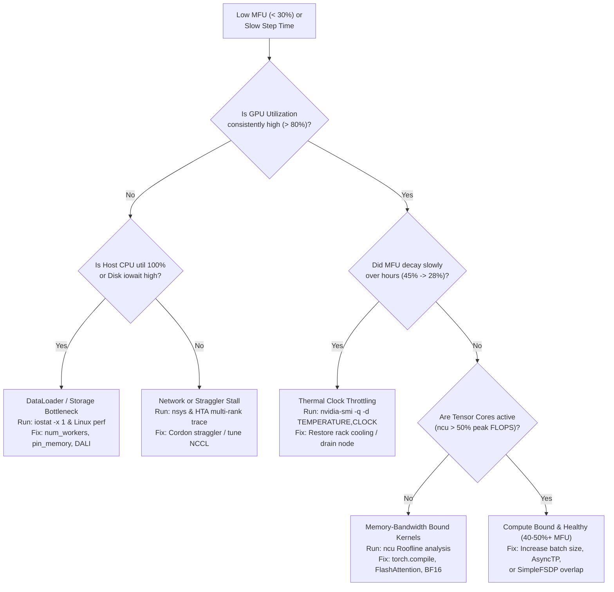

# 14.12 Training performance engineering and troubleshooting

| Field | Value |
|---|---|
| Level | Advanced |
| Priority tier | 2 |
| Lab venue | Nebius GPU + Local Python Verification Lab |
| Part | Part 14: Distributed training and fine-tuning |
| Primary sources | *AI Systems Performance Engineering* Chapters 1, 4, and 13; *Distributed AI Systems* Chapters 3, 4, 8, and 10; NVIDIA Zero-to-Hero Volume 13 (`chapter-11-performance-engineering-and-troubleshooting.md`, `chapter-01-why-distributed-training-exists.md`, `chapter-08-nccl-collectives-and-communication-paths.md`, `chapter-12-volume-13-summary.md`, `index.md`, `labs/lab-01..04`) |
| Cross-references | Chapter 10.20 (Nsight Systems & Nsight Compute); Chapters 12.15–12.17 (NCCL collectives & `nccl-tests`); Chapters 14.8–14.11 (PyTorch performance, multi-node architecture, and checkpointing) |
| Code | `code/part14/training_performance_troubleshooting.py`, `code/part14/training_performance_troubleshooting_lab.py` |
| Coverage file | `planning/coverage/chapters/14-12.md` |
| Claim & number ledger | `planning/ledgers/14-12.md` |

## Why this matters for AI infrastructure

A distributed training job that runs without crashing is not necessarily a healthy job. Picture a team that trains a foundation model on sixty-four GPUs for two weeks. The job finishes and the loss converges, but scaling efficiency was only 52 percent. The team paid for sixty-four GPUs and received the compute of about thirty-three, which wasted over fifty thousand dollars on idle silicon. No dashboard light turned red along the way.

```text
Quantitative Stakes of Distributed Training Performance Engineering:
- 64-GPU wasted compute case study (Distributed AI Systems, Chapter 10):
  64 GPUs across 8 nodes at 45% GPU utilization and 52% scaling efficiency
  Effective GPUs = 64 * 0.52 = 33.28 (~33 GPUs); Wasted GPUs = 64 - 33.28 = 30.72 (~31 GPUs)
  2-week run = 336 hours/GPU -> 30.72 * 336 = 10,321.92 wasted GPU-hours
  Cloud cost wasted at $4-$5/GPU-hour = $41,287.68 to $51,609.60 (~$50,000 per run)
- 70B LLM on 8x H100 SXM before vs after DataLoader fix (Volume 13, Chapter 11):
  Peak dense BF16 per H100 SXM = 989 TFLOPS -> 8-GPU node peak = 7,912 TFLOPS
  Before fix (30% GPU util, 3,200 tok/s): 6 * 70 * 10^9 * 3,200 = 1,344 TFLOPS -> 16.99% (~17%) MFU
  After fix  (9,000 tok/s):               6 * 70 * 10^9 * 9,000 = 3,780 TFLOPS -> 47.78% (~48%) MFU (2.8125x gain)
- Meta 54-day Llama 3 405B interruption analysis (ASP, Chapter 4, Table 4-4):
  419 unexpected interruptions across 54 days: 148 Faulty GPU (35.3%) + 72 HBM3 (17.2%) = 220 (52.5%);
  all GPU hardware categories = 268 (64.0%), Software bugs = 54 (12.9%), Network switch/cable = 35 (8.4%)
```

Two traps hide slowdowns like this from the people on call.

The first is the utilization counter. The GPU utilization figure in `nvidia-smi` only says that at least one kernel was active on the device during a sampling window. A GPU can report 99 percent while it spends four-fifths of its time spinning inside an NCCL wait loop. It can also report a high figure while it runs tiny memory-bound kernels that leave its Tensor Cores almost idle.

The second is how collectives amplify one slow device. AllReduce, AllGather, ReduceScatter, and AllToAll are synchronization barriers across every rank. Suppose one GPU out of 512 throttles its clocks because of a warm heatsink or a degraded PCIe link. The other 511 GPUs wait for it on every step.

Measure Model FLOPs Utilization and Goodput instead of trusting the utilization percentage, and then narrow the bottleneck from the cluster level down to a single kernel.

## Prerequisites and outcomes

### Prerequisites
- Hardware profiling fundamentals from Chapter 10.20 covering DCGM, Nsight Systems, and Nsight Compute.
- NCCL collective algorithms, topologies, and `nccl-tests` benchmarking from Chapters 12.15 through 12.17.
- Distributed training parallelism, PyTorch compiler tuning, multi-node Slurm orchestration, and checkpointing from Chapters 14.4 through 14.11.

### Outcomes
After completing this chapter, you will be able to do five things.
1. Show why the `nvidia-smi` utilization figure misleads by computing Model FLOPs Utilization, Hardware FLOPs Utilization, Goodput, and the Effective Training Time Ratio for a multi-node run.
2. Work through a top-down triage that tells apart four causes of slow steps: a starved DataLoader, unfused memory-bound kernels, allocator fragmentation, and exposed collective communication.
3. Line up four views of one training iteration: PyTorch Profiler tables, Nsight Systems NVTX projections, Nsight Compute Roofline charts, and Linux `perf` CPU profiles.
4. Find compute and network stragglers across dozens of nodes by looking for uneven NCCL wait times in Nsight Systems and Holistic Trace Analysis.
5. Diagnose six common production failures, such as thermal clock drift, a stopped Fabric Manager, PCIe AER errors, Xid 48 and 63 ECC faults, and MoE AllToAll router collapse.

---

## 1. The Utilization Lie: MFU, HFU, Goodput, and Step-Time Anatomy

### 1.1 Why `nvidia-smi` Lies About Training Speed

Imagine a car whose tachometer is pinned at eight thousand revolutions per minute while its tires spin in deep mud. The engine is busy, but the car is barely moving. The utilization column in `nvidia-smi` is that tachometer. It measures the share of time slices in which at least one CUDA kernel was resident on any Streaming Multiprocessor. It tells you the GPU is busy, not that it is doing useful matrix math.

A GPU at 99 percent utilization can still train badly, for two reasons.

One reason is waiting. When a rank waits at an NCCL collective for a slow neighbor, NCCL runs a persistent communication kernel that polls device memory. That kernel occupies a few Streaming Multiprocessors, so `nvidia-smi` reports 99 to 100 percent while the GPU does no math at all.

The other reason is memory traffic. If the model launches thousands of tiny, unfused elementwise or attention kernels, they saturate memory bandwidth, and the Tensor Cores sit idle for more than four-fifths of every step.

To see whether the car is really moving, engineers compute **Model FLOPs Utilization**. It divides the mathematical operations the model needs per second by the theoretical peak floating-point rate of the hardware. The sources behind this chapter treat 35 to 55 percent as the range published runs reach, with 40 to 50 percent a good target, for large language model training. A figure near 15 to 20 percent points to a severe bottleneck that starves the Tensor Cores.

### 1.2 Worked Math: Computing MFU, HFU, and Goodput

For a dense Transformer with N non-embedding parameters, each training token costs about 2N floating-point operations in the forward pass and 4N in the backward pass. Together that is the common 6N rule of thumb per token. With full activation checkpointing, the backward pass first recomputes the forward activations. The hardware then does about 8N operations per token.

```text
MFU, HFU, and Goodput Reference Equations (Volume 13 Ch. 11 & ASP Ch. 1):
  Model FLOPs per step (dense Transformer):   C_model = 6 * N_params * tokens_per_step (2N fwd + 4N bwd)
  Hardware FLOPs per step (with recompute):   C_hw    = 8 * N_params * tokens_per_step (2N fwd + 2N recompute + 4N bwd)
  Achieved Model FLOPs/sec:                   F_ach   = 6 * N_params * tokens_per_sec
  Cluster Peak FLOPs/sec:                     F_peak  = num_gpus * Peak_FLOPs_per_GPU
  Model FLOPs Utilization (MFU):              MFU     = F_ach / F_peak
  Hardware FLOPs Utilization (HFU):           HFU     = (C_hw / C_model) * MFU = (8 / 6) * MFU (always >= MFU)

Worked Example 1 — Llama-3-70B (70 * 10^9 params) on 8x H100 SXM (989 TFLOPS dense BF16 per GPU):
  Cluster Peak BF16 Throughput:               8 * 989 TFLOPS = 7,912 TFLOPS
  Before DataLoader Fix (3,200 tok/s, 30% GPU util):
    Achieved FLOPs/sec = 6 * 70 * 10^9 * 3,200 = 1.344 * 10^15 FLOPs/s = 1,344 TFLOPS
    MFU = 1,344 / 7,912 = 16.99% (~17% MFU -> severe non-compute bottleneck)
  After DataLoader Fix (9,000 tok/s, multi-worker + GPU augmentations):
    Achieved FLOPs/sec = 6 * 70 * 10^9 * 9,000 = 3.780 * 10^15 FLOPs/s = 3,780 TFLOPS
    MFU = 3,780 / 7,912 = 47.78% (~48% MFU -> healthy production range, 2.8125x speedup)
    HFU (with full activation recomputation)   = 8 * 70 * 10^9 * 9,000 = 5,040 TFLOPS -> 63.70% HFU

Worked Example 2 — Cluster Goodput and Effective Training Time Ratio (ASP Ch. 1):
  Node Goodput (100,000 tokens in 10 s):      10,000 tokens/sec realized goodput
  Node Peak (8 GPUs * 1,500 tok/s/GPU):       12,000 tokens/sec theoretical peak
  Goodput Efficiency:                         10,000 / 12,000 = 83.33% (83.3%)
  Pipeline-Starved Job (300 vs 1,000 samp/s): 300 / 1,000 = 30.0% goodput (70.0% wasted capacity, matching
                                              Meta's Revisiting Reliability finding of 70%-75% lost compute)
```

Model FLOPs Utilization tells you how fast a step runs while the loop is running. **Goodput** tells you how many useful tokens you process per second of wall-clock time, over the whole run. It discounts time lost to checkpoint pauses, preemptions, node failures, and restarts. Meta calls the same idea the Effective Training Time Ratio. *AI Systems Performance Engineering* Chapter 1 cites Meta's analysis for a case in which a cluster looked 100 percent allocated while 70 to 75 percent of its compute was lost to communication stalls, data delays, and fault recovery.

### 1.3 Step-Time Phase Decomposition and Scaling Efficiency

Every distributed training step has five phases: host data loading, forward computation, backward computation, collective communication, and optimizer updates. When you move a workload from one GPU to sixteen, the step gets shorter, but the share of it spent on communication grows quickly.

| Metric or phase | 1 GPU baseline (*Distributed AI Systems*, Ch. 10) | 16 GPUs scaled (*Distributed AI Systems*, Ch. 10) | MLPerf 24.0 ms step (*AI Systems Performance Engineering*, Table 13-6) | 64-expert MoE 138.0 ms step (*AI Systems Performance Engineering*, Table 13-3) |
|---|---|---|---|---|
| Total Step Time | 155.0 ms | 33.0 ms (4.697x speedup) | 24.0 ms (100.0%) | 138.0 ms (100.0%, 1 instance) |
| Forward + Backward Compute | 155.0 ms (100.0%) | 14.85 ms (45.0%) | 10.5 ms fwd (43.8%) + 9.0 ms bwd (37.5%) = 19.5 ms (81.3%) | 60.5 ms fwd (43.84%) + 58.3 ms bwd (42.25%) = 118.8 ms |
| Exposed Collective Communication | 0.0 ms (0.0%) | 18.15 ms (55.0% AllReduce tax) | 4.0 ms AllReduce (16.7%, 1/6 of step) | 30.80 ms MoE `dispatch` + `combine` (22.32% of CUDA time) |
| Optimizer / Other Overhead | Included in compute | Included in compute | 0.5 ms other / data loading (2.1%) | 19.2 ms `optimizer_step` (13.91%, 64 `aten::add_` kernels) |
| Scaling Efficiency Tier | 100.0% reference | 29.36% (< 50% Poor tier) | > 80% Good tier | Improved 1.43x via `torch.compile` (248.0 -> 173.0 ms) |

```text
Scaling Efficiency and Amdahl's Law Reference (Distributed AI Systems, Chapter 10):
  Scaling Efficiency Formula:  Efficiency(N) = Throughput(N) / (N * Throughput(1)) = StepTime(1) / (N * StepTime(N))
  8-GPU Worked Example:        6.5x speedup on 8 GPUs -> 6.5 / 8 = 81.25% scaling efficiency (~19% coordination loss)
                               6.8x speedup on 8 GPUs -> 6.8 / 8 = 85.00% scaling efficiency
  Scaling Interpretation Tiers:
    > 90%:   Excellent scaling (well-overlapped communication and saturated compute)
    70-90%:  Good scaling (standard production band for tuned DDP and FSDP workloads)
    50-70%:  Moderate scaling (significant exposed communication; inspect fabric and bucket overlap)
    < 50%:   Poor scaling (severe communication, straggler, or DataLoader bottleneck; e.g., 16-GPU 33 ms = 29.36%)
  Amdahl's Law Ceiling:        Speedup(N) = 1 / (s + (1 - s) / N)
    For serial fraction s = 0.10 (10% unparallelizable work):
    Max speedup as N -> inf = 1 / 0.10 = 10.0x; at N = 64 GPUs, Speedup(64) = 1 / (0.10 + 0.90 / 64) = 8.77x
```

Before you tune anything, split the step time into its five phases. Optimizing a 2 percent phase cannot fix a 55 percent communication stall.

---

## 2. Top-Down Bottleneck Hunting: From Cluster Telemetry to Kernel Roofline

### 2.1 The Three-Level Diagnostic Funnel and Decision Tree

When a 512-GPU job runs slowly, jumping straight into a kernel profiler wastes hours. You might spend an afternoon studying matrix multiply tile sizes on rank 0 while the real problem is a single-threaded Python DataLoader, or a dirty fiber transceiver on node 14.

Hunt the bottleneck from the outside in, in three levels. Start with system telemetry in Prometheus, Grafana, DCGM, and `nvidia-smi`. It tells you whether the host CPU starves the job, the network blocks it, or the GPU runs inefficiently. Next, capture a multi-rank timeline in PyTorch Profiler, Nsight Systems, or Holistic Trace Analysis, to find idle gaps, transfers that do not overlap, and straggler ranks. Last, run Nsight Compute on the hot kernels the timeline revealed, and read the Roofline chart to see whether each one is memory-bound or compute-bound.



### 2.2 Host CPU, DataLoader, and Storage I/O Bottlenecks

Suppose GPUs sit at 30 percent utilization and Model FLOPs Utilization is 10 to 17 percent. The accelerators are starving for input batches. Low GPU utilization together with high CPU use or disk I/O wait shows that the input pipeline cannot keep up. High CPU wait does not prove the storage array is slow, though. A single-threaded Python tokenizer or image augmentation loop produces the same starvation signature.

To tell storage from host CPU overhead, first run `iostat -x 1` and check whether the NVMe drives or parallel filesystem mounts are saturated. Then sample the host CPU with `perf stat` and `perf record` to see instructions per cycle and Python call stacks. On an NVIDIA Grace-Blackwell superchip, you can also read the NVLink-C2C performance monitoring units, which show whether host-to-device traffic saturates the chip-to-chip link.

```text
Host CPU and Grace-Blackwell Linux perf Reference Profile (ASP Chapter 13):
  perf stat summary (1.234567890 s elapsed, 1,200.345 msec task-clock -> 0.600 CPUs / 60% CPU utilized):
    Cycles:                  2,400,567,890 cycles (~2.0 GHz effective clock)
    Instructions:            3,800,123,456 instructions -> 1.58 IPC (19.75% of 8.0 max IPC on Arm Neoverse V2)
    Cache / Branch misses:   12,345,678 cache misses (0.32%); 4,567,890 branch misses (0.12%)
  perf report top-5 CPU hotspots (-F 2000 Hz DWARF call graph, 89.7% cumulative):
    1. py::forward           45.0%  -> Python interpreter dispatch overhead (Fix: torch.compile / CUDA Graphs)
    2. aten::matmul          20.5%  -> Host kernel launch & C++ dispatcher (Fix: operator fusion / large batch)
    3. dataloader_iter_next  10.2%  -> DataLoader worker starvation       (Fix: num_workers=4/GPU, persistent_workers=True)
    4. ncclAllReduce          8.7%  -> Host collective enqueue & polling  (Fix: 25 MB DDP bucket tuning & overlap)
    5. read                   5.3%  -> Storage syscall overhead           (Fix: pin_memory=True, prefetch_factor=4..8)
  Grace-Blackwell NVLink-C2C PMU counter (2.345678901 s window):
    nvidia_nvlink_c2c0_pmu_0/cycles/: 3,567,890,123 cycles (45,678,901 CPU cycles, 7,890,123 cache misses)
```

Once you confirm a DataLoader bottleneck, apply four fixes in order.

1. Set `num_workers` to two to four per GPU, with `persistent_workers=True` and `prefetch_factor=4`. Workers then stay alive across epochs and stage batches ahead of time.
2. Turn on `pin_memory=True` with non-blocking copies, so the GPU copies batches straight from page-locked host memory without CPU staging.
3. Move heavy preprocessing and image augmentation to the GPU with NVIDIA DALI.
4. Remove accidental host-device syncs, such as `tensor.item()`, `tensor.cpu()`, or `print(loss)` in the inner loop.

Time GPU intervals with `torch.cuda.Event(enable_timing=True)` and not with Python `time.time()`.

### 2.3 Kernel Roofline, `torch.compile`, and Memory Allocator Tuning

Suppose `nvidia-smi` reports 98 to 100 percent utilization on every rank, yet Model FLOPs Utilization is stuck at 22 percent and steps run twice as slow as expected. That is the usual signature of a memory-bandwidth-bound workload. The GPU runs kernels all the time, but they spend their time reading and writing intermediate activations in HBM instead of feeding the Tensor Cores.

Putting the `torch.profiler` operator tables next to the Nsight Systems NVTX projections and the Nsight Compute Roofline metrics shows why. The table below summarizes what each layer reveals.

| Profiling layer and table (*AI Systems Performance Engineering*, Ch. 13) | Measured Metrics & Breakdown | Diagnosis & Optimization Action |
|---|---|---|
| `torch.profiler` Top-10 CUDA Ops (Table 13-2: 64-expert MoE, `batch_size=4`, 5 warmup steps, 138.00 ms total across 320 calls) | GEMMs: `aten::matmul` 43.00 ms (128 calls, 31.16%) + `aten::linear` 35.50 ms (64 calls, 25.72%) = 78.50 ms (56.88%). Routing: `dispatch` 18.70 ms (2 calls, 13.55%) + `combine` 12.10 ms (2 calls, 8.77%) = 30.80 ms (22.32%). Other 6 ops: `aten::layer_norm` 10.20 ms (16 calls, 7.39%), `aten::softmax` 5.70 ms (4 calls, 4.13%), `aten::scatter` 4.10 ms (16 calls, 2.97%), `aten::gather` 3.60 ms (16 calls, 2.61%), `aten::to` 2.90 ms (8 calls, 2.10%), `aten::add_` 2.20 ms (64 calls, 1.59%) = 28.70 ms (20.80%). | Each of the 64 experts launches separate forward/backward `matmul` (128 calls) and optimizer `add_` (64 calls) kernels. Fuse elementwise ops and group expert GEMMs. |
| Nsight Systems `nvtx_gpu_proj_sum` (Table 13-3: 138.0 ms projected GPU time) | `train_step`: 138.0 ms total (0.0 ms self, 138.0 ms child, 1 instance) = `forward` 60.5 ms (43.84%, 130 instances) + `backward` 58.3 ms (42.25%, 130 instances) + `optimizer_step` 19.2 ms (13.91%, 1 instance bracketing all 64 `aten::add_` launches). | `nsys` uses CUPTI to project asynchronous GPU kernels back onto host NVTX ranges, revealing 19.2 ms of unfused per-expert optimizer launch overhead; fix with `AdamW(..., fused=True)`. |
| Nsight Compute (`ncu`) Expert GEMM Roofline (Table 13-4) | Baseline: 50% peak FLOPS, 70% peak HBM bandwidth, 60% achieved SM occupancy (Memory bound). Optimized: 85% peak FLOPS, 40% peak HBM bandwidth, 80% achieved SM occupancy (Compute bound; note 25%–50% occupancy often suffices to hide latency). | Increasing tile reuse, fusing bias/activation epilogues, and enabling BF16, TF32, or FP8 Tensor Cores shifts the kernel from the sloped HBM roof to the flat compute roof. |
| `torch.compile` & Regional Compilation (Table 13-5) | Eager MoE step: 248.0 ms -> Compiled (`max-autotune`): 173.0 ms (75.0 ms saved, 30.24% / ~30% reduction, 1.43x speedup vs < 10% on single-GEMM dense models). Modes: `default`, `reduce-overhead`, `max-autotune`, `max-autotune-no-cudagraphs`. | Apply `@torch.compiler.nested_compile_region` to `TransformerBlock` and persist artifacts via `TORCHINDUCTOR_CACHE_DIR` / `save_cache_artifacts()` across nodes. |
| `PYTORCH_ALLOC_CONF` & Shared CUDA Graph Pool | `roundup_power2_divisions` (`512:2` and `1024:4`) splits the 512 to 1024 MB range into 2 buckets of 256 MB (`[512, 768, 1024]`), rounding a 600 MB request up to 768 MB. Setting `expandable_segments:True,max_split_size_mb:128,garbage_collection_threshold:0.8` keeps reserved VRAM at 600 MB (saving 168 MB / 21.88%). FireworksAI shared CUDA Graph pool captures batch sizes in decreasing order `[8, 4, 2, 1]` (or handles 96 worst-case vs 64 normal max batch). | Decreasing capture order `[8, 4, 2, 1]` allocates the high-water-mark buffer on batch 8 first so smaller graphs reuse the same memory pool without fragmentation. |

When GPU utilization is near 100 percent but MFU is below 30 percent, profile with Nsight Compute. Then apply `torch.compile`, FlashAttention, and `expandable_segments:True` to turn memory-bound launches into fused Tensor Core compute.

---

## 3. Distributed Communication Profiling, Straggler Detection, and Overlap

### 3.1 NCCL Collectives, Communicator Lifecycle, and In-Network SHARP

Even when every kernel is compute-bound, training stalls if collective communication is set up badly. A common bug in custom loops is creating and destroying a process group inside every step. Creating an NCCL communicator across nodes takes 48.0 milliseconds. If the loop calls `init_process_group` and `destroy_process_group` around a 0.5-millisecond AllReduce, each step takes 48.5 milliseconds. Creating the communicator once at startup removes nearly 99 percent of that time.

```text
NCCL Communicator Lifecycle, Topology, and SHARP Reference (ASP Ch. 4 & V13 Ch. 8):
- Communicator reuse (ASP Table 4-3):
  Per-iteration init_process_group + destroy = 48.0 ms; 1-element AllReduce = 0.5 ms
  Total step before fix = 48.5 ms -> after moving init outside loop = 0.5 ms (98.97% reduction, 97.0x speedup)
- Ring vs Tree collective scaling on 28.0 GB FP32 gradients (7B model, Volume 13 Ch. 8):
  Ring volume per GPU = 2 * (N - 1) / N * size; busbw = algbw * 2 * (N - 1) / N
  Case A (8 GPUs, single node, 900 GB/s NVLink 4 vs ~32 GB/s PCIe Gen4 x16):
    Data moved = 2 * (7 / 8) * 28.0 GB = 49.0 GB per GPU -> transfer time = 49.0 / 900 = 54.4 ms (~54 ms)
    Sequential ring hops = 8 hops * 1-5 us/hop < 0.1 ms (bandwidth-dominated; Ring is optimal)
  Case B (512 GPUs across 64 nodes, 25-50 GB/s InfiniBand):
    Data moved = 2 * (511 / 512) * 28.0 GB = 55.89 GB (~55.9 GB) -> time at 25 GB/s = 2.24 s (~2.2 s)
    Ring hops = 512 hops (0.5-2.5 ms wire latency + per-hop launch jitter) vs Double Binary Tree = log2(512) = 9 hops
- In-network SHARP and NVLink SHARP (NVLS) reduction (ASP Ch. 4):
  Standard Ring ReduceScatter receives B * (N - 1) / N bytes across (N - 1) hops per GPU
  Switch-offloaded SHARP aggregates in fabric and returns B / N bytes -> 1 / (N - 1) receive volume (1/7 on 8 GPUs)
  Overlapping NVLS multicast AllGather with ReduceScatter cuts phase time by ~1/2; IB SHARP yields 2x-5x AllReduce speedups
- Environment and Profiler Plugin Limits (ASP Ch. 4):
  Socket connection cap: NCCL_SOCKET_NTHREADS * NCCL_NSOCKS_PERTHREAD <= 64 (e.g., 2 threads * 2 socks = 4 connections)
  Buffer & affinity: start NCCL_BUFFSIZE at 4 MB; bind rank to NUMA cores and set NCCL_IGNORE_CPU_AFFINITY=1
  NCCL_PROFILER_PLUGIN: 32-bit event activation mask with 5 callbacks (init, startEvent, stopEvent, recordEventState, finalize)
- TorchTitan SimpleFSDP & AsyncTP Overlap (ASP Ch. 13):
  DDP default bucket: bucket_cap_mb = 25 MB; FSDP block auto-wrap: min_num_params = int(1e8), use_orig_params = True
  SimpleFSDP vs eager FSDP2: -28% peak memory (64.0 GB -> 46.08 GB) and +69% throughput (10,000 -> 16,900 tok/s)
  AsyncTP SM-wave overlap: 12.0 ms compute + 4.0 ms AllGather = 16.0 ms sequential -> 12.6 ms at 85% overlap (-21.25%)
```

When you combine PyTorch distributed training with `torch.compile`, you must keep the overlap between compute and communication. DDP groups gradients into 25 MB buckets, set by `bucket_cap_mb=25`, and TorchDynamo breaks the graph on purpose between buckets. The AllReduce of one bucket then overlaps with the backward pass of the next. In FSDP, wrapping at transformer-block granularity materializes one block at a time and overlaps AllGather and ReduceScatter with block compute. In TorchTitan, SimpleFSDP lowers peak GPU memory by 28 percent and raises throughput by 69 percent compared with eager FSDP2. AsyncTP overlaps Tensor Parallelism collectives with matrix multiplications and cuts the sequential phase latency by over 21 percent.

### 3.2 Multi-GPU Straggler Detection with Nsight Systems and HTA

In a synchronous 64-node job, the whole cluster runs at the speed of its slowest GPU. Suppose Nsight Systems shows that GPUs on sixty-three nodes spend an extra 200 milliseconds per step in an NCCL wait kernel during AllReduce. It is tempting to blame the network switches on those nodes. The long wait bars actually show that those sixty-three nodes finished on time and are waiting for the sixty-fourth. **To find the straggler, look for the one rank with zero NCCL wait time.**

Meta's Holistic Trace Analysis automates this multi-rank alignment across `torch.profiler` Kineto JSON traces. Because the legacy TensorBoard profiler trace viewer is deprecated, production teams load rank-aligned JSON traces into Holistic Trace Analysis and Perfetto to compare compute, communication, and idle time across every rank side by side.

```text
Multi-Rank Straggler Identification in HTA and Nsight Systems (ASP Ch. 13 & V13 Ch. 11):
- 64-Node Cluster Straggler Signature (Volume 13 Ch. 11 Scenario 2):
  Nodes 00..13 and 15..63 (63 fast nodes): normal compute followed by 200 ms NCCL Wait state in AllReduce
  Node 14 (node-14-straggler):             0 ms NCCL Wait state; compute or PCIe transfer takes +200 ms longer
  Root cause & fix: PCIe AER hardware errors in dmesg | grep -i "AER" -> kubectl cordon node-14-straggler
- 8-Rank HTA Aligned Step Breakdown (24.0 ms total step time, ASP Ch. 13):
  Rank 0 (Fastest / Most Idle): 18.0 ms compute + 4.0 ms AllReduce + 2.0 ms idle wait = 24.0 ms
  Ranks 1, 2, 5, 6 (Normal):    19.0 ms compute + 4.0 ms AllReduce + 1.0 ms idle wait = 24.0 ms
  Ranks 3, 4 (Normal):          19.5 ms compute + 3.5 ms AllReduce + 1.0 ms idle wait = 24.0 ms
  Rank 7 (Compute Straggler):   21.0 ms compute + 3.0 ms AllReduce + 0.0 ms idle wait = 24.0 ms
```

### 3.3 Continuous Performance Regression Gates (`TorchBench`, `PyTorch HUD`, `MLPerf`)

Tuning a pipeline once is not enough, because small commits and framework upgrades can quietly erode throughput. Before you time a benchmark, run warmup iterations so JIT compilation and CUDA Graph capture settle. Call `torch.cuda.synchronize()` before and after the timed region, and collect at least 100 iterations so you can report P50, P95, and P99 latency. Also compare accuracy between single-GPU and distributed runs to catch silent numerical bugs.

```text
Benchmark Warmup, Statistical Accuracy, and PyTorch HUD CI Gate Reference (DAI Ch. 10 & ASP Ch. 13):
- Warmup & Iteration Discipline (DAI Ch. 10):
  Eager PyTorch warmup: 5-10 steps; torch.compile / CUDA Graphs warmup: 20-50 steps; measured run: >= 100 iterations
- Distributed Accuracy Significance Check (DAI Ch. 10):
  0.5% accuracy drop at p = 0.3 -> random noise; 0.5% drop at p = 0.001 (or 8% downstream drop) -> real regression
- TorchBench & PyTorch HUD Regression Gate (ASP Ch. 13):
  Command: torchbench run --model moe --iters 10 --batch-size 4 --json results.json
  Rule: Fail CI build on a >= 5% throughput regression sustained across 3 consecutive runs
  Example (10,000 tok/s baseline): [9400, 9450, 9800] -> PASS (2 runs); [9400, 9450, 9480] -> FAIL (3 runs)
```

In continuous integration, run `torchbench` on dedicated hardware runners and enforce the PyTorch HUD regression rule. That rule fails the build whenever throughput regresses by 5 percent or more across three consecutive runs.

Align multi-rank timelines in Holistic Trace Analysis to find the rank with zero collective wait, and protect your gains with a CI gate that fails on a 5 percent regression over three runs.

---

## 4. Production Reliability, Silent Degradation, and Failure Triage

### 4.1 Lessons from Meta's 54-Day Llama 3 405B Interruption Ledger

At a thousand GPUs, hardware faults are a daily event. During a 54-day pretraining run of Llama 3 405B, Meta recorded 419 unexpected job interruptions. Nearly two-thirds came from GPU hardware. Faulty GPUs and HBM3 memory errors led the list. Network switches, cables, and unplanned host maintenance caused another 16 percent.

| Component and category (*AI Systems Performance Engineering*, Table 4-4) | Interruption Count (54 Days) | Share of 419 Interruptions | Primary Operational Mitigation |
|---|---|---|---|
| Faulty GPU + GPU HBM3 memory (`GPU`) | 148 (35.3%) + 72 (17.2%) = 220 | 52.5% (just over half of all stops) | Monitor `Xid 48` / `63` / `79` in `dmesg -T` and `nvidia-smi -q -d ECC`; drain node and RMA |
| Software bug + Dependency (`Dependency`) | 54 (12.9%) + 2 (0.5%) = 56 | 13.4% | Pre-flight CI gates, `torch.allclose` kernel tests, and pinned container images |
| Network switch/cable (`Network`) + NIC (`Host`) | 35 (8.4%) + 7 (1.7%) = 42 | 10.0% | `ibportstate` / `perfquery` link error checks, pairwise `nccl-tests`, and spare nodes |
| Host maintenance (`Unplanned Maintenance`) | 32 | 7.6% | Slurm `#SBATCH --signal=SIGUSR1@90` + `SIGTERM` graceful sharded checkpointing |
| GPU SRAM (19, 4.5%) + GSP (17, 4.1%) + SDC (6, 1.4%) + Thermal sensor (6, 1.4%) | 48 | 11.5% (Total GPU categories = 268 / 64.0%) | DCGM health watches, thermal clock monitoring, and periodic per-layer checksums |
| NCCL watchdog timeouts (`Unknown`) + SSD/PSU (3 each) + Chassis/IO/CPU/RAM (2 each) | 7 (1.7%) + 6 (1.4%) + 8 (1.9%) = 21 | 5.0% | Explicit `TORCH_NCCL_ASYNC_ERROR_HANDLING=1` and Flight Recorder ring buffer dumps |

### 4.2 Quick-Reference: Production Symptom to First Diagnostic Command

When you are paged for a stalled or slow training job, look up the symptom in this table to find the likely cause and the first command to run.

| Production symptom (NVIDIA Zero-to-Hero Volume 13, Chapters 1, 11, and 12) | Most Likely Root Cause | Healthy vs Red-Flag Signal | First Diagnostic Command |
|---|---|---|---|
| Job hangs indefinitely; watchdog kills after 30 min (`NCCL WARN Watchdog caught network down!`) | Dead rank (OOM / `Xid 79`) or conditional branch with `find_unused_parameters=False` | Healthy: all ranks enter collective. Red flag: missing rank or `Connection timed out`. | `NCCL_DEBUG=INFO NCCL_DEBUG_SUBSYS=INIT,ENV` and `dmesg -T \| grep -iE "oom\|xid"` |
| GPU util 98–100%, but MFU is only 15–22% | Unfused memory-bound kernels or NCCL spin-wait loop | Healthy: 40–50% MFU, >50% Tensor Core active. Red flag: &lt;25% MFU at 100% util. | `ncu --metrics sm__throughput.avg.pct_of_peak_sustained_elapsed python train.py` |
| GPU util 30% (or < 50% sustained), MFU 10–17% | Host CPU DataLoader starvation or storage I/O wait | Healthy: 80–95% GPU util across all ranks. Red flag: &lt;50% GPU util with high CPU iowait. | `iostat -x 1` and `nsys profile -t cuda,osrt,nvtx -o dataloader_trace python train.py` |
| One rank at 45% util while peers sit at 88%, or MFU drifts from 45% to 28% over 24 hours | Thermal clock throttling (>83–85°C) or PCIe AER link degradation on a straggler | Healthy: symmetric util & clocks. Red flag: 45% vs 88% util or 37.8% clock drop. | `nvidia-smi -q -d TEMPERATURE,CLOCK` and `dmesg \| grep -i "AER"` |
| Single-node `all_reduce_perf` `busbw` drops from 800 GB/s (or 400 GB/s) to 90 GB/s (or 20 GB/s) | Broken NVLink bridge (`PIX` instead of `NV#`), BIOS ACS on, or stopped `nvidia-fabricmanager` | Healthy: ≥ 32 MB `busbw` near 800–900 GB/s NVLink 4. Red flag: 20–90 GB/s PCIe Gen4 x16 speed. | `nvidia-smi topo -m` and `systemctl status nvidia-fabricmanager` |
| CUDA OOM at 79,456 / 79,559 MiB (103 MiB free, tried 2.45 GiB) or GPU 0 at 89% vs GPUs 1–2 at 45%/52% | 7B FP32 state (180–190 GB > 80 GB), coarse FSDP wrap, `FULL_STATE_DICT` gather, or missing DDP wrap | Healthy: 70–90% flat working set. Red flag: >95% VRAM, climbing leak, or asymmetric GPU 0 load. | `nvidia-smi pmon` and `nvidia-smi --query-gpu=index,memory.used,memory.total,utilization.gpu --format=csv -l 2` |

Give every production job `TORCH_NCCL_ASYNC_ERROR_HANDLING=1`, per-step JSON timing logs, and automated ECC and thermal checks. Then silent hardware degradation does not pass as a slow model.

---

## 5. Commands and configurations that matter

### 5.1 Macro Telemetry, Thermal / ECC Health, and Fabric Verification (`untested here`)

```bash
# 1. Continuous 2-second GPU memory and utilization watch (healthy: 70-90% mem, 80-95% util)
nvidia-smi --query-gpu=index,memory.used,memory.free,memory.total,utilization.gpu --format=csv -l 2

# 2. Check per-GPU process placement (spot single-GPU script launched under torchrun)
nvidia-smi pmon -c 1

# 3. Inspect thermal throttling, SM clock drops (e.g., 45% -> 28% MFU decay), and ECC errors (Xid 48/63)
nvidia-smi -q -d TEMPERATURE,CLOCK,PERFORMANCE,ECC

# 4. Inspect host disk I/O wait, kernel OOM kills, Xid errors, and PCIe AER link errors
iostat -x 1 5
dmesg -T | grep -iE "oom|xid|aer|nvlink"

# 5. Verify NVLink matrix (NV# vs PIX) and Fabric Manager service after a node reboot
nvidia-smi topo -m
systemctl status nvidia-fabricmanager

# 6. Benchmark 8-GPU NCCL AllReduce (always compare busbw >= 32 MB against link spec, never algbw)
./build/all_reduce_perf -b 8 -e 128M -f 2 -g 8
```

### 5.2 Multi-Level Profiling (`torch.profiler`, `nsys`, `ncu`, Linux `perf`) (`untested here`)

```bash
# 1. System-wide Nsight Systems timeline with CUDA, OS runtime, and NVTX projection summary
nsys profile --trace=cuda,nvtx,osrt --output=training_profile.nsys-rep python train.py
nsys stats --report nvtx_gpu_proj_sum,gputrace training_profile.nsys-rep

# 2. Kernel-level Nsight Compute Tensor Core throughput & Roofline check (diagnose 100% util / 22% MFU)
ncu --metrics sm__throughput.avg.pct_of_peak_sustained_elapsed,sm__inst_executed_pipe_tensor.avg.pct_of_peak_sustained_active python train.py

# 3. Host CPU and Grace-Blackwell NVLink-C2C PMU profiling with Linux perf
perf stat -e cycles,instructions,cache-misses,branch-misses python train.py
perf record -F 2000 -g --call-graph dwarf -- python train.py
perf report --stdio --sort=comm,dso,symbol
perf stat -e nvidia_nvlink_c2c0_pmu_0/cycles/,cycles,cache-misses -a -- sleep 2.345678901
```

### 5.3 Production NCCL, Allocator, and Compiler Environment Flags

```bash
# Memory allocator tuning: eliminate 768 MB power-of-two rounding -> 600 MB reserved VRAM (-21.88%)
export PYTORCH_ALLOC_CONF="expandable_segments:True,max_split_size_mb:128,garbage_collection_threshold:0.8"

# Persist TorchInductor compiled Mega-Cache across multi-node restarts
export TORCHINDUCTOR_CACHE_DIR="/shared/Confirm_MegaCache/torchinductor"

# Explicit NCCL resiliency, NUMA thread freedom, and SHARP / NVLS offload controls
export TORCH_NCCL_ASYNC_ERROR_HANDLING=1
export NCCL_ASYNC_ERROR_HANDLING=1
export NCCL_IGNORE_CPU_AFFINITY=1
export NCCL_BUFFSIZE=4194304
export NCCL_NVLS_ENABLE=1
export NCCL_COLLNET_ENABLE=1
export NCCL_DEBUG=WARN
```

---

## How it fails

Each row below is a runbook that goes from the first symptom, through the evidence that proves the cause, to the fix.

| # | Failure Mode & Symptom | Evidence vs. Proof | Root-Cause Fix & Commands |
|---|---|---|---|
| 1 | **The DataLoader Starvation Bottleneck:** GPUs sit at 30% utilization and MFU is 10%–17% (e.g., 3,200 tok/s = 1,344 TFLOPS on 8x H100 SXM). | Low GPU util + high CPU iowait is *evidence* that GPUs are starved, but *not proof* that storage hardware is slow; a single-threaded Python DataLoader or CPU augmentation causes the same symptom. | Run `iostat -x 1`, `perf report`, and `nsys profile -t cuda,osrt,nvtx`. Set `num_workers=4` per GPU, `pin_memory=True`, `persistent_workers=True`, `prefetch_factor=4`, and move augmentations to GPU / DALI (raising 70B throughput to 9,000 tok/s = 3,780 TFLOPS = 47.78% MFU). |
| 2 | **The 100% Utilization Lie (Unfused Memory-Bound Kernels):** `nvidia-smi` shows 98%–100% GPU utilization on every rank, yet MFU is only 22% and step time is 2x slower than expected. | 100% `nvidia-smi` utilization proves at least one kernel is active, *not* that Tensor Cores are used. `ncu` Roofline showing 50% FLOPS / 70% HBM BW is *proof* of memory-bandwidth saturation. | Profile with `ncu --metrics sm__throughput.avg.pct_of_peak_sustained_elapsed`. Enable `torch.compile(mode="max-autotune")` (248.0 -> 173.0 ms, -30.24%), FlashAttention/SDPA, `torch.bfloat16` autocast, `fused=True` AdamW, and larger micro-batches (85% FLOPS / 40% HBM BW). |
| 3 | **Severe Straggler Node Holding Up Collectives:** On a 64-node job, step time spikes by 200 ms; Nsight Systems / HTA shows 200 ms of `ncclKernel_AllReduce` `Wait` on 63 nodes. | Long NCCL `Wait` bars on 63 nodes prove 63 nodes are waiting for 1 slow peer. The *proof* of the culprit is the single node (`node-14-straggler` or HTA Rank 7) with **0 ms NCCL wait**. | Identify the zero-wait node in HTA, run `dmesg \| grep -i "AER"` and pairwise `nccl-tests` to confirm PCIe AER link degradation, and isolate the host with `kubectl cordon node-14-straggler` or `scontrol update nodename=node-14 state=drain`. |
| 4 | **Gradual Thermal Clock Drift & Silent NVLink-to-PCIe Fallback:** Either MFU decays from 45% to 28% over 24 hours, or post-reboot throughput drops from 950 tok/s to 310 tok/s (`busbw` 800 -> 90 GB/s or 400 -> 20 GB/s). | A slow 24-hour decay proves a dynamic environmental change (thermal throttling >83–85°C), whereas an immediate post-reboot drop with `NCCL INFO Using PCIe interface` and `PIX` in `topo -m` proves NVLink is inactive. | For thermal drift, inspect `nvidia-smi -q -d TEMPERATURE,CLOCK` and fix rack cooling. For post-reboot PCIe fallback, check `nvidia-smi topo -m`, reset GPUs with `nvidia-smi -r`, disable BIOS ACS, and run `sudo systemctl restart nvidia-fabricmanager`. |
| 5 | **MoE `AllToAll` Router Collapse:** A multi-node MoE job runs at 25% of expected throughput with all GPUs sitting uniformly at 40%–50% utilization and no single hardware straggler. | Uniform 40%–50% utilization across all ranks rules out a single bad cable; skewed counts in `router_stats.pt['tokens_per_expert']` prove that router collapse overloaded a few hot experts during synchronous `AllToAll`. | Inspect `python -c "import torch; print(torch.load('router_stats.pt')['tokens_per_expert'])"`, restore a non-zero load-balancing auxiliary loss coefficient (or DeepSeek EPLB redundant expert balancing), and test `NCCL_ALGO=Tree`. |
| 6 | **Mid-Run ECC Crash (`Xid 48`/`63`), `FULL_STATE_DICT` OOM, or Divergent Resume:** Either a node logs `Xid 48`/`63` and hangs peers for 30 min, FSDP OOMs during checkpoint save, or resumed loss spikes/diverges. | `Xid 48` in `dmesg -T` proves a double-bit HBM ECC error. A post-resume loss spike proves missing Adam momentum/variance state, while silent curve divergence proves missing RNG state or missing `dist.barrier()`. | Query `nvidia-smi -q -d ECC` and drain the node (`scontrol update nodename=gpu-node-05 state=drain reason="GPU ECC Errors"`). Always save FSDP checkpoints with `SHARDED_STATE_DICT` / DCP gated behind `dist.barrier()`, persisting model, optimizer, scheduler, and RNG states. |

---

## Hands-on lab

### Venue and Scope
- **Venue:** Local Python Verification Lab (`code/part14/training_performance_troubleshooting.py` and `code/part14/training_performance_troubleshooting_lab.py`; `tested`). It also includes a Nebius GPU multi-rank benchmark and checkpoint verification workflow (`untested here` on live multi-GPU hardware).

### Part 1: Run the Self-Checking Performance Engineering Lab

Run the deterministic verification suite from the repository root.

```bash
python3 -B code/part14/training_performance_troubleshooting_lab.py
```

Expected output (`tested`).

```text
=== Chapter 14.12 Lab: Training Performance Engineering and Troubleshooting ===
  [PASS] 1. 70B model on 8x H100 SXM (989 TFLOPS/GPU = 7,912 TFLOPS peak) at 3,200 tok/s yields 1,344 TFLOPS and 16.99% (~17%) MFU
  [PASS] 2. Fixing DataLoader bottleneck raises throughput to 9,000 tok/s -> 3,780 TFLOPS and 47.78% (~48%) MFU (2.8125x gain)
  [PASS] 3. With full activation recomputation (8N vs 6N), 47.78% MFU corresponds to 5,040 TFLOPS and 63.70% HFU (HFU > MFU)
  [PASS] 4. Cluster goodput of 100,000 tokens in 10 s (10,000 tok/s) vs 8 x 1,500 = 12,000 tok/s peak yields 83.33% (~83.3%) efficiency
  [PASS] 5. 64 GPUs at 52% scaling efficiency deliver 33.28 (~33) effective GPUs and waste 30.72 (~31) GPUs (10,321.92 GPU-hours over 336 hours)
  [PASS] 6. Over a 2-week (336-hour) run, 30.72 wasted GPUs cost $41,287.68 at $4/GPU-hr and $51,609.60 (~$50,000) at $5/GPU-hr
  [PASS] 7. Scaling from 1 GPU (155.0 ms, 0% comm) to 16 GPUs (33.0 ms, 55% comm = 18.15 ms comm + 14.85 ms compute) yields 4.697x speedup (29.36% efficiency)
  [PASS] 8. Amdahl's Law with 10% serial work (s=0.10) caps asymptotic speedup at 10.0x (and 8.77x at N=64 GPUs)
  [PASS] 9. 64-expert MoE torch.profiler top-10 ops sum to 138.00 ms across 320 calls: GEMMs = 78.50 ms (56.88%), routing = 30.80 ms (22.32%), other 6 ops = 28.70 ms (20.80%)
  [PASS] 10. Nsight Systems nvtx_gpu_proj_sum reconciles forward (60.5 ms, 43.84%) + backward (58.3 ms, 42.25%) + optimizer_step (19.2 ms, 13.91%) = 138.0 ms
  [PASS] 11. MLPerf Logging 24.0 ms step decomposes into 19.5 ms compute (10.5 ms fwd + 9.0 ms bwd = 81.2% / 81.3%), 4.0 ms AllReduce (16.7% = 1/6), and 0.5 ms other (2.1%)
  [PASS] 12. Low GPU util (30%) + low MFU (10%-17%) + high CPU/IO-wait (95%) is classified as DATALOADER_CPU_IO_BOTTLENECK
  [PASS] 13. 98%-100% GPU util + 22% MFU + low Tensor Core activity (18%) is classified as MEMORY_BANDWIDTH_BOUND_UNFUSED_KERNELS
  [PASS] 14. 200 ms NCCL Wait state across 63/64 nodes is classified as STRAGGLER_NCCL_SPIN_WAIT (dmesg | grep -i 'AER' & kubectl cordon node-14-straggler)
  [PASS] 15. Gradual MFU decay from 45% to 28% with a 37.78% SM clock drop is classified as THERMAL_THROTTLING (nvidia-smi -q -d TEMPERATURE,CLOCK)
  [PASS] 16. torch.compile(mode='max-autotune') reduces MoE step time from 248.0 ms to 173.0 ms (75.0 ms / 30.24% saved, 1.43x speedup)
  [PASS] 17. PYTORCH_ALLOC_CONF 512:2 rounds 600 MB to 768 MB, whereas expandable_segments:True keeps reserved VRAM at 600 MB (saving 168 MB / 21.88%) alongside [8, 4, 2, 1] CUDA Graph capture
  [PASS] 18. TorchTitan SimpleFSDP cuts peak memory by 28% (64.0 -> 46.08 GB) and raises throughput by 69% (10,000 -> 16,900 tok/s); AsyncTP cuts 16.0 ms to 12.6 ms (21.25% reduction)
  [PASS] 19. Reusing NCCL communicator eliminates 48.0 ms per-step init/destroy overhead, reducing iteration time from 48.5 ms to 0.5 ms (98.97% reduction)
  [PASS] 20. For 28 GB FP32 gradients, 8-GPU Ring on 900 GB/s NVLink moves 49.0 GB in 54.4 ms (8 hops), while 512-GPU Ring on 25 GB/s IB moves 55.89 GB in 2.24 s (512 Ring hops vs 9 Tree hops)
  [PASS] 21. In an 8-rank HTA profile (24.0 ms step), Rank 7 is identified as the compute straggler (21.0 ms compute, 0.0 ms idle) and Rank 0 has the largest idle wait (2.0 ms)
  [PASS] 22. Meta's 54-day Llama 3 405B run recorded 419 unexpected interruptions, with Faulty GPU (148, 35.3%) + HBM3 (72, 17.2%) = 220 (52.5%) and all GPU categories = 268 (64.0%)
  [PASS] 23. PyTorch HUD CI regression gate (>=5% drop across 3 consecutive runs) passes transient 2-run noise [9400, 9450, 9800] and fails sustained 3-run regression [9400, 9450, 9480]
  [PASS] 24. Thermal throttling MFU drift from 45.0% to 28.0% represents a 37.78% relative drop in achieved compute throughput
  [PASS] 25. Stopped nvidia-fabricmanager or broken NVLink bridge drops training throughput from 950 to 310 tok/s (-67.37%) and nccl-tests busbw by 20x (400 GB/s -> 20 GB/s)
Summary: 25 passed, 0 failed
```

### Part 2: Nebius GPU Lab Workflows (`Labs 01–04` Integration, `untested here`)

On a multi-GPU Nebius node, run the four operational verification drills from Volume 13 Labs 01 through 04 to validate DDP scaling, NCCL P2P fallback, FSDP sharding, and deterministic checkpoint recovery.

```bash
# Lab 01: Launch 2-GPU DDP baseline, verify 80-95% scaling efficiency and identical per-rank loss
torchrun --nproc_per_node=2 train.py --epochs 5 --batch-size 32

# Lab 02: Benchmark 8-GPU AllReduce baseline vs safe failure injection (NCCL_P2P_DISABLE=1)
./build/all_reduce_perf -b 8 -e 128M -f 2 -g 8
export NCCL_P2P_DISABLE=1
./build/all_reduce_perf -b 8 -e 128M -f 2 -g 8
unset NCCL_P2P_DISABLE

# Lab 03 & Lab 04: Run 4-GPU FSDP FULL_SHARD and verify deterministic resume from epoch_3.pt
torchrun --nproc_per_node=4 train_fsdp.py --sharding-strategy FULL_SHARD
torchrun --nproc_per_node=4 train.py --resume-from ./checkpoints/epoch_3.pt
```

---

## Key takeaways

Coarse GPU utilization misleads, and MFU and Goodput do not. A GPU can report 99 to 100 percent in `nvidia-smi` while it spins in an NCCL wait kernel or runs unfused memory-bound operations. Compute MFU, with 40 to 50 percent as a good target inside the 35 to 55 percent range that published runs report, next to cluster Goodput.

Hunt bottlenecks from the macro level to the micro level. Start with Prometheus, DCGM, `nvidia-smi`, and `iostat -x 1` to separate DataLoader starvation from GPU or network trouble. Then align multi-rank timelines in Nsight Systems and Holistic Trace Analysis, and only then read per-kernel Roofline charts in Nsight Compute.

In a synchronous collective, the straggler is the rank that never waits. When sixty-three of sixty-four nodes show 200-millisecond NCCL wait bars, those nodes are healthy, and the sixty-fourth node with zero wait is the culprit.

Fusing compute, tuning the allocator, and overlapping communication work together. `torch.compile`, `expandable_segments:True`, block-wrapped FSDP or SimpleFSDP, and AsyncTP remove host dispatch overhead, VRAM rounding waste, and exposed collective stalls.

Plan for hardware faults and regressions. In Meta's 54-day Llama 3 405B run, GPU hardware caused 64.0 percent of the 419 unexpected stops. Pair sharded checkpoint recovery behind `dist.barrier()` with automated ECC and thermal checks and a 3-run, 5 percent CI regression gate.

---

## Exercises

1. A 70B dense Transformer trains on an eight-GPU H100 SXM node rated at 989 TFLOPS dense BF16 per GPU. Throughput is 3,200 tokens per second before the DataLoader fix and 9,000 after it. Calculate the cluster peak, the achieved TFLOPS, and the MFU before and after.
2. Using the 9,000 tokens per second run, what is the HFU with full activation checkpointing?
3. An eight-GPU node completes 100,000 useful tokens in ten seconds, and each GPU can reach 1,500 tokens per second. What is its Goodput efficiency?
4. A 64-GPU job runs across eight nodes for two weeks at 45 percent GPU utilization and 52 percent scaling efficiency. How many GPUs were effectively used, and how many were wasted? How many GPU-hours and how many dollars were wasted at four to five dollars per GPU-hour?
5. Moving from one GPU to sixteen cuts step time from 155.0 ms to 33.0 ms, and 55.0 percent of the step is exposed AllReduce. What are the speedup and the scaling efficiency? How many milliseconds go to compute and to communication? What speedup ceiling does Amdahl's Law give for a serial fraction of ten percent?
6. In the 138.00 ms MoE profile of Table 13-2, what are the time and share of the GEMM operations, of the MoE routing, and of the remaining six operators? How does the total match Nsight Systems `nvtx_gpu_proj_sum` in Table 13-3, and why do sixty-four `aten::add_` calls show up as one NVTX `optimizer_step` instance?
7. In the 24.0 ms MLPerf step of Table 13-6, what are the compute and communication shares? How do the Nsight Compute Roofline numbers in Table 13-4 tell the memory-bound baseline from the compute-bound kernel?
8. `torch.compile` lowers an MoE step from 248.0 ms to 173.0 ms. How many milliseconds are saved, what is the percentage reduction, and what is the speedup? Why does FireworksAI capture shared CUDA Graph pools in decreasing batch order?
9. Why does `roundup_power2_divisions` round a 600 MB allocation up to 768 MB? How much VRAM does `expandable_segments:True` save? What peak memory and throughput does SimpleFSDP reach, and what step latency does AsyncTP reach in Section 3.1?
10. Using Table 4-3, by what percentage does iteration time fall when `init_process_group` moves out of the training loop? Then compare Ring AllReduce on 28.0 GB of FP32 gradients across eight GPUs on NVLink and 512 GPUs on InfiniBand, in data moved, time, and hops.
11. On a 64-node job, sixty-three nodes show 200 ms of NCCL wait and node 14 shows none. Which node is the straggler, and which diagnostic and remediation commands do you run?
12. From the interruption table in Section 4.1, what are the combined count and share of faulty GPUs plus HBM3 memory? What is the total across all six GPU hardware categories?
13. Thermal throttling degrades a run from 45.0 percent to 28.0 percent MFU, and a stopped Fabric Manager degrades a node from 950 to 310 tokens per second. What are the two relative drops? Does the PyTorch HUD gate fail on the two three-run sequences in Section 3.3?

---

## Checkpoint questions

<details>
<summary>**1. Why can a GPU show 99% to 100% utilization in `nvidia-smi` while achieving only 15% to 22% MFU?**</summary>

The utilization metric in `nvidia-smi` only measures the percentage of sampling intervals during which at least one CUDA kernel was active on any Streaming Multiprocessor. A GPU shows 100% utilization if it is executing thousands of tiny, unfused memory-bound kernels that leave the Tensor Cores mostly idle. It also shows 100% utilization when spinning inside a persistent NCCL collective wait kernel while waiting for a slow network link or straggler rank.
</details>

<details>
<summary>**2. What is the formula for Model FLOPs Utilization (MFU) on a dense Transformer, and what MFU values indicate a healthy vs. broken LLM training run?**</summary>

Using the six-N rule of thumb per token, achieved model FLOPs per second equals six times the non-embedding parameter count times tokens per second. MFU divides that achieved rate by the cluster's theoretical peak FLOPs per second. For LLM training, 40% to 50% MFU is considered excellent, whereas 15% to 20% MFU indicates a severe DataLoader, memory-bandwidth, or communication bottleneck.
</details>

<details>
<summary>**3. Walk through the MFU calculation for a 70B model on 8 H100 SXM GPUs (989 TFLOPS dense BF16 each) at 3,200 tokens/sec versus 9,000 tokens/sec.**</summary>

Cluster peak throughput across 8 H100 SXM GPUs is 7,912 TFLOPS. At 3,200 tokens/sec before fixing the DataLoader, achieved throughput is 1,344 TFLOPS, yielding 16.99% MFU. After fixing the DataLoader so throughput reaches 9,000 tokens/sec, achieved compute rises to 3,780 TFLOPS. That raises MFU to 47.78%, a 2.8125x speedup.
</details>

<details>
<summary>**4. How does Hardware FLOPs Utilization (HFU) differ from MFU, and why is HFU higher when activation checkpointing is enabled?**</summary>

MFU counts only the mathematical operations required by the model's forward and backward definition. HFU counts the physical floating-point operations actually executed by the GPU hardware, including extra forward passes performed during activation recomputation. Under full activation checkpointing, hardware work rises from six-N to eight-N per token, so HFU equals eight-sixths of MFU. For the 70B run at 47.78% MFU, HFU reaches 63.70% at 5,040 TFLOPS.
</details>

<details>
<summary>**5. What is Goodput (and Meta's Effective Training Time Ratio), and how much money does a 64-GPU job waste over two weeks at 52% scaling efficiency?**</summary>

Goodput measures useful training work completed per unit of wall-clock time across the entire run. It discounts all time lost to data stalls, collective waits, checkpoint pauses, preemptions, and crash rollbacks. On a 64-GPU job at 52% scaling efficiency, you get 33.28 effective GPUs and waste 30.72 GPUs. Over a 336-hour two-week run, that wastes 10,321.92 GPU-hours, costing $41,287.68 to $51,609.60 at $4 to $5 per GPU-hour.
</details>

<details>
<summary>**6. In what order should a performance engineer investigate a slow distributed training job, and why?**</summary>

Always work top-down from cheapest macro signals to micro profilers.
1. **Level 1 (System metrics):** Check Prometheus, Grafana, DCGM, `nvidia-smi`, and `iostat` to rule out DataLoader starvation or thermal throttling in seconds.
2. **Level 2 (Timeline profiling):** Use `torch.profiler`, Nsight Systems, and HTA to align multi-rank timelines and spot host launch gaps, non-overlapped collectives, or a straggler rank.
3. **Level 3 (Kernel profiling):** Run Nsight Compute to inspect Roofline and Tensor Core utilization on specific hot kernels when GPU utilization is 100% but MFU is low.
</details>

<details>
<summary>**7. How do you distinguish a slow storage array from a slow Python DataLoader when GPUs sit at 30% utilization?**</summary>

Low GPU utilization proves the GPUs are starved for data, not that the disk is slow. Run `iostat -x 1` to check physical disk utilization alongside Linux `perf report` and Nsight Systems. If disk utilization is low while a Python thread is pegged at 100% CPU inside `dataloader_iter_next` or augmentation code, the bottleneck is host preprocessing. Fix it by setting `num_workers=4` per GPU, `pin_memory=True`, `persistent_workers=True`, and GPU DALI augmentations.
</details>

<details>
<summary>**8. How do `torch.profiler` (Table 13-2) and Nsight Systems `nvtx_gpu_proj_sum` (Table 13-3) reconcile on the 138.0 ms 64-expert MoE step?**</summary>

In `torch.profiler`, the top-10 CUDA operators sum to 138.00 ms across 320 kernel calls. GEMMs take 78.50 ms, MoE routing takes 30.80 ms, and the remaining six ops take 28.70 ms. In `nsys nvtx_gpu_proj_sum`, CUPTI projects those exact same kernels onto host NVTX ranges. Specifically, `forward` takes 60.5 ms, `backward` takes 58.3 ms, and `optimizer_step` takes 19.2 ms across all 64 per-expert `aten::add_` launches, summing to 138.0 ms.
</details>

<details>
<summary>**9. What Nsight Compute (`ncu`) metrics prove that a kernel is memory-bandwidth-bound versus compute-bound on the Roofline chart?**</summary>

Query `sm__throughput.avg.pct_of_peak_sustained_elapsed` and Tensor Core pipe utilization in `ncu`. In Table 13-4, the baseline expert GEMM achieves 50% of peak FLOPS and 70% of peak HBM memory bandwidth at 60% occupancy, placing it on the sloped memory-bound Roofline. After fusing operations and tuning tile sizes, achieved FLOPS rises to 85% of peak while HBM bandwidth drops to 40% at 80% occupancy. That shift moves the kernel into the compute-bound regime.
</details>

<details>
<summary>**10. Why does `torch.compile(mode="max-autotune")` speed up a 64-expert MoE model by 30.24% (248.0 ms to 173.0 ms) compared to < 10% on a single-GEMM dense model?**</summary>

A 64-expert MoE step launches hundreds of small per-expert GEMMs, routing scatters and gathers, and elementwise operations, incurring heavy Python dispatch and HBM round-trip overhead. `torch.compile` fuses those elementwise subgraphs, autotunes Triton and cuBLAS templates, and replays CUDA Graph Trees, saving 75.0 ms for a 1.43x speedup. A single-GEMM dense model already spends most of its time inside one large Tensor Core cuBLAS kernel.
</details>

<details>
<summary>**11. How does `PYTORCH_ALLOC_CONF` with `expandable_segments:True` save 168 MB (21.88%) on a 600 MB allocation, and why should shared CUDA Graph pools capture batch sizes in `[8, 4, 2, 1]` order?**</summary>

Under `roundup_power2_divisions`, the 512 to 1024 MB range is split into 2 buckets of 256 MB, rounding a 600 MB request up to 768 MB of reserved VRAM. Enabling `expandable_segments:True` maps virtual pages directly to 600 MB, saving 168 MB or 21.88%. For shared CUDA Graph pools, capturing in decreasing batch order `[8, 4, 2, 1]` allocates the maximum high-water-mark buffer on batch 8 first. Smaller batch graphs then reuse that buffer without extra allocations.
</details>

<details>
<summary>**12. Why must you never call `init_process_group` or create NCCL subcommunicators inside the training step loop?**</summary>

Initializing and destroying an NCCL communicator across ranks requires TCPStore rendezvous and ring or tree buffer allocation, costing 48.0 ms per iteration in Table 4-3. Around a 0.5 ms AllReduce, per-step initialization inflates iteration time from 0.5 ms to 48.5 ms, a 97.0x slowdown. Always create process groups and `new_group()` subcommunicators once before the training loop.
</details>

<details>
<summary>**13. How do DDP and FSDP interact with `torch.compile` to preserve compute-communication overlap, and what gains do `SimpleFSDP` and `AsyncTP` achieve?**</summary>

Both DDP at 25 MB bucket boundaries and block-wrapped FSDP insert intentional TorchDynamo graph breaks at collective boundaries. Each compiled block or bucket then overlaps its compute with the adjacent AllReduce, AllGather, or ReduceScatter. In TorchTitan, SimpleFSDP cuts peak memory by 28% and boosts throughput by 69% over eager FSDP2. Meanwhile, AsyncTP overlaps TP AllGathers with SM-wave matmuls to cut a 16.0 ms phase down to 12.6 ms.
</details>

<details>
<summary>**14. In a 64-node training job where Nsight Systems shows a 200 ms NCCL `Wait` state on 63 nodes during AllReduce, which node is the straggler and how do you fix it?**</summary>

Because AllReduce is a synchronous barrier, the 63 nodes showing a 200 ms wait state are the fast nodes waiting at the barrier. The straggler is the single node, `node-14-straggler`, showing 0 ms of NCCL wait because its compute or PCIe transfer took 200 ms longer. Confirm hardware degradation on that node with `dmesg | grep -i "AER"` or pairwise `nccl-tests`. Then remove it from scheduling via `kubectl cordon node-14-straggler` or `scontrol`.
</details>

<details>
<summary>**15. What causes MFU to stay steady at 45% for several hours and then gradually decline to 28% over the next day with no code or config changes?**</summary>

A gradual decline over hours points to dynamic hardware or environmental degradation rather than a static configuration error. The primary culprit is GPU thermal clock throttling. As rack or coolant temperatures rise above 83 to 85°C under sustained load, GPUs down-clock their Streaming Multiprocessors, lowering achieved TFLOPS while `nvidia-smi` utilization still reads 100%. Secondary culprits include a worsening ECC or NVLink straggler or synchronous checkpoint slowdown on a filling filesystem. Check `nvidia-smi -q -d TEMPERATURE,CLOCK` first.
</details>

<details>
<summary>**16. After a routine node reboot with no code changes, training throughput drops from 950 tokens/sec to 310 tokens/sec and `all_reduce_perf` drops from 800 GB/s to 90 GB/s (or 400 GB/s to 20 GB/s). What happened?**</summary>

NCCL silently fell back from NVLink at 900 GB/s bidirectional per GPU to PCIe Gen4 x16 at roughly 32 GB/s per direction. That fallback happens when the `nvidia-fabricmanager` daemon fails to start after reboot, a physical NVLink bridge fails to train, or PCIe ACS is enabled in the BIOS. Verify by checking `nvidia-smi topo -m` for `PIX` instead of `NV#` and `systemctl status nvidia-fabricmanager`, then run `nvidia-smi -r` and restart Fabric Manager.
</details>

<details>
<summary>**17. What causes a Mixture-of-Experts (MoE) job to run at 25% of expected throughput while every GPU sits uniformly at 40% to 50% utilization?**</summary>

Uniformly low utilization across all ranks without a single hardware straggler is the signature of MoE AllToAll router collapse. Without a properly weighted load-balancing auxiliary loss, the gating network routes a disproportionate share of tokens to a few hot experts. The GPUs hosting those hot experts bottleneck computation and AllToAll communication while all other GPUs sit idle waiting for the synchronous collective to finish. Inspect `router_stats.pt` and restore the auxiliary load-balancing loss.
</details>

<details>
<summary>**18. According to Meta's 54-day Llama 3 405B pretraining reliability study (Table 4-4), what were the top root causes of unexpected job interruptions?**</summary>

Across 419 unexpected interruptions in 54 days, faulty GPUs caused 148 stops (35.3%) and GPU HBM3 memory caused 72 stops (17.2%). Those two categories alone caused 220 stops (52.5%), and all six GPU hardware categories combined caused 268 stops (64.0%). Software bugs caused 54 stops (12.9%), network switches and cables caused 35 stops (8.4%), unplanned host maintenance caused 32 stops (7.6%), and NCCL watchdog timeouts caused 7 stops (1.7%).
</details>

<details>
<summary>**19. How does In-Network SHARP and NVLink SHARP (NVLS) reduce collective data volume, and what NCCL environment rule governs TCP socket threads?**</summary>

In a standard Ring ReduceScatter across N GPUs, each GPU receives `B * (N - 1) / N` bytes over `N - 1` hops. With SHARP in-network reduction, the switch aggregates data in the fabric and returns only `B / N` bytes to each GPU. That cuts per-endpoint receive traffic by a factor of `1 / (N - 1)` and yields 2x to 5x AllReduce speedups at scale. When tuning TCP socket transports, the product `NCCL_SOCKET_NTHREADS * NCCL_NSOCKS_PERTHREAD` must never exceed 64 connections per communicator.
</details>

<details>
<summary>**20. Why must benchmarks include warmup iterations and statistical significance checks, and how does the PyTorch HUD CI gate avoid false alarms?**</summary>

Early iterations incur CUDA JIT compilation, caching allocator splits, and `torch.compile` or CUDA Graph capture overhead. Therefore, you must run 5 to 10 warmup steps for eager mode or 20 to 50 for compiled mode and synchronize with `torch.cuda.synchronize()` across at least 100 measured iterations. Accuracy comparisons require significance testing because a 0.5% drop at `p = 0.3` is noise whereas `p = 0.001` is a real bug. To avoid false alarms from transient noise, the PyTorch HUD CI gate requires a `>= 5%` throughput regression sustained across 3 consecutive runs.
</details>

---

## Sources and review notes

### Primary Sources (Read in Full and Migrated)

| Source | What was read and used |
|---|---|
| *AI Systems Performance Engineering* (`ai-systems-performance-engineering`, Chris Fregly, Chapters 1, 4, and 13) | Chapter 1: Goodput (`100,000` tokens in `10 s` = `10,000 tok/s` vs `8 * 1,500 = 12,000 tok/s` peak -> `83.3%` efficiency; Meta *Revisiting Reliability* Effective Training Time Ratio showing `70%–75%` lost compute and `300 / 1,000 samples/s = 30%` goodput). Chapter 4: NCCL communicator reuse (Table 4-3: `48.0 ms` init + `0.5 ms` AllReduce = `48.5 ms` vs `0.5 ms`), NCCL environment limits (`NCCL_SOCKET_NTHREADS * NCCL_NSOCKS_PERTHREAD <= 64`, `NCCL_BUFFSIZE` 4 MB, `NCCL_IGNORE_CPU_AFFINITY=1`, `TORCH_NCCL_ASYNC_ERROR_HANDLING=1`), `NCCL_PROFILER_PLUGIN` 32-bit mask & 5 callbacks, SHARP / NVLS `1/(N-1)` reduction and `2x–5x` speedup, and Table 4-4 (54-day Llama 3 405B `419` unexpected interruptions: Faulty GPU `148`/`35.3%`, HBM3 `72`/`17.2%`, Software `54`/`12.9%`, Network `35`/`8.4%`, Maintenance `32`/`7.6%`, SRAM `19`/`4.5%`, GSP `17`/`4.1%`, NIC `7`/`1.7%`, Watchdog `7`/`1.7%`, SDC `6`/`1.4%`, Thermal `6`/`1.4%`, SSD/PSU `3` each/`0.7%`, Chassis/IO/Dep/CPU/RAM `2` each/`0.5%`). Chapter 13: 9-tool ecosystem (Table 13-1), 64-expert MoE 138.0 ms `torch.profiler` breakdown (Table 13-2) and `nsys nvtx_gpu_proj_sum` (Table 13-3), `ncu` Roofline (Table 13-4: 50%->85% FLOPS, 70%->40% HBM BW, 60%->80% occupancy), Grace-Blackwell Linux `perf` (`1.58` IPC vs `8.0` max, `45.0%` `py::forward`, `nvidia_nvlink_c2c0_pmu_0/cycles`), `torch.compile` modes (Table 13-5: `248.0 -> 173.0 ms`, `-30.24%`, `1.43x`), FireworksAI `[8, 4, 2, 1]` CUDA Graph pool, `PYTORCH_ALLOC_CONF` (`768 MB -> 600 MB`, `-21.88%`), `SimpleFSDP` (`-28%` mem, `+69%` tok/s), `AsyncTP` (`16.0 -> 12.6 ms`, `-21.25%`), HTA 8-rank alignment, TorchBench / PyTorch HUD (`>= 5%` x 3 runs), and MLPerf Logging (Table 13-6: `24.0 ms` = `10.5 ms` fwd + `9.0 ms` bwd + `4.0 ms` AllReduce + `0.5 ms` other). |
| *Distributed AI Systems* (`distributed-ai-systems`, Fuheng Wu, Chapters 3, 4, 8, and 10) | Chapter 10: 64-GPU wasted compute case study (`45%` GPU util, `52%` scaling efficiency = `33.28` effective GPUs, `30.72` wasted GPUs over `336 hours` = `10,321.92` GPU-hours = `$41,288–$51,610` at `$4–$5/GPU-hr`), 1-GPU (`155 ms`, `0%` comm) to 16-GPU (`33 ms`, `55%` comm) scaling breakdown, benchmark warmup (`5–10` eager vs `20–50` compiled steps, `>= 100` measured iterations with `torch.cuda.synchronize()`), scaling efficiency tiers (`>90%`, `70–90%`, `50–70%`, `<50%`; 8-GPU `6.5x = 81.25%` and `6.8x = 85%`), Amdahl's Law (`10%` serial -> `10.0x` cap), and statistical accuracy validation (`0.5%` drop at `p = 0.001` vs `p = 0.3`, `8%` downstream drop). |
| `nvidia-zero-to-hero/volume-13/chapter-11-performance-engineering-and-troubleshooting.md` | The `nvidia-smi` 99% utilization lie vs MFU and HFU; worked 70B on 8x H100 SXM (`989 TFLOPS/GPU = 7,912 TFLOPS` peak) before DataLoader fix (`3,200 tok/s = 1,344 TFLOPS = ~17%` MFU at `30%` GPU util) and after fix (`9,000 tok/s = 3,780 TFLOPS = ~48%` MFU); 3 troubleshooting runbooks (Scenario 1: DataLoader `30%` util / `10%` MFU via `iostat -x 1` & `nsys`; Scenario 2: 64-node straggler with `200 ms` AllReduce wait on 63 nodes fixed via `dmesg \| grep -i "AER"` and `kubectl cordon node-14-straggler`; Scenario 3: `98–100%` GPU util with `22%` MFU diagnosed via `ncu --metrics sm__throughput.avg.pct_of_peak_sustained_elapsed`); and MFU decay (`45% -> 28%`) from thermal throttling (`nvidia-smi -q -d TEMPERATURE,CLOCK`). |
| `nvidia-zero-to-hero/volume-13/chapter-01-why-distributed-training-exists.md` | Llama-3-70B `140 GB` FP16 weights and `> 1.2 TB` total training footprint; GPT-3 `175B` `700 GB` FP32 weights (`8.75x` `80 GB` H100) and `1.46 * 10^18` FLOPs/step (`4,679 s` / `78 min` on 1 A100 at `312 TFLOPS` vs `37 s` on 128 A100s); 7B FP32 memory breakdown (`28 + 28 + 56 + 60..80 + 5..10 = 180–190 GB`) and `79,456 / 79,559 MiB` (`103 MiB` free, `2.45 GiB` OOM) trace; production monitoring table (`70–90%` memory, `80–95%` GPU util, `45%` vs `88%` straggler); and asymmetric OOM (`GPU 0` at `89%` vs `GPUs 1–2` at `45%`/`52%` via `nvidia-smi pmon`). |
| `nvidia-zero-to-hero/volume-13/chapter-08-nccl-collectives-and-communication-paths.md` | Ring vs Double Binary Tree collectives; worked 28 GB FP32 gradient comparison across 8 GPUs on `900 GB/s` NVLink (`49.0 GB` in `~54 ms`, `< 0.1 ms` for 8 hops) vs 512 GPUs on `25–50 GB/s` InfiniBand (`55.9 GB` in `~2.2 s`, 512 ring hops vs 9 tree hops); PCIe Gen4 x16 `~32 GB/s` vs NVLink 4 `450 GB/s` per direction (`900 GB/s` bidir); `NCCL WARN Watchdog caught network down!` (`11910`) after 30 min; post-reboot `nvidia-fabricmanager` drop from `950 tok/s` to `310 tok/s` (`800 GB/s -> 90 GB/s`); and MoE `AllToAll` router collapse (`25%` throughput at `40–50%` uniform GPU util). |
| `nvidia-zero-to-hero/volume-13/chapter-12-volume-13-summary.md` and `nvidia-zero-to-hero/volume-13/index.md` | Quick-Reference symptom-to-first-command table; `Xid 48` and `Xid 63` double-bit ECC errors (`nvidia-smi -q -d ECC`, `scontrol update nodename=gpu-node-05 state=drain reason="GPU ECC Errors"`); and broken NVLink bridge (`20 GB/s` vs `400 GB/s` in `nccl-tests`, `PIX` instead of `NV#`, `nvidia-smi -r`, `systemctl restart nvidia-fabricmanager`). |
| `nvidia-zero-to-hero/volume-13/labs/lab-01-run-multi-gpu-ddp-training.md`, `nvidia-zero-to-hero/volume-13/labs/lab-02-benchmark-nccl-collectives.md`, `nvidia-zero-to-hero/volume-13/labs/lab-03-test-sharded-training-with-fsdp.md`, and `nvidia-zero-to-hero/volume-13/labs/lab-04-recover-a-distributed-training-job.md` | Lab 01 DDP (`--epochs 5 --batch-size 32`, `80–95%` scaling efficiency, `find_unused_parameters=False` hang, `Xid 79`/`13`); Lab 02 `./build/all_reduce_perf -b 8 -e 128M -f 2 -g 8` (`busbw = algbw * 2 * (N-1)/N`, `>= 32 MB` plateau, BIOS ACS, `NCCL_P2P_DISABLE=1` injection); Lab 03 FSDP (`FULL_SHARD`, coarse wrap OOM, `FULL_STATE_DICT` vs `SHARDED_STATE_DICT` / DCP resharding); and Lab 04 deterministic 5-epoch control vs epoch-3 interrupt recovery of model, optimizer, scheduler, and RNG state behind `dist.barrier()`. |

### Inferences and Unverified Claims Note

| Note Type | Details |
|---|---|
| Hardware runtime notes | Multi-node Slurm, Nsight Systems (`nsys`), Nsight Compute (`ncu`), Linux `perf` on Grace-Blackwell, and `nccl-tests` commands are reference operational patterns from the cited sources and have not been executed on live multi-node GPU hardware in this local build environment (`untested here`). |
| Deterministic lab verification | All MFU/HFU/Goodput equations (16.99% -> 47.78% MFU, 63.70% HFU, 83.33% goodput), 64-GPU wasted cost math ($41,287.68–$51,609.60), 1-to-16 GPU step-time scaling (155.0 ms -> 33.0 ms) and Amdahl's Law (10.0x cap), 138.0 ms MoE and 24.0 ms MLPerf profile reconciliations, `PYTORCH_ALLOC_CONF` savings (768 -> 600 MB), `SimpleFSDP` (-28% mem, +69% tok/s), `AsyncTP` (16.0 -> 12.6 ms), NCCL communicator reuse (48.5 -> 0.5 ms), HTA straggler detection, and Llama 3 405B interruption statistics (419 stops, 64.0% GPU) are verified deterministically by `code/part14/training_performance_troubleshooting.py` and `code/part14/training_performance_troubleshooting_lab.py` (`25 passed, 0 failed`). |

corrected 2026-11-11: Meta Llama 3 paper (arXiv 2407.21783, Table 5) counts sum to 419, so shares are computed as count over 419: faulty GPU 148 is 35.3 percent and faulty GPU plus HBM3 is 220 or 52.5 percent. The paper prints 30.1 percent for the faulty-GPU row and 58.7 percent for all GPU issues, and neither matches its own counts; the 64.0 percent for 268 GPU-category interruptions does match.

The 35 to 55 percent MFU range is checked against the PaLM paper (46.2 percent) and the Llama 3 paper (38 to 43 percent for the 405B model).
