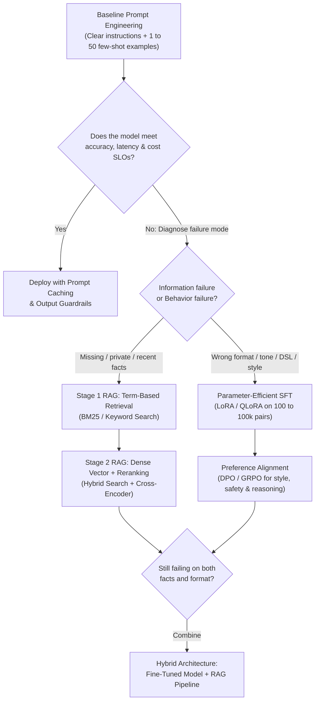
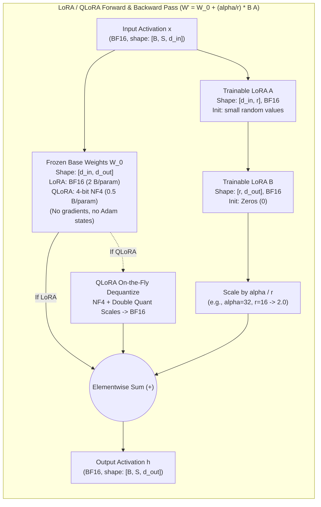

# 14.13 Fine-tuning: SFT, LoRA and QLoRA, preference alignment

| Field | Value |
|---|---|
| Level | Advanced |
| Priority tier | 1 |
| Lab venue | Nebius GPU + Local Python Verification Lab |
| Part | Part 14: Distributed training and fine-tuning |
| Primary sources | *AI Engineering* (`ai-engineering`) Chapters 2 & 7; *LLM Engineer's Handbook* (`llm-engineers-handbook`) Chapters 5 & 6; *LLMOps* (`llmops`) Chapter 5; *Generative AI on Kubernetes* (`generative-ai-on-kubernetes`) Chapter 6; *Kubernetes for Generative AI Solutions* (`kubernetes-for-generative-ai-solutions`) Chapters 4 & 5; *LLMs in Production* (`llms-in-production`) Chapter 9; *Hands-On LLM Serving and Optimization* (`hands-on-llm-serving-and-optimization`) Chapter 10 |
| Cross-references | Chapter 10.4 (Tensor Cores & numerical precision); Chapters 14.3–14.7 (training memory anatomy, DDP, FSDP, DeepSpeed ZeRO, Megatron-LM); Chapter 15.3 (vLLM & multi-LoRA serving) |
| Code | `code/part14/finetuning_lora_alignment.py`, `code/part14/finetuning_lora_alignment_lab.py` |
| Coverage file | `planning/coverage/chapters/14-13.md` |
| Claim & number ledger | `planning/ledgers/14-13.md` |

## Why this matters for AI infrastructure

Pre-training a frontier language model takes trillions of tokens and thousands of GPUs for months. The resulting base model is still only a next-token predictor. Ask it a question and it may answer by adding three more questions. Turning it into a reliable domain assistant takes **post-training**, which combines Supervised Fine-Tuning and preference alignment. In the InstructGPT example, pre-training used roughly 98 percent of the compute and post-training about 2 percent. That last 2 percent brings out abilities already stored in the weights.

Post-training changes the memory, compute, and serving profile of a cluster in three ways.

First, trainable parameters hit a memory wall. Full fine-tuning updates every weight and keeps gradients and Adam optimizer states for each one. At the standard sixteen bytes per parameter for mixed precision, a seven-billion-parameter model needs 112 GB of VRAM, and a seventy-billion-parameter model needs 1,120 GB before activations. Even in pure sixteen-bit precision, the seven-billion-parameter model needs 56 GB.

Second, parameter-efficient methods shrink the problem. LoRA freezes the base model and trains small low-rank adapter matrices, under 1 percent of the parameters. QLoRA adds four-bit NormalFloat quantization, Double Quantization, and Paged Optimizers. Together they cut peak training memory for a seven-billion-parameter model to 9.3 GB and let a sixty-five-billion-parameter model train on one 48 GB GPU. The price is roughly 30 percent slower steps, because weights must be dequantized on the fly.

Third, alignment needs several models at once. Reinforcement Learning from Human Feedback with Proximal Policy Optimization keeps four models in GPU memory. Generating rollouts on an engine such as vLLM or SGLang takes about 80 percent of the step time. Direct Preference Optimization and Group Relative Policy Optimization drop the separate reward or value network and cut cluster memory by half or more.

```text
Post-Training Memory and Scale Reference Numbers (AIE Ch. 2 & 7; LEH Ch. 5 & 6; HSO Ch. 10):
- Pre-training vs Post-training compute split (InstructGPT): 98% pre-training vs 2% post-training
- Full fine-tuning memory baseline (16 B/param: 4B params + 4B grads + 8B Adam states):
  7B model = 112.0 GB VRAM | 70B model = 1,120.0 GB VRAM (before activations)
- Pure 16-bit full fine-tuning (2B weights + 6B grad/Adam states = 8 B/param):
  7B model = 14.0 GB weights + 42.0 GB states = 56.0 GB VRAM
  13B model = 26.0 GB weights + 78.0 GB states = 104.0 GB VRAM (or 26.0 + 6.0 = 32.0 GB for 1B trainable)
- 7B LoRA vs QLoRA VRAM and speed (LEH Ch. 5):
  LoRA: 14.0 GB init, 15.6 GB peak training (14-18 GB typical)
  QLoRA (4-bit NF4 + Double Quant + Paged AdamW): 9.1 GB init (-35%), 9.3 GB peak training (-40%), ~30% slower
- 65B QLoRA (Guanaco 65B, AIE Ch. 7 Table 7-7): 41 GB footprint, fits on a single 48 GB GPU (1022 Elo vs ChatGPT 966 Elo)
- RLHF / PPO rollout bottleneck (OpenRLHF, HSO Ch. 10): 80% of RLHF training time is spent in sample generation
```

Before you provision GPUs, pick the right adaptation layer. Use RAG when the model lacks facts, and use SFT, LoRA, QLoRA, or preference alignment when you need to change how it behaves.

## Prerequisites and outcomes

### Prerequisites
- GPU numerical precision formats including FP32, TF32, FP16, BF16, FP8, INT8, and INT4 from Chapter 10.4.
- Training memory anatomy and distributed sharding across DDP, FSDP, DeepSpeed ZeRO, and Megatron-LM from Chapters 14.3 through 14.7.
- Kubernetes job scheduling and container orchestration fundamentals from Part 11.

### Outcomes
After completing this chapter, you will be able to do six things.
1. Choose between prompt engineering, Retrieval-Augmented Generation, Supervised Fine-Tuning, and preference alignment, based on the failure mode and on break-even token economics.
2. Design an SFT data pipeline with exact, MinHash, and semantic deduplication, benchmark decontamination, Jinja chat templates, sequence packing, and completion-only loss masking.
3. Calculate parameter counts and VRAM budgets for full fine-tuning, LoRA, and DoRA across the attention and MLP projections.
4. Explain the three mechanisms inside QLoRA: NormalFloat4 quantization, Double Quantization, and CUDA Unified Memory Paged Optimizers.
5. Lay out a preference alignment pipeline with Bradley-Terry reward models, RLHF with PPO, DPO, GRPO, ORPO, and KTO.
6. Combine fine-tuned models with task arithmetic, SLERP, TIES-Merging, DARE, and layer stacking, and run fine-tuning and multi-LoRA serving on Kubernetes with Kubeflow Trainer.

---

## 1. When to Fine-Tune vs Prompt Engineering and RAG

### 1.1 Form vs Facts: Diagnosing Information vs Behavioral Failures

Teams often spend weeks of GPU time fine-tuning a model to fix a problem that fine-tuning cannot solve. Before you start a training job, decide whether the failure is about information or about behavior.

In an information failure, the model gives wrong or outdated answers because the facts were private to your organization or appeared after its training cutoff. Putting fast-changing facts in through fine-tuning is slow and expensive, and it invites hallucination and catastrophic forgetting.

In a behavior failure, the model already has the knowledge, but its output does not follow the schema, syntax, tone, or safety boundary you need. Typical cases are HTML that does not compile, a domain SQL dialect, JSON or YAML that is not strict enough for an agent tool, and an answer that is too wordy.

The rule that follows is short. **Fine-tuning is for form, and RAG is for facts.**



Benchmarks show why fine-tuning is a poor default for factual recall. In March 2023, Bloomberg trained BloombergGPT, a fifty-billion-parameter financial model, on 1.3 million A100 GPU hours. The estimated compute cost was 1.3 to 2.6 million dollars. Zero-shot GPT-4-0314 appeared the same month and beat it by over twelve points on financial sentiment analysis. It also won by over thirty-three points on conversational financial question answering.

Ovadia et al. made a similar comparison on current-events question answering with three seven-billion-parameter models. An unmodified base model with a RAG pipeline beat standalone fine-tuning by twenty-eight to thirty-six percentage points in every model family. It also beat RAG combined with a fine-tuned model, because fine-tuning on narrow data slightly hurt general retrieval comprehension. On the broader MMLU benchmark, adding a fine-tuned model to RAG improved accuracy 43 percent of the time and gave no improvement the other 57 percent.

| Benchmark / Experiment | Model / Configuration | Metric / Score | Infrastructure & Adaptation Takeaway |
|---|---|---|---|
| Financial NLP (*AI Engineering*, Ch. 7 Table 7-1) | `BloombergGPT` (50B, 1.3M A100 GPU hrs, `$1.3M–$2.6M`) | FiQA F1: `75.07` \| ConvFinQA: `43.41` | Massive domain-specific training can be surpassed by stronger general models |
| Financial NLP (*AI Engineering*, Ch. 7 Table 7-1) | `GPT-4-0314` (Zero-shot general-purpose) | FiQA F1: `87.15` \| ConvFinQA: `76.48` | Always benchmark strong general models with prompting before training |
| Current-Events QA (*AI Engineering*, Ch. 7 Table 7-2) | `Mistral-7B` (`Base` vs `Base+RAG` vs `FT-reg` / `FT-par`) | Base: `0.481` \| **Base+RAG: `0.875`** \| FT: `0.504` / `0.588` \| FT+RAG: `0.810` / `0.830` | RAG dominates on factual/recent knowledge; naive FT can hurt RAG (`0.830` vs `0.875`) |
| Current-Events QA (*AI Engineering*, Ch. 7 Table 7-2) | `Llama 2-7B` (`Base` vs `Base+RAG` vs `FT-reg` / `FT-par`) | Base: `0.353` \| **Base+RAG: `0.585`** \| FT: `0.219` / `0.392` \| FT+RAG: `0.326` / `0.520` | Regular SFT (`0.219`) caused severe forgetting below the `0.353` base score |
| Current-Events QA (*AI Engineering*, Ch. 7 Table 7-2) | `Orca 2-7B` (`Base` vs `Base+RAG` vs `FT-reg` / `FT-par`) | Base: `0.456` \| **Base+RAG: `0.876`** \| FT: `0.511` / `0.566` \| FT+RAG: `0.820` / `0.826` | Across MMLU, adding FT to RAG helped `43%` of the time and did not help `57%` |
| Task-Specific Distillation (*AI Engineering*, Ch. 7) | Grammarly Fine-Tuned `Flan-T5` vs `GPT-3` | Outperformed `60x` larger `GPT-3` on text editing using `82,000` `(instruction, output)` pairs | Small task-specific fine-tuned models excel at narrow behavioral tasks and cut serving cost |
| Context Extension (*AI Engineering*, Ch. 7 Fig. 7-1) | `Code Llama` (from `Llama 2` base) | Long-context fine-tuning extended max context from `4,096` to `16,384` tokens | Requires positional embedding (`RoPE` base frequency) adjustment; can slightly degrade short-context accuracy |

### 1.2 Upfront Fine-Tuning Capital Cost vs the Prompt Engineering "Mortgage"

When few-shot prompting and fine-tuning both reach acceptable accuracy, the choice is about money. Fine-tuning has an upfront cost in training compute and dataset curation. A long few-shot prompt works like a **per-request mortgage**. Every query that carries fifty examples in the system prompt pays for those extra input tokens, in prefill compute, time to first token, and KV-cache memory. Prompt caching cuts the repeated prefill for identical prefixes, but the context window still limits how many examples fit.

```text
Fine-Tuning vs Prompting Break-Even Equations (LLMOps Ch. 5; code/part14/finetuning_lora_alignment.py):
  Upfront Fine-Tuning Cost:       C_FT = N_train_tokens_M * Price_FT_per_M_tokens
  Per-Request Prompt Overhead:    C_req_prompt = (Delta_T_prompt / 10^6) * Price_input_per_M_tokens
  Annual Prompt Overhead:         C_annual_prompt = R_annual * C_req_prompt
  Break-Even Horizon (years):     T_breakeven = C_FT / C_annual_prompt

Worked Example (LLMOps Ch. 5):
  - Proprietary API fine-tuning price reference (GPT-4o): $25,000 per 1,000,000 training tokens
  - Extra few-shot prompt context removed by fine-tuning: 2,000 tokens/request at $2.50 / 1M input tokens ($0.005/request)
  - At 500,000 requests/year ($2,500/year prompt overhead):
    T_breakeven = $25,000 / $2,500 = 10.0 years (5,000,000 total requests)
  - If the model's production lifespan before replacement is 2.0 years, prepaying a 10.0-year break-even is uneconomical.
  - Conversely, fine-tuning an open-weight 8B model with LoRA on a single A100 GPU for 50 minutes costs under $5 in GPU
    compute, breaking even in fewer than 1,000 requests while shrinking serving hardware from a 70B cluster to a single GPU.
```

### 1.3 Progression vs Distillation Workflows and Tokenizer Vocabulary Adaptation

A fine-tuning project can follow one of two paths.

The progression path starts small. Validate the training script and data pipeline on the cheapest model, until the loss falls cleanly. Then run data quality ablations on a mid-sized model, and last train your largest candidates to map price against performance.

The distillation path starts large. Fine-tune the strongest model you can afford on a small, gold-standard seed set. Use that teacher to write tens of thousands of high-quality instruction pairs, and fine-tune a fast student of eight to sixteen billion parameters on them for production serving.

Sometimes your target domain relies on specialized strings such as chemical formulas, gene identifiers, or legal citations. If the default byte-pair encoding tokenizer splits those terms into many subword fragments, extend the tokenizer vocabulary before training.

```python
# Domain-specific atomic token injection (LLMOps Ch. 5 Example 5-8)
custom_vocab = ["moleculeA", "compoundX", "geneY"]
num_added = tokenizer.add_tokens(custom_vocab)
model.resize_token_embeddings(len(tokenizer))
```

Whenever you call `model.resize_token_embeddings()`, the newly added rows in the input embedding table and output head are initialized randomly. If you subsequently train with LoRA, you must include `embed_tokens` and `lm_head` in `modules_to_save`. Otherwise, those new token vectors remain frozen at random values.

Try prompt engineering and RAG first for missing facts. Turn to fine-tuning only when you need reliable behavior or a smaller serving footprint.

---

## 2. Supervised Fine-Tuning (SFT), Dataset Engineering, and Chat Templates

### 2.1 Instruction Dataset Curation, Deduplication, Decontamination, and Synthesis

Supervised Fine-Tuning trains a base model on curated instruction and output demonstration pairs. Through these pairs, the model learns to follow instructions rather than merely continuing web documents. Three properties of the dataset decide the quality of an SFT model: accuracy, diversity, and complexity. A small, clean dataset beats a large, noisy one. The LIMA study demonstrated that just 1,000 carefully curated instruction pairs are sufficient to align a seventy-billion-parameter model. Smaller models around seven billion to eight billion parameters require more examples. They typically need 10,000 or more examples just to reliably internalize the chat template and stop-token behavior without overfitting.

| Fine-Tuning Scope | Typical Sample Count | Real-World Examples (*LLM Engineer's Handbook*, Ch. 5, *AI Engineering*, Ch. 2, *Generative AI on Kubernetes*, Ch. 6) | Primary Engineering Goal |
|---|---|---|---|
| General-Purpose Post-Training | `1,000,000` to `10,000,000+` | `Llama 3` (`10M` total samples); `OpenHermes` & `Dolphin` (`~1M` samples); `Yi` (`< 10,000` high-density samples) | Broad multi-domain instruction following, reasoning, and safety |
| Early Human Demonstration SFT | `10,000` to `15,000` | `InstructGPT` (`13,000` human pairs at `$10`/pair = `$130,000`, `~30 min`/pair); `LAION` (`13,500` volunteers, `10,000` dialogues, `161,443` messages in `35` languages) | High-cost human behavior cloning baseline |
| Large-Model Alignment (`70B+`) | `1,000` to `10,000` | `LIMA` (`1,000` curated pairs on `65B`/`70B`) | Unlocking pre-existing capabilities in high-capacity models |
| Task- or Domain-Specific SFT (`< 10B`) | `100` to `100,000` (`100–1,000` for PEFT) | `TwinLlama-3.1-8B` (`3,335` domain pairs upsampled with `10,000` `FineTome` samples = `13,335` total); `Flan-T5` (`82,000` pairs) | Domain tone, structured output, or narrow task specialization |

A production SFT dataset goes through six stages.

1. Rule-based filtering strips HTML artifacts and normalizes whitespace. It enforces minimum and maximum lengths, removes banned keywords and refusals, and checks JSON, YAML, or code with deterministic parsers.
2. Deduplication removes repeats, which cause memorization, inflate validation scores, and waste GPU hours. Start with exact matches by MD5 or SHA-256 hash on normalized text. Next, use MinHash over word n-gram shingles with Jaccard similarity to catch near-duplicates. Last, embed documents with an encoder, cluster them with K-means or DBSCAN, and keep one representative per cluster.
3. Decontamination removes test-set leakage. Put your evaluation prompts through the same MinHash and semantic pass, and delete every matching training row, for each public and internal benchmark you plan to run.
4. Automated quality scoring rates candidate pairs on a 1-to-4 rubric or by pairwise comparison with an LLM jury, aiming for at least 80 percent agreement with human raters. A multi-objective reward model such as ArmoRM-Llama3-8B-v0.1 can also score helpfulness, correctness, coherence, complexity, and verbosity. For very large datasets, a fast encoder classifier such as `fineweb-edu-classifier`, trained for 20 epochs on 450,000 Llama-3-70B annotations, does the job.
5. Topic clustering checks coverage. Embed the dataset with sentence transformers, project to two dimensions with UMAP, and cluster with DBSCAN. Nomic Atlas or Argilla can confirm that sub-topics are balanced.
6. Synthetic generation fills gaps. Use backtranslation on raw domain chunks of 1,000 to 2,000 characters split at sentence boundaries. Use Evol-Instruct to turn simple instructions into harder ones by adding 10 to 20 words of constraints, deepening, concretizing, or multi-step reasoning. Then use UltraFeedback to score diverse completions on several dimensions.

### 2.2 Storage Formats, Jinja Chat Templates, and the `EOS_TOKEN` Trap

Instruction datasets are stored on disk in standardized JSONL schemas. Single-turn tasks typically use the **Alpaca** schema, whereas multi-turn dialogues use **ShareGPT** or **OpenAI** message lists. Before tokenization, those dictionaries must be rendered into a model-specific **chat template** using Jinja.

| Format / Template Name | Structure / Special Tokens (*LLM Engineer's Handbook*, Ch. 5 Tables 5.5–5.7) | Typical Use Case & Caveats |
|---|---|---|
| `Alpaca` (Storage & Template) | `{"instruction": "...", "input": "...", "output": "..."}` -> `### Instruction:\n...\n### Response:\n...<EOS>` | Single-turn instruction following; requires no new special tokens in the vocabulary |
| `ShareGPT` / `OpenAI` (Storage) | `{"conversations": [{"role": "system", "content": "..."}, {"role": "user", "content": "..."}, {"role": "assistant", "content": "..."}]}` | Standard storage format for multi-turn chat and tool-use trajectories |
| `ChatML` (Template) | `<\|im_start\|>system\n...<\|im_end\|>\n<\|im_start\|>user\n...<\|im_end\|>\n<\|im_start\|>assistant\n...<\|im_end\|>` | Widely used open-source template; requires `<\|im_start\|>` and `<\|im_end\|>` registered as special tokens |
| `Llama 3` (Template) | `<\|begin_of_text\|><\|start_header_id\|>user<\|end_header_id\|>\n\n...<\|eot_id\|><\|start_header_id\|>assistant<\|end_header_id\|>\n\n...<\|eot_id\|>` | Native template for `Meta-Llama-3` and `3.1`; must be preserved when fine-tuning Llama 3 Instruct models |
| `Phi-3` / `Gemma` (Templates) | `<\|user\|>\n...<\|end\|>\n<\|assistant\|>\n...<\|end\|>` \| `<bos><start_of_turn>user\n...<end_of_turn>\n<start_of_turn>model\n...<end_of_turn>` | Model-family-specific templates; handled automatically via `tokenizer.apply_chat_template()` |

Every whitespace character, newline, and special token in a chat template matters. Three template mistakes break production SFT runs again and again.

The first is leaving out the end-of-sequence token. If the formatting function does not append `tokenizer.eos_token` to every assistant response during training, the model never learns when to stop, and at inference it rambles until it reaches `max_new_tokens`.

The second is setting the pad token equal to the EOS token without careful masking. Many base models ship with no padding token. If you set `tokenizer.pad_token = tokenizer.eos_token` and a naive collator masks every `pad_token_id` with `-100` in the labels, the final stop token is masked as well. Use a dedicated pad token, or make the collator mask only trailing padding.

The third is a mismatch between training and serving templates. A model fine-tuned with the Alpaca template or ChatML but served with the default Llama 3 template loses accuracy badly. At inference you must also pass `add_generation_prompt=True`, so the model answers the user prompt and does not continue it.

### 2.3 Training Hyperparameters, Sequence Packing, and Completion-Only Loss

Tuning SFT hyperparameters balances gradient stability against GPU memory.

Small micro-batches of 1 or 2 fit in limited VRAM but give noisy gradients. Accumulate gradients over several micro-batches before calling `optimizer.step()`, to reach a stable effective batch size of 16 to 64.

Sequence packing saves padding waste. Suppose the maximum length is 1,024 tokens and the dataset averages 250 tokens per sample. Standard padding then wastes over 75 percent of every batch slot. Setting `packing=True` joins several short examples into one 1,024-token sequence. Position IDs reset and block-diagonal FlashAttention masks keep tokens of one example from attending to another.

Completion-only loss matches training to inference. The user supplies the prompt and the model writes only the response. The prompt loss weight sets how much the prompt tokens count in the loss. At 0 percent, `DataCollatorForCompletionOnlyLM` sets prompt labels to `-100`, and cross-entropy trains only on assistant completions.

```text
SFT Hyperparameter Reference & Sequence Packing Math (LEH Ch. 5; AIE Ch. 7; code/part14/finetuning_lora_alignment.py):
- Effective Batch Size Formula: Effective_Batch_Size = per_device_train_batch_size * num_gpus * gradient_accumulation_steps
- Learning rate & schedule: 1e-5 to 3e-4 (e.g., 3e-4 for LoRA SFT, 1e-5 for full SFT), linear or cosine decay to 1e-7,
  with 5% to 10% warmup steps (e.g., warmup_steps = 10)
- Batch size & accumulation: per_device = 2, num_gpus = 1, grad_accum = 8 -> Effective Batch Size = 2 * 1 * 8 = 16
  2-GPU example (LEH Ch. 5): per_device = 4, num_gpus = 2, grad_accum = 4 -> Effective Batch Size = 4 * 2 * 4 = 32
- Sequence packing efficiency (8 samples of lengths [220, 260, 240, 280, 250, 230, 270, 210] = 1,960 valid tokens, max_seq_length = 1,024):
  Unpacked: 8 slots * 1,024 = 8,192 allocated tokens -> 23.93% token utilization
  Packed:   2 slots * 1,024 = 2,048 allocated tokens -> 95.70% token utilization (4.0x slot reduction)
- Epochs & regularization: 1 to 10 epochs (typically 2 to 5; 3 epochs on 13,335 samples = 50 min on 1 A100 with Unsloth),
  weight_decay = 0.01 (0.01 to 0.1 range), optim = "adamw_8bit" or "paged_adamw_8bit", gradient_checkpointing = True
- Prompt loss weight example (4 prompt tokens with loss 2.0, 2 response tokens with loss 0.5):
  weight = 0.0 (completion-only): loss = 0.50 | weight = 0.10: loss = 0.75 | weight = 1.00 (full sequence): loss = 1.50
```

Before you train, curate, deduplicate, and decontaminate your instruction pairs, and check the chat template and stop token on a single batch.

---

## 3. Parameter-Efficient Fine-Tuning (PEFT): LoRA, DoRA, and QLoRA Internals

### 3.1 Why Full Fine-Tuning Blows Up VRAM and Why Low-Rank Adaptation Works

During backpropagation, every trainable parameter requires memory not just for its weight value, but also for its gradient and its optimizer states. In standard mixed-precision training with the AdamW optimizer, each parameter consumes 4 bytes for the weight, 4 bytes for the gradient, and 8 bytes for the first and second Adam moments. That baseline totals **16 bytes per parameter**. It translates to **112.0 GB of VRAM for a 7B model** and **1,120.0 GB for a 70B model** before allocating a single byte for activations. Even if you store weights, gradients, and both Adam states purely in 16-bit precision, each trainable parameter still requires 2 bytes for the weight plus 6 bytes for its gradient and two Adam states. That pure 16-bit setup totals **56.0 GB for a 7B model** and **104.0 GB for a 13B model**.

Why can we avoid updating all billions of weights? Aghajanyan et al. and Hu et al. demonstrated that pre-trained language models have a very low **intrinsic dimension**. Pre-training acts as a massive compression phase, meaning the weight updates required for downstream adaptation lie in a low-rank subspace. Early PEFT methods inserted serial adapter layers inside each Transformer block. In Houlsby et al., serial adapters achieved within 0.4 percent of full fine-tuning on GLUE with 3 percent trainable parameters, whereas partial layer freezing required 25 percent. Other early methods prepended trainable continuous token vectors to the input, known as Prompt Tuning, P-Tuning, and Prefix Tuning. However, serial adapters add extra depth and latency at inference time, while soft prompts consume context length.

**Low-Rank Adaptation (LoRA)** solves both problems. Instead of modifying the frozen pre-trained weight matrix, LoRA injects a parallel low-rank bypass decomposed into two small matrices. A down-projection matrix A projects the input down to a small rank r, and an up-projection matrix B projects it back to the output dimension. The rank r typically ranges from 4 to 64, which is orders of magnitude smaller than the hidden dimension.



### 3.2 LoRA Initialization, Scaling, Target Modules, and DoRA

Three details decide how LoRA behaves in training and serving.

First, the adapter starts as a no-op. Matrix A is initialized with small random values, and matrix B is initialized strictly to **zeros**. The LoRA paper describes a Gaussian initialization for A, and libraries differ in the exact scheme. Hugging Face PEFT, for example, defaults to Kaiming-uniform. Because B is zero at step 0, the product of A and B is zero, and the model begins with the exact behavior of the base model.

Second, the adapter output is scaled by alpha divided by rank before it is added to the frozen output. Dividing by the rank keeps activation variance steady as the rank changes, so you do not have to retune the learning rate from scratch when you double the rank from 16 to 32. Common choices set alpha equal to the rank or twice the rank.

Third, you choose which modules to adapt. Hu et al. first applied LoRA to the four attention matrices. On GPT-3 175B with a fixed budget of 18M trainable parameters, rank 2 across all four matrices reached 73.7 percent on WikiSQL and 91.7 percent on MultiNLI. Rank 8 on any single attention matrix scored between 70.0 and 73.2 percent on WikiSQL. Databricks and Dettmers et al. later found that adapting **all seven linear layers** gives the largest gain. These are the attention projections plus the SwiGLU MLP projections `gate_proj`, `up_proj`, and `down_proj`. All-linear LoRA comes much closer to full fine-tuning than attention-only LoRA.

**Weight-Decomposed Low-Rank Adaptation (DoRA)** pushes PEFT quality even closer to full fine-tuning. DoRA decomposes each weight matrix into a trainable column-wise **magnitude vector** and a **directional matrix**. The directional matrix adds the low-rank LoRA update to the base weights and normalizes each column by its L2 norm. In the Hugging Face PEFT library, enabling DoRA requires only passing `use_dora=True` inside `LoraConfig`.

```text
LoRA Parameter & Storage Equations (AIE Ch. 7 Tables 7-5 & 7-6; LEH Ch. 5; KFG Ch. 4):
  Forward Pass:                 h = W_0 * x + (alpha / r) * (B * (A * x))
  DoRA Forward Pass:            W_DoRA = m * (W_0 + (alpha / r) * B * A) / ||W_0 + (alpha / r) * B * A||_c
  Full Matrix Parameter Count:  P_full = d_in * d_out
  LoRA Matrix Parameter Count:  P_LoRA = r * (d_in + d_out)

Worked Examples from Cited Sources (Verified in code/part14/finetuning_lora_alignment_lab.py):
1. Single 4,096 x 4,096 matrix (16,777,216 ~ 16.8M parameters) with rank r = 8 (AIE Ch. 7):
   P_LoRA = 4,096 * 8 * 2 = 65,536 parameters (256.0x compression, 0.39% of full matrix)
   Multi-LoRA storage across 100 customer models sharing 1 base matrix:
   - Option 1 (100 merged W' matrices): 16.8M * 100 = 1.68B parameters
   - Option 2 (1 base W + 100 (A, B) pairs): 16.8M + 65,536 * 100 = 23.3M parameters (72.1x smaller)
2. GPT-3 175B (96 layers, d_model = 12,288, r = 2 across 4 attention matrices Wq, Wk, Wv, Wo, AIE Ch. 7):
   Per-layer LoRA params = (12,288 * 2 * 2) * 4 = 196,608 parameters/layer
   Total LoRA params     = 196,608 * 96 = 18,874,368 (18.87M, 0.01% of 175B; vs ~4.7M / 0.0027% at smaller rank)
   16-bit memory         = 37.7 MB LoRA adapter vs 350 GB base weights (WikiSQL: 73.7%, MultiNLI: 91.7%)
3. Llama 2 13B (40 layers, d_model = 5,120, r = 2, AIE Ch. 7 Table 7-6):
   Base weights (16-bit) = 26 GB | LoRA trainable params = 3.28M (3,276,800) | Adapter size = 6.55 MB
4. Llama 3 / 3.1 8B (32 layers, d=4,096, d_kv=1,024, d_ffn=14,336, all 7 linear modules, LEH Ch. 5 & KFG Ch. 4):
   - At r = 16 (q, k, v, o, gate, up, down): 41,943,040 (~42M) trainable params = 0.5196% of 8.03B model
   - At r = 32 (q, k, v, o, gate, up, down): 83,886,080 (~84M) trainable params
   - At r = 32 + lm_head (KFG Ch. 4): 88,121,344 trainable params vs 4,628,721,664 quantized base elements (~98% reduction)
```

### 3.3 QLoRA Internals: 4-Bit NormalFloat, Double Quantization, and Paged Optimizers

For a thirteen-billion-parameter model, a rank-2 LoRA adapter occupies just 6.55 MB, while the frozen sixteen-bit base weights still occupy 26 GB. For a 175B model, the adapter is 37.7 MB while the base weights consume 350 GB. Once trainable parameters are compressed with LoRA, **the frozen base weights become the dominant memory bottleneck**.

**QLoRA** attacks that bottleneck with three mechanisms.

The first is NormalFloat4 storage with BF16 compute. Pre-trained weights follow a zero-centered normal distribution. Uniform INT4 quantization wastes bins on the sparse tails and under-resolves the dense center. NormalFloat4 (`bnb_4bit_quant_type="nf4"`) fits the bell curve instead. Its sixteen levels split the standard normal distribution into sixteen equal-probability bins between negative 1 and positive 1, with an exact 0.0 at index 7. Weights are cut into blocks of 64, scaled by the block's absolute maximum, and stored in 4 bits. During the forward and backward passes, `bitsandbytes` dequantizes each block on the fly to 16-bit BF16, set by `bnb_4bit_compute_dtype=torch.bfloat16`. The Tensor Cores then run the matrix multiplication next to the BF16 LoRA adapters.

The second is Double Quantization, switched on with `bnb_4bit_use_double_quant=True`. Block-wise quantization with blocks of 64 stores one 32-bit scaling constant per block. That adds 0.500 bits per parameter, a 12.5 percent overhead on 4-bit weights. Double Quantization quantizes those constants to 8-bit FP8 in groups of 256 blocks that share one second-level FP32 scale. The overhead falls to 0.127 bits per parameter. The saving of **0.373 bits per parameter** frees **3.03 GB of VRAM on a 65B model** and brings the effective storage to **4.127 bits per parameter**.

The third is the Paged Optimizer, `paged_adamw_8bit`. Even with 4-bit weights, long sequences or large micro-batches can spike activation memory during backpropagation. A paged optimizer keeps its states in **NVIDIA CUDA Unified Memory**. When GPU memory fills up, the driver moves optimizer state chunks from HBM to host DRAM over PCIe or NVLink-C2C. It moves them back for the update step, instead of failing with an out-of-memory error.

```text
QLoRA Double Quantization & Memory Benchmark Summary (AIE Ch. 7 Table 7-7; LEH Ch. 5):
  Single Quantization Scale Overhead (B_1 = 64):
    32 bits / 64 params = 0.500 bits/param (Total = 4.500 bits/param)
  Double Quantization Scale Overhead (B_1 = 64, B_2 = 256):
    (8 bits / 64) + (32 bits / (64 * 256)) = 0.125 + 0.00195 = 0.127 bits/param (Total = 4.127 bits/param)
  Net Savings from Double Quantization:
    0.500 - 0.127 = 0.373 bits/param -> Saves 3.03 GB (~3.0 GB) on a 65B model, or 0.33 GB on a 7B model

7B Model LoRA vs QLoRA Memory & Speed (LEH Ch. 5):
  - Initialization VRAM:  14.0 GB (LoRA) -> 9.1 GB (QLoRA)  [-35.0% reduction]
  - Peak Training VRAM:   15.6 GB (LoRA) -> 9.3 GB (QLoRA)  [-40.4% (~40%) reduction; up to 75% vs unoptimized]
  - Training Speed:       QLoRA is ~30% slower than LoRA due to on-the-fly NF4 -> BF16 dequantization kernels

Guanaco QLoRA Model Family vs Proprietary Models (GPT-4 Judge Elo, May 2023, AIE Ch. 7 Table 7-7):
  - GPT-4:        1348 +/- 1 Elo
  - Guanaco 65B:  1022 +/- 1 Elo (41 GB footprint — fits on a single 48 GB GPU, outperforms ChatGPT)
  - Guanaco 33B:   992 +/- 1 Elo (21 GB footprint)
  - Vicuna 13B:    974 +/- 1 Elo (26 GB footprint, 16-bit)
  - ChatGPT:       966 +/- 1 Elo
  - Guanaco 13B:   916 +/- 1 Elo (10 GB footprint)
  - Bard:          902 +/- 1 Elo
  - Guanaco 7B:    879 +/- 1 Elo (6 GB footprint)
```

| Fine-Tuning Method | Base Weights Precision | Trainable Params (`%`) | 7B Peak VRAM (*LLM Engineer's Handbook*, Ch. 5) | 65B–70B Feasibility | Relative Step Speed |
|---|---|---|---|---|---|
| Full Fine-Tuning (Mixed Precision / 16B baseline) | `FP32` master + `BF16` (`4 B` + `2 B`) | `100%` | `112.0 GB` (before activations) | `1,120.0 GB` (`16+` `80 GB` GPUs with FSDP/ZeRO-3) | `1.0x` (baseline, high AllReduce traffic) |
| Full Fine-Tuning (Pure 16-bit states, *AI Engineering*, Ch. 7) | `FP16` / `BF16` (`2 B`) | `100%` | `56.0 GB` (`14 GB` + `42 GB`) | `560.0 GB` (`8+` `80 GB` GPUs) | `1.1x` |
| LoRA (`r = 16..32`, all 7 linear layers) | `BF16` / `FP16` (`2 B`, frozen) | `0.5%` to `2.0%` | `15.6 GB` (`14.0 GB` init) | `~150–160 GB` (`2–4` `80 GB` GPUs with FSDP) | **`1.3x–1.5x` (fastest)** |
| QLoRA (`NF4` + Double Quant + Paged AdamW) | `4-bit NF4` (`4.127 bits/param`, frozen) | `0.5%` to `2.0%` | **`9.3 GB` (`9.1 GB` init)** | **`41.0 GB` (fits on `1 x 48 GB` L40S/A6000 or `2 x 24 GB` 3090s with `FSDP_QLORA`)** | `~0.9x–1.0x` (`~30%` slower than LoRA) |
| Unsloth + Liger Kernel LoRA / QLoRA | `BF16` or `4-bit NF4` + fused Triton kernels | `0.5%` to `2.0%` | **Up to `80%` less VRAM** (fused cross-entropy + RoPE + SwiGLU) | Single/multi-GPU | **`2.0x–5.0x` faster than standard HF** |

Use 16-bit LoRA when the model fits in HBM, because it is faster. Switch to 4-bit QLoRA when you must fit a large model on a smaller GPU.

---

## 4. Preference Alignment: RLHF, PPO, DPO, GRPO, ORPO, and KTO

### 4.1 Why SFT Is Not Enough and How Preference Datasets Are Built

Supervised Fine-Tuning teaches a model to format answers by copying human or synthetic demonstrations. Token-level cross-entropy has two blind spots. It penalizes every token mismatch equally, so it has no negative signal against subtle bad habits such as sycophancy, borderline unsafe compliance, or filler phrases. And, as OpenAI researchers Leo Gao and John Schulman observed, human annotators often write answers that use facts the base model does not know. Copying them teaches the model to guess with confidence, which is hallucination.

Preference alignment trains on **comparative preference triples**: a prompt, a chosen response, and a rejected response. Comparing two answers is faster, cheaper, and more consistent than writing one from scratch. Three facts shape how you build such a dataset.

On cost, LMSYS measured that human fact-checking and pairwise comparison takes 3 to 5 minutes per pair. For Llama 2, a human preference comparison cost 3.50 dollars, against 25.00 dollars for a written demonstration. InstructGPT saw roughly 73 percent agreement between labelers on pairwise comparisons. Ranking three responses at once yields three training pairs from one pass.

On scale, frontier labs use millions of preference pairs over iterative post-training rounds. Open-source general alignment mixes use 10,000 to 100,000 pairs, and narrow task or style alignment needs only 100 to 10,000. Changing model identity or tone takes 200 to 500 pairs. The `llmtwin-dpo` pipeline filtered 2,970 raw triples down to 1,467 good ones.

On labeling with an LLM judge, pairwise ranking beats pointwise 1-to-5 scoring, especially with reference grading notes. Judges have three systematic biases that your pipeline must handle. They favor the first response shown, so swap the order of the two candidates on every call. They favor longer, more formal responses, so include concise winners in the few-shot judge prompt and normalize scores for length. They favor outputs from their own model family, so use a jury of models from different families.

### 4.2 Reward Modeling, RLHF with PPO, and the 80% Serving Bottleneck

Classical Reinforcement Learning from Human Feedback proceeds in two stages. First, a **Reward Model** is trained on preference triples using the **Bradley-Terry pairwise ranking loss**. The reward model replaces the language modeling head of an SFT model with a scalar linear projection head. That scalar head outputs a single quality score for any prompt and response pair.

```text
Bradley-Terry Reward Model Objective (AIE Ch. 2; LEH Ch. 6):
  Winning score:          s_w = r_theta(x, y_w)
  Losing score:           s_l = r_theta(x, y_l)
  Preference probability: P(y_w > y_l | x) = sigma(s_w - s_l) = 1 / (1 + exp(-(s_w - s_l)))
  Per-sample RM loss:     L_RM(theta) = -log( sigma( r_theta(x, y_w) - r_theta(x, y_l) ) )
  K-way ranking pairs:    N_pairs = K * (K - 1) / 2  (e.g., K = 3 ranked responses A > B > C -> 3 pairs)
```

Second, the language model policy, called the **Actor**, is optimized with **Proximal Policy Optimization (PPO)**. The Actor maximizes the scalar reward predicted by the frozen reward model while penalizing **KL divergence** from the frozen initial SFT reference policy. Without the KL divergence penalty, the Actor quickly exploits quirks in the reward model, a failure mode called **reward hacking**. When reward hacking occurs, the model outputs gibberish or repetitive tokens that score high rewards but destroy language quality.

```mermaid
flowchart TB
    subgraph PPO["1. RLHF with PPO (4 Models in VRAM + Rollout Generation)"]
        direction LR
        P1["Prompt x"] --> Actor1["Actor Policy pi_theta<br/>(Trainable: Weights+Grads+Adam)"]
        Actor1 -->|"Autoregressive Rollout y<br/>(80% of step time on vLLM/SGLang)"| RM1["Reward Model r_phi<br/>(Frozen: Weights only)"]
        Actor1 --> Critic1["Critic / Value Net V_psi<br/>(Trainable: Weights+Grads+Adam)"]
        Actor1 --> Ref1["Reference Policy pi_ref<br/>(Frozen: Weights only)"]
        RM1 & Critic1 & Ref1 -->|"R - beta * KL + Advantage"| Update1["PPO Clipped Policy &<br/>Value Gradient Step"]
    end

    subgraph GRPO["2. DeepSeek GRPO (3 Models: No Critic Network)"]
        direction LR
        P2["Prompt x"] --> Actor2["Actor Policy pi_theta<br/>(Trainable)"]
        Actor2 -->|"Sample Group G Outputs<br/>(y_1, y_2, ..., y_G)"| RM2["Reward Model / Verifier<br/>(r_1, r_2, ..., r_G)"]
        RM2 -->|"Group Z-Score Advantage:<br/>A_i = (r_i - mean) / std"| Update2["GRPO Policy Step<br/>(+ Direct KL vs Frozen pi_ref)"]
    end

    subgraph DPO["3. Direct Preference Optimization (2 Models, or 1 with LoRA)"]
        direction LR
        P3["Paired Triple<br/>(x, y_w, y_l)"] --> Policy3["Trainable Policy pi_theta<br/>(or Base + LoRA Adapter ON)"]
        P3 --> Ref3["Frozen Reference pi_ref<br/>(or Base with LoRA Adapter OFF)"]
        Policy3 & Ref3 -->|"Closed-Form Log-Ratios<br/>beta * log(pi_theta / pi_ref)"| Loss3["Binary Cross-Entropy Loss<br/>(No Rollouts, No Reward Model)"]
    end
```



For infrastructure, PPO is heavy for two reasons.

It keeps four models in GPU memory at once: the trainable **Actor**, the trainable **Critic** value network, the frozen **Reference policy**, and the frozen **Reward model**. Under pure 16-bit accounting for an 8B model, each frozen model takes 16.0 GB and each trainable model takes 64.0 GB. Two trainable and two frozen models need **160.0 GB of model state**, or over 240 GB with FP32 master weights plus activations.

It also spends most of its time generating. SFT processes all tokens of a sequence in one forward pass, but online RL must generate completions token by token. OpenRLHF benchmarks show that **80 percent of RLHF training time goes to sample generation**. Production frameworks therefore move generation onto dedicated vLLM or SGLang replicas, broadcast the updated Actor weights over NCCL after each PPO step, and use **batch-invariant deterministic inference** so that floating-point differences between batch sizes do not destabilize the policy gradients.

### 4.3 Direct Preference Optimization, GRPO, ORPO, and KTO

**Direct Preference Optimization (DPO)** eliminates both the separate reward model and the online reinforcement learning rollout loop. By analytically solving the KL-constrained reward maximization objective for the optimal policy, Rafailov et al. proved that the language model itself implicitly defines a reward function. That implicit reward is given by the log-probability ratio between the trained policy and the frozen reference policy.

```text
DPO Implicit Reward & Loss Equations (Rafailov et al., 2023; LEH Ch. 6):
  Implicit Reward:        r_hat(x, y) = beta * log( pi_theta(y | x) / pi_ref(y | x) )
                                      = beta * ( log pi_theta(y | x) - log pi_ref(y | x) )
  Chosen Reward:          r_chosen    = beta * ( log pi_theta(y_w | x) - log pi_ref(y_w | x) )
  Rejected Reward:        r_rejected  = beta * ( log pi_theta(y_l | x) - log pi_ref(y_l | x) )
  Reward Margin:          margin      = r_chosen - r_rejected
  Reward Accuracy:        accuracy    = mean( I[ r_chosen > r_rejected ] )
  DPO Loss:               L_DPO       = -E[ log sigma( r_chosen - r_rejected ) ]

Worked Numerical Example (beta = 0.5, 4 preference pairs, verified in code/part14/finetuning_lora_alignment_lab.py):
  log pi_theta(y_w|x) = [-10.0, -8.0, -12.0, -9.0],  log pi_ref(y_w|x) = [-12.0, -10.0, -12.0, -11.0]
  log pi_theta(y_l|x) = [-15.0, -14.0, -11.0, -16.0], log pi_ref(y_l|x) = [-12.0, -11.0, -13.0, -12.0]
  -> Chosen rewards:   0.5 * [+2.0, +2.0,  0.0, +2.0] = [+1.0, +1.0,  0.0, +1.0]  (Mean = +0.75)
  -> Rejected rewards: 0.5 * [-3.0, -3.0, +2.0, -4.0] = [-1.5, -1.5, +1.0, -2.0]  (Mean = -1.00)
  -> Reward margins:   [+2.5, +2.5, -1.0, +3.0] -> Mean Margin = +1.75 | Accuracy = 3 / 4 = 75.0% | Loss = 0.369232
```

Two practical techniques matter when you run DPO in production.

The first is to avoid loading a second model. Full-parameter DPO needs two copies, which is 80.0 GB for an 8B model. With LoRA or QLoRA, pass `ref_model=None` to `DPOTrainer`. On each step, TRL runs one forward pass with the adapter enabled for the policy log-probabilities, then a second pass on the same frozen base model with the adapter disabled for the reference log-probabilities. Model VRAM drops from 80.0 GB to **16.64 GB in BF16**, or under 10 GB in 4-bit QLoRA.

The second is to tune hyperparameters with care. Beta usually lies between 0.1 and 0.5 and sets how strongly the policy is tied to the reference. DPO shifts token log-probabilities directly, so an SFT learning rate such as 3e-4 causes mode collapse at once. Use a learning rate **10x to 100x smaller than SFT**, such as 2e-6 instead of 3e-4, and train for **1 epoch** instead of 3. If the model drifts toward formal or verbose phrasing, raise beta from 0.1 to 0.5.

When online reinforcement learning is required—such as reasoning and coding models where a deterministic compiler or math verifier scores outputs—**Group Relative Policy Optimization (GRPO)** eliminates the trainable **Critic** value network of PPO. Instead of training a second full-sized value network to estimate the baseline return, GRPO samples a group of completions for each prompt. It scores every completion in the group and normalizes the rewards across the group to compute each completion's advantage.

```text
DeepSeek GRPO Group-Normalized Advantage (GAK Ch. 6; code/part14/finetuning_lora_alignment.py):
  Group Mean & Std:     mu_r = mean(r_1..r_G),   sigma_r = std(r_1..r_G)
  Group Advantage:      A_i  = (r_i - mu_r) / (sigma_r + eps)
  Worked Example (G = 4 completions with rewards [1.0, 2.0, 3.0, 6.0]):
    mu_r = 3.0, sigma_r = 1.870829 -> Advantages = [-1.069045, -0.534522, 0.0, +1.603567] (Sum = 0.0)
```

| Alignment Algorithm | Models in Memory | Training Data Format | Online Rollouts? | 8B Model State VRAM | Best Production Use Case |
|---|---|---|---|---|---|
| `RLHF / PPO` (`Schulman 2017`, `Ouyang 2022`) | `4` (Trainable Actor + Trainable Critic + Frozen Ref + Frozen RM) | Prompts `x` (RM trained on `(x, y_w, y_l)`) | **Yes (`80%` step time)** | `160.0 GB` (full 16-bit) | Large-scale iterative alignment with custom reward models |
| `GRPO` (`DeepSeek`, *Generative AI on Kubernetes*, Ch. 6) | `3` (Trainable Actor + Frozen Ref + Rule/Verifier RM; **No Critic**) | Prompts `x` with verifiable or group-scored outputs | **Yes (`G` samples/prompt)** | `96.0 GB` (`40%` less than PPO) | Reasoning, math, and code RL with deterministic verifiers |
| `DPO` (`Rafailov 2023`, *LLM Engineer's Handbook*, Ch. 6) | `2` (Full) or **`1` (`ref_model=None` with LoRA/QLoRA)** | Paired preference triples `(x, y_w, y_l)` | **No (offline BCE)** | `80.0 GB` (Full) / **`16.64 GB` (LoRA)** | General preference, tone, and safety alignment on paired data |
| `ORPO` (Odds Ratio Preference Opt.) | **`1`** (Single trainable model; **No Reference Model**) | Paired triples `(x, y_w, y_l)` | **No (single-stage SFT+Align)** | `64.0 GB` (Full) / `16.64 GB` (LoRA) | Joint SFT + preference alignment in a single training stage |
| `KTO` (Kahneman-Tversky Opt.) | `2` (Full) or **`1` (LoRA)** | Unpaired binary feedback `(x, y, label in {+1, -1})` | **No** | `80.0 GB` (Full) / `16.64 GB` (LoRA) | Aligning directly from production thumbs-up / thumbs-down logs |
| `Best-of-N` Rejection Sampling (*AI Engineering*, Ch. 2) | `2` at inference (Generator + Reward Model / Verifier) | N/A (Inference-time test-time compute) | `N` parallel samples (`<= 400`) | Inference only (`30x` effective size boost with verifier) | Boosting accuracy without weight updates (`Stitch Fix`, `Grab`) |

For offline preference alignment on one GPU, start with DPO and LoRA using `ref_model=None`. For reasoning tasks with a verifier, use GRPO with vLLM rollout workers.

---

## 5. Model Merging, Multi-LoRA Serving, and Kubernetes Operations

### 5.1 Model Merging: Task Arithmetic, SLERP, TIES-Merging, DARE, and Layer Stacking

Suppose you have several fine-tuned models or LoRA adapters for different tasks, such as coding, SQL generation, and medical question answering. Training one multi-task model needs a great deal of data, and fine-tuning one task after another causes **catastrophic forgetting**. **Model merging** combines the parameters of several models offline, often on a CPU with no GPU training, into one model that inherits all their skills at no extra inference cost. Four methods are common.

Task arithmetic subtracts the base weights from a fine-tuned model to get a **task vector**, also called delta parameters. Adding task vectors combines skills, and subtracting one erases an unwanted behavior or bias.

Spherical Linear Interpolation (SLERP) fixes a problem of plain averaging, which shrinks vector magnitudes when two weight vectors point in different directions. SLERP treats the weights as points on a high-dimensional sphere and moves along the shortest great-circle arc, with an interpolation factor between 0 and 1. A factor of 0.5 gives the midpoint and keeps the norm.

TIES-Merging and DARE prune redundant deltas. Yadav et al. showed that during fine-tuning, **80 percent of task-vector adjustments are small redundant noise**, and that keeping only the **top 20 percent** by magnitude preserves virtually all single-task performance. When several models merge, that noise causes destructive interference. **TIES-Merging** zeroes the bottom 80 percent of deltas, elects the majority sign across models for each parameter, and averages only the surviving deltas that agree with it. **DARE** drops delta parameters at random with probability p, such as 0.8, and rescales the survivors by 1 divided by 1 minus p, which is 5.0x at p equal to 0.8.

Layer stacking interleaves layers from different models instead of averaging weights, which builds a deeper network. Kim et al. made **SOLAR 10.7B** from two copies of a 32-layer 7B model by summing 16 overlapping middle layers and stacking the rest, giving 48 layers. **Goliath-120B** stacked 72 of 80 layers from each of two fine-tuned Llama 2-70B models, giving 144 layers. **Sparse Upcycling** duplicates dense MLP layers and adds a trainable router, which turns a dense checkpoint into a Mixture-of-Experts model.

### 5.2 Serving LoRA Adapters: `merge_and_unload()` vs Multi-LoRA Serving

There are two ways to deploy a LoRA-tuned model.

You can merge offline with `model.merge_and_unload()`. This multiplies the low-rank adapter into the base weights and exports a standalone 16-bit checkpoint, with **zero added inference latency**. Merging fits when one fine-tuned model gets enough steady traffic to keep dedicated replicas busy under Data or Tensor Parallelism.

Or you can serve many adapters dynamically. Suppose 100 tenant-specific models each get low or bursty traffic. Deploying 100 merged 8B models would take 100 GPUs. Multi-LoRA serving loads **one frozen base model** into GPU HBM next to dozens of hot adapters, and pages cold adapters in from host DRAM or NVMe on demand. During continuous batching, specialized CUDA kernels such as the **Punica segmented gather-scatter GEMM kernel** run the base matrix multiplication once for all requests at high Tensor Core utilization. The kernel then applies each request's own low-rank adapter in parallel.

---

## 6. Commands and Configurations That Matter

### 6.1 Unsloth and Hugging Face TRL `SFTTrainer` and `DPOTrainer` Pipeline

The following production pipeline from `LLM Engineer's Handbook` Chapters 5 and 6 fine-tunes Meta-Llama-3.1-8B into TwinLlama-3.1-8B with `SFTTrainer`. It upsamples 3,335 domain pairs with 10,000 FineTome samples, applies rank 32 across all 7 linear layers, and completes 3 epochs in 50 minutes on one A100 GPU. Stage 2 aligns the model into TwinLlama-3.1-8B-DPO using `DPOTrainer` on 1,467 filtered preference triples.

```python
# Stage 1: Supervised Fine-Tuning (SFT) with Unsloth + TRL SFTTrainer (LEH Ch. 5)
import torch
from datasets import load_dataset, concatenate_datasets
from transformers import TrainingArguments, TextStreamer
from trl import SFTTrainer
from unsloth import FastLanguageModel, is_bfloat16_supported, PatchDPOTrainer
from trl import DPOConfig, DPOTrainer

max_seq_length = 2048
model, tokenizer = FastLanguageModel.from_pretrained(
    model_name="meta-llama/Meta-Llama-3.1-8B",
    max_seq_length=max_seq_length,
    load_in_4bit=False,  # Set True for 4-bit NF4 QLoRA (9.3 GB peak on 7B)
)

model = FastLanguageModel.get_peft_model(
    model,
    r=32,
    lora_alpha=32,
    lora_dropout=0,
    target_modules=["q_proj", "k_proj", "v_proj", "up_proj", "down_proj", "o_proj", "gate_proj"],
)

dataset1 = load_dataset("mlabonne/llmtwin", split="train")
dataset2 = load_dataset("mlabonne/FineTome-Alpaca-100k", split="train[:10000]")
sft_dataset = concatenate_datasets([dataset1, dataset2])

alpaca_template = (
    "Below is an instruction that describes a task. "
    "Write a response that appropriately completes the request.\n\n"
    "### Instruction:\n{}\n\n### Response:\n{}"
)
EOS_TOKEN = tokenizer.eos_token

def format_sft_samples(examples):
    texts = [
        alpaca_template.format(inst, out) + EOS_TOKEN
        for inst, out in zip(examples["instruction"], examples["output"])
    ]
    return {"text": texts}

sft_dataset = sft_dataset.map(format_sft_samples, batched=True, remove_columns=sft_dataset.column_names)
sft_splits = sft_dataset.train_test_split(test_size=0.05, seed=0)

sft_trainer = SFTTrainer(
    model=model,
    tokenizer=tokenizer,
    train_dataset=sft_splits["train"],
    eval_dataset=sft_splits["test"],
    dataset_text_field="text",
    max_seq_length=max_seq_length,
    dataset_num_proc=2,
    packing=True,
    args=TrainingArguments(
        learning_rate=3e-4,
        lr_scheduler_type="linear",
        per_device_train_batch_size=2,
        gradient_accumulation_steps=8,  # Effective batch size = 2 * 1 * 8 = 16
        num_train_epochs=3,
        fp16=not is_bfloat16_supported(),
        bf16=is_bfloat16_supported(),
        logging_steps=1,
        optim="adamw_8bit",
        weight_decay=0.01,
        warmup_steps=10,
        output_dir="output_sft",
        report_to="comet_ml",
        seed=0,
    ),
)
sft_trainer.train()
model.save_pretrained_merged("TwinLlama-3.1-8B", tokenizer, save_method="merged_16bit")

# Stage 2: Direct Preference Optimization (DPO) Alignment (LEH Ch. 6)
PatchDPOTrainer()
dpo_dataset = load_dataset("mlabonne/llmtwin-dpo", split="train")

def format_dpo_samples(example):
    return {
        "prompt": alpaca_template.format(example["prompt"], ""),
        "chosen": example["chosen"] + EOS_TOKEN,
        "rejected": example["rejected"] + EOS_TOKEN,
    }

dpo_splits = dpo_dataset.map(format_dpo_samples).train_test_split(test_size=0.05, seed=0)

dpo_trainer = DPOTrainer(
    model=model,
    ref_model=None,  # Uses frozen base weights with LoRA disabled as pi_ref (saves 16 GB VRAM)
    tokenizer=tokenizer,
    beta=0.5,        # Higher beta (0.5 vs 0.1 default) prevents formal/verbose style drift
    train_dataset=dpo_splits["train"],
    eval_dataset=dpo_splits["test"],
    max_length=max_seq_length // 2,
    max_prompt_length=max_seq_length // 2,
    args=DPOConfig(
        learning_rate=2e-6,  # 150x smaller than SFT (2e-6 vs 3e-4)
        lr_scheduler_type="linear",
        per_device_train_batch_size=2,
        per_device_eval_batch_size=2,
        gradient_accumulation_steps=8,
        num_train_epochs=1,
        fp16=not is_bfloat16_supported(),
        bf16=is_bfloat16_supported(),
        optim="adamw_8bit",
        weight_decay=0.01,
        warmup_steps=10,
        eval_strategy="steps",
        eval_steps=0.2,
        logging_steps=1,
        output_dir="output_dpo",
        report_to="comet_ml",
        seed=0,
    ),
)
dpo_trainer.train()
model.save_pretrained_merged("TwinLlama-3.1-8B-DPO", tokenizer, save_method="merged_16bit")
```

### 6.2 Standard Hugging Face `BitsAndBytesConfig` QLoRA and `merge_and_unload()`

When running multi-GPU QLoRA or standard Hugging Face PEFT and `bitsandbytes`, configure 4-bit NF4, Double Quantization, and `paged_adamw_8bit` explicitly.

```python
# 4-bit NF4 QLoRA with Double Quantization and Paged AdamW 8-bit (KFG Ch. 4 & GAK Ch. 6)
import torch
from transformers import AutoTokenizer, AutoModelForCausalLM, BitsAndBytesConfig, TrainingArguments, Trainer
from peft import LoraConfig, get_peft_model, PeftModel

base_model_id = "meta-llama/Meta-Llama-3-8B"
bnb_config = BitsAndBytesConfig(
    load_in_4bit=True,
    bnb_4bit_use_double_quant=True,
    bnb_4bit_quant_type="nf4",
    bnb_4bit_compute_dtype=torch.bfloat16,
)

model = AutoModelForCausalLM.from_pretrained(base_model_id, quantization_config=bnb_config, device_map="auto")
lora_config = LoraConfig(
    r=32,
    lora_alpha=64,
    target_modules=["q_proj", "k_proj", "v_proj", "o_proj", "gate_proj", "up_proj", "down_proj", "lm_head"],
    bias="none",
    lora_dropout=0.05,
    task_type="CAUSAL_LM",
)
# Reduces 4,628,721,664 base elements to 88,121,344 trainable parameters (~98% reduction)
model = get_peft_model(model, lora_config)

# Merging a trained LoRA checkpoint into standalone 16-bit weights for high-throughput serving (GAK Ch. 6 Ex. 6-8)
base_fp16 = AutoModelForCausalLM.from_pretrained(base_model_id, torch_dtype=torch.bfloat16, device_map="cuda")
peft_model = PeftModel.from_pretrained(base_fp16, "/opt/app-root/Meta-Llama-3.1-8B-Instruct/checkpoint-100/")
merged_model = peft_model.merge_and_unload()
merged_model.save_pretrained("/mnt/models/llama-3.1-8b-merged")
```

### 6.3 Kubernetes Operations: Kubeflow Trainer `ClusterTrainingRuntime` and `TrainJob`

On Kubernetes, **Kubeflow Trainer** separates platform infrastructure from data science code. Platform engineers deploy a `ClusterTrainingRuntime` that defines the container image and `JobSet` template. Data scientists submit a `CustomTrainer` or `BuiltinTrainer` via the Python `TrainerClient` without writing YAML or rebuilding images.

```yaml
# Platform Admin: ClusterTrainingRuntime manifest (GAK Ch. 6 Example 6-4)
apiVersion: trainer.kubeflow.org/v1alpha1
kind: ClusterTrainingRuntime
metadata:
  name: my-torch-distributed-runtime
  labels:
    trainer.kubeflow.org/framework: torch
spec:
  mlPolicy:
    numNodes: 1
    torch: {}
  template:
    spec:
      replicatedJobs:
        - name: node
          template:
            metadata:
              labels:
                trainer.kubeflow.org/trainjob-ancestor-step: trainer
            spec:
              template:
                spec:
                  containers:
                    - name: node
                      image: pytorch/pytorch:2.7.1-cuda12.8-cudnn9-runtime
```

```python
# Data Scientist: Submit a multi-node LoRA SFT TrainJob via Kubeflow SDK (GAK Ch. 6 Example 6-6)
from kubeflow.trainer import CustomTrainer, TrainerClient

client = TrainerClient()
torch_runtime = client.get_runtime("my-torch-distributed-runtime")
job_name = client.train(
    trainer=CustomTrainer(
        func=my_custom_trainer,
        func_args={"seed": 42, "model_name": "meta-llama/Meta-Llama-3.1-8B-Instruct"},
        num_nodes=8,
        resources_per_node={"cpu": 4, "memory": "64Gi", "nvidia.com/gpu": 1},
    ),
    runtime=torch_runtime,
)
client.wait_for_job_status(name=job_name, status={"Running"})
```

---

## 7. How It Fails: Production Fine-Tuning and Alignment Failure Modes

| Failure Mode & Symptom | Root Cause | Diagnostic Evidence | Deterministic Remediation |
|---|---|---|---|
| **1. Infinite Generation / Rambling After SFT** (`model.generate()` never stops until `max_new_tokens`) | Missing explicit `EOS_TOKEN` at the end of training examples, or `tokenizer.pad_token = tokenizer.eos_token` caused the data collator to mask the final `EOS_TOKEN` with `-100` | Inspect tokenized `labels` tensor on batch 0: the final non-padding token ID is `-100` instead of `tokenizer.eos_token_id` | Append `tokenizer.eos_token` explicitly in `format_samples()`, use a dedicated `<\|pad\|>` token or `DataCollatorForCompletionOnlyLM`, and verify `labels[-1] == eos_token_id` |
| **2. Severe Quality Collapse After LoRA / QLoRA Loading** (Perplexity spikes; model outputs garbled tokens) | Precision or chat template mismatch: loading a `BF16`-trained model (`Llama 2` / `Llama 3`) in `FP16` (*AI Engineering*, Ch. 7 Warning), or serving with a different chat template than used in SFT | Compare `AutoConfig` `torch_dtype` (`bfloat16` vs `float16` overflow above `65,504` as shown in *AI Engineering*, Table 7-3) and inspect rendered prompt strings with `repr()` | Always set `bnb_4bit_compute_dtype=torch.bfloat16` and `bf16=True` on Ampere/Hopper/Blackwell GPUs, and use `tokenizer.apply_chat_template()` identically in training and serving |
| **3. DPO Verbosity Explosion or Mode Collapse** (Model outputs overly formal 1,000-word essays or repetitive gibberish) | DPO learning rate too high (using SFT's `3e-4` instead of `1e-6..5e-6`), `beta` too low (`< 0.1`), or length bias in LLM-judged preference pairs | Comet ML / W&B logs show `rewards/accuracies` jumping to `1.00` (`100%`) within a few steps while `rewards/margins` and `grad_norm` explode and generation length doubles | Lower learning rate to `2e-6`, reduce `num_train_epochs` to `1`, raise `beta` from `0.1` to `0.5` (*LLM Engineer's Handbook*, Ch. 6), and filter/length-normalize preference pairs |
| **4. Untrained New Domain Tokens in LoRA** (`<unk>` or random outputs whenever newly added domain tokens appear) | Called `tokenizer.add_tokens()` and `model.resize_token_embeddings()`, but trained with LoRA without saving the embedding layers (`embed_tokens` and `lm_head` remained frozen at random init) | Check `[n for n, p in model.named_parameters() if p.requires_grad]`—only `lora_A` and `lora_B` appear; `embed_tokens` has `requires_grad=False` | Pass `modules_to_save=["embed_tokens", "lm_head"]` in `LoraConfig` whenever extending the tokenizer vocabulary |
| **5. QLoRA Throughput Collapse & PCIe Thrashing** (GPU utilization oscillates between `10%` and `80%`; step time `3x–5x` slower than expected) | Sequence length spikes trigger continuous CUDA Unified Memory page faults in `paged_adamw_8bit`, swapping optimizer pages back and forth across PCIe | `nvidia-smi dmon` shows heavy PCIe Rx/Tx traffic during `optimizer.step()` and W&B GPU utilization drops after the first few minutes (*Kubernetes for Generative AI Solutions*, Fig. 4.4) | Enable `gradient_checkpointing=True` (`use_gradient_checkpointing="unsloth"`), reduce `per_device_train_batch_size` and increase `gradient_accumulation_steps`, or enable `packing=True` |
| **6. RLHF / PPO Reward Hacking & Rollout Desynchronization** (Reward score climbs steadily while human evaluation quality collapses) | Actor exploits out-of-distribution reward model blind spots due to low KL coefficient `beta`, or non-deterministic batch-varying inference in rollout workers corrupts importance-sampling ratios | Reward curve diverges sharply upward while `kl_divergence` exceeds `10.0` nats and validation win-rate drops | Increase the KL penalty coefficient `beta`, enforce reward clipping and value-function warmup, and enable batch-invariant deterministic kernels on `vLLM`/`SGLang` rollout workers (*Hands-On LLM Serving and Optimization*, Ch. 10) |

---

## 8. Hands-On Verification Lab

### Lab Venue and Execution Mode
- **Primary local verification lab:** Run `code/part14/finetuning_lora_alignment_lab.py`, which imports `code/part14/finetuning_lora_alignment.py`. It deterministically verifies all 25 mathematical models, benchmark tables, LoRA/DoRA/QLoRA parameter and bit-budget equations, sequence packing ratios, Bradley-Terry RM, DPO, GRPO, and model-merging calculations.
- **Full-scale GPU execution:** The multi-hour Unsloth and TRL SFT and DPO training runs and Kubeflow Trainer multi-node Kubernetes jobs in Section 6 are reference production configurations from the cited sources. They have not been executed on live multi-node GPU hardware in this local build environment and are marked `untested` on live GPU hardware here.

```bash
python3 -B code/part14/finetuning_lora_alignment_lab.py
```

```text
Expected Output (25 Deterministic Self-Checks):
=== Chapter 14.13 Lab: Fine-tuning (SFT, LoRA/QLoRA, Preference Alignment) Verification ===
  [PASS] 1. Table 7-1: Zero-shot GPT-4-0314 (87.15 FiQA, 76.48 ConvFinQA) outperforms 50B BloombergGPT (75.07, 43.41; 1.3M A100 GPU hours, $1.3M-$2.6M)
  [PASS] 2. Table 7-2 (Ovadia et al., 2024): Base + RAG outperforms fine-tuning on current-events QA across Mistral-7B (0.875 vs 0.588), Llama-2-7B (0.585 vs 0.392), and Orca-2-7B (0.876 vs 0.566)
  [PASS] 3. Task-specific efficiency & context extension: Grammarly Flan-T5 beats 60x larger GPT-3 with 82,000 SFT pairs; Code Llama extends Llama 2 context from 4,096 to 16,384 tokens
  [PASS] 4. Fine-tuning vs Prompting economics (LLMOps Ch. 5): $25,000 upfront API fine-tune vs $2,500/yr prompt overhead requires 10.0 years to break even (uneconomical for a 2.0-year model lifespan)
  ...
  [PASS] 25. Layer stacking / depthwise scaling (AIE Ch. 7): SOLAR 10.7B merges two 32-layer 7B models with 16 summed layers into 48 layers; Goliath-120B stacks 72 of 80 layers from two Llama-2-70B models into 144 layers

Summary: 25 passed, 0 failed
```

---

## Key takeaways

Fine-tuning is for form, and RAG is for facts. When a model fails for lack of private or post-cutoff information, RAG beat fine-tuning by 28 to 36 percentage points in the benchmark above. Use SFT and preference alignment to change output structure, domain syntax, tone, or safety boundaries, or to distill a large teacher into a small student.

Data quality beats data quantity in SFT. Deduplicate with exact hashes, MinHash Jaccard similarity, and semantic embeddings, and decontaminate against evaluation benchmarks. Use exact Jinja chat templates with an explicit stop token. Pack short sequences with isolated attention masks for a 4.0x reduction in slots, and weight the loss toward response completions.

LoRA removes most of the optimizer state. Full fine-tuning needs 16 bytes per parameter under mixed precision, or 8 in pure 16-bit. LoRA freezes the base and trains low-rank matrices on all linear layers, which keeps trainable parameters under 2 percent and cuts adapter storage for 100 tenants by 72.1x.

QLoRA compresses the frozen base to 4.127 bits per parameter. NormalFloat4, Double Quantization, and Paged Optimizers together cut 7B peak training VRAM by 40 percent, to 9.3 GB. A 65B model fits in 41.0 GB on a single 48 GB GPU, at roughly 30 percent slower training.

DPO and GRPO simplify alignment infrastructure. RLHF with PPO holds four models in VRAM and spends 80 percent of each step generating rollouts. DPO turns alignment into an offline binary cross-entropy loss that needs only 16.64 GB with BF16 LoRA and `ref_model=None`. GRPO replaces PPO's Critic with group-normalized advantages and cuts 8B full-parameter alignment VRAM from 160.0 GB to 96.0 GB.

Merging and Multi-LoRA serving save deployment effort. TIES-Merging, DARE, SLERP, and layer stacking combine skills offline with no GPU training. At inference time, Punica-based Multi-LoRA serving batches hundreds of low-traffic tenant adapters on one base model.

---

## Exercises

1. In the Ovadia et al. current-events benchmark, compare the accuracy of Mistral-7B, Llama 2-7B, and Orca 2-7B across Base, Base plus RAG, and standalone fine-tuning. Why did Llama 2-7B fall from 0.353 to 0.219 under regular fine-tuning? Why did RAG win in all three models?
2. Fine-tuning a proprietary model through an API costs 25,000 dollars for 1,000,000 training tokens. It removes 2,000 few-shot tokens per request, billed at 2.50 dollars per 1,000,000 input tokens. What is the prompt cost per request, the annual overhead at 500,000 requests, and the break-even time? Is fine-tuning worth it if the model is replaced in 2.0 years?
3. Using the pure 16-bit calculation from *AI Engineering* Chapter 7, find the inference memory with the 1.2x multiplier and the full training memory for a 13B model and a 7B model. Then compare the 7B and 70B full fine-tuning footprints under the 16-byte baseline from *LLM Engineer's Handbook* Chapter 5.
4. GPT-3 175B has 96 layers and a hidden size of 12,288. How many trainable LoRA parameters does rank 2 on all 4 attention matrices give per layer and in total, and how large is the 16-bit adapter in MB?
5. Llama 3 8B has 32 layers. What is the exact trainable parameter count at rank 16 across all 7 linear modules? What is it at rank 32 when `lm_head` is also adapted?
6. A 4,096 by 4,096 matrix of 16,777,216 parameters is adapted with LoRA rank 8 for 100 enterprise customers. How many parameters does one adapter pair hold? How many do 100 merged matrices need, and how many do one shared base plus 100 unmerged adapter pairs need?
7. How does the Punica kernel run a mixed batch of requests that use different LoRA adapters in vLLM? When should you use `model.merge_and_unload()` instead of Multi-LoRA serving?
8. Derive the scale overhead in bits per parameter for single block-wise quantization with an FP32 scale per 64 weights. Compare it with Double Quantization, which uses an FP8 scale per 64 weights and an FP32 scale per 256 blocks. What are the net bits saved, the effective bits per parameter, and the gigabytes saved on a 65B model?
9. On a 7B model, compare initialization VRAM, peak training VRAM, and speed for 16-bit LoRA and 4-bit QLoRA. How does `paged_adamw_8bit` prevent out-of-memory crashes on long sequences?
10. What is the effective batch size for one GPU with micro-batch 2 and accumulation 8, and for two GPUs with micro-batch 4 and accumulation 4?
11. Eight training examples have token lengths 220, 260, 240, 280, 250, 230, 270, and 210, with a maximum sequence length of 1,024. How many batch slots and what token utilization do you get with and without packing?
12. An example has 4 prompt tokens with loss 2.0 each and 2 response tokens with loss 0.5 each. What is the weighted sample loss at a prompt loss weight of 0, 10, and 100 percent?
13. Four preference pairs are trained with DPO at beta 0.5, using the log-probabilities in Section 4.3. What are the mean chosen reward, the mean rejected reward, the mean margin, and the reward accuracy?
14. Compare the 8B model-state VRAM of full PPO, full GRPO, full DPO, and LoRA DPO with `ref_model=None`.
15. A group of 4 completions has rewards 1.0, 2.0, 3.0, and 6.0. What are the GRPO group-normalized advantages? What is the DARE rescaling factor at drop probability 0.8, and how many layers do SOLAR 10.7B and Goliath-120B end up with?

---

## Checkpoint questions (20)

<details>
<summary>**1. What is the difference between an information-based failure and a behavior-based failure, and which adaptation technique (RAG vs fine-tuning) solves each?**</summary>

Information-based failures occur when the model lacks private or recent facts after its knowledge cutoff, leading to factually wrong or outdated answers. **RAG** solves this by injecting external facts at query time, outperforming standalone fine-tuning by 28 to 36 percentage points on current-events question answering. Behavior-based failures occur when the model has the knowledge but fails to follow a required output schema, domain syntax, tone, or safety boundary. **Fine-tuning** via SFT and preference alignment solves this by adjusting model weights.
</details>

<details>
<summary>**2. Why is prompt engineering described as a "mortgage" compared to the upfront capital cost of fine-tuning, and how does model lifespan affect the break-even calculation?**</summary>

Fine-tuning charges a one-time upfront cost in training tokens or GPU hours. By contrast, a long few-shot prompt adds thousands of extra input tokens to every single inference request, increasing prefill compute, latency, and KV-cache memory on every call. Suppose the upfront fine-tuning cost takes 10.0 years of request volume to break even against per-request prompt token costs. If the base model will be replaced in 2.0 years, paying the upfront fine-tuning cost is uneconomical.
</details>

<details>
<summary>**3. What happens when you add domain-specific tokens via `tokenizer.add_tokens()` and `model.resize_token_embeddings()`, and what must you configure in `LoraConfig` so those tokens actually learn?**</summary>

Adding domain tokens prevents the BPE tokenizer from splitting key domain entities into fragmented subwords, and `resize_token_embeddings()` appends new randomly initialized rows to the embedding and output projection tables. Because LoRA freezes all non-adapter weights by default, you must pass `modules_to_save=["embed_tokens", "lm_head"]` in `LoraConfig` so those newly added embedding rows receive gradient updates during fine-tuning.
</details>

<details>
<summary>**4. How many instruction samples are typically needed for general-purpose SFT versus task-specific SFT on a 70B model (`LIMA`) versus a 7B–8B model (`TwinLlama-3.1-8B`)?**</summary>

General-purpose post-training uses 1,000,000 to 10,000,000 samples. For a large 70B model that has already learned strong representations during pre-training, the LIMA study showed that 1,000 carefully curated examples suffice. Smaller 7B to 8B models require more examples—such as 3,335 domain pairs upsampled with 10,000 FineTome samples for 13,335 total—just to reliably learn the chat template and stop-token behavior.
</details>

<details>
<summary>**5. How do exact deduplication, MinHash fuzzy deduplication, semantic deduplication, and benchmark decontamination work together in an SFT data pipeline?**</summary>

Exact deduplication normalizes text and removes identical strings via MD5 or SHA-256 hashes. MinHash fuzzy deduplication converts documents into n-gram shingles, computes compact minimum-hash signatures, and filters near-duplicates via Jaccard similarity. Semantic deduplication embeds samples with a transformer encoder and clusters them via K-means or DBSCAN to remove paraphrases. Data decontamination runs those same checks against all evaluation benchmarks and purges any overlapping training samples to prevent test-set leakage.
</details>

<details>
<summary>**6. Why does omitting `EOS_TOKEN` or naively setting `tokenizer.pad_token = tokenizer.eos_token` cause a fine-tuned model to ramble endlessly at inference time?**</summary>

A language model only stops generating when it samples its end-of-sequence token. Suppose the stop token is omitted from formatted SFT responses, or the pad token is set equal to the EOS token and a naive data collator masks all occurrences of `pad_token_id` with `-100` in the training labels. In either case, the model never receives a positive gradient to emit the stop token at the end of an answer. At inference time, it continues generating until hitting `max_new_tokens`.
</details>

<details>
<summary>**7. How does sequence packing (`packing=True`) improve SFT GPU utilization, and what must be done to the attention mask when packing multiple examples into one sequence?**</summary>

When short training examples of 210 to 280 tokens are padded out to a maximum sequence length of 1,024, over 75 percent of the batch tensor consists of wasted pad tokens, giving 23.93 percent utilization. Sequence packing concatenates multiple short examples into a single 1,024-token slot, raising utilization to 95.7 percent and cutting slots by 4.0x. It requires resetting position IDs at each example boundary and applying a **block-diagonal sample-isolated attention mask** so tokens in one example cannot attend to tokens in another example.
</details>

<details>
<summary>**8. Why does full fine-tuning of a 7B or 70B model require 56–112 GB and 560–1,120 GB of VRAM before activations, and why does intrinsic dimensionality allow PEFT to work?**</summary>

In full fine-tuning, every parameter requires gradients and two Adam momentum and variance states. Under standard mixed precision, that consumes 16 bytes per parameter, which equals 112.0 GB for 7B and 1,120.0 GB for 70B. In pure 16-bit precision, it consumes 8 bytes per parameter, which equals 56.0 GB for 7B and 560.0 GB for 70B. Pre-trained LLMs have a very low **intrinsic dimension**, meaning downstream weight updates lie in a low-rank subspace and can be captured by updating less than 1 percent of parameters while keeping the base weights frozen.
</details>

<details>
<summary>**9. In LoRA (`W' = W_0 + (alpha / r) B A`), how are matrices `A` and `B` initialized, what is the role of `alpha / r`, and which Transformer modules should be targeted?**</summary>

Matrix A is initialized with small random values, and matrix B is initialized to **zeros** so the low-rank update is zero at step 0. That initialization preserves exact base-model behavior at the start of training. The alpha-over-rank factor scales the adapter update so changing the rank does not require retuning the learning rate. Targeting **all 7 linear modules** (`q_proj`, `k_proj`, `v_proj`, `o_proj`, `gate_proj`, `up_proj`, `down_proj`) yields significantly better quality than targeting attention matrices alone.
</details>

<details>
<summary>**10. How does DoRA (Weight-Decomposed Low-Rank Adaptation) differ mathematically from standard LoRA?**</summary>

DoRA decomposes the pre-trained weight matrix into a trainable column-wise scalar **magnitude vector** and a **directional matrix**. The directional matrix adds the low-rank LoRA update to the base weights and divides each column by its L2 norm. Decoupling magnitude updates from low-rank directional updates allows DoRA to closely match full fine-tuning learning dynamics while adding only a single row vector per adapted layer.
</details>

<details>
<summary>**11. How does QLoRA's 4-bit NormalFloat (`NF4`) format differ from uniform `INT4`, and in what precision are QLoRA forward and backward matrix multiplications actually executed?**</summary>

Uniform INT4 spaces its 16 levels evenly, wasting resolution on the tails of bell-shaped weight distributions. NormalFloat4 places its 16 levels at the exact equal-area quantiles of a zero-mean normal distribution normalized between negative 1 and positive 1, with an exact 0.0 at index 7, for blocks of 64 weights. During forward and backward passes, NF4 weights are **dequantized on the fly into 16-bit BF16** (`bnb_4bit_compute_dtype=torch.bfloat16`) to perform Tensor Core matrix multiplications, which makes QLoRA roughly 30 percent slower than 16-bit LoRA.
</details>

<details>
<summary>**12. What is Double Quantization in QLoRA, and how many bits per parameter and gigabytes on a 65B model does it save?**</summary>

Storing one 32-bit FP32 quantization scale per block of 64 weights adds 0.500 bits per parameter of overhead. Double Quantization quantizes those first-level scales into 8-bit FP8 in blocks of 256 with a single second-level FP32 scale, reducing overhead to 0.127 bits per parameter and bringing total storage to 4.127 bits per parameter. That saves **0.373 bits per parameter**, freeing **3.03 GB** of VRAM on a 65B model.
</details>

<details>
<summary>**13. How do QLoRA's Paged Optimizers (`paged_adamw_8bit`) use NVIDIA CUDA Unified Memory, and when do they hurt training throughput?**</summary>

Paged optimizers allocate Adam momentum and variance states in CUDA Unified Memory pages. When a long sequence causes an activation memory spike that would otherwise trigger a CUDA out-of-memory error, the driver automatically evicts optimizer pages from GPU HBM to host CPU DRAM. It then pages them back to the GPU during `optimizer.step()`. However, if base memory is over-committed on every step, continuous PCIe page thrashing collapses GPU utilization and slows training by 3x to 5x.
</details>

<details>
<summary>**14. What are the three biases of LLM-as-a-Judge in preference dataset evaluation, and how do you mitigate each one?**</summary>

1. **Position bias** favors the first answer presented; mitigate it by randomly swapping the order of the two answers on every prompt.
2. **Length and verbosity bias** favors longer, more formal responses; mitigate it with length-normalized scoring and concise few-shot calibration examples.
3. **Family and intra-model bias** favors outputs from the same model family; mitigate it by aggregating votes across a multi-LLM jury from different model families.
</details>

<details>
<summary>**15. How is a Bradley-Terry Reward Model trained on preference triples `(x, y_w, y_l)`, and why is a KL-divergence penalty mandatory during RLHF / PPO policy optimization?**</summary>

A reward model appends a scalar linear head to a Transformer backbone and minimizes the negative log-sigmoid of the score difference between the winning and losing completions. During PPO policy optimization, the KL divergence penalty anchors the trainable Actor to the frozen SFT reference policy. Without that penalty, the Actor rapidly exploits reward-model blind spots, known as **reward hacking**, and outputs degenerate high-scoring text.
</details>

<details>
<summary>**16. Why does RLHF with PPO require four models in VRAM and spend 80% of step time in inference engines like vLLM or SGLang?**</summary>

PPO requires the trainable **Actor**, trainable **Critic** value network, frozen **Reference model**, and frozen **Reward model**, consuming 160.0 GB in 16-bit precision for an 8B model. Because PPO is an online RL algorithm that must generate full responses token by token before scoring them, OpenRLHF benchmarks show **80 percent of wall-clock step time is spent in autoregressive rollout generation**. Production pipelines therefore use disaggregated vLLM or SGLang workers with deterministic decoding.
</details>

<details>
<summary>**17. How does Direct Preference Optimization (`DPO`) eliminate the separate reward model and online rollouts, and how does `ref_model=None` save VRAM when using LoRA?**</summary>

DPO uses the closed-form mapping between the optimal KL-constrained policy and the ground-truth reward to define an implicit reward from the log-probability ratio between the policy and reference models. It optimizes a direct binary cross-entropy loss on offline preference triples without online rollouts. When training with LoRA or QLoRA, setting `ref_model=None` reuses the single frozen base model with adapters toggled **off** as the reference policy and toggled **on** as the active policy. That trick cuts 8B model VRAM from 80.0 GB down to 16.64 GB in BF16.
</details>

<details>
<summary>**18. How does DeepSeek's Group Relative Policy Optimization (`GRPO`) eliminate the Critic network of PPO, and how are its advantages computed?**</summary>

Instead of training a separate full-sized Critic value network to predict baseline returns, GRPO samples a group of completions per prompt from the policy and scores each output. It then computes the advantage of each output via group z-score normalization by subtracting the group mean reward and dividing by the group standard deviation. Eliminating the Critic cuts 8B full-parameter alignment VRAM from 160.0 GB to 96.0 GB.
</details>

<details>
<summary>**19. How do Linear Task Arithmetic, SLERP, TIES-Merging, DARE, and Layer Stacking (`SOLAR 10.7B`) differ when merging fine-tuned models?**</summary>

- **Task Arithmetic:** Linearly adds or subtracts task vectors computed by subtracting base weights from fine-tuned weights.
- **SLERP:** Interpolates along the hypersphere geodesic to preserve vector norms.
- **TIES-Merging:** Trims the bottom 80 percent redundant small deltas to zero, elects the majority sign per weight, and averages agreeing deltas.
- **DARE:** Randomly drops delta weights with probability p and rescales surviving deltas by 1 divided by 1 minus p.
- **Layer Stacking:** Interleaves layers from two models, such as SOLAR 10.7B merging two 32-layer 7B models with 16 summed layers into 48 layers.
</details>

<details>
<summary>**20. When should you merge a LoRA adapter (`merge_and_unload()`) versus serving it dynamically with Multi-LoRA (`Punica` in vLLM), and how does Kubeflow Trainer orchestrate fine-tuning on Kubernetes?**</summary>

Use `merge_and_unload()` when a single fine-tuned model serves high sustained traffic that saturates dedicated GPU replicas, because merging eliminates all adapter latency overhead. Use Multi-LoRA serving with the Punica kernel when serving dozens or hundreds of low-traffic per-tenant adapters on one shared base model, cutting 100-adapter storage on a 4,096 by 4,096 matrix from 1.68B to 23.3M parameters. On Kubernetes, Kubeflow Trainer separates platform templates (`ClusterTrainingRuntime`) from data science jobs (`TrainJob` submitted via `TrainerClient`), reconciling distributed jobs into gang-scheduled `JobSet` pods.
</details>

---

## Sources and review notes

### Primary Sources (Read in Full)

| Source | What was read and used |
|---|---|
| *AI Engineering* (`ai-engineering`, Chip Huyen, Chapter 7: *Finetuning* and Chapter 2: *Understanding Foundation Models*) | Form vs facts framework; Table 7-1 (`BloombergGPT` 50B, 1.3M A100 GPU hrs, `$1.3M–$2.6M`, FiQA `75.07`, ConvFinQA `43.41` vs `GPT-4-0314` `87.15`, `76.48`); Table 7-2 (`Ovadia et al., 2024` RAG vs fine-tuning across `Mistral-7B`, `Llama 2-7B`, `Orca 2-7B`, `43%` vs `57%` MMLU); Grammarly `Flan-T5` (`60x` smaller than `GPT-3`, `82,000` pairs); `Code Llama` `4,096 -> 16,384` context extension; inference (`N * M * 1.2`, `13B` = `26 GB` weights, `31.2 GB` total) and training (`7B` = `14 GB + 42 GB = 56 GB`, `13B` = `26 GB + 78 GB = 104 GB` vs `6 GB` for `1B` trainable) memory math; Table 7-3 (`FP32` to `FP16`/`BF16`/`TF32` overflow at `123456.789`); Table 7-4 (`BitNet b1.58`); `Houlsby et al. (2019)` (`0.4%` of full FT with `3%` params vs `25%` partial FT); Table 7-5 (`GPT-3 175B` `96` layers, `d=12,288`, `r=2` across 4 matrices = `196,608`/layer, `18,874,368` total = `0.01%`, WikiSQL `73.7%`, MultiNLI `91.7%`); Multi-LoRA `4096 x 4096` `r=8` (`65,536` params; `100` adapters = `1.68B` merged vs `23.3M` shared); Table 7-6 (`Llama 2 13B` `26 GB` vs `3.28M` / `6.55 MB`; `GPT-3 175B` `350 GB` vs `18.87M` / `37.7 MB`); Table 7-7 (`Guanaco 65B` `41 GB` on `48 GB` GPU = `1022` Elo vs `ChatGPT` `966` Elo); model merging (`Task Arithmetic`, `SLERP`, `TIES-Merging` top `20%`, `DARE`, `Goliath-120B` `72/80` layers, `SOLAR 10.7B` `32 * 2 - 16 = 48` layers, `Sparse Upcycling`); prompt loss weight (`0%`, `10%`, `100%`); and Chapter 2 (`98%` vs `2%` compute, `13,000` pairs at `$10` = `$130,000`, `LAION` `13,500` volunteers / `10,000` conversations, Bradley-Terry RM loss, `$3.50` comparison vs `$25` write cost, `73%` agreement, `Best-of-N` up to `400` outputs, `30x` verifier boost). |
| *LLM Engineer's Handbook* (`llm-engineers-handbook`, Paul Iusztin & Maxime Labonne, Chapter 5: *Supervised Fine-Tuning* and Chapter 6: *Fine-Tuning with Preference Alignment*) | SFT dataset quantities (`LIMA` `1,000`, `Yi` `< 10,000`, `OpenHermes`/`Dolphin` `1M`, `Llama 3` `10M`, task-specific `100–100,000`, `mlabonne/llmtwin` `3,335` pairs + `10,000` `FineTome` = `13,335`); rule-based filtering, MD5/SHA-256 exact dedup, MinHash Jaccard fuzzy dedup, semantic dedup, benchmark decontamination; LLM-as-a-Judge (`1–4` rubric, `80%` human agreement, position/length/family biases), `ArmoRM-Llama3-8B-v0.1`, `fineweb-edu-classifier` (`20` epochs on `450,000` `Llama 3 70B` annotations); `Evol-Instruct` (`AutoEvol` `10–20` words) and `UltraFeedback`; Tables 5.5–5.7 (`Alpaca`, `ShareGPT`, `OpenAI`, `ChatML`, `Llama 3`, `Phi-3`, `Gemma`); `16 B/param` baseline (`112 GB` for `7B`, `1,120 GB` for `70B`); `Llama 3 8B` `r=16` (`42M` params = `0.5196%`); `7B` LoRA vs QLoRA (`14.0 -> 9.1 GB` init `-35%`, `15.6 -> 9.3 GB` peak `-40%`, `~30%` slower); effective batch size (`2 * 1 * 8 = 16`, `4 * 2 * 4 = 32`), packing (`1,024` / `2,048`), `Unsloth` (`2–5x` faster, `80%` less VRAM, `50` min on `1` A100); and Chapter 6 preference triples (`mlabonne/llmtwin-dpo` `2,970 -> 1,467` filtered), RLHF/PPO vs DPO closed-form loss, `ref_model=None`, `beta=0.5` vs `0.1`, `lr=2e-6`, `1` epoch, `rewards/chosen`, `rewards/rejected`, `rewards/margins`, and `rewards/accuracies`. |
| *LLMOps* (`llmops`, Chapter 5: *Model Domain Adaptation for LLM-Based Applications*) | Domain adaptation (`tokenizer.add_tokens`, `model.resize_token_embeddings`), prompt engineering vs RAG vs fine-tuning quadrant, `$25,000` per 1M tokens API fine-tuning cost vs prompt token "mortgage" over a `2`-year vs `10`-year horizon, single/parallel/scaled parallel adapters, prefix tuning, Soft Actor-Critic (`Actor` and `Critic` networks), and Chinchilla `20x` tokens-per-parameter scaling law. |
| *Generative AI on Kubernetes* (`generative-ai-on-kubernetes`, Chapter 6: *Model Customization* and Chapter 3: *Kubernetes and GPUs*) | PEFT (`< 1%` parameters, `100–1,000` samples), `X-LoRA`, `GRPO` (DeepSeek), `DPO`, `InstructLAB`, `Liger Kernel`, `FlashAttention`, `FSDP2`, `Kubeflow Trainer` (`v2.1.0`, `ClusterTrainingRuntime`, `TrainingRuntime`, `TrainJob`, `JobSet`, `TrainerClient`), `PeftModel.merge_and_unload()`, `DeepSpeed`, `KubeRay`, and `Unsloth`. |
| *Kubernetes for Generative AI Solutions* (`kubernetes-for-generative-ai-solutions`, Chapter 4: *GenAI Model Optimization for Domain-Specific Use Cases* and Chapter 5: *Working with GenAI on K8s: Chatbot Example*) | `BitsAndBytesConfig` (`load_in_4bit=True`, `bnb_4bit_use_double_quant=True`, `bnb_4bit_quant_type="nf4"`, `bnb_4bit_compute_dtype=torch.bfloat16`), `LoraConfig` (`r=32, lora_alpha=64, lora_dropout=0.05` across 7 linear layers + `lm_head`, reducing `4,628,721,664` elements to `88,121,344` trainable parameters, `~98%` reduction), `paged_adamw_8bit`, `max_steps=200`, `lr=2.5e-5`, W&B loss (`< 0.5` train, `0.75` eval) and GPU utilization (`50–80%`), and Kubernetes `batch/v1` `Job` + Amazon S3/ECR pipeline. |
| *LLMs in Production* (`llms-in-production`, Chapter 9: *Creating an LLM project: Reimplementing Llama 3*) | PyTorch `LoRALayer` (`A` initialized with `std = 1 / sqrt(r)`, `B` initialized to `zeros`), `LinearWithLoRA`, QLoRA 65B on `48 GB` VRAM, `FSDP_QLORA` across consumer GPUs (`2 x 3090`), and `safetensors` LoRA state-dict extraction. |
| *Hands-On LLM Serving and Optimization* (`hands-on-llm-serving-and-optimization`, Chapter 10: *Advancements in LLM Serving*) | Multi-LoRA serving architecture (`Punica` kernel, co-located hot vs cold adapters, traffic threshold for Multi-LoRA vs merged horizontal replicas), and RLHF serving architecture (`OpenRLHF` `80%` sample-generation bottleneck on `vLLM` and `SGLang` actor replicas, periodic weight synchronization, and batch-invariant deterministic RL inference). |

### Inferences and Unverified Claims Note

| Note Type | Details |
|---|---|
| Hardware runtime notes | The full-scale `Unsloth` / `TRL` `TwinLlama-3.1-8B` SFT and DPO training scripts and `Kubeflow Trainer` Kubernetes manifests in Section 6 are reference configurations from the cited books and have not been executed on live multi-node GPU hardware in this local build environment (`untested` on live GPU hardware here). |
| Deterministic lab verification | All benchmark tables (Tables 7-1, 7-2, 7-5, 7-6, 7-7), break-even token economics, 16-bit and 16-byte/param memory formulas, LoRA/DoRA matrix parameter counts (`65,536`, `18,874,368`, `3,276,800`, `41,943,040`, `88,121,344`), QLoRA `NF4` quantile quantization and Double Quantization bit-budgets (`0.500 -> 0.127` bits/param, `3.03 GB` saved on 65B), sequence packing ratios (`23.93% -> 95.70%`), Bradley-Terry RM, DPO, and GRPO group advantage calculations, 8B alignment VRAM budgets (`160.0 GB` PPO vs `96.0 GB` GRPO vs `80.0 GB` Full DPO vs `16.64 GB` LoRA DPO), and SLERP/TIES/DARE/layer-stacking (`48` and `144` layers) models are verified deterministically by `code/part14/finetuning_lora_alignment.py` and `code/part14/finetuning_lora_alignment_lab.py` (`25 passed, 0 failed`). |

- Manifest checked against upstream CRDs on 2026-11-11 (versions: Kubeflow Trainer main at commit a742313, 2026-11-06).
