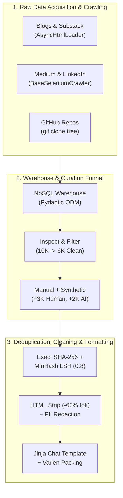
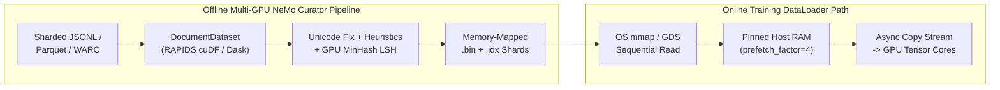
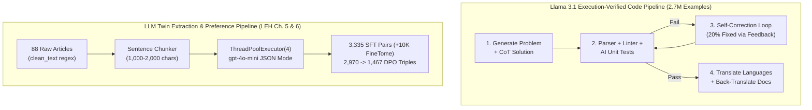
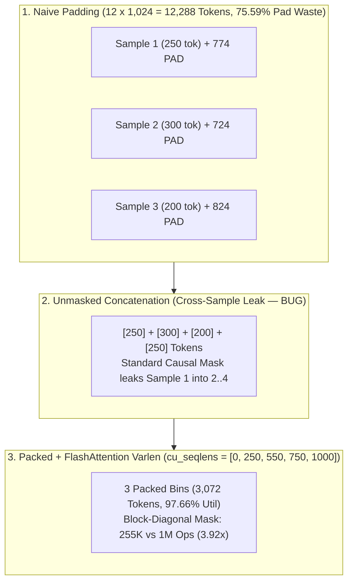

# 14.14 Dataset engineering for fine-tuning

| Field | Value |
|---|---|
| Level | Intermediate |
| Priority tier | 1 |
| Lab venue | Nebius GPU + Local Python Verification Lab |
| Part | Part 14: Distributed training and fine-tuning |
| Primary sources | *AI Engineering* (`ai-engineering`, Chapter 8: *Dataset Engineering*); *LLM Engineer's Handbook* (`llm-engineers-handbook`, Chapters 3, 5, and 6); *LLMOps* (`llmops`, Chapter 4: *Data Engineering for LLMs*); *AI Systems Performance Engineering* (`ai-systems-performance-engineering`, Chapter 5: *GPU-Based Storage I/O Optimizations*) |
| Cross-references | Chapter 13.6 (Data loading, small files, and metadata); Chapter 14.8 (PyTorch performance profiling and scaling); Chapter 14.13 (Fine-tuning: SFT, LoRA, QLoRA, and preference alignment); Chapter 14.16 (NeMo framework and customization) |
| Code | `code/part14/dataset_engineering_finetuning.py`, `code/part14/dataset_engineering_finetuning_lab.py` |
| Coverage file | `planning/coverage/chapters/14-14.md` |
| Claim & number ledger | `planning/ledgers/14-14.md` |

## Why this matters for AI infrastructure

An expensive GPU cluster is only as productive as the tokens flowing into its Tensor Cores. Even the best distributed training team with thousands of accelerators cannot fine-tune a reliable model if the dataset is noisy, repetitive, or poorly formatted. As foundation model architectures converge across the industry, data engineering has become the primary differentiator between mediocre models and frontier systems.

In early deep learning benchmarks, researchers held the dataset fixed and competed to design better model architectures. Modern post-training has inverted that paradigm into data-centric AI. Teams now hold the base model architecture fixed and compete to engineer cleaner, more diverse, and more compute-efficient datasets.

```text
The Shift to Data-Centric AI and Pipeline Efficiency Reference Numbers:
- OpenAI data team growth (AI Engineering, Chapter 8):
  * GPT-3 (2020): only 2 contributors credited for data collection, filtering, deduplication, and overlap analysis
  * GPT-4 (2023): 80 contributors credited for data processes (excluding contractors), with 11 senior researchers on ChatML alone
- Data-centric benchmarks (AI Engineering, Chapter 8):
  * DataComp (2023-2024): fixed training code evaluated across 38 downstream tasks on language models from 412M to 7B parameters
  * LIMA (Zhou et al., 2023): 65B Llama fine-tuned on 1,000 curated examples matched or beat GPT-4 in 43% of human evaluations
  * Yi model family (01.AI, 2024): 10,000 carefully crafted instructions outperformed hundreds of thousands of noisy instructions
- Duplication, cleaning, and I/O impact on GPU clusters:
  * Anthropic repetition study (Hernandez et al., 2022): repeating 0.1% of data 100 times degrades an 800M model to a 400M model (despite 90% unique tokens)
  * Databricks HTML/Markdown cleaning: stripping extraneous markup improved accuracy by 20% and cut input token length by 60%
  * Storage and input pipeline tuning (ASP, Chapter 5): poorly tuned pipelines waste 50% of GPU time; cutting I/O wait from 30% to 5% gives a 6x step speedup
```

Small flaws in dataset engineering silently destroy both model quality and cluster utilization.
- **Unfiltered duplicates and benchmark leakage:** Repeating a tiny fraction of training examples causes severe memorization and halves effective model capacity. Meanwhile, failing to decontaminate against evaluation benchmarks inflates validation scores and masks overfitting.
- **Unstripped markup and unvalidated synthetic data:** Training on raw HTML tags wastes over half of your sequence length budget. Indiscriminately training on unverified synthetic outputs triggers superficial imitation, position bias, or recursive model collapse.
- **Mismatched chat templates and naive padding:** A single missing newline or omitted end-of-sequence token breaks instruction following or causes infinite generation loops. Padding short fine-tuning samples out to maximum context length wastes three-quarters of your GPU compute on meaningless pad tokens.

**Treat dataset curation, deduplication, verification, and sequence packing as core GPU infrastructure problems before launching a single fine-tuning job.**

## Prerequisites and outcomes

### Prerequisites
- Transformer tokenization, attention mechanics, and context window memory scaling from Chapters 14.2 and 14.3.
- Storage data paths, small-file metadata bottlenecks, and local NVMe staging from Chapters 13.1, 13.2, and 13.6.
- PyTorch `DataLoader` worker concurrency and pinned host memory transfers from Chapter 14.8.

### Outcomes
After completing this chapter, you will be able to accomplish five core engineering tasks.
1. Design fine-tuning datasets across the three core curation dimensions of quality, coverage, and quantity. You will also align domain mixtures and scaling budgets across pre-training, supervised fine-tuning, and preference alignment.
2. Build multi-stage deduplication and decontamination pipelines using exact SHA-256 hashing, fuzzy MinHash with Locality-Sensitive Hashing, and semantic vector clustering.
3. Implement rule-based quality filters, HTML and Markdown stripping, automated PII redaction, and GPU-accelerated offline dataset preparation with NVIDIA NeMo Curator.
4. Architect synthetic instruction and preference generation pipelines using sentence-aware chunking, Evol-Instruct, execution-verified code synthesis, and bias-corrected LLM-as-a-Judge rubrics.
5. Format datasets into exact Jinja chat templates, mask prompt tokens from the cross-entropy loss, and pack variable-length sequences using cumulative sequence lengths for FlashAttention.

---

## 1. Data-Centric AI, Curation Principles, and Domain Composition

### 1.1 The Six Pillars of Data Quality and the Data-Centric Shift

When a fine-tuned model hallucinates, ignores formatting rules, or adopts an arrogant tone, engineers often blame the optimizer or learning rate. In practice, the root cause almost always lives in the training examples. If human annotators include unsolicited style rewrites during fact-checking tasks, the fine-tuned assistant will annoy production users with unsolicited rewrites. Removing those flawed examples and adding clean demonstrations fixes the behavior immediately without changing a single hyperparameter.

High-quality fine-tuning data must satisfy six concrete engineering criteria.
1. **Relevant:** Examples must match the target temporal and domain context. Nineteenth-century legal statutes will hurt a modern contract assistant.
2. **Aligned with task requirements:** Annotations must reflect whether the application requires concise factual answers, creative prose, or step-by-step justifications.
3. **Consistent:** Different annotators grading or writing responses for the same prompt must follow a unified rubric. That consistency prevents contradictory labels from confusing gradient updates.
4. **Correctly formatted:** Extraneous HTML tags, trailing whitespace, and inconsistent numerical rounding must be stripped before tokenization.
5. **Sufficiently unique:** Duplicate documents, repeated paragraphs, and leaked test questions must be removed to prevent memorization and bias.
6. **Compliant:** Personal identifiable information, copyrighted material lacking commercial licenses, and toxic content must be filtered to satisfy legal governance.

| Training Phase | Primary Unit of Scale | Typical Dataset Scale | Canonical Data Format | Primary Learning Objective |
|---|---|---|---|---|
| Pre-training / Continual pre-training | Tokens | Billions to trillions of tokens | Raw text (`{"text": "..."}`) | Broad world knowledge, syntax, and next-token prediction |
| Supervised fine-tuning (SFT) | Examples | 100 to 10,000,000 pairs | `(instruction, response)` or multi-turn messages | Instruction following, chat formatting, CoT, and tool use |
| Preference alignment (DPO / RLHF) | Triples or scored pairs | 100 to 1,000,000+ triples | `(prompt, chosen, rejected)` or `((prompt, response), score)` | Human style alignment, safety boundaries, and edge-case nuance |

### 1.2 Data Coverage, Domain Mixtures, and Scaling Laws

Even pristine examples fail if they do not cover the distribution of real user requests. Data coverage requires diversity across topics, instruction lengths, user speaking styles, and multi-turn back-and-forth clarifications. For chain-of-thought reasoning, including step-by-step rationales nearly doubles model accuracy on complex reasoning benchmarks compared to training on final answers alone. For tool use and agentic workflows, human web-browsing recordings are often inefficient because models interact with APIs rather than graphical browsers. Modern teams use multi-message chat headers that route messages between the user, the assistant, and a code interpreter.

```text
Scaling Laws and Domain Composition Reference (LLO Chapter 4; AIE Chapter 8; LEH Chapters 5 & 6):
- Kaplan et al. (2020) power-law scaling under fixed compute budget C:
  Loss ~ (1 / N)^alpha,  Loss ~ (1 / D)^beta
  D_opt ~ C^0.27,        N_opt ~ C^0.73   (prioritizes scaling model parameters N faster than dataset size D)
- Hoffmann et al. (2022) Chinchilla compute-optimal scaling:
  D_opt ~ C^0.50,        N_opt ~ C^0.50   (scales model parameters N and training tokens D in equal proportion)
- Pre-training token scale vs 2,000-token examples:
  Llama 2 = 2 trillion tokens (~1 billion examples); Llama 3 = 16 trillion tokens (~15 billion examples)
- Fine-tuning sample quantity benchmarks:
  * Task-specific SFT: 100 to 100,000 samples (50 to 100 clean examples suffice for initial feasibility)
  * OpenAI SNLI experiment: at 100 examples, larger base models win; at 550,000 examples, all 5 model sizes converge
  * Task diversity scaling (Chung et al., 2022): strong gains from 9 to 282 tasks; incremental gains up to 1,836 tasks
  * General-purpose SFT: ~10,000 (Yi), ~1,000,000 (OpenHermes / Dolphin), up to 10,000,000 (Llama 3 post-training)
  * Preference alignment (DPO): 200–500 pairs (identity alignment), 100–10,000 (task-specific), 10,000–100,000 (open-source), 1,000,000+ (frontier)
```

How you mix domains changes dramatically across training stages. During pre-training and supervised fine-tuning, code and mathematical reasoning account for over a third of the entire dataset because structured logic transfers to general reasoning. Furthermore, annealing the model at the end of pre-training with a decaying learning rate on concentrated code and math data sharply boosts benchmark accuracy. During preference alignment, however, the mixture shifts heavily toward general natural language to reflect everyday user interactions.

| High-Level Domain | Llama 3 Pre-Training Mix | Llama 3 Supervised Fine-Tuning Mix | Llama 3 Preference Fine-Tuning Mix |
|---|---|---|---|
| General knowledge (English) | 50% | 52.66% | 81.99% |
| Math and reasoning | 25% | 21.19% | 5.89% |
| Coding | 17% | 14.89% | 6.93% |
| Multilingual | 8% | 3.01% | 5.19% |
| Exam-like questions | 0% | 8.14% | 0% |
| Long context | 0% | 0.11% | 0% |
| **Combined Math + Coding** | **42.0%** | **36.08%** | **12.82%** |

When deciding between Parameter-Efficient Fine-Tuning and full fine-tuning, match your method to your dataset size and base model capacity. If you have only a few hundred or a few thousand examples, pair LoRA or QLoRA with a strong base model. If you have tens of thousands to millions of examples, full fine-tuning on a smaller model becomes viable, provided you guard against weight ossification and catastrophic forgetting. You can also stretch a limited budget through multi-stage curriculum transfer. First pre-train on domain documents before supervised question answering. Alternatively, train on abundant general sentiment data before niche product reviews, or train on broad synthetic examples before final adaptation on scarce real records.

### 1.3 Data Acquisition, ETL Crawling, and Curation Funnels

Real-world datasets rarely arrive as clean instruction tables. Instead, DataOps and AI infrastructure engineers build Extract, Transform, and Load pipelines that ingest unstructured web articles, code repositories, and application logs into a central warehouse before curating training pairs.



In the *LLM Engineer's Handbook* architecture, a ZenML pipeline named `digital_data_etl` dispatches URLs through a `CrawlerDispatcher` builder pattern into three standardized Pydantic Object-Document Mapping collections in MongoDB. Those three collections are `ArticleDocument`, `RepositoryDocument`, and `PostDocument`. Headless browser crawlers inherit from `BaseSeleniumCrawler` to handle authenticated scrolling feeds. Meanwhile, `GithubCrawler` clones repositories into temporary directories and strips binary or lock artifacts such as `.git`, `.toml`, `.lock`, and `.png`.

```text
Curation Funnel, Annotation Budget, and ETL Reference (AIE Chapter 8; LEH Chapter 3):
- Budget equation: Max_Examples = Annotation_Budget / Cost_Per_Example
  Example: $10,000 budget at $2.00 per human annotation = 5,000 examples maximum
- Hybrid curation funnel worked example (AIE Chapter 8):
  1. Start with 10,000 public dataset examples
  2. Filter out 1,000 low-quality instructions -> 9,000 examples remain
  3. Set aside 3,000 pairs with poor responses -> 6,000 clean (instruction, response) pairs kept
  4. Manually write responses for the 3,000 good instructions -> 9,000 high-quality pairs
  5. Create 100 templates for an underrepresented topic and synthesize 2,000 instructions + manual answers -> 11,000 final examples
- LLM Twin ETL Warehouse baseline (LEH Chapter 3):
  88 scraped articles across 3 users (50 articles for Paul Iusztin) stored via NoSQLBaseDocument UUID4 ODM
```

**Always validate a new fine-tuning pipeline on fifty to one hundred clean examples and plot performance at twenty-five, fifty, and one hundred percent data subsets before spending thousands of dollars on annotation or synthetic generation.**

---

## 2. Deduplication, Decontamination, and NVIDIA NeMo Curator

### 2.1 Why Duplicate Data Destroys Model Capacity

Duplicate training examples do far more damage than merely wasting GPU hours. First, repeated examples skew the empirical loss distribution and teach the model spurious correlations. A model might assume every red product in a catalog costs twenty dollars because one row was pasted three times. Second, duplicates across train and test splits cause benchmark contamination. That leakage turns validation loss into a measure of memorization rather than generalization.

Most importantly, concentrated repetition cripples the internal representations of a neural network. In a landmark study, Anthropic researchers repeated a tiny fraction of a dataset a hundred times. That duplication degraded an eight-hundred-million-parameter model to the level of a four-hundred-million-parameter model. That fifty percent loss of effective model capacity occurred even though ninety percent of the training tokens remained completely unique. Similarly, repeating an entire fine-tuning dataset over too many epochs triggers multi-epoch degradation, where validation perplexity climbs as the model memorizes phrasing.

### 2.2 Exact, Fuzzy (MinHash + LSH), and Semantic Deduplication

Because pairwise comparison of $N$ documents requires quadratic operations, comparing millions of training records directly is computationally impossible. Production pipelines layer four deduplication stages of increasing granularity.
1. **Exact deduplication:** Normalize text by lowercasing and collapsing whitespace, then hash each document or paragraph with MD5 or SHA-256. Hash table lookups remove byte-identical copies in linear time.
2. **Fuzzy deduplication with MinHash:** Catch near-duplicates that differ by a few edited words, timestamps, or boilerplate headers. Each document is split into a set of $k$-word or $k$-character shingles. The overlap between two shingle sets is measured by the Jaccard similarity. To avoid pairwise set intersections, MinHash applies $M$ independent hash permutations and records the minimum hash value for each permutation to form a compact signature vector. The fraction of matching positions between two MinHash signatures is an unbiased estimator of their exact Jaccard similarity.
3. **Locality-Sensitive Hashing banding:** Even with compact MinHash signatures, comparing all signature pairs takes quadratic time. Locality-Sensitive Hashing divides each signature into $b$ bands of $r$ rows each. If two documents match in all $r$ rows of at least one band, they hash to the same bucket and become a candidate pair. This banding creates a sharp S-curve probability threshold, typically tuned to flag documents with Jaccard similarity of 0.8 or higher.
4. **Semantic deduplication and decontamination:** Embed chunks or instructions into dense vectors using an encoder such as `text-embedding-3-small` or SentenceTransformers. Compute cosine similarity or cluster vectors with K-means or DBSCAN to collapse paraphrases that share no lexical $n$-grams. During this stage, temporarily append your evaluation benchmark prompts to the deduplication index and purge any training sample that collides with a test item.

```text
MinHash, Jaccard Similarity, and LSH Banding Formulas (LEH Chapter 5; LLO Chapter 4):
- Exact Jaccard similarity of shingle sets A and B:
  J(A, B) = |A intersect B| / |A union B|
- MinHash estimator over M = b * r hash permutations:
  J_hat(A, B) = (1 / M) * sum_{i=1..M} I[h_min_i(A) == h_min_i(B)]
- LSH candidate collision probability across b bands of r rows:
  P(candidate | J) = 1 - (1 - J^r)^b
  Approximate S-curve inflection threshold: T ~ (1 / b)^(1 / r)

Worked Example (M = 128 permutations split into b = 16 bands of r = 8 rows, target J = 0.80):
  - At J = 0.20: J^8 = 0.00000256 -> P(candidate) = 1 - (1 - 0.00000256)^16 = 0.000041 (0.004% false positive rate)
  - At J = 0.50: J^8 = 0.00390625 -> P(candidate) = 1 - (1 - 0.00390625)^16 = 0.060687 (6.07% candidate rate)
  - At J = 0.80: J^8 = 0.16777216 -> P(candidate) = 1 - (1 - 0.16777216)^16 = 0.947102 (94.71% detection rate)
  - At J = 0.90: J^8 = 0.43046721 -> P(candidate) = 1 - (1 - 0.43046721)^16 = 0.999879 (99.99% detection rate)
```

| Deduplication Method | Representation | Similarity Metric | Primary Target | Computational Scaling |
|---|---|---|---|---|
| Exact hashing | Normalized string | MD5 / SHA-256 equality | Identical documents, repeated rows, consecutive duplicate lines | Linear $O(N)$ hash table |
| TF-IDF soft dedup | Sparse term-weight vector | TF-IDF cosine overlap | Boilerplate-heavy web pages sharing rare domain terms | Sparse vector dot product |
| SimHash | Fixed-length bit fingerprint | Hamming distance | Near-identical web pages with minor formatting edits | Linear $O(N)$ bucketed bit-search |
| MinHash + LSH | $M$ minimum shingle hashes ($b \times r$) | Jaccard similarity ($J \ge 0.8$) | Fuzzy near-duplicates, plagiarized paragraphs, benchmark leaks | Linear $O(N \cdot M)$ signature + bucket joins |
| Semantic embedding | Dense vector (1,536 floats) | Cosine similarity + DBSCAN / K-means | Paraphrased instructions and semantically redundant Q&A pairs | GPU embedding + ANN index |

### 2.3 Distributed GPU Curation with NVIDIA NeMo Curator

When curating multiterabyte datasets from Common Crawl WARC and WET archives or enterprise lakes, single-node Python scripts bottleneck on CPU string parsing and disk seeks. Worse, performing text cleaning or tokenization on the fly during training starves the GPUs. A poorly tuned online input pipeline can waste half of your cluster's GPU time waiting on CPU workers.

NVIDIA NeMo Curator moves heavy dataset engineering offline and distributes it across multi-GPU, multi-node clusters using RAPIDS cuDF and Dask. Instead of reading millions of small files during training, NeMo Curator ingests sharded JSONL or Parquet files into a distributed `DocumentDataset`. It executes Unicode decoding, language detection, heuristic quality filtering, PII redaction, and GPU-accelerated MinHash LSH deduplication in parallel. Finally, it packs and tokenizes the cleaned corpus into memory-mappable `.bin` data files paired with `.idx` byte-offset index files. Teams can also write $N$ pre-shuffled copies for $N$ training epochs so runtime data loaders perform zero string processing or shuffling.



```text
Storage I/O, NeMo Curator, and DataLoader Tuning Numbers (ASP Chapter 5; LLO Chapter 4):
- Unoptimized input pipeline penalty: up to 50% of GPU time wasted waiting on CPU text processing and small-file I/O
- Storage I/O wait tuning: reducing GPU data wait from 30% to 5% increases training steps/sec by 6.0x (30% / 5%)
- Multimodal GPU decoding (NVIDIA DALI): drops host CPU utilization from 800% (8 full cores) to 200% (2 cores)
- PyTorch DataLoader overlap baseline:
  batch_size = 32, num_workers = 8, prefetch_factor = 4 -> 8 * 4 = 32 batches (1,024 samples) queued in pinned RAM
  Combined with pin_memory = True, persistent_workers = True, and dedicated torch.cuda.Stream() for non_blocking H2D copies
- Embedding chunk sizing (LLO Chapter 4):
  OpenAI text-embedding-3-small accepts up to 8,191 tokens (~8,000 chars at ~4 chars/token) -> outputs 1,536 floats
```

**Run deduplication, cleaning, and tokenization offline into sharded binary or Parquet files so your training cluster spends every GPU cycle on forward and backward matrix math.**

---

## 3. Data Cleaning, Quality Filtering, and PII Governance

### 3.1 The Ten-Step Preprocessing Pipeline and Core Cleaning Rules

Before any instruction formatting or synthetic expansion takes place, raw corpora must pass through a structured ten-step preprocessing lifecycle.
1. **Catalog data sources:** Record domain, target task, and provenance metadata in a central catalog.
2. **Verify privacy and legal compliance:** Audit copyright terms and commercial redistribution licenses for every source. Even if a composite dataset claims a permissive license, verify the underlying sub-corpora.
3. **Filter sources:** Apply domain allowlists and blocklists, such as the CulturaX blacklist, tagging filtered rows in metadata rather than deleting raw backups in place.
4. **Deduplicate content:** Run exact hash and fuzzy MinHashLSH passes at the document, paragraph, and sentence levels.
5. **Collect and standardize:** Ingest HTML, PDF, or WARC/WET streams with provenance tags attached.
6. **Detect character encoding:** Validate UTF-8 integrity with tools like `Chardet` so corrupted byte sequences do not inject gibberish tokens.
7. **Detect languages:** Classify document languages using tools like `lingua-py` to enforce target multilingual ratios.
8. **Chunk documents:** Split long documents using fixed-size, sentence-based, paragraph-based, or agentic boundaries that fit downstream context windows.
9. **Back up raw and intermediate snapshots:** Preserve immutable snapshots so buggy regular expressions never destroy source data.
10. **Maintain fresh data:** Synchronize evolving sources via periodic polling, transaction-log Change Data Capture, or real-time Kafka and Apache Pulsar event streams segmented by timestamp windows.

When cleaning raw text in Step 3 and Step 5, enforce nine core hygiene rules. Drop incomplete sentence fragments, redact PII, remove violent or harmful material, strip abnormal symbols, and remove HTML, CSS, and JavaScript markup. In addition, delete template lines containing raw curly braces, discard overly short context-free lines, strip web navigation bars and social buttons, and filter blocked keywords. In production benchmarks at Databricks, simply stripping extraneous HTML and Markdown tags improved downstream model accuracy by twenty percent while cutting input token lengths by sixty percent.

### 3.2 Automated Quality Classifiers, Reward Models, and PII Redaction

Rule-based length and punctuation heuristics run at high speed across millions of documents, but binary rules can accidentally strip valid edge cases or miss subtle incoherence. Worse, naive toxicity keyword blocklists often erase non-toxic discussions written by or about marginalized communities. To combine speed with semantic nuance, modern pipelines layer three automated quality evaluators after heuristic cleaning.
1. **Encoder-only quality classifiers:** Lightweight bi-encoder models score millions of web or instruction samples at minimal GPU cost. For example, `HuggingFaceFW/fineweb-edu-classifier` attaches a classification head onto `Snowflake/snowflake-arctic-embed-m` and trains for twenty epochs on four hundred fifty thousand samples scored by Llama-3-70B-Instruct.
2. **Multi-objective reward models:** Decoder-based reward models add a linear regression and gating layer onto a backbone like Llama-3-8B. `RLHFlow/ArmoRM-Llama3-8B-v0.1` evaluates each instruction-response pair across helpfulness, correctness, coherence, complexity, and verbosity. Teams benchmark candidate evaluators against the AllenAI RewardBench leaderboard (`allenai/reward-bench`).
3. **PII detection and redaction:** Combine regular expressions for structured identifiers like email addresses, phone numbers, Social Security numbers, and IPv4 addresses with Named Entity Recognition models. Those filters replace sensitive spans with typed placeholders such as `[EMAIL_REDACTED]` or `[SSN_REDACTED]`.

**Combine fast rule-based regex and length filters with encoder classifiers and manual spot-checks, because fifteen minutes of staring at raw samples catches systemic bugs that automated metrics miss.**

---

## 4. Synthetic Data Generation, Augmentation, and Verification

### 4.1 Why Synthesize Data: From Seed Prompts to Self-Correcting Code Pipelines

Human annotation is slow, expensive, and surprisingly inconsistent on complex multi-step tasks. Synthetic data generation uses capable models, simulators, or rule engines to scale data quantity and target rare edge-case coverage. It also enforces consistent preference grading, protects patient or financial privacy, and distills large teacher models into compact student models.

```text
Landmark Synthetic Data and Distillation Benchmarks (AIE Chapter 8; LEH Chapters 5 & 6; LLO Chapter 4):
- Rule-based and simulation synthesis:
  * AlphaGeometry (DeepMind, 2024): Olympiad-level geometry model trained on 100,000,000 synthetic examples
  * Adversarially perturbed data: 1-pixel attack fools 67.97% of CIFAR-10 and 16.04% of ImageNet; BERT masks/perturbs 1.5% random tokens
  * OpenAI Dota 2 self-play: simulated 180 years of gameplay per day
- LLM-powered instruction and math synthesis:
  * Stanford Alpaca (2023): 175 Self-Instruct seed pairs expanded by text-davinci-003 (175B) into 52,000 pairs; Llama-7B student is 4% teacher size
  * UltraChat (Ding et al., 2023): 30 daily-life topics x 30 to 50 subtopics expanded into multi-turn dialogues
  * MetaMath (Yu et al., 2023): 15,000 MATH and GSM-8K problems rewritten into 400,000 examples
  * Cosmopedia (Allal et al., 2024): 25,000,000,000 (25B) tokens of synthetic textbooks generated by Mixtral-8x7B-Instruct-v0.1
- Llama 3.1 and NVIDIA Nemotron-4 post-training synthesis:
  * Llama 3.1 coding SFT (Dubey et al., 2024): 2,700,000 synthetic coding examples via problem generation, unit-test execution, parser/linter
    self-correction (20% of initially failing solutions self-corrected), cross-language translation, and documentation back-translation
  * NVIDIA Nemotron-4 340B-Instruct (2024): 98% of SFT and preference data synthesized by Mixtral-8x7B-Instruct-v0.1 (56B MoE teacher -> 340B dense student)
  * DistilBERT & BuzzFeed LoRA distillation: DistilBERT is 40% smaller, 60% faster, retaining 97% capability; BuzzFeed cut inference cost by 80%
```

To upgrade simple instructions into challenging multi-step reasoning prompts, pipelines apply **Evol-Instruct** and **UltraFeedback**.
- **In-depth evolving:** Rewrites an existing instruction by adding constraints, deepening domain specificity, concretizing abstract terms, demanding multi-step reasoning, or embedding structured XML or JSON inputs. Each rewrite adds only ten to twenty words.
- **In-breadth evolving:** Generates rare, long-tail instructions within the same domain to expand coverage.
- **Reverse instruction and long-context synthesis:** Because LLMs hallucinate more frequently when generating long responses than short questions, reverse instruction takes verified human articles or books and prompts an LLM to generate the instruction that would elicit that passage. To extend context windows from eight thousand tokens to one hundred twenty-eight thousand tokens, pipelines split long documents into short chunks. They then synthesize question-answer pairs per chunk and re-attach the full multi-document context during fine-tuning.



### 4.2 LLM-as-a-Judge Verification and Mitigating Judge Biases

Generating synthetic text is easy, but training on unverified synthetic outputs is dangerous. When functional execution checks like unit tests or back-translation are unavailable, pipelines rely on **LLM-as-a-Judge** evaluators. These evaluators use either a 1-to-4 absolute scoring rubric or pairwise comparison between two candidate responses, targeting at least eighty percent agreement with human annotators.

Every LLM judge exhibits three systematic biases that must be engineered out of your verification pipeline.
1. **First-position bias:** In pairwise ranking, LLM judges consistently favor whichever response is presented first. To eliminate position bias, NVIDIA researchers on Nemotron-4 evaluated every candidate pair twice. They ran one pass in forward order and a second pass in swapped order. A preference triplet is kept only if the judge selects the exact same underlying response in both orderings.
2. **Length and verbosity bias:** Both humans and LLM judges favor longer, formal responses even when they are repetitive. Apply length-normalized scoring and include concise gold examples in few-shot rubrics. During Direct Preference Optimization, raise `beta` from `0.1` to `0.5` with a low learning rate of `2e-6` for one epoch when preserving casual human writing styles.
3. **Intra-model family favoritism:** Models score outputs from their own model family higher than external models. Replace single-model judges with a multi-model jury of smaller, diverse evaluators.

### 4.3 Limitations of Synthetic Data: Superficial Imitation and Model Collapse

Synthetic data is not a free substitute for real human provenance. Four structural failure modes govern its use.
- **Superficial imitation:** Training a small student model on complex answers from a proprietary teacher teaches the student to mimic the teacher's formatting and tone without acquiring the underlying reasoning capacity. When asked novel questions outside its pre-training knowledge, the student model confidently hallucinates plausible-looking steps.
- **Recursive model collapse:** Recursively training new model generations on unverified synthetic outputs from previous generations collapses the tails of the probability distribution. Probable events become over-represented while rare events vanish. Mixing verified synthetic data with real human data prevents collapse.
- **Bias amplification:** Training on a model's own unfiltered predictions compounds demographic and stylistic biases across iterations.
- **Obscured lineage and benchmark leakage:** If an external teacher model was trained on copyrighted text or public evaluation benchmarks, distilling from its outputs silently contaminates your student model and obscures legal provenance.

**Never include synthetic instruction or preference pairs in a training run unless they pass programmatic execution checks, back-translation, or order-swapped LLM judge verification.**

---

## 5. Chat Templates, Sequence Packing, and FlashAttention Varlen

### 5.1 Storage Schemas, Jinja Chat Templates, and Prompt Compression

Once your dataset is deduplicated, cleaned, and verified, it must be serialized into a standard schema. It is then rendered through the exact chat template expected by your base or instruct model. Single-turn datasets typically use the **Alpaca** schema with `instruction`, optional `input`, and `output` fields. Multi-turn conversations use **ShareGPT** or **OpenAI** message lists.

| Template Name | Special Role / Turn Start Tokens | End-of-Turn / EOS Tokens | Canonical Structure Example |
|---|---|---|---|
| Alpaca | `### Instruction:` / `### Response:` | `<EOS>` (tokenizer `eos_token`) | `### Instruction: {prompt}\n### Response: {answer}<EOS>` |
| ChatML | `<\|im_start\|>system` / `user` / `assistant` | `<\|im_end\|>` | `<\|im_start\|>user\n{prompt}<\|im_end\|>\n<\|im_start\|>assistant\n{answer}<\|im_end\|>` |
| Llama 3 | `<\|begin_of_text\|><\|start_header_id\|>{role}<\|end_header_id\|>` | `<\|eot_id\|>` | `<\|begin_of_text\|><\|start_header_id\|>user<\|end_header_id\|>\n\n{prompt}<\|eot_id\|>` |
| Phi-3 | `<\|user\|>` / `<\|assistant\|>` | `<\|end\|>` | `<\|user\|>\n{prompt}<\|end\|>\n<\|assistant\|>\n{answer}<\|end\|>` |
| Gemma | `<bos><start_of_turn>user` / `model` | `<end_of_turn>` | `<bos><start_of_turn>user\n{prompt}<end_of_turn>\n<start_of_turn>model\n{answer}<end_of_turn>` |

Every single whitespace character, newline, and special token in a chat template is load-bearing.
- **Never hand-concatenate chat strings:** Use `tokenizer.apply_chat_template()` backed by Jinja templates. During training, format the full conversation including the terminal `<|im_end|>` or `<|eot_id|>` token. If you omit the end-of-sequence token during training, the deployed model will ramble endlessly at inference time. During inference, pass `add_generation_prompt=True` so the template appends the assistant header and cues the model to generate a reply.
- **Mask prompt tokens from the loss:** In PyTorch cross-entropy loss, set `labels[i] = -100` on system and user prompt tokens. That mask ensures gradients are computed strictly on assistant response tokens.
- **Compress few-shot prompts after fine-tuning:** A base model often requires a verbose multi-shot prompt explaining the task. Fine-tuning bakes that behavior into the weights so production requests can use a minimal delimiter such as `{INPUT} -->`. However, your inference prompt must match the training delimiter character-for-character. Omitting the arrow or appending a trailing space degrades accuracy.

### 5.2 Sequence Packing (`packing=True`) and `FlashAttention` Varlen (`cu_seqlens`)

In supervised fine-tuning, sequence lengths vary wildly. Suppose your training configuration sets a maximum sequence length of `1024` tokens with a batch size of twelve. Any single sample of `1,500` tokens is truncated to `1,024` tokens, losing `476` tokens. Conversely, if most of your instruction pairs are only two hundred to three hundred tokens long, standard batching pads every sample out to the full window. Over three-quarters of your GPU memory and Tensor Core compute are wasted processing meaningless pad tokens.

**Sequence packing** (`packing=True` in TRL `SFTTrainer`) eliminates padding waste by concatenating multiple short examples end-to-end inside each training slot, fitting three to four samples per slot. However, naive concatenation introduces a severe bug. If you concatenate two samples into a single flat sequence without modifying the attention mask, tokens in the second sample attend back to tokens in the first sample. That cross-sample contamination corrupts both training gradients and positional embeddings.



To pack sequences without cross-sample leakage or materializing a dense two-dimensional mask in HBM, production trainers use `flash_attn_varlen_func`. They pass cumulative sequence lengths (`cu_seqlens`) and reset position IDs at each segment boundary.

```text
Sequence Packing and FlashAttention Varlen (cu_seqlens) Worked Math:
- Workload: 12 instruction samples of lengths [250, 300, 200, 250, 300, 220, 260, 220, 250, 250, 250, 250] (3,000 real tokens)
- Target window: max_seq_length = 1,024 tokens
  1. Naive Padding:
     * Allocated tokens: 12 samples * 1,024 = 12,288 tokens (9,288 pad tokens = 75.59% waste, 24.41% token utilization)
  2. Packed Batching:
     * Bin 0: [250, 300, 200, 250] = 1,000 tokens
     * Bin 1: [300, 220, 260, 220] = 1,000 tokens
     * Bin 2: [250, 250, 250, 250] = 1,000 tokens
     * Allocated tokens: 3 bins * 1,024 = 3,072 tokens (97.66% token utilization, 4.0x reduction in batch slots)
  3. FlashAttention Varlen Metadata on Bin 0 ([250, 300, 200, 250]):
     * cu_seqlens (int32 tensor): [0, 250, 550, 750, 1000], max_seqlen = 300
     * position_ids reset at each boundary: [0..249, 0..299, 0..199, 0..249]
     * Unmasked dense attention complexity: (1,000)^2 = 1,000,000 token-pair operations
     * Block-diagonal varlen complexity: 250^2 + 300^2 + 200^2 + 250^2 = 62,500 + 90,000 + 40,000 + 62,500 = 255,000 operations
     * Attention compute reduction: 1,000,000 / 255,000 = 3.92x fewer attention operations + zero cross-sample leakage
```

**Always pair sequence packing with cumulative sequence length metadata (`cu_seqlens`) and per-document position ID resets so packed examples never attend across document boundaries.**

---

## 6. Commands and Configurations That Matter

### 6.1 Sentence-Aware Extraction, Synthetic Generation, and DPO Filtering (`LEH` Ch. 5 & 6)

The following production pipeline implements the regex cleaner and the sentence-aware substring chunker. It also includes the concurrent `ThreadPoolExecutor` synthesis loop and the DPO chosen-answer hygiene filter.

```python
import concurrent.futures
import json
import re
from typing import List, Tuple
from datasets import Dataset, concatenate_datasets, load_dataset
from openai import OpenAI

def clean_text(text: str) -> str:
    text = re.sub(r"[^\w\s.,!?']", " ", text)
    text = re.sub(r"\s+", " ", text)
    return text.strip()

def extract_substrings(dataset: Dataset, min_length: int = 1000, max_length: int = 2000) -> List[str]:
    extracts = []
    sentence_pattern = r"(?<!\w\.\w.)(?<![A-Z][a-z]\.)(?<=\.|\?|\!)\s"
    for article in dataset["content"]:
        sentences = re.split(sentence_pattern, clean_text(article))
        current_chunk = ""
        for sentence in sentences:
            sentence = sentence.strip()
            if not sentence:
                continue
            if len(current_chunk) + len(sentence) <= max_length:
                current_chunk += sentence + " "
            else:
                if len(current_chunk) >= min_length:
                    extracts.append(current_chunk.strip())
                current_chunk = sentence + " "
        if len(current_chunk) >= min_length:
            extracts.append(current_chunk.strip())
    return extracts

def filter_dpo_dataset(dataset: Dataset, min_length: int = 100) -> Dataset:
    dataset = dataset.filter(lambda ex: len(ex["chosen"]) >= min_length)
    dataset = dataset.filter(
        lambda ex: len(ex["chosen"]) > 0
        and ex["chosen"][0].isupper()
        and ex["chosen"][-1] in (".", "!", "?")
    )
    return dataset
```

### 6.2 SFT and DPO Training Configurations with Packing and Pinned DataLoaders

Below is the reference configuration combining `mlabonne/llmtwin` with `FineTome-Alpaca-100k` samples filtered by `fineweb-edu-classifier`. It runs with `packing=True` on Llama-3.1-8B alongside the high-throughput `DataLoader` overlap pattern from *AI Systems Performance Engineering* Chapter 5.

```python
import torch
from torch.utils.data import DataLoader
from trl import SFTTrainer, DPOTrainer, DPOConfig
from transformers import TrainingArguments

# 1. High-Throughput Pinned Memory + Async Copy Stream DataLoader (ASP Chapter 5)
loader = DataLoader(
    dataset,
    batch_size=32,
    num_workers=8,
    pin_memory=True,
    persistent_workers=True,
    prefetch_factor=4,
)
copy_stream = torch.cuda.Stream()
compute_stream = torch.cuda.current_stream()

for batch in loader:
    with torch.cuda.stream(copy_stream):
        batch_gpu = batch.to("cuda", non_blocking=True)
    with torch.cuda.stream(compute_stream):
        compute_stream.wait_stream(copy_stream)
        outputs = model(batch_gpu)

# 2. Supervised Fine-Tuning with Sequence Packing (LEH Chapter 5)
sft_trainer = SFTTrainer(
    model=model,
    tokenizer=tokenizer,
    train_dataset=dataset["train"],
    eval_dataset=dataset["test"],
    dataset_text_field="text",
    max_seq_length=2048,
    dataset_num_proc=2,
    packing=True,
    args=TrainingArguments(
        learning_rate=3e-4,
        lr_scheduler_type="linear",
        per_device_train_batch_size=2,
        gradient_accumulation_steps=8,  # Effective batch size = 2 * 8 = 16 (or 32 across 2 GPUs)
        num_train_epochs=3,
        optim="adamw_8bit",
        weight_decay=0.01,
        warmup_steps=10,
        output_dir="output_sft",
        seed=0,
    ),
)
```

---

## 7. How It Fails: Five Production Dataset Engineering Failure Modes

| Failure Mode | Observable Symptom | Root Cause Diagnosis | Engineering Fix |
|---|---|---|---|
| **1. Cross-sample contamination during sequence packing** | Model suddenly mixes unrelated facts from previous prompts or fails positional reasoning on short turns | Concatenating multiple examples into a packed sequence without resetting `position_ids` or passing `cu_seqlens` to `flash_attn_varlen_func` | Pass cumulative lengths `cu_seqlens` (`int32`) to FlashAttention varlen or construct a block-diagonal 4D attention mask, and reset `position_ids` to `0` at every `<\|eot_id\|>` boundary |
| **2. Missing EOS token or mismatched chat template** | Fine-tuned model generates endless rambling text until hitting `max_new_tokens`, or ignores system instructions | Training strings omitted `tokenizer.eos_token` / `<\|im_end\|>`, or inference used Alpaca headers on a model trained with ChatML | Format both training and inference via `tokenizer.apply_chat_template()`; verify `EOS_TOKEN` terminates every training target and `add_generation_prompt=True` is set at inference |
| **3. Unmasked prompt tokens in SFT loss** | Model echoes or completes user questions instead of answering them, especially on short responses | Cross-entropy loss was computed over all tokens (`labels = input_ids.clone()`) instead of masking system and user prompt tokens | Set `labels[:prompt_len] = -100` (or use `DataCollatorForCompletionOnlyLM`) so backpropagation updates weights strictly on assistant completion tokens |
| **4. First-position bias in synthetic preference data** | DPO-aligned model degrades on evaluation benchmarks or exhibits verbose, repetitive phrasing | Single-pass LLM judge systematically favored whichever candidate was placed in slot `Answer A` (`position bias`) and preferred longer outputs (`length bias`) | Run pairwise LLM judges twice with swapped order `(A, B)` and `(B, A)`, keeping only consistent winners; use a multi-model jury and increase DPO `beta` (`0.5`) with low LR (`2e-6`) |
| **5. Unfiltered repetition and benchmark contamination** | Validation loss drops near zero while real-world accuracy collapses to that of a 2x smaller model | Duplicate documents (even `0.1%` repeated `100x`) or leaked test benchmark prompts survived into the training split | Run exact `SHA-256` and fuzzy `MinHashLSH` (`J >= 0.8`) offline in NeMo Curator, and include all evaluation benchmarks in the decontamination index before training |

---

## 8. Hands-On Lab: Deterministic Dataset Engineering Verification

### Lab Venue and Scope
- **Venue:** Nebius GPU instance and Local Python Verification Lab (`code/part14/dataset_engineering_finetuning.py` and `code/part14/dataset_engineering_finetuning_lab.py`).
- **Execution status:** The twenty-five deterministic self-checks in `code/part14/dataset_engineering_finetuning_lab.py` are executed and verified locally (`Summary: 25 passed, 0 failed`). Multi-node GPU NeMo Curator and live Unsloth A100 training commands are documented as reference templates and are `untested` on live multi-node hardware in this local build environment.

### Running the Verification Suite

```bash
python3 -B code/part14/dataset_engineering_finetuning_lab.py
```

```text
Expected Output:
=== Chapter 14.14 Lab: Dataset Engineering for Fine-Tuning Verification ===
  [PASS] 1. Kaplan scaling exponents (D_opt ~ C^0.27, N_opt ~ C^0.73) vs Chinchilla compute-optimal balance (0.50, 0.50)
  [PASS] 2. Llama 2 (2T tokens = 1B 2K-token examples) vs Llama 3 (16T tokens = 15B examples) pre-training scale
  [PASS] 3. Llama 3 domain mixes sum to 100.0% across Pre-training, SFT, and Preference tuning
  [PASS] 4. Llama 3 combined math+code share is 42.0% in pre-training, 36.08% in SFT, and 12.82% in preference alignment
  [PASS] 5. LIMA (1,000 examples -> 43.0% win/tie vs GPT-4), Yi (10,000 examples), Chung tasks (9 -> 282 -> 1,836), and OpenAI SNLI (100 vs 550,000)
  [PASS] 6. Curation funnel (10,000 raw -> 9,000 valid instructions -> 6,000 clean + 3,000 rewritten + 2,000 synthetic = 11,000 examples; $10,000 / $2 = 5,000)
  [PASS] 7. Exact SHA-256 deduplication over AIE Table 8-3 toy dataset keeps 3 unique items and removes indices [2, 3]
  [PASS] 8. 3-gram Jaccard similarity (8/12 = 0.6667) and 128-permutation MinHash signature estimate agree within 0.08 on near-duplicate texts
  [PASS] 9. Anthropic repetition study (0.1% repeated 100x degrades 800M model to 400M) and LSH (16 bands x 8 rows = 128 perms) S-curve
  [PASS] 10. Data decontamination removes both exact and near-duplicate benchmark leaks ([0, 2]), keeping only clean sample [1]
  [PASS] 11. HTML/Markdown cleaner strips tags and redacts all 4 PII classes (email, phone, SSN, IPv4)
  [PASS] 12. LEH Ch. 6 preference answer filter (min_length=100, uppercase start, terminal .!?) retains only valid sample
  [PASS] 13. ASP Ch. 5 I/O tuning: 30% -> 5% I/O wait gives 6.0x step speedup; DALI cuts CPU from 800% (8 cores) to 200% (2 cores); Databricks HTML strip (+20% acc, -60% tokens)
  [PASS] 14. LEH Ch. 5/6 sentence-aware regex chunker splits articles into extracts strictly between 1,000 and 2,000 characters
  [PASS] 15. Nemotron-4 swapped-order pairwise judge retains only consistent winners (['pair-1', 'pair-3']) and rejects position-biased picks (['pair-2', 'pair-4'])
  [PASS] 16. Synthetic data provenance metrics: Nemotron-4 340B (98.0% synthetic from 56B Mixtral), Llama 3.1 (2.7M code, 20.0% self-corrected), LEH SFT (3,335 + 10,000) & DPO (2,970 -> 1,467)
  [PASS] 17. ChatML template formats <|im_start|>user and <|im_start|>assistant with <|im_end|> delimiters
  [PASS] 18. Llama 3 template formats <|begin_of_text|>, <|start_header_id|>, <|end_header_id|>, and <|eot_id|> tokens
  [PASS] 19. Alpaca (<EOS>), Phi-3 (<|user|>/<|end|>), and Gemma (<bos><start_of_turn>/<end_of_turn>) templates format accurately
  [PASS] 20. Assistant-only loss masking assigns -100 to all 4 prompt tokens and keeps 3 response tokens supervised
  [PASS] 21. LEH Ch. 5 truncation math: a 1,500-token sample at max_seq_length=1,024 loses exactly 476 tokens
  [PASS] 22. Naive padding on 12 samples at max_seq_length=1,024 allocates 12,288 tokens (9,288 pad tokens = 24.41% utilization)
  [PASS] 23. Sequence packing fits 12 short samples (200-300 tokens) into 3 bins of 1,024 tokens (4.0x batch reduction, 97.66% token utilization)
  [PASS] 24. FlashAttention varlen cumulative sequence lengths (cu_seqlens) for first packed bin [250, 300, 200, 250] is [0, 250, 550, 750, 1000]
  [PASS] 25. Block-diagonal varlen attention on [250, 300, 200, 250] computes 255,000 ops vs 1,000,000 dense ops (3.92x attention compute reduction)

Summary: 25 passed, 0 failed
```

---

## Key takeaways

1. **Data quality and diversity beat raw noisy volume:** Ten thousand clean instructions in Yi or one thousand carefully curated demonstrations in LIMA routinely outperform hundreds of thousands of noisy scraped pairs.
2. **Domain mixtures shift across training phases:** Code and math comprise 42.0% of Llama 3 pre-training and 36.08% of SFT to build reasoning capability. That combined share drops to 12.82% during preference alignment so conversational naturalness dominates.
3. **Deduplication and decontamination are mandatory:** Repeating just 0.1% of training data 100 times degrades an 800M model to a 400M equivalent. Combine exact SHA-256 hashing with MinHash and LSH at a 0.8 Jaccard threshold while decontaminating against all evaluation benchmarks.
4. **Move curation offline with GPU acceleration:** Stripping HTML and Markdown cuts token length by 60% and boosts accuracy by 20%. Running preprocessing offline with NVIDIA NeMo Curator into memory-mapped `.bin` and `.idx` shards eliminates up to 50% GPU idle waste. Cutting I/O wait from 30% to 5% yields a 6x step speedup.
5. **Verify synthetic data and pack short sequences:** Enforce unit-test execution, back-translation, or swapped-order pairwise LLM judges to eliminate position bias. Format conversations with exact Jinja chat templates, mask prompt tokens with `-100`, and pack short sequences with `cu_seqlens` for FlashAttention varlen.

---

## Exercises

1. **Scaling Laws, Domain Mixtures, and Curation Funnel Math.**
   - **(a)** Compare the optimal dataset and model scaling exponents under the Kaplan scaling law versus the Chinchilla compute-optimal scaling law. Also compute the combined percentage of coding and math data in Llama 3 across pre-training, supervised fine-tuning, and preference alignment.
   - **(b)** Trace the hybrid curation funnel starting from 10,000 raw public examples when 1,000 have bad instructions and 3,000 have bad responses that are manually rewritten. Include 100 templates that generate 2,000 synthetic instructions. Calculate how many human annotations a $10,000 budget buys at $2.00 per example.
2. **Exact, MinHash + LSH, and Decontamination Engineering.**
   - **(a)** Consider the LSH candidate probability equation `P = 1 - (1 - J^r)^b` with 128 permutations split into 16 bands of 8 rows. Compute the probability that two documents become a candidate pair at Jaccard similarities of 0.20, 0.50, and 0.80.
   - **(b)** Explain why repeating 0.1% of a dataset 100 times degrades an 800M parameter model to 400M performance. Describe how to automate benchmark decontamination during the deduplication stage.
3. **NeMo Curator Offline Indexing and DataLoader I/O Bottleneck Analysis.**
   - **(a)** Explain how NVIDIA NeMo Curator transforms raw JSONL or Parquet files into `.bin` and `.idx` shards. Also explain why pre-shuffling $N$ epoch copies on disk improves training throughput.
   - **(b)** Calculate the step-time speedup when storage I/O wait is tuned from 30% down to 5%. Compute the total number of batches and samples queued in pinned host memory for a PyTorch `DataLoader` with `batch_size=32`, `num_workers=8`, and `prefetch_factor=4`.
4. **Synthetic Data Verification and Swapped-Order LLM Judges.**
   - **(a)** Describe the six-step Llama 3.1 synthetic code pipeline that produced 2.7 million examples. Explain how the 20% initially failing solutions were recovered.
   - **(b)** Consider four pairwise judge evaluations where the forward and swapped picks are pair-1 `(A, B)`, pair-2 `(A, A)`, pair-3 `(B, A)`, and pair-4 `(B, B)`. Determine which pairs are retained under the Nemotron-4 swapped-order protocol and which are discarded for position bias.
5. **Chat Template Formatting, Loss Masking, and Sequence Packing (`cu_seqlens`).**
   - **(a)** Write out the exact ChatML and Llama 3 formatted strings for a user asking for the capital of France and an assistant answering Paris. State the `labels` vector when 4 prompt tokens precede 3 response tokens `[20, 21, 22]`.
   - **(b)** Twelve fine-tuning samples have 3,000 total tokens with a maximum sequence length of 1,024. Compare allocated tokens and token utilization between naive padding and sequence packing. Write out the `cu_seqlens` vector for the first packed bin and compute the attention operation reduction ratio of block-diagonal varlen attention over dense unmasked attention.

---

## Checkpoint questions (20)

<details>
<summary>`&lt;strong>`1. How does data-centric AI differ from model-centric AI, and how did OpenAI's data engineering team scale between GPT-3 and GPT-4?`&lt;/strong>`</summary>

Model-centric AI holds the dataset fixed and modifies the neural network architecture or training algorithm. Data-centric AI holds the model architecture fixed and improves performance by curating, cleaning, deduplicating, and synthesizing better training data. DataComp benchmarked this approach across 38 downstream tasks on 412M to 7B models. In the GPT-3 paper, only 2 contributors were credited for data collection, filtering, and deduplication. By GPT-4, 80 contributors were credited for data processes, with 11 senior researchers dedicated to the ChatML format alone.
</details>

<details>
<summary>`&lt;strong>`2. What are the six characteristics of high-quality fine-tuning data defined in AI Engineering Chapter 8?`&lt;/strong>`</summary>

1. **Relevant:** Matches the target domain and era of the application.
2. **Aligned with task requirements:** Matches whether the task needs factual precision, creativity, or score justifications.
3. **Consistent:** Uniform across examples and human or AI annotators via a clear rubric.
4. **Correctly formatted:** Free of extraneous HTML or Markdown tags, trailing spaces, or corrupted encodings.
5. **Sufficiently unique:** Deduplicated across documents, paragraphs, and evaluation sets.
6. **Compliant:** Stripped of PII, unlicensed copyrighted text, and policy-violating content.
</details>

<details>
<summary>`&lt;strong>`3. What did the LIMA (65B) and Yi (10K) studies prove about fine-tuning data quality versus quantity, and what is LIMA's limitation?`&lt;/strong>`</summary>

The LIMA study showed that fine-tuning a 65B-parameter Llama model on just 1,000 carefully curated demonstrations produced responses preferred or equal to GPT-4 in 43% of human evaluations. Similarly, the Yi team showed that 10,000 crafted instructions beat hundreds of thousands of noisy ones. However, models trained on only 1,000 examples lack production robustness on edge cases. Smaller 7B to 8B models require 100,000 to 1,000,000 examples to reliably master chat templates and broad domains.
</details>

<details>
<summary>`&lt;strong>`4. Why does Llama 3 use 42.0% combined math and coding data during pre-training and 36.08% during SFT, but only 12.82% during preference alignment?`&lt;/strong>`</summary>

During pre-training and supervised fine-tuning, structured code and math tokens teach formal reasoning and step-by-step logic. Those skills transfer to unstructured natural language tasks, especially when annealed at low learning rates. During preference alignment, 81.99% of the mix is general English conversation so the model aligns with the real-world distribution of everyday human preferences.
</details>

<details>
<summary>`&lt;strong>`5. How do the Kaplan (2020) and Chinchilla (2022) scaling laws differ on allocating a fixed compute budget C between model parameters N and dataset tokens D?`&lt;/strong>`</summary>

Kaplan et al. found optimal exponents of 0.27 for dataset size and 0.73 for model size. That ratio prioritized scaling model parameters nearly three times faster than training tokens. Hoffmann et al. showed with Chinchilla that large models like GPT-3 were undertrained and that model parameters and training tokens should scale in equal proportion with 0.50 exponents. That insight motivated training Llama 2 on 2 trillion tokens and Llama 3 on 16 trillion tokens.
</details>

<details>
<summary>`&lt;strong>`6. According to OpenAI's SNLI experiments and Chung et al.'s task-scaling study, how do base model size and task count affect fine-tuning data requirements?`&lt;/strong>`</summary>

In OpenAI's SNLI experiments, with only 100 training examples, larger base models significantly outperform smaller models after fine-tuning. At 550,000 examples, however, all 5 model sizes converge to similar accuracy. Small datasets should therefore use LoRA or QLoRA on strong base models, whereas massive datasets can use full fine-tuning on smaller models. Chung et al. showed steep accuracy gains as fine-tuning task diversity increased from 9 to 282 tasks, with incremental gains continuing up to 1,836 tasks.
</details>

<details>
<summary>`&lt;strong>`7. What did Anthropic's repetition study (Hernandez et al., 2022) reveal about duplicate data in language model training?`&lt;/strong>`</summary>

Anthropic demonstrated that repeating just 0.1% of the training dataset 100 times caused an 800M-parameter language model's performance to degrade to that of a 400M-parameter model. That duplication wasted half of the model's parameter capacity even though the remaining 90% of the training tokens were completely unique.
</details>

<details>
<summary>`&lt;strong>`8. How do Exact Deduplication, MinHash + LSH Fuzzy Deduplication, and Semantic Deduplication differ in what they catch and how they scale?`&lt;/strong>`</summary>

- **Exact deduplication:** Hashes normalized text with MD5 or SHA-256 in linear time to remove byte-identical documents or paragraphs, but misses any edit.
- **MinHash + LSH fuzzy deduplication:** Converts documents into $k$-gram shingle sets and computes minimum hash permutations to estimate Jaccard similarity. It buckets signatures across bands and rows to catch near-duplicates at a 0.8 threshold in sub-quadratic time.
- **Semantic deduplication:** Embeds documents into dense vectors of 1,536 floats and clusters them via cosine similarity and K-means or DBSCAN to remove paraphrased duplicates.
</details>

<details>
<summary>`&lt;strong>`9. How do you perform automated benchmark decontamination during dataset engineering?`&lt;/strong>`</summary>

Append all evaluation and test benchmark prompts to the instruction dataset index during the deduplication stage. Run exact hash matching, MinHash $n$-gram overlap, and embedding cosine similarity across the combined pool. Flag the benchmark source metadata so that any collision removes the overlapping sample strictly from the training split. The evaluation benchmark itself remains intact.
</details>

<details>
<summary>`&lt;strong>`10. What quantitative impact did stripping HTML and Markdown tags have at Databricks, and what are the nine core cleaning rules in LLMOps Chapter 4?`&lt;/strong>`</summary>

Databricks found that stripping extraneous HTML and Markdown tokens improved model accuracy by 20% while reducing input token lengths by 60%. The nine core cleaning rules cover dropping incomplete sentences, redacting PII, deleting violent or harmful content, stripping abnormal symbols, and removing HTML, CSS, and JavaScript clutter. They also include deleting lines with template curly braces, cutting overly short sentences, removing web navigation bars, and filtering unwanted blocklist keywords.
</details>

<details>
<summary>`&lt;strong>`11. How does NVIDIA NeMo Curator accelerate dataset preparation, and why does it compile data into `.bin` and `.idx` files?`&lt;/strong>`</summary>

NVIDIA NeMo Curator distributes offline text cleansing, heuristic filtering, GPU-accelerated MinHash LSH deduplication, PII redaction, and tokenization across multi-GPU clusters using RAPIDS cuDF and Dask. It reads sharded JSONL or Parquet via `DocumentDataset` and compiles the output into contiguous memory-mappable `.bin` token files paired with `.idx` byte-offset index files. This offline compilation eliminates online string parsing and small-file metadata bottlenecks that otherwise waste up to 50% of GPU training time.
</details>

<details>
<summary>`&lt;strong>`12. How do you isolate Python DataLoader overhead from PCIe Host-to-Device copy stalls, and how much speedup comes from cutting I/O wait from 30% to 5%?`&lt;/strong>`</summary>

Profile pure Python dataset iteration with `num_workers=0` and GPU compute disabled. Then separately measure `.to("cuda", non_blocking=True)` transfer duration on a dedicated CUDA stream using `torch.cuda.Event` markers or Nsight Systems (`nsys --trace=gds`). Cutting GPU I/O wait time from 30% down to 5% yields a 6.0x proportional improvement in I/O-bound step progression.
</details>

<details>
<summary>`&lt;strong>`13. How do encoder-only quality classifiers (`fineweb-edu-classifier`) and multi-objective reward models (`ArmoRM-Llama3-8B-v0.1`) complement LLM-as-a-Judge?`&lt;/strong>`</summary>

The `fineweb-edu-classifier` attaches a classification head onto `Snowflake/snowflake-arctic-embed-m` and trains for 20 epochs on 450,000 Llama-3-70B-scored samples. That lightweight architecture filters millions of documents rapidly at low compute cost. Meanwhile, `ArmoRM-Llama3-8B-v0.1` adds regression and gating layers onto Llama-3-8B to output multi-dimensional scores across helpfulness, correctness, coherence, complexity, and verbosity without generating text tokens.
</details>

<details>
<summary>`&lt;strong>`14. How did the Llama 3.1 team synthesize and verify 2.7 million coding examples for supervised fine-tuning?`&lt;/strong>`</summary>

They combined three programmatic verification loops. First, AI problem generation was paired with chain-of-thought code solutions verified by parsers, linters, and AI-generated unit tests. Roughly 20% of initially failing solutions self-corrected from execution feedback. Second, they translated code across programming languages and filtered with unit tests. Third, they generated code explanations and documentation verified via back-translation back into executable code.
</details>

<details>
<summary>`&lt;strong>`15. What are the three major biases of LLM-as-a-Judge, and how did NVIDIA's Nemotron-4 pipeline eliminate first-position bias?`&lt;/strong>`</summary>

The three biases are position bias favoring the first option, length bias favoring longer verbose outputs, and family bias favoring outputs from the same model family. On Nemotron-4 340B-Instruct, 98% of alignment data was synthesized from Mixtral-8x7B-Instruct-v0.1. NVIDIA queried the judge twice for every pair, once in forward order and once in swapped order. They retained a preference triplet only when both passes selected the identical underlying response.
</details>

<details>
<summary>`&lt;strong>`16. How do Evol-Instruct (`AutoEvol`), UltraFeedback, and Reverse Instruction differ in how they synthesize fine-tuning data?`&lt;/strong>`</summary>

- **Evol-Instruct:** Rewrites existing instructions either in-depth or in-breadth. In-depth evolving adds constraints, deepens specificity, or increases reasoning steps within 10 to 20 added words. In-breadth evolving generates new long-tail instructions.
- **UltraFeedback:** Samples responses from a diverse pool of models for each instruction. It then uses GPT-4 critiques and scores across truthfulness, honesty, and helpfulness to build preference pairs.
- **Reverse Instruction:** Takes verified human-written long-form text from books or articles as the ground-truth answer. It then prompts an LLM to synthesize the instruction that would elicit that text, eliminating response hallucinations.
</details>

<details>
<summary>`&lt;strong>`17. What are superficial imitation and model collapse when training on synthetic data, and how do you prevent them?`&lt;/strong>`</summary>

Superficial imitation occurs when a small student model learns to mimic the style and formatting of a stronger teacher's complex answers without having the base knowledge to solve them. That gap increases hallucinations on unseen tasks. Model collapse occurs when models are trained recursively on unverified synthetic generations across multiple iterations, causing rare tail events to vanish. Prevent both by mixing verified synthetic data with real human data, verifying outputs via execution or judges, and strengthening the base model via continual pre-training.
</details>

<details>
<summary>`&lt;strong>`18. Why must you use Jinja chat templates (`apply_chat_template`) with explicit EOS tokens and `-100` prompt loss masking during SFT?`&lt;/strong>`</summary>

Every newline, space, and special header changes BPE tokenization, so manual string formatting introduces subtle bugs. Omitting the terminal EOS token prevents the model from learning when to stop generating, causing infinite rambling at inference. Masking system and user prompt tokens with `labels = -100` ensures cross-entropy loss gradients only train the model to generate assistant responses rather than memorizing user prompts.
</details>

<details>
<summary>`&lt;strong>`19. How much token waste does sequence packing eliminate on short SFT samples, and what bug happens if you pack without `cu_seqlens`?`&lt;/strong>`</summary>

On 12 samples totaling 3,000 real tokens at a 1,024 maximum sequence length, naive padding allocates 12,288 tokens and wastes 9,288 pad tokens (75.59% waste and 24.41% utilization). Sequence packing packs them into 3 bins of 3,072 allocated tokens, reaching 97.66% utilization and a 4.0x batch slot reduction. If packed without resetting `position_ids` and passing cumulative sequence lengths `cu_seqlens` to `flash_attn_varlen_func`, causal attention leaks across document boundaries. Later samples then attend to earlier unrelated samples.
</details>

<details>
<summary>`&lt;strong>`20. How do Polling, Change Data Capture (CDC), and Event-Driven Streaming compare for maintaining dynamic LLM datasets?`&lt;/strong>`</summary>

- **Polling:** Periodically queries snapshots of the entire data source. It is simple to implement, but wastes bandwidth when nothing changes and introduces staleness equal to the polling interval.
- **Change Data Capture (CDC):** Reads database transaction logs or modification timestamps to re-chunk and re-embed only modified documents, eliminating redundant full scans.
- **Event-Driven Streaming:** Uses message buses like Kafka or Apache Pulsar to push self-contained change events immediately. That architecture enables real-time vector index updates and timestamp-windowed continual fine-tuning pipelines.
</details>

---

## Sources and review notes

### Primary Sources (Read in Full)

| Source | What was read and used |
|---|---|
| *AI Engineering* (`ai-engineering`, Chapter 8: *Dataset Engineering*) | Data-centric vs model-centric AI (`DataComp` `38` tasks on `412M–7B` models, `DataPerf`, `dcbench`, `GPT-3` `2` vs `GPT-4` `80` data contributors + `11` on `ChatML`); the `6` data quality pillars; `LIMA` (`65B`, `1,000` examples, `43%` win/tie vs `GPT-4`), `Yi` (`10K` clean vs `100K+` noisy), `Zhou et al.` (`2,000` examples quality + diversity), `Chung et al.` (`9 -> 282 -> 1,836` tasks), `OpenAI` SNLI (`100` vs `550,000` examples); `Llama 2` (`2T` tokens = `1B` examples) vs `Llama 3` (`16T` tokens = `15B` examples) and Table 8-1 `Llama 3` domain mix across pre-training (`42.0%` code+math), SFT (`36.08%`), and preference tuning (`12.82%`); `$10,000` at `$2`/example = `5,000` budget and `10,000 -> 11,000` hybrid curation funnel; rule-based/simulation synthesis (`AlphaGeometry` `100M`, `CIFAR-10` `67.97%` & `ImageNet` `16.04%` 1-pixel attack, `BERT` `1.5%` perturbation, `Dota 2` `180` yrs/day); AI synthesis (`Alpaca` `175 -> 52,000` at `4%` size, `UltraChat` `30 x 30..50`, `MetaMath` `15,000 -> 400,000`, `Cosmopedia` `25B` tokens, `8K -> 128K` long-context, `Llama 3.1` `2.7M` code pipeline with `20%` self-correction, `Nemotron-4 340B` `98%` synthetic from `56B` `Mixtral` with swapped-order judge, `DistilBERT` `40%`/`97%`/`60%`, `BuzzFeed` `80%` cost cut); superficial imitation (`Gudibande`), model collapse (`Shumailov`), `Anthropic` repetition (`0.1%` x `100` degrades `800M` to `400M`), `Databricks` HTML strip (`+20%` acc, `-60%` tokens), and `burger -->` prompt compression. |
| *LLM Engineer's Handbook* (`llm-engineers-handbook`, Chapter 3: *Data Engineering*, Chapter 5: *Supervised Fine-Tuning*, Chapter 6: *Fine-Tuning with Preference Alignment*) | Chapter 3 `digital_data_etl` ZenML pipeline, `CrawlerDispatcher` regex builder (`MediumCrawler`, `GithubCrawler` ignoring `.git`/`.toml`/`.lock`/`.png`, `LinkedInCrawler`, `CustomArticleCrawler`), `BaseSeleniumCrawler` (`--headless=new`, `--remote-debugging-port=9226`), `NoSQLBaseDocument` MongoDB ODM (`88` articles, `3` users, `50` for Paul Iusztin); Chapter 5 SFT dataset sizing (`100–100,000` task-specific, `1M` `OpenHermes`/`Dolphin`, `10M` `Llama 3`), exact (`MD5`/`SHA-256`), fuzzy (`MinHash` + Jaccard), and semantic (`Cosine` + `K-means`/`DBSCAN`) deduplication, decontamination, `1–4` LLM-as-a-Judge rubric (`80%` human agreement, position/length/family biases), `ArmoRM-Llama3-8B-v0.1`, `fineweb-edu-classifier` (`450,000` samples x `20` epochs), `Evol-Instruct` (`10–20` words) & `UltraFeedback`, `1,000–2,000` char sentence chunking with `ThreadPoolExecutor(max_workers=4)` and `gpt-4o-mini` (`< $0.50` -> `3,335` pairs + `10,000` `FineTome`), formats & templates (`Alpaca`, `ShareGPT`, `OpenAI`, `ChatML`, `Llama 3`, `Phi-3`, `Gemma`), truncation (`1,500 -> 1,024` loses `476` tokens), and packing (`12 * 1,024 = 12,288` vs `6,144`, `200–300` tok -> `3–4` samples/slot, `50` min on A100); Chapter 6 DPO triples (`200–500` identity, `100–10,000` task, `10,000–100,000` open-source), `4` generation/eval quadrants, pairwise judge prompt, `2,970` raw -> `1,467` filtered triples (`min_length=100`, uppercase start, `.!?` end), and `beta=0.5`, `lr=2e-6`, `1` epoch tuning. |
| *LLMOps* (`llmops`, Chapter 4: *Data Engineering for LLMs*) | `DataOps` vs data engineering; static vs dynamic data pruning; `Kaplan` (`D_opt ~ C^0.27, N_opt ~ C^0.73`) vs `Chinchilla` scaling laws and multi-epoch repetition degradation; the `10`-step preprocessing pipeline (`CulturaX` blacklist, `9` core cleaning rules, `TF-IDF` soft dedup, `MinHash`, `SimHash`, `MinHashLSH` `0.8` Jaccard threshold, `Common Crawl` `WARC`/`WET`, `Chardet`, `lingua-py`, chunking, backups, maintenance); `text-embedding-3-small` (`8,191` tokens -> `1,536` floats); `LlamaIndex` `VectorIndexRetriever` QA synthesis (`8,000`-char chunks vs `400,000`-char documents); and dynamic data freshness (`Polling`, `CDC`, `Kafka`/`Apache Pulsar`). |
| *AI Systems Performance Engineering* (`ai-systems-performance-engineering`, Chapter 5: *GPU-Based Storage I/O Optimizations*) | `NVIDIA NeMo Curator` distributed multi-GPU/multi-node preprocessing (`DocumentDataset` over sharded `JSONL`/`Parquet` to memory-mappable `.bin` and `.idx` files, $N$ pre-shuffled epoch copies); input pipeline bottlenecks (`50%` GPU time wasted; reducing I/O wait from `30%` to `5%` gives `6x` step speedup); `NVIDIA DALI` GPU image/video decoding (`800%` [`8` cores] -> `200%` [`2` cores] CPU usage); and PyTorch `DataLoader` (`batch_size=32`, `num_workers=8`, `pin_memory=True`, `persistent_workers=True`, `prefetch_factor=4`, dedicated `copy_stream` overlap). |

### Inferences and Unverified Claims Note

| Note Type | Details |
|---|---|
| Hardware runtime notes | Multi-node `NVIDIA NeMo Curator`, `RAPIDS` `cuDF`/`Dask`, and `Unsloth` A100 training snippets are reference production configurations from the cited sources and have not been executed on live multi-node GPU hardware in this local build environment (`untested` on live cluster hardware). |
| Deterministic lab verification | All scaling law exponents, `Llama 3` domain mixes (`42.0%`, `36.08%`, `12.82%`), curation funnel counts (`10,000 -> 11,000`), `SHA-256` exact and `MinHash` + `LSH` (`16 x 8 = 128` perms) deduplication models, benchmark decontamination, PII redaction, `DataLoader` I/O speedup ratios (`6.0x`), sentence chunking (`1,000–2,000` chars), swapped-order judge consistency checks, chat templates, `-100` loss masking, and `FlashAttention` varlen sequence packing (`12,288` vs `3,072` tokens, `cu_seqlens`, `3.92x` attention savings) are verified deterministically by `code/part14/dataset_engineering_finetuning.py` and `code/part14/dataset_engineering_finetuning_lab.py` (`25 passed, 0 failed`). |

