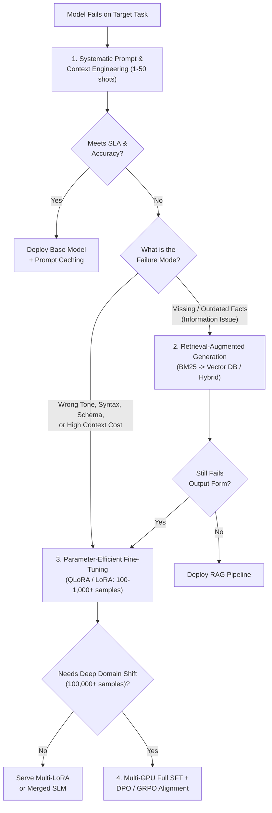

# 14.15 Fine-tuning infrastructure and cost

| Field | Value |
|---|---|
| Level | Advanced |
| Priority tier | 1 |
| Lab venue | Nebius GPU + Local Python Verification Lab |
| Part | Part 14: Distributed training and fine-tuning |
| Primary sources | *Generative AI on Kubernetes* (`generative-ai-on-kubernetes`, Ch. 6 & Ch. 7); *Kubernetes for Generative AI Solutions* (`kubernetes-for-generative-ai-solutions`, Ch. 4, 5, 7, 10); *AI Engineering* (`ai-engineering`, Ch. 7); *LLM Engineer's Handbook* (`llm-engineers-handbook`, Ch. 5 & Ch. 6); *LLMOps* (`llmops`, Ch. 5 & Ch. 9); NVIDIA Zero-to-Hero Volumes 04, 11, 13, 19, 21, 22, and 23 |
| Cross-references | Chapter 10.7 (GPU product lines & PCIe vs SXM); Chapter 11.9 (JobSet, PyTorchJob, Kubeflow Trainer); Chapter 11.29 (Multi-tenancy & FinOps on GPU clusters); Chapters 14.3–14.6 (Training memory anatomy, FSDP, and DeepSpeed ZeRO) |
| Code | `code/part14/finetuning_infra_cost.py`, `code/part14/finetuning_infra_cost_lab.py` |
| Coverage file | `planning/coverage/chapters/14-15.md` |
| Claim & number ledger | `planning/ledgers/14-15.md` |

## Why this matters for AI infrastructure

An application team asks to customize a seventy-billion-parameter open-weight language model for their domain. One engineer proposes buying twenty dual-socket servers filled with eighty PCIe H100 GPUs, which looks like a thirty percent saving on hardware. Another wants full-weight fine-tuning on every weekly dataset update, plus a separate merged checkpoint for each of their one hundred enterprise customers. Either plan could drain the platform budget before the first user query is served.

Fine-tuning sits where GPU memory, interconnect topology, and cloud unit economics meet. Small design choices move the hardware need from one midrange PCIe card to a multi-node InfiniBand cluster. Three cliffs show up on every customization project.

The first is the memory cliff. Full supervised fine-tuning in mixed precision uses sixteen bytes of static state per parameter before a single activation is allocated. Freezing the base model with Low-Rank Adaptation or four-bit Quantized Low-Rank Adaptation shrinks the trainable state by roughly ninety-eight to ninety-nine percent. A sixty-five-billion-parameter model then fits on one forty-eight-gigabyte PCIe GPU and does not need a multi-node HGX fabric.

The second is the PCIe versus NVLink SXM trap. A single-GPU adapter job does no inter-GPU communication and runs cheaply on PCIe cards such as the L4 or L40S. Once a seventy-billion-parameter job shards state across GPUs with FSDP or Tensor Parallelism, PCIe Gen5 is a fourteen-fold bottleneck compared with SXM NVSwitch. The thirty percent saved on servers leaves the GPUs stalled ninety percent of the time and stretches the run fivefold.

The third is the gap between capital and operating cost. Teams fixate on the one-time cost of a fine-tuning run, but round-the-clock inference is the recurring cost that dominates. Full fine-tuning where adapters would do forces the serving tier to host one multi-gigabyte replica per tenant, when it could hot-swap megabyte-sized adapters over one shared base model.

```text
Fine-Tuning Infrastructure Reference Anchor Numbers:
- BloombergGPT (50B parameters, March 2023):
  1.3 million A100 GPU-hours -> $1.3M to $2.6M compute cost (outperformed zero-shot by GPT-4-0314: 87.15 vs 75.07 FiQA F1, 76.48 vs 43.41 ConvFinQA)
- Flan-T5 specialized fine-tune:
  Outperformed a 60x larger GPT-3 variant on writing tasks using 82,000 instruction-output pairs
- 7B Model Memory Ladder (LEH Ch. 5 & AIE Ch. 7):
  Full SFT Mixed-Precision AdamW static state: 16 bytes/param = 112 GB (98 GB on-disk checkpoint; 1,120 GB static for 70B)
  Full SFT Pure BF16 Adam baseline:            8 bytes/param  = 56 GB static (14 GB weights + 42 GB grads & Adam states)
  16-bit LoRA on 7B:                           14.0 GB initialization, 15.6 GB peak fine-tuning VRAM (14-18 GB typical range)
  4-bit NF4 QLoRA on 7B:                       9.1 GB initialization (35% lower), 9.3 GB peak VRAM (40% lower vs LoRA, up to 75% vs baseline), ~30% slower step time
  4-bit NF4 Guanaco QLoRA footprints:          7B = 6 GB (Elo 879), 13B = 10 GB (Elo 916), 33B = 21 GB (Elo 992), 65B = 41 GB on 1x 48 GB GPU (Elo 1022 vs ChatGPT 966)
- PCIe vs SXM 70B Distributed Fine-Tuning Trap (V04 Ch. 4 & V21 Ch. 2):
  8x H100 SXM5 node BOM = $285,000 ($35,625/GPU, 10.2 kW, 900 GB/s NVSwitch) vs 8x H100 PCIe node BOM = $215,000 ($26,875/GPU, 4.5 kW, 64 GB/s PCIe Gen5)
  Buying 80x H100 PCIe across 20 2U servers saves ~30% CapEx vs $3M SXM budget, but 64 GB/s PCIe vs 900 GB/s NVLink (14.06x gap) stalls GPUs 90% of the time -> 5x longer run
```

Before you provision any GPU for customization, show that prompt engineering and retrieval cannot fix the failure. Then size the job for the lightest adaptation method that meets your accuracy target.

## Prerequisites and outcomes

### Prerequisites
- GPU memory and compute fundamentals from earlier in this part. Review FSDP and DeepSpeed ZeRO sharding mechanics before sizing multi-node runs.
- Data center GPU architecture, Tensor Core precision formats, and PCIe versus SXM form factors.
- Kubernetes batch scheduling, `JobSet`, `PyTorchJob`, and multi-tenant GPU FinOps.

### Outcomes
After completing this chapter, you will be able to do four things.
- Choose between prompt engineering, Retrieval-Augmented Generation, Parameter-Efficient Fine-Tuning, and full supervised fine-tuning, and compute the query volume at which fine-tuning repays its compute cost by shrinking prompts.
- Calculate the static and peak GPU memory of full SFT, LoRA, QLoRA, DPO, GRPO, and four-model PPO pipelines.
- Pick an accelerator from the data center lineup by price per TFLOP and memory bandwidth, and find the model size at which PCIe fails and NVLink SXM becomes necessary.
- Build fine-tuning pipelines with TRL, Unsloth, Axolotl, Torchtune, LLaMA-Factory, and DeepSpeed, and run them on Kubernetes with Kubeflow Trainer, KubeRay, Spot checkpointing, and Kubecost with DCGM telemetry.

---

## 1. The Customization Decision Hierarchy and Economics

### 1.1 Form versus Facts: Prompting, RAG, and Post-Training

When a foundation model produces poor answers on an enterprise task, teams often jump straight to fine-tuning. That reflex wastes engineering weeks and thousands of dollars in GPU compute when the failure is actually caused by missing context. In the LLM lifecycle, pre-training consumes thousands of GPUs for weeks to build a base text predictor. Alignment then teaches safety boundaries and instruction following. Model customization, also called post-training, adapts an already aligned model to domain tasks.

To choose the right customization tier, first decide whether the failure is about information or about behavior.

Information failures call for RAG. Suppose the model hallucinates because it lacks private corporate documents, or events after its training cutoff. Fine-tuning is the wrong tool. Ovadia et al. found that RAG beats fine-tuning on current-events question answering, and on almost all MMLU categories, for seven-billion-parameter models. Updating a vector database takes minutes, while re-running fine-tuning for every document update is slow and risks catastrophic forgetting.

Behavior and format failures call for fine-tuning. Suppose the facts are in the prompt but the model fails to produce a proprietary SQL dialect, a strict JSON schema, or a brand tone. Fine-tuning changes the weights to enforce that behavior. Put briefly, fine-tuning is for form and RAG is for facts. When a task needs both domain knowledge and strict formatting, RAG on top of a fine-tuned model improved MMLU accuracy 43 percent of the time.

Long prompts call for distillation. Embedding slow-changing domain rules into a Small Language Model of eight to sixteen billion parameters removes bulky few-shot examples from every prompt. Distilling a frontier teacher into a smaller student also cuts inference memory and time per output token.



### 1.2 The Inference Context-Tax Crossover and Multi-LoRA Serving Math

Even when a long system prompt or RAG pipeline achieves acceptable accuracy, stuffing thousands of recurring instruction tokens into every request carries a hidden operational tax. Large context windows expand the Key-Value cache in GPU HBM and increase prefill latency on every user call. Fine-tuning converts those recurring prompt tokens into learned model weights through a one-time training investment.

Consider a production service where fine-tuning costs five hundred dollars and removes two thousand recurring instruction tokens from every request. At a cloud input price of two dollars per million tokens, each query saves four-tenths of a cent. Dividing the five-hundred-dollar training run by that per-query saving reveals a break-even threshold of 125,000 queries. Any workload serving more than that request volume repays its fine-tuning compute bill and lowers inference latency permanently.

The fine-tuning method also decides your serving footprint when you support many tenants or tasks. A merged deployment adds zero inference latency, because the adapter is folded into the base weights, and it suits a single fine-tuned model. But if you customize a model for one hundred enterprise customers and store one hundred full-rank matrices, parameter storage grows a hundredfold. Dynamic multi-LoRA serving avoids that. Inference engines such as vLLM, SGLang, Hugging Face TGI, LoRAX, and NVIDIA NIM keep one frozen base model in GPU HBM and load lightweight LoRA adapters per request.

```text
Multi-LoRA Serving vs Merged Storage Proof (AIE Ch. 7, single 4096 x 4096 weight matrix across 100 customers):
  Base full-rank matrix W (4096 x 4096):         16,777,216 parameters (~16.8M parameters)
  Single LoRA adapter (rank r = 8, A + B):       4096 x 8 x 2 = 65,536 parameters per customer
  Option 1 — 100 separate merged matrices W':    16.8M x 100 = 1.68B parameters (1,677,721,600 exact)
  Option 2 — 1 shared base W + 100 (A, B) sets:  16.8M + (65,536 x 100) = 23.3M parameters (23,330,816 exact)
  Storage and VRAM Parameter Reduction Factor:   1,677,721,600 / 23,330,816 = 71.91x (~72x reduction)

Prompt/RAG Context Tax Break-Even Formula:
  Savings_per_Query_USD = (Delta_Prompt_Tokens / 1,000,000) * Cost_per_1M_Input_Tokens_USD
  BreakEven_Queries     = ceil( FineTune_Run_Cost_USD / Savings_per_Query_USD )
  Worked Example:       $500.00 / ((2,000 / 1,000,000) * $2.00) = $500.00 / $0.004 = 125,000 queries

Training CapEx vs Inference OpEx Scaling (V22 Ch. 3):
  10,000 users x 100 tokens/day = 1M tokens/day   -> $2/day  = ~$730/year at $2/1M cloud tokens
  10,000,000 users x 100 tok/day = 1B tokens/day  -> $2K/day = ~$730,000/year recurring OpEx
  8x A100 vLLM cluster (Llama-2 13B, 1,000 concurrent users, 2,000-2,500 tok/s, TTFT 45-50 ms, p50 38 ms, p99 92 ms):
    $25K/yr hardware + $7.5K/yr power/cooling + $75K/yr staff = ~$110K/yr for 63B tokens/yr
    Delivered cost: $0.00000174/token ($1.74 per 1M tokens vs $2.00 cloud = 1.15x cheaper / ~13% savings at 63B tok/yr)
```

**Always calculate the inference break-even query volume and multi-adapter serving density before choosing between prompt engineering, LoRA, and full fine-tuning.**

---

## 2. VRAM Sizing Across Full SFT, LoRA, QLoRA, DPO, GRPO, and PPO

### 2.1 Full Supervised Fine-Tuning vs LoRA Low-Rank Decomposition

Why does full supervised fine-tuning require a multi-GPU node for an eight-billion-parameter model while LoRA fits on a single midrange card? During backpropagation, every trainable parameter requires memory not just for its weight, but also for its gradient and its optimizer historical states.

In production mixed-precision AdamW, the forward and backward passes run in sixteen-bit BF16. That takes two bytes per parameter for weights and two bytes per parameter for gradients. To prevent small parameter updates from rounding to zero, AdamW maintains a thirty-two-bit FP32 master copy of the weights plus FP32 first and second moment buffers. Those three FP32 buffers consume twelve bytes per parameter, bringing static model memory to **16 bytes per parameter**. A seven-billion-parameter model therefore demands 112 GB of static HBM before activations. A seventy-billion-parameter model demands 1,120 GB. Even if you drop FP32 master weights and run pure BF16 Adam, static state still requires eight bytes per parameter, or 56 GB for a seven-billion-parameter model.

Low-Rank Adaptation eliminates optimizer and gradient memory on the base model by freezing the pre-trained weight matrix completely. Instead of updating a full weight matrix directly, LoRA injects two small low-rank matrices with inner rank `r`. Because the base weights have `requires_grad=False`, PyTorch allocates zero base gradients and zero base Adam states.

```text
Full SFT vs LoRA Mathematical Memory Model:
  Full SFT Mixed-Precision AdamW Static Bytes:
    M_static_full = 2*Psi (BF16 W) + 2*Psi (BF16 G) + 4*Psi (FP32 Master) + 4*Psi (FP32 m) + 4*Psi (FP32 v) = 16 * Psi bytes
    M_ckpt_full   = 14 * Psi bytes on disk (omits 2*Psi gradients; 98 GB for 7B, 980 GB for 70B)

  LoRA Low-Rank Update Rule (for frozen weight matrix W_0 of shape d_in x d_out):
    W' = W_0 + (alpha / r) * (A * B),   where A is (d_in x r), B is (r x d_out), and r << min(d_in, d_out)
    Trainable parameters per adapted matrix: Psi_matrix = (d_in + d_out) * r   (or 2 * d * r when d_in = d_out = d)
    Total LoRA trainable parameters:         Psi_lora   = L * N_matrices * 2 * d * r

  Worked Benchmark Examples from Corpus (AIE Ch. 7, LEH Ch. 5, K8GS Ch. 4):
  1. GPT-3 175B (L = 96 layers, d = 12,288, r = 2 across 4 attention matrices W_q, W_k, W_v, W_o):
     Per-layer trainable params = (12,288 * 2 * 2) * 4 = 196,608 parameters/layer
     Total trainable params     = 196,608 * 96 = 18,874,368 parameters (18.87M, or 0.01% of 175B)
     16-bit LoRA adapter memory = 37.7 MB vs 350 GB for 16-bit GPT-3 base weights (WikiSQL 73.7%, MultiNLI 91.7%)
  2. Llama-2 13B (L = 40 layers, d = 5,120, r = 2):
     Trainable params = 3.28M (3,276,800) -> 6.55 MB 16-bit adapter vs 26 GB 16-bit base weights
  3. Llama-3 8B (LEH Ch. 5, r = 16 across all 7 linear modules q, k, v, o, gate, up, down):
     Trainable params = 42,000,000 (42M out of 8B = 0.5196% trainable)
  4. Llama-3 8B QLoRA (K8GS Ch. 4, r = 32, lora_alpha = 64, lora_dropout = 0.05 across q, k, v, o, gate, up, down, lm_head):
     All model tensor elements: 4,628,721,664 | Trainable LoRA parameters: 88,121,344 (1.90% / ~2%, ~98% reduction)
```

Applying LoRA to all linear layers, including the feed-forward `gate_proj`, `up_proj`, and `down_proj` matrices, consistently delivers higher quality than adapting only the attention projections. With a reasonable low rank, a seven-billion-parameter model fine-tunes inside 14 to 18 GB of VRAM on a single GPU.

### 2.2 QLoRA Mechanics: 4-Bit NF4, Double Quantization, and Paged Optimizers

What if you need to fine-tune a thirty-three-billion or sixty-five-billion-parameter model on a single PCIe GPU? What if you need to fit an eight-billion-parameter job onto an inexpensive cloud instance? Even with LoRA, holding frozen sixteen-bit base weights requires two bytes per parameter. That equals 14 GB for a seven-billion-parameter model and 130 GB for a sixty-five-billion-parameter model.

QLoRA, introduced by Dettmers et al., attacks that base-weight footprint with three techniques from `bitsandbytes`.

NormalFloat-4 storage comes first. Pre-trained weights follow a zero-centered normal distribution. NormalFloat-4 is a four-bit data type that gives each quantile of the standard normal distribution the same number of values. Base weights sit in HBM at half a byte per parameter, set by `bnb_4bit_quant_type="nf4"`, and are dequantized on the fly to BF16 tiles in GPU registers during forward and backward matrix multiplications.

Double Quantization comes second. Blockwise four-bit quantization needs a thirty-two-bit scaling constant for every block of sixty-four weights, which adds half a bit per parameter. Setting `bnb_4bit_use_double_quant=True` quantizes those constants to eight-bit floats in blocks of 256. The overhead falls to roughly a tenth of a bit per parameter.

Paged 8-bit optimizers come third. Long sequences can still cause short activation spikes during `loss.backward()`. Setting `optim="paged_adamw_8bit"` puts optimizer states in CUDA Unified Memory. The driver pages optimizer buffers out to host RAM during a spike and back to HBM during `optimizer.step()`.

```text
LoRA vs QLoRA Measured 7B Benchmark & Double Quantization Math (LEH Ch. 5 & AIE Ch. 7):
  Blockwise NF4 metadata overhead: 32-bit scale / 64 weights = 0.5 bits/param -> Double Quant (8-bit over 256) = ~0.127 bits/param
  Initialization VRAM:   14.0 GB (16-bit LoRA) ->  9.1 GB (4-bit QLoRA) = 35.0% reduction
  Fine-Tuning Peak VRAM: 15.6 GB (16-bit LoRA) ->  9.3 GB (4-bit QLoRA) = 40.4% (~40%) reduction (up to 75% vs unoptimized baseline)
  Training Wall-Clock:   QLoRA is ~30% slower than 16-bit LoRA due to NF4 -> BF16 dequantization compute overhead
```

### 2.3 Preference Alignment and RLHF Topologies: DPO vs GRPO vs PPO

Once supervised fine-tuning teaches a model domain formatting, teams often run a second post-training stage to align outputs with human preferences or reasoning rewards. Choosing between Proximal Policy Optimization, Direct Preference Optimization, and Group Relative Policy Optimization changes your cluster memory requirement by up to fourfold.

Online PPO keeps four models in memory at once. The trainable Actor policy and the trainable Critic value network each need full training state. The frozen Reference policy and the frozen Reward model need only inference weights. In full mixed precision, PPO uses **36 bytes per parameter** of static state, before rollout KV caches and activations. That is 252 GB for a seven-billion-parameter model and 2,520 GB for a seventy-billion-parameter model.

DPO turns reward maximization under a KL-divergence constraint into a direct binary cross-entropy loss over prompt, chosen, and rejected triples. Full-weight DPO drops the Critic and the Reward model and keeps only the trainable policy and the frozen reference, for **18 bytes per parameter**. With LoRA or QLoRA and `ref_model=None` in `DPOTrainer`, the framework disables the adapter during the reference forward pass. The frozen base weights then serve as the reference, with **zero extra weight memory**.

GRPO, from the DeepSeek team and supported by `GRPOTrainer`, keeps online reinforcement learning without PPO's expensive Critic. For each prompt, it samples a group of completions from the current policy and scores them with a reward function or verifier. It then normalizes the rewards across the group to get the advantage. Dropping the Critic saves sixteen bytes per parameter of static state compared with PPO.


For DPO and GRPO on moderate datasets, use QLoRA or LoRA with `ref_model=None`. Keep multi-node full-weight training for large continual pre-training or frontier alignment runs.

---

## 3. GPU Hardware Selection and the PCIe vs NVLink SXM Crossover

### 3.1 Accelerator Comparison Matrix: T4, L4, L40S, A100, H100, H200, and B200

Buying H100 SXM nodes for every fine-tuning ticket wastes capital, and buying PCIe inference cards for multi-node sharded training stalls the cluster. To match hardware to the workload, compare the NVIDIA data center GPUs on three things: HBM or GDDR6 capacity, memory bandwidth, and inter-GPU interconnect bandwidth.

| Accelerator | Memory & Type | Memory Bandwidth | Dense BF16 / FP8 TFLOPS | Interconnect (GPU-to-GPU) | Max TDP | Illustrative Price | Price / BF16 TFLOP (3-Yr Amortized) | Primary Fine-Tuning & Serving Sweet Spot |
|---|---|---|---|---|---|---|---|---|
| **T4 (Turing PCIe)** | 16 GB GDDR6 | 0.32 TB/s | No BF16 / FP8 (INT8 / FP16 only) | PCIe Gen3 (16 GB/s, no NVLink) | 70 W | ~$2,500 | Legacy | Legacy 7B 4-bit QLoRA prototypes only (lacks native BF16 and FP8) |
| **L4 (Ada PCIe)** | 24 GB GDDR6 | 0.30 TB/s | 121 / 242 | PCIe Gen4 (32 GB/s, no NVLink) | 72 W | ~$2,500 | ~$21 | 1B–8B QLoRA / LoRA on EKS Spot (`g6.2xlarge`) and 10-slice SLM serving |
| **L40S (Ada PCIe)** | 48 GB GDDR6 | 0.864 TB/s | 362 / 733 | PCIe Gen4 (32 GB/s, **no NVLink**) | 350 W | $8,000 | **$22** ($7.33/yr) | **Best single-GPU price/perf:** 7B–33B LoRA, 65B QLoRA (41 GB), &lt;30B serving |
| **A100 40GB PCIe** | 40 GB HBM2 | 1.555 TB/s | 312 / N/A | PCIe Gen4 (32 GB/s) or 2-GPU bridge (600 GB/s) | 250 W | $10,000 | $32 ($10.67/yr) | Single-GPU 7B–13B LoRA/QLoRA and high-bandwidth batch jobs |
| **A100 40GB SXM4** | 40 GB HBM2 | 1.555 TB/s | 312 / N/A | NVLink 3 via NVSwitch (600 GB/s all-to-all) | 400 W | $15,000 | $48 ($16/yr) | Multi-GPU 7B–13B full SFT and DDP/FSDP runs |
| **A100 80GB SXM4** | 80 GB HBM2e | 2.039 TB/s | 312 / N/A | NVLink 3 via NVSwitch (600 GB/s all-to-all) | 400 W | $25,000 | $80 ($26.67/yr) | High-memory 13B–33B full SFT and 8x A100 vLLM serving |
| **H100 80GB PCIe** | 80 GB HBM2e | 2.0 TB/s | 756 / 1,513 | PCIe Gen5 (64 GB/s) or 2-GPU bridge (600 GB/s) | 350 W | $20,000 | $26 ($8.67/yr) | Single-GPU 7B–34B LoRA/DPO, 70B QLoRA, and air-cooled 350W racks |
| **H100 80GB SXM5** | 80 GB HBM3 | 3.35 TB/s | 989 / 1,979 | **NVLink 4 via NVSwitch (900 GB/s all-to-all)** | 700 W | $30,000 | **$30 ($10/yr)** | **Multi-GPU training standard:** 8B–70B+ full SFT, FSDP, DPO, GRPO, PPO |
| **H200 141GB SXM** | 141 GB HBM3e | 4.8 TB/s | 989 / 1,979 | NVLink 4 via NVSwitch (900 GB/s all-to-all) | 700 W | $40,000 | $40 ($13.33/yr) | Long-context (32K–128K) SFT/GRPO (+76% VRAM, +43% BW vs H100) & 70B serving |
| **B200 (Blackwell SXM)** | 180–192 GB HBM3e | 8.0 TB/s | ~2,250 / ~4,500 (NVFP4 9,000) | **NVLink 5 (1,800 GB/s per GPU; 10 TB/s NV-HBI)** | 1,000 W | Quote (~$50K) | ~$22 | Frontier 70B–405B+ post-training, FP8/NVFP4 RLHF, and GB200 NVL72 pods |

Look at the price-per-TFLOP column in the table above. At eight thousand dollars for 362 dense BF16 TFLOPS, the **L40S delivers 22 dollars per BF16 TFLOP**. That figure beats every other GPU for workloads that fit inside a single forty-eight-gigabyte card. For multi-GPU training, the **H100 SXM5 delivers 30 dollars per BF16 TFLOP**, or ten dollars per TFLOP per year amortized over three years. That provides 1.6 times more compute per dollar than the A100 SXM4 at forty-eight dollars per TFLOP, before even counting the Hopper FP8 Transformer Engine.

### 3.2 The PCIe vs NVLink SXM Crossover Point

Why does the L40S or H100 PCIe succeed on single-card LoRA jobs yet fail catastrophically on multi-GPU seventy-billion-parameter fine-tuning? The answer lies in the physical board architecture and collective communication math.

Why does the L40S or H100 PCIe do well on single-card LoRA jobs and fail on multi-GPU seventy-billion-parameter fine-tuning? The answer is the board design and the collective communication math.

In the single-GPU case there is no collective traffic. Suppose you fine-tune an eight-billion-parameter model with LoRA at 18 GB peak, or a sixty-five-billion-parameter model with four-bit QLoRA at 41 GB peak. The whole model and its activations sit in one GPU's memory, and inter-GPU bandwidth goes unused. An L40S PCIe card or a single H100 PCIe card runs at full compute speed in an ordinary air-cooled server.

The multi-GPU case is different. Take full SFT on a fourteen-billion or seventy-billion-parameter model, or multi-GPU LoRA on a seventy-billion-parameter model. The job must shard parameters across the eight GPUs of a node with FSDP or DeepSpeed ZeRO-3. Each step runs an AllGather before the forward pass, a second AllGather before the backward pass, and a ReduceScatter on the gradients. On an HGX H100 SXM5 baseboard, four NVSwitch chips join all eight GPUs in a non-blocking 900 GB/s all-to-all mesh, which hides those collectives behind Tensor Core math.

Standard 2U PCIe servers have no NVSwitch baseboard. Optional two-way NVLink bridges give H100 PCIe cards 600 GB/s, but only in isolated pairs and not across all eight GPUs, and L40S cards have no NVLink at all. Collective traffic across eight GPUs must cross the host PCIe Gen5 x16 root complex at 64 GB/s per direction. That is a **14.06x bandwidth drop** from 900 GB/s SXM NVSwitch.

```text
8-GPU Node Bill of Materials & 70B PCIe vs SXM Crossover (V04 Ch. 4 & V21 Ch. 2):
  Configuration A — 8x H100 SXM5 Dense Training Node (DGX / HGX H100):
    8x H100 SXM5 GPUs ($240,000) + CPUs/2TB DDR5/30TB NVMe ($30,000) + 8x 400G NICs ($10,000) + Assembly ($5,000)
    Total Node Cost = $285,000 ($35,625 / GPU) | Power = 10.2 kW (8 x 700W = 5.6 kW GPU) | Peak = 7,912 TFLOPS (~6,500 practical)

  Configuration B — 8x H100 PCIe Cluster Node:
    8x H100 PCIe GPUs ($160,000) + CPU/RAM ($20,000) + Storage ($15,000) + 2x 100GbE ($8,000) + Chassis/Assy ($12,000)
    Total Node Cost = $215,000 ($26,875 / GPU, ~24.6% / ~25% cheaper per GPU) | Power = 4.0-4.5 kW (8 x 350W = 2.8 kW GPU) | Peak = 6,048 TFLOPS

  The 70B Fine-Tuning Procurement Trap (V04 Ch. 4 Customer Scenario):
    Buying 20x 2U servers with 80x H100 PCIe cards saves ~30% vs a $3M SXM budget.
    However, 64 GB/s PCIe Gen5 vs 900 GB/s SXM NVLink (14.06x slower) leaves GPUs stalled 90% of the step waiting on PCIe AllGather/AllReduce.
    Result: Training takes 5.0x longer, burning more developer time and electricity than the 30% hardware discount saved.
```

Use PCIe GPUs such as the L4 and L40S for single-GPU LoRA and QLoRA jobs. Require NVSwitch-backed SXM nodes as soon as a job shards layers or gradients across four or more GPUs.

---

## 4. Token Throughput, Batch Sizing, and Cost-per-Run Modeling

### 4.1 Effective Batch Size, Gradient Accumulation, and Sequence Packing

To predict how long a fine-tuning job will run and what it will cost, you must translate dataset rows into total processed tokens and optimizer steps. Because fine-tuning runs on memory-constrained GPUs, you rarely fit the entire global batch into HBM at once. Instead, you set a small per-device micro-batch size of one to eight samples. You then accumulate gradients across multiple micro-steps before calling `optimizer.step()`.

```text
Effective Batch Size, Token Volume, and Run Cost Formulas (LEH Ch. 5 & V22 Ch. 3):
  Effective_Batch_Size (samples/step) = Per_Device_Batch_Size * Num_GPUs * Gradient_Accumulation_Steps
  Tokens_per_Step                     = Effective_Batch_Size * Max_Seq_Length
  Total_Training_Tokens               = Num_Samples * Avg_or_Packed_Tokens_per_Sample * Num_Epochs
  Wall_Clock_Hours                    = Total_Training_Tokens / (Num_GPUs * Sustained_Tokens_per_Sec_per_GPU * 3600)
  Total_Run_Cost_USD                  = Wall_Clock_Hours * Num_GPUs * Cost_per_GPU_Hour_USD

Worked Examples from Corpus:
  1. Multi-GPU Gradient Accumulation (LEH Ch. 5):
     per_device_train_batch_size = 4, num_gpus = 2, gradient_accumulation_steps = 4 -> Effective Batch Size = 4 * 2 * 4 = 32 samples
     At max_seq_length = 1,024 with batch_size = 12 -> 12 * 1,024 = 12,288 tokens per batch (6,144 tokens at max_seq_length = 512)
  2. TwinLlama-3.1-8B Unsloth LoRA SFT (LEH Ch. 5):
     Dataset: 3,335 llmtwin pairs (< $0.50 GPT-4o-mini synthesis cost) + 10,000 FineTome-Alpaca-100k samples = 13,335 samples (95%/5% split)
     Config:  r = 32, lora_alpha = 32, max_seq_length = 2048, packing = True, batch_size = 2, grad_accum = 8 (effective batch = 16), 3 epochs, lr = 3e-4, adamw_8bit
     Runtime: Completes 3 epochs in 50 minutes (0.83 hours) on 1x A100 GPU (~$2.00 cloud compute cost)
  3. Enterprise Llama-2 7B LoRA SFT Case Study (V22 Ch. 3):
     Dataset: 50,000 customer service conversations (~500M tokens/epoch * 3 epochs = 1.5B total tokens)
     Memory on 1x H100 (80 GB): 7.0 GB INT8 weights + 0.8 GB LoRA grads + 1.6 GB optimizer states + 2.0 GB activations (+ 2.6 GB buffer) = 14.0 GB total (66.0 GB free headroom)
     Throughput & Cost: 450-500 tokens/sec sustained -> 2.5 to 3 days wall-clock -> ~$5,000 amortized hardware + $100 power = $5,100 total
```

Notice the impact of sequence packing via `packing=True` in the second example above. Suppose your dataset uses a maximum sequence length of 1,024 tokens, but average instructions are only two hundred to three hundred tokens long. Naive padding wastes seventy percent of every Tensor Core matrix multiplication on pad tokens. Packing concatenates three to four short examples into a single sequence separated by EOS tokens and block-diagonal attention masks. That simple change triples effective token throughput and cuts cloud GPU rental cost by two-thirds.

### 4.2 End-to-End Fine-Tuning Cost Comparison Table

The table below compares real-world token volumes, GPU hours, and cloud rental costs across typical post-training jobs verified by `code/part14/finetuning_infra_cost.py`.

| Workload & Method | Dataset Size & Epochs (Total Tokens) | Target Hardware & Peak VRAM | Sustained Throughput (tok/s/GPU) | Wall-Clock Time (GPU-Hours) | Cloud Cost (Spot vs On-Demand) |
|---|---|---|---|---|---|
| **Llama-3-8B QLoRA FAQ (K8GS Ch. 4–5)** | 200 steps (batch=2, accum=1, ~0.8M tok) | 1x NVIDIA L4 24GB (`g6.2xlarge`, ~10.6 GB peak) | ~1,100 tok/s | ~12 min (0.20 GPU-hrs) | **$0.10 Spot** ($0.35 On-Demand) |
| **TwinLlama-3.1-8B Unsloth LoRA SFT (*LLM Engineer's Handbook*, Ch. 5)** | 13,335 packed samples x 3 epochs (~15M tok) | 1x A100 80GB (~16.5 GB peak) | ~5,000 tok/s (Unsloth 2–5x kernel speedup) | **50 min** (0.83 GPU-hrs) | **$1.00 Spot** ($2.50 On-Demand) |
| **TwinLlama-3.1-8B Unsloth LoRA DPO (*LLM Engineer's Handbook*, Ch. 6)** | 1,467 filtered triples (from 2,970) x 1 epoch (~3M tok) | 1x A100 80GB (`ref_model=None`, ~18.9 GB peak) | ~2,500 tok/s (chosen + rejected passes) | ~20 min (0.33 GPU-hrs) | **$0.40 Spot** ($1.00 On-Demand) |
| **Llama-2-7B Customer Chat LoRA (V22 Ch. 3)** | 50,000 convos (500M tok/ep x 3 = 1.5B tok) | 1x H100 80GB (14.0 GB INT8-LoRA footprint) | 450–500 tok/s (unpacked baseline) | 2.5–3 days (~833–926 GPU-hrs or 8x parallel) | $5,100 ($5K CapEx + $100 power) |
| **Llama-3.1-70B QLoRA Domain SFT** | 25,000 packed samples x 3 epochs (~150M tok) | 1x L40S 48GB (41–44 GB) or 2x H100 80GB | ~350 tok/s (L40S) / ~900 tok/s (H100) | ~23 hrs (2x H100 = 46 GPU-hrs) | **$69 Spot** ($184 On-Demand) |
| **Llama-3.1-70B Full SFT (FSDP2 + BF16)** | 100,000 packed samples x 2 epochs (~800M tok) | 32x H100 SXM5 (4 nodes, 1,120 GB sharded) | ~940 tok/s/GPU (30,080 tok/s cluster) | ~7.4 hrs (236.5 GPU-hrs) | **$355 Spot** ($946 On-Demand) |

Turn on sequence packing and FlashAttention for every fine-tuning job before you add GPUs. Removing padding tokens cuts wall-clock time and cloud spend in proportion.

---

## 5. Fine-Tuning Framework Ecosystem and Kubernetes Orchestration

### 5.1 Comparing TRL, Unsloth, Axolotl, Torchtune, LLaMA-Factory, and DeepSpeed

Once you size your memory footprint and pick the right GPU, you must select a software framework to execute the training loop. Writing raw PyTorch loops by hand is error-prone when combining four-bit NF4 quantization, FlashAttention, sequence packing, and distributed sharding. Six open-source stacks dominate production post-training.

| Framework | Core Architecture & Differentiator | Supported Methods | Distributed Scale | Primary Infrastructure Use Case |
|---|---|---|---|---|
| **Hugging Face TRL** | Reference Python library providing `SFTTrainer`, `DPOTrainer`, `GRPOTrainer`, and `PPOTrainer` on top of Transformers and Accelerate | Full SFT, LoRA, QLoRA, DPO, PPO, GRPO, ORPO, KTO | Single-GPU to Multi-Node (DDP, FSDP, DeepSpeed) | Custom Python training scripts and Kubeflow CustomTrainer functions |
| **Unsloth** | Custom Triton kernels for RoPE, cross-entropy, and MLP plus manual autograd backprop (2–5x faster, up to 80% less VRAM) | LoRA, QLoRA, SFT, DPO, GRPO, Continued Pre-training | Single-GPU native (`pip install unsloth`, AIKit on K8s) | Rapid single-GPU customization on L4, L40S, A100, H100 + direct GGUF export |
| **Axolotl** | Declarative YAML wrapper around TRL, PEFT, FlashAttention, Liger Kernel, and multipack sample packing | Full SFT, LoRA, QLoRA, ReLoRA, GPTQ, DPO, GRPO, RLHF | Single-GPU to Multi-Node (FSDP1/FSDP2, DeepSpeed ZeRO) | Reproducible YAML-driven CI/CD pipelines combining Alpaca, ShareGPT, and ChatML datasets |
| **Torchtune** | PyTorch-native library with clean recipes and zero heavy abstraction layers; native FSDP2 (`fully_shard`) | Full SFT, LoRA, QLoRA, DoRA, DPO, QAT | Single-GPU to Multi-Node (FSDP2) | Kubeflow Trainer v2 BuiltinTrainer default engine and PyTorch-native engineering teams |
| **LLaMA-Factory** | Zero-code Gradio WebUI (LlamaBoard) + CLI supporting 100+ models, multimodal VLMs, and integrated evaluation | Full SFT, Freeze-tuning, LoRA, QLoRA, GaLore, DoRA, PPO, DPO, ORPO | Single-GPU to Multi-Node (Accelerate, FSDP, DeepSpeed) | Self-service platform portals where teams launch jobs via CLI or browser UI |
| **DeepSpeed** | Distributed engine wrapping PyTorch with ZeRO-1/2/3, ZeRO-Offload (CPU RAM), and ZeRO-Infinity (NVMe) | Full SFT, LoRA, RLHF (DeepSpeed-Chat) | Multi-GPU and Multi-Node (`nccl`) | Sharding 70B+ full SFT or offloading optimizer states to host DDR5 RAM when HBM is tight |

Teams also use model merging to combine several task-specific models or adapters without a GPU. Task arithmetic averages weights or adds task vectors, which are the fine-tuned weights minus the base weights. SLERP interpolates two models along the shortest arc on a hypersphere with a factor between 0 and 1, and a factor of 0.5 is the exact midpoint. TIES and DARE prune deltas, and Yadav et al. showed that keeping only the top 20 percent of task-vector parameters preserves full accuracy while removing interference between merged tasks. Layer stacking combines layers from different checkpoints. Goliath-120B stacked 72 of 80 layers from two fine-tuned Llama-2-70B models, and SOLAR-10.7B duplicated a 32-layer 7B model and summed 16 middle layers to leave 48 layers before continued training.

### 5.2 Commands and Configurations That Matter

#### 1. Unsloth + TRL SFT and DPO Pipeline
The script below runs high-speed LoRA supervised fine-tuning with sequence packing and eight-bit AdamW. It then runs memory-free reference DPO via `ref_model=None` and exports a merged sixteen-bit checkpoint.

```python
# Step 1: Supervised Fine-Tuning (SFT) with Unsloth + TRL SFTTrainer
import torch
from datasets import load_dataset, concatenate_datasets
from transformers import TrainingArguments
from trl import SFTTrainer, DPOConfig, DPOTrainer
from unsloth import FastLanguageModel, PatchDPOTrainer, is_bfloat16_supported

max_seq_length = 2048
model, tokenizer = FastLanguageModel.from_pretrained(
    model_name="meta-llama/Meta-Llama-3.1-8B",
    max_seq_length=max_seq_length,
    load_in_4bit=False,  # Set True for 4-bit NF4 QLoRA (9.3 GB peak vs 15.6 GB LoRA)
)

model = FastLanguageModel.get_peft_model(
    model,
    r=32,
    lora_alpha=32,
    lora_dropout=0,
    target_modules=["q_proj", "k_proj", "v_proj", "up_proj", "down_proj", "o_proj", "gate_proj"],
)

# Concatenate 3,335 domain pairs with 10,000 general-purpose FineTome samples (13,335 total)
ds_domain = load_dataset("mlabonne/llmtwin", split="train")
ds_general = load_dataset("mlabonne/FineTome-Alpaca-100k", split="train[:10000]")
dataset = concatenate_datasets([ds_domain, ds_general]).train_test_split(test_size=0.05)

sft_trainer = SFTTrainer(
    model=model,
    tokenizer=tokenizer,
    train_dataset=dataset["train"],
    eval_dataset=dataset["test"],
    dataset_text_field="text",
    max_seq_length=max_seq_length,
    dataset_num_proc=2,
    packing=True,  # Concatenates short sequences to eliminate padding waste
    args=TrainingArguments(
        learning_rate=3e-4,
        lr_scheduler_type="linear",
        per_device_train_batch_size=2,
        gradient_accumulation_steps=8,  # Effective batch size = 2 * 1 * 8 = 16
        num_train_epochs=3,
        fp16=not is_bfloat16_supported(),
        bf16=is_bfloat16_supported(),
        optim="adamw_8bit",
        weight_decay=0.01,
        warmup_steps=10,
        output_dir="./output-sft",
        seed=0,
    ),
)
sft_trainer.train()

# Step 2: Direct Preference Optimization (DPO) reusing frozen base weights (ref_model=None)
PatchDPOTrainer()
dpo_dataset = load_dataset("mlabonne/llmtwin-dpo", split="train").train_test_split(test_size=0.05)
dpo_trainer = DPOTrainer(
    model=model,
    ref_model=None,  # Zero extra VRAM: disables LoRA adapter to compute reference logits
    tokenizer=tokenizer,
    beta=0.5,        # Controls KL closeness to reference (0.1 standard, 0.5 preserves casual tone)
    train_dataset=dpo_dataset["train"],
    eval_dataset=dpo_dataset["test"],
    max_length=max_seq_length // 2,
    max_prompt_length=max_seq_length // 2,
    args=DPOConfig(
        learning_rate=2e-6,
        lr_scheduler_type="linear",
        per_device_train_batch_size=2,
        gradient_accumulation_steps=8,
        num_train_epochs=1,
        fp16=not is_bfloat16_supported(),
        bf16=is_bfloat16_supported(),
        optim="adamw_8bit",
        weight_decay=0.01,
        warmup_steps=10,
        output_dir="./output-dpo",
    ),
)
dpo_trainer.train()
model.save_pretrained_merged("model-merged", tokenizer, save_method="merged_16bit")
```

#### 2. 4-Bit NF4 QLoRA with BitsAndBytes, Paged AdamW, and Adapter Merging
When running standard Hugging Face Transformers and PEFT on a 24 GB L4 GPU, configure four-bit NormalFloat with double quantization and paged eight-bit AdamW.

```python
import torch
from transformers import AutoTokenizer, AutoModelForCausalLM, BitsAndBytesConfig, TrainingArguments
from peft import LoraConfig, get_peft_model, PeftModel

base_model_id = "meta-llama/Meta-Llama-3-8B"
bnb_config = BitsAndBytesConfig(
    load_in_4bit=True,
    bnb_4bit_use_double_quant=True,
    bnb_4bit_quant_type="nf4",
    bnb_4bit_compute_dtype=torch.bfloat16,
)
model = AutoModelForCausalLM.from_pretrained(base_model_id, quantization_config=bnb_config, device_map="auto")

lora_config = LoraConfig(
    r=32,
    lora_alpha=64,
    target_modules=["q_proj", "k_proj", "v_proj", "o_proj", "gate_proj", "up_proj", "down_proj", "lm_head"],
    bias="none",
    lora_dropout=0.05,
    task_type="CAUSAL_LM",
)
model = get_peft_model(model, lora_config)
# All model tensor elements: 4,628,721,664 | Trainable LoRA parameters: 88,121,344 (~1.90% / ~2%, 98% reduction)

training_args = TrainingArguments(
    output_dir="./llama-qlora-out",
    warmup_steps=2,
    per_device_train_batch_size=2,
    gradient_accumulation_steps=1,
    gradient_checkpointing=True,
    max_steps=200,
    learning_rate=2.5e-5,
    bf16=True,
    optim="paged_adamw_8bit",  # Pages optimizer states to CPU RAM during activation spikes
    save_strategy="steps",
    save_steps=25,
    eval_strategy="steps",
    eval_steps=25,
)

# Optional post-training standalone merge for single-model testing (GAK Ch. 6 Example 6-8):
# base_fp16 = AutoModelForCausalLM.from_pretrained(base_model_id, device_map="cuda")
# peft_model = PeftModel.from_pretrained(base_fp16, "/opt/app-root/Meta-Llama-3.1-8B-Instruct/checkpoint-100/")
# merged_model = peft_model.merge_and_unload()
# merged_model.save_pretrained("/mnt/models/merged-llama-8b")
```

#### 3. Kubernetes Native Orchestration with Kubeflow Trainer v2
On Kubernetes, Kubeflow Trainer separates platform administration from data science submission. Platform administrators install the controller and define a cluster-wide `ClusterTrainingRuntime`. Data scientists then submit Python training functions or notebook configs via `TrainerClient()`. That call serializes the Python function directly into a `TrainJob` custom resource and compiles it into a `JobSet` without requiring a Docker image rebuild.

```bash
# Install Kubeflow Trainer v2.1.0 controller and default runtimes (untested on live hardware)
export VERSION=v2.1.0
export URL="https://github.com/kubeflow/trainer.git/manifests/overlays"
kubectl apply --server-side -k "${URL}/manager?ref=${VERSION}"
kubectl apply --server-side -k "${URL}/runtimes?ref=${VERSION}"
```

```yaml
# Platform Administrator: ClusterTrainingRuntime template (GAK Ch. 6 Example 6-4)
apiVersion: trainer.kubeflow.org/v1alpha1
kind: ClusterTrainingRuntime
metadata:
  name: my-torch-distributed-runtime
  labels:
    trainer.kubeflow.org/framework: torch
spec:
  mlPolicy:
    numNodes: 1
    torch: {}
  template:
    spec:
      replicatedJobs:
        - name: node
          template:
            metadata:
              labels:
                trainer.kubeflow.org/trainjob-ancestor-step: trainer
            spec:
              template:
                spec:
                  containers:
                    - name: node
                      image: pytorch/pytorch:2.7.1-cuda12.8-cudnn9-runtime
```

```python
# Data Scientist: Submit 8-node LoRA TrainJob via Kubeflow Python SDK (GAK Ch. 6 Example 6-6 & 6-7)
from kubeflow.trainer import CustomTrainer, TrainerClient

client = TrainerClient()
torch_runtime = client.get_runtime("my-torch-distributed-runtime")

job_name = client.train(
    trainer=CustomTrainer(
        func=my_custom_trainer,  # Serialized into TrainJob CR -> JobSet without Docker rebuild
        func_args={"model_name": "meta-llama/Llama-3.2-3B", "dataset": "openai/gsm8k", "num_epochs": 3, "learning_rate": 2.0e-4},
        num_nodes=8,
        resources_per_node={"cpu": 4, "memory": "64Gi", "nvidia.com/gpu": 1},
    ),
    runtime=torch_runtime,
)
client.wait_for_job_status(name=job_name, status={"Running"})
_ = client.get_job_logs(job_name, follow=True)
```

---

## 6. Cloud Capacity Procurement, FinOps Governance, and Failure Modes

### 6.1 Cloud Capacity Tiers, Spot Checkpointing, and GPU Sharing

Compute is the dominant line item in AI infrastructure. Cloud instances are billed in one-second increments after a 60-second minimum. Combining the right cloud capacity tier with Kubernetes storage, networking, and GPU partitioning cuts fine-tuning and evaluation spend by 50 to 90 percent.

Four levers cut the bill.

Capacity tiers matter first. EC2 Spot Instances give up to a 90 percent discount, with 70 percent typical. They suit interruptible fine-tuning jobs on L4 or H100 nodes when paired with automated checkpointing. AWS gives a **2-minute interruption warning** before it reclaims a Spot node. Configure the trainer to write asynchronous checkpoints to Amazon S3 every 15 minutes, and run the AWS Node Termination Handler so that the 2-minute notice triggers an immediate synchronous checkpoint. Reserved Instances and Savings Plans give up to a 72 percent discount for one-year or three-year commitments, and Standard or Convertible RIs suit baseline round-the-clock multi-LoRA serving and continuous training queues. EC2 Capacity Blocks for ML reserve guaranteed GPU or Trainium capacity for 1 to 14 days, extendable up to 6 months and bookable 8 weeks ahead. They co-locate instances inside low-latency EC2 UltraClusters for scheduled multi-node full fine-tuning bursts. AWS Graviton ARM instances give up to 40 percent better price-performance for CPU-heavy tokenization and preprocessing. For training, Trainium Trn1 instances offer up to 50 percent lower cost, and Trn2 instances give 4 times the performance of Trn1 and 30 to 40 percent better price-performance than P5e instances through the AWS Neuron SDK.

Storage and network controls come second. The Mountpoint for Amazon S3 CSI Driver mounts S3 Standard or single-AZ S3 Express One Zone buckets straight into training Pods, with no idle block storage. For node-attached checkpoints and JupyterHub PVCs, gp3 EBS volumes are 20 percent cheaper than gp2 with independent IOPS scaling, and io2 Block Express volumes scale up to 256,000 IOPS. Restrict multi-node node pools to a single Availability Zone in Karpenter with Topology Aware Routing, to remove cross-AZ transfer fees and latency. Route Amazon S3 and ECR pulls through private VPC Endpoints to avoid NAT Gateway charges, and use Bottlerocket AMIs to cut node startup from 90 seconds to 20.

Evaluation GPU waste comes third. Loading Llama-3.2-1B at 1.8 GB onto a dedicated 24 GB L4 GPU leaves **92.5% of the GPU memory unused**. Ten time-sliced replicas in `time-slicing-config` let 5 concurrent evaluation or serving pods, using 9.0 GB in total, share one physical L4. Partitioning 141 GB H200 GPUs or eight-GPU H100 nodes into hardware-isolated MIG slices keeps concurrent LoRA experiments from crashing each other.

Idle notebooks come last. Deploy Kubecost and the Goldilocks VPA Recommender to right-size Pod requests, and scrape `dcgm-exporter` on port 9400. In production clusters, 98 percent Kubernetes GPU allocation often hides 12 to 40 percent real compute utilization, because developers leave interactive notebooks open over the weekend. An automated **DCGM FinOps Reaper** can terminate interactive Pods whose `DCGM_FI_PROF_SM_ACTIVE` stays below 5 percent for 4 consecutive hours.

> **dcgm-exporter 4.9.0 version note.** dcgm-exporter 4.9.0 (2026-11-06) renamed many default metrics and changed some units. For example `DCGM_FI_DEV_GPU_UTIL` (percent) became `DCGM_FI_DEV_GPU_UTIL_RATIO` (0 to 1), and `DCGM_FI_DEV_FB_USED` (MiB) became `DCGM_FI_DEV_FB_USED_BYTES`. The metric names in this chapter are the 4.8.x names. On a 4.9.0 exporter use the [full mapping in 17.4](../part-17-operations/04-dcgm-exporter-and-interpreting-gpu-metrics.md#14-what-dcgm-exporter-490-renamed), and change thresholds together with the unit.

```text
3-Year Capacity, H200 MIG, & 1,000-GPU Cluster Reference (K8GS Ch. 10, V23 Ch. 9 & Ch. 10):
  1. H200 (141 GB) MIG Profiles (K8GS Table 10.1) & p5.48xlarge (8x H100 80GB) MIG Slices:
     H200 MIG: 7x 1g.18gb | 1x 1g.18gb+me | 4x 1g.35gb | 3x 2g.35gb | 2x 3g.70gb | 1x 4g.70gb | 1x 7g.141gb
     p5.48xlarge Single MIG: 56x 1g.10gb | 24x 2g.20gb | 16x 3g.40gb | 8x 4g.40gb or 7g.80gb
     p5.24xlarge Mixed MIG example: 16x 1g.10gb + 8x 2g.20gb + 8x 3g.40gb

  2. 3-Year 40% YoY Training Capacity Plan (starting from 16 A100s + 16 L40S):
     Year 0: 16 A100s (12 peak, 8 daily avg) -> Year 1 (+40%): 22.4 -> 24 GPUs (+8 H100s = $320K)
     Year 2 (+40%): 31.36 -> 32 GPUs (refresh 16 A100->H100 + add 8 = 24 new H100s = $960K) -> Year 3 (+40%): 43.9 -> 48 GPUs (+16 H100s = $640K)
     Total 3-Year CapEx = $1.92M (at $40K/H100; $40K / 1.4x speedup = $28.6K effective vs $30K A100)
     Year 1 Annual OpEx (24 GPUs): $490K amortized HW ($20,400/GPU/yr) + $12.6K power (24 x 400W = 9.6 kW x 8,760h x $0.15/kWh)
                                   + $380K cooling + $500K staff (2 eng) + $100K net/storage + $50K software = ~$1.53M/year
     Cost per GPU-hour: $1.53M / (24 x 8,760 = 210,240 GPU-hrs) = $7.28/GPU-hr (~$7.29/hr) raw
                        At 40% utilization (84,058 GPU-hrs/yr) = $18.20/GPU-hr (~$18.23/hr); target >= 60% util to keep < $25/GPU-hr

  3. $15M CapEx 1,000-GPU Multi-Tenant Training/Fine-Tuning Cluster Design (125 nodes x 8 GPUs):
     600x L40S ($7.2M at $12K) + 400x L4 ($1.0M at $2.5K) + 100G IB Network ($625K at $5K/node)
     + 50TB NVMe/node ($2.5M at $20K/node) + Servers/CPU ($375K at $3K/node) + Power/Cooling ($1.0M) = $12.7M total ($2.3M headroom)
     Network AllReduce check: 100 Gbps node link / 8 GPUs = 12.5 Gbps (12,500 Mbps) per GPU
     1 GB gradient = 8 Gb = 8,000 Mb -> 8,000 Mb / 12,500 Mbps = 0.64 s = 640 ms (6-64% overhead on 1-10s step; 10:1 oversubscription -> 6.4s = 64-640% stall)
```

### 6.2 How Fine-Tuning Infrastructure Fails

| Failure Mode | What Breaks & Symptom | Root Cause Diagnosis | Production Remediation |
|---|---|---|---|
| **1. Reference-Model OOM in DPO / PPO Alignment** | CUDA out of memory during step 1 of `DPOTrainer` or `PPOTrainer` on a single 24 GB or 48 GB GPU even though SFT succeeded on the exact same model. | Passing a separate reference model instance loads a second full 16-bit copy of the base weights (+14 GB for 7B, +140 GB for 70B), or PPO loads all 4 models (36*Psi bytes). | Use LoRA/QLoRA and set `ref_model=None` in `DPOTrainer` so TRL reuses the frozen base weights by toggling the adapter off (0 GB extra weight RAM), or switch PPO to GRPO (`GRPOTrainer`) to drop the 16*Psi Critic network. |
| **2. PCIe Bus Starvation on Multi-GPU 70B Fine-Tuning** | Scaling a 70B FSDP fine-tuning job across 8x H100 PCIe or 8x L40S GPUs yields < 15% MFU and runs 5x slower than expected while `DCGM_FI_PROF_PIPE_TENSOR_ACTIVE` sits near 10%. | Standard 2U PCIe nodes lack an NVSwitch baseboard. FSDP AllGather and ReduceScatter collectives (3*Psi bytes/step) bottleneck on the 64 GB/s PCIe Gen5 root complex (14.06x slower than 900 GB/s SXM NVLink), stalling GPUs 90% of the step. | Either switch the 70B job to 4-bit QLoRA (41–46 GB) so it runs on a **single** 48 GB L40S or 80 GB H100 PCIe with zero inter-GPU traffic, or move multi-GPU FSDP jobs to NVSwitch-backed HGX H100 SXM5 nodes. |
| **3. Chat Template Whitespace Corruption & Missing EOS Token** | Training loss drops smoothly below 0.5, but during inference the fine-tuned model rambles endlessly without stopping or ignores user instructions. | 1) Omitting `tokenizer.eos_token` at the end of formatted response strings prevents the model from learning when to emit the stop token. <br/> 2) Mismatched chat templates (ChatML vs Llama 3) or stray newlines corrupt token IDs. | Always apply the model's native Jinja `tokenizer.apply_chat_template()`, explicitly append `tokenizer.eos_token` to every training target, and set `tokenizer.pad_token = tokenizer.eos_token`. |
| **4. Unpadded / Unpacked Sequence Padding Waste & Activation Spikes** | GPU utilization fluctuates between 50% and 80% for 5 minutes and then collapses while cloud bills triple; occasional OOMs strike on long outlier sequences. | Short 250-token examples padded to `max_seq_length=2048` waste >85% of compute on pad tokens, while a single un-checkpointed 8192-token batch spikes attention activations quadratically. | Enable sequence packing (`packing=True`) with FlashAttention, enable `gradient_checkpointing=True`, and use `optim="paged_adamw_8bit"` so activation spikes page optimizer states to CPU RAM instead of crashing. |
| **5. Spot Instance Preemption Wiping Multi-Hour Progress** | A Kubernetes Job or `TrainJob` running on EKS `g6.2xlarge` or `p5` Spot nodes is evicted after 3 hours, losing all trained steps (0 checkpoints in S3). | Container wrote checkpoints only to ephemeral pod storage and lacked a `SIGTERM` handler for the 120-second AWS Spot eviction notice. | Mount S3 via `mountpoint-s3-csi-driver` or sync `save_steps=25` / every 15 minutes to S3 via IRSA (`llama-fine-tuning-sa`), and trap the 2-minute Spot termination signal to flush a final checkpoint and auto-resume. |

---

## 7. Hands-On Verification Lab

### Lab Venue and Execution Scope
This deterministic verification lab runs locally in Python (`python3 code/part14/finetuning_infra_cost_lab.py`) with zero external dependencies. It can also be paired with a live Nebius GPU or Kubernetes cluster for full container execution. All 25 self-checks validate the exact VRAM formulas, LoRA and QLoRA parameter reductions, alignment memory multipliers, GPU price-per-TFLOP tables, PCIe-vs-SXM crossover ratios, multi-LoRA serving savings, and FinOps capacity models covered in this chapter.

```bash
python3 code/part14/finetuning_infra_cost_lab.py
```

```text
=== Chapter 14.15 Lab: Fine-Tuning Infrastructure and Cost Verification ===
  [PASS] 1. GPT-3 175B (96 layers, d=12288, r=2 across 4 attention matrices) yields 196,608 params/layer and 18,874,368 total trainable params (18.87M, ~0.01%)
  [PASS] 2. GPT-3 175B 16-bit LoRA adapter requires 37.75 MB (~37.7 MB) compared to 350.0 GB for 16-bit base model weights
  [PASS] 3. Llama-2 13B (40 layers, d=5120, r=2 on 4 attention matrices) yields 3,276,800 (~3.28M) trainable params and 6.55 MB adapter vs 26.0 GB base weights
  [PASS] 4. K8GS Ch. 4 Llama-3 8B QLoRA (r=32, lora_alpha=64) reduces parameters from 4,628,721,664 to 88,121,344 trainable (1.90% / ~2%, ~98.10% reduction)
  [PASS] 5. Full SFT mixed-precision AdamW static memory (16*Psi) is 112.0 GB for 7B (98.0 GB checkpoint) and 1,120.0 GB for 70B (980.0 GB checkpoint), while pure BF16 Adam is 56.0 GB for 7B
  [PASS] 6. LEH Ch. 5 7B QLoRA vs LoRA benchmark: initialization drops 35.0% (14.0 GB -> 9.1 GB) and fine-tuning peak drops 40.38% (~40%, 15.6 GB -> 9.3 GB) with 30.0% throughput penalty
  [PASS] 7. Alignment static VRAM for 7B: Full DPO/GRPO requires 126.0 GB (18*Psi) vs Full PPO 4-model RLHF at 252.0 GB (36*Psi, saving 126.0 GB critic), while PEFT DPO with ref_model=None adds 0.0 GB reference weights
  [PASS] 8. Alignment static VRAM for 70B: Full PPO requires 2,520.0 GB (36*Psi) vs 1,260.0 GB for Full DPO/GRPO (18*Psi)
  [PASS] 9. Guanaco 4-bit NF4 QLoRA memory footprints (6 GB for 7B, 10 GB for 13B, 21 GB for 33B, 41 GB for 65B) allow 65B fine-tuning on a single 48 GB L40S GPU (Elo 1022 vs ChatGPT 966)
  [PASS] 10. Price per dense BF16 TFLOP matches V21 Ch. 2 table: L40S=$22, H100 PCIe=$26, H100 SXM5=$30 ($10/yr over 3 yrs), A100 40GB PCIe=$32, H200 SXM=$40, A100 40GB SXM4=$48 ($16/yr), A100 80GB SXM4=$80
  [PASS] 11. 8x H100 SXM5 node BOM is $285,000 ($35,625/GPU, 10.2 kW, 7,912 peak / 6,500 practical TFLOPS) vs $215,000 ($26,875/GPU, 4.5 kW, 6,048 peak TFLOPS, 24.56% cheaper) for 8x H100 PCIe
  [PASS] 12. V04 Ch. 4 70B distributed fine-tuning crossover: SXM NVSwitch (900 GB/s) is 14.06x faster than PCIe Gen5 (64 GB/s); 30% PCIe hardware savings causes 90% comm stall and 5.0x longer training time
  [PASS] 13. H200 SXM provides 76.25% (~76%) more VRAM (141 GB vs 80 GB) and 43.28% (~43%) more bandwidth (4.8 vs 3.35 TB/s) than H100 SXM5 while B200 scales to 192 GB at 8.0 TB/s and 1,800 GB/s NVLink 5
  [PASS] 14. LEH Ch. 5 effective batch size formula: per_device_batch_size=4 * num_gpus=2 * grad_accum_steps=4 = 32 samples (32,768 tokens/step at seq_len=1024)
  [PASS] 15. LEH Ch. 5 TwinLlama-3.1-8B Unsloth SFT config (batch=2, gpus=1, grad_accum=8, seq=2048) yields effective_batch_size=16 and completes 15M tokens at 5,000 tok/s in 0.83 hours (50 minutes) on 1x A100
  [PASS] 16. V22 Ch. 3 Llama-2 7B LoRA case study: 7 GB INT8 weights + 0.8 GB grads + 1.6 GB opt + 2.0 GB act (+ 2.6 GB buffer) = 14.0 GB on 1x H100 (66.0 GB headroom), 50K conversations (1.5B tokens over 3 epochs), $5,100 total cost
  [PASS] 17. AIE Ch. 7 Multi-LoRA storage proof: 4096x4096 base matrix (16,777,216 / 16.8M) + 100 adapters at r=8 (65,536 each) totals 23.3M params vs 1.68B merged (71.91x / ~72x compression)
  [PASS] 18. Prompt/RAG context tax break-even: a $500 fine-tuning run that eliminates 2,000 recurring prompt tokens/query at $2.00/1M tokens ($0.004/query saved) breaks even at 125,000 queries
  [PASS] 19. V22 Ch. 3 serving TCO: $110,000/yr for 63B tokens/yr = $0.00000174/token ($1.74/1M tokens vs $2.00/1M cloud = 1.15x cheaper), and 10M users at 100 tok/day costs $730,000/yr on cloud
  [PASS] 20. K8GS Ch. 7 & 10 cloud discount tiers: Reserved Instances up to 72% off, Spot Instances up to 90% off (70% baseline), Graviton up to 40% price-perf, Trainium Trn1 up to 50% lower cost, Trn2 30-40% better price-perf than P5e, gp3 20% cheaper than gp2
  [PASS] 21. V19 Ch. 3 & 6 Spot & FinOps governance: 120-second (2-minute) Spot eviction warning with 15-minute async S3 checkpoints, and DCGM Reaper terminating pods with SM_ACTIVE < 5% for 4 hours
  [PASS] 22. K8GS Ch. 10 L4 (24 GB) time-slicing: single Llama-3.2-1B pod (1.8 GB) leaves 92.5% (~92%) VRAM underutilized; 10 time-sliced replicas allow 5 pods (9.0 GB total) to share 1 L4 GPU
  [PASS] 23. K8GS Ch. 10 Table 10.1 H200 (141 GB) MIG profiles: 7x 1g.18gb, 4x 1g.35gb, 3x 2g.35gb, 2x 3g.70gb, 1x 4g.70gb, and 1x 7g.141gb
  [PASS] 24. V23 Ch. 10 1,000-GPU $15M budget design: 600 L40S ($7.2M) + 400 L4 ($1.0M) + $0.625M IB + $2.5M NVMe + $0.375M servers + $1.0M power = $12.7M ($2.3M headroom), and 1 GB gradient (8,000 Mb) over 12.5 Gbps/GPU takes 640.0 ms
  [PASS] 25. V23 Ch. 9 3-year 40% YoY training capacity plan: 16 -> 24 -> 32 -> 48 GPUs ($1.92M 3-yr CapEx at $40K/H100; $1.53M/yr OpEx across 24 GPUs * 8,760 hrs = $7.28/GPU-hr raw and $18.20/GPU-hr at 84,058 GPU-hrs)

Summary: 25 passed, 0 failed
```

---

## Key takeaways

RAG is for facts, and fine-tuning is for form and context compression. Start with systematic prompt engineering and retrieval for missing or changing facts. Fine-tune when you need strict output schemas or a domain tone, or want to embed slow-changing context into an 8B to 16B Small Language Model so that recurring prompt costs fall.

LoRA and QLoRA break the 16-byte-per-parameter memory wall. Full mixed-precision AdamW needs 16 bytes per parameter of static state, which is 112 GB for 7B and 1,120 GB for 70B. LoRA freezes the base weights, trains 1 to 2 percent of the parameters, and fits a 7B job in 14 to 18 GB. QLoRA adds four-bit NF4, double quantization, and `paged_adamw_8bit`. It cuts 7B peak memory by 40 percent to 9.3 GB and fits a 65B model in 41 GB on one 48 GB GPU, at roughly 30 percent slower steps.

Alignment memory depends on the reference and critic design. Four-model PPO needs 36 bytes per parameter of static memory, which is 252 GB for 7B and 2,520 GB for 70B. GRPO removes the 16-byte Critic. DPO with LoRA or QLoRA and `ref_model=None` reuses the frozen base weights as the reference policy, with no extra weight memory.

Match PCIe or SXM hardware to where the collective traffic goes. The 48 GB L40S at 22 dollars per BF16 TFLOP and the 24 GB L4 at 72 watts are hard to beat when a LoRA or QLoRA job fits on one card. When a 70B job shards parameters across eight or more GPUs, 64 GB/s PCIe Gen5 is 14.06 times slower than 900 GB/s SXM NVSwitch. A 30 percent hardware discount then becomes a 90 percent communication stall and a fivefold slower run.

Optimize the whole lifecycle. Serving 100 customer LoRA adapters over one shared base matrix cuts parameter storage by 72 times. On Kubernetes, run interruptible fine-tuning on Spot GPUs at 70 to 90 percent off, with 15-minute async S3 checkpoints and 2-minute eviction handlers. Partition evaluation GPUs with H200 MIG or L4 time-slicing, and stop idle notebooks whose `DCGM_FI_PROF_SM_ACTIVE` stays below 5 percent for 4 hours.

---

## Exercises

1. For GPT-3 175B and Llama-2 13B, use `calculate_lora_adapter_footprint()` with the parameters in the reference block below. What are the trainable parameters per layer and in total, their percentage of all parameters, and the 16-bit adapter size in MB? How does each adapter compare with its 16-bit base weights?
2. Use `evaluate_k8gs_llama3_8b_qlora_params()` on the Llama-3 8B QLoRA setup. What are the trainable percentage and the parameter reduction?
3. Use `compare_customization_vram_profiles()` for a 7B model. Compare initialization and peak VRAM for full SFT, pure BF16 Adam, 16-bit LoRA, and 4-bit QLoRA.
4. For a 7B and a 70B model, what is the static memory in GB under full-weight PPO, DPO, and GRPO? How many gigabytes of static HBM does GRPO save over PPO by dropping the Critic?
5. Why does `ref_model=None` in `DPOTrainer` with LoRA or QLoRA need no extra reference weights? How does changing `beta` from 0.1 to 0.5 change model style during DPO training?
6. Use `evaluate_gpu_landscape_and_crossover()` to find the price per dense BF16 TFLOP for the L40S, H100 PCIe, H100 SXM5, A100 40GB PCIe, H200 SXM, A100 40GB SXM4, and A100 80GB SXM4.
7. Compare the eight-GPU node bill of materials for H100 SXM5 and H100 PCIe. Why does buying 80 H100 PCIe GPUs for 70B FSDP fine-tuning give a fivefold slowdown despite a 30 percent hardware discount?
8. Use `calculate_finetuning_batch_and_run_cost()` on the two batch configurations in the parameter block below. What are the effective batch size and tokens per optimizer step? Confirm the 50-minute runtime of the TwinLlama-3.1-8B Unsloth job on one A100.
9. Use `evaluate_v22_llama2_7b_lora_case_study()` to confirm the 14.0 GB memory breakdown and the H100 headroom. What are the total tokens over 50,000 conversations and 3 epochs, and the total run cost?
10. Use `evaluate_multilora_serving_and_rag_crossover()` to compare the parameter count of 100 separate merged matrices with one shared base matrix plus 100 rank-8 adapters. What is the reduction ratio?
11. A 500-dollar fine-tuning run removes 2,000 recurring prompt tokens per request, and input tokens cost 2 dollars per million. What is the break-even query count?
12. Compare the on-prem eight-GPU A100 vLLM serving cost with cloud token prices at 10,000 active users and at 10,000,000 active users.
13. Use `evaluate_cloud_capacity_and_finops()` to explain why a single Llama-3.2-1B pod on a 24 GB L4 leaves 92.5 percent of VRAM unused. What is the memory footprint when 5 replicas run across 10 time-sliced virtual GPUs? List the 7 H200 MIG profiles.
14. Check the 3-year 40 percent YoY capacity plan and the 15-million-dollar 1,000-GPU cluster design, including the AllReduce time for a 1 GB gradient at 12.5 Gbps per GPU.

```text
Exercise Input Parameters Reference:
  Ex 1: GPT-3 175B (L=96, d=12288, r=2, 4 attn matrices) | Llama-2 13B (L=40, d=5120, r=2, 4 attn matrices)
  Ex 2-3: K8GS Llama-3 8B QLoRA (4,628,721,664 elements, 88,121,344 trainable, r=32, alpha=64) | 7B Full SFT (16*Psi), Pure BF16 (8*Psi), LoRA (14.0/15.6 GB), QLoRA (9.1/9.3 GB)
  Ex 4: 7B and 70B alignment static memory | Full PPO (36*Psi), Full DPO (18*Psi), Full GRPO (18*Psi)
  Ex 6: L40S ($8K/362), H100 PCIe ($20K/756), H100 SXM5 ($30K/989), A100 40G PCIe ($10K/312), H200 ($40K/989), A100 40G SXM4 ($15K/312), A100 80G SXM4 ($25K/312)
  Ex 7: 8x H100 SXM5 ($285,000, 10.2 kW, 900 GB/s) vs 8x H100 PCIe ($215,000, 4.5 kW, 64 GB/s) | 80x H100 PCIe 70B FSDP (30% CapEx savings, 90% stall, 5.0x slowdown)
  Ex 8: Config A (batch=4, gpus=2, accum=4, seq=1024) | Config B TwinLlama-3.1-8B (batch=2, gpus=1, accum=8, seq=2048, 15M tok at 5,000 tok/s = 0.83 hr / 50 min)
  Ex 9: V22 Llama-2 7B LoRA (7 GB INT8 W + 0.8 GB G + 1.6 GB opt + 2.0 GB act + 2.6 GB buf = 14.0 GB on 80 GB H100, 66.0 GB headroom, 50K convos, 1.5B tok, $5,100)
  Ex 10: 4096 x 4096 matrix (16,777,216 / 16.8M) | 100 customers at r=8 (65,536 each) -> 23.3M vs 1.68B (71.91x / ~72x compression)
  Ex 11-12: $500 run, 2,000 tok saved at $2.00/1M ($0.004/query -> 125,000 queries) | $110K/yr / 63B tok = $0.00000174/tok ($1.74/1M vs $2.00/1M = 1.15x; 10M users x 100 tok/day = $730K/yr)
  Ex 13: L4 24 GB with Llama-3.2-1B (1.8 GB -> 92.5% unused; 10 slices, 5 pods = 9.0 GB) | H200 141 GB MIG (7x 1g.18gb, 1x 1g.18gb+me, 4x 1g.35gb, 3x 2g.35gb, 2x 3g.70gb, 1x 4g.70gb, 1x 7g.141gb)
  Ex 14: 3-yr 40% YoY (16->24->32->48 GPUs, $1.92M CapEx, $1.53M/yr OpEx = $7.28/hr raw, $18.20/hr at 84,058 hrs) | $15M 1,000-GPU (600 L40S + 400 L4 = $12.7M, 1 GB / 8,000 Mb at 12.5 Gbps = 640 ms)
```

---

## Interview angles

1. **"Our application team wants to fine-tune Llama-3-70B on our internal Confluence wiki so employees can ask about company policies. Should we approve the GPU budget?"**
   - *Strong answer:* Not as a first step. Wiki pages are changing facts, not an output-format behavior, so this is an information failure. Ovadia et al. showed that RAG beats fine-tuning on factual and current-events tasks, and it avoids catastrophic forgetting and lets you update documents by the minute in a vector database such as Qdrant. Start with prompt engineering and RAG. Bring in fine-tuning, or distill into an 8B to 16B Small Language Model with LoRA or QLoRA, only if the model fails to follow a strict output schema, needs a specialized tone, or sees enough traffic that a shorter prompt repays the training run.
2. **"Walk me through the GPU memory math for fine-tuning a 7B and a 70B model with full SFT, LoRA, QLoRA, DPO, GRPO, and PPO."**
   - *Strong answer:* Start from the 16-byte-per-parameter rule for mixed-precision AdamW. Each parameter holds 2 bytes of BF16 weight, 2 of BF16 gradient, 4 of FP32 master weight, 4 of FP32 momentum, and 4 of FP32 variance. Checkpoints on disk hold 14 bytes per parameter. Full SFT therefore needs 112 GB of static state for 7B and 1,120 GB for 70B, which means multi-GPU FSDP. LoRA freezes the base and trains 0.5 to 2 percent of the parameters, so 7B peaks at 15.6 GB. QLoRA stores the base in four-bit NormalFloat, quantizes the scaling constants again, and pages optimizer states to CPU RAM during spikes. That cuts 7B initialization to 9.1 GB and peak to 9.3 GB, and a 65B model needs 41 GB on a 48 GB L40S, at roughly 30 percent slower steps. For alignment, PPO holds four models at 36 bytes per parameter, which is 252 GB for 7B and 2,520 GB for 70B. GRPO drops the 16-byte Critic by using group-normalized rollouts. DPO with LoRA or QLoRA and `ref_model=None` uses the frozen base as its reference, with no extra weight memory.
3. **"Procurement wants 80 H100 PCIe cards in standard 2U servers instead of 10 eight-GPU HGX H100 SXM5 nodes for our 70B fine-tuning cluster, to save 30 percent. What is your answer?"**
   - *Strong answer:* Explain the PCIe versus NVLink SXM crossover. A single-GPU 8B LoRA job or a single-GPU 65B QLoRA job has no inter-GPU collective traffic, so PCIe cards such as the L40S at 22 dollars per BF16 TFLOP or the H100 PCIe at 26 dollars are ideal. Distributed 70B FSDP or Tensor Parallel fine-tuning, though, synchronizes parameters and gradients across all eight GPUs on every layer. A 2U PCIe server has no NVSwitch baseboard and is limited by the 64 GB/s PCIe Gen5 root complex, which is 14.06 times slower than the 900 GB/s NVSwitch mesh of an HGX H100 SXM5 node. The GPUs would stall for 90 percent of each step, training would take 5 times longer, and the 30 percent saving would be gone.
4. **"How would you build a multi-tenant fine-tuning and serving platform on Kubernetes that keeps cloud spend low without losing jobs to Spot preemptions?"**
   - *Strong answer:* Use four layers. First, Kubeflow Trainer v2 lets platform admins govern base images and quotas through `ClusterTrainingRuntime`, while data scientists submit serialized Python functions that compile into a `JobSet` with no Docker rebuild. Second, run interruptible fine-tuning on EC2 Spot GPU node groups at 70 to 90 percent off On-Demand, with `mountpoint-s3-csi-driver`, 15-minute async S3 checkpoints through IRSA, and a 2-minute Spot termination handler that flushes a synchronous checkpoint before eviction. Third, serve every customer customization as a dynamic multi-LoRA adapter on vLLM or NVIDIA NIM, which cuts parameter storage 72 times across 100 adapters. Fourth, remove idle GPU waste with H200 MIG, 10-replica time-slicing of small evaluation models on L4, Kubecost with Goldilocks right-sizing, and a DCGM FinOps Reaper that kills interactive pods whose `DCGM_FI_PROF_SM_ACTIVE` stays below 5 percent for 4 hours.

---

## Checkpoint questions (20)

<details>
<summary>**1. How do you decide whether a model failure should be fixed with RAG or with fine-tuning, and what did Ovadia et al. (2024) find when comparing both on MMLU and current events?**</summary>

Classify whether the failure is **information-based** or **behavior-based**, since fine-tuning is for form and RAG is for facts. If the model lacks private or post-cutoff facts, RAG outperforms fine-tuning, lifting Mistral-7B current-events accuracy from 0.481 base and 0.504 to 0.588 fine-tuned up to 0.875 with RAG. RAG also outperforms standalone fine-tuning across almost all MMLU categories. If the model has the facts but fails output syntax, schema, or tone, use fine-tuning. Combining RAG on top of a fine-tuned model improves MMLU performance 43 percent of the time.
</details>

<details>
<summary>**2. A fine-tuning run costs $500 and embeds domain instructions that remove 2,000 prompt tokens from every inference request. At $2.00 per 1M input tokens, what is the break-even query volume?**</summary>

Saving 2,000 input tokens per request at 2.00 dollars per 1,000,000 tokens saves 0.004 dollars per query. Dividing the 500.00 dollar fine-tuning run cost by 0.004 dollars per query gives a break-even threshold of **125,000 queries**
</details>

<details>
<summary>**3. Why does full supervised fine-tuning in mixed-precision AdamW require 16 bytes of static VRAM per parameter (`112 GB` for 7B, `1,120 GB` for 70B), whereas an on-disk checkpoint requires 14 bytes per parameter?**</summary>

During mixed-precision AdamW training, each parameter holds 2 bytes for BF16 weights, 2 bytes for BF16 gradients, 4 bytes for FP32 master weights, 4 bytes for FP32 first moment, and 4 bytes for FP32 second moment. That totals 16 bytes per parameter, or 112 GB for 7B and 1,120 GB for 70B. When saving a checkpoint to disk, the 2-byte transient gradients are omitted, leaving 14 bytes per parameter, or 98 GB for 7B and 980 GB for 70B.
</details>

<details>
<summary>**4. How does LoRA decompose weight updates, and how many trainable parameters and megabytes of adapter memory does it require on GPT-3 175B (`96` layers, `d=12,288`, `r=2` across 4 attention matrices)?**</summary>

LoRA freezes the pre-trained weight matrix and adds a low-rank update scaled by `alpha / r` using two small matrices of inner rank `r`. For GPT-3 175B with rank 2 across all four attention matrices, each layer has 196,608 trainable parameters. Across 96 layers, that totals **18,874,368 trainable parameters**, which is 18.87M or 0.01 percent of 175B. Storing those parameters in 16-bit precision requires **37.7 MB**, or 37.75 MB exact, compared to **350 GB** for the 16-bit base weights.
</details>

<details>
<summary>**5. In the K8GS Chapter 4 Llama-3 8B QLoRA configuration (`r=32, lora_alpha=64` across 8 target modules), how many parameters are trainable and what is the percentage reduction?**</summary>

Out of 4,628,721,664 total model tensor elements in packed four-bit storage, only **88,121,344 parameters** require gradients. That represents **1.90 percent**, or roughly 2 percent of the total, reducing trainable parameters by **98 percent**, or 98.10 percent exact, with a LoRA scaling factor of 2.0.
</details>

<details>
<summary>**6. What three systems techniques make up QLoRA, and how do its initialization VRAM, peak fine-tuning VRAM, and training speed compare to 16-bit LoRA on a 7B model?**</summary>

QLoRA combines four-bit NormalFloat quantile quantization for frozen base weights, Double Quantization to quantize scaling constants into 8-bit, and Paged Optimizers via `paged_adamw_8bit` that page optimizer states between GPU HBM and CPU RAM via CUDA Unified Memory during activation spikes. On a 7B model, QLoRA cuts initialization VRAM by **35 percent** from 14.0 GB to 9.1 GB. It cuts fine-tuning peak VRAM by **40 percent** from 15.6 GB to 9.3 GB, and up to 75 percent versus unoptimized baselines, at the cost of **30 percent slower training time** due to on-the-fly NF4-to-BF16 dequantization.
</details>

<details>
<summary>**7. How much GPU memory do the Guanaco 4-bit QLoRA models (7B, 13B, 33B, 65B) require during fine-tuning, and why is the 65B result architecturally significant?**</summary>

From Dettmers et al., Guanaco four-bit QLoRA requires **6 GB for 7B** at Elo 879, **10 GB for 13B** at Elo 916, **21 GB for 33B** at Elo 992, and **41 GB for 65B** at Elo 1022, outperforming ChatGPT at Elo 966. Fitting 65B inside 41 GB allows a frontier-class model to be fine-tuned on a **single 48 GB PCIe GPU** like the L40S with zero multi-GPU communication overhead.
</details>

<details>
<summary>**8. Compare the active models in HBM and static bytes per parameter across Full PPO, Full DPO, Full GRPO, and LoRA/QLoRA DPO (`ref_model=None`).**</summary>

- **Full PPO:** Requires 36 bytes per parameter across four models: Trainable Actor, Trainable Critic, Frozen Reference, and Frozen Reward. That totals 252 GB static for 7B and 2,520 GB for 70B.
- **Full DPO:** Requires 18 bytes per parameter by eliminating the Critic and Reward models via a closed-form KL-regularized cross-entropy loss. It holds only the Trainable Policy and Frozen Reference, totaling 126 GB for 7B and 1,260 GB for 70B.
- **Full GRPO:** Requires 18 bytes per parameter by eliminating PPO's Critic network through group-normalized rewards across sampled completions, saving 126 GB on 7B and 1,260 GB on 70B.
- **LoRA or QLoRA DPO with `ref_model=None`:** Disables the LoRA adapter during the reference forward pass to reuse the frozen base weights, requiring **0.0 GB of extra reference model weights**
</details>

<details>
<summary>**9. How do the L4, L40S, A100 (40GB/80GB), H100 (PCIe/SXM5), H200, and B200 compare in price per dense BF16 TFLOP and memory bandwidth?**</summary>

- **L40S:** 48 GB GDDR6 at 0.864 TB/s, costing 8,000 dollars for 362 TFLOPS, or **22 dollars per TFLOP** with no NVLink.
- **H100 PCIe:** 80 GB HBM2e at 2.0 TB/s, costing 20,000 dollars for 756 TFLOPS, or **26 dollars per TFLOP** at 350W.
- **H100 SXM5:** 80 GB HBM3 at 3.35 TB/s, costing 30,000 dollars for 989 TFLOPS, or **30 dollars per TFLOP** and 10 dollars per TFLOP per year over 3 years at 700W with 900 GB/s NVLink 4.
- **A100 40GB PCIe:** 1.555 TB/s, costing 10,000 dollars for 312 TFLOPS, or **32 dollars per TFLOP**
- **H200 SXM:** 141 GB HBM3e at 4.8 TB/s, costing 40,000 dollars for 989 TFLOPS, or **40 dollars per TFLOP** with 76 percent more memory and 43 percent more bandwidth than H100 SXM5.
- **A100 40GB SXM4 and 80GB SXM4:** **48 dollars per TFLOP** at 15,000 dollars and **80 dollars per TFLOP** at 25,000 dollars.
- **B200:** 180 to 192 GB HBM3e at 8.0 TB/s and 1,000W with 1,800 GB/s NVLink 5 and 10 TB/s dual-die interconnect.
</details>

<details>
<summary>**10. What is the exact PCIe vs NVLink SXM crossover point for fine-tuning, and what happens when a team buys 80x H100 PCIe cards in 2U servers for 70B FSDP fine-tuning?**</summary>

The crossover occurs when a job can no longer fit inside a single 48 GB L40S or 80 GB H100 PCIe GPU and must shard parameters and gradients across four to eight or more GPUs via FSDP, ZeRO-3, or Tensor Parallelism. Buying 80 H100 PCIe cards across 20 2U servers saves roughly 30 percent on hardware CapEx, as an eight-GPU H100 PCIe node costs 215,000 dollars or 26,875 dollars per GPU versus 285,000 dollars or 35,625 dollars per GPU for H100 SXM5. However, PCIe Gen5 x16 provides only 64 GB/s compared to 900 GB/s on SXM NVSwitch, which is 14.06 times slower. During 70B FSDP training, the GPUs spend **90 percent of their time stalled** waiting on PCIe collective transfers, stretching the training run **5 times longer**
</details>

<details>
<summary>**11. How is effective batch size calculated when using gradient accumulation across multiple GPUs, and how does sequence packing (`packing=True`) reduce cloud fine-tuning cost?**</summary>

Effective batch size equals `per_device_train_batch_size` multiplied by `num_gpus` and `gradient_accumulation_steps`. For example, 4 times 2 times 4 equals 32 samples, and 2 times 1 times 8 equals 16 samples. Without packing, padding 200 to 300 token examples out to a 1,024-token maximum length wastes roughly 70 percent of compute on pad tokens. Sequence packing concatenates 3 to 4 short examples into each 1,024-token slot with attention masks separating samples, increasing real token throughput by 3 to 4 times and cutting GPU rental hours proportionally.
</details>

<details>
<summary>**12. Walk through the memory footprint, throughput, duration, and cost of the V22 Chapter 3 Llama-2 7B LoRA customer-service fine-tuning case study on a single H100 GPU.**</summary>

To fine-tune Llama-2 7B on 50,000 conversations totaling 500M tokens per epoch and 1.5B tokens across 3 epochs on a single 80 GB H100.
- **VRAM breakdown:** 7.0 GB INT8 base weights plus 0.8 GB LoRA gradients plus 1.6 GB optimizer states plus 2.0 GB activations and 2.6 GB runtime buffer equals **14.0 GB total**, leaving 66.0 GB of free HBM headroom.
- **Performance and cost:** Sustained throughput of **450 to 500 tokens per second** completes 3 epochs in **2.5 to 3 days** for **5,000 dollars amortized hardware plus 100 dollars power, or 5,100 dollars total**
</details>

<details>
<summary>**13. How much parameter storage is saved when serving 100 customer LoRA adapters (`r=8`) over one shared `4096 x 4096` weight matrix compared to deploying 100 merged matrices?**</summary>

A single 4096 by 4096 weight matrix has 16,777,216 parameters, or 16.8M, and a rank-8 LoRA adapter has 65,536 parameters.
- **Option 1 with 100 merged matrices:** 16.8M times 100 equals **1.68B parameters**, or 1,677,721,600 exact.
- **Option 2 with 1 shared matrix and 100 adapters:** 16.8M plus 65,536 times 100 equals **23.3M parameters**, or 23,330,816 exact.
Dynamic multi-LoRA serving reduces parameter storage and VRAM by **71.91 times, or roughly 72 times**
</details>

<details>
<summary>**14. How do Unsloth, Axolotl, Torchtune, LLaMA-Factory, and Hugging Face TRL differ in architecture and target use case?**</summary>

- **TRL:** Hugging Face's core trainer library providing `SFTTrainer`, `DPOTrainer`, `GRPOTrainer`, and `PPOTrainer`, used directly in Python or inside Kubeflow `CustomTrainer`.
- **Unsloth:** Rewrites RoPE, cross-entropy, and MLP kernels in Triton with manual autograd backpropagation to run **2 to 5 times faster with up to 80 percent less VRAM** on single GPUs, finishing 3 epochs of 13,335 TwinLlama-3.1-8B samples in **50 minutes on 1 A100**
- **Axolotl:** Declarative YAML framework supporting multipack sample packing, Liger Kernel, FlashAttention, and multi-node FSDP and DeepSpeed.
- **Torchtune:** PyTorch-native library using clean recipes and FSDP2 via `fully_shard`, integrated as Kubeflow Trainer v2's default `BuiltinTrainer`.
- **LLaMA-Factory:** Zero-code Gradio WebUI and CLI supporting over 100 models, multimodal VLMs, GaLore, DoRA, PPO, DPO, and ORPO.
</details>

<details>
<summary>**15. What are the four main model merging methods (`Linear`, `SLERP`, `TIES`/`DARE`, and `Layer Stacking`), and how were `Goliath-120B` and `SOLAR-10.7B` constructed?**</summary>

1. **Linear combination and task arithmetic:** Computes a weighted average of weights or task vectors.
2. **SLERP:** Applies spherical linear interpolation along the shortest arc between two model weight vectors on a hypersphere, using a factor of 0.5 for the midpoint.
3. **TIES and DARE:** Prune redundant task-vector parameters by keeping only the **top 20 percent** of parameter changes before merging to prevent multi-task interference.
4. **Layer stacking:** Goliath-120B stacked 72 of 80 layers from two fine-tuned Llama-2-70B models. SOLAR-10.7B duplicated a 32-layer 7B model and summed 16 layers to create a 48-layer model before continued training.
</details>

<details>
<summary>**16. How does Kubeflow Trainer v2 (`v2.1.0`) separate platform admin and data scientist workflows on Kubernetes, and how does code delivery differ between `TrainJob` and KubeRay `RayJob`?**</summary>

Platform administrators create a `TrainingRuntime` or cluster-wide `ClusterTrainingRuntime` specifying `pytorch/pytorch:2.7.1-cuda12.8-cudnn9-runtime`. Data scientists call `TrainerClient().train()` with `CustomTrainer`. Kubeflow Trainer serializes the Python function directly into the `TrainJob` custom resource and reconciles it into a Kubernetes `JobSet` without building or pushing a new container image. By contrast, KubeRay with `RayCluster` and `RayJob` requires packaging the script inside a container image or external volume mount. Also note that Ray Tune is for hyperparameter optimization like Kubeflow Katib, not LLM weight fine-tuning itself.
</details>

<details>
<summary>**17. What cost discounts do AWS Reserved Instances, Spot Instances, Graviton, Trainium (`Trn1` / `Trn2`), and `gp3` EBS volumes provide, and how do you architect Spot fine-tuning jobs against eviction?**</summary>

- **Discounts:** Standard and Convertible RIs save **up to 72 percent** over 1 to 3 years. Spot Instances save **up to 90 percent**, with 70 percent typical. Graviton ARM CPUs give **up to 40 percent** better price-performance. Trainium Trn1 cuts training cost by **up to 50 percent**, while Trn2 delivers **4 times Trn1 performance and 30 to 40 percent better price-performance** than P5e. Finally, gp3 EBS volumes cost **20 percent less than gp2**
- **Spot resilience:** Write asynchronous checkpoints to S3 every **15 minutes** and run the AWS Node Termination Handler to catch the **2-minute. 120-second, Spot interruption warning**, flush an immediate synchronous checkpoint, and resume automatically.
</details>

<details>
<summary>**18. How do NVIDIA MIG on H200 (`141 GB`) and GPU Time-Slicing on L4 (`24 GB`) eliminate GPU underutilization for small model fine-tuning, evaluation, and serving?**</summary>

- **L4 Time-Slicing:** Deploying a single Llama-3.2-1B pod using 1.8 GB VRAM on a 24 GB L4 GPU leaves **92.5 percent, or roughly 92 percent**, of GPU memory unused. Creating 10 virtual replicas in `time-slicing-config` allows 5 concurrent pods using 9.0 GB total to share one physical L4 GPU.
- **H200 MIG:** Partitions a 141 GB H200 into hardware-isolated instances with dedicated HBM and SMs: **7 slices of `1g.18gb`**, **1 slice of `1g.18gb+me`**, **4 slices of `1g.35gb`**, **3 slices of `2g.35gb`**, **2 slices of `3g.70gb`**, **1 slice of `4g.70gb`**, or **1 slice of `7g.141gb`**
</details>

<details>
<summary>**19. Why is Kubernetes GPU allocation (`nvidia.com/gpu`) a deceptive metric for cluster capacity planning, and what rule does the DCGM FinOps Reaper enforce?**</summary>

Kubernetes `nvidia.com/gpu` tracks **reservation**, not compute activity. In real enterprise clusters, a cluster at 98 percent allocation often has only 12 to 40 percent actual SM utilization in `DCGM_FI_PROF_SM_ACTIVE` because developers leave interactive Jupyter notebooks idle over weekends. The **DCGM FinOps Reaper** queries Prometheus via `dcgm-exporter` on port 9400 and automatically terminates interactive pods where **`DCGM_FI_PROF_SM_ACTIVE` stays below 5 percent for 4 consecutive hours**, reclaiming over 60 percent of cluster capacity before approving multi-million-dollar GPU purchase orders.
</details>

<details>
<summary>**20. In the V23 Chapter 10 1,000-GPU training cluster design ($15M CapEx budget, 125 nodes x 8 GPUs), what hardware mix fits the budget, and why is 10:1 network oversubscription unacceptable for 1 GB gradients?**</summary>

- **Budget-compliant hardware mix totaling 12.7M dollars with 2.3M dollars headroom:** 600 L40S GPUs for 7.2M dollars plus 400 L4 GPUs for 1.0M dollars plus 100 Gbps InfiniBand network for 625K dollars plus 50 TB NVMe per node for 2.5M dollars plus servers and CPU for 375K dollars plus power and cooling for 1.0M dollars.
- **AllReduce math:** A 100 Gbps node link divided across 8 GPUs gives 12.5 Gbps, or 12,500 Mbps, per GPU. A 1 GB gradient equals 8,000 Mb, taking **640 ms**, or 6 to 64 percent overhead on a 1 to 10 second iteration. With 10:1 oversubscription, AllReduce balloons to **6.4 seconds**, or 64 to 640 percent overhead, destroying multi-node scaling efficiency.
</details>

---

## Sources and review notes

### Primary Sources (Read in Full and Cited)

| Source | What was read and used |
|---|---|
| *Generative AI on Kubernetes* (`generative-ai-on-kubernetes`, Chapter 6: *Model Customization* & Chapter 7: *Job Scheduling Optimization*) | Pre-training vs alignment vs post-training/customization pipeline; prompt/context engineering and RAG vs fine-tuning inference cost crossover; Small Language Models (`8B–16B`); Full SFT (`100,000+` examples) vs PEFT (`100–1,000` examples, `< 1%` parameters tuned on `Llama-3.1-8B`, `1%–10%` adapter size); LoRA, X-LoRA, QLoRA, GRPO (DeepSeek), DPO, distillation, model merging, InstructLab; FlashAttention, Liger Kernel, FSDP2; Kubeflow Trainer v2 (`v2.1.0`, `TrainingRuntime`, `ClusterTrainingRuntime` with `pytorch/pytorch:2.7.1-cuda12.8-cudnn9-runtime`, `TrainJob` compiling to `JobSet`, `BuiltinTrainer` TorchTune vs `CustomTrainer` TRL `SFTTrainer` on `8` nodes with `4` CPU, `64Gi` RAM, `1` GPU); `yamlmagic` (`Llama-3.2-3B` on `openai/gsm8k`, `3` epochs, `2.0e-4` LR); `PeftModel` `merge_and_unload()` (`checkpoint-100`); DeepSpeed (`deepspeed.init_distributed(dist_backend="nccl")`, `batch_size=16`); KubeRay (`RayCluster`, `RayJob`, container rebuild vs function serialization, Ray Tune vs Kubeflow Katib); Unsloth (`pip install unsloth`, AIKit). |
| *Kubernetes for Generative AI Solutions* (`kubernetes-for-generative-ai-solutions`, Chapters 4, 5, 7, 10) | `Meta-Llama-3-8B` 4-bit QLoRA (`32 GB` FP32 vs `~4 GB` 4-bit weights, `BitsAndBytesConfig` `nf4`, double quant, `bfloat16`, `r=32, lora_alpha=64, lora_dropout=0.05`, `4,628,721,664` total tensor elements vs `88,121,344` trainable = `1.90%` / `~2%`, `98%` reduction, `paged_adamw_8bit`, `max_steps=200`, `per_device_train_batch_size=2`, `lr=2.5e-5`, W&B `0.5` train / `0.75` eval loss and `50%–80%` GPU util); EKS `g6.2xlarge` (`NVIDIA L4` `24 GB`) Spot node group with `nvidia.com/gpu=true:NoSchedule` taint, `gp3` EBS PVC, S3 dataset staging (`loyalty_qa_train.jsonl`), `nvidia/cuda:12.8.1-runtime-ubuntu24.04` image, IRSA `llama-fine-tuning-sa`, Kubernetes `batch/v1` `Job`, FastAPI `/generate` `PeftModel` serving, Bottlerocket (`~1.5 min` -> `20s` startup); Cloud FinOps (`60s` min billing, On-Demand vs RIs up to `72%` off vs Spot up to `90%` off with `2-min` warning vs Savings Plans vs Graviton up to `40%` price-perf vs EC2 Capacity Blocks `1–14 days` up to `6 months` / `8 weeks` advance on `P5`/`P5e`/`P5en`/`P4d`/`Trn1`/`Trn2`, Trainium `Trn1` `50%` lower cost & `Trn2` `4x` perf / `30%–40%` better price-perf than `P5e` with Neuron SDK `100,000+` models & `30%` savings); Kubecost (`cost-analyzer-2.7.2` on port `9090`), Goldilocks VPA, single-AZ Karpenter `NodePool`, Mountpoint for S3 CSI (`S3 Express One Zone`, `1200Gi`) + `gp3` (`20%` cheaper than `gp2`) vs `io2 Block Express` (`256,000 IOPS`); `dcgm-exporter` (`9400/metrics`), H200 `141 GB` MIG table (`Table 10.1`), `p5.48xlarge` single vs mixed MIG, MPS, and `10`-replica L4 time-slicing for `Llama-3.2-1B` (`1.8 GB` on `24 GB` L4 = `92%` underutilized). |
| *AI Engineering* (`ai-engineering`, Chapter 7: *Finetuning*) | BloombergGPT (`50B`, `1.3M` A100 GPU-hrs, `$1.3M–$2.6M` vs GPT-4-0314 `87.15` vs `75.07` FiQA and `76.48` vs `43.41` ConvFinQA); Flan-T5 (`60x` smaller than GPT-3 on `82,000` pairs); Ovadia et al. (2024) RAG vs fine-tuning (`Mistral-7B` `0.481 -> 0.875` RAG vs `0.504/0.588` FT; `43%` vs `57%` MMLU); inference memory (`N * M * 1.2`: `13B` = `26 GB` weights, `31.2 GB` total; `70B` = `140 GB` weights) and training memory (`7B` FP16 = `14 GB + 42 GB = 56 GB`; `13B` = `26 GB + 78 GB`); GPT-3 `175B` LoRA math (`96` layers, `d=12,288, r=2, 4` matrices = `196,608` params/layer = `18,874,368` params = `0.01%`, `37.7 MB` vs `350 GB` base, WikiSQL `73.7%`, MultiNLI `91.7%`); Llama-2 `13B` LoRA (`3.28M` params = `6.55 MB` vs `26 GB`); Multi-LoRA serving storage proof (`4096 x 4096 = 16.8M` base + `100` adapters at `r=8` [`65,536` each] = `23.3M` vs `1.68B` merged = `72x` reduction); Guanaco QLoRA table (`6 GB` `7B` Elo `879`, `10 GB` `13B` Elo `916`, `21 GB` `33B` Elo `992`, `41 GB` `65B` on `1x 48 GB` GPU Elo `1022` vs ChatGPT `966`); Model merging (`Linear`, `SLERP` `0.5`, `TIES`/`DARE` top `20%`, `Goliath-120B` `72/80` layers, `SOLAR 10.7B` `32*2 - 16 = 48` layers); frameworks (`LLaMA-Factory`, `Unsloth`, `PEFT`, `Axolotl`, `LitGPT`, `DeepSpeed`, `ColossalAI`). |
| *LLM Engineer's Handbook* (`llm-engineers-handbook`, Chapter 5: *Supervised Fine-Tuning* & Chapter 6: *Fine-Tuning with Preference Alignment*) | Full SFT baseline (`16 B/param`: `4B` W + `4B` G + `8B` Adam = `112 GB` for `7B`, `1,120 GB` for `70B`; `14–15 B/param` optimized); Llama-3 `8B` LoRA (`r=16` = `42M` params = `0.5196%`; `7B` LoRA = `14–18 GB` VRAM); QLoRA vs LoRA `7B` benchmark (`35%` init reduction `14.0 -> 9.1 GB`, `40%` peak reduction `15.6 -> 9.3 GB`, up to `75%` max savings, `~30%` slower training); effective batch size (`4 * 2 * 4 = 32`, `12 * 1,024 = 12,288` tokens); `TwinLlama-3.1-8B` Unsloth SFT (`3,335` `llmtwin` `< $0.50` + `10,000` `FineTome` = `13,335` samples, `r=32, alpha=32`, `batch=2, accum=8`, `3` epochs in `50 minutes` on `1x A100`); Unsloth (`2–5x` faster, up to `80%` less VRAM), Axolotl, TRL; PPO vs DPO architecture and `TwinLlama-3.1-8B-DPO` (`1,467` triples from `2,970`, `ref_model=None` zero-VRAM reference sharing, `beta=0.1` vs `0.5`, `lr=2e-6`, `1` epoch). |
| *LLMOps* (`llmops`, Chapter 5: *Model Domain Adaptation for LLM-Based Applications* & Chapter 9: *Scaling: Hardware, Infrastructure, and Resource Management*) | IaaS vs PaaS vs SaaS LLM customization and deployment; Chinchilla compute-optimal scaling laws (`data_multiplier=4` at fixed model size); cosine annealing learning-rate schedules (`CosineAnnealingLR`, `T_max=50`); early stopping (`patience=3`); quantization (`PTQ` vs `QAT`), pruning, distillation, and model ensembling/composability. |
| NVIDIA Zero-to-Hero Volumes 04, 11, 13, 19, 21, 22, and 23 (`chapter-02-workload-first-gpu-selection.md`, `chapter-04-pcie-sxm-and-platform-integration.md`, `chapter-05-inference-accelerators-t4-l4-and-l40s.md`, `chapter-06-training-accelerators-v100-to-b200.md`, `volume-11/chapter-09-capacity-planning-and-chargeback.md`, `volume-13/chapter-01..02`, `volume-19/chapter-03`, `06`, `volume-21/chapter-02-gpu-compute-cluster-design.md`, `volume-22/chapter-03-generative-ai-and-large-language-models.md`, `volume-23/chapter-09..10`) | GPU datasheet and `$/BF16 TFLOP` table (`T4`, `L4`, `L40S` `$22/TFLOP`, `A100` `$32/$48/$80`, `H100 PCIe` `$26`, `H100 SXM5` `$30`, `H200` `$40`, `B200`); `8x H100 SXM5` (`$285K`, `10.2 kW`) vs `8x H100 PCIe` (`$215K`, `4.5 kW`); `80x H100 PCIe` `70B` fine-tuning trap (`64 GB/s` vs `900 GB/s` = `14.06x` gap, `30%` CapEx savings -> `90%` stall & `5x` slower run); `V22` Ch. 3 `Llama-2 7B` LoRA (`50K` convos / `500M` tok, `14 GB` on `1x H100`, `450–500 tok/s`, `2.5–3 days`, `$5,100`) and `Llama-2 13B` vLLM TCO (`$110K/yr` for `63B` tok/yr = `$1.74/1M` vs `$2.00` cloud = `1.15x` cheaper; `10M` users = `$730K/yr`); `V23` Ch. 9 3-year `40%` YoY capacity plan (`16 -> 24 -> 32 -> 48` GPUs, `$1.92M` CapEx, `$1.53M/yr` OpEx = `$7.28/GPU-hr` raw / `$18.20/GPU-hr` at `40%` util); `V23` Ch. 10 `$15M` `1,000`-GPU cluster (`600 L40S` + `400 L4` = `$12.7M`, `1 GB` gradient over `12.5 Gbps/GPU` = `640 ms` vs `6.4s` at `10:1`); `V19` Ch. 3 & 6 `DCGM_FI_PROF_SM_ACTIVE < 5%` `4h` Reaper and `15-min` async S3 + `2-min` Spot handler. |

### Inferences and Unverified Claims Note

| Note Type | Details |
|---|---|
| Hardware runtime notes | Kubernetes `kubectl apply` manifests for Kubeflow Trainer v2 (`v2.1.0`), EKS Spot GPU node groups, and multi-GPU Unsloth/TRL/QLoRA training scripts are reference operational configurations from the cited sources and have not been executed on a live multi-GPU cloud cluster in this local build environment (`untested` on live hardware). |
| Deterministic lab verification | All parameter counts, static and peak VRAM formulas across Full SFT / LoRA / QLoRA / DPO / GRPO / PPO, GPU `$/TFLOP` and node BOM tables, PCIe-vs-SXM bandwidth ratios (`14.06x`), token throughput and run cost derivations, multi-LoRA compression ratios (`71.91x`), prompt break-even query thresholds (`125,000` queries), and 3-year / `1,000`-GPU FinOps capacity models are verified deterministically by `code/part14/finetuning_infra_cost.py` and `code/part14/finetuning_infra_cost_lab.py` (`25 passed, 0 failed`). |

- Manifest checked against upstream CRDs on 2026-11-11 (versions: Kubeflow Trainer main at commit a742313, 2026-11-06).
