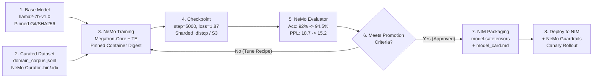
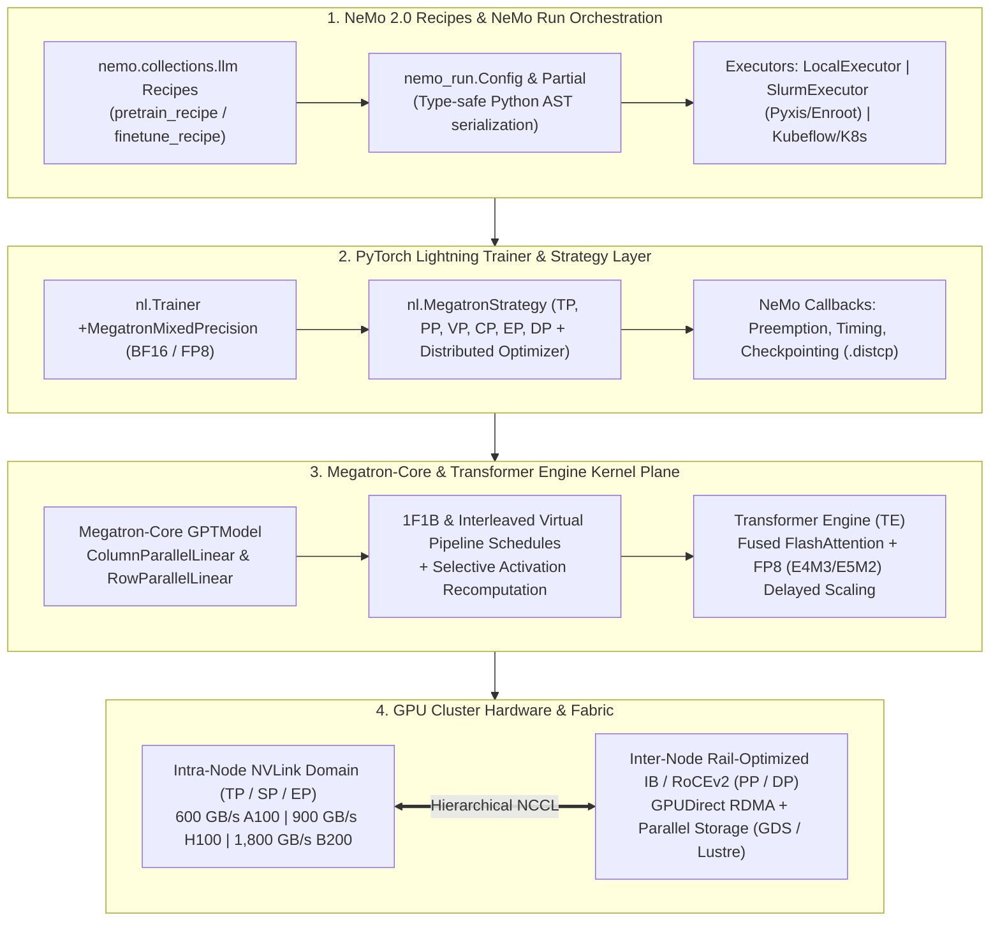
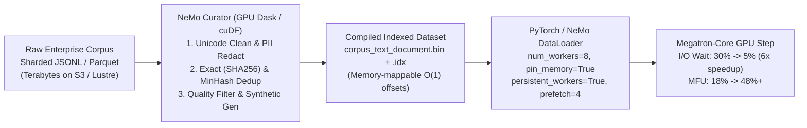

# 14.16 NeMo framework and customisation

| Field | Value |
|---|---|
| Level | Intermediate |
| Priority tier | 2 |
| Lab venue | Nebius GPU + Local Python Verification Lab |
| Part | Part 14: Distributed training and fine-tuning |
| Primary sources | NVIDIA Zero-to-Hero Volume 14 (`chapter-05-nemo-framework-and-model-customization.md`, `chapter-06-nemo-guardrails-and-enterprise-controls.md`, `chapter-02-platform-architecture-and-support-boundary.md`, `chapter-12-volume-14-summary.md`, `index.md`, `labs/lab-03-build-a-nemo-customization-workflow.md`), Volume 13 (`chapter-07-megatron-lm-architecture.md`), Volume 05 (`01-ai-workloads-training-masterclass.md`), Volume 09 (`01-hardware-ecosystem-gauntlet.md`); *AI Systems Performance Engineering* Chapter 5; *Generative AI on Kubernetes* Chapters 5 & 6; *Distributed AI Systems* Chapters 5 & 8 |
| Cross-references | Chapter 13.6 (Data loading and small files); Chapter 14.7 (Tensor, pipeline and expert parallelism: Megatron); Chapter 14.10 (Multi-node training architecture); Chapter 14.13 (Fine-tuning: SFT, LoRA and QLoRA, preference alignment); Chapter 14.14 (Dataset engineering for fine-tuning); Chapter 16.12 (NeMo and enterprise customisation workflows) |
| Code | `code/part14/nemo_framework_customisation.py`, `code/part14/nemo_framework_customisation_lab.py` |
| Coverage file | `planning/coverage/chapters/14-16.md` |
| Claim & number ledger | `planning/ledgers/14-16.md` |

## Why this matters for AI infrastructure

A foundation model downloaded from Hugging Face or NGC knows general language, but it does not know your bank's policies, your clinical workflows, or your internal codebase. Dropping it into an inference container does not make it a domain specialist. To teach it proprietary reasoning or strict institutional behavior, you must change its weights through post-training customization.

The NVIDIA software stack splits this work between two engines. NVIDIA NeMo Framework is the factory for training and customization. It is the distributed stack in which foundation models are curated, pre-trained, fine-tuned, aligned, and evaluated across multi-GPU and multi-node clusters. NVIDIA NIM is the production inference microservice. When NeMo has trained and validated the customized weights, they are exported and mounted into a NIM container, which serves them with TensorRT-LLM or vLLM behind Triton Inference Server.

```text
Domain Fine-Tuning Infrastructure Reality (Volume 14, Chapter 5 & Lab 03):
- Model & Dataset: llama2-7b-hf on 500,000 domain examples (450,000 train / 50,000 val, 90/10 split)
  Dataset footprint: 10 GB compressed archive -> 150 GB uncompressed text (max_length = 2048)
  Lab 03 verification subset: 500 examples (2.5 MB / 2,500,000 bytes) + 5,000 evaluation examples
- Compute Cluster: 8x A100 80 GB GPUs connected via NVLink (600 GB/s bidirectional per GPU, 4.8 TB/s DGX A100 bisection)
  or 200 Gbps InfiniBand EDR; expected NCCL AllReduce < 1 second (480–540 GB/s healthy busbw at 80–90% efficiency)
  Schedule: 168 continuous training hours (1 week), budgeted at 640 GPU-hours (1,344 calendar GPU-hours)
- Distributed Training Config: batch_size_per_gpu = 8, gradient_accumulation_steps = 4, precision = bfloat16, strategy = FSDP
  Global batch = 256 sequences (524,288 tokens/step on 8 GPUs) or 128 sequences (262,144 tokens/step on 4 GPUs in Lab 03)
- Memory & Persistent Storage Floor:
  Model weights (BF16) = 14 GB; internal HBM activations = ~40 GB per GPU (54 GB active < 80 GB HBM)
  Saved checkpoints = 50 GB budget (15 GB per checkpoint saved every 1,000 steps, save_total_limit = 3 -> 45 GB retained, ~5 min recovery)
  Training logs and metadata = 5 GB; minimum persistent storage required = 100 GB
```

Treating customization as a casual single-GPU script fails in production in three ways.

Runs become unreproducible. If a fine-tuning run does not pin the base model commit hash, the dataset SHA-256 digest, and the `nvcr.io/nvidia/nemo:24.07` container digest, you cannot audit or roll back a misbehaving model.

The data pipeline starves the GPUs. Feeding raw JSONL over network-attached NFS makes CPUs parse text on the fly. That bottleneck holds Megatron-LM and NeMo runs at 18 percent MFU, and GPU utilization swings between 95 percent and 8 percent.

Checkpoints stall the cluster. Writing one monolithic checkpoint from a thousand GPUs locks the parallel filesystem metadata server. A 450-millisecond training iteration then turns into a 45-minute stall every thousand steps.

Before you start a customization run, pin every input by digest, put the data behind an offline pipeline, and write sharded checkpoints.

## Prerequisites and outcomes

### Prerequisites
- Transformer architecture and training memory anatomy from earlier chapters in this part.
- Data, sharded, and multi-dimensional model parallelism fundamentals.
- Fine-tuning algorithms and dataset engineering fundamentals.

### Outcomes
After completing this chapter, you will be able to do five things.
1. Lay out a NeMo-to-NIM customization pipeline whose base models, datasets, containers, checkpoints, and evaluation gates are all traceable by digest.
2. Set up the NeMo 2.0 stack on multi-node Slurm and Kubernetes clusters. It combines PyTorch Lightning, Megatron-Core parallelism, Transformer Engine FP8, and NeMo Run.
3. Build offline GPU data pipelines with NeMo Curator that compile raw JSONL or Parquet corpora into memory-mappable `.bin` and `.idx` datasets.
4. Choose and size full SFT, PEFT LoRA or DoRA, and NeMo Aligner DPO or GRPO recipes, and manage sharded `.distcp` checkpoints without filesystem stalls.
5. Gate model promotion with NeMo Evaluator, enforce runtime safety policies with NeMo Guardrails across five Colang rail stages, and find low-utilization bottlenecks with `dcgmi`, DataLoader benchmarks, and `nccl-tests`.

---

## 1. The Enterprise Customization Lifecycle: NeMo vs NIM

### 1.1 Separation of Concerns Across Training and Serving

In a production AI factory, training workloads and inference services have opposite operational profiles. Training and customization are throughput-oriented batch jobs. They allocate gang-scheduled GPU clusters for hours or weeks, stream terabytes of training tokens, synchronize gradients over NVLink and InfiniBand, and write multi-gigabyte checkpoints to parallel storage. Inference serving is a latency-bound, long-running microservice. It must satisfy strict Time To First Token and Time Per Output Token objectives while scaling elastically with user traffic.

NVIDIA divides the work among three components.

NeMo Framework owns model creation and customization. Its parts are NeMo Curator for datasets, Megatron-Core and NeMo Customizer for distributed pre-training and fine-tuning, NeMo Aligner for preference alignment, and NeMo Evaluator for benchmark checks.

NVIDIA NIM owns production serving. At container startup it inspects the GPU architecture, such as Hopper H100 or Blackwell B200, and selects a matching TensorRT-LLM or vLLM profile. It sets up paged KV cache allocation and exposes an OpenAI-compatible REST and gRPC API over Triton Inference Server.

NeMo Guardrails guards policy and safety at runtime. It sits in front of the deployed NIM as a programmable Colang gateway, and it filters user inputs, dialog state, RAG retrievals, tool calls, and generated outputs with no model retraining.



### 1.2 Infrastructure Sizing and Immutable Lineage Governance

Fine-tuning is smaller than pre-training only in relative terms. Adapting a seven-billion-parameter model to an enterprise domain on half a million examples still requires a dedicated multi-GPU server, high-speed NVLink or InfiniBand fabric, and disciplined storage capacity planning.

| Lifecycle Dimension | Production 8-GPU Domain Fine-Tune (`V14` Ch. 5) | Lab 03 4-GPU Kubernetes Verification (`V14` Lab 03) | Operational Requirement |
|---|---|---|---|
| **Base model & digest** | `llama2-7b-hf` (`sha256:1f2e3d4c5b6a`) | `Llama-2-7b-hf` (`git rev-parse HEAD`) | Never pin mutable branch tags like `main`; always pin immutable commit or `SHA-256` digest. |
| **Dataset & split** | `500K` examples (`450K` train / `50K` val, `10 GB` compressed -> `150 GB` raw) | `500` lab examples (`2.5 MB`, `90/10` split) + `5,000` test examples | Hash dataset (`sha256sum`) and commit `data/CHECKSUMS` to Git before training starts. |
| **Container & framework** | `nvcr.io/nvidia/nemo:24.07` (`sha256:xyz...`) | `nvcr.io/nvidia/nemo:24.07` (`nemo_framework_version: 2.0.0`, HF `4.35.0`) | Pin container image digest and training config Git commit (`training_config.yaml`). |
| **Compute & interconnect** | `8x A100 80 GB` (`NVLink` `600 GB/s` bidir/GPU, `168` hrs, `640` GPU-hrs budget) | `4x GPUs` (`CUDA_VISIBLE_DEVICES="0,1,2,3"`, `120Gi` req / `150Gi` limit RAM) | Keep `AllReduce < 1 s` on 8 GPUs (`480–540 GB/s` `nccl-tests` `busbw` on A100 NVLink). |
| **Hyperparameters** | `batch=8`/GPU, `grad_accum=4` (`256` global), `lr=1e-5`, `bfloat16`, `FSDP` | `max_steps=5000`, `save_steps=1000`, `batch=8`, `grad_accum=4`, `lr=5e-5`, `warmup=500` | Use `bfloat16` and `tf32=true` to halve weight memory (`14 GB`) without FP16 underflow. |
| **Storage & checkpoints** | `14 GB` weights, `~40 GB` activations/GPU, `50 GB` ckpts (`15 GB` each, `~5 min` load), `100 GB` min | `save_total_limit=3` (`checkpoint-1000..5000`), checksummed and synced to S3 | Retain last 3 checkpoints on fast PVC/NVMe and archive final approved bundle to immutable S3. |
| **Evaluation & promotion** | Train loss `2.1`, val loss `2.15`; accuracy `92% -> 94.5%` (`+2.5` percentage points) | Loss `2.15 -> 1.87` (`12.8%` gain); PPL `18.7 -> 15.2`; ROUGE-1 `0.31 -> 0.35`; BLEU `0.24 -> 0.28` | Require automated metric improvement plus explicit `ml-ops-team` sign-off before NIM packaging. |

In regulated industries, a deployed model must carry an auditable chain of custody. Every NeMo training job should emit an immutable `training_metadata.yaml` manifest alongside its checkpoints.

```yaml
# training_metadata.yaml — immutable lineage artifact saved with checkpoint
training_run:
  id: "fine-tune-llama2-domain-20260807"
  timestamp: "2026-08-07T14:00:00Z"
  status: "completed"

  base_model:
    name: "llama2-7b-hf"
    source: "huggingface"
    digest: "sha256:1f2e3d4c5b6a"
    license: "Community License (non-commercial use only)"

  dataset:
    path: "s3://our-bucket/datasets/domain-corpus-v2.tar.gz"
    sha256: "9a8b7c6d5e4f3a2b1c0d"
    size_compressed: "10 GB"
    size_uncompressed: "150 GB"
    preprocessing: "tokenize with llama2 vocab, max_length=2048"
    splits: "train=450K, val=50K"

  nemo_framework:
    container_image: "nvcr.io/nvidia/nemo:24.07"
    nemo_framework_version: "2.0.0"
    digest: "sha256:xyz..."
    config_file: "git://our-repo/training_config.yaml#commit=abc123"

  hardware:
    node_count: 1
    gpus_per_node: 8
    gpu_type: "A100 80GB"
    interconnect: "NVLink"

  training_results:
    loss_training_final: 1.87
    loss_validation_final: 1.92
    baseline_loss: 2.15
    baseline_model_accuracy: "92%"
    new_model_accuracy: "94.5%"
    perplexity_test: 15.2
    baseline_perplexity: 18.7

  approval:
    approved_by: "ml-ops-team"
    approved_at: "2026-08-08T09:00:00Z"
    deployment_decision: "approved for staging"

  checkpoint_path: "s3://our-bucket/checkpoints/fine-tune-llama2-domain-20260807/checkpoint-step-5000.tar.gz"
  checkpoint_size: "15 GB"
  checkpoint_recovery_time: "~5 minutes to load and resume"
```

---

## 2. NeMo 2.0 Architecture: Megatron-Core, Transformer Engine, and NeMo Run

### 2.1 Inside the NeMo 2.0 Software Stack

Early releases of NeMo relied on deeply nested Hydra YAML files that were hard to type-check or combine across multi-stage pipelines. **NeMo 2.0** replaces that sprawl with a modular, Pythonic design in four layers.

At the top, NeMo Run and the `nemo.collections.llm` recipes define training, fine-tuning, and evaluation as type-safe Python objects, using `nemo_run.Config` and `nemo_run.Partial`. A pre-validated recipe such as `llm.llama3_8b.pretrain_recipe()` bundles architecture, optimizer, precision, and parallelism settings into an inspectable dataclass. The same recipe launches on local GPUs, on Slurm with Pyxis and Enroot, or on Kubernetes.

Below it, PyTorch Lightning supplies the trainer lifecycle for callbacks, logging, and checkpoint hooks. It hands process-group creation, step scheduling, and sharded state management to `nl.MegatronStrategy`.

Beneath Lightning sits **Megatron-Core**, NVIDIA's library of composable model-parallel Transformer building blocks. It coordinates up to five orthogonal parallelism dimensions. They are Tensor Parallelism, Sequence Parallelism, Pipeline Parallelism with interleaved virtual stages, Context Parallelism, Expert Parallelism, and Data Parallelism with the Distributed Optimizer.

At the bottom, NVIDIA Transformer Engine runs fused attention kernels and FP8 matrix multiplications for the Megatron-Core layers. It uses E4M3 in the forward pass for precision and E5M2 in the backward pass for dynamic range, with delayed per-tensor scaling on Hopper and Blackwell Tensor Cores.



### 2.2 Megatron-Core 3D/5D Parallelism Math and Pipeline Bubble Sizing

When a customer scales past a single eight-GPU server to train or customize a frontier model like Llama-3-70B or GPT-3, standard PyTorch DDP and pure ZeRO-3 hit hard physical walls. Under mixed-precision Adam, each parameter requires four bytes for FP32 master weights, four bytes for FP32 gradients, and eight bytes for FP32 momentum and variance. That adds up to sixteen bytes of state per parameter. For a 175B model across 96 Transformer layers on 1,024 H100 GPUs, the total model and optimizer state is 2,800 GB. Sharding that state across 1,024 GPUs via ZeRO-3 leaves only 2.73 GB per GPU. However, gathering full layer weights across 128 nodes on every forward and backward pass saturates inter-node InfiniBand links.

Megatron-Core solves this by splitting the computation and the weight matrices across the hardware hierarchy.

Tensor Parallelism splits each linear pair by columns, then by rows. In every attention and MLP block, the first linear projection is split column-wise (`ColumnParallelLinear`). Each GPU computes its own slice of the activation and applies the GeLU or SwiGLU nonlinearity locally, with no communication. The second projection is split row-wise (`RowParallelLinear`), so the sliced activations multiply directly and the block needs only one AllReduce at the end. TP runs two synchronous AllReduce collectives per Transformer layer, so it must stay inside a single node's NVLink domain.

Sequence Parallelism and selective activation recomputation save activation memory. Standard TP leaves LayerNorm and Dropout replicated across the TP group. Setting `sequence_parallel=True` splits those activations along the sequence dimension at no extra communication cost. Selective recomputation then recomputes only the memory-heavy, compute-cheap attention softmax and dropout intermediates and keeps the expensive GEMM outputs. That recovers 70 to 80 percent of the memory savings of full activation checkpointing and avoids most of its 30 to 50 percent backward-pass slowdown.

Pipeline Parallelism splits the Transformer layers across stages. The One-Forward-One-Backward (1F1B) schedule bounds the activation memory in flight.

```text
Worked Megatron-Core 175B Sizing on 1,024 H100 GPUs (Volume 13, Chapter 7):
- Cluster: 1,024 H100 GPUs (128 nodes x 8 GPUs/node), 96 Transformer layers, hidden_size = 12,288, vocab = 50,000
- Total mixed-precision Adam state: 175B * 16 bytes/param = 2,800 GB (2.73 GB/GPU if sharded across 1,024 GPUs)
- 3D Parallelism Grid:
  TP = 8 (1 full 8-GPU NVLink domain per node)
  PP = 16 (96 layers / 16 stages = 6 Transformer layers per stage across InfiniBand P2P links)
  DP = 8 (1,024 / (8 * 16) = 8-way data-parallel replication)
  Check: 8 * 16 * 8 = 1,024 GPUs
- Per-GPU Weight & State Footprint:
  Parameters per GPU = 175B / (8 * 16) = 1.367B (~1.37B parameters per GPU)
  State memory per GPU = 1.367B * 16 bytes = 21.875 GB (~22 GB, fitting easily inside an 80 GB H100 alongside activations)
- 1F1B Pipeline Bubble Math (global_batch_size = 2,048, micro_batch_size = 1):
  Micro-batches per DP replica (M) = 2,048 / 8 = 256
  Bubble fraction = (PP - 1) / (M + PP - 1) = (16 - 1) / (256 + 16 - 1) = 15 / 271 = 5.54% (~5.5% bubble)
  Comparison at small global batch (M = 40 micro-batches): 15 / (40 + 15) = 27.27% (~27% bubble)
- Endpoint Stage Imbalance (an edge-stage straggler):
  Stage 0 holds the input embedding lookup and Stage 15 holds the final lm_head projection:
  50,000 vocab * 12,288 hidden * 2 bytes (BF16) = 1.23 GB (~1.2 GB table + extra gather/GEMM work)
  Symptom: nsys shows Stage 0 and Stage 15 taking ~40% longer per micro-batch than Stages 1..14
  Fix: Assign fewer Transformer layers to stages 0 and 15 (e.g., 5 layers on endpoints, 6–7 on middle stages)
  or enable interleaved virtual pipeline stages (--num-layers-per-virtual-pipeline-stage / virtual_pipeline_model_parallel_size)
```

---

## 3. Data Curation and Ingestion with NeMo Curator

### 3.1 Why Offline GPU Data Curation Is Mandatory at Scale

A fast GPU cluster is only as fast as its data pipeline. Training on raw, unindexed JSONL files on a shared NFS server makes host CPUs open millions of small files, parse JSON, and tokenize on every iteration. That antipattern can waste up to **50 percent of total GPU time** waiting for input. It also holds Megatron-LM and NeMo runs at **18 percent MFU**, even when the InfiniBand network passes every `nccl-tests` benchmark.

**NVIDIA NeMo Curator** removes the runtime parsing by moving dataset preparation into an offline, multi-node GPU pipeline built on RAPIDS `cuDF` and Dask. It works in five steps.

1. It reads and writes multi-terabyte corpora as sharded JSONL or Parquet files through `DocumentDataset`, across distributed CPU and GPU workers.
2. It normalizes Unicode, strips HTML and Markdown boilerplate, and applies heuristic and classifier-based quality filters. It also runs GPU-accelerated exact MD5 or SHA-256 deduplication, fuzzy MinHash Locality-Sensitive Hashing deduplication, and test-set decontamination.
3. When human domain data is scarce, it runs synthetic instruction and preference generation pipelines to widen domain coverage.
4. For NeMo and Megatron-Core training, downstream preprocessing compiles tokenized documents into two flat files. The `.bin` file is a contiguous binary token array, and the `.idx` file is a byte-offset index. Each rank memory-maps them from Lustre, BeeGFS, WEKA, or local NVMe, with constant-time sequence lookup and no JSON parsing.
5. To avoid shuffling at run time across several epochs, teams can write pre-shuffled `.bin` and `.idx` copies to disk. That trades cheap storage for deterministic, stall-free streaming.



### 3.2 DataLoader Tuning, DALI, and I/O Wait Math

Even with `.bin` and `.idx` files, the host-to-device staging path must be tuned so GPU compute streams never block on `next(data_iterator)`.

| Data Pipeline Optimization | Baseline / Bottleneck Behavior | Tuned NeMo / DALI / DataLoader Behavior | Quantitative Impact & Provenance |
|---|---|---|---|
| **Offline `.bin`/`.idx` compilation (`NeMo Curator`)** | On-the-fly JSONL parsing and tokenization over NFS saturates host CPUs | Offline GPU curation + pre-tokenized memory-mapped `.bin` and `.idx` files | Lifts Megatron-LM MFU from **`18%` to `40%–55%`** and avoids **`50%` GPU idle waste** (`V05` Ch. 1; *AI Systems Performance Engineering*, Ch. 5). |
| **Reducing storage I/O wait** | GPUs spend **`30%`** of iteration time waiting on storage and data staging | Parallel filesystem striping + local NVMe caching + tuned `DataLoader` | Cuts I/O wait from **`30%` to `5%`**, increasing training steps/sec by **`6x`** (*AI Systems Performance Engineering*, Ch. 5). |
| **Multimodal GPU decoding (`NVIDIA DALI`)** | CPU-only JPEG/video decode and augmentation consumes **`800%` CPU (`8` cores)** and stalls GPUs | Declarative `nvidia.dali.pipeline.Pipeline` fused on GPU hardware decoders | Drops CPU utilization **`4x` from `800%` (`8` cores) to `200%` (`2` cores)** (*AI Systems Performance Engineering*, Ch. 5). |
| **Pinned-memory async prefetching** | Pageable host memory forces synchronous staging copies and epoch worker restarts | `batch_size=32`, `num_workers=8`, `pin_memory=True`, `persistent_workers=True`, `prefetch_factor=4` + `copy_stream` | Queues `8 * 4 = 32` batches in locked RAM (`ulimit -l`) for overlap via `non_blocking=True` DMA (*AI Systems Performance Engineering*, Ch. 5). |

---

## 4. Model Customization Recipes, Checkpointing, and Launchers

### 4.1 Choosing the Right Customization Recipe: Full SFT vs PEFT LoRA vs Alignment

Model customization, also called **post-training**, starts from an already pre-trained and aligned base model and adapts it to a specific enterprise domain or behavioral policy. Before launching a GPU cluster, platform architects must match the customization technique to the dataset size, latency budget, and serving topology.

| Customization Method | Typical Dataset Scale | Parameters Modified | Training & Serving Infrastructure Impact | NeMo Ecosystem Component |
|---|---|---|---|---|
| **Prompt Engineering & RAG** | `0` training examples (vector DB context injection) | `0%` (weights frozen) | Zero training GPUs; increases inference context length and KV cache HBM footprint per request. | NVIDIA NIM + NeMo Retriever |
| **PEFT: LoRA / DoRA / QLoRA** | `100` to `1,000` (up to `50K`) labeled examples | **`< 1%`** (`~0.21%` for rank-16 on `8B`; `1%–10%` adapter size) | Completes in hours on `1` to `8` GPUs (`8B–16B` SLMs); multiple LoRA adapters share a single base NIM deployment dynamically. | NeMo Framework (`llm.peft.LoRA`) / NeMo Customizer |
| **Full Supervised Fine-Tuning (SFT)** | `100,000+` (`500K` in `V14` Ch. 5) labeled examples | **`100%`** of model weights updated | Takes days to weeks (`168` hours / `640` GPU-hours on `8x A100 80GB`); produces a standalone model requiring dedicated NIM GPUs and risks catastrophic forgetting. | NeMo Framework (`llm.finetune`) / NeMo Customizer |
| **Preference Alignment (DPO / PPO / GRPO / SteerLM)** | `100` to `100,000+` preference triples `(prompt, chosen, rejected)` or reward prompts | `100%` (or PEFT adapters) across policy, reference, and reward models | Multi-model distributed topologies (`Actor` + `Reference` + `Critic`/`Reward` or group rollouts in `GRPO`) requiring gang-scheduled multi-node RDMA fabrics. | NeMo Aligner / NeMo Customizer |

For Parameter-Efficient Fine-Tuning via Low-Rank Adaptation, the original weight matrix remains frozen while two low-rank matrices learn the update scaled by alpha over rank. Consider an 8.03B-parameter Llama-style model with 32 layers and a hidden dimension of 4,096. Adapting four linear projections per block with rank 16 and alpha 32 trains only 16,777,216 parameters. That is **0.2089 percent** of the base model and produces a **33.55 MB** BF16 adapter file that mounts directly into a shared base NIM container.

### 4.2 Distributed Checkpointing: `.nemo` Archives vs `.distcp` Shards

As models and clusters grow, checkpointing turns from a convenience into the main availability bottleneck. NeMo has two formats, and the difference is large.

The legacy `.nemo` file is a single tarball. In NeMo 1.x and small single-node jobs, a checkpoint was packaged as one `.nemo` tarball holding `model_config.yaml`, tokenizer artifacts, and consolidated weights. On a 1,024-GPU cluster, if all ranks funnel state into one file or one unstriped directory, they saturate the filesystem metadata server. A **450-millisecond training iteration becomes a 45-minute stall** every thousand steps.

NeMo 2.0 writes sharded `.distcp` checkpoints with Megatron-Core and PyTorch Distributed Checkpoint. Each rank writes its own shard at the same time, and Lustre striping (`lfs setstripe -c -1`) spreads the I/O across all Object Storage Targets. Asynchronous background threads hide write latency behind the next forward pass.

The footprint is easy to work out. For an 8.03B GPT or Llama model, the theoretical state is 16.06 GB of BF16 weights plus 64.24 GB of FP32 Adam states, a total of **80.30 GB**. On disk, alignment padding and sharding metadata make **108.0 GB** across **four 27.0 GB `.distcp` shard files**, plus `common.pt` and `metadata.json`.

Because `.distcp` records tensor topology in `metadata.json`, a job saved at one parallelism setting can resume on a different cluster geometry. You can also strip its 64.24 GB optimizer state with `convert_to_nim.py` or Megatron-Bridge, which exports a clean 16.06 GB `model.safetensors` package for NVIDIA NIM.

### 4.3 NeMo Evaluator and NeMo Guardrails across the 5 Colang Rail Stages

Before a customized checkpoint is promoted to production NIM serving, **NeMo Evaluator** runs automated academic and domain test suites. It measures perplexity, ROUGE-1, BLEU, MMLU, GSM8K, and asynchronous LLM-as-a-Judge rubrics. In production, teams sample 1 to 10 percent of live traffic asynchronously so judge models do not block user responses.

Once deployed in NIM, **NeMo Guardrails** enforces deterministic corporate and security policies around the statistical model using **Colang**, a domain-specific modeling language for conversational flows. NeMo Guardrails intercepts traffic across **five distinct rail stages** and introduces an explicit latency trade-off that architects must budget against their Service-Level Objectives.

```text
NeMo Guardrails 5-Stage Architecture & Illustrative Latency Budget (Volume 14, Chapter 6 & GAK Chapter 5):
- Five Programmable Colang Rail Stages:
  1. Input rails: Validate user input, redact PII (presidio-analyzer:2.2.1), enforce max_length = 2048, block prompt injection / jailbreaks
  2. Dialog rails: Classify user intent (zero-shot-classifier:1.0, timeout = 1000 ms) and enforce multi-turn topical boundaries
  3. Retrieval rails: Validate and filter external RAG chunks before context injection
  4. Execution rails: Gate tool/database calls (e.g., allow prod_metrics within 2000 ms; block customer_pii, payroll, or unapproved 'users' table)
  5. Output rails: Redact leaked secrets (API_KEY, password), fact-check against approved KB (fact-checker:1.0), enforce min_confidence >= 0.85
- Cumulative Latency Budget Breakdown (Volume 14, Chapter 6):
  Base NIM LLM inference (no guardrails):       45 ms
  + Input validation (PII check, length):      +15 ms ->  60 ms cumulative
  + Intent classifier (dialog routing):        +30 ms ->  90 ms cumulative
  + RAG retrieval & retrieval rail (if used): +100 ms -> 190 ms cumulative
  + Output validator (secret & fact-check):    +50 ms -> 240 ms cumulative
  + Immutable audit log write:                 +10 ms -> 250 ms total
  Total latency increase: 45 ms -> 250 ms (+205 ms overhead, 5.56x / ~5.5x slower)
- Production Policy & Rollout Governance:
  Rate limits: 100 requests/hour per user, 1,000 requests/hour per IP
  Audit compliance: s3://audit-logs-immutable/guardrail-logs/ retained for 2,555 days (~7 years), 1.0 (100%) sample rate on rejected requests
  Canary deployment: Roll out new guardrail_policy.yaml to 10% of traffic; alert and roll back if rejection rate spikes > 5%
```

---

## 5. Commands and Configurations That Matter

### 5.1 NeMo 2.0 Pythonic Fine-Tuning Recipe with `nemo_run` and Slurm / Pyxis

```python
# nemo2_llama3_lora_recipe.py — NeMo 2.0 + NeMo Run LoRA / SFT recipe on Slurm
import nemo_run as run
from nemo.collections import llm
from nemo.collections.llm.peft import LoRA


def configure_llama3_domain_finetune(nodes: int = 1, gpus_per_node: int = 8) -> run.Partial:
    # Start from the pre-validated NeMo 2.0 Llama-3 8B fine-tuning recipe
    recipe = llm.llama3_8b.finetune_recipe(
        dir="/checkpoints/llama3-8b-domain",
        name="llama3_8b_domain_lora",
        num_nodes=nodes,
        num_gpus_per_node=gpus_per_node,
        peft_scheme="lora",
    )

    # Configure Megatron-Core parallelism and Transformer Engine FP8/BF16 precision
    recipe.trainer.strategy.tensor_model_parallel_size = 1
    recipe.trainer.strategy.pipeline_model_parallel_size = 1
    recipe.trainer.strategy.sequence_parallel = False
    recipe.trainer.max_steps = 5000
    recipe.trainer.val_check_interval = 1000

    # Configure rank-16 LoRA adapter (< 1% trainable parameters, ~33.55 MB BF16 adapter)
    recipe.peft = run.Config(
        LoRA,
        target_modules=["linear_qkv", "linear_proj", "linear_fc1", "linear_fc2"],
        dim=16,
        alpha=32,
        dropout=0.05,
    )
    return recipe


def slurm_pyxis_executor(nodes: int = 1, gpus_per_node: int = 8) -> run.SlurmExecutor:
    return run.SlurmExecutor(
        account="ai_factory_prod",
        partition="h100_rail_opt",
        nodes=nodes,
        ntasks_per_node=gpus_per_node,
        gpus_per_node=gpus_per_node,
        mem="0",
        exclusive=True,
        time="168:00:00",
        container_image="nvcr.io/nvidia/nemo:24.07",
        container_mounts=["/lustre/datasets:/data", "/lustre/checkpoints:/checkpoints"],
        env_vars={
            "CUDA_DEVICE_MAX_CONNECTIONS": "1",
            "NCCL_NVLS_ENABLE": "1",
            "TORCH_NCCL_AVOID_RECORD_STREAMS": "1",
        },
    )


if __name__ == "__main__":
    finetune_task = configure_llama3_domain_finetune(nodes=1, gpus_per_node=8)
    executor = slurm_pyxis_executor(nodes=1, gpus_per_node=8)
    # Dry-run inspects generated sbatch + Pyxis script; remove dryrun=True on cluster
    run.run(finetune_task, executor=executor, name="llama3_8b_domain_lora", dryrun=True)
```

### 5.2 Complete Reproducible Kubernetes Customization & NIM Packaging Workflow (`V14` Lab 03)

```bash
# Step 1: Pin base model Git revision and license metadata
git clone https://huggingface.co/meta-llama/Llama-2-7b-hf model_source
cd model_source && BASE_MODEL_COMMIT=$(git rev-parse HEAD) && cd ..

# Step 2: Hash domain corpus (2.5 MB / 500 lab examples; 500K in production) and commit checksum
DATASET_HASH=$(sha256sum data/domain_corpus.jsonl | cut -d' ' -f1)
echo "$DATASET_HASH  domain_corpus.jsonl" > data/CHECKSUMS
git add data/CHECKSUMS training_config.yaml && git commit -m "Pin dataset and training config"
CONFIG_COMMIT=$(git rev-parse HEAD)

# Step 3: Submit 4-GPU NeMo customization Job on Kubernetes (120Gi request / 150Gi limit)
cat > training-job.yaml <<EOF
apiVersion: batch/v1
kind: Job
metadata:
  name: fine-tune-llama2-domain-20260807
spec:
  template:
    spec:
      containers:
      - name: trainer
        image: nvcr.io/nvidia/nemo:24.07
        env:
        - name: CUDA_VISIBLE_DEVICES
          value: "0,1,2,3"
        volumeMounts:
        - name: data
          mountPath: /data
        - name: checkpoints
          mountPath: /checkpoints
        command: ["bash", "-c"]
        args:
        - |
          cd /workspace
          torchrun --nproc_per_node=4 fine_tune_llama2.py --training_config training_config.yaml
        resources:
          requests:
            nvidia.com/gpu: 4
            memory: "120Gi"
          limits:
            nvidia.com/gpu: 4
            memory: "150Gi"
      volumes:
      - name: data
        persistentVolumeClaim:
          claimName: training-data-pvc
      - name: checkpoints
        persistentVolumeClaim:
          claimName: training-checkpoints-pvc
      restartPolicy: OnFailure
EOF
kubectl apply -f training-job.yaml

# Step 4: Checksum final checkpoint-5000, evaluate against baseline, and package for NIM
CHECKPOINT_PATH="checkpoints/checkpoint-5000"
CHECKPOINT_HASH=$(find "$CHECKPOINT_PATH" -type f -exec sha256sum {} + | sha256sum | cut -d' ' -f1)
python evaluate.py --model "$CHECKPOINT_PATH" --test_set data/domain_corpus_test.jsonl --metrics perplexity,rouge,bleu
# Expected: Perplexity 15.2 (vs 18.7 baseline = 18.7% better), ROUGE-1 0.35 (vs 0.31 = +12.9%), BLEU 0.28 (vs 0.24 = +16.7%)

python convert_to_nim.py --checkpoint "$CHECKPOINT_PATH" --output_format "NIM-optimized" --quantization "bfloat16"
aws s3 cp model.safetensors s3://our-bucket/models/fine-tune-llama2-domain/model-20260807.safetensors
```

---

## 6. How It Fails: Production NeMo and Customization Troubleshooting

When a NeMo training or customization pipeline stalls, runs at low MFU, or rejects valid traffic in production, follow a strict fastest-to-slowest diagnostic order. Check `dcgmi dmon` first, then run an isolated DataLoader benchmark, then run `nccl-tests`, and finally capture a profiler trace.

| Failure Mode | Symptom | Root Cause & Diagnosis | Remediation |
|---|---|---|---|
| **1. Data-Pipeline GPU Starvation (`V14` Ch. 5 & `V05` Scenario 3)** | `dcgmi dmon -c 10` shows GPU utilization oscillating `95% -> 15% -> 8% -> 88%` (`Power: 320W -> 295W -> 280W -> 310W`, `Temp: 65°C -> 63°C`), or Megatron-LM MFU is stuck at `18%` despite healthy `nccl-tests`. | Host CPUs are bottlenecked parsing raw JSONL files over NFS. Isolated DataLoader test (`10` batches) reports throughput `< 0.5 batches/sec`, and `nsys` shows wide gaps between CUDA kernels. | Compile raw JSONL/Parquet offline with **NeMo Curator** into memory-mapped `.bin` and `.idx` files on Lustre/NVMe; set `num_workers=8`, `pin_memory=True`, `persistent_workers=True`, `prefetch_factor=4` (cuts I/O wait from `30%` to `5%` for a `6x` step speedup). |
| **2. Single-File Checkpoint I/O Stall (`V05` Scenario 2)** | Normal training iteration takes `450 ms`, but every `1,000` steps the iteration freezes for `45 minutes` (`6,000x` slowdown) and risks triggering NCCL watchdog timeouts. | All `1,024` GPUs are writing to a single unstriped file or directory simultaneously, saturating the Lustre Metadata Server (`MDS`) and a single Object Storage Target (`OST`). | Switch from monolithic `.nemo` tarballs to sharded **Megatron-Core / PyTorch DCP (`.distcp`)** checkpoints, configure Lustre striping (`lfs setstripe -c -1`), and enable async checkpointing (`async_save=True`). |
| **3. Pipeline Endpoint Stage Imbalance (`V13` Ch. 7 Scenario 2)** | On a `96`-layer model with `PP=16` (`6` layers/stage), `nsys` shows Stage `0` and Stage `15` taking `~40%` longer per micro-batch than Stages `1..14`. | Stage `0` carries the `50K * 12,288 * 2B = 1.2 GB` vocabulary embedding table lookup and Stage `15` carries the `lm_head` projection GEMM on top of their `6` Transformer layers. | Assign fewer Transformer layers to Stages `0` and `15` (`5` layers on endpoints, `6–7` on middle stages) or enable interleaved `1F1B` virtual pipeline stages (`--num-layers-per-virtual-pipeline-stage`). |
| **4. Monotonic Last-Stage Activation OOM (`V13` Ch. 7)** | Job trains cleanly for a few hundred steps, then HBM usage climbs monotonically on the last pipeline stage until `CUDA out of memory` crashes the run. | In `1F1B` scheduling, a Python logging hook, metric callback, or validation list holds a reference to output logits across steps, preventing in-flight micro-batch activations from being freed. | Monitor per-rank memory with `nvidia-smi` and `torch.cuda.memory_summary()`, detach/`.item()` logged scalars immediately, and enable selective activation recomputation (`70–80%` activation memory savings). |
| **5. Corrupted Checkpoint Resume & Lineage Drift (`V14` Lab 03 Step 8)** | Job preempted at `checkpoint-3000` either silently restarts from step `0` (re-processing `300K` samples) or crashes loading a truncated `pytorch_model.bin` / `.distcp` shard. | Unpinned `resume_from_checkpoint` path or partial write during ungraceful kill (`kubectl delete job` without `SIGUSR1`/`SIGTERM` trap). | Verify `sha256sum` integrity of checkpoint shards before resume, fail fast with `"Checkpoint corrupted or incompatible"` on hash mismatch, and roll back to the previous verified checkpoint (`save_total_limit=3`). |
| **6. Guardrails False-Positive Rejection or Latency Breach (`V14` Ch. 6)** | Legitimate user query `"What is in table users?"` is blocked, or end-to-end latency jumps `5.5x` from `45 ms` to `250 ms`. | Execution rail `guardrail_policy.yaml` restricts `metrics_query` to `allowed_databases: ["prod_metrics"]`, or synchronous RAG/fact-check rails exceed the latency SLO. | Inspect `kubectl logs guardrail-controller`, verify deployed ConfigMap `policy_version: "1.2.3"`, test policy changes with `pytest` + `10%` canary rollout (`< 5%` rejection spike), and move heavy judge checks to `1%–10%` async sampling. |

```bash
# Diagnostic Sequence for Low GPU Utilization in NeMo (Volume 14, Chapter 5 & ASP Chapter 5):
# 1. Sample real-time GPU utilization and power at 1 Hz for 10 seconds
dcgmi dmon -c 10
# 2026-08-07T14:23:00Z, GPU 0, 320W, 65C, 95%  <- Busy computing
# 2026-08-07T14:23:01Z, GPU 0, 295W, 64C, 15%  <- Idle waiting on DataLoader
# 2026-08-07T14:23:02Z, GPU 0, 280W, 63C,  8%  <- Starved
# 2026-08-07T14:23:03Z, GPU 0, 310W, 65C, 88%  <- Next batch arrived

# 2. Isolate DataLoader throughput (< 0.5 batches/sec confirms data pipeline bottleneck)
python3 -c "
import time
# Benchmark 10 iterations of the NeMo dataset loader in isolation
"

# 3. Verify intra-node NVLink / inter-node InfiniBand collective busbw
# On 8x A100 SXM4 (600 GB/s bidir NVLink/GPU, 4.8 TB/s bisection), expect 480-540 GB/s busbw (80-90%)
torchrun --nproc_per_node=8 -m nccl_tests.all_reduce --bw

# 4. Separate communication-bound vs compute-bound via the Batch-Size Halving Test (ASP Ch. 5):
# Suppose backward AllReduce achieves 60 GB/s on a 100 GB/s NIC. Halve the batch size (gradient bytes stay constant):
# - If NIC stays at 60 GB/s -> Network / communication-bound
# - If NIC drops from 60 GB/s to 40 GB/s -> GPU SMs / compute-bound
```

---

## 7. Hands-On Lab: End-to-End NeMo Customization, Sizing, and Governance Verifier

### Lab Venue and Objectives

This lab runs locally in Python via `code/part14/nemo_framework_customisation.py` and `code/part14/nemo_framework_customisation_lab.py` with zero external dependencies. It pairs with the Nebius GPU and Kubernetes workflow in Section 5, which is untested on live multi-node GPU hardware in this local build environment.

Run the model and the self-verification suite below.

```bash
python3 code/part14/nemo_framework_customisation.py
python3 code/part14/nemo_framework_customisation_lab.py
```

The expected output is shown below.

```text
=== Chapter 14.16 Lab: NeMo Framework and Model Customisation Verification ===
  [PASS] 1. Llama2-7B BF16 weights equal 14.0 GB and fit alongside 40.0 GB per-GPU activations inside an 80 GB A100 (54.0 GB < 80 GB)
  [PASS] 2. 8 GPUs x batch_size_per_gpu=8 x grad_accum=4 yields global batch 256 sequences and 524,288 tokens/step at max_length=2048
  [PASS] 3. 168-hour (1-week) 8-GPU domain fine-tune records 640 budgeted GPU-hours (1,344 calendar GPU-hours)
  [PASS] 4. Retaining save_total_limit=3 checkpoints at 15.0 GB each uses 45.0 GB within the 50.0 GB checkpoint budget and 100.0 GB persistent floor
  [PASS] 5. 500K-example domain corpus splits 90%/10% (450K train / 50K val) and decompresses 15.0x from 10.0 GB to 150.0 GB
  [PASS] 6. 8-GPU DGX A100 NVLink fabric provides 600 GB/s bidirectional per GPU (4.8 TB/s bisection) and 480.0-540.0 GB/s healthy nccl-tests busbw
  [PASS] 7. Lab 03 4-GPU Kubernetes Job (batch=8, grad_accum=4, max_length=2048) processes 128 sequences (262,144 tokens) per step
  [PASS] 8. 175B model mixed-precision Adam state (16 bytes/param) totals 2,800.0 GB (2.73 GB/GPU across 1,024 GPUs under ZeRO-3)
  [PASS] 9. Megatron-Core 3D layout (TP=8, PP=16, DP=8) spans 1,024 GPUs (128 nodes), placing 6 layers/stage and 1.37B params (21.875 GB state) per GPU
  [PASS] 10. At global_batch=2048 and micro_batch=1 (M=256 per DP replica), 16-stage 1F1B pipeline bubble is 15/271 = 5.54% (~5.5%) vs ~27.3% at M=40
  [PASS] 11. 50K-vocab x 12,288-hidden BF16 embedding/lm_head table adds 1.23 GB (~1.2 GB) and +40.0% micro-batch straggler latency on stages 0 and 15
  [PASS] 12. Selective activation recomputation recovers 70-80% of memory savings while avoiding full recomputation's 30-50% backward slowdown
  [PASS] 13. TP=8 fits inside a single 8-GPU NVLink node, whereas TP=16 or TP=32 crosses InfiniBand rails (tp_fits_in_nvlink_node=False)
  [PASS] 14. dcgmi dmon utilization oscillating between 95% and 8% with DataLoader throughput 0.35 < 0.5 batches/sec flags data starvation
  [PASS] 15. Cutting DataLoader I/O wait from 30% to 5% delivers a 6.0x step speedup and avoids the 50% GPU idle waste of unoptimized pipelines
  [PASS] 16. NVIDIA DALI reduces multimodal preprocessing CPU load 4.0x from 800% (8 cores) to 200% (2 cores), while raw JSONL over NFS traps MFU at 18%
  [PASS] 17. Batch-size halving test on a 100 GB/s NIC: dropping from 60 GB/s to 40 GB/s identifies a compute-bound workload, whereas staying at 60 GB/s is communication-bound
  [PASS] 18. Rank-16 LoRA across 4 linear projections in 32 layers (hidden=4096, alpha=32) adds 16,777,216 trainable params (0.2089% < 1% of 8.03B, 33.55 MB in BF16, scale=2.0)
  [PASS] 19. 8.03B Megatron/NeMo checkpoint totals 80.30 GB theoretical (16.06 GB BF16 weights + 64.24 GB FP32 Adam) and 108.0 GB actual across 4 x 27.0 GB .distcp shards
  [PASS] 20. Unstriped 1,024-GPU single-file checkpoint stalls step 1000 for 45.0 minutes vs 450.0 ms normal iteration (6,000.0x stall ratio)
  [PASS] 21. NeMo Evaluator gate verifies accuracy +2.5 pp (92.0% -> 94.5%), perplexity 18.7 -> 15.2 (18.7% reduction), ROUGE-1 +12.9% (0.31 -> 0.35), and BLEU +16.7% (0.24 -> 0.28)
  [PASS] 22. NeMo Guardrails 5-rail pipeline (Input, Dialog, Retrieval, Execution, Output) increases latency from 45.0 ms to 250.0 ms (+205.0 ms overhead, 5.56x / ~5.5x multiplier)
  [PASS] 23. Guardrails policy enforces min_confidence=0.85, 2,555-day (~7-year) immutable S3 audit retention, and 10% canary rollout with 5% rejection alert threshold
  [PASS] 24. Enterprise NVAIE artifact governance enforces 90-day NGC token rotation with 30-day pre-expiry alerting
  [PASS] 25. Regression in post-tuning perplexity (19.4 > 18.7 baseline) automatically blocks model promotion to NIM packaging (promotion_passed=False)

Summary: 25 passed, 0 failed
```

---

## Key takeaways

NeMo trains the model and NIM serves it. NeMo Framework handles data curation, distributed Megatron-Core training, SFT, LoRA, or DPO customization, and evaluation. It then exports verified `model.safetensors` weights to NVIDIA NIM for production TensorRT-LLM or vLLM inference.

Lineage is not optional. Every customization run must record the base model commit hash or SHA-256 digest, the dataset `sha256sum`, the `nvcr.io/nvidia/nemo:24.07` image digest, the checkpoint hashes, and the evaluation metrics, in `training_metadata.yaml` and `model_card.md`.

Megatron-Core fits 3D and 5D parallelism to the cluster hardware. For a 175B model on 1,024 H100 GPUs, 8-way TP, 16-way PP, and 8-way DP keep TP inside the NVLink domain. Per-GPU state falls to 21.875 GB, and the 1F1B pipeline bubble is 5.54 percent at 256 micro-batches.

NeMo Curator removes the raw-JSONL MFU trap. Offline GPU deduplication, filtering, and compilation into memory-mappable `.bin` and `.idx` files cut I/O wait from 30 percent to 5 percent. Adding NVIDIA DALI cuts multimodal CPU use from eight cores to two.

Write sharded `.distcp` checkpoints, and budget for Guardrails latency. For an 8.03B model, a `.distcp` checkpoint writes 108.0 GB across four shards and avoids the 45-minute single-file stall on 1,024 GPUs. NeMo Guardrails adds programmable Colang safety across five rail stages, and each stage adds latency.

---

## Exercises

1. Use `plan_nemo_domain_finetune()` for `llama2-7b-hf` on eight A100 GPUs with batch size 8 per GPU and 4 gradient accumulation steps. What are the BF16 weight footprint, the active HBM per GPU, the global batch in sequences, and the tokens per step? How does that compare with the four-GPU Kubernetes Job in Lab 03?
2. Retain three checkpoints and check the storage against the checkpoint budget and the persistent storage floor. What is the healthy `nccl-tests` per-GPU bus bandwidth range on an eight-GPU DGX A100?
3. A 175B-parameter model runs on 1,024 H100 GPUs across 128 nodes. What are the total mixed-precision Adam state and the per-GPU state under the 3D grid in Section 2.2? What is the 1F1B pipeline bubble at 256 micro-batches and at 40?
4. How large is a BF16 embedding table with a 50,000-token vocabulary and a hidden size of 12,288? Why do the first and last pipeline stages run slower than the middle ones, and what are two Megatron-Core fixes?
5. In a `dcgmi dmon -c 10` trace, GPU utilization swings between 95 percent and 8 percent, and an isolated DataLoader runs at 0.35 batches per second. What does that tell you? How much faster is the step rate when I/O wait drops from 30 percent to 5 percent, and how many CPU cores does NVIDIA DALI save?
6. During backward AllReduce, a 100 GB/s NIC reaches 60 GB/s. How does halving the batch size show whether the job is network-bound or compute-bound?
7. An 8.03B model has 32 layers and hidden size 4,096. A rank-16, alpha-32 LoRA adapter covers four linear projections per layer. What are the trainable parameter count, the percentage of the base model, the scaling factor, and the BF16 adapter size in MB?
8. Compare the theoretical and the actual checkpoint size of the 8.03B model across four `.distcp` shards. By what factor does a monolithic 45-minute checkpoint on 1,024 GPUs exceed a 450-millisecond step?
9. Compare the baseline and fine-tuned metrics from Lab 03. What are the improvements in accuracy, training loss, perplexity, ROUGE-1, and BLEU?
10. Add up the cumulative latency of the NeMo Guardrails pipeline, starting from 45 milliseconds of base inference. How would you keep production latency within your Service-Level Objective?

---

## Checkpoint questions (20)

<details>
<summary>**1. How do NVIDIA NeMo Framework and NVIDIA NIM divide responsibilities across the enterprise AI lifecycle?**</summary>

NeMo Framework is the training and customization factory that handles dataset curation, distributed multi-GPU pre-training and fine-tuning, preference alignment, and evaluation. NVIDIA NIM is the production inference microservice that packages finished, validated weights with TensorRT-LLM or vLLM and Triton Inference Server behind an OpenAI-compatible API.
</details>

<details>
<summary>**2. Why is pinning `revision: "main"` on a Hugging Face base model or `:latest` on a training container an enterprise anti-pattern?**</summary>

Mutable tags can change silently between runs, making it impossible to audit, reproduce, or roll back a production model. Enterprise lineage requires pinning the exact base model Git commit or SHA-256 digest, the dataset `sha256sum`, the `nvcr.io/nvidia/nemo:24.07` container digest, and the training config commit in `training_metadata.yaml`.
</details>

<details>
<summary>**3. What are the realistic compute, memory, and persistent storage requirements for domain fine-tuning `llama2-7b-hf` on 500,000 examples?**</summary>

A production run uses eight A100 GPUs connected via NVLink for one week, totaling 640 budgeted GPU-hours or 1,344 calendar GPU-hours. It uses batch size 8 per GPU, 4 gradient accumulation steps, and BF16 FSDP. It requires 14 GB for weights, 40 GB per GPU for HBM activations, 50 GB for saved checkpoints, and at least 100 GB of persistent storage.
</details>

<details>
<summary>**4. How does NeMo 2.0 improve upon legacy Hydra YAML configuration files?**</summary>

NeMo 2.0 replaces fragile, untyped Hydra YAML trees with type-safe Python recipes wrapped in `nemo_run.Config` and `nemo_run.Partial`. Engineers can inspect, validate, and override model, parallelism, and PEFT settings in Python. They can then launch the exact same recipe on local GPUs, Slurm with Pyxis and Enroot, or Kubernetes.
</details>

<details>
<summary>**5. In Megatron-Core Tensor Parallelism, why is the first MLP linear layer split column-wise and the second split row-wise?**</summary>

Splitting the first matrix column-wise via `ColumnParallelLinear` partitions the intermediate activation across GPUs so each rank can apply the GeLU or SwiGLU nonlinearity independently without communication. Splitting the second matrix row-wise via `RowParallelLinear` accepts those partitioned activations directly and requires only a single AllReduce at the end of the block. That design cuts TP communication per MLP block in half.
</details>

<details>
<summary>**6. Why does a 175B-parameter model on 1,024 H100 GPUs use 3D parallelism instead of pure ZeRO-3 or FSDP sharding?**</summary>

Sharding 2,800 GB of mixed-precision Adam state across 1,024 GPUs leaves only 2.73 GB per GPU. However, pure ZeRO-3 must execute cross-node AllGather collectives across 128 nodes on every layer's forward and backward pass. Using 8-way TP, 16-way PP, and 8-way DP keeps TP inside each node's NVLink domain. Each GPU holds 1.37B parameters and 21.875 GB of state with only lightweight P2P pipeline sends across InfiniBand.
</details>

<details>
<summary>**7. What is the 1F1B pipeline bubble formula, and what is the bubble percentage for 16 pipeline stages and 256 micro-batches?**</summary>

With global batch size 2,048 across 8 DP replicas at micro-batch size 1, each DP replica processes 256 micro-batches. Dividing `PP - 1` by `M + PP - 1` gives 15 over 271, which is 5.54 percent. By contrast, dropping to 40 micro-batches raises the bubble to 27.3 percent.
</details>

<details>
<summary>**8. How do Sequence Parallelism and selective activation recomputation reduce HBM activation pressure in NeMo?**</summary>

Sequence Parallelism partitions LayerNorm and Dropout activations along the sequence dimension across the TP group with zero extra communication volume. Selective activation recomputation discards and recomputes only memory-heavy, compute-cheap attention softmax and dropout intermediates. That combination recovers 70 to 80 percent of activation memory savings for a fraction of full recomputation's backward slowdown.
</details>

<details>
<summary>**9. What causes the edge-stage straggler on the first and last pipeline stages of a 96-layer model with 16 stages, and how do you resolve it?**</summary>

Even when all 16 stages hold 6 Transformer layers, the first stage also executes the 1.23 GB vocabulary embedding lookup and the last stage executes the final language-model head projection GEMM. That extra work makes those two endpoint stages run 40 percent slower per micro-batch. Resolve it by assigning 5 Transformer layers to the first and last stages or enabling interleaved virtual pipeline stages via `--num-layers-per-virtual-pipeline-stage`.
</details>

<details>
<summary>**10. Why does training Megatron-LM or NeMo directly on raw JSONL files over NFS trap MFU at 18 percent, and how does NeMo Curator fix it?**</summary>

Reading millions of small JSONL records over NFS saturates host CPUs with string parsing and on-the-fly tokenization, wasting up to 50 percent of GPU time. NeMo Curator preprocesses, deduplicates, and tokenizes data offline across multi-node GPUs. It compiles memory-mappable `.bin` data and `.idx` index files so training ranks map token sequences with constant-time offset lookups.
</details>

<details>
<summary>**11. How much training speedup is achieved when DataLoader tuning cuts storage I/O wait from 30 percent to 5 percent, and how much CPU load does NVIDIA DALI save?**</summary>

Cutting GPU I/O wait time from 30 percent to 5 percent increases overall training steps per second by 6x. Offloading multimodal image and video decoding to GPU hardware via NVIDIA DALI reduces host CPU utilization 4x, dropping from 800 percent down to 200 percent.
</details>

<details>
<summary>**12. How do Full SFT and PEFT LoRA compare in required dataset size, fraction of parameters modified, and NIM serving efficiency?**</summary>

Full SFT typically requires 100,000 or more labeled examples, updates 100 percent of model weights, and produces a separate full model requiring dedicated NIM GPU memory. PEFT LoRA requires only 100 to 1,000 labeled examples and tunes less than 1 percent of parameters, such as 0.2089 percent or 33.55 MB for rank 16 on an 8.03B model. It also allows dozens of domain adapters to share a single base model in NIM at runtime.
</details>

<details>
<summary>**13. Why did a 1,024-GPU training job stall for 45 minutes every 1,000 steps when saving a checkpoint, and how does NeMo 2.0 prevent this?**</summary>

Writing a monolithic `.nemo` or single-file checkpoint from 1,024 GPUs simultaneously overwhelms the parallel filesystem metadata server, causing a 6,000x stall compared to a 450-millisecond step. NeMo 2.0 writes sharded `.distcp` checkpoints in parallel across Lustre OSTs using `lfs setstripe -c -1` and asynchronous background threads.
</details>

<details>
<summary>**14. Why does an 8.03B Megatron or NeMo checkpoint occupy 108 GB on disk when theoretical state is 80.30 GB?**</summary>

The 8.03B model has 16.06 GB of BF16 weights and 64.24 GB of FP32 Adam states, which equals 80.30 GB theoretical. Shard alignment and metadata overhead add 27.70 GB across four 27.0 GB `.distcp` shards, totaling 108.0 GB alongside `common.pt` and `metadata.json`.
</details>

<details>
<summary>**15. What happens during Lab 03 failure injection when a training job is killed at `checkpoint-3000` or pointed at `checkpoint-corrupted`?**</summary>

When resumed from a valid `checkpoint-3000`, the job continues from step 3,000 with continuous loss without re-processing the first 300,000 samples. When pointed at `checkpoint-corrupted`, checksum and header validation must fail immediately with a clear corruption error rather than silently restarting training from zero.
</details>

<details>
<summary>**16. Which metrics does NeMo Evaluator check in Lab 03 before promoting the customized Llama-2-7B checkpoint to NIM packaging?**</summary>

On the test set, fine-tuning reduces training loss from 2.15 to 1.87 for a 12.8 percent improvement, with 1.92 evaluation loss. It lowers perplexity from 18.7 to 15.2 for an 18.7 percent improvement. It also raises ROUGE-1 from 0.31 to 0.35, raises BLEU from 0.24 to 0.28, and lifts domain accuracy from 92 percent to 94.5 percent.
</details>

<details>
<summary>**17. What are the five programmable rail stages in NVIDIA NeMo Guardrails, and what language defines them?**</summary>

NeMo Guardrails uses **Colang** to define five stages. **Input rails** handle PII redaction and injection blocking. **Dialog rails** handle intent routing and topic control. **Retrieval rails** validate RAG chunks. **Execution rails** enforce tool and database allowlists. **Output rails** enforce secret redaction, fact-checking, and confidence thresholds.
</details>

<details>
<summary>**18. How much latency does a full synchronous NeMo Guardrails stack add, and how do you optimize it for production SLOs?**</summary>

Adding input validation, intent classification, RAG retrieval, output fact-checking, and audit logging increases latency from 45 ms to 250 ms, which is 5.56x slower. To stay under tight SLOs, keep lightweight regex and embedding rails synchronous and move heavy LLM-as-a-Judge evaluations to an asynchronous 1 to 10 percent sampling pipeline.
</details>

<details>
<summary>**19. What does `dcgmi dmon -c 10` output of 95 percent down to 8 percent GPU utilization indicate, and what is the diagnostic order?**</summary>

Oscillating utilization between 95 percent and 8 percent shows the GPU is periodically starving while waiting for the next batch. Diagnose in fastest-to-slowest order. First run `dcgmi dmon -c 10`, second run an isolated DataLoader benchmark where less than 0.5 batches per second confirms slow data loading, third run `nccl_tests.all_reduce`, and fourth run `torch.profiler`.
</details>

<details>
<summary>**20. How does the NVIDIA AI Enterprise support boundary divide incident ownership during a NeMo or NIM production failure?**</summary>

Under the NVAIE 24.07 qualified matrix, NVIDIA supports GPU driver, CUDA, cuDNN, Container Toolkit, NeMo Framework, and NIM bugs with a 4-hour P1 SLA when deployed with pinned digests. The customer and platform team remain responsible for business application logic, dataset quality, Kubernetes control plane upgrades, network policies, and storage provisioning.
</details>

---

## Sources and review notes

### Primary Sources (Read in Full and Migrated)

| Source | What was read and used |
|---|---|
| `nvidia-zero-to-hero/volume-14/chapter-05-nemo-framework-and-model-customization.md` | Separation between NIM (serving) and NeMo (training/customization factory); 7-stage NeMo-to-NIM lifecycle workflow; Llama2-7B domain fine-tuning resource estimate (`500K` examples, `10 GB` compressed / `150 GB` uncompressed, `8x A100 80GB`, `168` hours, `640` GPU-hours, `batch=8`, `grad_accum=4`, `lr=1e-5`, `bfloat16`, `FSDP`, `14 GB` weights, `~40 GB` activations/GPU, `50 GB` checkpoints at `15 GB` every `1000` steps, `5 GB` logs, `100 GB` min storage, `NVLink` `600 GB/s` bidir/GPU, `4.8 TB/s` DGX A100 bisection, `480–540 GB/s` `nccl-tests` `busbw`); `training_metadata.yaml` lineage (`train=450K, val=50K`, `nvcr.io/nvidia/nemo:24.07`, loss `2.1`/`2.15`, accuracy `92% -> 94.5%`, `~5 min` recovery); and 4-step diagnostic sequence (`dcgmi dmon -c 10` `95% -> 15% -> 8% -> 88%` at `320W -> 295W -> 280W -> 310W`, DataLoader `< 0.5 batches/sec`, `nccl_tests.all_reduce`, `torch.profiler`). |
| `nvidia-zero-to-hero/volume-14/labs/lab-03-build-a-nemo-customization-workflow.md` | 8-step reproducible NeMo customization lab: base model Git commit pinning, `domain_corpus.jsonl` (`2.5 MB`, `500` lab examples, `sha256sum`, `90/10` split), `training_config.yaml` (`max_steps=5000`, `save_steps=1000`, `lr=5e-5`, `batch=8`, `grad_accum=4`, `warmup=500`, `weight_decay=0.01`, `save_total_limit=3`, `nemo_framework_version: 2.0.0`, HF `4.35.0`), 4-GPU Kubernetes `batch/v1` `Job` (`120Gi`/`150Gi` RAM), `checkpoint-5000` (`500,000` samples processed, loss `2.15 -> 1.87` = `12.8%` gain, `1.92` eval loss), evaluation on `5,000` test examples (`perplexity 18.7 -> 15.2` = `18.7%` better, `ROUGE-1 0.31 -> 0.35` = `+12.9%`, `BLEU 0.24 -> 0.28` = `+16.7%`), `convert_to_nim.py` (`model.safetensors`, `model_card.md`), and `checkpoint-3000` preemption + `checkpoint-corrupted` failure injection. |
| `nvidia-zero-to-hero/volume-14/chapter-06-nemo-guardrails-and-enterprise-controls.md`, `chapter-02-platform-architecture-and-support-boundary.md`, `chapter-12-volume-14-summary.md`, and `index.md` | NeMo Guardrails Colang architecture; latency budget (`45 ms` base + `15 ms` input + `30 ms` intent + `100 ms` RAG + `50 ms` output + `10 ms` audit = `250 ms` total, `5.5x` slower); `guardrail_policy.yaml` (`policy_version: 1.2.3`, `max_length: 2048`, `presidio-analyzer:2.2.1`, `100 req/hr` user / `1000 req/hr` IP, `prod_metrics` vs `users` database execution rail, `0.85` min confidence, `2555` days / `~7` years S3 audit retention, `10%` canary rollout with `> 5%` rejection alert); and NVAIE `24.07` support boundary (`550.127` driver, `12.4` CUDA, `1.0.5` NIM, `4-hour` P1 SLA, `90-day` NGC token rotation, `30-day` expiry alert). |
| `nvidia-zero-to-hero/volume-13/chapter-07-megatron-lm-architecture.md`, `volume-05/01-ai-workloads-training-masterclass.md`, and `volume-09/01-hardware-ecosystem-gauntlet.md` | Megatron-Core 3D parallelism inside NeMo; 175B 96-layer GPT-3 sizing on 1,024 H100 GPUs (`2,800 GB` state = `2.73 GB/GPU` under ZeRO-3 vs `TP=8, PP=16, DP=8` = `1.37B` params/GPU = `21.875 GB` / `~22 GB` state, `M=256` micro-batches, `15/271 = 5.54%` / `~5.5%` pipeline bubble vs `~27%` at small batch); Sequence Parallelism and selective activation recomputation (`70–80%` memory savings vs `30–50%` full-recompute slowdown); Stage `0`/`15` `1.2 GB` (`50K * 12,288 * 2B`) embedding/`lm_head` `+40%` straggler; 1,024-GPU checkpoint stall (`450 ms -> 45 min` at step 1000 fixed by DCP + `lfs setstripe -c -1` + async save); and `18%` MFU on raw JSONL over NFS fixed by `.bin`/`.idx`. |
| *AI Systems Performance Engineering* (`ai-systems-performance-engineering`, Chapter 5: *GPU-Based Storage I/O Optimizations* and Chapter 8: *Tensor Cores and Transformer Engine*) | *Creating High-Quality LLM Datasets with NVIDIA NeMo Curator* (`DocumentDataset` over sharded JSONL/Parquet, GPU deduplication and quality filtering, compilation to memory-mappable `.bin` and `.idx` files, `N` pre-shuffled epoch copies); `50%` GPU idle waste from poorly tuned input pipelines; cutting DataLoader I/O wait from `30%` to `5%` for a `6x` step-rate speedup; `NVIDIA DALI` reducing CPU load from `800%` (`8` cores) to `200%` (`2` cores); `DataLoader` (`batch_size=32, num_workers=8, pin_memory=True, persistent_workers=True, prefetch_factor=4`); and the `60 GB/s` vs `40 GB/s` on a `100 GB/s` NIC batch-size halving/doubling test. |
| *Generative AI on Kubernetes* (`generative-ai-on-kubernetes`, Chapter 5: *Model Observability* and Chapter 6: *Model Customization*) and *Distributed AI Systems* (`distributed-ai-systems`, Chapters 5 & 8) | NeMo Guardrails 5 rail types (Input, Dialog, Retrieval, Execution, Output) vs `7B–8B` (`15–20 GB`) Llama Guard / Granite Guardian and `1%–10%` async LLM-as-a-judge sampling; post-training customization spectrum (Full SFT `100,000s` examples / `100%` weights vs PEFT LoRA `100–1,000` examples / `< 1%` weights / `1%–10%` adapter size on `8B–16B` SLMs, DPO, GRPO, Kubeflow `TrainJob` / `JobSet`); and Megatron-LM `8.03B` `.distcp` checkpoint math (`16.06 GB` BF16 weights + `64.24 GB` FP32 Adam = `80.30 GB` theoretical vs `108.0 GB` actual across `4 x 27.0 GB` shards). |

### Inferences and Unverified Claims Note

| Note Type | Details |
|---|---|
| Hardware runtime notes | Slurm `nemo_run` Pyxis/Enroot launches, Kubernetes 4-GPU `nvcr.io/nvidia/nemo:24.07` Jobs, `dcgmi dmon`, and `nccl-tests` commands are reference operational patterns from the cited sources and have not been executed on live multi-node GPU hardware in this local build environment (`untested here`). |
| Deterministic lab verification | All domain fine-tuning resource/storage budgets, Megatron-Core 175B 3D parallelism and `1F1B` bubble calculations (`5.54%`), NeMo Curator / DALI / DataLoader speedups (`6x` step rate, `4x` CPU reduction), rank-16 LoRA (`0.2089%`, `33.55 MB`) vs `8.03B` `.distcp` (`108.0 GB`) checkpoint math, NeMo Evaluator gates, and NeMo Guardrails 5-rail latency budgets (`45 ms -> 250 ms`, `5.56x`) are verified deterministically by `code/part14/nemo_framework_customisation.py` and `code/part14/nemo_framework_customisation_lab.py` (`25 passed, 0 failed`). |

