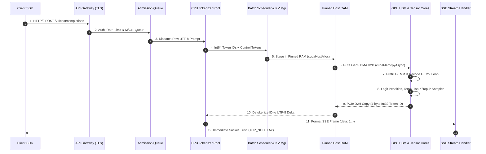
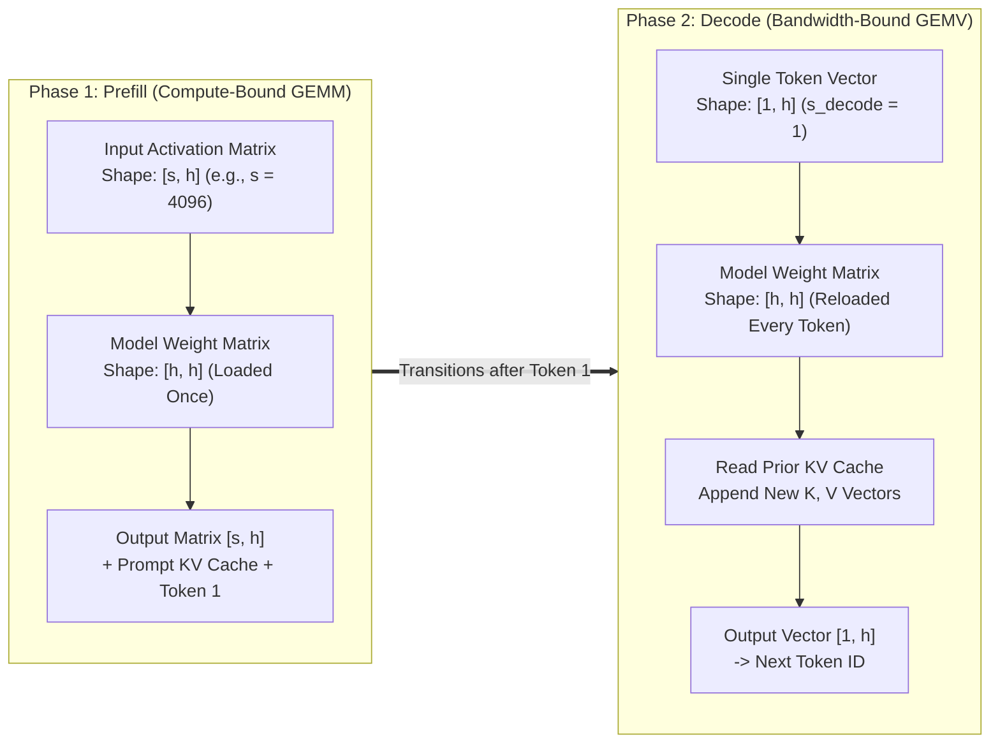

# 15.1 The anatomy of an inference request

| Field | Value |
|---|---|
| Level | Basics |
| Priority tier | 1 |
| Lab venue | GCP / GKE + Local Python Verification Lab |
| Part | Part 15: LLM inference and serving |
| Primary sources | *Hands-On LLM Serving and Optimization* (`hands-on-llm-serving-and-optimization`, Chapters 2, 3, 5, 8); *AI Engineering* (`ai-engineering`, Chapter 9); *Distributed AI Systems* (`distributed-ai-systems`, Chapters 1, 6, 10); *AI Systems Performance Engineering* (`ai-systems-performance-engineering`, Chapters 1, 2, 12, 15); *LLMs in Production* (`llms-in-production`, Chapters 2, 6); NVIDIA Zero-to-Hero Volume 12 (`chapter-01-why-inference-infrastructure-is-different.md`, `chapter-02-the-end-to-end-inference-request-path.md`), Volume 01 (`chapter-04-what-happens-when-chatgpt-answers.md`, `04-nvidia-ecosystem-overview.md`), and Volume 05 (`02-llm-inference-serving-masterclass.md`) |
| Cross-references | Chapter 14.2 (Transformers and LLM architecture); Chapter 14.3 (Training memory and compute anatomy); Chapter 15.2 (Batching, the KV cache and quantization fundamentals); Chapter 15.3 (vLLM in depth); Chapter 15.5 (TensorRT and TensorRT-LLM); Chapter 15.6 (Triton Inference Server) |
| Code | `code/part15/inference_request_anatomy.py`, `code/part15/inference_request_anatomy_lab.py` |
| Coverage file | `planning/coverage/chapters/15-01.md` |
| Claim & number ledger | `planning/ledgers/15-01.md` |

## Why this matters for AI infrastructure

An engineering team finishes training a seventy-billion-parameter language model across sixty-four H100 GPUs. During training, the cluster ran offline batch jobs with predictable tensor shapes, continuous Tensor Core saturation, and static memory allocations. When the same team places that trained model behind an interactive chat API, the infrastructure rules flip overnight.

Live user traffic arrives in unpredictable bursts rather than steady batches. Prompt lengths swing wildly from a ten-token question to a large document paste. Users judge service quality in milliseconds as they wait for the first word and read the streaming reply. Meanwhile, GPU memory consumption grows dynamically with every active conversation and every generated token.

```text
Production Inference Reality Check (Volume 12 Chapters 1-2, AI Engineering Chapter 9, Hands-On LLM Serving Chapter 5):
- Lifetime inference cost share: Inference accounts for up to 90% of deployed machine learning compute costs (Desislavov et al., 2023)
- Input sequence variance: 10-token chat query vs 32,000-token document prompt
- Single-stream 70B FP16 decode ceiling on 1x H100 SXM5 (3.35 TB/s HBM3):
  140 GB model weights / 3,350 GB/s = 41.79 ms (~41.7 ms) per token -> ~24 tokens/sec hardware ceiling
- Llama-3-70B KV cache growth (L=80, N_kv_heads=8, d_head=128, FP16):
  327,680 bytes/token = 1.342 GB (~1.34 GB) per 4,096-token sequence -> 85.76 GB at 64 concurrent sequences
- Non-GPU latency trap (Volume 12 Chapter 2):
  Up to 60% of end-to-end latency occurs outside the GPU; a single-threaded Python tokenizer can consume 320 ms out of 412 ms (77.7%)
```

Treating an inference deployment like a stateless web server or an offline training forward pass causes three classic production failures.
- **Blind latency monitoring:** Monitoring a single average request duration hides the split between prompt processing and token generation. A long-prompt outlier or a prefill stall can freeze active chat streams for four seconds while average metrics look healthy.
- **Unbounded KV cache crashes:** Even when model weights fit comfortably inside GPU memory, concurrent long-context requests expand the Key-Value cache. The allocator runs out of High Bandwidth Memory. Once the first pod crashes with an out-of-memory error, redirected traffic triggers a cascading outage across every surviving replica.
- **Non-GPU bottlenecks starving expensive silicon:** Adding more H100 GPUs will not raise throughput if a Python tokenizer thread pool is locked by the Global Interpreter Lock. Similarly, pageable host memory copies or reverse-proxy socket buffers can stall token delivery while the GPUs sit idle.

**Before you tune a serving engine or buy more GPUs, trace the request across all nine host and device stages and separate compute-bound prefill from bandwidth-bound decode**.

## Prerequisites and outcomes

### Prerequisites
- Transformer decoder layer fundamentals, self-attention projections, and numerical precision formats from Chapters 14.2 and 14.3.
- GPU hardware hierarchy, High Bandwidth Memory, SRAM, PCIe Gen5, and NVLink interconnects from Part 3 and Part 12.
- Basic familiarity with HTTP/2, gRPC, Server-Sent Events, and Linux process and socket metrics.

### Outcomes
After completing this chapter, you will be able to.
1. Contrast offline training infrastructure with online inference serving across arrival distributions, batch dynamics, memory footprints, hardware bottlenecks, and scaling vectors.
2. Decompose an inference request into Time To First Token, Inter-Token Latency, Time Per Output Token, End-to-End latency, Throughput, and Goodput under strict Service Level Objectives.
3. Trace a prompt through all nine stages of the end-to-end request path and eliminate non-GPU bottlenecks in CPU tokenization, pinned DMA transfers, and SSE proxy streaming.
4. Calculate the Arithmetic Intensity of prefill matrix-matrix multiplications versus decode matrix-vector multiplications and locate both phases on the hardware Roofline model.
5. Size per-token and multi-sequence KV cache footprints across Multi-Head and Grouped-Query Attention models and configure PagedAttention, Chunked Prefill, sampling pipelines, and stopping conditions.

---

## 1. Why Inference Infrastructure Is Different from Training

### 1.1 The Paradigm Shift from Offline Batch Learning to Online Interactive Serving

Training a foundation model is an offline throughput problem. A scheduler allocates a fixed pool of GPUs, loads uniform micro-batches from disk, and runs forward and backward passes for days or weeks. Every rank executes the exact same sequence length and batch size on every step. If a node fails, the orchestrator restores the last sharded checkpoint and resumes the run without a customer ever noticing.

Serving that trained model in production is a real-time systems problem. Requests arrive over the public network following bursty Poisson arrival patterns. One user sends an eight-token greeting while the next uploads a thirty-two-thousand-token contract. Users watch tokens stream onto their screens in real time and abandon the application if the response stalls.

| Architectural Dimension | Training Infrastructure | Inference Infrastructure |
|---|---|---|
| Primary Objective | Maximize aggregate training throughput (TFLOPS/sec per dollar) | Meet strict tail-latency SLOs (P90/P99 TTFT and ITL/TPOT) at maximum Goodput |
| Workload Arrival Profile | Offline, scheduled, continuous batch jobs with predictable shapes | Online, bursty, Poisson arrivals with wide input/output length variance |
| Batch Size Dynamics | Large, static micro-batches and global batches (e.g., 512 or 2048 sequences) | Dynamic, iteration-level in-flight batches (`B = 1` to `B = 128+`) |
| GPU Memory Footprint | Static allocation: Weights + Gradients + Optimizer States + Activations | Dynamic allocation: Frozen Weights + Elastic KV Cache + Activation Workspace |
| Primary Hardware Bottleneck | Compute bound (Tensor Cores) and collective interconnect bound (NVLink/IB) | Compute bound during Prefill; HBM Memory-Bandwidth bound during Decode |
| Failure Blast Radius | Job pauses and restarts from last parallel checkpoint | Immediate user-visible HTTP 5xx errors, dropped SSE streams, or cascading OOMs |
| Scaling Mechanism | Tightly coupled 3D/4D parallelism across a fixed gang-scheduled allocation | Horizontal autoscaling of independent model replicas driven by KV cache and queue depth |
| Lifetime Cost Structure | Upfront CapEx / project compute burst | Continuous OpEx scaling with active users (up to 90% of lifetime AI compute spend) |

### 1.2 Deconstructing the Latency Budget: TTFT, ITL, TPOT, and E2E

If you monitor a standard web microservice, a single duration histogram such as http_request_duration_seconds tells you whether the service is fast or slow. If you monitor a Large Language Model with a single duration metric, your dashboards will lie to you. A response that generates five hundred tokens naturally takes much longer than a response that generates ten tokens, even when the GPU is running at peak speed.

Autoregressive language models generate text in two distinct phases. First, the engine ingests the entire user prompt in parallel and emits the first output token. Second, the engine loops one token at a time until the answer finishes. Because these two phases stress different hardware resources and feel different to the human reader, platform engineers decompose request latency into four Service Level Indicators.

1. **Time To First Token, TTFT,:** The elapsed time from when the request arrives at the gateway until the first generated token is emitted to the client. TTFT measures perceived responsiveness. It combines network ingress, admission queueing, CPU tokenization, host-to-device transfer, and the GPU prefill pass.
2. **Inter-Token Latency, ITL,:** The elapsed time between generating consecutive output tokens during the decode loop. ITL governs streaming smoothness. When ITL spikes, the text stream visibly stutters and pauses on the user's screen.
3. **Time Per Output Token, TPOT,:** The average time required to generate each output token after the first token has been emitted. Across a completed response of N_out tokens, TPOT equals the mean of all N_out - 1 inter-token intervals.
4. **End-to-End Request Latency, E2E,:** The total wall-clock duration from request receipt to the final End-of-Sequence token flush.

```text
End-to-End Inference Latency Equations (Volume 12 Chapter 1, AI Engineering Chapter 9):
  TTFT = t_network_ingress + t_queue + t_tokenize + t_h2d + t_prefill
  ITL  = t_decode_step + t_sampler + t_d2h_detok + t_sse_flush
  TPOT = (E2E - TTFT) / (N_out - 1)   (average ITL across generated tokens 2 .. N_out)
  E2E  = t_network_ingress + t_queue + t_tokenize + t_h2d + t_prefill + (N_out - 1) * ITL + t_network_egress
       = TTFT + (N_out - 1) * TPOT + t_network_egress

Worked Baseline Example (50 output tokens, code/part15/inference_request_anatomy.py):
  t_ingress = 2.0 ms, t_queue = 12.0 ms, t_tokenize = 4.0 ms, t_schedule = 0.5 ms, t_h2d = 0.4 ms
  t_prefill_gpu = 180.0 ms, t_sampler = 0.5 ms, t_d2h_detok = 0.5 ms, t_sse_flush = 1.0 ms
  -> TTFT = 2.0 + 12.0 + 4.0 + 0.5 + 0.4 + 180.0 + 0.5 + 0.5 + 1.0 = 200.9 ms
  Per-step Decode ITL = 22.0 ms (GPU decode) + 0.5 ms + 0.5 ms + 1.0 ms = 24.0 ms (TPOT = 24.0 ms)
  -> Total Decode Duration (49 subsequent tokens) = 49 * 24.0 ms = 1,176.0 ms
  -> Total E2E Latency = 200.9 ms + 1,176.0 ms = 1,376.9 ms (~1.38 seconds)
```

Never evaluate TTFT or ITL using simple arithmetic averages. Because prompt lengths and queueing delays follow heavy-tailed distributions, a single outlier skews the mean while hiding the typical user experience. Track the median, p50, alongside the tail percentiles, p90, p95, and p99.

```text
Why Average Latency Misleads (AI Engineering Chapter 9 Outlier Example):
  10 requests with TTFT (ms): [100, 102, 100, 100, 99, 104, 110, 90, 3000, 95]
  - Mean TTFT:   3,900 ms / 10 = 390.0 ms (makes a healthy 100 ms service look nearly 4x slower)
  - Median (p50): 100.0 ms (accurately reflects typical request latency)
  - P90 / P99:   Captures the 3,000 ms long-prompt or network retransmission outlier for targeted triage
```

### 1.3 Throughput (RPS and TPS), Goodput, and Request Cost Economics

While users care about low latency, platform owners must maximize hardware efficiency to keep serving costs sustainable. Engineers track throughput at two levels.
- **Request throughput:** Completed Requests Per Second, RPS, or Requests Per Minute, RPM.
- **Token throughput:** Generated output Tokens Per Second, TPS, across the server, along per-stream `tokens/s/user`. Because prefill and decode have different hardware bottlenecks, always report input token throughput and output token throughput separately.

Pushing batch sizes higher increases total TPS and lowers cost per token, but it also slows down per-user TTFT and TPOT. If an engineer doubles TPS by letting queue wait times climb to five seconds, users leave. To capture usable capacity, production teams measure **Goodput**: the number of completed requests per second, or per minute, that simultaneously satisfy both the TTFT and TPOT Service Level Objectives.

```text
Throughput vs. Goodput and Cost-per-Request Math (AI Engineering Chapter 9):
1. Goodput Under Dual Latency SLOs:
    Target SLOs: TTFT <= 200 ms AND TPOT <= 100 ms
   Raw completed throughput: 100 requests/minute (or 10.0 RPS)
   Requests meeting both SLOs: 30 requests/minute (or 3.0 RPS; 70% violate either TTFT or TPOT)
   -> Effective Goodput = 30 RPM (3.0 RPS, 30.0% SLO attainment)

2. Prefill + Decode Request Cost Decomposition ($2.00/hour GPU instance):
   - Decode cost at 100 output tokens/sec (360,000 tokens/hour):
     Cost per 1M output tokens = ($2.00 / 360,000) * 1,000,000 = $5.556 per 1M output tokens
     Decode cost for 1,000 requests (200 output tokens/req = 200,000 tokens) = $1.11
   - Prefill cost at 100 prefilled requests/minute (6,000 requests/hour):
     Prefill time for 1,000 requests = 10 minutes = (10 / 60) * $2.00 = $0.33
   - Total serving cost per 1,000 requests = $1.11 (decode) + $0.33 (prefill) = $1.44
```

**Size and autoscale every inference fleet on Goodput at P99 TTFT and TPOT rather than raw token throughput**.

---

## 2. The Nine-Stage End-to-End Inference Request Path

### 2.1 Latency Beyond the GPU: Tracing the Data and Control Planes

When an inference API misses its latency targets, teams instinctively blame the GPU kernels. In production clusters, **up to 60 percent of total end-to-end request latency occurs outside the GPU**. Before a single Tensor Core instruction executes, a request crosses TLS termination proxies, rate limiters, admission queues, CPU tokenizer thread pools, memory allocators, and PCIe DMA engines. On the return path, every generated token crosses PCIe back to host RAM, runs through detokenization, and flushes through HTTP chunked socket buffers.



High-throughput serving architectures enforce a strict separation between the **Control Plane** and the **Data Plane**.
- **The Control Plane** runs asynchronously out of band. It handles model repository discovery, readiness probes, `/v2/health/ready`, Prometheus metric scraping, `/metrics`, LoRA adapter registration, and Kubernetes autoscaling signals. A slow metric scrape must never block an active token generation loop.
- **The Data Plane** is lock-free and zero-allocation during steady-state execution. It pre-allocates pinned host memory buffers and CUDA streams at server startup so request handling never stalls on operating system malloc or free locks.

### 2.2 Stage-by-Stage Mechanics, Protocols, and Latency Budgets

Every stage along the nine-stage request path has a specific wire protocol, component owner, failure mode, and latency budget.

| Stage | Protocol / Interface | Payload Transformation | Latency Budget | Primary Bottleneck & Failure Mode |Target Metric Threshold |
|---|---|---|---|---|---|
| 1. Ingress & TLS | HTTP/2 or gRPC over TLS 1.3 | JSON payload over TCP socket | `2 - 10 ms` | TLS handshake CPU / connection pool exhaustion | `99.99%` availability |
| 2. Admission & Queue | Internal channel / M/G/1 queue | Validated `RequestStruct` | `1 - 50 ms` | Unbounded queue buildup during traffic spikes | `inference_queue_depth < 50` |
| 3. CPU Tokenization | Rust `tokenizers` / C++ `tiktoken` | UTF-8 string to `int64` token IDs | `2 - 20 ms` | Single-thread Python GIL CPU saturation | `tokenizer_duration < 5 ms` |
| 4. Iteration Scheduler | Lock-free queue + Block Manager | `SequenceGroup` + KV block table | `< 1 ms` | KV block exhaustion or prefill starving decode | `scheduler_iter < 30 ms` |
| 5. Host-to-Device (H2D) | PCIe Gen5 DMA / NVLink-C2C | Pinned RAM to GPU HBM tensor | `< 0.5 ms` | Pageable memory double-copy staging (`malloc`) | `55 - 62 GB/s` DMA rate |
| 6. GPU Engine Compute | CUDA Streams / Tensor Cores | Prefill GEMM + Decode GEMV | `50-300 ms` TTFT; `15-30 ms` ITL | HBM bandwidth wall or CUDA OOM crash | `kv_cache_usage 70% - 85%` |
| 7. GPU Logit Sampler | On-device CUDA C++ kernels | Logits (`128K` vocab) to `int32` ID | `< 1 ms` | Host-side sampling sync or invalid temperature | `< 1 ms` per step |
| 8. Device-to-Host (D2H) | `cudaMemcpyAsync` + Detokenizer | `4-byte` `int32` ID to UTF-8 string | `< 1 ms` | Blocking `cudaStreamSynchronize` on host thread | `< 1 ms` per token |
| 9. Egress SSE Flush | HTTP/1.1 Chunked SSE (`TCP_NODELAY`) | `data: {"delta": ...}\n\n` frame | `1 - 3 ms` | Nginx `4 KB` proxy buffering or slow client window | `stream_flush < 2 ms` |

### 2.3 Non-GPU Bottlenecks: Tokenizer Placement, Pinned Memory, and Backpressure

Three architectural choices outside the GPU determine whether your H100s run at full capacity or sit starved of work.

1. **Tokenizer placement, Gateway microservice vs. Engine-integrated C++,:** You can tokenize either in an external CPU microservice tier or inside the GPU serving engine. Tokenizing in an external Rust/C++ microservice keeps GPU host CPUs completely free for kernel scheduling and allows independent CPU horizontal scaling, at the cost of sending 8x-wider int64 arrays over the internal network. Tokenizing inside the serving engine sends compact UTF-8 strings over the network with zero extra hop. Requires dedicating multi-core Rust/C++ worker threads on the GPU node and avoiding single-threaded Python AutoTokenizer calls in the request loop.
2. **Pageable host memory, malloc, vs. Pinned page-locked memory, cudaHostAlloc,:** Standard operating system memory is pageable. The GPU DMA engine cannot read pageable RAM directly because the OS might swap the page out mid-transfer. Calling cudaMemcpy on pageable RAM forces the CUDA driver to allocate a temporary page-locked staging buffer and copy the tensor on the CPU first, throttling PCIe Gen5 transfers to `10–14 GB/s`. Allocating input and output staging buffers in pinned memory via cudaHostAlloc or cudaHostRegister lets the PCIe DMA engine read directly from host RAM at `55–62 GB/s`, out of `64 GB/s` unidirectional PCIe Gen5 x16 peak.
3. **Slow-client TCP backpressure propagation:** When a mobile client on a lossy cellular link stops reading its SSE stream, backpressure travels upstream across five layers.
   - **Layer 1, Client TCP Receive Window,:** The client's local OS receive buffer fills and advertises a `TCP Receive Window = 0`.
   - **Layer 2, Gateway Socket Buffer,:** The reverse proxy, Nginx or Envoy, blocks on socket writes to that client connection.
   - **Layer 3, API Server Outbound Queue,:** The endpoint handler's per-request asyncio.Queue or Go channel hits its high-water mark.
   - **Layer 4, Scheduler Emission Halt,:** The continuous batch scheduler cannot push newly generated tokens for that sequence group and pauses its decode slot.
   - **Layer 5, GPU KV Cache Eviction,:** If the client remains stalled. New requests arrive, the block manager preempts or aborts the stalled sequence, engine.abort, request_id, so a dead TCP socket cannot pin gigabytes of GPU HBM.

```text
Non-GPU Latency & Bandwidth Reference Numbers (Volume 12 Chapter 2):
- Pageable Host RAM (default malloc) H2D transfer: 10 - 14 GB/s (requires CPU double-copy staging)
- Pinned Page-Locked Host RAM (cudaHostAlloc) H2D: 55 - 62 GB/s on PCIe Gen5 x16 (64 GB/s theoretical unidirectional, 128 GB/s bidirectional)
- Python GIL Tokenizer Bottleneck Trace (412 ms total span):
  Gateway HTTP parse = 2.0 ms | CPU Tokenize (HuggingFace Python) = 320.0 ms (77.7% of total!)
  H2D Copy = 0.4 ms | GPU Inference = 88.0 ms | SSE Serialization = 1.6 ms
  Cluster capped at 120 RPS and 22% GPU utilization across 8x H100 GPUs
- After deploying 16-thread Rust Tokenizer (TOKENIZER_WORKER_THREADS=16):
  Tokenization drops from 320.0 ms -> 1.4 ms (228.6x faster); GPU util rises 22% -> 88%; throughput jumps 120 RPS -> 780 RPS (6.5x)
```

**Always use multi-threaded Rust or C++ tokenizers, stage tensors in pinned host memory, and disable reverse-proxy response buffering on streaming endpoints**.

---

## 3. Prefill vs. Decode Mechanics, Arithmetic Intensity, and the Roofline Model

### 3.1 Inside a Decoder-Only Forward Pass: Why Prefill Is GEMM and Decode Is GEMV

A decoder-only Transformer model consists of three structural stages: an input embedding table, a stack of L identical decoder layers, and an output Language Modeling, LM, head. Each decoder layer contains a pre-attention RMSNorm, a Multi-Head or Grouped-Query Self-Attention block, q_proj, k_proj, v_proj, o_proj, a post-attention RMSNorm, and a SwiGLU Feed-Forward Network, gate_proj, up_proj, down_proj.

```text
Concrete Decoder Architecture Reference: Qwen/Qwen2.5-0.5B (Hands-On LLM Serving Chapter 2):
- hidden_size (d_model): 896 | num_hidden_layers (L): 24 | num_attention_heads: 14 | intermediate_size: 4,864
- vocab_size: 151,936 | max_position_embeddings: 32,768 | total parameters: 494,032,768 (~0.49B)
- Decoder layer modules: self_attn (q_proj, k_proj, v_proj, o_proj) + mlp (gate_proj, up_proj, down_proj, SiLU) + Qwen2RMSNorm
```

Although both phases run the exact same model weights through the exact same layers, **Prefill** and **Decode** execute fundamentally different linear algebra operations.
1. **The Prefill Phase, Prompt Ingestion — Iteration 0,:** When a user submits a prompt of s tokens, for example, `s = 2,048` tokens, all s tokens are already known. For a single request, `B = 1`, the input activation tensor to every linear projection has shape [s, h], where h is the hidden dimension. Multiplying an [s, h] activation matrix by an [h, h] weight matrix is a dense **General Matrix-Matrix Multiplication, GEMM,**. The GPU loads each weight matrix from off-chip HBM into fast on-chip SRAM once and reuses those weights across all s prompt tokens in parallel, saturating the Tensor Cores.
2. **The Decode Phase, Autoregressive Generation — Iterations 1 .. N,:** Because generation is autoregressive, token i + 1 depends on token i. During each decode step of a single request, `B = 1`, only **one new token**, `s_decode = 1`, enters the model. The activation tensor shrinks to a single row vector of shape [1, h]. Multiplying a [1, h] vector by an [h, h] weight matrix is a **General Matrix-Vector Multiplication, GEMV,**. To compute just one token, the GPU must stream 100 percent of the model weights from HBM into SRAM, perform a tiny vector dot product. Discard the weights before the next layer.



### 3.2 Deriving Arithmetic Intensity and the Hardware Roofline Ridge Point

To determine mathematically whether a phase is bottlenecked by compute FLOPS or memory bandwidth, we compute two ratios.
- **Hardware Ridge Point, I_ridge,:** The ratio of a GPU's peak Tensor Core throughput, in FLOPs/second, to its peak HBM bandwidth, in Bytes/second. A workload must perform at least I_ridge floating-point operations for every byte moved from HBM to reach peak compute throughput.
- **Algorithmic Arithmetic Intensity, I,:** The ratio of floating-point operations executed by a kernel to the total bytes read from and written to HBM, `I = FLOPs / Bytes`.

Consider multiplying an FP16 input matrix [M, K] by an FP16 weight matrix [K, N] to produce an FP16 output matrix [M, N]. Each of the M * N output elements computes a dot product of length K, K multiplications and K additions = 2 * K FLOPs. Each FP16 element occupies 2 bytes.

```text
GEMM Arithmetic Intensity & Roofline Equations (Hands-On LLM Serving Chapter 5, Volume 12 Chapter 1):
  Total FLOPs         = 2 * M * N * K
  Total HBM Bytes     = 2 * (M * K + K * N + M * N)     (for 2-byte FP16/BF16 elements)
  Arithmetic Intensity I = (2 * M * N * K) / (2 * (M * K + K * N + M * N))
                         = (M * N * K) / (M * K + K * N + M * N)   [FLOPs / Byte]

  For an LLM linear projection with K = N = h (hidden dimension) and M = s (tokens processed):
  I(s, h) = (s * h * h) / (s * h + h * h + s * h) = (s * h) / (2 * s + h)

Hardware Ridge Point Examples:
  - NVIDIA L40S (FP16):     362.05 TFLOPS / 864 GB/s   = 419.04 FLOPs/Byte (~419 FLOPs/Byte)
  - NVIDIA H100 SXM5 Dense: 989.0  TFLOPS / 3,350 GB/s = 295.22 FLOPs/Byte (~295 FLOPs/Byte)
  - NVIDIA H100 SXM5 Sparse:1979.0 TFLOPS / 3,350 GB/s = 590.75 FLOPs/Byte (~591 FLOPs/Byte)
  - NVIDIA H200 SXM Dense:  989.0  TFLOPS / 4,800 GB/s = 206.04 FLOPs/Byte (412.29 sparse)
  - NVIDIA B200 Dense:      2250.0 TFLOPS / 8,000 GB/s = 281.25 FLOPs/Byte
```

Plugging concrete matrix sizes into this formula reveals why Prefill crosses into the compute-bound regime while single-request Decode is trapped at `1.0 FLOP/Byte`.

| Workload Case (`FP16`, `2 bytes/elem`) | `M` (Tokens) | `K` (`d_in`) | `N` (`d_out`) | Arithmetic Intensity (`FLOPs/Byte`) | Regime on L40S (`419` Ridge) & H100 (`295` Dense Ridge) |
|---|---|---|---|---|---|
| Square GEMM Small (`HLS` Table 5-9) | `64` | `64` | `64` | `21.33` (`~21`) | Memory-bandwidth bound |
| Square GEMM Medium (`HLS` Table 5-9) | `512` | `512` | `512` | `170.67` (`~170`) | Memory-bandwidth bound |
| Square GEMM Large (`HLS` Table 5-9) | `4096` | `4096` | `4096` | `1,365.33` (`~1365`) | Compute bound (saturates Tensor Cores) |
| LLM Prefill Short Prompt (`h = 4096`, `B = 1`) | `64` | `4096` | `4096` | `62.06` | Memory-bandwidth bound (prompt too short to amortize weights) |
| LLM Prefill Medium Prompt (`h = 4096`, `B = 1`) | `512` | `4096` | `4096` | `409.60` | Compute bound on H100 dense (`> 295`); borderline on L40S (`419`) |
| LLM Prefill Long Prompt (`h = 4096`, `B = 1`) | `4096` | `4096` | `4096` | `1,365.33` | Heavily compute bound on all GPUs (`I >> I_ridge`) |
| LLM Decode Single Stream (`h = 4096`, `B = 1`) | `1` | `4096` | `4096` | `1.00` (`4096 / 4098 = 0.9995`) | Severely memory-bandwidth bound (`~300x-400x` below ridge point) |
| LLM Decode Batched (`h = 4096`, `B = 64`) | `64` | `4096` | `4096` | `62.06` | Arithmetic intensity rises `~62x` by sharing weight loads across `64` requests |

### 3.3 The Memory-Bandwidth Wall, MFU vs. MBU, and Accelerator Selection

Because single-stream decode has an arithmetic intensity of roughly `1.0 FLOP/Byte`, the GPU's Tensor Cores sit idle more than 95 percent of the time waiting for weights to arrive from HBM. Yet nvidia-smi still reports 100% GPU utilization because at least one CUDA kernel is active on the Streaming Multiprocessors while stalled on memory loads.

To measure true hardware efficiency during inference, engineers track **Model FLOP/s Utilization, MFU,** during compute-bound prefill and **Model Bandwidth Utilization, MBU,** during bandwidth-bound decode.

```text
Decode Memory-Bandwidth Wall & MBU Equations (Volume 12 Chapter 1, AI Engineering Chapter 9, Hands-On LLM Serving Chapter 5):
1. Storage & Memory Bandwidth Hierarchy (Table 5-5):
   - NVMe SSD Bandwidth:         0.5 to 14 GB/s
   - Host CPU DRAM Bandwidth:   50 to 200 GB/s
   - GPU HBM Bandwidth:        300 GB/s to 8,000 GB/s (0.3 TB/s to 8.0 TB/s)

2. Theoretical Single-Stream (B = 1) Decode Ceiling for Llama-3-70B FP16 (140 GB weights):
   t_min_decode = Model_Weight_Bytes / Peak_HBM_Bandwidth
   - On 1x H100 SXM5 (3,350 GB/s): 140 GB / 3,350 GB/s = 41.79 ms (~41.7 ms) -> 23.93 tokens/sec (~24 tok/s) ceiling
   - On 1x H200 SXM  (4,800 GB/s): 140 GB / 4,800 GB/s = 29.17 ms            -> 34.29 tokens/sec ceiling
   - On 1x B200      (8,000 GB/s): 140 GB / 8,000 GB/s = 17.50 ms            -> 57.14 tokens/sec ceiling

3. Model Bandwidth Utilization (MBU):
   Bandwidth_Used (GB/s) = Parameter_Count * Bytes_per_Parameter * Observed_Tokens_per_Sec
   MBU (%)               = Bandwidth_Used / Theoretical_Peak_HBM_Bandwidth
   - Worked Example (7B model on A100 80GB with 2.0 TB/s = 2,000 GB/s peak bandwidth):
     At 50 tok/s in FP16 (14 GB weights) or 100 tok/s in INT8/FP8 (7 GB weights):
     Bandwidth_Used = 700 GB/s -> MBU = 700 GB/s / 2,000 GB/s = 35.0% (or 70.0% at 1,400 GB/s)
```

| GPU Accelerator | Memory Capacity & Type | Memory Bandwidth | FP16 / BF16 Tensor Core TFLOPS (Dense / Sparse) | FP8 Support | Intra-Node Interconnect | Primary Inference Sweet Spot |
|---|---|---|---|---|---|---|
| NVIDIA A10 | `24 GB` GDDR6 | `0.60 TB/s` (`600 GB/s`) | `125 TFLOPS` | No | PCIe Gen4 (`64 GB/s`) | Small `7B-8B` models at low concurrency (`max batch ~ 4` at `4K` seq) |
| NVIDIA L40S | `48 GB` GDDR6 | `0.864 TB/s` (`864 GB/s`) | `362.05 TFLOPS` | Yes (`733 TFLOPS`) | PCIe Gen4 (`64 GB/s`, no NVLink) | Single-GPU `7B-14B` FP8/FP16 serving (`max batch ~ 16` for `7B` at `4K` seq) |
| NVIDIA A100 SXM4 | `40 / 80 GB` HBM2e | `1.935 - 2.0 TB/s` | `312 TFLOPS` | No (`7` MIG slices) | NVLink 3 (`600 GB/s`) | Baseline multi-GPU FP16/INT8 serving |
| NVIDIA H100 PCIe | `80 GB` HBM2e | `2.0 TB/s` | `756 / 1,513 TFLOPS` | Yes | PCIe Gen5 (`128 GB/s` bidir) | Independent single-GPU replicas not requiring heavy TP AllReduce |
| NVIDIA H100 NVL | `94 GB` HBM3 | `3.9 TB/s` | `835 / 1,671 TFLOPS` | Yes (`3,341 TFLOPS`) | Dual-GPU NVLink Bridge (`600 GB/s`) | `TP = 2` `70B` serving (`188 GB` combined HBM3 at `3.9 TB/s` per GPU) |
| NVIDIA H100 SXM5 | `80 GB` HBM3 | `3.35 TB/s` | `989 / 1,979 TFLOPS` | Yes (`3,958 TFLOPS`) | NVLink 4 (`900 GB/s` across `8` GPUs) | High-concurrency `TP = 4` or `TP = 8` `70B+` serving |
| NVIDIA H200 SXM | `141 GB` HBM3e | `4.8 TB/s` | `989 / 1,979 TFLOPS` | Yes (`3,958 TFLOPS`) | NVLink 4 (`900 GB/s` across `8` GPUs) | Long-context & high-batch decode (`1.76x` HBM capacity, `1.43x` bandwidth vs H100) |
| NVIDIA B200 / GB200 NVL72 | `192 GB` HBM3e | `8.0 TB/s` | `2,250 / 4,500 TFLOPS` | Yes + FP4 | NVLink 5 (`1.8 TB/s`/GPU; `130 TB/s` across `72` GPUs) | Frontier MoE (`671B` DeepSeek-R1) and disaggregated rack-scale decode |

**Match your hardware and optimization strategy to the active phase: reduce FLOPs or disaggregate prefill when TTFT is compute-bound, and quantize weights or batch requests when TPOT is memory-bandwidth-bound**.

---

## 4. KV Cache Memory Anatomy, Continuous Batching, and Chunked Prefill

### 4.1 Why the KV Cache Exists and How It Grows Linearly with Context and Concurrency

In self-attention, every new token queries the Key and Value projections of all preceding tokens in the sequence. If the engine recomputed the Key and Value tensors for the entire history at every decode step, generating N tokens would require O, N^2, redundant matrix multiplications per token. Instead, serving engines store the Key and Value vectors computed during prefill and append one new Key-Value pair per layer at each decode step, `use_cache=True`, passing past_key_values.

```text
Empirical Impact of KV Caching and vLLM Batching (Hands-On LLM Serving Chapter 2, Qwen/Qwen2.5-0.5B):
- 100-token generation WITHOUT KV cache (full sequence recomputed every step): 9.1205 seconds (~0.09 s/token, growing per step)
- 100-token generation WITH KV cache (past_key_values reused):                 3.1416 seconds (2.90x speedup, flat decode step time)
- Hugging Face pipeline.generate() vs vLLM engine on single prompt:           19.58 seconds vs 1.12 seconds (17.48x / ~17x speedup)
- vLLM processing 4 prompts sequentially vs batched together:                  2.3865 seconds vs 1.0626 seconds (2.2x throughput gain; up to 23x with continuous batching)
```

While the KV cache rescues decode compute, it turns GPU memory into an elastic bottleneck. For a model with L layers, N_heads_kv Key-Value heads per layer, head dimension `H = d_head`, sequence length P_seq, batch size B. S_precision bytes per element, 2 bytes for FP16/BF16, 1 byte for FP8/INT8, the KV cache footprint is.

```text
KV Cache Memory Sizing Equations & Worked Production Examples (Volume 12 Chapter 1, Volume 05 Chapter 2, Hands-On LLM Serving Chapter 5):
  M_KV_per_token = 2 (Key + Value) * L * N_heads_kv * d_head * S_precision
  M_KV_per_seq   = M_KV_per_token * P_seq
  M_KV_total     = M_KV_per_seq * B

1. Llama-3-70B / Llama-2-70B with Grouped-Query Attention (GQA: L=80, N_heads_kv=8, d_head=128, FP16=2 bytes):
   - Per token:    2 * 80 * 8 * 128 * 2 = 327,680 bytes/token (327.68 KB decimal / ~0.31 MiB binary)
   - Per 4K seq:   327,680 * 4,096 = 1,342,177,280 bytes = 1.342 GB (~1.34 GB decimal / 1.25 GiB binary)
   - At B = 64 concurrent 4K requests:  64 * 1.34 GB = 85.76 GB (85.90 GB exact) -> exceeds a single 80 GB GPU!
   - At B = 100 concurrent 4K requests: 100 * 1.342 GB = 134.2 GB KV cache
     Total VRAM = 140 GB (FP16 weights) + 134.2 GB (KV cache) + 10 GB (activation workspace) = 284.2 GB
     -> Requires minimum 4x 80 GB NVIDIA H100 GPUs (320 GB total VRAM) with Tensor Parallelism TP = 4
   - Without GQA (Multi-Head Attention MHA with N_heads_kv=64, d_model=8192):
     2 * 80 * 64 * 128 * 2 = 2,621,440 bytes/token (~2.6 MB/token, 8x larger!)
     At B = 128 and P_seq = 2,048: ~687 GB with MHA vs ~86 GB with GQA

2. Llama-2-7B with Multi-Head Attention (MHA: L=32, N_heads_kv=32, d_head=128, FP16=2 bytes, Hands-On LLM Serving Table 5-7):
   - Model weights: 7B * 2 bytes = 14.0 GB
   - Per token:     2 * 32 * 32 * 128 * 2 = 524,288 bytes/token = 0.5 MiB/token
   - At B = 16 and P_seq = 4,096: 0.5 MiB * 4,096 * 16 = 32.0 GB KV cache (2.29x larger than the 14 GB model weights!)
   - Hardware batch limit at 4,096 tokens:
     * NVIDIA A10 (24 GB VRAM, ~10 GB free after 14 GB weights):  max ~4 concurrent requests (10 * 1024 / (0.5 * 4096) = 5 theoretical, 4 with activations)
     * NVIDIA L40S (48 GB VRAM, ~34 GB free after 14 GB weights): max ~16 concurrent requests (34 * 1024 / (0.5 * 4096) = 17 theoretical, 16 with activations)
```

### 4.2 PagedAttention, Continuous Batching, and Chunked Prefill Guardrails

Early serving engines allocated a single contiguous slab of GPU HBM sized for max_seq_len whenever a request started. Because nobody knows in advance whether a prompt will generate twenty tokens or two thousand tokens. Contiguous reservation wasted 60% to 80% of KV cache memory to internal over-reservation and external heap fragmentation, stranding usable KV capacity at 20% to 40%.

Modern inference engines combine three scheduling mechanisms to eliminate memory waste and tail-latency stalls, covered in depth in Chapters 15.2 and 15.3,.
1. **PagedAttention:** Partitions the KV cache into fixed-size virtual memory blocks holding 16 or 32 tokens each, block_size: 16. A block table maps logical sequence positions to non-contiguous physical HBM blocks on demand, eliminating external fragmentation, capping internal waste to the final block. Raising serving throughput by 2x to 4x.
2. **Continuous In-Flight Batching:** Instead of waiting for every sequence in a static batch to finish before starting new work, the scheduler evaluates the running batch at every single token iteration. Completed sequences exit the batch immediately, and waiting requests enter on the very next forward pass.
3. **Chunked Prefill:** Mixing a massive new prompt, such as 16,000 or 32,000 tokens, into an active decode batch creates a severe head-of-line stall. The prefill GEMM monopolizes Tensor Cores for 350+ ms, pausing token generation for every active streaming user. Enabling **Chunked Prefill**, `--enable-chunked-prefill --max-num-batched-tokens 512`, splits long prompts into 512-token chunks and piggybacks active decode tokens into each iteration, keeping P99 ITL flat around 22.8 ms instead of spiking to 4,500 ms.

| Operating Capacity Zone | KV Cache Block Utilization | Queue Depth & Wait Time | P99 Inter-Token Latency | Automated Cluster Action |
|---|---|---|---|---|
| Safe Operating Zone (`0% - 80%`) | `< 80%` | `queue_depth < 50`, wait `< 20 ms` | `< 25 ms` | Normal continuous batching and in-flight admission |
| Warning Zone (`80% - 90%`) | `80% - 90%` | Rising queue depth | `25 - 35 ms` | Trigger Kubernetes HPA scale-out and token-bucket rate throttling |
| Emergency Zone (`> 90%`) | `> 90%` | Saturated admission queue | `> 35 ms` (preemption risk) | Shed excess load with `HTTP 429` and swap/recompute lowest-priority KV blocks |

**Cap engine memory allocation at gpu_memory_utilization: 0.85, trigger horizontal autoscaling when KV cache utilization crosses 80 percent, and enable Chunked Prefill to protect decode streams**.

---

## 5. Tokenization, Logit Sampling, Stopping Conditions, and Ecosystem Stack

### 5.1 Tokenization, Vocabulary Logits, and the GPU Sampling Pipeline

Every inference request begins and ends with vocabulary translation. During Stage 3, a Byte-Pair Encoding, BPE, tokenizer such as tiktoken or Hugging Face's Rust tokenizers splits raw UTF-8 strings into subword units and maps them to integer IDs. In English prose, one token corresponds on average to roughly 0.75 words.

```text
Tokenization, Logit Projection, and GPU Sampling Math (Hands-On LLM Serving Chapter 2, Volume 12 Chapter 2):
1. Concrete Tokenization Example:
   Input text: "Write a short introduction about the US capital city"
   11 Token IDs: [1100, 10930, 261, 4022, 22575, 1078, 290, 2952, 9029, 5030, 693]

2. Language Modeling (LM) Head & GPU Sampling Pipeline (Stage 7):
   - Final decoder hidden state for the last token has shape [B, 1, d_model]
   - LM Head multiplies [B, 1, d_model] by unembedding matrix [d_model, V_vocab] (e.g., V_vocab = 128,256 on Llama-3 or 151,936 on Qwen2.5)
     to produce raw unnormalized logit vector z = (z_1, z_2, ..., z_V)
   - Step A (Repetition / Frequency / Presence Penalties):
     Penalize tokens already present in prompt/output history (e.g., divide positive logit by repetition_penalty = 1.1)
   - Step B (Temperature Scaling & Softmax):
     p_i = exp(z_i / T) / sum_j exp(z_j / T)
     * T = 0.0 -> Greedy ArgMax (deterministic selection of highest logit)
     * 0 < T < 1.0 (e.g., T = 0.7) -> sharpens distribution toward high-probability tokens
     * T > 1.0 -> flattens distribution for higher randomness
   - Step C (Top-K Filtering, e.g., top_k = 50):
     Retain only the K highest-probability tokens; zero out the remaining V_vocab - K tokens
   - Step D (Top-P / Nucleus Filtering, e.g., top_p = 0.90 or 0.95):
     Sort tokens by descending probability and keep the smallest prefix subset whose cumulative probability >= top_p
   - Step E (Renormalization & Multinomial Draw):
     Renormalize surviving probabilities to sum to 1.0 and draw 1 token ID (int32) on the GPU
```

| Sampling / Stopping Parameter | Typical Production Value | Mathematical Role in Stage 7 / Stage 8 |
|---|---|---|
| `temperature` | `0.0` (code/math) to `0.7-0.8` (chat) | Scales raw logits `z_i / T` before Softmax; `0.0` selects greedy `argmax` |
| `top_p` (Nucleus) | `0.90` to `0.95` | Keeps smallest sorted token set with cumulative probability `>= top_p` |
| `top_k` | `50` (or `-1` disabled) | Hard-truncates candidate pool to the top `K` highest-logit vocabulary items |
| `repetition_penalty` / `frequency_penalty` | `1.1` / `0.1` | Penalizes already-generated token IDs to prevent degenerate repetition loops |
| `max_tokens` (`max_new_tokens`) | `100` to `1024` | Hard upper bound on decode iterations for a single request |
| `stop` / `eos_token_id` | `["\n", "###"]` / `<\|eot_id\|>` | Halts decode immediately when an End-of-Sequence ID or stop string is emitted |

### 5.2 The Five Stopping Conditions and the NVIDIA Serving Stack

After each decode step samples a new int32 token ID and copies those four bytes to pinned host memory, the iteration scheduler checks five stopping conditions before scheduling the next pass.
1. **End-of-Sequence, eos_token_id, match:** The sampled token ID matches the model's EOS token, such as `&lt;|eot_id|>` or `&lt;|end_of_text|>`.
2. **Stop string, stop, match:** The detokenized suffix matches a caller-supplied stop sequence such as "\n" or "###".
3. **Maximum output token limit, max_tokens,:** The number of generated tokens reaches the request's max_tokens, request_output_len, budget.
4. **Model context ceiling, max_model_len,:** Total sequence length, Prompt + Output, reaches the engine's compiled max_seq_len or max_model_len boundary.
5. **Client stream abort, engine.abort, request_id,:** The client disconnects or cancels the HTTP/SSE stream, allowing the engine to free all PagedAttention KV blocks immediately.

In production, these request lifecycle stages map onto the full NVIDIA inference software hierarchy, detailed across Chapters 15.3 through 15.7,.
- **vLLM:** Open-source serving engine pioneering PagedAttention, continuous batching, chunked prefill, and multi-LoRA paging, `Activation = (Base_Weights * Input) + (LoRA_B_X * (LoRA_A_X * Input))`, behind an OpenAI-compatible server.
- **TensorRT-LLM, convert_checkpoint.py and trtllm-build,:** Ahead-of-time C++/CUDA compiler that fuses attention and GEMM layers, applies FP8/INT4 quantization, captures CUDA Graphs across batch-size buckets to eliminate CPU kernel-launch overhead, and enables paged context FMHA, `--use_paged_context_fmha enable`.
- **Triton Inference Server, config.pbtxt,:** Enterprise HTTP/gRPC serving orchestrator that wraps the tensorrtllm or vllm backend with decoupled: True streaming transaction policies, max_tokens_in_paged_kv_cache, and kv_cache_free_gpu_mem_fraction: "0.9".
- **NVIDIA NIM, Inference Microservices,:** Pre-packaged OCI containers combining Triton, pre-compiled TensorRT-LLM engines, and OpenAI REST endpoints for drop-in Kubernetes deployment.

**Execute logit penalties and Top-K/Top-P sampling directly on the GPU so only a single four-byte token ID crosses PCIe per decode step. Abort disconnected streams immediately to reclaim KV cache blocks**.

---

## 6. Commands, Configurations, and Production Failure Modes

### 6.1 Production Engine, Triton, and Nginx Streaming Configurations

Below are the production configurations for launching vLLM with Chunked Prefill and PagedAttention memory caps, compiling and hosting a TensorRT-LLM engine inside Triton Inference Server, and configuring Nginx for zero-buffering SSE token streaming.

```bash
# 1. Launch vLLM OpenAI-compatible server with Chunked Prefill and strict KV memory bounds
python3 -m vllm.entrypoints.openai.api_server \
  --model /models/llama3-70b-instruct \
  --tensor-parallel-size 4 \
  --gpu-memory-utilization 0.85 \
  --max-model-len 8192 \
  --max-num-seqs 64 \
  --enable-chunked-prefill \
  --max-num-batched-tokens 512 \
  --swap-space 16

# 2. Convert Hugging Face checkpoint and compile TensorRT-LLM engine (TP=2, BF16, Paged Context FMHA)
python3 TensorRT-LLM/examples/llama/convert_checkpoint.py \
  --model_dir /models/Meta-Llama-3-8B-Instruct \
  --output_dir /models/trt-engines/llama-3-8b/trt_ckpt \
  --dtype bfloat16 \
  --tp_size 2 \
  --pp_size 1

trtllm-build \
  --checkpoint_dir /models/trt-engines/llama-3-8b/trt_ckpt \
  --output_dir /models/trt-engines/llama-3-8b/engine \
  --gemm_plugin bfloat16 \
  --use_paged_context_fmha enable \
  --max_batch_size 128 \
  --max_input_len 4096 \
  --max_seq_len 8192 \
  --max_num_tokens 8192
```

```nginx
# 3. Nginx Reverse Proxy Configuration for Per-Token SSE Streaming (Volume 12 Chapter 2)
location /v1/chat/completions {
    proxy_pass http://triton_backend_cluster;
    proxy_buffering off;               # Mandatory: prevent 4 KB / 600 ms SSE chunk stalls
    proxy_cache off;
    chunked_transfer_encoding on;
    proxy_http_version 1.1;
    proxy_set_header Connection "";
    tcp_nodelay on;                    # Disable Nagle's algorithm for immediate token frame flush
    proxy_read_timeout 3600s;
    proxy_send_timeout 3600s;
}
```

### 6.2 How It Fails: Five Production Inference Failure Modes

| Failure Mode | Observable Symptom & Telemetry Evidence | Root Cause Along the 9-Stage Path | Diagnostic Commands | Production Remediation |
|---|---|---|---|---|
| 1. Cascading CUDA OOM Under Concurrency Spike | Pods crash within `60-90s` of a `3x` traffic surge; log shows `RuntimeError: CUDA error: out of memory` with `Total=81187MB, Used=80912MB, Free=275MB` (`4.2 GB` KV alloc failed with `0.8 GB` free) | Unbounded KV cache growth or `32K`-token prefill workspace spike exceeding the `10%` free HBM margin without admission gating | `curl -s http://localhost:8002/metrics \| grep -E "(kv_cache_usage\|gpu_memory_used)"` and `dmesg -T \| tail -10` | Set `gpu_memory_utilization: 0.85` (`kv_cache_free_gpu_mem_fraction: 0.85`), cap `max_num_seqs: 64`, enable `swap_space: 16`, and reject excess load with `HTTP 429` at `> 85%` KV usage |
| 2. P99 ITL Stalls (`4,500 ms`) from Prefill Starving Decode | Mean TTFT is `~300 ms`, but streaming chat pauses for `4-5 seconds`; trace shows `3,850 ms` decode stall (`380 ms` gaps) inside a `4,820 ms` span when `16K` prompts arrive | A `16,000`-token prompt prefill runs monolithic GEMM kernels that monopolize `100%` of Tensor Cores for `350+ ms`, locking out `32` active decode streams | `curl -s http://localhost:8002/metrics \| grep "vllm:inter_token_latency_seconds"` | Enable Chunked Prefill (`--enable-chunked-prefill --max-num-batched-tokens 512` or `enable_chunked_context: true`), dropping P99 ITL from `4,500 ms` to `22.8 ms` (`mean TTFT = 210.4 ms`) |
| 3. Host CPU Tokenizer GIL Starving H100 GPUs | Adding `4` H100 GPUs leaves throughput flat at `120 RPS`; GPU util drops from `80%` to `22%`; `uvicorn` worker hits `798.2%` CPU; trace shows `320 ms` (`77.7%`) in CPU tokenize vs `88 ms` GPU | Single-threaded Python `AutoTokenizer` / `tiktoken._linear_merge` (`68%` CPU cycles) locked by the Python GIL cannot feed integer tensors fast enough | `kubectl top pod`, `perf top -p $(pgrep -f "uvicorn")`, and `ps aux \| grep tokenizer` | Offload tokenization to a multi-threaded Rust/C++ microservice (`TOKENIZER_WORKER_THREADS=16`); tokenization drops `320 ms -> 1.4 ms`, GPU util rises to `88%`, and RPS jumps `120 -> 780 RPS` |
| 4. Nginx `4 KB` Socket Buffering Freezing SSE Streams | UI freezes for `1-2 seconds` then dumps `40` tokens at once; `tcpdump` shows a `600 ms` gap followed by a `4,090-byte` (`~4 KB`) TCP payload flush | Nginx `proxy_buffering on` (default) buffers `20 ms` SSE chunks in OS socket RAM until `4 KB` accumulates before flushing to the client | `curl -N -v https://api.example.com/v1/chat/completions` and `sudo tcpdump -i eth0 -nn -tt 'tcp port 443'` | Set `proxy_buffering off;`, `tcp_nodelay on;`, and `X-Accel-Buffering: no` response header so every token flushes at steady `20 ms` intervals |
| 5. KV Cache Preemption & PCIe Swapping Thrash | Multi-second generation latency spikes accompanied by PCIe bus saturation alerts and rising `vllm:num_preemptions_total` counters | Scheduler over-admits sequences, runs out of HBM KV blocks, and continuously swaps KV pages over PCIe to host DRAM (or drops and recomputes prompts) | `curl -s http://localhost:8002/metrics \| grep num_preemptions_total` and `nvidia-smi dmon -s gm -c 5` | Lower `max_num_seqs` (e.g., `64 -> 48`), autoscale horizontally on `kv_cache_usage_percent > 80%`, or use `GH200` NVLink-C2C (`900 GB/s`, `7x` PCIe Gen5) for high-speed host memory paging |

---

## 7. Hands-on Lab: Verifying Request Anatomy, Roofline Math, and KV Cache Sizing

### Lab Venue and Execution Scope
- **Target venue:** GCP / GKE GPU cluster or any local workstation with Python 3.10+.
- **Execution status:** The live multi-GPU H100/L40S vllm, trtllm-build, tritonserver. Perf_analyzer cluster commands in Section 6.1 are reference production configurations from the cited sources and have not been executed on live GPU hardware in this local build environment, untested on live hardware. The deterministic mathematical verification model in `code/part15/inference_request_anatomy.py` and self-checking test suite in `code/part15/inference_request_anatomy_lab.py` are fully executed and verified locally below.

### Running the Self-Checking Verification Lab

Run the chapter lab script to verify all twenty-six quantitative claims, latency decompositions, Goodput and cost formulas, Roofline ridge points, GEMM vs. GEMV arithmetic intensities, KV cache sizing models, and GPU logit sampling pipelines.

```bash
python3 -B code/part15/inference_request_anatomy_lab.py
```

Expected output, 26 passed, 0 failed,.

```text
=== Chapter 15.1 Lab: The Anatomy of an Inference Request Verification ===
  [PASS] 1. Baseline 50-token request decomposes into TTFT=200.9 ms, ITL/TPOT=24.0 ms, and E2E=1,376.9 ms
  [PASS] 2. Python GIL tokenizer trace (320 ms CPU tokenize, 88 ms GPU, 412 ms total) spends 78.64% non-GPU (77.67% on CPU tokenization alone)
  [PASS] 3. 16-thread Rust/C++ tokenizer cuts tokenization from 320.0 ms to 1.4 ms (228.6x faster), dropping total span from 412.0 ms to 93.4 ms and lifting cluster throughput 6.5x (120 -> 780 RPS)
  [PASS] 4. Pinned host RAM (55-62 GB/s on 64 GB/s PCIe Gen5) transfers 4.4x-5.5x faster than pageable malloc (10-14 GB/s)
  [PASS] 5. Single 3,000 ms TTFT outlier among 10 requests skews mean TTFT to 390.0 ms while median (p50) remains 100.0 ms (AIE Ch. 9)
  [PASS] 6. At 10 RPS raw throughput (100 RPM scaled), if only 30% satisfy TTFT <= 200 ms and TPOT <= 100 ms, Goodput is 3.0 RPS (30 RPM at 100 RPM)
  [PASS] 7. At $2.00/hr GPU cost and 100 tok/s decode, output costs $5.556/1M tokens ($1.11/1K requests of 200 tokens) + $0.33 prefill (100 RPM) = $1.44 per 1K requests
  [PASS] 8. NVIDIA L40S (362.05 FP16 TFLOPS, 864 GB/s GDDR6) has a Roofline ridge point of 419.04 FLOPs/Byte (~419 FLOPs/Byte, HLS Ch. 5)
  [PASS] 9. NVIDIA H100 SXM5 (3.35 TB/s HBM3) has a Roofline ridge point of 295.22 FLOPs/Byte (989 dense FP16 TFLOPS) and 590.75 FLOPs/Byte (1,979 sparse TFLOPS)
  [PASS] 10. Square FP16 GEMM (M=N=K) yields Arithmetic Intensity of 21.33 (M=64), 170.67 (M=512), and 1365.33 FLOPs/Byte (M=4096) (HLS Ch. 5 Table 5-9)
  [PASS] 11. LLM linear layer (h=4096) prefill intensity scales from 62.06 (s=64) to 409.60 (s=512) to 1365.33 FLOPs/Byte (s=4096), crossing L40S (419) and H100 (295/591) ridge points
  [PASS] 12. Single-sequence decode (M=1, h=4096) has an Arithmetic Intensity of 1.00 FLOPs/Byte (4096/4098 = 0.9995), trapping decode on the memory-bandwidth roof
  [PASS] 13. Loading 140 GB of 70B FP16 weights over 3,350 GB/s H100 HBM3 takes 41.79 ms (~41.7 ms) per token, capping single-stream decode at 23.93 tok/s (~24 tok/s)
  [PASS] 14. Model Bandwidth Utilization (MBU) formula (params * bytes * tok/s / peak_bw) yields 700.0 GB/s (35.0% MBU at 50 tok/s, or 70.0% at 100 tok/s on 1 byte/700 GB/s) on 2 TB/s A100
  [PASS] 15. Llama-3-70B GQA (L=80, N_kv=8, d_head=128, FP16) consumes 327,680 bytes/token (327.68 KB / 0.3125 MiB) and 1.342 GB (~1.34 GB) per 4,096-token sequence
  [PASS] 16. At 64 concurrent 4K sequences on Llama-3-70B, KV cache alone consumes 85.90 GB (85.76 GB at 1.34 GB/seq), exceeding a single 80 GB GPU
  [PASS] 17. Serving 100 concurrent 4K sequences on Llama-3-70B requires 140.0 GB weights + 134.22 GB KV + 10.0 GB workspace = 284.22 GB (~284.2 GB) VRAM -> minimum 4x 80GB H100 GPUs (TP=4)
  [PASS] 18. GQA (8 KV heads vs 64 MHA heads) shrinks 70B per-token KV cache 8.0x from 2,621,440 B (~2.62 MB) to 327,680 B (~0.31 MiB), cutting 128x2048 KV cache from 687.19 GB to 85.90 GB (~86 GB)
  [PASS] 19. Llama-2-7B MHA (L=32, N_kv=32, d_head=128, FP16) uses 524,288 bytes/token (0.5 MiB/tok) and 32.0 GiB KV cache for 16 x 4,096 sequences (allowing 4 seqs on 24 GB A10 vs 16 seqs on 48 GB L40S)
  [PASS] 20. Enabling past_key_values KV cache on Qwen2.5-0.5B cuts 100-token generation time from 9.1205 s to 3.1416 s (2.90x speedup); vLLM cuts pipeline time from 19.58 s to 1.12 s (17.48x speedup)
  [PASS] 21. Enabling Chunked Prefill (--enable-chunked-prefill --max-num-batched-tokens 512) eliminates the 3,850 ms prefill stall on 16K prompts, cutting P99 ITL 197.4x from 4,500 ms to 22.8 ms
  [PASS] 22. Reference prompt 'Write a short introduction about the US capital city' tokenizes into 11 integer token IDs (HLS Ch. 2)
  [PASS] 23. Greedy decoding (temperature=0.0) deterministically selects argmax token_id=0 with probability 1.0 and active_vocab_count=1
  [PASS] 24. Top-K=3 followed by Top-P=0.80 nucleus filtering truncates the 5-token distribution to the top 2 tokens (whose unnormalized probs 0.6364 + 0.2341 = 0.8705 >= 0.80) and renormalizes to 1.0
  [PASS] 25. Repetition penalty=2.0 on already-generated token 0 halves its positive logit (4.0 -> 2.0), promoting token 1 (logit 3.0) to argmax
  [PASS] 26. All 5 production stop conditions (eos_token, stop_string, max_tokens, model_length, client abort) trigger deterministically
Summary: 26 passed, 0 failed
```

---

## Key takeaways

1. **Inference is an interactive tail-latency problem, not an offline batch job:** Unlike training, production serving faces bursty Poisson arrivals, wide sequence-length variance, dynamic KV cache growth, and strict P90/P99 latency budgets.
2. **Every request splits into two hardware regimes:** Prefill processes all prompt tokens in parallel via compute-bound GEMM kernels, `I >> 100 FLOPs/Byte` on long prompts, determining TTFT. Decode generates one token at a time via memory-bandwidth-bound GEMV kernels, `I ≈ 1.0 FLOP/Byte` at `B = 1`, determining ITL and TPOT.
3. **Measure Goodput, MFU, and MBU instead of raw averages or nvidia-smi utilization:** nvidia-smi reports 100% utilization even when Tensor Cores sit 95% idle waiting on HBM weight loads. Track Goodput, requests/sec meeting both TTFT and TPOT SLOs simultaneously, alongside MFU and MBU.
4. **Up to 60 percent of end-to-end latency happens outside the GPU:** Single-threaded Python tokenizers. 320 ms out of 412 ms, pageable host memory copies, `10–14 GB/s` vs `55–62 GB/s` pinned DMA, and Nginx 4 KB socket buffering, 600 ms stalls, routinely bottleneck H100 clusters.
5. **Bound KV cache growth and interleave prefills:** A 70B GQA model consumes 1.342 GB of KV cache per 4,096-token sequence. 134.2 GB at 100 concurrent users, requiring 4x 80 GB H100s at 284.2 GB total VRAM. Enforce gpu_memory_utilization: 0.85, PagedAttention, block_size: 16, and Chunked Prefill, 512 tokens, to prevent cascading OOMs and decode starvation.

---

## Exercises

1. **End-to-End Latency Decomposition, Outliers, and Goodput:**.
   - **, a,** Using RequestStageTimingsMs, `t_ingress=2.0 ms`, `t_queue=12.0 ms`, `t_tokenize=4.0 ms`, `t_schedule=0.5 ms`, `t_h2d=0.4 ms`, `t_prefill_gpu=180.0 ms`, `itl_gpu_decode=22.0 ms`, `t_sampler=0.5 ms`, `t_d2h_detok=0.5 ms`, `t_sse_flush=1.0 ms`, compute TTFT, per-step ITL, TPOT, and total E2E latency for a 50-token output response.
   - **, b,** Given ten requests with `TTFT = [100, 102, 100, 100, 99, 104, 110, 90, 3000, 95] ms`, calculate the mean TTFT and median, p50, TTFT. If a service completes 100 requests per minute, 10 RPS in a 1 s burst, under SLOs of `TTFT <= 200 ms` and `TPOT <= 100 ms`. Only 30% of requests satisfy both SLOs, state the Goodput in RPM and RPS and compute the cost per 1,000 requests. 200 output tokens/req, on a `$2.00/hr` GPU running at `100 tok/s` decode and 100 RPM prefill.
2. **Non-GPU Request Path Bottlenecks, Python GIL Tokenizer, Pinned DMA, and SSE Buffering,:**.
- **, a,** In the 412.0 ms OpenTelemetry trace, 2.0 ms HTTP parse, 320.0 ms Python tokenizer. 0.4 ms H2D copy, 88.0 ms GPU execution, 1.6 ms SSE serialization, compute the percentage of total latency spent outside the GPU and inside CPU tokenization. Calculate the new total span duration and cluster RPS speedup when a 16-thread Rust tokenizer cuts tokenization to 1.4 ms, 120 RPS -> 780 RPS.
   - **, b,** Compare pageable malloc host-to-device throughput, `10–14 GB/s`, against pinned cudaHostAlloc throughput, `55–62 GB/s`, on PCIe Gen5 x16, `64 GB/s`. Explain why default Nginx proxy_buffering on, 4 KB buffer, creates 600 ms freezes on a `20 ms/token` stream.
3. **Roofline Ridge Points and GEMM vs. GEMV Arithmetic Intensity:**.
   - **, a,** Compute the FP16 Roofline ridge point, `FLOPs/Byte`, for an NVIDIA L40S, 362.05 TFLOPS, `864 GB/s`. An NVIDIA H100 SXM5, 989 TFLOPS dense / 1,979 TFLOPS sparse, `3,350 GB/s`.
   - **, b,** Using `I = (M * N * K) / (M*K + K*N + M*N)` for 2-byte FP16 matrices with hidden size `K = N = h = 4096`, calculate the Arithmetic Intensity for prefill at `M = s = 64`, 512. 4096 tokens versus single-sequence decode at `M = 1` token, and classify each as compute-bound or memory-bandwidth-bound on the L40S and H100.
4. **The Memory-Bandwidth Wall and Model Bandwidth Utilization, MBU,:**.
   - **, a,** For a 70B parameter model in FP16, 140 GB weights, compute the minimum HBM weight-transfer time per decode token, ms. Theoretical maximum single-stream token generation rate, `tokens/sec`, on an H100 SXM5, `3,350 GB/s`, H200 SXM, `4,800 GB/s`, and B200, `8,000 GB/s`.
   - **, b,** Using the MBU equation, compute the memory bandwidth consumed, `GB/s`. MBU, %, on an A100-80GB, `2,000 GB/s` peak bandwidth, when serving a 7B model at `700 GB/s`, `50 tok/s` in 2-byte FP16 or `100 tok/s` at 1 byte/param, versus `1,400 GB/s`.
5. **KV Cache Sizing, GQA vs. MHA Compression, and Multi-GPU Provisioning:**.
   - **, a,** Calculate the per-token, bytes and KB, per-sequence, GB at `P_seq = 4096`, 64-sequence, GB, and 100-sequence, GB, KV cache footprint for Llama-3-70B, `L = 80`, `N_heads_kv = 8`, `d_head = 128`, FP16 2 bytes. Add 140 GB weights and 10 GB activation workspace to determine the minimum number of 80 GB H100 GPUs, TP degree, needed for 100 concurrent 4K sequences.
   - **, b,** Compare that 70B GQA KV cache against a 64-head MHA 70B configuration at `B = 128` and `P_seq = 2048`. Also compute the KV cache size for Llama-2-7B, `L = 32, N_heads_kv = 32, d_head = 128`, FP16, at `B = 16, P_seq = 4096` and explain why an L40S, 48 GB, supports 16 concurrent requests. An A10, 24 GB, supports only 4.
6. **GPU Logit Sampling Pipeline and Stopping Conditions:**.
   - **, a,** Given raw logits `z = [4.0, 3.0, 2.0, 1.0, 0.0]`, trace sample_next_token_pipeline() under:, i, greedy decoding, `temperature = 0.0`,, ii, `temperature = 1.0` with `top_k = 3` and `top_p = 0.80`, and, iii, `repetition_penalty = 2.0` when token 0 was already generated.
   - **, b,** List all five production stopping conditions checked by check_stopping_criteria() and explain how Chunked Prefill, 512 tokens, resolves the 4,500 ms, 3,850 ms stall, P99 ITL degradation down to 22.8 ms.

---

## Checkpoint questions (20)

<details>
<summary>`&lt;strong>`1. Why does a single HTTP duration metric fail to diagnose LLM serving regressions, and what four latency metrics replace it?`&lt;/strong>`</summary>

Autoregressive generation executes two distinct hardware phases whose duration depends on both input prompt length and output generation length. Engineers therefore split latency into **Time To First Token, TTFT,**, queue + prefill responsiveness. **Inter-Token Latency, ITL,**, step-to-step streaming smoothness, **Time Per Output Token, TPOT,**, average decode time per token across the response, and **End-to-End Latency, E2E,**, TTFT +, N_out - 1, * TPOT + egress.
</details>

<details>
<summary>`&lt;strong>`2. Why is mean TTFT misleading in production, and how does a single 3,000 ms outlier affect a 10-request sample?`&lt;/strong>`</summary>

Prompt lengths and queue delays follow heavy-tailed distributions. In the ten-request sample [100, 102, 100, 100, 99, 104, 110, 90, 3000, 95] ms, nine requests finish near 100 ms. The median, p50, is 100.0 ms, but the single 3,000 ms outlier pulls the mean up to 390.0 ms. Always track p50, p90, p95, and p99 percentiles.
</details>

<details>
<summary>`&lt;strong>`3. How does Goodput differ from raw Throughput (RPS or TPS), and why can raising TPS actually reduce Goodput?`&lt;/strong>`</summary>

Raw Throughput counts all completed requests per second, RPS, or output tokens per second, TPS, regardless of how long users waited. **Goodput** counts only completed requests per second that simultaneously meet both the TTFT and TPOT SLOs, for example, 30 RPM / 3 RPS out of 100 RPM / 10 RPS. 70% breach `TTFT <= 200 ms` or `TPOT <= 100 ms`. Over-batching inflates queue wait and decode step time, causing most requests to miss their SLOs and collapsing Goodput.
</details>

<details>
<summary>`&lt;strong>`4. How do you decompose the serving cost of 1,000 requests (averaging 200 output tokens each) on a $2.00/hour GPU running at 100 tokens/sec decode and 100 requests/minute prefill?`&lt;/strong>`</summary>

At `$2.00/hour` and `100 tokens/sec`, `360,000 tokens/hour`, output generation costs $5.556 per 1M tokens, so decoding 200,000 tokens, 1,000 * 200, costs $1.11. Prefilling 1,000 requests at 100 RPM takes 10 minutes, `1/6 hour`, costing $0.33. Total cost for 1,000 requests is `$1.11 + $0.33 = $1.44`.
</details>

<details>
<summary>`&lt;strong>`5. What are the nine sequential stages of an end-to-end inference request path, and how much of total latency can occur outside the GPU?`&lt;/strong>`</summary>

The nine stages are:, 1, Ingress & TLS 1.3 termination, 2–10 ms,, 2, Admission control & M/G/1 queueing. 1–50 ms,, 3, CPU tokenization, 2–20 ms,, 4, Iteration scheduling & Paged KV block allocation, < 1 ms,, 5, Host-to-Device PCIe DMA transfer, < 0.5 ms,, 6, GPU prefill & decode execution, 7, GPU logit processing & sampling, < 1 ms,, 8, Device-to-Host token ID copy & detokenization, < 1 ms, and, 9, SSE serialization & socket flush, 1–3 ms. In production, **up to 60 percent**, and over 78% under Python GIL contention, of total latency occurs outside the GPU.
</details>

<details>
<summary>`&lt;strong>`6. Why must the inference Control Plane be strictly decoupled from the Data Plane?`&lt;/strong>`</summary>

Control plane tasks—such as Kubernetes `/v2/health/ready` probes, Prometheus `/metrics` scraping, and model repository polling—run asynchronously out-of-band. The Data Plane must remain lock-free and zero-allocation, using pre-allocated pinned host RAM pools and CUDA streams. Metric scrapes or OS malloc/free locks never stall active 20 ms token generation iterations.
</details>

<details>
<summary>`&lt;strong>`7. What are the architectural trade-offs between placing tokenization in an external API Gateway microservice versus inside the GPU inference engine?`&lt;/strong>`</summary>

An external Rust/C++ tokenizer microservice offloads all BPE string parsing from the GPU host CPUs and scales independently on cheap CPU pods. Transmits 8x-larger int64 token arrays over the network and adds an extra RPC hop. An engine-integrated C++/Rust tokenizer receives compact UTF-8 strings with zero extra network hop, but consumes GPU host CPU cores.
</details>

<details>
<summary>`&lt;strong>`8. Why is `cudaMemcpy` from standard pageable host memory (`malloc`) 4x to 5x slower than from pinned memory (`cudaHostAlloc`) over PCIe Gen5?`&lt;/strong>`</summary>

The GPU PCIe DMA engine cannot read pageable OS memory directly because the kernel could swap the page out during transfer. Pageable transfers require a CPU-mediated double copy into a temporary page-locked staging buffer first, capping throughput at `10–14 GB/s`. Pinned memory, cudaHostAlloc / cudaHostRegister, locks pages in physical RAM for direct zero-CPU DMA at `55–62 GB/s`, near the `64 GB/s` PCIe Gen5 x16 unidirectional limit.
</details>

<details>
<summary>`&lt;strong>`9. How does backpressure from a slow mobile client propagate across five layers to the GPU KV cache allocator?`&lt;/strong>`</summary>

, 1, The slow client stops reading its socket and advertises `TCP Receive Window = 0`. 2, The Nginx/Envoy gateway socket buffer fills and blocks on writes. 3, The API server's per-request outbound queue hits its high-water mark. 4, The continuous batch scheduler pauses token emission for that sequence. 5, Under memory pressure, the Paged KV Block Manager evicts, swaps, or aborts the stalled sequence's KV blocks so a slow socket cannot hoard GPU HBM.
</details>

<details>
<summary>`&lt;strong>`10. Why is the Prefill phase a compute-bound GEMM operation while the Decode phase is a memory-bandwidth-bound GEMV operation?`&lt;/strong>`</summary>

During Prefill, all s input prompt tokens are processed simultaneously as an [s, h] matrix multiplied by [h, h] weight matrices, GEMM, reusing weights loaded into SRAM. Hundreds or thousands of tokens. During single-request Decode, only one new token, `s_decode = 1`, is available per step, reducing the operation to a [1, h] vector multiplied by [h, h] weights, GEMV. Forcing the GPU to stream 100 percent of model weights from HBM for every single generated token.
</details>

<details>
<summary>`&lt;strong>`11. How do you derive the Arithmetic Intensity of an FP16 matrix multiplication `[M, K] x [K, N]`, and what is the hardware ridge point of an L40S and an H100 SXM5?`&lt;/strong>`</summary>

Multiplying [M, K] by [K, N] executes 2 * M * N * K FLOPs and transfers 2 *, M*K + K*N + M*N, bytes in FP16, 2 bytes/element, giving `I = (M * N * K) / (M*K + K*N + M*N)` FLOPs/Byte. The hardware ridge point `Peak_FLOPS / Peak_Bandwidth` is `362.05 TFLOPS / 864 GB/s = 419.04 FLOPs/Byte`, ~419, on an L40S and `989 TFLOPS / 3,350 GB/s = 295.22 FLOPs/Byte`, dense, or `1,979 / 3,350 = 590.75 FLOPs/Byte`, sparse, on an H100 SXM5.
</details>

<details>
<summary>`&lt;strong>`12. For a linear layer with hidden dimension `h = 4096`, how does Arithmetic Intensity compare between Prefill (`s = 64, 512, 4096`) and single-stream Decode (`s = 1`)?`&lt;/strong>`</summary>

Using `I(s, 4096) = (s * 4096) / (2 * s + 4096)`: Prefill yields `62.06 FLOPs/Byte` at `s = 64`, bandwidth-bound, `409.60 FLOPs/Byte` at `s = 512`, and `1,365.33 FLOPs/Byte` at `s = 4096`, heavily compute-bound. Single-stream Decode, `s = 1`, yields `4096 / 4098 = 0.9995 ≈ 1.0 FLOP/Byte`—roughly 300x to 420x below the hardware ridge point.
</details>

<details>
<summary>`&lt;strong>`13. What is the theoretical single-stream (`B = 1`) decode speed limit for a 70B FP16 model on one H100 SXM5 GPU, and why can't extra Tensor Core TFLOPS make it faster?`&lt;/strong>`</summary>

A 70B FP16 model occupies 140 GB, 70 * 10^9 * 2 bytes. Streaming 140 GB from HBM3 at the H100 SXM5 peak bandwidth of `3.35 TB/s`. `3,350 GB/s`, takes at least `140 / 3,350 = 41.79 ms`, ~41.7 ms, per token, imposing a hard ceiling of `1,000 / 41.79 = 23.93 tokens/sec`, `~24 tokens/sec`, regardless of how many TFLOPS the Tensor Cores possess.
</details>

<details>
<summary>`&lt;strong>`14. Why does `nvidia-smi` 100% GPU utilization misrepresent inference efficiency, and how do MFU and MBU fix this?`&lt;/strong>`</summary>

nvidia-smi Volatile GPU Utilization only measures the fraction of time at least one CUDA kernel is resident on the GPU, even. 95 percent of cycles are stalled waiting on HBM memory loads during decode. **Model FLOP/s Utilization, MFU,** measures achieved FLOP/s divided by peak FLOP/s, relevant for prefill, while **Model Bandwidth Utilization, MBU,** measures `(Params * Bytes_per_param * Tokens_per_sec) / Peak_HBM_Bandwidth`, relevant for decode.
</details>

<details>
<summary>`&lt;strong>`15. What is the exact formula for KV cache memory footprint, and how much VRAM does Llama-3-70B require for 100 concurrent 4,096-token requests?`&lt;/strong>`</summary>

`M_KV = 2 * L * N_heads_kv * d_head * P_seq * B * S_precision`. For Llama-3-70B, `L = 80, N_heads_kv = 8, d_head = 128, FP16 = 2 bytes`, each token uses 327,680 bytes, 327.68 KB, and each 4,096-token sequence uses 1.342 GB. Across 100 sequences, the KV cache consumes 134.2 GB. Adding 140 GB of FP16 weights and 10 GB of activation workspace totals 284.2 GB, requiring 4x 80 GB H100 GPUs, `TP = 4`, 320 GB total VRAM.
</details>

<details>
<summary>`&lt;strong>`16. How much KV cache memory does Grouped-Query Attention (GQA) save on a 70B model compared to Multi-Head Attention (MHA)?`&lt;/strong>`</summary>

With 8 KV heads instead of 64 MHA query heads, GQA reduces KV cache size by 8x—from `2,621,440 bytes/token`, `~2.62 MB/tok`, down to `327,680 bytes/token`, `~0.31 MiB/tok`. For a batch of 128 sequences at 2,048 tokens, GQA shrinks the KV cache from ~687 GB down to ~86 GB.
</details>

<details>
<summary>`&lt;strong>`17. Why did pre-vLLM contiguous KV cache allocators waste 60% to 80% of KV memory, and how does PagedAttention solve it?`&lt;/strong>`</summary>

Contiguous allocators reserved a fixed slab sized for max_seq_len per request up front, causing massive internal fragmentation. Responses finished early and external fragmentation between variable-sized slabs, leaving only 20%–40% effective utilization. **PagedAttention** splits the KV cache into fixed 16- or 32-token virtual memory blocks mapped via a page table. Eliminating external fragmentation, bounding internal waste to < 1 block, and increasing throughput by 2x to 4x.
</details>

<details>
<summary>`&lt;strong>`18. What causes P99 Inter-Token Latency to spike to 4,500 ms during mixed chat and document workloads, and how does Chunked Prefill fix it?`&lt;/strong>`</summary>

When a 16,000-token document prompt arrives, a monolithic prefill GEMM monopolizes the GPU for 350+ ms, starving active decode iterations, 3,850 ms cumulative stall. Enabling **Chunked Prefill**, `--enable-chunked-prefill --max-num-batched-tokens 512`, slices long prompts into 512-token chunks and interleaves active decode tokens into every iteration, cutting P99 ITL from 4,500 ms to 22.8 ms.
</details>

<details>
<summary>`&lt;strong>`19. In what order do GPU logit penalties, Temperature, Softmax, Top-K, and Top-P execute during Stage 7, and what are the five stopping conditions?`&lt;/strong>`</summary>

The GPU sampler takes the [B, 1, V_vocab] logits from the LM Head, applies repetition/frequency/presence penalties to previously seen tokens. Divides logits by temperature, `T = 0` selects greedy argmax, applies Softmax, filters to the top_k highest-probability tokens, filters to the smallest prefix whose cumulative probability `>= top_p`, nucleus, renormalizes, and draws one int32 token ID. Generation stops on:, 1, eos_token_id, 2, stop string match, 3, max_tokens, 4, max_model_len, or, 5, client abort.
</details>

<details>
<summary>`&lt;strong>`20. How do CUDA Graphs, TensorRT-LLM, Triton Inference Server (`decoupled: True`), and NVIDIA NIM fit together in a production serving stack?`&lt;/strong>`</summary>

**TensorRT-LLM** compiles the model into fused C++/CUDA kernels and records **CUDA Graphs** across batch-size buckets so the GPU launches an entire decode step with a single CPU instruction. **Triton Inference Server** hosts the compiled engine using decoupled: True so one HTTP/gRPC request can stream N asynchronous SSE token responses. **NVIDIA NIM** packages Triton, TensorRT-LLM/vLLM, CUDA drivers, and an OpenAI-compatible API into a single pre-tuned OCI container.
</details>

---

## Sources and review notes

### Primary Sources (Read in Full and Migrated)

| Source | What was read and used |
|---|---|
| `nvidia-zero-to-hero/volume-12/chapter-01-why-inference-infrastructure-is-different.md` | Training vs. inference architectural matrix; Prefill (GEMM, `I >> 100`) vs. Decode (GEMV, `I ≈ 1-2`, `140 GB / 3350 GB/s ≈ 41.7 ms` = `~24 tok/s` ceiling on H100); E2E latency equation (`t_network_ingress + t_queue + TTFT + (N_out - 1) * ITL + t_network_egress`); KV cache formula and Llama-3-70B sizing (`327,680 B/tok` = `1.34 GB` per `4,096` seq, `85.76 GB` at `64` seqs, `134.2 GB` at `100` seqs + `140 GB` weights + `10 GB` workspace = `284.2 GB` across `4x 80GB H100`); Safe (`0-80%`), Warning (`80-90%`), and Emergency (`> 90%`) operating zones; Cascading OOM (`Total=81187MB, Used=80912MB, Free=275MB`) and Chunked Prefill (`512` tokens cutting P99 ITL from `4,500 ms` / `3,850 ms` stall to `22.8 ms`). |
| `nvidia-zero-to-hero/volume-12/chapter-02-the-end-to-end-inference-request-path.md` | Why up to `60%` of E2E latency occurs outside the GPU; the 9-stage request lifecycle and boundary protocols matrix; Control Plane vs. Data Plane isolation; Gateway microservice vs. Engine-integrated tokenizer trade-offs; Pageable `malloc` (`10-14 GB/s`) vs. Pinned `cudaHostAlloc` (`55-62 GB/s`) over PCIe Gen5 (`64 GB/s`); Python GIL tokenizer failure (`320 ms` / `77.7%` of `412 ms` trace, `798.2%` CPU, `22%` GPU util, `120 RPS`) fixed with `16`-thread Rust tokenizer (`1.4 ms`, `88%` GPU util, `780 RPS`); Nginx `proxy_buffering off` and `tcp_nodelay on` fixing `600 ms` / `4,090 B` (`4 KB`) SSE stalls; and 5-layer slow-client `TCP Receive Window = 0` backpressure propagation. |
| `nvidia-zero-to-hero/volume-01/chapter-04-what-happens-when-chatgpt-answers.md` | Autoregressive two-phase inference (Prefill compute-bound vs. Decode memory-bandwidth-bound); TTFT and TPOT SLIs; `8B` model (`16 GB` weights on `24 GB` GPU leaving `8 GB` for KV cache); Continuous Batching vs. static batching; PagedAttention eliminating `60-80%` KV cache waste and delivering `2-4x` throughput; and the `5,000`-line code assistant `10 s` TTFT remediation (Prompt Caching, context limits, and Prefill/Decode disaggregation). |
| `nvidia-zero-to-hero/volume-01/04-nvidia-ecosystem-overview.md` | Silicon specifications across Ampere `A100` (`40/80 GB`, `2.0 TB/s`, `600 GB/s` NVLink 3, `7` MIG slices), Hopper `H100` (`80 GB` HBM3, `3.35 TB/s`, `900 GB/s` NVLink 4, FP8 Transformer Engine) & `H200` (`141 GB` HBM3e, `4.8 TB/s`), and Blackwell `B200` (`192 GB` HBM3e, `8.0 TB/s`, `1.8 TB/s` NVLink 5, FP4) & `GB200 NVL72` (`72` GPUs, `130 TB/s`); `PCIe Gen5` (`64-128 GB/s`); and software stack from Driver/CUDA/cuDNN/NCCL to TensorRT-LLM, Triton Inference Server, and NVIDIA NIM. |
| `volume-05/02-llm-inference-serving-masterclass.md` | Prefill vs. Decode mechanics; Llama-2 70B GQA (`327,680 B` / `~0.31 MB` per token = `~86 GB` for `128 x 2048`) vs. MHA (`2 * 80 * 8192 * 2 = ~2.6 MB/tok` = `~687 GB`); internal/external fragmentation (`20-40%` utilization) vs. PagedAttention (`16`/`32`-token blocks); Static vs. Dynamic vs. Continuous In-Flight Batching and Chunked Prefill; vLLM vs. TensorRT-LLM (`convert_checkpoint.py`, `trtllm-build --use_paged_context_fmha enable`) vs. Triton (`config.pbtxt`, `decoupled: True`, `max_tokens_in_paged_kv_cache: "256000"`, `kv_cache_free_gpu_mem_fraction: "0.9"`) vs. NIM; CUDA Graphs and `torch.compile`; Golden Signals and Kubernetes HPA at `85%` KV cache; Multi-LoRA paging; and Grace Hopper `GH200` (`900 GB/s` NVLink-C2C, `7x` PCIe Gen5). |
| *Hands-On LLM Serving and Optimization* (`hands-on-llm-serving-and-optimization`, Chapters 2, 3, 5, 8) | Decoder-only Transformer structure (`Qwen/Qwen2.5-0.5B`: `hidden_size=896`, `num_hidden_layers=24`, `num_attention_heads=14`, `intermediate_size=4864`, `vocab_size=151936`, `max_position_embeddings=32768`, `494,032,768` params); `11`-token tokenization (`[1100, 10930, 261, 4022, 22575, 1078, 290, 2952, 9029, 5030, 693]`, `1` token $\approx$ `0.75` words); `100`-token generation without KV cache (`9.1205 s`) vs. with `past_key_values` (`3.1416 s`, `2.90x`); vLLM vs. HF `pipeline` (`1.12 s` vs. `19.58 s`, `17x`; batch of `4` prompts `1.0626 s` vs. `2.3865 s` = `2.2x`; Anyscale up to `23x`); `SamplingParams` and `engine.abort(request_id)`; bandwidth hierarchy (`SSD 0.5-14 GB/s`, `CPU DRAM 50-200 GB/s`, `GPU HBM 300 GB/s-3+ TB/s`); GPU table (`H200`, `H100 SXM`, `H100 NVL` `94 GB` `3.9 TB/s` `600 GB/s`, `A100`, `L40S` `48 GB` `864 GB/s` `362.05 TFLOPS`, `A10` `24 GB` `600 GB/s` `125 TFLOPS`); `Llama-2-7b` (`14 GB` weights, `0.5 MB/tok` KV -> `32 GB` for `16 x 4096`, `A10` batch `4` vs. `L40S` batch `16`); and Roofline / GEMM Arithmetic Intensity (`L40S` ridge `419 FLOPs/B`; square `64->21`, `512->170`, `4096->1365`; LLM `h=4096` prefill `64->62.06`, `512->409.60`, `4096->1365.33` vs. decode `s=1 -> ~1.0 FLOP/B`). |
| *AI Engineering* (`ai-engineering`, Chapter 9: *Inference Optimization*) | Inference accounting for up to `90%` of deployed ML costs (`Desislavov et al., 2023`); TTFT outlier skew (`10` requests with `9` near `100 ms` and `1` at `3,000 ms` giving `mean = 390 ms` vs. `p50 = 100 ms`); Throughput (`TPS`, `RPS`, `RPM`) vs. **Goodput** (`30 RPM` / `3 RPS` out of `100 RPM` / `10 RPS` meeting `TTFT <= 200 ms` and `TPOT <= 100 ms`); prefill + decode cost decomposition (`$2/h` GPU at `100 tok/s` = `$5.556/1M` tokens = `$1.11` decode + `$0.33` prefill = `$1.44` per `1K` requests); and `nvidia-smi` utilization vs. **MFU** and **MBU** (`7B * 2 * 100` / `700 GB/s` on `2 TB/s` A100 = `35%` / `70%` MBU). |
| *Distributed AI Systems* (`distributed-ai-systems`, Chapters 1, 6, 10), *AI Systems Performance Engineering* (`ai-systems-performance-engineering`, Chapters 1, 2, 12, 15), and *LLMs in Production* (`llms-in-production`, Chapters 2, 6) | Training vs. inference operational contrast, redundant `[X0, X1]` `W_K`/`W_V` recomputation without KV caching, vLLM `Scheduler -> Executor -> Worker` pipeline, CUDA Graphs and Hopper/Blackwell hardware characteristics, and BPE tokenization and sampling APIs. |

### Inferences and Unverified Claims Note

| Note Type | Details |
|---|---|
| Hardware runtime notes | Production cluster commands for `vllm`, `trtllm-build`, `tritonserver`, `perf_analyzer`, `kubectl`, and `nginx` in Section 6 are reference configurations from the cited sources and have not been executed on live multi-GPU hardware in this local build environment (`untested` on live hardware). |
| Deterministic lab verification | All latency decompositions (`TTFT = 200.9 ms`, `ITL/TPOT = 24.0 ms`, `E2E = 1,376.9 ms`, `320 ms / 412 ms = 77.7%` GIL bottleneck), percentile and Goodput models (`390.0 ms` mean vs. `100.0 ms` `p50`, `3.0 RPS` / `30 RPM` Goodput, `$1.44 / 1K` requests), Roofline ridge points (`419.04` L40S, `295.22 / 590.75` H100), GEMM/GEMV arithmetic intensities (`62.06`, `409.60`, `1,365.33` vs. `1.00 FLOP/Byte`), single-stream `70B` decode ceiling (`41.79 ms`, `23.93 tok/s`), KV cache sizing (`327,680 B/tok`, `1.342 GB/seq`, `284.22 GB` across `4x H100`), and logit sampling pipelines are verified deterministically by `code/part15/inference_request_anatomy.py` and `code/part15/inference_request_anatomy_lab.py` (`26 passed, 0 failed`). |

