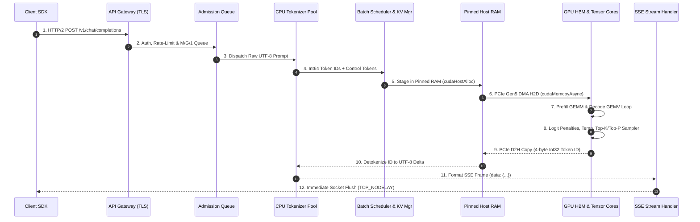
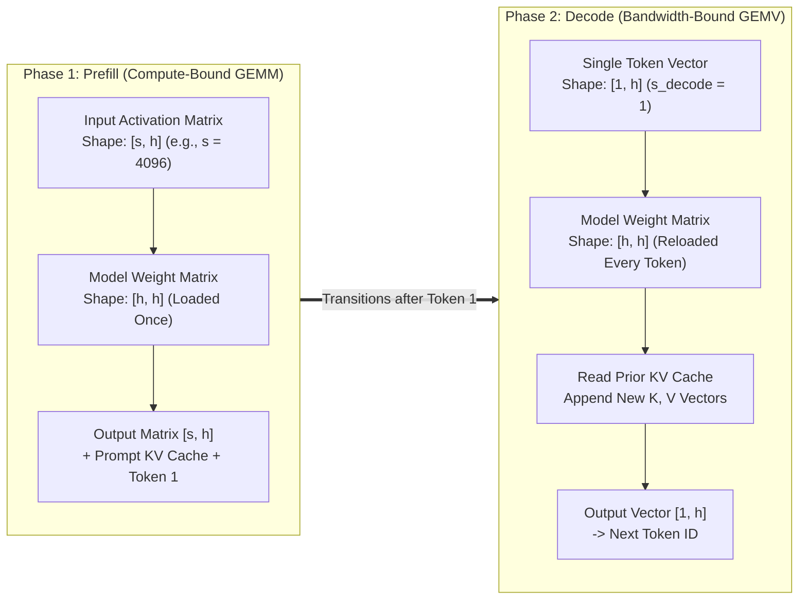

# 15.1 The anatomy of an inference request

| Field | Value |
|---|---|
| Level | Basics |
| Priority tier | 1 |
| Lab venue | GCP / GKE + Local Python Verification Lab |
| Part | Part 15: LLM inference and serving |
| Cross-references | Chapter 14.2 (Transformers and LLM architecture); Chapter 14.3 (Training memory and compute anatomy); Chapter 15.2 (Batching, the KV cache and quantization fundamentals); Chapter 15.3 (vLLM in depth); Chapter 15.5 (TensorRT and TensorRT-LLM); Chapter 15.6 (Triton Inference Server) |
| Code | `code/part15/inference_request_anatomy.py`, `code/part15/inference_request_anatomy_lab.py` |
| Coverage file | `planning/coverage/chapters/15-01.md` |
| Claim & number ledger | `planning/ledgers/15-01.md` |

## Why this matters for AI infrastructure

Picture a user who pastes a long contract into a chat window and presses Enter. For about a second, nothing seems to happen. Then words start to appear, one after another, at a steady pace. The user sees one smooth reply. The platform team sees something much more complicated. The request passed through a gateway, waited in a line, was cut into small pieces of text by a CPU, was pushed through the GPU in two very different phases, and was streamed back piece by piece.

It helps to know where the waiting went. Most of the time the user spent waiting was not spent in the part the team pays for. In the worked example later in this chapter, a single-threaded Python tokenizer takes 320 ms of a 412 ms response, while the expensive H100 sits idle. A tokenizer is the piece of software that splits text into tokens, which are the small chunks a model reads and writes. It works a bit like a translator who sits between human words and the numbers the model understands.

The GPU has its own limit. After the first token, a 70B model in 16-bit precision on one H100 can produce at most about 24 tokens per second. The reason is simple. For every new token, the GPU has to read the whole model out of memory, and the model's weights take up 140 GB. The memory on the card can only move so many gigabytes per second, so the speed limit holds no matter how fast the math units are. This chapter follows that one request, stage by stage. By the end of it, you can look at a slow response and sort its delay into the network, the CPU, the compute units or the memory.

Now imagine an engineering team that has just finished training a language model with seventy billion parameters across sixty-four H100 GPUs. During training, the cluster ran offline batch jobs. Each job used tensor shapes that never changed, so the GPUs stayed busy with the same kind of work. A tensor is a block of numbers, and its shape tells you how many rows, columns and layers the block has. Training kept the shapes fixed, and the memory was reserved up front.

When the team puts that same trained model behind a live chat API, the infrastructure rules change almost overnight. Live user traffic does not arrive as neat, equal batches. It arrives in bursts. A crowd of people may all open the app at lunchtime, and then the traffic drops off. Prompt lengths swing widely too, from a ten-token question to a large document paste. Users judge the service in milliseconds, because they wait for the first word and then read the reply as it streams in. Meanwhile, GPU memory use grows with every active conversation and every token the model generates.

```text
Production inference reality check:
- Lifetime inference cost share: Inference accounts for up to 90% of deployed machine learning compute costs (Desislavov et al., 2023)
- Input sequence variance: 10-token chat query vs 32,000-token document prompt
- Single-stream 70B FP16 decode ceiling on 1x H100 SXM5 (3.35 TB/s HBM3):
  140 GB model weights / 3,350 GB/s = 41.79 ms (~41.7 ms) per token -> ~24 tokens/sec hardware ceiling
- Llama-3-70B KV cache growth (L=80, N_kv_heads=8, d_head=128, FP16):
  327,680 bytes/token = 1.342 GB (~1.34 GB) per 4,096-token sequence -> 85.76 GB at 64 concurrent sequences
- Non-GPU latency trap:
  Up to 60% of end-to-end latency occurs outside the GPU; a single-threaded Python tokenizer can consume 320 ms out of 412 ms (77.7%)
```

The first line is a cost fact, and the rest are the numbers this chapter keeps coming back to. The traffic pattern is the reason a training playbook does not carry over. A training job can plan its memory once. A chat service cannot, because the memory it needs depends on how many people are talking to it right now and how long each conversation has run.

Serving systems can also be slowed down by parts that are not the GPU. Even very fast GPUs wait when memory gets crowded, when a tokenizer runs out of workers, or when a proxy holds bytes back. Treating an inference deployment like a stateless web server, or like the offline forward pass of a training run, leads to three familiar production failures.

- Why can one average hide the problem? An average request duration mixes prompt processing with token generation. A long-prompt outlier or a prefill stall can freeze active chat streams for four seconds while the average still looks healthy.
- What happens when memory runs out? Even when the weights fit comfortably on the card, long conversations keep growing the Key-Value cache, which is the memory that stores the past tokens for each user. Eventually the allocator runs out of High Bandwidth Memory, or HBM, the fast memory on the GPU. The first pod then crashes with an out-of-memory error, its traffic moves to the surviving replicas, and those replicas fall over one after another.
- Why do expensive GPUs sit idle? Adding more H100 GPUs will not raise throughput if the Python tokenizer thread pool is locked by the Global Interpreter Lock, or GIL, which lets only one Python thread run Python code at a time. Pageable host memory copies or reverse-proxy socket buffers can also stall token delivery while the GPUs wait.

Two phases run through this whole chapter. Autoregressive inference means the model writes one token at a time, and each new token depends on all the tokens before it. The first phase, prefill, reads the whole prompt in one go and is limited by compute. The second phase, decode, produces one token per step and is limited by memory bandwidth. The split is a foundation for the rest of Part 15. **Before you tune a serving engine or buy more GPUs, trace the request across all nine host and device stages and separate compute-bound prefill from bandwidth-bound decode**.

## Prerequisites and outcomes

### Prerequisites
- You should already know the transformer decoder layer, the self-attention projections and the numerical precision formats from Chapters 14.2 and 14.3.
- You should be comfortable with GPU hardware basics, including High Bandwidth Memory, SRAM, PCIe Gen5 and NVLink, which Part 3 and Part 12 cover.
- You should have seen HTTP/2, gRPC, Server-Sent Events and Linux process and socket metrics before, even briefly.

### Outcomes
Picture an on-call engineer who gets paged because a chat product suddenly feels slow. The engineer has a dashboard, a few logs and a short window to decide whether the fix is a bigger GPU, a different setting or a change to the network path. This chapter gives that engineer a way to think it through.

The chapter covers five areas, in order. It starts with how offline training differs from online serving. It then splits latency into named parts and follows one request through nine stages. After that it places prefill and decode on the hardware roofline, and it finishes by sizing the KV cache and the settings that control it. Each area builds on the one before, so read them in sequence the first time.

---

## 1. Why Inference Infrastructure Is Different from Training

### 1.1 The Paradigm Shift from Offline Batch Learning to Online Interactive Serving

Think about the last time a training run finished on a Friday evening. Nobody outside the team noticed. The job wrote a checkpoint, the scheduler freed the GPUs, and the next run started on Monday. Training a foundation model, which is a large model trained once on broad data and then reused for many tasks, is an offline throughput problem. A scheduler allocates a fixed pool of GPUs, loads uniform micro-batches from disk, and runs forward and backward passes for days or weeks. Every rank executes the same sequence length and batch size on every step. If a node fails, the orchestrator restores the last sharded checkpoint and resumes the run, and a customer never notices.

Serving that trained model is a different kind of job. It is a real-time systems problem. Requests arrive over the public network following bursty Poisson arrival patterns, which is a model where requests land at random moments with an average rate. One user sends a short greeting while the next uploads a long contract. People watch tokens stream onto their screens, and they leave the application if the reply stalls. Nobody is waiting for the whole job to finish. Each user is waiting for their own next word.

| Architectural Dimension | Training Infrastructure | Inference Infrastructure |
|---|---|---|
| Primary Objective | Maximize aggregate training throughput (TFLOPS/sec per dollar) | Meet strict tail-latency SLOs (P90/P99 TTFT and ITL/TPOT) at maximum Goodput |
| Workload Arrival Profile | Offline, scheduled, continuous batch jobs with predictable shapes | Online, bursty, Poisson arrivals with wide input/output length variance |
| Batch Size Dynamics | Large, static micro-batches and global batches (e.g., 512 or 2048 sequences) | Dynamic, iteration-level in-flight batches (`B = 1` to `B = 128+`) |
| GPU Memory Footprint | Static allocation: Weights + Gradients + Optimizer States + Activations | Dynamic allocation: Frozen Weights + Elastic KV Cache + Activation Workspace |
| Primary Hardware Bottleneck | Compute bound (Tensor Cores) and collective interconnect bound (NVLink/IB) | Compute bound during Prefill; HBM Memory-Bandwidth bound during Decode |
| Failure Blast Radius | Job pauses and restarts from last parallel checkpoint | Immediate user-visible HTTP 5xx errors, dropped SSE streams, or cascading OOMs |
| Scaling Mechanism | Tightly coupled 3D/4D parallelism across a fixed gang-scheduled allocation | Horizontal autoscaling of independent model replicas driven by KV cache and queue depth |
| Lifetime Cost Structure | Upfront CapEx / project compute burst | Continuous OpEx scaling with active users (up to 90% of lifetime AI compute spend) |

Read the table row by row. The first row sets the goal. Training wants as much work done as possible for each dollar. Serving wants each user to get a fast first word, even when the total work is spread over many people. The rows that follow show the same pattern again and again. Training keeps everything fixed and predictable. Serving has to cope with whatever shows up, and it has to keep the cost of idle time under control while it does so.

### 1.2 Deconstructing the Latency Budget: TTFT, ITL, TPOT, and E2E

Imagine you are on call for a chat product. Your main dashboard has one panel, a histogram of request duration. The panel looks healthy, with most requests finishing in a reasonable time. Still, support tickets pile up that say the replies "freeze and then dump a paragraph." A single duration number cannot show that. If you monitor a standard web microservice, a single duration histogram such as http_request_duration_seconds tells you whether the service is fast or slow. If you monitor a Large Language Model with a single duration metric, your dashboards will mislead you. A response that generates five hundred tokens naturally takes much longer than a response that generates ten tokens, even when the GPU is running at peak speed.

Autoregressive language models generate text in two distinct phases. First, the engine ingests the entire user prompt in parallel and emits the first output token. Second, the engine loops one token at a time until the answer finishes. These two phases stress different hardware resources, and they feel different to the person reading the screen. So we split request latency into four service level indicators, which are measurements of how the service behaves for a user:

1. Time To First Token, or TTFT, is the time from when the request reaches the gateway until the first generated token is sent to the client. It measures how responsive the service feels. It adds up network ingress, the wait in the admission queue, CPU tokenization, the copy from host to device, and the GPU prefill pass.
2. Inter-Token Latency, or ITL, is the time between two consecutive output tokens during the decode loop. It governs how smooth the stream looks. When ITL spikes, the text visibly stutters and pauses on the user's screen.
3. Time Per Output Token, or TPOT, is the average time needed to generate each output token after the first one has been sent. For a finished response of N_out tokens, TPOT is the mean of all N_out - 1 gaps between tokens.
4. End-to-End Request Latency, or E2E, is the total wall-clock time from the moment the request arrives to the final End-of-Sequence token flush. End-of-Sequence is the special token the model emits when it is done.

```text
End-to-End Inference Latency Equations (Volume 12 Chapter 1, AI Engineering Chapter 9):
  TTFT = t_network_ingress + t_queue + t_tokenize + t_h2d + t_prefill
  ITL  = t_decode_step + t_sampler + t_d2h_detok + t_sse_flush
  TPOT = (E2E - TTFT) / (N_out - 1)   (average ITL across generated tokens 2 .. N_out)
  E2E  = t_network_ingress + t_queue + t_tokenize + t_h2d + t_prefill + (N_out - 1) * ITL + t_network_egress
       = TTFT + (N_out - 1) * TPOT + t_network_egress

Worked Baseline Example (50 output tokens, code/part15/inference_request_anatomy.py):
  t_ingress = 2.0 ms, t_queue = 12.0 ms, t_tokenize = 4.0 ms, t_schedule = 0.5 ms, t_h2d = 0.4 ms
  t_prefill_gpu = 180.0 ms, t_sampler = 0.5 ms, t_d2h_detok = 0.5 ms, t_sse_flush = 1.0 ms
  -> TTFT = 2.0 + 12.0 + 4.0 + 0.5 + 0.4 + 180.0 + 0.5 + 0.5 + 1.0 = 200.9 ms
  Per-step Decode ITL = 22.0 ms (GPU decode) + 0.5 ms + 0.5 ms + 1.0 ms = 24.0 ms (TPOT = 24.0 ms)
  -> Total Decode Duration (49 subsequent tokens) = 49 * 24.0 ms = 1,176.0 ms
  -> Total E2E Latency = 200.9 ms + 1,176.0 ms = 1,376.9 ms (~1.38 seconds)
```

Walk through the baseline example slowly, because every line tells part of one story. The first token has to wait for the gateway, the queue, the tokenizer, the copy to the GPU and the prefill pass. Those waits add up to the TTFT of 200.9 ms. After that, each later token costs one decode step plus the sampler, the copy back to the host and the stream flush. Together those give the per-step TPOT of 24.0 ms. Multiply that step across the remaining tokens, add the TTFT, and you have the total time for the response. Notice that the GPU decode step is most of each step's time, and the bookkeeping is a small remainder that a single average would hide.

Averages can also mislead you about the typical user. Prompt lengths and queueing delays do not follow a neat bell curve. They follow heavy-tailed distributions, where a few very large values pull the mean far away from what most people see. One slow request can drag the average up while the typical user has a perfectly good experience. That is why the median, which is the p50, should sit next to the tail percentiles p90, p95 and p99. The tail percentiles show the bad experiences that the median hides.

```text
Why Average Latency Misleads (AI Engineering Chapter 9 Outlier Example):
  10 requests with TTFT (ms): [100, 102, 100, 100, 99, 104, 110, 90, 3000, 95]
  - Mean TTFT:   3,900 ms / 10 = 390.0 ms (makes a healthy 100 ms service look nearly 4x slower)
  - Median (p50): 100.0 ms (accurately reflects typical request latency)
  - P90 / P99:   Captures the 3,000 ms long-prompt or network retransmission outlier for targeted triage
```

Look at that list of ten requests. Nine of them finish near 100 ms, and one finishes at 3,000 ms. The mean is pulled up to 390.0 ms, which makes a healthy 100 ms service look nearly 4x slower. The median stays at 100.0 ms, which matches what most users felt. The high percentiles are where the single slow request shows up, so you can pick it out and investigate it. In practice, you want all three views at once: the median for the typical experience and the tail for the bad ones.

### 1.3 Throughput (RPS and TPS), Goodput, and Request Cost Economics

Your finance lead asks why the GPU bill rose sharply even though traffic only grew a little. Both questions are fair, and the answer depends on how you count work. Users care about low latency, but the platform owners have to keep the hardware busy enough that the serving cost stays sustainable. So the team tracks throughput at two levels.

- How many requests finish? Request throughput counts completed requests per second, which is RPS, and completed requests per minute, which is RPM.
- How many tokens come out? Token throughput counts generated output tokens per second, which is TPS, across the whole server. Each stream also has its own rate, written as `tokens/s/user`. Prefill and decode have different hardware limits, so you should always report input token throughput and output token throughput separately.

Pushing the batch size higher raises total TPS and lowers the cost per token. The catch is that it also slows each user's TTFT and TPOT. If you double the TPS by letting the queue wait climb to five seconds, users will leave, and the extra tokens will not help you. A serving fleet that looks busy can still be losing money. To measure the capacity that users actually receive, the team uses Goodput, which is the number of completed requests per second or per minute that meet both the TTFT and the TPOT service level objectives, or SLOs. An SLO is the target a team sets for a metric, such as "TTFT under 200 ms for most users."

```text
Throughput vs. Goodput and Cost-per-Request Math (AI Engineering Chapter 9):
1. Goodput Under Dual Latency SLOs:
    Target SLOs: TTFT <= 200 ms AND TPOT <= 100 ms
   Raw completed throughput: 100 requests/minute (or 10.0 RPS)
   Requests meeting both SLOs: 30 requests/minute (or 3.0 RPS; 70% violate either TTFT or TPOT)
   -> Effective Goodput = 30 RPM (3.0 RPS, 30.0% SLO attainment)

2. Prefill + Decode Request Cost Decomposition ($2.00/hour GPU instance):
   - Decode cost at 100 output tokens/sec (360,000 tokens/hour):
     Cost per 1M output tokens = ($2.00 / 360,000) * 1,000,000 = $5.556 per 1M output tokens
     Decode cost for 1,000 requests (200 output tokens/req = 200,000 tokens) = $1.11
   - Prefill cost at 100 prefilled requests/minute (6,000 requests/hour):
     Prefill time for 1,000 requests = 10 minutes = (10 / 60) * $2.00 = $0.33
   - Total serving cost per 1,000 requests = $1.11 (decode) + $0.33 (prefill) = $1.44
```

The Goodput example shows why raw numbers can lie. The server completes 100 requests per minute, but only 30 of them meet both targets. The other 70 percent break either the TTFT target or the TPOT target. So the useful capacity is 30 RPM, and that is the attainment rate the team should watch. The cost example works the same way. Decoding is the larger share of the bill, and prefill adds a smaller amount on top. Together they bring the cost of 1,000 requests to $1.44. When you plan capacity, you pay for the requests that users accept, not the ones that merely finish.

**Size and autoscale every inference fleet on Goodput at P99 TTFT and TPOT rather than raw token throughput.**

---

## 2. The Nine-Stage End-to-End Inference Request Path

### 2.1 Latency Beyond the GPU: Tracing the Data and Control Planes

When an inference API misses its latency target, the first instinct is to blame the GPU kernels. The kernels are the programs that run on the GPU, and they are easy to point at because they are the expensive part. In production clusters, **up to 60 percent of total end-to-end request latency occurs outside the GPU**. This section traces how a request moves across the boundary between the host, which is the CPU and its RAM, and the device, which is the GPU. Before a single Tensor Core instruction runs, the request crosses TLS termination proxies, rate limiters, admission queues, CPU tokenizer thread pools, memory allocators and PCIe DMA engines. TLS is the encryption layer that protects HTTPS traffic. DMA is direct memory access, a way for hardware to copy data without the CPU doing each byte. On the way back, every generated token crosses PCIe to host RAM, runs through detokenization, and flushes out through HTTP chunked socket buffers.



Read the diagram as a single trip made of numbered steps. Steps 1 through 6 carry the prompt down to the GPU. Steps 7 and 8 are the GPU work, the prefill and decode loop plus sampling. Steps 9 through 12 carry the answer back up, one token at a time. The numbers on the arrows mark the order, so you can point at a step in a trace and say which part of the trip it belongs to.

High-throughput serving systems split their work into separate planes. A plane is a separate lane of work with its own rules. The control plane and the data plane must stay apart, or one can slow down the other.

- What belongs to the control plane? It runs out of band, which means it does not sit on the path of each token. It handles model repository discovery, `/v2/health/ready` readiness probes, `/metrics` Prometheus scraping, LoRA adapter registration and Kubernetes autoscaling signals. A slow metric scrape must never block an active token generation loop.
- What belongs to the data plane? It has to stay lock-free and avoid allocating memory while requests are running. It allocates pinned host memory buffers and CUDA streams at server startup. A CUDA stream is an ordered queue of GPU work. Doing these allocations early means request handling never waits on the operating system's malloc or free calls.

### 2.2 Stage-by-Stage Mechanics, Protocols, and Latency Budgets

Suppose a page arrives in the middle of the night saying that p99 latency tripled on one cluster. To find the culprit, you need to know, for each stage, which protocol it uses, which component owns it, what it is supposed to cost, and what usually breaks. The table below is that map.

| Stage | Protocol / Interface | Payload Transformation | Latency Budget | Primary Bottleneck & Failure Mode | Target Metric Threshold |
|---|---|---|---|---|---|
| 1. Ingress & TLS | HTTP/2 or gRPC over TLS 1.3 | JSON payload over TCP socket | `2 - 10 ms` | TLS handshake CPU / connection pool exhaustion | `99.99%` availability |
| 2. Admission & Queue | Internal channel / M/G/1 queue | Validated `RequestStruct` | `1 - 50 ms` | Unbounded queue buildup during traffic spikes | `inference_queue_depth < 50` |
| 3. CPU Tokenization | Rust `tokenizers` / C++ `tiktoken` | UTF-8 string to `int64` token IDs | `2 - 20 ms` | Single-thread Python GIL CPU saturation | `tokenizer_duration < 5 ms` |
| 4. Iteration Scheduler | Lock-free queue + Block Manager | `SequenceGroup` + KV block table | `< 1 ms` | KV block exhaustion or prefill starving decode | `scheduler_iter < 30 ms` |
| 5. Host-to-Device (H2D) | PCIe Gen5 DMA / NVLink-C2C | Pinned RAM to GPU HBM tensor | `< 0.5 ms` | Pageable memory double-copy staging (`malloc`) | `55 - 62 GB/s` DMA rate |
| 6. GPU Engine Compute | CUDA Streams / Tensor Cores | Prefill GEMM + Decode GEMV | `50-300 ms` TTFT; `15-30 ms` ITL | HBM bandwidth wall or CUDA OOM crash | `kv_cache_usage 70% - 85%` |
| 7. GPU Logit Sampler | On-device CUDA C++ kernels | Logits (`128K` vocab) to `int32` ID | `< 1 ms` | Host-side sampling sync or invalid temperature | `< 1 ms` per step |
| 8. Device-to-Host (D2H) | `cudaMemcpyAsync` + Detokenizer | `4-byte` `int32` ID to UTF-8 string | `< 1 ms` | Blocking `cudaStreamSynchronize` on host thread | `< 1 ms` per token |
| 9. Egress SSE Flush | HTTP/1.1 Chunked SSE (`TCP_NODELAY`) | `data: {"delta": ...}\n\n` frame | `1 - 3 ms` | Nginx `4 KB` proxy buffering or slow client window | `stream_flush < 2 ms` |

Each row tells you which stage to suspect first. The budget column is the normal range, and the threshold column is the number that should trigger an alert. When a stage runs far over its budget, the failure mode column lists the most likely cause.

### 2.3 Non-GPU Bottlenecks: Tokenizer Placement, Pinned Memory, and Backpressure

Three design choices outside the GPU decide whether your H100s run at full capacity or sit starved for work. Each one looks small on a diagram, and each one can cost you a large part of the cluster if you get it wrong.

1. Where should tokenization run? You can tokenize either in an external CPU microservice tier or inside the GPU serving engine. Tokenizing in an external Rust or C++ microservice keeps the GPU host CPUs free for kernel scheduling, and it lets the CPU tier scale on its own. The cost is that the token IDs travel over the internal network as 8x-wider int64 arrays. Tokenizing inside the serving engine sends compact UTF-8 strings over the network with no extra hop. However, the engine then needs multi-core Rust or C++ worker threads on the GPU node, and it must avoid calling a single-threaded Python AutoTokenizer inside the request loop.
2. Should host buffers be pageable or pinned? Ordinary memory from the operating system, which is what `malloc` hands out, is pageable, which means the OS can move or swap it at any time. The GPU DMA engine cannot read pageable memory directly, because the page might move in the middle of a transfer. So a plain cudaMemcpy from pageable RAM first makes the CUDA driver allocate a temporary page-locked staging buffer and copy the tensor on the CPU. That path throttles PCIe Gen5 transfers to `10–14 GB/s`. Pinned page-locked memory, allocated with `cudaHostAlloc` or cudaHostRegister, lets the DMA engine read directly from host RAM at `55–62 GB/s`, out of the `64 GB/s` unidirectional PCIe Gen5 x16 peak.
3. What happens when a client stops reading? Imagine a mobile client on a lossy cellular link that stops reading its SSE stream. Backpressure is the signal that flows back upstream when a receiver cannot keep up, and it travels across five layers.
   - Which layer notices first? The client's local OS receive buffer fills and advertises a `TCP Receive Window = 0`, which tells the sender to stop.
   - What does the proxy do next? The reverse proxy, such as Nginx or Envoy, blocks on socket writes to that client connection.
   - What does the API server do? The endpoint handler's per-request asyncio.Queue or Go channel hits its high-water mark, the limit at which it stops accepting more.
   - How does the scheduler react? The continuous batch scheduler cannot push newly generated tokens for that sequence group, so it pauses that decode slot.
   - Where does the GPU memory go? If the client stays stalled while new requests arrive, the block manager preempts or aborts the stalled sequence via `engine.abort(request_id)`. That way a dead TCP socket cannot hold gigabytes of GPU HBM.

```text
Non-GPU Latency & Bandwidth Reference Numbers (Volume 12 Chapter 2):
- Pageable Host RAM (default malloc) H2D transfer: 10 - 14 GB/s (requires CPU double-copy staging)
- Pinned Page-Locked Host RAM (cudaHostAlloc) H2D: 55 - 62 GB/s on PCIe Gen5 x16 (64 GB/s theoretical unidirectional, 128 GB/s bidirectional)
- Python GIL Tokenizer Bottleneck Trace (412 ms total span):
  Gateway HTTP parse = 2.0 ms | CPU Tokenize (HuggingFace Python) = 320.0 ms (77.7% of total!)
  H2D Copy = 0.4 ms | GPU Inference = 88.0 ms | SSE Serialization = 1.6 ms
  Cluster capped at 120 RPS and 22% GPU utilization across 8x H100 GPUs
- After deploying 16-thread Rust Tokenizer (TOKENIZER_WORKER_THREADS=16):
  Tokenization drops from 320.0 ms -> 1.4 ms (228.6x faster); GPU util rises 22% -> 88%; throughput jumps 120 RPS -> 780 RPS (6.5x)
```

The reference block above is the case study that ties these three choices together. The GIL-bound tokenizer spent 320.0 ms on CPU work and only 88.0 ms on the GPU. The cluster sat at 22% GPU utilization and could not get past 120 requests per second. Moving to a 16-thread Rust tokenizer cut the tokenize step to 1.4 ms, lifted GPU utilization to 88 percent and raised throughput to 780 RPS. The fix did not touch the model at all. It only changed where the work ran and how many workers did it.

**Always use multi-threaded Rust or C++ tokenizers, stage tensors in pinned host memory, and disable reverse-proxy response buffering on streaming endpoints**.

---

## 3. Prefill vs. Decode Mechanics, Arithmetic Intensity, and the Roofline Model

Your team notices something odd on a monitoring screen. The same GPU looks very busy while it writes a long summary, and it looks almost idle during some short answers. Both observations come from the same model, so the difference has to be in the work itself. The two phases of generation run different math, and that math decides what the hardware is waiting for.

### 3.1 Inside a Decoder-Only Forward Pass: Why Prefill Is GEMM and Decode Is GEMV

Suppose you open a profiler while one chat request runs. The first burst of work looks dense and steady, with the compute units fully loaded. The bursts after that look thin and repeated, with the same weights read again and again. Why would one request look like two different programs? To answer that, we need to look at what a decoder-only model does with each token.

A decoder-only Transformer model has three structural parts. It has an input embedding table, which turns token IDs into vectors. It has a stack of L identical decoder layers, where L is the number of layers. It also has an output Language Modeling head, which turns the final vector into scores for every word in the vocabulary. Each decoder layer contains a pre-attention RMSNorm, which is a normalization step that keeps the numbers in a sensible range. Next comes a Multi-Head or Grouped-Query Self-Attention block, which uses the q_proj, k_proj, v_proj and o_proj projections. A projection here is a weight matrix that maps each token's vector into queries, keys or values. After attention comes a second RMSNorm and a SwiGLU Feed-Forward Network, which uses the gate_proj, up_proj and down_proj matrices.

```text
Concrete Decoder Architecture Reference: Qwen/Qwen2.5-0.5B (Hands-On LLM Serving Chapter 2):
- hidden_size (d_model): 896 | num_hidden_layers (L): 24 | num_attention_heads: 14 | intermediate_size: 4,864
- vocab_size: 151,936 | max_position_embeddings: 32,768 | total parameters: 494,032,768 (~0.49B)
- Decoder layer modules: self_attn (q_proj, k_proj, v_proj, o_proj) + mlp (gate_proj, up_proj, down_proj, SiLU) + Qwen2RMSNorm
```

The reference block above gives real numbers for one small model. Look at hidden_size and num_hidden_layers first, because those two tell you how wide each layer is and how many layers the token passes through. The vocabulary size matters later, when the model picks the next word. Notice that the total parameter count is written out in full. That is the number of weights the GPU has to hold, and it is the reason the memory math in later sections matters.

Both phases use the exact same weights and the exact same layers. The difference is how many tokens are in the input at once. **Prefill and decode execute fundamentally different linear algebra operations**, and that difference decides which hardware limit each phase hits.

1. Prefill is prompt ingestion. It happens at iteration 0. When a user submits a prompt of s tokens, all s tokens are already known. Take `s = 2,048` as an example. For a single request with `B = 1`, the input activation tensor for each linear projection has the shape [s, h], where h is the hidden dimension. Multiplying an [s, h] matrix by an [h, h] weight matrix is a dense General Matrix-Matrix Multiplication, or GEMM. The GPU loads each weight matrix from off-chip HBM into fast on-chip SRAM once, then reuses it across all s prompt tokens in parallel. That reuse keeps the Tensor Cores busy.
2. Decode is autoregressive generation. It runs across iterations 1 through N. Each new token depends on the token before it, so the model cannot process the answer in one go. During each decode step of a single request with `B = 1`, only one new token (`s_decode = 1`) enters the model. The activation shrinks to a single row vector of shape [1, h]. Multiplying a [1, h] vector by an [h, h] weight matrix is a General Matrix-Vector Multiplication, or GEMV. To produce just one token, the GPU has to stream the full set of model weights from HBM into SRAM, do a small vector dot product, and then move on. The weights are then discarded before the next layer.

Picture a checkout line. Prefill is like a cashier who scans a whole cart at once and reuses the same register for every item. Decode is like a cashier who walks to the back room for every single item and walks back again. The cashier is equally capable in both cases. The walking is what slows the second line down, and in this analogy the walking stands for reading weights from memory.



Follow the diagram from top to bottom. The prefill phase takes the whole prompt, multiplies it through the weights once, and leaves behind the prompt's KV cache plus the first token. After that the flow switches to decode. Each pass feeds in a single token vector, reloads the weights, reads the cache, appends the new keys and values, and outputs one next token ID. The arrow labeled as the transition marks the moment the engine stops reading the prompt and starts writing the answer.

### 3.2 Deriving Arithmetic Intensity and the Hardware Roofline Ridge Point

Your capacity sheet says a GPU can do 989 TFLOPS, yet your model runs far below that number. Before you can explain the gap, you need a way to ask one question. For each byte the kernel reads from memory, how many math operations does it perform? That question decides whether the GPU is limited by its math units or by its memory. Two ratios answer it.

- What is the hardware ridge point, written `I_ridge`? It is the ratio of a GPU's peak Tensor Core throughput, in FLOPs per second, to its peak HBM bandwidth, in bytes per second. A workload must perform at least I_ridge floating-point operations for every byte moved from HBM to reach peak compute throughput. Here FLOP means one floating-point operation, which is one multiply or one add on a decimal number.
- What is the arithmetic intensity of a kernel, written `I`? It is the ratio of floating-point operations executed by the kernel to the total bytes read from and written to HBM, where `I = FLOPs / Bytes`. A high value means the kernel does a lot of math per byte, so memory is not the bottleneck.

Consider multiplying an FP16 input matrix [M, K] by an FP16 weight matrix [K, N] to produce an FP16 output matrix [M, N]. FP16 is a 16-bit floating-point format, and each element takes 2 bytes. Each of the M * N output elements is a dot product of length K. A dot product of length K needs K multiplications and K additions, which is 2 * K FLOPs in total. Count the bytes the same way. The kernel reads the input and the weights and writes the output, so the total traffic is the sum of those three matrices, each multiplied by 2 bytes.

```text
GEMM Arithmetic Intensity & Roofline Equations (Hands-On LLM Serving Chapter 5, Volume 12 Chapter 1):
  Total FLOPs         = 2 * M * N * K
  Total HBM Bytes     = 2 * (M * K + K * N + M * N)     (for 2-byte FP16/BF16 elements)
  Arithmetic Intensity I = (2 * M * N * K) / (2 * (M * K + K * N + M * N))
                         = (M * N * K) / (M * K + K * N + M * N)   [FLOPs / Byte]

  For an LLM linear projection with K = N = h (hidden dimension) and M = s (tokens processed):
  I(s, h) = (s * h * h) / (s * h + h * h + s * h) = (s * h) / (2 * s + h)

Hardware Ridge Point Examples:
  - NVIDIA L40S (FP16):     362.05 TFLOPS / 864 GB/s   = 419.04 FLOPs/Byte (~419 FLOPs/Byte)
  - NVIDIA H100 SXM5 Dense: 989.0  TFLOPS / 3,350 GB/s = 295.22 FLOPs/Byte (~295 FLOPs/Byte)
  - NVIDIA H100 SXM5 Sparse:1979.0 TFLOPS / 3,350 GB/s = 590.75 FLOPs/Byte (~591 FLOPs/Byte)
  - NVIDIA H200 SXM Dense:  989.0  TFLOPS / 4,800 GB/s = 206.04 FLOPs/Byte (412.29 sparse)
  - NVIDIA B200 Dense:      2250.0 TFLOPS / 8,000 GB/s = 281.25 FLOPs/Byte
```

Read the equations as a recipe. The first line counts the math, and the second line counts the bytes. Divide one by the other and the result is the intensity. The trick for LLMs is that a linear layer usually has the same width for its inputs and outputs, so K and N both equal the hidden size h. When you substitute that, the intensity simplifies to (s * h) / (2 * s + h). Look at what happens as s grows. The numerator grows with the prompt, while the denominator grows much more slowly, so long prompts push the intensity up.

Plugging concrete matrix sizes into this formula shows why prefill can become compute-bound while single-request decode stays stuck near `1.0 FLOP/Byte`. The table below runs the same formula for several sizes. Read the last column against the ridge points listed above it.

| Workload Case (`FP16`, `2 bytes/elem`) | `M` (Tokens) | `K` (`d_in`) | `N` (`d_out`) | Arithmetic Intensity (`FLOPs/Byte`) | Regime on L40S (`419` Ridge) & H100 (`295` Dense Ridge) |
|---|---|---|---|---|---|
| Square GEMM Small (`HLS` Table 5-9) | `64` | `64` | `64` | `21.33` (`~21`) | Memory-bandwidth bound |
| Square GEMM Medium (`HLS` Table 5-9) | `512` | `512` | `512` | `170.67` (`~170`) | Memory-bandwidth bound |
| Square GEMM Large (`HLS` Table 5-9) | `4096` | `4096` | `4096` | `1,365.33` (`~1365`) | Compute bound (saturates Tensor Cores) |
| LLM Prefill Short Prompt (`h = 4096`, `B = 1`) | `64` | `4096` | `4096` | `62.06` | Memory-bandwidth bound (prompt too short to amortize weights) |
| LLM Prefill Medium Prompt (`h = 4096`, `B = 1`) | `512` | `4096` | `4096` | `409.60` | Compute bound on H100 dense (`> 295`); borderline on L40S (`419`) |
| LLM Prefill Long Prompt (`h = 4096`, `B = 1`) | `4096` | `4096` | `4096` | `1,365.33` | Heavily compute bound on all GPUs (`I >> I_ridge`) |
| LLM Decode Single Stream (`h = 4096`, `B = 1`) | `1` | `4096` | `4096` | `1.00` (`4096 / 4098 = 0.9995`) | Severely memory-bandwidth bound (`~300x-400x` below ridge point) |
| LLM Decode Batched (`h = 4096`, `B = 64`) | `64` | `4096` | `4096` | `62.06` | Arithmetic intensity rises `~62x` by sharing weight loads across `64` requests |

The table tells a clear story. Small square multiplications are starved for math, so they sit on the memory side of the ridge. As the prompt grows from 64 tokens to 4096 tokens, the same weights get reused across more rows, and the prefill case climbs past the ridge point. Single-stream decode is the outlier at about 1.00 FLOP per byte. Look at the last row, too. Batching 64 requests shares one weight read across all of them, which lifts the decode intensity to the same 62.06 that a short prefill reached. That is the main reason batching matters so much for decode.

### 3.3 The Memory-Bandwidth Wall, MFU vs. MBU, and Accelerator Selection

A product manager asks whether buying the newest GPU will make chat feel faster. The honest answer depends on the phase. If your slow part is prefill, you need more math. If your slow part is decode, you need more memory bandwidth or fewer bytes per token. Measuring the right thing is how you find out which one you have.

Because single-stream decode has an arithmetic intensity of roughly `1.0 FLOP/Byte`, the GPU's Tensor Cores sit idle for most of the time. They wait for weights to arrive from HBM. In fact, the Tensor Cores can sit idle more than 95 percent of the time. Yet nvidia-smi still reports 100% GPU utilization, because at least one CUDA kernel is active on the Streaming Multiprocessors while that kernel waits on memory loads. A kernel that is busy waiting still counts as busy in that tool.

That is why the team measures efficiency in two different ways. For compute-bound prefill, they track Model FLOP/s Utilization, or MFU, which compares the math the model achieves with the peak math the hardware offers. For bandwidth-bound decode, they track Model Bandwidth Utilization, or MBU, which compares the memory traffic the model achieves with the peak bandwidth the hardware offers.

```text
Decode Memory-Bandwidth Wall & MBU Equations (Volume 12 Chapter 1, AI Engineering Chapter 9, Hands-On LLM Serving Chapter 5):
1. Storage & Memory Bandwidth Hierarchy (Table 5-5):
   - NVMe SSD Bandwidth:         0.5 to 14 GB/s
   - Host CPU DRAM Bandwidth:   50 to 200 GB/s
   - GPU HBM Bandwidth:        300 GB/s to 8,000 GB/s (0.3 TB/s to 8.0 TB/s)

2. Theoretical Single-Stream (B = 1) Decode Ceiling for Llama-3-70B FP16 (140 GB weights):
   t_min_decode = Model_Weight_Bytes / Peak_HBM_Bandwidth
   - On 1x H100 SXM5 (3,350 GB/s): 140 GB / 3,350 GB/s = 41.79 ms (~41.7 ms) -> 23.93 tokens/sec (~24 tok/s) ceiling
   - On 1x H200 SXM  (4,800 GB/s): 140 GB / 4,800 GB/s = 29.17 ms            -> 34.29 tokens/sec ceiling
   - On 1x B200      (8,000 GB/s): 140 GB / 8,000 GB/s = 17.50 ms            -> 57.14 tokens/sec ceiling

3. Model Bandwidth Utilization (MBU):
   Bandwidth_Used (GB/s) = Parameter_Count * Bytes_per_Parameter * Observed_Tokens_per_Sec
   MBU (%)               = Bandwidth_Used / Theoretical_Peak_HBM_Bandwidth
   - Worked Example (7B model on A100 80GB with 2.0 TB/s = 2,000 GB/s peak bandwidth):
     At 50 tok/s in FP16 (14 GB weights) or 100 tok/s in INT8/FP8 (7 GB weights):
     Bandwidth_Used = 700 GB/s -> MBU = 700 GB/s / 2,000 GB/s = 35.0% (or 70.0% at 1,400 GB/s)
```

The block above is the arithmetic behind the speed limit. Start with the first section, which lists how far each kind of memory can move bytes per second. Then take the 140 GB of weights for a 70B model and divide by the peak bandwidth of the card. That division gives the minimum time to read the weights once per token. Turn that time into tokens per second and you get the ceiling. A faster card raises the ceiling, but only in proportion to its bandwidth. The MBU formula works backwards from what you measure. You multiply the parameters, the bytes per parameter and the tokens per second, then divide by the peak. If the result is far below the peak, the engine is not moving the bytes it could be moving.

| GPU Accelerator | Memory Capacity & Type | Memory Bandwidth | FP16 / BF16 Tensor Core TFLOPS (Dense / Sparse) | FP8 Support | Intra-Node Interconnect | Primary Inference Sweet Spot |
|---|---|---|---|---|---|---|
| NVIDIA A10 | `24 GB` GDDR6 | `0.60 TB/s` (`600 GB/s`) | `125 TFLOPS` | No | PCIe Gen4 (`64 GB/s`) | Small `7B-8B` models at low concurrency (`max batch ~ 4` at `4K` seq) |
| NVIDIA L40S | `48 GB` GDDR6 | `0.864 TB/s` (`864 GB/s`) | `362.05 TFLOPS` | Yes (`733 TFLOPS`) | PCIe Gen4 (`64 GB/s`, no NVLink) | Single-GPU `7B-14B` FP8/FP16 serving (`max batch ~ 16` for `7B` at `4K` seq) |
| NVIDIA A100 SXM4 | `40 / 80 GB` HBM2e | `1.935 - 2.0 TB/s` | `312 TFLOPS` | No (`7` MIG slices) | NVLink 3 (`600 GB/s`) | Baseline multi-GPU FP16/INT8 serving |
| NVIDIA H100 PCIe | `80 GB` HBM2e | `2.0 TB/s` | `756 / 1,513 TFLOPS` | Yes | PCIe Gen5 (`128 GB/s` bidir) | Independent single-GPU replicas not requiring heavy TP AllReduce |
| NVIDIA H100 NVL | `94 GB` HBM3 | `3.9 TB/s` | `835 / 1,671 TFLOPS` | Yes (`3,341 TFLOPS`) | Dual-GPU NVLink Bridge (`600 GB/s`) | `TP = 2` `70B` serving (`188 GB` combined HBM3 at `3.9 TB/s` per GPU) |
| NVIDIA H100 SXM5 | `80 GB` HBM3 | `3.35 TB/s` | `989 / 1,979 TFLOPS` | Yes (`3,958 TFLOPS`) | NVLink 4 (`900 GB/s` across `8` GPUs) | High-concurrency `TP = 4` or `TP = 8` `70B+` serving |
| NVIDIA H200 SXM | `141 GB` HBM3e | `4.8 TB/s` | `989 / 1,979 TFLOPS` | Yes (`3,958 TFLOPS`) | NVLink 4 (`900 GB/s` across `8` GPUs) | Long-context & high-batch decode (`1.76x` HBM capacity, `1.43x` bandwidth vs H100) |
| NVIDIA B200 / GB200 NVL72 | `192 GB` HBM3e | `8.0 TB/s` | `2,250 / 4,500 TFLOPS` | Yes + FP4 | NVLink 5 (`1.8 TB/s`/GPU; `130 TB/s` across `72` GPUs) | Frontier MoE (`671B` DeepSeek-R1) and disaggregated rack-scale decode |

Use the table to match a card to a job, not to pick the biggest number. The memory bandwidth column sets the decode ceiling. The memory capacity column decides how many KV cache blocks fit beside the weights. The interconnect column matters once one model is split across several GPUs, because every layer then has to pass results to its neighbors. Each row ends with the kind of serving it suits best, which is the quickest way to narrow a shortlist.

**Match your hardware and optimization strategy to the active phase: reduce FLOPs or disaggregate prefill when TTFT is compute-bound, and quantize weights or batch requests when TPOT is memory-bandwidth-bound**.

---

## 4. KV Cache Memory Anatomy, Continuous Batching, and Chunked Prefill

Picture a model server that starts cleanly on Monday. By Thursday it crashes with an out-of-memory error during the busiest hour of the day. Nobody changed the model. What changed was the number of conversations held in memory at the same time, and the KV cache is the part of memory that grows with each of them.

### 4.1 Why the KV Cache Exists and How It Grows Linearly with Context and Concurrency

Imagine a user who asks the bot to summarize a long report. The first words come out quickly. If the engine had to rebuild everything from scratch for each new word, every word would take longer than the one before, and the reply would crawl. Engines avoid that by remembering their earlier work. The memory that holds this remembered work is the KV cache.

In self-attention, every new token looks back at the Key and Value projections of all the tokens before it. A key is a vector that describes what a token offers, and a value is the content that gets mixed in when that token is attended to. If the engine recomputed the Key and Value tensors for the entire history at every decode step, generating N tokens would require `O(N^2)` redundant matrix multiplications per token. Instead, serving engines store the Key and Value vectors computed during prefill. Then they append one new Key-Value pair per layer at each decode step via `use_cache=True` and past_key_values. Storing is cheaper than recomputing, but storage has a price, and that price is memory.

```text
Empirical Impact of KV Caching and vLLM Batching (Hands-On LLM Serving Chapter 2, Qwen/Qwen2.5-0.5B):
- 100-token generation WITHOUT KV cache (full sequence recomputed every step): 9.1205 seconds (~0.09 s/token, growing per step)
- 100-token generation WITH KV cache (past_key_values reused):                 3.1416 seconds (2.90x speedup, flat decode step time)
- Hugging Face pipeline.generate() vs vLLM engine on single prompt:           19.58 seconds vs 1.12 seconds (17.48x / ~17x speedup)
- vLLM processing 4 prompts sequentially vs batched together:                  2.3865 seconds vs 1.0626 seconds (2.2x throughput gain; up to 23x with continuous batching)
```

The numbers above show the trade. Without a cache, the 100-token generation takes 9.1205 seconds, and each step gets slower as the sequence grows. With the cache, the same job takes 3.1416 seconds, and the decode step time stays flat. The cache turns a growing cost into a steady one. The vLLM lines show the same idea from the serving side. Batching prompts together, and letting the engine schedule them well, makes the same hardware finish more work in the same time.

While the KV cache rescues decode compute, it turns GPU memory into an elastic bottleneck. The cache grows with each token of each conversation, so the total depends on the model shape and on how many conversations run at once. Consider a model with L layers, N_heads_kv Key-Value heads per layer, head dimension `H = d_head`, sequence length P_seq, batch size B, and S_precision bytes per element. S_precision is 2 bytes for FP16 or BF16, and 1 byte for FP8 or INT8. The equations below turn those inputs into a memory footprint.

```text
KV Cache Memory Sizing Equations & Worked Production Examples (Volume 12 Chapter 1, Volume 05 Chapter 2, Hands-On LLM Serving Chapter 5):
  M_KV_per_token = 2 (Key + Value) * L * N_heads_kv * d_head * S_precision
  M_KV_per_seq   = M_KV_per_token * P_seq
  M_KV_total     = M_KV_per_seq * B

1. Llama-3-70B / Llama-2-70B with Grouped-Query Attention (GQA: L=80, N_heads_kv=8, d_head=128, FP16=2 bytes):
   - Per token:    2 * 80 * 8 * 128 * 2 = 327,680 bytes/token (327.68 KB decimal / ~0.31 MiB binary)
   - Per 4K seq:   327,680 * 4,096 = 1,342,177,280 bytes = 1.342 GB (~1.34 GB decimal / 1.25 GiB binary)
   - At B = 64 concurrent 4K requests:  64 * 1.34 GB = 85.76 GB (85.90 GB exact) -> exceeds a single 80 GB GPU!
   - At B = 100 concurrent 4K requests: 100 * 1.342 GB = 134.2 GB KV cache
     Total VRAM = 140 GB (FP16 weights) + 134.2 GB (KV cache) + 10 GB (activation workspace) = 284.2 GB
     -> Requires minimum 4x 80 GB NVIDIA H100 GPUs (320 GB total VRAM) with Tensor Parallelism TP = 4
   - Without GQA (Multi-Head Attention MHA with N_heads_kv=64, d_model=8192):
     2 * 80 * 64 * 128 * 2 = 2,621,440 bytes/token (~2.6 MB/token, 8x larger!)
     At B = 128 and P_seq = 2,048: ~687 GB with MHA vs ~86 GB with GQA

2. Llama-2-7B with Multi-Head Attention (MHA: L=32, N_heads_kv=32, d_head=128, FP16=2 bytes, Hands-On LLM Serving Table 5-7):
   - Model weights: 7B * 2 bytes = 14.0 GB
   - Per token:     2 * 32 * 32 * 128 * 2 = 524,288 bytes/token = 0.5 MiB/token
   - At B = 16 and P_seq = 4,096: 0.5 MiB * 4,096 * 16 = 32.0 GB KV cache (2.29x larger than the 14 GB model weights!)
   - Hardware batch limit at 4,096 tokens:
     * NVIDIA A10 (24 GB VRAM, ~10 GB free after 14 GB weights):  max ~4 concurrent requests (10 * 1024 / (0.5 * 4096) = 5 theoretical, 4 with activations)
     * NVIDIA L40S (48 GB VRAM, ~34 GB free after 14 GB weights): max ~16 concurrent requests (34 * 1024 / (0.5 * 4096) = 17 theoretical, 16 with activations)
```

Walk through the first case in the block, because it shows the whole method. Start with the per-token cost, which is 327,680 bytes. Multiply by the 4,096 tokens in one sequence and you get about 1.34 GB for that one conversation. Now multiply by 100 conversations and the cache alone is 134.2 GB. That is already more than one 80 GB card can hold, before you add the 140 GB of weights and the activation workspace. The sum of 284.2 GB is why this model needs at least four H100 GPUs working together with tensor parallelism. Tensor parallelism splits each layer across GPUs so they share the memory.

The comparison with multi-head attention is the lesson of the whole block. Multi-head attention keeps a separate key and value head for each query head. Grouped-query attention shares a small set of key and value heads across many query heads. With 8 KV heads instead of 64, the same 70B model needs 8x less cache per token. Fewer heads means a cache that grows more slowly with every user, so the same card can hold many more conversations.

### 4.2 PagedAttention, Continuous Batching, and Chunked Prefill Guardrails

Think about a request where you do not know yet whether the answer will be twenty tokens or two thousand tokens. An early serving engine had to plan for the worst case. It set aside one large block of GPU HBM, sized for the maximum sequence length, the moment the request started. Most of that block often stayed empty. Early engines wasted a large share of their KV cache this way. Contiguous reservation, which is the one-big-block approach, wasted 60% to 80% of KV cache memory through over-reservation and fragmentation, the scattered gaps that appear when blocks of different sizes come and go. The result was that only 20% to 40% of the cache was really usable.

Modern inference engines fix this with three scheduling mechanisms. Together they remove most of the memory waste and most of the tail-latency stalls. We cover them in depth in Chapters 15.2 and 15.3, and here is the short version.

1. PagedAttention splits the KV cache into fixed-size blocks, each holding 16 or 32 tokens, such as `block_size: 16`. Think of it like a file system that stores a long file in small pages instead of one long run. A block table maps logical positions in the sequence to physical blocks in HBM, and the engine adds blocks as the sequence grows. This design removes external fragmentation. It also limits internal waste to the last block, and it raises serving throughput by 2x to 4x.
2. Continuous in-flight batching changes how the batch works. Instead of waiting for every sequence in a static batch to finish before starting new work, the scheduler checks the running batch at every single token iteration. Finished sequences leave immediately, and waiting requests join on the very next forward pass. Nobody sits idle while the slowest request in a group finishes.
3. Chunked Prefill protects the decode streams from long prompts. Imagine a document of 16,000 or 32,000 tokens landing in the middle of a busy chat batch. A single prefill pass over that prompt keeps the Tensor Cores busy for 350+ ms, and every streaming user waits during that time. Enabling Chunked Prefill with `--enable-chunked-prefill --max-num-batched-tokens 512` splits long prompts into 512-token chunks. It also places active decode tokens into each iteration, so streams keep moving. In the example, that keeps P99 ITL flat around 22.8 ms instead of spiking to 4,500 ms.

The table below describes three zones of KV cache use. Each zone has a clear action attached. Read it from top to bottom as the cache fills. The first zone is normal. The second zone warns you to add capacity. The third zone protects the service by refusing or evicting work.

| Operating Capacity Zone | KV Cache Block Utilization | Queue Depth & Wait Time | P99 Inter-Token Latency | Automated Cluster Action |
|---|---|---|---|---|
| Safe Operating Zone (`0% - 80%`) | `< 80%` | `queue_depth < 50`, wait `< 20 ms` | `< 25 ms` | Normal continuous batching and in-flight admission |
| Warning Zone (`80% - 90%`) | `80% - 90%` | Rising queue depth | `25 - 35 ms` | Trigger Kubernetes HPA scale-out and token-bucket rate throttling |
| Emergency Zone (`> 90%`) | `> 90%` | Saturated admission queue | `> 35 ms` (preemption risk) | Shed excess load with `HTTP 429` and swap/recompute lowest-priority KV blocks |

Notice that every zone links a memory number to a latency number. Block utilization tells you how full the cache is. The queue and the P99 inter-token latency tell you whether users already feel it. The action column is what the automation should do. When the cache crosses 80 percent, you scale out before the queue starts to grow. When it crosses 90 percent, the goal changes from speed to survival, so the service sheds load with HTTP 429 responses rather than letting every stream slow down.

**Cap engine memory allocation at `gpu_memory_utilization: 0.85`, trigger horizontal autoscaling when KV cache utilization crosses 80 percent, and enable Chunked Prefill to protect decode streams**.

---

## 5. Tokenization, Logit Sampling, Stopping Conditions, and Ecosystem Stack

A user types a question with a typo, a pasted code snippet and an emoji. Before the model can think about any of it, the text has to become numbers. The same is true when the answer comes back: the numbers have to become text again. Both translations happen on the request's path, and both cost time and memory.

### 5.1 Tokenization, Vocabulary Logits, and the GPU Sampling Pipeline

A new teammate asks why the same prompt gives a different answer when the temperature setting moves from zero to 0.7. The answer lives in the sampling pipeline, which is the last stage that picks the next token. Before we get there, though, the text has to be split into tokens. Every inference request begins and ends with this vocabulary translation. During Stage 3, a Byte-Pair Encoding tokenizer, such as tiktoken or Hugging Face's Rust tokenizers, splits raw UTF-8 text into subword units and maps each unit to an integer ID. Byte-Pair Encoding is a method that builds a vocabulary by merging common pieces of text, so frequent words get a single token and rare words get split into several. In English prose, one token corresponds on average to roughly 0.75 words.

```text
Tokenization, Logit Projection, and GPU Sampling Math (Hands-On LLM Serving Chapter 2, Volume 12 Chapter 2):
1. Concrete Tokenization Example:
   Input text: "Write a short introduction about the US capital city"
   11 Token IDs: [1100, 10930, 261, 4022, 22575, 1078, 290, 2952, 9029, 5030, 693]

2. Language Modeling (LM) Head & GPU Sampling Pipeline (Stage 7):
   - Final decoder hidden state for the last token has shape [B, 1, d_model]
   - LM Head multiplies [B, 1, d_model] by unembedding matrix [d_model, V_vocab] (e.g., V_vocab = 128,256 on Llama-3 or 151,936 on Qwen2.5)
     to produce raw unnormalized logit vector z = (z_1, z_2, ..., z_V)
   - Step A (Repetition / Frequency / Presence Penalties):
     Penalize tokens already present in prompt/output history (e.g., divide positive logit by repetition_penalty = 1.1)
   - Step B (Temperature Scaling & Softmax):
     p_i = exp(z_i / T) / sum_j exp(z_j / T)
     * T = 0.0 -> Greedy ArgMax (deterministic selection of highest logit)
     * 0 < T < 1.0 (e.g., T = 0.7) -> sharpens distribution toward high-probability tokens
     * T > 1.0 -> flattens distribution for higher randomness
   - Step C (Top-K Filtering, e.g., top_k = 50):
     Retain only the K highest-probability tokens; zero out the remaining V_vocab - K tokens
   - Step D (Top-P / Nucleus Filtering, e.g., top_p = 0.90 or 0.95):
     Sort tokens by descending probability and keep the smallest prefix subset whose cumulative probability >= top_p
   - Step E (Renormalization & Multinomial Draw):
     Renormalize surviving probabilities to sum to 1.0 and draw 1 token ID (int32) on the GPU
```

The block above shows the path from a hidden state to one chosen token. Start with the concrete example, because it makes the idea tangible. The sentence becomes 11 integer IDs, and the model works only with those IDs. Then move to the LM head, which multiplies the last hidden state by a matrix of the vocabulary size. The output is a raw score for every token in the vocabulary, called the logits. Logits are not probabilities yet. They are just scores, and the sampling steps turn them into a choice.

The sampling steps run in order, and each one narrows the candidates. First, the penalties push down tokens the text has already used, which helps prevent loops. Second, temperature rescales the scores before the softmax turns them into probabilities. A temperature of zero means always pick the top token. A low temperature sharpens the distribution, and a high one flattens it. Third, top-K keeps only the K best candidates. Fourth, top-P keeps the smallest group of candidates whose probabilities add up to at least the target. Last, the engine renormalizes the survivors and draws one token. Everything in that chain runs on the GPU, so only the final ID needs to travel back to the host.

| Sampling / Stopping Parameter | Typical Production Value | Mathematical Role in Stage 7 / Stage 8 |
|---|---|---|
| `temperature` | `0.0` (code/math) to `0.7-0.8` (chat) | Scales raw logits `z_i / T` before Softmax; `0.0` selects greedy `argmax` |
| `top_p` (Nucleus) | `0.90` to `0.95` | Keeps smallest sorted token set with cumulative probability `>= top_p` |
| `top_k` | `50` (or `-1` disabled) | Hard-truncates candidate pool to the top `K` highest-logit vocabulary items |
| `repetition_penalty` / `frequency_penalty` | `1.1` / `0.1` | Penalizes already-generated token IDs to prevent degenerate repetition loops |
| `max_tokens` (`max_new_tokens`) | `100` to `1024` | Hard upper bound on decode iterations for a single request |
| `stop` / `eos_token_id` | `["\n", "###"]` / `<\|eot_id\|>` | Halts decode immediately when an End-of-Sequence ID or stop string is emitted |

The table lists the knobs you will actually set. For each one, the typical production value is a starting point, not a rule. Code and math prompts usually run cool, with a temperature near zero, because you want the same correct answer every time. Chat prompts often run warmer, because variety matters there. The last two rows are about stopping. They decide when the loop ends, and they are the bridge to the next subsection.

### 5.2 The Five Stopping Conditions and the NVIDIA Serving Stack

A user closes the browser tab in the middle of a long answer. What should the engine do with the memory that answer was holding? The answer depends on a check that runs after every token. After each decode step samples a new int32 token ID and copies those four bytes to pinned host memory, the iteration scheduler checks five stopping conditions before it schedules the next pass.

1. The end-of-sequence check (`eos_token_id`): the sampled token ID matches the model's EOS token, such as `<|eot_id|>` or `<|end_of_text|>`. This is the model's own signal that it is finished.
2. The stop string check (`stop`): the detokenized text ends with a stop sequence that the caller supplied, such as `"\n"` or `"###"`. The caller uses this to end an answer at a known marker.
3. The maximum output check (`max_tokens`): the number of generated tokens reaches the request's max_tokens or request_output_len budget. This keeps one long answer from running forever.
4. The context ceiling (`max_model_len`): the total length of prompt plus output reaches the engine's compiled max_seq_len or max_model_len boundary. The model cannot read past the length it was built for.
5. The client abort (`engine.abort(request_id)`): the client disconnects or cancels the HTTP or SSE stream, so the engine frees all PagedAttention KV blocks right away. This is the check that stops a closed tab from holding GPU memory.

In production, these request lifecycle stages sit inside the full NVIDIA inference software stack, which we detail across Chapters 15.3 through 15.7. Each tool in that stack owns a different part of the job. The four short descriptions below show where each one fits.

- What is vLLM for? It is an open-source serving engine that pioneered PagedAttention, continuous batching, chunked prefill and multi-LoRA paging. Multi-LoRA paging lets many small adapter weights share one base model, with the adapter math written as `Activation = (Base_Weights * Input) + (LoRA_B_X * (LoRA_A_X * Input))`. It sits behind an OpenAI-compatible server.
- What does TensorRT-LLM do? Its convert_checkpoint.py and trtllm-build steps make an ahead-of-time compiler build. The compiler fuses attention and GEMM layers, applies FP8 or INT4 quantization, and captures CUDA Graphs across batch-size buckets. A CUDA Graph records a sequence of GPU work so the CPU does not have to launch each piece, which removes kernel-launch overhead. It also enables paged context FMHA via `--use_paged_context_fmha enable`.
- What is Triton's job? Triton Inference Server is an enterprise HTTP and gRPC orchestrator. It wraps the tensorrtllm or vllm backend with `decoupled: True` streaming policies, max_tokens_in_paged_kv_cache and `kv_cache_free_gpu_mem_fraction: "0.9"`, all set in its config.pbtxt file.
- What is NVIDIA NIM? It is a set of pre-packaged containers. Each container combines Triton, pre-compiled TensorRT-LLM engines and OpenAI-style REST endpoints, so it can be dropped into a Kubernetes cluster with little setup.

**Execute logit penalties and Top-K/Top-P sampling directly on the GPU so only a single four-byte token ID crosses PCIe per decode step, and abort disconnected streams immediately to reclaim KV cache blocks**.

---

## 6. Commands, Configurations, and Production Failure Modes

Imagine you are asked to launch a serving stack for the first time. The model is large, you have a few GPUs, and a chat front end has to stream every token as it arrives. The commands and configuration files in this section are the ones a team usually starts from. Treat them as reference shapes to adapt, because your model path, GPU count and memory budget will differ.

### 6.1 Production Engine, Triton, and Nginx Streaming Configurations

A proxy in front of your streaming endpoint shows tokens arriving in clumps, with long gaps and then a burst. The engine may be fine. The stream can still stall on the way out. The next three blocks cover the launch commands and the proxy setting that most often causes that stall. The first block launches vLLM with chunked prefill and tight memory bounds. The second compiles and serves a TensorRT-LLM engine inside Triton. The third configures Nginx so tokens are not held back.

```bash
# 1. Launch vLLM OpenAI-compatible server with Chunked Prefill and strict KV memory bounds
python3 -m vllm.entrypoints.openai.api_server \
  --model /models/llama3-70b-instruct \
  --tensor-parallel-size 4 \
  --gpu-memory-utilization 0.85 \
  --max-model-len 8192 \
  --max-num-seqs 64 \
  --enable-chunked-prefill \
  --max-num-batched-tokens 512

# 2. Convert Hugging Face checkpoint and compile TensorRT-LLM engine (TP=2, BF16, Paged Context FMHA)
python3 TensorRT-LLM/examples/llama/convert_checkpoint.py \
  --model_dir /models/Meta-Llama-3-8B-Instruct \
  --output_dir /models/trt-engines/llama-3-8b/trt_ckpt \
  --dtype bfloat16 \
  --tp_size 2 \
  --pp_size 1

trtllm-build \
  --checkpoint_dir /models/trt-engines/llama-3-8b/trt_ckpt \
  --output_dir /models/trt-engines/llama-3-8b/engine \
  --gemm_plugin bfloat16 \
  --use_paged_context_fmha enable \
  --max_batch_size 128 \
  --max_input_len 4096 \
  --max_seq_len 8192 \
  --max_num_tokens 8192
```

Read the vLLM command as a list of limits. The tensor parallel size spreads the model over four GPUs. The memory utilization caps how much of each card the engine may claim, and the sequence and token limits keep one burst from taking all of it. The chunked prefill flags protect the decode streams, as discussed earlier in this chapter. The TensorRT-LLM pair works in two steps. The first step converts the Hugging Face checkpoint into the engine's own format, and the second step compiles that into an engine with fixed batch and length limits. The compile step is where the batch and length caps are chosen, so they cannot be raised later without another build.

```nginx
# 3. Nginx Reverse Proxy Configuration for Per-Token SSE Streaming (Volume 12 Chapter 2)
location /v1/chat/completions {
    proxy_pass http://triton_backend_cluster;
    proxy_buffering off;               # Mandatory: prevent 4 KB / 600 ms SSE chunk stalls
    proxy_cache off;
    chunked_transfer_encoding on;
    proxy_http_version 1.1;
    proxy_set_header Connection "";
    tcp_nodelay on;                    # Disable Nagle's algorithm for immediate token frame flush
    proxy_read_timeout 3600s;
    proxy_send_timeout 3600s;
}
```

The Nginx block is short, but one line in it is the difference between a smooth stream and a stuttering one. The proxy_buffering off line tells Nginx to pass each chunk on as it arrives instead of holding it until a larger block builds up. The tcp_nodelay on line asks the kernel to send small frames right away. The long read and send timeouts keep a slow, legitimate stream from being cut off in the middle of an answer. Apply these settings to streaming routes only, where the goal is a steady flow of small frames.

### 6.2 How It Fails: Five Production Inference Failure Modes

Your pager goes off because one pod restarted and the graphs show memory spikes and long pauses. Several different causes can produce that same picture. The table below lists five common ones. Each row starts from a symptom you can see, names the stage on the request path where the trouble begins, gives a command to confirm it, and ends with a fix.

| Failure Mode | Observable Symptom & Telemetry Evidence | Root Cause Along the 9-Stage Path | Diagnostic Commands | Production Remediation |
|---|---|---|---|---|
| 1. Cascading CUDA OOM Under Concurrency Spike | Pods crash within `60-90s` of a `3x` traffic surge; log shows `RuntimeError: CUDA error: out of memory` with `Total=81187MB, Used=80912MB, Free=275MB` (`4.2 GB` KV alloc failed with `0.8 GB` free) | Unbounded KV cache growth or `32K`-token prefill workspace spike exceeding the `10%` free HBM margin without admission gating | `curl -s http://localhost:8002/metrics \| grep -E "(kv_cache_usage\|gpu_memory_used)"` and `dmesg -T \| tail -10` | Set `gpu_memory_utilization: 0.85` (`kv_cache_free_gpu_mem_fraction: 0.85`), cap `max_num_seqs: 64`, and reject excess load with `HTTP 429` at `> 85%` KV usage |
| 2. P99 ITL Stalls (`4,500 ms`) from Prefill Starving Decode | Mean TTFT is `~300 ms`, but streaming chat pauses for `4-5 seconds`; trace shows `3,850 ms` decode stall (`380 ms` gaps) inside a `4,820 ms` span when `16K` prompts arrive | A `16,000`-token prompt prefill runs monolithic GEMM kernels that monopolize `100%` of Tensor Cores for `350+ ms`, locking out `32` active decode streams | `curl -s http://localhost:8002/metrics \| grep "vllm:inter_token_latency_seconds"` | Enable Chunked Prefill (`--enable-chunked-prefill --max-num-batched-tokens 512` or `enable_chunked_context: true`), dropping P99 ITL from `4,500 ms` to `22.8 ms` (`mean TTFT = 210.4 ms`) |
| 3. Host CPU Tokenizer GIL Starving H100 GPUs | Adding `4` H100 GPUs leaves throughput flat at `120 RPS`; GPU util drops from `80%` to `22%`; `uvicorn` worker hits `798.2%` CPU; trace shows `320 ms` (`77.7%`) in CPU tokenize vs `88 ms` GPU | Single-threaded Python `AutoTokenizer` / `tiktoken._linear_merge` (`68%` CPU cycles) locked by the Python GIL cannot feed integer tensors fast enough | `kubectl top pod`, `perf top -p $(pgrep -f "uvicorn")`, and `ps aux \| grep tokenizer` | Offload tokenization to a multi-threaded Rust/C++ microservice (`TOKENIZER_WORKER_THREADS=16`); tokenization drops `320 ms -> 1.4 ms`, GPU util rises to `88%`, and RPS jumps `120 -> 780 RPS` |
| 4. Nginx `4 KB` Socket Buffering Freezing SSE Streams | UI freezes for `1-2 seconds` then dumps `40` tokens at once; `tcpdump` shows a `600 ms` gap followed by a `4,090-byte` (`~4 KB`) TCP payload flush | Nginx `proxy_buffering on` (default) buffers `20 ms` SSE chunks in OS socket RAM until `4 KB` accumulates before flushing to the client | `curl -N -v https://api.example.com/v1/chat/completions` and `sudo tcpdump -i eth0 -nn -tt 'tcp port 443'` | Set `proxy_buffering off;`, `tcp_nodelay on;`, and `X-Accel-Buffering: no` response header so every token flushes at steady `20 ms` intervals |
| 5. KV Cache Preemption & PCIe Swapping Thrash | Multi-second generation latency spikes accompanied by PCIe bus saturation alerts and rising `vllm:num_preemptions_total` counters | Scheduler over-admits sequences, runs out of HBM KV blocks, and continuously swaps KV pages over PCIe to host DRAM (or drops and recomputes prompts) | `curl -s http://localhost:8002/metrics \| grep num_preemptions_total` and `nvidia-smi dmon -s gm -c 5` | Lower `max_num_seqs` (e.g., `64 -> 48`), autoscale horizontally on `kv_cache_usage_percent > 80%`, or use `GH200` NVLink-C2C (`900 GB/s`, `7x` PCIe Gen5) for high-speed host memory paging |

Read the table one row at a time, and keep the stage numbers in mind. Failure modes 1 and 5 are memory problems, so you check KV cache usage and preemption counters first. Failure mode 2 is a scheduling problem, where a long prefill blocks decode. Failure modes 3 and 4 are about the CPU and the proxy, so checking GPU utilization alone will not find them. The diagnostic column gives you the first command to run, and the remediation column gives the change to try after you confirm the cause.

---

## 7. Hands-on Lab: Verifying Request Anatomy, Roofline Math, and KV Cache Sizing

Imagine a new team member asks whether the numbers in this chapter hold up on their own laptop. That is a fair question, and the lab is built to answer it. It checks the arithmetic against the same formulas the chapter uses, without needing a GPU.

### Lab Venue and Execution Scope
- **Target venue:** GCP / GKE GPU cluster or any local workstation with Python 3.10+.
- **Execution status:** The live multi-GPU vllm, trtllm-build, tritonserver and perf_analyzer commands in Section 6.1 are reference configurations. They were not run on live GPU hardware in this build environment, so they remain untested. The deterministic verification model in `code/part15/inference_request_anatomy.py` and the self-checking test suite in `code/part15/inference_request_anatomy_lab.py` were executed and verified locally below.

### Running the Self-Checking Verification Lab

Run the chapter lab script to verify all twenty-six quantitative claims. The checks cover latency decompositions, Goodput and cost formulas, Roofline ridge points, GEMM vs. GEMV arithmetic intensities, KV cache sizing models and GPU logit sampling pipelines. The script prints one line per claim, so a failure points you straight at the claim that broke.

```bash
python3 -B code/part15/inference_request_anatomy_lab.py
```

Expected output (`26 passed, 0 failed`):

```text
=== Chapter 15.1 Lab: The Anatomy of an Inference Request Verification ===
  [PASS] 1. Baseline 50-token request decomposes into TTFT=200.9 ms, ITL/TPOT=24.0 ms, and E2E=1,376.9 ms
  [PASS] 2. Python GIL tokenizer trace (320 ms CPU tokenize, 88 ms GPU, 412 ms total) spends 78.64% non-GPU (77.67% on CPU tokenization alone)
  [PASS] 3. 16-thread Rust/C++ tokenizer cuts tokenization from 320.0 ms to 1.4 ms (228.6x faster), dropping total span from 412.0 ms to 93.4 ms and lifting cluster throughput 6.5x (120 -> 780 RPS)
  [PASS] 4. Pinned host RAM (55-62 GB/s on 64 GB/s PCIe Gen5) transfers 4.4x-5.5x faster than pageable malloc (10-14 GB/s)
  [PASS] 5. Single 3,000 ms TTFT outlier among 10 requests skews mean TTFT to 390.0 ms while median (p50) remains 100.0 ms (AIE Ch. 9)
  [PASS] 6. At 10 RPS raw throughput (100 RPM scaled), if only 30% satisfy TTFT <= 200 ms and TPOT <= 100 ms, Goodput is 3.0 RPS (30 RPM at 100 RPM)
  [PASS] 7. At $2.00/hr GPU cost and 100 tok/s decode, output costs $5.556/1M tokens ($1.11/1K requests of 200 tokens) + $0.33 prefill (100 RPM) = $1.44 per 1K requests
  [PASS] 8. NVIDIA L40S (362.05 FP16 TFLOPS, 864 GB/s GDDR6) has a Roofline ridge point of 419.04 FLOPs/Byte (~419 FLOPs/Byte, HLS Ch. 5)
  [PASS] 9. NVIDIA H100 SXM5 (3.35 TB/s HBM3) has a Roofline ridge point of 295.22 FLOPs/Byte (989 dense FP16 TFLOPS) and 590.75 FLOPs/Byte (1,979 sparse TFLOPS)
  [PASS] 10. Square FP16 GEMM (M=N=K) yields Arithmetic Intensity of 21.33 (M=64), 170.67 (M=512), and 1365.33 FLOPs/Byte (M=4096) (HLS Ch. 5 Table 5-9)
  [PASS] 11. LLM linear layer (h=4096) prefill intensity scales from 62.06 (s=64) to 409.60 (s=512) to 1365.33 FLOPs/Byte (s=4096), crossing L40S (419) and H100 (295/591) ridge points
  [PASS] 12. Single-sequence decode (M=1, h=4096) has an Arithmetic Intensity of 1.00 FLOPs/Byte (4096/4098 = 0.9995), trapping decode on the memory-bandwidth roof
  [PASS] 13. Loading 140 GB of 70B FP16 weights over 3,350 GB/s H100 HBM3 takes 41.79 ms (~41.7 ms) per token, capping single-stream decode at 23.93 tok/s (~24 tok/s)
  [PASS] 14. Model Bandwidth Utilization (MBU) formula (params * bytes * tok/s / peak_bw) yields 700.0 GB/s (35.0% MBU at 50 tok/s, or 70.0% at 100 tok/s on 1 byte/700 GB/s) on 2 TB/s A100
  [PASS] 15. Llama-3-70B GQA (L=80, N_kv=8, d_head=128, FP16) consumes 327,680 bytes/token (327.68 KB / 0.3125 MiB) and 1.342 GB (~1.34 GB) per 4,096-token sequence
  [PASS] 16. At 64 concurrent 4K sequences on Llama-3-70B, KV cache alone consumes 85.90 GB (85.76 GB at 1.34 GB/seq), exceeding a single 80 GB GPU
  [PASS] 17. Serving 100 concurrent 4K sequences on Llama-3-70B requires 140.0 GB weights + 134.22 GB KV + 10.0 GB workspace = 284.22 GB (~284.2 GB) VRAM -> minimum 4x 80GB H100 GPUs (TP=4)
  [PASS] 18. GQA (8 KV heads vs 64 MHA heads) shrinks 70B per-token KV cache 8.0x from 2,621,440 B (~2.62 MB) to 327,680 B (~0.31 MiB), cutting 128x2048 KV cache from 687.19 GB to 85.90 GB (~86 GB)
  [PASS] 19. Llama-2-7B MHA (L=32, N_kv=32, d_head=128, FP16) uses 524,288 bytes/token (0.5 MiB/tok) and 32.0 GiB KV cache for 16 x 4,096 sequences (allowing 4 seqs on 24 GB A10 vs 16 seqs on 48 GB L40S)
  [PASS] 20. Enabling past_key_values KV cache on Qwen2.5-0.5B cuts 100-token generation time from 9.1205 s to 3.1416 s (2.90x speedup); vLLM cuts pipeline time from 19.58 s to 1.12 s (17.48x speedup)
  [PASS] 21. Enabling Chunked Prefill (--enable-chunked-prefill --max-num-batched-tokens 512) eliminates the 3,850 ms prefill stall on 16K prompts, cutting P99 ITL 197.4x from 4,500 ms to 22.8 ms
  [PASS] 22. Reference prompt 'Write a short introduction about the US capital city' tokenizes into 11 integer token IDs (HLS Ch. 2)
  [PASS] 23. Greedy decoding (temperature=0.0) deterministically selects argmax token_id=0 with probability 1.0 and active_vocab_count=1
  [PASS] 24. Top-K=3 followed by Top-P=0.80 nucleus filtering truncates the 5-token distribution to the top 2 tokens (whose unnormalized probs 0.6364 + 0.2341 = 0.8705 >= 0.80) and renormalizes to 1.0
  [PASS] 25. Repetition penalty=2.0 on already-generated token 0 halves its positive logit (4.0 -> 2.0), promoting token 1 (logit 3.0) to argmax
  [PASS] 26. All 5 production stop conditions (eos_token, stop_string, max_tokens, model_length, client abort) trigger deterministically
Summary: 26 passed, 0 failed
```

Each PASS line is a claim from the chapter, with the number it checks written into the line. Read the lines as a map back to the sections above. When you tune a formula later, run the lab again and check which lines change, rather than trusting a number you remember.

---

## Key takeaways

Read these five points as a short memory aid for the chapter. Each one names a mistake to avoid, and each one points back to the section that explains it.

1. Inference is a tail-latency problem, not an offline batch job. Training runs on predictable work, but serving faces bursty Poisson arrivals, very different sequence lengths, a KV cache that grows during the run, and strict P90 and P99 budgets.
2. Each request passes through two hardware regimes. Prefill processes all prompt tokens in parallel with compute-bound GEMM kernels, where `I >> 100 FLOPs/Byte` on long prompts, and prefill sets the TTFT. Decode makes one token at a time with memory-bandwidth-bound GEMV kernels, where `I ≈ 1.0 FLOP/Byte` at `B = 1`, and decode sets the ITL and TPOT.
3. Measure Goodput, MFU and MBU instead of raw averages or the nvidia-smi utilization number. nvidia-smi can report 100% utilization while the Tensor Cores sit 95% idle, waiting on HBM weight loads. Goodput counts the requests per second that meet both the TTFT and TPOT targets at once, and it is the number to size a fleet on.
4. Up to 60 percent of end-to-end latency happens outside the GPU. A single-threaded Python tokenizer that takes 320 ms out of 412 ms can hold back a whole H100 cluster. Pageable host copies at `10–14 GB/s` are much slower than pinned DMA at `55–62 GB/s`, and Nginx socket buffering that holds back chunks can cause 600 ms stalls. Both starve the GPUs of work.
5. Bound KV cache growth and interleave prefills. A 70B GQA model uses 1.342 GB of KV cache per 4,096-token sequence. At 100 concurrent users, that is 134.2 GB, which needs 4x 80 GB H100 cards to hold 284.2 GB of total VRAM. Set `gpu_memory_utilization: 0.85`, use PagedAttention with `block_size: 16`, and use Chunked Prefill at 512 tokens to prevent cascading OOMs and decode starvation.

## Exercises

These exercises use the numbers from this chapter. Work through each one with pencil and paper first, then check your answer with the lab. Each exercise has two parts, and the second part builds on the first.

1. The first exercise is about one request's timing and a set of outliers. Your trace shows the stage timings `t_ingress=2.0 ms` and `t_queue=12.0 ms` for a request. The tokenizer takes `t_tokenize=4.0 ms`, and the scheduler takes `t_schedule=0.5 ms`. The host-to-device copy takes `t_h2d=0.4 ms`, and the GPU prefill takes `t_prefill_gpu=180.0 ms`. The GPU decode step takes `itl_gpu_decode=22.0 ms`. Sampling takes `t_sampler=0.5 ms`, and detokenization takes `t_d2h_detok=0.5 ms`. Last, the SSE flush takes `t_sse_flush=1.0 ms`.
   - Part a: Compute the TTFT for this request. Then compute the per-step ITL and the TPOT. Finally, compute the total E2E latency for a 50-token output response.
   - Part b: Look at ten TTFT samples, `TTFT = [100, 102, 100, 100, 99, 104, 110, 90, 3000, 95] ms`. Most of them sit near 100 ms, and one reaches 3000 ms. What is the mean TTFT, and what is the median p50 TTFT? The service completes 100 requests per minute. In a 1 s burst, that is 10 RPS. The targets are `TTFT <= 200 ms` and `TPOT <= 100 ms`. If only 30% of requests meet both targets, what is the Goodput in RPM and in RPS? Then work out the cost per 1,000 requests. Each request makes 200 output tokens. The GPU costs `$2.00/hr` and decodes at `100 tok/s`. Prefill runs at 100 RPM.
2. The second exercise follows the non-GPU path of a slow request. A 412.0 ms trace is your starting point. It shows 2.0 ms of HTTP parsing. It also shows 320.0 ms of Python tokenizer work. The trace also shows an H2D copy of 0.4 ms, GPU execution of 88.0 ms and SSE serialization of 1.6 ms.
   - Part a: What percentage of the total latency sits outside the GPU, and what percentage is CPU tokenization? If a 16-thread Rust tokenizer cuts tokenization to 1.4 ms, what is the new total span? Also work out the cluster speedup for `120 RPS -> 780 RPS`.
   - Part b: Pageable malloc reaches `10–14 GB/s` for host-to-device copies. Pinned cudaHostAlloc reaches `55–62 GB/s`. PCIe Gen5 x16 peaks at `64 GB/s`. Explain why the default `proxy_buffering on` setting causes trouble. It holds data in a 4 KB buffer. That buffer can create 600 ms freezes on a `20 ms/token` stream.
3. The third exercise is about where a workload sits on the roofline. Start with the ridge point, which is the peak math divided by the peak bandwidth. Use `FLOPs/Byte` as the unit.
   - Part a: Compute the FP16 Roofline ridge point for an NVIDIA L40S at 362.05 TFLOPS and `864 GB/s`. Then compute it for an NVIDIA H100 SXM5 at 989 TFLOPS dense. Use `3,350 GB/s` for that card. Repeat the H100 calculation using 1,979 TFLOPS sparse.
   - Part b: Use `I = (M * N * K) / (M*K + K*N + M*N)` for 2-byte FP16 matrices, with `K = N = h = 4096`. Calculate the intensity for prefill at `M = s = 64`. Then repeat it at 512 tokens, and then at 4096 tokens. Compare those with single-sequence decode at `M = 1` token. Classify each case as compute-bound or memory-bandwidth-bound on the L40S and the H100.
4. The fourth exercise is about the memory-bandwidth wall. Picture a 70B model in FP16 that has to read 140 GB of weights for every token.
   - Part a: Compute the minimum HBM weight-transfer time per decode token, in ms. Then compute the maximum single-stream rate in `tokens/sec` on an H100 SXM5 at `3,350 GB/s`. Repeat the rate for an H200 SXM at `4,800 GB/s` and a B200 at `8,000 GB/s`.
   - Part b: Use the MBU equation to find the bandwidth in `GB/s` and the MBU percentage for an A100-80GB with `2,000 GB/s` of peak bandwidth. Test a 7B model at `700 GB/s`. That bandwidth is `50 tok/s` in 2-byte FP16. It is also `100 tok/s` at 1 byte per parameter. Then repeat the test at `1,400 GB/s`.
5. The fifth exercise is about KV cache sizing and provisioning. Start with Llama-3-70B. It uses `L = 80`, `N_heads_kv = 8` and `d_head = 128`. Its elements are FP16, at 2 bytes each.
   - Part a: Calculate the per-token footprint in bytes and in KB. Then calculate the per-sequence footprint in GB at `P_seq = 4096`. Next, calculate the footprint for 64 sequences and for 100 sequences, both in GB. Add 140 GB of weights and 10 GB of activation workspace. Then work out how many 80 GB H100 GPUs and what TP degree you need for 100 concurrent 4K sequences.
   - Part b: Compare that GQA cache with a 64-head MHA 70B configuration. Use `B = 128` for the batch. Use `P_seq = 2048` for the sequence length. Then compute the KV cache for Llama-2-7B. Its shape is `L = 32, N_heads_kv = 32, d_head = 128`, in FP16. Evaluate it at `B = 16, P_seq = 4096`. Last, explain why a 48 GB L40S supports 16 concurrent requests while a 24 GB A10 supports only 4.
6. The sixth exercise follows one token through the sampler and the stopping rules.
   - Part a: Take the raw logits `z = [4.0, 3.0, 2.0, 1.0, 0.0]` and trace `sample_next_token_pipeline()` through three cases. In the first case, use greedy decoding with `temperature = 0.0`. In the second case, use `temperature = 1.0` with `top_k = 3` and `top_p = 0.80`. In the third case, apply `repetition_penalty = 2.0` after token 0 has already been generated.
   - Part b: List the five production stopping conditions that `check_stopping_criteria()` checks. Then explain how Chunked Prefill at 512 tokens fixes the problem. Start from the 4,500 ms P99 ITL. The 3,850 ms stall is what caused it. The result is 22.8 ms.

---

## Checkpoint questions (20)

<details>
<summary><strong>1. Why does a single HTTP duration metric fail to diagnose LLM serving regressions, and what four latency metrics replace it?</strong></summary>

Autoregressive generation executes two distinct hardware phases whose duration depends on both input prompt length and output generation length. Engineers therefore split latency into **Time To First Token — TTFT** for queue and prefill responsiveness, and **Inter-Token Latency — ITL** for step-to-step streaming smoothness. They also track **Time Per Output Token — TPOT** for average decode time per token across the response, and **End-to-End Latency — E2E** equal to `TTFT + (N_out - 1) * TPOT + egress`.
</details>

<details>
<summary><strong>2. Why is mean TTFT misleading in production, and how does a single 3,000 ms outlier affect a 10-request sample?</strong></summary>

Prompt lengths and queue delays follow heavy-tailed distributions. In the ten-request sample `[100, 102, 100, 100, 99, 104, 110, 90, 3000, 95] ms`, nine requests finish near 100 ms. The median p50 is 100.0 ms, but the single 3,000 ms outlier pulls the mean up to 390.0 ms. Always track p50, p90, p95, and p99 percentiles.
</details>

<details>
<summary><strong>3. How does Goodput differ from raw Throughput (RPS or TPS), and why can raising TPS actually reduce Goodput?</strong></summary>

Raw Throughput counts all completed requests per second, RPS, or output tokens per second, TPS, regardless of how long users waited. **Goodput** counts only completed requests per second that simultaneously meet both the TTFT and TPOT SLOs. For example, Goodput is 30 RPM / 3 RPS out of 100 RPM / 10 RPS when 70% breach `TTFT <= 200 ms` or `TPOT <= 100 ms`. Over-batching inflates queue wait and decode step time, causing most requests to miss their SLOs and collapsing Goodput.
</details>

<details>
<summary><strong>4. How do you decompose the serving cost of 1,000 requests (averaging 200 output tokens each) on a $2.00/hour GPU running at 100 tokens/sec decode and 100 requests/minute prefill?</strong></summary>

At `$2.00/hour` and `100 tokens/sec` (`360,000 tokens/hour`), output generation costs $5.556 per 1M tokens. Decoding 200,000 tokens (1,000 * 200) therefore costs $1.11. Prefilling 1,000 requests at 100 RPM takes 10 minutes (`1/6 hour`), costing $0.33. Total cost for 1,000 requests is `$1.11 + $0.33 = $1.44`.
</details>

<details>
<summary><strong>5. What are the nine sequential stages of an end-to-end inference request path, and how much of total latency can occur outside the GPU?</strong></summary>

The first five stages are: 1. Ingress & TLS 1.3 termination at 2–10 ms; 2. Admission control & M/G/1 queueing at 1–50 ms; 3. CPU tokenization at 2–20 ms; 4. Iteration scheduling & Paged KV block allocation under 1 ms; and 5. Host-to-Device PCIe DMA transfer under 0.5 ms. The remaining four stages are: 6. GPU prefill & decode execution; 7. GPU logit processing & sampling under 1 ms; 8. Device-to-Host token ID copy & detokenization under 1 ms; and 9. SSE serialization & socket flush at 1–3 ms. In production, **up to 60 percent**—and over 78% under Python GIL contention—of total latency occurs outside the GPU.
</details>

<details>
<summary><strong>6. Why must the inference Control Plane be strictly decoupled from the Data Plane?</strong></summary>

Control plane tasks—such as Kubernetes `/v2/health/ready` probes, Prometheus `/metrics` scraping, and model repository polling—run asynchronously out-of-band. The Data Plane must remain lock-free and zero-allocation, using pre-allocated pinned host RAM pools and CUDA streams. That way, metric scrapes or OS malloc/free locks never stall active 20 ms token generation iterations.
</details>

<details>
<summary><strong>7. What are the architectural trade-offs between placing tokenization in an external API Gateway microservice versus inside the GPU inference engine?</strong></summary>

An external Rust/C++ tokenizer microservice offloads all BPE string parsing from the GPU host CPUs and scales independently on cheap CPU pods. However, it transmits 8x-larger int64 token arrays over the network and adds an extra RPC hop. An engine-integrated C++/Rust tokenizer receives compact UTF-8 strings with zero extra network hop, but consumes GPU host CPU cores.
</details>

<details>
<summary><strong>8. Why is `cudaMemcpy` from standard pageable host memory (`malloc`) 4x to 5x slower than from pinned memory (`cudaHostAlloc`) over PCIe Gen5?</strong></summary>

The GPU PCIe DMA engine cannot read pageable OS memory directly because the kernel could swap the page out during transfer. Pageable transfers require a CPU-mediated double copy into a temporary page-locked staging buffer first, capping throughput at `10–14 GB/s`. Pinned memory via cudaHostAlloc or cudaHostRegister locks pages in physical RAM for direct zero-CPU DMA at `55–62 GB/s`, near the `64 GB/s` PCIe Gen5 x16 unidirectional limit.
</details>

<details>
<summary><strong>9. How does backpressure from a slow mobile client propagate across five layers to the GPU KV cache allocator?</strong></summary>

First, the slow client stops reading its socket and advertises `TCP Receive Window = 0`. Second, the Nginx/Envoy gateway socket buffer fills and blocks on writes. Third, the API server's per-request outbound queue hits its high-water mark. Fourth, the continuous batch scheduler pauses token emission for that sequence. Fifth, under memory pressure, the Paged KV Block Manager evicts, swaps, or aborts the stalled sequence's KV blocks so a slow socket cannot hoard GPU HBM.
</details>

<details>
<summary><strong>10. Why is the Prefill phase a compute-bound GEMM operation while the Decode phase is a memory-bandwidth-bound GEMV operation?</strong></summary>

During Prefill, all s input prompt tokens are processed simultaneously as an [s, h] matrix multiplied by [h, h] weight matrices (GEMM), reusing weights loaded into SRAM across hundreds or thousands of tokens. During single-request Decode, only one new token (`s_decode = 1`) is available per step, reducing the operation to a [1, h] vector multiplied by [h, h] weights (GEMV). This forces the GPU to stream 100 percent of model weights from HBM for every single generated token.
</details>

<details>
<summary><strong>11. How do you derive the Arithmetic Intensity of an FP16 matrix multiplication `[M, K] x [K, N]`, and what is the hardware ridge point of an L40S and an H100 SXM5?</strong></summary>

Multiplying [M, K] by [K, N] executes 2 * M * N * K FLOPs and transfers 2 * (M*K + K*N + M*N) bytes in 2-byte FP16, giving `I = (M * N * K) / (M*K + K*N + M*N)` FLOPs/Byte. The hardware ridge point `Peak_FLOPS / Peak_Bandwidth` is `362.05 TFLOPS / 864 GB/s = 419.04 FLOPs/Byte` (~419) on an L40S. On an H100 SXM5, it is `989 TFLOPS / 3,350 GB/s = 295.22 FLOPs/Byte` dense or `1,979 / 3,350 = 590.75 FLOPs/Byte` sparse.
</details>

<details>
<summary><strong>12. For a linear layer with hidden dimension `h = 4096`, how does Arithmetic Intensity compare between Prefill (`s = 64, 512, 4096`) and single-stream Decode (`s = 1`)?</strong></summary>

Using `I(s, 4096) = (s * 4096) / (2 * s + 4096)`: Prefill yields `62.06 FLOPs/Byte` at `s = 64` (bandwidth-bound), `409.60 FLOPs/Byte` at `s = 512`, and `1,365.33 FLOPs/Byte` at `s = 4096` (heavily compute-bound). Single-stream Decode at `s = 1` yields `4096 / 4098 = 0.9995 ≈ 1.0 FLOP/Byte`—roughly 300x to 420x below the hardware ridge point.
</details>

<details>
<summary><strong>13. What is the theoretical single-stream (`B = 1`) decode speed limit for a 70B FP16 model on one H100 SXM5 GPU, and why can't extra Tensor Core TFLOPS make it faster?</strong></summary>

A 70B FP16 model occupies 140 GB (`70 * 10^9 * 2 bytes`). Streaming 140 GB from HBM3 at the H100 SXM5 peak bandwidth of `3.35 TB/s` (`3,350 GB/s`) takes at least `140 / 3,350 = 41.79 ms` (~41.7 ms) per token. This imposes a hard ceiling of `1,000 / 41.79 = 23.93 tokens/sec` (`~24 tokens/sec`) regardless of how many TFLOPS the Tensor Cores possess.
</details>

<details>
<summary><strong>14. Why does `nvidia-smi` 100% GPU utilization misrepresent inference efficiency, and how do MFU and MBU fix this?</strong></summary>

nvidia-smi Volatile GPU Utilization only measures the fraction of time at least one CUDA kernel is resident on the GPU, even when 95 percent of cycles are stalled waiting on HBM memory loads during decode. **Model FLOP/s Utilization — MFU** measures achieved FLOP/s divided by peak FLOP/s for prefill, while **Model Bandwidth Utilization — MBU** measures `(Params * Bytes_per_param * Tokens_per_sec) / Peak_HBM_Bandwidth` for decode.
</details>

<details>
<summary><strong>15. What is the exact formula for KV cache memory footprint, and how much VRAM does Llama-3-70B require for 100 concurrent 4,096-token requests?</strong></summary>

`M_KV = 2 * L * N_heads_kv * d_head * P_seq * B * S_precision`. For Llama-3-70B (`L = 80, N_heads_kv = 8, d_head = 128, FP16 = 2 bytes`), each token uses 327,680 bytes (327.68 KB), and each 4,096-token sequence uses 1.342 GB. Across 100 sequences, the KV cache consumes 134.2 GB. Adding 140 GB of FP16 weights and 10 GB of activation workspace totals 284.2 GB, requiring 4x 80 GB H100 GPUs (`TP = 4`, 320 GB total VRAM).
</details>

<details>
<summary><strong>16. How much KV cache memory does Grouped-Query Attention (GQA) save on a 70B model compared to Multi-Head Attention (MHA)?</strong></summary>

With 8 KV heads instead of 64 MHA query heads, GQA reduces KV cache size by 8x—from `2,621,440 bytes/token` (`~2.62 MB/tok`) down to `327,680 bytes/token` (`~0.31 MiB/tok`). For a batch of 128 sequences at 2,048 tokens, GQA shrinks the KV cache from ~687 GB down to ~86 GB.
</details>

<details>
<summary><strong>17. Why did pre-vLLM contiguous KV cache allocators waste 60% to 80% of KV memory, and how does PagedAttention solve it?</strong></summary>

Contiguous allocators reserved a fixed slab sized for max_seq_len per request up front, causing massive internal fragmentation when responses finished early and external fragmentation between variable-sized slabs, leaving only 20%–40% effective utilization. **PagedAttention** splits the KV cache into fixed 16- or 32-token virtual memory blocks mapped via a page table. This eliminates external fragmentation, bounds internal waste to under 1 block, and increases throughput by 2x to 4x.
</details>

<details>
<summary><strong>18. What causes P99 Inter-Token Latency to spike to 4,500 ms during mixed chat and document workloads, and how does Chunked Prefill fix it?</strong></summary>

When a 16,000-token document prompt arrives, a monolithic prefill GEMM monopolizes the GPU for 350+ ms, starving active decode iterations with a 3,850 ms cumulative stall. Enabling **Chunked Prefill** (`--enable-chunked-prefill --max-num-batched-tokens 512`) slices long prompts into 512-token chunks and interleaves active decode tokens into every iteration, cutting P99 ITL from 4,500 ms to 22.8 ms.
</details>

<details>
<summary><strong>19. In what order do GPU logit penalties, Temperature, Softmax, Top-K, and Top-P execute during Stage 7, and what are the five stopping conditions?</strong></summary>

The GPU sampler takes the [B, 1, V_vocab] logits from the LM Head and applies repetition, frequency, and presence penalties to previously seen tokens. Next, it divides logits by temperature (`T = 0` selects greedy argmax), applies Softmax, filters to the top_k highest-probability tokens, filters to the smallest nucleus prefix whose cumulative probability `>= top_p`, renormalizes, and draws one int32 token ID. Generation stops on: 1. eos_token_id, 2. stop string match, 3. max_tokens, 4. max_model_len, or 5. client abort.
</details>

<details>
<summary><strong>20. How do CUDA Graphs, TensorRT-LLM, Triton Inference Server (`decoupled: True`), and NVIDIA NIM fit together in a production serving stack?</strong></summary>

**TensorRT-LLM** compiles the model into fused C++/CUDA kernels and records **CUDA Graphs** across batch-size buckets so the GPU launches an entire decode step with a single CPU instruction. **Triton Inference Server** hosts the compiled engine using `decoupled: True` so one HTTP/gRPC request can stream N asynchronous SSE token responses. **NVIDIA NIM** packages Triton, TensorRT-LLM/vLLM, CUDA drivers, and an OpenAI-compatible API into a single pre-tuned OCI container.
</details>

## Sources and review notes

### Primary Sources (Read in Full and Migrated)

| Source | What was read and used |
|---|---|
| `nvidia-zero-to-hero/volume-12/chapter-01-why-inference-infrastructure-is-different.md` | Training vs. inference architectural matrix; Prefill (GEMM, `I >> 100`) vs. Decode (GEMV, `I ≈ 1-2`, `140 GB / 3350 GB/s ≈ 41.7 ms` = `~24 tok/s` ceiling on H100); E2E latency equation (`t_network_ingress + t_queue + TTFT + (N_out - 1) * ITL + t_network_egress`); KV cache formula and Llama-3-70B sizing (`327,680 B/tok` = `1.34 GB` per `4,096` seq, `85.76 GB` at `64` seqs, `134.2 GB` at `100` seqs + `140 GB` weights + `10 GB` workspace = `284.2 GB` across `4x 80GB H100`); Safe (`0-80%`), Warning (`80-90%`), and Emergency (`> 90%`) operating zones; Cascading OOM (`Total=81187MB, Used=80912MB, Free=275MB`) and Chunked Prefill (`512` tokens cutting P99 ITL from `4,500 ms` / `3,850 ms` stall to `22.8 ms`). |
| `nvidia-zero-to-hero/volume-12/chapter-02-the-end-to-end-inference-request-path.md` | Why up to `60%` of E2E latency occurs outside the GPU; the 9-stage request lifecycle and boundary protocols matrix; Control Plane vs. Data Plane isolation; Gateway microservice vs. Engine-integrated tokenizer trade-offs; Pageable `malloc` (`10-14 GB/s`) vs. Pinned `cudaHostAlloc` (`55-62 GB/s`) over PCIe Gen5 (`64 GB/s`); Python GIL tokenizer failure (`320 ms` / `77.7%` of `412 ms` trace, `798.2%` CPU, `22%` GPU util, `120 RPS`) fixed with `16`-thread Rust tokenizer (`1.4 ms`, `88%` GPU util, `780 RPS`); Nginx `proxy_buffering off` and `tcp_nodelay on` fixing `600 ms` / `4,090 B` (`4 KB`) SSE stalls; and 5-layer slow-client `TCP Receive Window = 0` backpressure propagation. |
| `nvidia-zero-to-hero/volume-01/chapter-04-what-happens-when-chatgpt-answers.md` | Autoregressive two-phase inference (Prefill compute-bound vs. Decode memory-bandwidth-bound); TTFT and TPOT SLIs; `8B` model (`16 GB` weights on `24 GB` GPU leaving `8 GB` for KV cache); Continuous Batching vs. static batching; PagedAttention eliminating `60-80%` KV cache waste and delivering `2-4x` throughput; and the `5,000`-line code assistant `10 s` TTFT remediation (Prompt Caching, context limits, and Prefill/Decode disaggregation). |
| `nvidia-zero-to-hero/volume-01/04-nvidia-ecosystem-overview.md` | Silicon specifications across Ampere `A100` (`40/80 GB`, `2.0 TB/s`, `600 GB/s` NVLink 3, `7` MIG slices), Hopper `H100` (`80 GB` HBM3, `3.35 TB/s`, `900 GB/s` NVLink 4, FP8 Transformer Engine) & `H200` (`141 GB` HBM3e, `4.8 TB/s`), and Blackwell `B200` (`192 GB` HBM3e, `8.0 TB/s`, `1.8 TB/s` NVLink 5, FP4) & `GB200 NVL72` (`72` GPUs, `130 TB/s`); `PCIe Gen5` (`64-128 GB/s`); and software stack from Driver/CUDA/cuDNN/NCCL to TensorRT-LLM, Triton Inference Server, and NVIDIA NIM. |
| `volume-05/02-llm-inference-serving-masterclass.md` | Prefill vs. Decode mechanics; Llama-2 70B GQA (`327,680 B` / `~0.31 MB` per token = `~86 GB` for `128 x 2048`) vs. MHA (`2 * 80 * 8192 * 2 = ~2.6 MB/tok` = `~687 GB`); internal/external fragmentation (`20-40%` utilization) vs. PagedAttention (`16`/`32`-token blocks); Static vs. Dynamic vs. Continuous In-Flight Batching and Chunked Prefill; vLLM vs. TensorRT-LLM (`convert_checkpoint.py`, `trtllm-build --use_paged_context_fmha enable`) vs. Triton (`config.pbtxt`, `decoupled: True`, `max_tokens_in_paged_kv_cache: "256000"`, `kv_cache_free_gpu_mem_fraction: "0.9"`) vs. NIM; CUDA Graphs and `torch.compile`; Golden Signals and Kubernetes HPA at `85%` KV cache; Multi-LoRA paging; and Grace Hopper `GH200` (`900 GB/s` NVLink-C2C, `7x` PCIe Gen5). |
| *Hands-On LLM Serving and Optimization* (`hands-on-llm-serving-and-optimization`, Chapters 2, 3, 5, 8) | Decoder-only Transformer structure (`Qwen/Qwen2.5-0.5B`: `hidden_size=896`, `num_hidden_layers=24`, `num_attention_heads=14`, `intermediate_size=4864`, `vocab_size=151936`, `max_position_embeddings=32768`, `494,032,768` params); `11`-token tokenization (`[1100, 10930, 261, 4022, 22575, 1078, 290, 2952, 9029, 5030, 693]`, `1` token $\approx$ `0.75` words); `100`-token generation without KV cache (`9.1205 s`) vs. with `past_key_values` (`3.1416 s`, `2.90x`); vLLM vs. HF `pipeline` (`1.12 s` vs. `19.58 s`, `17x`; batch of `4` prompts `1.0626 s` vs. `2.3865 s` = `2.2x`; Anyscale up to `23x`); `SamplingParams` and `engine.abort(request_id)`; bandwidth hierarchy (`SSD 0.5-14 GB/s`, `CPU DRAM 50-200 GB/s`, `GPU HBM 300 GB/s-3+ TB/s`); GPU table (`H200`, `H100 SXM`, `H100 NVL` `94 GB` `3.9 TB/s` `600 GB/s`, `A100`, `L40S` `48 GB` `864 GB/s` `362.05 TFLOPS`, `A10` `24 GB` `600 GB/s` `125 TFLOPS`); `Llama-2-7b` (`14 GB` weights, `0.5 MB/tok` KV -> `32 GB` for `16 x 4096`, `A10` batch `4` vs. `L40S` batch `16`); and Roofline / GEMM Arithmetic Intensity (`L40S` ridge `419 FLOPs/B`; square `64->21`, `512->170`, `4096->1365`; LLM `h=4096` prefill `64->62.06`, `512->409.60`, `4096->1365.33` vs. decode `s=1 -> ~1.0 FLOP/B`). |
| *AI Engineering* (`ai-engineering`, Chapter 9: *Inference Optimization*) | Inference accounting for up to `90%` of deployed ML costs (`Desislavov et al., 2023`); TTFT outlier skew (`10` requests with `9` near `100 ms` and `1` at `3,000 ms` giving `mean = 390 ms` vs. `p50 = 100 ms`); Throughput (`TPS`, `RPS`, `RPM`) vs. **Goodput** (`30 RPM` / `3 RPS` out of `100 RPM` / `10 RPS` meeting `TTFT <= 200 ms` and `TPOT <= 100 ms`); prefill + decode cost decomposition (`$2/h` GPU at `100 tok/s` = `$5.556/1M` tokens = `$1.11` decode + `$0.33` prefill = `$1.44` per `1K` requests); and `nvidia-smi` utilization vs. **MFU** and **MBU** (`7B * 2 * 100` / `700 GB/s` on `2 TB/s` A100 = `35%` / `70%` MBU). |
| *Distributed AI Systems* (`distributed-ai-systems`, Chapters 1, 6, 10), *AI Systems Performance Engineering* (`ai-systems-performance-engineering`, Chapters 1, 2, 12, 15), and *LLMs in Production* (`llms-in-production`, Chapters 2, 6) | Training vs. inference operational contrast, redundant `[X0, X1]` `W_K`/`W_V` recomputation without KV caching, vLLM `Scheduler -> Executor -> Worker` pipeline, CUDA Graphs and Hopper/Blackwell hardware characteristics, and BPE tokenization and sampling APIs. |

### Inferences and Unverified Claims Note

| Note Type | Details |
|---|---|
| Hardware runtime notes | Production cluster commands for `vllm`, `trtllm-build`, `tritonserver`, `perf_analyzer`, `kubectl`, and `nginx` in Section 6 are reference configurations from the cited sources and have not been executed on live multi-GPU hardware in this local build environment (`untested` on live hardware). |
| Deterministic lab verification | All latency decompositions (`TTFT = 200.9 ms`, `ITL/TPOT = 24.0 ms`, `E2E = 1,376.9 ms`, `320 ms / 412 ms = 77.7%` GIL bottleneck), percentile and Goodput models (`390.0 ms` mean vs. `100.0 ms` `p50`, `3.0 RPS` / `30 RPM` Goodput, `$1.44 / 1K` requests), Roofline ridge points (`419.04` L40S, `295.22 / 590.75` H100), GEMM/GEMV arithmetic intensities (`62.06`, `409.60`, `1,365.33` vs. `1.00 FLOP/Byte`), single-stream `70B` decode ceiling (`41.79 ms`, `23.93 tok/s`), KV cache sizing (`327,680 B/tok`, `1.342 GB/seq`, `284.22 GB` across `4x H100`), and logit sampling pipelines are verified deterministically by `code/part15/inference_request_anatomy.py` and `code/part15/inference_request_anatomy_lab.py` (`26 passed, 0 failed`). |

corrected 2026-11-11: `--swap-space` (swap_space) is no longer a vLLM option; vllm/config/cache.py has it at v0.17.0 and not at v0.18.0 or v0.32.0, and the v0.32.0 docs/configuration/optimization.md says V1 preempts by recompute rather than swap. The swap-thrashing figures in this chapter come from the nvidia-devops material and describe vLLM before v0.18. Sources: vllm-project/vllm tags v0.17.0, v0.18.0, v0.32.0.
