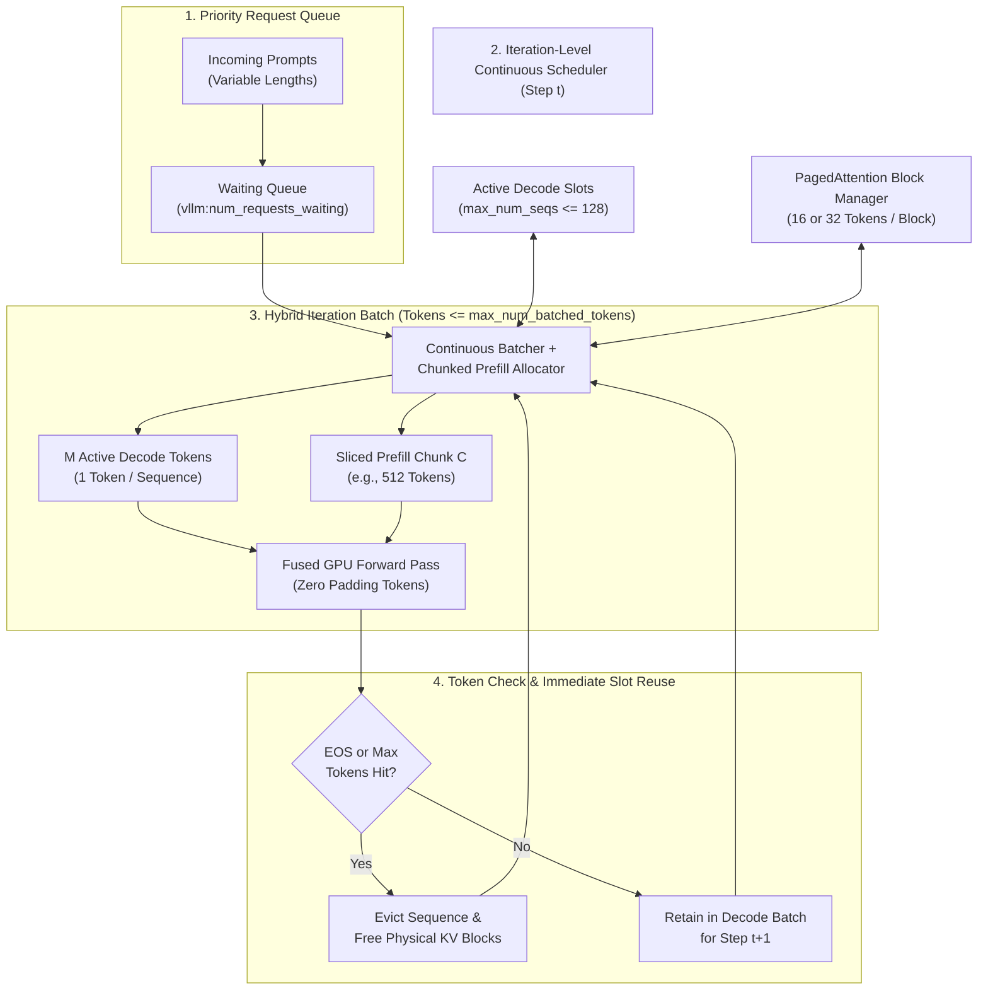
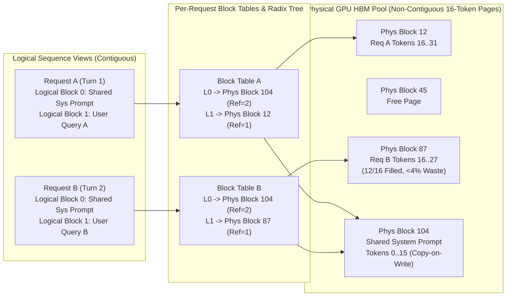
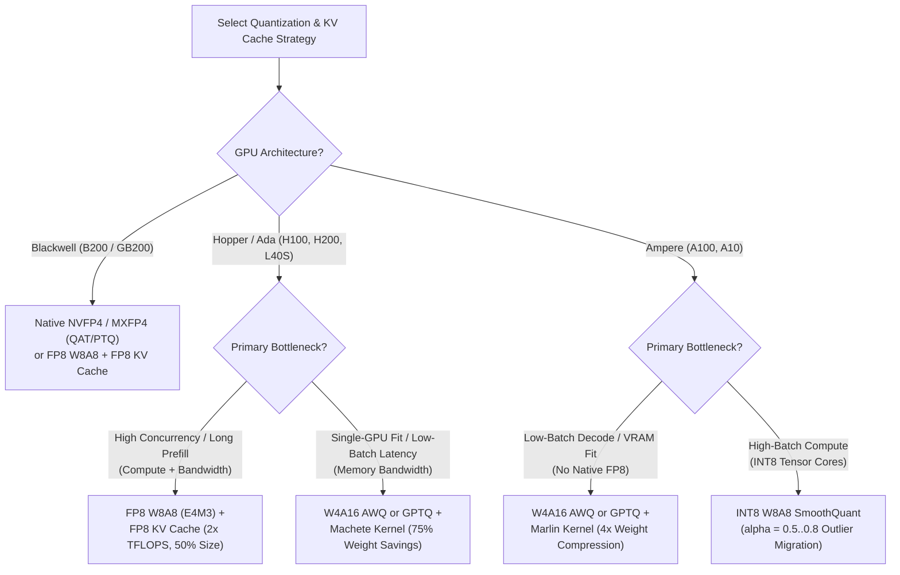

# 15.2 Batching, the KV cache and quantization fundamentals

| Field | Value |
|---|---|
| Level | Intermediate |
| Priority tier | 1 |
| Lab venue | GCP / GKE + Local Python Verification Lab |
| Part | Part 15: LLM inference and serving |
| Primary sources | *Hands-On LLM Serving and Optimization* Chapters 1–7; *AI Engineering* Chapters 7 & 9; *LLMs in Production* Chapter 6; *LLM Engineer's Handbook* Chapter 8; *Distributed AI Systems* Chapter 6; *Generative AI on Kubernetes* Chapter 4; *AI Systems Performance Engineering* Chapters 18 & 19; NVIDIA DevOps Legacy Volume 5 (`volume-05/02-llm-inference-serving-masterclass.md`) & Zero-to-Hero Volume 12 (`chapter-04` through `chapter-08`, `labs/lab-02..03`) |
| Cross-references | Chapter 10.4 (Tensor Cores and precision formats); Chapter 10.5 (Roofline model); Chapter 15.1 (Anatomy of an inference request); Chapter 15.3 (vLLM and PagedAttention); Chapter 15.5 (TensorRT-LLM); Chapter 15.6 (Triton Inference Server) |
| Code | `code/part15/batching_kv_quantization.py`, `code/part15/batching_kv_quantization_lab.py` |
| Coverage file | `planning/coverage/chapters/15-02.md` |
| Claim & number ledger | `planning/ledgers/15-02.md` |

## Why this matters for AI infrastructure

Training a frontier language model consumes thousands of GPUs for several months. Yet the lifetime cost of serving that model in production quickly eclipses the training bill. Across deployed enterprise AI platforms, inference accounts for up to 90 percent of recurring compute expenditure. A single naive deployment decision can multiply cluster hardware costs by tenfold while breaking user latency targets.

When platform engineers move a model from a notebook into a live production service, they hit three physical walls.

- **The Decode Bandwidth Bottleneck:** Autoregressive generation emits one token at a time. To produce a single new token for one user, the GPU must stream every model weight matrix from High Bandwidth Memory into on-chip registers. At a batch size of 1, arithmetic intensity hovers near 1 FLOP per byte. That leaves GPU Tensor Cores starved for data and wastes over 95 percent of peak compute capacity.
- **The KV Cache Memory Crisis:** Recomputing self-attention over all historical tokens on every step would require quadratic compute work. Serving engines instead store past Key and Value vectors in GPU memory. This KV Cache grows linearly with sequence length and concurrency. It frequently consumes more VRAM than the model weights themselves. Pre-allocating contiguous memory buffers for maximum sequence lengths wastes 60 to 80 percent of GPU memory on fragmentation.
- **The Precision and Footprint Wall:** Storing a 70B model in 16-bit precision requires 140 GB of VRAM just for static weights. That footprint exceeds the capacity of a single 80 GB H100 GPU. Without weight and KV Cache quantization, large models force multi-GPU sharding and shrink the memory pool left for concurrent user sessions.

```text
Production Inference Bottleneck Reference Numbers (HLS Ch. 1, 2, 5, 6; AIE Ch. 9; VL5 Ch. 2; V12 Ch. 7, 8):
- Search vs LLM cost: An LLM request can be 10x more expensive than a traditional keyword search.
- Output vs Input token cost: Across commercial APIs, 1 output token costs 2x to 4x an input token and has the latency impact of ~100 input tokens.
- Enabling the KV Cache (Qwen2.5-0.5B, 100 tokens): Drops generation time from 9.1205 s (0.09 s/token without cache) to 3.1416 s (2.90x speedup).
- vLLM vs Hugging Face Transformers:
  Single prompt (Qwen2.5-0.5B): 1.12 s in vLLM vs 19.58 s in HF pipeline (17x speedup)
  4 prompts batched vs sequential in vLLM: 1.0626 s batched vs 2.3865 s sequential (2.2x improvement)
  High-concurrency throughput: 8.5x–15x (up to 24x) higher than HF Transformers and 3.3x–3.5x higher than TGI; Anyscale continuous batching study reached 23x throughput gain.
- DeepSeek-R1 (671B MoE) on vLLM: Enabling FP8 MLA kernels + higher batch size jumps throughput from 38 TPS to 600 TPS (15x increase).
- Request-Level Dynamic Batching vs Continuous Batching + Chunked Prefill (5,000 sessions, B=32, tau=50 ms):
  Replaces 65%+ padding waste and 18% SM occupancy with iteration-level slotting, cutting p99 ITL from 420 ms to 19.1 ms and raising throughput by 3.8x.
```

**Batching, KV Cache management, and quantization form a single coupled equation governing GPU compute utilization, HBM bandwidth, and concurrency capacity.** Mastering their mathematical interactions lets you turn a memory-starved endpoint into a fast, high-throughput service.

## Prerequisites and outcomes

### Prerequisites
- Familiarity with the two-phase anatomy of an LLM inference request from Chapter 15.1.
- Understanding of GPU Streaming Multiprocessors, Tensor Cores, and the HBM-to-SRAM memory hierarchy from Chapters 10.2 through 10.5.
- Basic working knowledge of Docker containers, Kubernetes pods, and Prometheus telemetry from Parts 4, 5, and 17.

### Outcomes
After completing this chapter, you will be able to complete five core engineering tasks.
1. Calculate matrix multiplication arithmetic intensity for Prefill and Decode phases across NVIDIA A10, L40S, A100, H100, H200, and B200 accelerators.
2. Contrast Static Batching, Dynamic Batching, and Continuous Batching, and configure Chunked Prefill token budgets to bound Inter-Token Latency.
3. Compute exact KV Cache memory footprints across MHA, GQA, MQA, and Multi-Head Latent Attention, and size cluster concurrency using PagedAttention models.
4. Evaluate PTQ and QAT formats including FP8, INT8 SmoothQuant, INT4 AWQ and GPTQ, NVFP4, and quantized KV Caches.
5. Diagnose and fix production inference failures including long-context prefill OOMs, PCIe swap thrashing, prefill latency spikes, and quantization accuracy collapse.

---

## 1. Prefill vs Decode Roofline Mechanics and Batching Paradigms

### 1.1 The Roofline Dichotomy: Why Single-Stream Decode Starves the GPU

Autoregressive language models generate responses in two distinct computational stages that stress completely different parts of the GPU silicon. When a prompt arrives, the engine executes the **Prefill** phase. It processes all input tokens in parallel to compute initial hidden states and populate the KV Cache. Once the first output token is emitted, the engine enters the **Decode** phase. It then generates one token per step conditioned on all prior tokens.

To understand why Prefill is compute-bound while Decode is memory-bandwidth-bound, we examine the **Arithmetic Intensity** of a linear projection layer. Suppose we multiply an activation matrix of shape M by K with a weight matrix of shape K by N in 16-bit precision. Each element occupies 2 bytes. The matrix multiplication executes 2 times M times N times K floating-point operations while reading both inputs and writing the output across the HBM bus.

```text
Matrix Multiplication Arithmetic Intensity & Roofline Equations (HLS Ch. 5; AIE Ch. 9; V12 Ch. 7):
- Total FLOPs = 2 * M * N * K
- Total Bytes Moved (FP16/BF16, 2 bytes/element) = 2 * (M * K + K * N + M * N)
- Arithmetic Intensity (FLOPS/Byte) = (2 * M * N * K) / (2 * (M * K + K * N + M * N))
                                    = (M * N * K) / (M * K + K * N + M * N)

For an LLM linear projection with hidden dimension K = N = h and token count M = s (at batch size B = 1):
- Prefill (M = s tokens in parallel):
  AI_prefill = (s * h * h) / (2 * s * h + h * h)
- Decode (M = s_decode = 1 token per step):
  AI_decode = (1 * h * h) / (2 * h + h * h) = h / (h + 2) ~ 1.0 FLOPS/Byte (and ~ B FLOPS/Byte for batch size B)

GPU Ridge Point (Crossover Arithmetic Intensity):
- Ridge_Point (FLOPS/Byte) = Peak_Compute_FLOPS / Peak_Memory_Bandwidth_Bytes_Per_Sec
- L40S Example (HLS Ch. 5 Table 5-8): 362 TFLOPS / 864 GB/s = 418.98 ~ 419 FLOPS/Byte

Model Bandwidth Utilization (MBU, AIE Ch. 9):
- Bandwidth_Used (GB/s) = Parameter_Count_Billions * Bytes_Per_Parameter * Tokens_Per_Second
- MBU (%) = (Bandwidth_Used / Theoretical_Peak_Bandwidth) * 100
- 7B FP16 Example at 100 tokens/s on A100 (2 TB/s):
  7B * 2 bytes * 100 tok/s = 1,400 GB/s (or 700 GB/s in INT8/FP8 -> 70% vs 35% of 2 TB/s peak bandwidth)
```

An NVIDIA L40S GPU delivers 362 TFLOPS of FP16 Tensor Core compute and 864 GB/s of memory bandwidth. Dividing those two specs places the Roofline ridge point at 419 FLOPS per byte. Any kernel below 419 FLOPS per byte is bottlenecked by memory bandwidth. Any kernel above 419 FLOPS per byte is bottlenecked by compute FLOPS. Table 15.2.1 shows how matrix dimensions and sequence lengths shift the workload across this hardware boundary.

| Workload / Matrix Configuration | Token Dimension (M) | Hidden Dimension (K = N = h) | Arithmetic Intensity (FLOPS/Byte) | Bottleneck Regime on L40S (Ridge = 419 FLOPS/B) |
|---|---|---|---|---|
| Square MatMul (M = N = K = 64) | 64 | 64 | 21.33 (~21) | Memory-bandwidth-bound |
| Square MatMul (M = N = K = 512) | 512 | 512 | 170.67 (~170) | Memory-bandwidth-bound |
| Square MatMul (M = N = K = 4096) | 4,096 | 4,096 | 1,365.33 (~1,365) | Compute-bound |
| LLM Prefill (s = 64, B = 1) | 64 | 4,096 | 62.06 | Memory-bandwidth-bound |
| LLM Prefill (s = 512, B = 1) | 512 | 4,096 | 409.60 | Memory-bandwidth-bound (near ridge point) |
| LLM Prefill (s = 4096, B = 1) | 4,096 | 4,096 | 1,365.33 | Compute-bound (saturates Tensor Cores) |
| LLM Decode (s_decode = 1, B = 1) | 1 | 4,096 | 1.00 | Severely memory-bandwidth-bound |

During single-request Decode, the GPU loads billions of weight parameters from HBM to multiply against a single token vector. Arithmetic intensity stays locked near 1.0 FLOPS per byte regardless of how long the prompt was. The only way to raise Decode arithmetic intensity toward the Roofline ridge point is to group multiple concurrent requests together. That way, the GPU computes B output tokens for every weight fetch.

| Accelerator | GPU Memory | Memory Bandwidth | FP16 / BF16 Tensor Core | FP8 Tensor Core | Native FP8 | Intra-Node Interconnect | Ridge Point (FP16 FLOPS/B) |
|---|---|---|---|---|---|---|---|
| NVIDIA A10 | 24 GB GDDR6 | 600 GB/s (0.6 TB/s) | 125 TFLOPS | Not supported | No | PCIe Gen4 (64 GB/s) | 208.3 |
| NVIDIA L40S | 48 GB GDDR6 | 864 GB/s (0.864 TB/s) | 362.05 TFLOPS | 733 TFLOPS | Yes | PCIe Gen4 (64 GB/s) | 419.0 |
| NVIDIA A100 SXM | 80 GB HBM2e | 1,935 GB/s (1.935 TB/s) | 312 TFLOPS | Not supported | No | NVLink / NVSwitch (600 GB/s) | 161.2 |
| NVIDIA H100 PCIe | 80 GB HBM2e | 2,000 GB/s (2.0 TB/s) | 1,513 TFLOPS | 3,026 TFLOPS | Yes | PCIe Gen5 (128 GB/s) | 756.5 |
| NVIDIA H100 NVL | 94 GB HBM3 | 3,900 GB/s (3.9 TB/s) | 1,671 TFLOPS | 3,341 TFLOPS | Yes | Dual-GPU NVLink Bridge (600 GB/s) | 428.5 |
| NVIDIA H100 SXM | 80 GB HBM3 | 3,350 GB/s (3.35 TB/s) | 1,979 TFLOPS | 3,958 TFLOPS | Yes | NVLink 4 / NVSwitch (900 GB/s) | 590.7 |
| NVIDIA H200 SXM | 141 GB HBM3e | 4,800 GB/s (4.8 TB/s) | 1,979 TFLOPS | 3,958 TFLOPS | Yes | NVLink 4 / NVSwitch (900 GB/s) | 412.3 |
| NVIDIA B200 SXM | 180 GB HBM3e | 8,000 GB/s (8.0 TB/s) | 4,500 TFLOPS | 9,000 TFLOPS | Yes (plus NVFP4) | NVLink 5 / NVSwitch (1,800 GB/s) | 562.5 |

### 1.2 Static vs Dynamic vs Continuous (In-Flight) Batching

Grouping requests into batches amortizes the HBM weight read across multiple active users and multiplies throughput. Yet how the serving scheduler forms and releases those batches determines whether user latency stays low or explodes under load.

1. **Static Batching:** The client or server waits until a fixed number of requests accumulates before launching execution. It then holds the entire batch until all sequences finish. If nine requests arrive in one second and the tenth arrives five minutes later, the first nine users sit idle for five minutes.
2. **Request-Level Dynamic Batching:** Traditional deep learning servers such as Triton Inference Server use this mode for vision or embedding models. The scheduler collects requests until either `max_batch_size` is reached or a timer `max_queue_delay_microseconds` expires. While this bounds initial queue delay, the formed batch still executes as a locked rectangular tensor from start to finish.
3. **Iteration-Level Continuous Batching:** Pioneered by the Orca serving system and also called In-Flight Batching, this approach is standard in vLLM, TensorRT-LLM, SGLang, and TGI. The scheduler makes decisions at every single token generation step rather than across the full request lifecycle.

```text
Request-Level Padding Waste & Tail-Latency Locking Math (V12 Ch. 7):
- Padding Waste Ratio = 1 - (sum_{i=1}^B L_i) / (B * max_{i=1}^B L_i)
- Worked Example (B = 32): 31 short greeting queries (10 tokens each) batched with 1 long essay request (2,000 tokens):
  Valid tokens = (31 * 10) + 2,000 = 2,310 tokens
  Padded tensor allocation = 32 * 2,000 = 64,000 tokens
  Padding Waste Ratio = 1 - (2,310 / 64,000) = 96.39% (in heterogeneous production traffic, waste routinely exceeds 65%)
  Tail-Latency Locking: The 31 short requests finish at step 10 but remain trapped in GPU VRAM for 1,990 extra iterations!
```

When request-level dynamic batching is applied to autoregressive LLMs, shorter sequences must be padded with dummy tokens to match the longest sequence. That padding wastes over 65 percent of compute and memory bandwidth. Worse, finished sequences cannot return their final response or release their KV Cache slots until the longest request finishes. Under Continuous Batching, any sequence that emits an end-of-sequence token at step t is immediately evicted from the batch. Its KV Cache blocks are freed right away, and a waiting request from the queue slots into the next step with zero padding waste.

### 1.3 Chunked Prefill and Iteration Token Budgets

Continuous Batching eliminates padding waste and early-finish stalls. However, naively mixing new prefill requests with ongoing decode requests in the same iteration creates a severe tail-latency problem called the **Prefill Bubble**. Suppose 45 users are actively streaming decode tokens at 15 ms per step when a new user submits a 12,288-token document prompt. If the continuous batcher admits the entire prompt into the next iteration, the compute-heavy prefill GEMM monopolizes the GPU for 320 ms. All 45 active decode streams freeze during that step, spiking p99 Inter-Token Latency to 340 ms.

To eliminate prefill bubbles, modern schedulers implement **Chunked Prefill**, introduced by the Sarathi-Lean architecture. Instead of executing a long prompt in a single monolithic pass, the scheduler slices the prompt into fixed-size chunks, typically 512 or 1,024 tokens. It then piggybacks one chunk per iteration alongside the active decode tokens.

```text
Chunked Prefill Iteration Token Budget Constraint (V12 Ch. 7; HLS Ch. 6; AIE Ch. 4 & 9):
- Iteration Budget Rule:
  sum_{i in Decode} 1 + sum_{j in Prefill_Chunks} C_j <= MaxTokensPerIter (--max-num-batched-tokens)
- Worked Example (12,288-token prompt + 45 active decode requests, chunk size C = 512, MaxTokensPerIter = 2,048):
  Without Chunked Prefill: Step processes 45 + 12,288 = 12,333 tokens -> ~320–380 ms kernel duration (p99 ITL = 340 ms)
  With Chunked Prefill: Prompt is sliced into 12,288 / 512 = 24 chunks of 512 tokens.
  Each iteration processes 45 decode tokens + 512 prefill tokens = 557 tokens (<= 2,048 budget) -> ~21.4–28 ms duration!

End-to-End Latency and Goodput Formulas (HLS Ch. 4; AIE Ch. 9):
- End-to-End Latency (N output tokens): E2E = TTFT + ITL * (N - 1)   (or TTFT + TPOT * N)
- Human reading speed baseline: ~120 ms/token (6–8 tokens/s); streaming chatbots target 11–50 tokens/s (20–50 ms TPOT).
- Goodput: Completed requests per second (or minute) that strictly satisfy both TTFT and TPOT SLOs
  (e.g., if a server completes 100 RPM but only 30 satisfy TTFT <= 200 ms and TPOT <= 100 ms, Goodput = 30 RPM).
```



| Batching Paradigm | Scheduling Granularity | Padding Waste | Short-Request Early Exit | Decode ITL Stability Under Long Prompts | Typical GPU Compute Utilization |
|---|---|---|---|---|---|
| Static Batching | Fixed batch of B requests | Severe (over 70%) | Blocked until longest request finishes | Poor (locked to batch max length) | Very low (10%–20%) |
| Request-Level Dynamic Batching | Batch formed by size B or delay tau | High (40%–65%+) | Blocked until longest request finishes | Poor (p99 ITL spikes to 420 ms) | Low (15%–30%, e.g., 18% SM occupancy) |
| Continuous Batching (Orca) | Single-token iteration step t | Zero (0%) | Immediate eviction on EOS | Moderate (spikes during unchunked prefill) | Medium to High (40%–60%) |
| Continuous Batching + Chunked Prefill | Iteration step t + prompt chunks C | Zero (0%) | Immediate eviction on EOS | Deterministic (bounded under 20–28 ms) | High (75%–92%) |

Before you expose an LLM endpoint to multi-tenant traffic, enable Continuous Batching with Chunked Prefill and tune `--max-num-batched-tokens` so a single large prompt can never stall active decode streams.

---

## 2. The KV Cache: Attention Architectures, PagedAttention and Capacity Planning

### 2.1 KV Cache Memory Math: MHA vs GQA vs MQA vs DeepSeek MLA

During autoregressive decoding, self-attention at each step multiplies the current token's Query vector against the Key and Value vectors of every preceding token. Recomputing those historical Key and Value projections from scratch at every step would require quadratic work per token. By caching past Key and Value tensors in GPU HBM, the **KV Cache** reduces per-step projection work to constant time. Even on a small model, enabling the KV Cache speeds up 100-token generation by 2.9x.

However, the KV Cache trades compute for memory capacity. Across all transformer layers, each token stores both a Key vector and a Value vector for every Key-Value head.

```text
KV Cache Memory Equations Across Attention Architectures (V12 Ch. 8; VL5 Ch. 2; HLS Ch. 5 & 6; AIE Ch. 9):
1. Standard Per-Token KV Cache Footprint (MHA, GQA, MQA):
   M_token = 2 (K and V) * L * H_kv * D_head * P_bytes
   M_total = M_token * S * B

2. Attention Architecture Head Ratios:
   - Multi-Head Attention (MHA): H_kv = H_q (1:1 ratio, 100% baseline footprint)
   - Grouped-Query Attention (GQA): H_kv = H_q / G (group size G; e.g., 8:1 ratio = 12.5% footprint, 87.5% savings)
   - Multi-Query Attention (MQA): H_kv = 1 (all query heads share 1 KV head = 1 / H_q footprint)
   - Multi-Head Latent Attention (MLA, DeepSeek-V2/V3/R1):
     Compresses Keys and Values jointly into a low-rank latent vector c_t^KV (kv_lora_rank d_c = 512)
     plus a decoupled Rotary Position Embedding key k_t^R (qk_rope_head_dim d_R = 64):
     Elements per layer = d_c + d_R = 512 + 64 = 576 elements (equivalent to GQA with 576 / (2 * 128) = 2.25 KV groups!)
     M_token_MLA = L * (d_c + d_R) * P_bytes

3. Canonical Model KV Cache Footprints (FP16/BF16, P_bytes = 2):
   - Llama-2-7B (MHA: L=32, H_q=32, H_kv=32, D_head=128):
     M_token = 2 * 32 * 32 * 128 * 2 = 524,288 bytes = 512 KiB = 0.5 MiB/token
     At B=16, S=4096: 0.5 MiB * 4096 * 16 = 32 GiB (larger than the 14 GB model weights!)
     GPU Batch Fit (HLS Ch. 5 Table 5-7):
       A10 (24 GB VRAM - 14 GB weights = 10 GB left): 10 * 1024 / (0.5 * 4096) = 5 theoretical -> B = 4 practical ($2/hr)
       L40S (48 GB VRAM - 14 GB weights = 34 GB left): 34 * 1024 / (0.5 * 4096) = 17 theoretical -> B = 16 practical ($3.75/hr)
   - Llama-2-13B (MHA: L=40, H_q=40, H_kv=40, D_head=128, H=5120):
     At B=32, S=2048: 2 * 32 * 2048 * 40 * 5120 * 2 = 53,687,091,200 bytes ~ 53.69 GB (54 GB in AIE Ch. 9; 50.0 GiB)
   - Llama-3-8B (GQA 4:1: L=32, H_q=32, H_kv=8, D_head=128):
     M_token = 2 * 32 * 8 * 128 * 2 = 131,072 bytes = 128 KiB/token (4x smaller than Llama-2-7B)
   - 70B MHA Baseline (L=80, H_q=64, H_kv=64, D_head=128):
     M_token = 2 * 80 * 64 * 128 * 2 = 2,621,440 bytes = 2.5 MiB/token (~2.6 MB/token)
     Single 128K sequence: 312.5 GiB; Batch B=128 at S=2048: 687.2 GB (~687 GB)
   - Llama-2-70B / Llama-3-70B (GQA 8:1: L=80, H_q=64, H_kv=8, D_head=128):
     M_token = 2 * 80 * 8 * 128 * 2 = 327,680 bytes = 320 KiB/token (~0.31 MiB/token, 8x smaller than MHA)
     Single 4K sequence (S=4096): 1.25 GiB (1.34 GB); Single 128K sequence (S=128,000): 39.06 GiB
     Batch B=128 at S=2048: 80.0 GiB (85.9 GB / ~86 GB)
   - DeepSeek-V3 / R1 (MLA: L=61, H_q=128, d_c=512, d_R=64):
     M_token (BF16) = 61 * 576 * 2 = 70,272 bytes = 68.625 KiB/token (or 35,136 bytes = 34.31 KiB/token in FP8)
   - PaLM 500B+ (MHA: B=512, S=2048, AIE Ch. 9): Total KV Cache = 3 TB (3x the model weights).
```

Table 15.2.2 compares the four major attention mechanisms and their impact on KV Cache capacity and model quality.

| Attention Mechanism | Key-Value Head Structure | Elements Cached per Layer | Per-Token KV Footprint (80 Layers, D_head=128, BF16) | Reduction vs MHA | Production Trade-off and Adoption |
|---|---|---|---|---|---|
| Multi-Head Attention (MHA) | H_kv = H_q (e.g., 64 KV heads) | 16,384 | 2,621,440 B (2.50 MiB) | 1.0x (0% savings) | Highest memory cost; makes 128K context impossible on a single 80 GB GPU (312.5 GiB per sequence). Used in GPT-3, Llama-1, Llama-2-7B/13B. |
| Multi-Query Attention (MQA) | H_kv = 1 (single shared KV head) | 256 | 40,960 B (40.0 KiB) | 64.0x (98.4% savings) | Extreme KV compression, but sharing a single KV head across 64 query heads degrades accuracy on complex reasoning. Used in Falcon-40B, PaLM. |
| Grouped-Query Attention (GQA) | H_kv = H_q / G (e.g., 8 KV heads, G=8) | 2,048 | 327,680 B (320.0 KiB) | 8.0x (87.5% savings) | Industry standard sweet spot; matches MHA accuracy while cutting KV Cache by 8x. Used in Llama-2-70B, Llama-3, Mistral, Qwen2.5. |
| Multi-Head Latent Attention (MLA) | Low-rank latent (512) + RoPE (64) | 576 (2.25 GQA groups eq.) | 92,160 B at 80L (70,272 B at 61L) | 28.4x vs 128-head MHA | Compresses KV into a joint latent space; achieves smaller KV Cache than GQA (2.25 groups equivalent) while outperforming MHA accuracy. Used in DeepSeek-V2/V3/R1. |

### 2.2 PagedAttention Virtual Memory and Prefix Caching

Even after GQA or MLA shrinks the per-token footprint, how the serving runtime allocates GPU memory for the KV Cache determines how many requests can run concurrently. Early serving systems allocated a single contiguous tensor buffer of maximum sequence length for every admitted request. Because output length is unknown ahead of time, reserving 4,096 tokens for a request that finishes after 500 tokens wastes 87.8 percent of its buffer on **internal fragmentation**. Worse, as variable-length requests arrive and depart, physical HBM becomes fragmented with non-contiguous gaps. That issue is called **external fragmentation**. In production benchmarks, contiguous allocation utilizes only 20.4 to 38.2 percent of allocated KV Cache memory. The remaining 60 to 80 percent of GPU RAM is wasted.

Introduced by vLLM and now standard across TensorRT-LLM, TGI, SGLang, and LMDeploy, **PagedAttention** applies operating-system virtual memory paging to the KV Cache.
1. **Fixed-Size Physical Blocks:** The engine pre-allocates available GPU VRAM into a global pool of uniform physical KV blocks. Each block holds Key and Value vectors for a fixed number of tokens, typically 16 or 32 tokens.
2. **Logical-to-Physical Block Tables:** Each sequence sees a contiguous logical token space. A per-request Block Table maps each logical block index to an arbitrary non-contiguous physical block address in HBM.
3. **On-Demand Allocation and Zero-Padding Attention:** Physical blocks are allocated one at a time only as new tokens are generated. External fragmentation drops to 0 percent. Internal fragmentation is strictly bounded to the unfilled slots of a sequence's final block, keeping total memory waste under 4 percent. During decode, the PagedAttention CUDA kernel iterates only over the physical blocks listed in each sequence's Block Table. It executes zero FLOPs on padding positions and enables 2x to 4x higher concurrency.



Paging also unlocks **Prefix Caching** across requests. In multi-turn chat, RAG, and agentic workflows, thousands of requests share identical system prompts or document contexts. Engines index physical KV blocks via content hashes in vLLM Automatic Prefix Caching or via a compressed prefix tree in SGLang **RadixAttention**. When a new request arrives, the engine matches shared prompt prefixes in constant lookup time and increments the physical block reference count without recomputing prefill attention. Reusing cached prefixes reduces Time to First Token by 75 to 90 percent. In multi-tenant deployments, platform engineers must inject a tenant or session identifier right after the system prompt tag before any confidential documents. That isolation prevents one tenant from inferring another tenant's cached documents through TTFT timing side-channels.

### 2.3 Concurrency Capacity Planning and Preemption (Swap vs Recompute)

Before deploying a model to production, infrastructure engineers must calculate the maximum concurrent active sequences that a GPU node can sustain without exhausting VRAM. When a serving engine starts, it profiles memory usage and partitions total device HBM into four regions. Those regions hold static model weights, non-PyTorch CUDA context overhead, peak intermediate activation workspace, and the dynamic KV Cache block pool.

```text
VRAM Allocation Budget & Concurrency Capacity Planning Equations (V12 Ch. 8; GAK Ch. 4):
1. Model Weight Memory:
   VRAM_weights = (Parameters_Billions * Precision_Bytes) / Tensor_Parallel_Size
2. Available KV Cache Pool (at GPU utilization ratio u, typically 0.85 to 0.90):
   VRAM_kv_pool = (VRAM_total * u) - VRAM_weights - VRAM_workspace
3. Maximum Concurrent Sequences (C_max):
   C_max = floor(VRAM_kv_pool / (M_token * S_avg))

vLLM Startup Memory Profiling Log Example on 80 GB GPU (GAK Ch. 4 Example 4-3):
- Total GPU memory = 79.14 GiB; gpu_memory_utilization = 0.90 -> Usable = 79.14 * 0.90 = 71.226 GiB (71.22 GiB)
- Breakdown: 14.99 GiB model weights + 0.12 GiB non-torch memory + 1.19 GiB peak PyTorch activations
- Remaining reserved for KV Cache = 71.226 - 14.99 - 0.12 - 1.19 = 54.93 GiB

Preemption Policy Math: Host-Device PCIe Swap vs GPU Prefill Recompute (V12 Ch. 7):
- Swap Time (out + in across PCIe):
  t_swap = 2 * (2 * L * S * H_kv * D_head * P_bytes) / B_PCIe
  (On PCIe Gen4 x16 at 64 GB/s, swapping a 4 GB KV tensor one-way takes 4 GB / 64 GB/s = 62.5 ms, or 125 ms round-trip)
- Recompute Time (rerunning prompt prefill on GPU Tensor Cores):
  t_recompute = (2 * L * S^2 * H + 12 * L * S * H^2) / T_GPU
- Crossover Rule: On modern GPUs (e.g., H100 at 989 TFLOPS FP16 vs 64 GB/s PCIe), t_recompute < t_swap for all short-to-medium sequences (S < 8,192 tokens). Always set --swap-space 0 and preemption_mode="recompute" for real-time serving!
```

Table 15.2.3 provides the concurrency capacity planning matrix for **Llama-3-70B** in BF16 precision across 4-GPU and 8-GPU 80 GB clusters.

| Hardware Topology | Total Cluster VRAM | Usable VRAM (u = 0.90) | BF16 Weight Footprint | Available KV Cache Pool | C_max (S_avg = 2,048) | C_max (S_avg = 8,192) | C_max (S_avg = 32,768) |
|---|---|---|---|---|---|---|---|
| 4x A100-80GB or 4x H100-80GB (TP=4) | 320 GB | 288 GB | 140 GB | 140 GB | 218 requests | 54 requests | 13 requests |
| 8x A100-80GB or 8x H100-80GB (TP=8) | 640 GB | 576 GB | 140 GB | 428 GB | 668 requests | 167 requests | 41 requests |

Doubling Tensor Parallelism from 4 to 8 GPUs does not merely double KV Cache capacity. It more than triples maximum concurrency from 218 to 668 sequences because the 140 GB model weights are stored only once across the 8-GPU NVLink domain. That leaves 428 GB of HBM free for KV Cache pages. When burst traffic exceeds capacity and exhausts free blocks, the scheduler must preempt active sequences. PCIe Gen4 and Gen5 buses transfer only 64 to 128 GB/s, which is orders of magnitude slower than H100 Tensor Core compute. Swapping KV blocks to host CPU RAM saturates the PCIe bus and stalls kernel launches. Always configure `--swap-space 0` and rely on recomputation and ingress queue admission control for real-time x86 PCIe servers.

---

## 3. Quantization Fundamentals: PTQ vs QAT, FP8, SmoothQuant, AWQ/GPTQ, NVFP4 and KV Cache Quantization

### 3.1 Number Formats, Rounding vs Clamping Error and Calibration

Quantization compresses a neural network by representing its weights, activations, or KV Cache tensors in lower-bit numerical formats instead of 32-bit or 16-bit floating point. Lowering precision delivers three compounding advantages for LLM serving.
1. **Smaller VRAM footprint:** Cutting parameter width from 16 bits to 8 bits or 4 bits shrinks a 70B model from 140 GB to 70 GB or 35 GB. That allows the model to fit on a single 80 GB GPU and frees tens of gigabytes for KV Cache blocks.
2. **Higher decode memory bandwidth efficiency:** Because autoregressive decode is bottlenecked by HBM bandwidth, reading 4-bit or 8-bit weights moves two to four times fewer bytes per token. That directly lowers Inter-Token Latency.
3. **Faster Tensor Core compute:** When both weights and activations are quantized to 8-bit or 4-bit formats supported by hardware Tensor Cores, peak compute throughput doubles. On an H100 SXM GPU, throughput jumps from 1,979 TFLOPS in BF16 or FP16 to 3,958 TFLOPS in FP8 or INT8.

Every quantization algorithm must manage two distinct sources of numerical distortion. **Rounding error** occurs when a continuous value falls between two discrete grid steps. **Clamping error**, also called clipping, occurs when an outlier exceeds the maximum representable range of the target format.

```text
Floating-Point vs Integer Representations & Quantization Math (HLS Ch. 6; V12 Ch. 4; LEH Ch. 8):
1. Floating-Point Value Equation:
   Value = (-1)^sign * (1 + mantissa) * 2^(exponent - bias)
   (Logarithmic / non-uniform spacing: dense near zero, wider steps at large magnitudes)
   - FP32 (32-bit, 4 B): 1 sign + 8 exponent + 23 mantissa (dynamic range ~ +-3.4 * 10^38)
   - FP16 (16-bit, 2 B): 1 sign + 5 exponent + 10 mantissa (dynamic range ~ +-65,504; underflow/overflow risk)
   - BF16 (16-bit, 2 B): 1 sign + 8 exponent + 7 mantissa (same +-3.4 * 10^38 exponent range as FP32; zero clamping risk from FP32)
   - FP8 E4M3 (8-bit, 1 B): 1 sign + 4 exponent + 3 mantissa (range [-448, +448]; higher precision -> weights & activations)
   - FP8 E5M2 (8-bit, 1 B): 1 sign + 5 exponent + 2 mantissa (range [-57,344, +57,344]; wider range -> gradients & KV Cache)
   - FP4 E2M1 / NVFP4 / MXFP4 (4-bit, 0.5 B): 1 sign + 2 exponent + 1 mantissa (range [-6.0, +6.0] with micro-block scales)

2. Rounding vs Clamping Error Examples (HLS Ch. 6):
   - Rounding Error: Converting FP32 7.6 to integer rounds to 8 -> Rounding Error = 8 - 7.6 = 0.4
   - Clamping Error: Converting FP32 1,000 to unscaled FP8 E4M3 (max 448) clamps 1,000 -> 448 (severe distortion!)

3. Symmetric (Absmax) vs Asymmetric (Zero-Point) INT8 Quantization (LEH Ch. 8):
   - Symmetric Absmax (maps [-max(|X|), +max(|X|)] to [-127, +127]):
     S = 127 / max(|X|)   (or S_step = max(|X|) / 127)
     X_quant = clip(round(X * S), -127, 127),   X_dequant = X_quant / S
     Worked Example on [-3.0, 0.1, 3.2]: max(|X|) = 3.2 -> S = 127 / 3.2 = 39.6875
     For X = 0.1: X_quant = round(0.1 * 39.6875) = 4; X_dequant = 4 / 39.6875 = 0.1008 (rounding error = 0.0008)
   - Asymmetric Zero-Point (maps [X_min, X_max] to [-128, +127]):
     S = 255 / (X_max - X_min),   Z = round(-S * X_min - 128)
     X_quant = clip(round(S * X + Z), -128, 127),   X_dequant = (X_quant - Z) / S
     Worked Example on [-3.0, 0.1, 3.2]: range = 6.2 -> S = 255 / 6.2 = 41.1290, Z = round(3.0 * 41.1290 - 128) = -5
     For X = 0.1: X_quant = round(0.1 * 41.1290 - 5) = -1; X_dequant = (-1 - (-5)) / 41.1290 = 0.0973

4. TensorRT KL-Divergence Entropy Calibration (IInt8EntropyCalibrator2, V12 Ch. 4):
   Collects 2,048-bin activation histograms over 500–1,000 representative calibration samples and selects clipping threshold T*
   minimizing Kullback-Leibler divergence between reference distribution P and quantized distribution Q:
   D_KL(P || Q) = sum_{i=1}^N P(i) * log(P(i) / Q(i)),   Scale S = T* / 127
```

### 3.2 Weight-Only (W4A16 AWQ/GPTQ) vs Weight-and-Activation (W8A8 SmoothQuant/FP8)

In production LLM serving, quantization algorithms divide into two architectural families based on whether only weights or both weights and activations are compressed.

- **Weight-Only Quantization (W4A16 — GPTQ, AWQ, EXL2, NF4):** Only the static model weights are compressed to 4-bit integers, while activations remain in 16-bit FP16 or BF16. Because weights are four times smaller, W4A16 cuts weight memory by 75 percent and slashes HBM traffic during memory-bandwidth-bound decoding. During execution, specialized mixed-precision CUDA kernels such as the **Marlin** kernel on NVIDIA Ampere and the **Machete** kernel on NVIDIA Hopper load packed INT4 weights from HBM. They dequantize the weights into FP16 inside SM registers on the fly and execute FP16 Tensor Core matrix multiplications in a single fused pass.
  - **GPTQ:** Formulates layer-wise post-training weight quantization using second-order Hessian inverse information. It quantizes weight columns in lazy batches using Cholesky decomposition and adjusts remaining unquantized weights to compensate for quantization error.
  - **AWQ:** Activation-Aware Weight Quantization observes that roughly 0.1 to 1 percent of weight channels are salient because they multiply high-magnitude activation channels. Mixed-precision decomposition methods like `LLM.int8()` route those 0.1 percent outlier channels to FP16 and the remaining 99.9 percent to INT8, which slows large-model inference by about 20 percent. AWQ instead protects salient weight channels by applying per-channel scaling factors before 4-bit uniform quantization, avoiding runtime splitting and calibration-set overfitting.
- **Weight-and-Activation Quantization (W8A8 — INT8 SmoothQuant and Native FP8):** Compresses both weights and intermediate activations to 8 bits. That cuts weight memory by 50 percent while unlocking 8-bit Tensor Core instructions that double compute TFLOPS.
  - **SmoothQuant:** In large transformers, hidden-state activations develop extreme systematic outliers up to 100x larger than typical tokens in specific channels, whereas weight distributions remain flat and uniform. Naive per-tensor INT8 activation quantization squashes normal channels to zero. SmoothQuant eliminates activation outliers offline by dividing each activation channel by a smoothing factor and multiplying the corresponding weight row by the same factor.
  - **Native FP8:** On Hopper, Ada Lovelace, and Blackwell GPUs, native FP8 Tensor Cores use non-uniform logarithmic spacing with E4M3 for weights and activations. That format naturally accommodates activation variance with minimal calibration and recovers over 99 percent of baseline FP16 accuracy.

```text
SmoothQuant Mathematical Formulation & W4A16 vs W8A8 Trade-offs (V12 Ch. 5; HLS Ch. 6; GAK Ch. 4):
1. SmoothQuant Equivalence Identity:
   Y = X * W = (X * diag(s)^(-1)) * (diag(s) * W) = X_hat * W_hat
   Per-channel migration scale (with migration strength alpha in [0.5, 0.8]):
   s_j = (max(|X_j|)^alpha) / (max(|W_j|)^(1 - alpha))
   Worked Example: If channel 0 has max(|X_0|) = 100.0 and max(|W_0|) = 1.0:
   At alpha = 0.5: s_0 = (100^0.5) / (1^0.5) = 10.0 -> smoothed max(|X_hat_0|) = 10.0, max(|W_hat_0|) = 10.0 (10x reduction in activation spike!)
   At alpha = 0.8 (llmcompressor recipe): s_0 = 100^0.8 = 39.81 -> smoothed max(|X_hat_0|) = 2.51

2. W4A16 (GPTQ/AWQ) vs W8A8 (FP8/INT8) Benchmark Behavior (HLS Ch. 6 Table 6-3 & Figs. 6-17..6-19 on Qwen2.5-7B-Instruct):
   - Weight Footprint & Data Movement Reduction: W4A16 = 75% (size / 4; 7B -> 3.5 GB) vs W8A8 = 50% (size / 2; 7B -> 7.0 GB)
   - Peak Compute FLOPS: W4A16 = 1x (still 16-bit Tensor Core math + dequant overhead) vs W8A8 = 2x (8-bit Tensor Core math)
   - Low Concurrency / Low Batch (Memory-Bandwidth-Bound Decode):
     W4A16 delivers ~300% latency/throughput gain over FP16 baseline (vs ~150% for W8A8) because 4x smaller weights dominate.
   - High Concurrency / High Batch & Long-Context Prefill (Compute-Bound):
     W4A16 TTFT degrades (even slower than FP16 at high concurrency due to 16-bit compute + dequantization overhead),
     whereas W8A8 FP8 excels because 2x Tensor Core FLOPS accelerates both prefill and large-batch decode!
```

### 3.3 PTQ vs QAT, Blackwell NVFP4/MXFP4 and KV Cache Quantization

SmoothQuant, GPTQ, AWQ, and FP8 calibration are all **Post-Training Quantization** techniques applied directly to frozen checkpoints after training completes. PTQ is fast, inexpensive, and preserves accuracy at 8-bit and weight-only 4-bit precision. However, pushing both weights and activations down to 4-bit floating point via naive PTQ rounding introduces noticeable accuracy loss.

**Quantization-Aware Training** overcomes this barrier by inserting simulated quantize and dequantize operations into the forward pass during training or fine-tuning. Gradient updates then adapt the weights to 4-bit precision noise. A production example is the open-weights `gpt-oss-120b` model with 117B parameters and the `gpt-oss-20b` model with 21B parameters. Both models apply FP4 E2M1 QAT across their Mixture-of-Experts layers, which hold over 90 percent of total parameters. At 0.5 bytes per parameter, `gpt-oss-120b` shrinks to 58.5 GB and fits inside a single 80 GB GPU. The smaller `gpt-oss-20b` model shrinks to 10.5 GB and runs on a single 16 GB edge device. On NVIDIA Blackwell GPUs, dedicated 4-bit Tensor Cores execute **NVFP4** natively at up to 3.5x the throughput of FP16 while using only 20 percent of baseline memory.

Finally, platform engineers should not leave the **KV Cache** in 16-bit precision when serving long contexts or high concurrency. Quantizing the KV Cache from FP16 or BF16 down to **FP8** cuts per-token KV memory in half. For Llama-3-70B, a 4,096-token KV Cache shrinks from 1.25 GiB to 0.625 GiB per sequence. In production deployments on four 80 GB GPUs, enabling FP8 KV Cache alongside 32-token PagedAttention blocks expands maximum concurrent sessions from 64 to 210. Effective KV Cache utilization rises from 52 percent to 91 percent when paired with quantized attention kernels.



| Quantization Scheme | Bit Width (Weights / Activations / KV) | Weight Memory vs FP16 | Relative Compute Speedup | Typical Accuracy Delta | Required Hardware & Kernels | Best Production Use Case |
|---|---|---|---|---|---|---|
| FP16 / BF16 Baseline | 16 / 16 / 16 | 100% (1.0x) | 1.0x | 0.0% (reference) | Volta / Ampere+ | Uncompressed baseline validation |
| W8A8 FP8 (E4M3 / E5M2) | 8 / 8 / 8 or 16 | 50% (0.5x) | 1.5x–2.0x | Under 0.1%–0.2% | Hopper (H100/H200), Ada (L40S), Blackwell | High-throughput serving, long-context prefill, high batch |
| W8A8 INT8 SmoothQuant | 8 / 8 / 8 or 16 | 50% (0.5x) | 1.4x–1.8x | 0.2%–0.5% (calibrated) | Turing (T4), Ampere (A100/A10), Hopper | High-batch compute on pre-Hopper GPUs without native FP8 |
| W4A16 GPTQ / AWQ | 4 / 16 / 16 or 8 | 25% (0.25x) | 1.8x–3.0x (low batch) | 0.3%–0.5% | Ampere (Marlin), Hopper (Machete), TurboMind | Fitting 70B on 1 GPU; low-concurrency interactive chat / agents |
| W4A4 NVFP4 / MXFP4 (QAT/PTQ) | 4 / 4 / 4 or 8 | 20%–25% (0.2x–0.25x) | Up to 3.5x | ~0.5%–1.0% (best with QAT) | Blackwell (B200 / GB200) native Tensor Cores | Ultra-large MoE models (`gpt-oss-120b`, DeepSeek-R1) at scale |

Choose W4A16 with Marlin or Machete kernels when you need 4x weight compression to fit a model onto fewer GPUs or minimize low-batch decode latency. Choose W8A8 in FP8 or SmoothQuant INT8 plus FP8 KV Cache when serving high-concurrency traffic or long-context prefills.

---

## 4. Commands and Configurations That Matter

### 4.1 vLLM Production Launch with Continuous Batching, Chunked Prefill and Prefix Caching

The following command launches a production vLLM OpenAI-compatible server for Llama-3-70B across four H100 GPUs. It enables PagedAttention, Automatic Prefix Caching, Chunked Prefill, FP8 KV Cache quantization, and zero CPU swapping.

```bash
python3 -m vllm.entrypoints.openai.api_server \
  --model meta-llama/Meta-Llama-3-70B-Instruct \
  --tensor-parallel-size 4 \
  --dtype bfloat16 \
  --kv-cache-dtype fp8 \
  --gpu-memory-utilization 0.90 \
  --block-size 16 \
  --max-model-len 16384 \
  --max-num-seqs 128 \
  --enable-chunked-prefill \
  --max-num-batched-tokens 2048 \
  --enable-prefix-caching \
  --swap-space 0 \
  --port 8000
```

To verify KV Cache saturation, queue depth, and preemption counters in real time, query the Prometheus `/metrics` endpoint. Configure alerts before `vllm:gpu_cache_usage_perc` crosses 0.85 to 0.95.

```bash
curl -s http://localhost:8000/metrics | grep -E \
  "vllm:gpu_cache_usage_perc|vllm:cpu_cache_usage_perc|vllm:num_requests_running|vllm:num_requests_waiting|vllm:num_preempted_requests_total"
```

### 4.2 TensorRT-LLM Engine Compilation and Triton Decoupled In-Flight Batching

When compiling a TensorRT-LLM engine, always enable `--use_paged_context_fmha enable` so the context phase operates over paged KV blocks. That flag is required for both chunked context and prefix block reuse.

```bash
# Step 1: Convert Hugging Face checkpoint to TensorRT-LLM format (TP=2, BF16)
python3 TensorRT-LLM/examples/llama/convert_checkpoint.py \
  --model_dir /models/Meta-Llama-3-8B-Instruct \
  --output_dir /models/trt-engines/llama-3-8b/trt_ckpt \
  --dtype bfloat16 \
  --tp_size 2 \
  --pp_size 1

# Step 2: Compile hardware-specific TensorRT-LLM engine with paged context FMHA
trtllm-build \
  --checkpoint_dir /models/trt-engines/llama-3-8b/trt_ckpt \
  --output_dir /models/trt-engines/llama-3-8b/engine \
  --gemm_plugin bfloat16 \
  --use_paged_context_fmha enable \
  --max_batch_size 128 \
  --max_input_len 4096 \
  --max_seq_len 8192 \
  --max_num_tokens 8192
```

When hosting that compiled engine inside Triton Inference Server via `config.pbtxt`, enable `decoupled: True` for Server-Sent Events token streaming. Set `enable_chunked_context` and `kv_cache_free_gpu_mem_fraction` to bound memory usage.

```protobuf
name: "tensorrt_llm"
backend: "tensorrtllm"
max_batch_size: 128

model_transaction_policy {
  decoupled: True
}

parameters: {
  key: "gpt_model_path"
  value: { string_value: "/models/trt-engines/llama-3-8b/engine" }
}
parameters: {
  key: "max_tokens_in_paged_kv_cache"
  value: { string_value: "256000" }
}
parameters: {
  key: "kv_cache_free_gpu_mem_fraction"
  value: { string_value: "0.90" }
}
parameters: {
  key: "enable_chunked_context"
  value: { string_value: "true" }
}
```

### 4.3 Compressing Models with `llmcompressor` (SmoothQuant W8A8 and GPTQ W4A16) and Evaluating Accuracy

Before deploying a quantized checkpoint, run `llmcompressor` with a representative calibration dataset. Then verify post-quantization accuracy using `lm_eval`.

```python
from llmcompressor.modifiers.quantization import GPTQModifier
from llmcompressor.modifiers.smoothquant import SmoothQuantModifier
from llmcompressor.transformers import oneshot

# SmoothQuant (alpha=0.8) migrates activation outliers to weights before W8A8 GPTQ
recipe = [
    SmoothQuantModifier(smoothing_strength=0.8),
    GPTQModifier(scheme="W8A8", targets="Linear", ignore=["lm_head"]),
]

oneshot(
    model="Qwen/Qwen2.5-7B-Instruct",
    dataset="open_platypus",
    recipe=recipe,
    output_dir="Qwen2.5-7B-Instruct-W8A8-INT8",
    max_seq_length=2048,
    num_calibration_samples=512,
)
```

```bash
# Validate post-quantization accuracy recovery (>99% target) on GSM8K before promotion
lm_eval --model vllm \
  --model_args pretrained=./Qwen2.5-7B-Instruct-W8A8-INT8,tensor_parallel_size=1 \
  --tasks gsm8k_cot \
  --device cuda:0 \
  --batch_size auto
```

Always gate production promotion of any quantized artifact on an automated `lm_eval` accuracy benchmark and a `perf_analyzer` or `guidellm` latency sweep.

---

## 5. How It Fails: Production Troubleshooting Playbook

| Failure Mode | Production Symptom & Telemetry | Root Cause | Diagnostic Command | Remediation |
|---|---|---|---|---|
| **1. Unbounded Context & Prefill Workspace OOM** | HTTP 500 errors spike to 42%; worker pods crash with `torch.cuda.OutOfMemoryError: Tried to allocate 1.42 GiB (75.12 GiB allocated; 1.10 GiB free)` and `SIGSEGV (Exit code 139)`. | `--gpu-memory-utilization` set too high (0.98, leaving only 1.6 GB headroom), `--max-model-len` left at 131072, and chunked prefill disabled; a burst of 28k–32k token prompts exhausts intermediate prefill workspace. | `nvidia-smi --query-gpu=memory.used,memory.free --format=csv -l 1` and `curl -s localhost:8000/metrics \| grep vllm:gpu_cache_usage_perc` | Lower `--gpu-memory-utilization` to 0.85–0.90, cap `--max-model-len 16384`, enable `--enable-chunked-prefill` with `--max-num-batched-tokens 2048`, and enforce API gateway prompt limits (12,000 tokens). |
| **2. PCIe Bus Thrashing from KV Cache Swapping** | Average ITL degrades by 4,000% (20 ms/tok -> 850 ms/tok) or GPU utilization drops to 0% for 4–8 s while PCIe bandwidth (`dcgm_pcie_tx_throughput`) saturates at 64 GB/s (99.4%). | `--swap-space 32` (`PreemptionMode.SWAP`) enabled; when KV blocks fill up (`vllm:gpu_cache_usage_perc=99.8%`, `cpu_cache_usage_perc=88.4%`), the scheduler swaps 28+ GB of KV blocks across PCIe (4.2 preemptions/s). | `curl -s localhost:8000/metrics \| grep -E "vllm:cpu_cache_usage_perc\|vllm:num_preempted_requests_total"` | Set `--swap-space 0` and `preemption_mode="recompute"`, enable `--enable-prefix-caching`, and scale horizontally or shed load when `vllm:gpu_cache_usage_perc` exceeds 85%. |
| **3. Prefill Bubble Stalling Decode Streams** | Average ITL is 18 ms, but p99 ITL spikes to 340 ms whenever long RAG documents (12,288 tokens) arrive, causing real-time voice/chat streams to stutter. | Continuous batching is active (`max_num_seqs=128`), but `enable_chunked_prefill` is disabled; a single 12,288-token prefill GEMM monopolizes SMs for 320 ms, blocking 45 active decode streams. | `curl -s localhost:8000/metrics \| grep -E "iteration_duration_ms\|vllm:time_per_output_token_seconds"` | Enable `--enable-chunked-prefill` and set `--max-num-batched-tokens 2048` (slices 12,288 tokens into 24 chunks of 512 tokens, bounding p99 ITL to 21.4 ms). |
| **4. Oversized KV Block Internal Fragmentation** | `[TRT-LLM][ERROR] Out of memory during KVCache block allocation` above 64 sessions on 4x A100 (TP=4), even though effective KV utilization is only 52%. | `tokens_per_block` set to 128 with FP16 KV Cache; a 129-token sequence allocates 2 full blocks (256 tokens), wasting 49.6% (~50%) of KV memory on internal fragmentation. | Inspect `KvCacheConfig` block size and `vllm:gpu_cache_usage_perc` vs active token count. | Reduce `tokens_per_block` (`--block-size`) to 16 or 32 tokens, enable FP8 KV Cache quantization (50% savings), and set `free_gpu_memory_fraction=0.85` (expands capacity from 64 to 210 sessions at 91% utilization). |
| **5. INT8 PTQ Accuracy Collapse from Narrow Calibration** | Quantized INT8 model passes synthetic latency tests (11.3 ms), but production accuracy collapses (e.g., Word Error Rate jumps from 3.2% FP16 baseline to 24.8%, or LLM perplexity spikes). | `IInt8EntropyCalibrator2` was run on non-representative short/clean samples (1.2 s vs 8.5 s noisy production inputs) or without SmoothQuant, deriving overly narrow clipping thresholds that clamp high-amplitude activation outliers. | Compare layer-by-layer activation histograms and run `lm_eval` / domain validation set before and after PTQ. | Rebuild the engine using 500–1,000 representative production calibration samples matching the 99th percentile sequence length, apply SmoothQuant (alpha = 0.5–0.8) or switch to native FP8 E4M3 / AWQ W4A16. |
| **6. DynamicShape `IOptimizationProfile` Builder OOM** | TensorRT engine build crashes on an 80 GB A100 with `out of memory` during tactic profiling, or runtime latency at typical batch B=8 is 4x slower than expected (48 ms vs 11.3 ms). | `IOptimizationProfile` configured with `OPT = MAX = (128, 4096, 4096)`, forcing 25.7 GB per-layer scratch workspace allocation during tactic search and optimizing kernels for extreme batch 128 instead of median traffic B=8. | Inspect `profile.set_shape(min, opt, max)` and `config.set_memory_pool_limit(trt.MemoryPoolType.WORKSPACE, ...)`. | Bound `MAX` to realistic upper limits, align `OPT` with median production traffic (B=8), and set an explicit workspace limit (4 GB), cutting build peak VRAM to 6.1 GB and runtime latency to 11.3 ms. |

Audit your serving flags against these six failure modes before every production load test.

---

## 6. Hands-on Lab: Verifying Batching, KV Cache Math and Quantization Models

### Lab Venue and Objectives

This lab runs in two modes.
1. **Local Python Verification Lab:** Run `code/part15/batching_kv_quantization_lab.py` on any workstation to execute 25 deterministic self-checks. The script verifies Roofline arithmetic intensity, padding waste, Chunked Prefill token budgets, KV Cache footprints, PagedAttention concurrency matrices, preemption crossovers, and quantization math.
2. **GCP / GKE GPU Cluster Benchmark:** Deploy Triton Inference Server and vLLM on a GKE node with an NVIDIA L4, L40S, A100, or H100 GPU. Those live-hardware commands are marked `untested` in this local sandbox.

### Part A: Run the Self-Checking Python Verification Lab

Execute the verification suite from the repository root.

```bash
python3 -B code/part15/batching_kv_quantization_lab.py
```

Expected output.

```text
=== Chapter 15.2 Lab: Batching, the KV Cache and Quantization Fundamentals Verification ===
  [PASS] 1. Square FP16 MatMul arithmetic intensity matches HLS Table 5-9: M=64 -> 21.33 (~21), M=512 -> 170.67 (~170), M=4096 -> 1365.33 (~1365) FLOPS/B
  [PASS] 2. L40S (362 TFLOPS / 864 GB/s) has ridge point ~419 FLOPS/B; prefill AI is 62.06 (s=64), 409.60 (s=512), and 1365.33 (s=4096) vs decode AI ~1.0 FLOPS/B
  [PASS] 3. On L40S (419 FLOPS/B ridge point), prefill becomes compute-bound at s=4096 while single-request decode remains memory-bandwidth-bound across all sequence lengths
  [PASS] 4. H100 SXM (80 GB, 3.35 TB/s, 1979 FP16 / 3958 FP8 TFLOPS, 900 GB/s NVLink) vs H100 NVL (94 GB, 3.9 TB/s, 1671 FP16 / 3341 FP8 TFLOPS, 600 GB/s) vs H200 SXM (141 GB, 4.8 TB/s)
  [PASS] 5. 7B model at 100 tokens/s moves 1,400 GB/s in FP16 (70% MBU on 2 TB/s A100) and 700 GB/s in INT8/FP8 (35% MBU), cutting memory bandwidth demand in half
  [PASS] 6. Request-level dynamic batching with 31x 10-token and 1x 2,000-token sequences wastes 96.39% (> 65%) on padding and traps short requests for 1,990 extra iterations
  [PASS] 7. Chunked Prefill slices a 12,288-token prompt into 24 chunks of 512 tokens alongside 45 decode streams (557 <= 2,048 token budget), preventing the 320 ms prefill stall
  [PASS] 8. Llama-2-7B (MHA, L=32, H=32, D=128, FP16) consumes 524,288 B (512 KiB = 0.5 MiB) per token and 32.0 GiB at B=16, S=4096 (exceeding its 14 GB weights)
  [PASS] 9. After loading 14 GB Llama-2-7B weights, A10 (24 GB -> 10 GB left) supports theoretical max batch 5 (4 practical) while L40S (48 GB -> 34 GB left) supports 17 (16 practical)
  [PASS] 10. Llama-2-13B (MHA, L=40, H*D=5120, FP16) at B=32, S=2048 requires 53.69 GB (~54 GB, 50.0 GiB) of KV cache
  [PASS] 11. 70B MHA (64 KV heads) uses 2,621,440 B (2.5 MiB / ~2.6 MB) per token and 687.19 GB (~687 GB) at B=128, S=2048 vs GQA (8 KV heads) at 327,680 B (320 KiB / ~0.31 MiB) and 85.90 GB (~86 GB), an 8x (87.5%) reduction
  [PASS] 12. Llama-3-70B single sequence consumes 1.25 GiB (1.34 GB) at S=4096 and 39.0625 GiB (~39.06 GiB) at S=128,000 under GQA vs 312.5 GiB under MHA
  [PASS] 13. MQA (1 KV head) gives 64x reduction (40 KiB/tok on 80-layer model), while DeepSeek MLA (kv_lora_rank=512 + qk_rope_head_dim=64 = 576 elements/layer) equals GQA with 2.25 groups (70,272 B/tok in BF16 across 61 layers)
  [PASS] 14. For a 500-token sequence (S_max=4096, block_size=16), contiguous reservation wastes 87.79% (> 87%) whereas PagedAttention bounds internal fragmentation to <= 3.0% (< 3.2%) and external fragmentation to 0%
  [PASS] 15. Llama-3-70B capacity matrix matches V12 Ch. 8: TP=4 (140 GB KV pool) supports 218 (S=2048), 54 (S=8192), 13 (S=32768) requests; TP=8 (428 GB KV pool) supports 668, 167, 41 requests
  [PASS] 16. vLLM startup profiling on a 79.14 GiB GPU at 0.90 utilization yields 71.226 GiB (~71.22 GiB) usable and 54.93 GiB for KV cache after 14.99 GiB weights, 0.12 GiB non-torch, and 1.19 GiB peak activations
  [PASS] 17. Transferring 4 GB over 64 GB/s PCIe Gen4 takes 62.5 ms (~62 ms); on 8x H100, Recompute is faster than PCIe Swap at S=4096 (recommended='recompute') while Swap wins at ultra-long S=65536
  [PASS] 18. Rounding 7.6 -> 8 gives error 0.4 and clamping 1000 -> 448 in FP8 E4M3; on [-3.0, 0.1, 3.2], absmax maps 0.1 -> 4 (scale=39.6875, dequant=0.1008) while zero-point maps 0.1 -> -1 (scale=41.129, zp=-5, dequant=0.0973)
  [PASS] 19. SmoothQuant migrates a 100x activation outlier channel: at alpha=0.5, s=[10.0, 1.0] reduces activation peak ratio from 100x to 10x and equalizes X_hat_max == W_hat_max == 10.0; at alpha=0.8, s_0 = 39.8107
  [PASS] 20. Floating-point bit allocations match IEEE/NVIDIA specs: FP32 (1/8/23), FP16 (1/5/10), BF16 (1/8/7), FP8 E4M3 (1/4/3, max 448), FP8 E5M2 (1/5/2, max 57344), and NVFP4 E2M1 (1/2/1, 0.5 B)
  [PASS] 21. Quantization shrinks 7B weights from 14.0 GB (FP16) to 7.0 GB (W8A8, 50% reduction) and 3.5 GB (W4A16, 75% reduction), and fits gpt-oss-120b (117B * 0.5 B = 58.5 GB) on 1x 80 GB GPU and gpt-oss-20b (21B * 0.5 B = 10.5 GB) on 16 GB edge
  [PASS] 22. FP8 KV cache cuts Llama-3-70B 4K sequence footprint in half (1.34 GB / 1.25 GiB -> 0.67 GB / 0.625 GiB), while shrinking block size from 128 to 32 tokens on a 129-token prompt cuts block waste from 49.61% to 19.38%
  [PASS] 23. Serving 100 rank-8 LoRA adapters on a 4096x4096 matrix requires 23.33M parameters (16.78M base + 100 x 65,536) instead of 1.68B parameters for 100 merged models (71.9x reduction)
  [PASS] 24. RAG (500 cached + 5,500 uncached tokens) costs $0.0069 (~$0.007) per request vs CAG (100,500 cached + 500 uncached) at $0.0126 (~$0.013), while CAG cuts uncached prefill tokens by 11x (5,500 -> 500, TTFT 5.0 s -> 0.5 s)
  [PASS] 25. Enabling the KV cache speeds up 100-token generation from 9.1205 s to 3.1416 s (2.90x); E2E = TTFT + ITL * (N - 1) yields 2,160 ms for TTFT=180 ms, ITL=20 ms, N=100, and Goodput filters 100 RPM to 30 SLO-compliant RPM
Summary: 25 passed, 0 failed
```

### Part B: Live GPU Benchmarking on GCP / GKE (Untested in Sandbox)

The live container commands below are adapted from Volume 12 Labs 02 and 03. They have not been executed on live GPU hardware in this local build environment and are marked `untested`.

```bash
# 1. Launch vLLM with PagedAttention, Chunked Prefill, and bounded KV cache on GPU 0
docker run -d --name vllm_server \
  --gpus '"device=0"' \
  --shm-size=4g \
  -p 8000:8000 \
  vllm/vllm-openai:latest \
  --model Qwen/Qwen2.5-Coder-1.5B-Instruct \
  --port 8000 \
  --gpu-memory-utilization 0.85 \
  --max-model-len 4096 \
  --dtype float16 \
  --enable-chunked-prefill \
  --max-num-batched-tokens 2048 \
  --swap-space 0

# 2. Run GuideLLM or Triton perf_analyzer concurrency sweep to measure TTFT, ITL, and Goodput
guidellm benchmark \
  --target http://127.0.0.1:8000 \
  --model Qwen/Qwen2.5-Coder-1.5B-Instruct \
  --output-path guidellm_results.json \
  --rate-type sweep \
  --data 'prompt_tokens=256,output_tokens=128' \
  --max-seconds 120 \
  --warmup-percent 0.2
```

Always record `vllm:gpu_cache_usage_perc` alongside p99 TTFT and p99 ITL during your concurrency sweep so you can pinpoint the exact batch size where memory bandwidth saturates.

---

## Key takeaways

- **Prefill and Decode sit on opposite sides of the GPU Roofline:** Prefill processes prompt tokens in parallel via high-intensity matrix-matrix multiplications, saturating Tensor Cores. Single-request Decode processes one token per step via matrix-vector multiplications at roughly 1.0 FLOPS per byte, starving Tensor Cores behind HBM memory bandwidth.
- **Continuous Batching and Chunked Prefill eliminate padding waste and prefill bubbles:** Request-level dynamic batching wastes over 65 percent of compute on padding tokens and traps finished short requests behind the longest sequence. Continuous batching evicts finished sequences immediately at each token step with 0 percent padding waste. Chunked Prefill slices long prompts into bounded chunks via `--max-num-batched-tokens` so active decode streams never stall.
- **Attention head sharing and low-rank compression slash KV Cache memory:** Moving from Multi-Head Attention to 8 to 1 Grouped-Query Attention reduces KV Cache footprint by 87.5 percent. DeepSeek Multi-Head Latent Attention caches a 576-element joint latent vector per layer, matching GQA with 2.25 groups while outperforming MHA accuracy.
- **PagedAttention eliminates external fragmentation and bounds internal waste under 4 percent:** By dividing the KV Cache into fixed 16- or 32-token non-contiguous physical pages mapped via per-sequence Block Tables, PagedAttention raises effective KV memory utilization from under 38 percent to over 96 percent. It also unlocks zero-recomputation Prefix Caching that cuts TTFT by 75 to 90 percent.
- **Match the quantization scheme to your hardware and concurrency regime:** Weight-only W4A16 with AWQ or GPTQ and Marlin or Machete kernels shrinks weights by 75 percent and delivers up to 300 percent speedup at low concurrency. Weight-and-activation W8A8 in FP8 E4M3 or SmoothQuant INT8 shrinks weights by 50 percent, doubles Tensor Core TFLOPS, and outperforms W4A16 at high concurrency and long-context prefill. Combining W8A8 with FP8 KV Cache quantization and `--swap-space 0` maximizes concurrent sessions without PCIe thrashing.

---

## Exercises

1. **Roofline Arithmetic Intensity and MBU Calculation:**
   Use `compute_matmul_arithmetic_intensity()` to calculate the half-precision arithmetic intensity of a linear projection layer during prefill across short, medium, and long sequence lengths. Compare each value against the L40S ridge point. Then compute the HBM bandwidth consumed and Model Bandwidth Utilization for a seven-billion-parameter model generating tokens on an A100 GPU in half precision and in eight-bit precision.

2. **Dynamic Batching Padding Waste vs Chunked Prefill Budgeting:**
   A request-level dynamic batch mixes many short greeting prompts with one long essay generation request. Calculate the valid tokens, padded tokens, Padding Waste Ratio, and extra trapped decode iterations using the parameters in the Section 1.2 reference block. Next, calculate how many total tokens run per step and how many steps are required to prefill a long document prompt under Chunked Prefill.

3. **KV Cache Sizing Across MHA, GQA, MQA, and DeepSeek MLA:**
   Calculate the per-token KV Cache size in bytes and KiB for a large model in half precision under MHA, GQA, and MQA using the Section 2.1 equations. Compute the single-sequence footprint at standard and extended context lengths. Then calculate the elements per layer, equivalent GQA groups, and per-token byte footprint in BF16 and FP8 for a DeepSeek MLA model.

4. **PagedAttention Concurrency Capacity and Swap vs Recompute:**
   Use `evaluate_paged_attention_and_capacity()` to compute the available KV Cache pool and maximum concurrent sequences for Llama-3-70B across four-GPU and eight-GPU nodes. Then compute the round-trip transfer time for a KV Cache tensor over PCIe Gen4 and explain why GPU prefill recomputation beats PCIe swapping for short and medium contexts.

5. **Quantization Math: Absmax, Zero-Point, SmoothQuant, and NVFP4/MXFP4 Sizing:**
   Using the sample tensor in Section 3.1, calculate the quantized integer value, dequantized value, and rounding error under symmetric absmax and asymmetric zero-point quantization. Next, compute the SmoothQuant per-channel migration scale factor for an outlier activation channel. Finally, compute the four-bit weight footprints of the open-weights MoE models in Section 3.3 and verify that they fit on a single GPU.

---

## Checkpoint questions

<details>
<summary>1. Why is the Prefill phase of LLM inference typically compute-bound while the single-request Decode phase is severely memory-bandwidth-bound?</summary>

During Prefill, all prompt tokens are processed simultaneously in parallel. Linear projections execute dense matrix-matrix multiplications that reach 1,365.33 FLOPS per byte at 4,096 tokens, well above the GPU Roofline ridge point. During single-request Decode, the GPU must stream every model weight matrix from HBM into registers to compute a single token via matrix-vector multiplication. Arithmetic intensity collapses to 1.0 FLOPS per byte, starving the Tensor Cores behind HBM memory bandwidth.
</details>

<details>
<summary>2. How do you calculate the Roofline ridge point of an accelerator, and what is the ridge point of an NVIDIA L40S GPU in FP16 precision?</summary>

The Roofline ridge point is the ratio of peak compute throughput to peak memory bandwidth. An NVIDIA L40S GPU delivers 362 TFLOPS of FP16 Tensor Core compute and 864 GB/s of memory bandwidth. Dividing those two specifications gives a ridge point of 418.98, or approximately 419 FLOPS per byte.
</details>

<details>
<summary>3. How is Model Bandwidth Utilization defined during decoding, and what is the MBU of a 7B FP16 model generating 100 tokens/s on an A100-80GB GPU?</summary>

Model Bandwidth Utilization measures the fraction of theoretical peak memory bandwidth consumed by streaming model weights during token generation. You multiply parameter count by bytes per parameter and tokens per second, then divide by peak bandwidth. A 7B model in FP16 generating 100 tokens/s moves 1,400 GB/s, which is 70 percent of a 2 TB/s A100 GPU's memory bandwidth. Quantizing weights to one byte per parameter cuts bandwidth demand in half to 700 GB/s, or 35 percent MBU.
</details>

<details>
<summary>4. What two structural inefficiencies make request-level dynamic batching perform poorly on heterogeneous LLM workloads?</summary>

First, shorter sequences in the batch must be padded with dummy tokens to match the longest sequence. That padding wastes over 65 percent of compute and bandwidth, reaching 96.39 percent waste when 31 ten-token requests share a batch with a single 2,000-token request. Second, completed short sequences suffer tail-latency locking because they cannot exit the batch or free their GPU memory until the single longest sequence finishes generating.
</details>

<details>
<summary>5. How does Iteration-Level Continuous Batching eliminate padding waste and early-finish stalls?</summary>

Continuous batching schedules work at the granularity of a single token generation iteration rather than the full request lifecycle. After every forward pass step, any sequence that emitted an end-of-sequence token or reached its token limit is immediately evicted from the running batch. Its physical KV Cache blocks return to the free pool right away, and queued requests slot into the next step with zero padding waste.
</details>

<details>
<summary>6. What is the Prefill Bubble problem in continuous batching, and how does Chunked Prefill solve it?</summary>

When a long prompt such as 12,288 tokens is injected unchunked into a continuous batch alongside active decode requests, its compute-heavy prefill GEMM monopolizes the GPU for 320 ms. That stall spikes p99 Inter-Token Latency to 340 ms for all ongoing decode streams. Chunked Prefill slices long prompts into small fixed chunks of 512 tokens and enforces a strict per-iteration token budget via `--max-num-batched-tokens`, bounding every iteration step to roughly 21 ms.
</details>

<details>
<summary>7. Why does LLM inference require a KV Cache while LLM training does not?</summary>

During training, the entire ground-truth token sequence is known upfront, so self-attention across all tokens is computed in a single parallel forward pass. During autoregressive inference, tokens are generated sequentially one by one. Caching the Key and Value projections of past tokens avoids recomputing historical projections at quadratic cost on every new token step, reducing 100-token generation time from 9.1205 s to 3.1416 s for a 2.90x speedup.
</details>

<details>
<summary>8. What is the exact per-token KV Cache formula, and why does Llama-3-70B consume 8x less KV Cache per token than a 70B Multi-Head Attention model?</summary>

Per-token KV Cache memory equals two times the layer count, the Key-Value head count, the head dimension, and the precision bytes per element. An eighty-layer 70B model with 64 query heads and head dimension 128 in half precision uses 64 KV heads under Multi-Head Attention, consuming 2,621,440 bytes or 2.5 MiB per token. Llama-3-70B uses Grouped-Query Attention with 8 KV heads, cutting the footprint by 87.5 percent to 327,680 bytes or 320 KiB per token.
</details>

<details>
<summary>9. How does DeepSeek Multi-Head Latent Attention compress the KV Cache differently from GQA and MQA?</summary>

MQA and GQA reduce memory by dropping Key-Value head counts. In contrast, Multi-Head Latent Attention projects Keys and Values jointly into a compressed low-rank latent vector of dimension 512 plus a decoupled Rotary Position Embedding key vector of dimension 64. Caching only 576 elements per layer matches the memory footprint of GQA with just 2.25 groups while preserving stronger accuracy than standard MHA.
</details>

<details>
<summary>10. How does PagedAttention eliminate external memory fragmentation and bound internal fragmentation?</summary>

PagedAttention partitions the KV Cache pool into uniform physical blocks of 16 or 32 tokens and uses a per-request Block Table to map contiguous logical blocks to non-contiguous physical HBM blocks. Because every physical block has the exact same size and can reside anywhere in VRAM, external fragmentation is zero. Because new blocks are allocated on demand one at a time, internal fragmentation occurs only in the final partially filled block of a sequence, keeping waste under 4 percent.
</details>

<details>
<summary>11. Why does doubling Tensor Parallelism from 4 to 8 GPUs on 80 GB hardware more than triple Llama-3-70B's maximum request concurrency?</summary>

In BF16 precision, Llama-3-70B's static weights always require 140 GB total across the Tensor Parallel group. On four 80 GB GPUs at ninety percent utilization and 8 GB workspace, subtracting 140 GB of weights from 288 GB usable VRAM leaves 140 GB for the KV Cache pool, supporting 218 sequences. On eight 80 GB GPUs, subtracting the same 140 GB of weights from 576 GB usable VRAM leaves 428 GB for the KV Cache pool, a 3.06x increase that supports 668 concurrent sequences.
</details>

<details>
<summary>12. When KV Cache blocks are exhausted under burst load, why is Recompute mathematically faster than PCIe Swap for short-to-medium contexts?</summary>

Swapping a preempted sequence's KV Cache out to host DRAM and back across a 64 GB/s PCIe Gen4 bus takes 125 ms round-trip for a 4 GB cache and saturates the PCIe bus. Recomputing the prompt prefill directly on H100 GPU Tensor Cores at 989 to 1,979 TFLOPS completes in a fraction of that time for all sequence lengths below 8,192 tokens.
</details>

<details>
<summary>13. How do Prefix Caching and multi-tenant prompt structure interact?</summary>

Prefix Caching stores physical KV blocks in a hash table or Radix Tree so requests sharing an identical token prefix reuse cached KV blocks in constant lookup time without recomputing prefill attention. That reuse cuts TTFT by 75 to 90 percent. Because a single token difference invalidates the match from that position onward, prompts must place static system instructions and sorted documents before dynamic user queries. In multi-tenant deployments, engineers must also insert a tenant identifier right after the system prompt so tenants never share confidential document caches.
</details>

<details>
<summary>14. Why does BF16 avoid clamping errors when converting from FP32, and how do FP8 E4M3 and FP8 E5M2 divide responsibilities?</summary>

BF16 allocates one sign bit, eight exponent bits, and seven mantissa bits. That gives BF16 the exact same eight-bit exponent dynamic range as FP32, whereas FP16 narrows the exponent to five bits and risks overflow above 65,504. In eight-bit floating point, FP8 E4M3 uses four exponent and three mantissa bits with a maximum value of 448 to provide higher precision for weights and activations. FP8 E5M2 uses five exponent and two mantissa bits with a maximum value of 57,344 to preserve dynamic range for gradients and KV Cache tensors.
</details>

<details>
<summary>15. How does TensorRT's entropy calibrator prevent outlier clipping during INT8 Post-Training Quantization?</summary>

Setting the INT8 scale factor from the raw absolute maximum lets a single extreme outlier squash all normal activations into a handful of integer bins. Instead, `IInt8EntropyCalibrator2` runs 500 to 1,000 representative calibration samples through the FP32 network and records 2,048-bin activation histograms. It then selects the clipping threshold that minimizes Kullback-Leibler divergence between the full-precision distribution and the quantized distribution.
</details>

<details>
<summary>16. What is the mathematical mechanism behind SmoothQuant, and why is it necessary for INT8 activation quantization in LLMs?</summary>

In LLMs, hidden-state activations exhibit systematic per-channel outliers up to 100x larger than normal channels, whereas weights remain smooth. SmoothQuant applies a per-channel scaling factor that divides each activation channel by its migration scale and multiplies the corresponding weight channel by the same scale. That transformation migrates outlier magnitude from activations into the static weights so both tensors can be quantized cleanly to INT8.
</details>

<details>
<summary>17. How do GPTQ and AWQ differ in how they quantize weights to 4-bit W4A16, and what role do Marlin and Machete kernels play?</summary>

GPTQ uses second-order Hessian inverse information to quantize weights column by column in lazy blocks while updating remaining weights to minimize squared error. AWQ observes that the top 0.1 to 1 percent of weight channels corresponding to large activation channels dominate quantization error, and scales those salient channels up prior to uniform four-bit quantization. At runtime, Marlin on Ampere and Machete on Hopper load packed four-bit weights from HBM and dequantize them into FP16 directly inside SM registers during the Tensor Core matrix multiply.
</details>

<details>
<summary>18. Why does W4A16 beat W8A8 at low request concurrency, whereas W8A8 beats W4A16 at high concurrency and long-context prefill?</summary>

At low concurrency, inference is bottlenecked by HBM memory bandwidth during decode. W4A16 compresses weights by 75 percent compared to 50 percent for W8A8, delivering up to a 300 percent throughput gain versus 150 percent for W8A8. At high concurrency or during long-context prefill, execution becomes compute-bound. Because W4A16 still executes sixteen-bit Tensor Core math plus register dequantization overhead, its TTFT degrades, whereas W8A8 in FP8 executes native eight-bit Tensor Core instructions at 2x the TFLOPS.
</details>

<details>
<summary>19. When is Quantization-Aware Training required over Post-Training Quantization, and how does it enable `gpt-oss-120b` to run on a single 80 GB GPU?</summary>

While PTQ works well at eight-bit and weight-only four-bit precision, dropping to four-bit floating-point formats such as FP4 E2M1 via post-training rounding can degrade reasoning accuracy. QAT simulates four-bit quantization noise during training or fine-tuning so weights adapt to the narrow grid. Applying MXFP4 QAT at 0.5 bytes per parameter across the MoE layers of `gpt-oss-120b` compresses the 117B model to 58.5 GB so it fits on one 80 GB GPU.
</details>

<details>
<summary>20. Why should Kubernetes Horizontal Pod Autoscalers for LLM serving scale on `vllm:gpu_cache_usage_perc` and `vllm:num_requests_waiting` rather than CPU or raw GPU memory usage?</summary>

Serving engines pre-allocate 85 to 90 percent of GPU HBM for weights and the PagedAttention KV Cache pool at startup. As a result, container GPU memory usage in `nvidia-smi` reads flat near 90 to 100 percent even when zero users are connected, and host CPU utilization does not reflect GPU decode saturation. Scaling on `vllm:gpu_cache_usage_perc` at 80 to 85 percent occupancy and `vllm:num_requests_waiting` directly tracks KV Cache exhaustion and admission queue growth before SLO breaches occur.
</details>

---

## Sources and review notes

### Primary Sources Cited

```text
1. Book Sources from the Local Corpus:
   - hands-on-llm-serving-and-optimization (HLS Chapters 1, 2, 3, 4, 5, 6, 7 & 9:
     Training vs serving lifecycle, 10x search cost, Qwen2.5-0.5B 100-token KV cache benchmark 9.1205 s -> 3.1416 s,
     vLLM 1.12 s vs HF 19.58 s [17x], 4-prompt batch 1.0626 s vs 2.3865 s [2.2x], 8.5x–15x/24x over HF and 3.3x–3.5x over TGI,
     Anyscale 23x continuous batching speedup, DeepSeek-R1 38 TPS -> 600 TPS [15x] with FP8 MLA,
     GPU specs [H200 SXM 141 GB / 4.8 TB/s, H100 SXM 80 GB / 3.35 TB/s / 1979 BF16 / 3958 FP8 TFLOPS / 900 GB/s NVLink,
     H100 NVL 94 GB / 3.9 TB/s / 1671 FP16 / 3341 FP8 TFLOPS / 600 GB/s, H100 PCIe 128 GB/s, A100 SXM 80 GB / 1.935 TB/s / 312 TFLOPS,
     L40S 48 GB / 864 GB/s / 362.05 FP16 / 733 FP8 TFLOPS / 419 FLOPS/B ridge point, A10 24 GB / 600 GB/s / 125 TFLOPS],
     MatMul arithmetic intensity [21, 170, 1365 FLOPS/B; prefill 62.06, 409.60, 1365.33 vs decode ~1.0 FLOPS/B],
     Llama-2-7B 14 GB weights + 0.5 MB/token KV cache [32 GB at B=16, S=4096; A10 B=4 vs L40S B=16],
     Static vs Dynamic vs Continuous Batching, Chunked Prefill, MHA vs MQA vs GQA vs DeepSeek MLA [2.25 groups equivalent],
     PagedAttention [20.4%–38.2% contiguous usage vs <4% waste], FlashAttention / FlashInfer / FlashAttention-3,
     PTQ vs QAT, rounding [7.6 -> 8, error 0.4] & clamping [1000 -> 448 in FP8 E4M3],
     FP32/FP16/BF16/FP8 E4M3/E5M2/INT8/INT4/NVFP4/MXFP4 [gpt-oss-120b 117B * 0.5 B = 58.5 GB, gpt-oss-20b 21B * 0.5 B = 10.5 GB],
     W4A16 [GPTQ/AWQ + Marlin/Machete, 75% size cut, +300% low-batch gain] vs W8A8 [FP8/INT8, 50% size cut, 2x FLOPS, +150% low-batch and high-batch win],
     2:4 structured sparsity [50% zeros, 2x speed], Prefix Caching / RadixAttention, RAG [$0.007, 5 s TTFT] vs CAG [$0.013, 0.5 s TTFT], and LMCache [16x over 4,700 tok/s])
   - ai-engineering (AIE Chapter 9: Inference Optimization & Chapter 7: Finetuning:
     Compute-bound vs memory-bandwidth-bound Roofline, 2x–4x output token cost and 100-input-token latency equivalence,
     TTFT, TPOT/ITL, E2E = TTFT + TPOT * N, human reading speed 120 ms/token [6–8 tok/s], Goodput [30/100 RPM],
     MFU vs MBU [7B FP16 at 100 tok/s = 1,400 GB/s or 700 GB/s on 2 TB/s A100 = 70% / 35%],
     500B+ PaLM 3 TB KV cache at B=512, S=2048, Llama-2-13B 2 * 32 * 2048 * 40 * 5120 * 2 = 54 GB [53.69 GB] KV cache,
     Character.AI 20x KV reduction across 180-message dialogues, Anthropic prompt caching 75%–79% TTFT and 53%–90% cost reduction,
     and Multi-LoRA memory math [4096x4096 = 16.8M base + 100 * 65,536 rank-8 adapters = 23.3M vs 1.68B merged])
   - distributed-ai-systems (DAI Chapter 6: Distributed Inference and vLLM & Chapter 1:
     PagedAttention zero-padding attention FLOPs and 2–4x concurrency gain, 405B [810 GB FP16, 405 GB FP8, ~200 GB INT4] and 671B DeepSeek-R1 sizing,
     and TP+EP vs DP+EP KV cache behavior for MHA/GQA vs MLA/MQA)
   - generative-ai-on-kubernetes (GAK Chapter 4: Running in Production & Chapter 3:
     llmcompressor SmoothQuantModifier [0.8] + GPTQModifier [W8A8] on 512 open_platypus samples,
     vLLM startup memory profiling logs [79.14 GiB * 0.90 = 71.22 GiB usable: 14.99 GiB weights + 0.12 GiB non-torch + 1.19 GiB activations -> 54.93 GiB KV cache],
     PreemptionMode.SWAP warning logs, GuideLLM benchmarking, and KEDA autoscaling on vllm:num_requests_waiting)
   - llm-engineers-handbook (LEH Chapter 8: Inference Optimization) & llms-in-production (LLP Chapter 6: Large language model services):
     Static KV cache + torch.compile [4x forward speedup], symmetric absmax [3.2 -> scale 39.6875, 0.1 -> 4, dequant 0.1008] vs
     asymmetric zero-point [scale 41.129, zp -5, 0.1 -> -1, dequant 0.0973], LLM.int8() [0.1% outliers in FP16, <1% loss, ~20% slower],
     GGUF [Q4_0, Q4_K_M], EXL2 [2.55-bit 70B on 24 GB GPU], torch_tensorrt, ONNX Runtime, and Locust TTFT/TPS load testing [11 tok/s])
   - ai-systems-performance-engineering (ASP Chapter 18: Advanced Prefill-Decode and KV Cache Tuning & Chapter 19: Dynamic and Adaptive Inference Engine Optimizations:
     FlashMLA, ThunderMLA [20%–35% faster decode], POD-Attention [29% speedup], 250k-token KV cache [328 GB FP16 vs 100–150 GB FP8],
     LMCache RDMA page collation [16-token pages collated to >=128-token slabs cutting 7.5k-token transfer from 20 ms to 8 ms],
     Transformer Engine DelayedScaling [amax_history_len=1024], and FP16/FP8/INT4/FP4 precision trade-off table [1.0x, 1.5x, 1.8x, 3.5x])

2. Migrated from nvidia-devops:
   - volume-05/02-llm-inference-serving-masterclass.md
   - nvidia-zero-to-hero/volume-12/chapter-07-continuous-and-dynamic-batching.md
   - nvidia-zero-to-hero/volume-12/chapter-08-kv-cache-memory-and-concurrency.md
   - nvidia-zero-to-hero/volume-12/chapter-04-tensorrt-optimization-and-engine-lifecycle.md
   - nvidia-zero-to-hero/volume-12/chapter-05-tensorrt-llm-and-llm-execution.md
   - nvidia-zero-to-hero/volume-12/chapter-06-vllm-tgi-sglang-and-lmdeploy.md
   - nvidia-zero-to-hero/volume-12/labs/lab-02-benchmark-dynamic-batching.md
   - nvidia-zero-to-hero/volume-12/labs/lab-03-deploy-an-llm-with-vllm.md
```

### Inferences and Verification Notes

- All mathematical models, Roofline ridge points, KV Cache footprints, PagedAttention concurrency tables, preemption crossover calculations, and quantization transformations are deterministically verified by `code/part15/batching_kv_quantization.py` and `code/part15/batching_kv_quantization_lab.py`.
- Live container deployment and benchmarking commands in Section 4 and Section 6 Part B are derived from the cited source labs and have not been executed on live GPU hardware in this local build environment, so they are marked `untested`.

