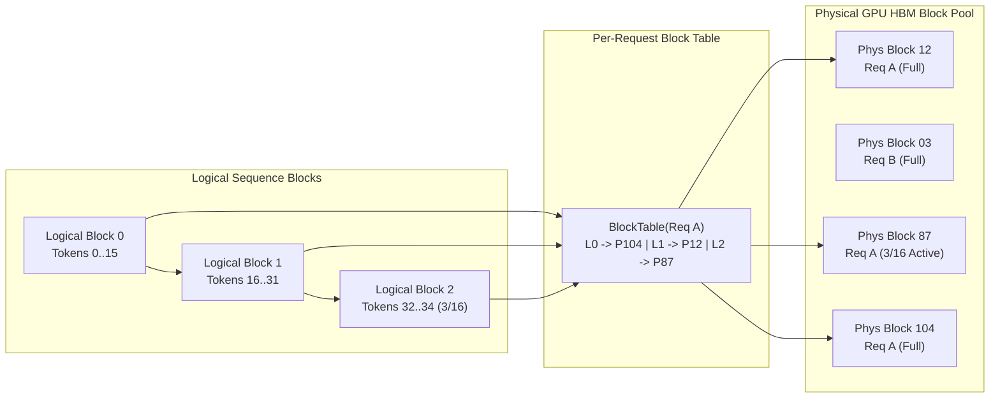
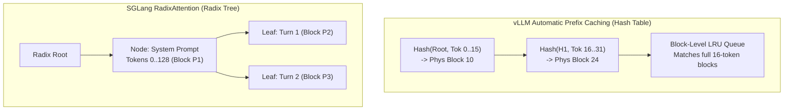
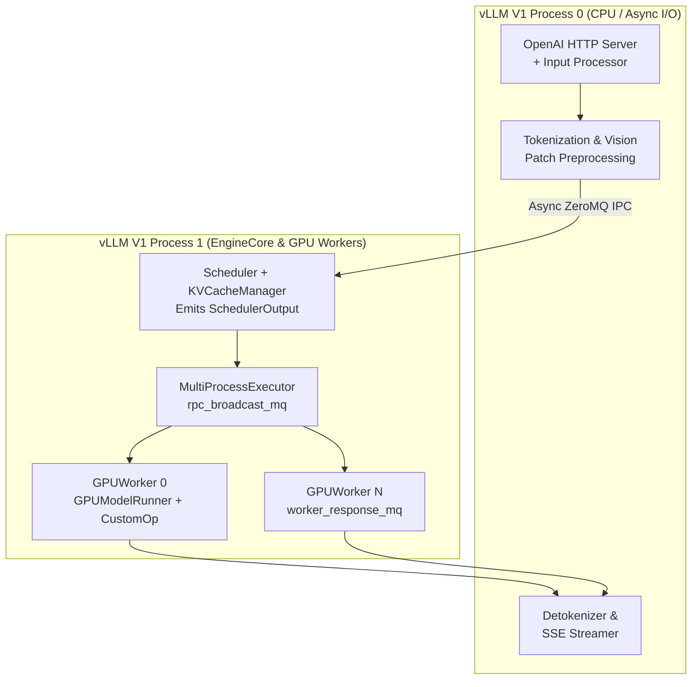

# 15.3 vLLM in depth

| Field | Value |
|---|---|
| Level | Advanced |
| Priority tier | 1 |
| Lab venue | GCP / GKE + Local Python Verification Lab |
| Part | Part 15: LLM inference and serving |
| Primary sources | *Distributed AI Systems* Chapter 6; *Hands-On LLM Serving and Optimization* Chapters 6, 7, 8, 10; *AI Systems Performance Engineering* Chapters 13, 17, 18; *LLMs in Production* Chapter 6; *Generative AI on Kubernetes* Chapters 4, 5, 6; NVIDIA Zero-to-Hero Volume 12 (`chapter-06-vllm-tgi-sglang-and-lmdeploy.md`, `chapter-07-continuous-and-dynamic-batching.md`, `chapter-08-kv-cache-memory-and-concurrency.md`, `chapter-09-scaling-multi-gpu-and-multi-node-inference.md`, `labs/lab-03-deploy-an-llm-with-vllm.md`) |
| Cross-references | Chapter 14.7 (Tensor, Pipeline, and Expert Parallelism); Chapter 14.10 (Multi-node training architecture); Chapter 15.1 (Anatomy of an inference request); Chapter 15.2 (Batching, KV cache, and quantization); Chapter 15.4 (SGLang and cross-request optimization) |
| Code | `code/part15/vllm_paged_attention.py`, `code/part15/vllm_paged_attention_lab.py` |
| Coverage file | `planning/coverage/chapters/15-03.md` |
| Claim & number ledger | `planning/ledgers/15-03.md` |

## Why this matters for AI infrastructure

Training a foundation model optimizes for raw token throughput across predictable batch sizes over weeks. Serving that model to live users flips the engineering problem upside down. An online inference cluster must deliver responses in milliseconds while handling thousands of concurrent requests whose arrival times, prompt lengths, and output lengths are completely unpredictable.

Early serving systems borrowed contiguous tensor allocation directly from training frameworks. For every incoming request, they reserved a single contiguous slab of GPU memory large enough to hold the model's maximum sequence length. Because actual generation lengths are unknown ahead of time, contiguous allocation wastes 60% to 80% of GPU memory on unused reservations and fragmented gaps. Worse, batching variable-length sequences together required padding shorter sequences with dummy tokens, wasting a third or more of attention compute on meaningless math.

```text
vLLM and PagedAttention Production Impact Reference (Volume 12 Ch. 6–8; DAI Ch. 6):
- Contiguous KV cache allocation waste: 60% to 80% of total GPU VRAM lost to internal, external, and reservation fragmentation
- PagedAttention memory waste: < 4% (strictly bounded to the final incomplete physical block of B = 16 or 32 tokens)
- Concrete S_actual = 500, S_max = 4096, B = 16 comparison:
  Contiguous waste = (4096 - 500) / 4096 = 87.79% (> 87% wasted)
  PagedAttention waste = 12 unused slots / 500 tokens = 2.40% (bounded by B / S_actual = 16 / 500 = 3.2%)
- Padding FLOPs waste for batch lengths [4, 7, 3]:
  Contiguous padded batch computes 7 * 3 = 21 positions for 14 real tokens -> 7 / 21 = 33.33% (33%) wasted attention FLOPs
  PagedAttention visits only allocated blocks -> 14 true positions -> 0% padding FLOPs
- Concurrency and throughput multiplier: 2x to 4x more concurrent requests served on identical GPU memory
- Iteration-level continuous batching + chunked prefill impact (Volume 12 Ch. 7):
  Reduced p99 Inter-Token Latency (ITL) from 420 ms to 19.1 ms while increasing total token throughput by 3.8x
```

Researchers at UC Berkeley built vLLM around a simple operating system insight. Just as an operating system kernel maps contiguous virtual memory addresses onto non-contiguous physical RAM pages, vLLM partitions the KV cache into fixed-size physical blocks and maps them through a per-request Block Table. That single abstraction—PagedAttention—eliminates external memory fragmentation, bounds internal waste to a few tokens per sequence, and removes padding FLOPs from decode attention.

Yet PagedAttention is only the foundation of a production vLLM deployment. Operating vLLM reliably on GPU clusters requires mastering its full execution stack.
- **Cross-request and intra-request block sharing:** Use Copy-on-Write reference counting for beam search and parallel sampling. Also configure Automatic Prefix Caching to skip redundant prefill compute across shared system prompts.
- **Token-level scheduling and preemption:** Tune continuous batching and chunked prefill token budgets so long prompts do not stall active decode streams. Understand why V1 recomputes preempted sequences instead of swapping them to host memory.
- **Engine architecture and distributed scaling:** Navigate vLLM V1's asynchronous dual-process architecture and map Tensor, Pipeline, Data, and Expert Parallelism onto NVLink and InfiniBand topologies. Serve dozens of domain adapters on a single base model with Punica and S-LoRA kernels.

**Treat GPU memory blocks, token budgets, and interconnect boundaries as coupled system resources before putting vLLM into production.**

## Prerequisites and outcomes

### Prerequisites
- GPU memory hierarchy, Streaming Multiprocessor execution, and CUDA Graphs from Part 10.
- NVLink, PCIe, InfiniBand, GPUDirect RDMA, and NCCL collective operations from Part 12.
- Distributed parallelism fundamentals from Chapters 14.7 and 14.10, plus inference request lifecycle and KV cache fundamentals from Chapters 15.1 and 15.2.

### Outcomes
After completing this chapter, you will be able to accomplish five core goals.
1. Calculate exact KV cache footprints across Multi-Head, Grouped-Query, and Multi-Query Attention. Explain how PagedAttention's Block Table eliminates external fragmentation, bounds internal fragmentation below 4%, and removes padding FLOPs.
2. Trace how vLLM's `BlockSpaceManager` implements Copy-on-Write block sharing for parallel sampling and beam search. Compare vLLM's hash-based Automatic Prefix Caching against SGLang's tree-based RadixAttention and long-context Cache-Augmented Generation.
3. Configure iteration-level continuous batching, chunked prefill token budgets, and preemption policies. Work out the swap versus recompute arithmetic for a GQA model and explain why V1 recomputes.
4. Deconstruct vLLM's layered architecture, including `LLMEngine`, `EngineCore`, `Scheduler`, `SchedulerOutput`, `MultiProcessExecutor`, `GPUWorker`, `GPUModelRunner`, and vLLM V1's dual-process separation. Compare vLLM against TGI, SGLang, LMDeploy, TensorRT-LLM, and llama.cpp.
5. Architect multi-GPU and multi-node vLLM deployments using Tensor, Pipeline, Data, and Expert Parallelism alongside Multi-LoRA serving and speculative decoding. Diagnose KV cache OOMs, preemption storms, and tail-latency spikes using Prometheus telemetry.

---

## 1. Autoregressive KV Cache Mechanics and PagedAttention Internals

### 1.1 Decoder-Only Transformers: Prefill vs Decode and the KV Cache Footprints

Modern foundation models such as Llama, Qwen, Mistral, and DeepSeek use a decoder-only Transformer stack. A seven-billion-parameter model typically stacks 32 identical Transformer layers, while a seventy-billion-parameter model stacks 80 layers. Each layer applies pre-normalization, a causally masked self-attention sub-layer, and a gated feed-forward network such as SwiGLU.

Inside each self-attention layer, the model projects every token hidden state into three vectors: Query, Key, and Value. A causal mask sets attention scores for future positions to negative infinity before the softmax normalization so that token position *i* only attends to positions up to *i*. Because language generation is autoregressive, serving every request unfolds across two distinct computational phases.
1. **Prefill phase (prompt processing):** The engine processes all prompt tokens in parallel across every Transformer layer. Because all prompt tokens are known upfront, prefill executes dense matrix-matrix multiplications with high arithmetic intensity. Prefill is **compute-bound** on GPU Tensor Cores and populates the initial Key and Value tensors for every prompt token.
2. **Decode phase (token generation):** The engine generates output tokens one at a time in a sequential loop. Each step feeds a single new token per sequence into the model. Without a cache, generating each new token would require concatenating the entire history and recomputing Key and Value projections for all past tokens, incurring quadratic time per step and cubic time across the full response.

Storing previously computed Key and Value vectors in the **KV Cache** reduces per-step attention complexity from quadratic to linear in sequence length. During each decode step, the GPU computes Query, Key, and Value projections only for the single newly generated token and attends against the cached Keys and Values in High-Bandwidth Memory. Because only one token vector is processed per sequence, decode executes matrix-vector multiplications with low arithmetic intensity and is **memory-bandwidth bound**.

```text
Decoder-Only Transformer Notation and Phase Complexity (DAI Ch. 6; Volume 12 Ch. 7–8):
- Notation:
  B   = batch size                   L_2 = prompt length (attending/cached context)
  D   = hidden dimension             H   = number of query heads (H_q)
  H_kv = number of KV heads          D_qk, D_v = head dimension (D = H * D_v)
  t   = decode step index            L_total = L_2 + t (current total sequence length)
- Prefill phase:
  Input X_prompt shape: B x L_2 x D -> Logits shape: B x L_2 x V (only last position B x 1 x V sampled for Y_0)
  Cached K, V per layer (2N tensors across N layers): B x L_2 x D_qk and B x L_2 x D_v
  Self-attention time complexity: O(L_2^2 * D) (compute-bound GEMM)
- Decode phase (per token step t, over T generated tokens):
  Input x_t shape: B x 1 x D -> Query Q_t shape: B x 1 x D_qk
  Cached K_cached, V_cached shape: B x (L_2 + t) x D_qk/v -> Attention scores A_t shape: B x 1 x (L_2 + t)
  Without KV cache: O(L_total^2 * D) per step -> O(T * L_total^2 * D) ~ O(T^3 * D) total
  With KV cache:    O(L_total * D) per step   -> O(T * L_total * D)   ~ O(T^2 * D) total (memory-bound GEMV)

KV Cache Memory Equations and Llama-3-70B Worked Numbers (Volume 12 Ch. 8; ASP Ch. 18):
- Per-token KV cache footprint across all layers:
  M_token (Bytes) = 2 * L * H_kv * D_head * P
  (where 2 = Key + Value, L = layers, H_kv = KV heads, D_head = D / H_q, P = bytes per element)
- Llama-3-70B (BF16, P = 2 bytes, L = 80, H_q = 64, H_kv = 8 GQA 8:1, D_model = 8192, D_head = 128):
  M_token (GQA, H_kv = 8)  = 2 * 80 * 8 * 128 * 2  =   327,680 bytes = 320 KiB / token
  M_token (MHA, H_kv = 64) = 2 * 80 * 64 * 128 * 2 = 2,621,440 bytes = 2.50 MiB / token (2.56 MB decimal; 8x larger, GQA saves 87.5%)
  At S = 4,096 tokens:   320 KiB * 4,096   =  1,310,720 KiB =  1.25 GiB per sequence
  At S = 128,000 tokens: 320 KiB * 128,000 = 40,960,000 KiB = 39.06 GiB per sequence (vs 312.5 GiB under MHA)
- 70B Model with 32 KV heads at S = 250,000 tokens (ASP Ch. 18):
  Per-layer floats = 2 * 32 * 128 = 8,192 floats/layer -> 80 layers = 655,360 floats/token
  At FP16 (2 B): 1,310,720 B (~1.31 MB/token) * 250,000 = 327.68 GB (~328 GB) vs 100–150 GB with FP8 + selective caching
```

The attention head layout directly governs how many concurrent users a GPU can hold. In standard Multi-Head Attention, every query head maintains its own Key and Value head. Grouped-Query Attention shares a single Key and Value head across a group of query heads, cutting the Llama-3-70B KV cache footprint by 87.5%. Multi-Query Attention uses a single Key and Value head across all query heads.

| Attention Architecture | Key-Value Heads (`H_kv`) | KV Memory Ratio vs MHA | Representative Models |
|---|---|---|---|
| Multi-Head Attention (MHA) | `H_kv = H_q` | `1.0x` (`100%`) | Llama-1, GPT-3 |
| Grouped-Query Attention (GQA) | `H_kv = H_q / G` (group size `G`) | `(1 / G)x` (`0.125x` for 8:1 GQA) | Llama-2-70B, Llama-3-8B/70B, Mistral-7B |
| Multi-Query Attention (MQA) | `H_kv = 1` | `(1 / H_q)x` (`~0.015x` for 64 heads) | Falcon-40B, Command-R |

### 1.2 Why Contiguous KV Allocation Fails: The 60% to 80% Fragmentation Trap

Even with Grouped-Query Attention, the KV cache for each active request grows by one token on every decode step. Traditional serving frameworks stored each sequence's KV cache as a single contiguous tensor in GPU memory so standard attention kernels could index positions by simple pointer stride. Because a sequence's final output length is unknown when its prompt arrives, the allocator had to pre-allocate a contiguous slab sized to the maximum allowed sequence length.

That contiguous requirement creates three forms of memory waste.
- **Reservation waste:** Memory slots reserved upfront for future tokens that have not been generated yet.
- **Internal fragmentation:** Unused memory inside a request's pre-allocated buffer when generation finishes early at an end-of-sequence token. If a request reserves 4,096 tokens but finishes at 500 tokens, over 87% of its reserved slab was never used.
- **External fragmentation:** Variable-sized free gaps scattered across physical HBM when sequences of different lengths complete. If an 8-token request finishes between two active requests, its freed 8-token gap cannot satisfy a new request that requires a 12-token contiguous slab, nor can it extend a non-adjacent active sequence.

In high-concurrency serving, these three effects waste 60% to 80% of total GPU VRAM. Even worse, batching sequences of different active lengths in contiguous tensors requires right-padding every sequence to the longest sequence in the batch. Although causal masks zero out the padded positions after the dot product, the GPU still executes all dot-product FLOPs over the padding tokens.

### 1.3 How PagedAttention Works: Block Tables, Physical Blocks, and Zero Padding FLOPs

PagedAttention eliminates contiguous KV cache buffers by applying operating system virtual memory paging directly to attention tensors. The `BlockSpaceManager` partitions the GPU's KV cache memory pool into uniform, fixed-size **Physical Blocks**. Each physical block holds the Key and Value vectors for a fixed number of tokens, typically 16 or 32 tokens per block.



| PagedAttention Component | Architectural Role | Fragmentation & Compute Impact |
|---|---|---|
| Logical KV Blocks | Contiguous token view (`Block 0: tokens 0..15`, `Block 1: tokens 16..31`, ...) seen by the sequence | Grows dynamically one block at a time as tokens are generated; zero upfront `S_max` reservation |
| Block Table (`BlockTable(r)`) | Per-request lookup table mapping `LogicalBlockIndex -> PhysicalBlockIndex` and tracking filled slots | Decouples logical sequence continuity from physical HBM layout |
| Physical KV Blocks (`B = 16` or `32`) | Uniform memory pages allocated non-contiguously in GPU VRAM by `BlockSpaceManager` | **0% external fragmentation** (any free block fits any request); **< 4% internal fragmentation** (only the final block can be partially empty) |
| PagedAttention CUDA Kernel | Reads non-contiguous physical blocks via the Block Table using coalesced thread-block memory loads | Iterates strictly over allocated blocks; **0% wasted padding FLOPs** (`14` real positions instead of `21` padded positions for lengths `[4, 7, 3]`) |

```text
PagedAttention Block Math and Kernel Formula (Volume 12 Ch. 6 & 8; DAI Ch. 6):
- Number of physical blocks allocated for request i with prompt length L_2^(i) and decode step t^(i):
  N_i = ceil((L_2^(i) + t^(i)) / B_size)    where B_size = 16 (default) or 32 tokens/block
  Each physical block stores K and V tensors of shape: B_size x D_qk and B_size x D_v
- Block Table mapping and PagedAttention kernel lookup for query token i attending to position j:
  PhysicalBlock = BlockTable(floor(j / blockSize)),   BlockOffset = j % blockSize
  A_{i, j} = softmax( (Q_i * K_{BlockTable(j / blockSize)}[j % blockSize]^T) / sqrt(d) )
- Fragmentation bounds (block size B, actual sequence length S_actual):
  External fragmentation = 0% (uniform block size B * D_kv; any freed block is immediately reusable)
  Maximum wasted tokens per sequence = B - 1 tokens (strictly inside the final active block)
  Internal fragmentation bound < B / S_actual
  Worked check (B = 16, S_actual = 500): ceil(500 / 16) = 32 blocks (512 slots, 12 unused = 2.4% < 3.2% bound, vs 87.79% contiguous waste)
```

Because the PagedAttention CUDA kernel iterates over each request's Block Table rather than a padded rectangular matrix, positions that do not exist are never visited. In a batch of three sequences with lengths 4, 7, and 3 tokens, traditional batching pads all three to length 7 and computes 21 attention positions, wasting 33% of its FLOPs on 7 padding positions. PagedAttention computes only the 14 real token positions. Together, near-zero memory waste and zero padding FLOPs allow vLLM to serve two to four times more concurrent requests on the same GPU hardware.

---

## 2. Copy-on-Write, Automatic Prefix Caching (APC), and RadixAttention

### 2.1 Copy-on-Write Block Sharing for Parallel Sampling and Beam Search

Paging the KV cache into uniform physical blocks unlocks a second operating system optimization: memory sharing across sequences via reference counting. Whenever a single prompt spawns multiple output completions—such as parallel sampling with `n=4` or beam search with `"use_beam_search": true, "n": 4`—every candidate branch shares the exact same prompt tokens.

Instead of duplicating the prompt's KV cache across four separate memory buffers, vLLM's `BlockSpaceManager` forks the parent's Block Table for each child candidate and increments the reference count on every shared physical block. If a 35-token prompt occupies two full 16-token physical blocks and three token slots inside a third physical block, all four branches point to those same three physical blocks with a reference count of 4.

When the first decode step generates a distinct token for one of the branches, vLLM checks the reference count of the tail physical block. Because that incomplete block has a reference count greater than 1, the `BlockSpaceManager` executes a **Copy-on-Write** operation.
1. It decrements the shared tail block's reference count from 4 to 3.
2. It allocates a single new physical block from the free pool with a reference count of 1.
3. It copies only the three existing tokens from the tail block into the new block, appends the branch's fourth token, and updates that branch's last Block Table entry.

The two full prefix blocks covering tokens 0 through 31 are never copied and remain shared with a reference count of 4 across all branches. In beam search, as low-scoring beams are pruned and high-scoring beams fork new candidates, vLLM simply decrements and increments block reference counts without copying full sequence histories.

### 2.2 Automatic Prefix Caching (APC) vs SGLang RadixAttention

Copy-on-Write shares blocks across branches within a single request. **Automatic Prefix Caching**, enabled via `--enable-prefix-caching` or `enable_prefix_caching=True`, extends block sharing across completely independent requests over time.

In vLLM, Automatic Prefix Caching uses a global hash table of physical KV blocks. Each full 16-token block is identified by a cryptographic hash—such as SHA-256—computed recursively over its parent block's hash and the block's 16 token IDs. When a new request arrives with zero computed tokens, the `Scheduler` invokes `kv_cache_manager.get_computed_blocks(request)` to hash its prompt in 16-token steps and look up matches in the global block pool. If an external cache connector is attached, the scheduler also queries `connector.get_num_new_matched_tokens()`. Any matched blocks have their reference counts incremented and are mapped directly into the new request's Block Table, skipping prefill computation for those tokens and cutting Time To First Token by 80% to 90%. When a request finishes, its blocks remain in the hash table with a reference count of zero and are evicted only in Least Recently Used order when free blocks are needed.



| Caching Dimension | vLLM Automatic Prefix Caching (APC) | SGLang RadixAttention |
|---|---|---|
| Core Data Structure | Global hash table mapping cumulative block hashes (`SHA-256`) to physical KV blocks | Explicit **Radix Tree** (compressed prefix trie) in host memory with edges pointing to GPU KV tensors |
| Matching Granularity | Discrete physical block boundaries (e.g., every `16` or `32` tokens); partial sub-block tails are not matched | Arbitrary token sub-sequence boundaries via compressed trie edge traversal and node splitting |
| Eviction Mechanism | Flat LRU eviction queue over zero-reference physical blocks | Recursive **Radix Tree LRU eviction** of leaf nodes while pinning shared parent prefix nodes |
| Best Workload Fit | Shared system prompts, few-shot templates, and long-context document Q&A aligned to block sizes | Multi-turn agent loops, tree-of-thought branching, and dynamic sub-block prefix sharing |

### 2.3 Prompt Structuring, Multi-Tenant Prefix Isolation, and RAG vs CAG Economics

Because prefix hashes chain from the very first token of a prompt, even a single character change near the front—such as changing `Document:` to `Documents:` or omitting a space—invalidates every downstream block hash. To maximize prefix cache hits, structure prompts deterministically with static content first and dynamic content last.
1. Place the static `<system>` instructions at the very beginning of the prompt.
2. In multi-tenant deployments where different customers share one vLLM instance, inject a tenant identifier `<id> {user_id_or_session_id}` immediately after `<system>` and before `<context>`. Without a tenant delimiter, Customer A could measure TTFT latency differences to infer whether Customer B had recently queried a specific confidential document. Placing `<id>` after `<system>` lets all tenants share the system prompt blocks while strictly isolating each tenant's private document cache.
3. Place static `<context>` documents in canonical chunk order before the dynamic `<user>` question at the end.

```text
RAG vs Long-Context Cache-Augmented Generation (CAG) Comparison (HLS Ch. 7):
- Workload setup: 500-token system prompt + 500-token user query
  * RAG pipeline: retrieves 10 dynamic chunks * 500 tokens = 5,000 RAG tokens per query
    Cached tokens = 500 (system prompt); Uncached prefill tokens = 5,000 + 500 = 5,500 tokens
  * Long-Context CAG pipeline: preloads entire 100,000-token tenant knowledge base into prefix KV cache
    Cached tokens = 500 + 100,000 = 100,500 tokens; Uncached prefill tokens = 500 tokens (11x fewer uncached tokens)
- Latency impact:
  Because CAG executes prefill on ~1/10th the uncached tokens (500 vs 5,500), a 5.0 s RAG TTFT drops to ~0.5 s (10x faster)
- External API token pricing comparison ($ per 1M tokens, HLS Ch. 7 Table 7-2):
  * GPT-5:           Regular input = $1.25 / 1M, Cached input = $0.125 / 1M (10% of regular)
  * Gemini 2.5 Pro:  Regular input = $1.25 / 1M, Cached input = $0.31 / 1M (+ $4.50 storage/hr)
  * Claude Sonnet 4: Regular input = $3.00 / 1M, Cached input = $0.30 / 1M (+ $3.25 first write)
  * Per-request cost on GPT-5 pricing:
    RAG cost = (500 * $0.125 + 5,500 * $1.25) / 10^6   = $0.0069375 ~ $0.007 / request
    CAG cost = (100,500 * $0.125 + 500 * $1.25) / 10^6 = $0.0131875 ~ $0.013 / request
- Self-hosted KV cache offloading with LMCache (HLS Ch. 7 & ASP Ch. 18):
  Offloading GPU KV cache to host CPU DRAM provides ~3x more KV cache space (holding 4 long-context caches on 1 replica for 4x cost savings);
  offloading to local NVMe SSD provides up to 50x more KV cache space;
  collating 16-token PagedAttention blocks into >= 128-token slabs before NIXL/UCX RDMA transfer cuts 7,500-token (470-page) transfer time from 20 ms to 8 ms.
```

**Structure every prompt with static prefixes at the front and tenant IDs before private context so Automatic Prefix Caching maximizes hit rates without leaking cross-tenant state.**

---

## 3. Continuous Batching, Chunked Prefill, and Preemption Policies

### 3.1 Iteration-Level Continuous Batching vs Request-Level Dynamic Batching

Traditional deep learning servers use request-level dynamic batching. They collect incoming requests until a batch size `B=32` or queue timeout `tau=50 ms` expires. Then they pad all sequences to the longest sequence in the batch and lock the entire batch on the GPU until the slowest request finishes. If 31 users ask a short question that finishes in 10 tokens and one user requests a 2,000-token essay, the 31 finished requests remain trapped in GPU memory for 1,990 extra iterations. In heterogeneous LLM traffic, padding waste exceeds 65% and p99 Inter-Token Latency spikes to 420 ms per token.

Following the Orca paradigm, vLLM implements **iteration-level continuous batching**. The scheduler evaluates the batch after every single token generation step.
1. Any sequence that emitted an end-of-sequence token or hit `max_tokens` at step *t* is evicted immediately, and its physical KV blocks return to the `BlockSpaceManager` free pool.
2. Waiting requests in the arrival queue are slotted into the batch at step *t+1* as soon as free token budget and KV blocks are available.
3. Combined with PagedAttention, matrix operations run strictly on active tokens with 0% padding waste.

| Dimension / Metric | Static Batching | Dynamic Request Batching | Continuous Iteration Batching | Chunked Prefill Continuous Batching |
|---|---|---|---|---|
| Scheduling Granularity | Fixed batch tensor | Full request lifecycle | Single token iteration step | Iteration step + sliced prompt chunks |
| Padding Waste Ratio | Severe (`> 70%`) | High (`40%` to `65%`) | **Zero (`0%`)** | **Zero (`0%`)** |
| Inter-Token Latency (ITL) | Poor (blocked by longest request) | Poor (`420 ms` p99 tail spike) | Moderate (spikes during long prefills) | **Bounded & deterministic (`< 20–25 ms`)** |
| GPU Compute Occupancy | Very low | Low (`15%` to `30%`, `18%` avg) | Medium (`40%` to `60%`) | **High (`75%` to `92%`)** |

### 3.2 Chunked Prefill and Token-Budget Scheduling

Continuous batching alone still suffers from **prefill bubbles**. Suppose 45 decode streams are generating voice-assistant audio at an average Inter-Token Latency of 18 ms on a 4x H100 node. If a new user submits a 12,288-token document and chunked prefill is disabled, the scheduler executes the entire 12,288-token prefill in a single iteration step. That compute-heavy GEMM monopolizes the GPU for 320 ms, stalling all 45 decode streams and spiking p99 ITL to 340 ms.

**Chunked Prefill** is enabled by default in vLLM V1 and eliminates prefill stalls. It slices long prompts into fixed-size chunks controlled by `long_prefill_token_threshold`, typically 512 or 1,024 tokens. The scheduler then piggybacks one chunk alongside active decode tokens in each iteration.

```text
vLLM Unified Token-Budget Scheduler Logic (HLS Ch. 8; Volume 12 Ch. 7):
- Global per-step token constraint (--max-num-batched-tokens, e.g., 2048):
  Tokens_scheduled = sum_{i in Decode} 1 + sum_{j in Prefill_Chunks} C_j <= MaxTokensPerIter
- Internal Scheduler.py token-gap loop over RUNNING then WAITING queues:
  while req_index < len(self.running) and token_budget > 0:
      request = self.running[req_index]
      num_new_tokens = (request.num_tokens_with_spec
                        + request.num_output_placeholders
                        - request.num_computed_tokens)
      if 0 < self.scheduler_config.long_prefill_token_threshold < num_new_tokens:
          num_new_tokens = self.scheduler_config.long_prefill_token_threshold
      num_new_tokens = min(num_new_tokens, token_budget)
- Worked 12,288-token prompt with 45 active decode requests (MaxTokensPerIter = 2048, chunk C = 512):
  Each step schedules 45 decode tokens + 512 prefill tokens = 557 tokens (<= 2048 budget)
  The 12,288-token prompt completes across 12,288 / 512 = 24 smooth steps while p99 ITL drops from 340 ms to 21.4 ms
```

In vLLM, the `Scheduler` maintains two primary queues—`RUNNING` and `WAITING`—and prioritizes `RUNNING` requests first because they already hold allocated KV cache blocks and active streaming timelines. Only after all running decode and in-flight chunked-prefill requests receive their token allocations does the scheduler admit new requests from `WAITING` using the remaining token budget.

### 3.3 Request Preemption: Swap vs Recompute

Picture a busy server where every running sequence needs one more KV block for its next token, and the pool has none left. The scheduler cannot simply refuse. It must preempt one or more lower-priority or most-recently-arrived sequences, which means taking their KV blocks away. There are two ways to give the work back later.

1. **Host-device swapping:** copy the preempted sequence's KV blocks across the PCIe bus into pinned host RAM, then copy them back when space frees up. Older vLLM releases sized that host buffer with `--swap-space`.
2. **Recomputation:** free the blocks at once. When capacity returns, the sequence goes through prefill again, rebuilding its KV cache from the original prompt plus the tokens generated so far.

vLLM V1 only recomputes. The `--swap-space` flag exists in v0.17.0 and is gone in v0.18.0, and the vLLM optimisation guide says V1 preempts by recompute because recomputation has lower overhead in the V1 architecture (checked 2026-11-12). So this section is about why the choice is less obvious than it looks, not about a setting you can change.

The arithmetic below uses Llama-3-70B with 80 layers, hidden size 8192, 8 KV heads of 128 dimensions, BF16, a 64 GB/s PCIe link and an H100 at 989 TFLOPS dense BF16. Both inputs flatter the hardware: 64 GB/s is the theoretical Gen5 x16 rate, and 989 TFLOPS assumes every Tensor Core cycle is used.

```text
Swap round trip (out to host RAM and back), GQA model:
  KV bytes = 2 * L * S * kv_heads * head_dim * 2 B
  t_swap   = 2 * KV bytes / B_PCIe

Recompute (prefill again over S tokens):
  t_recompute = (2 * L * S^2 * H + 12 * L * S * H^2) / T_GPU

S = 4,096:   KV = 1.34 GB, t_swap = 41.9 ms,  t_recompute = 289 ms
S = 65,536:  KV = 21.5 GB, t_swap = 671 ms,   t_recompute = 9,961 ms
Same S = 4,096 if the model used full multi-head attention (H = 8192 for K and V):
             KV = 10.7 GB, t_swap = 335.5 ms
```

Read the result carefully. For the grouped-query model the chapter names, the swap round trip is about 7 times shorter than recompute at 4,096 tokens, and the gap grows at longer lengths because prefill cost rises with the square of the length while KV size rises only linearly. On paper swap wins. Only if the model used full multi-head attention does the swap time (335 ms) come close to the recompute time (289 ms).

Why does V1 recompute anyway? The transfer time is not the whole cost. Swapped blocks are scattered across memory and move as many small copies, the host buffer must be pinned, the PCIe link is shared with weights loading and other traffic, and a swap storm stalls kernel launches. In the failure mode below, swapping 28 GB across a PCIe 4.0 box froze the GPUs for seconds. Recomputation needs no host memory, no second code path and no link contention, and the 100 percent utilisation assumption means real recompute is slower than 289 ms, so it is the simpler design, not the faster one on every shape. For tiered offload to host RAM or storage, use LMCache or NIXL-based connectors, which move KV asynchronously instead of inside the preemption path.

**On V1 the lever is not a swap flag but headroom: keep `vllm:num_preemptions_total` flat by lowering `--max-num-seqs` or `--max-model-len`, adding GPUs, or shedding load at the ingress queue.**

---

## 4. vLLM Engine Architecture, V1 Dual-Process Design, and Distributed Parallelism

### 4.1 Internal Component Hierarchy and the 4-Layer Optimization Strategy

vLLM exposes two primary entry points. Developers can import the in-process `LLM` Python class for offline batch generation. Alternatively, operators can launch the standalone OpenAI-compatible HTTP server via `vllm serve`. Under both interfaces, vLLM organizes execution across four core layers.
1. **Engine Facade (`LLMEngine` and `EngineCore`):** The `LLMEngine` class acts as the public engine entry point. It receives tokenized request objects from the input processor. Inside it, `EngineCore` runs the inner execution loop that connects the scheduler, model executor, and output processor.
2. **Traffic Controller (`Scheduler` and `SchedulerOutput`):** On every iteration step, the `Scheduler` inspects the running and waiting queues. It queries the KV cache manager for cached prefix blocks and enforces token budgets and chunked prefill limits. It also tracks active LoRA adapters and speculative draft tokens before emitting a `SchedulerOutput` work order.
3. **Distributed Coordinator (`ModelExecutor`):** The executor translates each work order into distributed worker commands. For single-node multi-GPU serving, `MultiProcessExecutor` spawns one process per GPU and broadcasts work orders over the `rpc_broadcast_mq` shared-memory queue. For multi-node clusters, the Ray executor coordinates actors across hosts.
4. **Device Execution (`GPUWorker` and `GPUModelRunner`):** Each worker process runs a `GPUWorker` that initializes its CUDA device and NCCL group. It receives work orders and returns results via `worker_response_mq`. Inside each worker, `GPUModelRunner` loads the model class from the registry, flattens input token IDs into ragged tensors without padding, and replays captured CUDA Graphs up to `--max-seq-len-to-capture`.



| Optimization Layer | Component Scope | Concrete Optimizations Applied |
|---|---|---|
| Layer 1: System-Wide (`Scheduler`) | Model-agnostic traffic and resource controller | Token-level continuous batching, chunked prefill (`long_prefill_token_threshold`), Automatic Prefix Caching (`get_computed_blocks`), speculative token budgeting, and FCFS/priority preemption |
| Layer 2: Architecture (`ModelExecutor` / `GPUModelRunner`) | Model-family execution orchestration | Ragged input batch flattening, CUDA Graph capture (in decreasing batch order `[8, 4, 2, 1]`; the old `--max-seq-len-to-capture 8192` flag is not in the v0.32.0 source), multimodal encoder scheduling, and TP/PP/DP/EP collective dispatch |
| Layer 3: Model Layer (Attention & FFN) | Sub-layer neural network blocks | PagedAttention block-table traversal, FlashAttention-3 (Hopper) / FlashInfer (Ampere), FlashMLA / ThunderMLA (`20%–35%` faster decode), and layer-wise operator fusion |
| Layer 4: Hardware (`CustomOp`) | Accelerator instruction and register level | Marlin (Ampere W4A16), Machete (Hopper W4A16), Transformer Engine FP8 (`E4M3`/`E5M2`), NVFP4/MXFP4 (`E2M1`), and Punica / S-LoRA segmented gather-scatter GEMM kernels |

### 4.2 vLLM V1 Asynchronous Dual-Process Separation

In vLLM V0, the HTTP API server, tokenizer, multimodal image processor, scheduler, and GPU kernel launcher shared a single Python process. When serving fast GPUs at large batch sizes or processing Vision-Language Model requests, that shared process became a bottleneck. High-resolution images expand into hundreds of placeholder tokens on the CPU. Decoding pixels, resizing images, and contending for the Python Global Interpreter Lock stalled the GPU kernel launch loop.

```text
vLLM V1 Dual-Process Multimodal Token Expansion & RLHF Determinism Reference (HLS Ch. 10; DAI Ch. 6):
- Multimodal vision prompt token expansion (HLS Ch. 10):
  <|im_start|>user -> [151644, 872, 198]
  <|vision_start|> -> [151652], followed by 644 occurrences of <|image_pad|> token ID 151655, then <|vision_end|> -> [151653]
  Vision Encoder splits the image into patches and projects them into the LLM hidden dimension before Process 1 runs attention
- RLHF Rollout Determinism (HLS Ch. 10; DAI Ch. 6):
  Sample generation in vLLM/SGLang accounts for ~80% of total RLHF training time in OpenRLHF.
  To eliminate batch-shape floating-point drift during greedy decoding, set temperature=0 and VLLM_ENABLE_V1_MULTIPROCESSING=0.
```

vLLM V1 eliminates host-side stalls by splitting execution into two asynchronous operating system processes.
- **Process 0 (CPU I/O and Preprocessing):** Runs the FastAPI HTTP server, request validation, tokenization, CPU-intensive multimodal vision preprocessing, and streaming Server-Sent Events detokenization.
- **Process 1 (EngineCore and GPU Scheduling):** Runs the `EngineCore` loop, token-budget `Scheduler`, and `ModelExecutor` worker dispatch on a dedicated process isolated from HTTP and vision CPU spikes.

Dynamic batch composition and asynchronous multiprocessing can introduce tiny floating-point variations across different batch shapes. Therefore, setting greedy decoding alone does not guarantee bit-for-bit reproducibility in reinforcement learning rollout pipelines. When strict determinism is required, disable V1 multiprocessing via `VLLM_ENABLE_V1_MULTIPROCESSING=0` and enable batch-invariant kernels.

### 4.3 Distributed Parallelism in vLLM: TP, PP, DP, and MoE Expert Parallelism

Large frontier models exceed the memory capacity of a single GPU. For example, Llama-3.1-405B requires 810 GB in FP16, while DeepSeek-R1 has 671 billion parameters. Even when weights are quantized, long-context KV caches can exceed weight memory. To scale across GPUs and nodes, vLLM combines four parallelism strategies.
1. **Tensor Parallelism (`--tensor-parallel-size`):** Shards individual layer weights horizontally across GPUs within a single node. It chains column-parallel projections for attention Query, Key, Value and MLP gate/up layers directly into row-parallel projections for attention output and MLP down layers. That chaining requires only two synchronous AllReduce operations per Transformer layer, or 160 AllReduces per token on an 80-layer model. Because those collectives sit on the per-token critical path, Tensor Parallelism must stay inside intra-node NVLink. Sharding across two 141 GB H200 GPUs also expands free KV cache headroom for a 140B model from roughly 20 GB on one GPU to 70 GB per GPU.
2. **Pipeline Parallelism (`--pipeline-parallel-size`):** Partitions layers vertically into sequential stages across nodes over InfiniBand or RoCEv2 using GPUDirect RDMA. In a naive 3-stage pipeline processing one batch, pipeline bubbles leave each GPU idle two-thirds of the time. vLLM keeps stages busy using virtual-engine request groups and chunked prefill, though four pipeline stages divide total KV cache capacity into roughly one-quarter per group. Combining intra-node Tensor Parallelism with inter-node Pipeline Parallelism also shrinks cross-node transfers because each GPU sends only its horizontal activation shard.
3. **Data Parallelism (`--data-parallel-size`):** Creates multiple complete model replicas, where each replica spans its own Tensor Parallel group. Dense model replicas share zero runtime communication and scale throughput linearly behind internal or external KV-cache-aware load balancers.
4. **Expert Parallelism (`--enable-expert-parallel`):** Modifies how Mixture-of-Experts layers distribute expert weights when combined with Tensor or Data Parallelism. Instead of slicing every expert across all GPUs, Expert Parallelism assigns complete experts to each GPU. Combining Expert Parallelism with Tensor Parallelism uses AllReduce for low-latency serving. Combining Expert Parallelism with Data Parallelism enables DP Attention to partition the KV cache by request and uses All-to-All token routing for high-throughput serving.

```text
Distributed Parallelism Reference Numbers (DAI Ch. 6; Volume 12 Ch. 8 & Ch. 9; HLS Ch. 7):
- Llama-3.1-405B weight footprint: 810 GB in FP16 (2 B/param), 405 GB in FP8 (1 B/param), ~200 GB in INT4 (0.5 B/param)
- Tensor Parallelism (TP):
  2 AllReduces per Transformer layer -> 160 AllReduces/token for 80-layer Llama-3-70B
  Requires intra-node NVLink (900 GB/s on H100/H200, < 1.0 us; 600 GB/s on A100, < 1.5 us)
  Over PCIe (32–64 GB/s) or Ethernet (100 Gbps = 12.5 GB/s, 50–150 us), communication takes 60% to 90%+ of runtime
  H200 (141 GB) serving a 140B model: TP=1 leaves ~20 GB free for KV cache; TP=2 (~70B weights/GPU) frees ~70 GB/GPU for KV cache
- Pipeline Parallelism (PP) + GPUDirect RDMA:
  Inter-node InfiniBand NDR / RoCEv2 (400 Gbps = 50 GB/s, 1.5–3.0 us); GPUDirect RDMA (NCCL_NET_GDR_LEVEL=5) cuts P2P latency 4x–6x
  DeepSeek-R1 (671B) with TP=4, PP=8 uses 32 GPUs (~84B params/stage); each GPU sends batch * seq * hidden / 4 (2,048 elements instead of 8,192)
- MoE Architecture and Expert Parallelism (EP):
  PhiMoEDecoderLayer -> PhiMoESparseMoeBlock router (top_k = 2) -> PhiMoEBlockSparseTop2MLP (w1, w2, w3 gated projections)
  Active only when TP_SIZE * DP_SIZE > 1: EP_SIZE = TP_SIZE * DP_SIZE, holding Total_Experts / EP_SIZE complete experts per GPU
  DeepSeek-R1 (256 routed experts) on 8 GPUs (EP_SIZE = 8): 32 complete experts per GPU
  TP=8 + EP uses AllReduce; DP=8 + EP uses All-to-All + DP Attention (beneficial when expert activation density > 3%, hurts when < 1%)
```

| Hardware Topology (Llama-3-70B BF16) | Total VRAM | Weight Memory | Available KV Pool (`0.90` util) | `C_max` (`S=2048`) | `C_max` (`S=8192`) | `C_max` (`S=32768`) |
|---|---|---|---|---|---|---|
| 4x A100-80GB or 4x H100-80GB (`TP=4`) | `320 GB` | `140 GB` | `140 GB` (`1.25 GiB` @ 4K) | `218` requests | `54` requests | `13` requests |
| 8x A100-80GB or 8x H100-80GB (`TP=8`) | `640 GB` | `140 GB` | `428 GB` | `668` requests | `167` requests | `41` requests |

### 4.4 Multi-LoRA Serving (Punica / S-LoRA), Quantization, and Speculative Decoding

Enterprise platforms frequently serve dozens of tenant-specific Low-Rank Adaptation fine-tunes. Each adapter modifies less than 1 percent of a base model's parameters. Deploying separate base model instances for dozens of low-traffic adapters wastes GPUs.

vLLM's Multi-LoRA serving, enabled via `--enable-lora`, co-locates a single frozen base model in GPU memory alongside multiple active LoRA adapters while caching cold adapters in host RAM. During continuous batching, requests inside the same iteration batch can target different adapters. Specialized Punica and S-LoRA segmented gather-scatter GEMM kernels compute the shared base projection in one dense matrix multiplication across the whole batch. They then add each token's specific low-rank adapter update in parallel, serving many adapters on a single GPU. When a single adapter's traffic grows large enough to saturate multiple dedicated replicas, merge its weights into the base model and serve it with Data Parallelism.

```text
Multi-LoRA Footprint, Quantization (W4A16 / W8A8 / FP4), and Speculative Decoding Reference (HLS Ch. 6, 7 & 10):
- Multi-LoRA HBM math (8B base model, L = 32, d_model = 4096, rank r = 16, 4 adapted modules/layer in BF16):
  Base weights = 8B * 2 B = 16.0 GB
  Params per LoRA adapter = 32 * 4 * (2 * 4096 * 16) = 16,777,216 params = 32.0 MB (0.2097% < 1% of base model)
  8 active LoRA adapters co-located in HBM = 16.0 GB + 8 * 0.033554432 GB = 16.2684 GB (saves 7 GPUs vs 8 dedicated GPUs)
- H100 SXM Tensor Core Peak Compute by Precision (HLS Ch. 6 Table 6-2):
  FP64 = 34 TFLOPS (67 TFLOPS Tensor Core) | FP32 = 67 TFLOPS (non-tensor)
  Dense Tensor Core: TF32 = 495 | BF16/FP16 = 989 | FP8/INT8 = 1,979 TFLOPS/TOPS
  The same datasheet quotes 989 / 1,979 / 3,958 for TF32 / BF16 / FP8 *with 2:4 structured sparsity*; those are sparse peaks, not what dense serving sees.
- Quantization regime comparison on Qwen2.5-7B-Instruct in vLLM (HLS Ch. 6 Table 6-3 & Figs. 6-17..19):
  * W4A16 (GPTQ / AWQ 4-bit weights, 16-bit activations with Marlin on Ampere / Machete on Hopper):
    75% size reduction (14 GB -> 3.5 GB); +300% latency/throughput gain at low batch/concurrency, but slower TTFT at high batch due to FP16 compute
  * W8A8 (FP8 E4M3 weights + activations on Hopper/Blackwell; INT8 = 7 GB for 7B):
    50% size reduction, 2x compute FLOPS; +150% gain at low batch and superior throughput/TTFT at high batch
  * FP4 (MXFP4 / NVFP4 E2M1 at 0.5 B/param with QAT, native on Blackwell B200):
    gpt-oss-120b (117B params * 0.5 B = 58.5 GB < 80 GB single GPU); gpt-oss-20b (21B params * 0.5 B = 10.5 GB < 16 GB edge GPU)
  * 2:4 Semi-Structured Sparsity (Sparse Llama 3.1 in vLLM): 50% zeroes -> 98% accuracy recovery, +30% throughput, -20% latency
- Speculative Decoding in vLLM on Qwen3-32B (HLS Ch. 7):
  * Improved n-gram (--speculative-config '{"method":"ngram","num_speculative_tokens":4,"prompt_lookup_min":2,"prompt_lookup_max":128}'): +16% throughput at concurrency 1
  * EAGLE-3 (--speculative-config '{"method":"eagle3","model":"RedHatAI/Qwen3-32B-speculator.eagle3","num_speculative_tokens":3}'):
    Doubles throughput at concurrency 1 from 28.9 tokens/s (vanilla vLLM) to 56.5 tokens/s (1.96x speedup)
```

### 4.5 Serving Engine Comparison: vLLM vs TGI vs SGLang vs LMDeploy vs TensorRT-LLM vs llama.cpp

| Dimension | vLLM | Hugging Face TGI | SGLang | LMDeploy (`TurboMind`) | TensorRT-LLM / llama.cpp |
|---|---|---|---|---|---|
| Core Architecture | Python Async + V1 dual-process + C++/CUDA kernels | **Rust `Axum`/`tokio` gRPC router** + Python/C++ backend | Python frontend + **RadixAttention** cache manager | **Pure C++ `TurboMind` core** (`< 5 µs` CPU overhead) | **TRT-LLM:** compiled TensorRT C++ engine; **llama.cpp:** C/C++ `GGUF` (`2–8` bit) CPU/edge |
| KV & Prefix Cache | **PagedAttention** + hash-table **APC** (`SHA-256`) | Paged attention + `safetensors` zero-copy `mmap` | **Radix Tree** arbitrary prefix match + leaf LRU | Fused paged allocator + static/dynamic block reuse | **TRT-LLM:** paged KV + Dynamo/NIXL; **llama.cpp:** local ring/kv buffer |
| Structured Output & Quantization | Outlines / XGrammar; FP8, INT8, GPTQ/AWQ (Marlin/Machete) | Grammar/regex JSON; FP8, INT8, AWQ, GPTQ, EETQ | **Native `XGrammar` compressed state graph**; FP8, AWQ | Schema-guided JSON; **native fused W4A16 AWQ** | **TRT-LLM:** FP8/FP4 Tensor Core peak; **llama.cpp:** `Q8_0`/`Q4_0` CPU SIMD/Metal |
| Inter-Token Latency & Sweet Spot | Low (`15–25 ms`); broadest model support & Multi-LoRA | Low (`15–25 ms`); Rust connection safety & fast cold start | Low (`12–22 ms`); multi-turn agents & structured JSON | **Ultra-low (`8–14 ms`)**; lowest single-stream ITL | **TRT-LLM:** max tokens/$ on NVIDIA; **llama.cpp:** laptop/edge privacy |

---

## 5. Commands, Configurations, and Prometheus Telemetry That Matter

### 5.1 Installation, Docker Launch, Offline Batching, and Distributed Serving Commands

All CLI and container commands below are marked `(untested here)` for local build verification. They follow the exact flags from *Distributed AI Systems* Chapter 6, *Hands-On LLM Serving* Chapters 7–8, and Volume 12.

```bash
# 1. Environment installation via uv (recommended, ~8 GB Docker image alternative below) (untested here)
curl -LsSf https://astral.sh/uv/install.sh | sh
uv venv --python 3.12 --seed && source .venv/bin/activate
uv pip install vllm --torch-backend=auto

# 2. Docker OpenAI-compatible server launch with shared IPC and Hugging Face cache (untested here)
docker pull vllm/vllm-openai:latest
docker run --runtime nvidia --gpus all \
  -v $HOME/.cache/huggingface:/root/.cache/huggingface --env "HF_TOKEN=$HF_TOKEN" \
  -p 8000:8000 --ipc=host vllm/vllm-openai:latest \
  Qwen/Qwen2.5-0.5B-Instruct --dtype bfloat16 --max-model-len 32768 --gpu-memory-utilization 0.85

# 3. Single-node 4-GPU Tensor Parallel + Chunked Prefill + APC + production launch (untested here)
vllm serve meta-llama/Meta-Llama-3-70B-Instruct \
  --tensor-parallel-size 4 \
  --gpu-memory-utilization 0.90 \
  --max-model-len 16384 \
  --max-num-seqs 128 \
  --block-size 16 \
  --enable-prefix-caching \
  --enable-chunked-prefill \
  --max-num-batched-tokens 2048 \
  --port 8000

# 4. Multi-node DeepSeek-R1 (671B) with TP=4 intra-node and PP=8 inter-node (32 GPUs total) (untested here)
vllm serve deepseek-ai/DeepSeek-R1 \
  --tensor-parallel-size 4 \
  --pipeline-parallel-size 8 \
  --enable-chunked-prefill \
  --max-num-batched-tokens 2048 \
  --port 8000

# 5. Multi-node Data Parallelism (DP=4, TP=2 across 2 nodes) with Expert Parallelism (untested here)
# Node 0 (Head node with API server):
vllm serve deepseek-ai/DeepSeek-R1 --data-parallel-size 4 --data-parallel-size-local 2 \
  --tensor-parallel-size 2 --enable-expert-parallel \
  --data-parallel-address 10.99.48.128 --data-parallel-rpc-port 13345
# Node 1 (Headless worker node):
vllm serve deepseek-ai/DeepSeek-R1 --headless --data-parallel-size 4 --data-parallel-size-local 2 \
  --tensor-parallel-size 2 --enable-expert-parallel --data-parallel-start-rank 2 \
  --data-parallel-address 10.99.48.128 --data-parallel-rpc-port 13345

# 6. Nsight Systems profiling of vLLM CUDA kernels and NCCL collectives (untested here)
nsys profile --trace=cuda,nvtx --output=profile.qdrep \
  vllm serve meta-llama/Llama-2-70b-hf --tensor-parallel-size 4
```

### 5.2 Prometheus Metrics, Alerting Thresholds, and Kubernetes HPA / KEDA Autoscaling

Exposing `:8000/metrics` provides real-time visibility into the PagedAttention block pool, admission queue, and preemption counters. In Kubernetes, never autoscale LLM pods on raw CPU or raw instantaneous GPU utilization. Individual GPU utilization oscillates between 0 percent and 100 percent and causes severe replica flapping. Instead, export DCGM and vLLM metrics through Prometheus and KEDA using the custom metrics API. Configure a downscale stabilization window of at least 300 seconds and slow down pod termination so replicas are not killed while loading weights. For rolling updates on eight-GPU pods when spare nodes are scarce, set `maxSurge` to 1 and `maxUnavailable` to 3.

```text
Kubernetes HPA / KEDA Autoscaling, Rolling Updates, and Locust Load Testing Reference (LLP Ch. 6; GAK Ch. 4):
- HPA desired replica formula: desiredReplicas = ceil[currentReplicas * (currentMetricValue / desiredMetricValue)]
- Target threshold guidance: ~50% for bursty traffic, ~80% for steady traffic; aggregate via avg_over_time[5m]
- Stabilization window: upscale = 0 s (default), downscale >= 300 s (default scale-down of 100% every 15 s is unsafe; limit to 1 pod/min or 10% every 5 min)
- Rolling update for 8-GPU pods (nvidia.com/gpu: 8, 5 replicas): maxSurge: 1, maxUnavailable: 3
- Container image pinning: use explicit tags (e.g., vllm/vllm-openai:v0.12.0) and avoid imagePullPolicy: Always
- Locust streaming load test baseline: target >= 11 tokens/s per user (human reading speed); sample 50-user test (spawn rate 1/s) peaked at 34 users
```

| Prometheus Metric / CLI Flag | Type / Default | Operational Meaning | Production Target / Alert Rule |
|---|---|---|---|
| `vllm:gpu_cache_usage_perc` | Gauge (`0.0–1.0`) | Fraction of physical GPU PagedAttention blocks currently allocated | Nominal `< 0.85`; critical alert `> 0.95` for `2m` (`LLMKVCacheSaturated`) |
| `vllm:cpu_cache_usage_perc` | Gauge (`0.0–1.0`) | Fraction of host CPU swap blocks currently in use | Always `0.00` on V1, which has no swap; a non-zero value means a pre-v0.18 engine |
| `vllm:num_requests_waiting` | Gauge | Requests queued in the `WAITING` admission queue | Nominal `< 10` (`< 5` in low-latency clusters) |
| `vllm:num_requests_running` | Gauge | Active sequences slotted in the `RUNNING` batch | Scales up to `C_max` / `--max-num-seqs` |
| `vllm:num_preemptions_total` / `vllm:num_preempted_requests_total` | Counter | Cumulative sequence preemptions triggered by block exhaustion | `rate(...[2m]) > 0` for `30s` fires critical alert (`LLMRequestPreemptionsOccurring`) |
| `--gpu-memory-utilization` | Float (`0.90` default) | Fraction of total GPU VRAM reserved for weights + workspace + KV pool | Set `0.85` to `0.90` (`0.92–0.95` only with bounded `--max-model-len`); never `0.98` |

---

## 6. How It Fails: Production Failure Modes and Diagnostic Runbooks

### Failure Mode 1: Physical Block Exhaustion and PCIe Swap Stalls Under Long-Context RAG

- **Symptom:** On a two-GPU A100 RAG deployment serving long legal documents, response latency spikes from 1.2 seconds to over 45 seconds. Engine logs warn that free physical blocks are low and requests are swapping to CPU RAM. In a related eight-GPU PCIe deployment with host swap space enabled, GPU utilization drops to zero for several seconds while Inter-Token Latency degrades from 20 ms to 850 ms per token.
- **Diagnosis:** At a 16-token block size, a 24,000-token prompt consumes 1,500 physical blocks. Ten concurrent requests demand 15,000 blocks and exhaust the GPU pool. Swapping 28 GB of KV cache across PCIe saturates the host bus and stalls kernel launches.
- **Fix:** On V1 there is no swap to turn off, since preemption always recomputes; on a pre-v0.18 engine set `--swap-space 0`. Enable `--enable-prefix-caching`, raise `--block-size` to 32, and cap `--max-num-seqs` at 64.

```text
Failure Mode 1 Quantitative Evidence (Volume 12 Ch. 6, Ch. 7 & Ch. 8):
- Case A (2x A100-80GB TP=2 Mistral-7B RAG, S_prompt = 24,000 tokens, block_size = 16, gpu_memory_utilization = 0.90):
  Blocks per prompt = ceil(24000 / 16) = 1,500 physical blocks; 10 concurrent requests = 15,000 blocks -> Latency spiked 1.2 s -> 45 s
  Fix (enable_prefix_caching=True, block_size=32 -> 750 blocks/prompt, max_num_seqs=64, max_num_batched_tokens=32768):
  Matched 68% of shared RAG headers, reduced PCIe swap to 0, stabilized p99 latency at 1.8 s
- Case B (8x A100-40GB PCIe / Meta-Llama-3-8B TP=2 with --swap-space 32, a pre-v0.18 engine; V1 cannot reproduce this):
  Swapping 12 requests (28 GB KV) saturated PCIe at 64 GB/s (99.4% bus util), froze GPUs for 4–8 s (18% DCGM util),
  degraded ITL by 4,000% (20 ms -> 850 ms/token) at 4.2 preemptions/s (vllm:gpu_cache_usage_perc = 99.8%, vllm:cpu_cache_usage_perc = 88.4%)
  Fix (--swap-space 0 on the pre-v0.18 engine, --enable-prefix-caching, --block-size 16, --gpu-memory-utilization 0.92, --max-num-seqs 256):
  Preemptions dropped to 0, vllm:gpu_cache_usage_perc stabilized at 0.81, and ITL returned to 18 ms/token
```

### Failure Mode 2: Unbounded `--max-model-len` and `0.98` VRAM Utilization Causing CUDA OOM

- **Symptom:** On a four-GPU H100 cluster serving Llama-3-70B, users submit 28,000-token codebase prompts. Within three minutes, HTTP 500 errors reach 42 percent of traffic and worker pods enter crash loops with exit code 139.
- **Diagnosis:** Setting `--gpu-memory-utilization` to 0.98 left only 1.6 GB of headroom for PyTorch workspace and NCCL buffers. Meanwhile, leaving `--max-model-len` at 131,072 with chunked prefill disabled allowed massive prompt allocations to trigger CUDA out-of-memory faults.
- **Fix:** Set `--gpu-memory-utilization` to 0.90, bound `--max-model-len` to 16,384, cap `--max-num-seqs` at 128, and enable `--enable-chunked-prefill` with `--max-num-batched-tokens` set to 2,048. Also reject prompts over 12,000 tokens at the API gateway.

```text
Failure Mode 2 Crash Trace and Post-Fix Telemetry (Volume 12 Ch. 8):
- Broken trace (4x H100-80GB TP=4, --gpu-memory-utilization 0.98, --max-model-len 131072):
  torch.cuda.OutOfMemoryError: CUDA out of memory. Tried to allocate 1.42 GiB
  (GPU 2; 79.35 GiB total capacity; 75.12 GiB already allocated; 1.10 GiB free; 76.80 GiB reserved by PyTorch)
  Ray worker process killed by SIGSEGV (Exit code 139) | gpu_cache_usage_perc = 1.0, running = 64, waiting = 142
- Clean telemetry after patch (0.90 util, max-model-len 16384, max-num-seqs 128, chunked prefill 2048):
  vllm:gpu_cache_usage_perc = 0.84 | vllm:num_requests_running = 96 | vllm:num_requests_waiting = 12
```

### Failure Mode 3: Unchunked Prefill Bursts or Mis-Sized Chunk Thresholds Spiking p99 ITL

- **Symptom:** Real-time voice streams on four H100 GPUs stutter as p99 Inter-Token Latency spikes from 18 ms to 340 ms whenever a 12,288-token prompt arrives. Conversely, setting the chunk budget too small at 512 tokens worsens p99 ITL from 28 ms to 45 ms and increases Time To First Token from 180 ms to 320 ms.
- **Diagnosis:** Without chunked prefill, a 12,288-token prompt runs a 320 ms monolithic GEMM that blocks all 45 active decode streams. Conversely, a 512-token cap causes 450 scheduler context switches per second.
- **Fix:** Enable `--enable-chunked-prefill` and tune `--max-num-batched-tokens` to 2,048 or 1,024. That setting cut p99 ITL during 12,000-token bursts from 340 ms down to 21.4 ms.

### Failure Mode 4: Cross-Node Tensor Parallelism (`TP=16`) NCCL Timeout

- **Symptom:** Deploying a 405B model across two eight-GPU H100 nodes with `--tensor-parallel-size 16` hangs at startup and terminates after 30 seconds with an NCCL AllReduce watchdog timeout.
- **Diagnosis:** Inspect `nvidia-smi topo -m` and enable `NCCL_DEBUG=INFO`. Setting `TP=16` forced 160 AllReduces per token across host TCP sockets at 45 ms latency instead of NVLink microseconds.
- **Fix:** Keep Tensor Parallelism inside the node at `--tensor-parallel-size 8` and use `--pipeline-parallel-size 2` across nodes with `NCCL_IB_DISABLE=0` and `NCCL_NET_GDR_LEVEL=5`. When the model fits within a single eight-GPU node, run independent `TP=8` Data Parallel replicas on each node instead.

### Failure Mode 5: Degraded Prefix Cache Hit Rate and Block Reference Leaks

- **Symptom:** Despite enabling prefix caching, the measured hit rate stays at 12 percent, or drops from 45 percent to 8 percent after enabling chunked prefill. In long-running servers, KV cache utilization climbs from 72 percent to 89 percent over eight hours while active request counts stay flat.
- **Diagnosis:** Non-deterministic prompt prefixes break block hash chains, unaligned prefill chunks miss whole-sequence cache boundaries, or sequence teardown fails to clear block references.
- **Fix:** Standardize static system prefixes at the start of every prompt and align chunk sizes to multiples of the 16-token block size. Use prefix-aware consistent routing while replicating hot prefixes across multiple workers to avoid load skew.

```text
Failure Mode 5 Diagnostic Evidence (Volume 12 Ch. 6, Ch. 8 & Ch. 9):
- Low APC hit rate: Total cache blocks = 2,048; Unused = 1,847 (90% unused); Hit rate = 12% (computed 2,400 / 2,688 blocks)
- Chunked prefill cache drop: prefix_cache_hit_ratio dropped 5.6x from 0.45 (45%) to 0.08 (8%) when chunks were not boundary-aligned
- Partial-block gap report: Total blocks = 8,192; Allocated = 5,120 (62.5%); Fragmented gaps = 847 blocks (10.3%) when sequences of 1,500 tokens allocate 96 blocks (1,536 slots, 12/16 filled in last block)
- Prefix-routing load skew across 4 DP nodes: Node 0 handled 3,600 requests (280K tokens, 91% KV usage) vs Node 1 with 1,100 requests (95K tokens, 32% KV usage) = 3.27x imbalance
```

---

## 7. Hands-On Lab: Verify PagedAttention, APC, Chunked Prefill, and Lab 03 Telemetry

### Lab Venue and Execution Modes
- **Part A (Deterministic Python Model and Self-Checking Lab):** Runs locally on CPU in under one second via `code/part15/vllm_paged_attention.py` and `code/part15/vllm_paged_attention_lab.py` to verify all 25 quantitative checks.
- **Part B (Live GPU Container Deployment, `untested here`):** Runs on a GPU host with at least 16 GB VRAM using `vllm/vllm-openai:latest` and `Qwen/Qwen2.5-Coder-1.5B-Instruct` to measure streaming latencies and inject KV block exhaustion.

### Part A: Run the Self-Checking PagedAttention & vLLM Engine Verification Suite

```bash
python3 -B code/part15/vllm_paged_attention_lab.py
```

Expected output (`25 passed, 0 failed`):

```text
=== Chapter 15.3 Lab: vLLM PagedAttention, APC, Chunked Prefill & Engine Verification ===
  [PASS] 1. Llama-3-70B GQA (80 layers, 8 KV heads, 128 head_dim, BF16) uses 327,680 B (320 KiB/token), 87.5% less than MHA (2.56 MiB/token)
  [PASS] 2. Llama-3-70B KV cache per sequence is 1.25 GiB at S=4096 and 39.0625 GiB (~39.06 GiB) at S=128,000 (vs 312.5 GiB MHA)
  [PASS] 3. 70B model with 80 layers, 32 KV heads, and 128 head_dim at FP16 uses 1,310,720 B (~1.31 MB/token) and ~328 GB (327.68 GB) at 250,000 tokens
  [PASS] 4. For S_actual=500 and B=16 (S_max=4096), PagedAttention allocates 32 blocks (512 tokens, 2.4% actual < 3.2% max bound) vs 87.79% (>87%) contiguous waste
  [PASS] 5. Batch of lengths [4, 7, 3] padded to 7x3=21 positions wastes 7/21 = 33.33% (~33%) attention FLOPs vs 14 positions (0% waste) in PagedAttention
  [PASS] 6. BlockSpaceManager allocates ceil(100/16)=7 blocks for seq 1 and ceil(50/16)=4 blocks for seq 2 (989 free), returning to 996 free after freeing seq 1
  [PASS] 7. A 24,000-token RAG prompt requires 1,500 physical blocks at block_size=16 (15,000 blocks for 10 requests) vs 750 blocks at block_size=32
  [PASS] 8. Forking 4 parallel branches (n=4) on a 35-token prompt shares all 3 physical blocks with ref_count=4 and 0 extra blocks allocated
  [PASS] 9. Writing a new token to branch 11 triggers Copy-on-Write only on the incomplete tail block (ref_count 4->3, 1 new block allocated), keeping 2 full prefix blocks shared
  [PASS] 10. Automatic Prefix Caching (APC) matches all 4 shared 16-token system-prompt blocks by SHA-256 hash and increments ref_count to 2
  [PASS] 11. Long-Context CAG caches 100,500 tokens and runs prefill on 500 tokens (vs 5,500 in RAG), cutting TTFT 10x (5.0s -> 0.5s) at $0.013 vs $0.007 per request
  [PASS] 12. Chunked Prefill slices a 12,288-token prompt into 24 chunks of 512 tokens, bounding step tokens to 45 + 512 = 557 <= 2048
  [PASS] 13. Transferring 4 GB of KV cache over 64 GB/s PCIe takes 62.5 ms one-way; for GQA Llama-3-70B at S=4096 the round-trip swap is ~41.94 ms and recompute is ~289 ms at 989 TFLOPS, so swap is faster on paper
  [PASS] 14. At S=65,536 quadratic prefill takes ~9.96 s against a ~671 ms GQA round-trip swap, so the swap advantage widens
  [PASS] 15. Llama-3-70B on 4x 80 GB GPUs (TP=4, 320 GB total, 140 GB weights, 140 GB KV pool) supports C_max = 218 (S=2048), 54 (S=8192), and 13 (S=32768) requests
  [PASS] 16. Llama-3-70B on 8x 80 GB GPUs (TP=8, 640 GB total, 428 GB KV pool) supports C_max = 668 (S=2048), 167 (S=8192), and 41 (S=32768) requests with 160 AllReduces/token
  [PASS] 17. Sharding a 140B model across TP=2 on 141 GB H200 GPUs expands free KV cache headroom from ~20 GB on 1 GPU to ~70 GB per GPU
  [PASS] 18. DeepSeek-R1 (256 experts) with EP_SIZE=8 places 32 complete experts/GPU, using all_reduce for TP=8+EP, all_to_all for DP=8+EP, and ignoring EP when TP*DP==1
  [PASS] 19. DeepSeek-R1 (671B) with TP=4, PP=8 uses 32 GPUs (~83.9B / ~84B params per stage) and transfers 8192/4 = 2048 elements per token between PP stages
  [PASS] 20. GPT-OSS MXFP4/NVFP4 quantization (0.5 B/param) compresses 117B params to 58.5 GB (< 80 GB GPU) and 21B params to 10.5 GB (< 16 GB edge GPU)
  [PASS] 21. On Qwen3-32B at concurrency=1, EAGLE-3 (K=3) boosts throughput from 28.9 tok/s to 56.5 tok/s (1.96x, nearly 2x), while improved n-gram adds +16%
  [PASS] 22. Rank-16 LoRA across 4 modules/layer on a 32-layer 8B model (d=4096) adds 16,777,216 params (32.0 MB in FP16, 0.2097% < 1% of base weights)
  [PASS] 23. Co-locating 8 active LoRA adapters with an 8B base model in HBM requires 16.2684 GB total and saves 7 GPUs compared to 8 dedicated single-model GPUs
  [PASS] 24. Lab 03 Qwen2.5-Coder-1.5B-Instruct at gpu_memory_utilization=0.85 allocates 14,258 GPU blocks (55.69x concurrency at 4096 tokens) vs 120 blocks (1,920 tokens) at 0.25
  [PASS] 25. Lab 03 5-request streaming benchmark averages Mean TTFT = 44.83 ms (p95 = 47.72 ms) and Mean ITL = 12.72 ms (p95 = 13.05 ms)

Summary: 25 passed, 0 failed
```

### Part B: Deploy and Benchmark `Qwen2.5-Coder-1.5B-Instruct` on GPU (`untested here`)

```bash
# 1. Launch vLLM v0.4.2+ OpenAI server with 0.85 VRAM utilization and 4096 max context (untested here)
export VLLM_LAB_DIR="${HOME}/vllm_lab"
export MODEL_NAME="Qwen/Qwen2.5-Coder-1.5B-Instruct"
export HF_HOME="${VLLM_LAB_DIR}/hf_cache"
mkdir -p "${VLLM_LAB_DIR}" "${HF_HOME}"

docker run -d --name vllm_server \
  --gpus '"device=0"' --shm-size=4g -p 8000:8000 \
  -v "${HF_HOME}:/root/.cache/huggingface" \
  vllm/vllm-openai:latest \
  --model "${MODEL_NAME}" --port 8000 \
  --gpu-memory-utilization 0.85 --max-model-len 4096 --dtype float16 --enforce-eager

# Expected startup log lines:
# INFO llm_engine.py:320] # GPU blocks: 14258, # CPU blocks: 2048
# INFO llm_engine.py:324] Maximum concurrency for 4096 tokens per request: 55.69x
# Mean TTFT across 5 concurrent streaming requests (200 output tokens): 44.83 ms (p95: 47.72 ms)
# Mean ITL across 5 concurrent streaming requests: 12.72 ms (p95: 13.05 ms)

# 2. Failure Injection: Constrain --gpu-memory-utilization to 0.25 (# GPU blocks: 120 = 1,920 tokens) (untested here)
docker stop vllm_server && docker rm vllm_server
docker run -d --name vllm_constrained \
  --gpus '"device=0"' --shm-size=4g -p 8000:8000 \
  -v "${HF_HOME}:/root/.cache/huggingface" \
  vllm/vllm-openai:latest \
  --model "${MODEL_NAME}" --port 8000 \
  --gpu-memory-utilization 0.25 --max-model-len 4096 --enforce-eager
# Sending a 1,500-repetition prompt + max_tokens=2048 exceeds 120 blocks, returning HTTP 400 BadRequestError
# and incrementing vllm:num_preemptions_total on http://localhost:8000/metrics.
```

---

## Key takeaways

1. **PagedAttention turns contiguous KV reservation waste into fixed-size virtual memory paging.** It maps logical sequence blocks to non-contiguous physical HBM blocks via a per-request Block Table. That layout eliminates external fragmentation, restricts internal waste to under 4 percent inside the final active block, removes padding FLOPs, and increases concurrency by two to four times.
2. **Grouped-Query Attention and block sharing multiply effective VRAM capacity.** On Llama-3-70B in BF16, 8:1 Grouped-Query Attention shrinks per-token KV cache by 87.5 percent down to 320 KiB per token. Copy-on-Write shares prompt blocks across parallel branches, while Automatic Prefix Caching reuses SHA-256-hashed blocks across requests to cut Time To First Token by 80 to 90 percent.
3. **Iteration-level continuous batching, chunked prefill, and recompute preemption protect tail latency.** Slicing long prompts into 512-token chunks under a 2,048-token step budget prevents prefill matrix multiplications from stalling active decode streams. That bounds p99 Inter-Token Latency to 21.4 ms. For sequences under 8,192 tokens, GPU prefill recomputation is much faster than PCIe host swapping, so always set recompute-only preemption (`--swap-space 0` on vLLM before v0.18) in latency-critical serving.
4. **vLLM V1 decouples CPU preprocessing from GPU execution, and parallelism must match physical interconnects.** Process 0 handles HTTP, tokenization, and multimodal patch processing while Process 1 runs `EngineCore` and `Scheduler` without Python lock stalls. Keep Tensor Parallelism inside intra-node NVLink and use Pipeline Parallelism over GPUDirect RDMA across nodes. Add Data Parallelism and Expert Parallelism for scale-out throughput, and batch low-traffic domain adapters on a single GPU with Punica and S-LoRA kernels.

---

## Exercises

1. **KV Cache Sizing and PagedAttention Fragmentation Math.**
   - **(a)** Consider Llama-3-70B with 80 layers, 64 query heads, 8 KV heads, 128 head dimension, and 2-byte BF16 precision. Calculate the per-token KV cache footprint in bytes and KiB. Then compute the per-sequence footprint at 4,096 and 128,000 tokens in GiB, along with the percentage memory savings compared to 64-head Multi-Head Attention.
   - **(b)** Suppose a request generates 500 tokens on an engine with a 4,096-token maximum length and a 16-token PagedAttention block size. Compute the number of allocated physical blocks, the unused token slots in the final block, the actual and theoretical maximum internal fragmentation percentages, and the contiguous allocation waste percentage. Also calculate the wasted attention FLOPs percentage when a contiguous batch pads three sequences of lengths 4, 7, and 3 to length 7 versus PagedAttention.
2. **Copy-on-Write Beam Search, Automatic Prefix Caching, and RAG vs CAG Economics.**
   - **(a)** A 35-token prompt is served with a 16-token block size and forked across 4 parallel sampling branches. How many physical blocks are allocated initially, and what is each block's reference count? When the second branch appends its 36th token, explain which physical block triggers Copy-on-Write and give the resulting reference counts of all blocks.
   - **(b)** Compare a RAG pipeline with 500 cached system tokens, 5,000 dynamic RAG tokens, and 500 user tokens against Long-Context Cache-Augmented Generation with 500 system tokens, 100,000 cached context tokens, and 500 user tokens. Compute the uncached prefill token count and the expected Time To First Token if RAG takes 5.0 seconds. Also compute the per-request token cost at 1.25 dollars per million regular tokens and 0.125 dollars per million cached tokens.
3. **Chunked Prefill Token Budgeting and Preemption Policies.**
   - **(a)** A four-GPU H100 vLLM server runs 45 active decode sequences with `--enable-chunked-prefill`, `--max-num-batched-tokens 2048`, and a 512-token prefill chunk threshold. When a 12,288-token prompt arrives, calculate the total tokens scheduled per step and how many iteration steps are required to complete the prompt prefill.
   - **(b)** Calculate the one-way and round-trip transfer latency of a 4 GB KV cache buffer across a 64 GB/s PCIe bus. Using the swap versus recompute equations for an 80-layer, 8,192-hidden-size model on a 989 TFLOPS dense BF16 H100 GPU, compare swap time and recompute time at 4,096 tokens versus 65,536 tokens, once with 8 KV heads and once with 64. Then say which policy vLLM V1 uses and why.
4. **Distributed Parallelism and Cluster Capacity Planning.**
   - **(a)** Use the VRAM budget formula at 0.90 utilization with 140 GB weights and 8 GB workspace. Compute the available KV cache pool and maximum concurrent sequences for Llama-3-70B on four 80 GB GPUs and eight 80 GB GPUs at average sequence lengths of 2,048, 8,192, and 32,768. Also state how many synchronous AllReduce operations execute per generated token on an 80-layer Tensor Parallel model.
   - **(b)** Consider DeepSeek-R1 with 671B parameters, 256 routed experts, and an 8,192 hidden size. Compute the total GPUs, parameters per pipeline stage, and per-token inter-node activation elements transferred per GPU under 4-way Tensor Parallelism and 8-way Pipeline Parallelism. Then compute the Expert Parallel size, complete experts per GPU, and the collective communication pattern under 8-way Tensor Parallelism versus 8-way Data Parallelism with `--enable-expert-parallel`.
5. **Multi-LoRA Serving and Lab 03 Telemetry Triage.**
   - **(a)** An 8B BF16 base model with 32 layers and a 4,096 hidden dimension serves 8 active rank-16 LoRA adapters. Each adapter modifies 4 linear projections per layer. Calculate the parameter count and megabyte footprint of one LoRA adapter, the total HBM footprint of the base model plus all 8 adapters, and the number of GPUs saved compared to dedicated single-model serving.
   - **(b)** In Lab 03 with `Qwen/Qwen2.5-Coder-1.5B-Instruct`, a 16-token block size, and a 4,096 maximum length, vLLM allocates 14,258 GPU blocks at 0.85 memory utilization and 120 GPU blocks at 0.25 utilization. Verify the 55.69x maximum concurrency multiplier at 0.85 utilization and the 1,920-token capacity at 0.25 utilization. Explain which Prometheus metrics fire when a 1,500-repetition prompt is submitted to the constrained server.

---

## Checkpoint questions (20)

<details>
<summary>**1. Why is the prefill phase compute-bound while the autoregressive decode phase is memory-bandwidth bound, and how does the KV cache change decode time complexity?**</summary>

Prefill processes all prompt tokens in parallel via dense matrix-matrix multiplications with high arithmetic intensity on Tensor Cores. Decode generates one token at a time via matrix-vector multiplications, requiring the GPU to stream all model weights and past KV tensors from HBM for every token. Without a KV cache, decoding tokens recomputes all past keys and values at quadratic cost per step and cubic cost overall. Caching Keys and Values reduces decode attention to linear cost per step and quadratic cost across the full sequence.
</details>

<details>
<summary>**2. What is the exact per-token and per-sequence KV cache footprint of Llama-3-70B in BF16, and how much memory does Grouped-Query Attention (GQA) save over Multi-Head Attention (MHA)?**</summary>

With 80 layers, 8 KV heads for 64 query heads, a 128 head dimension, and 2-byte BF16 precision, Llama-3-70B consumes 327,680 bytes or 320 KiB per token. That equals 1.25 GiB per sequence at 4,096 tokens and 39.06 GiB at 128,000 tokens. Under 64-head Multi-Head Attention, each token requires 2.50 MiB binary or 2.56 MB decimal, reaching 312.5 GiB at 128,000 tokens. Thus 8:1 Grouped-Query Attention reduces KV cache memory by 87.5 percent.
</details>

<details>
<summary>**3. What are the three sources of memory waste in contiguous KV cache allocation, and what fraction of GPU VRAM do they waste in production?**</summary>

Contiguous allocation suffers from three forms of waste. First, reservation waste pre-allocates memory for future tokens that have not been generated yet. Second, internal fragmentation leaves unused slots when a request finishes before reaching the maximum sequence length, such as over 87 percent waste when 500 tokens are generated inside a 4,096-token slab. Third, external fragmentation creates unusable non-contiguous gaps between variable-length allocations. Together, they waste 60 to 80 percent of GPU VRAM.
</details>

<details>
<summary>**4. How does PagedAttention eliminate external fragmentation and bound internal fragmentation below 4%?**</summary>

PagedAttention divides the KV cache pool into uniform physical blocks of 16 or 32 tokens. It maps each sequence's logical blocks to arbitrary physical blocks via a per-request Block Table. Because all physical blocks have the exact same size and require no physical contiguity, external fragmentation is 0 percent. Because blocks are allocated on demand one at a time, unused slots exist only in the final block. That bounds internal fragmentation below the block size divided by the actual sequence length, which stays under 4 percent in production.
</details>

<details>
<summary>**5. How does PagedAttention eliminate padding FLOPs during batched decode attention?**</summary>

In contiguous batching, sequences of lengths 4, 7, and 3 must be right-padded to the batch maximum of 7. That padding forces the attention kernel to compute 21 positions and wastes 33 percent of attention FLOPs on dummy tokens before masking. PagedAttention iterates strictly over the blocks listed in each sequence's Block Table and visits only the 14 real tokens, resulting in 0 percent padding FLOPs.
</details>

<details>
<summary>**6. How does Copy-on-Write (CoW) work in vLLM during parallel sampling (`n > 1`) and beam search?**</summary>

When a request forks multiple candidate branches, vLLM copies only the lightweight Block Table so all branches point to the same parent physical blocks. It increments each shared block's reference count without duplicating full prefix blocks. When a child branch appends a new token to an incomplete tail block whose reference count exceeds 1, `BlockSpaceManager` decrements the shared block's reference count. It then allocates one new physical block, copies the existing tokens of that tail block, and appends the new token.
</details>

<details>
<summary>**7. How does vLLM's Automatic Prefix Caching (APC) differ architecturally from SGLang's RadixAttention?**</summary>

vLLM Automatic Prefix Caching stores full physical KV blocks of 16 or 32 tokens in a global hash table indexed by cumulative SHA-256 hashes of the token IDs. It matches strictly at discrete block boundaries and evicts zero-reference blocks via a flat LRU queue. SGLang RadixAttention maintains an explicit compressed prefix trie where edges point to GPU KV tensors. It matches arbitrary token sub-sequences and evicts leaf nodes via recursive tree LRU while keeping shared parent nodes pinned.
</details>

<details>
<summary>**8. Why must multi-tenant prompts place `<id> {tenant_id}` between `<system>` and `<context>` when prefix caching is enabled?**</summary>

If two tenants share a vLLM instance and upload overlapping confidential documents right after `<system>`, prefix cache hits would allow Tenant A to infer Tenant B's private documents via low-latency timing side channels. Injecting `<id> {tenant_id}` immediately after `<system>` allows all tenants to share the global system prompt KV blocks while cryptographically isolating every downstream `<context>` block hash per tenant.
</details>

<details>
<summary>**9. In the RAG vs Long-Context CAG comparison (`HLS` Ch. 7), how do uncached prefill tokens, TTFT, and per-request token costs compare?**</summary>

With a 500-token system prompt and a 500-token user query, RAG caches 500 tokens and runs prefill on 5,500 uncached tokens. Long-Context Cache-Augmented Generation caches 100,500 tokens and runs prefill on only 500 uncached user tokens. Because CAG processes roughly one-tenth the uncached tokens, it cuts a 5.0-second RAG TTFT down to 0.5 seconds. Under GPT-5 pricing of 1.25 dollars per million regular tokens and 0.125 dollars per million cached tokens, RAG costs 0.007 dollars per request while CAG costs 0.013 dollars per request.
</details>

<details>
<summary>**10. How does vLLM's token-budget `Scheduler` combine continuous batching and chunked prefill?**</summary>

At every step, the `Scheduler` prioritizes running requests before waiting requests and calculates the remaining tokens needed for each sequence. If a sequence's uncomputed prompt exceeds `long_prefill_token_threshold` such as 512 tokens, the scheduler slices the prefill to that chunk size. It caps the sum of active decode tokens and prefill chunk tokens across the batch to `--max-num-batched-tokens` such as 2,048, keeping p99 Inter-Token Latency at 21.4 ms instead of 340 ms.
</details>

<details>
<summary>**11. Which is faster for a 4,096-token Llama-3-70B sequence, a PCIe swap round trip or recompute, and what does vLLM V1 do?**</summary>

With 8 KV heads the sequence holds 1.34 GB of KV cache, so a round trip over 64 GB/s PCIe takes about 42 ms. Recomputing the prefill takes about 289 ms even at 989 TFLOPS dense BF16 and perfect utilisation. Swap is roughly 7 times faster on paper, and the gap widens at longer contexts. vLLM V1 still recomputes, because the swap path was removed in v0.18.0 and the V1 design prefers the lower overhead of recomputation. Only a model with full multi-head attention, at about 335 ms round trip, brings the two close.
</details>

<details>
<summary>**12. How do `LLMEngine`, `EngineCore`, `Scheduler`, `SchedulerOutput`, `MultiProcessExecutor`, `GPUWorker`, and `GPUModelRunner` interact during a generation step?**</summary>

`LLMEngine` tokenizes inputs into request objects and drives `EngineCore`. `EngineCore` calls `Scheduler` to build a `SchedulerOutput` work order containing scheduled token counts and block table assignments. `MultiProcessExecutor` broadcasts the work order via `rpc_broadcast_mq` to each `GPUWorker`. Each worker invokes `GPUModelRunner` to flatten ragged inputs, execute the forward pass or replay a CUDA Graph, and return sampled tokens via `worker_response_mq`.
</details>

<details>
<summary>**13. What bottleneck did vLLM V1 solve by splitting execution into Process 0 and Process 1?**</summary>

In vLLM V0, HTTP handling, tokenization, heavy multimodal vision patch preprocessing, and detokenization ran in the same Python process as the scheduler and GPU kernel launcher. CPU image decoding and Python Global Interpreter Lock contention stalled kernel launches and left GPUs idle. vLLM V1 isolates API serving, tokenization, vision preprocessing, and streaming output in Process 0 while dedicating Process 1 exclusively to `EngineCore`, `Scheduler`, and GPU kernel launching over asynchronous IPC.
</details>

<details>
<summary>**14. Why does Tensor Parallelism require intra-node NVLink, and why would you enable `TP=2` on H200 GPUs even if a 140B model fits on a single 141 GB GPU?**</summary>

Tensor Parallelism chains column-parallel and row-parallel projections, requiring two synchronous AllReduce operations per layer or 160 AllReduces per token on an 80-layer model. Over PCIe or Ethernet, communication consumes 60 to 90 percent of runtime, whereas intra-node NVLink at 900 GB/s completes each collective in microseconds. On a 141 GB H200, loading a 140B model on one GPU leaves only about 20 GB for the KV cache. Using 2-way Tensor Parallelism places 70B of weights per GPU and frees 70 GB per GPU for KV cache concurrency while doubling effective memory bandwidth.
</details>

<details>
<summary>**15. How does `--enable-expert-parallel` change MoE weight distribution and collective communication when paired with `TP` vs `DP`?**</summary>

Without Expert Parallelism, every GPU holds a Tensor Parallel slice of every expert. With `--enable-expert-parallel` when the product of Tensor Parallel and Data Parallel sizes exceeds 1, each GPU stores complete experts, such as 32 complete experts per GPU for DeepSeek-R1 on 8 GPUs. Pairing Expert Parallelism with Tensor Parallelism uses AllReduce for low-latency serving. Pairing Expert Parallelism with Data Parallelism partitions the KV cache by request via DP Attention and routes tokens via All-to-All collectives for high-throughput serving when expert activation density exceeds 3 percent.
</details>

<details>
<summary>**16. How do Punica and S-LoRA kernels enable Multi-LoRA serving on a single GPU, and when should you merge a LoRA adapter instead?**</summary>

Multi-LoRA serving keeps one frozen base model and multiple active low-rank adapters in GPU memory. Punica and S-LoRA segmented gather-scatter GEMM kernels compute the shared base matrix multiplication across the entire continuous batch in one dense pass and add each request's specific low-rank adapter update in parallel. That allows one GPU to serve many adapters instead of dedicating one GPU per adapter. If a single adapter's traffic grows large enough to saturate multiple dedicated GPU replicas, merge its weights into the base model to eliminate adapter kernel overhead.
</details>

<details>
<summary>**17. How do W4A16 (GPTQ/AWQ), W8A8 (FP8 E4M3), and FP4 (MXFP4/NVFP4) quantization trade off memory footprint, prefill compute, and decode bandwidth in vLLM?**</summary>

W4A16 cuts weight size by 75 percent and uses mixed-precision Marlin or Machete kernels for a 300 percent low-batch decode gain, but it still computes in 16-bit precision so high-batch prefill TTFT lags. W8A8 FP8 cuts weight size by 50 percent and doubles dense Tensor Core FLOPS to 1,979 TFLOPS on H100 (3,958 TFLOPS is the sparse peak), delivering a 150 percent low-batch gain and superior high-batch throughput. FP4 at 0.5 bytes per parameter on Blackwell B200 shrinks the 117B `gpt-oss-120b` model to 58.5 GB for a single 80 GB GPU. It also shrinks the 21B `gpt-oss-20b` model to 10.5 GB for a 16 GB edge GPU.
</details>

<details>
<summary>**18. How do TGI, SGLang, LMDeploy (`TurboMind`), TensorRT-LLM, and llama.cpp compare to vLLM?**</summary>

vLLM offers the broadest model support, PagedAttention with hash-based prefix caching, V1 dual-process scheduling, and Multi-LoRA serving at 15 to 25 ms ITL. Hugging Face TGI pairs a Rust `Axum` router for connection safety with zero-copy `safetensors` memory mapping. SGLang uses a RadixAttention prefix tree and `XGrammar` state graphs for multi-turn agents and structured JSON at 12 to 22 ms ITL. LMDeploy uses a pure C++ `TurboMind` core with under 5 microseconds of CPU overhead and fused W4A16 kernels for 8 to 14 ms ITL. TensorRT-LLM maximizes tokens per dollar on NVIDIA GPUs, while llama.cpp runs quantized `GGUF` models on CPUs and edge devices.
</details>

<details>
<summary>**19. Which five Prometheus metrics must be monitored on every production vLLM deployment, and what are their alert thresholds?**</summary>

First, monitor `vllm:gpu_cache_usage_perc` and keep it below 0.85 nominally while alerting above 0.95 for 2 minutes. Second, monitor `vllm:cpu_cache_usage_perc` and expect 0.00 on V1, which has no host swap. Third, alert whenever `rate(vllm:num_preemptions_total[2m]) > 0` for 30 seconds. Fourth, keep `vllm:num_requests_waiting` below 10 for normal workloads or below 5 for strict TTFT targets. Fifth, track `vllm:num_requests_running` against `C_max` and `--max-num-seqs`.
</details>

<details>
<summary>**20. How do you achieve deterministic output in vLLM for RLHF rollout generation or reproducible debugging?**</summary>

Setting `"temperature": 0` enables greedy token selection, but dynamic continuous batching and asynchronous multiprocessing can still introduce minor floating-point variations across different batch sizes. For strict bit-for-bit reproducibility, set `temperature=0` together with `VLLM_ENABLE_V1_MULTIPROCESSING=0` and enable batch-invariant execution settings.
</details>

---

## Sources and review notes

### Primary Sources (Read in Full and Migrated)

| Source | What was read and used |
|---|---|
| *Distributed AI Systems* (`distributed-ai-systems`, Chapter 6: *Distributed Inference and vLLM*) | Read in full. Docker setup (`vllm/vllm-openai:latest`, `~8 GB` image, `--runtime nvidia --gpus all --ipc=host`, `facebook/opt-125m` `125M`, `Qwen/Qwen2.5-0.5B-Instruct` `0.5B`, `meta-llama/Llama-3.2-1B-Instruct` `1B`, `microsoft/Phi-tiny-MoE-instruct` `~500M` active, `sentence-transformers/all-MiniLM-L6-v2` `22M`); `uv venv --python 3.12 --seed`, `uv pip install vllm --torch-backend=auto`, `conda`, `pip install -e ".[dev]"`; offline (`LLM`, `SamplingParams`) and online (`vllm serve`, `/health`, `/v1/models`, `/v1/completions`, `/v1/chat/completions`, `/v1/embeddings`, `VLLM_ENABLE_V1_MULTIPROCESSING=0`) inference; decoder-only Transformer prefill (`O(L_2^2 * D)`) vs decode (`O(L_total * D)` with KV cache vs `O(L_total^2 * D)` without); KV fragmentation (`60–80%` waste) and padding FLOP waste (`[4, 7, 3]` padded to `7 x 3 = 21` positions with `7 / 21 = 33%` wasted FLOPs vs `14` positions in PagedAttention); PagedAttention (`B_size = 16`, `N_i = ceil((L_2 + t) / B_size)`, `2–4x` concurrency); Scheduler-Executor-Worker architecture; TP (`140B` on `141 GB` H200 leaving `~20 GB` KV cache on 1 GPU vs `~70 GB` at `TP=2`, `600+ GB/s` NVLink vs `32 GB/s` PCIe `60%+` comm overhead); DP (`--data-parallel-size`, `--data-parallel-size-local`, `--headless`, `--api-server-count`); PP (`2/3` bubble in 3-stage pipeline, `1/4` KV cache split across 4 virtual engine request groups, chunked prefill `4096` in `512`-token chunks enabled by default in vLLM V1); MoE + EP (`PhiMoEDecoderLayer`, `PhiMoEBlockSparseTop2MLP`, `PhiMoESparseMoeBlock`, `--enable-expert-parallel`, `EP_SIZE = TP_SIZE * DP_SIZE`, DeepSeek-R1 `671B` `256` experts = `32` experts/GPU on `8` GPUs, `TP=4, PP=8` across `32` GPUs with `84B`/stage and `hidden / 4 = 2048` transfer, `>3%` vs `<1%` activation density); and `nsys profile --trace=cuda,nvtx`. |
| *Hands-On LLM Serving and Optimization* (`hands-on-llm-serving-and-optimization`, Chapter 8: *LLM Serving Frameworks*, Chapter 6: *Essential LLM Optimization Techniques*, Chapter 7: *Advanced LLM Optimization Techniques*, Chapter 10: *Advancements in LLM Serving*) | Read in full. `LLM` class vs `vllm serve` API server; `LLMEngine`, `EngineCore`, `Scheduler` (`WAITING` and `RUNNING` queues, `num_computed_tokens`, `num_tokens_with_spec`, `num_output_placeholders`, `long_prefill_token_threshold`, `get_computed_blocks`), `SchedulerOutput`, `ModelExecutor` (`MultiProcessExecutor` `distributed_executor_backend="mp"`, `rpc_broadcast_mq`, `worker_response_mq`), `GPUWorker`, and `GPUModelRunner` (`Qwen3NextForCausalLM`); 4-layer optimization strategy (`Scheduler`, `ModelExecutor`, Model layer, `CustomOp`); H100 Tensor Core FLOPS (`34`/`67` FP64, `67` FP32, `989` TF32, `1979` BF16/FP16, `3958` FP8/INT8); W4A16 (`75%` reduction, Marlin/Machete, `+300%` low-batch gain) vs W8A8 FP8 `E4M3`/`E5M2` (`50%` reduction, `2x` FLOPS, `+150%` gain); `gpt-oss-120b` (`117B * 0.5 B = 58.5 GB < 80 GB`) and `gpt-oss-20b` (`21B * 0.5 B = 10.5 GB < 16 GB`); 2:4 sparsity (`98%` recovery, `+30%` throughput, `-20%` latency); multi-tenant `<id>` prefix isolation; RAG (`5,500` uncached tokens, `5.0 s` TTFT, `$0.007`/req) vs Long-Context CAG (`100,500` cached + `500` uncached, `0.5 s` TTFT, `$0.013`/req at `$1.25`/`$0.125` per `1M` tokens) and LMCache (`3x` CPU DRAM / `4x` cost savings, `50x` SSD); speculative decoding on `Qwen3-32B` (`ngram` `+16%`, `eagle3` `56.5` vs `28.9 tok/s`); vLLM V1 Process 0 vs Process 1 async separation (`644` `<\|image_pad\|>` tokens `151655`); Multi-LoRA serving with Punica kernels (`1` GPU vs `N` GPUs); and OpenRLHF (`80%` sample-generation time). |
| *AI Systems Performance Engineering* (`ai-systems-performance-engineering`, Chapters 13, 17, 18) | Read in full for inference sections. the older `--max-seq-len-to-capture` flag (default `8192`, not in v0.32.0) and decreasing batch capture order (`[8, 4, 2, 1]`); FlashMLA, ThunderMLA (`20–35%` faster decode), FlexDecoding, and POD-Attention (`+29%`); `250,000`-token `70B` MHA KV footprint (`80` layers, `32` heads, `128` dim = `8,192` floats/layer, `655,360` floats/token = `1.31 MB/token` = `328 GB` FP16 vs `100–150 GB` FP8); and LMCache + NIXL RDMA page collation (`16`-token pages collated into `>= 128`-token slabs cutting `7,500`-token / `470`-page transfer from `20 ms` to `8 ms`, `pd_buffer_size: 1073741824` = `1 GiB`, `UCX_RNDV_THRESH=16384`). |
| *LLMs in Production* (`llms-in-production`, Chapter 6) and *Generative AI on Kubernetes* (`generative-ai-on-kubernetes`, Chapters 4, 5, 6) | Read in full. vLLM `/generate` beam search (`"use_beam_search": true, "n": 4`); Kubernetes HPA + DCGM + Prometheus + KEDA autoscaling (`desiredReplicas = ceil[currentReplicas * (currentMetricValue / desiredMetricValue)]`, `300 s` downscale stabilization window, `1` pod/min or `10%` per `5` min); rolling updates on 8-GPU pods (`maxSurge: 1, maxUnavailable: 3`); Locust load testing (`>= 11 tokens/s` reading speed, `34`-user bottleneck); `vllm/vllm-openai:v0.12.0` image tag pinning; and PEFT LoRA adapter sizing (`< 1%` trainable parameters, `1%–10%` adapter size). |
| `nvidia-zero-to-hero/volume-12/chapter-06-vllm-tgi-sglang-and-lmdeploy.md`, `chapter-07-continuous-and-dynamic-batching.md`, `chapter-08-kv-cache-memory-and-concurrency.md`, `chapter-09-scaling-multi-gpu-and-multi-node-inference.md`, and `labs/lab-03-deploy-an-llm-with-vllm.md` | Read in full and migrated. 10,000 req/min gateway (`p99 < 15 ms` code autocomplete TTFT); PagedAttention virtual memory Block Table (`< 4%` vs `60–80%` fragmentation, `3.2%` vs `> 87%` at `S=500, B=16`), CoW reference counting, APC vs SGLang RadixAttention, TGI Rust `Axum`/`tokio` router + `safetensors` `mmap`, LMDeploy `TurboMind` `< 5 µs` CPU overhead (`8–14 ms` ITL vs `15–25 ms` vLLM/TGI and `12–22 ms` SGLang); RAG `24,000`-token `1,500`-block (`15,000` blocks for `10` reqs) swap stall `1.2 s -> 45 s` fixed to `1.8 s` (`68%` prefix hit); `12%` cache hit (`1,847 / 2,048` unused) and `45% -> 8%` (`5.6x`) chunked-prefill prefix hit troubleshooting; continuous batching (`420 ms -> 19.1 ms` p99 ITL, `3.8x` throughput) and chunked prefill (`12,288` tokens, `320 ms` GEMM, `340 ms -> 21.4 ms` p99 ITL); Swap (`4 GB / 64 GB/s = 62 ms`, `28 GB` `4–8 s` freeze, `20 ms -> 850 ms` `4,000%` degradation) vs Recompute (`S < 8,192`); Llama-3-70B `320 KiB/token` GQA vs `2.56 MiB/token` MHA (`87.5%` reduction), `1.25 GiB` (`4K`) and `39.06 GiB` (`128K`), `C_max` capacity table (`218, 54, 13` at `TP=4` `140 GB` KV pool; `668, 167, 41` at `TP=8` `428 GB` KV pool), `28,000`-token `0.98` util OOM (`42%` HTTP 500, `1.42 GiB` alloc on `79.35 GiB` GPU 2, `Exit code 139`); `TP=16` cross-node NCCL timeout (`30 s`, `45,000 µs` TCP vs `< 50 µs` NVLink, fixed with `TP=8, PP=2` `NCCL_NET_GDR_LEVEL=5` in `< 45 s`) and `TP=4, PP=2` Stage 0 `99.2%` vs Stage 1 `38.5%` (`4,500 ms` queue delay, fixed with `DP=2, TP=8` at `72%`/`74%`); and Lab 03 `Qwen/Qwen2.5-Coder-1.5B-Instruct` (`14,258` GPU blocks, `2,048` CPU blocks, `55.69x` concurrency at `0.85` util vs `120` blocks at `0.25` util, Mean TTFT `44.83 ms` / p95 `47.72 ms`, Mean ITL `12.72 ms` / p95 `13.05 ms`). |

### Verification, Inferences, and Live Hardware Status

| Note Type | Details |
|---|---|
| Run here (deterministic lab verification) | `code/part15/vllm_paged_attention.py` and `code/part15/vllm_paged_attention_lab.py` executed locally (`Summary: 25 passed, 0 failed`), verifying all KV cache equations, PagedAttention fragmentation bounds, padding FLOP savings, Copy-on-Write reference counts, APC SHA-256 block matching, RAG vs CAG costs, chunked prefill budgets, Swap vs Recompute crossover latencies, `TP=4`/`TP=8` concurrency tables, DeepSeek-R1 `TP/PP/EP` sharding, Multi-LoRA HBM footprints, and Lab 03 metrics. |
| Explicitly labelled inferences | None invented; the worked Multi-LoRA HBM calculation (`16,777,216` params = `32.0 MB` per rank-`16` adapter across `4` projections/layer on a `32`-layer `d=4096` `8B` model, `16.2684 GB` for base + `8` adapters) is computed deterministically by `evaluate_multi_lora_and_lab03()` in `code/part15/vllm_paged_attention.py` from the standard LoRA rank formula (*Generative AI on Kubernetes* Ch. 6 & `HLS` Ch. 10). |
| Not verified on live hardware (`untested here`) | All `docker run`, `vllm serve`, `nsys profile`, and `curl http://localhost:8000/...` GPU runtime commands are reference operational patterns from the cited sources and are marked `(untested here)` in this local CPU build environment. |

corrected 2026-11-11: `--swap-space` (swap_space) is no longer a vLLM option; vllm/config/cache.py has it at v0.17.0 and not at v0.18.0 or v0.32.0, and the v0.32.0 docs/configuration/optimization.md says V1 preempts by recompute rather than swap. The swap-thrashing figures in this chapter come from the nvidia-devops material and describe vLLM before v0.18. Sources: vllm-project/vllm tags v0.17.0, v0.18.0, v0.32.0.

corrected 2026-11-11: `--max-seq-len-to-capture` does not appear in the vLLM v0.32.0 source (vllm/engine/arg_utils.py, vllm/config/compilation.py); source vllm-project/vllm tag v0.32.0.

corrected 2026-11-12: swap versus recompute recomputed from the chapter's own formula and code/part15/vllm_paged_attention.py. Llama-3-70B at 4,096 tokens: recompute 289 ms (not 29.01 ms), GQA round-trip swap 41.9 ms, so swap is faster on paper and V1 recomputes because swap was removed. At 65,536 tokens recompute is 9,961 ms against a 671 ms swap round trip. H100 989/1,979/3,958 TFLOPS for TF32/BF16/FP8 are sparse peaks, dense are 495/989/1,979 (NVIDIA H100 datasheet). The pipeline-parallel KV imbalance failure mode was removed as unsupported. vLLM source: v0.17.0 vllm/config/cache.py has swap_space, v0.18.0 does not; v0.18.0 docs/configuration/optimization.md states V1 defaults to RECOMPUTE. Checked 2026-11-12.
