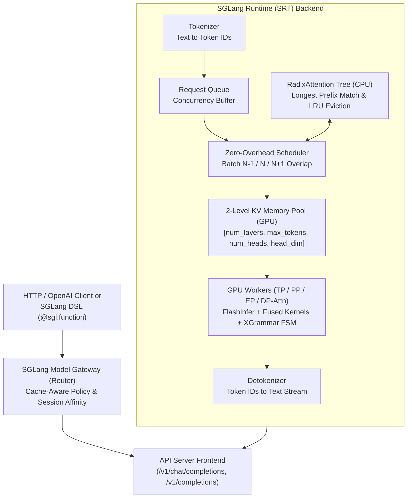
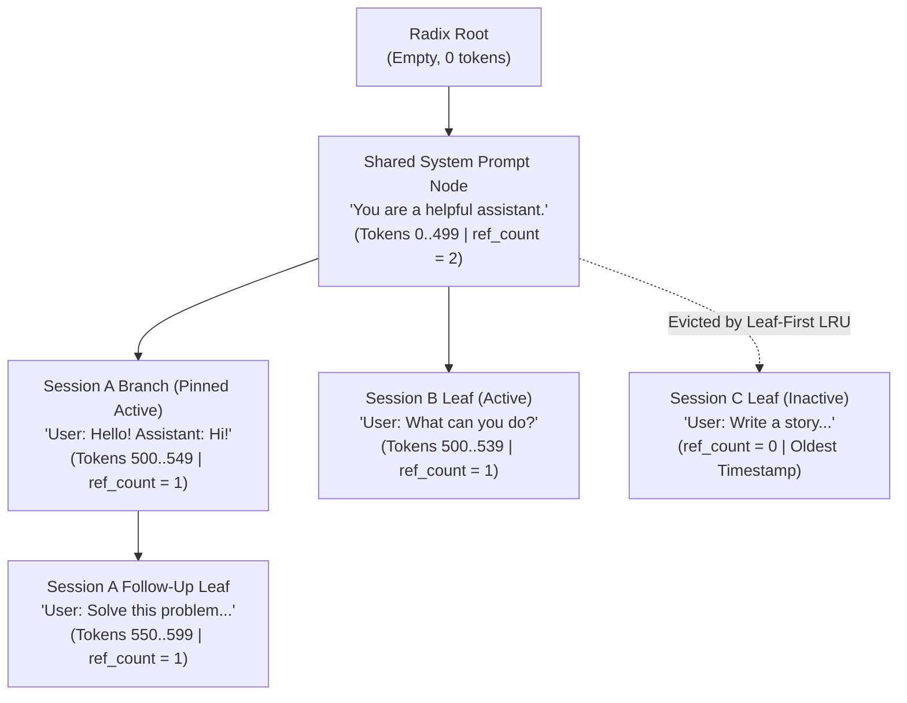
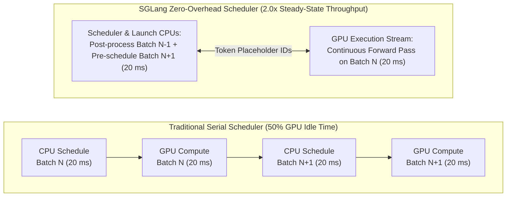
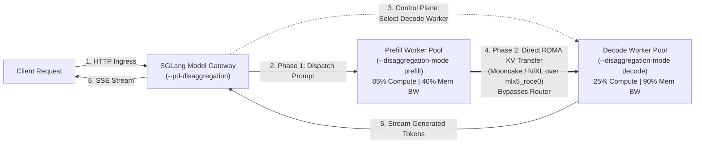

# 15.4 SGLang and cross-request optimisation

| Field | Value |
|---|---|
| Level | Advanced |
| Priority tier | 1 |
| Lab venue | GCP / GKE + Local Python Verification Lab |
| Part | Part 15: LLM inference and serving |
| Cross-references | Chapter 15.2 (KV cache & batching); Chapter 15.3 (vLLM in depth); Chapter 15.8 (NVIDIA Dynamo & llm-d); Chapter 15.10 (Prefill & decode disaggregation) |
| Code | `code/part15/sglang_cross_request.py`, `code/part15/sglang_cross_request_lab.py` |
| Coverage file | `planning/coverage/chapters/15-04.md` |
| Claim & number ledger | `planning/ledgers/15-04.md` |

## Why this matters for AI infrastructure

Most inference engines optimize a single request at a time. When a model exceeds the memory of one GPU, vLLM splits the weights across GPUs using Tensor Parallelism or Pipeline Parallelism. It also uses PagedAttention to cut internal memory fragmentation inside each sequence. That intra-request focus works well for isolated prompts, but production workloads rarely consist of isolated prompts.

Consider an enterprise assistant where one hundred users send requests at the same moment. Every request begins with the same five-hundred-token system prompt. A traditional engine computes the Key-Value cache for those five hundred tokens one hundred separate times. That burns fifty thousand tokens of prefill compute on identical instructions. Multi-turn conversations, few-shot templates, retrieval-augmented generation pipelines, and multi-step agent chains repeat that waste on every turn.

SGLang, created by the LMSYS team at UC Berkeley and Stanford, elevates cross-request optimization to a first-class design principle.
- **RadixAttention prefix reuse:** SGLang stores Key-Value cache tensors in a compressed prefix tree called a Radix Tree. Shared system prompts, few-shot examples, and prior conversation turns are computed once and reused across requests. This reuse cuts prefill computation by up to 90 percent and reduces follow-up latency by two to three times.
- **Compressed finite-state machine structured decoding:** Naive token validation across a large vocabulary stalls the CPU on every decode step. SGLang integrates XGrammar and Outlines to precompile JSON schemas and regular expressions into compressed state machines. It also uses Jump-Forward Decoding to splice deterministic structural tokens directly into the output without running forward passes.
- **Zero-overhead CPU scheduling and FlashInfer kernels:** Traditional serial schedulers leave the GPU idle for 50 percent or more of wall-clock time while the CPU prepares the next batch. SGLang overlaps batch preparation on the CPU with active kernel execution on the GPU. That overlap doubles throughput alongside fused CUDA operators and FlashInfer attention kernels.
- **Request-level routing and prefill-decode disaggregation:** Above the runtime, the SGLang Model Gateway routes multi-turn sessions to warm workers using cache-aware policies. It also coordinates worker-to-worker RDMA Key-Value transfers via Mooncake or NIXL.

```text
SGLang Production Scale and Cross-Request Reference Numbers (DAI Ch. 7, 10, 11; Volume 12 Ch. 6 & 8):
- Worldwide fleet footprint: > 400,000 GPUs running SGLang in production (including xAI Grok 3 and Microsoft Azure)
- Single-node H100 throughput benchmark: 16,215 tokens/s with RadixAttention enabled
- Mixed-length workload advantage (50 to 5,000 tokens in genai-bench): 40% higher throughput than fixed-prompt baselines
- Long-context pipeline parallelism (DeepSeek-V3.1): 3.31x prefill throughput, up to 81% TTFT reduction on 1,000,000-token contexts, 82.8% scaling efficiency
- Shared system prompt math (100 users x 500-token system prompt + 50-token query = 55,000 total tokens):
  Unoptimized prefill = 55,000 tokens; RadixAttention prefill = 500 + (100 * 50) = 5,500 tokens (49,500 tokens saved = 90.0% prefill reduction)
- Multi-turn follow-up latency reduction with RadixAttention + session affinity: 2x to 3x lower latency (50% to 90% TTFT reduction)
```

Before you scale out an inference cluster by adding more GPUs, check whether your requests share prefixes or schemas that SGLang can reuse for free.

## Prerequisites and outcomes

### Prerequisites
- Key-Value cache sizing, continuous batching, and quantization fundamentals from Chapter 15.2.
- PagedAttention block tables and intra-request virtual memory paging from Chapter 15.3.
- GPU interconnect hierarchy, NVLink, and GPUDirect RDMA from Part 12.

### Outcomes
After completing this chapter, you will be able to achieve five engineering goals.
1. Contrast intra-request optimization in vLLM, TGI, and LMDeploy against cross-request optimization in SGLang. You will also deploy containerized SGLang servers with proper shared-memory sizing.
2. Trace how RadixAttention organizes Key-Value caches in a compressed Radix Tree over a two-level memory pool. You will also trace leaf-first Least Recently Used eviction and longest-shared-prefix batch scheduling.
3. Structure multi-turn chat, RAG document contexts, and multi-tenant prompt templates to maximize prefix hit rates. You will also prevent cross-tenant timing side-channels.
4. Configure structured output decoding with XGrammar and Outlines. You will also quantify how compressed finite-state machines and Jump-Forward Decoding eliminate per-token CPU masking bottlenecks.
5. Architect distributed SGLang deployments combining the Zero-Overhead Scheduler, the SGLang Model Gateway, and session affinity. You will also configure Mooncake or NIXL prefill-decode disaggregation and Data-Parallel Attention for Mixture-of-Experts models.

---

## 1. Intra-Request vs Cross-Request Philosophy and SGLang Architecture

### 1.1 The Four Open-Source Serving Paradigms

Modern open-source LLM serving engines optimize different layers of the execution stack. Understanding where each engine spends its engineering budget clarifies when to deploy SGLang versus vLLM, Hugging Face Text Generation Inference, or LMDeploy.

- **vLLM:** Focuses on intra-request memory efficiency through PagedAttention. It splits the Key-Value cache into fixed physical blocks of 16 or 32 tokens. That paging eliminates external fragmentation and bounds internal fragmentation to the final block, cutting memory waste from 60 to 80 percent down to under 4 percent.
- **Text Generation Inference:** Uses a decoupled Rust frontend router built on Axum and tokio over a Python and C++ backend. It pairs that router with zero-copy `safetensors` memory mapping for fast container cold starts and connection isolation.
- **LMDeploy:** Implements its TurboMind core in pure C++ with native 4-bit AWQ and W4A16 fused kernels. That design cuts host CPU scheduling overhead below 5 microseconds per token step to achieve ultra-low inter-token latency.
- **SGLang:** Co-designs a flexible frontend programming language and OpenAI-compatible API with the SGLang Runtime backend. It targets cross-request prefix reuse via RadixAttention, zero-overhead CPU scheduling, and fast grammar-constrained generation via XGrammar.

| Architectural Dimension | vLLM | Text Generation Inference (TGI) | SGLang | LMDeploy |
|---|---|---|---|---|
| Core Runtime Architecture | Python Async + C++/CUDA extensions | Rust `Axum`/gRPC Router + Python/C++ backend | Python Frontend + SGLang Runtime (`SRT`) + Model Gateway | Pure C++ Engine Core (TurboMind) |
| KV Cache Management | PagedAttention virtual memory paging (`B = 16` or `32`) | Paged attention + prefill cache | RadixAttention compressed prefix tree + 2-level memory pool | Fused paged memory allocator |
| Prefix Caching Mechanism | Automatic Prefix Caching (APC) via fixed-block hash tables | Block-level prefix reuse | Token-exact Radix Tree graph traversal + leaf-first LRU eviction | Static / dynamic block reuse |
| Structured Output Engine | Guided decoding (Outlines / LM-Format-Enforcer) | Grammar / Regex JSON schemas | Native compressed FSM state graph (XGrammar / Outlines) + Jump-Forward | Schema-guided JSON decoding |
| Primary Workload Sweet Spot | Broad model coverage & high batch throughput | Enterprise Rust router isolation & fast `safetensors` cold starts | Multi-turn chat, agentic workflows, RAG prefix reuse & strict JSON | Ultra-low single-stream latency & W4A16 quantization |
| Typical Inter-Token Latency (ITL) | 15 to 25 ms | 15 to 25 ms | 12 to 22 ms | 8 to 14 ms |

### 1.2 SGLang Runtime (`SRT`) Pipeline and Container Setup

SGLang separates request handling into a frontend API Server, an execution backend called the SGLang Runtime, and an optional distributed SGLang Model Gateway. Inside the SGLang Runtime, five components form a continuous pipeline.
1. **Tokenizer:** Converts incoming HTTP payloads or native SGLang DSL calls into integer token IDs.
2. **Request Queue:** Buffers tokenized requests and manages admission concurrency.
3. **Radix-Aware Zero-Overhead Scheduler:** Matches queued token sequences against the CPU Radix Tree and prioritizes requests with the longest shared cached prefixes. It also allocates physical Key-Value slots and overlaps CPU batch preparation with GPU execution.
4. **GPU Workers:** Execute the Transformer forward pass across single-GPU, Tensor Parallel, Pipeline Parallel, or Expert Parallel groups. They run fused CUDA kernels alongside FlashInfer or FlashAttention-3 backends.
5. **Detokenizer:** Streams generated token IDs back into text and flushes Server-Sent Events through the API Server.



SGLang runs on Linux with Python 3.10 or later. It supports NVIDIA GPUs alongside AMD Instinct, Google TPUs, Intel Xeon CPUs, Jetson Orin, and Huawei Ascend NPUs. On Kubernetes clusters managed by NVIDIA NIM, the platform automatically selects the serving backend using the preference hierarchy TensorRT-LLM, then vLLM, and then SGLang. For standalone Docker or GKE deployments, LMSYS publishes two container tags on Docker Hub under `lmsysorg/sglang`.
- **Production runtime image (`latest-runtime`):** Requires approximately 16 GB of disk space and bundles only the runtime dependencies needed for production serving.
- **Development image (`latest`):** Requires approximately 35 GB of disk space because it includes compiler toolchains and build dependencies.

When launching the container, two flags are critical for cross-request performance. Passing `--ipc=host` grants access to host shared memory for PyTorch Tensor Parallel collectives. Passing `--shm-size 32g` allocates a 32 GB shared memory segment required by SGLang's Key-Value cache manager and RadixAttention metadata tables.

| Model Name | Architecture Type | Parameter Size | Primary SGLang Endpoint |
|---|---|---|---|
| `Qwen/Qwen2.5-0.5B-Instruct` | Chat / Instruct | 0.5B | `/v1/chat/completions` |
| `meta-llama/Llama-3.2-1B-Instruct` | Chat / Instruct | 1B | `/v1/chat/completions` |
| `meta-llama/Llama-3.2-1B` | Base Causal LM | 1B | `/v1/completions` |
| `microsoft/Phi-tiny-MoE-instruct` | MoE / Instruct | 3.8B total (~1.1B active) | `/v1/chat/completions` |
| `Qwen/Qwen3-Embedding-0.6B` | Embedding | 0.6B | `/v1/embeddings` |
| `Qwen/Qwen2-VL-2B-Instruct` | VLM / Multimodal | 2B | `/v1/chat/completions` |
| `BAAI/bge-reranker-v2-m3` | Reranker | 0.6B | `/v1/rerank` (`query` & `documents`) |
| `jason9693/Qwen2.5-1.5B-apeach` | Reward / Classify | 1.5B | `/v1/classify` |

### 1.3 The SGLang Frontend Programming Model (`@sgl.function` and `s.fork`)

Beyond standard OpenAI endpoints on port 30000, SGLang provides a native Python domain-specific language decorated with `@sgl.function`. Instead of treating every LLM call as an isolated string completion, the interpreter tracks prompt state incrementally across `sgl.system`, `sgl.user`, `sgl.assistant`, and `sgl.gen` primitives.

When an agentic workflow explores multiple reasoning paths or runs best-of-N candidate selection, calling `s.fork(N)` clones the conversation state into N parallel branches. In the backend, `s.fork(4)` does not duplicate the prompt's Key-Value cache four times. Instead, all four branches point to the same shared prefix node in the Radix Tree. They allocate new Key-Value slots only for their diverging generated tokens, cutting Key-Value memory consumption by more than half.

```text
Parallel Generation Memory Math with s.fork(4) (code/part15/sglang_cross_request.py):
- Shared prompt length = 500 tokens; generated candidate length = 200 tokens per branch across N = 4 branches
- Sequential / Unshared KV footprint: 4 * (500 + 200) = 2,800 KV token slots
- SGLang s.fork(4) Radix-shared KV footprint: 500 + (4 * 200) = 1,300 KV token slots
- KV memory reduction from prefix sharing across forks: (2,800 - 1,300) / 2,800 = 53.57% saved
```

**Design multi-step agents and parallel sampling workflows around shared prompt state so the runtime reuses one prefix across every branch.**

---

## 2. RadixAttention: Radix Tree KV Cache Reuse and LRU Eviction

### 2.1 How RadixAttention Differs from Block-Hash Prefix Caching

Why does SGLang maintain an explicit Radix Tree when vLLM already offers Automatic Prefix Caching? The answer lies in how both systems index tokens and evict memory under pressure.

In vLLM's Automatic Prefix Caching, the engine groups tokens into fixed-size logical blocks of 16 or 32 tokens. It then computes a sequence hash over each full block. Suppose a shared system prompt is 500 tokens long and the block size is 16 tokens. In that case, vLLM matches the first 31 blocks covering 496 tokens. However, it misses the trailing 4 tokens because they do not fill a complete 16-token block. Furthermore, vLLM manages eviction across flat physical block queues rather than a tree hierarchy.

SGLang's RadixAttention stores token sequences in a compressed prefix tree, also known as a Radix Tree, directly in host CPU memory. Each node represents a variable-length subsequence of tokens, and each edge maps to physical Key-Value cache tensors stored in GPU HBM. As of SGLang v0.5, this GPU storage is organized as a **two-level memory pool**.
1. **Level 1 (Request-to-Token Index Pool):** Maps each active request and Radix Tree node to its logical token slot indices.
2. **Level 2 (Physical Key-Value Tensor Pool):** Stores the actual Key and Value vectors in a pre-allocated buffer shaped `[num_layers, max_tokens, num_heads, head_dim]`.

Because Radix Tree edges can split at any token index, RadixAttention matches arbitrary-length token prefixes with zero sub-block boundary waste.

```text
RadixAttention vs Block-Hash APC Worked Example (100 requests, 500-token system prompt + 50-token user query):
- Total prompt tokens across 100 requests: 100 * (500 + 50) = 55,000 tokens
- Unoptimized engine (no prefix cache): computes all 55,000 tokens
- SGLang RadixAttention (exact token match):
  Request 1 computes 550 tokens; Requests 2..100 reuse all 500 prefix tokens and compute only 50 suffix tokens each
  Total computed tokens = 550 + (99 * 50) = 5,500 tokens -> 49,500 tokens saved (90.0% prefill reduction, 90.0% hit rate)
- vLLM Block-Hash APC (block_size = 16):
  Matches floor(500 / 16) * 16 = 31 * 16 = 496 tokens; misses 4 trailing sub-block tokens on every follow-up request
  Total computed tokens = 550 + 99 * (50 + 4) = 5,896 tokens (396 extra prefill tokens computed across the batch)
- PagedAttention internal fragmentation reference (S_actual = 500, B = 16): < 16 / 500 = 3.2% (vs 60-80% contiguous waste)
```

### 2.2 Radix Tree Lifecycle: Splitting, Sharing, and Leaf-First LRU Eviction

Unlike a static lookup table, the RadixAttention tree dynamically restructures itself as conversations evolve and GPU memory fills up.



Tracing the lifecycle of the Radix Tree across nine operational stages reveals how SGLang balances reuse against finite VRAM.
1. **Initial empty state:** Before traffic arrives, the tree contains only the root node and all slots in the Level 2 Key-Value pool are free.
2. **First conversation insertion:** When Session A completes its first turn, SGLang does not free its Key-Value tensors. Instead, it inserts a single node containing the system prompt and the first exchange into the Radix Tree with reference count zero and records its access timestamp.
3. **Node splitting on follow-up turns:** When Session A sends a second message, the scheduler walks the tree and matches the first turn. If another user Session B arrives sharing only the system prompt, SGLang splits the original node into a shared parent node and two child branches.
4. **Multi-session fan-out:** As dozens of users connect, all sessions branch off the single shared system prompt node. The system prompt Key-Value tensors occupy GPU memory once.
5. **Leaf-first Least Recently Used eviction under memory pressure:** When a new request requires Key-Value slots and the static memory pool is full, SGLang runs recursive **Leaf-First LRU Eviction**. Any node with an active request holds a positive reference count (`ref_count > 0`) and cannot be evicted. Internal ancestor nodes also cannot be evicted while their children remain in the tree. The eviction loop collects unreferenced leaf nodes (`ref_count == 0`) and evicts the leaf with the oldest access timestamp first. It then recursively prunes newly exposed parent leaves until enough token slots are freed.

| Shared Prefix Length (Tokens) | Unique Suffix Length (Tokens) | Requests | Total Prompt Tokens | Radix Computed Tokens | Cache Hit Rate | Prefill Compute Saved | Cold vs Warm TTFT Speedup |
|---|---|---|---|---|---|---|---|
| 0 | 50 | 100 | 5,000 | 5,000 | 0.0% | 0.0% | 1.0x (2.0 ms vs 2.0 ms) |
| 100 | 50 | 100 | 15,000 | 5,100 | 66.0% | 66.0% | 3.0x (6.0 ms vs 2.0 ms) |
| 500 | 50 | 100 | 55,000 | 5,500 | 90.0% | 90.0% | 11.0x (22.0 ms vs 2.0 ms) |
| 1,000 | 50 | 100 | 105,000 | 6,000 | 94.29% | 94.29% | 21.0x (42.0 ms vs 2.0 ms) |

### 2.3 Cache-Aware Batch Scheduling, RAG Prompt Ordering, and Multi-Tenant Isolation

Maintaining a Radix Tree is only half the battle. If the batch scheduler dispatches requests in strict First-Come-First-Served order, requests that need the same cached prefix may land in distant batches. Then LRU eviction can flush their shared prefix before the second request runs.

SGLang's scheduler is explicitly **cache-aware**. During batch formation, it queries the Radix Tree for every waiting request and calculates the longest matching prefix length. It then sorts waiting requests so those sharing warm prefixes are grouped and scheduled first.

To get the full benefit of RadixAttention in production applications, engineers must also structure prompts deterministically.
- **Static-before-dynamic prompt layout:** Always place the static system instructions first, followed by static context documents, and place dynamic user questions at the very end. Changing a single character near the start of a prompt invalidates the prefix match for every token that follows.
- **Canonical RAG document sorting:** When a RAG pipeline retrieves four chunks, always sort the retrieved chunks by their canonical document ID before formatting the prompt. Suppose Request A caches chunks 1 through 4 and Request B retrieves chunks 1, 2, 5, and 7. Sorting them in ascending order lets Request B hit the Radix Tree across the system prompt plus the first two chunks. That matches 768 tokens out of 1,312. Placing chunk 5 first breaks the match right after the 256-token system prompt.
- **Multi-tenant timing side-channel isolation:** In a multi-tenant cluster, sharing document prefixes across customers introduces a security side-channel. If Tenant A guesses a confidential document belonging to Tenant B and observes a fast cache-hit Time to First Token, Tenant A can infer that Tenant B processed that document. Prevent cross-tenant context sharing by injecting a tenant ID tag immediately between `<system>` and `<context>`. All tenants still share the system prompt node in the Radix Tree, but each tenant branches into an isolated subtree before any private context is cached.
- **Chunked prefill alignment:** When chunked prefill is enabled for long contexts, naive sequence-level prefix matching can cause cache hit rates to drop 5.6x from 45 percent down to 8 percent. SGLang's RadixAttention natively supports both chunked prefill and token-level prefix matching so long prompts do not starve active decode batches or break prefix reuse.

```text
Canonical vs Reordered RAG & Multi-Tenant Prompt Template (HLS Ch. 6; Volume 12 Ch. 8):
  <system>
  You are a helpful assistant.               [256 tokens -> Shared across ALL tenants]
  <id> tenant-acme-prod                      [Tenant isolation boundary -> Prevents timing side-channel]
  <context>
  Document 1: <retrieved_text_chunk_1>       [256 tokens -> Canonical sorted order maximizes prefix hit]
  Document 2: <retrieved_text_chunk_2>       [256 tokens -> 256 sys + 512 chunks = 768 tokens matched]
  Document 3: <retrieved_text_chunk_5>       [256 tokens]
  Document 4: <retrieved_text_chunk_7>       [256 tokens]
  <user>
  {dynamic question from user}               [32 tokens  -> Total prompt = 1,312 tokens]

Chunked Prefill & Effective Speedup Reference (Volume 12 Ch. 8):
- Naive sequence-boundary prefix cache hit rate before chunking: 45% -> after naive chunking: 8% (5.6x drop)
- Effective TTFT gain at 32% cache hit rate: 420 ms without hit vs 280 ms with hit (140 ms saved = 33.3% TTFT speedup)
```

**Structure every prompt template from most static to most dynamic, sort RAG chunks canonically, and inject a tenant ID before private context.**

---

## 3. Structured Output Decoding (`XGrammar`, `Outlines`, Jump-Forward) and Zero-Overhead Scheduling

### 3.1 The 128K Vocabulary Masking Bottleneck and Precompiled Finite-State Machines

Agentic applications, tool-calling pipelines, and data-extraction services require LLMs to emit guaranteed-valid JSON, SQL, or domain-specific schemas. Under unconstrained decoding, the model produces a logit vector over its entire vocabulary at every decode step and samples from the resulting softmax probabilities.

Enforcing a grammar naively at runtime is surprisingly expensive. Modern models like Llama-3 have a vocabulary of 128,256 tokens. Checking all 128,256 tokens against regular expressions or JSON schema rules on the CPU at every decode step takes tens of milliseconds per token. That CPU check often takes longer than the GPU forward pass itself.

SGLang eliminates this bottleneck by routing structured outputs through **XGrammar** by default, while also supporting **Outlines** and `llguidance` as alternative grammar backends.
1. **Ahead-of-time finite-state machine compilation:** For context-free rules, XGrammar precompiles the target JSON schema or regular expression into a compressed finite-state machine. For each state in the automaton, the valid token set is precomputed into a compact bitmask before generation starts. For example, when the schema expects a JSON boolean, only the token IDs corresponding to true and false remain unmasked.
2. **Pushdown automata with tree-based stack management:** Context-sensitive or recursive rules like balanced parentheses or nested JSON objects require a stack. XGrammar uses a pushdown automaton with tree-based stack management to avoid expensive stack snapshot copies across parallel beams.
3. **In-kernel GPU logit bitmasking:** Instead of masking tokens on the host CPU, SGLang copies the compact state bitmask to the GPU. It injects that mask directly into the CUDA logit-processing and softmax kernel. This keeps structured decoding overhead in the low single-digit percent range, around 1.25 percent per decode step.

### 3.2 Jump-Forward Decoding: Turning Decode Steps into Prefix Splices

SGLang goes one step further than per-token masking with **Jump-Forward Decoding**. Consider a strict JSON schema for extracting a person's name, age, and occupation.

```json
{"name": "John Smith", "age": 35, "occupation": "software engineer"}
```

At the start of generation, the schema requires the exact characters `{"name": "`. There is zero ambiguity because no other token sequence can legally begin the JSON object. A standard guided-decoding engine still runs five separate autoregressive decode forward passes through the model just to emit those structural tokens one by one.

```mermaid
flowchart LR
    S0["FSM State 0<br/>Start of Object"] ==>|"Jump-Forward Splice (5 tokens)<br/>#39;{#quot;name#quot;: #quot;#39; (0 Decode Steps)"| S1["FSM State 1<br/>Sample String Value"]
    S1 -->|"LLM Decode (2 steps)<br/>#39;John Smith#quot;#39;"| S2["FSM State 2<br/>After name field"]
    S2 ==>|"Jump-Forward Splice (5 tokens)<br/>#39;, #quot;age#quot;: #39; (0 Decode Steps)"| S3["FSM State 3<br/>Sample Integer Value"]
    S3 -->|"LLM Decode (1 step)<br/>'35'"| S4["FSM State 4<br/>After age field"]
    S4 ==>|"Jump-Forward Splice (6 tokens)<br/>#39;, #quot;occupation#quot;: #quot;#39; (0 Decode Steps)"| S5["FSM State 5<br/>Sample String Value"]
    S5 -->|"LLM Decode (2 steps)<br/>'software engineer'"| S6["FSM State 6<br/>End of Value"]
    S6 ==>|"Jump-Forward Splice (2 tokens)<br/>#39;#quot;}#39; (0 Decode Steps)"| S7["FSM Accept State<br/>23 Tokens (Only 5 Sampled)"]
```



With Jump-Forward Decoding, SGLang inspects the compressed finite-state machine graph. Whenever the current state has a single deterministic character path leading to the next branching value state, SGLang skips the autoregressive decode loop entirely. It converts the deterministic string into token IDs, appends those tokens directly to the sequence buffer, and processes them in parallel as a fast prefill extension on the next sampled step.

```text
Jump-Forward Decoding Math on the Person JSON Schema (code/part15/sglang_cross_request.py):
- Target JSON output: {"name": "John Smith", "age": 35, "occupation": "software engineer"} (23 total tokens)
- Deterministic structural splices (4 jumps):
  1. '{"name": "'        =  5 tokens
  2. '", "age": '        =  5 tokens
  3. ', "occupation": "' =  6 tokens
  4. '"}'                =  2 tokens
  Total jumped tokens    = 18 tokens (78.26% of all output tokens skipped without decode forward passes)
- Sampled value tokens (3 fields): 'John Smith"' (2 tokens) + '35' (1 token) + 'software engineer' (2 tokens) = 5 tokens
- Latency comparison (at 12.0 ms GPU decode step, 18.0 ms naive CPU mask, 0.15 ms XGrammar GPU mask = 1.25% overhead):
  1. Naive CPU regex masking (23 steps * 30.0 ms)            = 690.00 ms
  2. Precompiled GPU FSM without Jump-Forward (23 * 12.15 ms) = 279.45 ms
  3. XGrammar + Jump-Forward (5 * 12.15 ms + 4 * 1.2 ms)      =  65.55 ms (4.26x faster than FSM-only, 10.53x faster than naive)
```

### 3.3 Operator Fusion and Attention Kernel Backends (`FlashInfer` vs `FlashAttention-3`)

Even when the model is executing a legitimate forward pass, launching separate CUDA kernels for Layer Normalization, linear projections, and activation functions causes repeated round-trips to global HBM memory. SGLang ships fused CUDA kernels that combine LayerNorm, linear projection, and activation into a single kernel launch so intermediate tensors remain in fast on-chip SRAM and registers. For Mixture-of-Experts models, SGLang fuses top-k gating and expert routing directly with expert GEMM kernels using `deep_gemm`, Triton, or CUTLASS.

For the self-attention calculation itself, SGLang selects hardware-specific kernel backends.
- **Non-Hopper GPUs (A100, A40, Ada Lovelace):** SGLang defaults to **FlashInfer**, which provides highly optimized paged prefill, decode, and cascade-attention kernels tailored for RadixAttention prefix trees.
- **NVIDIA Hopper and Blackwell GPUs (H100, H200, H20, B200):** SGLang pairs FlashInfer with **FlashAttention-3** to exploit Hopper Tensor Memory Accelerator hardware and warp-specialized FP8 and BF16 execution. It also uses **FlashMLA** for DeepSeek Multi-Head Latent Attention decoding.

### 3.4 The Zero-Overhead CPU Scheduler and Token Placeholders

In a traditional inference server, the CPU and GPU execute serially. First, the CPU collects incoming requests, searches the prefix cache, and allocates memory blocks for Batch N. Next, the GPU runs the forward pass for Batch N while the CPU waits. Finally, the CPU checks stopping conditions and detokenizes outputs before starting to schedule Batch N+1. Because Python scheduling, Radix Tree traversal, and grammar state updates take significant CPU time, serial scheduler overhead can consume 50 percent or more of total step time. That serial pattern leaves expensive GPUs idle between batches.



SGLang's **Zero-Overhead Scheduler** eliminates GPU idle gaps by overlapping three pipeline stages simultaneously. While the GPU executes Batch N, the CPU processes the completed outputs of Batch N-1 and pre-schedules Batch N+1.

To make this overlap possible when Batch N+1 depends on the tokens currently being generated by Batch N, SGLang splits host work across two logical CPU threads and uses a **token placeholder mechanism**.
- **Scheduler CPU:** Handles pre-scheduling by collecting requests, matching prefixes in the Radix Tree, and allocating Key-Value indices. It also runs post-scheduling completion checks and cache updates.
- **Launch CPU:** Dispatches CUDA kernel launches and processes device-to-host token outputs.
- **Token placeholders:** When the Scheduler CPU prepares Batch N+1 before Batch N has finished on the GPU, it does not know which exact token ID Batch N will emit for each running sequence. It therefore assigns a temporary token placeholder slot in the Level 1 index table and dispatches Batch N+1 immediately. A background thread monitors GPU completion for Batch N and overwrites the placeholder with the actual generated token ID just before Batch N+1's kernels execute on the GPU. Overlapping these stages yields up to a **2x throughput improvement** over serial scheduling.

**Enable XGrammar structured decoding and the Zero-Overhead Scheduler to keep host CPU masking and batch preparation off the GPU critical path.**

---

## 4. Distributed SGLang: Model Gateway, Prefill/Decode Disaggregation, and DP Attention

### 4.1 The SGLang Model Gateway (Router) Architecture

How do you scale SGLang across a cluster of GPUs without losing RadixAttention cache locality? SGLang supports standard intra-layer Tensor Parallelism, inter-layer Pipeline Parallelism, and Expert Parallelism just like vLLM. However, when a model fits on a single GPU or a single node's NVLink group, SGLang introduces **request-level routing** via the **SGLang Model Gateway** as a horizontal scaling primitive.

It is important to be precise about what router-based scaling eliminates. If each worker uses eight-way Tensor Parallelism inside a node, those eight GPUs still execute an AllReduce collective after every attention and MLP layer. What the router eliminates is **cross-request synchronization between workers**. Each worker replica holds a complete model copy and processes requests independently, without any inter-worker coordination.

The SGLang Model Gateway separates cluster management into a control plane and a data plane.
- **Control plane:** Includes a **Worker Manager** that discovers worker capabilities and a **Health Checker** that probes `/health` endpoints and opens worker-scoped circuit breakers after 5 consecutive failures. It also runs a **Load Monitor** that tracks active queues and **Kubernetes Service Discovery** that syncs the worker pool with pod lifecycles.
- **Data plane:** Exposes an **HTTP Router** for OpenAI endpoints, a **gRPC Router** with native tokenization and reasoning parsers, and a **Prefill/Decode Router** for disaggregated clusters. It also enforces exponential-backoff retries with jitter, token-bucket rate limiting, and Prometheus `/metrics` plus OpenTelemetry tracing.

### 4.2 Cache-Aware Routing Policies, Session Affinity, and Fault Tolerance

If a load balancer distributes multi-turn chat requests using blind Round-Robin, Turn 1 lands on Worker 1, Turn 2 lands on Worker 2, and Turn 3 lands on Worker 3. Every turn suffers a cold cache miss and recomputes the entire conversation history from scratch.

SGLang's router prevents cache fragmentation through four selectable policies and explicit session pinning.

| Routing Policy | Flag Value | Algorithmic Mechanism | Best Production Use Case |
|---|---|---|---|
| Cache-Aware (Default Recommended) | `--policy cache_aware` | Maintains an approximate Radix Tree per worker; routes to the worker with the highest prefix match (`>= --cache-threshold 0.5`) unless load skew exceeds `--balance-abs-threshold 10` and `--balance-rel-threshold 1.5` | Multi-turn chat, RAG pipelines, and shared system-prompt APIs (`100K+` concurrent sessions) |
| Round-Robin | `--policy round_robin` | Cycles requests sequentially across healthy workers regardless of cache state | Uniform single-shot prompts with zero prefix overlap |
| Shortest-Queue | `--policy shortest_queue` | Routes each incoming request to the worker with the fewest pending requests | Highly variable prompt and generation lengths |
| Power-of-Two-Choices | `--policy power_of_two_choices` | Samples two random workers and dispatches to the less loaded one | High-QPS clusters needing low-overhead load balancing |

When an application attaches a `session_id` to `/v1/chat/completions` payloads, the router enables **session affinity**. Consecutive turns of that conversation stay pinned to the same healthy worker where previous turns are already warm in the Radix Tree. That locality cuts follow-up latency by two to three times and reduces Time to First Token by 50 to 90 percent. If the worker holding an active session fails 5 consecutive health checks, the circuit breaker opens and **session migration** remaps the session to a healthy worker. Only the first migrated turn pays a full cold prefill penalty. Subsequent turns immediately benefit from the new worker's warm Radix Tree.

### 4.3 Prefill/Decode (`PD`) Disaggregation and Transfer Engines (`Mooncake`, `NIXL`, `ASCEND`)

As established in Chapters 15.1 and 15.10, prefill and decode have opposite hardware utilization profiles. Processing a long prompt in parallel is compute-bound, driving roughly **85 percent compute utilization** and **40 percent memory bandwidth utilization**. Generating tokens one by one is memory-bandwidth-bound, dropping to **25 percent compute utilization** while saturating **90 percent of HBM memory bandwidth**. Mixing both phases on the same worker causes long prefills to block active decode steps.



In SGLang's **Prefill/Decode Disaggregation** architecture, the router coordinates two specialized worker pools.
1. **Phase 1 (Control Plane & Prefill):** The router sends the incoming prompt to a prefill worker (`--disaggregation-mode prefill`) and simultaneously notifies a selected decode worker (`--disaggregation-mode decode`). Raw prompt text never goes to the decode worker.
2. **Phase 2 (Zero-Copy Data Plane Transfer):** Once prefill completes, the prefill worker transfers the resulting Key-Value cache blocks directly to the decode worker's GPU memory, bypassing the router entirely.

To transfer gigabytes of Key-Value cache without stalling Time to First Token, SGLang supports three transfer engines.
- **Mooncake:** Uses GPUDirect RDMA over InfiniBand or RoCE (`--disaggregation-ib-device mlx5_roce0`) for direct memory-to-memory transfers without host CPU copies.
- **NIXL:** Uses a UCX-based abstraction (`--disaggregation-transfer-backend nixl`) that runs portably across InfiniBand and standard Ethernet fabrics.
- **ASCEND:** Specialized high-speed transfer backend for Huawei Ascend NPU clusters.

In production, size the prefill-to-decode worker ratio to match your workload's compute profile. Use a **2:1 or 3:1 prefill-to-decode ratio** for long-context RAG workloads, and a **1:2 prefill-to-decode ratio** for decode-heavy chatbots.

### 4.4 Hybrid Parallelism (`TP`, `PP`, `DP`, `EP`), Data-Parallel Attention, and Speculative Decoding

SGLang combines four orthogonal parallelism dimensions—Tensor Parallelism, Pipeline Parallelism, Data Parallelism, and Expert Parallelism—with specialized attention and decoding optimizations.
- **Multiplicative 4D scaling:** Configuring 8-way TP, 2-way PP, 4-way DP, and 2-way EP scales across 128 GPUs. On 32 GPUs across 4 nodes, large dense models use 8-way TP inside each NVLink node and 4-way PP across nodes. Meanwhile, mid-sized models on 16 GPUs run 4 independent router-managed workers each using 4-way TP.
- **Data-Parallel Attention (`--enable-dp-attention`):** Under standard Tensor Parallelism, QKV projections are sharded across TP ranks. However, some models use Multi-Query Attention or Multi-Head Latent Attention with fewer Key-Value heads than TP ranks. For example, a model with 1 Key-Value head running at 8-way TP must replicate the entire Key-Value cache across all 8 GPUs, wasting 8x Key-Value memory. Enabling `--enable-dp-attention` with `--dp-size 8` and `--tp-size 8` runs the attention layer with Data Parallelism so each GPU processes different requests with zero Key-Value duplication. It then executes an AllGather before the MLP, runs the MLP with Tensor Parallelism, and slices outputs back. Eliminating that 8x Key-Value duplication increases decoding throughput by up to **1.9x** on large batches.
- **Mixture-of-Experts All-to-All overlap:** For MoE models like `microsoft/Phi-tiny-MoE-instruct` or `Qwen/Qwen3-235B-A22B`, SGLang pairs `--moe-a2a-backend deepep` with `--moe-runner-backend deep_gemm`. Enabling **Two-Batch Overlap** (`--enable-two-batch-overlap`) splits a batch into two micro-batches. One micro-batch executes AllToAll token routing while the other runs attention computation, nearly doubling MoE throughput. **Single-Batch Overlap** (`--enable-single-batch-overlap`) achieves similar overlap within a single batch using multiple CUDA streams.
- **Speculative decoding (EAGLE-2/3 and draft models):** While RadixAttention slashes prefill TTFT, speculative decoding accelerates memory-bound decoding by predicting multiple draft tokens (`--speculative-num-draft-tokens 4`) and verifying them in a single target forward pass. Well-matched draft and target pairs achieve **70 to 90 percent acceptance rates** for a **2x to 4x decode speedup**. Feature-level **EAGLE-1** reaches up to **3.5x**, and dynamic draft-tree **EAGLE-2** is **20 to 40 percent faster** than EAGLE-1. Multi-layer fused **EAGLE-3** reaches up to **1.4x** over EAGLE-2 and **6.5x** over unoptimized baselines. Multi-head **Medusa** achieves **2.2x to 3.6x** speedups, cutting a 100-token reply from 100 iterations to 25 iterations at 4 tokens per pass.

| Model Scale / Workload Type | Recommended SGLang Topology | Key Launch Flags | Expected Production Profile |
|---|---|---|---|
| Small models (`< 10B`) on single GPU | Router-based Data Parallelism (`DP`) across nodes | `--policy cache_aware` on router; 1 GPU per worker | 50 to 100 ms TTFT, 1,000+ QPS, 60% to 80% cache hit rate |
| Mid-size models (`10B` to `100B`) | Intra-node `TP` (`2` to `8` GPUs on NVLink) + Router `DP` across nodes | `--tp 8` per node worker + `sglang_router.launch_router` | Zero cross-node `AllReduce`; full session affinity per node |
| Frontier dense models (`> 100B`) | Multi-node `TP` + `PP` | `--tp 8 --pp 4 --nnodes 2 --dist-init-addr` | Fits weights > single node; use `--enable-chunked-prefill` |
| MoE models with MLA / few KV heads | `EP` + `TP` + Data-Parallel Attention + Two-Batch Overlap | `--tp 8 --ep 16 --enable-dp-attention --enable-two-batch-overlap` | Eliminates 8x KV duplication; up to 1.9x higher decode throughput |

**Use router-based Data Parallelism with cache-aware routing whenever a model fits inside a single node, and reserve cross-node Tensor or Pipeline Parallelism for larger models.**

---

## 5. Commands and Configurations That Matter

### 5.1 Docker Container Launch and OpenAI / Structured Output Verification

The following commands pull the 16 GB production runtime image and launch SGLang on port 30000 with 32 GB shared memory. They then test deterministic chat completions and XGrammar `json_schema` structured decoding. These commands are `untested` on live GPU hardware in this local build environment and verified against *Distributed AI Systems* Chapter 7.

```bash
# 1. Pull the 16 GB production runtime image (vs 35 GB full dev image)
docker pull lmsysorg/sglang:latest-runtime
export SGLANG_MODEL="Qwen/Qwen2.5-0.5B-Instruct"

# 2. Launch SGLang server with host IPC and 32 GB shared memory for RadixAttention
docker run --runtime nvidia --gpus all \
  -v $HOME/.cache/huggingface:/root/.cache/huggingface \
  --env "HF_TOKEN=$HF_TOKEN" \
  --env "SGLANG_MODEL=$SGLANG_MODEL" \
  -p 30000:30000 --ipc=host --shm-size 32g \
  lmsysorg/sglang:latest-runtime \
  python3 -m sglang.launch_server \
  --model-path $SGLANG_MODEL \
  --host 0.0.0.0 \
  --port 30000

# 3. Verify health, model registry, and XGrammar JSON schema constrained decoding
curl -w "HTTP Status: %{http_code}\n" http://localhost:30000/health
curl http://localhost:30000/v1/models

curl http://localhost:30000/v1/chat/completions \
  -H "Content-Type: application/json" \
  -d '{
    "model": "Qwen/Qwen2.5-0.5B-Instruct",
    "messages": [{"role": "user", "content": "Extract: John is 30 years old, lives in NYC"}],
    "temperature": 0,
    "response_format": {
      "type": "json_schema",
      "json_schema": {
        "name": "person",
        "schema": {
          "type": "object",
          "properties": {
            "name": {"type": "string"},
            "age": {"type": "number"},
            "city": {"type": "string"}
          },
          "required": ["name", "age"]
        }
      }
    }
  }'
```

### 5.2 Multi-Node Router, Mooncake PD Disaggregation, and MoE + DP Attention Launches

```bash
# Pattern A: 4-Node Cache-Aware Router Deployment (Independent Workers, Zero Inter-Worker Sync)
for i in {1..4}; do
  ssh node$i "python3 -m sglang.launch_server \
    --model-path Qwen/Qwen2.5-0.5B-Instruct \
    --port 30000" &
done

python3 -m sglang_router.launch_router \
  --worker-urls http://node1:30000 http://node2:30000 http://node3:30000 http://node4:30000 \
  --policy cache_aware \
  --cache-threshold 0.5 \
  --balance-abs-threshold 10 \
  --balance-rel-threshold 1.5 \
  --port 8080

# Pattern B: Multi-Node Tensor Parallelism (TP=16 across 2 x 8-GPU nodes)
# Node 0 (Master):
python3 -m sglang.launch_server \
  --model-path Qwen/Qwen2.5-0.5B-Instruct \
  --tp 16 --dist-init-addr 172.16.4.52:20000 --nnodes 2 --node-rank 0
# Node 1 (Worker):
python3 -m sglang.launch_server \
  --model-path Qwen/Qwen2.5-0.5B-Instruct \
  --tp 16 --dist-init-addr 172.16.4.52:20000 --nnodes 2 --node-rank 1

# Pattern C: Prefill/Decode Disaggregation with Mooncake RDMA Transfer Engine
uv pip install mooncake-transfer-engine
python3 -m sglang.launch_server \
  --model-path Qwen/Qwen2.5-0.5B-Instruct \
  --disaggregation-mode prefill --port 30000 --disaggregation-ib-device mlx5_roce0 &
python3 -m sglang.launch_server \
  --model-path Qwen/Qwen2.5-0.5B-Instruct \
  --disaggregation-mode decode --port 30001 --base-gpu-id 1 --disaggregation-ib-device mlx5_roce0 &
python3 -m sglang_router.launch_router \
  --pd-disaggregation --prefill http://127.0.0.1:30000 --decode http://127.0.0.1:30001 \
  --host 0.0.0.0 --port 8080

# Pattern D: MoE Model with EP=16, TP=8, DeepEP, DeepGEMM, DP Attention, and Two-Batch Overlap
python3 -m sglang.launch_server \
  --model-path microsoft/Phi-tiny-MoE-instruct \
  --tp 8 --ep 16 \
  --moe-a2a-backend deepep \
  --moe-runner-backend deep_gemm \
  --enable-dp-attention \
  --enable-two-batch-overlap
```

---

## 6. How It Fails: Five Production Failure Modes

| Failure Scenario | Observable Symptom & Telemetry | Root Cause Mechanism | Exact Diagnostic & Remediation |
|---|---|---|---|
| **1. RadixAttention Cache Thrashing under Non-Overlapping Prompts** | P90 TTFT spikes by **400%** on automated unit-test generation bursts with unique prompts (`mem_fraction_static=0.85`). | Thousands of unique prompts insert one-off leaf nodes into the Radix Tree until VRAM fills, triggering continuous CPU-heavy LRU eviction cycles for nodes that are never reused. | Increase static KV pool allocation via `--mem-fraction-static 0.92 --schedule-conservativeness 1.0`, or pass `--disable-radix-cache` on pure single-shot batch endpoints to stabilize TTFT at **22 ms**. |
| **2. Prefix Hit Rate Collapse After Enabling Chunked Prefill or Bad RAG Ordering** | Prometheus `prefix_cache_hit_ratio` drops **5.6x** from **45% to 8%**, or RAG TTFT stays at **420 ms** instead of **280 ms**. | Naive sequence-level prefix matching misses chunked boundaries, or RAG pipelines format retrieved chunks in inconsistent order (`[5, 7, 1, 2]` instead of `[1, 2, 5, 7]`) or vary whitespace. | Use SGLang's chunk-aware RadixAttention with `--enable-chunked-prefill`, enforce canonical document chunk sorting, and place static `<system>` and `<context>` blocks strictly before `<user>`. |
| **3. Cross-Tenant Timing Side-Channel via Shared Prefix Cache** | Tenant A measures anomalously fast TTFT (`2.0 ms` vs `22.0 ms`) when probing confidential document snippets processed by Tenant B. | Both tenants share the exact same `<system>` and `<context>` prefix path in the global Radix Tree, allowing Tenant A to hit Tenant B's cached document KV blocks. | Inject a mandatory tenant identifier tag `<id> {tenant_id}` between `<system>` and `<context>` so tenants share the system prompt node but branch into isolated context subtrees. |
| **4. First-Request Grammar Compilation Stall or Slower Fallback Backend** | The first structured JSON request stalls for seconds or per-token ITL jumps into double-digit overhead under deeply nested schemas. | Complex or uncached JSON schemas force runtime FSM compilation on the critical path or trigger a fallback from XGrammar GPU bitmasking to a slower Python validation path. | Keep JSON schemas compact, pre-warm common schemas at server startup, and verify that `--grammar-backend xgrammar` is active. |
| **5. Worker Failure & Session Affinity Cold-Prefill Spike** | Active multi-turn conversations experience a sudden one-time **2x to 3x TTFT spike** right after a GPU worker pod restarts. | After **5 consecutive `/health` probe failures**, the SGLang Model Gateway opens the worker's circuit breaker and migrates pinned `session_id` mappings to a healthy worker whose Radix Tree lacks the conversation history. | Expected graceful recovery: the first post-migration turn recomputes the full prompt prefill on the new worker, and subsequent turns resume warm cache hits. Monitor `/metrics` circuit-breaker counters. |

---

## 7. Hands-On Lab: Verify RadixAttention, Jump-Forward Decoding, and Cache-Aware Routing

### Lab Venue and Objectives
- **Venue:** Local Python Verification Lab (`code/part15/sglang_cross_request.py` and `code/part15/sglang_cross_request_lab.py`), accompanied by reference SGLang SDK patterns for GCP and GKE GPU clusters. Live GPU commands are `untested` on live GPU hardware in this local build environment, while all 25 mathematical and algorithmic checks run deterministically in local Python.
- **Objectives:**
  1. Implement and test a compressed `RadixCache` trie supporting arbitrary token subsequence splitting, longest-prefix lookup, active reference pinning, and recursive leaf-first LRU eviction over a Level 2 memory pool.
  2. Quantify prefix sharing across 0, 100, 500, and 1,000 shared tokens, RAG canonical chunk ordering, and tenant isolation.
  3. Verify XGrammar and Jump-Forward Decoding token splicing on the 23-token `Person` JSON schema, skipping 18 structural tokens and sampling only 5 value tokens for a 4.26x speedup over FSM-only decoding.
  4. Verify Zero-Overhead Scheduler pipeline overlap for a 2.0x steady-state speedup, `s.fork(4)` parallel generation saving 53.57 percent Key-Value memory, cache-aware router failover, and Data-Parallel Attention.

### Step 1: Reference SGLang Frontend DSL Scripts (`@sgl.function`, `s.fork`, Session Affinity)

When running against a live SGLang server on GKE or a local GPU node, the following reference script demonstrates four production patterns from *Distributed AI Systems* Chapter 7. It covers constrained Pydantic JSON extraction, 3-turn stateful conversation reuse, `s.fork(4)` best-of-N parallel generation, and router `session_id` affinity benchmarking.

```python
# Reference SGLang Frontend DSL & Router Session Affinity Patterns (DAI Ch. 7)
# Note: Requires a live GPU running sglang.launch_server (untested on live hardware here).
import time
import requests
import sglang as sgl
from pydantic import BaseModel

class Person(BaseModel):
    name: str
    age: int
    occupation: str

@sgl.function
def extract_person(s, text: str):
    s += "Extract person information from: " + text + "\nOutput JSON:\n"
    s += sgl.gen("json_output", max_tokens=200, regex=Person.model_json_schema())

@sgl.function
def multi_turn_chat(s, system_prompt: str):
    s += sgl.system(system_prompt)
    s += sgl.user("What is machine learning?")
    s += sgl.assistant(sgl.gen("response1", max_tokens=200))
    s += sgl.user("Can you give me a simple example?")
    s += sgl.assistant(sgl.gen("response2", max_tokens=200))
    s += sgl.user("How is it different from traditional programming?")
    s += sgl.assistant(sgl.gen("response3", max_tokens=200))

@sgl.function
def best_of_n(s, prompt: str, n: int = 4):
    s += sgl.user(prompt)
    forks = s.fork(n)
    responses = []
    for i, fork in enumerate(forks):
        fork += sgl.assistant(sgl.gen(f"candidate_{i}", max_tokens=200, temperature=0.8))
        responses.append(fork[f"candidate_{i}"])
    best_idx = max(range(n), key=lambda i: len(responses[i]))
    s += sgl.select("best", responses[best_idx])

def benchmark_router_session_affinity(router_url: str = "http://router:8080/v1/chat/completions"):
    session_id = "test-session-123"
    model = "Qwen/Qwen2.5-0.5B-Instruct"
    r1 = requests.post(router_url, json={"model": model, "messages": [{"role": "user", "content": "Hello!"}], "session_id": session_id})
    r2 = requests.post(router_url, json={"model": model, "messages": [{"role": "user", "content": "What did I say?"}], "session_id": session_id})
    print(f"Turn 1: {r1.elapsed.total_seconds():.3f}s | Turn 2: {r2.elapsed.total_seconds():.3f}s | Speedup: {r1.elapsed / r2.elapsed:.2f}x")
```

### Step 2: Run the Self-Checking Verification Lab

Run `code/part15/sglang_cross_request_lab.py` to execute all 25 deterministic self-checks verifying every algorithm and numerical calculation in this chapter:

```bash
python3 -B code/part15/sglang_cross_request_lab.py
```

Expected output:

```text
=== Chapter 15.4 Lab: SGLang and Cross-Request Optimisation Verification ===
  [PASS] 1. RadixCache inserts [1,2,3,4,5], [1,2,3,6,7], [1,2,8,9] and splits into 9 unique cached tokens (instead of 14 duplicated tokens)
  [PASS] 2. RadixCache lookup([1,2,3,4,10,11]) returns longest matching prefix length 4 ([1,2,3,4]) and hit_rate = 4/6 = 0.6667
  [PASS] 3. SGLang v0.5 Level-2 KV memory pool tensor shape is [num_layers=32, max_tokens=1000, num_heads=32, head_dim=128]
  [PASS] 4. RadixCache LRU leaf eviction evicts older leaf [40, 50] (match drops to 3) while retaining shared prefix [10, 20, 30] and newer leaf [60, 70] (match = 5)
  [PASS] 5. RadixCache protects pinned active conversation branches (ref_count > 0) from LRU eviction while evicting unreferenced leaves
  [PASS] 6. 500-token system prompt + 50-token query across 100 users saves 49,500 tokens (90.0% prefill savings) with RadixAttention
  [PASS] 7. Block-hash APC (B=16) matches 31*16 = 496 tokens of a 500-token prefix, missing 4 sub-block tokens per request (396 extra prefill tokens across 99 follow-ups)
  [PASS] 8. PagedAttention internal fragmentation bound for S_actual=500 tokens and B=16 is < 3.2% (vs 60-80% contiguous waste)
  [PASS] 9. Prefix-sharing benchmark at prefix_len=0 yields 0.0% cache hit rate and 1.0x TTFT speedup
  [PASS] 10. Prefix-sharing benchmark across prefix_len=[100, 500, 1000] yields hit rates [66.0%, 90.0%, 94.29%] and TTFT speedups [3.0x, 11.0x, 21.0x]
  [PASS] 11. Canonical RAG document chunk ordering matches 768 tokens (256 sys + 512 top-2 chunks) vs 256 tokens when chunk order is inverted
  [PASS] 12. Injecting <id> {tenant_id} between <system> and <context> shares 256 system tokens while preventing cross-tenant context timing leaks
  [PASS] 13. Naive sequence-level prefix matching under chunked prefill drops hit ratio from 45% to 8% (5.6x drop), whereas 32% hit rate cuts TTFT from 420 ms to 280 ms (140 ms / 33.3% saved)
  [PASS] 14. Person JSON schema (23 tokens total) contains 18 deterministic structural tokens across 4 FSM jump-forward splices and only 5 sampled value tokens (78.26% decode steps skipped)
  [PASS] 15. XGrammar GPU mask overhead is 1.25% per step (0.15 ms / 12.0 ms), and Jump-Forward Decoding achieves 4.26x speedup over FSM-only and 10.53x over naive CPU masking
  [PASS] 16. Serial scheduler spends 50.0% of step time on CPU (20 ms CPU + 20 ms GPU = 40 ms), while SGLang Zero-Overhead Scheduler overlaps Batch N-1/N/N+1 for a 2.0x steady-state speedup
  [PASS] 17. SGLang s.fork(4) shares the 500-token prompt across 4 x 200-token branches (1,300 KV tokens vs 2,800 sequential KV tokens, saving 53.57% KV memory)
  [PASS] 18. Cache-aware router selects worker 1 (match ratio 0.72 >= 0.5 threshold) when queue load skew (12 - 5 = 7 <= 10) is within balance bounds
  [PASS] 19. Cache-aware router falls back to shortest-queue worker 0 (load 4) when load skew (20 - 4 = 16 > 10 and 20 > 4 * 1.5) exceeds balance thresholds
  [PASS] 20. Worker health circuit breaker opens after 5 consecutive failures and remains closed at 4 failures
  [PASS] 21. Prefill vs Decode disaggregation profile matches DAI Ch. 7 (Prefill: 85% compute / 40% mem BW; Decode: 25% compute / 90% mem BW)
  [PASS] 22. 4D hybrid parallelism (TP=8, PP=2, DP=4, EP=2) scales to 8 * 2 * 4 * 2 = 128 GPUs
  [PASS] 23. Data-Parallel Attention (--enable-dp-attention) eliminates 8x KV cache duplication on 1-KV-head MLA/MQA models with TP=8, yielding up to 1.9x higher decode throughput
  [PASS] 24. Speculative decoding (--speculative-num-draft-tokens 4) achieves 70-90% acceptance (2-4x speedup), while EAGLE-1/2/3 reach up to 3.5x / +20-40% / 6.5x and Medusa reaches 2.2-3.6x
  [PASS] 25. Docker image and production scale metrics match DAI Ch. 7 & 11 (16 GB latest-runtime vs 35 GB latest, 32 GB shm, port 30000, 16,215 tok/s on H100, 400,000+ GPUs worldwide)
Summary: 25 passed, 0 failed
```

---

## Key takeaways

1. **Cross-request optimization complements intra-request paging.** While vLLM's PagedAttention eliminates memory fragmentation within a single sequence, SGLang's RadixAttention shares Key-Value cache tensors across requests, conversations, and agent branches.
2. **RadixAttention matches exact token subsequences and evicts leaves first.** Storing the prefix index as a compressed Radix Tree over a two-level GPU memory pool avoids fixed 16-token block-boundary waste. It saves up to 90 percent of prefill compute on shared system prompts and protects shared ancestor prefixes during Least Recently Used eviction.
3. **Prompt structure dictates cache hit rate and security.** Placing static `<system>` and canonically sorted `<context>` chunks before dynamic `<user>` queries maximizes Radix Tree hits. Injecting a tenant ID tag after `<system>` prevents cross-tenant timing side-channels.
4. **XGrammar and Jump-Forward Decoding remove structured output bottlenecks.** Precompiling JSON schemas into compressed finite-state machines with GPU bitmasking eliminates 128K-token CPU regex checks. Jump-Forward Decoding then splices deterministic JSON boilerplate directly into the sequence without running decode forward passes.
5. **Overlapped scheduling, cache-aware routing, and DP Attention scale throughput.** The Zero-Overhead Scheduler hides CPU scheduling behind GPU execution via token placeholders for up to 2x throughput. Meanwhile, the SGLang Model Gateway preserves multi-turn cache locality, Mooncake and NIXL disaggregate prefill from decode over RDMA, and Data-Parallel Attention eliminates 8x Key-Value duplication on MLA and MQA models.

---

## Exercises

1. **RadixAttention Tree Splitting, Lookup, and Leaf-First LRU Eviction.**
   - **(a)** Insert the sequences `[1, 2, 3, 4, 5]`, `[1, 2, 3, 6, 7]`, and `[1, 2, 8, 9]` into a `RadixCache` with `max_size = 1000`. State how many total unique token slots are stored in the Radix Tree compared to storing all three sequences without sharing. Also compute the longest matching prefix length and hit rate for query `[1, 2, 3, 4, 10, 11]`.
   - **(b)** Suppose a `RadixCache` with `max_size = 10` contains `[10, 20, 30, 40, 50]` with older leaf `[40, 50]` and `[10, 20, 30, 60, 70]` with newer leaf `[60, 70]`. Trace which exact leaf is evicted when `[10, 20, 30, 80, 90, 91, 92, 93]` arrives. Explain why shared ancestor `[10, 20, 30]` is never evicted first.
2. **RadixAttention vs Block-Hash APC and Workload Prefix-Sharing Sweep.**
   - **(a)** Consider 100 concurrent requests that each consist of a 500-token system prompt followed by a 50-token unique user question. Calculate the total prefill tokens computed without prefix caching, with SGLang RadixAttention, and with vLLM block-hash Automatic Prefix Caching at `block_size = 16`.
   - **(b)** Use `benchmark_prefix_sharing_sweep()` to evaluate prefix reuse. Report the RadixAttention cache hit rate and cold-versus-warm TTFT speedup for shared prefix lengths of 0, 100, 500, and 1,000 tokens when `unique_len = 50`.
3. **RAG Canonical Chunk Ordering, Multi-Tenant Isolation, and Cache Thrashing.**
   - **(a)** A RAG prompt contains a 256-token `<system>` block, four 256-token `<context>` document chunks, and a 32-token `<user>` query. Suppose Worker 1 has already cached chunks 1 through 4. Compare the number of matched prefix tokens when a new request retrieving chunks 1, 2, 5, and 7 formats them in canonical order `[1, 2, 5, 7]` versus `[5, 7, 1, 2]`.
   - **(b)** Explain how an attacker can exploit cross-tenant prefix caching as a timing side-channel and show where to place the tenant ID tag in the prompt template to prevent it. Also state how to remediate a 400 percent P90 TTFT cache-thrashing spike under non-overlapping prompts.
4. **Structured Output Decoding with XGrammar and Jump-Forward Decoding.**
   - **(a)** Why does naive runtime regex validation across a 128,256-token vocabulary degrade decode latency? Explain how XGrammar's compressed finite-state machines and pushdown automata solve both context-free and context-sensitive constraints.
   - **(b)** Consider the 23-token JSON output for the `Person` schema. List the four deterministic structural strings spliced by Jump-Forward Decoding and calculate the percentage of output tokens skipped without autoregressive decode forward passes. Then compare total latency across naive CPU masking at 30.0 ms per step, FSM-only GPU masking at 12.15 ms per step, and XGrammar with Jump-Forward using 4 splices at 1.2 ms each.
5. **Zero-Overhead Scheduler, SGLang Model Gateway, PD Disaggregation, and DP Attention.**
   - **(a)** In a step where GPU execution takes 20.0 ms, CPU pre-scheduling takes 12.0 ms, and CPU post-processing takes 8.0 ms, calculate the serial step time, CPU overhead percentage, and Zero-Overhead Scheduler steady-state speedup. Also compute the Key-Value token savings of `s.fork(4)` on a 500-token prompt with 200-token branches.
   - **(b)** Explain how the SGLang Model Gateway `cache_aware` policy chooses between worker prefix match ratios `[0.15, 0.72, 0.40, 0.10]` under queue loads `[6, 8, 5, 12]` versus `[4, 20, 6, 8]`. Also explain why `--enable-dp-attention` saves 8x Key-Value cache duplication on a 1-KV-head model running at 8-way TP.

---

## Checkpoint questions (20)

<details>
<summary>**1. How does SGLang's primary optimization philosophy differ from vLLM's PagedAttention focus?**</summary>

vLLM primarily optimizes intra-request execution efficiency by paging each individual request's Key-Value cache into fixed 16- or 32-token blocks. That paging cuts memory fragmentation from 60 to 80 percent down to under 4 percent. SGLang supports Tensor, Pipeline, and Expert Parallelism like vLLM, but elevates cross-request optimization to a first-class primitive via RadixAttention prefix trees, XGrammar structured decoding, a zero-overhead CPU scheduler, and cache-aware request routing.
</details>

<details>
<summary>**2. Why must you pass `--ipc=host` and `--shm-size 32g` when launching the `lmsysorg/sglang:latest-runtime` Docker container?**</summary>

The 16 GB `lmsysorg/sglang:latest-runtime` image uses host shared memory (`--ipc=host`) for fast inter-process communication during PyTorch Tensor Parallel inference. It also requires a 32 GB shared memory segment (`--shm-size 32g`) to hold SGLang's Key-Value cache management tables and RadixAttention metadata.
</details>

<details>
<summary>**3. How does SGLang's two-level memory pool (as of SGLang v0.5) organize Key-Value cache storage under RadixAttention?**</summary>

Level 1 maps each active request and Radix Tree node to its logical token Key-Value index slots. Level 2 stores the physical Key-Value tensors in GPU memory organized with shape `[num_layers, max_tokens, num_heads, head_dim]`. The CPU Radix Tree sits above both pools to track and share cached prefixes across requests.
</details>

<details>
<summary>**4. How does RadixAttention prefix matching differ mathematically from vLLM's block-hash Automatic Prefix Caching (APC) on a 500-token system prompt with `block_size = 16`?**</summary>

vLLM's Automatic Prefix Caching hashes fixed blocks of 16 tokens. A 500-token prefix matches 31 blocks covering 496 tokens and misses the trailing 4 sub-block tokens on every request. SGLang's RadixAttention stores variable-length token subsequences in a compressed prefix tree. It matches all 500 tokens exactly and saves 49,500 of 55,000 prefill tokens, a 90.0 percent reduction across 100 requests with 50-token queries.
</details>

<details>
<summary>**5. How does Leaf-First Least Recently Used (LRU) eviction work in RadixAttention when GPU VRAM fills up?**</summary>

Active conversation nodes hold a positive reference count and cannot be evicted, nor can internal parent nodes that still have active children. When memory pressure occurs, SGLang collects unreferenced leaf nodes with reference count zero and evicts the leaf with the oldest access timestamp first. It then recursively prunes newly exposed unreferenced leaves while keeping shared system prompts pinned.
</details>

<details>
<summary>**6. How does SGLang's batch scheduler use the Radix Tree when forming the next execution batch?**</summary>

SGLang's scheduler does not dispatch waiting requests in blind First-Come-First-Served order. Instead, it queries the Radix Tree for each queued request and computes its longest matching prefix length. It then prioritizes requests with longer shared prefixes so they execute together while their cached Key-Value blocks are still warm.
</details>

<details>
<summary>**7. Why does RAG document chunk ordering matter for RadixAttention, and how should prompts be structured?**</summary>

Prefix matching scans strictly from token 0 forward. A single mismatched character or reordered chunk stops the prefix match for the rest of the prompt. Always place static `<system>` instructions first, followed by deterministically formatted `<context>` chunks sorted in canonical order, and place dynamic `<user>` queries last.
</details>

<details>
<summary>**8. What is the multi-tenant prefix-cache timing side-channel, and how do you prevent it?**</summary>

Suppose two customers share the same model endpoint without tenant isolation. Customer A can probe whether Customer B has processed a specific confidential document by sending that document as a prefix and checking whether Time to First Token reflects a fast cache hit. Injecting a tenant ID tag immediately between `<system>` and `<context>` lets all tenants share the system prompt node while isolating private document contexts into separate Radix Tree branches.
</details>

<details>
<summary>**9. What causes RadixAttention cache thrashing, and how do you remediate it?**</summary>

Suppose a workload consists of 100 percent unique, non-overlapping prompts and `mem_fraction_static` is tight at 0.85. SGLang continuously inserts and immediately evicts thousands of one-off leaf nodes, spiking P90 TTFT by up to 400 percent. Fix it by raising `--mem-fraction-static 0.92` with `--schedule-conservativeness 1.0`, or pass `--disable-radix-cache` on zero-overlap batch endpoints.
</details>

<details>
<summary>**10. How does XGrammar achieve near-zero-overhead structured decoding across a 128K-token vocabulary?**</summary>

XGrammar does not check all 128,256 vocabulary tokens against grammar rules on the CPU at every decode step. Instead, it precompiles context-free rules into compressed finite-state machines with precomputed valid-token bitmasks. It uses pushdown automata with tree-based stack management for context-sensitive rules, and applies the bitmask directly inside the GPU logit and softmax kernel with roughly 1.25 percent overhead.
</details>

<details>
<summary>**11. What is Jump-Forward Decoding, and how many decode steps does it skip on the 23-token `Person` JSON schema?**</summary>

When a compressed finite-state machine state has only a single deterministic string transition, Jump-Forward Decoding bypasses autoregressive decode forward passes. It splices those multi-token strings directly into the sequence buffer. On the 23-token `Person` JSON output, it jumps 18 deterministic tokens across 4 splices and samples only 5 value tokens, skipping 78.26 percent of decode steps.
</details>

<details>
<summary>**12. Which attention kernel backends does SGLang use on non-Hopper GPUs (`A100`, `A40`) versus NVIDIA Hopper GPUs (`H100`, `H200`, `H20`)?**</summary>

SGLang uses **FlashInfer** for non-Hopper architectures like A100 and A40 to accelerate paged prefill, decode, and cascade prefix attention. On Hopper GPUs like H100, H200, and H20, it pairs FlashInfer with **FlashAttention-3**, alongside **FlashMLA** for DeepSeek Multi-Head Latent Attention decoding.
</details>

<details>
<summary>**13. How does SGLang's Zero-Overhead Scheduler eliminate the 50%+ CPU scheduling bottleneck of serial schedulers?**</summary>

It splits host work into a Scheduler CPU and a Launch CPU and uses **token placeholders**. While the GPU executes Batch N, the CPU simultaneously post-processes Batch N-1 and pre-schedules Batch N+1. A background thread replaces the placeholder IDs with Batch N's actual generated tokens as soon as Batch N completes, yielding up to 2x steady-state throughput.
</details>

<details>
<summary>**14. How does `s.fork(N)` in the SGLang frontend DSL optimize parallel generation and best-of-N sampling?**</summary>

Calling `s.fork(4)` branches the conversation into 4 parallel sequences that all reference the same shared prompt node in the Radix Tree. Instead of storing 2,800 Key-Value tokens across four separate 700-token sequences, the engine stores 1,300 tokens, saving 53.57 percent of Key-Value memory and skipping redundant prompt prefill.
</details>

<details>
<summary>**15. What does router-based scaling in the SGLang Model Gateway eliminate, and what does it NOT eliminate?**</summary>

Router-based scaling eliminates **inter-request synchronization between workers**. Each worker holds a full model or intra-node TP group and processes requests independently without cross-worker coordination. It does **not** eliminate intra-layer collectives like AllReduce for TP, point-to-point handoffs for PP, or AllToAll for EP inside a multi-GPU worker.
</details>

<details>
<summary>**16. How do the four SGLang Model Gateway routing policies (`cache_aware`, `round_robin`, `shortest_queue`, `power_of_two_choices`) work?**</summary>

- `cache_aware`: Maintains an approximate Radix Tree per worker and routes to the worker with the best prefix match unless load skew exceeds the configured balance thresholds.
- `round_robin`: Cycles evenly across workers when prompts have no prefix overlap.
- `shortest_queue`: Routes to the worker with the fewest pending requests.
- `power_of_two_choices`: Samples two random workers and picks the less loaded one.
</details>

<details>
<summary>**17. How does SGLang handle worker health checking, circuit breaking, and session migration when a worker fails?**</summary>

The router probes each worker's `/health` endpoint periodically. After **5 consecutive failures**, the worker's circuit breaker opens and traffic routes to healthy workers. Active `session_id` conversations pinned to the failed worker are remapped to a healthy worker. The first request after migration incurs a full cold prefill to rebuild the Key-Value cache, and subsequent turns hit the new worker's warm cache.
</details>

<details>
<summary>**18. Why does SGLang disaggregate prefill and decode workers, and how do `Mooncake` and `NIXL` transfer the Key-Value cache?**</summary>

Prefill is compute-bound at 85 percent compute and 40 percent memory bandwidth, while decode is memory-bandwidth-bound at 25 percent compute and 90 percent memory bandwidth. In PD disaggregation, the router dispatches prompts to prefill workers (`--disaggregation-mode prefill`). Those workers transfer Key-Value cache blocks directly worker-to-worker to decode workers (`--disaggregation-mode decode`) via **Mooncake** GPUDirect RDMA or **NIXL** UCX, bypassing the router on the data plane.
</details>

<details>
<summary>**19. What problem does Data-Parallel Attention (`--enable-dp-attention`) solve for MLA and MQA models, and what throughput gain does it achieve?**</summary>

Suppose a model has fewer Key-Value heads than the Tensor Parallel size, such as 1 Key-Value head with 8-way TP. Standard Tensor Parallelism replicates the entire Key-Value cache across all 8 GPUs, causing 8x memory waste. Data-Parallel Attention runs the attention layer data-parallel across the 8 GPUs without Key-Value duplication, executes an AllGather before the TP-sharded MLP, and slices the output back. This design yields up to **1.9x higher decoding throughput**.
</details>

<details>
<summary>**20. How do Two-Batch Overlap (`--enable-two-batch-overlap`) and Single-Batch Overlap (`--enable-single-batch-overlap`) accelerate Mixture-of-Experts (`MoE`) inference in SGLang?**</summary>

In MoE models using Expert Parallelism, AllToAll token routing across GPUs can dominate step time. Two-Batch Overlap splits the batch into two micro-batches and overlaps one micro-batch's AllToAll communication with the other micro-batch's attention computation. Single-Batch Overlap overlaps communication and computation within a single batch across multiple CUDA streams.
</details>

---

## Sources and review notes

### Primary Sources (Read in Full)

| Source | What was read and used |
|---|---|
| *Distributed AI Systems* (`distributed-ai-systems`, Chapter 7: *Cross-Request Optimization with SGLang*, Chapter 10: *Distributed Benchmarking and Performance Optimization*, Chapter 11: *The Evolving Landscape of Distributed AI*) | SGLang frontend-backend architecture (`API Server` + `SGLang Runtime` `SRT` + `SGLang Model Gateway` / Router); Docker setup (`lmsysorg/sglang:latest-runtime` `16 GB` vs `latest` `35 GB`, `--ipc=host --shm-size 32g`, port `30000`, 8 learning models from `0.5B` to `3.8B`); RadixAttention (`500`-token system prompt across `100` users, up to `90%` prefill reduction, `2-3x` follow-up latency speedup, 9-stage radix tree evolution and leaf-first LRU eviction, `v0.5` 2-level memory pool `[num_layers, max_tokens, num_heads, head_dim]`, longest-shared-prefix batch scheduling); XGrammar structured output decoding (`128K` Llama-3 vocabulary mask bottleneck, compressed FSMs, pushdown automata with tree-based stack management, Outlines and `llguidance` backends); operator fusion; zero-overhead scheduler (`50%+` serial CPU overhead eliminated via Batch `N-1`/`N`/`N+1` overlap, `Scheduler CPU` + `Launch CPU`, token placeholders, up to `2x` throughput); SGLang Model Gateway (`cache_aware` with `--cache-threshold 0.5 --balance-abs-threshold 10 --balance-rel-threshold 1.5`, `round_robin`, `shortest_queue`, `power_of_two_choices`, `session_id` affinity, `5`-failure circuit breaker); PD disaggregation (`85%` compute / `40%` mem BW prefill vs `25%` compute / `90%` mem BW decode, Mooncake RDMA `mlx5_roce0`, NIXL UCX, ASCEND, `2:1`/`3:1` vs `1:2` worker ratios); hybrid parallelism (`TP=8, PP=2, DP=4, EP=2 = 128` GPUs, DeepEP, DeepGEMM, Two-Batch Overlap `TBO`, Single-Batch Overlap `SBO`), Data-Parallel Attention (`--enable-dp-attention` eliminating `8x` KV duplication for up to `1.9x` decode throughput), speculative decoding (`--speculative-num-draft-tokens 4`, `70-90%` acceptance, `2-4x` speedup), `@sgl.function` / `s.fork(4)` exercises, and fleet scale metrics (`400,000+` GPUs, `16,215 tok/s` on H100, `40%` `genai-bench` radix gain on `50-5,000` token prompts, `3.31x` DeepSeek-V3.1 prefill, `81%` TTFT reduction on `1M` context, `82.8%` scaling efficiency). |
| *Hands-On LLM Serving and Optimization* (`hands-on-llm-serving-and-optimization`, Chapter 6: *Essential LLM Optimization Techniques*, Chapter 8: *LLM Serving Frameworks*) | SGLang vs vLLM vs TensorRT-LLM vs `llama.cpp` architectural trade-offs; `FlashInfer` recommendation for non-Hopper GPUs (`A100`, `A40`) vs `FlashAttention-3` for Hopper GPUs (`H100`, `H200`, `H20`); EAGLE-2/3 speculative decoding; RAG canonical document chunk sorting (`Document 1..4`) and deterministic prompt templates (`<system>`, `<context>`, `<user>`); and multi-tenant prefix-cache timing side-channel isolation via `<id> {user_id or session_id}` injection. |
| *AI Systems Performance Engineering* (`ai-systems-performance-engineering`, Chapter 15: *Multinode Inference, Parallelism, Decoding, and Routing Optimizations*, Chapter 18: *Advanced Prefill-Decode and KV Cache Tuning*, Chapter 19: *Dynamic and Adaptive Inference Engine Optimizations*) | Constrained decoding overhead analysis (precompiled JSON/CFG state machines, low single-digit percent overhead at scale vs double-digit overhead or first-request stalls on complex grammars, in-kernel softmax mask injection); speculative decoding benchmarks (`EAGLE` up to `3.5x` on `4`-token draft, `EAGLE-2` `20%-40%` faster, `EAGLE-3` `1.4x` over EAGLE-2 and `6.5x` over baseline, `Medusa` `2.2-3.6x` / `25` iterations vs `100`); `FlashMLA` decode optimization; and SGLang decentralized vs centralized PD coordination. |
| *Generative AI on Kubernetes* (`generative-ai-on-kubernetes`, Chapter 1: *Deploying Models*) | SGLang container launch (`python -m sglang.launch_server --model-path /mnt/models --port 8080`) and NVIDIA NIM backend auto-selection preference order (`TensorRT-LLM > vLLM > SGLang`). |
| Cross-referenced from `nvidia-devops` (`nvidia-zero-to-hero/volume-12/chapter-06-vllm-tgi-sglang-and-lmdeploy.md`, `chapter-08-kv-cache-memory-and-concurrency.md`, `chapter-12-volume-12-summary.md`) | Four-engine comparison matrix (`vLLM` `15-25 ms` ITL, `TGI` `15-25 ms` ITL, `SGLang` `12-22 ms` ITL, `LMDeploy` `8-14 ms` ITL and `< 5 us` C++ step overhead); PagedAttention fragmentation bound (`< 4%` vs `60-80%` contiguous waste, `< 3.2%` at `500` tokens with `B=16`) vs SGLang RadixAttention token-exact tree matching; Failure Scenario 2 (RadixAttention cache thrashing under non-overlapping unit-test prompts causing a `400%` P90 TTFT increase at `mem_fraction_static=0.85`, fixed by `--mem-fraction-static 0.92 --schedule-conservativeness 1.0` or `--disable-radix-cache` stabilizing TTFT at `22 ms`); and chunked prefill vs prefix caching metrics (`45%` hit rate dropping `5.6x` to `8%` without chunk-aware matching; `32%` hit rate cutting TTFT from `420 ms` to `280 ms` = `140 ms` / `33.3%` speedup). |

### Inferences and Unverified Claims Note

| Note Type | Details |
|---|---|
| Hardware runtime notes | Docker, `sglang.launch_server`, `sglang_router.launch_router`, Mooncake RDMA (`mlx5_roce0`), and multi-node SSH launch commands are reference production patterns from the cited sources and have not been executed on live multi-GPU hardware in this local build environment (`untested` on live hardware here). |
| Deterministic lab verification | All RadixAttention trie operations, leaf-first LRU eviction, block-hash APC vs RadixAttention token savings (`49,500` tokens / `90.0%`), prefix-sharing sweeps (`0`, `100`, `500`, `1,000` tokens), RAG chunk ordering (`768` vs `256` tokens), XGrammar + Jump-Forward Decoding token splice math (`18` of `23` tokens = `78.26%` skipped, `4.26x` speedup), Zero-Overhead Scheduler overlap (`2.0x`), `s.fork(4)` memory savings (`53.57%`), cache-aware router failover, and Data-Parallel Attention (`8x` KV duplication eliminated, `1.9x` throughput) are verified deterministically by `code/part15/sglang_cross_request.py` and `code/part15/sglang_cross_request_lab.py` (`25 passed, 0 failed`). |

